# Symbiosis V7 — Web UI Screen Atlas v1.5

> Нормативный человекочитаемый атлас локального web-приложения. JSON-файл с тем же графом имеет указанный ниже `graphDigest`. Старый PDF не нужен для реализации; его страницы приведены только для трассировки.

## Паспорт выпуска

| Поле | Значение |
| --- | --- |
| Версия схемы | 1.2.0 |
| Версия атласа | 1.5 |
| Дата | 2026-10-26 |
| Статус | APPROVED_BASELINE_DERIVATIVE_NO_OPEN_UX_QUESTIONS |
| Формы | 376 |
| Сохранено исходных ID | 355 |
| Добавлено web-форм | 21 |
| Переходы | 1681 |
| Journeys | 66 |
| Requirements | 91 |
| Graph SHA-256 | 693910e40ffca85b30d9eafd05c2bb7d59934da966c10afdafa5afe6e51fe7df |
| Content SHA-256 | ceace6ea95167e81b8cbbd86670930270b0b177e81db07e8e0fa437d21747a5c |
| Открытые UX-вопросы | 0 |

Итоговый namespace содержит **376** уникальных активных форм: все **355** ID исходного атласа сохранены, восемь форм addendum встроены в основной каталог и добавлено ровно **21** web-форм.

## Приоритет и граница источников

**Нормативный приоритет:**

- 1. Direct requirements of the atlas prompt and later author decisions, only where they do not contradict senior baseline artifacts.
- 2. Delivery Manifest v1.2 for line composition, compatibility and frozen-artifact boundaries.
- 3. The relevant senior domain registry: Executable Rules, Character/Skills/Symbionts, Items, Effects/Diseases, Bestiary or Default Sentient Enemy Registry.
- 4. The relevant implementation specification: Soundtrack Registry for music and this cleaned atlas for UI.
- 5. All Questions and Answers Registry only when the decision is not already materialized in a senior registry.
- 6. Frozen runtime pack only for exact system templates and art, never for new rules.
- 7. Cross-Registry Audit as consistency evidence, not an independent mechanics source.
- 8. Symbiosis_V7_print_final only as a lower-priority narrative/visual aid; it cannot override any development artifact or revive excluded automation.

| Файл | Роль | Приоритет | SHA-256 | Байт |
| --- | --- | --- | --- | --- |
| Symbiosis_V7_Prompt_01_Update_Web_UI_Atlas.md | direct-authoring-requirements | 1 | 6817dd3fe062e771889479c45c22f4eec0dce276850d822aed872ce4d4146665 | 85586 |
| Symbiosis_V7_Delivery_Manifest_v1.2.xlsx | delivery-line-and-compatibility | 2 | cf23e438fa6e58db49b7023ad38b1d6aff50d33d3c7af1548415fb58918e6bec | 26918 |
| Symbiosis_V7_Canonical_Bestiary_Registry_v1.4.xlsx | senior-domain-registry | 3 | 15929616cba0c527e45ea35dd06b97ea8b09b364362998c6ca610f76d410292e | 5890485 |
| Symbiosis_V7_Character_Skills_Symbionts_Registry_v1.2.xlsx | senior-domain-registry | 3 | f36219e6a143e338988d3354447cde1f8b919ab8ba4019b017c952d7c68cf38c | 706362 |
| Symbiosis_V7_Default_Sentient_Enemy_Registry_v1.2.xlsx | senior-domain-registry | 3 | b4c8ff7199e8a9798e5e4928599ee63c9efba3b4244b9c412666a70111ad175f | 17138567 |
| Symbiosis_V7_Effects_and_Diseases_Registry_v1.2.xlsx | senior-domain-registry | 3 | 003186285a9b868c8a9596f610b254b349f0c47478142aef1744d75654ead33b | 322047 |
| Symbiosis_V7_Executable_Rules_Registry_v1.7.xlsx | senior-domain-registry | 3 | 517818d1fb286361592c4405181827f1e5c190a1c4d3259ae6056018f1c62646 | 927841 |
| Symbiosis_V7_Item_Registry_v1.6_with_icons.xlsx | senior-domain-registry | 3 | 7e69647fa0a4b8e679dc9158dcdde410195dc7b4d8119031b5aece0b63637b27 | 1105192 |
| Symbiosis_V7_Soundtrack_Playback_Registry_v1.1.xlsx | implementation-specification | 4 | 839f8d2bc09c48ddae361de154d076b11e8a3d3de27b7570df57130314a63479 | 3124016 |
| Symbiosis_V7_Windows_UI_Screen_Atlas_v1.1.pdf | implementation-specification | 4 | bb1f0e94799b770abefe522bb0bfe70bf7f18b07b949511b7bf3bf4c45f98889 | 57141903 |
| Symbiosis_V7_All_Questions_and_Answers_Registry_v1.2.xlsx | fallback-decisions-not-yet-materialized | 5 | ce472fa8e08c0e8ac9a2b6856052688aef18934b43772e9ceea73a98ae692d40 | 199441 |
| Symbiosis_V7_Default_Sentient_Enemy_Runtime_Pack_v1.2.zip | frozen-templates-and-art-only | 6 | 614f0da1c3128aebbb28d67a68a89ccd189a067c57d407c92536425e46072cdc | 17051280 |
| Symbiosis_V7_Cross_Registry_Audit_Report_v1.2.xlsx | consistency-evidence-only | 7 | bfb67e14550cfc91b537709f7c02079e568d02c4294c31bf04e54f8b7ce4db28 | 30943 |
| Symbiosis_V7_print_final.pdf | lower-priority-narrative-aid-only | 8 | 19fd32d2e6e5ffdaddac0ded70c6585067bce1b70b30c6d1d42e824044122989 | 34870295 |

`Symbiosis_V7_print_final` используется только для общей последовательности создания персонажа, боя и других narrative lifecycle. Любое противоречие разрешается в пользу согласованного артефакта разработки. Саундтреки физически добавляются отдельно; интерфейс, Track_ID-routing, синхронизация и fallback обязательны уже здесь.

## Глобальные контракты

### Платформа

- **delivery:** desktop-first local web application served over HTTP by a bundled local server; file:// is unsupported
- **sharedState:** The host local server is authoritative for campaign, battle, clock, seats and shared runtime state; browser clients are projections.
- **transport:** HTTP for shell/assets/snapshots and WebSocket for revisions, prompts, handoffs and reconnect-aware events.
- **storage:** Local durable data with explicit schema/baseline version, checksum, migration gate, checkpoints and immutable campaign archive.
- **soundtrack:** Soundtrack files are supplied outside this work; Track_ID routing, synchronization, local volume and silent fallback remain mandatory.

### Authoritative `availableActions`

**Входы вычисления:**

- actorId
- effectiveController
- controllerSeat
- projectionRole
- scene
- phase
- turnOrReactionWindow
- stateRevision
- projectionRevision
- actorVisibilityRevision
- HP/OE/effects/position/range
- inventory/equipment/ammo/cooldowns
- consent/masterPredicate state
- game time/local context

**Раздельные выходные каналы:**

- selectableActions
- eligibleTargetsByAction
- parameterDomains
- pendingConsentOrPredicate
- mandatoryChoices
- reactions
- forcedSystemTriggers
- gmAdministrativeActionsSeparate

- **Negative space:** Forbidden or unavailable player/effective-controller commands, targets and parameter values do not exist in the network projection, DOM, accessibility tree, hotkeys or client cache. Read-only catalogs remain separate.
- **Инвалидация:** Recalculate after every confirmed resource, HP, OE, effect, position, visibility, inventory, equipment, ammo, cooldown, turn, phase, controller, consent, predicate, clock or campaign-state change.
- **Граница commit:** Immediately before the first state write, recompute guards using the signed action envelope. Reject stale/direct-invalid requests before any reserve, roll, dose, XP, item or action spend.
- **Баннеры:** Rule banners are only a race-condition/direct-request safety net and explain the human rule without internal codes; they are not the normal menu filter.

### Authority, local seats и privacy

- **master:** Exactly one active master authority; the GM tab exists only on the host computer.
- **ordinaryDevice:** Exactly 0–3 admitted local player seats and never a GM tab or GM projection.
- **hostDevice:** GM context plus 0–3 admitted local player seats; local-player bootstrap is provisional until normal admission completes.
- **handoff:** Every in-session player↔player, player↔GM and forced local-owner switch uses PLY-030; prior projection is erased before target acknowledgement. The sole exception is APP-002/APP-011→APP-001 at a launch shell with no active campaign/host/player projection, no pending command or authority handoff, after the entire prior role DOM/a11y/hotkey/cache namespace is disposed.

### Атомарность и reconnect

- **commandIds:** Mutation commands and one-shot generators use stable IDs. Same ID/same payload returns the previous receipt; same ID/different payload rejects.
- **randomness:** Random seed/result and roll mode snapshot are persisted before dependent resolution and never regenerated on reconnect.
- **offline:** No shared mutation is accepted offline. Reconnect restores server-confirmed seat, observer projection, initiative, timers and pending context.

### Доступность и reduced motion

- **standard:** WCAG AA contrast, keyboard completion, logical focus, screen-reader announcements and no information encoded by color alone.
- **reducedMotion:** All animations have a static/opacity alternative that preserves result visibility and mandatory timing without flashing or camera motion.

### Авторские решения от 2026-08-01

| Контракт | Решение |
| --- | --- |
| guardianTargetVisibility | For the exact selected eligible capture body, the Guardian player sees every resident symbiont's species name, level and current OE; Q-SYM-092's former hidden/random-victim branch is superseded. |
| plagueDoctorMonitor | For each infection of this Doctor: seven characteristics, known identity, alive, available, offMap and currentHP; no coordinates or unrelated hidden data. |
| chimeraCompletionOwnership | App-run completed Devouring is recorded automatically and atomically; GM confirms only external or earlier events with deduplication. |
| peaceWorldMap | PLY-001 → MAP-005 and MAP-006/MAP-007 already provide the player's observer-safe own location or explicit unknown state; this contour is retained unchanged. |
| conditionalScreens | PLY-033, PLY-034 and PLY-035 exist in a player projection only while the corresponding campaign-bound KEEPER, CHIMERA or PLAGUE_DOCTOR ownership guard is true. |

### Исполнимый контракт саундтрека

Источник: `Symbiosis_V7_Soundtrack_Playback_Registry_v1.1.xlsx`. В атлас дословно встроены все **25** правил, **12** событий, **26** пулов и **33** адресных локаций.

| Rule_ID | Область | Нормативное требование |
| --- | --- | --- |
| R-001 | Source of truth | The master's computer owns the active logical track, playback position, start timestamp, active pool and shuffle-bag state. Clients reproduce this state. |
| R-002 | Priority | BATTLE > NIGHT AMBIENT > DAY AMBIENT. Menu music applies only on pre-campaign menu flows. |
| R-003 | Determining battle | Any active battle globally enables battle music. If several battles exist, use the battle involving the largest eligible group; ties use the older group. |
| R-004 | Determining group | Outside battle, use the location of the eligible group with the greatest headcount. Ties use immutable creationSequence ascending. |
| R-005 | Headcount | Count living active player characters and allied NPCs explicitly included in the group. Exclude enemies, dead characters and removed/inactive members. |
| R-006 | Location precedence | City/garrison circle > No-Man's coastal overlay > No-Man's polygon > faction territory > Sea. Nэйт is always a Pure city override. |
| R-007 | Night interval | Night is [21:00, 06:00). Day is [06:00, 21:00). Use campaign game time/dayPhase; master-set localLighting never changes the music phase. |
| R-008 | Context switch | Switch immediately with a 2,000 ms crossfade when battle, dayPhase, determining group or spatial context changes. At exactly 21:00 outside battle, resolve the night pool. |
| R-009 | Same-pool stability | Do not interrupt the current track when the effective pool remains unchanged, except for a required settlement/location entry opener. |
| R-010 | Settlement entry | On every new entry, marker placement or focus activation in a settlement, apply its entry rule. Movement within the same settlement does not restart music; exit and re-entry does. |
| R-011 | Local alternatives | Chado, Urahanta and Sadena choose randomly among their two local entry tracks. No separate Arena/Centre/Swamp sublocation field exists. |
| R-012 | Continuation | After an opener ends, use the location's continuation pool. Named city tracks may then appear in other cities of the same faction. |
| R-013 | Shuffle bag | Play every eligible track once before refilling the bag. Do not select the just-finished track when another option exists. |
| R-014 | Opener consumption | If an opener also belongs to the continuation pool, mark it as consumed in the current bag to prevent immediate repetition. |
| R-015 | Pure combat | If the determining battle includes at least one Pure participant, choose the first track from POOL_COMBAT_PURE_OPENERS, then use POOL_COMBAT_PURE_CONTINUATION. |
| R-016 | Combat exit | On battle end, re-evaluate group, phase and zone. Resume a random eligible ambient track; do not replay a city opener unless a new entry/focus activation occurred. |
| R-017 | Sea at night | On entering the Sea of Solitude at night, or when night begins at sea, play MUS-047 first, then POOL_SEA_NIGHT_CONTINUATION. |
| R-018 | No-Man's coast | On daytime entry to NML_COASTAL, play MUS-048 first, then POOL_NML_DAY. Other No-Man's names do not imply extra map subzones. |
| R-019 | Garrisons | All three red border garrisons are Free settlements and use the corresponding north/south Free city pools. |
| R-020 | Pure territory at night | Outside Pure cities at night, use POOL_PURE_OUTSIDE_NIGHT, which reuses all Pure city-night tracks. |
| R-021 | Duplicate audio | MUS-009 and MUS-041 have identical bytes. Keep two logical uses: menu and daytime Pure territory outside cities. Runtime asset deduplication is allowed. |
| R-022 | No groups | If a campaign has no eligible group and no battle, fade to silence. Do not invent a map location. |
| R-023 | Persistence | Persist active track, offset, pool, remaining shuffle bag and RNG state in the campaign save. Resume without reselecting on load. |
| R-024 | Disconnected client | A disconnected client continues the last known track locally. On reconnect it accepts the master's state and resynchronizes with a crossfade/seek. |
| R-025 | Unavailable asset | If a file is missing or fails the size/CRC integrity check, log the Track_ID and select the next eligible item. Never cross into another context pool. |

| Параметр | Значение |
| --- | --- |
| NIGHT_START_HOUR | 21 |
| DAY_START_HOUR | 6 |
| CROSSFADE_MS | 2000 |
| CITY_RADIUS_UV | 0.018 |
| GARRISON_RADIUS_UV | 0.012 |
| BOUNDARY_EPSILON_UV | 0.005 |
| ZONE_HYSTERESIS_UV | 0.01 |
| NO_GROUP_POLICY | SILENCE |
| GROUP_TIE_BREAK | creationSequence ASC |

| Event_ID | Событие | Условие | Обязательное действие |
| --- | --- | --- | --- |
| EV-01 | Open pre-campaign menu | No active campaign scene | Activate POOL_MENU; preserve current menu track across menu screens. |
| EV-02 | Start/load campaign | Eligible group exists | Resolve determining group, phase and zone; apply focus activation entry rules. |
| EV-03 | Place/move determining marker | Marker enters a new zone | Re-resolve context. Settlement/location entry opener may force a switch. |
| EV-04 | Move within same zone | Effective pool unchanged | Continue current track. |
| EV-05 | Change group membership | Largest group may change | Recalculate headcount and determining group. |
| EV-06 | Create another group | Group count tie possible | Use largest headcount; tie uses earlier creationSequence. |
| EV-07 | Start battle | At least one active battle | Immediately activate determining battle music; night is ignored. |
| EV-08 | End battle | No active battles remain | Re-evaluate current ambient context; no automatic city-entry replay. |
| EV-09 | Clock reaches 21:00 | No battle | Activate night context; only night-eligible tracks. |
| EV-10 | Clock reaches 06:00 | No battle | Activate day context; only day-eligible tracks. |
| EV-11 | Track ends | Context unchanged | Take next item from effective shuffle bag. |
| EV-12 | Reconnect client | Master reachable | Apply master track/offset/pool state; preserve local mute/volume. |

| Pool_ID | Контекст | Территория | Режим | Фаза | Начальное правило | Track_IDs | Рандомизация |
| --- | --- | --- | --- | --- | --- | --- | --- |
| POOL_MENU | MENU | N/A | MENU | ANY | Random from shuffle bag | MUS-008, MUS-009, MUS-010, MUS-011 | SHUFFLE_BAG |
| POOL_COMBAT_GENERAL | BATTLE | VARIABLE | BATTLE | ANY | Random from shuffle bag | MUS-002, MUS-005, MUS-006, MUS-007 | SHUFFLE_BAG |
| POOL_COMBAT_PURE_OPENERS | BATTLE | VARIABLE | BATTLE | ANY | Required first-track pool | MUS-003, MUS-004 | SHUFFLE_BAG |
| POOL_COMBAT_PURE_CONTINUATION | BATTLE | VARIABLE | BATTLE | ANY | Used after a Pure-specific opener | MUS-002, MUS-003, MUS-004, MUS-005, MUS-006, MUS-007 | SHUFFLE_BAG |
| POOL_FREE_CITY_DAY | AMBIENT | FREE | CITY_OR_GARRISON | DAY | Local entry rule; otherwise pool random | MUS-012, MUS-013, MUS-014, MUS-015, MUS-016, MUS-017, MUS-018, MUS-020, MUS-021, MUS-022 | SHUFFLE_BAG |
| POOL_FREE_CITY_NIGHT_NORTH | AMBIENT | FREE | CITY_OR_GARRISON | NIGHT | Random from shuffle bag | MUS-019, MUS-066, MUS-067, MUS-068, MUS-069, MUS-076 | SHUFFLE_BAG |
| POOL_FREE_CITY_NIGHT_SOUTH | AMBIENT | FREE | CITY_OR_GARRISON | NIGHT | Random from shuffle bag | MUS-019, MUS-066, MUS-067, MUS-068, MUS-069 | SHUFFLE_BAG |
| POOL_UNITED_CITY_DAY | AMBIENT | UNITED | CITY | DAY | Local entry rule | MUS-023, MUS-024, MUS-025, MUS-026, MUS-027, MUS-028, MUS-029, MUS-030, MUS-031, MUS-032 | SHUFFLE_BAG |
| POOL_UNITED_CITY_NIGHT | AMBIENT | UNITED | CITY | NIGHT | Random from shuffle bag | MUS-070, MUS-071 | SHUFFLE_BAG |
| POOL_PURE_CITY_DAY | AMBIENT | PURE | CITY | DAY | Local entry rule; random pool for cities without a named track | MUS-001, MUS-033, MUS-034, MUS-035, MUS-036, MUS-037, MUS-038, MUS-040 | SHUFFLE_BAG |
| POOL_PURE_CITY_NIGHT | AMBIENT | PURE | CITY | NIGHT | Ainzbern local entry; otherwise pool random | MUS-062, MUS-072, MUS-073 | SHUFFLE_BAG |
| POOL_FREE_OUTSIDE_DAY_NORTH | AMBIENT | FREE | OUTSIDE | DAY | Random from shuffle bag | MUS-080, MUS-087, MUS-088 | SHUFFLE_BAG |
| POOL_FREE_OUTSIDE_DAY_SOUTH | AMBIENT | FREE | OUTSIDE | DAY | Random from shuffle bag | MUS-080 | SHUFFLE_BAG |
| POOL_FREE_OUTSIDE_NIGHT_NORTH | AMBIENT | FREE | OUTSIDE | NIGHT | Random from shuffle bag | MUS-061, MUS-078 | SHUFFLE_BAG |
| POOL_FREE_OUTSIDE_NIGHT_SOUTH | AMBIENT | FREE | OUTSIDE | NIGHT | Random from shuffle bag | MUS-061, MUS-065, MUS-079 | SHUFFLE_BAG |
| POOL_UNITED_OUTSIDE_DAY_GENERAL | AMBIENT | UNITED | OUTSIDE | DAY | Random from shuffle bag | MUS-083, MUS-084, MUS-085 | SHUFFLE_BAG |
| POOL_UNITED_OUTSIDE_DAY_NORTH | AMBIENT | UNITED | OUTSIDE | DAY | Random from shuffle bag | MUS-083, MUS-084, MUS-085, MUS-089 | SHUFFLE_BAG |
| POOL_UNITED_OUTSIDE_NIGHT | AMBIENT | UNITED | OUTSIDE | NIGHT | Random from shuffle bag | MUS-064, MUS-077 | SHUFFLE_BAG |
| POOL_PURE_OUTSIDE_DAY | AMBIENT | PURE | OUTSIDE | DAY | Random from shuffle bag | MUS-039, MUS-041, MUS-081, MUS-082, MUS-086 | SHUFFLE_BAG |
| POOL_PURE_OUTSIDE_NIGHT | AMBIENT | PURE | OUTSIDE | NIGHT | Random from shuffle bag | MUS-062, MUS-072, MUS-073 | SHUFFLE_BAG |
| POOL_NML_DAY | AMBIENT | NO_MANS | OUTSIDE | DAY | Random from shuffle bag | MUS-049, MUS-050, MUS-051, MUS-052, MUS-053, MUS-054, MUS-056, MUS-057, MUS-060 | SHUFFLE_BAG |
| POOL_NML_COAST_ENTRY | AMBIENT | NO_MANS | OUTSIDE | DAY | Required entry track | MUS-048 | SHUFFLE_BAG |
| POOL_NML_NIGHT | AMBIENT | NO_MANS | OUTSIDE | NIGHT | Random from shuffle bag | MUS-055, MUS-058, MUS-059, MUS-063, MUS-074, MUS-075 | SHUFFLE_BAG |
| POOL_SEA_DAY | AMBIENT | SEA | SEA | DAY | Random from shuffle bag | MUS-042, MUS-043, MUS-044, MUS-045, MUS-046 | SHUFFLE_BAG |
| POOL_SEA_NIGHT_ENTRY | AMBIENT | SEA | SEA | NIGHT | Required entry track | MUS-047 | SHUFFLE_BAG |
| POOL_SEA_NIGHT_CONTINUATION | AMBIENT | SEA | SEA | NIGHT | Used after the night entry track | MUS-042, MUS-043, MUS-044, MUS-045, MUS-046 | SHUFFLE_BAG |

| Location_ID | Название | Тип | Фракция | U | V | Radius | Day entry/pool | Night entry/pool |
| --- | --- | --- | --- | --- | --- | --- | --- | --- |
| CITY_FREE_SIRRINH | Сирринх | CITY | FREE | 0.331 | 0.07 | 0.018 | FIXED_TRACK: MUS-015 → POOL_FREE_CITY_DAY | RANDOM_FROM_POOL: — → POOL_FREE_CITY_NIGHT_NORTH |
| CITY_FREE_BRANTA | Бранта | CITY | FREE | 0.289 | 0.136 | 0.018 | FIXED_TRACK: MUS-015 → POOL_FREE_CITY_DAY | RANDOM_FROM_POOL: — → POOL_FREE_CITY_NIGHT_NORTH |
| CITY_FREE_INSHANOST | Иншаност | CITY | FREE | 0.236 | 0.235 | 0.018 | FIXED_TRACK: MUS-017 → POOL_FREE_CITY_DAY | RANDOM_FROM_POOL: — → POOL_FREE_CITY_NIGHT_NORTH |
| CITY_FREE_NELES | Нелес | CITY | FREE | 0.14 | 0.278 | 0.018 | FIXED_TRACK: MUS-018 → POOL_FREE_CITY_DAY | RANDOM_FROM_POOL: — → POOL_FREE_CITY_NIGHT_NORTH |
| CITY_FREE_KISHKA | Кишка | CITY | FREE | 0.331 | 0.262 | 0.018 | FIXED_TRACK: MUS-015 → POOL_FREE_CITY_DAY | RANDOM_FROM_POOL: — → POOL_FREE_CITY_NIGHT_NORTH |
| CITY_FREE_DANMUR | Данмур | CITY | FREE | 0.224 | 0.335 | 0.018 | FIXED_TRACK: MUS-015 → POOL_FREE_CITY_DAY | RANDOM_FROM_POOL: — → POOL_FREE_CITY_NIGHT_NORTH |
| CITY_FREE_URAHANTA | Ураханта | CITY | FREE | 0.059 | 0.46 | 0.018 | RANDOM_LOCAL_TRACKS: MUS-020, MUS-014 → POOL_FREE_CITY_DAY | RANDOM_FROM_POOL: — → POOL_FREE_CITY_NIGHT_SOUTH |
| CITY_FREE_ASGANA | Асгана | CITY | FREE | 0.059 | 0.561 | 0.018 | FIXED_TRACK: MUS-013 → POOL_FREE_CITY_DAY | RANDOM_FROM_POOL: — → POOL_FREE_CITY_NIGHT_SOUTH |
| CITY_FREE_CHADO | Чэдо | CITY | FREE | 0.23 | 0.6 | 0.018 | RANDOM_LOCAL_TRACKS: MUS-021, MUS-012 → POOL_FREE_CITY_DAY | RANDOM_FROM_POOL: — → POOL_FREE_CITY_NIGHT_SOUTH |
| CITY_FREE_JASMEBERG | Джасмеберг | CITY | FREE | 0.154 | 0.691 | 0.018 | FIXED_TRACK: MUS-016 → POOL_FREE_CITY_DAY | RANDOM_FROM_POOL: — → POOL_FREE_CITY_NIGHT_SOUTH |
| CITY_FREE_KERIGATE | Керигейт | CITY | FREE | 0.19 | 0.814 | 0.018 | FIXED_TRACK: MUS-015 → POOL_FREE_CITY_DAY | RANDOM_FROM_POOL: — → POOL_FREE_CITY_NIGHT_SOUTH |
| CITY_UNITED_BREABLEGO | Бреаблего | CITY | UNITED | 0.434 | 0.084 | 0.018 | FIXED_TRACK: MUS-024 → POOL_UNITED_CITY_DAY | RANDOM_FROM_POOL: — → POOL_UNITED_CITY_NIGHT |
| CITY_UNITED_STRORA | Строра | CITY | UNITED | 0.548 | 0.043 | 0.018 | FIXED_TRACK: MUS-030 → POOL_UNITED_CITY_DAY | RANDOM_FROM_POOL: — → POOL_UNITED_CITY_NIGHT |
| CITY_UNITED_GRAGOS | Грагос | CITY | UNITED | 0.543 | 0.112 | 0.018 | FIXED_TRACK: MUS-026 → POOL_UNITED_CITY_DAY | RANDOM_FROM_POOL: — → POOL_UNITED_CITY_NIGHT |
| CITY_UNITED_AGREMOND | Агремонд | CITY | UNITED | 0.678 | 0.128 | 0.018 | FIXED_TRACK: MUS-023 → POOL_UNITED_CITY_DAY | RANDOM_FROM_POOL: — → POOL_UNITED_CITY_NIGHT |
| CITY_UNITED_SADENA | Садена | CITY | UNITED | 0.615 | 0.173 | 0.018 | RANDOM_LOCAL_TRACKS: MUS-029, MUS-032 → POOL_UNITED_CITY_DAY | RANDOM_FROM_POOL: — → POOL_UNITED_CITY_NIGHT |
| CITY_UNITED_YOSHIGAN | Йошиган | CITY | UNITED | 0.735 | 0.206 | 0.018 | FIXED_TRACK: MUS-027 → POOL_UNITED_CITY_DAY | RANDOM_FROM_POOL: — → POOL_UNITED_CITY_NIGHT |
| CITY_UNITED_HEYDERON | Хэйдерон | CITY | UNITED | 0.756 | 0.32 | 0.018 | FIXED_TRACK: MUS-031 → POOL_UNITED_CITY_DAY | RANDOM_FROM_POOL: — → POOL_UNITED_CITY_NIGHT |
| CITY_UNITED_BRUL | Брул | CITY | UNITED | 0.605 | 0.358 | 0.018 | FIXED_TRACK: MUS-025 → POOL_UNITED_CITY_DAY | RANDOM_FROM_POOL: — → POOL_UNITED_CITY_NIGHT |
| CITY_UNITED_OGRANTA | Огранта | CITY | UNITED | 0.477 | 0.449 | 0.018 | FIXED_TRACK: MUS-028 → POOL_UNITED_CITY_DAY | RANDOM_FROM_POOL: — → POOL_UNITED_CITY_NIGHT |
| CITY_PURE_NEIT | Нэйт | CITY | PURE | 0.442 | 0.64 | 0.018 | RANDOM_FROM_POOL: — → POOL_PURE_CITY_DAY | RANDOM_FROM_POOL: — → POOL_PURE_CITY_NIGHT |
| CITY_PURE_KENSI | Кенси | CITY | PURE | 0.588 | 0.692 | 0.018 | FIXED_TRACK: MUS-037 → POOL_PURE_CITY_DAY | RANDOM_FROM_POOL: — → POOL_PURE_CITY_NIGHT |
| CITY_PURE_CESMOR | Цесмор | CITY | PURE | 0.734 | 0.684 | 0.018 | FIXED_TRACK: MUS-040 → POOL_PURE_CITY_DAY | RANDOM_FROM_POOL: — → POOL_PURE_CITY_NIGHT |
| CITY_PURE_KASTELCROSS | Кастелькросс | CITY | PURE | 0.804 | 0.736 | 0.018 | FIXED_TRACK: MUS-036 → POOL_PURE_CITY_DAY | RANDOM_FROM_POOL: — → POOL_PURE_CITY_NIGHT |
| CITY_PURE_GLENHEIM | Гленхейм | CITY | PURE | 0.64 | 0.76 | 0.018 | FIXED_TRACK: MUS-035 → POOL_PURE_CITY_DAY | RANDOM_FROM_POOL: — → POOL_PURE_CITY_NIGHT |
| CITY_PURE_KORNADORA | Корнадора | CITY | PURE | 0.529 | 0.755 | 0.018 | FIXED_TRACK: MUS-038 → POOL_PURE_CITY_DAY | RANDOM_FROM_POOL: — → POOL_PURE_CITY_NIGHT |
| CITY_PURE_BLARADE | Бларадэ | CITY | PURE | 0.439 | 0.772 | 0.018 | FIXED_TRACK: MUS-034 → POOL_PURE_CITY_DAY | RANDOM_FROM_POOL: — → POOL_PURE_CITY_NIGHT |
| CITY_PURE_ERIVEL | Эривел | CITY | PURE | 0.434 | 0.876 | 0.018 | RANDOM_FROM_POOL: — → POOL_PURE_CITY_DAY | RANDOM_FROM_POOL: — → POOL_PURE_CITY_NIGHT |
| CITY_PURE_AINZBERN | Айнцберн | CITY | PURE | 0.682 | 0.883 | 0.018 | FIXED_TRACK: MUS-033 → POOL_PURE_CITY_DAY | FIXED_TRACK: MUS-062 → POOL_PURE_CITY_NIGHT |
| CITY_PURE_ESTREFORD | Эстрефорд | CITY | PURE | 0.355 | 0.934 | 0.018 | RANDOM_FROM_POOL: — → POOL_PURE_CITY_DAY | RANDOM_FROM_POOL: — → POOL_PURE_CITY_NIGHT |
| GARRISON_FREE_NW | Северо-западный гарнизон | GARRISON | FREE | 0.4 | 0.071 | 0.012 | FIXED_TRACK: MUS-015 → POOL_FREE_CITY_DAY | RANDOM_FROM_POOL: — → POOL_FREE_CITY_NIGHT_NORTH |
| GARRISON_FREE_CENTRAL | Центральный гарнизон | GARRISON | FREE | 0.417 | 0.429 | 0.012 | FIXED_TRACK: MUS-015 → POOL_FREE_CITY_DAY | RANDOM_FROM_POOL: — → POOL_FREE_CITY_NIGHT_NORTH |
| GARRISON_FREE_SW | Юго-западный гарнизон | GARRISON | FREE | 0.273 | 0.885 | 0.012 | FIXED_TRACK: MUS-015 → POOL_FREE_CITY_DAY | RANDOM_FROM_POOL: — → POOL_FREE_CITY_NIGHT_SOUTH |

| Граница выбора | Точное правило |
| --- | --- |
| determiningBattle | Largest eligible involved group headcount; ties use the older group. |
| determiningGroup | Largest eligible headcount; ties use immutable creationSequence ascending. |
| eligibleHeadcount | Living active PCs plus allied NPCs explicitly included; exclude enemies, dead and removed/inactive members. |
| locationPrecedence | CITY_OR_GARRISON > NML_COASTAL > NML_POLYGON > FACTION_TERRITORY > SEA |
| samePoolAndOpener | Keep the current track when the pool is unchanged, except a required new-entry opener; consume an opener also present in its continuation bag. |
| persistence | Persist active Track_ID, offset, pool, remaining shuffle bag and RNG state; reconnect resumes the host state without reselecting. |

## Change control

| Категория | ScreenFormID |
| --- | --- |
| Новые web-формы | APP-011, CHR-043, CHR-044, CHR-045, CMB-073, GM-036, GM-037, GM-038, GM-039, NET-028, NPC-011, NPC-012, NPC-013, NPC-014, NPC-015, NPC-016, NPC-017, PLY-032, PLY-033, PLY-034, PLY-035 |
| Интегрированный addendum | CMB-068, CMB-069, CMB-070, CMB-071, CMB-072, ENM-024, ENM-025, ENM-026 |
| Материально переопределены | ANI-010, APP-001, APP-002, APP-003, APP-004, APP-005, APP-010, CHR-001, CHR-002, CHR-003, CHR-004, CHR-005, CHR-006, CHR-007, CHR-008, CHR-009, CHR-010, CHR-011, CHR-012, CHR-013, CHR-014, CHR-015, CHR-016, CHR-017, CHR-018, CHR-019, CHR-020, CHR-021, CHR-022, CHR-023, CHR-024, CHR-025, CHR-026, CHR-027, CHR-028, CHR-029, CHR-030, CHR-031, CHR-032, CHR-033, CHR-034, CHR-036, CHR-037, CHR-038, CHR-039, CHR-040, CHR-041, CHR-042, CMB-001, CMB-002, CMB-003, CMB-004, CMB-005, CMB-006, CMB-007, CMB-008, CMB-009, CMB-010, CMB-011, CMB-012, CMB-013, CMB-014, CMB-016, CMB-018, CMB-019, CMB-020, CMB-021, CMB-022, CMB-023, CMB-024, CMB-025, CMB-027, CMB-028, CMB-029, CMB-032, CMB-033, CMB-034, CMB-035, CMB-036, CMB-037, CMB-038, CMB-043, CMB-046, CMB-047, CMB-048, CMB-049, CMB-050, CMB-053, CMB-054, CMB-055, CMB-056, CMB-057, CMB-058, CMB-059, CMB-060, CMB-061, CMB-062, CMB-063, CMB-064, CMB-065, CMB-066, CMB-067, CMB-068, CMB-069, CMB-070, CMB-071, CMB-072, CMP-009, ENM-005, ENM-008, ENM-012, ENM-013, ENM-014, ENM-024, ENM-025, ENM-026, GM-003, GM-007, GM-014, GM-019, GM-021, GM-026, GM-032, GM-033, MAP-005, MAP-006, MAP-009, NET-003, NET-004, NET-005, NET-006, NET-008, NET-009, NET-010, NET-011, NET-012, NET-013, NET-014, NET-015, NET-016, NET-017, NET-018, NET-019, NET-020, NET-021, NET-022, NET-027, NPC-002, NPC-003, NPC-004, NPC-005, NPC-006, NPC-007, PLY-001, PLY-002, PLY-008, PLY-010, PLY-014, PLY-015, PLY-016, PLY-017, PLY-018, PLY-019, PLY-022, PLY-023, PLY-024, PLY-025, PLY-026, PLY-027, PLY-028, PLY-029, PLY-030, PLY-031, SET-002, SET-004, SYS-001, SYS-002, SYS-003, SYS-004, SYS-005, SYS-006, SYS-007, SYS-008, SYS-009, SYS-010, SYS-011, SYS-012, SYS-013, SYS-014, SYS-015, SYS-016, SYS-017, SYS-019, SYS-020, SYS-023, SYS-025, SYS-029, TIM-004 |
| Зарезервированы и не используются | CHR-035 |
| Удалены | Нет |

## Entity lifecycle coverage

| Сущность | Состояния | Journeys | Статус |
| --- | --- | --- | --- |
| localCharacter | DRAFT, VALID, FINAL, EXPORTED, VARIANT, DELETED | J-CHAR-CREATE, J-CHAR-IMPORT-EXPORT | COVERED |
| campaignCharacterCopy | CANDIDATE, GM_REVIEW, PROPOSED, ACTIVE, DECLINED, ARCHIVED | J-JOIN-REVIEW, J-GM-IMPORT-ADMISSION | COVERED |
| campaign | DRAFT, PREFLIGHT, HOSTING, PAUSED, COMPLETED, IMMUTABLE_ARCHIVE | J-CAMPAIGN-CREATE, J-CAMPAIGN-LIFECYCLE | COVERED |
| deviceAndLocalSeat | UNBOUND, PROVISIONAL, ADMITTED, ACTIVE, HANDOFF, DISCONNECTED, RESTORED | J-LOCAL-SEATS, J-RECONNECT | COVERED |
| group | ACTIVE, SPLIT, MERGED, LOCATION_SUBGROUP, IN_COMBAT, DELETED_EMPTY | J-GROUP-MAP, J-BATTLE | COVERED |
| npc | DRAFT, VERSIONED, ACTIVE, PINNED_IN_COMBAT, ARCHIVED, DELETE_BLOCKED | J-NPC-CREATE | COVERED |
| enemyTemplate | DRAFT, VERSIONED, ARCHIVED, RUNTIME_CLONE | J-ENEMY-SENTIENT, J-ENEMY-MONSTER, J-ENEMY-GENERATOR | COVERED |
| item | INVENTORY, EQUIPPED, WORLD_RUNTIME, LOCKED_LOOT, TRANSFERRED, CONSUMED, DESTROYED | J-INVENTORY, J-BATTLE | COVERED |
| symbiont | ASSIGNED, REMOVED, SLOT_REPLACED, XP_AWARDED, NODE_PURCHASED, OE_CHANGED | J-GM-CHAR-OPS, J-PROGRESSION | COVERED |
| effect | ABSENT, APPLIED, STACKED, TICKING, REMOVED, TERMINAL_DEATH_SEPARATE | J-GM-CHAR-OPS, J-BATTLE, J-TIME-LIGHT | COVERED |
| longRest | REQUESTED, PLANNED, RUNNING, INTERRUPTED, CANCELLED, COMPLETED | J-LONG-REST | COVERED |
| combat | DRAFT, PREFLIGHT, ACTIVE, FINISHING, LOOT, DISPOSITION, CLOSED | J-BATTLE | COVERED |
| combatActor | RESERVE, ACTIVE, HIDDEN_OFF_MAP, ENTERED, INCAPABLE, DEAD, REMOVED_FROM_INITIATIVE | J-BATTLE, J-HIDDEN-ENTRY, J-GUARDIAN | COVERED |
| rollRequest | CREATED, MODE_SNAPSHOT, ROLLED, CONFIRMING_CRIT, RESOLVED, REPLAY_RECEIPT | J-BATTLE, J-PROGRESSION | COVERED |
| command | DECLARED, PENDING_CONSENT, REVALIDATING, COMMITTED, REJECTED_STALE, IDEMPOTENT_REPLAY | J-AVAILABLE-ACTIONS, J-BATTLE | COVERED |
| soundtrackContext | SILENT, SELECTED, PLAYING, CROSSFADING, AUTOPLAY_BLOCKED, MISSING_FILE_FALLBACK | J-SOUNDTRACK, J-TIME-LIGHT | COVERED |
| guardianHostCapture | OUTSIDE_BODY, CAPTURE_READY, CAPTURE_WON, CAPTURE_LOST, CAPTURE_TIED_EXPELLED, PRE_REWRITE_SLEEP, REWRITING_24H, COMPANION_SEQUENCE, PAUSED, FINALIZED, STABLE_HOST | J-GUARDIAN, J-GUARDIAN-CAPTURE | COVERED |
| chimeraDevouring | THRESHOLDS_UNSET, THRESHOLDS_LOCKED_GM_ONLY, IN_PROGRESS, INTERRUPTED_NO_REWARD, AUTO_COMPLETED, EXTERNAL_RECONCILED, SLOT_1, SLOT_2, SLOT_3 | J-CHIMERA-DEVOURING | COVERED |
| plagueDoctorInfectionRegistry | ACTIVE, OFF_MAP, UNAVAILABLE, SOURCE_INACTIVE_PERSISTS, ASSISTANTS_DESTROYED | J-PLAGUE-DOCTOR-MONITOR | COVERED |

## State diagrams

### DGM-ROLE — Выбор роли и разные главные меню

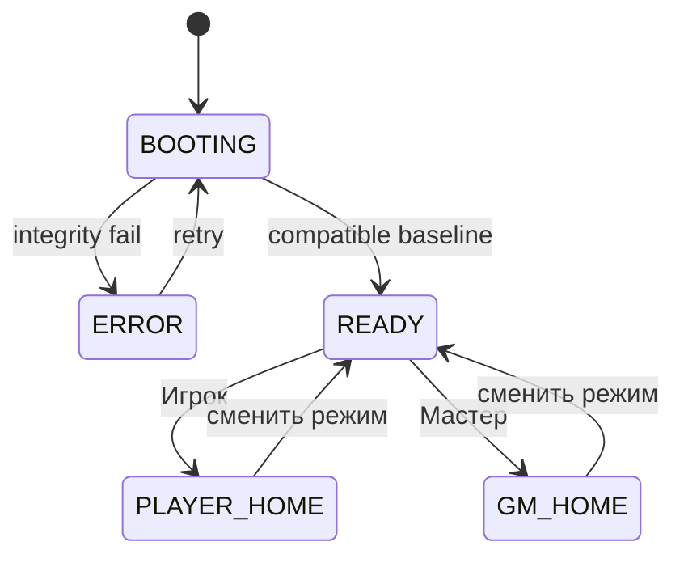

### DGM-CHARACTER — Создание и локальный lifecycle персонажа

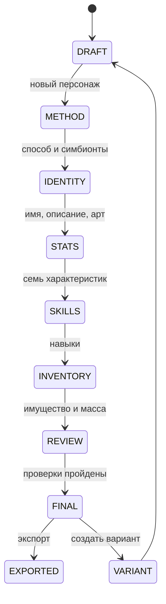

### DGM-ADMISSION — Заявка, рассмотрение и допуск кампанийной копии

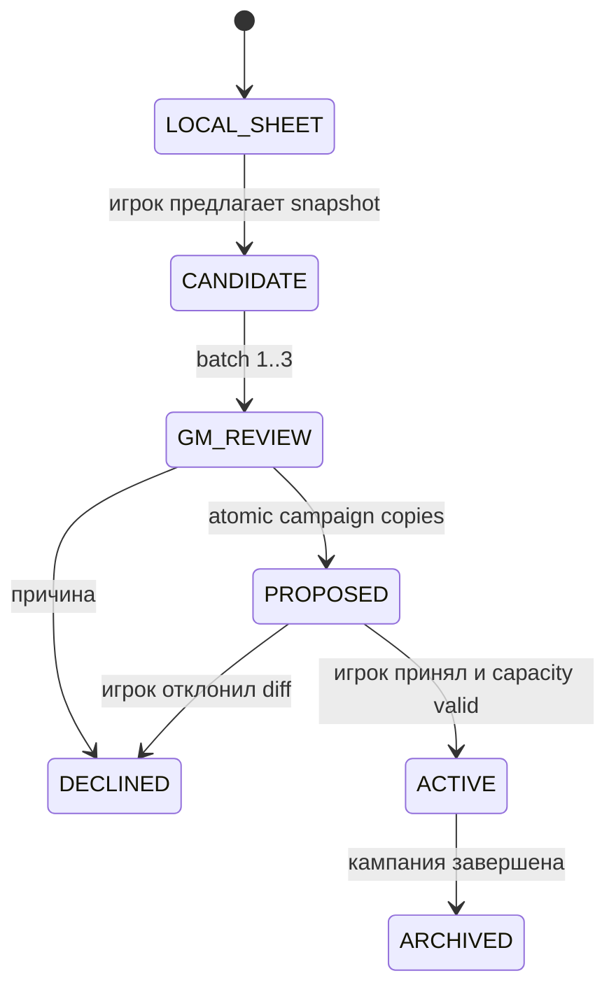

### DGM-SEATS — Локальные seats обычного ПК и host-компьютера

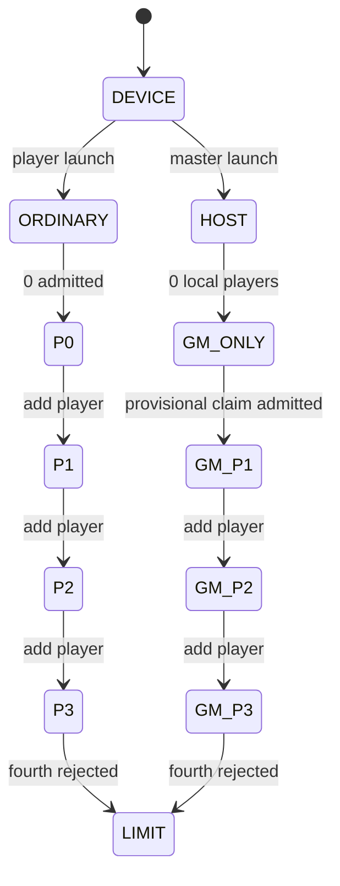

### DGM-NPC — Создание и версионирование НПС

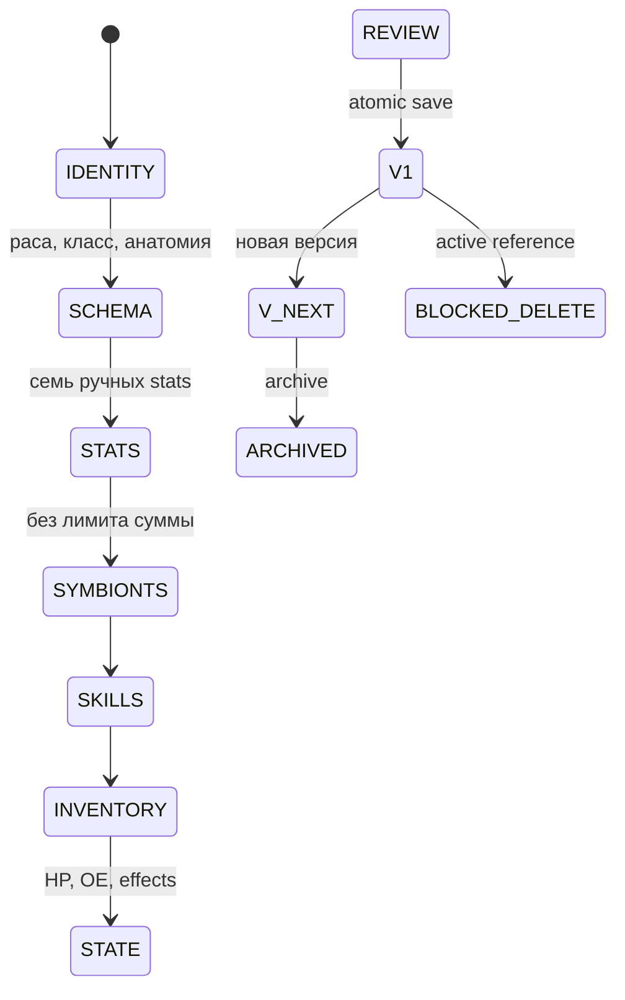

### DGM-ENEMIES — Создание и версионирование врага и монстра

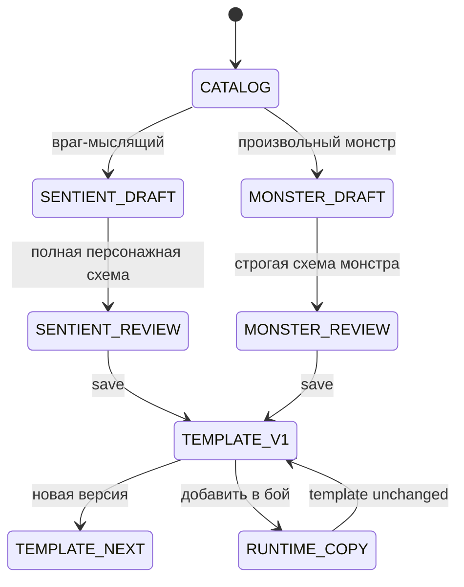

### DGM-REST — Длительный отдых

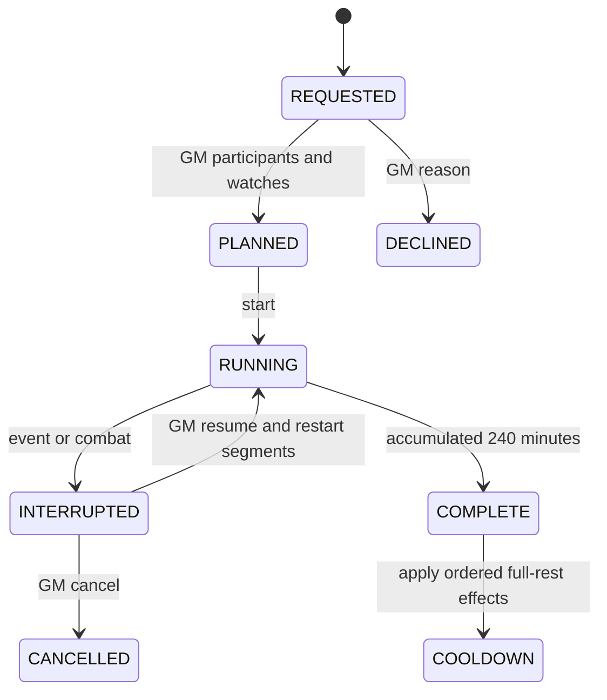

### DGM-BATTLE — Полный lifecycle боя и актора

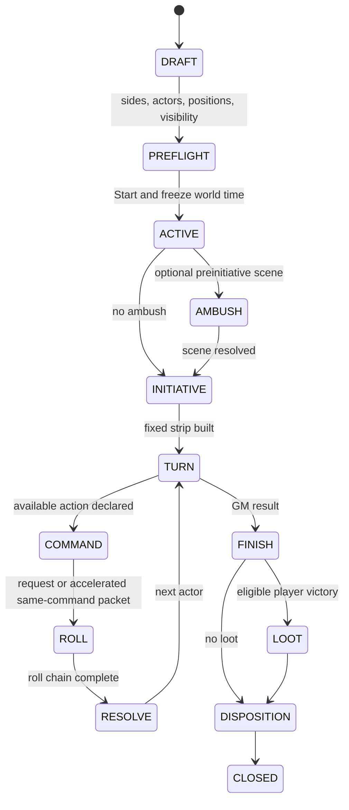

### DGM-RECONNECT — Потеря связи и reconnect

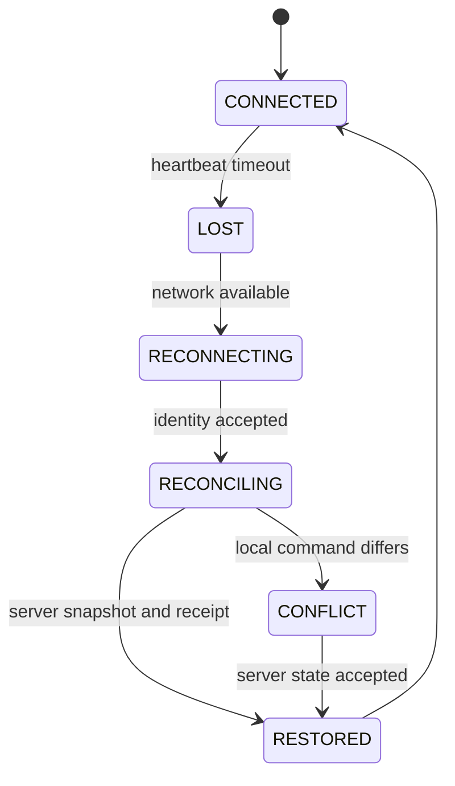

### DGM-ACTIONS — Authoritative availableActions

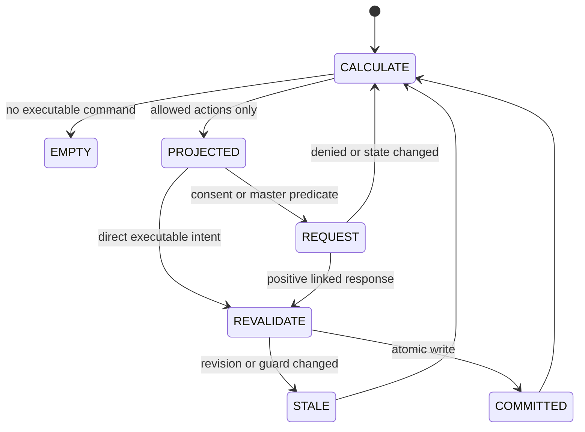

### DGM-GUARDIAN — Хранитель: выход, захват, перезапись и Попутчики

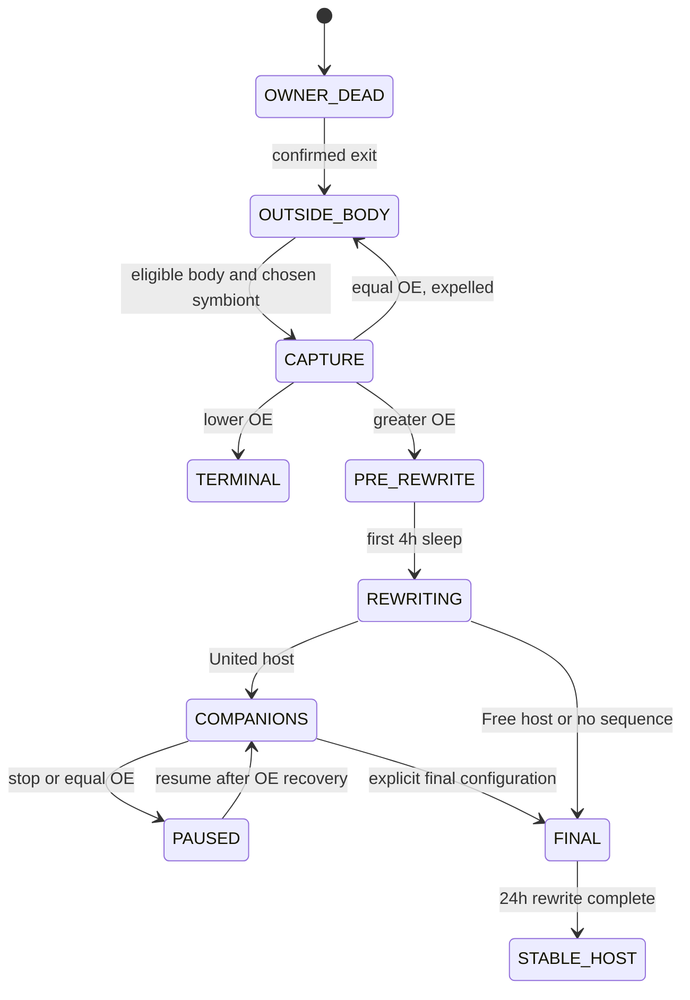

## Нормативные journeys

### J-APP-ROLE — Boot и выбор Игрок/Мастер

| Роль | Формы | Rule refs | Operation refs | Workflow commands | Q&A refs | Статус |
| --- | --- | --- | --- | --- | --- | --- |
| player, gm | APP-001, APP-002, APP-011 |  |  |  |  | COVERED |

| Состояние | ScreenFormID | Guards | Результат |
| --- | --- | --- | --- |
| BOOTING | APP-001 | Локальная сборка запускается через HTTP; baseline и локальные assets проверяются. | READY либо ERROR. |
| PLAYER_MODE | APP-002 | Пользователь нажал «Игрок»; authority не повышается. | Открыто главное меню игрока. |
| MASTER_MODE | APP-011 | Пользователь нажал «Мастер»; активная кампания требует подтверждённый host authority. | Открыто главное меню мастера. |

**Нормативные альтернативы:**

- Возврат к APP-001 не меняет данные и не повышает роль.
- Внутри кампании GM↔player выполняется только через PLY-028/030.

**Error/offline/reconnect:**

- APP-001 ERROR предлагает диагностику и повтор; облачный login не создаётся.

### J-CHAR-CREATE — Полное создание локального персонажа игроком

| Роль | Формы | Rule refs | Operation refs | Workflow commands | Q&A refs | Статус |
| --- | --- | --- | --- | --- | --- | --- |
| player | APP-004, CHR-001, CHR-010, CHR-016, CHR-036, CHR-002, CHR-003, CHR-004, CHR-005, CHR-006, CHR-007, CHR-008, CHR-028, CHR-009, CHR-011, CHR-012, CHR-013, CHR-014, CHR-015, CHR-017, CHR-018, CHR-019, CHR-020, CHR-041, CHR-042, CHR-029, CHR-030, CHR-021, CHR-022, CHR-023, CHR-024, CHR-038, CHR-037, CHR-032, CHR-031, CHR-025, CHR-026, CHR-039, CHR-040, APP-010 | AQ2-003, AQ2-005, AQA-003, AQA-004, AQA-005, AQA-007, AQA-015, CORE-078, CORE-159, CORE-160, CORE-161, CORE-162, CORE-171, CORE-175, CORE-185, CORE-186, SYM-001, SYM-182 | OP-CHAR-CREATE, OP-REQ-PLAYER, OP-REQ-VALIDATE, OP-SYMBIONT-ADD | UI-CMD-CHAR-CREATION-ROLL-COMMIT, UI-CMD-CHAR-CREATION-SET-DECIDE, UI-CMD-CHAR-EXPORT, UI-CMD-CHAR-LOCAL-METADATA-PATCH, UI-CMD-CHAR-VARIANT-CREATE, UI-CMD-CHAR-WIZARD-CHECKPOINT, UI-CMD-LOCAL-CHECKPOINT-RESTORE, UI-CMD-PLAYER-WEAPON-REQUEST-SUBMIT | Q-CAMP-004, Q-CHAR-001, Q-CHAR-002, Q-CHAR-003, Q-CHAR-004, Q-CHAR-005, Q-CHAR-006, Q-CHAR-007, Q-CHAR-008, Q-CHAR-009, Q-CHAR-010, Q-CHAR-011, Q-CHAR-012, Q-CHAR-013, Q-CHAR-015, Q-CHAR-016, Q-CHAR-017, Q-CHAR-018, Q-CHAR-019, Q-CORE-002, Q-CORE-024, Q-CORE-048, Q-CORE-049, Q-CORE-050, Q-CORE-051, Q-CORE-052, Q-CORE-054, Q-GM-SYM-011, Q-SYM-003, Q-SYM-016, Q-SYM-031, Q-SYM-032, Q-SYM-040, Q-SYM-073 | COVERED |

| Состояние | ScreenFormID | Guards | Результат |
| --- | --- | --- | --- |
| DRAFT_IDENTITY | APP-004, CHR-001 | Новый immutable UUID; обязательны имя, возраст, пол и положительная massKg 0,1; описание/арт необязательны. | Атомарный черновик. |
| RACE_AND_METHOD | CHR-010, CHR-016, CHR-036, CHR-002 | Только Единый/Вольный/Чистый; creation die mode и ветвь фиксируются до первого результата. | Выбрана неизменяемая конфигурация бросков. |
| STAT_ROLLS | CHR-003, CHR-004, CHR-005, CHR-006, CHR-007, CHR-008, CHR-028 | Каждый показанный результат сохраняется; натуральные 20/1 подтверждаются; отказ необратим. | Принят набор либо открыт 90/85 point buy. |
| STAT_ASSIGNMENT | CHR-009, CHR-011, CHR-012 | Биекция семи результатов либо точная сумма; класс Чистого выбирается после характеристик. | Получены skill-stage stats. |
| SKILLS | CHR-013, CHR-014, CHR-015 | Все стартовые слоты заполнены; требования считаются по skill-stage. | Сформирован стартовый набор навыков. |
| SYMBIONTS | CHR-017, CHR-018, CHR-019, CHR-020, CHR-041, CHR-042, CHR-029, CHR-030 | Manual/random, привязки, slots, interactions; first shown roll и Q-GM-SYM-013 irreversible boundary сохраняются. | Валидный состав и итоговые stats/OE. |
| STARTING_ITEMS | CHR-021, CHR-022, CHR-023, CHR-024, CHR-038, CHR-037, CHR-032, CHR-031 | armorBundle, оружие, деньги и пять позиций; ровно восемь имущественных D20, рекомендации не удаляют предмет. | Имущество принадлежит, но не экипировано. |
| VALIDATE_SAVE | CHR-025, CHR-026, CHR-039, CHR-040, APP-010 | stats≥1, полный состав, масса и обязательные строки; финальный save делает creation read-only. | Полноценный локальный персонаж доступен для export/proposal/variant. |

**Нормативные альтернативы:**

- «Создать вариант» копирует только имя/описание/арт в новый UUID.
- Удалённый draft при повторном создании получает новый UUID.

**Error/offline/reconnect:**

- Refresh восстанавливает CHR-026/039 без reroll; невалидная масса/имущество допускают только lobby, не Ready/scene/combat.

### J-CHAR-IMPORT-EXPORT — Импорт, экспорт и независимая копия персонажа

| Роль | Формы | Rule refs | Operation refs | Workflow commands | Q&A refs | Статус |
| --- | --- | --- | --- | --- | --- | --- |
| player | CHR-043, CHR-044, APP-006, CHR-045, APP-004, APP-010 | AQA-015 | OP-CHAR-CREATE | UI-CMD-CHAR-EXPORT, UI-CMD-CHAR-IMPORT-COMMIT, UI-CMD-CHAR-VARIANT-CREATE | Q-CAMP-004, Q-CHAR-001, Q-CHAR-015 | COVERED |

| Состояние | ScreenFormID | Guards | Результат |
| --- | --- | --- | --- |
| PLAYER_PICK_FILE | CHR-043 | ownerContext=PLAYER_LOCAL; projectionRole=PLAYER; signed origin/return is APP-002 or APP-004; activeLocalOwnerId current; file picker performs no state write. | Создан importId с неизменным player-owner envelope. |
| PLAYER_VALIDATE | CHR-044, APP-006 | ownerContext=PLAYER_LOCAL remains signed and unchanged; schema/baseline/checksum/provenance and duplicate source UUID checked without writes. | PASS либо полный отчёт без partial import. |
| PLAYER_CREATE_COPY | CHR-045 | ownerContext=PLAYER_LOCAL; activeLocalOwnerId still matches; COMPATIBLE; commit creates one new local UUID and no campaign candidate. | Независимая локальная копия либо zero-record incompatibility receipt. |
| PLAYER_RETURN_LIBRARY | APP-004 | PLAYER_LOCAL import receipt committed; active local owner unchanged; no GM candidate or archive payload serialized. | Библиотека активного player owner обновлена. |
| PLAYER_EXPORT | APP-010 | ownerContext=PLAYER_LOCAL; sourceKind=LOCAL_FINAL; signed origin/return APP-004\|CHR-040; activeLocalOwnerId matches source owner. | Версионированный browser download с checksum. |

**Нормативные альтернативы:**

- Второй импорт того же source UUID в одну кампанию блокируется.
- Campaign export никогда не merge-ится автоматически с исходным листом.

**Error/offline/reconnect:**

- Закрытие file picker безопасно; несовместимость не создаёт частичных сущностей.

### J-GM-IMPORT-ADMISSION — Импорт персонажа мастером с привязкой владельца

| Роль | Формы | Rule refs | Operation refs | Workflow commands | Q&A refs | Статус |
| --- | --- | --- | --- | --- | --- | --- |
| player, gm | CHR-043, CHR-044, CHR-045, NET-028, NET-017, NET-018, NET-019, NET-020, NET-021, NET-027 | AQ2-010, AQA-017 | OP-REQ-GM | UI-CMD-ADMISSION-GM-ACCEPT, UI-CMD-ADMISSION-PLAYER-DECIDE, UI-CMD-CHAR-IMPORT-COMMIT, UI-CMD-IMPORTED-OWNER-CLAIM | Q-CAMP-001, Q-CAMP-002, Q-CAMP-004, Q-CAMP-005, Q-CAMP-007, Q-CHAR-001, Q-CHAR-010, Q-CHAR-011, Q-CHAR-012, Q-CHAR-013, Q-CHAR-014, Q-CHAR-016, Q-CHAR-018, Q-CORE-052, Q-GM-030 | COVERED |

| Состояние | ScreenFormID | Guards | Результат |
| --- | --- | --- | --- |
| GM_PICK_FILE | CHR-043 | ownerContext=GM_IMPORT_CANDIDATE; projectionRole=GM; signed origin/return GM-002; confirmed masterAuthorityRevision; no player-library payload. | Создан importId с неизменным GM candidate envelope. |
| GM_VALIDATE | CHR-044 | ownerContext=GM_IMPORT_CANDIDATE unchanged; schema/baseline/checksum/provenance valid; zero state write. | COMPATIBLE либо полный read-only report. |
| GM_CREATE_CANDIDATE | CHR-045 | ownerContext=GM_IMPORT_CANDIDATE; confirmed master authority; commit creates only PENDING_OWNER_LINK and never local player UUID/APP-004 access. | PENDING_OWNER_LINK; active slot и player authority не выданы. |
| OWNER_CLAIM | NET-028 | Committed candidate is published only to its addressed claiming player/device; same-host claimant first completes IMPORTED_OWNER_CLAIM privacy handoff; no GM projection accompanies player payload. | OWNER_CLAIMED либо receipt-gated DECLINE return. |
| GM_REVIEW | NET-017, NET-018, NET-019, NET-020, NET-021 | Обычный AdmissionBatch и отдельная PROPOSED campaign copy. | Batch diff опубликован. |
| PLAYER_DIFF | NET-027 | Игрок принимает либо отклоняет весь batch; capacity/controller recheck при финализации. | ACTIVE_PENDING_BLOCKERS либо DECLINED. |

**Нормативные альтернативы:**

- Без owner link кандидат не получает Ready, authority, scene, reserve или initiative.

**Error/offline/reconnect:**

- Повтор claim/import идемпотентен по candidateId/source UUID/checksum; disconnect ничего не подтверждает.

### J-JOIN-REVIEW — Подключение устройства, review и допуск кампанийной копии

| Роль | Формы | Rule refs | Operation refs | Workflow commands | Q&A refs | Статус |
| --- | --- | --- | --- | --- | --- | --- |
| player, gm | NET-001, NET-002, NET-003, NET-004, CHR-027, NET-005, NET-017, NET-018, NET-019, NET-020, NET-021, NET-022, NET-027, NET-006, NET-007 | AQ2-010, AQA-017 | OP-REQ-GM | UI-CMD-ADMISSION-GM-ACCEPT, UI-CMD-ADMISSION-GM-REJECT, UI-CMD-ADMISSION-PLAYER-DECIDE, UI-CMD-CONNECTION-OPEN, UI-CMD-DEVICE-REQUEST-CANCEL, UI-CMD-DEVICE-REQUEST-SUBMIT | Q-CAMP-001, Q-CAMP-002, Q-CAMP-004, Q-CAMP-005, Q-CAMP-007, Q-CHAR-001, Q-CHAR-010, Q-CHAR-011, Q-CHAR-012, Q-CHAR-013, Q-CHAR-014, Q-CHAR-016, Q-CHAR-018, Q-CORE-052, Q-GM-030 | COVERED |

| Состояние | ScreenFormID | Guards | Результат |
| --- | --- | --- | --- |
| DISCOVER_CONNECT | NET-001, NET-002 | LAN discovery/address/QR; отдельного пароля игрока нет. | Техническое соединение. |
| SELECT_PROPOSE | NET-003, NET-004, CHR-027 | 1–3 финальных локальных персонажа; кампания максимум 5 PC; четвёртый local seat запрещён. | Device request отправлен. |
| WAIT | NET-005, NET-017 | До решения места и campaignCharacterId не создаются. | GM принимает к review или отклоняет с причиной. |
| REVIEW_COPY | NET-018, NET-019, NET-020 | Локальный лист/provenance read-only; GM правит только отдельную campaign copy в разрешённых границах. | Полный diff и blockers. |
| GM_DECISION | NET-021, NET-022 | Commit создаёт campaignCharacterId либо отказ без изменения source. | Решение доставлено игроку. |
| PLAYER_DECISION | NET-027, NET-006, NET-007 | Игрок принимает diff целиком или отказывается. | Ready либо возврат к выбору. |

**Нормативные альтернативы:**

- Незаполненные масса/имущество блокируют Ready, но сохраняют lobby copy.
- Игровая вкладка host-PC появляется только после полного допуска и назначения local seat.

**Error/offline/reconnect:**

- NET-008..015 восстанавливают server revision и pending review без второго commit.

### J-CAMPAIGN-CREATE — Создание и запуск кампании

| Роль | Формы | Rule refs | Operation refs | Workflow commands | Q&A refs | Статус |
| --- | --- | --- | --- | --- | --- | --- |
| gm | APP-011, CMP-001, CMP-002, CMP-003, CMP-004, CMP-005, CMP-006, CMP-007, NET-016 |  |  | UI-CMD-CAMPAIGN-CREATE, UI-CMD-CAMPAIGN-START | Q-CAMP-001, Q-GM-030 | COVERED |

| Состояние | ScreenFormID | Guards | Результат |
| --- | --- | --- | --- |
| METADATA | APP-011, CMP-001 | Название обязательно; описание/арт опциональны. | Draft campaign UUID. |
| HOST_AND_CAPACITY | CMP-002, CMP-003, CMP-004 | Вместимость 1–5, host/port, master transfer password, default будущих roll requests. | Host config; правила кампании не выбираются. |
| PREFLIGHT_CREATE | CMP-005, CMP-006 | Baseline/catalog compatibility; допускается ноль персонажей. | Кампания создана paused. |
| LOBBY_START | CMP-007, NET-016 | Start при ≥1 валидном active PC и Ready всех включённых controlling devices. | Активная мирная сцена. |

**Нормативные альтернативы:**

- Свободные места не блокируют Start.
- NPC не занимает PC capacity.

**Error/offline/reconnect:**

- Host close/checkpoint/refresh возвращают paused state; два master authority блокируются NET-026.

### J-CAMPAIGN-LIFECYCLE — Пауза, изменение состава, завершение и архив

| Роль | Формы | Rule refs | Operation refs | Workflow commands | Q&A refs | Статус |
| --- | --- | --- | --- | --- | --- | --- |
| gm | CMP-008, CMP-009, CMP-010, CMP-011, CMP-016, GM-002, NET-017, NET-018, NET-019, NET-027, CMP-013, CMP-012 | AQ2-005, AQ2-006, AQ2-013, AQ2-019, AQ2-025, AQ2-033, AQA-017, AQA-029, CORE-190, CORE-234, SYM-055 | OP-REQ-GM, SET_GM_FORMAL_STATE | UI-CMD-ADMISSION-PLAYER-DECIDE, UI-CMD-CAMPAIGN-FINISH, UI-CMD-CAMPAIGN-PAUSE-SET | Q-CAMP-001, Q-CAMP-002, Q-CAMP-004, Q-CAMP-005, Q-CAMP-007, Q-CAMP-009, Q-CHAR-001, Q-CHAR-010, Q-CHAR-011, Q-CHAR-012, Q-CHAR-013, Q-CHAR-014, Q-CHAR-016, Q-CHAR-018, Q-CORE-052, Q-ENEMY-P17, Q-GM-007, Q-GM-026, Q-REST-008, Q-SYM-085 | COVERED |

| Состояние | ScreenFormID | Guards | Результат |
| --- | --- | --- | --- |
| OPERATE | CMP-008, CMP-009, CMP-010, CMP-011 | Изменения только на safe boundary; default roll mode влияет лишь на будущие requests. | Новая подтверждённая revision/checkpoint. |
| PAUSE_RESUME | CMP-016 | Пауза замораживает clock и mutation scene commands. | paused/running restored. |
| REMOVE_REPLACE | GM-002, NET-017, NET-018, NET-019, NET-027 | Исключение/замена выполняются только на safe boundary; новый персонаж проходит полный proposal/review/acceptance. | Состав изменён без изменения source sheets. |
| FINISH_ARCHIVE | CMP-013, CMP-012 | Только GM вне pending operation, с master password; optional export starts later from CMP-012 with ownerContext=GM_ARCHIVE_EXPORT. | Immutable archive; optional export remains an explicit archive action. |

**Нормативные альтернативы:**

- Вместимость CMP-014 меняется 1–5, не ниже текущего PC состава.
- NET-023 отключает устройство без удаления персонажа.

**Error/offline/reconnect:**

- Checkpoint conflict отображается CMP-010; архив не открывает host и не мутируется.

### J-LOCAL-SEATS — 0–3 локальных игрока и игрок на компьютере мастера

| Роль | Формы | Rule refs | Operation refs | Workflow commands | Q&A refs | Статус |
| --- | --- | --- | --- | --- | --- | --- |
| player, gm | APP-003, NET-003, CMP-009, PLY-030, APP-004, NET-004, NET-017, GM-001, PLY-001, CMB-012, CMB-020, PLY-027, PLY-028, PLY-029, CMB-050, SYS-028, GM-029 | AQ2-008, AQ2-011, AQA-017, AQA-031, AQA-040, AQA-041, CORE-066, CQA-004, CQA-011, CQA-016, CQA-023, CQA-024, CQA-036, SYM-048, SYM-113, SYM-127, SYM-163 | OP-CHAR-CREATE, OP-CONSUME, OP-PROFILE-ACTIVATE, OP-TRANSFER | UI-CMD-CONSENT-RESPOND, UI-CMD-DEVICE-REQUEST-SUBMIT, UI-CMD-LOCAL-CONTEXT-HANDOFF-ACK, UI-CMD-MASTER-PREDICATE-RESPOND | Q-APP-001, Q-CAMP-001, Q-CAMP-002, Q-CAMP-004, Q-CAMP-005, Q-CAMP-006, Q-CAMP-007, Q-CHAR-009, Q-CORE-016, Q-CORE-017, Q-CORE-027, Q-CORE-036, Q-CORE-037, Q-CORE-060, Q-CORE-067, Q-GM-001, Q-GM-009, Q-GM-010, Q-GM-022, Q-GM-023, Q-GM-024, Q-GM-028, Q-GM-030, Q-GM-SYM-011, Q-MON-007, Q-MON-014, Q-MON-017, Q-MON-069, Q-MON-070, Q-MON-072, Q-MON-086, Q-MON-087, Q-PREDEV-017, Q-QA-007, Q-QA-008, Q-SYM-021, Q-SYM-034, Q-SYM-041, Q-SYM-051, Q-SYM-063, Q-SYM-069, Q-SYM-084, Q-SYM-089, Q-SYM-097, Q-SYM-099, Q-SYM-102, Q-SYM-109 | COVERED |

| Состояние | ScreenFormID | Guards | Результат |
| --- | --- | --- | --- |
| SEAT_SET | APP-003, NET-003, CMP-009 | Обычный ПК: 0–3 player tabs; host: GM tab + 0–3 допущенных player tabs. | Server-confirmed seat set. |
| HOST_LOCAL_BOOTSTRAP | CMP-009, PLY-030, APP-004, NET-003, NET-004, NET-017 | До появления первой player tab host выполняет provisional LOCAL_CANDIDATE privacy handoff; после отправки request проекция очищается и управление возвращается GM. | Достижимый request без преждевременной player authority. |
| ACTIVE_SCENE | GM-001, PLY-001, CMB-012, CMB-020 | На безопасной границе текущей мирной или боевой сцены host/локальный игрок открывает общий переключатель; активная проекция и точный sourceSceneFormId фиксируются до handoff. | Scene-bound signed return context. |
| ACTIVE_OWNER | PLY-027, PLY-028, PLY-029 | Ровно один active player seat либо GM context. | GM_ACTIVE/PLAYER_1..3_ACTIVE. |
| PRIVACY_HANDOFF | PLY-030, CMB-050 | Предыдущая проекция удалена до отображения новой; pending command owner не меняется. | Новый seat активен. |
| SYSTEM_HANDOFF | SYS-028, GM-029, PLY-030 | Consent/predicate/reactive prompt адресату; до ответа ресурсов нет; после ответа возврат инициатору. | Pending request resolved. |

**Нормативные альтернативы:**

- Четвёртый персонаж запрещён с человеческим объяснением.
- Manual switching blocked во время команды/реакции/серии, кроме предусмотренной безопасной отмены.

**Error/offline/reconnect:**

- Reconnect восстанавливает только server-confirmed tabs, active seat, projection и pending command.

### J-NPC-CREATE — Полный wizard постоянного НПС

| Роль | Формы | Rule refs | Operation refs | Workflow commands | Q&A refs | Статус |
| --- | --- | --- | --- | --- | --- | --- |
| gm | NPC-001, NPC-002, NPC-011, NPC-012, NPC-013, NPC-014, NPC-015, NPC-016, NPC-017, NPC-003 | AQA-033, AQA-034 |  | UI-CMD-NPC-COMMIT-V1, UI-CMD-NPC-NEW-VERSION | Q-CHAR-010, Q-ENEMY-P6, Q-ENEMY-P7, Q-GM-002, Q-GM-013, Q-GM-014, Q-PREDEV-009, Q-PREDEV-014 | COVERED |

| Состояние | ScreenFormID | Guards | Результат |
| --- | --- | --- | --- |
| LIST | NPC-001 | Мастер выбирает создание нового NPC; существующая запись не мутируется. | Новый draft context. |
| IDENTITY | NPC-002 | Имя/название, описание, арт, принадлежность и роль. | Draft NPC UUID. |
| SCHEMA | NPC-011 | Допустимые раса/класс/анатомия по старшим реестрам. | Валидная персонажная схема. |
| STATS | NPC-012 | Ровно семь baseStats вручную; общего лимита суммы нет. | Валидные baseStats и derived preview. |
| SYMBIONTS | NPC-013 | Экземпляры, levels, nodes, bindings, interactions и OE. | Валидный состав симбионтов. |
| SKILLS | NPC-014 | Требования, классовые/расовые источники и slots. | Валидные навыки. |
| INVENTORY | NPC-015 | Полные типизированные предметные профили и допустимые story/custom items. | Валидный inventory snapshot. |
| INITIAL_STATE | NPC-016 | HP, OE, типизированные эффекты и исходная дееспособность. | Полный runtime snapshot. |
| COMMIT | NPC-017 | Все предыдущие этапы валидны; UI-CMD-NPC-COMMIT-V1 выполняется один раз. | Постоянный NPC UUID, version=1, history v1. |
| RESULT | NPC-003 | Получена server-confirmed идемпотентная квитанция commit. | Read-only лист сохранённого NPC. |

**Нормативные альтернативы:**

- Создание новой версии полного листа сохраняет старую; активный бой использует закреплённый snapshot.
- Дублирование NPC-008 создаёт новый UUID.

**Error/offline/reconnect:**

- NPC-009/010 блокируются при participant/target/pending-source ссылках; reconnect не удваивает экземпляр.

### J-ENEMY-SENTIENT — Создание и версионирование врага-мыслящего

| Роль | Формы | Rule refs | Operation refs | Workflow commands | Q&A refs | Статус |
| --- | --- | --- | --- | --- | --- | --- |
| gm | ENM-001, ENM-002, ENM-003, ENM-005, ENM-006, ENM-007, ENM-008, ENM-009, ENM-010, ENM-017, ENM-020, ENM-004, CMB-004, CMB-005 | AQA-035, CORE-191, CORE-192, CORE-193, CORE-194, CORE-195, CORE-196, CORE-197, CORE-212, CORE-213, CORE-216, CORE-220, MON-040, MON-041, MON-088 | CLONE_RUNTIME_STATE, OP-CLONE-SENTIENT-INVENTORY, OP-ENEMY-GROUP-GENERATE, OP-SENTIENT-IMPORT | UI-CMD-COMBAT-DRAFT-PATCH, UI-CMD-ENEMY-COMMIT-V1, UI-CMD-ENEMY-DRAFT-PATCH, UI-CMD-ENEMY-NEW-VERSION | Q-ENEMY-B1, Q-ENEMY-B11, Q-ENEMY-B12, Q-ENEMY-B13, Q-ENEMY-B14, Q-ENEMY-B3, Q-ENEMY-P1, Q-ENEMY-P10, Q-ENEMY-P11, Q-ENEMY-P12, Q-ENEMY-P15, Q-ENEMY-P16, Q-ENEMY-P17, Q-ENEMY-P2, Q-ENEMY-P3, Q-ENEMY-P4, Q-ENEMY-P5, Q-ENEMY-P6, Q-ENEMY-P7, Q-ENEMY-P8, Q-ENEMY-P9, Q-GM-013, Q-GM-017, Q-MON-041, Q-MON-048, Q-PREDEV-001, Q-PREDEV-012, Q-PREDEV-014, Q-QA-006 | COVERED |

| Состояние | ScreenFormID | Guards | Результат |
| --- | --- | --- | --- |
| CATALOG | ENM-001, ENM-002, ENM-003 | Системные 44 шаблона read-only; campaign custom versioned. | Выбран source/version. |
| IDENTITY_STATS | ENM-005, ENM-006 | Семь baseStats 1–35 без общего лимита. | Draft template. |
| FULL_CHARACTER | ENM-007, ENM-008, ENM-009 | Раса/класс/навыки/симбионты/узлы без XP budget, полное имущество. | Валидный full payload. |
| COMMIT_VERSION | ENM-010, ENM-017, ENM-020 | Новая полная версия N+1; прежние версии и instances immutable. | CurrentVersionId обновлён. |
| INSTANTIATE | ENM-004, CMB-004, CMB-005 | Deep clone с новыми mutable UUID и provenance; writeBack NONE. | Runtime actor. |

**Нормативные альтернативы:**

- System templates нельзя edit/hide/archive/delete.
- Runtime instance нельзя сохранять обратно как template.

**Error/offline/reconnect:**

- ENM-021..023 объясняют blockers; конфликт версии не создаёт partial template.

### J-ENEMY-MONSTER — Создание произвольного монстра

| Роль | Формы | Rule refs | Operation refs | Workflow commands | Q&A refs | Статус |
| --- | --- | --- | --- | --- | --- | --- |
| gm | ENM-011, ENM-012, ENM-018, ENM-019, ENM-013, ENM-014, ENM-015, ENM-016, ENM-017 | AQ2-016, CORE-171, CORE-192, CORE-193, CORE-194, CORE-195, CORE-199, CORE-200, CORE-201, CORE-202, CORE-203, CORE-204, CORE-205, CORE-206, CORE-207, CORE-210, CORE-211, CORE-226, MON-090, MON-091, SYM-001 | OP-REJECT-MONSTER-INVENTORY | UI-CMD-ENEMY-COMMIT-V1, UI-CMD-ENEMY-DRAFT-PATCH, UI-CMD-ENEMY-NEW-VERSION, UI-CMD-MONSTER-STATS-ROLL-ONCE | Q-CHAR-010, Q-ENEMY-B1, Q-ENEMY-B10, Q-ENEMY-B11, Q-ENEMY-B12, Q-ENEMY-B2, Q-ENEMY-B3, Q-ENEMY-B4, Q-ENEMY-B5, Q-ENEMY-B6, Q-ENEMY-B7, Q-ENEMY-B9, Q-ENEMY-P13, Q-ENEMY-P14, Q-ENEMY-P15, Q-ENEMY-P16, Q-ENEMY-P17, Q-ENEMY-P2, Q-ENEMY-P3, Q-ENEMY-P4, Q-ENEMY-P5, Q-ENEMY-P8, Q-PREDEV-004, Q-PREDEV-009, Q-PREDEV-010, Q-PREDEV-012, Q-PREDEV-015, Q-PREDEV-016, Q-QA-006 | COVERED |

| Состояние | ScreenFormID | Guards | Результат |
| --- | --- | --- | --- |
| IDENTITY | ENM-011 | Название, описание, арт. | Draft custom monster. |
| STATS_GENERATE | ENM-012, ENM-018, ENM-019 | Семь baseStats 1–35; 7×R20 только один раз, затем ручная правка. | Stats fixed/editable without reroll. |
| PHYSICS_ATTACK | ENM-013, ENM-014 | Положительные mass 0,1, age/baseMaxHP/naturalArmor; одна базовая MELEE атака. | Валидная физика. |
| SYMBIONT_COMMIT | ENM-015, ENM-016, ENM-017 | 0–1 обычный симбионт; нет race/class/skills/inventory/equipment/body zones. | Versioned template. |

**Нормативные альтернативы:**

- Canonical monsters read-only.
- System-defined symbiotic monsters не являются допустимым обычным symbiont choice.

**Error/offline/reconnect:**

- Попытка inventory отклоняется до создания container/item; one-shot receipt survives reconnect.

### J-ENEMY-GENERATOR — Генерация группы противников 80–150%

| Роль | Формы | Rule refs | Operation refs | Workflow commands | Q&A refs | Статус |
| --- | --- | --- | --- | --- | --- | --- |
| gm | ENM-024, ENM-025, ENM-026, CMB-004, CMB-005 | AQA-035, CORE-213, MON-088 | CLONE_RUNTIME_STATE, OP-CLONE-SENTIENT-INVENTORY, OP-ENEMY-GROUP-GENERATE | UI-CMD-COMBAT-DRAFT-PATCH, UI-CMD-ENEMY-GROUP-GENERATE-ACCEPT, UI-CMD-ENEMY-GROUP-GENERATE-PREVIEW | Q-ENEMY-B11, Q-ENEMY-B13, Q-ENEMY-B14, Q-ENEMY-P12, Q-ENEMY-P15, Q-ENEMY-P17, Q-ENEMY-P6, Q-ENEMY-P7, Q-GM-013, Q-GM-017, Q-MON-041, Q-MON-048, Q-PREDEV-012, Q-PREDEV-014, Q-QA-006 | COVERED |

| Состояние | ScreenFormID | Guards | Результат |
| --- | --- | --- | --- |
| PARAMETERS | ENM-024 | Выбрана точная PC group; сумма семи характеристик рассчитана сервером. | Random coefficient request. |
| PREVIEW | ENM-025 | Коэффициент 80–150%, ориентир 80/actor, каждая stat≤35, sentient+monster. | Проверяемый preview без commit. |
| COMMIT | ENM-026, CMB-004, CMB-005 | GM подтверждает состав; шаблоны неизменны. | Независимые runtime actors в боевом draft. |

**Нормативные альтернативы:**

- Повторная генерация до commit создаёт новую операцию/seed, не меняя предыдущий preview.

**Error/offline/reconnect:**

- Нет AI, auto-target, auto-actions или template writeBack; reconnect восстанавливает тот же preview.

### J-GM-CHAR-OPS — Инспектор и мастерские операции над кампанийным персонажем

| Роль | Формы | Rule refs | Operation refs | Workflow commands | Q&A refs | Статус |
| --- | --- | --- | --- | --- | --- | --- |
| gm | GM-001, GM-002, GM-003, GM-036, GM-004, GM-005, GM-006, GM-007, GM-008, GM-009, GM-010, GM-011, GM-012, GM-013, GM-014, GM-015, GM-032, GM-033, GM-025, GM-016, GM-017, GM-018, GM-019, GM-034, GM-035, GM-037, GM-027, GM-028, GM-029, GM-030, GM-031, GM-038, RST-014, SYS-020, SYS-019, GM-021, GM-026, CMP-011 | AQ2-001, AQ2-005, AQ2-008, AQ2-009, AQ2-011, AQ2-013, AQ2-015, AQ2-016, AQ2-017, AQ2-018, AQ2-019, AQ2-021, AQ2-022, AQ2-023, AQ2-024, AQ2-025, AQ2-032, AQ2-033, AQA-027, AQA-028, AQA-029, AQA-031, AQA-032, AQA-038, AQA-041, CORE-007, CORE-078, CORE-112, CORE-157, CORE-158, CORE-171, CORE-183, CORE-185, CORE-186, CORE-187, CORE-188, CORE-190, CORE-194, CORE-229, CORE-230, CORE-234, CQA-011, CQA-023, CQA-024, CQA-052, CQA-053, CQA-060, MON-040, MON-041, MON-080, SYM-001, SYM-004, SYM-005, SYM-048, SYM-055, SYM-113, SYM-127 | APPLY_BLEEDING, APPLY_BURNING, APPLY_EFFECT, APPLY_POISON, APPLY_TRAUMA, ASSIGN_DISEASE, BREAK_NAIT_SEAL, CREATE_WOUND, EDIT_GM_EFFECT, EXTINGUISH_BURNING, OP-ABILITY-PEACE, OP-CHIMERA-DEVOUR, OP-FULL-REST, OP-GM-DESTROY, OP-GM-GIVE, OP-GM-PATCH-WEAPON, OP-GM-REMOVE, OP-GM-STORY, OP-REPAIR, OP-REQ-GM, OP-SEAL, OP-SKILL-LEARN, OP-SYMBIONT-ADD, OP-SYMBIONT-NODE, OP-SYMBIONT-XP-GM-AWARD, RECALC_DERIVED_STATE, REFRESH_EFFECT, REMOVE_DISEASE, REMOVE_EFFECT, REMOVE_TRAUMA, REPLACE_EFFECT, RESTORE_NAIT_SEAL, SET_GM_FORMAL_STATE, STOP_ALL_BLEEDING | UI-CMD-DIRECT-FULL-REST-APPLY, UI-CMD-GM-BLEEDING-APPLY, UI-CMD-GM-BURNING-APPLY, UI-CMD-GM-CONSUMABLE-CORRECT, UI-CMD-GM-DESCRIPTION-EDIT, UI-CMD-GM-DISEASE-ASSIGN, UI-CMD-GM-EFFECT-APPLY, UI-CMD-GM-EFFECT-REMOVE, UI-CMD-GM-HP-EDIT, UI-CMD-GM-OE-EDIT, UI-CMD-GM-PROFILE-OP-CONFIRM, UI-CMD-GM-STAT-EDIT, UI-CMD-GM-SYMBIONT-COMPOSITION, UI-CMD-GM-WEAPON-REQUEST-RESOLVE, UI-CMD-INFECTION-EXPOSURE-RESOLVE, UI-CMD-LAST-CLARITY-SAVE, UI-CMD-MASTER-PREDICATE-RESPOND, UI-CMD-NARRATIVE-NOTE-SAVE, UI-CMD-TEACHER-HOUR-CONFIRM | Q-APP-001, Q-CAMP-009, Q-CHAR-012, Q-CHAR-019, Q-CORE-013, Q-CORE-014, Q-CORE-023, Q-CORE-024, Q-CORE-030, Q-CORE-032, Q-CORE-033, Q-CORE-036, Q-CORE-051, Q-CORE-058, Q-ENEMY-B1, Q-ENEMY-B2, Q-ENEMY-P16, Q-ENEMY-P17, Q-GM-001, Q-GM-005, Q-GM-006, Q-GM-007, Q-GM-009, Q-GM-010, Q-GM-018, Q-GM-020, Q-GM-023, Q-GM-024, Q-GM-027, Q-GM-028, Q-GM-029, Q-GM-SYM-001, Q-GM-SYM-002, Q-GM-SYM-003, Q-GM-SYM-004, Q-GM-SYM-005, Q-GM-SYM-006, Q-GM-SYM-007, Q-GM-SYM-008, Q-GM-SYM-009, Q-GM-SYM-010, Q-GM-SYM-011, Q-GM-SYM-012, Q-GM-SYM-013, Q-GM-XP-001, Q-MON-005, Q-MON-007, Q-MON-014, Q-MON-019, Q-MON-020, Q-MON-022, Q-MON-023, Q-MON-025, Q-MON-036, Q-MON-037, Q-MON-038, Q-MON-039, Q-MON-040, Q-MON-045, Q-MON-046, Q-MON-047, Q-MON-049, Q-MON-051, Q-MON-069, Q-MON-079, Q-MON-080, Q-MON-081, Q-MON-082, Q-MON-083, Q-MON-085, Q-MON-086, Q-MON-087, Q-MON-088, Q-PREDEV-009, Q-QA-005, Q-QA-008, Q-QA-009, Q-QA-010, Q-QA-011, Q-REST-003, Q-REST-004, Q-REST-007, Q-REST-008, Q-SYM-001, Q-SYM-002, Q-SYM-003, Q-SYM-006, Q-SYM-016, Q-SYM-021, Q-SYM-027, Q-SYM-029, Q-SYM-030, Q-SYM-031, Q-SYM-032, Q-SYM-034, Q-SYM-040, Q-SYM-051, Q-SYM-055, Q-SYM-069, Q-SYM-073, Q-SYM-075, Q-SYM-077, Q-SYM-079, Q-SYM-084, Q-SYM-085, Q-SYM-087, Q-SYM-096, Q-SYM-097, Q-SYM-112 | COVERED |

| Состояние | ScreenFormID | Guards | Результат |
| --- | --- | --- | --- |
| SELECT | GM-001, GM-002, GM-003 | Выбран campaignCharacterId, не локальный source sheet. | Открыт единый inspector. |
| EDIT_CORE | GM-036, GM-004, GM-005, GM-006 | Описание, modifiers, currentHP/currentOE; preview dependent state. | Pending typed operation. |
| SYMBIONTS_XP | GM-007, GM-008, GM-009, GM-010, GM-011, GM-012 | Species/slots/interactions/irreversible random boundaries; GM_DIRECT append-only. | Validated symbiont operation. |
| EFFECTS | GM-013, GM-014, GM-015, GM-032, GM-033, GM-025 | Known Disease/EffectType; death is not removable effect. | Typed effect change. |
| ITEMS | GM-016, GM-017, GM-018, GM-019, GM-034, GM-035, GM-037 | Item Registry grammar; exact instance/stack; versioned weapon patch. | Typed inventory change. |
| SPECIAL | GM-027, GM-028, GM-029, GM-030, GM-031, GM-038, RST-014 | Teacher hour, peace check, predicate, infection, note, last clarity, direct full rest. | Specific audited operation. |
| COMMIT_RECEIPT | SYS-020, SYS-019, GM-021, GM-026, CMP-011 | Before/after, reason, author, time and one atomic commit. | Append-only receipt. |

**Нормативные альтернативы:**

- Art of local sheet changes only by owner via APP-010.
- Story text never creates unknown mechanics.

**Error/offline/reconnect:**

- Stale revision rejected before writes; committed GM XP never rolls back or compensates.

### J-GROUP-MAP — Группы, location-подгруппы и карта

| Роль | Формы | Rule refs | Operation refs | Workflow commands | Q&A refs | Статус |
| --- | --- | --- | --- | --- | --- | --- |
| player, gm | GRP-001, GRP-002, GRP-003, GRP-004, GRP-005, GRP-006, GRP-007, GRP-008, MAP-001, MAP-002, MAP-003, MAP-004, MAP-005, MAP-006, MAP-007, MAP-008, MAP-009 | AQ2-008, AQ2-010, AQA-030, AQA-038 |  | UI-CMD-GROUP-MUTATE, UI-CMD-MAP-MARKER-SET | Q-GM-008, Q-GM-020, Q-GM-028, Q-GM-030, Q-SOUND-NIGHT-001 | COVERED |

| Состояние | ScreenFormID | Guards | Результат |
| --- | --- | --- | --- |
| GROUPS | GRP-001, GRP-002, GRP-003, GRP-004, GRP-005, GRP-006, GRP-007, GRP-008 | Active PC form exact partition; NPC ally no PC capacity; empty group only delete. | Updated group composition. |
| GM_MAP | MAP-001, MAP-002, MAP-003, MAP-004 | Subset/location subgroup marker; no route, obstacles, speed or travel time calculation. | Confirmed marker revision/history. |
| PLAYER_MAP | MAP-005, MAP-006, MAP-007 | Only own/allowed markers; unknown before first marker or when hidden. | Observer-safe location. |
| CONTEXT_CHANGE | MAP-008, MAP-009 | dayPhase and soundtrack geometry evaluated after confirmed marker. | Visual/audio context updated without blocking. |

**Нормативные альтернативы:**

- Device whose characters are in different groups receives separate projections.
- Combat selects explicit location subgroups; remote members are not pulled in.

**Error/offline/reconnect:**

- Reconnect uses last confirmed marker/history; uncommitted drag is discarded.

### J-TIME-LIGHT — Игровое время, dayPhase и localLighting

| Роль | Формы | Rule refs | Operation refs | Workflow commands | Q&A refs | Статус |
| --- | --- | --- | --- | --- | --- | --- |
| player, gm | TIM-001, TIM-009, TIM-007, TIM-002, TIM-003, TIM-005, TIM-006, TIM-008, TIM-004, MAP-008, ANI-010 | AQ2-001, AQ2-006, AQ2-008, AQ2-024, AQ2-026, AQ3-003, AQA-025, AQA-026, AQA-031, CORE-066, CQA-020, CQA-021, CQA-059, MON-047, MON-080, SYM-004, SYM-008, SYM-048, SYM-093 | ADVANCE_TIME, RESOLVE_EFFECT_TICK | UI-CMD-AUTO-CLOCK-SET, UI-CMD-TIME-ADVANCE-CONFIRM | Q-APP-003, Q-CORE-016, Q-CORE-023, Q-CORE-062, Q-CORE-063, Q-CORE-065, Q-GM-002, Q-GM-003, Q-GM-004, Q-GM-009, Q-GM-026, Q-GM-027, Q-GM-028, Q-MON-019, Q-MON-020, Q-MON-022, Q-MON-023, Q-MON-037, Q-MON-038, Q-MON-045, Q-MON-057, Q-MON-070, Q-MON-079, Q-MON-080, Q-MON-081, Q-MON-082, Q-MON-083, Q-MON-085, Q-QA-003, Q-QA-010, Q-REST-001, Q-REST-009, Q-SOUND-NIGHT-001, Q-SYM-001, Q-SYM-006, Q-SYM-007, Q-SYM-008, Q-SYM-011, Q-SYM-013, Q-SYM-015, Q-SYM-017, Q-SYM-018, Q-SYM-019, Q-SYM-020, Q-SYM-028, Q-SYM-037, Q-SYM-041, Q-SYM-042, Q-SYM-044, Q-SYM-053, Q-SYM-060, Q-SYM-071, Q-SYM-076, Q-SYM-079, Q-SYM-081, Q-SYM-093, Q-SYM-094, Q-SYM-096, Q-SYM-101, Q-SYM-105 | COVERED |

| Состояние | ScreenFormID | Guards | Результат |
| --- | --- | --- | --- |
| CLOCK | TIM-001, TIM-009, TIM-007 | Campaign starts paused; running gives +1 game hour per 10 real minutes; battle/host close freezes. | Current mode/timestamp. |
| PREVIEW | TIM-002, TIM-003, TIM-005 | Manual advance forward only; stable event snapshot and normative order. | Preview without writes. |
| COMMIT_OR_STOP | TIM-006, TIM-008 | TIM-006 rolls back whole transaction; TIM-008 keeps already applied death and stops. | New timestamp or required GM resolution. |
| LIGHT | TIM-004, MAP-008, ANI-010 | day [06:00,21:00), night [21:00,06:00); localLighting independent. | Observer visual state. |

**Нормативные альтернативы:**

- Manual advance temporarily pauses real timer then restores prior mode.
- After battle restore precombat clockMode on same timestamp.

**Error/offline/reconnect:**

- Unresolved death/exposure blocks further advance; reconnect resumes event queue from committed boundary.

### J-LONG-REST — Заявка, дозоры, 240 минут и бой во время отдыха

| Роль | Формы | Rule refs | Operation refs | Workflow commands | Q&A refs | Статус |
| --- | --- | --- | --- | --- | --- | --- |
| player, gm | RST-001, RST-002, RST-005, RST-006, RST-007, RST-011, RST-003, RST-008, RST-009, RST-013, CMB-011, CMB-058, CMB-063, RST-015, RST-010, RST-004 | AQ2-024, AQ2-026, AQ2-027, AQ2-030, AQ2-031, AQ2-032, AQ3-003, AQA-025, AQA-026, AQA-034, AQA-037, CQA-019, CQA-020, CQA-021, CQA-023, CQA-042, MON-067, SYM-008, SYM-093 | FINALIZE_DEATH_STATE, OP-CHECK-CORPSE-LOOT, OP-FULL-REST, OP-RETURN | UI-CMD-COMBAT-CLOSE, UI-CMD-COMBAT-START, UI-CMD-REST-FUTURE-SCHEDULE-SAVE, UI-CMD-REST-INTERRUPTION-RESOLVE, UI-CMD-REST-POSTBATTLE-DECIDE, UI-CMD-REST-REQUEST-REJECT, UI-CMD-REST-REQUEST-SUBMIT, UI-CMD-REST-START, UI-CMD-TEMP-ACTOR-DISPOSE | Q-CORE-063, Q-CORE-064, Q-CORE-065, Q-ENEMY-P13, Q-ENEMY-P7, Q-GM-002, Q-GM-003, Q-GM-004, Q-GM-014, Q-GM-019, Q-MON-021, Q-MON-070, Q-MON-073, Q-PREDEV-009, Q-PREDEV-017, Q-QA-003, Q-QA-012, Q-REST-001, Q-REST-002, Q-REST-003, Q-REST-004, Q-REST-005, Q-REST-006, Q-REST-007, Q-REST-009, Q-SYM-002, Q-SYM-033, Q-SYM-035, Q-SYM-036, Q-SYM-039, Q-SYM-052, Q-SYM-074, Q-SYM-088, Q-SYM-092, Q-SYM-093, Q-SYM-094, Q-SYM-096, Q-SYM-099, Q-SYM-105, Q-SYM-107, Q-SYM-108 | COVERED |

| Состояние | ScreenFormID | Guards | Результат |
| --- | --- | --- | --- |
| REQUEST | RST-001, RST-002, RST-005 | Игрок предлагает свою group; GM определяет participants. | Queued request. |
| SCHEDULE | RST-006, RST-007, RST-011 | With-watch covers every minute; without-watch explicit; schedule future only. | Valid plan. |
| RUN | RST-003, RST-008, RST-009, RST-013 | 240 accumulated; scheduled watch resets only continuous segment, other interruption resets both. | Progress/ticks. |
| COMBAT_INTERRUPT | CMB-011 | Selected sleepers wake; rest pauses and the complete battle lifecycle runs before any rest decision. | Battle context with saved rest snapshot. |
| BATTLE_COMPLETES | CMB-058, CMB-063 | Combat result is committed and all mandatory loot/disposition boundaries complete before rest administration resumes. | Completed combat receipt with paused-rest link. |
| POSTBATTLE_DECISION | RST-015 | Only after battle close GM chooses cancel or resume; fighting participants restart personal segment. | CANCELLED or RESUME. |
| RESUME | RST-003 | Resume retains elapsed world time and valid future schedule while affected personal segments restart. | Running rest progress. |
| COMPLETE | RST-010, RST-004 | At minute 240 boundary first, then watch changes; apply full-rest order and rolling 24h cooldown. | Atomic rest result. |

**Нормативные альтернативы:**

- RST-012 cancel keeps elapsed world time but discards unfinished rest progress.
- Direct GM full rest is the separate J-DIRECT-FULL-REST branch and never follows natural completion.
- Other groups gain no rest while world time frozen.

**Error/offline/reconnect:**

- Reconnect restores exact accumulated/continuous segments and future schedule; no duplicate minute processing.

### J-PEACE-ACTIONS — Мирная проверка, способность, согласие и predicate

| Роль | Формы | Rule refs | Operation refs | Workflow commands | Q&A refs | Статус |
| --- | --- | --- | --- | --- | --- | --- |
| player, gm | PLY-001, PLY-017, PLY-018, PLY-019, PLY-026, PLY-031, SYS-028, GM-029, PLY-030, CMB-032, CMB-033, PLY-025, GM-021 | AQ2-001, AQ2-008, AQ2-011, AQ2-012, AQ2-013, AQ2-019, AQ2-021, AQ2-022, AQ2-025, AQ2-032, AQ2-033, AQ3-001, AQ3-002, AQA-027, AQA-031, AQA-039, AQA-040, AQA-041, CORE-206, CORE-230, CQA-004, CQA-011, CQA-023, CQA-024, CQA-026, CQA-051, CQA-054, MON-038, MON-042, MON-044, MON-045, MON-049, MON-050, MON-052, MON-053, MON-054, MON-055, MON-056, MON-080, SYM-011, SYM-021, SYM-028, SYM-113, SYM-127 | APPLY_COATING, APPLY_EFFECT, ASSIGN_DISEASE, BREAK_NAIT_SEAL, EDIT_GM_EFFECT, OP-ABILITY-PEACE, OP-CHIMERA-DEVOUR, OP-COAT, OP-CONSUME, OP-EQUIP, OP-GM-DESTROY, OP-GM-GIVE, OP-GM-PATCH-WEAPON, OP-GM-REMOVE, OP-GM-STORY, OP-MERGE, OP-REPAIR, OP-REQ-GM, OP-RESOLVE-COMBAT-VALUES, OP-SEAL, OP-SKILL-LEARN, OP-SPLIT, OP-SYMBIONT-ADD, OP-SYMBIONT-NODE, OP-TRANSFER, OP-UNEQUIP, OP-WEB-ITEM-CREATE, RECALC_DERIVED_STATE, REMOVE_DISEASE, REMOVE_EFFECT, RESTORE_NAIT_SEAL, SET_GM_FORMAL_STATE | UI-CMD-CONSENT-RESPOND, UI-CMD-LOCAL-CONTEXT-HANDOFF-ACK, UI-CMD-MASTER-PREDICATE-RESPOND, UI-CMD-PEACE-DEPENDENCY-REQUEST-CREATE, UI-CMD-PEACE-ROLL-REQUEST-CREATE, UI-CMD-ROLL-SUBMIT | Q-APP-001, Q-APP-002, Q-APP-003, Q-APP-004, Q-CAMP-006, Q-CHAR-009, Q-COMBAT-CRIT-001, Q-CORE-005, Q-CORE-006, Q-CORE-010, Q-CORE-016, Q-CORE-017, Q-CORE-018, Q-CORE-019, Q-CORE-020, Q-CORE-021, Q-CORE-023, Q-CORE-025, Q-CORE-031, Q-CORE-034, Q-CORE-041, Q-CORE-060, Q-CORE-067, Q-ENEMY-P14, Q-GM-001, Q-GM-005, Q-GM-006, Q-GM-009, Q-GM-010, Q-GM-018, Q-GM-021, Q-GM-022, Q-GM-023, Q-GM-024, Q-GM-025, Q-GM-027, Q-GM-028, Q-GM-029, Q-GM-SYM-001, Q-GM-SYM-005, Q-GM-SYM-007, Q-GM-SYM-008, Q-GM-SYM-009, Q-GM-SYM-010, Q-GM-SYM-011, Q-GM-SYM-012, Q-GM-SYM-013, Q-MON-005, Q-MON-006, Q-MON-007, Q-MON-014, Q-MON-017, Q-MON-022, Q-MON-024, Q-MON-037, Q-MON-038, Q-MON-040, Q-MON-045, Q-MON-052, Q-MON-057, Q-MON-059, Q-MON-063, Q-MON-069, Q-MON-079, Q-MON-080, Q-MON-081, Q-MON-082, Q-MON-083, Q-MON-085, Q-MON-086, Q-MON-087, Q-PREDEV-006, Q-QA-002, Q-QA-007, Q-QA-008, Q-QA-009, Q-QA-010, Q-REST-007, Q-REST-008, Q-SYM-005, Q-SYM-007, Q-SYM-008, Q-SYM-010, Q-SYM-012, Q-SYM-017, Q-SYM-019, Q-SYM-020, Q-SYM-034, Q-SYM-041, Q-SYM-042, Q-SYM-048, Q-SYM-050, Q-SYM-051, Q-SYM-053, Q-SYM-054, Q-SYM-056, Q-SYM-067, Q-SYM-068, Q-SYM-069, Q-SYM-070, Q-SYM-078, Q-SYM-083, Q-SYM-084, Q-SYM-097, Q-SYM-101, Q-SYM-105, Q-SYM-113 | COVERED |

| Состояние | ScreenFormID | Guards | Результат |
| --- | --- | --- | --- |
| AVAILABLE | PLY-001, PLY-017 | Server computes only currently executable peace whitelist commands. | Filtered chooser. |
| PARAMETERS | PLY-018, PLY-019 | Eligible target/parameter/object; master predicate/consent requested before reserve. | REQUEST_* or directly executable intent. |
| HANDOFF_WAIT | PLY-026, PLY-031, SYS-028, GM-029, PLY-030 | No action/OE/item/dose reserved; explicit response, no implicit timeout yes. | Positive/negative/unknown result. |
| COMMIT | CMB-032, CMB-033, PLY-025, GM-021 | Recheck guards then reserve/roll/apply atomically. | Result and refreshed availableActions. |

**Нормативные альтернативы:**

- Hostile peace intent against capable nonconsenting target: GM starts combat with saved intent or rejects without spend.

**Error/offline/reconnect:**

- Disconnect/close means no decision except pharma explicit timeout rule; new request gets new requestId.

### J-AVAILABLE-ACTIONS — Authoritative availableActions в мирной сцене и бою

| Роль | Формы | Rule refs | Operation refs | Workflow commands | Q&A refs | Статус |
| --- | --- | --- | --- | --- | --- | --- |
| player, gm | SYS-029, PLY-017, PLY-014, CMB-013, CMB-021, CMB-022, CMB-023, CMB-029, PLY-019, PLY-026, PLY-031, GM-029, SYS-028, SYS-024, SYS-016 | AQ2-001, AQ2-008, AQ2-011, AQ2-012, AQ3-001, AQ3-002, AQA-031, AQA-032, AQA-040, AQA-041, AQA-043, CORE-066, CORE-130, CORE-181, CORE-198, CORE-204, CORE-208, CORE-209, CORE-211, CORE-212, CORE-220, CORE-221, CORE-229, CORE-230, CQA-004, CQA-007, CQA-010, CQA-011, CQA-013, CQA-016, CQA-023, CQA-024, CQA-026, CQA-027, CQA-033, CQA-036, CQA-040, CQA-042, CQA-049, CQA-051, CQA-054, MON-004, MON-030, MON-038, MON-042, MON-043, MON-044, MON-045, MON-049, MON-050, MON-052, MON-053, MON-054, MON-055, MON-056, MON-089, MON-091, MON-094, SYM-011, SYM-013, SYM-014, SYM-028, SYM-032, SYM-057, SYM-107, SYM-109, SYM-110, SYM-113, SYM-114, SYM-127, SYM-142, SYM-163 | APPLY_COATING, OP-ABILITY-COMBAT, OP-ABILITY-PEACE, OP-CHIMERA-DEVOUR, OP-COAT, OP-CONSUME, OP-EQUIP, OP-MERGE, OP-PICKUP, OP-PROFILE-ACTIVATE, OP-RELOAD, OP-SKILL-REVALIDATE, OP-SPLIT, OP-THROW, OP-TRANSFER, OP-UNEQUIP, OP-WEB-ITEM-CREATE | UI-CMD-COMBAT-SINGLE-ACTION-DECLARE, UI-CMD-CONSENT-RESPOND, UI-CMD-MASTER-PREDICATE-RESPOND, UI-CMD-PEACE-DEPENDENCY-REQUEST-CREATE, UI-CMD-PEACE-ROLL-REQUEST-CREATE | Q-APP-001, Q-APP-002, Q-APP-003, Q-APP-004, Q-CAMP-009, Q-CHAR-009, Q-CORE-001, Q-CORE-003, Q-CORE-004, Q-CORE-006, Q-CORE-007, Q-CORE-008, Q-CORE-009, Q-CORE-011, Q-CORE-012, Q-CORE-015, Q-CORE-016, Q-CORE-017, Q-CORE-018, Q-CORE-019, Q-CORE-020, Q-CORE-021, Q-CORE-022, Q-CORE-027, Q-CORE-028, Q-CORE-029, Q-CORE-030, Q-CORE-031, Q-CORE-034, Q-CORE-035, Q-CORE-036, Q-CORE-037, Q-CORE-038, Q-CORE-039, Q-CORE-040, Q-CORE-041, Q-CORE-042, Q-CORE-043, Q-CORE-044, Q-CORE-045, Q-CORE-046, Q-CORE-053, Q-CORE-055, Q-CORE-056, Q-CORE-057, Q-CORE-059, Q-CORE-060, Q-CORE-066, Q-CORE-067, Q-ENEMY-B10, Q-ENEMY-B12, Q-ENEMY-B4, Q-ENEMY-B8, Q-ENEMY-P13, Q-GM-001, Q-GM-009, Q-GM-010, Q-GM-018, Q-GM-022, Q-GM-023, Q-GM-024, Q-GM-025, Q-GM-028, Q-MON-004, Q-MON-005, Q-MON-006, Q-MON-007, Q-MON-008, Q-MON-009, Q-MON-010, Q-MON-011, Q-MON-013, Q-MON-014, Q-MON-015, Q-MON-016, Q-MON-017, Q-MON-018, Q-MON-019, Q-MON-020, Q-MON-021, Q-MON-022, Q-MON-024, Q-MON-026, Q-MON-027, Q-MON-028, Q-MON-029, Q-MON-031, Q-MON-032, Q-MON-033, Q-MON-034, Q-MON-035, Q-MON-036, Q-MON-037, Q-MON-038, Q-MON-042, Q-MON-043, Q-MON-044, Q-MON-045, Q-MON-046, Q-MON-048, Q-MON-049, Q-MON-050, Q-MON-051, Q-MON-052, Q-MON-053, Q-MON-054, Q-MON-055, Q-MON-056, Q-MON-058, Q-MON-059, Q-MON-060, Q-MON-061, Q-MON-062, Q-MON-063, Q-MON-064, Q-MON-065, Q-MON-066, Q-MON-067, Q-MON-068, Q-MON-069, Q-MON-070, Q-MON-071, Q-MON-072, Q-MON-075, Q-MON-076, Q-MON-077, Q-MON-078, Q-MON-079, Q-MON-080, Q-MON-081, Q-MON-082, Q-MON-083, Q-MON-084, Q-MON-085, Q-MON-086, Q-MON-087, Q-PREDEV-001, Q-PREDEV-002, Q-PREDEV-003, Q-PREDEV-004, Q-PREDEV-005, Q-PREDEV-006, Q-PREDEV-007, Q-PREDEV-009, Q-PREDEV-010, Q-PREDEV-011, Q-PREDEV-013, Q-PREDEV-015, Q-QA-001, Q-QA-002, Q-QA-005, Q-QA-007, Q-QA-008, Q-SYM-004, Q-SYM-005, Q-SYM-007, Q-SYM-008, Q-SYM-010, Q-SYM-011, Q-SYM-012, Q-SYM-013, Q-SYM-017, Q-SYM-018, Q-SYM-019, Q-SYM-020, Q-SYM-022, Q-SYM-023, Q-SYM-024, Q-SYM-025, Q-SYM-026, Q-SYM-028, Q-SYM-029, Q-SYM-034, Q-SYM-037, Q-SYM-038, Q-SYM-041, Q-SYM-044, Q-SYM-045, Q-SYM-046, Q-SYM-047, Q-SYM-048, Q-SYM-049, Q-SYM-050, Q-SYM-051, Q-SYM-052, Q-SYM-053, Q-SYM-054, Q-SYM-056, Q-SYM-057, Q-SYM-058, Q-SYM-059, Q-SYM-060, Q-SYM-061, Q-SYM-062, Q-SYM-063, Q-SYM-064, Q-SYM-065, Q-SYM-066, Q-SYM-067, Q-SYM-068, Q-SYM-069, Q-SYM-070, Q-SYM-072, Q-SYM-075, Q-SYM-076, Q-SYM-078, Q-SYM-080, Q-SYM-081, Q-SYM-082, Q-SYM-083, Q-SYM-084, Q-SYM-086, Q-SYM-087, Q-SYM-089, Q-SYM-095, Q-SYM-096, Q-SYM-097, Q-SYM-099, Q-SYM-100, Q-SYM-102, Q-SYM-103, Q-SYM-104, Q-SYM-105, Q-SYM-106, Q-SYM-109, Q-SYM-110, Q-SYM-111, Q-SYM-113 | COVERED |

| Состояние | ScreenFormID | Guards | Результат |
| --- | --- | --- | --- |
| CALCULATE | SYS-029 | actorId+effectiveController+controllerSeat+scene+phase+turn/reaction+actor visibility+state/projection revisions. | Signed action envelope. |
| PROJECT_ALLOWED_ONLY | PLY-017, PLY-014, CMB-013, CMB-021, CMB-022, CMB-023, CMB-029 | Player/effective-controller payload contains only legal actions, targets and parameters; GM administrative actions separate. | Executable chooser or its empty state. |
| REQUEST_OR_EXECUTE | PLY-019, PLY-026, PLY-031, GM-029, SYS-028 | Consent/predicate REQUEST reserves nothing; EXECUTE exists only after positive linked response. | Pending request or commit intent. |
| REVALIDATE | SYS-024, SYS-016 | Recompute guards immediately before first state write. | Commit or stale/direct-invalid rejection before spend. |
| RECALCULATE | SYS-029, CMB-029, PLY-017 | Any confirmed state change invalidates the prior envelope. | Fresh allowed-only projection. |

**Нормативные альтернативы:**

- Empty executable set is a state of CMB-029/PLY-017, not a list of disabled commands.
- Passive/forced triggers and mandatory choices use separate channels.

**Error/offline/reconnect:**

- Same ID+same payload returns prior receipt; same ID+different payload rejects; hidden options never enter payload/DOM/a11y tree/hotkeys/cache.

### J-PROGRESSION — XP симбионтов и независимый рост характеристики

| Роль | Формы | Rule refs | Operation refs | Workflow commands | Q&A refs | Статус |
| --- | --- | --- | --- | --- | --- | --- |
| player, gm | CMB-032, CMB-033, CMB-034, CMB-035, PLY-023, PLY-024, PLY-009, PLY-010, PLY-007, PLY-008, PLY-002, PLY-032, GM-007, SYS-019, GM-026 | AQ2-005, AQ2-013, AQ2-015, AQ2-017, AQ2-019, AQ2-021, AQ2-022, AQ2-025, AQ3-002, AQA-027, AQA-039, CORE-007, CORE-078, CORE-085, CORE-206, CORE-229, CORE-230, CORE-231, CORE-232, CORE-234, CQA-026, MON-002, MON-006, MON-038, MON-040, MON-041, MON-080, SYM-021, SYM-032, SYM-055, SYM-057, SYM-107, SYM-142 | OP-RESOLVE-COMBAT-VALUES, OP-ROUTE-SYMBIONT-XP, OP-SYMBIONT-NODE, OP-SYMBIONT-XP-ALLOCATE, OP-SYMBIONT-XP-CONVERT, OP-SYMBIONT-XP-GM-AWARD, OP-SYMBIONT-XP-ROUTE, RECALC_DERIVED_STATE | UI-CMD-ROLL-SUBMIT, UI-CMD-SYMBIONT-NODE-PURCHASE, UI-CMD-SYMBIONT-XP-ALLOCATE | Q-APP-004, Q-CHAR-008, Q-CHAR-019, Q-COMBAT-CRIT-001, Q-CORE-005, Q-CORE-006, Q-CORE-010, Q-CORE-025, Q-CORE-031, Q-CORE-034, Q-CORE-041, Q-CORE-047, Q-CORE-050, Q-ENEMY-B7, Q-ENEMY-P14, Q-GM-005, Q-GM-018, Q-GM-021, Q-GM-025, Q-GM-SYM-001, Q-GM-SYM-002, Q-GM-SYM-003, Q-GM-SYM-007, Q-GM-SYM-008, Q-GM-SYM-010, Q-GM-SYM-013, Q-GM-XP-001, Q-MON-002, Q-MON-006, Q-MON-009, Q-MON-023, Q-MON-024, Q-MON-032, Q-MON-039, Q-MON-052, Q-MON-057, Q-MON-059, Q-MON-063, Q-PREDEV-006, Q-QA-002, Q-QA-009, Q-SYM-005, Q-SYM-006, Q-SYM-011, Q-SYM-012, Q-SYM-014, Q-SYM-022, Q-SYM-026, Q-SYM-030, Q-SYM-032, Q-SYM-033, Q-SYM-042, Q-SYM-050, Q-SYM-054, Q-SYM-055, Q-SYM-056, Q-SYM-057, Q-SYM-066, Q-SYM-067, Q-SYM-068, Q-SYM-070, Q-SYM-073, Q-SYM-081, Q-SYM-083, Q-SYM-085, Q-SYM-087, Q-SYM-095, Q-SYM-101, Q-SYM-103, Q-SYM-105, Q-SYM-113, Q-SYMBIONT-XP-001 | COVERED |

| Состояние | ScreenFormID | Guards | Результат |
| --- | --- | --- | --- |
| ROLL_EVENT | CMB-032, CMB-033, CMB-034, CMB-035 | Original natural D20 1/20; confirmation rolls do not create XP; originRollId dedup. | Normalized roll occurrence. |
| XP_ROUTE | PLY-023, PLY-024, PLY-009, PLY-010 | direct/counter/never; 3 progress→1 unallocated; player allocates to xpEligible symbiont. | XP counters/award. |
| NODE_PURCHASE | PLY-007, PLY-008 | AND/OR/XOR, prerequisites, cost and tree registry. | Ability/node purchased atomically. |
| CHAR_MARK | PLY-002, PLY-032 | Significant confirmed crit grants normative marks; at 10 stat grows, excess retained. | Independent characteristic event. |
| GM_DIRECT | GM-007, SYS-019, GM-026, PLY-023 | Positive baseXP/reason; Free ×2 once; no counters/unallocated/3→1; irreversible. | Append-only symbiont XP. |

**Нормативные альтернативы:**

- One originRollId may create both symbiont XP and characteristic marks; streams deduplicate independently.

**Error/offline/reconnect:**

- Idempotent replay never duplicates XP, marks, stat growth or node purchase.

### J-INVENTORY — Инвентарь, экипировка, transfer, pharma и runtime-предметы

| Роль | Формы | Rule refs | Operation refs | Workflow commands | Q&A refs | Статус |
| --- | --- | --- | --- | --- | --- | --- |
| player, gm | PLY-011, PLY-012, PLY-013, PLY-014, PLY-015, PLY-016, PLY-031, SYS-028, CMB-025, CMB-068, CMB-069, CMB-070, CMB-071, CMB-072, CMB-067, CMB-026, PLY-021 | AQ2-005, AQ2-011, AQ2-021, AQA-032, AQA-037, CORE-066, CORE-130, CORE-131, CORE-149, CORE-183, CQA-004, MON-021 | APPLY_COATING, BREAK_NAIT_SEAL, OP-CHECK-CORPSE-LOOT, OP-COAT, OP-CONSUME, OP-EQUIP, OP-GM-DESTROY, OP-GM-GIVE, OP-GM-PATCH-WEAPON, OP-GM-REMOVE, OP-GM-STORY, OP-LOOT, OP-MERGE, OP-PICKUP, OP-RELOAD, OP-REPAIR, OP-RESOLVE-COMBAT-VALUES, OP-RETURN, OP-SEAL, OP-SPLIT, OP-THROW, OP-TRANSFER, OP-UNEQUIP, OP-WEB-ITEM-CREATE, RESTORE_NAIT_SEAL | UI-CMD-COMBAT-RELOAD, UI-CMD-CONSENT-RESPOND, UI-CMD-GM-LOOT-PHASE-CLOSE, UI-CMD-LOOT-SESSION-SET, UI-CMD-RUNTIME-ITEM-PICKUP, UI-CMD-RUNTIME-ITEM-RETURN | Q-APP-001, Q-CHAR-014, Q-CHAR-019, Q-COMBAT-CRIT-001, Q-CORE-004, Q-CORE-007, Q-CORE-010, Q-CORE-013, Q-CORE-014, Q-CORE-015, Q-CORE-016, Q-CORE-017, Q-CORE-018, Q-CORE-019, Q-CORE-020, Q-CORE-021, Q-CORE-023, Q-CORE-039, Q-CORE-055, Q-CORE-056, Q-CORE-057, Q-CORE-058, Q-CORE-060, Q-CORE-061, Q-CORE-064, Q-CORE-065, Q-CORE-067, Q-ENEMY-P13, Q-GM-010, Q-GM-014, Q-GM-019, Q-MON-015, Q-MON-046, Q-MON-050, Q-MON-073, Q-PREDEV-009, Q-PREDEV-015, Q-PREDEV-017, Q-QA-005, Q-QA-012, Q-SYM-027, Q-SYM-043, Q-SYM-045, Q-SYM-070, Q-SYM-071, Q-SYM-072, Q-SYM-075, Q-SYM-082, Q-SYM-096, Q-SYM-104 | COVERED |

| Состояние | ScreenFormID | Guards | Результат |
| --- | --- | --- | --- |
| VIEW_ACTIONS | PLY-011, PLY-012, PLY-013, PLY-014 | Only context-valid equip/unequip/use/split/merge/transfer commands. | Selected item intent. |
| CONSENT_PHARMA | PLY-015, PLY-016, PLY-031, SYS-028, CMB-025 | Target consent before action/dose; one pharma per turn and rolling 24h limits. | Accepted intent or no-op rejection. |
| COMBAT_OBJECT | CMB-068, CMB-069, CMB-070, CMB-071, CMB-072 | Ammo/reload/coating/throw/pickup with exact stack/instance provenance. | Atomic item/world transition. |
| LOOT | CMB-067, CMB-026, PLY-021 | Only player-side victory and LOOTABLE corpse; lock before container read. | Partial transfer with remainder. |

**Нормативные альтернативы:**

- No universal peace drop/pickup/loot.
- Custom monster has no inventory and cannot fake item-required ability.

**Error/offline/reconnect:**

- Locks and stack remainders survive reconnect; idempotent command cannot duplicate items.

### J-SOUNDTRACK — Музыка и звуковые эффекты

| Роль | Формы | Rule refs | Operation refs | Workflow commands | Q&A refs | Статус |
| --- | --- | --- | --- | --- | --- | --- |
| player, gm | SET-002, SET-004, MAP-009, ANI-010 |  |  | UI-CMD-AUDIO-VOLUME-SET | Q-GM-028, Q-SOUND-NIGHT-001 | COVERED |

| Состояние | ScreenFormID | Guards | Результат |
| --- | --- | --- | --- |
| LOCAL_SETTINGS | SET-002, SET-004 | Music/SFX volume and mute are local per computer. | Local audio state. |
| SERVER_ROUTE | MAP-009, ANI-010 | Host selects logical Track_ID/pool/shuffle/position by geometry, city/territory/sea/no-man's-land, combat and dayPhase. | Synchronized logical playback. |
| PLAYBACK | MAP-009 | Crossfade 2000ms; first user gesture releases autoplay without reselecting Track_ID. | Audible track or silent fallback. |

**Нормативные альтернативы:**

- MP3 files are external to this delivery but routing is complete.
- Missing file logs diagnostic and selects next allowed track without crash.

**Error/offline/reconnect:**

- Reconnect restores logical Track_ID and position; local volume is not overwritten by host.

### J-BATTLE — Полный жизненный цикл боевой ситуации и актора

| Роль | Формы | Rule refs | Operation refs | Workflow commands | Q&A refs | Статус |
| --- | --- | --- | --- | --- | --- | --- |
| player, gm | CMB-001, CMB-002, CMB-003, CMB-004, CMB-005, CMB-006, CMB-007, CMB-008, CMB-061, CMB-062, CMB-010, CMB-011, CMB-060, CMB-009, CMB-018, CMB-027, CMB-012, CMB-020, CMB-028, CMB-029, CMB-030, SYS-029, CMB-013, CMB-014, CMB-021, CMB-022, CMB-023, CMB-024, CMB-025, CMB-031, CMB-032, CMB-033, CMB-065, CMB-034, CMB-035, CMB-036, CMB-037, ANI-008, CMB-038, CMB-039, CMB-040, CMB-041, CMB-042, CMB-043, CMB-044, CMB-045, CMB-068, CMB-069, CMB-070, CMB-071, CMB-072, CMB-015, CMB-016, CMB-047, CMB-048, CMB-049, CMB-050, CMB-051, CMB-052, CMB-054, CMB-055, CMB-056, CMB-057, CMB-066, CMB-073, CMB-046, CMB-017, CMB-058, CMB-067, CMB-026, CMB-063 | AQ2-001, AQ2-011, AQ2-012, AQ2-024, AQ2-025, AQ3-001, AQ3-002, AQA-026, AQA-027, AQA-030, AQA-032, AQA-034, AQA-035, AQA-037, AQA-038, AQA-039, AQA-040, AQA-041, AQA-043, CORE-066, CORE-087, CORE-088, CORE-089, CORE-090, CORE-092, CORE-112, CORE-130, CORE-131, CORE-149, CORE-179, CORE-181, CORE-198, CORE-204, CORE-206, CORE-208, CORE-209, CORE-210, CORE-211, CORE-212, CORE-213, CORE-220, CORE-221, CORE-222, CORE-226, CORE-229, CORE-230, CQA-004, CQA-007, CQA-010, CQA-011, CQA-013, CQA-016, CQA-017, CQA-018, CQA-019, CQA-023, CQA-024, CQA-025, CQA-026, CQA-027, CQA-033, CQA-036, CQA-040, CQA-042, CQA-049, CQA-051, CQA-052, CQA-053, CQA-054, CQA-059, CQA-060, MON-004, MON-005, MON-006, MON-021, MON-030, MON-038, MON-042, MON-043, MON-044, MON-045, MON-049, MON-050, MON-052, MON-053, MON-054, MON-055, MON-056, MON-067, MON-080, MON-088, MON-089, MON-090, MON-091, MON-094, SYM-011, SYM-013, SYM-014, SYM-021, SYM-028, SYM-032, SYM-048, SYM-057, SYM-107, SYM-109, SYM-110, SYM-113, SYM-114, SYM-127, SYM-142, SYM-163 | APPLY_BLEEDING, APPLY_BURNING, APPLY_COATING, APPLY_EFFECT, APPLY_POISON, APPLY_TRAUMA, CLONE_RUNTIME_STATE, CREATE_WOUND, EXTINGUISH_BURNING, FINALIZE_DEATH_STATE, OP-ABILITY-COMBAT, OP-ABILITY-PEACE, OP-CHECK-CORPSE-LOOT, OP-CHIMERA-DEVOUR, OP-CLONE-SENTIENT-INVENTORY, OP-COAT, OP-CONSUME, OP-ENEMY-GROUP-GENERATE, OP-EQUIP, OP-LOOT, OP-PICKUP, OP-PROFILE-ACTIVATE, OP-RELOAD, OP-RESOLVE-COMBAT-VALUES, OP-RETURN, OP-SHIELD, OP-SPLIT, OP-THROW, OP-UNEQUIP, OP-WEB-ITEM-CREATE, REFRESH_EFFECT, REMOVE_EFFECT, REMOVE_TRAUMA, REPLACE_EFFECT, RESOLVE_EFFECT_RESPONSE, RESOLVE_EFFECT_TICK, STOP_ALL_BLEEDING | UI-CMD-AMBUSH-PHASE-CLOSE, UI-CMD-COMBAT-CLOSE, UI-CMD-COMBAT-CONTROL-LEASE-SET, UI-CMD-COMBAT-DRAFT-PATCH, UI-CMD-COMBAT-RANDOM-TARGET-SELECT, UI-CMD-COMBAT-REINFORCEMENT-CANCEL, UI-CMD-COMBAT-REINFORCEMENT-ENTER, UI-CMD-COMBAT-REINFORCEMENT-INITIATIVE-REQUEST, UI-CMD-COMBAT-RELOAD, UI-CMD-COMBAT-RESULT-COMMIT, UI-CMD-COMBAT-SERIES-CONFIRM, UI-CMD-COMBAT-SINGLE-ACTION-DECLARE, UI-CMD-COMBAT-START, UI-CMD-COMBAT-TURN-END, UI-CMD-DISCONNECTED-TURN-WAIT, UI-CMD-GM-INITIATIVE-REQUEST-CREATE, UI-CMD-GM-LOOT-PHASE-CLOSE, UI-CMD-HIDDEN-ACTOR-ENTER, UI-CMD-LOOT-SESSION-SET, UI-CMD-ROLL-PACKAGE-CREATE, UI-CMD-ROLL-SUBMIT, UI-CMD-RUNTIME-ITEM-PICKUP, UI-CMD-RUNTIME-ITEM-RETURN, UI-CMD-TEMP-ACTOR-DISPOSE | Q-APP-001, Q-APP-002, Q-APP-003, Q-APP-004, Q-CAMP-005, Q-CAMP-006, Q-CAMP-007, Q-CHAR-009, Q-COMBAT-CRIT-001, Q-CORE-001, Q-CORE-003, Q-CORE-004, Q-CORE-005, Q-CORE-006, Q-CORE-007, Q-CORE-008, Q-CORE-009, Q-CORE-010, Q-CORE-011, Q-CORE-012, Q-CORE-013, Q-CORE-014, Q-CORE-015, Q-CORE-016, Q-CORE-017, Q-CORE-018, Q-CORE-019, Q-CORE-020, Q-CORE-021, Q-CORE-022, Q-CORE-023, Q-CORE-025, Q-CORE-026, Q-CORE-027, Q-CORE-028, Q-CORE-029, Q-CORE-030, Q-CORE-031, Q-CORE-032, Q-CORE-033, Q-CORE-034, Q-CORE-035, Q-CORE-036, Q-CORE-037, Q-CORE-038, Q-CORE-039, Q-CORE-040, Q-CORE-041, Q-CORE-042, Q-CORE-043, Q-CORE-044, Q-CORE-045, Q-CORE-046, Q-CORE-047, Q-CORE-053, Q-CORE-055, Q-CORE-056, Q-CORE-057, Q-CORE-059, Q-CORE-060, Q-CORE-061, Q-CORE-062, Q-CORE-063, Q-CORE-064, Q-CORE-065, Q-CORE-066, Q-CORE-067, Q-CROSS-REG-001, Q-ENEMY-B10, Q-ENEMY-B11, Q-ENEMY-B12, Q-ENEMY-B13, Q-ENEMY-B14, Q-ENEMY-B4, Q-ENEMY-B5, Q-ENEMY-B6, Q-ENEMY-B7, Q-ENEMY-B8, Q-ENEMY-P11, Q-ENEMY-P12, Q-ENEMY-P13, Q-ENEMY-P14, Q-ENEMY-P15, Q-ENEMY-P6, Q-ENEMY-P7, Q-GM-001, Q-GM-002, Q-GM-004, Q-GM-005, Q-GM-006, Q-GM-008, Q-GM-010, Q-GM-013, Q-GM-014, Q-GM-017, Q-GM-018, Q-GM-019, Q-GM-020, Q-GM-021, Q-GM-022, Q-GM-023, Q-GM-024, Q-GM-025, Q-GM-027, Q-GM-SYM-011, Q-GM-SYM-012, Q-MON-002, Q-MON-003, Q-MON-004, Q-MON-005, Q-MON-006, Q-MON-007, Q-MON-008, Q-MON-009, Q-MON-010, Q-MON-011, Q-MON-012, Q-MON-013, Q-MON-014, Q-MON-015, Q-MON-016, Q-MON-017, Q-MON-018, Q-MON-019, Q-MON-020, Q-MON-021, Q-MON-022, Q-MON-023, Q-MON-024, Q-MON-025, Q-MON-026, Q-MON-027, Q-MON-028, Q-MON-029, Q-MON-031, Q-MON-032, Q-MON-033, Q-MON-034, Q-MON-035, Q-MON-036, Q-MON-037, Q-MON-038, Q-MON-039, Q-MON-040, Q-MON-041, Q-MON-042, Q-MON-043, Q-MON-044, Q-MON-045, Q-MON-046, Q-MON-047, Q-MON-048, Q-MON-049, Q-MON-050, Q-MON-051, Q-MON-052, Q-MON-053, Q-MON-054, Q-MON-055, Q-MON-056, Q-MON-057, Q-MON-058, Q-MON-059, Q-MON-060, Q-MON-061, Q-MON-062, Q-MON-063, Q-MON-064, Q-MON-065, Q-MON-066, Q-MON-067, Q-MON-068, Q-MON-069, Q-MON-070, Q-MON-071, Q-MON-072, Q-MON-073, Q-MON-074, Q-MON-075, Q-MON-076, Q-MON-077, Q-MON-078, Q-MON-079, Q-MON-080, Q-MON-081, Q-MON-082, Q-MON-083, Q-MON-084, Q-MON-085, Q-MON-086, Q-MON-087, Q-MON-088, Q-PREDEV-001, Q-PREDEV-002, Q-PREDEV-003, Q-PREDEV-004, Q-PREDEV-005, Q-PREDEV-006, Q-PREDEV-007, Q-PREDEV-008, Q-PREDEV-009, Q-PREDEV-010, Q-PREDEV-011, Q-PREDEV-012, Q-PREDEV-013, Q-PREDEV-014, Q-PREDEV-015, Q-PREDEV-016, Q-PREDEV-017, Q-PREDEV-018, Q-QA-001, Q-QA-002, Q-QA-003, Q-QA-004, Q-QA-005, Q-QA-007, Q-QA-008, Q-QA-010, Q-QA-011, Q-QA-012, Q-SYM-004, Q-SYM-005, Q-SYM-006, Q-SYM-007, Q-SYM-008, Q-SYM-009, Q-SYM-010, Q-SYM-011, Q-SYM-012, Q-SYM-013, Q-SYM-014, Q-SYM-015, Q-SYM-017, Q-SYM-018, Q-SYM-019, Q-SYM-020, Q-SYM-021, Q-SYM-022, Q-SYM-023, Q-SYM-024, Q-SYM-025, Q-SYM-026, Q-SYM-027, Q-SYM-028, Q-SYM-029, Q-SYM-030, Q-SYM-033, Q-SYM-034, Q-SYM-035, Q-SYM-036, Q-SYM-037, Q-SYM-038, Q-SYM-041, Q-SYM-042, Q-SYM-043, Q-SYM-044, Q-SYM-045, Q-SYM-046, Q-SYM-047, Q-SYM-049, Q-SYM-050, Q-SYM-051, Q-SYM-052, Q-SYM-053, Q-SYM-054, Q-SYM-055, Q-SYM-056, Q-SYM-057, Q-SYM-058, Q-SYM-059, Q-SYM-060, Q-SYM-061, Q-SYM-062, Q-SYM-063, Q-SYM-064, Q-SYM-065, Q-SYM-066, Q-SYM-067, Q-SYM-068, Q-SYM-069, Q-SYM-070, Q-SYM-071, Q-SYM-072, Q-SYM-074, Q-SYM-075, Q-SYM-076, Q-SYM-077, Q-SYM-078, Q-SYM-079, Q-SYM-080, Q-SYM-081, Q-SYM-082, Q-SYM-083, Q-SYM-084, Q-SYM-086, Q-SYM-087, Q-SYM-088, Q-SYM-089, Q-SYM-090, Q-SYM-091, Q-SYM-092, Q-SYM-095, Q-SYM-096, Q-SYM-097, Q-SYM-098, Q-SYM-099, Q-SYM-100, Q-SYM-101, Q-SYM-102, Q-SYM-103, Q-SYM-104, Q-SYM-105, Q-SYM-106, Q-SYM-107, Q-SYM-108, Q-SYM-109, Q-SYM-110, Q-SYM-111, Q-SYM-112, Q-SYM-113 | COVERED |

| Состояние | ScreenFormID | Guards | Результат |
| --- | --- | --- | --- |
| DRAFT | CMB-001, CMB-002, CMB-003, CMB-004, CMB-005 | Exactly one logical PC group and selected location subgroups; sides A/B; neutral outside initiative until assigned. | Deep-cloned participants. |
| POSITION_VISIBILITY | CMB-006, CMB-007, CMB-008, CMB-061, CMB-062 | Black field, positions, observer×actor visibility, lighting, reserve/off-map; no environment or route engine. | Configured scene. |
| PREFLIGHT | CMB-010 | All active NPC/runtime actors assigned A/B; no duplicate identity/pending requests; initiative is not required yet. | Start is enabled only after PASS. |
| START | CMB-011 | Atomic Start changes combat to ACTIVE, freezes world clock and pauses rest before any optional attack scene or initiative request. | Combat ACTIVE with persisted precombat clock/rest snapshot. |
| AMBUSH | CMB-060 | Optional attack/hidden-entry phase fully resolves before initiative; not round 1. | Saved intent resolved. |
| INITIATIVE | CMB-009, CMB-018, CMB-027 | CMB-009 coordinates the initial queue; ordinary players answer only addressed CMB-018 requests, the GM creates requests only for GM-controlled actors, ties reroll by immutable request, and CMB-027 opens only after the completion receipt. | Round 1 ready. |
| TURN_PROJECTION | CMB-012, CMB-020, CMB-028, CMB-029, CMB-030, SYS-029 | GM sees all; player sees only observer projection; chooser contains only available actions for actor-specific visibility. | Active controller context. |
| DECLARE | CMB-013, CMB-014, CMB-021, CMB-022, CMB-023, CMB-024, CMB-025, CMB-031 | Human selects action/target/series; no combat AI or auto-target except explicit random rule. | commandId and roll requests. |
| ROLL_CRIT | CMB-032, CMB-033, CMB-065, CMB-034, CMB-035, CMB-036, CMB-037, ANI-008 | Per-request mode snapshot; auto visible ≥0.5s; accelerated package same command only; natural 20/1 chains and XP. | Resolved roll occurrences. |
| RESOLVE | CMB-038, CMB-039, CMB-040, CMB-041, CMB-042, CMB-043, CMB-044, CMB-045, CMB-068, CMB-069, CMB-070, CMB-071, CMB-072 | Cost→accuracy→defense→zone→penetration/armor/shield→damage/HP→effects/state; update visibility/actions after every confirmed step. | Atomic action result. |
| SPECIAL_ACTORS_STATES | CMB-015, CMB-016, CMB-047, CMB-048, CMB-049, CMB-050, CMB-051, CMB-052, CMB-054, CMB-055, CMB-056, CMB-057, CMB-066, CMB-073 | Reinforcement/hidden entry no second turn; disconnected control explicit; Rat/swarm separate; severe wound, death and source-specific return. Guardian confirmation/spawn stays exclusively in J-GUARDIAN. | Updated initiative/actor lifecycle. |
| END_TURN | CMB-046 | Periodic effects/timers/reactions and voluntary forfeit; move to next initiative owner. | Next turn/round. |
| FINISH_LOOT | CMB-017, CMB-058, CMB-067, CMB-026, CMB-063 | GM selects A/B/draw and closed reason; loot only player victory; distribute temporary actors; preserve HP/OE/items/effects/death. | Battle history and return to peace scene; precombat clockMode restored. |

**Нормативные альтернативы:**

- Reserve is not third side; hidden entrant gets position/visibility/initiative once and no second turn.
- Surrender/flee removes only current initiative; campaign/group/location decided after.

**Error/offline/reconnect:**

- CMB-059+NET-008..015 restore observer visibility, fixed initiative and pending command; no roll/action duplication.

### J-GUARDIAN — Полный посмертный lifecycle Хранителя

| Роль | Формы | Rule refs | Operation refs | Workflow commands | Q&A refs | Статус |
| --- | --- | --- | --- | --- | --- | --- |
| player, gm | CMB-056, CMB-064, CMB-053, ANI-009, PLY-020, PLY-017, PLY-018, PLY-019, RST-003, RST-008, TIM-003, CMB-057, GM-015 | AQ2-001, AQ2-011, AQ2-012, AQ2-024, AQ2-031, AQ3-001, AQ3-002, AQ3-003, AQA-026, AQA-031, AQA-041, CORE-066, CORE-222, CQA-017, CQA-018, CQA-019, CQA-020, CQA-021, CQA-025, CQA-042, CQA-051, CQA-052, CQA-053, CQA-054, CQA-059, MON-042, MON-044, MON-045, MON-047, MON-049, MON-050, MON-052, MON-053, MON-054, MON-055, MON-056, MON-080, SYM-004, SYM-008, SYM-011, SYM-028, SYM-084, SYM-085, SYM-093 | ADVANCE_TIME, APPLY_COATING, EDIT_GM_EFFECT, EXTINGUISH_BURNING, FINALIZE_DEATH_STATE, OP-ABILITY-PEACE, OP-COAT, OP-FULL-REST, OP-WEB-ITEM-CREATE, REFRESH_EFFECT, REMOVE_DISEASE, REMOVE_EFFECT, REMOVE_TRAUMA, REPLACE_EFFECT, RESOLVE_EFFECT_TICK, STOP_ALL_BLEEDING | UI-CMD-GM-EFFECT-REMOVE, UI-CMD-GUARDIAN-DECIDE, UI-CMD-PEACE-DEPENDENCY-REQUEST-CREATE, UI-CMD-PEACE-ROLL-REQUEST-CREATE | Q-APP-001, Q-APP-002, Q-APP-003, Q-APP-004, Q-CAMP-007, Q-CHAR-009, Q-CORE-016, Q-CORE-023, Q-CORE-030, Q-CORE-033, Q-CORE-036, Q-CORE-062, Q-CORE-063, Q-CORE-064, Q-CORE-065, Q-GM-002, Q-GM-004, Q-GM-006, Q-GM-009, Q-GM-014, Q-GM-023, Q-GM-024, Q-GM-027, Q-GM-029, Q-GM-SYM-008, Q-GM-SYM-012, Q-MON-019, Q-MON-020, Q-MON-021, Q-MON-022, Q-MON-023, Q-MON-025, Q-MON-037, Q-MON-038, Q-MON-040, Q-MON-045, Q-MON-050, Q-MON-057, Q-MON-070, Q-MON-071, Q-MON-073, Q-MON-075, Q-MON-079, Q-MON-080, Q-MON-081, Q-MON-082, Q-MON-083, Q-MON-085, Q-PREDEV-003, Q-PREDEV-008, Q-PREDEV-011, Q-PREDEV-015, Q-PREDEV-017, Q-QA-003, Q-QA-010, Q-QA-011, Q-QA-012, Q-REST-003, Q-REST-004, Q-REST-006, Q-REST-009, Q-SOUND-NIGHT-001, Q-SYM-001, Q-SYM-002, Q-SYM-005, Q-SYM-006, Q-SYM-007, Q-SYM-008, Q-SYM-010, Q-SYM-011, Q-SYM-012, Q-SYM-013, Q-SYM-015, Q-SYM-017, Q-SYM-018, Q-SYM-019, Q-SYM-020, Q-SYM-028, Q-SYM-031, Q-SYM-036, Q-SYM-037, Q-SYM-039, Q-SYM-041, Q-SYM-042, Q-SYM-044, Q-SYM-045, Q-SYM-048, Q-SYM-053, Q-SYM-058, Q-SYM-060, Q-SYM-061, Q-SYM-062, Q-SYM-066, Q-SYM-071, Q-SYM-074, Q-SYM-076, Q-SYM-078, Q-SYM-079, Q-SYM-081, Q-SYM-088, Q-SYM-090, Q-SYM-091, Q-SYM-092, Q-SYM-093, Q-SYM-094, Q-SYM-096, Q-SYM-098, Q-SYM-099, Q-SYM-101, Q-SYM-104, Q-SYM-105, Q-SYM-107, Q-SYM-108, Q-SYM-111 | COVERED |

| Состояние | ScreenFormID | Guards | Результат |
| --- | --- | --- | --- |
| DEATH_TRIGGER | CMB-056 | Only learned active source; before confirmation no Keeper position/initiative/commands. | Pending Keeper exit. |
| PLAYER_DECISION | CMB-064 | Eligible owner explicitly confirms or declines; unresolved state is auto-created only at the finish boundary. | Decision receipt or still-pending finish-boundary obligation. |
| SPAWN | CMB-053, ANI-009, PLY-020 | New independent actor at corpse coordinate; same player controller; battle end auto-spawns at boundary if still pending. | Keeper persists outside body with HP=5L, stats=2L and L-day timer. |
| NEW_HOST | PLY-020, PLY-017, PLY-018, PLY-019 | Eligible body and target symbiont; strict currentOE superiority; subtract victim currentOE and occupy slot. | Keeper in host, old personality still controls. |
| SLEEP_REWRITE | RST-003, RST-008, TIM-003, PLY-020 | First full 4h sleep then 24h disabled rewrite; after end original Keeper-owner personality controls; I/W/C source owner, other stats new body. | Controller and stats projection changed. |
| EXIT | PLY-020, CMB-057, GM-015 | Only exact active source-specific expulsion/return/death; no universal resurrection or free effect removal. | Persistent history or terminal Keeper death. |

**Нормативные альтернативы:**

- If battle closes before exit answer, normative auto-creation occurs at finish boundary.
- Manual-only nodes are read-only and never invent transitions.

**Error/offline/reconnect:**

- Reconnect preserves actor identity, controller and timers; battle end never loses Keeper.

### J-HIDDEN-ENTRY — Скрытое вступление в уже идущий бой

| Роль | Формы | Rule refs | Operation refs | Workflow commands | Q&A refs | Статус |
| --- | --- | --- | --- | --- | --- | --- |
| player, gm | CMB-062, CMB-049, CMB-073, CMB-029, CMB-043, CMB-019, CMB-027, CMB-021 | AQ2-024, AQ3-001, AQA-040, AQA-043, CORE-087, CORE-090, CORE-149, CORE-181, CORE-198, CORE-204, CORE-208, CORE-212, CORE-221, CORE-222, CQA-007, CQA-010, CQA-011, CQA-013, CQA-016, CQA-017, CQA-023, CQA-024, CQA-025, CQA-026, CQA-027, CQA-033, CQA-036, CQA-042, CQA-049, MON-030, MON-038, MON-043, MON-067, MON-089, MON-091, MON-094, SYM-011, SYM-013, SYM-014, SYM-032, SYM-057, SYM-107, SYM-109, SYM-110, SYM-113, SYM-114, SYM-127, SYM-142, SYM-163 | OP-ABILITY-COMBAT, OP-COAT, OP-EQUIP, OP-PICKUP, OP-PROFILE-ACTIVATE, OP-RELOAD, OP-SHIELD, OP-THROW, OP-UNEQUIP, RESOLVE_EFFECT_RESPONSE | UI-CMD-HIDDEN-ACTOR-ENTER | Q-CAMP-005, Q-COMBAT-CRIT-001, Q-CORE-004, Q-CORE-008, Q-CORE-011, Q-CORE-012, Q-CORE-021, Q-CORE-022, Q-CORE-026, Q-CORE-030, Q-CORE-031, Q-CORE-034, Q-CORE-036, Q-CORE-037, Q-CORE-039, Q-CORE-041, Q-CORE-042, Q-CORE-043, Q-CORE-044, Q-CORE-046, Q-CORE-053, Q-CORE-055, Q-CORE-056, Q-CORE-057, Q-CORE-065, Q-ENEMY-B10, Q-ENEMY-B4, Q-ENEMY-B7, Q-GM-001, Q-GM-010, Q-GM-022, Q-GM-025, Q-GM-SYM-012, Q-MON-007, Q-MON-008, Q-MON-009, Q-MON-010, Q-MON-011, Q-MON-014, Q-MON-015, Q-MON-017, Q-MON-018, Q-MON-019, Q-MON-020, Q-MON-021, Q-MON-022, Q-MON-032, Q-MON-035, Q-MON-037, Q-MON-038, Q-MON-042, Q-MON-044, Q-MON-045, Q-MON-046, Q-MON-050, Q-MON-051, Q-MON-052, Q-MON-055, Q-MON-058, Q-MON-059, Q-MON-060, Q-MON-061, Q-MON-062, Q-MON-063, Q-MON-064, Q-MON-065, Q-MON-069, Q-MON-070, Q-MON-071, Q-MON-072, Q-MON-077, Q-MON-079, Q-MON-080, Q-MON-081, Q-MON-082, Q-MON-083, Q-MON-084, Q-MON-085, Q-MON-086, Q-MON-087, Q-PREDEV-001, Q-PREDEV-002, Q-PREDEV-003, Q-PREDEV-006, Q-PREDEV-007, Q-PREDEV-008, Q-PREDEV-009, Q-PREDEV-011, Q-PREDEV-017, Q-QA-002, Q-QA-003, Q-QA-004, Q-QA-007, Q-QA-008, Q-SYM-004, Q-SYM-005, Q-SYM-010, Q-SYM-011, Q-SYM-013, Q-SYM-017, Q-SYM-018, Q-SYM-019, Q-SYM-020, Q-SYM-021, Q-SYM-023, Q-SYM-024, Q-SYM-025, Q-SYM-026, Q-SYM-028, Q-SYM-034, Q-SYM-036, Q-SYM-037, Q-SYM-041, Q-SYM-044, Q-SYM-046, Q-SYM-047, Q-SYM-050, Q-SYM-051, Q-SYM-052, Q-SYM-053, Q-SYM-057, Q-SYM-058, Q-SYM-060, Q-SYM-061, Q-SYM-062, Q-SYM-063, Q-SYM-064, Q-SYM-065, Q-SYM-067, Q-SYM-068, Q-SYM-069, Q-SYM-071, Q-SYM-072, Q-SYM-074, Q-SYM-076, Q-SYM-078, Q-SYM-080, Q-SYM-081, Q-SYM-082, Q-SYM-083, Q-SYM-084, Q-SYM-086, Q-SYM-087, Q-SYM-088, Q-SYM-089, Q-SYM-090, Q-SYM-095, Q-SYM-097, Q-SYM-098, Q-SYM-099, Q-SYM-100, Q-SYM-102, Q-SYM-103, Q-SYM-104, Q-SYM-106, Q-SYM-107, Q-SYM-108, Q-SYM-109, Q-SYM-110, Q-SYM-111, Q-SYM-112 | COVERED |

| Состояние | ScreenFormID | Guards | Результат |
| --- | --- | --- | --- |
| UNDETECTED_OFF_MAP | CMB-062, CMB-049 | Актор не имеет доступной цели/позиции в player projection до условия CORE-090. | Pending hidden entrant. |
| ENTRY_ACTION | CMB-073, CMB-029, CMB-043 | Обнаружение, входной intent, предусмотренная защита и resolution через shared effective-controller chooser. | Валидная side/position/visibility. |
| INITIATIVE_INSERT | CMB-019, CMB-027 | UI-CMD-HIDDEN-ACTOR-ENTER уже зафиксировал initiative insertion; CMB-019 только показывает владельцу read-only receipt без нового request или reroll. | THIS_ROUND либо NEXT_ROUND marker. |
| NO_SECOND_TURN | CMB-073, CMB-021 | Если позиция инициативы уже пройдена либо актор уже действовал, обычный второй ход в круге запрещён. | Следующий законный turn. |

**Нормативные альтернативы:**

- Это не CMB-060: attack/ambush scene существует только до обычной инициативы.

**Error/offline/reconnect:**

- Reconnect не повторяет entry resolution или initiative; observer visibility восстанавливается из server snapshot.

### J-RECONNECT — Потеря связи, refresh и восстановление

| Роль | Формы | Rule refs | Operation refs | Workflow commands | Q&A refs | Статус |
| --- | --- | --- | --- | --- | --- | --- |
| player, gm | NET-012, NET-008, NET-011, NET-009, NET-010, CMP-010, NET-013, NET-014, NET-015, CMB-059, PLY-029 | AQ2-025, AQA-040 |  | UI-CMD-CONNECTION-OPEN | Q-CAMP-005, Q-CAMP-006, Q-CAMP-009, Q-GM-022, Q-PREDEV-017 | COVERED |

| Состояние | ScreenFormID | Guards | Результат |
| --- | --- | --- | --- |
| LOST | NET-012, NET-008, NET-011 | Server heartbeat lost; no unsafe mutation offline. | Read-only last confirmed projection or blocking screen. |
| RECONNECT | NET-009 | Device/session identity and allowed seats revalidated. | Server snapshot fetched. |
| RECONCILE | NET-010, CMP-010 | Server is normative; local unconfirmed command reconciled by commandId. | Conflict report or restored revision. |
| RESTORED | NET-013, NET-014, NET-015, CMB-059, PLY-029 | Seat, observer visibility, timers, fixed initiative and pending command restored. | Original journey resumes. |

**Нормативные альтернативы:**

- Refresh/closed tab uses same path.
- Host failover freezes campaign until single-master recovery.

**Error/offline/reconnect:**

- No reroll, double XP, double resource spend, duplicate NPC/item or repeated one-shot generator.

### J-BOOT-INTEGRITY — Boot, integrity и baseline compatibility

| Роль | Формы | Rule refs | Operation refs | Workflow commands | Q&A refs | Статус |
| --- | --- | --- | --- | --- | --- | --- |
| player, gm | APP-001 |  |  |  |  | COVERED |

| Состояние | ScreenFormID | Guards | Результат |
| --- | --- | --- | --- |
| BOOT_STATE_MACHINE | APP-001 | BOOTING blocks role CTA; READY exposes both roles; ERROR exposes only diagnostics/retry. | Verified local server build or non-mutating error. |

**Нормативные альтернативы:**

- Missing optional soundtrack file does not fail baseline boot; mandatory schema/registry mismatch does.

**Error/offline/reconnect:**

- Retry repeats integrity checks without changing saves or campaign state.

### J-LOCAL-LIBRARY — Локальный профиль, финальный лист, variant, export/import и допустимое удаление

| Роль | Формы | Rule refs | Operation refs | Workflow commands | Q&A refs | Статус |
| --- | --- | --- | --- | --- | --- | --- |
| player | APP-004, APP-003, CHR-040, APP-010, CHR-043, CHR-044, CHR-045, APP-006, APP-007 | AQA-015 | OP-CHAR-CREATE | UI-CMD-CHAR-EXPORT, UI-CMD-CHAR-IMPORT-COMMIT, UI-CMD-CHAR-LOCAL-METADATA-PATCH, UI-CMD-CHAR-VARIANT-CREATE | Q-CAMP-004, Q-CHAR-001, Q-CHAR-009, Q-CHAR-015, Q-CHAR-016 | COVERED |

| Состояние | ScreenFormID | Guards | Результат |
| --- | --- | --- | --- |
| LIBRARY_OPERATIONS | APP-004, APP-003, CHR-040, APP-010, CHR-043, CHR-044, CHR-045, APP-006, APP-007 | projectionRole=PLAYER; active local owner confirmed; each subflow carries ownerContext=PLAYER_LOCAL plus signed origin/return and never serializes GM_IMPORT_CANDIDATE or GM_ARCHIVE_EXPORT data. | Selected draft/final/import/export/variant/delete outcome or unchanged player-owned library. |

**Нормативные альтернативы:**

- GM import is covered only by J-GM-IMPORT-ADMISSION and never enters APP-004.

**Error/offline/reconnect:**

- Refresh restores library/draft from last valid snapshot; partial import/delete is impossible.

### J-AUTOSAVE-RECOVERY-EXIT — Атомарное автосохранение, crash/refresh recovery и выход

| Роль | Формы | Rule refs | Operation refs | Workflow commands | Q&A refs | Статус |
| --- | --- | --- | --- | --- | --- | --- |
| player, gm | APP-008, APP-009, APP-007 |  |  | UI-CMD-LOCAL-CHECKPOINT-RESTORE | Q-CAMP-009, Q-CHAR-002 | COVERED |

| Состояние | ScreenFormID | Guards | Результат |
| --- | --- | --- | --- |
| AUTOSAVE | APP-008 | Confirmed wizard step or safe local edit boundary. | Whole-version snapshot with checksum. |
| RECOVER | APP-009 | Crash/refresh found complete last-valid snapshot and optional uncommitted draft intent. | Restored snapshot; corrupt tail ignored. |
| EXIT_CONFIRM | APP-007 | Unfinished operation/draft exists. | Stay or exit after safe local save/discard choice. |

**Нормативные альтернативы:**

- No prompt when there is no uncommitted local work.

**Error/offline/reconnect:**

- Power loss at any byte boundary leaves either old or new complete snapshot, never a mixed record.

### J-SETTINGS-ACCESSIBILITY — Доступность, масштаб, контраст, reduced motion, звук, локальная пауза и будущие roll requests

| Роль | Формы | Rule refs | Operation refs | Workflow commands | Q&A refs | Статус |
| --- | --- | --- | --- | --- | --- | --- |
| player, gm | SET-001, SET-002, SET-003, SET-004, SET-005, SET-006 | AQA-039 |  | UI-CMD-AUDIO-VOLUME-SET | Q-GM-021 | COVERED |

| Состояние | ScreenFormID | Guards | Результат |
| --- | --- | --- | --- |
| LOCAL_SETTINGS | SET-001, SET-002, SET-003, SET-004, SET-005, SET-006 | Settings are local to this computer; roll-mode change affects only future requests. | Persisted local preferences without shared-game mutation. |

**Нормативные альтернативы:**

- Quick audio is reachable from main menu and active peace/combat shell.

**Error/offline/reconnect:**

- Unsupported value resets only that preference and reports a local diagnostic.

### J-HOST-PUBLISH-SETTINGS — Host/port/QR, capacity, permitted campaign settings и disconnect client

| Роль | Формы | Rule refs | Operation refs | Workflow commands | Q&A refs | Статус |
| --- | --- | --- | --- | --- | --- | --- |
| gm | CMP-007, NET-016, CMP-008, CMP-014, CMP-015, NET-023 |  |  | UI-CMD-CAMPAIGN-CAPACITY-SET, UI-CMD-CAMPAIGN-START, UI-CMD-CLIENT-DISCONNECT, UI-CMD-MASTER-PASSWORD-CHANGE | Q-CAMP-001, Q-GM-030 | COVERED |

| Состояние | ScreenFormID | Guards | Результат |
| --- | --- | --- | --- |
| HOST_LOBBY | CMP-007, NET-016 | Single master authority and host running. | Published address/port/QR and lobby state. |
| EDIT_SAFE_SETTINGS | CMP-008, CMP-014, CMP-015 | Only future-safe fields; capacity cannot evict admitted characters. | New settings revision. |
| DISCONNECT_CLIENT | NET-023 | Selected device, required reason and explicit confirmation. | Connection revoked; character copies preserved. |

**Нормативные альтернативы:**

- Player password is not invented; master password never enters player payload.

**Error/offline/reconnect:**

- Reconnect requires a new validated session and does not delete or duplicate characters.

### J-CHECKPOINT-CONFLICT-AUDIT — Checkpoint, replica reconciliation и журнал мастерских операций

| Роль | Формы | Rule refs | Operation refs | Workflow commands | Q&A refs | Статус |
| --- | --- | --- | --- | --- | --- | --- |
| gm | CMP-010, CMP-011, GM-026 | AQ2-005, AQ2-013, AQ2-015, AQ2-017, AQ2-019, AQ2-025, AQ2-033, AQA-029, CORE-190, CORE-234, SYM-055 | OP-SYMBIONT-XP-GM-AWARD, SET_GM_FORMAL_STATE |  | Q-CAMP-009, Q-ENEMY-P17, Q-GM-007, Q-GM-SYM-001, Q-GM-SYM-002, Q-GM-SYM-003, Q-GM-SYM-007, Q-GM-SYM-008, Q-GM-SYM-010, Q-GM-SYM-013, Q-GM-XP-001, Q-REST-008, Q-SYM-085 | COVERED |

| Состояние | ScreenFormID | Guards | Результат |
| --- | --- | --- | --- |
| CHECKPOINT | CMP-010 | Safe campaign boundary or configured checkpoint event. | Versioned snapshot and replica hashes. |
| AUDIT | CMP-011, GM-026 | Read-only query by confirmed master authority. | Append-only operation receipts. |

**Нормативные альтернативы:**

- Server snapshot wins over stale local replica; no auto-merge of divergent mechanics.

**Error/offline/reconnect:**

- Conflict freezes unsafe mutation until explicit recovery; accepted receipts are never replayed.

### J-MASTER-TRANSFER — Пароль, безопасная передача мастера и конфликт двух мастеров

| Роль | Формы | Rule refs | Operation refs | Workflow commands | Q&A refs | Статус |
| --- | --- | --- | --- | --- | --- | --- |
| gm | CMP-015, NET-024, NET-025 |  |  | UI-CMD-MASTER-PASSWORD-CHANGE, UI-CMD-MASTER-TRANSFER-COMMIT, UI-CMD-MASTER-TRANSFER-UNLOCK | Q-CAMP-009 | COVERED |

| Состояние | ScreenFormID | Guards | Результат |
| --- | --- | --- | --- |
| CHANGE_SECRET | CMP-015 | Current master authenticated locally; secret never sent to players. | New versioned master credential. |
| UNLOCK_TARGET | NET-024 | Campaign frozen and target device explicitly selected. | One-time transfer capability. |
| TRANSFER | NET-025 | Old master confirms; target acknowledges before authority changes. | Exactly one new master authority. |

**Нормативные альтернативы:**

- Old host becomes non-authoritative immediately after committed transfer.

**Error/offline/reconnect:**

- Disconnect at any transfer step preserves exactly one committed authority or a frozen conflict state.

### J-MASTER-CONFLICT — Блокирующий конфликт двух мастеров

| Роль | Формы | Rule refs | Operation refs | Workflow commands | Q&A refs | Статус |
| --- | --- | --- | --- | --- | --- | --- |
| gm | NET-026, NET-024, CMP-010 |  |  | UI-CMD-MASTER-TRANSFER-UNLOCK | Q-CAMP-009 | COVERED |

| Состояние | ScreenFormID | Guards | Результат |
| --- | --- | --- | --- |
| CONFLICT | NET-026 | Two authorities detected or old host reappears with a stale lease. | Campaign mutations frozen. |
| RECOVER | NET-024, CMP-010 | One authoritative checkpoint/lease is selected through the safe recovery procedure. | Exactly one master authority and reconciled snapshot. |

**Нормативные альтернативы:**

- No last-writer-wins or automatic authority merge.

**Error/offline/reconnect:**

- Disconnect preserves the frozen conflict until one audited recovery commits.

### J-PLAYER-SHEET-VIEWS — Раздельные read-only проекции карточки игрока

| Роль | Формы | Rule refs | Operation refs | Workflow commands | Q&A refs | Статус |
| --- | --- | --- | --- | --- | --- | --- |
| player, gm | PLY-001, PLY-002, PLY-003, PLY-004, PLY-005, PLY-006, PLY-007, PLY-011, PLY-012, PLY-013 | AQ2-005, AQ2-021, AQ2-022, CORE-066, CORE-183, CQA-027, CQA-052, CQA-053, CQA-060, MON-002, MON-006, MON-040, MON-041, MON-080, SYM-008, SYM-032, SYM-048, SYM-057, SYM-083, SYM-107, SYM-142 |  |  | Q-CHAR-006, Q-CHAR-008, Q-CHAR-009, Q-CHAR-014, Q-CHAR-019, Q-CORE-004, Q-CORE-005, Q-CORE-007, Q-CORE-010, Q-CORE-013, Q-CORE-014, Q-CORE-015, Q-CORE-016, Q-CORE-017, Q-CORE-018, Q-CORE-019, Q-CORE-022, Q-CORE-023, Q-CORE-024, Q-CORE-030, Q-CORE-031, Q-CORE-032, Q-CORE-033, Q-CORE-034, Q-CORE-036, Q-CORE-047, Q-CORE-051, Q-CORE-056, Q-CORE-058, Q-CORE-062, Q-GM-002, Q-GM-010, Q-GM-SYM-003, Q-GM-SYM-008, Q-GM-SYM-010, Q-MON-002, Q-MON-003, Q-MON-012, Q-MON-015, Q-MON-018, Q-MON-025, Q-MON-032, Q-MON-039, Q-MON-040, Q-MON-046, Q-MON-057, Q-MON-064, Q-MON-071, Q-MON-074, Q-MON-075, Q-MON-078, Q-MON-088, Q-PREDEV-016, Q-QA-005, Q-QA-009, Q-QA-010, Q-SYM-003, Q-SYM-005, Q-SYM-006, Q-SYM-009, Q-SYM-011, Q-SYM-013, Q-SYM-014, Q-SYM-015, Q-SYM-018, Q-SYM-021, Q-SYM-022, Q-SYM-023, Q-SYM-024, Q-SYM-031, Q-SYM-032, Q-SYM-033, Q-SYM-035, Q-SYM-039, Q-SYM-041, Q-SYM-042, Q-SYM-043, Q-SYM-044, Q-SYM-055, Q-SYM-057, Q-SYM-064, Q-SYM-065, Q-SYM-066, Q-SYM-067, Q-SYM-068, Q-SYM-072, Q-SYM-073, Q-SYM-075, Q-SYM-076, Q-SYM-077, Q-SYM-079, Q-SYM-081, Q-SYM-082, Q-SYM-087, Q-SYM-095, Q-SYM-100, Q-SYM-102, Q-SYM-103, Q-SYM-104, Q-SYM-105, Q-SYM-111, Q-SYM-112 | COVERED |

| Состояние | ScreenFormID | Guards | Результат |
| --- | --- | --- | --- |
| SHEET_SECTIONS | PLY-001, PLY-002, PLY-003, PLY-004, PLY-005, PLY-006, PLY-007, PLY-011, PLY-012, PLY-013 | Observer owns/admitted-controls the campaign copy; GM view is a separate inspector projection. | Stats, skills, effects, symbionts, tree, inventory and hands without hidden admin CTA. |

**Нормативные альтернативы:**

- Temporarily unavailable abilities stay only in read-only catalog, never disabled inside executable chooser.

**Error/offline/reconnect:**

- Reconnect restores the same section and revision without exposing another local player's sheet.

### J-ITEM-EQUIP-TRANSFER — Equip/unequip, use, split/merge и transfer с consent

| Роль | Формы | Rule refs | Operation refs | Workflow commands | Q&A refs | Статус |
| --- | --- | --- | --- | --- | --- | --- |
| player, gm | PLY-011, PLY-012, PLY-013, PLY-014, PLY-031, SYS-028, PLY-030, PLY-025 | AQ2-005, AQ2-011, AQ2-021, AQA-032, AQA-040, CORE-066, CORE-183, CQA-004 | APPLY_COATING, BREAK_NAIT_SEAL, OP-ABILITY-PEACE, OP-COAT, OP-CONSUME, OP-EQUIP, OP-GM-DESTROY, OP-GM-GIVE, OP-GM-PATCH-WEAPON, OP-GM-REMOVE, OP-GM-STORY, OP-MERGE, OP-REPAIR, OP-SEAL, OP-SPLIT, OP-TRANSFER, OP-UNEQUIP, RESTORE_NAIT_SEAL | UI-CMD-CONSENT-RESPOND, UI-CMD-LOCAL-CONTEXT-HANDOFF-ACK | Q-APP-001, Q-APP-002, Q-CAMP-006, Q-CHAR-014, Q-CHAR-019, Q-CORE-004, Q-CORE-007, Q-CORE-010, Q-CORE-013, Q-CORE-014, Q-CORE-015, Q-CORE-016, Q-CORE-017, Q-CORE-018, Q-CORE-019, Q-CORE-020, Q-CORE-021, Q-CORE-023, Q-CORE-056, Q-CORE-058, Q-CORE-060, Q-CORE-067, Q-GM-010, Q-GM-022, Q-GM-SYM-011, Q-MON-017, Q-MON-046, Q-PREDEV-009, Q-QA-005, Q-QA-007, Q-SYM-041, Q-SYM-043, Q-SYM-075 | COVERED |

| Состояние | ScreenFormID | Guards | Результат |
| --- | --- | --- | --- |
| SELECT_ITEM | PLY-011, PLY-012, PLY-013 | Exact instance/stack visible to controller. | Context-specific commands only. |
| DECLARE_COMMAND | PLY-014 | Operation appears in current availableActions and item/equipment guards pass. | Intent without early spend. |
| CONSENT | PLY-031, SYS-028, PLY-030 | Required only for another capable owner/target; timeout/close is not consent. | Accepted or zero-write rejection. |
| RESULT | PLY-025 | Revalidate item, quantity, hands, controller and revisions before commit. | Atomic inventory/equipment result. |

**Нормативные альтернативы:**

- Outside combat there is no universal drop/pickup/loot command.

**Error/offline/reconnect:**

- Stale stack/ownership rejects before reserve; reconnect preserves requestId and remainder.

### J-SKILL-TRAINING — Обучение и развитие навыка

| Роль | Формы | Rule refs | Operation refs | Workflow commands | Q&A refs | Статус |
| --- | --- | --- | --- | --- | --- | --- |
| player, gm | PLY-003, PLY-022 | AQ2-021, MON-006 | OP-SKILL-LEARN, OP-SKILL-REVALIDATE | UI-CMD-SKILL-LEARN | Q-CHAR-006, Q-CORE-005, Q-CORE-024, Q-CORE-051, Q-CORE-056, Q-MON-003, Q-MON-012, Q-MON-074, Q-MON-075, Q-SYM-066 | COVERED |

| Состояние | ScreenFormID | Guards | Результат |
| --- | --- | --- | --- |
| VIEW | PLY-003 | Current campaign-copy skill projection. | Eligible training/upgrade shown read-only or executable. |
| LEARN | PLY-022 | Source, prerequisites and slot are valid; GM admission uses its separate GM-020 operation path. | New/updated skill after atomic revalidation. |

**Нормативные альтернативы:**

- GM-020 is executable only in its explicitly permitted admission/transaction context.

**Error/offline/reconnect:**

- No skill appears from free text, reconnect replay or stale prerequisite state.

### J-RUNTIME-CONTROLLED-ENTITIES — Созданные способностями runtime-объекты и подконтрольные сущности

| Роль | Формы | Rule refs | Operation refs | Workflow commands | Q&A refs | Статус |
| --- | --- | --- | --- | --- | --- | --- |
| player, gm | PLY-020, CMB-071, CMB-052, CMB-072, SYS-029 | AQ2-001, AQ2-012, AQ2-024, CORE-130, CORE-131, CORE-149, CQA-018, CQA-019, CQA-020, CQA-021, MON-021, MON-045, SYM-084, SYM-085 | OP-ABILITY-COMBAT, OP-ABILITY-PEACE, OP-PICKUP, OP-RETURN, OP-THROW, OP-WEB-ITEM-CREATE | UI-CMD-RUNTIME-ITEM-PICKUP, UI-CMD-RUNTIME-ITEM-RETURN | Q-APP-001, Q-APP-002, Q-APP-003, Q-APP-004, Q-CAMP-007, Q-CHAR-009, Q-COMBAT-CRIT-001, Q-CORE-001, Q-CORE-003, Q-CORE-009, Q-CORE-028, Q-CORE-029, Q-CORE-035, Q-CORE-038, Q-CORE-039, Q-CORE-040, Q-CORE-045, Q-CORE-057, Q-CORE-059, Q-CORE-061, Q-CORE-065, Q-GM-024, Q-GM-SYM-008, Q-GM-SYM-012, Q-MON-004, Q-MON-005, Q-MON-015, Q-MON-016, Q-MON-021, Q-MON-023, Q-MON-026, Q-MON-027, Q-MON-028, Q-MON-029, Q-MON-031, Q-MON-033, Q-MON-034, Q-MON-043, Q-MON-048, Q-MON-050, Q-MON-053, Q-MON-054, Q-MON-056, Q-MON-066, Q-MON-067, Q-MON-068, Q-MON-076, Q-PREDEV-002, Q-PREDEV-003, Q-PREDEV-011, Q-PREDEV-013, Q-PREDEV-017, Q-QA-001, Q-QA-003, Q-QA-005, Q-QA-007, Q-SYM-036, Q-SYM-037, Q-SYM-038, Q-SYM-039, Q-SYM-045, Q-SYM-048, Q-SYM-049, Q-SYM-059, Q-SYM-060, Q-SYM-061, Q-SYM-062, Q-SYM-070, Q-SYM-071, Q-SYM-072, Q-SYM-074, Q-SYM-082, Q-SYM-088, Q-SYM-091, Q-SYM-092, Q-SYM-093, Q-SYM-094, Q-SYM-096, Q-SYM-104, Q-SYM-107, Q-SYM-108 | COVERED |

| Состояние | ScreenFormID | Guards | Результат |
| --- | --- | --- | --- |
| PROJECT | PLY-020 | Observer-specific visibility and owning/effective controller resolved. | Read-only object/entity tray plus legal commands only. |
| WORLD_LAYER | CMB-071, CMB-052 | Combat/world position, provenance and lifetime valid. | Visible actor/object projection. |
| INTERACT | CMB-072, SYS-029 | Adjacent visible eligible actor and current availableActions. | Atomic pickup/return/control result. |

**Нормативные альтернативы:**

- Guardian and Rat retain their specific lifecycles; generic runtime object rules do not override them.

**Error/offline/reconnect:**

- Reconnect restores identity, position, owner and lifetime without duplication.

### J-POSTDEATH-NEW-HERO — Новый герой после смерти и предупреждение об окне возвращения

| Роль | Формы | Rule refs | Operation refs | Workflow commands | Q&A refs | Статус |
| --- | --- | --- | --- | --- | --- | --- |
| player | CMB-056, SYS-027, CHR-034, APP-004, CHR-001, CHR-010, CHR-016, CHR-036, CHR-002, CHR-003, CHR-004, CHR-005, CHR-006, CHR-007, CHR-008, CHR-028, CHR-009, CHR-011, CHR-012, CHR-013, CHR-014, CHR-015, CHR-017, CHR-018, CHR-019, CHR-020, CHR-041, CHR-042, CHR-029, CHR-030, CHR-021, CHR-022, CHR-023, CHR-024, CHR-031, CHR-038, CHR-037, CHR-032, CHR-025, CHR-026, CHR-039, CHR-040 | AQ2-003, AQ2-005, AQ2-024, AQA-003, AQA-004, AQA-005, AQA-007, AQA-015, CORE-078, CORE-159, CORE-160, CORE-161, CORE-162, CORE-171, CORE-175, CORE-185, CORE-186, CORE-222, CQA-017, CQA-025, CQA-042, SYM-001, SYM-182 | FINALIZE_DEATH_STATE, OP-CHAR-CREATE, OP-REQ-PLAYER, OP-REQ-VALIDATE, OP-SYMBIONT-ADD | UI-CMD-CHAR-CREATION-ROLL-COMMIT, UI-CMD-CHAR-CREATION-SET-DECIDE, UI-CMD-CHAR-LOCAL-METADATA-PATCH, UI-CMD-CHAR-WIZARD-CHECKPOINT, UI-CMD-LOCAL-CHECKPOINT-RESTORE, UI-CMD-PLAYER-WEAPON-REQUEST-SUBMIT, UI-CMD-POSTDEATH-RETURN-WINDOW-DECIDE | Q-CAMP-004, Q-CAMP-007, Q-CHAR-001, Q-CHAR-002, Q-CHAR-003, Q-CHAR-004, Q-CHAR-005, Q-CHAR-006, Q-CHAR-007, Q-CHAR-008, Q-CHAR-009, Q-CHAR-010, Q-CHAR-011, Q-CHAR-012, Q-CHAR-013, Q-CHAR-015, Q-CHAR-016, Q-CHAR-017, Q-CHAR-018, Q-CHAR-019, Q-CORE-002, Q-CORE-024, Q-CORE-048, Q-CORE-049, Q-CORE-050, Q-CORE-051, Q-CORE-052, Q-CORE-054, Q-CORE-062, Q-CORE-064, Q-GM-002, Q-GM-006, Q-GM-014, Q-GM-027, Q-GM-SYM-011, Q-MON-050, Q-MON-070, Q-MON-071, Q-MON-073, Q-MON-075, Q-MON-083, Q-PREDEV-008, Q-PREDEV-015, Q-PREDEV-017, Q-QA-003, Q-QA-011, Q-QA-012, Q-SYM-003, Q-SYM-007, Q-SYM-008, Q-SYM-012, Q-SYM-015, Q-SYM-016, Q-SYM-031, Q-SYM-032, Q-SYM-036, Q-SYM-040, Q-SYM-058, Q-SYM-066, Q-SYM-073, Q-SYM-074, Q-SYM-081, Q-SYM-088, Q-SYM-090, Q-SYM-098, Q-SYM-099, Q-SYM-104, Q-SYM-111 | COVERED |

| Состояние | ScreenFormID | Guards | Результат |
| --- | --- | --- | --- |
| DEATH_SOURCE | CMB-056 | Final death receipt exists; the server evaluates whether a modeled source-specific return window remains. | Exact return-window branch. |
| WARNING | SYS-027 | Prior character is dead and a still-possible source-specific return window exists. | Explicit informed confirmation or cancel. |
| LAUNCH | CHR-034 | No return window exists or SYS-027 abandonment receipt is committed. | New-character launch without mutating the dead sheet. |
| CREATE_NEW | APP-004, CHR-001 | Player explicitly chooses creation from the launch state. | Independent new local character draft. |
| COMPLETE_FULL_WIZARD | CHR-001, CHR-010, CHR-016, CHR-036, CHR-002, CHR-003, CHR-004, CHR-005, CHR-006, CHR-007, CHR-008, CHR-028, CHR-009, CHR-011, CHR-012, CHR-013, CHR-014, CHR-015, CHR-017, CHR-018, CHR-019, CHR-020, CHR-041, CHR-042, CHR-029, CHR-030, CHR-021, CHR-022, CHR-023, CHR-024, CHR-031, CHR-038, CHR-037, CHR-032, CHR-025, CHR-026, CHR-039, CHR-040 | The same executable J-CHAR-CREATE guards, receipts and immutable cache apply; post-death does not abbreviate any stage. | A complete immutable CHR-040 final sheet or a durable resumable draft. |

**Нормативные альтернативы:**

- Cancel preserves the old return window and creates no draft.

**Error/offline/reconnect:**

- Refresh never treats an unconfirmed warning as acceptance.

### J-NPC-HISTORY-LIFECYCLE — История, duplicate, archive и safe delete НПС

| Роль | Формы | Rule refs | Operation refs | Workflow commands | Q&A refs | Статус |
| --- | --- | --- | --- | --- | --- | --- |
| gm | NPC-003, NPC-007, NPC-008, NPC-009, NPC-010 | AQA-033, AQA-034 |  | UI-CMD-NPC-ARCHIVE, UI-CMD-NPC-DELETE, UI-CMD-NPC-DUPLICATE, UI-CMD-NPC-NEW-VERSION | Q-ENEMY-P6, Q-ENEMY-P7, Q-GM-002, Q-GM-013, Q-GM-014, Q-PREDEV-009, Q-PREDEV-014 | COVERED |

| Состояние | ScreenFormID | Guards | Результат |
| --- | --- | --- | --- |
| HISTORY_ACTIONS | NPC-003, NPC-007, NPC-008, NPC-009, NPC-010 | Each history/duplicate/archive/delete branch evaluates its own reference and safe-boundary guards, then returns to the NPC sheet/list. | History view, independent duplicate, archive, safe delete or blocker report. |

**Нормативные альтернативы:**

- Active combat keeps its pinned snapshot while a later version/archive is created.

**Error/offline/reconnect:**

- Reference blocker prevents delete before first write; reconnect returns the same blocker set.

### J-TEMPLATE-LIFECYCLE — System template, version history и safe catalog boundaries

| Роль | Формы | Rule refs | Operation refs | Workflow commands | Q&A refs | Статус |
| --- | --- | --- | --- | --- | --- | --- |
| gm | ENM-001, ENM-003, ENM-004, ENM-023, SYS-015, ENM-020, ENM-017, ENM-021, ENM-022 | CORE-191, CORE-192, CORE-195, CORE-212, CORE-213, CORE-220, MON-088 | CLONE_RUNTIME_STATE, OP-CLONE-SENTIENT-INVENTORY, OP-SENTIENT-IMPORT | UI-CMD-ENEMY-NEW-VERSION | Q-ENEMY-B13, Q-ENEMY-P1, Q-ENEMY-P15, Q-ENEMY-P17, Q-ENEMY-P2, Q-ENEMY-P3, Q-ENEMY-P4, Q-ENEMY-P5, Q-ENEMY-P6, Q-ENEMY-P7, Q-GM-013, Q-MON-041, Q-MON-048, Q-PREDEV-012, Q-PREDEV-014, Q-QA-006 | COVERED |

| Состояние | ScreenFormID | Guards | Результат |
| --- | --- | --- | --- |
| CATALOG_BRANCHES | ENM-001, ENM-003, ENM-004, ENM-023, SYS-015, ENM-020, ENM-017, ENM-021, ENM-022 | System clone, user versioning and blocker branches are mutually selected from the catalog and each returns without forcing another branch. | Runtime clone, new full version, history view or unchanged catalog with blocker. |

**Нормативные альтернативы:**

- Historical version is viewable but cannot be selected for a new runtime instance.

**Error/offline/reconnect:**

- Reconnect restores currentVersionId and pending full-version draft without changing templates.

### J-PEACE-CHECK — Создание и разрешение мирной проверки мастером

| Роль | Формы | Rule refs | Operation refs | Workflow commands | Q&A refs | Статус |
| --- | --- | --- | --- | --- | --- | --- |
| player, gm | GM-028, CMB-032, CMB-033, CMB-034, CMB-035, GM-021 | AQ2-013, AQ2-019, AQ2-021, AQ2-022, AQ2-025, AQ2-032, AQ2-033, AQ3-002, AQA-027, AQA-039, CORE-206, CORE-229, CORE-230, CQA-026, MON-038, MON-080, SYM-021, SYM-048 | APPLY_EFFECT, ASSIGN_DISEASE, BREAK_NAIT_SEAL, EDIT_GM_EFFECT, OP-ABILITY-PEACE, OP-CHIMERA-DEVOUR, OP-GM-DESTROY, OP-GM-GIVE, OP-GM-PATCH-WEAPON, OP-GM-REMOVE, OP-GM-STORY, OP-REPAIR, OP-REQ-GM, OP-RESOLVE-COMBAT-VALUES, OP-SEAL, OP-SKILL-LEARN, OP-SYMBIONT-ADD, OP-SYMBIONT-NODE, RECALC_DERIVED_STATE, REMOVE_DISEASE, REMOVE_EFFECT, RESTORE_NAIT_SEAL, SET_GM_FORMAL_STATE | UI-CMD-ROLL-SUBMIT | Q-APP-004, Q-COMBAT-CRIT-001, Q-CORE-005, Q-CORE-006, Q-CORE-010, Q-CORE-025, Q-CORE-031, Q-CORE-034, Q-CORE-041, Q-ENEMY-B7, Q-ENEMY-P14, Q-GM-005, Q-GM-006, Q-GM-018, Q-GM-021, Q-GM-024, Q-GM-025, Q-GM-027, Q-GM-029, Q-GM-SYM-001, Q-GM-SYM-005, Q-GM-SYM-007, Q-GM-SYM-008, Q-GM-SYM-009, Q-GM-SYM-010, Q-GM-SYM-011, Q-GM-SYM-012, Q-GM-SYM-013, Q-MON-002, Q-MON-005, Q-MON-006, Q-MON-009, Q-MON-023, Q-MON-024, Q-MON-040, Q-MON-052, Q-MON-057, Q-MON-059, Q-MON-063, Q-PREDEV-006, Q-QA-002, Q-QA-009, Q-QA-010, Q-REST-007, Q-REST-008, Q-SYM-012, Q-SYM-026, Q-SYM-030, Q-SYM-042, Q-SYM-050, Q-SYM-054, Q-SYM-056, Q-SYM-067, Q-SYM-068, Q-SYM-070, Q-SYM-083, Q-SYM-101, Q-SYM-113 | COVERED |

| Состояние | ScreenFormID | Guards | Результат |
| --- | --- | --- | --- |
| DEFINE | GM-028 | Actor, characteristic, allowed skills, difficulty and crit significance declared before roll. | Immutable check request. |
| ROLL | CMB-032, CMB-033, CMB-034, CMB-035 | Owner and mode snapshot fixed. | Resolved roll/crit chain. |
| RECEIPT | GM-021 | No additional free-form mechanics added after roll. | Audited peace-check result. |

**Нормативные альтернативы:**

- This does not create a modeled world scene or combat unless hostile intent follows its own rule.

**Error/offline/reconnect:**

- Reconnect returns the same roll receipt; no reroll or post-roll significance edit.

### J-TEACHER-HOUR — Подтверждение полного RP-часа Учителя

| Роль | Формы | Rule refs | Operation refs | Workflow commands | Q&A refs | Статус |
| --- | --- | --- | --- | --- | --- | --- |
| player, gm | GM-027, PLY-023, GM-026 | AQ2-015, AQ2-017, AQ2-019, CORE-230, CORE-234, SYM-021, SYM-055 | OP-ROUTE-SYMBIONT-XP, OP-SYMBIONT-XP-CONVERT, OP-SYMBIONT-XP-GM-AWARD, OP-SYMBIONT-XP-ROUTE | UI-CMD-TEACHER-HOUR-CONFIRM | Q-CORE-025, Q-GM-SYM-001, Q-GM-SYM-002, Q-GM-SYM-003, Q-GM-SYM-007, Q-GM-SYM-008, Q-GM-SYM-010, Q-GM-SYM-013, Q-GM-XP-001, Q-SYM-085, Q-SYMBIONT-XP-001 | COVERED |

| Состояние | ScreenFormID | Guards | Результат |
| --- | --- | --- | --- |
| CONFIRM_HOUR | GM-027 | Exactly one completed roleplay hour and eligible present symbiont set. | Confirmed hour event or rejection. |
| AWARD | PLY-023, GM-026 | One persisted random result/eventId; this is not GM_DIRECT. | Specific Teacher-hour XP receipt/notification. |

**Нормативные альтернативы:**

- GM_DIRECT GM-007 remains a separate irreversible operation with different counters and fields.

**Error/offline/reconnect:**

- Idempotent replay cannot confirm the same hour or award twice.

### J-INFECTION-EXPOSURE — Экспозиция заражения и обязательное часовое решение

| Роль | Формы | Rule refs | Operation refs | Workflow commands | Q&A refs | Статус |
| --- | --- | --- | --- | --- | --- | --- |
| gm | GM-030, TIM-003, GM-029, GM-021 | AQ2-001, AQ2-008, AQ2-011, AQ2-013, AQ2-019, AQ2-021, AQ2-022, AQ2-024, AQ2-032, AQ2-033, AQ3-003, AQA-031, AQA-041, CORE-066, CQA-011, CQA-020, CQA-021, CQA-023, CQA-024, CQA-059, MON-047, MON-080, SYM-004, SYM-005, SYM-008, SYM-093, SYM-113, SYM-127 | ADVANCE_TIME, APPLY_EFFECT, ASSIGN_DISEASE, BREAK_NAIT_SEAL, EDIT_GM_EFFECT, OP-ABILITY-PEACE, OP-CHIMERA-DEVOUR, OP-GM-DESTROY, OP-GM-GIVE, OP-GM-PATCH-WEAPON, OP-GM-REMOVE, OP-GM-STORY, OP-REPAIR, OP-REQ-GM, OP-SEAL, OP-SKILL-LEARN, OP-SYMBIONT-ADD, OP-SYMBIONT-NODE, RECALC_DERIVED_STATE, REMOVE_DISEASE, REMOVE_EFFECT, RESOLVE_EFFECT_TICK, RESTORE_NAIT_SEAL, SET_GM_FORMAL_STATE | UI-CMD-INFECTION-EXPOSURE-RESOLVE, UI-CMD-MASTER-PREDICATE-RESPOND | Q-APP-001, Q-APP-003, Q-CORE-016, Q-CORE-023, Q-CORE-062, Q-CORE-063, Q-CORE-065, Q-GM-001, Q-GM-002, Q-GM-006, Q-GM-009, Q-GM-023, Q-GM-024, Q-GM-027, Q-GM-028, Q-GM-029, Q-GM-SYM-001, Q-GM-SYM-005, Q-GM-SYM-007, Q-GM-SYM-008, Q-GM-SYM-009, Q-GM-SYM-010, Q-GM-SYM-011, Q-GM-SYM-012, Q-GM-SYM-013, Q-MON-005, Q-MON-007, Q-MON-014, Q-MON-019, Q-MON-020, Q-MON-022, Q-MON-023, Q-MON-037, Q-MON-038, Q-MON-040, Q-MON-045, Q-MON-057, Q-MON-069, Q-MON-070, Q-MON-079, Q-MON-080, Q-MON-081, Q-MON-082, Q-MON-083, Q-MON-085, Q-MON-086, Q-MON-087, Q-QA-003, Q-QA-008, Q-QA-009, Q-QA-010, Q-REST-007, Q-REST-008, Q-REST-009, Q-SOUND-NIGHT-001, Q-SYM-001, Q-SYM-003, Q-SYM-006, Q-SYM-007, Q-SYM-008, Q-SYM-011, Q-SYM-013, Q-SYM-015, Q-SYM-017, Q-SYM-018, Q-SYM-019, Q-SYM-020, Q-SYM-028, Q-SYM-034, Q-SYM-037, Q-SYM-041, Q-SYM-042, Q-SYM-044, Q-SYM-051, Q-SYM-053, Q-SYM-060, Q-SYM-069, Q-SYM-071, Q-SYM-076, Q-SYM-079, Q-SYM-081, Q-SYM-084, Q-SYM-093, Q-SYM-094, Q-SYM-096, Q-SYM-097, Q-SYM-101, Q-SYM-105 | COVERED |

| Состояние | ScreenFormID | Guards | Результат |
| --- | --- | --- | --- |
| START_STOP | GM-030 | Exact character, exposure source and safe boundary. | Per-character exposure timer state. |
| HOURLY_EVENT | TIM-003 | Each full uninterrupted exposure hour creates one pending event. | Time queue stops at unresolved event. |
| DECIDE | GM-030, GM-029, GM-021 | GM confirms/rejects and selects only allowed species/random route. | Typed infection result; time may continue. |

**Нормативные альтернативы:**

- Multiple hours resolve in stable event order; no silent auto-infection.

**Error/offline/reconnect:**

- Close/disconnect keeps pending event and blocks further time advance until decision.

### J-NARRATIVE-NOTE — Сюжетная пометка без механического эффекта

| Роль | Формы | Rule refs | Operation refs | Workflow commands | Q&A refs | Статус |
| --- | --- | --- | --- | --- | --- | --- |
| gm | GM-031, GM-021, CMP-011 | AQ2-005, AQ2-009, AQ2-013, AQ2-019, AQ2-021, AQ2-022, AQ2-025, AQ2-032, AQ2-033, AQA-029, AQA-038, CORE-190, CORE-234, MON-080, SYM-055 |  | UI-CMD-NARRATIVE-NOTE-SAVE | Q-CAMP-009, Q-ENEMY-P17, Q-GM-006, Q-GM-007, Q-GM-020, Q-GM-027, Q-GM-029, Q-GM-SYM-001, Q-GM-SYM-005, Q-GM-SYM-007, Q-GM-SYM-008, Q-GM-SYM-009, Q-GM-SYM-010, Q-GM-SYM-011, Q-GM-SYM-012, Q-GM-SYM-013, Q-MON-005, Q-MON-040, Q-QA-009, Q-QA-010, Q-REST-007, Q-REST-008, Q-SYM-085, Q-SYM-096 | COVERED |

| Состояние | ScreenFormID | Guards | Результат |
| --- | --- | --- | --- |
| NARRATIVE_NOTE | GM-031 | Safe boundary; text has no mechanical fields. | Versioned narrative marker. |
| AUDIT | GM-021, CMP-011 | Before/after, reason, author and timestamp required. | Append-only receipt. |

**Нормативные альтернативы:**

- Note can be edited/deleted but cannot change stats, effects, checks, actions or resources.

**Error/offline/reconnect:**

- Stale revision rejects before write; reconnect returns the committed version only.

### J-LAST-CLARITY — Last clarity без свободного редактора механики

| Роль | Формы | Rule refs | Operation refs | Workflow commands | Q&A refs | Статус |
| --- | --- | --- | --- | --- | --- | --- |
| gm | GM-038, GM-021, CMP-011 | AQ2-005, AQ2-009, AQ2-013, AQ2-019, AQ2-021, AQ2-022, AQ2-025, AQ2-032, AQ2-033, AQA-029, CORE-157, CORE-158, CORE-190, CORE-234, MON-080, SYM-055 |  | UI-CMD-LAST-CLARITY-SAVE | Q-CAMP-009, Q-ENEMY-P17, Q-GM-006, Q-GM-007, Q-GM-027, Q-GM-029, Q-GM-SYM-001, Q-GM-SYM-005, Q-GM-SYM-007, Q-GM-SYM-008, Q-GM-SYM-009, Q-GM-SYM-010, Q-GM-SYM-011, Q-GM-SYM-012, Q-GM-SYM-013, Q-MON-005, Q-MON-040, Q-QA-009, Q-QA-010, Q-REST-007, Q-REST-008, Q-SYM-085 | COVERED |

| Состояние | ScreenFormID | Guards | Результат |
| --- | --- | --- | --- |
| CLARIFY | GM-038 | Concrete CORE-157/158 conflict, one short formulation before roll. | Versioned campaign clarification. |
| AUDIT | GM-021, CMP-011 | Before/after, reason, author and timestamp required. | Append-only receipt. |

**Нормативные альтернативы:**

- Clarification cannot add an action, target, resource, effect, die or free mechanics editor.

**Error/offline/reconnect:**

- Stale or post-roll clarification is rejected before write.

### J-GM-WOUND-BLEEDING — Мастерская операция раны и кровотечения

| Роль | Формы | Rule refs | Operation refs | Workflow commands | Q&A refs | Статус |
| --- | --- | --- | --- | --- | --- | --- |
| gm | GM-032, GM-021, GM-015 | AQ2-013, AQ2-019, AQ2-021, AQ2-022, AQ2-032, AQ2-033, CQA-052, CQA-053, MON-080 | APPLY_BLEEDING, APPLY_TRAUMA, CREATE_WOUND, REMOVE_EFFECT, REMOVE_TRAUMA, STOP_ALL_BLEEDING | UI-CMD-GM-BLEEDING-APPLY, UI-CMD-GM-EFFECT-REMOVE | Q-CORE-023, Q-CORE-030, Q-CORE-033, Q-CORE-036, Q-GM-006, Q-GM-027, Q-GM-029, Q-GM-SYM-001, Q-GM-SYM-005, Q-GM-SYM-007, Q-GM-SYM-008, Q-GM-SYM-009, Q-GM-SYM-010, Q-GM-SYM-011, Q-GM-SYM-012, Q-GM-SYM-013, Q-MON-005, Q-MON-025, Q-MON-040, Q-QA-009, Q-QA-010, Q-REST-007, Q-REST-008, Q-SYM-079 | COVERED |

| Состояние | ScreenFormID | Guards | Результат |
| --- | --- | --- | --- |
| WOUND_BLEED | GM-032 | Typed source/zone and rule or explicit GM boundary. | Wound/bleeding preview. |
| COMMIT_REMOVE | GM-021, GM-015 | Known EffectTypeID; death is not removable effect. | Atomic apply/remove receipt. |

**Нормативные альтернативы:**

- Wound source and bleeding policy stay typed; free text cannot invent damage/timer.

**Error/offline/reconnect:**

- Stale HP/effect revision rejects the operation before first write.

### J-GM-BURNING — Мастерская операция горения

| Роль | Формы | Rule refs | Operation refs | Workflow commands | Q&A refs | Статус |
| --- | --- | --- | --- | --- | --- | --- |
| gm | GM-033, GM-021, GM-015 | AQ2-013, AQ2-019, AQ2-021, AQ2-022, AQ2-032, AQ2-033, CORE-112, CQA-052, CQA-053, MON-080 | APPLY_BURNING, EXTINGUISH_BURNING, REMOVE_EFFECT | UI-CMD-GM-BURNING-APPLY, UI-CMD-GM-EFFECT-REMOVE | Q-CORE-023, Q-CORE-030, Q-CORE-032, Q-CORE-033, Q-CORE-036, Q-GM-006, Q-GM-027, Q-GM-029, Q-GM-SYM-001, Q-GM-SYM-005, Q-GM-SYM-007, Q-GM-SYM-008, Q-GM-SYM-009, Q-GM-SYM-010, Q-GM-SYM-011, Q-GM-SYM-012, Q-GM-SYM-013, Q-MON-005, Q-MON-023, Q-MON-025, Q-MON-036, Q-MON-040, Q-MON-047, Q-MON-049, Q-MON-051, Q-QA-009, Q-QA-010, Q-REST-007, Q-REST-008, Q-SYM-027, Q-SYM-029, Q-SYM-030, Q-SYM-077, Q-SYM-079, Q-SYM-112 | COVERED |

| Состояние | ScreenFormID | Guards | Результат |
| --- | --- | --- | --- |
| BURNING | GM-033 | Typed source, turns and damage; stack policy is maximum, not free addition. | Burning preview. |
| COMMIT_REMOVE | GM-021, GM-015 | Known burning EffectTypeID and current revision. | Atomic apply/extinguish receipt. |

**Нормативные альтернативы:**

- Burning never silently creates a wound/bleeding command.

**Error/offline/reconnect:**

- Stale effect revision rejects before first write.

### J-GM-REPAIR-CONSUMABLES — Ручной ремонт Нэйта/щита и коррекция расходников

| Роль | Формы | Rule refs | Operation refs | Workflow commands | Q&A refs | Статус |
| --- | --- | --- | --- | --- | --- | --- |
| gm | GM-003, GM-034, GM-035, GM-021, GM-026 | AQ2-009, AQ2-013, AQ2-015, AQ2-017, AQ2-019, AQ2-021, AQ2-022, AQ2-032, AQ2-033, MON-080 | APPLY_EFFECT, ASSIGN_DISEASE, BREAK_NAIT_SEAL, EDIT_GM_EFFECT, OP-ABILITY-PEACE, OP-CHIMERA-DEVOUR, OP-GM-DESTROY, OP-GM-GIVE, OP-GM-PATCH-WEAPON, OP-GM-REMOVE, OP-GM-STORY, OP-REPAIR, OP-REQ-GM, OP-SEAL, OP-SKILL-LEARN, OP-SYMBIONT-ADD, OP-SYMBIONT-NODE, OP-SYMBIONT-XP-GM-AWARD, RECALC_DERIVED_STATE, REMOVE_DISEASE, REMOVE_EFFECT, RESTORE_NAIT_SEAL, SET_GM_FORMAL_STATE | UI-CMD-GM-CONSUMABLE-CORRECT | Q-CORE-014, Q-GM-006, Q-GM-027, Q-GM-029, Q-GM-SYM-001, Q-GM-SYM-002, Q-GM-SYM-003, Q-GM-SYM-004, Q-GM-SYM-005, Q-GM-SYM-007, Q-GM-SYM-008, Q-GM-SYM-009, Q-GM-SYM-010, Q-GM-SYM-011, Q-GM-SYM-012, Q-GM-SYM-013, Q-GM-XP-001, Q-MON-005, Q-MON-040, Q-QA-009, Q-QA-010, Q-REST-007, Q-REST-008 | COVERED |

| Состояние | ScreenFormID | Guards | Результат |
| --- | --- | --- | --- |
| SELECT_OPERATION | GM-003, GM-034, GM-035 | Repair and consumable correction are separate selectable operations with exact instance/reason guards. | One typed preview. |
| COMMIT | GM-021, GM-026 | Safe boundary and current item revision. | One audited atomic item result. |

**Нормативные альтернативы:**

- Nait seal and shield-specific rules remain typed and cannot be approximated by free text.

**Error/offline/reconnect:**

- Reconnect returns one receipt; no duplicate repair or quantity delta.

### J-DIRECT-FULL-REST — Прямое мастерское событие полноценного отдыха

| Роль | Формы | Rule refs | Operation refs | Workflow commands | Q&A refs | Статус |
| --- | --- | --- | --- | --- | --- | --- |
| gm | RST-014, GM-021, RST-004 | AQ2-013, AQ2-019, AQ2-021, AQ2-022, AQ2-031, AQ2-032, AQ2-033, AQ3-003, MON-080, SYM-008 | APPLY_EFFECT, ASSIGN_DISEASE, BREAK_NAIT_SEAL, EDIT_GM_EFFECT, OP-ABILITY-PEACE, OP-CHIMERA-DEVOUR, OP-FULL-REST, OP-GM-DESTROY, OP-GM-GIVE, OP-GM-PATCH-WEAPON, OP-GM-REMOVE, OP-GM-STORY, OP-REPAIR, OP-REQ-GM, OP-SEAL, OP-SKILL-LEARN, OP-SYMBIONT-ADD, OP-SYMBIONT-NODE, RECALC_DERIVED_STATE, REMOVE_DISEASE, REMOVE_EFFECT, RESTORE_NAIT_SEAL, SET_GM_FORMAL_STATE | UI-CMD-DIRECT-FULL-REST-APPLY | Q-GM-006, Q-GM-027, Q-GM-029, Q-GM-SYM-001, Q-GM-SYM-005, Q-GM-SYM-007, Q-GM-SYM-008, Q-GM-SYM-009, Q-GM-SYM-010, Q-GM-SYM-011, Q-GM-SYM-012, Q-GM-SYM-013, Q-MON-005, Q-MON-040, Q-QA-009, Q-QA-010, Q-REST-003, Q-REST-004, Q-REST-006, Q-REST-007, Q-REST-008, Q-REST-009, Q-SYM-002, Q-SYM-039, Q-SYM-105 | COVERED |

| Состояние | ScreenFormID | Guards | Результат |
| --- | --- | --- | --- |
| DECLARE | RST-014 | Safe boundary, living nonarchived PC/NPC and mandatory reason. | Ordered full-rest preview. |
| COMMIT | GM-021, RST-004 | Rolling 24h limit still applies; world time does not advance. | Atomic full-rest result. |

**Нормативные альтернативы:**

- Skips only the four-hour procedure; it does not bypass cooldown or resurrect the dead.

**Error/offline/reconnect:**

- Stale state rejects before any healing/resource reset.

### J-TIME-ADVANCE-ROLLBACK — Preview времени и полный rollback TIM-006

| Роль | Формы | Rule refs | Operation refs | Workflow commands | Q&A refs | Статус |
| --- | --- | --- | --- | --- | --- | --- |
| gm | TIM-002, TIM-003, TIM-005, TIM-006 | AQ2-001, AQ2-006, AQ2-024, AQ2-026, AQ3-003, AQA-025, AQA-031, CORE-066, CQA-020, CQA-021, CQA-059, MON-047, MON-080, SYM-004, SYM-008, SYM-093 | ADVANCE_TIME, RESOLVE_EFFECT_TICK | UI-CMD-TIME-ADVANCE-CONFIRM | Q-APP-003, Q-CORE-016, Q-CORE-023, Q-CORE-062, Q-CORE-063, Q-CORE-065, Q-GM-002, Q-GM-003, Q-GM-009, Q-GM-026, Q-GM-027, Q-MON-019, Q-MON-020, Q-MON-022, Q-MON-023, Q-MON-037, Q-MON-038, Q-MON-045, Q-MON-057, Q-MON-070, Q-MON-079, Q-MON-080, Q-MON-081, Q-MON-082, Q-MON-083, Q-MON-085, Q-QA-003, Q-QA-010, Q-REST-001, Q-REST-009, Q-SOUND-NIGHT-001, Q-SYM-001, Q-SYM-006, Q-SYM-007, Q-SYM-008, Q-SYM-011, Q-SYM-013, Q-SYM-015, Q-SYM-017, Q-SYM-018, Q-SYM-019, Q-SYM-020, Q-SYM-028, Q-SYM-037, Q-SYM-041, Q-SYM-042, Q-SYM-044, Q-SYM-053, Q-SYM-060, Q-SYM-071, Q-SYM-076, Q-SYM-079, Q-SYM-081, Q-SYM-093, Q-SYM-094, Q-SYM-096, Q-SYM-101, Q-SYM-105 | COVERED |

| Состояние | ScreenFormID | Guards | Результат |
| --- | --- | --- | --- |
| PREVIEW | TIM-002, TIM-003, TIM-005 | Forward-only target and stable ordered event snapshot. | Confirmable transaction plan. |
| ROLLBACK | TIM-006 | Any pre-commit transaction failure. | No timestamp, event or partial state write. |

**Нормативные альтернативы:**

- Manual advance pauses the real timer and restores its prior mode only after terminal outcome.

**Error/offline/reconnect:**

- Reconnect shows the same failed plan and committed pre-transaction timestamp.

### J-TIME-DEATH-STOP — Смерть/экспозиция останавливает продвижение времени

| Роль | Формы | Rule refs | Operation refs | Workflow commands | Q&A refs | Статус |
| --- | --- | --- | --- | --- | --- | --- |
| gm | TIM-002, TIM-003, TIM-005, TIM-008, GM-030, CMB-056 | AQ2-001, AQ2-006, AQ2-024, AQ2-026, AQ3-003, AQA-025, AQA-031, CORE-066, CORE-222, CQA-017, CQA-020, CQA-021, CQA-025, CQA-042, CQA-059, MON-047, MON-080, SYM-004, SYM-005, SYM-008, SYM-093 | ADVANCE_TIME, FINALIZE_DEATH_STATE, RESOLVE_EFFECT_TICK | UI-CMD-INFECTION-EXPOSURE-RESOLVE, UI-CMD-TIME-ADVANCE-CONFIRM | Q-APP-003, Q-CAMP-007, Q-CORE-016, Q-CORE-023, Q-CORE-062, Q-CORE-063, Q-CORE-064, Q-CORE-065, Q-GM-002, Q-GM-003, Q-GM-006, Q-GM-009, Q-GM-014, Q-GM-026, Q-GM-027, Q-MON-019, Q-MON-020, Q-MON-022, Q-MON-023, Q-MON-037, Q-MON-038, Q-MON-045, Q-MON-050, Q-MON-057, Q-MON-070, Q-MON-071, Q-MON-073, Q-MON-075, Q-MON-079, Q-MON-080, Q-MON-081, Q-MON-082, Q-MON-083, Q-MON-085, Q-PREDEV-008, Q-PREDEV-015, Q-PREDEV-017, Q-QA-003, Q-QA-010, Q-QA-011, Q-QA-012, Q-REST-001, Q-REST-009, Q-SOUND-NIGHT-001, Q-SYM-001, Q-SYM-003, Q-SYM-006, Q-SYM-007, Q-SYM-008, Q-SYM-011, Q-SYM-012, Q-SYM-013, Q-SYM-015, Q-SYM-017, Q-SYM-018, Q-SYM-019, Q-SYM-020, Q-SYM-028, Q-SYM-036, Q-SYM-037, Q-SYM-041, Q-SYM-042, Q-SYM-044, Q-SYM-053, Q-SYM-058, Q-SYM-060, Q-SYM-066, Q-SYM-071, Q-SYM-074, Q-SYM-076, Q-SYM-079, Q-SYM-081, Q-SYM-088, Q-SYM-090, Q-SYM-093, Q-SYM-094, Q-SYM-096, Q-SYM-098, Q-SYM-099, Q-SYM-101, Q-SYM-104, Q-SYM-105, Q-SYM-111 | COVERED |

| Состояние | ScreenFormID | Guards | Результат |
| --- | --- | --- | --- |
| PREVIEW | TIM-002, TIM-003, TIM-005 | Stable ordered events before target timestamp. | Confirmed advance plan. |
| DEATH_STOP | TIM-008 | A death already occurred at an applied boundary. | Death remains committed; later time does not apply. |
| RESOLVE | GM-030, CMB-056 | Required death/exposure decision completed. | Time may be advanced by a new command. |

**Нормативные альтернативы:**

- TIM-008 is not TIM-006: already applied death is never rolled back.

**Error/offline/reconnect:**

- Reconnect restores the exact stopping boundary and pending decision.

### J-REST-FUTURE-SCHEDULE — Изменение только будущего графика дозоров

| Роль | Формы | Rule refs | Operation refs | Workflow commands | Q&A refs | Статус |
| --- | --- | --- | --- | --- | --- | --- |
| gm | RST-003, RST-008, RST-013, RST-007 | AQ2-024, AQ2-026, AQ2-027, AQ2-031, AQ3-003, AQA-026, CQA-020, CQA-021, SYM-093 | OP-FULL-REST | UI-CMD-REST-FUTURE-SCHEDULE-SAVE, UI-CMD-REST-START | Q-GM-004, Q-REST-001, Q-REST-002, Q-REST-003, Q-REST-004, Q-REST-006, Q-REST-009, Q-SYM-002, Q-SYM-036, Q-SYM-039, Q-SYM-074, Q-SYM-088, Q-SYM-093, Q-SYM-094 | COVERED |

| Состояние | ScreenFormID | Guards | Результат |
| --- | --- | --- | --- |
| RUNNING | RST-003, RST-008 | Rest already running. | Current elapsed/continuous segments. |
| EDIT_FUTURE | RST-013, RST-007 | No change to elapsed intervals; full future coverage remains valid. | New future-only schedule revision. |

**Нормативные альтернативы:**

- Past watch assignments and accumulated time are immutable.

**Error/offline/reconnect:**

- Invalid gap rejects the whole schedule change and preserves the previous future plan.

### J-REST-CANCEL — Отмена длительного отдыха

| Роль | Формы | Rule refs | Operation refs | Workflow commands | Q&A refs | Статус |
| --- | --- | --- | --- | --- | --- | --- |
| gm | RST-003, RST-012 | AQ2-024, AQA-026, CQA-020, CQA-021, SYM-093 | OP-FULL-REST | UI-CMD-REST-CANCEL | Q-GM-004, Q-SYM-036, Q-SYM-074, Q-SYM-088, Q-SYM-093, Q-SYM-094 | COVERED |

| Состояние | ScreenFormID | Guards | Результат |
| --- | --- | --- | --- |
| RUNNING | RST-003 | Rest request is active. | Current progress snapshot. |
| CANCEL | RST-012 | Explicit GM confirmation. | Elapsed world time remains; unfinished rest progress is discarded. |

**Нормативные альтернативы:**

- No full-rest benefit is applied on cancel.

**Error/offline/reconnect:**

- Reconnect returns CANCELLED receipt or still-RUNNING state, never an intermediate mixture.

### J-COMBAT-RESERVE-REINFORCEMENT — Резерв, off-map, нейтральная сторона и подкрепление

| Роль | Формы | Rule refs | Operation refs | Workflow commands | Q&A refs | Статус |
| --- | --- | --- | --- | --- | --- | --- |
| gm | CMB-061, CMB-062, CMB-015, CMB-016 | AQ2-024, AQA-035, CORE-179, CORE-213, CQA-025, SYM-109, SYM-110, SYM-114 |  | UI-CMD-COMBAT-REINFORCEMENT-CANCEL, UI-CMD-COMBAT-REINFORCEMENT-ENTER, UI-CMD-COMBAT-REINFORCEMENT-INITIATIVE-REQUEST | Q-CAMP-005, Q-CORE-065, Q-ENEMY-P12, Q-ENEMY-P7, Q-GM-013, Q-GM-017, Q-GM-SYM-012, Q-MON-021, Q-MON-048, Q-PREDEV-003, Q-PREDEV-011, Q-PREDEV-012, Q-PREDEV-017, Q-QA-003, Q-QA-004, Q-SYM-037, Q-SYM-047, Q-SYM-060, Q-SYM-061, Q-SYM-062, Q-SYM-098, Q-SYM-107, Q-SYM-108 | COVERED |

| Состояние | ScreenFormID | Guards | Результат |
| --- | --- | --- | --- |
| RESERVE | CMB-061, CMB-062, CMB-015 | Reserve is not a third side; off-map actor has no targetable position until legal entry. | Pending actor state. |
| REINFORCE | CMB-016 | Source, A/B side, entry point and one initiative request valid. | Inserted actor without second current-round turn. |

**Нормативные альтернативы:**

- Neutral actor remains outside initiative/target set until explicit A/B assignment.

**Error/offline/reconnect:**

- Reconnect does not repeat entry roll or reveal hidden off-map data.

### J-COMBAT-SUMMONED-ACTOR — Summoned/spawned actor

| Роль | Формы | Rule refs | Operation refs | Workflow commands | Q&A refs | Статус |
| --- | --- | --- | --- | --- | --- | --- |
| player, gm | CMB-041, CMB-052 | CORE-209, CQA-010, CQA-033, CQA-040, CQA-051, CQA-054, MON-049, MON-050, MON-052, MON-053, MON-054, MON-055, MON-056, SYM-013 | OP-ABILITY-COMBAT, OP-CHIMERA-DEVOUR |  | Q-APP-003, Q-CORE-011, Q-CORE-022, Q-CORE-047, Q-CORE-065, Q-ENEMY-B10, Q-ENEMY-B8, Q-GM-SYM-012, Q-MON-002, Q-MON-003, Q-MON-009, Q-MON-012, Q-MON-013, Q-MON-018, Q-MON-023, Q-MON-024, Q-MON-025, Q-MON-032, Q-MON-035, Q-MON-036, Q-MON-044, Q-MON-049, Q-MON-057, Q-MON-061, Q-MON-065, Q-MON-071, Q-MON-072, Q-MON-074, Q-MON-075, Q-MON-078, Q-MON-085, Q-PREDEV-003, Q-PREDEV-011, Q-PREDEV-016, Q-PREDEV-017, Q-SYM-004, Q-SYM-006, Q-SYM-007, Q-SYM-008, Q-SYM-009, Q-SYM-010, Q-SYM-011, Q-SYM-018, Q-SYM-019, Q-SYM-020, Q-SYM-022, Q-SYM-023, Q-SYM-024, Q-SYM-025, Q-SYM-026, Q-SYM-029, Q-SYM-030, Q-SYM-033, Q-SYM-035, Q-SYM-041, Q-SYM-042, Q-SYM-044, Q-SYM-045, Q-SYM-046, Q-SYM-050, Q-SYM-052, Q-SYM-053, Q-SYM-054, Q-SYM-056, Q-SYM-057, Q-SYM-058, Q-SYM-062, Q-SYM-064, Q-SYM-065, Q-SYM-066, Q-SYM-067, Q-SYM-068, Q-SYM-070, Q-SYM-071, Q-SYM-072, Q-SYM-075, Q-SYM-076, Q-SYM-077, Q-SYM-078, Q-SYM-082, Q-SYM-083, Q-SYM-086, Q-SYM-087, Q-SYM-095, Q-SYM-096, Q-SYM-101, Q-SYM-102, Q-SYM-103, Q-SYM-104, Q-SYM-105, Q-SYM-106, Q-SYM-107, Q-SYM-108, Q-SYM-110, Q-SYM-111, Q-SYM-112 | COVERED |

| Состояние | ScreenFormID | Guards | Результат |
| --- | --- | --- | --- |
| DECLARE | CMB-041 | Specific available ability creates actor with owner/lifetime. | Atomic summon command. |
| SPAWN | CMB-052 | Unique actorId, position, controller and initiative rule persisted. | New actor projection. |

**Нормативные альтернативы:**

- Guardian and Rat-specific rules override the generic spawn grammar where applicable.

**Error/offline/reconnect:**

- Reconnect restores the same actor; replay never spawns a duplicate.

### J-COMBAT-PREPARED-REACTION — Подготовленная реакция

| Роль | Формы | Rule refs | Operation refs | Workflow commands | Q&A refs | Статус |
| --- | --- | --- | --- | --- | --- | --- |
| player, gm | CMB-043 | AQA-043, CORE-149, CORE-181, CORE-198, CORE-208, CORE-221, CQA-010, CQA-033, CQA-049, MON-038, SYM-013, SYM-014 | OP-SHIELD, RESOLVE_EFFECT_RESPONSE |  | Q-COMBAT-CRIT-001, Q-CORE-011, Q-CORE-034, Q-CORE-041, Q-CORE-053, Q-ENEMY-B4, Q-ENEMY-B7, Q-GM-025, Q-MON-021, Q-MON-035, Q-MON-044, Q-MON-052, Q-MON-060, Q-MON-063, Q-MON-077, Q-PREDEV-002, Q-PREDEV-006, Q-SYM-004, Q-SYM-064, Q-SYM-065, Q-SYM-078, Q-SYM-083, Q-SYM-106, Q-SYM-110, Q-SYM-111 | COVERED |

| Состояние | ScreenFormID | Guards | Результат |
| --- | --- | --- | --- |
| REACTION | CMB-043 | Legal controller and prepared reaction window; no global timeout auto-choice. | Resolved response or explicit no-response handling. |

**Нормативные альтернативы:**

- Mandatory/forced reactions stay in their separate channel and do not appear as ordinary turn CTA.

**Error/offline/reconnect:**

- Reconnect restores the same requestId/window without selecting or spending automatically.

### J-COMBAT-RANDOM-TARGET — Случайная цель только по прямому правилу

| Роль | Формы | Rule refs | Operation refs | Workflow commands | Q&A refs | Статус |
| --- | --- | --- | --- | --- | --- | --- |
| player, gm | CMB-022, CMB-048, CMB-038 | AQ3-001, AQA-032, CORE-130, CORE-131, CORE-149, CORE-206, CORE-208, CORE-209, CORE-210, CORE-211, CORE-212, CORE-220, CORE-222, CORE-226, CORE-229, CORE-230, CQA-007, CQA-010, CQA-013, CQA-023, CQA-026, CQA-033, CQA-040, CQA-042, MON-004, MON-006, MON-021, MON-030, MON-038, MON-042, MON-043, MON-044, MON-090, MON-091, MON-094, SYM-011, SYM-013, SYM-014, SYM-028, SYM-032, SYM-057, SYM-107, SYM-142 | OP-ABILITY-COMBAT, OP-CHIMERA-DEVOUR, OP-COAT, OP-EQUIP, OP-PICKUP, OP-PROFILE-ACTIVATE, OP-RELOAD, OP-RESOLVE-COMBAT-VALUES, OP-THROW, OP-UNEQUIP | UI-CMD-COMBAT-RANDOM-TARGET-SELECT, UI-CMD-COMBAT-SINGLE-ACTION-DECLARE | Q-APP-003, Q-COMBAT-CRIT-001, Q-CORE-004, Q-CORE-005, Q-CORE-006, Q-CORE-007, Q-CORE-008, Q-CORE-010, Q-CORE-011, Q-CORE-012, Q-CORE-013, Q-CORE-014, Q-CORE-015, Q-CORE-020, Q-CORE-021, Q-CORE-027, Q-CORE-030, Q-CORE-032, Q-CORE-037, Q-CORE-039, Q-CORE-041, Q-CORE-042, Q-CORE-043, Q-CORE-044, Q-CORE-046, Q-CORE-053, Q-CORE-055, Q-CORE-056, Q-CORE-057, Q-CORE-061, Q-CORE-062, Q-CORE-066, Q-CROSS-REG-001, Q-ENEMY-B10, Q-ENEMY-B12, Q-ENEMY-B4, Q-ENEMY-B5, Q-ENEMY-B6, Q-ENEMY-B8, Q-ENEMY-P13, Q-GM-002, Q-GM-010, Q-GM-025, Q-MON-003, Q-MON-006, Q-MON-010, Q-MON-011, Q-MON-012, Q-MON-013, Q-MON-015, Q-MON-018, Q-MON-019, Q-MON-020, Q-MON-022, Q-MON-035, Q-MON-036, Q-MON-037, Q-MON-038, Q-MON-042, Q-MON-044, Q-MON-045, Q-MON-046, Q-MON-047, Q-MON-049, Q-MON-050, Q-MON-051, Q-MON-052, Q-MON-055, Q-MON-058, Q-MON-059, Q-MON-061, Q-MON-062, Q-MON-063, Q-MON-064, Q-MON-074, Q-MON-079, Q-MON-080, Q-MON-081, Q-MON-082, Q-MON-083, Q-MON-085, Q-PREDEV-002, Q-PREDEV-004, Q-PREDEV-005, Q-PREDEV-006, Q-PREDEV-007, Q-PREDEV-008, Q-PREDEV-009, Q-PREDEV-010, Q-PREDEV-015, Q-PREDEV-016, Q-PREDEV-018, Q-QA-007, Q-QA-011, Q-SYM-004, Q-SYM-005, Q-SYM-007, Q-SYM-008, Q-SYM-010, Q-SYM-011, Q-SYM-012, Q-SYM-017, Q-SYM-018, Q-SYM-019, Q-SYM-020, Q-SYM-023, Q-SYM-024, Q-SYM-025, Q-SYM-026, Q-SYM-027, Q-SYM-029, Q-SYM-030, Q-SYM-033, Q-SYM-043, Q-SYM-045, Q-SYM-046, Q-SYM-050, Q-SYM-054, Q-SYM-056, Q-SYM-058, Q-SYM-064, Q-SYM-066, Q-SYM-068, Q-SYM-071, Q-SYM-072, Q-SYM-075, Q-SYM-078, Q-SYM-080, Q-SYM-082, Q-SYM-083, Q-SYM-086, Q-SYM-087, Q-SYM-095, Q-SYM-096, Q-SYM-102, Q-SYM-104, Q-SYM-106, Q-SYM-110, Q-SYM-113 | COVERED |

| Состояние | ScreenFormID | Guards | Результат |
| --- | --- | --- | --- |
| DECLARE | CMB-022 | Current available action explicitly requires random target. | Actor-specific valid target pool. |
| RANDOMIZE | CMB-048 | Persisted seed and stable eligible set. | One selected target receipt. |
| RESOLVE | CMB-038 | Target remains valid at revalidation boundary. | Atomic action result or stale rejection before spend. |

**Нормативные альтернативы:**

- Never replaces a manual target choice or functions as combat AI.

**Error/offline/reconnect:**

- Reconnect returns the same seed/result without reroll.

### J-COMBAT-FORFEIT-ACTIONS — Отказ от неиспользованных действий

| Роль | Формы | Rule refs | Operation refs | Workflow commands | Q&A refs | Статус |
| --- | --- | --- | --- | --- | --- | --- |
| player, gm | CMB-029, CMB-021, CMB-013, CMB-046 | AQ3-001, AQA-040, AQA-043, CORE-181, CORE-198, CORE-204, CORE-208, CORE-209, CORE-212, CORE-221, CORE-229, CORE-230, CQA-007, CQA-011, CQA-013, CQA-016, CQA-023, CQA-024, CQA-026, CQA-027, CQA-036, CQA-042, CQA-049, MON-004, MON-030, MON-038, MON-043, MON-089, MON-091, MON-094, SYM-011, SYM-032, SYM-057, SYM-107, SYM-109, SYM-110, SYM-113, SYM-114, SYM-127, SYM-142, SYM-163 | OP-ABILITY-COMBAT, OP-CHIMERA-DEVOUR, OP-COAT, OP-EQUIP, OP-PICKUP, OP-PROFILE-ACTIVATE, OP-RELOAD, OP-THROW, OP-UNEQUIP, RESOLVE_EFFECT_TICK | UI-CMD-COMBAT-SINGLE-ACTION-DECLARE, UI-CMD-COMBAT-TURN-END | Q-CAMP-006, Q-CORE-004, Q-CORE-008, Q-CORE-011, Q-CORE-012, Q-CORE-021, Q-CORE-022, Q-CORE-030, Q-CORE-031, Q-CORE-034, Q-CORE-036, Q-CORE-037, Q-CORE-039, Q-CORE-042, Q-CORE-043, Q-CORE-044, Q-CORE-046, Q-CORE-053, Q-CORE-055, Q-CORE-056, Q-CORE-057, Q-ENEMY-B10, Q-ENEMY-B4, Q-ENEMY-B8, Q-GM-001, Q-GM-010, Q-GM-022, Q-GM-025, Q-MON-006, Q-MON-007, Q-MON-008, Q-MON-009, Q-MON-010, Q-MON-011, Q-MON-014, Q-MON-015, Q-MON-017, Q-MON-018, Q-MON-019, Q-MON-020, Q-MON-021, Q-MON-022, Q-MON-032, Q-MON-035, Q-MON-037, Q-MON-038, Q-MON-042, Q-MON-044, Q-MON-045, Q-MON-046, Q-MON-050, Q-MON-051, Q-MON-055, Q-MON-057, Q-MON-058, Q-MON-059, Q-MON-060, Q-MON-061, Q-MON-062, Q-MON-064, Q-MON-065, Q-MON-069, Q-MON-070, Q-MON-071, Q-MON-072, Q-MON-077, Q-MON-079, Q-MON-080, Q-MON-081, Q-MON-082, Q-MON-083, Q-MON-084, Q-MON-085, Q-MON-086, Q-MON-087, Q-PREDEV-001, Q-PREDEV-003, Q-PREDEV-005, Q-PREDEV-006, Q-PREDEV-007, Q-PREDEV-009, Q-PREDEV-011, Q-PREDEV-015, Q-QA-002, Q-QA-007, Q-QA-008, Q-SYM-004, Q-SYM-005, Q-SYM-010, Q-SYM-011, Q-SYM-013, Q-SYM-017, Q-SYM-018, Q-SYM-019, Q-SYM-020, Q-SYM-023, Q-SYM-024, Q-SYM-025, Q-SYM-026, Q-SYM-028, Q-SYM-034, Q-SYM-037, Q-SYM-041, Q-SYM-044, Q-SYM-046, Q-SYM-047, Q-SYM-050, Q-SYM-051, Q-SYM-052, Q-SYM-053, Q-SYM-057, Q-SYM-058, Q-SYM-060, Q-SYM-061, Q-SYM-062, Q-SYM-063, Q-SYM-064, Q-SYM-065, Q-SYM-067, Q-SYM-068, Q-SYM-069, Q-SYM-072, Q-SYM-076, Q-SYM-078, Q-SYM-080, Q-SYM-081, Q-SYM-082, Q-SYM-084, Q-SYM-086, Q-SYM-087, Q-SYM-089, Q-SYM-095, Q-SYM-097, Q-SYM-099, Q-SYM-100, Q-SYM-102, Q-SYM-103, Q-SYM-104, Q-SYM-109, Q-SYM-110, Q-SYM-111 | COVERED |

| Состояние | ScreenFormID | Guards | Результат |
| --- | --- | --- | --- |
| TURN | CMB-029, CMB-021, CMB-013 | Active controller owns current turn and no mandatory choice blocks exit; role-specific turn form is selected from the shared available-actions panel. | End-turn option may be available. |
| FORFEIT | CMB-046 | Explicit confirmation at current revision. | Unused actions discarded; next initiative owner. |

**Нормативные альтернативы:**

- No auto-forfeit while an owner is merely disconnected; CMB-066 controls that branch.

**Error/offline/reconnect:**

- Replay returns same end-turn receipt and cannot skip another actor.

### J-COMBAT-TEMP-CONTROL — Временный effectiveController при disconnect и forced handoff

| Роль | Формы | Rule refs | Operation refs | Workflow commands | Q&A refs | Статус |
| --- | --- | --- | --- | --- | --- | --- |
| player, gm | CMB-066, CMB-047, PLY-030, CMB-050, CMB-029, PLY-029 | AQ2-011, AQ3-001, AQA-035, AQA-040, AQA-043, CORE-181, CORE-198, CORE-204, CORE-212, CORE-221, CQA-004, CQA-007, CQA-011, CQA-013, CQA-016, CQA-023, CQA-024, CQA-026, CQA-027, CQA-036, CQA-042, CQA-049, MON-030, MON-038, MON-043, MON-089, MON-091, MON-094, SYM-011, SYM-032, SYM-057, SYM-107, SYM-109, SYM-110, SYM-113, SYM-114, SYM-127, SYM-142, SYM-163 | OP-ABILITY-COMBAT, OP-COAT, OP-EQUIP, OP-PICKUP, OP-RELOAD, OP-THROW, OP-UNEQUIP | UI-CMD-COMBAT-CONTROL-LEASE-SET, UI-CMD-DISCONNECTED-TURN-WAIT, UI-CMD-LOCAL-CONTEXT-HANDOFF-ACK | Q-APP-001, Q-CAMP-006, Q-CORE-004, Q-CORE-011, Q-CORE-012, Q-CORE-022, Q-CORE-030, Q-CORE-031, Q-CORE-034, Q-CORE-036, Q-CORE-037, Q-CORE-039, Q-CORE-042, Q-CORE-044, Q-CORE-046, Q-CORE-053, Q-CORE-055, Q-CORE-056, Q-CORE-057, Q-CORE-060, Q-CORE-067, Q-ENEMY-B10, Q-ENEMY-B4, Q-ENEMY-P12, Q-GM-001, Q-GM-017, Q-GM-022, Q-GM-025, Q-GM-SYM-011, Q-MON-007, Q-MON-008, Q-MON-009, Q-MON-010, Q-MON-011, Q-MON-014, Q-MON-015, Q-MON-017, Q-MON-018, Q-MON-019, Q-MON-020, Q-MON-021, Q-MON-022, Q-MON-035, Q-MON-037, Q-MON-038, Q-MON-042, Q-MON-044, Q-MON-045, Q-MON-058, Q-MON-059, Q-MON-061, Q-MON-062, Q-MON-064, Q-MON-065, Q-MON-069, Q-MON-070, Q-MON-071, Q-MON-072, Q-MON-077, Q-MON-079, Q-MON-080, Q-MON-081, Q-MON-082, Q-MON-083, Q-MON-084, Q-MON-085, Q-MON-086, Q-MON-087, Q-PREDEV-001, Q-PREDEV-003, Q-PREDEV-006, Q-PREDEV-007, Q-PREDEV-009, Q-PREDEV-011, Q-PREDEV-017, Q-QA-007, Q-QA-008, Q-SYM-004, Q-SYM-005, Q-SYM-010, Q-SYM-011, Q-SYM-017, Q-SYM-018, Q-SYM-019, Q-SYM-020, Q-SYM-023, Q-SYM-024, Q-SYM-025, Q-SYM-026, Q-SYM-034, Q-SYM-037, Q-SYM-041, Q-SYM-044, Q-SYM-046, Q-SYM-047, Q-SYM-050, Q-SYM-051, Q-SYM-053, Q-SYM-057, Q-SYM-058, Q-SYM-060, Q-SYM-061, Q-SYM-062, Q-SYM-063, Q-SYM-064, Q-SYM-065, Q-SYM-067, Q-SYM-068, Q-SYM-069, Q-SYM-072, Q-SYM-076, Q-SYM-078, Q-SYM-080, Q-SYM-082, Q-SYM-084, Q-SYM-086, Q-SYM-087, Q-SYM-089, Q-SYM-095, Q-SYM-097, Q-SYM-099, Q-SYM-100, Q-SYM-102, Q-SYM-103, Q-SYM-104, Q-SYM-109, Q-SYM-110, Q-SYM-111 | COVERED |

| Состояние | ScreenFormID | Guards | Результат |
| --- | --- | --- | --- |
| OWNER_LOST | CMB-066 | Owning player disconnected; no universal auto-timeout. | Wait, audited temporary control or legal end-turn choice. |
| LEASE | CMB-047, PLY-030, CMB-050 | Explicit ControlLease and acknowledged local owner when applicable. | Temporary effectiveController; owningController unchanged. |
| RETURN | CMB-029, PLY-029 | Owner reconnects at safe boundary and lease ends. | Fresh actor-specific availableActions for owner. |

**Нормативные альтернативы:**

- GM map omniscience does not widen target set of the temporarily controlled actor.

**Error/offline/reconnect:**

- Reconnect/lease replay cannot create two controllers or repeat an action.

### J-COMBAT-RELOAD — Атомарная перезарядка

| Роль | Формы | Rule refs | Operation refs | Workflow commands | Q&A refs | Статус |
| --- | --- | --- | --- | --- | --- | --- |
| player, gm | CMB-068, CMB-069 | CORE-130, CORE-131, MON-021 | OP-RELOAD, OP-RESOLVE-COMBAT-VALUES | UI-CMD-COMBAT-RELOAD | Q-CORE-039, Q-CORE-055, Q-CORE-057, Q-CORE-061, Q-MON-015, Q-QA-005, Q-SYM-082, Q-SYM-104 | COVERED |

| Состояние | ScreenFormID | Guards | Результат |
| --- | --- | --- | --- |
| HUD | CMB-068 | Current weapon, compatible ammo and action budget projected. | Reload appears only when legal. |
| RELOAD | CMB-069 | Exact compatible source and full action cost reserved together. | One atomic ammo/action transition. |

**Нормативные альтернативы:**

- Second same commandId returns receipt; incompatible ammo is absent from chooser.

**Error/offline/reconnect:**

- Stale ammo/actions reject before either resource changes.

### J-COMBAT-COATING — Покрытие оружия/снаряда и расход при попадании

| Роль | Формы | Rule refs | Operation refs | Workflow commands | Q&A refs | Статус |
| --- | --- | --- | --- | --- | --- | --- |
| player, gm | CMB-070, CMB-068, CMB-038 | AQ3-001, CORE-130, CORE-131, CORE-149, CORE-206, CORE-208, CORE-210, CORE-211, CORE-212, CORE-220, CORE-222, CORE-226, CQA-007, CQA-010, CQA-013, CQA-023, CQA-026, CQA-033, CQA-040, MON-004, MON-006, MON-021, MON-030, MON-042, MON-044, MON-090, MON-091, MON-094, SYM-011, SYM-013, SYM-014, SYM-032, SYM-057, SYM-107, SYM-142 | APPLY_COATING, OP-CHIMERA-DEVOUR, OP-COAT, OP-PROFILE-ACTIVATE, OP-RELOAD, OP-RESOLVE-COMBAT-VALUES |  | Q-COMBAT-CRIT-001, Q-CORE-004, Q-CORE-005, Q-CORE-006, Q-CORE-007, Q-CORE-008, Q-CORE-010, Q-CORE-011, Q-CORE-012, Q-CORE-013, Q-CORE-014, Q-CORE-015, Q-CORE-020, Q-CORE-021, Q-CORE-027, Q-CORE-030, Q-CORE-032, Q-CORE-039, Q-CORE-041, Q-CORE-042, Q-CORE-043, Q-CORE-044, Q-CORE-046, Q-CORE-053, Q-CORE-055, Q-CORE-057, Q-CORE-061, Q-CORE-062, Q-CORE-066, Q-CROSS-REG-001, Q-ENEMY-B12, Q-ENEMY-B4, Q-ENEMY-B5, Q-ENEMY-B6, Q-GM-002, Q-MON-006, Q-MON-010, Q-MON-013, Q-MON-015, Q-MON-036, Q-MON-044, Q-MON-047, Q-MON-049, Q-MON-050, Q-MON-051, Q-MON-052, Q-MON-055, Q-MON-058, Q-MON-062, Q-MON-063, Q-MON-085, Q-PREDEV-002, Q-PREDEV-004, Q-PREDEV-005, Q-PREDEV-008, Q-PREDEV-010, Q-PREDEV-015, Q-PREDEV-016, Q-PREDEV-018, Q-QA-005, Q-QA-011, Q-SYM-012, Q-SYM-018, Q-SYM-027, Q-SYM-029, Q-SYM-030, Q-SYM-033, Q-SYM-043, Q-SYM-045, Q-SYM-050, Q-SYM-056, Q-SYM-058, Q-SYM-064, Q-SYM-075, Q-SYM-078, Q-SYM-082, Q-SYM-083, Q-SYM-086, Q-SYM-095, Q-SYM-102, Q-SYM-104, Q-SYM-106, Q-SYM-110, Q-SYM-113 | COVERED |

| Состояние | ScreenFormID | Guards | Результат |
| --- | --- | --- | --- |
| PREPARE | CMB-070, CMB-068 | Compatible item/ability, target weapon/projectile and available resource. | Typed coating instance with provenance. |
| CONSUME | CMB-038, CMB-070 | Matching hit event and remaining uses/duration. | Atomic effect application and coating decrement/expiry. |

**Нормативные альтернативы:**

- No fake inventory item is created for ability-native coating.

**Error/offline/reconnect:**

- Reconnect preserves prepared coating and consumed receipt without double application.

### J-COMBAT-RUNTIME-OBJECT — Брошенные, picked-up и returned runtime objects

| Роль | Формы | Rule refs | Operation refs | Workflow commands | Q&A refs | Статус |
| --- | --- | --- | --- | --- | --- | --- |
| player, gm | CMB-071, CMB-072 | CORE-130, CORE-131, CORE-149, MON-021 | OP-PICKUP, OP-RETURN, OP-THROW, OP-WEB-ITEM-CREATE | UI-CMD-RUNTIME-ITEM-PICKUP, UI-CMD-RUNTIME-ITEM-RETURN | Q-COMBAT-CRIT-001, Q-CORE-039, Q-CORE-057, Q-CORE-061, Q-CORE-065, Q-MON-015, Q-MON-050, Q-QA-005, Q-SYM-045, Q-SYM-070, Q-SYM-071, Q-SYM-072, Q-SYM-082, Q-SYM-096, Q-SYM-104 | COVERED |

| Состояние | ScreenFormID | Guards | Результат |
| --- | --- | --- | --- |
| WORLD_OBJECT | CMB-071 | Object has unique UUID, provenance, worldPosition and observer visibility. | Projected runtime object. |
| PICKUP_RETURN | CMB-072 | Adjacent visible eligible actor or post-victory return policy. | Atomic inventory/world transfer. |

**Нормативные альтернативы:**

- No universal peace pickup/drop command is introduced.

**Error/offline/reconnect:**

- Object lock and location survive reconnect; same command cannot duplicate it.

### J-LOOT-PHASE-DISPOSITION — Самостоятельная фаза добычи и распределение временных акторов

| Роль | Формы | Rule refs | Operation refs | Workflow commands | Q&A refs | Статус |
| --- | --- | --- | --- | --- | --- | --- |
| player, gm | CMB-058, CMB-067, CMB-026, PLY-021, CMB-063 | AQA-026, AQA-034, AQA-037, CQA-019, CQA-023, CQA-042 | FINALIZE_DEATH_STATE, OP-CHECK-CORPSE-LOOT, OP-LOOT, OP-RETURN, OP-SPLIT | UI-CMD-COMBAT-CLOSE, UI-CMD-GM-LOOT-PHASE-CLOSE, UI-CMD-LOOT-SESSION-SET, UI-CMD-TEMP-ACTOR-DISPOSE | Q-CORE-063, Q-CORE-064, Q-CORE-065, Q-ENEMY-P13, Q-ENEMY-P7, Q-GM-004, Q-GM-014, Q-GM-019, Q-MON-021, Q-MON-070, Q-MON-073, Q-PREDEV-009, Q-PREDEV-015, Q-PREDEV-017, Q-QA-003, Q-QA-012, Q-SYM-033, Q-SYM-035, Q-SYM-036, Q-SYM-052, Q-SYM-074, Q-SYM-088, Q-SYM-092, Q-SYM-096, Q-SYM-099, Q-SYM-107, Q-SYM-108 | COVERED |

| Состояние | ScreenFormID | Guards | Результат |
| --- | --- | --- | --- |
| RESULT | CMB-058 | GM committed A/B/draw and reason. | Loot eligibility computed. |
| LOOT_PHASE | CMB-067, CMB-026, PLY-021 | Player side won and corpse is LOOTABLE; exclusive corpse/stack locks. | Partial transfers with remainder/provenance. |
| DISPOSITION | CMB-063 | All locks released and temporary actors explicitly assigned/removed per rule. | Closed battle and returned scene. |

**Нормативные альтернативы:**

- No loot phase for draw, enemy victory or non-lootable corpse.

**Error/offline/reconnect:**

- Reconnect restores locks/remainders; resurrection closes container without rolling back transferred items.

### J-GUARDIAN-CAPTURE — Хранитель: захват тела, перезапись и последовательность Попутчиков

| Роль | Формы | Rule refs | Operation refs | Workflow commands | Q&A refs | Статус |
| --- | --- | --- | --- | --- | --- | --- |
| player, gm | PLY-033, RST-003, TIM-003 | AQ2-001, AQ2-024, AQ3-003, AQA-026, AQA-031, CORE-066, CQA-017, CQA-018, CQA-019, CQA-020, CQA-021, CQA-059, MON-047, MON-080, SYM-004, SYM-008, SYM-083, SYM-084, SYM-085, SYM-093 | ADVANCE_TIME, FINALIZE_DEATH_STATE, OP-ABILITY-COMBAT, OP-ABILITY-PEACE, OP-FULL-REST, RESOLVE_EFFECT_TICK | UI-CMD-GUARDIAN-BODY-CAPTURE, UI-CMD-GUARDIAN-COMPANION-FINALIZE, UI-CMD-GUARDIAN-COMPANION-RESOLVE | Q-APP-003, Q-CAMP-007, Q-CORE-016, Q-CORE-023, Q-CORE-062, Q-CORE-063, Q-CORE-065, Q-GM-002, Q-GM-004, Q-GM-009, Q-GM-027, Q-GM-SYM-012, Q-MON-019, Q-MON-020, Q-MON-022, Q-MON-023, Q-MON-037, Q-MON-038, Q-MON-045, Q-MON-057, Q-MON-070, Q-MON-079, Q-MON-080, Q-MON-081, Q-MON-082, Q-MON-083, Q-MON-085, Q-QA-003, Q-QA-010, Q-REST-009, Q-SOUND-NIGHT-001, Q-SYM-001, Q-SYM-006, Q-SYM-007, Q-SYM-008, Q-SYM-011, Q-SYM-013, Q-SYM-015, Q-SYM-017, Q-SYM-018, Q-SYM-019, Q-SYM-020, Q-SYM-028, Q-SYM-036, Q-SYM-037, Q-SYM-039, Q-SYM-041, Q-SYM-042, Q-SYM-044, Q-SYM-053, Q-SYM-060, Q-SYM-071, Q-SYM-074, Q-SYM-076, Q-SYM-079, Q-SYM-081, Q-SYM-088, Q-SYM-090, Q-SYM-091, Q-SYM-092, Q-SYM-093, Q-SYM-094, Q-SYM-096, Q-SYM-101, Q-SYM-105 | COVERED |

| Состояние | ScreenFormID | Guards | Результат |
| --- | --- | --- | --- |
| OWNED_LIFECYCLE | PLY-033 | Существующий J-GUARDIAN уже атомарно создал campaign-bound lifecycle; кабинет открывается только его игроку из PLY-001 либо PLY-020. | Хранитель в носителе, pending exit либо самостоятельный актор. |
| DISCLOSE_SELECTED_BODY | PLY-033 | Выбрано допустимое тело; только для него показаны все resident symbionts: speciesName, level, currentOE; скрытого/random victim нет. | Игрок осознанно выбирает жертву. |
| CAPTURE_COMPARE | PLY-033 | UI-CMD-GUARDIAN-BODY-CAPTURE повторно читает currentOE и применяет ровно WIN/LOSS/TIE. | Слот занят, Хранитель уничтожен либо изгнан без потерь и без повтора в тот же ход. |
| REWRITE | PLY-033, RST-003, TIM-003 | Первый четырёхчасовой сон, затем 24 часа недееспособной перезаписи; identity/body/control data объединяются только по Q-SYM-093. | Новый control owner либо повторный выход при смерти тела. |
| COMPANION_DUELS | PLY-033 | Для Единого игрок по одному выбирает оставшихся симбионтов, может остановиться/восстановить ОЭ; каждый исход и random fitting reservation фиксируются отдельно. | Жертва удалена, Хранитель уничтожен, ничья/пауза либо продолжение. |
| FINALIZE | PLY-033 | Явное irreversible подтверждение после полного обзора survivors/reservations/unrecovered templates. | Невосстановленные шаблоны удалены, автоматическая последовательность закрыта. |

**Нормативные альтернативы:**

- Вольный теряет генетический материал Попутчиков и не открывает последовательность.
- Если ни один сохранённый вид не помещается, слот остаётся свободным до следующего освобождения.

**Error/offline/reconnect:**

- Stale target/OE/revision rejects before action or deletion; replay returns the prior duel/finalization receipt and never rerolls a reserved species.

### J-CHIMERA-DEVOURING — Химера: автоматический учёт Пожираний и закрытые пороги слотов

| Роль | Формы | Rule refs | Operation refs | Workflow commands | Q&A refs | Статус |
| --- | --- | --- | --- | --- | --- | --- |
| player, gm | GM-039, CMB-013, CMB-014, CMB-038, PLY-034 | AQ3-001, AQA-040, AQA-043, CORE-130, CORE-131, CORE-149, CORE-198, CORE-206, CORE-208, CORE-209, CORE-210, CORE-211, CORE-212, CORE-220, CORE-222, CORE-226, CORE-229, CORE-230, CQA-007, CQA-010, CQA-013, CQA-023, CQA-026, CQA-033, CQA-040, MON-002, MON-004, MON-005, MON-006, MON-007, MON-010, MON-021, MON-030, MON-042, MON-044, MON-089, MON-090, MON-091, MON-094, SYM-011, SYM-013, SYM-014, SYM-032, SYM-057, SYM-107, SYM-142 | OP-CHIMERA-DEVOUR | UI-CMD-CHIMERA-EXTERNAL-DEVOURING-RECORD, UI-CMD-CHIMERA-THRESHOLDS-SET, UI-CMD-COMBAT-SERIES-CONFIRM, UI-CMD-COMBAT-SINGLE-ACTION-DECLARE | Q-COMBAT-CRIT-001, Q-CORE-004, Q-CORE-005, Q-CORE-006, Q-CORE-007, Q-CORE-008, Q-CORE-010, Q-CORE-011, Q-CORE-012, Q-CORE-013, Q-CORE-014, Q-CORE-015, Q-CORE-020, Q-CORE-021, Q-CORE-027, Q-CORE-030, Q-CORE-032, Q-CORE-039, Q-CORE-041, Q-CORE-042, Q-CORE-043, Q-CORE-044, Q-CORE-046, Q-CORE-053, Q-CORE-057, Q-CORE-061, Q-CORE-062, Q-CORE-066, Q-CROSS-REG-001, Q-ENEMY-B10, Q-ENEMY-B12, Q-ENEMY-B4, Q-ENEMY-B5, Q-ENEMY-B6, Q-ENEMY-B8, Q-GM-002, Q-GM-022, Q-GM-025, Q-MON-002, Q-MON-003, Q-MON-004, Q-MON-006, Q-MON-008, Q-MON-010, Q-MON-013, Q-MON-015, Q-MON-035, Q-MON-036, Q-MON-042, Q-MON-044, Q-MON-047, Q-MON-049, Q-MON-050, Q-MON-051, Q-MON-052, Q-MON-055, Q-MON-058, Q-MON-062, Q-MON-063, Q-MON-085, Q-PREDEV-001, Q-PREDEV-002, Q-PREDEV-004, Q-PREDEV-005, Q-PREDEV-007, Q-PREDEV-008, Q-PREDEV-010, Q-PREDEV-015, Q-PREDEV-016, Q-PREDEV-018, Q-QA-011, Q-SYM-012, Q-SYM-018, Q-SYM-027, Q-SYM-029, Q-SYM-030, Q-SYM-033, Q-SYM-043, Q-SYM-045, Q-SYM-050, Q-SYM-056, Q-SYM-058, Q-SYM-064, Q-SYM-075, Q-SYM-078, Q-SYM-082, Q-SYM-083, Q-SYM-086, Q-SYM-095, Q-SYM-102, Q-SYM-104, Q-SYM-106, Q-SYM-110, Q-SYM-113 | COVERED |

| Состояние | ScreenFormID | Guards | Результат |
| --- | --- | --- | --- |
| CONFIGURE_HIDDEN | GM-039 | Мастер один раз задаёт три независимых значения 10..22; суммы хранятся только GM-side. | Закрытая конфигурация с receipt. |
| DECLARE_MAINTAIN | CMB-013, CMB-014, CMB-038 | Живая допустимая цель; 50 ОЭ при объявлении; 10 ходов/минут; все действия; interruption rules и уязвимость x5. | IN_PROGRESS либо INTERRUPTED без награды. |
| AUTO_COMPLETE | CMB-038, PLY-034 | Полные 10 ходов/минут завершены и финальная валидность подтверждена; приложение само фиксирует event. | Награды, history, devouredCount и пересечённый слот изменены одним receipt. |
| EXTERNAL_ONLY | GM-039 | Событие произошло вне приложения/до импорта, имеет уникальный ID и evidence; app-runtime receipt запрещён. | Один deduplicated external increment либо zero write. |

**Нормативные альтернативы:**

- Игрок видит count/history/open slots, но не значения порогов и не расстояние до следующего.
- После третьего слота счётчик продолжает расти без четвёртого слота.

**Error/offline/reconnect:**

- Interrupted/invalid target gives no reward; replay never duplicates history, reward or slot; external duplicate is rejected before write.

### J-PLAGUE-DOCTOR-MONITOR — Чумной доктор: дистанционный монитор и уничтожение ассистентов

| Роль | Формы | Rule refs | Operation refs | Workflow commands | Q&A refs | Статус |
| --- | --- | --- | --- | --- | --- | --- |
| player | PLY-001, PLY-035, PLY-017, CMB-029 | AQ2-001, AQ2-011, AQ2-012, AQ3-001, AQA-040, AQA-043, CORE-181, CORE-198, CORE-204, CORE-212, CORE-221, CQA-007, CQA-011, CQA-013, CQA-016, CQA-023, CQA-024, CQA-026, CQA-027, CQA-036, CQA-042, CQA-049, CQA-051, CQA-052, CQA-053, CQA-054, CQA-059, MON-030, MON-038, MON-040, MON-042, MON-043, MON-044, MON-045, MON-046, MON-047, MON-049, MON-050, MON-052, MON-053, MON-054, MON-055, MON-056, MON-089, MON-091, MON-094, SYM-011, SYM-032, SYM-057, SYM-107, SYM-109, SYM-110, SYM-113, SYM-114, SYM-127, SYM-142, SYM-163 | OP-ABILITY-COMBAT, OP-ABILITY-PEACE, OP-COAT, OP-EQUIP, OP-PICKUP, OP-RELOAD, OP-THROW, OP-UNEQUIP, OP-WEB-ITEM-CREATE | UI-CMD-PLAGUE-ASSISTANTS-DESTROY | Q-APP-001, Q-APP-002, Q-APP-003, Q-APP-004, Q-CHAR-009, Q-CORE-004, Q-CORE-011, Q-CORE-012, Q-CORE-022, Q-CORE-030, Q-CORE-031, Q-CORE-034, Q-CORE-036, Q-CORE-037, Q-CORE-039, Q-CORE-042, Q-CORE-044, Q-CORE-046, Q-CORE-053, Q-CORE-055, Q-CORE-056, Q-CORE-057, Q-ENEMY-B10, Q-ENEMY-B4, Q-GM-001, Q-GM-022, Q-GM-024, Q-GM-025, Q-MON-007, Q-MON-008, Q-MON-009, Q-MON-010, Q-MON-011, Q-MON-014, Q-MON-015, Q-MON-017, Q-MON-018, Q-MON-019, Q-MON-020, Q-MON-021, Q-MON-022, Q-MON-023, Q-MON-025, Q-MON-035, Q-MON-037, Q-MON-038, Q-MON-042, Q-MON-044, Q-MON-045, Q-MON-058, Q-MON-059, Q-MON-061, Q-MON-062, Q-MON-064, Q-MON-065, Q-MON-069, Q-MON-070, Q-MON-071, Q-MON-072, Q-MON-077, Q-MON-079, Q-MON-080, Q-MON-081, Q-MON-082, Q-MON-083, Q-MON-084, Q-MON-085, Q-MON-086, Q-MON-087, Q-PREDEV-001, Q-PREDEV-003, Q-PREDEV-006, Q-PREDEV-007, Q-PREDEV-009, Q-PREDEV-011, Q-QA-007, Q-QA-008, Q-SYM-004, Q-SYM-005, Q-SYM-010, Q-SYM-011, Q-SYM-017, Q-SYM-018, Q-SYM-019, Q-SYM-020, Q-SYM-023, Q-SYM-024, Q-SYM-025, Q-SYM-026, Q-SYM-034, Q-SYM-037, Q-SYM-041, Q-SYM-044, Q-SYM-046, Q-SYM-047, Q-SYM-048, Q-SYM-050, Q-SYM-051, Q-SYM-053, Q-SYM-057, Q-SYM-058, Q-SYM-060, Q-SYM-061, Q-SYM-062, Q-SYM-063, Q-SYM-064, Q-SYM-065, Q-SYM-067, Q-SYM-068, Q-SYM-069, Q-SYM-072, Q-SYM-076, Q-SYM-078, Q-SYM-080, Q-SYM-082, Q-SYM-084, Q-SYM-086, Q-SYM-087, Q-SYM-089, Q-SYM-095, Q-SYM-097, Q-SYM-099, Q-SYM-100, Q-SYM-102, Q-SYM-103, Q-SYM-104, Q-SYM-105, Q-SYM-109, Q-SYM-110, Q-SYM-111 | COVERED |

| Состояние | ScreenFormID | Guards | Результат |
| --- | --- | --- | --- |
| CONDITIONAL_OPEN | PLY-001, PLY-035 | Активный персонаж несёт PLAGUE_DOCTOR; иначе CTA, route и data полностью отсутствуют. | Открыт реестр только этого Doctor instance. |
| MONITOR | PLY-035 | Для каждого заражённого публикуются known identity, S/D/M/Z/I/W/C, alive, available, offMap и currentHP независимо от distance/LOS. | Актуальная observer-safe таблица без координат и посторонних secrets. |
| REMOTE_ACTION | PLY-035, PLY-017, CMB-029 | Выбранная цель существует в реестре; конкретная способность всё ещё legal в authoritative availableActions, включая MON-049 для заражённой off-map цели при выполненных собственных predicates. | Только допустимое адресное действие из подписанного AbilityID allowlist. |
| DESTROY | PLY-035 | UI-CMD-PLAGUE-ASSISTANTS-DESTROY free/out-of-turn; выбранные записи принадлежат этому Доктору. | Ассистенты удалены атомарно; болезнь и уже resolved effect не откатились. |

**Нормативные альтернативы:**

- offMap=true не раскрывает точные координаты.
- Недоступная/мёртвая цель остаётся видимой со своим статусом, но не становится executable target.

**Error/offline/reconnect:**

- Registry revision conflict refreshes all statuses; replay assistant destruction returns the same set without a second effect.

## Матрица Requirement → Journey → ScreenFormID → refs → Role → paths → QA

| Requirement | Требование | Journey | ScreenFormID | Rule/Operation refs | Workflow commands | Role | Preconditions | Action steps | Expected state deltas | Happy path | Error/offline path | Reconnect assertions | QA | Статус |
| --- | --- | --- | --- | --- | --- | --- | --- | --- | --- | --- | --- | --- | --- | --- |
| REQ-001 | Первый экран: выбор Игрок/Мастер и разные home | J-APP-ROLE | APP-001, APP-002, APP-011 |  |  | player, gm | Роль и authority соответствуют player/gm., Загружены current server/local stateRevision, projectionRevision и все guards перечисленных форм., Player/effective-controller projection содержит только CTA, для которых per-action guard=true. | {'formId': 'APP-001', 'primaryActions': ['Игрок', 'Мастер', 'Повторить проверку сборки', 'Открыть диагностику запуска'], 'executableOperationIds': [], 'workflowCommandIds': []}, {'formId': 'APP-002', 'primaryActions': ['Локальные персонажи', 'Создать персонажа', 'Импортировать персонажа', 'Подключиться', 'Переподключиться к сохранённой сессии', 'Продолжить допущенную кампанию', 'Настройки', 'Сменить режим'], 'executableOperationIds': [], 'workflowCommandIds': []}, {'formId': 'APP-011', 'primaryActions': ['Создать кампанию', 'Продолжить кампанию', 'Открыть архив', 'Запустить или продолжить host', 'Настройки', 'Сменить режим'], 'executableOperationIds': [], 'workflowCommandIds': []} | {"audit": "Every committed mutation records author/target/timestamp/before/after/reason/source and resulting revision.", "mutationBoundary": "Only listed executableOperationIds/workflowCommandIds may write; all other routes are navigation/read-only.", "terminalStatesByForm": {"APP-001": ["BOOTING", "READY", "ERROR"], "APP-011": ["NO_CAMPAIGNS", "DRAFT_AVAILABLE", "HOST_RECOVERABLE", "ARCHIVE_ONLY", "AUTHORITY_CONFLICT"]}} | Выполнить J-APP-ROLE через формы APP-001, APP-002, APP-011; использовать только primaryActions каждой actionSteps-записи и команды none; проверить перечисленные terminalStatesByForm и ровно один audit/receipt на mutation boundary. | Для APP-001, APP-002, APP-011 проверить invalid field/failed guard, stale revision, disconnect before commit, disconnect after commit-before-ack и idempotent replay: до commit — zero write, после commit — прежний receipt без повторного эффекта. | Uncommitted local input may restore as draft but never as confirmed state., Committed command restores by commandId with the same receipt/random result and no duplicate side effect., Fresh server projection recomputes allowed CTA/targets and omits stale or forbidden actions from payload/DOM/a11y/hotkeys/cache. | QA-REQ-001 | COVERED |
| REQ-002 | Полный исполнимый player character wizard | J-CHAR-CREATE | CHR-001, CHR-010, CHR-016, CHR-036, CHR-002, CHR-003, CHR-004, CHR-005, CHR-006, CHR-007, CHR-008, CHR-028, CHR-009, CHR-011, CHR-012, CHR-013, CHR-014, CHR-015, CHR-017, CHR-018, CHR-019, CHR-020, CHR-041, CHR-042, CHR-029, CHR-030, CHR-021, CHR-022, CHR-023, CHR-024, CHR-031, CHR-038, CHR-037, CHR-032, CHR-025, CHR-026, CHR-039, CHR-040 | AQ2-003, AQ2-005, AQA-003, AQA-004, AQA-005, AQA-007, AQA-015, CORE-078, CORE-159, CORE-160, CORE-161, CORE-162, CORE-171, CORE-175, CORE-185, CORE-186, SYM-001, SYM-182, OP-CHAR-CREATE, OP-REQ-PLAYER, OP-REQ-VALIDATE, OP-SYMBIONT-ADD | UI-CMD-CHAR-CREATION-ROLL-COMMIT, UI-CMD-CHAR-CREATION-SET-DECIDE, UI-CMD-CHAR-LOCAL-METADATA-PATCH, UI-CMD-CHAR-WIZARD-CHECKPOINT, UI-CMD-LOCAL-CHECKPOINT-RESTORE, UI-CMD-PLAYER-WEAPON-REQUEST-SUBMIT | player | Роль и authority соответствуют player., Загружены current server/local stateRevision, projectionRevision и все guards перечисленных форм., Player/effective-controller projection содержит только CTA, для которых per-action guard=true. | {'formId': 'CHR-001', 'primaryActions': ['Сохранить идентичность и продолжить', 'Отменить новый черновик'], 'executableOperationIds': [], 'workflowCommandIds': ['UI-CMD-CHAR-WIZARD-CHECKPOINT']}, {'formId': 'CHR-010', 'primaryActions': ['Выбрать Единого', 'Выбрать Вольного', 'Выбрать Чистого', 'Подтвердить Единого или Вольного', 'Подтвердить Чистого', 'Вернуться к идентичности'], 'executableOperationIds': [], 'workflowCommandIds': ['UI-CMD-CHAR-CREATION-SET-DECIDE']}, {'formId': 'CHR-016', 'primaryActions': ['Выбрать ручное получение симбионтов', 'Выбрать случайное получение симбионтов', 'Подтвердить способ получения симбионтов', 'Вернуться к выбору расы'], 'executableOperationIds': [], 'workflowCommandIds': ['UI-CMD-CHAR-CREATION-SET-DECIDE']}, {'formId': 'CHR-036', 'primaryActions': ['Выбрать автоматические броски', 'Выбрать ручной ввод физических бросков', 'Подтвердить режим дайсов создания', 'Вернуться к способу симбионтов', 'Вернуться к выбору расы для Чистого'], 'executableOperationIds': [], 'workflowCommandIds': ['UI-CMD-CHAR-CREATION-SET-DECIDE']}, {'formId': 'CHR-002', 'primaryActions': ['Выбрать классический метод', 'Выбрать авантюристский метод', 'Выбрать «Всё или ничего»', 'Подтвердить метод характеристик', 'Вернуться к режиму дайсов'], 'executableOperationIds': [], 'workflowCommandIds': ['UI-CMD-CHAR-CREATION-SET-DECIDE']}, {'formId': 'CHR-003', 'primaryActions': ['Зафиксировать текущий набор характеристик', 'Вернуться к выбору метода до показа результата'], 'executableOperationIds': [], 'workflowCommandIds': ['UI-CMD-CHAR-CREATION-ROLL-COMMIT']}, {'formId': 'CHR-004', 'primaryActions': ['Зафиксировать текущий подтверждающий бросок'], 'executableOperationIds': [], 'workflowCommandIds': ['UI-CMD-CHAR-CREATION-ROLL-COMMIT']}, {'formId': 'CHR-005', 'primaryActions': ['Принять классический набор', 'Рассмотреть отказ и распределение 90'], 'executableOperationIds': [], 'workflowCommandIds': ['UI-CMD-CHAR-CREATION-SET-DECIDE']}, {'formId': 'CHR-006', 'primaryActions': ['Принять первую авантюристскую попытку', 'Рассмотреть необратимый переход ко второй попытке'], 'executableOperationIds': [], 'workflowCommandIds': ['UI-CMD-CHAR-CREATION-SET-DECIDE']}, {'formId': 'CHR-007', 'primaryActions': ['Принять вторую авантюристскую попытку', 'Рассмотреть отказ и распределение 85'], 'executableOperationIds': [], 'workflowCommandIds': ['UI-CMD-CHAR-CREATION-SET-DECIDE']}, {'formId': 'CHR-008', 'primaryActions': ['Принять текущую попытку', 'Рассмотреть необратимый переход к следующей попытке'], 'executableOperationIds': [], 'workflowCommandIds': ['UI-CMD-CHAR-CREATION-SET-DECIDE']}, {'formId': 'CHR-028', 'primaryActions': ['Подтвердить показанный необратимый переход', 'Отменить и вернуться к исходному набору'], 'executableOperationIds': [], 'workflowCommandIds': ['UI-CMD-CHAR-CREATION-SET-DECIDE']}, {'formId': 'CHR-009', 'primaryActions': ['Сохранить характеристики Чистого', 'Сохранить характеристики Единого или Вольного', 'Изменить расу до финального сохранения'], 'executableOperationIds': [], 'workflowCommandIds': ['UI-CMD-CHAR-WIZARD-CHECKPOINT']}, {'formId': 'CHR-011', 'primaryActions': ['Выбрать Искателя', 'Выбрать Сталкера', 'Выбрать Солдата', 'Подтвердить класс Чистого', 'Вернуться к характеристикам'], 'executableOperationIds': [], 'workflowCommandIds': ['UI-CMD-CHAR-CREATION-SET-DECIDE']}, {'formId': 'CHR-012', 'primaryActions': ['Подтвердить skill-stage характеристики', 'Вернуться к классу Чистого', 'Вернуться к характеристикам Единого или Вольного'], 'executableOperationIds': [], 'workflowCommandIds': ['UI-CMD-CHAR-WIZARD-CHECKPOINT']}, {'formId': 'CHR-013', 'primaryActions': ['Открыть карточку выбранного навыка', 'Перейти к выбору навыков', 'Вернуться к skill-stage характеристикам'], 'executableOperationIds': [], 'workflowCommandIds': []}, {'formId': 'CHR-014', 'primaryActions': ['Добавить доступный навык', 'Вернуться в каталог навыков'], 'executableOperationIds': [], 'workflowCommandIds': ['UI-CMD-CHAR-WIZARD-CHECKPOINT']}, {'formId': 'CHR-015', 'primaryActions': ['Добавить или удалить допустимый навык', 'Подтвердить заполненные стартовые слоты', 'Вернуться в каталог навыков'], 'executableOperationIds': [], 'workflowCommandIds': ['UI-CMD-CHAR-WIZARD-CHECKPOINT']}, {'formId': 'CHR-017', 'primaryActions': ['Открыть карточку допустимого симбионта', 'Открыть ручной состав', 'Начать сохранённую случайную ветвь', 'Продолжить Чистым без симбионта', 'Восстановить ранее созданную ветвь', 'Вернуться к навыкам'], 'executableOperationIds': [], 'workflowCommandIds': []}, {'formId': 'CHR-018', 'primaryActions': ['Выбрать допустимую сторону Совы или Угря', 'Добавить симбионта в ручной состав', 'Вернуться в каталог симбионтов'], 'executableOperationIds': [], 'workflowCommandIds': ['UI-CMD-CHAR-WIZARD-CHECKPOINT']}, {'formId': 'CHR-019', 'primaryActions': ['Подтвердить валидный состав симбионтов', 'Открыть предпросмотр взаимодействий', 'Исправить невалидный состав', 'Вернуться к выбору симбионтов до необратимой границы'], 'executableOperationIds': [], 'workflowCommandIds': ['UI-CMD-CHAR-WIZARD-CHECKPOINT']}, {'formId': 'CHR-020', 'primaryActions': ['Выбрать допустимую сторону Совы или Угря', 'Выбрать вид симбиотического чудовища', 'Зафиксировать случайное определение симбионтов', 'Вернуться к выбору ветви до показа результата'], 'executableOperationIds': [], 'workflowCommandIds': ['UI-CMD-CHAR-CREATION-ROLL-COMMIT']}, {'formId': 'CHR-041', 'primaryActions': ['Зафиксировать броски I и W Советника', 'Зафиксировать бросок неснижаемого остатка интеллекта', 'Добавить или удалить допустимый навык Советника', 'Подтвердить навыки Советника'], 'executableOperationIds': [], 'workflowCommandIds': ['UI-CMD-CHAR-CREATION-ROLL-COMMIT', 'UI-CMD-CHAR-WIZARD-CHECKPOINT']}, {'formId': 'CHR-042', 'primaryActions': ['Подтвердить взаимодействия и необратимые последствия', 'Вернуться к составу до необратимого результата'], 'executableOperationIds': [], 'workflowCommandIds': ['UI-CMD-CHAR-CREATION-SET-DECIDE']}, {'formId': 'CHR-029', 'primaryActions': ['Восстановить выбранную кэшированную ветвь', 'Отменить смену ветви'], 'executableOperationIds': [], 'workflowCommandIds': ['UI-CMD-CHAR-CREATION-SET-DECIDE']}, {'formId': 'CHR-030', 'primaryActions': ['Вернуться к исправлению состава'], 'executableOperationIds': [], 'workflowCommandIds': []}, {'formId': 'CHR-021', 'primaryActions': ['Зафиксировать один бросок качества armorBundle', 'Подтвердить валидный armorBundle', 'Вернуться к симбионтам без переброса'], 'executableOperationIds': [], 'workflowCommandIds': ['UI-CMD-CHAR-CREATION-ROLL-COMMIT', 'UI-CMD-CHAR-WIZARD-CHECKPOINT']}, {'formId': 'CHR-022', 'primaryActions': ['Зафиксировать один бросок качества оружия', 'Продолжить с оружием не-Чистого', 'Продолжить с оружием Чистого', 'Вернуться к armorBundle без переброса'], 'executableOperationIds': [], 'workflowCommandIds': ['UI-CMD-CHAR-CREATION-ROLL-COMMIT', 'UI-CMD-CHAR-WIZARD-CHECKPOINT']}, {'formId': 'CHR-023', 'primaryActions': ['Проверить и отправить заявку профиля оружия', 'Вернуться к выбору оружия'], 'executableOperationIds': ['OP-REQ-PLAYER'], 'workflowCommandIds': ['UI-CMD-PLAYER-WEAPON-REQUEST-SUBMIT']}, {'formId': 'CHR-024', 'primaryActions': ['Подтвердить фиксированный профиль оружия Чистого', 'Вернуться к выбору оружия'], 'executableOperationIds': [], 'workflowCommandIds': ['UI-CMD-CHAR-WIZARD-CHECKPOINT']}, {'formId': 'CHR-031', 'primaryActions': ['Исправить формульный профиль оружия'], 'executableOperationIds': [], 'workflowCommandIds': []}, {'formId': 'CHR-038', 'primaryActions': ['Зафиксировать бросок рекомендации денег', 'Подтвердить рекомендацию денег', 'Вернуться к оружию без переброса'], 'executableOperationIds': [], 'workflowCommandIds': ['UI-CMD-CHAR-CREATION-ROLL-COMMIT', 'UI-CMD-CHAR-WIZARD-CHECKPOINT']}, {'formId': 'CHR-037', 'primaryActions': ['Добавить или изменить одну из пяти позиций', 'Зафиксировать бросок качества выбранной позиции', 'Подтвердить ровно пять позиций', 'Вернуться к деньгам без переброса'], 'executableOperationIds': [], 'workflowCommandIds': ['UI-CMD-CHAR-CREATION-ROLL-COMMIT', 'UI-CMD-CHAR-WIZARD-CHECKPOINT']}, {'formId': 'CHR-032', 'primaryActions': ['Подтвердить восемь имущественных операций', 'Исправить armorBundle', 'Исправить оружие', 'Исправить деньги', 'Исправить пять позиций'], 'executableOperationIds': [], 'workflowCommandIds': ['UI-CMD-CHAR-WIZARD-CHECKPOINT']}, {'formId': 'CHR-025', 'primaryActions': ['Сохранить финального персонажа', 'Сохранить валидный черновик', 'Исправить идентичность или массу', 'Изменить расу до финального сохранения', 'Исправить характеристики', 'Исправить навыки', 'Исправить состав симбионтов', 'Исправить имущество', 'Проверить неизменяемый кэш веток'], 'executableOperationIds': ['OP-CHAR-CREATE'], 'workflowCommandIds': ['UI-CMD-CHAR-WIZARD-CHECKPOINT']}, {'formId': 'CHR-026', 'primaryActions': ['Продолжить с последнего целого checkpoint', 'Вернуться в библиотеку персонажей'], 'executableOperationIds': [], 'workflowCommandIds': ['UI-CMD-LOCAL-CHECKPOINT-RESTORE']}, {'formId': 'CHR-039', 'primaryActions': ['Вернуться к выбору симбионтов', 'Вернуться к составу симбионтов', 'Вернуться к имуществу', 'Вернуться к итоговой проверке персонажа'], 'executableOperationIds': [], 'workflowCommandIds': []}, {'formId': 'CHR-040', 'primaryActions': ['Сохранить локальные имя, описание или арт', 'Создать вариант или экспортировать', 'Предложить персонажа кампании', 'Вернуться в библиотеку персонажей'], 'executableOperationIds': [], 'workflowCommandIds': ['UI-CMD-CHAR-LOCAL-METADATA-PATCH']} | {"audit": "Every committed mutation records author/target/timestamp/before/after/reason/source and resulting revision.", "mutationBoundary": "Only listed executableOperationIds/workflowCommandIds may write; all other routes are navigation/read-only.", "terminalStatesByForm": {"CHR-001": ["IDENTITY_INCOMPLETE", "READY_TO_CHECKPOINT", "CHECKPOINTED"], "CHR-002": ["UNSELECTED", "CHECKPOINTED", "LOCKED_AFTER_RESULT"], "CHR-003": ["REQUEST_READY", "RESULT_COMMITTED", "CRITICALS_PENDING", "DECISION_READY"], "CHR-004": ["CONFIRMATION_PENDING", "CONFIRMATION_COMMITTED", "CHAIN_COMPLETE"], "CHR-005": ["DECISION_PENDING", "SET_ACCEPTED", "POINT_BUY_WARNING"], "CHR-006": ["DECISION_PENDING", "SET_ACCEPTED", "SECOND_ATTEMPT_WARNING"], "CHR-007": ["DECISION_PENDING", "SET_ACCEPTED", "POINT_BUY_WARNING"], "CHR-008": ["ATTEMPT_1_TO_4_PENDING", "ATTEMPT_5_MANDATORY", "SET_ACCEPTED"], "CHR-009": ["ASSIGNMENT_INVALID", "READY_TO_CHECKPOINT", "CHECKPOINTED"], "CHR-010": ["UNSELECTED", "SELECTED_UNLOCKED", "CHECKPOINTED"], "CHR-011": ["UNSELECTED", "READY_TO_CHECKPOINT", "CHECKPOINTED"], "CHR-012": ["CALCULATING", "READY", "CHECKPOINTED"], "CHR-013": ["CATALOG_READY", "CARD_SELECTED", "SELECTION_READY"], "CHR-014": ["INELIGIBLE_READ_ONLY", "ELIGIBLE", "ADDED"], "CHR-015": ["SLOTS_INCOMPLETE", "READY_TO_CHECKPOINT", "CHECKPOINTED"], "CHR-016": ["NOT_APPLICABLE", "UNSELECTED", "CHECKPOINTED"], "CHR-017": ["CATALOG_READY", "MANUAL_DRAFT", "RANDOM_READY", "PURE_NO_SYMBIONT"], "CHR-018": ["READ_ONLY_INELIGIBLE", "BINDING_REQUIRED", "READY_TO_ADD", "ADDED_TO_DRAFT"], "CHR-019": ["COMPOSITION_INVALID", "INTERACTIONS_PENDING", "READY_TO_CHECKPOINT", "CHECKPOINTED"], "CHR-020": ["NOT_STARTED", "PENDING_INPUT", "BINDING", "COMMITTED", "ADVISOR_ACK_REQUIRED"], "CHR-021": ["BUNDLE_INCOMPLETE", "QUALITY_PENDING", "READY_TO_CHECKPOINT", "CHECKPOINTED"], "CHR-022": ["WEAPON_INCOMPLETE", "QUALITY_PENDING", "READY_TO_BRANCH"], "CHR-023": ["FORMULA_INCOMPLETE", "VALID", "INVALID", "CHECKPOINTED"], "CHR-024": ["READ_ONLY", "ACKNOWLEDGED"], "CHR-025": ["BLOCKED_INVALID", "READY_TO_COMMIT", "COMMITTED", "IDEMPOTENT_REPLAY"], "CHR-026": ["READY", "CORRUPT", "RESTORED"], "CHR-028": ["WARNING", "CANCELLED", "COMMITTED"], "CHR-029": ["PREVIEW", "RESTORED", "CANCELLED"], "CHR-030": ["BLOCKED", "RETURN_READY"], "CHR-031": ["INVALID", "RETURN_READY"], "CHR-032": ["PROPERTY_INCOMPLETE", "READY_TO_CHECKPOINT", "CHECKPOINTED"], "CHR-036": ["UNSELECTED", "CHECKPOINTED", "LOCKED_AFTER_RESULT"], "CHR-037": ["POSITIONS_INCOMPLETE", "ROLLS_PENDING", "READY_TO_CHECKPOINT", "CHECKPOINTED"], "CHR-038": ["ROLL_PENDING", "RECOMMENDATION_COMMITTED", "CHECKPOINTED"], "CHR-039": ["READ_ONLY", "INTEGRITY_FAILURE"], "CHR-040": ["FINAL_READ_ONLY", "METADATA_EDITING", "METADATA_VERSIONED"], "CHR-041": ["IW_ROLLS_REQUIRED", "CARD_REQUIRED", "ACKNOWLEDGED"], "CHR-042": ["PREVIEW", "CONFIRMED", "LOCKED_AFTER_RESULT"]}} | Выполнить J-CHAR-CREATE через формы CHR-001, CHR-010, CHR-016, CHR-036, CHR-002, CHR-003, CHR-004, CHR-005, CHR-006, CHR-007, CHR-008, CHR-028, CHR-009, CHR-011, CHR-012, CHR-013, CHR-014, CHR-015, CHR-017, CHR-018, CHR-019, CHR-020, CHR-041, CHR-042, CHR-029, CHR-030, CHR-021, CHR-022, CHR-023, CHR-024, CHR-031, CHR-038, CHR-037, CHR-032, CHR-025, CHR-026, CHR-039, CHR-040; использовать только primaryActions каждой actionSteps-записи и команды UI-CMD-CHAR-CREATION-ROLL-COMMIT, UI-CMD-CHAR-CREATION-SET-DECIDE, UI-CMD-CHAR-LOCAL-METADATA-PATCH, UI-CMD-CHAR-WIZARD-CHECKPOINT, UI-CMD-LOCAL-CHECKPOINT-RESTORE, UI-CMD-PLAYER-WEAPON-REQUEST-SUBMIT; проверить перечисленные terminalStatesByForm и ровно один audit/receipt на mutation boundary. | Для CHR-001, CHR-010, CHR-016, CHR-036, CHR-002, CHR-003, CHR-004, CHR-005, CHR-006, CHR-007, CHR-008, CHR-028, CHR-009, CHR-011, CHR-012, CHR-013, CHR-014, CHR-015, CHR-017, CHR-018, CHR-019, CHR-020, CHR-041, CHR-042, CHR-029, CHR-030, CHR-021, CHR-022, CHR-023, CHR-024, CHR-031, CHR-038, CHR-037, CHR-032, CHR-025, CHR-026, CHR-039, CHR-040 проверить invalid field/failed guard, stale revision, disconnect before commit, disconnect after commit-before-ack и idempotent replay: до commit — zero write, после commit — прежний receipt без повторного эффекта. | Uncommitted local input may restore as draft but never as confirmed state., Committed command restores by commandId with the same receipt/random result and no duplicate side effect., Fresh server projection recomputes allowed CTA/targets and omits stale or forbidden actions from payload/DOM/a11y/hotkeys/cache. | QA-REQ-002 | COVERED |
| REQ-003 | Импорт/экспорт/вариант локального персонажа | J-CHAR-IMPORT-EXPORT | CHR-043, CHR-044, CHR-045, APP-004, APP-010, CHR-040 | AQA-015, OP-CHAR-CREATE | UI-CMD-CHAR-EXPORT, UI-CMD-CHAR-IMPORT-COMMIT, UI-CMD-CHAR-LOCAL-METADATA-PATCH, UI-CMD-CHAR-VARIANT-CREATE | player, gm | Роль и authority соответствуют player/gm., Загружены current server/local stateRevision, projectionRevision и все guards перечисленных форм., Player/effective-controller projection содержит только CTA, для которых per-action guard=true. | {'formId': 'CHR-043', 'primaryActions': ['Выбрать файл и перейти к обязательной проверке', 'Отменить и вернуться в меню игрока', 'Отменить и вернуться в библиотеку персонажей', 'Отменить импорт-кандидата и вернуться к персонажам кампании'], 'executableOperationIds': [], 'workflowCommandIds': []}, {'formId': 'CHR-044', 'primaryActions': ['Продолжить к результату только при COMPATIBLE', 'Вернуться к выбору файла'], 'executableOperationIds': [], 'workflowCommandIds': []}, {'formId': 'CHR-045', 'primaryActions': ['Подтвердить независимый импорт', 'Закрыть результат и вернуться в меню игрока', 'Закрыть результат и вернуться в библиотеку персонажей', 'Закрыть результат и вернуться к персонажам кампании'], 'executableOperationIds': [], 'workflowCommandIds': ['UI-CMD-CHAR-IMPORT-COMMIT']}, {'formId': 'APP-004', 'primaryActions': ['Открыть «Создание персонажа: идентичность»', 'Открыть «Выбор локального профиля и места»', 'Открыть «Проверка совместимости сохранения»', 'Открыть «Подтверждение выхода»', 'Вернуться в главное меню игрока', 'Импортировать персонажа'], 'executableOperationIds': [], 'workflowCommandIds': []}, {'formId': 'APP-010', 'primaryActions': ['Создать вариант с новым UUID', 'Экспортировать версионированный файл', 'Вернуться в библиотеку персонажей', 'Вернуться к локальному листу', 'Вернуться к архиву кампаний'], 'executableOperationIds': [], 'workflowCommandIds': ['UI-CMD-CHAR-EXPORT', 'UI-CMD-CHAR-VARIANT-CREATE']}, {'formId': 'CHR-040', 'primaryActions': ['Сохранить локальные имя, описание или арт', 'Создать вариант или экспортировать', 'Предложить персонажа кампании', 'Вернуться в библиотеку персонажей'], 'executableOperationIds': [], 'workflowCommandIds': ['UI-CMD-CHAR-LOCAL-METADATA-PATCH']} | {"audit": "Every committed mutation records author/target/timestamp/before/after/reason/source and resulting revision.", "mutationBoundary": "Only listed executableOperationIds/workflowCommandIds may write; all other routes are navigation/read-only.", "terminalStatesByForm": {"CHR-040": ["FINAL_READ_ONLY", "METADATA_EDITING", "METADATA_VERSIONED"], "CHR-043": ["NO_FILE", "FILE_SELECTED", "PICKER_CANCELLED"], "CHR-044": ["VERIFYING", "COMPATIBLE", "INCOMPATIBLE", "DUPLICATE_SOURCE"], "CHR-045": ["IMPORTED_LOCAL_COPY", "PENDING_OWNER_LINK", "INCOMPATIBLE_REPORT", "NO_PARTIAL_COMMIT"]}} | Выполнить J-CHAR-IMPORT-EXPORT через формы CHR-043, CHR-044, CHR-045, APP-004, APP-010, CHR-040; использовать только primaryActions каждой actionSteps-записи и команды UI-CMD-CHAR-EXPORT, UI-CMD-CHAR-IMPORT-COMMIT, UI-CMD-CHAR-LOCAL-METADATA-PATCH, UI-CMD-CHAR-VARIANT-CREATE; проверить перечисленные terminalStatesByForm и ровно один audit/receipt на mutation boundary. | Для CHR-043, CHR-044, CHR-045, APP-004, APP-010, CHR-040 проверить invalid field/failed guard, stale revision, disconnect before commit, disconnect after commit-before-ack и idempotent replay: до commit — zero write, после commit — прежний receipt без повторного эффекта. | Uncommitted local input may restore as draft but never as confirmed state., Committed command restores by commandId with the same receipt/random result and no duplicate side effect., Fresh server projection recomputes allowed CTA/targets and omits stale or forbidden actions from payload/DOM/a11y/hotkeys/cache. | QA-REQ-003 | COVERED |
| REQ-004 | Подключение игрока к кампании | J-JOIN-REVIEW | NET-001, NET-002, NET-003, NET-004, NET-005, NET-006 | AQA-017 | UI-CMD-CONNECTION-OPEN, UI-CMD-DEVICE-REQUEST-CANCEL, UI-CMD-DEVICE-REQUEST-SUBMIT | player | Роль и authority соответствуют player., Загружены current server/local stateRevision, projectionRevision и все guards перечисленных форм., Player/effective-controller projection содержит только CTA, для которых per-action guard=true. | {'formId': 'NET-001', 'primaryActions': ['Открыть «Подключение по адресу или QR»', 'Открыть «Выбор локальных персонажей и мест»', 'Вернуться в главное меню игрока'], 'executableOperationIds': [], 'workflowCommandIds': []}, {'formId': 'NET-002', 'primaryActions': ['Подключиться по введённому адресу или QR', 'Сканировать или выбрать QR', 'Вернуться в меню игрока'], 'executableOperationIds': [], 'workflowCommandIds': ['UI-CMD-CONNECTION-OPEN']}, {'formId': 'NET-003', 'primaryActions': ['Открыть «Отправка запроса устройства»', 'Открыть «Отправка сохранённого персонажа»', 'Открыть «Ожидание решения мастера»', 'Вернуться к «Выбор локального профиля и места»'], 'executableOperationIds': [], 'workflowCommandIds': []}, {'formId': 'NET-004', 'primaryActions': ['Отправить AdmissionBatch request', 'Отменить до submit'], 'executableOperationIds': [], 'workflowCommandIds': ['UI-CMD-DEVICE-REQUEST-SUBMIT']}, {'formId': 'NET-005', 'primaryActions': ['Отменить pending request', 'Повторить подключение после потери связи'], 'executableOperationIds': [], 'workflowCommandIds': ['UI-CMD-DEVICE-REQUEST-CANCEL']}, {'formId': 'NET-006', 'primaryActions': ['Вернуться к «Итог согласования персонажа»', 'Start подтверждён мастером'], 'executableOperationIds': [], 'workflowCommandIds': []} | {"audit": "Every committed mutation records author/target/timestamp/before/after/reason/source and resulting revision.", "mutationBoundary": "Only listed executableOperationIds/workflowCommandIds may write; all other routes are navigation/read-only.", "terminalStatesByForm": {"NET-002": ["EMPTY_ADDRESS", "PARSE_INVALID", "READY_TO_CONNECT", "CONNECTING", "CONNECTED_TECHNICAL"], "NET-004": ["DRAFT_REQUEST", "SUBMITTED"], "NET-005": ["WAITING_GM", "READY_TO_CANCEL", "CANCELLED", "DECISION_WON_RACE"]}} | Выполнить J-JOIN-REVIEW через формы NET-001, NET-002, NET-003, NET-004, NET-005, NET-006; использовать только primaryActions каждой actionSteps-записи и команды UI-CMD-CONNECTION-OPEN, UI-CMD-DEVICE-REQUEST-CANCEL, UI-CMD-DEVICE-REQUEST-SUBMIT; проверить перечисленные terminalStatesByForm и ровно один audit/receipt на mutation boundary. | Для NET-001, NET-002, NET-003, NET-004, NET-005, NET-006 проверить invalid field/failed guard, stale revision, disconnect before commit, disconnect after commit-before-ack и idempotent replay: до commit — zero write, после commit — прежний receipt без повторного эффекта. | Uncommitted local input may restore as draft but never as confirmed state., Committed command restores by commandId with the same receipt/random result and no duplicate side effect., Fresh server projection recomputes allowed CTA/targets and omits stale or forbidden actions from payload/DOM/a11y/hotkeys/cache. | QA-REQ-004 | COVERED |
| REQ-005 | GM review, campaign copy diff и атомарный AdmissionBatch | J-JOIN-REVIEW | NET-017, NET-018, NET-019, NET-020, NET-021, NET-022, NET-027 | AQ2-010, AQA-017, OP-REQ-GM | UI-CMD-ADMISSION-GM-ACCEPT, UI-CMD-ADMISSION-GM-REJECT, UI-CMD-ADMISSION-PLAYER-DECIDE | player, gm | Роль и authority соответствуют player/gm., Загружены current server/local stateRevision, projectionRevision и все guards перечисленных форм., Player/effective-controller projection содержит только CTA, для которых per-action guard=true. | {'formId': 'NET-017', 'primaryActions': ['Открыть «Исходный локальный лист»', 'Открыть «Финализация кампанийной копии»', 'Открыть «Итог персонажа: группа и локация»', 'Открыть «Принять запрос устройства»', 'Вернуться к «Список персонажей кампании»', 'Вернуться к «Клиенты и локальные места»'], 'executableOperationIds': [], 'workflowCommandIds': []}, {'formId': 'NET-018', 'primaryActions': ['Вернуться к «Входящие запросы устройств»', 'Открыть «Финализация кампанийной копии»', 'Открыть «Итог персонажа: группа и локация»', 'Открыть «Принять запрос устройства»', 'Вернуться к «Список персонажей кампании»'], 'executableOperationIds': [], 'workflowCommandIds': []}, {'formId': 'NET-019', 'primaryActions': ['Рассмотреть валидированную оружейную заявку'], 'executableOperationIds': [], 'workflowCommandIds': []}, {'formId': 'NET-020', 'primaryActions': ['Вернуться к «Входящие запросы устройств»', 'Вернуться к «Исходный локальный лист»'], 'executableOperationIds': [], 'workflowCommandIds': []}, {'formId': 'NET-021', 'primaryActions': ['Принять весь AdmissionBatch атомарно', 'Отменить до commit'], 'executableOperationIds': [], 'workflowCommandIds': ['UI-CMD-ADMISSION-GM-ACCEPT']}, {'formId': 'NET-022', 'primaryActions': ['Отклонить весь AdmissionBatch с причиной', 'Отменить'], 'executableOperationIds': [], 'workflowCommandIds': ['UI-CMD-ADMISSION-GM-REJECT']}, {'formId': 'NET-027', 'primaryActions': ['Принять весь batch diff', 'Отказаться от всего batch'], 'executableOperationIds': [], 'workflowCommandIds': ['UI-CMD-ADMISSION-PLAYER-DECIDE']} | {"audit": "Every committed mutation records author/target/timestamp/before/after/reason/source and resulting revision.", "mutationBoundary": "Only listed executableOperationIds/workflowCommandIds may write; all other routes are navigation/read-only.", "terminalStatesByForm": {"NET-021": ["BLOCKED_INVALID_BATCH", "READY_ALL_OR_NONE", "PUBLISHED"], "NET-022": ["REASON_REQUIRED", "REJECTED"], "NET-027": ["DIFF_LOADING", "READY_FOR_WHOLE_BATCH_DECISION", "ACCEPTED", "DECLINED"]}} | Выполнить J-JOIN-REVIEW через формы NET-017, NET-018, NET-019, NET-020, NET-021, NET-022, NET-027; использовать только primaryActions каждой actionSteps-записи и команды UI-CMD-ADMISSION-GM-ACCEPT, UI-CMD-ADMISSION-GM-REJECT, UI-CMD-ADMISSION-PLAYER-DECIDE; проверить перечисленные terminalStatesByForm и ровно один audit/receipt на mutation boundary. | Для NET-017, NET-018, NET-019, NET-020, NET-021, NET-022, NET-027 проверить invalid field/failed guard, stale revision, disconnect before commit, disconnect after commit-before-ack и idempotent replay: до commit — zero write, после commit — прежний receipt без повторного эффекта. | Uncommitted local input may restore as draft but never as confirmed state., Committed command restores by commandId with the same receipt/random result and no duplicate side effect., Fresh server projection recomputes allowed CTA/targets and omits stale or forbidden actions from payload/DOM/a11y/hotkeys/cache. | QA-REQ-005 | COVERED |
| REQ-006 | Master-import требует owner/device/seat link | J-GM-IMPORT-ADMISSION | CHR-043, CHR-045, NET-028, NET-017, NET-027 | AQA-017 | UI-CMD-ADMISSION-PLAYER-DECIDE, UI-CMD-CHAR-IMPORT-COMMIT, UI-CMD-IMPORTED-OWNER-CLAIM | player, gm | Роль и authority соответствуют player/gm., Загружены current server/local stateRevision, projectionRevision и все guards перечисленных форм., Player/effective-controller projection содержит только CTA, для которых per-action guard=true. | {'formId': 'CHR-043', 'primaryActions': ['Выбрать файл и перейти к обязательной проверке', 'Отменить и вернуться в меню игрока', 'Отменить и вернуться в библиотеку персонажей', 'Отменить импорт-кандидата и вернуться к персонажам кампании'], 'executableOperationIds': [], 'workflowCommandIds': []}, {'formId': 'CHR-045', 'primaryActions': ['Подтвердить независимый импорт', 'Закрыть результат и вернуться в меню игрока', 'Закрыть результат и вернуться в библиотеку персонажей', 'Закрыть результат и вернуться к персонажам кампании'], 'executableOperationIds': [], 'workflowCommandIds': ['UI-CMD-CHAR-IMPORT-COMMIT']}, {'formId': 'NET-028', 'primaryActions': ['Подтвердить владение и local seat', 'Отклонить claim'], 'executableOperationIds': [], 'workflowCommandIds': ['UI-CMD-IMPORTED-OWNER-CLAIM']}, {'formId': 'NET-017', 'primaryActions': ['Открыть «Исходный локальный лист»', 'Открыть «Финализация кампанийной копии»', 'Открыть «Итог персонажа: группа и локация»', 'Открыть «Принять запрос устройства»', 'Вернуться к «Список персонажей кампании»', 'Вернуться к «Клиенты и локальные места»'], 'executableOperationIds': [], 'workflowCommandIds': []}, {'formId': 'NET-027', 'primaryActions': ['Принять весь batch diff', 'Отказаться от всего batch'], 'executableOperationIds': [], 'workflowCommandIds': ['UI-CMD-ADMISSION-PLAYER-DECIDE']} | {"audit": "Every committed mutation records author/target/timestamp/before/after/reason/source and resulting revision.", "mutationBoundary": "Only listed executableOperationIds/workflowCommandIds may write; all other routes are navigation/read-only.", "terminalStatesByForm": {"CHR-043": ["NO_FILE", "FILE_SELECTED", "PICKER_CANCELLED"], "CHR-045": ["IMPORTED_LOCAL_COPY", "PENDING_OWNER_LINK", "INCOMPATIBLE_REPORT", "NO_PARTIAL_COMMIT"], "NET-027": ["DIFF_LOADING", "READY_FOR_WHOLE_BATCH_DECISION", "ACCEPTED", "DECLINED"], "NET-028": ["PENDING_OWNER_LINK", "CLAIM_ACCEPTED", "CLAIM_DECLINED", "ADMISSION_REQUIRED"]}} | Выполнить J-GM-IMPORT-ADMISSION через формы CHR-043, CHR-045, NET-028, NET-017, NET-027; использовать только primaryActions каждой actionSteps-записи и команды UI-CMD-ADMISSION-PLAYER-DECIDE, UI-CMD-CHAR-IMPORT-COMMIT, UI-CMD-IMPORTED-OWNER-CLAIM; проверить перечисленные terminalStatesByForm и ровно один audit/receipt на mutation boundary. | Для CHR-043, CHR-045, NET-028, NET-017, NET-027 проверить invalid field/failed guard, stale revision, disconnect before commit, disconnect after commit-before-ack и idempotent replay: до commit — zero write, после commit — прежний receipt без повторного эффекта. | Uncommitted local input may restore as draft but never as confirmed state., Committed command restores by commandId with the same receipt/random result and no duplicate side effect., Fresh server projection recomputes allowed CTA/targets and omits stale or forbidden actions from payload/DOM/a11y/hotkeys/cache. | QA-REQ-006 | COVERED |
| REQ-007 | Создание/host/preflight/start кампании без выбора правил | J-CAMPAIGN-CREATE | CMP-001, CMP-002, CMP-003, CMP-004, CMP-005, CMP-006, CMP-007 |  | UI-CMD-CAMPAIGN-CREATE | gm | Роль и authority соответствуют gm., Загружены current server/local stateRevision, projectionRevision и все guards перечисленных форм., Player/effective-controller projection содержит только CTA, для которых per-action guard=true. | {'formId': 'CMP-001', 'primaryActions': ['Продолжить к вместимости и host', 'Отменить черновик кампании'], 'executableOperationIds': [], 'workflowCommandIds': []}, {'formId': 'CMP-002', 'primaryActions': ['Назад к основным данным', 'Продолжить к паролю мастера'], 'executableOperationIds': [], 'workflowCommandIds': []}, {'formId': 'CMP-003', 'primaryActions': ['Назад к host', 'Продолжить к режиму будущих бросков'], 'executableOperationIds': [], 'workflowCommandIds': []}, {'formId': 'CMP-004', 'primaryActions': ['Назад к паролю мастера', 'Перейти к итоговой проверке'], 'executableOperationIds': [], 'workflowCommandIds': []}, {'formId': 'CMP-005', 'primaryActions': ['Создать кампанию атомарно', 'Назад до commit'], 'executableOperationIds': [], 'workflowCommandIds': ['UI-CMD-CAMPAIGN-CREATE']}, {'formId': 'CMP-006', 'primaryActions': ['Открыть панель созданной кампании'], 'executableOperationIds': [], 'workflowCommandIds': []}, {'formId': 'CMP-007', 'primaryActions': ['Открыть «Лобби подключений и Start»', 'Открыть «Настройки кампании»', 'Открыть активную кампанию', 'Вернуться на главный экран мастера'], 'executableOperationIds': [], 'workflowCommandIds': []} | {"audit": "Every committed mutation records author/target/timestamp/before/after/reason/source and resulting revision.", "mutationBoundary": "Only listed executableOperationIds/workflowCommandIds may write; all other routes are navigation/read-only.", "terminalStatesByForm": {"CMP-001": ["METADATA_INCOMPLETE", "METADATA_VALID", "DRAFT_CANCELLED"], "CMP-002": ["HOST_CONFIG_INVALID", "HOST_CONFIG_VALID", "PORT_UNAVAILABLE"], "CMP-003": ["PASSWORD_INCOMPLETE", "PASSWORD_VALID", "SECRET_HIDDEN"], "CMP-004": ["MODE_UNSELECTED", "MODE_VALID", "OPEN_REQUESTS_UNCHANGED"], "CMP-005": ["PREFLIGHT_BLOCKED", "READY_TO_CREATE", "CREATING", "CREATED", "IDEMPOTENT_REPLAY"], "CMP-006": ["RECEIPT_READY", "HOST_NOT_STARTED", "OPENED_LOBBY"]}} | Выполнить J-CAMPAIGN-CREATE через формы CMP-001, CMP-002, CMP-003, CMP-004, CMP-005, CMP-006, CMP-007; использовать только primaryActions каждой actionSteps-записи и команды UI-CMD-CAMPAIGN-CREATE; проверить перечисленные terminalStatesByForm и ровно один audit/receipt на mutation boundary. | Для CMP-001, CMP-002, CMP-003, CMP-004, CMP-005, CMP-006, CMP-007 проверить invalid field/failed guard, stale revision, disconnect before commit, disconnect after commit-before-ack и idempotent replay: до commit — zero write, после commit — прежний receipt без повторного эффекта. | Uncommitted local input may restore as draft but never as confirmed state., Committed command restores by commandId with the same receipt/random result and no duplicate side effect., Fresh server projection recomputes allowed CTA/targets and omits stale or forbidden actions from payload/DOM/a11y/hotkeys/cache. | QA-REQ-007 | COVERED |
| REQ-008 | Пауза, checkpoint, состав, завершение и immutable archive | J-CAMPAIGN-LIFECYCLE | CMP-008, CMP-010, CMP-011, CMP-012, CMP-013, CMP-016 | AQ2-005, AQ2-006, AQ2-013, AQ2-019, AQ2-025, AQ2-033, AQA-029, CORE-190, CORE-234, SYM-055, SET_GM_FORMAL_STATE | UI-CMD-CAMPAIGN-FINISH, UI-CMD-CAMPAIGN-PAUSE-SET | gm | Роль и authority соответствуют gm., Загружены current server/local stateRevision, projectionRevision и все guards перечисленных форм., Player/effective-controller projection содержит только CTA, для которых per-action guard=true. | {'formId': 'CMP-008', 'primaryActions': ['Открыть «Клиенты и локальные места»', 'Открыть «Снимки и синхронизация кампании»', 'Открыть «Журнал мастерских операций»', 'Открыть «Пауза и возобновление кампании»', 'Открыть «Изменить вместимость кампании»', 'Открыть «Сменить пароль мастера»', 'Открыть «Отключить клиент»'], 'executableOperationIds': [], 'workflowCommandIds': []}, {'formId': 'CMP-010', 'primaryActions': ['Вернуться к «Настройки кампании»', 'Вернуться к «Сверка состояния после переподключения»', 'Открыть «Журнал мастерских операций»', 'Вернуться к «Разблокировка полномочий нового мастера»'], 'executableOperationIds': [], 'workflowCommandIds': []}, {'formId': 'CMP-011', 'primaryActions': ['Вернуться к «Настройки кампании»', 'Открыть «Операция применена»', 'Вернуться к «Мастерская операция: итог»'], 'executableOperationIds': [], 'workflowCommandIds': []}, {'formId': 'CMP-012', 'primaryActions': ['Открыть архив read-only', 'Экспортировать завершённую campaign copy', 'Вернуться в главное меню мастера'], 'executableOperationIds': [], 'workflowCommandIds': []}, {'formId': 'CMP-013', 'primaryActions': ['Завершить кампанию и создать immutable archive', 'Отменить до commit'], 'executableOperationIds': [], 'workflowCommandIds': ['UI-CMD-CAMPAIGN-FINISH']}, {'formId': 'CMP-016', 'primaryActions': ['Поставить кампанию на паузу', 'Возобновить кампанию', 'Отменить'], 'executableOperationIds': [], 'workflowCommandIds': ['UI-CMD-CAMPAIGN-PAUSE-SET']} | {"audit": "Every committed mutation records author/target/timestamp/before/after/reason/source and resulting revision.", "mutationBoundary": "Only listed executableOperationIds/workflowCommandIds may write; all other routes are navigation/read-only.", "terminalStatesByForm": {"CMP-013": ["BLOCKED_PENDING_OPERATION", "PASSWORD_INVALID", "READY_TO_FINISH", "ARCHIVED"], "CMP-016": ["HOSTING", "PAUSE_BLOCKED", "PAUSED", "RESUMED"]}} | Выполнить J-CAMPAIGN-LIFECYCLE через формы CMP-008, CMP-010, CMP-011, CMP-012, CMP-013, CMP-016; использовать только primaryActions каждой actionSteps-записи и команды UI-CMD-CAMPAIGN-FINISH, UI-CMD-CAMPAIGN-PAUSE-SET; проверить перечисленные terminalStatesByForm и ровно один audit/receipt на mutation boundary. | Для CMP-008, CMP-010, CMP-011, CMP-012, CMP-013, CMP-016 проверить invalid field/failed guard, stale revision, disconnect before commit, disconnect after commit-before-ack и idempotent replay: до commit — zero write, после commit — прежний receipt без повторного эффекта. | Uncommitted local input may restore as draft but never as confirmed state., Committed command restores by commandId with the same receipt/random result and no duplicate side effect., Fresh server projection recomputes allowed CTA/targets and omits stale or forbidden actions from payload/DOM/a11y/hotkeys/cache. | QA-REQ-008 | COVERED |
| REQ-009 | 0–3 local players, вход из активной мирной/боевой сцены и отдельная GM-tab только на host | J-LOCAL-SEATS | GM-001, PLY-001, CMB-012, CMB-020, PLY-027, PLY-028, PLY-029, PLY-030, CMB-050 | AQ2-011, AQA-040, CORE-066, CQA-004, CQA-011, CQA-016, CQA-024, CQA-036, SYM-048, SYM-113, SYM-127, SYM-163, OP-PROFILE-ACTIVATE | UI-CMD-LOCAL-CONTEXT-HANDOFF-ACK | player, gm | Роль и authority соответствуют player/gm., Загружены current server/local stateRevision, projectionRevision и все guards перечисленных форм., Player/effective-controller projection содержит только CTA, для которых per-action guard=true. | {'formId': 'GM-001', 'primaryActions': ['Химера: скрытые пороги и внешние Пожирания'], 'executableOperationIds': [], 'workflowCommandIds': []}, {'formId': 'PLY-001', 'primaryActions': ['Открыть «Закрытая панель мирных команд»', 'Открыть «Характеристики и модификаторы»', 'Открыть «Навыки персонажа»', 'Открыть «Эффекты, болезни, раны и травмы»', 'Открыть «Симбионты персонажа»', 'Открыть «Симбионт: подробности»', 'Открыть «Дерево развития симбионта»', 'Открыть «Инвентарь»', 'Открыть «Карточка предмета»', 'Открыть «Экипировка и занятость рук»', 'Запросить длительный отдых', 'Открыть своё местоположение', 'Соединение потеряно', 'Быстрый звук', 'Открыть переключатель локального контекста', 'Открыть кабинет Хранителя', 'Открыть историю Пожираний Химеры', 'Открыть монитор заражённых Чумного доктора'], 'executableOperationIds': [], 'workflowCommandIds': []}, {'formId': 'CMB-012', 'primaryActions': ['Открыть завершение боевой ситуации на безопасной границе', 'Открыть переключатель локального контекста'], 'executableOperationIds': [], 'workflowCommandIds': []}, {'formId': 'CMB-020', 'primaryActions': ['Соединение потеряно в бою', 'Быстрый звук', 'Открыть переключатель локального контекста'], 'executableOperationIds': [], 'workflowCommandIds': []}, {'formId': 'PLY-027', 'primaryActions': ['Выбрать другую допущенную вкладку игрока', 'Открыть вкладки host с мастером', 'Выбрать или создать локального персонажа', 'Вернуться в локальное меню игрока'], 'executableOperationIds': [], 'workflowCommandIds': []}, {'formId': 'PLY-028', 'primaryActions': ['Выбрать вкладку Мастер', 'Выбрать допущенную вкладку игрока'], 'executableOperationIds': [], 'workflowCommandIds': []}, {'formId': 'PLY-030', 'primaryActions': ['Готов открыть следующую проекцию', 'Вернуть управление инициатору после ответа'], 'executableOperationIds': [], 'workflowCommandIds': ['UI-CMD-LOCAL-CONTEXT-HANDOFF-ACK']} | {"audit": "Every committed mutation records author/target/timestamp/before/after/reason/source and resulting revision.", "mutationBoundary": "Only listed executableOperationIds/workflowCommandIds may write; all other routes are navigation/read-only.", "terminalStatesByForm": {"PLY-027": ["inactive", "NO_LOCAL_PLAYERS", "PLAYER_1_ASSIGNED", "PLAYER_2_ASSIGNED", "PLAYER_3_ASSIGNED"], "PLY-028": ["inactive", "GM_ONLY", "GM_PLUS_1_PLAYER", "GM_PLUS_2_PLAYERS", "GM_PLUS_3_PLAYERS"], "PLY-029": ["inactive", "GM_ACTIVE", "PLAYER_1_ACTIVE", "PLAYER_2_ACTIVE", "PLAYER_3_ACTIVE", "WAITING_FOR_LOCAL_OWNER", "RECONNECT_RESTORED"], "PLY-030": ["inactive", "PRIVACY_HANDOFF", "WAITING_FOR_LOCAL_OWNER", "TARGET_CONTEXT_ACTIVE", "RETURN_TO_INITIATOR", "RECONNECT_RESTORED"]}} | Выполнить J-LOCAL-SEATS через формы GM-001, PLY-001, CMB-012, CMB-020, PLY-027, PLY-028, PLY-029, PLY-030, CMB-050; использовать только primaryActions каждой actionSteps-записи и команды UI-CMD-LOCAL-CONTEXT-HANDOFF-ACK; проверить перечисленные terminalStatesByForm и ровно один audit/receipt на mutation boundary. | Для GM-001, PLY-001, CMB-012, CMB-020, PLY-027, PLY-028, PLY-029, PLY-030, CMB-050 проверить invalid field/failed guard, stale revision, disconnect before commit, disconnect after commit-before-ack и idempotent replay: до commit — zero write, после commit — прежний receipt без повторного эффекта. | Uncommitted local input may restore as draft but never as confirmed state., Committed command restores by commandId with the same receipt/random result and no duplicate side effect., Fresh server projection recomputes allowed CTA/targets and omits stale or forbidden actions from payload/DOM/a11y/hotkeys/cache. | QA-REQ-009 | COVERED |
| REQ-010 | Первоначальное заявление local player на host до player tab | J-LOCAL-SEATS | CMP-009, PLY-030, APP-004, NET-003, NET-004, NET-017 | AQ2-011, AQA-017, AQA-040, CQA-004, OP-CHAR-CREATE | UI-CMD-DEVICE-REQUEST-SUBMIT, UI-CMD-LOCAL-CONTEXT-HANDOFF-ACK | player, gm | Роль и authority соответствуют player/gm., Загружены current server/local stateRevision, projectionRevision и все guards перечисленных форм., Player/effective-controller projection содержит только CTA, для которых per-action guard=true. | {'formId': 'CMP-009', 'primaryActions': ['Вернуться к «Настройки кампании»', 'Вернуться к «Выбор локального профиля и места»', 'Открыть «Нейтральная завеса передачи устройства»', 'Передать устройство локальному кандидату'], 'executableOperationIds': [], 'workflowCommandIds': []}, {'formId': 'PLY-030', 'primaryActions': ['Готов открыть следующую проекцию', 'Вернуть управление инициатору после ответа'], 'executableOperationIds': [], 'workflowCommandIds': ['UI-CMD-LOCAL-CONTEXT-HANDOFF-ACK']}, {'formId': 'APP-004', 'primaryActions': ['Открыть «Создание персонажа: идентичность»', 'Открыть «Выбор локального профиля и места»', 'Открыть «Проверка совместимости сохранения»', 'Открыть «Подтверждение выхода»', 'Вернуться в главное меню игрока', 'Импортировать персонажа'], 'executableOperationIds': [], 'workflowCommandIds': []}, {'formId': 'NET-003', 'primaryActions': ['Открыть «Отправка запроса устройства»', 'Открыть «Отправка сохранённого персонажа»', 'Открыть «Ожидание решения мастера»', 'Вернуться к «Выбор локального профиля и места»'], 'executableOperationIds': [], 'workflowCommandIds': []}, {'formId': 'NET-004', 'primaryActions': ['Отправить AdmissionBatch request', 'Отменить до submit'], 'executableOperationIds': [], 'workflowCommandIds': ['UI-CMD-DEVICE-REQUEST-SUBMIT']}, {'formId': 'NET-017', 'primaryActions': ['Открыть «Исходный локальный лист»', 'Открыть «Финализация кампанийной копии»', 'Открыть «Итог персонажа: группа и локация»', 'Открыть «Принять запрос устройства»', 'Вернуться к «Список персонажей кампании»', 'Вернуться к «Клиенты и локальные места»'], 'executableOperationIds': [], 'workflowCommandIds': []} | {"audit": "Every committed mutation records author/target/timestamp/before/after/reason/source and resulting revision.", "mutationBoundary": "Only listed executableOperationIds/workflowCommandIds may write; all other routes are navigation/read-only.", "terminalStatesByForm": {"NET-004": ["DRAFT_REQUEST", "SUBMITTED"], "PLY-030": ["inactive", "PRIVACY_HANDOFF", "WAITING_FOR_LOCAL_OWNER", "TARGET_CONTEXT_ACTIVE", "RETURN_TO_INITIATOR", "RECONNECT_RESTORED"]}} | Выполнить J-LOCAL-SEATS через формы CMP-009, PLY-030, APP-004, NET-003, NET-004, NET-017; использовать только primaryActions каждой actionSteps-записи и команды UI-CMD-DEVICE-REQUEST-SUBMIT, UI-CMD-LOCAL-CONTEXT-HANDOFF-ACK; проверить перечисленные terminalStatesByForm и ровно один audit/receipt на mutation boundary. | Для CMP-009, PLY-030, APP-004, NET-003, NET-004, NET-017 проверить invalid field/failed guard, stale revision, disconnect before commit, disconnect after commit-before-ack и idempotent replay: до commit — zero write, после commit — прежний receipt без повторного эффекта. | Uncommitted local input may restore as draft but never as confirmed state., Committed command restores by commandId with the same receipt/random result and no duplicate side effect., Fresh server projection recomputes allowed CTA/targets and omits stale or forbidden actions from payload/DOM/a11y/hotkeys/cache. | QA-REQ-010 | COVERED |
| REQ-011 | Полный NPC wizard без общего stat cap | J-NPC-CREATE | NPC-002, NPC-011, NPC-012, NPC-013, NPC-014, NPC-015, NPC-016, NPC-017 | AQA-033 | UI-CMD-NPC-COMMIT-V1 | gm | Роль и authority соответствуют gm., Загружены current server/local stateRevision, projectionRevision и все guards перечисленных форм., Player/effective-controller projection содержит только CTA, для которых per-action guard=true. | {'formId': 'NPC-002', 'primaryActions': ['Продолжить к расе, классу и анатомии', 'Отменить черновик до commit'], 'executableOperationIds': [], 'workflowCommandIds': []}, {'formId': 'NPC-011', 'primaryActions': ['Назад к идентичности', 'Продолжить к характеристикам'], 'executableOperationIds': [], 'workflowCommandIds': []}, {'formId': 'NPC-012', 'primaryActions': ['Назад к схеме', 'Продолжить к симбионтам'], 'executableOperationIds': [], 'workflowCommandIds': []}, {'formId': 'NPC-013', 'primaryActions': ['Назад к характеристикам', 'Продолжить к навыкам'], 'executableOperationIds': [], 'workflowCommandIds': []}, {'formId': 'NPC-014', 'primaryActions': ['Назад к симбионтам', 'Продолжить к инвентарю'], 'executableOperationIds': [], 'workflowCommandIds': []}, {'formId': 'NPC-015', 'primaryActions': ['Назад к навыкам', 'Продолжить к HP и исходному состоянию'], 'executableOperationIds': [], 'workflowCommandIds': []}, {'formId': 'NPC-016', 'primaryActions': ['Назад к инвентарю', 'Перейти к итоговой проверке'], 'executableOperationIds': [], 'workflowCommandIds': []}, {'formId': 'NPC-017', 'primaryActions': ['Сохранить NPC v1 атомарно', 'Назад до commit', 'Открыть сохранённый лист после receipt'], 'executableOperationIds': [], 'workflowCommandIds': ['UI-CMD-NPC-COMMIT-V1']} | {"audit": "Every committed mutation records author/target/timestamp/before/after/reason/source and resulting revision.", "mutationBoundary": "Only listed executableOperationIds/workflowCommandIds may write; all other routes are navigation/read-only.", "terminalStatesByForm": {"NPC-002": ["IDENTITY_INCOMPLETE", "IDENTITY_VALID"], "NPC-011": ["SCHEMA_INCOMPLETE", "SCHEMA_VALID"], "NPC-012": ["STATS_INVALID", "STATS_VALID"], "NPC-013": ["SYMBIONTS_INVALID", "SYMBIONTS_VALID"], "NPC-014": ["SKILLS_INCOMPLETE", "SKILLS_VALID"], "NPC-015": ["INVENTORY_INVALID", "INVENTORY_VALID"], "NPC-016": ["INITIAL_STATE_INVALID", "INITIAL_STATE_VALID"], "NPC-017": ["BLOCKED_INVALID", "READY_TO_COMMIT", "COMMITTED", "IDEMPOTENT_REPLAY"]}} | Выполнить J-NPC-CREATE через формы NPC-002, NPC-011, NPC-012, NPC-013, NPC-014, NPC-015, NPC-016, NPC-017; использовать только primaryActions каждой actionSteps-записи и команды UI-CMD-NPC-COMMIT-V1; проверить перечисленные terminalStatesByForm и ровно один audit/receipt на mutation boundary. | Для NPC-002, NPC-011, NPC-012, NPC-013, NPC-014, NPC-015, NPC-016, NPC-017 проверить invalid field/failed guard, stale revision, disconnect before commit, disconnect after commit-before-ack и idempotent replay: до commit — zero write, после commit — прежний receipt без повторного эффекта. | Uncommitted local input may restore as draft but never as confirmed state., Committed command restores by commandId with the same receipt/random result and no duplicate side effect., Fresh server projection recomputes allowed CTA/targets and omits stale or forbidden actions from payload/DOM/a11y/hotkeys/cache. | QA-REQ-011 | COVERED |
| REQ-012 | NPC list/version/history/duplicate/archive/delete blockers | J-NPC-CREATE | NPC-001, NPC-003, NPC-007, NPC-008, NPC-009, NPC-010 | AQA-033, AQA-034 | UI-CMD-NPC-ARCHIVE, UI-CMD-NPC-DELETE, UI-CMD-NPC-DUPLICATE, UI-CMD-NPC-NEW-VERSION | gm | Роль и authority соответствуют gm., Загружены current server/local stateRevision, projectionRevision и все guards перечисленных форм., Player/effective-controller projection содержит только CTA, для которых per-action guard=true. | {'formId': 'NPC-001', 'primaryActions': ['Создать НПС', 'Открыть выбранного НПС', 'Вернуться на главный экран мастера'], 'executableOperationIds': [], 'workflowCommandIds': []}, {'formId': 'NPC-003', 'primaryActions': ['Создать новую полную версию N+1', 'Открыть историю', 'Вернуться к списку NPC', 'Вернуться к распоряжению временными акторами'], 'executableOperationIds': [], 'workflowCommandIds': ['UI-CMD-NPC-NEW-VERSION']}, {'formId': 'NPC-007', 'primaryActions': ['Создать новую полную версию N+1', 'Открыть current NPC sheet'], 'executableOperationIds': [], 'workflowCommandIds': ['UI-CMD-NPC-NEW-VERSION']}, {'formId': 'NPC-008', 'primaryActions': ['Создать дубликат с новым UUID', 'Отменить'], 'executableOperationIds': [], 'workflowCommandIds': ['UI-CMD-NPC-DUPLICATE']}, {'formId': 'NPC-009', 'primaryActions': ['Архивировать NPC', 'Отменить'], 'executableOperationIds': [], 'workflowCommandIds': ['UI-CMD-NPC-ARCHIVE']}, {'formId': 'NPC-010', 'primaryActions': ['Удалить доказанно неиспользованного NPC', 'Отменить'], 'executableOperationIds': [], 'workflowCommandIds': ['UI-CMD-NPC-DELETE']} | {"audit": "Every committed mutation records author/target/timestamp/before/after/reason/source and resulting revision.", "mutationBoundary": "Only listed executableOperationIds/workflowCommandIds may write; all other routes are navigation/read-only.", "terminalStatesByForm": {"NPC-008": ["READY_TO_DUPLICATE", "COMMITTED"], "NPC-009": ["BLOCKED_REFERENCED", "READY_TO_ARCHIVE", "COMMITTED"], "NPC-010": ["BLOCKED_USED", "READY_TO_DELETE", "COMMITTED"]}} | Выполнить J-NPC-CREATE через формы NPC-001, NPC-003, NPC-007, NPC-008, NPC-009, NPC-010; использовать только primaryActions каждой actionSteps-записи и команды UI-CMD-NPC-ARCHIVE, UI-CMD-NPC-DELETE, UI-CMD-NPC-DUPLICATE, UI-CMD-NPC-NEW-VERSION; проверить перечисленные terminalStatesByForm и ровно один audit/receipt на mutation boundary. | Для NPC-001, NPC-003, NPC-007, NPC-008, NPC-009, NPC-010 проверить invalid field/failed guard, stale revision, disconnect before commit, disconnect after commit-before-ack и idempotent replay: до commit — zero write, после commit — прежний receipt без повторного эффекта. | Uncommitted local input may restore as draft but never as confirmed state., Committed command restores by commandId with the same receipt/random result and no duplicate side effect., Fresh server projection recomputes allowed CTA/targets and omits stale or forbidden actions from payload/DOM/a11y/hotkeys/cache. | QA-REQ-012 | COVERED |
| REQ-013 | Справочник системных и пользовательских врагов | J-ENEMY-SENTIENT | ENM-001, ENM-002, ENM-003, ENM-004, ENM-017, ENM-020 | CORE-191, CORE-192, CORE-195, CORE-212, CORE-213, CORE-220, MON-088, CLONE_RUNTIME_STATE, OP-CLONE-SENTIENT-INVENTORY, OP-SENTIENT-IMPORT | UI-CMD-ENEMY-NEW-VERSION | gm | Роль и authority соответствуют gm., Загружены current server/local stateRevision, projectionRevision и все guards перечисленных форм., Player/effective-controller projection содержит только CTA, для которых per-action guard=true. | {'formId': 'ENM-001', 'primaryActions': ['Открыть «Фильтры справочника»', 'Открыть «Карточка системного шаблона»', 'Открыть «Враг-мыслящий: идентичность и арт»', 'Открыть «Инстанцирование системного шаблона»', 'Открыть «Системный шаблон неизменяем»', 'Открыть «История версий пользовательского шаблона»', 'Открыть «Новая версия пользовательского шаблона»', 'Открыть «Каталог заблокирован активным боем»', 'Открыть «Удаление или архивирование шаблона запрещено»', 'Создать произвольного монстра', 'Сгенерировать группу противников', 'Вернуться на главный экран мастера'], 'executableOperationIds': [], 'workflowCommandIds': []}, {'formId': 'ENM-002', 'primaryActions': ['Вернуться к «Справочник врагов кампании»'], 'executableOperationIds': [], 'workflowCommandIds': []}, {'formId': 'ENM-003', 'primaryActions': ['Вернуться к «Справочник врагов кампании»'], 'executableOperationIds': [], 'workflowCommandIds': []}, {'formId': 'ENM-004', 'primaryActions': ['Открыть «Добавление противников и НПС»', 'Открыть «Проверка создаваемых экземпляров»', 'Вернуться к «Справочник врагов кампании»'], 'executableOperationIds': [], 'workflowCommandIds': []}, {'formId': 'ENM-017', 'primaryActions': ['Сохранить новую версию N+1', 'Отменить новую версию'], 'executableOperationIds': [], 'workflowCommandIds': ['UI-CMD-ENEMY-NEW-VERSION']}, {'formId': 'ENM-020', 'primaryActions': ['Вернуться к «Враг-мыслящий: итог»', 'Вернуться к «Справочник врагов кампании»'], 'executableOperationIds': [], 'workflowCommandIds': []} | {"audit": "Every committed mutation records author/target/timestamp/before/after/reason/source and resulting revision.", "mutationBoundary": "Only listed executableOperationIds/workflowCommandIds may write; all other routes are navigation/read-only.", "terminalStatesByForm": {"ENM-017": ["EDITING_N_PLUS_1", "READY_TO_COMMIT", "COMMITTED"]}} | Выполнить J-ENEMY-SENTIENT через формы ENM-001, ENM-002, ENM-003, ENM-004, ENM-017, ENM-020; использовать только primaryActions каждой actionSteps-записи и команды UI-CMD-ENEMY-NEW-VERSION; проверить перечисленные terminalStatesByForm и ровно один audit/receipt на mutation boundary. | Для ENM-001, ENM-002, ENM-003, ENM-004, ENM-017, ENM-020 проверить invalid field/failed guard, stale revision, disconnect before commit, disconnect after commit-before-ack и idempotent replay: до commit — zero write, после commit — прежний receipt без повторного эффекта. | Uncommitted local input may restore as draft but never as confirmed state., Committed command restores by commandId with the same receipt/random result and no duplicate side effect., Fresh server projection recomputes allowed CTA/targets and omits stale or forbidden actions from payload/DOM/a11y/hotkeys/cache. | QA-REQ-013 | COVERED |
| REQ-014 | Создание полного врага-мыслящего | J-ENEMY-SENTIENT | ENM-005, ENM-006, ENM-007, ENM-008, ENM-009, ENM-010 | CORE-192, CORE-193, CORE-194, CORE-196, CORE-197, CORE-216, MON-040, MON-041 | UI-CMD-ENEMY-COMMIT-V1, UI-CMD-ENEMY-DRAFT-PATCH | gm | Роль и authority соответствуют gm., Загружены current server/local stateRevision, projectionRevision и все guards перечисленных форм., Player/effective-controller projection содержит только CTA, для которых per-action guard=true. | {'formId': 'ENM-005', 'primaryActions': ['Сохранить идентичность и продолжить', 'Отменить черновик'], 'executableOperationIds': [], 'workflowCommandIds': ['UI-CMD-ENEMY-DRAFT-PATCH']}, {'formId': 'ENM-006', 'primaryActions': ['Сохранить характеристики и продолжить', 'Назад к идентичности'], 'executableOperationIds': [], 'workflowCommandIds': ['UI-CMD-ENEMY-DRAFT-PATCH']}, {'formId': 'ENM-007', 'primaryActions': ['Сохранить расу, класс и навыки и продолжить', 'Назад к характеристикам'], 'executableOperationIds': [], 'workflowCommandIds': ['UI-CMD-ENEMY-DRAFT-PATCH']}, {'formId': 'ENM-008', 'primaryActions': ['Сохранить симбионтов и продолжить', 'Назад к расе, классу и навыкам'], 'executableOperationIds': [], 'workflowCommandIds': ['UI-CMD-ENEMY-DRAFT-PATCH']}, {'formId': 'ENM-009', 'primaryActions': ['Сохранить имущество и открыть итог', 'Назад к симбионтам'], 'executableOperationIds': [], 'workflowCommandIds': ['UI-CMD-ENEMY-DRAFT-PATCH']}, {'formId': 'ENM-010', 'primaryActions': ['Сохранить шаблон врага v1 атомарно', 'Назад к имуществу'], 'executableOperationIds': [], 'workflowCommandIds': ['UI-CMD-ENEMY-COMMIT-V1']} | {"audit": "Every committed mutation records author/target/timestamp/before/after/reason/source and resulting revision.", "mutationBoundary": "Only listed executableOperationIds/workflowCommandIds may write; all other routes are navigation/read-only.", "terminalStatesByForm": {"ENM-005": ["DRAFTING", "STAGE_VALID"], "ENM-006": ["INVALID_STATS", "STAGE_VALID"], "ENM-007": ["INVALID_BUILD", "STAGE_VALID"], "ENM-008": ["INVALID_SYMBIONTS", "STAGE_VALID"], "ENM-009": ["INVALID_INVENTORY", "STAGE_VALID"], "ENM-010": ["BLOCKED_INVALID", "READY_TO_COMMIT", "COMMITTED"]}} | Выполнить J-ENEMY-SENTIENT через формы ENM-005, ENM-006, ENM-007, ENM-008, ENM-009, ENM-010; использовать только primaryActions каждой actionSteps-записи и команды UI-CMD-ENEMY-COMMIT-V1, UI-CMD-ENEMY-DRAFT-PATCH; проверить перечисленные terminalStatesByForm и ровно один audit/receipt на mutation boundary. | Для ENM-005, ENM-006, ENM-007, ENM-008, ENM-009, ENM-010 проверить invalid field/failed guard, stale revision, disconnect before commit, disconnect after commit-before-ack и idempotent replay: до commit — zero write, после commit — прежний receipt без повторного эффекта. | Uncommitted local input may restore as draft but never as confirmed state., Committed command restores by commandId with the same receipt/random result and no duplicate side effect., Fresh server projection recomputes allowed CTA/targets and omits stale or forbidden actions from payload/DOM/a11y/hotkeys/cache. | QA-REQ-014 | COVERED |
| REQ-015 | Создание произвольного монстра | J-ENEMY-MONSTER | ENM-011, ENM-012, ENM-013, ENM-014, ENM-015, ENM-016, ENM-018, ENM-019 | AQ2-016, CORE-171, CORE-192, CORE-193, CORE-194, CORE-199, CORE-200, CORE-201, CORE-202, CORE-203, CORE-204, CORE-205, CORE-206, CORE-207, CORE-210, CORE-211, CORE-226, MON-090, MON-091, SYM-001, OP-REJECT-MONSTER-INVENTORY | UI-CMD-ENEMY-COMMIT-V1, UI-CMD-ENEMY-DRAFT-PATCH, UI-CMD-MONSTER-STATS-ROLL-ONCE | gm | Роль и authority соответствуют gm., Загружены current server/local stateRevision, projectionRevision и все guards перечисленных форм., Player/effective-controller projection содержит только CTA, для которых per-action guard=true. | {'formId': 'ENM-011', 'primaryActions': ['Сохранить идентичность монстра и продолжить', 'Отменить черновик'], 'executableOperationIds': [], 'workflowCommandIds': ['UI-CMD-ENEMY-DRAFT-PATCH']}, {'formId': 'ENM-012', 'primaryActions': ['Сохранить характеристики и HP и продолжить', 'Однократно сгенерировать характеристики', 'Назад к идентичности'], 'executableOperationIds': [], 'workflowCommandIds': ['UI-CMD-ENEMY-DRAFT-PATCH']}, {'formId': 'ENM-013', 'primaryActions': ['Сохранить физику и продолжить', 'Назад к характеристикам и HP'], 'executableOperationIds': [], 'workflowCommandIds': ['UI-CMD-ENEMY-DRAFT-PATCH']}, {'formId': 'ENM-014', 'primaryActions': ['Сохранить базовую атаку и продолжить', 'Назад к физике'], 'executableOperationIds': [], 'workflowCommandIds': ['UI-CMD-ENEMY-DRAFT-PATCH']}, {'formId': 'ENM-015', 'primaryActions': ['Сохранить симбионта и открыть итог', 'Назад к базовой атаке'], 'executableOperationIds': [], 'workflowCommandIds': ['UI-CMD-ENEMY-DRAFT-PATCH']}, {'formId': 'ENM-016', 'primaryActions': ['Сохранить шаблон монстра v1 атомарно', 'Назад к симбионту'], 'executableOperationIds': [], 'workflowCommandIds': ['UI-CMD-ENEMY-COMMIT-V1']}, {'formId': 'ENM-018', 'primaryActions': ['Сгенерировать семь характеристик один раз', 'Вернуться без генерации'], 'executableOperationIds': [], 'workflowCommandIds': ['UI-CMD-MONSTER-STATS-ROLL-ONCE']}, {'formId': 'ENM-019', 'primaryActions': ['Вернуться к «Произвольный монстр: характеристики и HP»'], 'executableOperationIds': [], 'workflowCommandIds': []} | {"audit": "Every committed mutation records author/target/timestamp/before/after/reason/source and resulting revision.", "mutationBoundary": "Only listed executableOperationIds/workflowCommandIds may write; all other routes are navigation/read-only.", "terminalStatesByForm": {"ENM-011": ["DRAFTING", "STAGE_VALID"], "ENM-012": ["MANUAL_EDIT", "ROLL_NOT_USED", "ROLL_COMMITTED", "STAGE_VALID"], "ENM-013": ["INVALID_PHYSICS", "STAGE_VALID"], "ENM-014": ["INVALID_ATTACK", "STAGE_VALID"], "ENM-015": ["INVALID_SYMBIONT", "STAGE_VALID"], "ENM-016": ["BLOCKED_INVALID", "READY_TO_COMMIT", "COMMITTED"], "ENM-018": ["NOT_ROLLED", "ROLLING", "COMMITTED"]}} | Выполнить J-ENEMY-MONSTER через формы ENM-011, ENM-012, ENM-013, ENM-014, ENM-015, ENM-016, ENM-018, ENM-019; использовать только primaryActions каждой actionSteps-записи и команды UI-CMD-ENEMY-COMMIT-V1, UI-CMD-ENEMY-DRAFT-PATCH, UI-CMD-MONSTER-STATS-ROLL-ONCE; проверить перечисленные terminalStatesByForm и ровно один audit/receipt на mutation boundary. | Для ENM-011, ENM-012, ENM-013, ENM-014, ENM-015, ENM-016, ENM-018, ENM-019 проверить invalid field/failed guard, stale revision, disconnect before commit, disconnect after commit-before-ack и idempotent replay: до commit — zero write, после commit — прежний receipt без повторного эффекта. | Uncommitted local input may restore as draft but never as confirmed state., Committed command restores by commandId with the same receipt/random result and no duplicate side effect., Fresh server projection recomputes allowed CTA/targets and omits stale or forbidden actions from payload/DOM/a11y/hotkeys/cache. | QA-REQ-015 | COVERED |
| REQ-016 | Генератор группы противников 80–150% | J-ENEMY-GENERATOR | ENM-024, ENM-025, ENM-026 | OP-ENEMY-GROUP-GENERATE | UI-CMD-ENEMY-GROUP-GENERATE-ACCEPT, UI-CMD-ENEMY-GROUP-GENERATE-PREVIEW | gm | Роль и authority соответствуют gm., Загружены current server/local stateRevision, projectionRevision и все guards перечисленных форм., Player/effective-controller projection содержит только CTA, для которых per-action guard=true. | {'formId': 'ENM-024', 'primaryActions': ['Сгенерировать проверяемый preview один раз', 'Отменить до генерации'], 'executableOperationIds': ['OP-ENEMY-GROUP-GENERATE'], 'workflowCommandIds': ['UI-CMD-ENEMY-GROUP-GENERATE-PREVIEW']}, {'formId': 'ENM-025', 'primaryActions': ['Открыть «Подтвердить сгенерированную группу»'], 'executableOperationIds': [], 'workflowCommandIds': []}, {'formId': 'ENM-026', 'primaryActions': ['Принять preview и создать runtime-экземпляры', 'Отклонить preview без экземпляров'], 'executableOperationIds': ['OP-ENEMY-GROUP-GENERATE'], 'workflowCommandIds': ['UI-CMD-ENEMY-GROUP-GENERATE-ACCEPT']} | {"audit": "Every committed mutation records author/target/timestamp/before/after/reason/source and resulting revision.", "mutationBoundary": "Only listed executableOperationIds/workflowCommandIds may write; all other routes are navigation/read-only.", "terminalStatesByForm": {}} | Выполнить J-ENEMY-GENERATOR через формы ENM-024, ENM-025, ENM-026; использовать только primaryActions каждой actionSteps-записи и команды UI-CMD-ENEMY-GROUP-GENERATE-ACCEPT, UI-CMD-ENEMY-GROUP-GENERATE-PREVIEW; проверить перечисленные terminalStatesByForm и ровно один audit/receipt на mutation boundary. | Для ENM-024, ENM-025, ENM-026 проверить invalid field/failed guard, stale revision, disconnect before commit, disconnect after commit-before-ack и idempotent replay: до commit — zero write, после commit — прежний receipt без повторного эффекта. | Uncommitted local input may restore as draft but never as confirmed state., Committed command restores by commandId with the same receipt/random result and no duplicate side effect., Fresh server projection recomputes allowed CTA/targets and omits stale or forbidden actions from payload/DOM/a11y/hotkeys/cache. | QA-REQ-016 | COVERED |
| REQ-017 | GM inspector: описание, stats, HP и OE | J-GM-CHAR-OPS | GM-003, GM-036, GM-004, GM-005, GM-006 | AQ2-009, CORE-078 | UI-CMD-GM-DESCRIPTION-EDIT, UI-CMD-GM-HP-EDIT, UI-CMD-GM-OE-EDIT, UI-CMD-GM-STAT-EDIT | gm | Роль и authority соответствуют gm., Загружены current server/local stateRevision, projectionRevision и все guards перечисленных форм., Player/effective-controller projection содержит только CTA, для которых per-action guard=true. | {'formId': 'GM-003', 'primaryActions': ['Вернуться к «Главная панель мастера»', 'Открыть «Ручной ремонт Нэйта или щита»', 'Открыть «Коррекция расходников»', 'Открыть «Мастерская операция: итог»'], 'executableOperationIds': [], 'workflowCommandIds': []}, {'formId': 'GM-036', 'primaryActions': ['Сохранить описание кампанийной копии', 'Отменить без изменений'], 'executableOperationIds': [], 'workflowCommandIds': ['UI-CMD-GM-DESCRIPTION-EDIT']}, {'formId': 'GM-004', 'primaryActions': ['Сохранить изменение характеристики', 'Отменить без изменений'], 'executableOperationIds': [], 'workflowCommandIds': ['UI-CMD-GM-STAT-EDIT']}, {'formId': 'GM-005', 'primaryActions': ['Сохранить новое currentHP', 'Отменить без изменений'], 'executableOperationIds': [], 'workflowCommandIds': ['UI-CMD-GM-HP-EDIT']}, {'formId': 'GM-006', 'primaryActions': ['Сохранить новое currentOE выбранного симбионта', 'Отменить без изменений'], 'executableOperationIds': [], 'workflowCommandIds': ['UI-CMD-GM-OE-EDIT']} | {"audit": "Every committed mutation records author/target/timestamp/before/after/reason/source and resulting revision.", "mutationBoundary": "Only listed executableOperationIds/workflowCommandIds may write; all other routes are navigation/read-only.", "terminalStatesByForm": {"GM-004": ["EDITING", "READY_TO_COMMIT", "COMMITTED", "STALE_REJECTED"], "GM-005": ["EDITING", "READY_TO_COMMIT", "COMMITTED", "STALE_REJECTED"], "GM-006": ["EDITING", "READY_TO_COMMIT", "COMMITTED", "STALE_REJECTED"], "GM-036": ["UNCHANGED", "READY_TO_COMMIT", "COMMITTED"]}} | Выполнить J-GM-CHAR-OPS через формы GM-003, GM-036, GM-004, GM-005, GM-006; использовать только primaryActions каждой actionSteps-записи и команды UI-CMD-GM-DESCRIPTION-EDIT, UI-CMD-GM-HP-EDIT, UI-CMD-GM-OE-EDIT, UI-CMD-GM-STAT-EDIT; проверить перечисленные terminalStatesByForm и ровно один audit/receipt на mutation boundary. | Для GM-003, GM-036, GM-004, GM-005, GM-006 проверить invalid field/failed guard, stale revision, disconnect before commit, disconnect after commit-before-ack и idempotent replay: до commit — zero write, после commit — прежний receipt без повторного эффекта. | Uncommitted local input may restore as draft but never as confirmed state., Committed command restores by commandId with the same receipt/random result and no duplicate side effect., Fresh server projection recomputes allowed CTA/targets and omits stale or forbidden actions from payload/DOM/a11y/hotkeys/cache. | QA-REQ-017 | COVERED |
| REQ-018 | GM symbiont add/remove/replace/node operations | J-GM-CHAR-OPS | GM-008, GM-009, GM-010, GM-011, GM-022, GM-023 | AQ2-013, AQ2-015, AQ2-016, AQ2-017, AQ2-018, AQ2-019, AQ2-021, AQ2-022, AQ2-023, AQ2-024, AQ2-025, CORE-171, MON-040, MON-041, SYM-001, OP-SYMBIONT-ADD, OP-SYMBIONT-NODE | UI-CMD-GM-SYMBIONT-COMPOSITION | gm | Роль и authority соответствуют gm., Загружены current server/local stateRevision, projectionRevision и все guards перечисленных форм., Player/effective-controller projection содержит только CTA, для которых per-action guard=true. | {'formId': 'GM-008', 'primaryActions': ['Добавить допустимого симбионта атомарно', 'Отменить без изменений'], 'executableOperationIds': ['OP-SYMBIONT-ADD'], 'workflowCommandIds': ['UI-CMD-GM-SYMBIONT-COMPOSITION']}, {'formId': 'GM-009', 'primaryActions': ['Удалить выбранного симбионта атомарно', 'Отменить без изменений'], 'executableOperationIds': [], 'workflowCommandIds': ['UI-CMD-GM-SYMBIONT-COMPOSITION']}, {'formId': 'GM-010', 'primaryActions': ['Применить полную замену состава атомарно', 'Отменить без изменений'], 'executableOperationIds': ['OP-SYMBIONT-ADD'], 'workflowCommandIds': ['UI-CMD-GM-SYMBIONT-COMPOSITION']}, {'formId': 'GM-011', 'primaryActions': ['Открыть предпросмотр покупки узла', 'Отменить'], 'executableOperationIds': [], 'workflowCommandIds': []}, {'formId': 'GM-022', 'primaryActions': ['Вернуться к составу симбионтов'], 'executableOperationIds': [], 'workflowCommandIds': []}, {'formId': 'GM-023', 'primaryActions': ['Исправить состав симбионтов'], 'executableOperationIds': [], 'workflowCommandIds': []} | {"audit": "Every committed mutation records author/target/timestamp/before/after/reason/source and resulting revision.", "mutationBoundary": "Only listed executableOperationIds/workflowCommandIds may write; all other routes are navigation/read-only.", "terminalStatesByForm": {"GM-008": ["NO_ELIGIBLE_SLOT", "SELECTION_READY", "RANDOM_COMMITTED", "COMMITTED"], "GM-009": ["BLOCKED_REQUIRED_INSTANCE", "READY_TO_COMMIT", "COMMITTED"], "GM-010": ["DRAFTING", "BLOCKED_INVALID_COMPOSITION", "READY_TO_COMMIT", "COMMITTED"], "GM-011": ["NO_ELIGIBLE_NODE", "READY_FOR_PREVIEW", "PREVIEW_OPEN"]}} | Выполнить J-GM-CHAR-OPS через формы GM-008, GM-009, GM-010, GM-011, GM-022, GM-023; использовать только primaryActions каждой actionSteps-записи и команды UI-CMD-GM-SYMBIONT-COMPOSITION; проверить перечисленные terminalStatesByForm и ровно один audit/receipt на mutation boundary. | Для GM-008, GM-009, GM-010, GM-011, GM-022, GM-023 проверить invalid field/failed guard, stale revision, disconnect before commit, disconnect after commit-before-ack и idempotent replay: до commit — zero write, после commit — прежний receipt без повторного эффекта. | Uncommitted local input may restore as draft but never as confirmed state., Committed command restores by commandId with the same receipt/random result and no duplicate side effect., Fresh server projection recomputes allowed CTA/targets and omits stale or forbidden actions from payload/DOM/a11y/hotkeys/cache. | QA-REQ-018 | COVERED |
| REQ-019 | Необратимый GM_DIRECT XP | J-GM-CHAR-OPS, J-PROGRESSION | GM-007, SYS-019, SYS-025, GM-026, PLY-023 | AQ2-013, AQ2-015, AQ2-017, AQ2-019, AQ2-025, CORE-007, CORE-230, CORE-234, SYM-021, SYM-055, OP-ROUTE-SYMBIONT-XP, OP-SYMBIONT-XP-CONVERT, OP-SYMBIONT-XP-GM-AWARD, OP-SYMBIONT-XP-ROUTE |  | player, gm | Роль и authority соответствуют player/gm., Загружены current server/local stateRevision, projectionRevision и все guards перечисленных форм., Player/effective-controller projection содержит только CTA, для которых per-action guard=true. | {'formId': 'GM-007', 'primaryActions': ['Выбрать персонажа и xpEligible-симбионта', 'Предпросмотреть множитель и finalXP', 'Начислить XP необратимо', 'Отменить до commit'], 'executableOperationIds': [], 'workflowCommandIds': []}, {'formId': 'SYS-019', 'primaryActions': ['Подтвердить необратимую операцию', 'Отменить до commit'], 'executableOperationIds': ['OP-SYMBIONT-XP-GM-AWARD'], 'workflowCommandIds': []}, {'formId': 'SYS-025', 'primaryActions': ['Вернуться к GM-007 и исправить поля'], 'executableOperationIds': [], 'workflowCommandIds': []}, {'formId': 'GM-026', 'primaryActions': ['Закрыть квитанцию', 'Открыть append-only аудит'], 'executableOperationIds': [], 'workflowCommandIds': []}, {'formId': 'PLY-023', 'primaryActions': ['Открыть прогресс 3→1, только если source!=GM_DIRECT и progressPointsAfter>=3', 'Открыть универсальный XP, только если unallocatedXP>0', 'Открыть дерево выбранного xpEligible-симбионта', 'Закрыть уведомление'], 'executableOperationIds': [], 'workflowCommandIds': []} | {"audit": "Every committed mutation records author/target/timestamp/before/after/reason/source and resulting revision.", "mutationBoundary": "Only listed executableOperationIds/workflowCommandIds may write; all other routes are navigation/read-only.", "terminalStatesByForm": {"SYS-025": ["hidden", "visible"]}} | Выполнить J-GM-CHAR-OPS, J-PROGRESSION через формы GM-007, SYS-019, SYS-025, GM-026, PLY-023; использовать только primaryActions каждой actionSteps-записи и команды none; проверить перечисленные terminalStatesByForm и ровно один audit/receipt на mutation boundary. | Для GM-007, SYS-019, SYS-025, GM-026, PLY-023 проверить invalid field/failed guard, stale revision, disconnect before commit, disconnect after commit-before-ack и idempotent replay: до commit — zero write, после commit — прежний receipt без повторного эффекта. | Uncommitted local input may restore as draft but never as confirmed state., Committed command restores by commandId with the same receipt/random result and no duplicate side effect., Fresh server projection recomputes allowed CTA/targets and omits stale or forbidden actions from payload/DOM/a11y/hotkeys/cache. | QA-REQ-019 | COVERED |
| REQ-020 | GM disease/effect/trauma/wound/bleeding/burning/remove | J-GM-CHAR-OPS | GM-013, GM-014, GM-015, GM-032, GM-033, GM-025 | AQ2-009, CORE-112, CQA-052, CQA-053, CQA-060, MON-080, APPLY_BLEEDING, APPLY_BURNING, APPLY_EFFECT, APPLY_POISON, APPLY_TRAUMA, ASSIGN_DISEASE, CREATE_WOUND, EDIT_GM_EFFECT, EXTINGUISH_BURNING, REFRESH_EFFECT, REMOVE_DISEASE, REMOVE_EFFECT, REMOVE_TRAUMA, REPLACE_EFFECT, SET_GM_FORMAL_STATE, STOP_ALL_BLEEDING | UI-CMD-GM-BLEEDING-APPLY, UI-CMD-GM-BURNING-APPLY, UI-CMD-GM-DISEASE-ASSIGN, UI-CMD-GM-EFFECT-APPLY, UI-CMD-GM-EFFECT-REMOVE | gm | Роль и authority соответствуют gm., Загружены current server/local stateRevision, projectionRevision и все guards перечисленных форм., Player/effective-controller projection содержит только CTA, для которых per-action guard=true. | {'formId': 'GM-013', 'primaryActions': ['Наложить выбранную болезнь', 'Отменить без изменений'], 'executableOperationIds': [], 'workflowCommandIds': ['UI-CMD-GM-DISEASE-ASSIGN']}, {'formId': 'GM-014', 'primaryActions': ['Наложить типизированный эффект, травму или рану', 'Отменить без изменений'], 'executableOperationIds': ['SET_GM_FORMAL_STATE'], 'workflowCommandIds': ['UI-CMD-GM-EFFECT-APPLY']}, {'formId': 'GM-015', 'primaryActions': ['Снять выбранные снимаемые эффекты', 'Отменить без изменений'], 'executableOperationIds': [], 'workflowCommandIds': ['UI-CMD-GM-EFFECT-REMOVE']}, {'formId': 'GM-032', 'primaryActions': ['Создать рану и применить кровотечение', 'Отменить без изменений'], 'executableOperationIds': ['APPLY_BLEEDING', 'CREATE_WOUND'], 'workflowCommandIds': ['UI-CMD-GM-BLEEDING-APPLY']}, {'formId': 'GM-033', 'primaryActions': ['Применить или усилить горение', 'Отменить без изменений'], 'executableOperationIds': ['APPLY_BURNING'], 'workflowCommandIds': ['UI-CMD-GM-BURNING-APPLY']}, {'formId': 'GM-025', 'primaryActions': ['Вернуться к «Наложение болезни»'], 'executableOperationIds': [], 'workflowCommandIds': []} | {"audit": "Every committed mutation records author/target/timestamp/before/after/reason/source and resulting revision.", "mutationBoundary": "Only listed executableOperationIds/workflowCommandIds may write; all other routes are navigation/read-only.", "terminalStatesByForm": {"GM-013": ["SELECTING", "READY_TO_COMMIT", "COMMITTED", "STALE_REJECTED"], "GM-014": ["SELECTING", "READY_TO_COMMIT", "COMMITTED", "STALE_REJECTED"], "GM-015": ["NOTHING_REMOVABLE", "READY_TO_COMMIT", "COMMITTED"]}} | Выполнить J-GM-CHAR-OPS через формы GM-013, GM-014, GM-015, GM-032, GM-033, GM-025; использовать только primaryActions каждой actionSteps-записи и команды UI-CMD-GM-BLEEDING-APPLY, UI-CMD-GM-BURNING-APPLY, UI-CMD-GM-DISEASE-ASSIGN, UI-CMD-GM-EFFECT-APPLY, UI-CMD-GM-EFFECT-REMOVE; проверить перечисленные terminalStatesByForm и ровно один audit/receipt на mutation boundary. | Для GM-013, GM-014, GM-015, GM-032, GM-033, GM-025 проверить invalid field/failed guard, stale revision, disconnect before commit, disconnect after commit-before-ack и idempotent replay: до commit — zero write, после commit — прежний receipt без повторного эффекта. | Uncommitted local input may restore as draft but never as confirmed state., Committed command restores by commandId with the same receipt/random result and no duplicate side effect., Fresh server projection recomputes allowed CTA/targets and omits stale or forbidden actions from payload/DOM/a11y/hotkeys/cache. | QA-REQ-020 | COVERED |
| REQ-021 | GM inventory give/remove/edit/weapon/story/repair/consumables | J-GM-CHAR-OPS, J-INVENTORY | GM-016, GM-017, GM-018, GM-019, GM-034, GM-035, GM-037 | AQ2-005, AQ2-009, AQA-028, AQA-032, CORE-183, CORE-185, CORE-186, CORE-187, CORE-188, CORE-190, BREAK_NAIT_SEAL, OP-GM-DESTROY, OP-GM-GIVE, OP-GM-PATCH-WEAPON, OP-GM-REMOVE, OP-GM-STORY, OP-REPAIR, OP-REQ-GM, OP-SEAL, RESTORE_NAIT_SEAL | UI-CMD-GM-CONSUMABLE-CORRECT, UI-CMD-GM-WEAPON-REQUEST-RESOLVE | gm | Роль и authority соответствуют gm., Загружены current server/local stateRevision, projectionRevision и все guards перечисленных форм., Player/effective-controller projection содержит только CTA, для которых per-action guard=true. | {'formId': 'GM-016', 'primaryActions': ['Открыть предпросмотр выдачи предмета', 'Отменить'], 'executableOperationIds': [], 'workflowCommandIds': []}, {'formId': 'GM-017', 'primaryActions': ['Открыть предпросмотр изъятия или уничтожения', 'Отменить'], 'executableOperationIds': [], 'workflowCommandIds': []}, {'formId': 'GM-018', 'primaryActions': ['Открыть предпросмотр изменения свойства', 'Отменить'], 'executableOperationIds': [], 'workflowCommandIds': []}, {'formId': 'GM-019', 'primaryActions': ['Применить patch существующего оружия', 'Утвердить или переопределить оружейную заявку', 'Отменить'], 'executableOperationIds': ['OP-REQ-GM'], 'workflowCommandIds': ['UI-CMD-GM-WEAPON-REQUEST-RESOLVE']}, {'formId': 'GM-034', 'primaryActions': ['Открыть предпросмотр ремонта', 'Отменить'], 'executableOperationIds': [], 'workflowCommandIds': []}, {'formId': 'GM-035', 'primaryActions': ['Сохранить коррекцию расходника', 'Отменить'], 'executableOperationIds': [], 'workflowCommandIds': ['UI-CMD-GM-CONSUMABLE-CORRECT']}, {'formId': 'GM-037', 'primaryActions': ['Открыть предпросмотр создания типизированного предмета', 'Отменить'], 'executableOperationIds': [], 'workflowCommandIds': []} | {"audit": "Every committed mutation records author/target/timestamp/before/after/reason/source and resulting revision.", "mutationBoundary": "Only listed executableOperationIds/workflowCommandIds may write; all other routes are navigation/read-only.", "terminalStatesByForm": {"GM-016": ["NO_ELIGIBLE_ITEM", "READY_FOR_PREVIEW", "PREVIEW_OPEN"], "GM-017": ["NOT_REMOVABLE", "READY_FOR_PREVIEW", "PREVIEW_OPEN"], "GM-018": ["PROPERTY_NOT_EDITABLE", "READY_FOR_PREVIEW", "PREVIEW_OPEN"], "GM-019": ["INVALID_PATCH", "READY_FOR_PREVIEW", "PREVIEW_OPEN"], "GM-034": ["NOT_REPAIRABLE", "READY_FOR_PREVIEW", "PREVIEW_OPEN"], "GM-035": ["INVALID_CORRECTION", "READY_TO_COMMIT", "COMMITTED"], "GM-037": ["FREE_MECHANIC_REJECTED", "READY_FOR_PREVIEW", "PREVIEW_OPEN"]}} | Выполнить J-GM-CHAR-OPS, J-INVENTORY через формы GM-016, GM-017, GM-018, GM-019, GM-034, GM-035, GM-037; использовать только primaryActions каждой actionSteps-записи и команды UI-CMD-GM-CONSUMABLE-CORRECT, UI-CMD-GM-WEAPON-REQUEST-RESOLVE; проверить перечисленные terminalStatesByForm и ровно один audit/receipt на mutation boundary. | Для GM-016, GM-017, GM-018, GM-019, GM-034, GM-035, GM-037 проверить invalid field/failed guard, stale revision, disconnect before commit, disconnect after commit-before-ack и idempotent replay: до commit — zero write, после commit — прежний receipt без повторного эффекта. | Uncommitted local input may restore as draft but never as confirmed state., Committed command restores by commandId with the same receipt/random result and no duplicate side effect., Fresh server projection recomputes allowed CTA/targets and omits stale or forbidden actions from payload/DOM/a11y/hotkeys/cache. | QA-REQ-021 | COVERED |
| REQ-022 | Groups split/merge/move/delete and location subgroups | J-GROUP-MAP | GRP-001, GRP-002, GRP-003, GRP-005, GRP-006, GRP-007, GRP-008 | AQ2-010, AQA-038 | UI-CMD-GROUP-MUTATE | gm | Роль и authority соответствуют gm., Загружены current server/local stateRevision, projectionRevision и все guards перечисленных форм., Player/effective-controller projection содержит только CTA, для которых per-action guard=true. | {'formId': 'GRP-001', 'primaryActions': ['Открыть «Создание и редактирование группы»', 'Открыть «Состав группы»', 'Открыть «Карточка группы»', 'Открыть «Переместить персонажа между группами»', 'Открыть «Разделить группу»', 'Открыть «Объединить группы»', 'Открыть «Удалить пустую группу»', 'Открыть «Карта мира мастера»', 'Вернуться на главный экран мастера'], 'executableOperationIds': [], 'workflowCommandIds': []}, {'formId': 'GRP-002', 'primaryActions': ['Сохранить создание или правку группы', 'Отменить без изменений'], 'executableOperationIds': [], 'workflowCommandIds': ['UI-CMD-GROUP-MUTATE']}, {'formId': 'GRP-003', 'primaryActions': ['Сохранить новый состав группы', 'Отменить без изменений'], 'executableOperationIds': [], 'workflowCommandIds': ['UI-CMD-GROUP-MUTATE']}, {'formId': 'GRP-005', 'primaryActions': ['Переместить персонажа атомарно', 'Отменить без изменений'], 'executableOperationIds': [], 'workflowCommandIds': ['UI-CMD-GROUP-MUTATE']}, {'formId': 'GRP-006', 'primaryActions': ['Разделить группу атомарно', 'Отменить без изменений'], 'executableOperationIds': [], 'workflowCommandIds': ['UI-CMD-GROUP-MUTATE']}, {'formId': 'GRP-007', 'primaryActions': ['Объединить группы атомарно', 'Отменить без изменений'], 'executableOperationIds': [], 'workflowCommandIds': ['UI-CMD-GROUP-MUTATE']}, {'formId': 'GRP-008', 'primaryActions': ['Удалить пустую группу', 'Отменить без изменений'], 'executableOperationIds': [], 'workflowCommandIds': ['UI-CMD-GROUP-MUTATE']} | {"audit": "Every committed mutation records author/target/timestamp/before/after/reason/source and resulting revision.", "mutationBoundary": "Only listed executableOperationIds/workflowCommandIds may write; all other routes are navigation/read-only.", "terminalStatesByForm": {"GRP-002": ["DRAFTING", "READY_TO_COMMIT", "COMMITTED"], "GRP-003": ["NO_ELIGIBLE_CHANGE", "READY_TO_COMMIT", "COMMITTED"], "GRP-005": ["BLOCKED_ACTIVE_SCENE", "READY_TO_COMMIT", "COMMITTED"], "GRP-006": ["INVALID_PARTITION", "READY_TO_COMMIT", "COMMITTED"], "GRP-007": ["LOCATION_CONFLICT", "READY_TO_COMMIT", "COMMITTED"], "GRP-008": ["BLOCKED_NONEMPTY_OR_REFERENCED", "READY_TO_COMMIT", "COMMITTED"]}} | Выполнить J-GROUP-MAP через формы GRP-001, GRP-002, GRP-003, GRP-005, GRP-006, GRP-007, GRP-008; использовать только primaryActions каждой actionSteps-записи и команды UI-CMD-GROUP-MUTATE; проверить перечисленные terminalStatesByForm и ровно один audit/receipt на mutation boundary. | Для GRP-001, GRP-002, GRP-003, GRP-005, GRP-006, GRP-007, GRP-008 проверить invalid field/failed guard, stale revision, disconnect before commit, disconnect after commit-before-ack и idempotent replay: до commit — zero write, после commit — прежний receipt без повторного эффекта. | Uncommitted local input may restore as draft but never as confirmed state., Committed command restores by commandId with the same receipt/random result and no duplicate side effect., Fresh server projection recomputes allowed CTA/targets and omits stale or forbidden actions from payload/DOM/a11y/hotkeys/cache. | QA-REQ-022 | COVERED |
| REQ-023 | GM world map markers/history and combat creation | J-GROUP-MAP, J-BATTLE | MAP-001, MAP-002, MAP-003, MAP-004, CMB-001, CMB-002 | AQ2-011, AQA-030, AQA-038 | UI-CMD-COMBAT-DRAFT-PATCH, UI-CMD-MAP-MARKER-SET | gm | Роль и authority соответствуют gm., Загружены current server/local stateRevision, projectionRevision и все guards перечисленных форм., Player/effective-controller projection содержит только CTA, для которых per-action guard=true. | {'formId': 'MAP-001', 'primaryActions': ['Открыть «Установка и перемещение метки»', 'Открыть «Карточка метки группы»', 'Открыть «История перемещений группы»', 'Вернуться на главный экран мастера'], 'executableOperationIds': [], 'workflowCommandIds': []}, {'formId': 'MAP-002', 'primaryActions': ['Сохранить метку группы', 'Отменить неподтверждённое перемещение'], 'executableOperationIds': [], 'workflowCommandIds': ['UI-CMD-MAP-MARKER-SET']}, {'formId': 'MAP-003', 'primaryActions': ['Вернуться к «Карта мира мастера»'], 'executableOperationIds': [], 'workflowCommandIds': []}, {'formId': 'MAP-004', 'primaryActions': ['Вернуться к «Карта мира мастера»'], 'executableOperationIds': [], 'workflowCommandIds': []}, {'formId': 'CMB-001', 'primaryActions': ['Создать новую боевую ситуацию', 'Открыть выбранный draft', 'Открыть выбранный active бой', 'Открыть выбранный завершённый бой', 'Вернуться на главный экран мастера'], 'executableOperationIds': [], 'workflowCommandIds': []}, {'formId': 'CMB-002', 'primaryActions': ['Сохранить идентичность черновика и продолжить'], 'executableOperationIds': [], 'workflowCommandIds': ['UI-CMD-COMBAT-DRAFT-PATCH']} | {"audit": "Every committed mutation records author/target/timestamp/before/after/reason/source and resulting revision.", "mutationBoundary": "Only listed executableOperationIds/workflowCommandIds may write; all other routes are navigation/read-only.", "terminalStatesByForm": {"CMB-002": ["DRAFT_IDENTITY", "STAGE_COMMITTED"], "MAP-002": ["EDITING", "READY_TO_COMMIT", "COMMITTED", "STALE_REJECTED"]}} | Выполнить J-GROUP-MAP, J-BATTLE через формы MAP-001, MAP-002, MAP-003, MAP-004, CMB-001, CMB-002; использовать только primaryActions каждой actionSteps-записи и команды UI-CMD-COMBAT-DRAFT-PATCH, UI-CMD-MAP-MARKER-SET; проверить перечисленные terminalStatesByForm и ровно один audit/receipt на mutation boundary. | Для MAP-001, MAP-002, MAP-003, MAP-004, CMB-001, CMB-002 проверить invalid field/failed guard, stale revision, disconnect before commit, disconnect after commit-before-ack и idempotent replay: до commit — zero write, после commit — прежний receipt без повторного эффекта. | Uncommitted local input may restore as draft but never as confirmed state., Committed command restores by commandId with the same receipt/random result and no duplicate side effect., Fresh server projection recomputes allowed CTA/targets and omits stale or forbidden actions from payload/DOM/a11y/hotkeys/cache. | QA-REQ-023 | COVERED |
| REQ-024 | Player own location/unknown marker | J-GROUP-MAP | MAP-005, MAP-006, MAP-007 |  |  | player | Роль и authority соответствуют player., Загружены current server/local stateRevision, projectionRevision и все guards перечисленных форм., Player/effective-controller projection содержит только CTA, для которых per-action guard=true. | {'formId': 'MAP-005', 'primaryActions': ['Открыть «Переход день/ночь на карте»', 'Вернуться в мирную сцену игрока', 'Открыть «Карточка собственной метки»', 'Открыть «Местоположение неизвестно»'], 'executableOperationIds': [], 'workflowCommandIds': []}, {'formId': 'MAP-006', 'primaryActions': ['Вернуться к «Местоположение игрока»'], 'executableOperationIds': [], 'workflowCommandIds': []}, {'formId': 'MAP-007', 'primaryActions': ['Вернуться к «Местоположение игрока»'], 'executableOperationIds': [], 'workflowCommandIds': []} | {"audit": "Every committed mutation records author/target/timestamp/before/after/reason/source and resulting revision.", "mutationBoundary": "Only listed executableOperationIds/workflowCommandIds may write; all other routes are navigation/read-only.", "terminalStatesByForm": {}} | Выполнить J-GROUP-MAP через формы MAP-005, MAP-006, MAP-007; использовать только primaryActions каждой actionSteps-записи и команды none; проверить перечисленные terminalStatesByForm и ровно один audit/receipt на mutation boundary. | Для MAP-005, MAP-006, MAP-007 проверить invalid field/failed guard, stale revision, disconnect before commit, disconnect after commit-before-ack и idempotent replay: до commit — zero write, после commit — прежний receipt без повторного эффекта. | Uncommitted local input may restore as draft but never as confirmed state., Committed command restores by commandId with the same receipt/random result and no duplicate side effect., Fresh server projection recomputes allowed CTA/targets and omits stale or forbidden actions from payload/DOM/a11y/hotkeys/cache. | QA-REQ-024 | COVERED |
| REQ-025 | Monotonic game clock and safe event queue | J-TIME-LIGHT | TIM-001, TIM-002, TIM-003, TIM-005, TIM-006, TIM-008, TIM-009 | AQ2-001, AQ2-006, AQ2-024, AQ2-026, AQ3-003, AQA-025, AQA-026, AQA-031, CORE-066, CQA-020, CQA-021, CQA-059, MON-047, MON-080, SYM-004, SYM-008, SYM-093, ADVANCE_TIME, RESOLVE_EFFECT_TICK | UI-CMD-AUTO-CLOCK-SET, UI-CMD-TIME-ADVANCE-CONFIRM | player, gm | Роль и authority соответствуют player/gm., Загружены current server/local stateRevision, projectionRevision и все guards перечисленных форм., Player/effective-controller projection содержит только CTA, для которых per-action guard=true. | {'formId': 'TIM-001', 'primaryActions': ['Открыть «Режим автоматических часов»', 'Открыть «Продвинуть игровое время»', 'Вернуться на главный экран мастера'], 'executableOperationIds': [], 'workflowCommandIds': []}, {'formId': 'TIM-002', 'primaryActions': ['Открыть «Очередь событий времени»', 'Открыть «Подтвердить продвижение времени»', 'Открыть «Ошибка транзакции времени»', 'Открыть «Смерть остановила продвижение времени»'], 'executableOperationIds': [], 'workflowCommandIds': []}, {'formId': 'TIM-003', 'primaryActions': ['Вернуться к «Продвинуть игровое время»', 'Открыть «Экспозиция и решение заражения»'], 'executableOperationIds': [], 'workflowCommandIds': []}, {'formId': 'TIM-005', 'primaryActions': ['Подтвердить атомарное продвижение времени', 'Отменить до commit'], 'executableOperationIds': [], 'workflowCommandIds': ['UI-CMD-TIME-ADVANCE-CONFIRM']}, {'formId': 'TIM-006', 'primaryActions': ['Открыть «Смерть остановила продвижение времени»', 'Открыть «Условия освещения»'], 'executableOperationIds': [], 'workflowCommandIds': []}, {'formId': 'TIM-008', 'primaryActions': ['Вернуться к «Ошибка транзакции времени»', 'Открыть «Экспозиция и решение заражения»'], 'executableOperationIds': [], 'workflowCommandIds': []}, {'formId': 'TIM-009', 'primaryActions': ['Запустить автоматические часы', 'Остановить автоматические часы'], 'executableOperationIds': [], 'workflowCommandIds': ['UI-CMD-AUTO-CLOCK-SET']} | {"audit": "Every committed mutation records author/target/timestamp/before/after/reason/source and resulting revision.", "mutationBoundary": "Only listed executableOperationIds/workflowCommandIds may write; all other routes are navigation/read-only.", "terminalStatesByForm": {"TIM-005": ["PREVIEW_BLOCKED", "READY_TO_COMMIT", "COMMITTED", "ROLLED_BACK"]}} | Выполнить J-TIME-LIGHT через формы TIM-001, TIM-002, TIM-003, TIM-005, TIM-006, TIM-008, TIM-009; использовать только primaryActions каждой actionSteps-записи и команды UI-CMD-AUTO-CLOCK-SET, UI-CMD-TIME-ADVANCE-CONFIRM; проверить перечисленные terminalStatesByForm и ровно один audit/receipt на mutation boundary. | Для TIM-001, TIM-002, TIM-003, TIM-005, TIM-006, TIM-008, TIM-009 проверить invalid field/failed guard, stale revision, disconnect before commit, disconnect after commit-before-ack и idempotent replay: до commit — zero write, после commit — прежний receipt без повторного эффекта. | Uncommitted local input may restore as draft but never as confirmed state., Committed command restores by commandId with the same receipt/random result and no duplicate side effect., Fresh server projection recomputes allowed CTA/targets and omits stale or forbidden actions from payload/DOM/a11y/hotkeys/cache. | QA-REQ-025 | COVERED |
| REQ-026 | dayPhase 21:00/06:00 and independent localLighting | J-TIME-LIGHT, J-SOUNDTRACK | TIM-004, MAP-008, MAP-009, ANI-010 | AQ2-008, SYM-048 |  | player, gm | Роль и authority соответствуют player/gm., Загружены current server/local stateRevision, projectionRevision и все guards перечисленных форм., Player/effective-controller projection содержит только CTA, для которых per-action guard=true. | {'formId': 'TIM-004', 'primaryActions': ['Открыть переход день/ночь на карте', 'Открыть визуал дня/ночи и музыки', 'Вернуться к ошибке транзакции времени', 'Вернуться к панели игрового времени'], 'executableOperationIds': [], 'workflowCommandIds': []}, {'formId': 'MAP-008', 'primaryActions': ['Открыть смену музыкальной территории', 'Вернуться к условиям освещения мастера', 'Вернуться к карте игрока', 'Вернуться к карте мастера'], 'executableOperationIds': [], 'workflowCommandIds': []}, {'formId': 'MAP-009', 'primaryActions': ['Открыть визуал дня/ночи и музыки', 'Вернуться к переходу карты', 'Вернуться к настройкам звука'], 'executableOperationIds': [], 'workflowCommandIds': []}, {'formId': 'ANI-010', 'primaryActions': ['Вернуться к условиям освещения мастера', 'Вернуться к маршрутизации музыки'], 'executableOperationIds': [], 'workflowCommandIds': []} | {"audit": "Every committed mutation records author/target/timestamp/before/after/reason/source and resulting revision.", "mutationBoundary": "Only listed executableOperationIds/workflowCommandIds may write; all other routes are navigation/read-only.", "terminalStatesByForm": {"ANI-010": ["inactive"], "MAP-009": ["FILE_PRESENT_PLAYING", "FILE_MISSING_ADVANCE", "FILE_MISSING_SILENT", "AUTOPLAY_BLOCKED", "GESTURE_RESUMED", "CROSSFADING"]}} | Выполнить J-TIME-LIGHT, J-SOUNDTRACK через формы TIM-004, MAP-008, MAP-009, ANI-010; использовать только primaryActions каждой actionSteps-записи и команды none; проверить перечисленные terminalStatesByForm и ровно один audit/receipt на mutation boundary. | Для TIM-004, MAP-008, MAP-009, ANI-010 проверить invalid field/failed guard, stale revision, disconnect before commit, disconnect after commit-before-ack и idempotent replay: до commit — zero write, после commit — прежний receipt без повторного эффекта. | Uncommitted local input may restore as draft but never as confirmed state., Committed command restores by commandId with the same receipt/random result and no duplicate side effect., Fresh server projection recomputes allowed CTA/targets and omits stale or forbidden actions from payload/DOM/a11y/hotkeys/cache. | QA-REQ-026 | COVERED |
| REQ-027 | Player long-rest request and GM administration | J-LONG-REST | RST-001, RST-002, RST-005, RST-006, RST-007, RST-008, RST-009, RST-010, RST-015 | AQ2-026, AQ2-027, AQ2-030, AQ2-031, AQ3-003, AQA-025, AQA-026, SYM-008, OP-FULL-REST | UI-CMD-REST-INTERRUPTION-RESOLVE, UI-CMD-REST-POSTBATTLE-DECIDE, UI-CMD-REST-REQUEST-REJECT, UI-CMD-REST-REQUEST-SUBMIT, UI-CMD-REST-START | player, gm | Роль и authority соответствуют player/gm., Загружены current server/local stateRevision, projectionRevision и все guards перечисленных форм., Player/effective-controller projection содержит только CTA, для которых per-action guard=true. | {'formId': 'RST-001', 'primaryActions': ['Отправить заявку на длительный отдых', 'Отменить черновик заявки'], 'executableOperationIds': [], 'workflowCommandIds': ['UI-CMD-REST-REQUEST-SUBMIT']}, {'formId': 'RST-002', 'primaryActions': ['Вернуться к «Заявка на длительный отдых»', 'Вернуться к персонажу'], 'executableOperationIds': [], 'workflowCommandIds': []}, {'formId': 'RST-005', 'primaryActions': ['Открыть выбранную заявку', 'Отклонить заявку с причиной', 'Вернуться на главный экран мастера'], 'executableOperationIds': [], 'workflowCommandIds': ['UI-CMD-REST-REQUEST-REJECT']}, {'formId': 'RST-006', 'primaryActions': ['Продолжить к графику дозоров', 'Запустить отдых без дозора', 'Вернуться к очереди'], 'executableOperationIds': [], 'workflowCommandIds': ['UI-CMD-REST-START']}, {'formId': 'RST-007', 'primaryActions': ['Сохранить график и запустить отдых', 'Вернуться к настройке'], 'executableOperationIds': [], 'workflowCommandIds': ['UI-CMD-REST-START']}, {'formId': 'RST-008', 'primaryActions': ['Открыть прерывание', 'Изменить только будущий график', 'Отменить отдых'], 'executableOperationIds': [], 'workflowCommandIds': []}, {'formId': 'RST-009', 'primaryActions': ['Возобновить отдых', 'Изменить будущий график', 'Перейти к отмене'], 'executableOperationIds': [], 'workflowCommandIds': ['UI-CMD-REST-INTERRUPTION-RESOLVE']}, {'formId': 'RST-010', 'primaryActions': ['Атомарно применить результат отдыха'], 'executableOperationIds': ['OP-FULL-REST'], 'workflowCommandIds': []}, {'formId': 'RST-015', 'primaryActions': ['Отменить отдых после боя', 'Возобновить остаток отдыха'], 'executableOperationIds': [], 'workflowCommandIds': ['UI-CMD-REST-POSTBATTLE-DECIDE']} | {"audit": "Every committed mutation records author/target/timestamp/before/after/reason/source and resulting revision.", "mutationBoundary": "Only listed executableOperationIds/workflowCommandIds may write; all other routes are navigation/read-only.", "terminalStatesByForm": {"RST-001": ["DRAFT", "READY_TO_SUBMIT", "SUBMITTED", "CANCELLED_BEFORE_SUBMIT"], "RST-005": ["QUEUE_EMPTY", "REQUEST_SELECTED", "SCENE_CONFLICT"], "RST-006": ["CONFIG_INCOMPLETE", "READY_WITH_WATCH", "READY_WITHOUT_WATCH", "STARTED"], "RST-007": ["COVERAGE_GAP", "FULL_COVERAGE", "STARTED"], "RST-008": ["RUNNING", "EVENT_PENDING", "INTERRUPTED"], "RST-009": ["PLANNED_WATCH", "OTHER_INTERRUPTION", "RESUMED", "CANCEL_OR_CHANGE"], "RST-010": ["NOT_YET_COMPLETE", "READY_TO_APPLY", "APPLIED"], "RST-015": ["AWAITING_DECISION", "CANCELLED", "RESUMED"]}} | Выполнить J-LONG-REST через формы RST-001, RST-002, RST-005, RST-006, RST-007, RST-008, RST-009, RST-010, RST-015; использовать только primaryActions каждой actionSteps-записи и команды UI-CMD-REST-INTERRUPTION-RESOLVE, UI-CMD-REST-POSTBATTLE-DECIDE, UI-CMD-REST-REQUEST-REJECT, UI-CMD-REST-REQUEST-SUBMIT, UI-CMD-REST-START; проверить перечисленные terminalStatesByForm и ровно один audit/receipt на mutation boundary. | Для RST-001, RST-002, RST-005, RST-006, RST-007, RST-008, RST-009, RST-010, RST-015 проверить invalid field/failed guard, stale revision, disconnect before commit, disconnect after commit-before-ack и idempotent replay: до commit — zero write, после commit — прежний receipt без повторного эффекта. | Uncommitted local input may restore as draft but never as confirmed state., Committed command restores by commandId with the same receipt/random result and no duplicate side effect., Fresh server projection recomputes allowed CTA/targets and omits stale or forbidden actions from payload/DOM/a11y/hotkeys/cache. | QA-REQ-027 | COVERED |
| REQ-028 | Peace abilities only when currently legal | J-PEACE-ACTIONS, J-AVAILABLE-ACTIONS | PLY-017, PLY-018, PLY-019, SYS-029 | AQ2-001, AQ2-011, AQ2-012, AQ3-001, AQ3-002, AQA-041, CQA-051, CQA-054, MON-042, MON-044, MON-045, MON-049, MON-050, MON-052, MON-053, MON-054, MON-055, MON-056, SYM-011, SYM-028, APPLY_COATING, OP-ABILITY-COMBAT, OP-ABILITY-PEACE, OP-COAT, OP-WEB-ITEM-CREATE | UI-CMD-PEACE-DEPENDENCY-REQUEST-CREATE, UI-CMD-PEACE-ROLL-REQUEST-CREATE | player, gm | Роль и authority соответствуют player/gm., Загружены current server/local stateRevision, projectionRevision и все guards перечисленных форм., Player/effective-controller projection содержит только CTA, для которых per-action guard=true. | {'formId': 'PLY-017', 'primaryActions': ['Выбрать доступную мирную способность'], 'executableOperationIds': [], 'workflowCommandIds': []}, {'formId': 'PLY-018', 'primaryActions': ['Продолжить к целям и параметрам', 'Выполнить способность без дополнительных зависимостей', 'Отменить без расхода'], 'executableOperationIds': ['OP-ABILITY-PEACE'], 'workflowCommandIds': []}, {'formId': 'PLY-019', 'primaryActions': ['Создать запрос согласия без резерва', 'Создать запрос master predicate без резерва', 'Создать автоматический запрос броска', 'Создать ручной запрос броска', 'Выполнить мирную способность атомарно', 'Отменить без расхода'], 'executableOperationIds': ['OP-ABILITY-PEACE', 'OP-COAT', 'OP-WEB-ITEM-CREATE'], 'workflowCommandIds': ['UI-CMD-PEACE-DEPENDENCY-REQUEST-CREATE', 'UI-CMD-PEACE-ROLL-REQUEST-CREATE']} | {"audit": "Every committed mutation records author/target/timestamp/before/after/reason/source and resulting revision.", "mutationBoundary": "Only listed executableOperationIds/workflowCommandIds may write; all other routes are navigation/read-only.", "terminalStatesByForm": {"SYS-029": ["inactive"]}} | Выполнить J-PEACE-ACTIONS, J-AVAILABLE-ACTIONS через формы PLY-017, PLY-018, PLY-019, SYS-029; использовать только primaryActions каждой actionSteps-записи и команды UI-CMD-PEACE-DEPENDENCY-REQUEST-CREATE, UI-CMD-PEACE-ROLL-REQUEST-CREATE; проверить перечисленные terminalStatesByForm и ровно один audit/receipt на mutation boundary. | Для PLY-017, PLY-018, PLY-019, SYS-029 проверить invalid field/failed guard, stale revision, disconnect before commit, disconnect after commit-before-ack и idempotent replay: до commit — zero write, после commit — прежний receipt без повторного эффекта. | Uncommitted local input may restore as draft but never as confirmed state., Committed command restores by commandId with the same receipt/random result and no duplicate side effect., Fresh server projection recomputes allowed CTA/targets and omits stale or forbidden actions from payload/DOM/a11y/hotkeys/cache. | QA-REQ-028 | COVERED |
| REQ-029 | Consent/master predicate without early reserve | J-PEACE-ACTIONS | PLY-026, PLY-031, SYS-028, GM-029, PLY-030 | AQ2-008, AQ2-011, AQA-031, AQA-040, AQA-041, CQA-004, CQA-011, CQA-023, CQA-024, SYM-113, SYM-127, OP-CONSUME, OP-TRANSFER | UI-CMD-CONSENT-RESPOND, UI-CMD-LOCAL-CONTEXT-HANDOFF-ACK, UI-CMD-MASTER-PREDICATE-RESPOND | player, gm | Роль и authority соответствуют player/gm., Загружены current server/local stateRevision, projectionRevision и все guards перечисленных форм., Player/effective-controller projection содержит только CTA, для которых per-action guard=true. | {'formId': 'PLY-026', 'primaryActions': ['Открыть «Ожидание согласия на предметную операцию»', 'Открыть «Согласие на передачу или фармацевтику»', 'Открыть «Нейтральная завеса передачи устройства»', 'Открыть «Автоматический бросок запрошенного дайса»', 'Вернуться к «Параметры мирной способности»'], 'executableOperationIds': [], 'workflowCommandIds': []}, {'formId': 'PLY-031', 'primaryActions': ['Перейти к privacy handoff целевого владельца', 'Продолжить мирную способность после ответа', 'Продолжить мирную фармацевтику после ответа', 'Продолжить боевую фармацевтику после ответа', 'Отменить pending request до ответа'], 'executableOperationIds': [], 'workflowCommandIds': []}, {'formId': 'SYS-028', 'primaryActions': ['Принять связанный запрос', 'Отказать в связанном запросе'], 'executableOperationIds': [], 'workflowCommandIds': ['UI-CMD-CONSENT-RESPOND']}, {'formId': 'GM-029', 'primaryActions': ['Ответить «да»', 'Ответить «нет»'], 'executableOperationIds': [], 'workflowCommandIds': ['UI-CMD-MASTER-PREDICATE-RESPOND']}, {'formId': 'PLY-030', 'primaryActions': ['Готов открыть следующую проекцию', 'Вернуть управление инициатору после ответа'], 'executableOperationIds': [], 'workflowCommandIds': ['UI-CMD-LOCAL-CONTEXT-HANDOFF-ACK']} | {"audit": "Every committed mutation records author/target/timestamp/before/after/reason/source and resulting revision.", "mutationBoundary": "Only listed executableOperationIds/workflowCommandIds may write; all other routes are navigation/read-only.", "terminalStatesByForm": {"GM-029": ["PENDING_PREDICATE", "YES_RECORDED", "NO_RECORDED", "UNKNOWN_OR_CLOSED"], "PLY-030": ["inactive", "PRIVACY_HANDOFF", "WAITING_FOR_LOCAL_OWNER", "TARGET_CONTEXT_ACTIVE", "RETURN_TO_INITIATOR", "RECONNECT_RESTORED"], "SYS-028": ["PENDING_DECISION", "ACCEPTED_LINKED_RESPONSE", "DECLINED_ZERO_WRITE", "NO_RESPONSE"]}} | Выполнить J-PEACE-ACTIONS через формы PLY-026, PLY-031, SYS-028, GM-029, PLY-030; использовать только primaryActions каждой actionSteps-записи и команды UI-CMD-CONSENT-RESPOND, UI-CMD-LOCAL-CONTEXT-HANDOFF-ACK, UI-CMD-MASTER-PREDICATE-RESPOND; проверить перечисленные terminalStatesByForm и ровно один audit/receipt на mutation boundary. | Для PLY-026, PLY-031, SYS-028, GM-029, PLY-030 проверить invalid field/failed guard, stale revision, disconnect before commit, disconnect after commit-before-ack и idempotent replay: до commit — zero write, после commit — прежний receipt без повторного эффекта. | Uncommitted local input may restore as draft but never as confirmed state., Committed command restores by commandId with the same receipt/random result and no duplicate side effect., Fresh server projection recomputes allowed CTA/targets and omits stale or forbidden actions from payload/DOM/a11y/hotkeys/cache. | QA-REQ-029 | COVERED |
| REQ-030 | Local music/SFX settings and host soundtrack routing | J-SOUNDTRACK | SET-002, SET-004, MAP-009, ANI-010 |  | UI-CMD-AUDIO-VOLUME-SET | player, gm | Роль и authority соответствуют player/gm., Загружены current server/local stateRevision, projectionRevision и все guards перечисленных форм., Player/effective-controller projection содержит только CTA, для которых per-action guard=true. | {'formId': 'SET-002', 'primaryActions': ['Сохранить громкости и mute', 'Воспроизвести локальный тест'], 'executableOperationIds': [], 'workflowCommandIds': ['UI-CMD-AUDIO-VOLUME-SET']}, {'formId': 'SET-004', 'primaryActions': ['Сохранить быстрые громкости и mute', 'Вернуться в мирную сцену игрока', 'Вернуться в мирную сцену мастера', 'Вернуться на боевую карту игрока', 'Вернуться на боевую карту мастера'], 'executableOperationIds': [], 'workflowCommandIds': ['UI-CMD-AUDIO-VOLUME-SET']}, {'formId': 'MAP-009', 'primaryActions': ['Открыть визуал дня/ночи и музыки', 'Вернуться к переходу карты', 'Вернуться к настройкам звука'], 'executableOperationIds': [], 'workflowCommandIds': []}, {'formId': 'ANI-010', 'primaryActions': ['Вернуться к условиям освещения мастера', 'Вернуться к маршрутизации музыки'], 'executableOperationIds': [], 'workflowCommandIds': []} | {"audit": "Every committed mutation records author/target/timestamp/before/after/reason/source and resulting revision.", "mutationBoundary": "Only listed executableOperationIds/workflowCommandIds may write; all other routes are navigation/read-only.", "terminalStatesByForm": {"ANI-010": ["inactive"], "MAP-009": ["FILE_PRESENT_PLAYING", "FILE_MISSING_ADVANCE", "FILE_MISSING_SILENT", "AUTOPLAY_BLOCKED", "GESTURE_RESUMED", "CROSSFADING"], "SET-002": ["AUDIO_READY", "MUTED", "OUTPUT_UNAVAILABLE"], "SET-004": ["QUICK_AUDIO_OPEN", "SAVED", "RETURNING_TO_CALLER"]}} | Выполнить J-SOUNDTRACK через формы SET-002, SET-004, MAP-009, ANI-010; использовать только primaryActions каждой actionSteps-записи и команды UI-CMD-AUDIO-VOLUME-SET; проверить перечисленные terminalStatesByForm и ровно один audit/receipt на mutation boundary. | Для SET-002, SET-004, MAP-009, ANI-010 проверить invalid field/failed guard, stale revision, disconnect before commit, disconnect after commit-before-ack и idempotent replay: до commit — zero write, после commit — прежний receipt без повторного эффекта. | Uncommitted local input may restore as draft but never as confirmed state., Committed command restores by commandId with the same receipt/random result and no duplicate side effect., Fresh server projection recomputes allowed CTA/targets and omits stale or forbidden actions from payload/DOM/a11y/hotkeys/cache. | QA-REQ-030 | COVERED |
| REQ-031 | Waiting/connect/reconnect/connection-lost states | J-RECONNECT, J-JOIN-REVIEW | NET-004, NET-005, NET-008, NET-009, NET-010, NET-011, NET-012, NET-013 | AQ2-025, AQA-017 | UI-CMD-CONNECTION-OPEN, UI-CMD-DEVICE-REQUEST-CANCEL, UI-CMD-DEVICE-REQUEST-SUBMIT | player, gm | Роль и authority соответствуют player/gm., Загружены current server/local stateRevision, projectionRevision и все guards перечисленных форм., Player/effective-controller projection содержит только CTA, для которых per-action guard=true. | {'formId': 'NET-004', 'primaryActions': ['Отправить AdmissionBatch request', 'Отменить до submit'], 'executableOperationIds': [], 'workflowCommandIds': ['UI-CMD-DEVICE-REQUEST-SUBMIT']}, {'formId': 'NET-005', 'primaryActions': ['Отменить pending request', 'Повторить подключение после потери связи'], 'executableOperationIds': [], 'workflowCommandIds': ['UI-CMD-DEVICE-REQUEST-CANCEL']}, {'formId': 'NET-008', 'primaryActions': ['Вернуться к «Соединение потеряно»', 'Повторить подключение'], 'executableOperationIds': [], 'workflowCommandIds': []}, {'formId': 'NET-009', 'primaryActions': ['Открыть «Сверка состояния после переподключения»', 'Получен snapshot'], 'executableOperationIds': [], 'workflowCommandIds': []}, {'formId': 'NET-011', 'primaryActions': ['Повторить прерванную сессию по тому же адресу', 'Повторить новое подключение игрока по тому же адресу', 'Изменить адрес или QR как игрок', 'Выйти в локальное меню игрока', 'Выйти в меню мастера'], 'executableOperationIds': [], 'workflowCommandIds': ['UI-CMD-CONNECTION-OPEN']}, {'formId': 'NET-012', 'primaryActions': ['Открыть «Потеря соединения»', 'Открыть «Сервер недоступен»', 'Открыть «Переподключение к игре»'], 'executableOperationIds': [], 'workflowCommandIds': []}, {'formId': 'NET-013', 'primaryActions': ['Открыть «Переподключение во время боя»', 'Открыть «Индикатор активного локального места»'], 'executableOperationIds': [], 'workflowCommandIds': []} | {"audit": "Every committed mutation records author/target/timestamp/before/after/reason/source and resulting revision.", "mutationBoundary": "Only listed executableOperationIds/workflowCommandIds may write; all other routes are navigation/read-only.", "terminalStatesByForm": {"NET-004": ["DRAFT_REQUEST", "SUBMITTED"], "NET-005": ["WAITING_GM", "READY_TO_CANCEL", "CANCELLED", "DECISION_WON_RACE"], "NET-011": ["UNAVAILABLE", "RETRY_READY", "RETRYING", "EXITED_TO_LOCAL"], "NET-012": ["hidden", "visible"], "NET-013": ["hidden", "visible"]}} | Выполнить J-RECONNECT, J-JOIN-REVIEW через формы NET-004, NET-005, NET-008, NET-009, NET-010, NET-011, NET-012, NET-013; использовать только primaryActions каждой actionSteps-записи и команды UI-CMD-CONNECTION-OPEN, UI-CMD-DEVICE-REQUEST-CANCEL, UI-CMD-DEVICE-REQUEST-SUBMIT; проверить перечисленные terminalStatesByForm и ровно один audit/receipt на mutation boundary. | Для NET-004, NET-005, NET-008, NET-009, NET-010, NET-011, NET-012, NET-013 проверить invalid field/failed guard, stale revision, disconnect before commit, disconnect after commit-before-ack и idempotent replay: до commit — zero write, после commit — прежний receipt без повторного эффекта. | Uncommitted local input may restore as draft but never as confirmed state., Committed command restores by commandId with the same receipt/random result and no duplicate side effect., Fresh server projection recomputes allowed CTA/targets and omits stale or forbidden actions from payload/DOM/a11y/hotkeys/cache. | QA-REQ-031 | COVERED |
| REQ-032 | Natural 20/1 symbiont XP and independent characteristic progress | J-PROGRESSION | PLY-023, PLY-024, PLY-009, PLY-010, PLY-002, PLY-032 | AQ2-005, AQ2-021, AQ2-022, CORE-007, CORE-078, CORE-085, CORE-230, CORE-231, CORE-232, CORE-234, MON-002, MON-006, MON-040, MON-080, SYM-021, SYM-055, OP-ROUTE-SYMBIONT-XP, OP-SYMBIONT-XP-ALLOCATE, OP-SYMBIONT-XP-CONVERT, OP-SYMBIONT-XP-GM-AWARD, OP-SYMBIONT-XP-ROUTE, RECALC_DERIVED_STATE | UI-CMD-SYMBIONT-XP-ALLOCATE | player | Роль и authority соответствуют player., Загружены current server/local stateRevision, projectionRevision и все guards перечисленных форм., Player/effective-controller projection содержит только CTA, для которых per-action guard=true. | {'formId': 'PLY-023', 'primaryActions': ['Открыть прогресс 3→1, только если source!=GM_DIRECT и progressPointsAfter>=3', 'Открыть универсальный XP, только если unallocatedXP>0', 'Открыть дерево выбранного xpEligible-симбионта', 'Закрыть уведомление'], 'executableOperationIds': [], 'workflowCommandIds': []}, {'formId': 'PLY-024', 'primaryActions': ['Вернуться к «Получен XP симбионта»'], 'executableOperationIds': [], 'workflowCommandIds': []}, {'formId': 'PLY-009', 'primaryActions': ['Выбрать xpEligible-симбионта для универсального XP', 'Вернуться к персонажу'], 'executableOperationIds': [], 'workflowCommandIds': []}, {'formId': 'PLY-010', 'primaryActions': ['Распределить выбранный XP атомарно', 'Отменить без расхода'], 'executableOperationIds': ['OP-SYMBIONT-XP-ALLOCATE'], 'workflowCommandIds': ['UI-CMD-SYMBIONT-XP-ALLOCATE']}, {'formId': 'PLY-002', 'primaryActions': ['Открыть «Прогресс и рост характеристики»', 'Вернуться к «Главный экран персонажа»'], 'executableOperationIds': [], 'workflowCommandIds': []} | {"audit": "Every committed mutation records author/target/timestamp/before/after/reason/source and resulting revision.", "mutationBoundary": "Only listed executableOperationIds/workflowCommandIds may write; all other routes are navigation/read-only.", "terminalStatesByForm": {"PLY-032": ["BELOW_THRESHOLD", "THRESHOLD_REACHED", "GROWTH_APPLIED"]}} | Выполнить J-PROGRESSION через формы PLY-023, PLY-024, PLY-009, PLY-010, PLY-002, PLY-032; использовать только primaryActions каждой actionSteps-записи и команды UI-CMD-SYMBIONT-XP-ALLOCATE; проверить перечисленные terminalStatesByForm и ровно один audit/receipt на mutation boundary. | Для PLY-023, PLY-024, PLY-009, PLY-010, PLY-002, PLY-032 проверить invalid field/failed guard, stale revision, disconnect before commit, disconnect after commit-before-ack и idempotent replay: до commit — zero write, после commit — прежний receipt без повторного эффекта. | Uncommitted local input may restore as draft but never as confirmed state., Committed command restores by commandId with the same receipt/random result and no duplicate side effect., Fresh server projection recomputes allowed CTA/targets and omits stale or forbidden actions from payload/DOM/a11y/hotkeys/cache. | QA-REQ-032 | COVERED |
| REQ-033 | Symbiont tree purchase | J-PROGRESSION | PLY-005, PLY-006, PLY-007, PLY-008 | AQ2-022, MON-040, MON-041, SYM-008, SYM-032, SYM-048, SYM-057, SYM-083, SYM-107, SYM-142, OP-SYMBIONT-NODE, RECALC_DERIVED_STATE | UI-CMD-SYMBIONT-NODE-PURCHASE | player | Роль и authority соответствуют player., Загружены current server/local stateRevision, projectionRevision и все guards перечисленных форм., Player/effective-controller projection содержит только CTA, для которых per-action guard=true. | {'formId': 'PLY-005', 'primaryActions': ['Вернуться к «Главный экран персонажа»'], 'executableOperationIds': [], 'workflowCommandIds': []}, {'formId': 'PLY-006', 'primaryActions': ['Вернуться к «Главный экран персонажа»'], 'executableOperationIds': [], 'workflowCommandIds': []}, {'formId': 'PLY-007', 'primaryActions': ['Открыть «Покупка узла развития»', 'Открыть «Характеристики и модификаторы»', 'Вернуться к «Главный экран персонажа»'], 'executableOperationIds': [], 'workflowCommandIds': []}, {'formId': 'PLY-008', 'primaryActions': ['Купить выбранный узел атомарно', 'Вернуться к дереву без расхода'], 'executableOperationIds': ['OP-SYMBIONT-NODE'], 'workflowCommandIds': ['UI-CMD-SYMBIONT-NODE-PURCHASE']} | {"audit": "Every committed mutation records author/target/timestamp/before/after/reason/source and resulting revision.", "mutationBoundary": "Only listed executableOperationIds/workflowCommandIds may write; all other routes are navigation/read-only.", "terminalStatesByForm": {}} | Выполнить J-PROGRESSION через формы PLY-005, PLY-006, PLY-007, PLY-008; использовать только primaryActions каждой actionSteps-записи и команды UI-CMD-SYMBIONT-NODE-PURCHASE; проверить перечисленные terminalStatesByForm и ровно один audit/receipt на mutation boundary. | Для PLY-005, PLY-006, PLY-007, PLY-008 проверить invalid field/failed guard, stale revision, disconnect before commit, disconnect after commit-before-ack и idempotent replay: до commit — zero write, после commit — прежний receipt без повторного эффекта. | Uncommitted local input may restore as draft but never as confirmed state., Committed command restores by commandId with the same receipt/random result and no duplicate side effect., Fresh server projection recomputes allowed CTA/targets and omits stale or forbidden actions from payload/DOM/a11y/hotkeys/cache. | QA-REQ-033 | COVERED |
| REQ-034 | Create battle, sides, allies, enemies, NPCs and positions | J-BATTLE | CMB-001, CMB-002, CMB-003, CMB-004, CMB-005, CMB-006, CMB-007, CMB-008 | AQ2-011, AQA-030, AQA-035, CORE-213, CQA-011, CQA-016, CQA-024, CQA-025, CQA-036, MON-088, SYM-048, SYM-109, SYM-110, SYM-113, SYM-114, SYM-127, SYM-163, CLONE_RUNTIME_STATE, OP-CLONE-SENTIENT-INVENTORY, OP-ENEMY-GROUP-GENERATE | UI-CMD-COMBAT-DRAFT-PATCH | gm | Роль и authority соответствуют gm., Загружены current server/local stateRevision, projectionRevision и все guards перечисленных форм., Player/effective-controller projection содержит только CTA, для которых per-action guard=true. | {'formId': 'CMB-001', 'primaryActions': ['Создать новую боевую ситуацию', 'Открыть выбранный draft', 'Открыть выбранный active бой', 'Открыть выбранный завершённый бой', 'Вернуться на главный экран мастера'], 'executableOperationIds': [], 'workflowCommandIds': []}, {'formId': 'CMB-002', 'primaryActions': ['Сохранить идентичность черновика и продолжить'], 'executableOperationIds': [], 'workflowCommandIds': ['UI-CMD-COMBAT-DRAFT-PATCH']}, {'formId': 'CMB-003', 'primaryActions': ['Сохранить состав игроков/NPC и продолжить'], 'executableOperationIds': [], 'workflowCommandIds': ['UI-CMD-COMBAT-DRAFT-PATCH']}, {'formId': 'CMB-004', 'primaryActions': ['Сохранить противников/NPC и продолжить'], 'executableOperationIds': [], 'workflowCommandIds': ['UI-CMD-COMBAT-DRAFT-PATCH']}, {'formId': 'CMB-005', 'primaryActions': ['Подтвердить runtime previews и продолжить'], 'executableOperationIds': [], 'workflowCommandIds': ['UI-CMD-COMBAT-DRAFT-PATCH']}, {'formId': 'CMB-006', 'primaryActions': ['Сохранить расстановку и продолжить'], 'executableOperationIds': [], 'workflowCommandIds': ['UI-CMD-COMBAT-DRAFT-PATCH']}, {'formId': 'CMB-007', 'primaryActions': ['Сохранить observer-specific visibility и продолжить'], 'executableOperationIds': [], 'workflowCommandIds': ['UI-CMD-COMBAT-DRAFT-PATCH']}, {'formId': 'CMB-008', 'primaryActions': ['Сохранить параметры сцены и открыть preflight'], 'executableOperationIds': [], 'workflowCommandIds': ['UI-CMD-COMBAT-DRAFT-PATCH']} | {"audit": "Every committed mutation records author/target/timestamp/before/after/reason/source and resulting revision.", "mutationBoundary": "Only listed executableOperationIds/workflowCommandIds may write; all other routes are navigation/read-only.", "terminalStatesByForm": {"CMB-002": ["DRAFT_IDENTITY", "STAGE_COMMITTED"], "CMB-003": ["PARTY_INVALID", "PARTY_VALID"], "CMB-004": ["OPPOSITION_EMPTY", "OPPOSITION_VALID"], "CMB-005": ["PREVIEW_UNCONFIRMED", "PREVIEW_CONFIRMED"], "CMB-006": ["PLACEMENT_INVALID", "PLACEMENT_VALID"], "CMB-007": ["VISIBILITY_DIRTY", "VISIBILITY_VALID"], "CMB-008": ["SCENE_INVALID", "SCENE_VALID"]}} | Выполнить J-BATTLE через формы CMB-001, CMB-002, CMB-003, CMB-004, CMB-005, CMB-006, CMB-007, CMB-008; использовать только primaryActions каждой actionSteps-записи и команды UI-CMD-COMBAT-DRAFT-PATCH; проверить перечисленные terminalStatesByForm и ровно один audit/receipt на mutation boundary. | Для CMB-001, CMB-002, CMB-003, CMB-004, CMB-005, CMB-006, CMB-007, CMB-008 проверить invalid field/failed guard, stale revision, disconnect before commit, disconnect after commit-before-ack и idempotent replay: до commit — zero write, после commit — прежний receipt без повторного эффекта. | Uncommitted local input may restore as draft but never as confirmed state., Committed command restores by commandId with the same receipt/random result and no duplicate side effect., Fresh server projection recomputes allowed CTA/targets and omits stale or forbidden actions from payload/DOM/a11y/hotkeys/cache. | QA-REQ-034 | COVERED |
| REQ-035 | Ambush before initiative and hidden active-battle entry with read-only owner receipt | J-BATTLE, J-HIDDEN-ENTRY | CMB-060, CMB-062, CMB-073, CMB-019 | AQ2-024, CORE-087, CORE-088, CORE-089, CORE-090, CQA-025, MON-067, SYM-109, SYM-110, SYM-114 | UI-CMD-AMBUSH-PHASE-CLOSE, UI-CMD-HIDDEN-ACTOR-ENTER | player, gm | Роль и authority соответствуют player/gm., Загружены current server/local stateRevision, projectionRevision и все guards перечисленных форм., Player/effective-controller projection содержит только CTA, для которых per-action guard=true. | {'formId': 'CMB-060', 'primaryActions': ['Объявить допустимое действие сцены нападения', 'Выбрать только допустимую actor-specific цель', 'Завершить сцену и перейти к инициативе'], 'executableOperationIds': [], 'workflowCommandIds': ['UI-CMD-AMBUSH-PHASE-CLOSE']}, {'formId': 'CMB-062', 'primaryActions': ['Вернуться к «Расстановка акторов»', 'Открыть «Скрытое вступление в активный бой»', 'Вернуться к «Резерв и условия входа»'], 'executableOperationIds': [], 'workflowCommandIds': []}, {'formId': 'CMB-073', 'primaryActions': ['Зафиксировать вступление и инициативу', 'Вернуться без неподтверждённого вступления'], 'executableOperationIds': [], 'workflowCommandIds': ['UI-CMD-HIDDEN-ACTOR-ENTER']} | {"audit": "Every committed mutation records author/target/timestamp/before/after/reason/source and resulting revision.", "mutationBoundary": "Only listed executableOperationIds/workflowCommandIds may write; all other routes are navigation/read-only.", "terminalStatesByForm": {"CMB-019": ["HIDDEN_ENTRY_COMMITTED", "THIS_ROUND", "NEXT_ROUND", "READ_ONLY_ACKNOWLEDGED"], "CMB-060": ["AMBUSH_ACTIVE", "COMMAND_PENDING", "READY_TO_CLOSE", "CLOSED_TO_INITIATIVE"], "CMB-073": ["OFF_MAP_UNDETECTED", "DETECTED_PENDING_ENTRY", "READY_TO_COMMIT", "THIS_ROUND", "NEXT_ROUND", "COMMITTED"]}} | Выполнить J-BATTLE, J-HIDDEN-ENTRY через формы CMB-060, CMB-062, CMB-073, CMB-019; использовать только primaryActions каждой actionSteps-записи и команды UI-CMD-AMBUSH-PHASE-CLOSE, UI-CMD-HIDDEN-ACTOR-ENTER; проверить перечисленные terminalStatesByForm и ровно один audit/receipt на mutation boundary. | Для CMB-060, CMB-062, CMB-073, CMB-019 проверить invalid field/failed guard, stale revision, disconnect before commit, disconnect after commit-before-ack и idempotent replay: до commit — zero write, после commit — прежний receipt без повторного эффекта. | Uncommitted local input may restore as draft but never as confirmed state., Committed command restores by commandId with the same receipt/random result and no duplicate side effect., Fresh server projection recomputes allowed CTA/targets and omits stale or forbidden actions from payload/DOM/a11y/hotkeys/cache. | QA-REQ-035 | COVERED |
| REQ-036 | Split GM/player initial initiative and read-only initiative strip | J-BATTLE | CMB-009, CMB-018, CMB-027 | CORE-087, CORE-222, CQA-017, MON-067, MON-089 | UI-CMD-GM-INITIATIVE-REQUEST-CREATE | player, gm | Роль и authority соответствуют player/gm., Загружены current server/local stateRevision, projectionRevision и все guards перечисленных форм., Player/effective-controller projection содержит только CTA, для которых per-action guard=true. | {'formId': 'CMB-009', 'primaryActions': ['Создать автоматический запрос инициативы выбранного противника', 'Создать ручной запрос инициативы выбранного противника', 'Открыть шкалу после всех результатов'], 'executableOperationIds': [], 'workflowCommandIds': ['UI-CMD-GM-INITIATIVE-REQUEST-CREATE']}, {'formId': 'CMB-018', 'primaryActions': ['Бросить инициативу автоматически', 'Ввести инициативу вручную'], 'executableOperationIds': [], 'workflowCommandIds': []} | {"audit": "Every committed mutation records author/target/timestamp/before/after/reason/source and resulting revision.", "mutationBoundary": "Only listed executableOperationIds/workflowCommandIds may write; all other routes are navigation/read-only.", "terminalStatesByForm": {"CMB-009": ["DISPATCHING_PLAYER_REQUEST", "WAITING_GM_SELECTION", "REQUEST_READY", "ROLL_PENDING", "ALL_RECORDED"], "CMB-018": ["WAITING_ADDRESSED_ROLL", "AUTO_AVAILABLE", "MANUAL_AVAILABLE", "RESULT_COMMITTED"], "CMB-027": ["inactive"]}} | Выполнить J-BATTLE через формы CMB-009, CMB-018, CMB-027; использовать только primaryActions каждой actionSteps-записи и команды UI-CMD-GM-INITIATIVE-REQUEST-CREATE; проверить перечисленные terminalStatesByForm и ровно один audit/receipt на mutation boundary. | Для CMB-009, CMB-018, CMB-027 проверить invalid field/failed guard, stale revision, disconnect before commit, disconnect after commit-before-ack и idempotent replay: до commit — zero write, после commit — прежний receipt без повторного эффекта. | Uncommitted local input may restore as draft but never as confirmed state., Committed command restores by commandId with the same receipt/random result and no duplicate side effect., Fresh server projection recomputes allowed CTA/targets and omits stale or forbidden actions from payload/DOM/a11y/hotkeys/cache. | QA-REQ-036 | COVERED |
| REQ-037 | Observer-specific black combat map | J-BATTLE | CMB-012, CMB-020, CMB-028, CMB-049, CMB-059 | CORE-066, CQA-011, CQA-016, CQA-024, CQA-036, SYM-048, SYM-113, SYM-127, SYM-163, OP-PROFILE-ACTIVATE |  | player, gm | Роль и authority соответствуют player/gm., Загружены current server/local stateRevision, projectionRevision и все guards перечисленных форм., Player/effective-controller projection содержит только CTA, для которых per-action guard=true. | {'formId': 'CMB-012', 'primaryActions': ['Открыть завершение боевой ситуации на безопасной границе', 'Открыть переключатель локального контекста'], 'executableOperationIds': [], 'workflowCommandIds': []}, {'formId': 'CMB-020', 'primaryActions': ['Соединение потеряно в бою', 'Быстрый звук', 'Открыть переключатель локального контекста'], 'executableOperationIds': [], 'workflowCommandIds': []}, {'formId': 'CMB-028', 'primaryActions': ['Вернуться к «Боевая карта мастера»'], 'executableOperationIds': [], 'workflowCommandIds': []}, {'formId': 'CMB-059', 'primaryActions': ['Вернуться к «Соединение восстановлено»'], 'executableOperationIds': [], 'workflowCommandIds': []} | {"audit": "Every committed mutation records author/target/timestamp/before/after/reason/source and resulting revision.", "mutationBoundary": "Only listed executableOperationIds/workflowCommandIds may write; all other routes are navigation/read-only.", "terminalStatesByForm": {"CMB-028": ["inactive"], "CMB-049": ["UNDETECTED_ABSENT", "LAST_KNOWN_MARKER", "DETECTED_REPLACED"]}} | Выполнить J-BATTLE через формы CMB-012, CMB-020, CMB-028, CMB-049, CMB-059; использовать только primaryActions каждой actionSteps-записи и команды none; проверить перечисленные terminalStatesByForm и ровно один audit/receipt на mutation boundary. | Для CMB-012, CMB-020, CMB-028, CMB-049, CMB-059 проверить invalid field/failed guard, stale revision, disconnect before commit, disconnect after commit-before-ack и idempotent replay: до commit — zero write, после commit — прежний receipt без повторного эффекта. | Uncommitted local input may restore as draft but never as confirmed state., Committed command restores by commandId with the same receipt/random result and no duplicate side effect., Fresh server projection recomputes allowed CTA/targets and omits stale or forbidden actions from payload/DOM/a11y/hotkeys/cache. | QA-REQ-037 | COVERED |
| REQ-038 | Only legal combat actions/targets/series | J-BATTLE, J-AVAILABLE-ACTIONS | CMB-013, CMB-014, CMB-021, CMB-022, CMB-023, CMB-024, CMB-029, SYS-029 | AQ2-001, AQ2-012, AQ3-001, AQA-032, AQA-040, AQA-041, AQA-043, CORE-130, CORE-181, CORE-198, CORE-204, CORE-208, CORE-209, CORE-211, CORE-212, CORE-220, CORE-221, CORE-229, CORE-230, CQA-007, CQA-010, CQA-011, CQA-013, CQA-016, CQA-023, CQA-024, CQA-026, CQA-027, CQA-033, CQA-036, CQA-040, CQA-042, CQA-049, MON-004, MON-030, MON-038, MON-042, MON-043, MON-044, MON-045, MON-089, MON-091, MON-094, SYM-011, SYM-013, SYM-014, SYM-028, SYM-032, SYM-057, SYM-107, SYM-109, SYM-110, SYM-113, SYM-114, SYM-127, SYM-142, SYM-163, OP-ABILITY-COMBAT, OP-ABILITY-PEACE, OP-CHIMERA-DEVOUR, OP-COAT, OP-EQUIP, OP-PICKUP, OP-PROFILE-ACTIVATE, OP-RELOAD, OP-THROW, OP-UNEQUIP | UI-CMD-COMBAT-SERIES-CONFIRM, UI-CMD-COMBAT-SINGLE-ACTION-DECLARE | player, gm | Роль и authority соответствуют player/gm., Загружены current server/local stateRevision, projectionRevision и все guards перечисленных форм., Player/effective-controller projection содержит только CTA, для которых per-action guard=true. | {'formId': 'CMB-013', 'primaryActions': ['Выбрать одиночное действие противника', 'Продолжить к допустимой цели противника', 'Создать автоматический запрос одиночного действия', 'Создать ручной запрос одиночного действия', 'Разрешить детерминированное одиночное действие', 'Создать серию действий противника', 'Вернуться к общему chooser'], 'executableOperationIds': ['OP-ABILITY-COMBAT'], 'workflowCommandIds': ['UI-CMD-COMBAT-SINGLE-ACTION-DECLARE']}, {'formId': 'CMB-014', 'primaryActions': ['Добавить доступное действие противника в серию', 'Удалить или переставить действие противника', 'Подтвердить серию противника в автоматическом режиме', 'Подтвердить серию противника в ручном режиме', 'Отменить серию до резерва', 'Подтвердить серию противника с первым детерминированным этапом'], 'executableOperationIds': ['OP-ABILITY-COMBAT'], 'workflowCommandIds': ['UI-CMD-COMBAT-SERIES-CONFIRM']}, {'formId': 'CMB-021', 'primaryActions': ['Выбрать доступное действие своего персонажа', 'Завершить ход, если это доступно'], 'executableOperationIds': ['OP-ABILITY-COMBAT'], 'workflowCommandIds': []}, {'formId': 'CMB-022', 'primaryActions': ['Продолжить к допустимой цели и параметрам', 'Открыть боевую фармацевтику', 'Создать серию действий', 'Создать автоматический запрос одиночного действия', 'Создать ручной запрос одиночного действия', 'Разрешить детерминированное одиночное действие', 'Отменить выбор действия'], 'executableOperationIds': ['OP-ABILITY-COMBAT', 'OP-EQUIP', 'OP-UNEQUIP'], 'workflowCommandIds': ['UI-CMD-COMBAT-SINGLE-ACTION-DECLARE']}, {'formId': 'CMB-023', 'primaryActions': ['Добавить выбранное действие в серию', 'Создать автоматический запрос после выбора цели', 'Создать ручной запрос после выбора цели', 'Разрешить детерминированную команду после выбора цели', 'Вернуться к выбору игрока', 'Вернуться к выбору мастера', 'Вернуться к общему chooser'], 'executableOperationIds': ['OP-ABILITY-COMBAT', 'OP-COAT', 'OP-THROW'], 'workflowCommandIds': ['UI-CMD-COMBAT-SINGLE-ACTION-DECLARE']}, {'formId': 'CMB-024', 'primaryActions': ['Добавить доступное действие в серию', 'Удалить или переставить действие', 'Подтвердить серию в автоматическом режиме', 'Подтвердить серию в ручном режиме', 'Отменить серию до резерва', 'Подтвердить серию с первым детерминированным этапом'], 'executableOperationIds': [], 'workflowCommandIds': ['UI-CMD-COMBAT-SERIES-CONFIRM']}, {'formId': 'CMB-029', 'primaryActions': ['Открыть действия текущего игрока', 'Открыть действия текущего GM-controlled актора'], 'executableOperationIds': ['OP-ABILITY-COMBAT', 'OP-EQUIP', 'OP-UNEQUIP'], 'workflowCommandIds': []} | {"audit": "Every committed mutation records author/target/timestamp/before/after/reason/source and resulting revision.", "mutationBoundary": "Only listed executableOperationIds/workflowCommandIds may write; all other routes are navigation/read-only.", "terminalStatesByForm": {"CMB-014": ["EMPTY_SERIES", "EDITING_VALID", "STALE_SERIES", "CONFIRMED"], "CMB-024": ["EMPTY_SERIES", "EDITING_VALID", "STALE_SERIES", "CONFIRMED"], "CMB-029": ["inactive"], "SYS-029": ["inactive"]}} | Выполнить J-BATTLE, J-AVAILABLE-ACTIONS через формы CMB-013, CMB-014, CMB-021, CMB-022, CMB-023, CMB-024, CMB-029, SYS-029; использовать только primaryActions каждой actionSteps-записи и команды UI-CMD-COMBAT-SERIES-CONFIRM, UI-CMD-COMBAT-SINGLE-ACTION-DECLARE; проверить перечисленные terminalStatesByForm и ровно один audit/receipt на mutation boundary. | Для CMB-013, CMB-014, CMB-021, CMB-022, CMB-023, CMB-024, CMB-029, SYS-029 проверить invalid field/failed guard, stale revision, disconnect before commit, disconnect after commit-before-ack и idempotent replay: до commit — zero write, после commit — прежний receipt без повторного эффекта. | Uncommitted local input may restore as draft but never as confirmed state., Committed command restores by commandId with the same receipt/random result and no duplicate side effect., Fresh server projection recomputes allowed CTA/targets and omits stale or forbidden actions from payload/DOM/a11y/hotkeys/cache. | QA-REQ-038 | COVERED |
| REQ-039 | Generic manual/auto dice and same-command accelerated packet | J-BATTLE | CMB-032, CMB-033, CMB-065 | AQ2-025, AQ3-002, AQA-027, AQA-039, CORE-092, CORE-206, CORE-230, CQA-026, MON-038, SYM-021, OP-RESOLVE-COMBAT-VALUES | UI-CMD-ROLL-PACKAGE-CREATE, UI-CMD-ROLL-SUBMIT | player, gm | Роль и authority соответствуют player/gm., Загружены current server/local stateRevision, projectionRevision и все guards перечисленных форм., Player/effective-controller projection содержит только CTA, для которых per-action guard=true. | {'formId': 'CMB-032', 'primaryActions': ['Бросить', 'Открыть ускоренный пакет до первого результата'], 'executableOperationIds': [], 'workflowCommandIds': ['UI-CMD-ROLL-SUBMIT']}, {'formId': 'CMB-033', 'primaryActions': ['Сохранить введённый результат 1..dieSides', 'Открыть ускоренный пакет до первого результата'], 'executableOperationIds': [], 'workflowCommandIds': ['UI-CMD-ROLL-SUBMIT']}, {'formId': 'CMB-065', 'primaryActions': ['Создать пакет D20/D12/D6 для текущего commandId', 'Продолжить к автоматическому запросу текущей команды', 'Продолжить к ручному запросу текущей команды'], 'executableOperationIds': [], 'workflowCommandIds': ['UI-CMD-ROLL-PACKAGE-CREATE']} | {"audit": "Every committed mutation records author/target/timestamp/before/after/reason/source and resulting revision.", "mutationBoundary": "Only listed executableOperationIds/workflowCommandIds may write; all other routes are navigation/read-only.", "terminalStatesByForm": {"CMB-032": ["WAITING_OWNER", "ROLLING", "RESULT_VISIBLE", "RESOLVED"], "CMB-033": ["WAITING_OWNER", "INVALID_RANGE", "READY_TO_SUBMIT", "RESOLVED"], "CMB-065": ["inactive", "AVAILABLE_BEFORE_FIRST_ROLL", "PACKAGE_CREATED", "PARTIALLY_CONSUMED", "UNAVAILABLE_AFTER_ROLL"]}} | Выполнить J-BATTLE через формы CMB-032, CMB-033, CMB-065; использовать только primaryActions каждой actionSteps-записи и команды UI-CMD-ROLL-PACKAGE-CREATE, UI-CMD-ROLL-SUBMIT; проверить перечисленные terminalStatesByForm и ровно один audit/receipt на mutation boundary. | Для CMB-032, CMB-033, CMB-065 проверить invalid field/failed guard, stale revision, disconnect before commit, disconnect after commit-before-ack и idempotent replay: до commit — zero write, после commit — прежний receipt без повторного эффекта. | Uncommitted local input may restore as draft but never as confirmed state., Committed command restores by commandId with the same receipt/random result and no duplicate side effect., Fresh server projection recomputes allowed CTA/targets and omits stale or forbidden actions from payload/DOM/a11y/hotkeys/cache. | QA-REQ-039 | COVERED |
| REQ-040 | Critical success/failure chains and effects | J-BATTLE, J-PROGRESSION | CMB-034, CMB-035, CMB-036, CMB-037, ANI-008 | CORE-229, SYM-021, OP-RESOLVE-COMBAT-VALUES |  | player, gm | Роль и authority соответствуют player/gm., Загружены current server/local stateRevision, projectionRevision и все guards перечисленных форм., Player/effective-controller projection содержит только CTA, для которых per-action guard=true. | {'formId': 'CMB-034', 'primaryActions': ['Открыть следующий автоматический подтверждающий бросок', 'Открыть следующий ручной подтверждающий бросок'], 'executableOperationIds': [], 'workflowCommandIds': []}, {'formId': 'CMB-035', 'primaryActions': ['Открыть следующий автоматический подтверждающий бросок', 'Открыть следующий ручной подтверждающий бросок'], 'executableOperationIds': [], 'workflowCommandIds': []} | {"audit": "Every committed mutation records author/target/timestamp/before/after/reason/source and resulting revision.", "mutationBoundary": "Only listed executableOperationIds/workflowCommandIds may write; all other routes are navigation/read-only.", "terminalStatesByForm": {"ANI-008": ["inactive"]}} | Выполнить J-BATTLE, J-PROGRESSION через формы CMB-034, CMB-035, CMB-036, CMB-037, ANI-008; использовать только primaryActions каждой actionSteps-записи и команды none; проверить перечисленные terminalStatesByForm и ровно один audit/receipt на mutation boundary. | Для CMB-034, CMB-035, CMB-036, CMB-037, ANI-008 проверить invalid field/failed guard, stale revision, disconnect before commit, disconnect after commit-before-ack и idempotent replay: до commit — zero write, после commit — прежний receipt без повторного эффекта. | Uncommitted local input may restore as draft but never as confirmed state., Committed command restores by commandId with the same receipt/random result and no duplicate side effect., Fresh server projection recomputes allowed CTA/targets and omits stale or forbidden actions from payload/DOM/a11y/hotkeys/cache. | QA-REQ-040 | COVERED |
| REQ-041 | Full attack pipeline and universal animations | J-BATTLE | CMB-038, CMB-039, CMB-040, CMB-043, CMB-044, CMB-045, ANI-001, ANI-002 | AQ3-001, AQ3-002, AQA-043, CORE-112, CORE-130, CORE-131, CORE-149, CORE-181, CORE-198, CORE-206, CORE-208, CORE-210, CORE-211, CORE-212, CORE-220, CORE-221, CORE-222, CORE-226, CQA-007, CQA-010, CQA-013, CQA-016, CQA-023, CQA-026, CQA-027, CQA-033, CQA-036, CQA-040, CQA-042, CQA-049, CQA-052, CQA-053, CQA-059, CQA-060, MON-004, MON-005, MON-006, MON-021, MON-030, MON-038, MON-042, MON-044, MON-080, MON-090, MON-091, MON-094, SYM-011, SYM-013, SYM-014, SYM-032, SYM-057, SYM-107, SYM-142, SYM-163, APPLY_BLEEDING, APPLY_BURNING, APPLY_EFFECT, APPLY_POISON, APPLY_TRAUMA, CREATE_WOUND, EXTINGUISH_BURNING, OP-CHIMERA-DEVOUR, OP-PROFILE-ACTIVATE, OP-RESOLVE-COMBAT-VALUES, OP-SHIELD, REFRESH_EFFECT, REMOVE_EFFECT, REMOVE_TRAUMA, REPLACE_EFFECT, RESOLVE_EFFECT_RESPONSE, RESOLVE_EFFECT_TICK, STOP_ALL_BLEEDING |  | player, gm | Роль и authority соответствуют player/gm., Загружены current server/local stateRevision, projectionRevision и все guards перечисленных форм., Player/effective-controller projection содержит только CTA, для которых per-action guard=true. | {'formId': 'CMB-038', 'primaryActions': ['Открыть «Универсальная атака ближнего боя»', 'Открыть «Универсальная дальняя атака»', 'Открыть «Способность симбионта»', 'Открыть «Площадь действия»', 'Открыть «Запрос реакции»', 'Открыть «Результат брони и щита»', 'Открыть «Эффект наложен или снят»', 'Открыть «Боеприпасы и состояние оружия»', 'Открыть «Атомарная перезарядка»', 'Открыть «Покрытие оружия или снаряда»', 'Открыть «Runtime-объекты на поле боя»', 'Открыть «Подобрать или вернуть runtime-предмет»', 'Вернуться к «Управление противником»'], 'executableOperationIds': [], 'workflowCommandIds': []}, {'formId': 'CMB-039', 'primaryActions': ['Вернуться к «Разрешение атаки»'], 'executableOperationIds': [], 'workflowCommandIds': []}, {'formId': 'CMB-040', 'primaryActions': ['Вернуться к «Разрешение атаки»'], 'executableOperationIds': [], 'workflowCommandIds': []}, {'formId': 'CMB-043', 'primaryActions': ['Вернуться к «Разрешение атаки»', 'Вернуться к «Скрытое вступление в активный бой»'], 'executableOperationIds': [], 'workflowCommandIds': []}, {'formId': 'CMB-044', 'primaryActions': ['Вернуться к «Разрешение атаки»'], 'executableOperationIds': [], 'workflowCommandIds': []}, {'formId': 'CMB-045', 'primaryActions': ['Вернуться к «Разрешение атаки»'], 'executableOperationIds': [], 'workflowCommandIds': []}, {'formId': 'ANI-001', 'primaryActions': ['Назад/закрыть и вернуться к «Разрешение атаки»'], 'executableOperationIds': [], 'workflowCommandIds': []}, {'formId': 'ANI-002', 'primaryActions': ['Назад/закрыть и вернуться к «Разрешение атаки»'], 'executableOperationIds': [], 'workflowCommandIds': []} | {"audit": "Every committed mutation records author/target/timestamp/before/after/reason/source and resulting revision.", "mutationBoundary": "Only listed executableOperationIds/workflowCommandIds may write; all other routes are navigation/read-only.", "terminalStatesByForm": {"ANI-001": ["inactive"], "ANI-002": ["inactive"]}} | Выполнить J-BATTLE через формы CMB-038, CMB-039, CMB-040, CMB-043, CMB-044, CMB-045, ANI-001, ANI-002; использовать только primaryActions каждой actionSteps-записи и команды none; проверить перечисленные terminalStatesByForm и ровно один audit/receipt на mutation boundary. | Для CMB-038, CMB-039, CMB-040, CMB-043, CMB-044, CMB-045, ANI-001, ANI-002 проверить invalid field/failed guard, stale revision, disconnect before commit, disconnect after commit-before-ack и idempotent replay: до commit — zero write, после commit — прежний receipt без повторного эффекта. | Uncommitted local input may restore as draft but never as confirmed state., Committed command restores by commandId with the same receipt/random result and no duplicate side effect., Fresh server projection recomputes allowed CTA/targets and omits stale or forbidden actions from payload/DOM/a11y/hotkeys/cache. | QA-REQ-041 | COVERED |
| REQ-042 | 167 automated ability animation mappings; 15 node-only no commands | J-BATTLE | CMB-041, CMB-042, ANI-003, ANI-004, ANI-005, ANI-006, ANI-007, ANI-015 | CORE-209, CQA-010, CQA-033, CQA-040, CQA-051, CQA-054, MON-049, MON-050, MON-052, MON-053, MON-054, MON-055, MON-056, SYM-013, SYM-014, OP-ABILITY-COMBAT, OP-ABILITY-PEACE, OP-CHIMERA-DEVOUR |  | player, gm | Роль и authority соответствуют player/gm., Загружены current server/local stateRevision, projectionRevision и все guards перечисленных форм., Player/effective-controller projection содержит только CTA, для которых per-action guard=true. | {'formId': 'CMB-041', 'primaryActions': ['Вернуться к «Разрешение атаки»', 'Открыть «Порождённый или призванный актор»'], 'executableOperationIds': [], 'workflowCommandIds': []}, {'formId': 'CMB-042', 'primaryActions': ['Вернуться к «Разрешение атаки»'], 'executableOperationIds': [], 'workflowCommandIds': []}, {'formId': 'ANI-003', 'primaryActions': ['Назад/закрыть и вернуться к «Разрешение атаки»'], 'executableOperationIds': [], 'workflowCommandIds': []}, {'formId': 'ANI-004', 'primaryActions': ['Назад/закрыть и вернуться к «Разрешение атаки»'], 'executableOperationIds': [], 'workflowCommandIds': []}, {'formId': 'ANI-005', 'primaryActions': ['Назад/закрыть и вернуться к «Разрешение атаки»'], 'executableOperationIds': [], 'workflowCommandIds': []}, {'formId': 'ANI-006', 'primaryActions': ['Назад/закрыть и вернуться к «Разрешение атаки»'], 'executableOperationIds': [], 'workflowCommandIds': []}, {'formId': 'ANI-007', 'primaryActions': ['Назад/закрыть и вернуться к «Разрешение атаки»'], 'executableOperationIds': [], 'workflowCommandIds': []} | {"audit": "Every committed mutation records author/target/timestamp/before/after/reason/source and resulting revision.", "mutationBoundary": "Only listed executableOperationIds/workflowCommandIds may write; all other routes are navigation/read-only.", "terminalStatesByForm": {"ANI-003": ["inactive"], "ANI-004": ["inactive"], "ANI-005": ["inactive"], "ANI-006": ["inactive"], "ANI-007": ["inactive"], "ANI-015": ["inactive"]}} | Выполнить J-BATTLE через формы CMB-041, CMB-042, ANI-003, ANI-004, ANI-005, ANI-006, ANI-007, ANI-015; использовать только primaryActions каждой actionSteps-записи и команды none; проверить перечисленные terminalStatesByForm и ровно один audit/receipt на mutation boundary. | Для CMB-041, CMB-042, ANI-003, ANI-004, ANI-005, ANI-006, ANI-007, ANI-015 проверить invalid field/failed guard, stale revision, disconnect before commit, disconnect after commit-before-ack и idempotent replay: до commit — zero write, после commit — прежний receipt без повторного эффекта. | Uncommitted local input may restore as draft but never as confirmed state., Committed command restores by commandId with the same receipt/random result and no duplicate side effect., Fresh server projection recomputes allowed CTA/targets and omits stale or forbidden actions from payload/DOM/a11y/hotkeys/cache. | QA-REQ-042 | COVERED |
| REQ-043 | Ammo/reload/coating/runtime objects | J-INVENTORY, J-BATTLE | CMB-068, CMB-069, CMB-070, CMB-071, CMB-072 | CORE-130, CORE-131, CORE-149, MON-021, APPLY_COATING, OP-COAT, OP-PICKUP, OP-RELOAD, OP-RESOLVE-COMBAT-VALUES, OP-RETURN, OP-THROW, OP-WEB-ITEM-CREATE | UI-CMD-COMBAT-RELOAD, UI-CMD-RUNTIME-ITEM-PICKUP, UI-CMD-RUNTIME-ITEM-RETURN | player, gm | Роль и authority соответствуют player/gm., Загружены current server/local stateRevision, projectionRevision и все guards перечисленных форм., Player/effective-controller projection содержит только CTA, для которых per-action guard=true. | {'formId': 'CMB-068', 'primaryActions': ['Открыть «Атомарная перезарядка»', 'Открыть «Покрытие оружия или снаряда»', 'Открыть «Runtime-объекты на поле боя»', 'Открыть «Подобрать или вернуть runtime-предмет»', 'Открыть «Управление фазой добычи»', 'Вернуться к «Разрешение атаки»', 'Вернуться к «Покрытие оружия или снаряда»'], 'executableOperationIds': [], 'workflowCommandIds': []}, {'formId': 'CMB-069', 'primaryActions': ['Перезарядить выбранное оружие атомарно', 'Отменить без расхода действий и боеприпасов'], 'executableOperationIds': ['OP-RELOAD'], 'workflowCommandIds': ['UI-CMD-COMBAT-RELOAD']}, {'formId': 'CMB-070', 'primaryActions': ['Вернуться к «Боеприпасы и состояние оружия»', 'Вернуться к «Разрешение атаки»', 'Открыть «Боеприпасы и состояние оружия»', 'Открыть «Разрешение атаки»'], 'executableOperationIds': [], 'workflowCommandIds': []}, {'formId': 'CMB-071', 'primaryActions': ['Вернуться к «Боеприпасы и состояние оружия»', 'Вернуться к «Разрешение атаки»', 'Открыть «Порождённый или призванный актор»', 'Открыть «Подобрать или вернуть runtime-предмет»'], 'executableOperationIds': [], 'workflowCommandIds': []}, {'formId': 'CMB-072', 'primaryActions': ['Подобрать соседний runtime-предмет', 'Вернуть предмет исходному метателю после победы', 'Отменить без смены владельца'], 'executableOperationIds': ['OP-PICKUP', 'OP-RETURN'], 'workflowCommandIds': ['UI-CMD-RUNTIME-ITEM-PICKUP', 'UI-CMD-RUNTIME-ITEM-RETURN']} | {"audit": "Every committed mutation records author/target/timestamp/before/after/reason/source and resulting revision.", "mutationBoundary": "Only listed executableOperationIds/workflowCommandIds may write; all other routes are navigation/read-only.", "terminalStatesByForm": {"CMB-068": ["inactive"], "CMB-071": ["inactive"]}} | Выполнить J-INVENTORY, J-BATTLE через формы CMB-068, CMB-069, CMB-070, CMB-071, CMB-072; использовать только primaryActions каждой actionSteps-записи и команды UI-CMD-COMBAT-RELOAD, UI-CMD-RUNTIME-ITEM-PICKUP, UI-CMD-RUNTIME-ITEM-RETURN; проверить перечисленные terminalStatesByForm и ровно один audit/receipt на mutation boundary. | Для CMB-068, CMB-069, CMB-070, CMB-071, CMB-072 проверить invalid field/failed guard, stale revision, disconnect before commit, disconnect after commit-before-ack и idempotent replay: до commit — zero write, после commit — прежний receipt без повторного эффекта. | Uncommitted local input may restore as draft but never as confirmed state., Committed command restores by commandId with the same receipt/random result and no duplicate side effect., Fresh server projection recomputes allowed CTA/targets and omits stale or forbidden actions from payload/DOM/a11y/hotkeys/cache. | QA-REQ-043 | COVERED |
| REQ-044 | Rat and swarm as linked separate actors | J-BATTLE | CMB-051, CMB-052, ANI-007 | AQ2-024 |  | player, gm | Роль и authority соответствуют player/gm., Загружены current server/local stateRevision, projectionRevision и все guards перечисленных форм., Player/effective-controller projection содержит только CTA, для которых per-action guard=true. | {'formId': 'ANI-007', 'primaryActions': ['Назад/закрыть и вернуться к «Разрешение атаки»'], 'executableOperationIds': [], 'workflowCommandIds': []} | {"audit": "Every committed mutation records author/target/timestamp/before/after/reason/source and resulting revision.", "mutationBoundary": "Only listed executableOperationIds/workflowCommandIds may write; all other routes are navigation/read-only.", "terminalStatesByForm": {"ANI-007": ["inactive"]}} | Выполнить J-BATTLE через формы CMB-051, CMB-052, ANI-007; использовать только primaryActions каждой actionSteps-записи и команды none; проверить перечисленные terminalStatesByForm и ровно один audit/receipt на mutation boundary. | Для CMB-051, CMB-052, ANI-007 проверить invalid field/failed guard, stale revision, disconnect before commit, disconnect after commit-before-ack и idempotent replay: до commit — zero write, после commit — прежний receipt без повторного эффекта. | Uncommitted local input may restore as draft but never as confirmed state., Committed command restores by commandId with the same receipt/random result and no duplicate side effect., Fresh server projection recomputes allowed CTA/targets and omits stale or forbidden actions from payload/DOM/a11y/hotkeys/cache. | QA-REQ-044 | COVERED |
| REQ-045 | Guardian spawn and full interscene lifecycle | J-GUARDIAN | CMB-053, CMB-064, ANI-009, PLY-020, RST-003, TIM-003 | AQ2-001, AQ2-024, AQ3-003, AQA-026, AQA-031, CORE-066, CQA-017, CQA-018, CQA-019, CQA-020, CQA-021, CQA-059, MON-045, MON-047, MON-080, SYM-004, SYM-008, SYM-084, SYM-085, SYM-093, ADVANCE_TIME, FINALIZE_DEATH_STATE, OP-FULL-REST, OP-WEB-ITEM-CREATE, RESOLVE_EFFECT_TICK | UI-CMD-GUARDIAN-DECIDE | player, gm | Роль и authority соответствуют player/gm., Загружены current server/local stateRevision, projectionRevision и все guards перечисленных форм., Player/effective-controller projection содержит только CTA, для которых per-action guard=true. | {'formId': 'CMB-064', 'primaryActions': ['Подтвердить выход Хранителя', 'Отказаться от выхода Хранителя'], 'executableOperationIds': [], 'workflowCommandIds': ['UI-CMD-GUARDIAN-DECIDE']}, {'formId': 'ANI-009', 'primaryActions': ['Назад/закрыть и вернуться к «Разрешение атаки»'], 'executableOperationIds': [], 'workflowCommandIds': []}, {'formId': 'PLY-020', 'primaryActions': ['Открыть кабинет Хранителя'], 'executableOperationIds': [], 'workflowCommandIds': []}, {'formId': 'RST-003', 'primaryActions': ['Открыть «Созданные объекты и подконтрольные сущности»', 'Вернуться к «Хранитель: тело, перезапись и Попутчики»'], 'executableOperationIds': [], 'workflowCommandIds': []}, {'formId': 'TIM-003', 'primaryActions': ['Вернуться к «Продвинуть игровое время»', 'Открыть «Экспозиция и решение заражения»'], 'executableOperationIds': [], 'workflowCommandIds': []} | {"audit": "Every committed mutation records author/target/timestamp/before/after/reason/source and resulting revision.", "mutationBoundary": "Only listed executableOperationIds/workflowCommandIds may write; all other routes are navigation/read-only.", "terminalStatesByForm": {"ANI-009": ["inactive"], "CMB-064": ["PENDING", "CONFIRMED", "DECLINED", "AUTO_CREATED_AT_FINISH"]}} | Выполнить J-GUARDIAN через формы CMB-053, CMB-064, ANI-009, PLY-020, RST-003, TIM-003; использовать только primaryActions каждой actionSteps-записи и команды UI-CMD-GUARDIAN-DECIDE; проверить перечисленные terminalStatesByForm и ровно один audit/receipt на mutation boundary. | Для CMB-053, CMB-064, ANI-009, PLY-020, RST-003, TIM-003 проверить invalid field/failed guard, stale revision, disconnect before commit, disconnect after commit-before-ack и idempotent replay: до commit — zero write, после commit — прежний receipt без повторного эффекта. | Uncommitted local input may restore as draft but never as confirmed state., Committed command restores by commandId with the same receipt/random result and no duplicate side effect., Fresh server projection recomputes allowed CTA/targets and omits stale or forbidden actions from payload/DOM/a11y/hotkeys/cache. | QA-REQ-045 | COVERED |
| REQ-046 | Severe wound capable/incapable, final death and source-specific return | J-BATTLE | CMB-054, CMB-055, CMB-056, CMB-057, ANI-009 | AQ2-024, CORE-222, CQA-017, CQA-018, CQA-025, CQA-042, SYM-028, FINALIZE_DEATH_STATE |  | player, gm | Роль и authority соответствуют player/gm., Загружены current server/local stateRevision, projectionRevision и все guards перечисленных форм., Player/effective-controller projection содержит только CTA, для которых per-action guard=true. | {'formId': 'CMB-056', 'primaryActions': ['Начать нового героя без окна возвращения', 'Рассмотреть нового героя и отказаться от окна возвращения'], 'executableOperationIds': [], 'workflowCommandIds': []}, {'formId': 'CMB-057', 'primaryActions': ['Вернуться к «НПС и нейтральные акторы»', 'Вернуться к «Созданные объекты и подконтрольные сущности»'], 'executableOperationIds': [], 'workflowCommandIds': []}, {'formId': 'ANI-009', 'primaryActions': ['Назад/закрыть и вернуться к «Разрешение атаки»'], 'executableOperationIds': [], 'workflowCommandIds': []} | {"audit": "Every committed mutation records author/target/timestamp/before/after/reason/source and resulting revision.", "mutationBoundary": "Only listed executableOperationIds/workflowCommandIds may write; all other routes are navigation/read-only.", "terminalStatesByForm": {"ANI-009": ["inactive"], "CMB-054": ["BLOCKING_INCAPACITATED", "CLEARED_TO_MAP", "CLEARED_TO_ACTIONS", "DEATH_FINALIZED"], "CMB-055": ["CAPABLE_PERSISTENT", "INCAPABLE_REPLACED"]}} | Выполнить J-BATTLE через формы CMB-054, CMB-055, CMB-056, CMB-057, ANI-009; использовать только primaryActions каждой actionSteps-записи и команды none; проверить перечисленные terminalStatesByForm и ровно один audit/receipt на mutation boundary. | Для CMB-054, CMB-055, CMB-056, CMB-057, ANI-009 проверить invalid field/failed guard, stale revision, disconnect before commit, disconnect after commit-before-ack и idempotent replay: до commit — zero write, после commit — прежний receipt без повторного эффекта. | Uncommitted local input may restore as draft but never as confirmed state., Committed command restores by commandId with the same receipt/random result and no duplicate side effect., Fresh server projection recomputes allowed CTA/targets and omits stale or forbidden actions from payload/DOM/a11y/hotkeys/cache. | QA-REQ-046 | COVERED |
| REQ-047 | Rule banners only for exceptional rejected request | J-AVAILABLE-ACTIONS | SYS-001, SYS-016, SYS-017, SYS-023, SYS-029 | AQ2-012, OP-ABILITY-COMBAT, OP-ABILITY-PEACE |  | player, gm | Роль и authority соответствуют player/gm., Загружены current server/local stateRevision, projectionRevision и все guards перечисленных форм., Player/effective-controller projection содержит только CTA, для которых per-action guard=true. | {'formId': 'SYS-001', 'primaryActions': ['Назад/закрыть и вернуться к «Главный экран персонажа»', 'Назад/закрыть и вернуться к «Боевая карта игрока»', 'Назад/закрыть и вернуться к «Главная панель мастера»', 'Назад/закрыть и вернуться к «Боевая карта мастера»'], 'executableOperationIds': [], 'workflowCommandIds': []}, {'formId': 'SYS-016', 'primaryActions': ['Обновить мирную способность', 'Обновить боевое действие игрока', 'Обновить боевое действие мастера', 'Обновить инспектор персонажа мастера'], 'executableOperationIds': [], 'workflowCommandIds': []}, {'formId': 'SYS-017', 'primaryActions': ['Назад/закрыть и вернуться к «Главный экран персонажа»', 'Назад/закрыть и вернуться к «Боевая карта игрока»', 'Назад/закрыть и вернуться к «Главная панель мастера»', 'Назад/закрыть и вернуться к «Боевая карта мастера»'], 'executableOperationIds': [], 'workflowCommandIds': []} | {"audit": "Every committed mutation records author/target/timestamp/before/after/reason/source and resulting revision.", "mutationBoundary": "Only listed executableOperationIds/workflowCommandIds may write; all other routes are navigation/read-only.", "terminalStatesByForm": {"SYS-001": ["hidden", "visible"], "SYS-016": ["hidden", "visible"], "SYS-017": ["hidden", "visible"], "SYS-023": ["inactive"], "SYS-029": ["inactive"]}} | Выполнить J-AVAILABLE-ACTIONS через формы SYS-001, SYS-016, SYS-017, SYS-023, SYS-029; использовать только primaryActions каждой actionSteps-записи и команды none; проверить перечисленные terminalStatesByForm и ровно один audit/receipt на mutation boundary. | Для SYS-001, SYS-016, SYS-017, SYS-023, SYS-029 проверить invalid field/failed guard, stale revision, disconnect before commit, disconnect after commit-before-ack и idempotent replay: до commit — zero write, после commit — прежний receipt без повторного эффекта. | Uncommitted local input may restore as draft but never as confirmed state., Committed command restores by commandId with the same receipt/random result and no duplicate side effect., Fresh server projection recomputes allowed CTA/targets and omits stale or forbidden actions from payload/DOM/a11y/hotkeys/cache. | QA-REQ-047 | COVERED |
| REQ-048 | Pharma in peace and as combat action | J-PEACE-ACTIONS, J-INVENTORY | PLY-015, PLY-016, CMB-025, PLY-031, SYS-028 | AQ2-011, CORE-066, CQA-004, OP-CONSUME, OP-TRANSFER | UI-CMD-CONSENT-RESPOND | player, gm | Роль и authority соответствуют player/gm., Загружены current server/local stateRevision, projectionRevision и все guards перечисленных форм., Player/effective-controller projection содержит только CTA, для которых per-action guard=true. | {'formId': 'PLY-015', 'primaryActions': ['Продолжить к допустимой цели', 'Вернуться в инвентарь'], 'executableOperationIds': [], 'workflowCommandIds': []}, {'formId': 'PLY-016', 'primaryActions': ['Запросить согласие цели, если требуется', 'Применить выбранную дозу к допустимой цели', 'Отменить без расхода'], 'executableOperationIds': ['OP-CONSUME'], 'workflowCommandIds': []}, {'formId': 'CMB-025', 'primaryActions': ['Запросить согласие цели, если требуется', 'Применить выбранную дозу как боевое действие', 'Отменить без расхода действия или дозы'], 'executableOperationIds': ['OP-CONSUME'], 'workflowCommandIds': []}, {'formId': 'PLY-031', 'primaryActions': ['Перейти к privacy handoff целевого владельца', 'Продолжить мирную способность после ответа', 'Продолжить мирную фармацевтику после ответа', 'Продолжить боевую фармацевтику после ответа', 'Отменить pending request до ответа'], 'executableOperationIds': [], 'workflowCommandIds': []}, {'formId': 'SYS-028', 'primaryActions': ['Принять связанный запрос', 'Отказать в связанном запросе'], 'executableOperationIds': [], 'workflowCommandIds': ['UI-CMD-CONSENT-RESPOND']} | {"audit": "Every committed mutation records author/target/timestamp/before/after/reason/source and resulting revision.", "mutationBoundary": "Only listed executableOperationIds/workflowCommandIds may write; all other routes are navigation/read-only.", "terminalStatesByForm": {"CMB-025": ["ACTIONS_FILTERED", "CONSENT_PENDING", "READY_AFTER_POSITIVE_RESPONSE", "COMMITTED"], "PLY-016": ["TARGETS_FILTERED", "CONSENT_PENDING", "READY_AFTER_POSITIVE_RESPONSE", "COMMITTED"], "SYS-028": ["PENDING_DECISION", "ACCEPTED_LINKED_RESPONSE", "DECLINED_ZERO_WRITE", "NO_RESPONSE"]}} | Выполнить J-PEACE-ACTIONS, J-INVENTORY через формы PLY-015, PLY-016, CMB-025, PLY-031, SYS-028; использовать только primaryActions каждой actionSteps-записи и команды UI-CMD-CONSENT-RESPOND; проверить перечисленные terminalStatesByForm и ровно один audit/receipt на mutation boundary. | Для PLY-015, PLY-016, CMB-025, PLY-031, SYS-028 проверить invalid field/failed guard, stale revision, disconnect before commit, disconnect after commit-before-ack и idempotent replay: до commit — zero write, после commit — прежний receipt без повторного эффекта. | Uncommitted local input may restore as draft but never as confirmed state., Committed command restores by commandId with the same receipt/random result and no duplicate side effect., Fresh server projection recomputes allowed CTA/targets and omits stale or forbidden actions from payload/DOM/a11y/hotkeys/cache. | QA-REQ-048 | COVERED |
| REQ-049 | Loot locks, partial stacks and temporary actor disposition | J-BATTLE, J-INVENTORY | CMB-026, CMB-058, CMB-067, CMB-063, PLY-021 | AQA-026, AQA-034, AQA-037, CQA-019, CQA-023, CQA-042, FINALIZE_DEATH_STATE, OP-CHECK-CORPSE-LOOT, OP-LOOT, OP-RETURN, OP-SPLIT | UI-CMD-COMBAT-CLOSE, UI-CMD-GM-LOOT-PHASE-CLOSE, UI-CMD-LOOT-SESSION-SET, UI-CMD-TEMP-ACTOR-DISPOSE | player, gm | Роль и authority соответствуют player/gm., Загружены current server/local stateRevision, projectionRevision и все guards перечисленных форм., Player/effective-controller projection содержит только CTA, для которых per-action guard=true. | {'formId': 'CMB-026', 'primaryActions': ['Открыть допустимый труп', 'Завершить своё мародёрство'], 'executableOperationIds': ['OP-LOOT', 'OP-SPLIT'], 'workflowCommandIds': ['UI-CMD-LOOT-SESSION-SET']}, {'formId': 'CMB-058', 'primaryActions': ['Открыть добычу', 'Пропустить добычу', 'Открыть решение по прерванному отдыхом бою'], 'executableOperationIds': [], 'workflowCommandIds': []}, {'formId': 'CMB-067', 'primaryActions': ['Завершить фазу добычи', 'Вернуться к итогам боя'], 'executableOperationIds': [], 'workflowCommandIds': ['UI-CMD-GM-LOOT-PHASE-CLOSE']}, {'formId': 'CMB-063', 'primaryActions': ['Отпустить временного актора', 'Добавить как постоянного NPC с тем же UUID', 'Убить через death lifecycle', 'Закрыть бой после всех решений'], 'executableOperationIds': [], 'workflowCommandIds': ['UI-CMD-COMBAT-CLOSE', 'UI-CMD-TEMP-ACTOR-DISPOSE']}, {'formId': 'PLY-021', 'primaryActions': ['Взять допустимое количество', 'Разделить допустимый stack', 'Закрыть контейнер'], 'executableOperationIds': ['OP-LOOT', 'OP-SPLIT'], 'workflowCommandIds': ['UI-CMD-LOOT-SESSION-SET']} | {"audit": "Every committed mutation records author/target/timestamp/before/after/reason/source and resulting revision.", "mutationBoundary": "Only listed executableOperationIds/workflowCommandIds may write; all other routes are navigation/read-only.", "terminalStatesByForm": {"CMB-026": ["NO_ELIGIBLE_CORPSE", "CORPSES_AVAILABLE", "LOCKED_BY_OTHER", "PLAYER_DONE"], "CMB-063": ["DISPOSITION_PENDING", "CLOSE_BLOCKED", "READY_TO_CLOSE", "CLOSED", "IDEMPOTENT_REPLAY"], "CMB-067": ["LOOT_ACTIVE", "BLOCKED_ACTIVE_LOCK", "READY_TO_FINISH", "FINISHED"], "PLY-021": ["LOCK_PENDING", "LOCK_OWNED", "PARTIAL_TRANSFER", "CORPSE_INVALIDATED"]}} | Выполнить J-BATTLE, J-INVENTORY через формы CMB-026, CMB-058, CMB-067, CMB-063, PLY-021; использовать только primaryActions каждой actionSteps-записи и команды UI-CMD-COMBAT-CLOSE, UI-CMD-GM-LOOT-PHASE-CLOSE, UI-CMD-LOOT-SESSION-SET, UI-CMD-TEMP-ACTOR-DISPOSE; проверить перечисленные terminalStatesByForm и ровно один audit/receipt на mutation boundary. | Для CMB-026, CMB-058, CMB-067, CMB-063, PLY-021 проверить invalid field/failed guard, stale revision, disconnect before commit, disconnect after commit-before-ack и idempotent replay: до commit — zero write, после commit — прежний receipt без повторного эффекта. | Uncommitted local input may restore as draft but never as confirmed state., Committed command restores by commandId with the same receipt/random result and no duplicate side effect., Fresh server projection recomputes allowed CTA/targets and omits stale or forbidden actions from payload/DOM/a11y/hotkeys/cache. | QA-REQ-049 | COVERED |
| REQ-050 | Safe master transfer/recovery and conflict of two masters | J-RECONNECT | NET-024, NET-025, NET-026, CMP-010 |  | UI-CMD-MASTER-TRANSFER-COMMIT, UI-CMD-MASTER-TRANSFER-UNLOCK | gm | Роль и authority соответствуют gm., Загружены current server/local stateRevision, projectionRevision и все guards перечисленных форм., Player/effective-controller projection содержит только CTA, для которых per-action guard=true. | {'formId': 'NET-024', 'primaryActions': ['Проверить пароль и разблокировать transfer', 'Отменить'], 'executableOperationIds': [], 'workflowCommandIds': ['UI-CMD-MASTER-TRANSFER-UNLOCK']}, {'formId': 'NET-025', 'primaryActions': ['Передать полномочия выбранному successor', 'Отменить до commit'], 'executableOperationIds': [], 'workflowCommandIds': ['UI-CMD-MASTER-TRANSFER-COMMIT']}, {'formId': 'NET-026', 'primaryActions': ['Открыть «Разблокировка полномочий нового мастера»'], 'executableOperationIds': [], 'workflowCommandIds': []}, {'formId': 'CMP-010', 'primaryActions': ['Вернуться к «Настройки кампании»', 'Вернуться к «Сверка состояния после переподключения»', 'Открыть «Журнал мастерских операций»', 'Вернуться к «Разблокировка полномочий нового мастера»'], 'executableOperationIds': [], 'workflowCommandIds': []} | {"audit": "Every committed mutation records author/target/timestamp/before/after/reason/source and resulting revision.", "mutationBoundary": "Only listed executableOperationIds/workflowCommandIds may write; all other routes are navigation/read-only.", "terminalStatesByForm": {"NET-024": ["LOCKED", "UNLOCKED_TOKEN", "PASSWORD_INVALID"], "NET-025": ["WAITING_SUCCESSOR_ACK", "READY_TO_COMMIT", "TRANSFERRED", "CONFLICT_FROZEN"]}} | Выполнить J-RECONNECT через формы NET-024, NET-025, NET-026, CMP-010; использовать только primaryActions каждой actionSteps-записи и команды UI-CMD-MASTER-TRANSFER-COMMIT, UI-CMD-MASTER-TRANSFER-UNLOCK; проверить перечисленные terminalStatesByForm и ровно один audit/receipt на mutation boundary. | Для NET-024, NET-025, NET-026, CMP-010 проверить invalid field/failed guard, stale revision, disconnect before commit, disconnect after commit-before-ack и idempotent replay: до commit — zero write, после commit — прежний receipt без повторного эффекта. | Uncommitted local input may restore as draft but never as confirmed state., Committed command restores by commandId with the same receipt/random result and no duplicate side effect., Fresh server projection recomputes allowed CTA/targets and omits stale or forbidden actions from payload/DOM/a11y/hotkeys/cache. | QA-REQ-050 | COVERED |
| REQ-051 | Самостоятельная обязательная ветвь: Boot, integrity и baseline compatibility | J-BOOT-INTEGRITY | APP-001 |  |  | player, gm | Роль и authority соответствуют player/gm., Загружены current server/local stateRevision, projectionRevision и все guards перечисленных форм., Player/effective-controller projection содержит только CTA, для которых per-action guard=true. | {'formId': 'APP-001', 'primaryActions': ['Игрок', 'Мастер', 'Повторить проверку сборки', 'Открыть диагностику запуска'], 'executableOperationIds': [], 'workflowCommandIds': []} | {"audit": "Every committed mutation records author/target/timestamp/before/after/reason/source and resulting revision.", "mutationBoundary": "Only listed executableOperationIds/workflowCommandIds may write; all other routes are navigation/read-only.", "terminalStatesByForm": {"APP-001": ["BOOTING", "READY", "ERROR"]}} | Выполнить J-BOOT-INTEGRITY через формы APP-001; использовать только primaryActions каждой actionSteps-записи и команды none; проверить перечисленные terminalStatesByForm и ровно один audit/receipt на mutation boundary. | Для APP-001 проверить invalid field/failed guard, stale revision, disconnect before commit, disconnect after commit-before-ack и idempotent replay: до commit — zero write, после commit — прежний receipt без повторного эффекта. | Uncommitted local input may restore as draft but never as confirmed state., Committed command restores by commandId with the same receipt/random result and no duplicate side effect., Fresh server projection recomputes allowed CTA/targets and omits stale or forbidden actions from payload/DOM/a11y/hotkeys/cache. | QA-REQ-051 | COVERED |
| REQ-052 | Самостоятельная обязательная ветвь: Локальный профиль, финальный лист, variant, export/import и допустимое удаление | J-LOCAL-LIBRARY | APP-004, APP-003, CHR-040, APP-010, CHR-043, CHR-044, CHR-045, APP-006, APP-007 | AQA-015, OP-CHAR-CREATE | UI-CMD-CHAR-EXPORT, UI-CMD-CHAR-IMPORT-COMMIT, UI-CMD-CHAR-LOCAL-METADATA-PATCH, UI-CMD-CHAR-VARIANT-CREATE | player | Роль и authority соответствуют player., Загружены current server/local stateRevision, projectionRevision и все guards перечисленных форм., Player/effective-controller projection содержит только CTA, для которых per-action guard=true. | {'formId': 'APP-004', 'primaryActions': ['Открыть «Создание персонажа: идентичность»', 'Открыть «Выбор локального профиля и места»', 'Открыть «Проверка совместимости сохранения»', 'Открыть «Подтверждение выхода»', 'Вернуться в главное меню игрока', 'Импортировать персонажа'], 'executableOperationIds': [], 'workflowCommandIds': []}, {'formId': 'APP-003', 'primaryActions': ['Добавить кандидата из локальной библиотеки', 'Убрать кандидата из draft', 'Продолжить на обычном устройстве', 'Передать host локальному кандидату через privacy curtain', 'Оставить ноль локальных player seats', 'Вернуться к управлению клиентами мастера'], 'executableOperationIds': [], 'workflowCommandIds': []}, {'formId': 'CHR-040', 'primaryActions': ['Сохранить локальные имя, описание или арт', 'Создать вариант или экспортировать', 'Предложить персонажа кампании', 'Вернуться в библиотеку персонажей'], 'executableOperationIds': [], 'workflowCommandIds': ['UI-CMD-CHAR-LOCAL-METADATA-PATCH']}, {'formId': 'APP-010', 'primaryActions': ['Создать вариант с новым UUID', 'Экспортировать версионированный файл', 'Вернуться в библиотеку персонажей', 'Вернуться к локальному листу', 'Вернуться к архиву кампаний'], 'executableOperationIds': [], 'workflowCommandIds': ['UI-CMD-CHAR-EXPORT', 'UI-CMD-CHAR-VARIANT-CREATE']}, {'formId': 'CHR-043', 'primaryActions': ['Выбрать файл и перейти к обязательной проверке', 'Отменить и вернуться в меню игрока', 'Отменить и вернуться в библиотеку персонажей', 'Отменить импорт-кандидата и вернуться к персонажам кампании'], 'executableOperationIds': [], 'workflowCommandIds': []}, {'formId': 'CHR-044', 'primaryActions': ['Продолжить к результату только при COMPATIBLE', 'Вернуться к выбору файла'], 'executableOperationIds': [], 'workflowCommandIds': []}, {'formId': 'CHR-045', 'primaryActions': ['Подтвердить независимый импорт', 'Закрыть результат и вернуться в меню игрока', 'Закрыть результат и вернуться в библиотеку персонажей', 'Закрыть результат и вернуться к персонажам кампании'], 'executableOperationIds': [], 'workflowCommandIds': ['UI-CMD-CHAR-IMPORT-COMMIT']}, {'formId': 'APP-006', 'primaryActions': ['Вернуться к «Проверка импортируемого персонажа»', 'Вернуться к «Список локальных персонажей»'], 'executableOperationIds': [], 'workflowCommandIds': []}, {'formId': 'APP-007', 'primaryActions': ['Вернуться к «Список локальных персонажей»'], 'executableOperationIds': [], 'workflowCommandIds': []} | {"audit": "Every committed mutation records author/target/timestamp/before/after/reason/source and resulting revision.", "mutationBoundary": "Only listed executableOperationIds/workflowCommandIds may write; all other routes are navigation/read-only.", "terminalStatesByForm": {"APP-003": ["ZERO_SEATS", "ORDINARY_1_TO_3_READY", "HOST_PROVISIONAL_READY", "FOURTH_REJECTED"], "CHR-040": ["FINAL_READ_ONLY", "METADATA_EDITING", "METADATA_VERSIONED"], "CHR-043": ["NO_FILE", "FILE_SELECTED", "PICKER_CANCELLED"], "CHR-044": ["VERIFYING", "COMPATIBLE", "INCOMPATIBLE", "DUPLICATE_SOURCE"], "CHR-045": ["IMPORTED_LOCAL_COPY", "PENDING_OWNER_LINK", "INCOMPATIBLE_REPORT", "NO_PARTIAL_COMMIT"]}} | Выполнить J-LOCAL-LIBRARY через формы APP-004, APP-003, CHR-040, APP-010, CHR-043, CHR-044, CHR-045, APP-006, APP-007; использовать только primaryActions каждой actionSteps-записи и команды UI-CMD-CHAR-EXPORT, UI-CMD-CHAR-IMPORT-COMMIT, UI-CMD-CHAR-LOCAL-METADATA-PATCH, UI-CMD-CHAR-VARIANT-CREATE; проверить перечисленные terminalStatesByForm и ровно один audit/receipt на mutation boundary. | Для APP-004, APP-003, CHR-040, APP-010, CHR-043, CHR-044, CHR-045, APP-006, APP-007 проверить invalid field/failed guard, stale revision, disconnect before commit, disconnect after commit-before-ack и idempotent replay: до commit — zero write, после commit — прежний receipt без повторного эффекта. | Uncommitted local input may restore as draft but never as confirmed state., Committed command restores by commandId with the same receipt/random result and no duplicate side effect., Fresh server projection recomputes allowed CTA/targets and omits stale or forbidden actions from payload/DOM/a11y/hotkeys/cache. | QA-REQ-052 | COVERED |
| REQ-053 | Самостоятельная обязательная ветвь: Атомарное автосохранение, crash/refresh recovery и выход | J-AUTOSAVE-RECOVERY-EXIT | APP-008, APP-009, APP-007 |  | UI-CMD-LOCAL-CHECKPOINT-RESTORE | player, gm | Роль и authority соответствуют player/gm., Загружены current server/local stateRevision, projectionRevision и все guards перечисленных форм., Player/effective-controller projection содержит только CTA, для которых per-action guard=true. | {'formId': 'APP-008', 'primaryActions': ['Открыть «Восстановление локальной работы после сбоя»'], 'executableOperationIds': [], 'workflowCommandIds': []}, {'formId': 'APP-009', 'primaryActions': ['Восстановить проверенный checkpoint', 'Отменить восстановление и вернуться в локальную библиотеку', 'Отменить восстановление и вернуться в меню мастера'], 'executableOperationIds': [], 'workflowCommandIds': ['UI-CMD-LOCAL-CHECKPOINT-RESTORE']}, {'formId': 'APP-007', 'primaryActions': ['Вернуться к «Список локальных персонажей»'], 'executableOperationIds': [], 'workflowCommandIds': []} | {"audit": "Every committed mutation records author/target/timestamp/before/after/reason/source and resulting revision.", "mutationBoundary": "Only listed executableOperationIds/workflowCommandIds may write; all other routes are navigation/read-only.", "terminalStatesByForm": {"APP-009": ["CHECKING", "READY", "RESTORED", "CORRUPT_TAIL_IGNORED", "UNRECOVERABLE"]}} | Выполнить J-AUTOSAVE-RECOVERY-EXIT через формы APP-008, APP-009, APP-007; использовать только primaryActions каждой actionSteps-записи и команды UI-CMD-LOCAL-CHECKPOINT-RESTORE; проверить перечисленные terminalStatesByForm и ровно один audit/receipt на mutation boundary. | Для APP-008, APP-009, APP-007 проверить invalid field/failed guard, stale revision, disconnect before commit, disconnect after commit-before-ack и idempotent replay: до commit — zero write, после commit — прежний receipt без повторного эффекта. | Uncommitted local input may restore as draft but never as confirmed state., Committed command restores by commandId with the same receipt/random result and no duplicate side effect., Fresh server projection recomputes allowed CTA/targets and omits stale or forbidden actions from payload/DOM/a11y/hotkeys/cache. | QA-REQ-053 | COVERED |
| REQ-054 | Самостоятельная обязательная ветвь: Доступность, масштаб, контраст, reduced motion, звук, локальная пауза и будущие roll requests | J-SETTINGS-ACCESSIBILITY | SET-001, SET-002, SET-003, SET-004, SET-005, SET-006 | AQA-039 | UI-CMD-AUDIO-VOLUME-SET | player, gm | Роль и authority соответствуют player/gm., Загружены current server/local stateRevision, projectionRevision и все guards перечисленных форм., Player/effective-controller projection содержит только CTA, для которых per-action guard=true. | {'formId': 'SET-001', 'primaryActions': ['Открыть «Звук в главном меню»', 'Открыть «Интерфейс и доступность»', 'Открыть «Быстрый звук во время игры»', 'Открыть «Пауза локального клиента»', 'Открыть «Режим ввода будущих запросов броска»', 'Громкость музыки', 'Громкость звуковых эффектов', 'Вернуться в главное меню игрока', 'Вернуться в главное меню мастера'], 'executableOperationIds': [], 'workflowCommandIds': []}, {'formId': 'SET-002', 'primaryActions': ['Сохранить громкости и mute', 'Воспроизвести локальный тест'], 'executableOperationIds': [], 'workflowCommandIds': ['UI-CMD-AUDIO-VOLUME-SET']}, {'formId': 'SET-003', 'primaryActions': ['Вернуться к «Настройки приложения»'], 'executableOperationIds': [], 'workflowCommandIds': []}, {'formId': 'SET-004', 'primaryActions': ['Сохранить быстрые громкости и mute', 'Вернуться в мирную сцену игрока', 'Вернуться в мирную сцену мастера', 'Вернуться на боевую карту игрока', 'Вернуться на боевую карту мастера'], 'executableOperationIds': [], 'workflowCommandIds': ['UI-CMD-AUDIO-VOLUME-SET']}, {'formId': 'SET-005', 'primaryActions': ['Вернуться к «Настройки приложения»'], 'executableOperationIds': [], 'workflowCommandIds': []}, {'formId': 'SET-006', 'primaryActions': ['Вернуться к «Настройки приложения»', 'Вернуться к настройкам'], 'executableOperationIds': [], 'workflowCommandIds': []} | {"audit": "Every committed mutation records author/target/timestamp/before/after/reason/source and resulting revision.", "mutationBoundary": "Only listed executableOperationIds/workflowCommandIds may write; all other routes are navigation/read-only.", "terminalStatesByForm": {"SET-002": ["AUDIO_READY", "MUTED", "OUTPUT_UNAVAILABLE"], "SET-004": ["QUICK_AUDIO_OPEN", "SAVED", "RETURNING_TO_CALLER"]}} | Выполнить J-SETTINGS-ACCESSIBILITY через формы SET-001, SET-002, SET-003, SET-004, SET-005, SET-006; использовать только primaryActions каждой actionSteps-записи и команды UI-CMD-AUDIO-VOLUME-SET; проверить перечисленные terminalStatesByForm и ровно один audit/receipt на mutation boundary. | Для SET-001, SET-002, SET-003, SET-004, SET-005, SET-006 проверить invalid field/failed guard, stale revision, disconnect before commit, disconnect after commit-before-ack и idempotent replay: до commit — zero write, после commit — прежний receipt без повторного эффекта. | Uncommitted local input may restore as draft but never as confirmed state., Committed command restores by commandId with the same receipt/random result and no duplicate side effect., Fresh server projection recomputes allowed CTA/targets and omits stale or forbidden actions from payload/DOM/a11y/hotkeys/cache. | QA-REQ-054 | COVERED |
| REQ-055 | Самостоятельная обязательная ветвь: Host/port/QR, capacity, permitted campaign settings и disconnect client | J-HOST-PUBLISH-SETTINGS | CMP-007, NET-016, CMP-008, CMP-014, CMP-015, NET-023 |  | UI-CMD-CAMPAIGN-CAPACITY-SET, UI-CMD-CAMPAIGN-START, UI-CMD-CLIENT-DISCONNECT, UI-CMD-MASTER-PASSWORD-CHANGE | gm | Роль и authority соответствуют gm., Загружены current server/local stateRevision, projectionRevision и все guards перечисленных форм., Player/effective-controller projection содержит только CTA, для которых per-action guard=true. | {'formId': 'CMP-007', 'primaryActions': ['Открыть «Лобби подключений и Start»', 'Открыть «Настройки кампании»', 'Открыть активную кампанию', 'Вернуться на главный экран мастера'], 'executableOperationIds': [], 'workflowCommandIds': []}, {'formId': 'NET-016', 'primaryActions': ['Начать кампанию', 'Вернуться к панели кампании'], 'executableOperationIds': [], 'workflowCommandIds': ['UI-CMD-CAMPAIGN-START']}, {'formId': 'CMP-008', 'primaryActions': ['Открыть «Клиенты и локальные места»', 'Открыть «Снимки и синхронизация кампании»', 'Открыть «Журнал мастерских операций»', 'Открыть «Пауза и возобновление кампании»', 'Открыть «Изменить вместимость кампании»', 'Открыть «Сменить пароль мастера»', 'Открыть «Отключить клиент»'], 'executableOperationIds': [], 'workflowCommandIds': []}, {'formId': 'CMP-014', 'primaryActions': ['Сохранить новую вместимость', 'Отменить'], 'executableOperationIds': [], 'workflowCommandIds': ['UI-CMD-CAMPAIGN-CAPACITY-SET']}, {'formId': 'CMP-015', 'primaryActions': ['Сменить пароль мастера', 'Отменить'], 'executableOperationIds': [], 'workflowCommandIds': ['UI-CMD-MASTER-PASSWORD-CHANGE']}, {'formId': 'NET-023', 'primaryActions': ['Отключить выбранный клиент без удаления персонажа', 'Отменить'], 'executableOperationIds': [], 'workflowCommandIds': ['UI-CMD-CLIENT-DISCONNECT']} | {"audit": "Every committed mutation records author/target/timestamp/before/after/reason/source and resulting revision.", "mutationBoundary": "Only listed executableOperationIds/workflowCommandIds may write; all other routes are navigation/read-only.", "terminalStatesByForm": {"CMP-014": ["BLOCKED_ACTIVE_CONTEXT", "BELOW_ROSTER_REJECTED", "READY_TO_SAVE", "SAVED"], "CMP-015": ["CURRENT_PASSWORD_INVALID", "CONFIRMATION_MISMATCH", "READY_TO_CHANGE", "CHANGED"], "NET-016": ["ZERO_ACTIVE_PLAYERS", "NOT_READY", "READY_TO_START", "STARTED"], "NET-023": ["BLOCKED_UNSAFE_BOUNDARY", "READY_TO_DISCONNECT", "DISCONNECTED", "IDEMPOTENT_REPLAY"]}} | Выполнить J-HOST-PUBLISH-SETTINGS через формы CMP-007, NET-016, CMP-008, CMP-014, CMP-015, NET-023; использовать только primaryActions каждой actionSteps-записи и команды UI-CMD-CAMPAIGN-CAPACITY-SET, UI-CMD-CAMPAIGN-START, UI-CMD-CLIENT-DISCONNECT, UI-CMD-MASTER-PASSWORD-CHANGE; проверить перечисленные terminalStatesByForm и ровно один audit/receipt на mutation boundary. | Для CMP-007, NET-016, CMP-008, CMP-014, CMP-015, NET-023 проверить invalid field/failed guard, stale revision, disconnect before commit, disconnect after commit-before-ack и idempotent replay: до commit — zero write, после commit — прежний receipt без повторного эффекта. | Uncommitted local input may restore as draft but never as confirmed state., Committed command restores by commandId with the same receipt/random result and no duplicate side effect., Fresh server projection recomputes allowed CTA/targets and omits stale or forbidden actions from payload/DOM/a11y/hotkeys/cache. | QA-REQ-055 | COVERED |
| REQ-056 | Самостоятельная обязательная ветвь: Checkpoint, replica reconciliation и журнал мастерских операций | J-CHECKPOINT-CONFLICT-AUDIT | CMP-010, CMP-011, GM-026 | AQ2-005, AQ2-013, AQ2-015, AQ2-017, AQ2-019, AQ2-025, AQ2-033, AQA-029, CORE-190, CORE-234, SYM-055, OP-SYMBIONT-XP-GM-AWARD, SET_GM_FORMAL_STATE |  | gm | Роль и authority соответствуют gm., Загружены current server/local stateRevision, projectionRevision и все guards перечисленных форм., Player/effective-controller projection содержит только CTA, для которых per-action guard=true. | {'formId': 'CMP-010', 'primaryActions': ['Вернуться к «Настройки кампании»', 'Вернуться к «Сверка состояния после переподключения»', 'Открыть «Журнал мастерских операций»', 'Вернуться к «Разблокировка полномочий нового мастера»'], 'executableOperationIds': [], 'workflowCommandIds': []}, {'formId': 'CMP-011', 'primaryActions': ['Вернуться к «Настройки кампании»', 'Открыть «Операция применена»', 'Вернуться к «Мастерская операция: итог»'], 'executableOperationIds': [], 'workflowCommandIds': []}, {'formId': 'GM-026', 'primaryActions': ['Закрыть квитанцию', 'Открыть append-only аудит'], 'executableOperationIds': [], 'workflowCommandIds': []} | {"audit": "Every committed mutation records author/target/timestamp/before/after/reason/source and resulting revision.", "mutationBoundary": "Only listed executableOperationIds/workflowCommandIds may write; all other routes are navigation/read-only.", "terminalStatesByForm": {}} | Выполнить J-CHECKPOINT-CONFLICT-AUDIT через формы CMP-010, CMP-011, GM-026; использовать только primaryActions каждой actionSteps-записи и команды none; проверить перечисленные terminalStatesByForm и ровно один audit/receipt на mutation boundary. | Для CMP-010, CMP-011, GM-026 проверить invalid field/failed guard, stale revision, disconnect before commit, disconnect after commit-before-ack и idempotent replay: до commit — zero write, после commit — прежний receipt без повторного эффекта. | Uncommitted local input may restore as draft but never as confirmed state., Committed command restores by commandId with the same receipt/random result and no duplicate side effect., Fresh server projection recomputes allowed CTA/targets and omits stale or forbidden actions from payload/DOM/a11y/hotkeys/cache. | QA-REQ-056 | COVERED |
| REQ-057 | Самостоятельная обязательная ветвь: Пароль, безопасная передача мастера и конфликт двух мастеров | J-MASTER-TRANSFER | CMP-015, NET-024, NET-025 |  | UI-CMD-MASTER-PASSWORD-CHANGE, UI-CMD-MASTER-TRANSFER-COMMIT, UI-CMD-MASTER-TRANSFER-UNLOCK | gm | Роль и authority соответствуют gm., Загружены current server/local stateRevision, projectionRevision и все guards перечисленных форм., Player/effective-controller projection содержит только CTA, для которых per-action guard=true. | {'formId': 'CMP-015', 'primaryActions': ['Сменить пароль мастера', 'Отменить'], 'executableOperationIds': [], 'workflowCommandIds': ['UI-CMD-MASTER-PASSWORD-CHANGE']}, {'formId': 'NET-024', 'primaryActions': ['Проверить пароль и разблокировать transfer', 'Отменить'], 'executableOperationIds': [], 'workflowCommandIds': ['UI-CMD-MASTER-TRANSFER-UNLOCK']}, {'formId': 'NET-025', 'primaryActions': ['Передать полномочия выбранному successor', 'Отменить до commit'], 'executableOperationIds': [], 'workflowCommandIds': ['UI-CMD-MASTER-TRANSFER-COMMIT']} | {"audit": "Every committed mutation records author/target/timestamp/before/after/reason/source and resulting revision.", "mutationBoundary": "Only listed executableOperationIds/workflowCommandIds may write; all other routes are navigation/read-only.", "terminalStatesByForm": {"CMP-015": ["CURRENT_PASSWORD_INVALID", "CONFIRMATION_MISMATCH", "READY_TO_CHANGE", "CHANGED"], "NET-024": ["LOCKED", "UNLOCKED_TOKEN", "PASSWORD_INVALID"], "NET-025": ["WAITING_SUCCESSOR_ACK", "READY_TO_COMMIT", "TRANSFERRED", "CONFLICT_FROZEN"]}} | Выполнить J-MASTER-TRANSFER через формы CMP-015, NET-024, NET-025; использовать только primaryActions каждой actionSteps-записи и команды UI-CMD-MASTER-PASSWORD-CHANGE, UI-CMD-MASTER-TRANSFER-COMMIT, UI-CMD-MASTER-TRANSFER-UNLOCK; проверить перечисленные terminalStatesByForm и ровно один audit/receipt на mutation boundary. | Для CMP-015, NET-024, NET-025 проверить invalid field/failed guard, stale revision, disconnect before commit, disconnect after commit-before-ack и idempotent replay: до commit — zero write, после commit — прежний receipt без повторного эффекта. | Uncommitted local input may restore as draft but never as confirmed state., Committed command restores by commandId with the same receipt/random result and no duplicate side effect., Fresh server projection recomputes allowed CTA/targets and omits stale or forbidden actions from payload/DOM/a11y/hotkeys/cache. | QA-REQ-057 | COVERED |
| REQ-058 | Самостоятельная обязательная ветвь: Блокирующий конфликт двух мастеров | J-MASTER-CONFLICT | NET-026, NET-024, CMP-010 |  | UI-CMD-MASTER-TRANSFER-UNLOCK | gm | Роль и authority соответствуют gm., Загружены current server/local stateRevision, projectionRevision и все guards перечисленных форм., Player/effective-controller projection содержит только CTA, для которых per-action guard=true. | {'formId': 'NET-026', 'primaryActions': ['Открыть «Разблокировка полномочий нового мастера»'], 'executableOperationIds': [], 'workflowCommandIds': []}, {'formId': 'NET-024', 'primaryActions': ['Проверить пароль и разблокировать transfer', 'Отменить'], 'executableOperationIds': [], 'workflowCommandIds': ['UI-CMD-MASTER-TRANSFER-UNLOCK']}, {'formId': 'CMP-010', 'primaryActions': ['Вернуться к «Настройки кампании»', 'Вернуться к «Сверка состояния после переподключения»', 'Открыть «Журнал мастерских операций»', 'Вернуться к «Разблокировка полномочий нового мастера»'], 'executableOperationIds': [], 'workflowCommandIds': []} | {"audit": "Every committed mutation records author/target/timestamp/before/after/reason/source and resulting revision.", "mutationBoundary": "Only listed executableOperationIds/workflowCommandIds may write; all other routes are navigation/read-only.", "terminalStatesByForm": {"NET-024": ["LOCKED", "UNLOCKED_TOKEN", "PASSWORD_INVALID"]}} | Выполнить J-MASTER-CONFLICT через формы NET-026, NET-024, CMP-010; использовать только primaryActions каждой actionSteps-записи и команды UI-CMD-MASTER-TRANSFER-UNLOCK; проверить перечисленные terminalStatesByForm и ровно один audit/receipt на mutation boundary. | Для NET-026, NET-024, CMP-010 проверить invalid field/failed guard, stale revision, disconnect before commit, disconnect after commit-before-ack и idempotent replay: до commit — zero write, после commit — прежний receipt без повторного эффекта. | Uncommitted local input may restore as draft but never as confirmed state., Committed command restores by commandId with the same receipt/random result and no duplicate side effect., Fresh server projection recomputes allowed CTA/targets and omits stale or forbidden actions from payload/DOM/a11y/hotkeys/cache. | QA-REQ-058 | COVERED |
| REQ-059 | Самостоятельная обязательная ветвь: Раздельные read-only проекции карточки игрока | J-PLAYER-SHEET-VIEWS | PLY-001, PLY-002, PLY-003, PLY-004, PLY-005, PLY-006, PLY-007, PLY-011, PLY-012, PLY-013 | AQ2-005, AQ2-021, AQ2-022, CORE-066, CORE-183, CQA-027, CQA-052, CQA-053, CQA-060, MON-002, MON-006, MON-040, MON-041, MON-080, SYM-008, SYM-032, SYM-048, SYM-057, SYM-083, SYM-107, SYM-142 |  | player, gm | Роль и authority соответствуют player/gm., Загружены current server/local stateRevision, projectionRevision и все guards перечисленных форм., Player/effective-controller projection содержит только CTA, для которых per-action guard=true. | {'formId': 'PLY-001', 'primaryActions': ['Открыть «Закрытая панель мирных команд»', 'Открыть «Характеристики и модификаторы»', 'Открыть «Навыки персонажа»', 'Открыть «Эффекты, болезни, раны и травмы»', 'Открыть «Симбионты персонажа»', 'Открыть «Симбионт: подробности»', 'Открыть «Дерево развития симбионта»', 'Открыть «Инвентарь»', 'Открыть «Карточка предмета»', 'Открыть «Экипировка и занятость рук»', 'Запросить длительный отдых', 'Открыть своё местоположение', 'Соединение потеряно', 'Быстрый звук', 'Открыть переключатель локального контекста', 'Открыть кабинет Хранителя', 'Открыть историю Пожираний Химеры', 'Открыть монитор заражённых Чумного доктора'], 'executableOperationIds': [], 'workflowCommandIds': []}, {'formId': 'PLY-002', 'primaryActions': ['Открыть «Прогресс и рост характеристики»', 'Вернуться к «Главный экран персонажа»'], 'executableOperationIds': [], 'workflowCommandIds': []}, {'formId': 'PLY-003', 'primaryActions': ['Вернуться к «Главный экран персонажа»', 'Открыть «Обучение и развитие навыка»'], 'executableOperationIds': [], 'workflowCommandIds': []}, {'formId': 'PLY-004', 'primaryActions': ['Вернуться к «Главный экран персонажа»'], 'executableOperationIds': [], 'workflowCommandIds': []}, {'formId': 'PLY-005', 'primaryActions': ['Вернуться к «Главный экран персонажа»'], 'executableOperationIds': [], 'workflowCommandIds': []}, {'formId': 'PLY-006', 'primaryActions': ['Вернуться к «Главный экран персонажа»'], 'executableOperationIds': [], 'workflowCommandIds': []}, {'formId': 'PLY-007', 'primaryActions': ['Открыть «Покупка узла развития»', 'Открыть «Характеристики и модификаторы»', 'Вернуться к «Главный экран персонажа»'], 'executableOperationIds': [], 'workflowCommandIds': []}, {'formId': 'PLY-011', 'primaryActions': ['Открыть «Карточка предмета»', 'Открыть «Экипировка и занятость рук»', 'Открыть «Команды выбранного предмета»', 'Открыть «Применение фармацевтики вне боя»', 'Вернуться к «Главный экран персонажа»'], 'executableOperationIds': [], 'workflowCommandIds': []}, {'formId': 'PLY-012', 'primaryActions': ['Вернуться к «Инвентарь»', 'Вернуться к «Главный экран персонажа»'], 'executableOperationIds': [], 'workflowCommandIds': []}, {'formId': 'PLY-013', 'primaryActions': ['Вернуться к «Инвентарь»', 'Вернуться к «Главный экран персонажа»'], 'executableOperationIds': [], 'workflowCommandIds': []} | {"audit": "Every committed mutation records author/target/timestamp/before/after/reason/source and resulting revision.", "mutationBoundary": "Only listed executableOperationIds/workflowCommandIds may write; all other routes are navigation/read-only.", "terminalStatesByForm": {}} | Выполнить J-PLAYER-SHEET-VIEWS через формы PLY-001, PLY-002, PLY-003, PLY-004, PLY-005, PLY-006, PLY-007, PLY-011, PLY-012, PLY-013; использовать только primaryActions каждой actionSteps-записи и команды none; проверить перечисленные terminalStatesByForm и ровно один audit/receipt на mutation boundary. | Для PLY-001, PLY-002, PLY-003, PLY-004, PLY-005, PLY-006, PLY-007, PLY-011, PLY-012, PLY-013 проверить invalid field/failed guard, stale revision, disconnect before commit, disconnect after commit-before-ack и idempotent replay: до commit — zero write, после commit — прежний receipt без повторного эффекта. | Uncommitted local input may restore as draft but never as confirmed state., Committed command restores by commandId with the same receipt/random result and no duplicate side effect., Fresh server projection recomputes allowed CTA/targets and omits stale or forbidden actions from payload/DOM/a11y/hotkeys/cache. | QA-REQ-059 | COVERED |
| REQ-060 | Самостоятельная обязательная ветвь: Equip/unequip, use, split/merge и transfer с consent | J-ITEM-EQUIP-TRANSFER | PLY-011, PLY-012, PLY-013, PLY-014, PLY-031, SYS-028, PLY-030, PLY-025 | AQ2-005, AQ2-011, AQ2-021, AQA-032, AQA-040, CORE-066, CORE-183, CQA-004, APPLY_COATING, BREAK_NAIT_SEAL, OP-ABILITY-PEACE, OP-COAT, OP-CONSUME, OP-EQUIP, OP-GM-DESTROY, OP-GM-GIVE, OP-GM-PATCH-WEAPON, OP-GM-REMOVE, OP-GM-STORY, OP-MERGE, OP-REPAIR, OP-SEAL, OP-SPLIT, OP-TRANSFER, OP-UNEQUIP, RESTORE_NAIT_SEAL | UI-CMD-CONSENT-RESPOND, UI-CMD-LOCAL-CONTEXT-HANDOFF-ACK | player, gm | Роль и authority соответствуют player/gm., Загружены current server/local stateRevision, projectionRevision и все guards перечисленных форм., Player/effective-controller projection содержит только CTA, для которых per-action guard=true. | {'formId': 'PLY-011', 'primaryActions': ['Открыть «Карточка предмета»', 'Открыть «Экипировка и занятость рук»', 'Открыть «Команды выбранного предмета»', 'Открыть «Применение фармацевтики вне боя»', 'Вернуться к «Главный экран персонажа»'], 'executableOperationIds': [], 'workflowCommandIds': []}, {'formId': 'PLY-012', 'primaryActions': ['Вернуться к «Инвентарь»', 'Вернуться к «Главный экран персонажа»'], 'executableOperationIds': [], 'workflowCommandIds': []}, {'formId': 'PLY-013', 'primaryActions': ['Вернуться к «Инвентарь»', 'Вернуться к «Главный экран персонажа»'], 'executableOperationIds': [], 'workflowCommandIds': []}, {'formId': 'PLY-014', 'primaryActions': ['Запросить согласие целевого владельца, если требуется', 'Выполнить выбранную доступную команду предмета', 'Вернуться в инвентарь', 'Объединить совместимые стеки'], 'executableOperationIds': ['OP-EQUIP', 'OP-MERGE', 'OP-SPLIT', 'OP-TRANSFER', 'OP-UNEQUIP'], 'workflowCommandIds': []}, {'formId': 'PLY-031', 'primaryActions': ['Перейти к privacy handoff целевого владельца', 'Продолжить мирную способность после ответа', 'Продолжить мирную фармацевтику после ответа', 'Продолжить боевую фармацевтику после ответа', 'Отменить pending request до ответа'], 'executableOperationIds': [], 'workflowCommandIds': []}, {'formId': 'SYS-028', 'primaryActions': ['Принять связанный запрос', 'Отказать в связанном запросе'], 'executableOperationIds': [], 'workflowCommandIds': ['UI-CMD-CONSENT-RESPOND']}, {'formId': 'PLY-030', 'primaryActions': ['Готов открыть следующую проекцию', 'Вернуть управление инициатору после ответа'], 'executableOperationIds': [], 'workflowCommandIds': ['UI-CMD-LOCAL-CONTEXT-HANDOFF-ACK']}, {'formId': 'PLY-025', 'primaryActions': ['Вернуться к мирным действиям', 'Вернуться в инвентарь'], 'executableOperationIds': [], 'workflowCommandIds': []} | {"audit": "Every committed mutation records author/target/timestamp/before/after/reason/source and resulting revision.", "mutationBoundary": "Only listed executableOperationIds/workflowCommandIds may write; all other routes are navigation/read-only.", "terminalStatesByForm": {"PLY-014": ["COMMANDS_FILTERED", "CONSENT_PENDING", "READY_AFTER_POSITIVE_RESPONSE", "COMMITTED"], "PLY-030": ["inactive", "PRIVACY_HANDOFF", "WAITING_FOR_LOCAL_OWNER", "TARGET_CONTEXT_ACTIVE", "RETURN_TO_INITIATOR", "RECONNECT_RESTORED"], "SYS-028": ["PENDING_DECISION", "ACCEPTED_LINKED_RESPONSE", "DECLINED_ZERO_WRITE", "NO_RESPONSE"]}} | Выполнить J-ITEM-EQUIP-TRANSFER через формы PLY-011, PLY-012, PLY-013, PLY-014, PLY-031, SYS-028, PLY-030, PLY-025; использовать только primaryActions каждой actionSteps-записи и команды UI-CMD-CONSENT-RESPOND, UI-CMD-LOCAL-CONTEXT-HANDOFF-ACK; проверить перечисленные terminalStatesByForm и ровно один audit/receipt на mutation boundary. | Для PLY-011, PLY-012, PLY-013, PLY-014, PLY-031, SYS-028, PLY-030, PLY-025 проверить invalid field/failed guard, stale revision, disconnect before commit, disconnect after commit-before-ack и idempotent replay: до commit — zero write, после commit — прежний receipt без повторного эффекта. | Uncommitted local input may restore as draft but never as confirmed state., Committed command restores by commandId with the same receipt/random result and no duplicate side effect., Fresh server projection recomputes allowed CTA/targets and omits stale or forbidden actions from payload/DOM/a11y/hotkeys/cache. | QA-REQ-060 | COVERED |
| REQ-061 | Самостоятельная обязательная ветвь: Обучение и развитие навыка | J-SKILL-TRAINING | PLY-003, PLY-022 | AQ2-021, MON-006, OP-SKILL-LEARN, OP-SKILL-REVALIDATE | UI-CMD-SKILL-LEARN | player, gm | Роль и authority соответствуют player/gm., Загружены current server/local stateRevision, projectionRevision и все guards перечисленных форм., Player/effective-controller projection содержит только CTA, для которых per-action guard=true. | {'formId': 'PLY-003', 'primaryActions': ['Вернуться к «Главный экран персонажа»', 'Открыть «Обучение и развитие навыка»'], 'executableOperationIds': [], 'workflowCommandIds': []}, {'formId': 'PLY-022', 'primaryActions': ['Изучить или повысить выбранный навык', 'Отменить без изменения навыка'], 'executableOperationIds': ['OP-SKILL-LEARN'], 'workflowCommandIds': ['UI-CMD-SKILL-LEARN']} | {"audit": "Every committed mutation records author/target/timestamp/before/after/reason/source and resulting revision.", "mutationBoundary": "Only listed executableOperationIds/workflowCommandIds may write; all other routes are navigation/read-only.", "terminalStatesByForm": {}} | Выполнить J-SKILL-TRAINING через формы PLY-003, PLY-022; использовать только primaryActions каждой actionSteps-записи и команды UI-CMD-SKILL-LEARN; проверить перечисленные terminalStatesByForm и ровно один audit/receipt на mutation boundary. | Для PLY-003, PLY-022 проверить invalid field/failed guard, stale revision, disconnect before commit, disconnect after commit-before-ack и idempotent replay: до commit — zero write, после commit — прежний receipt без повторного эффекта. | Uncommitted local input may restore as draft but never as confirmed state., Committed command restores by commandId with the same receipt/random result and no duplicate side effect., Fresh server projection recomputes allowed CTA/targets and omits stale or forbidden actions from payload/DOM/a11y/hotkeys/cache. | QA-REQ-061 | COVERED |
| REQ-062 | Самостоятельная обязательная ветвь: Созданные способностями runtime-объекты и подконтрольные сущности | J-RUNTIME-CONTROLLED-ENTITIES | PLY-020, CMB-071, CMB-052, CMB-072, SYS-029 | AQ2-001, AQ2-012, AQ2-024, CORE-130, CORE-131, CORE-149, CQA-018, CQA-019, CQA-020, CQA-021, MON-021, MON-045, SYM-084, SYM-085, OP-ABILITY-COMBAT, OP-ABILITY-PEACE, OP-PICKUP, OP-RETURN, OP-THROW, OP-WEB-ITEM-CREATE | UI-CMD-RUNTIME-ITEM-PICKUP, UI-CMD-RUNTIME-ITEM-RETURN | player, gm | Роль и authority соответствуют player/gm., Загружены current server/local stateRevision, projectionRevision и все guards перечисленных форм., Player/effective-controller projection содержит только CTA, для которых per-action guard=true. | {'formId': 'PLY-020', 'primaryActions': ['Открыть кабинет Хранителя'], 'executableOperationIds': [], 'workflowCommandIds': []}, {'formId': 'CMB-071', 'primaryActions': ['Вернуться к «Боеприпасы и состояние оружия»', 'Вернуться к «Разрешение атаки»', 'Открыть «Порождённый или призванный актор»', 'Открыть «Подобрать или вернуть runtime-предмет»'], 'executableOperationIds': [], 'workflowCommandIds': []}, {'formId': 'CMB-072', 'primaryActions': ['Подобрать соседний runtime-предмет', 'Вернуть предмет исходному метателю после победы', 'Отменить без смены владельца'], 'executableOperationIds': ['OP-PICKUP', 'OP-RETURN'], 'workflowCommandIds': ['UI-CMD-RUNTIME-ITEM-PICKUP', 'UI-CMD-RUNTIME-ITEM-RETURN']} | {"audit": "Every committed mutation records author/target/timestamp/before/after/reason/source and resulting revision.", "mutationBoundary": "Only listed executableOperationIds/workflowCommandIds may write; all other routes are navigation/read-only.", "terminalStatesByForm": {"CMB-071": ["inactive"], "SYS-029": ["inactive"]}} | Выполнить J-RUNTIME-CONTROLLED-ENTITIES через формы PLY-020, CMB-071, CMB-052, CMB-072, SYS-029; использовать только primaryActions каждой actionSteps-записи и команды UI-CMD-RUNTIME-ITEM-PICKUP, UI-CMD-RUNTIME-ITEM-RETURN; проверить перечисленные terminalStatesByForm и ровно один audit/receipt на mutation boundary. | Для PLY-020, CMB-071, CMB-052, CMB-072, SYS-029 проверить invalid field/failed guard, stale revision, disconnect before commit, disconnect after commit-before-ack и idempotent replay: до commit — zero write, после commit — прежний receipt без повторного эффекта. | Uncommitted local input may restore as draft but never as confirmed state., Committed command restores by commandId with the same receipt/random result and no duplicate side effect., Fresh server projection recomputes allowed CTA/targets and omits stale or forbidden actions from payload/DOM/a11y/hotkeys/cache. | QA-REQ-062 | COVERED |
| REQ-063 | Самостоятельная обязательная ветвь: Новый герой после смерти и предупреждение об окне возвращения | J-POSTDEATH-NEW-HERO | CMB-056, SYS-027, CHR-034, APP-004, CHR-001, CHR-010, CHR-016, CHR-036, CHR-002, CHR-003, CHR-004, CHR-005, CHR-006, CHR-007, CHR-008, CHR-028, CHR-009, CHR-011, CHR-012, CHR-013, CHR-014, CHR-015, CHR-017, CHR-018, CHR-019, CHR-020, CHR-041, CHR-042, CHR-029, CHR-030, CHR-021, CHR-022, CHR-023, CHR-024, CHR-031, CHR-038, CHR-037, CHR-032, CHR-025, CHR-026, CHR-039, CHR-040 | AQ2-003, AQ2-005, AQ2-024, AQA-003, AQA-004, AQA-005, AQA-007, AQA-015, CORE-078, CORE-159, CORE-160, CORE-161, CORE-162, CORE-171, CORE-175, CORE-185, CORE-186, CORE-222, CQA-017, CQA-025, CQA-042, SYM-001, SYM-182, FINALIZE_DEATH_STATE, OP-CHAR-CREATE, OP-REQ-PLAYER, OP-REQ-VALIDATE, OP-SYMBIONT-ADD | UI-CMD-CHAR-CREATION-ROLL-COMMIT, UI-CMD-CHAR-CREATION-SET-DECIDE, UI-CMD-CHAR-LOCAL-METADATA-PATCH, UI-CMD-CHAR-WIZARD-CHECKPOINT, UI-CMD-LOCAL-CHECKPOINT-RESTORE, UI-CMD-PLAYER-WEAPON-REQUEST-SUBMIT, UI-CMD-POSTDEATH-RETURN-WINDOW-DECIDE | player | Роль и authority соответствуют player., Загружены current server/local stateRevision, projectionRevision и все guards перечисленных форм., Player/effective-controller projection содержит только CTA, для которых per-action guard=true. | {'formId': 'CMB-056', 'primaryActions': ['Начать нового героя без окна возвращения', 'Рассмотреть нового героя и отказаться от окна возвращения'], 'executableOperationIds': [], 'workflowCommandIds': []}, {'formId': 'SYS-027', 'primaryActions': ['Отказаться от окна возвращения и продолжить', 'Отмена — сохранить окно возвращения'], 'executableOperationIds': [], 'workflowCommandIds': ['UI-CMD-POSTDEATH-RETURN-WINDOW-DECIDE']}, {'formId': 'CHR-034', 'primaryActions': ['Создать независимого нового персонажа', 'Вернуться к погибшему персонажу'], 'executableOperationIds': [], 'workflowCommandIds': []}, {'formId': 'APP-004', 'primaryActions': ['Открыть «Создание персонажа: идентичность»', 'Открыть «Выбор локального профиля и места»', 'Открыть «Проверка совместимости сохранения»', 'Открыть «Подтверждение выхода»', 'Вернуться в главное меню игрока', 'Импортировать персонажа'], 'executableOperationIds': [], 'workflowCommandIds': []}, {'formId': 'CHR-001', 'primaryActions': ['Сохранить идентичность и продолжить', 'Отменить новый черновик'], 'executableOperationIds': [], 'workflowCommandIds': ['UI-CMD-CHAR-WIZARD-CHECKPOINT']}, {'formId': 'CHR-010', 'primaryActions': ['Выбрать Единого', 'Выбрать Вольного', 'Выбрать Чистого', 'Подтвердить Единого или Вольного', 'Подтвердить Чистого', 'Вернуться к идентичности'], 'executableOperationIds': [], 'workflowCommandIds': ['UI-CMD-CHAR-CREATION-SET-DECIDE']}, {'formId': 'CHR-016', 'primaryActions': ['Выбрать ручное получение симбионтов', 'Выбрать случайное получение симбионтов', 'Подтвердить способ получения симбионтов', 'Вернуться к выбору расы'], 'executableOperationIds': [], 'workflowCommandIds': ['UI-CMD-CHAR-CREATION-SET-DECIDE']}, {'formId': 'CHR-036', 'primaryActions': ['Выбрать автоматические броски', 'Выбрать ручной ввод физических бросков', 'Подтвердить режим дайсов создания', 'Вернуться к способу симбионтов', 'Вернуться к выбору расы для Чистого'], 'executableOperationIds': [], 'workflowCommandIds': ['UI-CMD-CHAR-CREATION-SET-DECIDE']}, {'formId': 'CHR-002', 'primaryActions': ['Выбрать классический метод', 'Выбрать авантюристский метод', 'Выбрать «Всё или ничего»', 'Подтвердить метод характеристик', 'Вернуться к режиму дайсов'], 'executableOperationIds': [], 'workflowCommandIds': ['UI-CMD-CHAR-CREATION-SET-DECIDE']}, {'formId': 'CHR-003', 'primaryActions': ['Зафиксировать текущий набор характеристик', 'Вернуться к выбору метода до показа результата'], 'executableOperationIds': [], 'workflowCommandIds': ['UI-CMD-CHAR-CREATION-ROLL-COMMIT']}, {'formId': 'CHR-004', 'primaryActions': ['Зафиксировать текущий подтверждающий бросок'], 'executableOperationIds': [], 'workflowCommandIds': ['UI-CMD-CHAR-CREATION-ROLL-COMMIT']}, {'formId': 'CHR-005', 'primaryActions': ['Принять классический набор', 'Рассмотреть отказ и распределение 90'], 'executableOperationIds': [], 'workflowCommandIds': ['UI-CMD-CHAR-CREATION-SET-DECIDE']}, {'formId': 'CHR-006', 'primaryActions': ['Принять первую авантюристскую попытку', 'Рассмотреть необратимый переход ко второй попытке'], 'executableOperationIds': [], 'workflowCommandIds': ['UI-CMD-CHAR-CREATION-SET-DECIDE']}, {'formId': 'CHR-007', 'primaryActions': ['Принять вторую авантюристскую попытку', 'Рассмотреть отказ и распределение 85'], 'executableOperationIds': [], 'workflowCommandIds': ['UI-CMD-CHAR-CREATION-SET-DECIDE']}, {'formId': 'CHR-008', 'primaryActions': ['Принять текущую попытку', 'Рассмотреть необратимый переход к следующей попытке'], 'executableOperationIds': [], 'workflowCommandIds': ['UI-CMD-CHAR-CREATION-SET-DECIDE']}, {'formId': 'CHR-028', 'primaryActions': ['Подтвердить показанный необратимый переход', 'Отменить и вернуться к исходному набору'], 'executableOperationIds': [], 'workflowCommandIds': ['UI-CMD-CHAR-CREATION-SET-DECIDE']}, {'formId': 'CHR-009', 'primaryActions': ['Сохранить характеристики Чистого', 'Сохранить характеристики Единого или Вольного', 'Изменить расу до финального сохранения'], 'executableOperationIds': [], 'workflowCommandIds': ['UI-CMD-CHAR-WIZARD-CHECKPOINT']}, {'formId': 'CHR-011', 'primaryActions': ['Выбрать Искателя', 'Выбрать Сталкера', 'Выбрать Солдата', 'Подтвердить класс Чистого', 'Вернуться к характеристикам'], 'executableOperationIds': [], 'workflowCommandIds': ['UI-CMD-CHAR-CREATION-SET-DECIDE']}, {'formId': 'CHR-012', 'primaryActions': ['Подтвердить skill-stage характеристики', 'Вернуться к классу Чистого', 'Вернуться к характеристикам Единого или Вольного'], 'executableOperationIds': [], 'workflowCommandIds': ['UI-CMD-CHAR-WIZARD-CHECKPOINT']}, {'formId': 'CHR-013', 'primaryActions': ['Открыть карточку выбранного навыка', 'Перейти к выбору навыков', 'Вернуться к skill-stage характеристикам'], 'executableOperationIds': [], 'workflowCommandIds': []}, {'formId': 'CHR-014', 'primaryActions': ['Добавить доступный навык', 'Вернуться в каталог навыков'], 'executableOperationIds': [], 'workflowCommandIds': ['UI-CMD-CHAR-WIZARD-CHECKPOINT']}, {'formId': 'CHR-015', 'primaryActions': ['Добавить или удалить допустимый навык', 'Подтвердить заполненные стартовые слоты', 'Вернуться в каталог навыков'], 'executableOperationIds': [], 'workflowCommandIds': ['UI-CMD-CHAR-WIZARD-CHECKPOINT']}, {'formId': 'CHR-017', 'primaryActions': ['Открыть карточку допустимого симбионта', 'Открыть ручной состав', 'Начать сохранённую случайную ветвь', 'Продолжить Чистым без симбионта', 'Восстановить ранее созданную ветвь', 'Вернуться к навыкам'], 'executableOperationIds': [], 'workflowCommandIds': []}, {'formId': 'CHR-018', 'primaryActions': ['Выбрать допустимую сторону Совы или Угря', 'Добавить симбионта в ручной состав', 'Вернуться в каталог симбионтов'], 'executableOperationIds': [], 'workflowCommandIds': ['UI-CMD-CHAR-WIZARD-CHECKPOINT']}, {'formId': 'CHR-019', 'primaryActions': ['Подтвердить валидный состав симбионтов', 'Открыть предпросмотр взаимодействий', 'Исправить невалидный состав', 'Вернуться к выбору симбионтов до необратимой границы'], 'executableOperationIds': [], 'workflowCommandIds': ['UI-CMD-CHAR-WIZARD-CHECKPOINT']}, {'formId': 'CHR-020', 'primaryActions': ['Выбрать допустимую сторону Совы или Угря', 'Выбрать вид симбиотического чудовища', 'Зафиксировать случайное определение симбионтов', 'Вернуться к выбору ветви до показа результата'], 'executableOperationIds': [], 'workflowCommandIds': ['UI-CMD-CHAR-CREATION-ROLL-COMMIT']}, {'formId': 'CHR-041', 'primaryActions': ['Зафиксировать броски I и W Советника', 'Зафиксировать бросок неснижаемого остатка интеллекта', 'Добавить или удалить допустимый навык Советника', 'Подтвердить навыки Советника'], 'executableOperationIds': [], 'workflowCommandIds': ['UI-CMD-CHAR-CREATION-ROLL-COMMIT', 'UI-CMD-CHAR-WIZARD-CHECKPOINT']}, {'formId': 'CHR-042', 'primaryActions': ['Подтвердить взаимодействия и необратимые последствия', 'Вернуться к составу до необратимого результата'], 'executableOperationIds': [], 'workflowCommandIds': ['UI-CMD-CHAR-CREATION-SET-DECIDE']}, {'formId': 'CHR-029', 'primaryActions': ['Восстановить выбранную кэшированную ветвь', 'Отменить смену ветви'], 'executableOperationIds': [], 'workflowCommandIds': ['UI-CMD-CHAR-CREATION-SET-DECIDE']}, {'formId': 'CHR-030', 'primaryActions': ['Вернуться к исправлению состава'], 'executableOperationIds': [], 'workflowCommandIds': []}, {'formId': 'CHR-021', 'primaryActions': ['Зафиксировать один бросок качества armorBundle', 'Подтвердить валидный armorBundle', 'Вернуться к симбионтам без переброса'], 'executableOperationIds': [], 'workflowCommandIds': ['UI-CMD-CHAR-CREATION-ROLL-COMMIT', 'UI-CMD-CHAR-WIZARD-CHECKPOINT']}, {'formId': 'CHR-022', 'primaryActions': ['Зафиксировать один бросок качества оружия', 'Продолжить с оружием не-Чистого', 'Продолжить с оружием Чистого', 'Вернуться к armorBundle без переброса'], 'executableOperationIds': [], 'workflowCommandIds': ['UI-CMD-CHAR-CREATION-ROLL-COMMIT', 'UI-CMD-CHAR-WIZARD-CHECKPOINT']}, {'formId': 'CHR-023', 'primaryActions': ['Проверить и отправить заявку профиля оружия', 'Вернуться к выбору оружия'], 'executableOperationIds': ['OP-REQ-PLAYER'], 'workflowCommandIds': ['UI-CMD-PLAYER-WEAPON-REQUEST-SUBMIT']}, {'formId': 'CHR-024', 'primaryActions': ['Подтвердить фиксированный профиль оружия Чистого', 'Вернуться к выбору оружия'], 'executableOperationIds': [], 'workflowCommandIds': ['UI-CMD-CHAR-WIZARD-CHECKPOINT']}, {'formId': 'CHR-031', 'primaryActions': ['Исправить формульный профиль оружия'], 'executableOperationIds': [], 'workflowCommandIds': []}, {'formId': 'CHR-038', 'primaryActions': ['Зафиксировать бросок рекомендации денег', 'Подтвердить рекомендацию денег', 'Вернуться к оружию без переброса'], 'executableOperationIds': [], 'workflowCommandIds': ['UI-CMD-CHAR-CREATION-ROLL-COMMIT', 'UI-CMD-CHAR-WIZARD-CHECKPOINT']}, {'formId': 'CHR-037', 'primaryActions': ['Добавить или изменить одну из пяти позиций', 'Зафиксировать бросок качества выбранной позиции', 'Подтвердить ровно пять позиций', 'Вернуться к деньгам без переброса'], 'executableOperationIds': [], 'workflowCommandIds': ['UI-CMD-CHAR-CREATION-ROLL-COMMIT', 'UI-CMD-CHAR-WIZARD-CHECKPOINT']}, {'formId': 'CHR-032', 'primaryActions': ['Подтвердить восемь имущественных операций', 'Исправить armorBundle', 'Исправить оружие', 'Исправить деньги', 'Исправить пять позиций'], 'executableOperationIds': [], 'workflowCommandIds': ['UI-CMD-CHAR-WIZARD-CHECKPOINT']}, {'formId': 'CHR-025', 'primaryActions': ['Сохранить финального персонажа', 'Сохранить валидный черновик', 'Исправить идентичность или массу', 'Изменить расу до финального сохранения', 'Исправить характеристики', 'Исправить навыки', 'Исправить состав симбионтов', 'Исправить имущество', 'Проверить неизменяемый кэш веток'], 'executableOperationIds': ['OP-CHAR-CREATE'], 'workflowCommandIds': ['UI-CMD-CHAR-WIZARD-CHECKPOINT']}, {'formId': 'CHR-026', 'primaryActions': ['Продолжить с последнего целого checkpoint', 'Вернуться в библиотеку персонажей'], 'executableOperationIds': [], 'workflowCommandIds': ['UI-CMD-LOCAL-CHECKPOINT-RESTORE']}, {'formId': 'CHR-039', 'primaryActions': ['Вернуться к выбору симбионтов', 'Вернуться к составу симбионтов', 'Вернуться к имуществу', 'Вернуться к итоговой проверке персонажа'], 'executableOperationIds': [], 'workflowCommandIds': []}, {'formId': 'CHR-040', 'primaryActions': ['Сохранить локальные имя, описание или арт', 'Создать вариант или экспортировать', 'Предложить персонажа кампании', 'Вернуться в библиотеку персонажей'], 'executableOperationIds': [], 'workflowCommandIds': ['UI-CMD-CHAR-LOCAL-METADATA-PATCH']} | {"audit": "Every committed mutation records author/target/timestamp/before/after/reason/source and resulting revision.", "mutationBoundary": "Only listed executableOperationIds/workflowCommandIds may write; all other routes are navigation/read-only.", "terminalStatesByForm": {"CHR-001": ["IDENTITY_INCOMPLETE", "READY_TO_CHECKPOINT", "CHECKPOINTED"], "CHR-002": ["UNSELECTED", "CHECKPOINTED", "LOCKED_AFTER_RESULT"], "CHR-003": ["REQUEST_READY", "RESULT_COMMITTED", "CRITICALS_PENDING", "DECISION_READY"], "CHR-004": ["CONFIRMATION_PENDING", "CONFIRMATION_COMMITTED", "CHAIN_COMPLETE"], "CHR-005": ["DECISION_PENDING", "SET_ACCEPTED", "POINT_BUY_WARNING"], "CHR-006": ["DECISION_PENDING", "SET_ACCEPTED", "SECOND_ATTEMPT_WARNING"], "CHR-007": ["DECISION_PENDING", "SET_ACCEPTED", "POINT_BUY_WARNING"], "CHR-008": ["ATTEMPT_1_TO_4_PENDING", "ATTEMPT_5_MANDATORY", "SET_ACCEPTED"], "CHR-009": ["ASSIGNMENT_INVALID", "READY_TO_CHECKPOINT", "CHECKPOINTED"], "CHR-010": ["UNSELECTED", "SELECTED_UNLOCKED", "CHECKPOINTED"], "CHR-011": ["UNSELECTED", "READY_TO_CHECKPOINT", "CHECKPOINTED"], "CHR-012": ["CALCULATING", "READY", "CHECKPOINTED"], "CHR-013": ["CATALOG_READY", "CARD_SELECTED", "SELECTION_READY"], "CHR-014": ["INELIGIBLE_READ_ONLY", "ELIGIBLE", "ADDED"], "CHR-015": ["SLOTS_INCOMPLETE", "READY_TO_CHECKPOINT", "CHECKPOINTED"], "CHR-016": ["NOT_APPLICABLE", "UNSELECTED", "CHECKPOINTED"], "CHR-017": ["CATALOG_READY", "MANUAL_DRAFT", "RANDOM_READY", "PURE_NO_SYMBIONT"], "CHR-018": ["READ_ONLY_INELIGIBLE", "BINDING_REQUIRED", "READY_TO_ADD", "ADDED_TO_DRAFT"], "CHR-019": ["COMPOSITION_INVALID", "INTERACTIONS_PENDING", "READY_TO_CHECKPOINT", "CHECKPOINTED"], "CHR-020": ["NOT_STARTED", "PENDING_INPUT", "BINDING", "COMMITTED", "ADVISOR_ACK_REQUIRED"], "CHR-021": ["BUNDLE_INCOMPLETE", "QUALITY_PENDING", "READY_TO_CHECKPOINT", "CHECKPOINTED"], "CHR-022": ["WEAPON_INCOMPLETE", "QUALITY_PENDING", "READY_TO_BRANCH"], "CHR-023": ["FORMULA_INCOMPLETE", "VALID", "INVALID", "CHECKPOINTED"], "CHR-024": ["READ_ONLY", "ACKNOWLEDGED"], "CHR-025": ["BLOCKED_INVALID", "READY_TO_COMMIT", "COMMITTED", "IDEMPOTENT_REPLAY"], "CHR-026": ["READY", "CORRUPT", "RESTORED"], "CHR-028": ["WARNING", "CANCELLED", "COMMITTED"], "CHR-029": ["PREVIEW", "RESTORED", "CANCELLED"], "CHR-030": ["BLOCKED", "RETURN_READY"], "CHR-031": ["INVALID", "RETURN_READY"], "CHR-032": ["PROPERTY_INCOMPLETE", "READY_TO_CHECKPOINT", "CHECKPOINTED"], "CHR-036": ["UNSELECTED", "CHECKPOINTED", "LOCKED_AFTER_RESULT"], "CHR-037": ["POSITIONS_INCOMPLETE", "ROLLS_PENDING", "READY_TO_CHECKPOINT", "CHECKPOINTED"], "CHR-038": ["ROLL_PENDING", "RECOMMENDATION_COMMITTED", "CHECKPOINTED"], "CHR-039": ["READ_ONLY", "INTEGRITY_FAILURE"], "CHR-040": ["FINAL_READ_ONLY", "METADATA_EDITING", "METADATA_VERSIONED"], "CHR-041": ["IW_ROLLS_REQUIRED", "CARD_REQUIRED", "ACKNOWLEDGED"], "CHR-042": ["PREVIEW", "CONFIRMED", "LOCKED_AFTER_RESULT"], "SYS-027": ["hidden", "visible"]}} | Выполнить J-POSTDEATH-NEW-HERO через формы CMB-056, SYS-027, CHR-034, APP-004, CHR-001, CHR-010, CHR-016, CHR-036, CHR-002, CHR-003, CHR-004, CHR-005, CHR-006, CHR-007, CHR-008, CHR-028, CHR-009, CHR-011, CHR-012, CHR-013, CHR-014, CHR-015, CHR-017, CHR-018, CHR-019, CHR-020, CHR-041, CHR-042, CHR-029, CHR-030, CHR-021, CHR-022, CHR-023, CHR-024, CHR-031, CHR-038, CHR-037, CHR-032, CHR-025, CHR-026, CHR-039, CHR-040; использовать только primaryActions каждой actionSteps-записи и команды UI-CMD-CHAR-CREATION-ROLL-COMMIT, UI-CMD-CHAR-CREATION-SET-DECIDE, UI-CMD-CHAR-LOCAL-METADATA-PATCH, UI-CMD-CHAR-WIZARD-CHECKPOINT, UI-CMD-LOCAL-CHECKPOINT-RESTORE, UI-CMD-PLAYER-WEAPON-REQUEST-SUBMIT, UI-CMD-POSTDEATH-RETURN-WINDOW-DECIDE; проверить перечисленные terminalStatesByForm и ровно один audit/receipt на mutation boundary. | Для CMB-056, SYS-027, CHR-034, APP-004, CHR-001, CHR-010, CHR-016, CHR-036, CHR-002, CHR-003, CHR-004, CHR-005, CHR-006, CHR-007, CHR-008, CHR-028, CHR-009, CHR-011, CHR-012, CHR-013, CHR-014, CHR-015, CHR-017, CHR-018, CHR-019, CHR-020, CHR-041, CHR-042, CHR-029, CHR-030, CHR-021, CHR-022, CHR-023, CHR-024, CHR-031, CHR-038, CHR-037, CHR-032, CHR-025, CHR-026, CHR-039, CHR-040 проверить invalid field/failed guard, stale revision, disconnect before commit, disconnect after commit-before-ack и idempotent replay: до commit — zero write, после commit — прежний receipt без повторного эффекта. | Uncommitted local input may restore as draft but never as confirmed state., Committed command restores by commandId with the same receipt/random result and no duplicate side effect., Fresh server projection recomputes allowed CTA/targets and omits stale or forbidden actions from payload/DOM/a11y/hotkeys/cache. | QA-REQ-063 | COVERED |
| REQ-064 | Самостоятельная обязательная ветвь: История, duplicate, archive и safe delete НПС | J-NPC-HISTORY-LIFECYCLE | NPC-003, NPC-007, NPC-008, NPC-009, NPC-010 | AQA-033, AQA-034 | UI-CMD-NPC-ARCHIVE, UI-CMD-NPC-DELETE, UI-CMD-NPC-DUPLICATE, UI-CMD-NPC-NEW-VERSION | gm | Роль и authority соответствуют gm., Загружены current server/local stateRevision, projectionRevision и все guards перечисленных форм., Player/effective-controller projection содержит только CTA, для которых per-action guard=true. | {'formId': 'NPC-003', 'primaryActions': ['Создать новую полную версию N+1', 'Открыть историю', 'Вернуться к списку NPC', 'Вернуться к распоряжению временными акторами'], 'executableOperationIds': [], 'workflowCommandIds': ['UI-CMD-NPC-NEW-VERSION']}, {'formId': 'NPC-007', 'primaryActions': ['Создать новую полную версию N+1', 'Открыть current NPC sheet'], 'executableOperationIds': [], 'workflowCommandIds': ['UI-CMD-NPC-NEW-VERSION']}, {'formId': 'NPC-008', 'primaryActions': ['Создать дубликат с новым UUID', 'Отменить'], 'executableOperationIds': [], 'workflowCommandIds': ['UI-CMD-NPC-DUPLICATE']}, {'formId': 'NPC-009', 'primaryActions': ['Архивировать NPC', 'Отменить'], 'executableOperationIds': [], 'workflowCommandIds': ['UI-CMD-NPC-ARCHIVE']}, {'formId': 'NPC-010', 'primaryActions': ['Удалить доказанно неиспользованного NPC', 'Отменить'], 'executableOperationIds': [], 'workflowCommandIds': ['UI-CMD-NPC-DELETE']} | {"audit": "Every committed mutation records author/target/timestamp/before/after/reason/source and resulting revision.", "mutationBoundary": "Only listed executableOperationIds/workflowCommandIds may write; all other routes are navigation/read-only.", "terminalStatesByForm": {"NPC-008": ["READY_TO_DUPLICATE", "COMMITTED"], "NPC-009": ["BLOCKED_REFERENCED", "READY_TO_ARCHIVE", "COMMITTED"], "NPC-010": ["BLOCKED_USED", "READY_TO_DELETE", "COMMITTED"]}} | Выполнить J-NPC-HISTORY-LIFECYCLE через формы NPC-003, NPC-007, NPC-008, NPC-009, NPC-010; использовать только primaryActions каждой actionSteps-записи и команды UI-CMD-NPC-ARCHIVE, UI-CMD-NPC-DELETE, UI-CMD-NPC-DUPLICATE, UI-CMD-NPC-NEW-VERSION; проверить перечисленные terminalStatesByForm и ровно один audit/receipt на mutation boundary. | Для NPC-003, NPC-007, NPC-008, NPC-009, NPC-010 проверить invalid field/failed guard, stale revision, disconnect before commit, disconnect after commit-before-ack и idempotent replay: до commit — zero write, после commit — прежний receipt без повторного эффекта. | Uncommitted local input may restore as draft but never as confirmed state., Committed command restores by commandId with the same receipt/random result and no duplicate side effect., Fresh server projection recomputes allowed CTA/targets and omits stale or forbidden actions from payload/DOM/a11y/hotkeys/cache. | QA-REQ-064 | COVERED |
| REQ-065 | Самостоятельная обязательная ветвь: System template, version history и safe catalog boundaries | J-TEMPLATE-LIFECYCLE | ENM-001, ENM-003, ENM-004, ENM-023, SYS-015, ENM-020, ENM-017, ENM-021, ENM-022 | CORE-191, CORE-192, CORE-195, CORE-212, CORE-213, CORE-220, MON-088, CLONE_RUNTIME_STATE, OP-CLONE-SENTIENT-INVENTORY, OP-SENTIENT-IMPORT | UI-CMD-ENEMY-NEW-VERSION | gm | Роль и authority соответствуют gm., Загружены current server/local stateRevision, projectionRevision и все guards перечисленных форм., Player/effective-controller projection содержит только CTA, для которых per-action guard=true. | {'formId': 'ENM-001', 'primaryActions': ['Открыть «Фильтры справочника»', 'Открыть «Карточка системного шаблона»', 'Открыть «Враг-мыслящий: идентичность и арт»', 'Открыть «Инстанцирование системного шаблона»', 'Открыть «Системный шаблон неизменяем»', 'Открыть «История версий пользовательского шаблона»', 'Открыть «Новая версия пользовательского шаблона»', 'Открыть «Каталог заблокирован активным боем»', 'Открыть «Удаление или архивирование шаблона запрещено»', 'Создать произвольного монстра', 'Сгенерировать группу противников', 'Вернуться на главный экран мастера'], 'executableOperationIds': [], 'workflowCommandIds': []}, {'formId': 'ENM-003', 'primaryActions': ['Вернуться к «Справочник врагов кампании»'], 'executableOperationIds': [], 'workflowCommandIds': []}, {'formId': 'ENM-004', 'primaryActions': ['Открыть «Добавление противников и НПС»', 'Открыть «Проверка создаваемых экземпляров»', 'Вернуться к «Справочник врагов кампании»'], 'executableOperationIds': [], 'workflowCommandIds': []}, {'formId': 'ENM-023', 'primaryActions': ['Вернуться к «Справочник врагов кампании»'], 'executableOperationIds': [], 'workflowCommandIds': []}, {'formId': 'SYS-015', 'primaryActions': ['Вернуться к «Справочник врагов кампании»'], 'executableOperationIds': [], 'workflowCommandIds': []}, {'formId': 'ENM-020', 'primaryActions': ['Вернуться к «Враг-мыслящий: итог»', 'Вернуться к «Справочник врагов кампании»'], 'executableOperationIds': [], 'workflowCommandIds': []}, {'formId': 'ENM-017', 'primaryActions': ['Сохранить новую версию N+1', 'Отменить новую версию'], 'executableOperationIds': [], 'workflowCommandIds': ['UI-CMD-ENEMY-NEW-VERSION']}, {'formId': 'ENM-021', 'primaryActions': ['Вернуться к «Справочник врагов кампании»'], 'executableOperationIds': [], 'workflowCommandIds': []}, {'formId': 'ENM-022', 'primaryActions': ['Вернуться к «Справочник врагов кампании»'], 'executableOperationIds': [], 'workflowCommandIds': []} | {"audit": "Every committed mutation records author/target/timestamp/before/after/reason/source and resulting revision.", "mutationBoundary": "Only listed executableOperationIds/workflowCommandIds may write; all other routes are navigation/read-only.", "terminalStatesByForm": {"ENM-017": ["EDITING_N_PLUS_1", "READY_TO_COMMIT", "COMMITTED"], "SYS-015": ["hidden", "visible"]}} | Выполнить J-TEMPLATE-LIFECYCLE через формы ENM-001, ENM-003, ENM-004, ENM-023, SYS-015, ENM-020, ENM-017, ENM-021, ENM-022; использовать только primaryActions каждой actionSteps-записи и команды UI-CMD-ENEMY-NEW-VERSION; проверить перечисленные terminalStatesByForm и ровно один audit/receipt на mutation boundary. | Для ENM-001, ENM-003, ENM-004, ENM-023, SYS-015, ENM-020, ENM-017, ENM-021, ENM-022 проверить invalid field/failed guard, stale revision, disconnect before commit, disconnect after commit-before-ack и idempotent replay: до commit — zero write, после commit — прежний receipt без повторного эффекта. | Uncommitted local input may restore as draft but never as confirmed state., Committed command restores by commandId with the same receipt/random result and no duplicate side effect., Fresh server projection recomputes allowed CTA/targets and omits stale or forbidden actions from payload/DOM/a11y/hotkeys/cache. | QA-REQ-065 | COVERED |
| REQ-066 | Самостоятельная обязательная ветвь: Создание и разрешение мирной проверки мастером | J-PEACE-CHECK | GM-028, CMB-032, CMB-033, CMB-034, CMB-035, GM-021 | AQ2-013, AQ2-019, AQ2-021, AQ2-022, AQ2-025, AQ2-032, AQ2-033, AQ3-002, AQA-027, AQA-039, CORE-206, CORE-229, CORE-230, CQA-026, MON-038, MON-080, SYM-021, SYM-048, APPLY_EFFECT, ASSIGN_DISEASE, BREAK_NAIT_SEAL, EDIT_GM_EFFECT, OP-ABILITY-PEACE, OP-CHIMERA-DEVOUR, OP-GM-DESTROY, OP-GM-GIVE, OP-GM-PATCH-WEAPON, OP-GM-REMOVE, OP-GM-STORY, OP-REPAIR, OP-REQ-GM, OP-RESOLVE-COMBAT-VALUES, OP-SEAL, OP-SKILL-LEARN, OP-SYMBIONT-ADD, OP-SYMBIONT-NODE, RECALC_DERIVED_STATE, REMOVE_DISEASE, REMOVE_EFFECT, RESTORE_NAIT_SEAL, SET_GM_FORMAL_STATE | UI-CMD-ROLL-SUBMIT | player, gm | Роль и authority соответствуют player/gm., Загружены current server/local stateRevision, projectionRevision и все guards перечисленных форм., Player/effective-controller projection содержит только CTA, для которых per-action guard=true. | {'formId': 'GM-028', 'primaryActions': ['Вернуться к «Подтверждение полного часа Учителя»', 'Открыть «Автоматический бросок запрошенного дайса»'], 'executableOperationIds': [], 'workflowCommandIds': []}, {'formId': 'CMB-032', 'primaryActions': ['Бросить', 'Открыть ускоренный пакет до первого результата'], 'executableOperationIds': [], 'workflowCommandIds': ['UI-CMD-ROLL-SUBMIT']}, {'formId': 'CMB-033', 'primaryActions': ['Сохранить введённый результат 1..dieSides', 'Открыть ускоренный пакет до первого результата'], 'executableOperationIds': [], 'workflowCommandIds': ['UI-CMD-ROLL-SUBMIT']}, {'formId': 'CMB-034', 'primaryActions': ['Открыть следующий автоматический подтверждающий бросок', 'Открыть следующий ручной подтверждающий бросок'], 'executableOperationIds': [], 'workflowCommandIds': []}, {'formId': 'CMB-035', 'primaryActions': ['Открыть следующий автоматический подтверждающий бросок', 'Открыть следующий ручной подтверждающий бросок'], 'executableOperationIds': [], 'workflowCommandIds': []}, {'formId': 'GM-021', 'primaryActions': ['Вернуться к инспектору персонажа', 'Открыть append-only аудит'], 'executableOperationIds': [], 'workflowCommandIds': []} | {"audit": "Every committed mutation records author/target/timestamp/before/after/reason/source and resulting revision.", "mutationBoundary": "Only listed executableOperationIds/workflowCommandIds may write; all other routes are navigation/read-only.", "terminalStatesByForm": {"CMB-032": ["WAITING_OWNER", "ROLLING", "RESULT_VISIBLE", "RESOLVED"], "CMB-033": ["WAITING_OWNER", "INVALID_RANGE", "READY_TO_SUBMIT", "RESOLVED"], "GM-021": ["COMMITTED", "REJECTED_STALE", "IDEMPOTENT_REPLAY"]}} | Выполнить J-PEACE-CHECK через формы GM-028, CMB-032, CMB-033, CMB-034, CMB-035, GM-021; использовать только primaryActions каждой actionSteps-записи и команды UI-CMD-ROLL-SUBMIT; проверить перечисленные terminalStatesByForm и ровно один audit/receipt на mutation boundary. | Для GM-028, CMB-032, CMB-033, CMB-034, CMB-035, GM-021 проверить invalid field/failed guard, stale revision, disconnect before commit, disconnect after commit-before-ack и idempotent replay: до commit — zero write, после commit — прежний receipt без повторного эффекта. | Uncommitted local input may restore as draft but never as confirmed state., Committed command restores by commandId with the same receipt/random result and no duplicate side effect., Fresh server projection recomputes allowed CTA/targets and omits stale or forbidden actions from payload/DOM/a11y/hotkeys/cache. | QA-REQ-066 | COVERED |
| REQ-067 | Самостоятельная обязательная ветвь: Подтверждение полного RP-часа Учителя | J-TEACHER-HOUR | GM-027, PLY-023, GM-026 | AQ2-015, AQ2-017, AQ2-019, CORE-230, CORE-234, SYM-021, SYM-055, OP-ROUTE-SYMBIONT-XP, OP-SYMBIONT-XP-CONVERT, OP-SYMBIONT-XP-GM-AWARD, OP-SYMBIONT-XP-ROUTE | UI-CMD-TEACHER-HOUR-CONFIRM | player, gm | Роль и authority соответствуют player/gm., Загружены current server/local stateRevision, projectionRevision и все guards перечисленных форм., Player/effective-controller projection содержит только CTA, для которых per-action guard=true. | {'formId': 'GM-027', 'primaryActions': ['Подтвердить полный RP-час', 'Отменить'], 'executableOperationIds': [], 'workflowCommandIds': ['UI-CMD-TEACHER-HOUR-CONFIRM']}, {'formId': 'PLY-023', 'primaryActions': ['Открыть прогресс 3→1, только если source!=GM_DIRECT и progressPointsAfter>=3', 'Открыть универсальный XP, только если unallocatedXP>0', 'Открыть дерево выбранного xpEligible-симбионта', 'Закрыть уведомление'], 'executableOperationIds': [], 'workflowCommandIds': []}, {'formId': 'GM-026', 'primaryActions': ['Закрыть квитанцию', 'Открыть append-only аудит'], 'executableOperationIds': [], 'workflowCommandIds': []} | {"audit": "Every committed mutation records author/target/timestamp/before/after/reason/source and resulting revision.", "mutationBoundary": "Only listed executableOperationIds/workflowCommandIds may write; all other routes are navigation/read-only.", "terminalStatesByForm": {}} | Выполнить J-TEACHER-HOUR через формы GM-027, PLY-023, GM-026; использовать только primaryActions каждой actionSteps-записи и команды UI-CMD-TEACHER-HOUR-CONFIRM; проверить перечисленные terminalStatesByForm и ровно один audit/receipt на mutation boundary. | Для GM-027, PLY-023, GM-026 проверить invalid field/failed guard, stale revision, disconnect before commit, disconnect after commit-before-ack и idempotent replay: до commit — zero write, после commit — прежний receipt без повторного эффекта. | Uncommitted local input may restore as draft but never as confirmed state., Committed command restores by commandId with the same receipt/random result and no duplicate side effect., Fresh server projection recomputes allowed CTA/targets and omits stale or forbidden actions from payload/DOM/a11y/hotkeys/cache. | QA-REQ-067 | COVERED |
| REQ-068 | Самостоятельная обязательная ветвь: Экспозиция заражения и обязательное часовое решение | J-INFECTION-EXPOSURE | GM-030, TIM-003, GM-029, GM-021 | AQ2-001, AQ2-008, AQ2-011, AQ2-013, AQ2-019, AQ2-021, AQ2-022, AQ2-024, AQ2-032, AQ2-033, AQ3-003, AQA-031, AQA-041, CORE-066, CQA-011, CQA-020, CQA-021, CQA-023, CQA-024, CQA-059, MON-047, MON-080, SYM-004, SYM-005, SYM-008, SYM-093, SYM-113, SYM-127, ADVANCE_TIME, APPLY_EFFECT, ASSIGN_DISEASE, BREAK_NAIT_SEAL, EDIT_GM_EFFECT, OP-ABILITY-PEACE, OP-CHIMERA-DEVOUR, OP-GM-DESTROY, OP-GM-GIVE, OP-GM-PATCH-WEAPON, OP-GM-REMOVE, OP-GM-STORY, OP-REPAIR, OP-REQ-GM, OP-SEAL, OP-SKILL-LEARN, OP-SYMBIONT-ADD, OP-SYMBIONT-NODE, RECALC_DERIVED_STATE, REMOVE_DISEASE, REMOVE_EFFECT, RESOLVE_EFFECT_TICK, RESTORE_NAIT_SEAL, SET_GM_FORMAL_STATE | UI-CMD-INFECTION-EXPOSURE-RESOLVE, UI-CMD-MASTER-PREDICATE-RESPOND | gm | Роль и authority соответствуют gm., Загружены current server/local stateRevision, projectionRevision и все guards перечисленных форм., Player/effective-controller projection содержит только CTA, для которых per-action guard=true. | {'formId': 'GM-030', 'primaryActions': ['Подтвердить заражение и вид', 'Отклонить заражение', 'Разрешить случайный допустимый вид'], 'executableOperationIds': [], 'workflowCommandIds': ['UI-CMD-INFECTION-EXPOSURE-RESOLVE']}, {'formId': 'TIM-003', 'primaryActions': ['Вернуться к «Продвинуть игровое время»', 'Открыть «Экспозиция и решение заражения»'], 'executableOperationIds': [], 'workflowCommandIds': []}, {'formId': 'GM-029', 'primaryActions': ['Ответить «да»', 'Ответить «нет»'], 'executableOperationIds': [], 'workflowCommandIds': ['UI-CMD-MASTER-PREDICATE-RESPOND']}, {'formId': 'GM-021', 'primaryActions': ['Вернуться к инспектору персонажа', 'Открыть append-only аудит'], 'executableOperationIds': [], 'workflowCommandIds': []} | {"audit": "Every committed mutation records author/target/timestamp/before/after/reason/source and resulting revision.", "mutationBoundary": "Only listed executableOperationIds/workflowCommandIds may write; all other routes are navigation/read-only.", "terminalStatesByForm": {"GM-021": ["COMMITTED", "REJECTED_STALE", "IDEMPOTENT_REPLAY"], "GM-029": ["PENDING_PREDICATE", "YES_RECORDED", "NO_RECORDED", "UNKNOWN_OR_CLOSED"]}} | Выполнить J-INFECTION-EXPOSURE через формы GM-030, TIM-003, GM-029, GM-021; использовать только primaryActions каждой actionSteps-записи и команды UI-CMD-INFECTION-EXPOSURE-RESOLVE, UI-CMD-MASTER-PREDICATE-RESPOND; проверить перечисленные terminalStatesByForm и ровно один audit/receipt на mutation boundary. | Для GM-030, TIM-003, GM-029, GM-021 проверить invalid field/failed guard, stale revision, disconnect before commit, disconnect after commit-before-ack и idempotent replay: до commit — zero write, после commit — прежний receipt без повторного эффекта. | Uncommitted local input may restore as draft but never as confirmed state., Committed command restores by commandId with the same receipt/random result and no duplicate side effect., Fresh server projection recomputes allowed CTA/targets and omits stale or forbidden actions from payload/DOM/a11y/hotkeys/cache. | QA-REQ-068 | COVERED |
| REQ-069 | Самостоятельная обязательная ветвь: Сюжетная пометка без механического эффекта | J-NARRATIVE-NOTE | GM-031, GM-021, CMP-011 | AQ2-005, AQ2-009, AQ2-013, AQ2-019, AQ2-021, AQ2-022, AQ2-025, AQ2-032, AQ2-033, AQA-029, AQA-038, CORE-190, CORE-234, MON-080, SYM-055 | UI-CMD-NARRATIVE-NOTE-SAVE | gm | Роль и authority соответствуют gm., Загружены current server/local stateRevision, projectionRevision и все guards перечисленных форм., Player/effective-controller projection содержит только CTA, для которых per-action guard=true. | {'formId': 'GM-031', 'primaryActions': ['Сохранить narrative-only пометку', 'Отменить'], 'executableOperationIds': [], 'workflowCommandIds': ['UI-CMD-NARRATIVE-NOTE-SAVE']}, {'formId': 'GM-021', 'primaryActions': ['Вернуться к инспектору персонажа', 'Открыть append-only аудит'], 'executableOperationIds': [], 'workflowCommandIds': []}, {'formId': 'CMP-011', 'primaryActions': ['Вернуться к «Настройки кампании»', 'Открыть «Операция применена»', 'Вернуться к «Мастерская операция: итог»'], 'executableOperationIds': [], 'workflowCommandIds': []} | {"audit": "Every committed mutation records author/target/timestamp/before/after/reason/source and resulting revision.", "mutationBoundary": "Only listed executableOperationIds/workflowCommandIds may write; all other routes are navigation/read-only.", "terminalStatesByForm": {"GM-021": ["COMMITTED", "REJECTED_STALE", "IDEMPOTENT_REPLAY"]}} | Выполнить J-NARRATIVE-NOTE через формы GM-031, GM-021, CMP-011; использовать только primaryActions каждой actionSteps-записи и команды UI-CMD-NARRATIVE-NOTE-SAVE; проверить перечисленные terminalStatesByForm и ровно один audit/receipt на mutation boundary. | Для GM-031, GM-021, CMP-011 проверить invalid field/failed guard, stale revision, disconnect before commit, disconnect after commit-before-ack и idempotent replay: до commit — zero write, после commit — прежний receipt без повторного эффекта. | Uncommitted local input may restore as draft but never as confirmed state., Committed command restores by commandId with the same receipt/random result and no duplicate side effect., Fresh server projection recomputes allowed CTA/targets and omits stale or forbidden actions from payload/DOM/a11y/hotkeys/cache. | QA-REQ-069 | COVERED |
| REQ-070 | Самостоятельная обязательная ветвь: Last clarity без свободного редактора механики | J-LAST-CLARITY | GM-038, GM-021, CMP-011 | AQ2-005, AQ2-009, AQ2-013, AQ2-019, AQ2-021, AQ2-022, AQ2-025, AQ2-032, AQ2-033, AQA-029, CORE-157, CORE-158, CORE-190, CORE-234, MON-080, SYM-055 | UI-CMD-LAST-CLARITY-SAVE | gm | Роль и authority соответствуют gm., Загружены current server/local stateRevision, projectionRevision и все guards перечисленных форм., Player/effective-controller projection содержит только CTA, для которых per-action guard=true. | {'formId': 'GM-038', 'primaryActions': ['Сохранить версионированное уточнение', 'Отменить до commit'], 'executableOperationIds': [], 'workflowCommandIds': ['UI-CMD-LAST-CLARITY-SAVE']}, {'formId': 'GM-021', 'primaryActions': ['Вернуться к инспектору персонажа', 'Открыть append-only аудит'], 'executableOperationIds': [], 'workflowCommandIds': []}, {'formId': 'CMP-011', 'primaryActions': ['Вернуться к «Настройки кампании»', 'Открыть «Операция применена»', 'Вернуться к «Мастерская операция: итог»'], 'executableOperationIds': [], 'workflowCommandIds': []} | {"audit": "Every committed mutation records author/target/timestamp/before/after/reason/source and resulting revision.", "mutationBoundary": "Only listed executableOperationIds/workflowCommandIds may write; all other routes are navigation/read-only.", "terminalStatesByForm": {"GM-021": ["COMMITTED", "REJECTED_STALE", "IDEMPOTENT_REPLAY"], "GM-038": ["BEFORE_ROLL", "LOCKED_AFTER_ROLL", "VERSIONED"]}} | Выполнить J-LAST-CLARITY через формы GM-038, GM-021, CMP-011; использовать только primaryActions каждой actionSteps-записи и команды UI-CMD-LAST-CLARITY-SAVE; проверить перечисленные terminalStatesByForm и ровно один audit/receipt на mutation boundary. | Для GM-038, GM-021, CMP-011 проверить invalid field/failed guard, stale revision, disconnect before commit, disconnect after commit-before-ack и idempotent replay: до commit — zero write, после commit — прежний receipt без повторного эффекта. | Uncommitted local input may restore as draft but never as confirmed state., Committed command restores by commandId with the same receipt/random result and no duplicate side effect., Fresh server projection recomputes allowed CTA/targets and omits stale or forbidden actions from payload/DOM/a11y/hotkeys/cache. | QA-REQ-070 | COVERED |
| REQ-071 | Самостоятельная обязательная ветвь: Мастерская операция раны и кровотечения | J-GM-WOUND-BLEEDING | GM-032, GM-021, GM-015 | APPLY_BLEEDING, APPLY_TRAUMA, AQ2-013, AQ2-019, AQ2-021, AQ2-022, AQ2-032, AQ2-033, CQA-052, CQA-053, CREATE_WOUND, MON-080, REMOVE_EFFECT, REMOVE_TRAUMA, STOP_ALL_BLEEDING | UI-CMD-GM-BLEEDING-APPLY, UI-CMD-GM-EFFECT-REMOVE | gm | Роль и authority соответствуют gm., Загружены current server/local stateRevision, projectionRevision и все guards перечисленных форм., Player/effective-controller projection содержит только CTA, для которых per-action guard=true. | {'formId': 'GM-032', 'primaryActions': ['Создать рану и применить кровотечение', 'Отменить без изменений'], 'executableOperationIds': ['APPLY_BLEEDING', 'CREATE_WOUND'], 'workflowCommandIds': ['UI-CMD-GM-BLEEDING-APPLY']}, {'formId': 'GM-021', 'primaryActions': ['Вернуться к инспектору персонажа', 'Открыть append-only аудит'], 'executableOperationIds': [], 'workflowCommandIds': []}, {'formId': 'GM-015', 'primaryActions': ['Снять выбранные снимаемые эффекты', 'Отменить без изменений'], 'executableOperationIds': [], 'workflowCommandIds': ['UI-CMD-GM-EFFECT-REMOVE']} | {"audit": "Every committed mutation records author/target/timestamp/before/after/reason/source and resulting revision.", "mutationBoundary": "Only listed executableOperationIds/workflowCommandIds may write; all other routes are navigation/read-only.", "terminalStatesByForm": {"GM-015": ["NOTHING_REMOVABLE", "READY_TO_COMMIT", "COMMITTED"], "GM-021": ["COMMITTED", "REJECTED_STALE", "IDEMPOTENT_REPLAY"]}} | Выполнить J-GM-WOUND-BLEEDING через формы GM-032, GM-021, GM-015; использовать только primaryActions каждой actionSteps-записи и команды UI-CMD-GM-BLEEDING-APPLY, UI-CMD-GM-EFFECT-REMOVE; проверить перечисленные terminalStatesByForm и ровно один audit/receipt на mutation boundary. | Для GM-032, GM-021, GM-015 проверить invalid field/failed guard, stale revision, disconnect before commit, disconnect after commit-before-ack и idempotent replay: до commit — zero write, после commit — прежний receipt без повторного эффекта. | Uncommitted local input may restore as draft but never as confirmed state., Committed command restores by commandId with the same receipt/random result and no duplicate side effect., Fresh server projection recomputes allowed CTA/targets and omits stale or forbidden actions from payload/DOM/a11y/hotkeys/cache. | QA-REQ-071 | COVERED |
| REQ-072 | Самостоятельная обязательная ветвь: Мастерская операция горения | J-GM-BURNING | GM-033, GM-021, GM-015 | APPLY_BURNING, AQ2-013, AQ2-019, AQ2-021, AQ2-022, AQ2-032, AQ2-033, CORE-112, CQA-052, CQA-053, EXTINGUISH_BURNING, MON-080, REMOVE_EFFECT | UI-CMD-GM-BURNING-APPLY, UI-CMD-GM-EFFECT-REMOVE | gm | Роль и authority соответствуют gm., Загружены current server/local stateRevision, projectionRevision и все guards перечисленных форм., Player/effective-controller projection содержит только CTA, для которых per-action guard=true. | {'formId': 'GM-033', 'primaryActions': ['Применить или усилить горение', 'Отменить без изменений'], 'executableOperationIds': ['APPLY_BURNING'], 'workflowCommandIds': ['UI-CMD-GM-BURNING-APPLY']}, {'formId': 'GM-021', 'primaryActions': ['Вернуться к инспектору персонажа', 'Открыть append-only аудит'], 'executableOperationIds': [], 'workflowCommandIds': []}, {'formId': 'GM-015', 'primaryActions': ['Снять выбранные снимаемые эффекты', 'Отменить без изменений'], 'executableOperationIds': [], 'workflowCommandIds': ['UI-CMD-GM-EFFECT-REMOVE']} | {"audit": "Every committed mutation records author/target/timestamp/before/after/reason/source and resulting revision.", "mutationBoundary": "Only listed executableOperationIds/workflowCommandIds may write; all other routes are navigation/read-only.", "terminalStatesByForm": {"GM-015": ["NOTHING_REMOVABLE", "READY_TO_COMMIT", "COMMITTED"], "GM-021": ["COMMITTED", "REJECTED_STALE", "IDEMPOTENT_REPLAY"]}} | Выполнить J-GM-BURNING через формы GM-033, GM-021, GM-015; использовать только primaryActions каждой actionSteps-записи и команды UI-CMD-GM-BURNING-APPLY, UI-CMD-GM-EFFECT-REMOVE; проверить перечисленные terminalStatesByForm и ровно один audit/receipt на mutation boundary. | Для GM-033, GM-021, GM-015 проверить invalid field/failed guard, stale revision, disconnect before commit, disconnect after commit-before-ack и idempotent replay: до commit — zero write, после commit — прежний receipt без повторного эффекта. | Uncommitted local input may restore as draft but never as confirmed state., Committed command restores by commandId with the same receipt/random result and no duplicate side effect., Fresh server projection recomputes allowed CTA/targets and omits stale or forbidden actions from payload/DOM/a11y/hotkeys/cache. | QA-REQ-072 | COVERED |
| REQ-073 | Самостоятельная обязательная ветвь: Ручной ремонт Нэйта/щита и коррекция расходников | J-GM-REPAIR-CONSUMABLES | GM-003, GM-034, GM-035, GM-021, GM-026 | AQ2-009, AQ2-013, AQ2-015, AQ2-017, AQ2-019, AQ2-021, AQ2-022, AQ2-032, AQ2-033, MON-080, APPLY_EFFECT, ASSIGN_DISEASE, BREAK_NAIT_SEAL, EDIT_GM_EFFECT, OP-ABILITY-PEACE, OP-CHIMERA-DEVOUR, OP-GM-DESTROY, OP-GM-GIVE, OP-GM-PATCH-WEAPON, OP-GM-REMOVE, OP-GM-STORY, OP-REPAIR, OP-REQ-GM, OP-SEAL, OP-SKILL-LEARN, OP-SYMBIONT-ADD, OP-SYMBIONT-NODE, OP-SYMBIONT-XP-GM-AWARD, RECALC_DERIVED_STATE, REMOVE_DISEASE, REMOVE_EFFECT, RESTORE_NAIT_SEAL, SET_GM_FORMAL_STATE | UI-CMD-GM-CONSUMABLE-CORRECT | gm | Роль и authority соответствуют gm., Загружены current server/local stateRevision, projectionRevision и все guards перечисленных форм., Player/effective-controller projection содержит только CTA, для которых per-action guard=true. | {'formId': 'GM-003', 'primaryActions': ['Вернуться к «Главная панель мастера»', 'Открыть «Ручной ремонт Нэйта или щита»', 'Открыть «Коррекция расходников»', 'Открыть «Мастерская операция: итог»'], 'executableOperationIds': [], 'workflowCommandIds': []}, {'formId': 'GM-034', 'primaryActions': ['Открыть предпросмотр ремонта', 'Отменить'], 'executableOperationIds': [], 'workflowCommandIds': []}, {'formId': 'GM-035', 'primaryActions': ['Сохранить коррекцию расходника', 'Отменить'], 'executableOperationIds': [], 'workflowCommandIds': ['UI-CMD-GM-CONSUMABLE-CORRECT']}, {'formId': 'GM-021', 'primaryActions': ['Вернуться к инспектору персонажа', 'Открыть append-only аудит'], 'executableOperationIds': [], 'workflowCommandIds': []}, {'formId': 'GM-026', 'primaryActions': ['Закрыть квитанцию', 'Открыть append-only аудит'], 'executableOperationIds': [], 'workflowCommandIds': []} | {"audit": "Every committed mutation records author/target/timestamp/before/after/reason/source and resulting revision.", "mutationBoundary": "Only listed executableOperationIds/workflowCommandIds may write; all other routes are navigation/read-only.", "terminalStatesByForm": {"GM-021": ["COMMITTED", "REJECTED_STALE", "IDEMPOTENT_REPLAY"], "GM-034": ["NOT_REPAIRABLE", "READY_FOR_PREVIEW", "PREVIEW_OPEN"], "GM-035": ["INVALID_CORRECTION", "READY_TO_COMMIT", "COMMITTED"]}} | Выполнить J-GM-REPAIR-CONSUMABLES через формы GM-003, GM-034, GM-035, GM-021, GM-026; использовать только primaryActions каждой actionSteps-записи и команды UI-CMD-GM-CONSUMABLE-CORRECT; проверить перечисленные terminalStatesByForm и ровно один audit/receipt на mutation boundary. | Для GM-003, GM-034, GM-035, GM-021, GM-026 проверить invalid field/failed guard, stale revision, disconnect before commit, disconnect after commit-before-ack и idempotent replay: до commit — zero write, после commit — прежний receipt без повторного эффекта. | Uncommitted local input may restore as draft but never as confirmed state., Committed command restores by commandId with the same receipt/random result and no duplicate side effect., Fresh server projection recomputes allowed CTA/targets and omits stale or forbidden actions from payload/DOM/a11y/hotkeys/cache. | QA-REQ-073 | COVERED |
| REQ-074 | Самостоятельная обязательная ветвь: Прямое мастерское событие полноценного отдыха | J-DIRECT-FULL-REST | RST-014, GM-021, RST-004 | AQ2-013, AQ2-019, AQ2-021, AQ2-022, AQ2-031, AQ2-032, AQ2-033, AQ3-003, MON-080, SYM-008, APPLY_EFFECT, ASSIGN_DISEASE, BREAK_NAIT_SEAL, EDIT_GM_EFFECT, OP-ABILITY-PEACE, OP-CHIMERA-DEVOUR, OP-FULL-REST, OP-GM-DESTROY, OP-GM-GIVE, OP-GM-PATCH-WEAPON, OP-GM-REMOVE, OP-GM-STORY, OP-REPAIR, OP-REQ-GM, OP-SEAL, OP-SKILL-LEARN, OP-SYMBIONT-ADD, OP-SYMBIONT-NODE, RECALC_DERIVED_STATE, REMOVE_DISEASE, REMOVE_EFFECT, RESTORE_NAIT_SEAL, SET_GM_FORMAL_STATE | UI-CMD-DIRECT-FULL-REST-APPLY | gm | Роль и authority соответствуют gm., Загружены current server/local stateRevision, projectionRevision и все guards перечисленных форм., Player/effective-controller projection содержит только CTA, для которых per-action guard=true. | {'formId': 'RST-014', 'primaryActions': ['Применить полноценный отдых без продвижения времени', 'Отменить без изменений'], 'executableOperationIds': [], 'workflowCommandIds': ['UI-CMD-DIRECT-FULL-REST-APPLY']}, {'formId': 'GM-021', 'primaryActions': ['Вернуться к инспектору персонажа', 'Открыть append-only аудит'], 'executableOperationIds': [], 'workflowCommandIds': []}, {'formId': 'RST-004', 'primaryActions': ['Закрыть результат отдыха'], 'executableOperationIds': [], 'workflowCommandIds': []} | {"audit": "Every committed mutation records author/target/timestamp/before/after/reason/source and resulting revision.", "mutationBoundary": "Only listed executableOperationIds/workflowCommandIds may write; all other routes are navigation/read-only.", "terminalStatesByForm": {"GM-021": ["COMMITTED", "REJECTED_STALE", "IDEMPOTENT_REPLAY"], "RST-004": ["RESULT_READY", "BENEFIT_SUPPRESSED", "ACKNOWLEDGED"], "RST-014": ["BLOCKED_24H_OR_UNSAFE", "READY_TO_COMMIT", "COMMITTED", "IDEMPOTENT_REPLAY"]}} | Выполнить J-DIRECT-FULL-REST через формы RST-014, GM-021, RST-004; использовать только primaryActions каждой actionSteps-записи и команды UI-CMD-DIRECT-FULL-REST-APPLY; проверить перечисленные terminalStatesByForm и ровно один audit/receipt на mutation boundary. | Для RST-014, GM-021, RST-004 проверить invalid field/failed guard, stale revision, disconnect before commit, disconnect after commit-before-ack и idempotent replay: до commit — zero write, после commit — прежний receipt без повторного эффекта. | Uncommitted local input may restore as draft but never as confirmed state., Committed command restores by commandId with the same receipt/random result and no duplicate side effect., Fresh server projection recomputes allowed CTA/targets and omits stale or forbidden actions from payload/DOM/a11y/hotkeys/cache. | QA-REQ-074 | COVERED |
| REQ-075 | Самостоятельная обязательная ветвь: Preview времени и полный rollback TIM-006 | J-TIME-ADVANCE-ROLLBACK | TIM-002, TIM-003, TIM-005, TIM-006 | AQ2-001, AQ2-006, AQ2-024, AQ2-026, AQ3-003, AQA-025, AQA-031, CORE-066, CQA-020, CQA-021, CQA-059, MON-047, MON-080, SYM-004, SYM-008, SYM-093, ADVANCE_TIME, RESOLVE_EFFECT_TICK | UI-CMD-TIME-ADVANCE-CONFIRM | gm | Роль и authority соответствуют gm., Загружены current server/local stateRevision, projectionRevision и все guards перечисленных форм., Player/effective-controller projection содержит только CTA, для которых per-action guard=true. | {'formId': 'TIM-002', 'primaryActions': ['Открыть «Очередь событий времени»', 'Открыть «Подтвердить продвижение времени»', 'Открыть «Ошибка транзакции времени»', 'Открыть «Смерть остановила продвижение времени»'], 'executableOperationIds': [], 'workflowCommandIds': []}, {'formId': 'TIM-003', 'primaryActions': ['Вернуться к «Продвинуть игровое время»', 'Открыть «Экспозиция и решение заражения»'], 'executableOperationIds': [], 'workflowCommandIds': []}, {'formId': 'TIM-005', 'primaryActions': ['Подтвердить атомарное продвижение времени', 'Отменить до commit'], 'executableOperationIds': [], 'workflowCommandIds': ['UI-CMD-TIME-ADVANCE-CONFIRM']}, {'formId': 'TIM-006', 'primaryActions': ['Открыть «Смерть остановила продвижение времени»', 'Открыть «Условия освещения»'], 'executableOperationIds': [], 'workflowCommandIds': []} | {"audit": "Every committed mutation records author/target/timestamp/before/after/reason/source and resulting revision.", "mutationBoundary": "Only listed executableOperationIds/workflowCommandIds may write; all other routes are navigation/read-only.", "terminalStatesByForm": {"TIM-005": ["PREVIEW_BLOCKED", "READY_TO_COMMIT", "COMMITTED", "ROLLED_BACK"]}} | Выполнить J-TIME-ADVANCE-ROLLBACK через формы TIM-002, TIM-003, TIM-005, TIM-006; использовать только primaryActions каждой actionSteps-записи и команды UI-CMD-TIME-ADVANCE-CONFIRM; проверить перечисленные terminalStatesByForm и ровно один audit/receipt на mutation boundary. | Для TIM-002, TIM-003, TIM-005, TIM-006 проверить invalid field/failed guard, stale revision, disconnect before commit, disconnect after commit-before-ack и idempotent replay: до commit — zero write, после commit — прежний receipt без повторного эффекта. | Uncommitted local input may restore as draft but never as confirmed state., Committed command restores by commandId with the same receipt/random result and no duplicate side effect., Fresh server projection recomputes allowed CTA/targets and omits stale or forbidden actions from payload/DOM/a11y/hotkeys/cache. | QA-REQ-075 | COVERED |
| REQ-076 | Самостоятельная обязательная ветвь: Смерть/экспозиция останавливает продвижение времени | J-TIME-DEATH-STOP | TIM-002, TIM-003, TIM-005, TIM-008, GM-030, CMB-056 | AQ2-001, AQ2-006, AQ2-024, AQ2-026, AQ3-003, AQA-025, AQA-031, CORE-066, CORE-222, CQA-017, CQA-020, CQA-021, CQA-025, CQA-042, CQA-059, MON-047, MON-080, SYM-004, SYM-005, SYM-008, SYM-093, ADVANCE_TIME, FINALIZE_DEATH_STATE, RESOLVE_EFFECT_TICK | UI-CMD-INFECTION-EXPOSURE-RESOLVE, UI-CMD-TIME-ADVANCE-CONFIRM | gm | Роль и authority соответствуют gm., Загружены current server/local stateRevision, projectionRevision и все guards перечисленных форм., Player/effective-controller projection содержит только CTA, для которых per-action guard=true. | {'formId': 'TIM-002', 'primaryActions': ['Открыть «Очередь событий времени»', 'Открыть «Подтвердить продвижение времени»', 'Открыть «Ошибка транзакции времени»', 'Открыть «Смерть остановила продвижение времени»'], 'executableOperationIds': [], 'workflowCommandIds': []}, {'formId': 'TIM-003', 'primaryActions': ['Вернуться к «Продвинуть игровое время»', 'Открыть «Экспозиция и решение заражения»'], 'executableOperationIds': [], 'workflowCommandIds': []}, {'formId': 'TIM-005', 'primaryActions': ['Подтвердить атомарное продвижение времени', 'Отменить до commit'], 'executableOperationIds': [], 'workflowCommandIds': ['UI-CMD-TIME-ADVANCE-CONFIRM']}, {'formId': 'TIM-008', 'primaryActions': ['Вернуться к «Ошибка транзакции времени»', 'Открыть «Экспозиция и решение заражения»'], 'executableOperationIds': [], 'workflowCommandIds': []}, {'formId': 'GM-030', 'primaryActions': ['Подтвердить заражение и вид', 'Отклонить заражение', 'Разрешить случайный допустимый вид'], 'executableOperationIds': [], 'workflowCommandIds': ['UI-CMD-INFECTION-EXPOSURE-RESOLVE']}, {'formId': 'CMB-056', 'primaryActions': ['Начать нового героя без окна возвращения', 'Рассмотреть нового героя и отказаться от окна возвращения'], 'executableOperationIds': [], 'workflowCommandIds': []} | {"audit": "Every committed mutation records author/target/timestamp/before/after/reason/source and resulting revision.", "mutationBoundary": "Only listed executableOperationIds/workflowCommandIds may write; all other routes are navigation/read-only.", "terminalStatesByForm": {"TIM-005": ["PREVIEW_BLOCKED", "READY_TO_COMMIT", "COMMITTED", "ROLLED_BACK"]}} | Выполнить J-TIME-DEATH-STOP через формы TIM-002, TIM-003, TIM-005, TIM-008, GM-030, CMB-056; использовать только primaryActions каждой actionSteps-записи и команды UI-CMD-INFECTION-EXPOSURE-RESOLVE, UI-CMD-TIME-ADVANCE-CONFIRM; проверить перечисленные terminalStatesByForm и ровно один audit/receipt на mutation boundary. | Для TIM-002, TIM-003, TIM-005, TIM-008, GM-030, CMB-056 проверить invalid field/failed guard, stale revision, disconnect before commit, disconnect after commit-before-ack и idempotent replay: до commit — zero write, после commit — прежний receipt без повторного эффекта. | Uncommitted local input may restore as draft but never as confirmed state., Committed command restores by commandId with the same receipt/random result and no duplicate side effect., Fresh server projection recomputes allowed CTA/targets and omits stale or forbidden actions from payload/DOM/a11y/hotkeys/cache. | QA-REQ-076 | COVERED |
| REQ-077 | Самостоятельная обязательная ветвь: Изменение только будущего графика дозоров | J-REST-FUTURE-SCHEDULE | RST-003, RST-008, RST-013, RST-007 | AQ2-024, AQ2-026, AQ2-027, AQ2-031, AQ3-003, AQA-026, CQA-020, CQA-021, SYM-093, OP-FULL-REST | UI-CMD-REST-FUTURE-SCHEDULE-SAVE, UI-CMD-REST-START | gm | Роль и authority соответствуют gm., Загружены current server/local stateRevision, projectionRevision и все guards перечисленных форм., Player/effective-controller projection содержит только CTA, для которых per-action guard=true. | {'formId': 'RST-003', 'primaryActions': ['Открыть «Созданные объекты и подконтрольные сущности»', 'Вернуться к «Хранитель: тело, перезапись и Попутчики»'], 'executableOperationIds': [], 'workflowCommandIds': []}, {'formId': 'RST-008', 'primaryActions': ['Открыть прерывание', 'Изменить только будущий график', 'Отменить отдых'], 'executableOperationIds': [], 'workflowCommandIds': []}, {'formId': 'RST-013', 'primaryActions': ['Сохранить только будущий график', 'Вернуться к контролю без изменений'], 'executableOperationIds': [], 'workflowCommandIds': ['UI-CMD-REST-FUTURE-SCHEDULE-SAVE']}, {'formId': 'RST-007', 'primaryActions': ['Сохранить график и запустить отдых', 'Вернуться к настройке'], 'executableOperationIds': [], 'workflowCommandIds': ['UI-CMD-REST-START']} | {"audit": "Every committed mutation records author/target/timestamp/before/after/reason/source and resulting revision.", "mutationBoundary": "Only listed executableOperationIds/workflowCommandIds may write; all other routes are navigation/read-only.", "terminalStatesByForm": {"RST-007": ["COVERAGE_GAP", "FULL_COVERAGE", "STARTED"], "RST-008": ["RUNNING", "EVENT_PENDING", "INTERRUPTED"], "RST-013": ["PAST_LOCKED", "FUTURE_INVALID", "READY_TO_SAVE", "SAVED"]}} | Выполнить J-REST-FUTURE-SCHEDULE через формы RST-003, RST-008, RST-013, RST-007; использовать только primaryActions каждой actionSteps-записи и команды UI-CMD-REST-FUTURE-SCHEDULE-SAVE, UI-CMD-REST-START; проверить перечисленные terminalStatesByForm и ровно один audit/receipt на mutation boundary. | Для RST-003, RST-008, RST-013, RST-007 проверить invalid field/failed guard, stale revision, disconnect before commit, disconnect after commit-before-ack и idempotent replay: до commit — zero write, после commit — прежний receipt без повторного эффекта. | Uncommitted local input may restore as draft but never as confirmed state., Committed command restores by commandId with the same receipt/random result and no duplicate side effect., Fresh server projection recomputes allowed CTA/targets and omits stale or forbidden actions from payload/DOM/a11y/hotkeys/cache. | QA-REQ-077 | COVERED |
| REQ-078 | Самостоятельная обязательная ветвь: Отмена длительного отдыха | J-REST-CANCEL | RST-003, RST-012 | AQ2-024, AQA-026, CQA-020, CQA-021, SYM-093, OP-FULL-REST | UI-CMD-REST-CANCEL | gm | Роль и authority соответствуют gm., Загружены current server/local stateRevision, projectionRevision и все guards перечисленных форм., Player/effective-controller projection содержит только CTA, для которых per-action guard=true. | {'formId': 'RST-003', 'primaryActions': ['Открыть «Созданные объекты и подконтрольные сущности»', 'Вернуться к «Хранитель: тело, перезапись и Попутчики»'], 'executableOperationIds': [], 'workflowCommandIds': []}, {'formId': 'RST-012', 'primaryActions': ['Отменить длительный отдых', 'Вернуться без изменений'], 'executableOperationIds': [], 'workflowCommandIds': ['UI-CMD-REST-CANCEL']} | {"audit": "Every committed mutation records author/target/timestamp/before/after/reason/source and resulting revision.", "mutationBoundary": "Only listed executableOperationIds/workflowCommandIds may write; all other routes are navigation/read-only.", "terminalStatesByForm": {}} | Выполнить J-REST-CANCEL через формы RST-003, RST-012; использовать только primaryActions каждой actionSteps-записи и команды UI-CMD-REST-CANCEL; проверить перечисленные terminalStatesByForm и ровно один audit/receipt на mutation boundary. | Для RST-003, RST-012 проверить invalid field/failed guard, stale revision, disconnect before commit, disconnect after commit-before-ack и idempotent replay: до commit — zero write, после commit — прежний receipt без повторного эффекта. | Uncommitted local input may restore as draft but never as confirmed state., Committed command restores by commandId with the same receipt/random result and no duplicate side effect., Fresh server projection recomputes allowed CTA/targets and omits stale or forbidden actions from payload/DOM/a11y/hotkeys/cache. | QA-REQ-078 | COVERED |
| REQ-079 | Самостоятельная обязательная ветвь: Резерв, off-map, нейтральная сторона и подкрепление | J-COMBAT-RESERVE-REINFORCEMENT | CMB-061, CMB-062, CMB-015, CMB-016 | AQ2-024, AQA-035, CORE-179, CORE-213, CQA-025, SYM-109, SYM-110, SYM-114 | UI-CMD-COMBAT-REINFORCEMENT-CANCEL, UI-CMD-COMBAT-REINFORCEMENT-ENTER, UI-CMD-COMBAT-REINFORCEMENT-INITIATIVE-REQUEST | gm | Роль и authority соответствуют gm., Загружены current server/local stateRevision, projectionRevision и все guards перечисленных форм., Player/effective-controller projection содержит только CTA, для которых per-action guard=true. | {'formId': 'CMB-061', 'primaryActions': ['Вернуться к «Расстановка акторов»', 'Открыть «Акторы вне карты»', 'Открыть «НПС и нейтральные акторы»', 'Открыть «Подкрепление в активном бою»'], 'executableOperationIds': [], 'workflowCommandIds': []}, {'formId': 'CMB-062', 'primaryActions': ['Вернуться к «Расстановка акторов»', 'Открыть «Скрытое вступление в активный бой»', 'Вернуться к «Резерв и условия входа»'], 'executableOperationIds': [], 'workflowCommandIds': []}, {'formId': 'CMB-015', 'primaryActions': ['Открыть «Ожидание другого локального игрока»', 'Открыть «Крысиная стая и симбионт Крыса»', 'Открыть «Порождённый или призванный актор»', 'Открыть «Тяжёлое ранение: дееспособность сохранена»', 'Открыть «Смерть персонажа»', 'Открыть «Возвращение по правилу воскресения»', 'Открыть «Скрытое вступление в активный бой»', 'Открыть «Конец хода с неиспользованными действиями»', 'Вернуться к «Резерв и условия входа»', 'Открыть подготовку подкрепления'], 'executableOperationIds': [], 'workflowCommandIds': []}, {'formId': 'CMB-016', 'primaryActions': ['Создать автоматический запрос инициативы подкрепления', 'Создать ручной запрос инициативы подкрепления', 'Ввести подкрепление после квитанции инициативы', 'Отменить до commit и оставить источник в резерве'], 'executableOperationIds': [], 'workflowCommandIds': ['UI-CMD-COMBAT-REINFORCEMENT-CANCEL', 'UI-CMD-COMBAT-REINFORCEMENT-ENTER', 'UI-CMD-COMBAT-REINFORCEMENT-INITIATIVE-REQUEST']} | {"audit": "Every committed mutation records author/target/timestamp/before/after/reason/source and resulting revision.", "mutationBoundary": "Only listed executableOperationIds/workflowCommandIds may write; all other routes are navigation/read-only.", "terminalStatesByForm": {"CMB-016": ["DRAFT", "AWAITING_ROLL", "READY_TO_COMMIT", "COMMITTED_THIS_ROUND", "COMMITTED_NEXT_ROUND", "CANCELED", "STALE_REJECTED"]}} | Выполнить J-COMBAT-RESERVE-REINFORCEMENT через формы CMB-061, CMB-062, CMB-015, CMB-016; использовать только primaryActions каждой actionSteps-записи и команды UI-CMD-COMBAT-REINFORCEMENT-CANCEL, UI-CMD-COMBAT-REINFORCEMENT-ENTER, UI-CMD-COMBAT-REINFORCEMENT-INITIATIVE-REQUEST; проверить перечисленные terminalStatesByForm и ровно один audit/receipt на mutation boundary. | Для CMB-061, CMB-062, CMB-015, CMB-016 проверить invalid field/failed guard, stale revision, disconnect before commit, disconnect after commit-before-ack и idempotent replay: до commit — zero write, после commit — прежний receipt без повторного эффекта. | Uncommitted local input may restore as draft but never as confirmed state., Committed command restores by commandId with the same receipt/random result and no duplicate side effect., Fresh server projection recomputes allowed CTA/targets and omits stale or forbidden actions from payload/DOM/a11y/hotkeys/cache. | QA-REQ-079 | COVERED |
| REQ-080 | Самостоятельная обязательная ветвь: Summoned/spawned actor | J-COMBAT-SUMMONED-ACTOR | CMB-041, CMB-052 | CORE-209, CQA-010, CQA-033, CQA-040, CQA-051, CQA-054, MON-049, MON-050, MON-052, MON-053, MON-054, MON-055, MON-056, SYM-013, OP-ABILITY-COMBAT, OP-CHIMERA-DEVOUR |  | player, gm | Роль и authority соответствуют player/gm., Загружены current server/local stateRevision, projectionRevision и все guards перечисленных форм., Player/effective-controller projection содержит только CTA, для которых per-action guard=true. | {'formId': 'CMB-041', 'primaryActions': ['Вернуться к «Разрешение атаки»', 'Открыть «Порождённый или призванный актор»'], 'executableOperationIds': [], 'workflowCommandIds': []} | {"audit": "Every committed mutation records author/target/timestamp/before/after/reason/source and resulting revision.", "mutationBoundary": "Only listed executableOperationIds/workflowCommandIds may write; all other routes are navigation/read-only.", "terminalStatesByForm": {}} | Выполнить J-COMBAT-SUMMONED-ACTOR через формы CMB-041, CMB-052; использовать только primaryActions каждой actionSteps-записи и команды none; проверить перечисленные terminalStatesByForm и ровно один audit/receipt на mutation boundary. | Для CMB-041, CMB-052 проверить invalid field/failed guard, stale revision, disconnect before commit, disconnect after commit-before-ack и idempotent replay: до commit — zero write, после commit — прежний receipt без повторного эффекта. | Uncommitted local input may restore as draft but never as confirmed state., Committed command restores by commandId with the same receipt/random result and no duplicate side effect., Fresh server projection recomputes allowed CTA/targets and omits stale or forbidden actions from payload/DOM/a11y/hotkeys/cache. | QA-REQ-080 | COVERED |
| REQ-081 | Самостоятельная обязательная ветвь: Подготовленная реакция | J-COMBAT-PREPARED-REACTION | CMB-043 | AQA-043, CORE-149, CORE-181, CORE-198, CORE-208, CORE-221, CQA-010, CQA-033, CQA-049, MON-038, SYM-013, SYM-014, OP-SHIELD, RESOLVE_EFFECT_RESPONSE |  | player, gm | Роль и authority соответствуют player/gm., Загружены current server/local stateRevision, projectionRevision и все guards перечисленных форм., Player/effective-controller projection содержит только CTA, для которых per-action guard=true. | {'formId': 'CMB-043', 'primaryActions': ['Вернуться к «Разрешение атаки»', 'Вернуться к «Скрытое вступление в активный бой»'], 'executableOperationIds': [], 'workflowCommandIds': []} | {"audit": "Every committed mutation records author/target/timestamp/before/after/reason/source and resulting revision.", "mutationBoundary": "Only listed executableOperationIds/workflowCommandIds may write; all other routes are navigation/read-only.", "terminalStatesByForm": {}} | Выполнить J-COMBAT-PREPARED-REACTION через формы CMB-043; использовать только primaryActions каждой actionSteps-записи и команды none; проверить перечисленные terminalStatesByForm и ровно один audit/receipt на mutation boundary. | Для CMB-043 проверить invalid field/failed guard, stale revision, disconnect before commit, disconnect after commit-before-ack и idempotent replay: до commit — zero write, после commit — прежний receipt без повторного эффекта. | Uncommitted local input may restore as draft but never as confirmed state., Committed command restores by commandId with the same receipt/random result and no duplicate side effect., Fresh server projection recomputes allowed CTA/targets and omits stale or forbidden actions from payload/DOM/a11y/hotkeys/cache. | QA-REQ-081 | COVERED |
| REQ-082 | Самостоятельная обязательная ветвь: Случайная цель только по прямому правилу | J-COMBAT-RANDOM-TARGET | CMB-022, CMB-048, CMB-038 | AQ3-001, AQA-032, CORE-130, CORE-131, CORE-149, CORE-206, CORE-208, CORE-209, CORE-210, CORE-211, CORE-212, CORE-220, CORE-222, CORE-226, CORE-229, CORE-230, CQA-007, CQA-010, CQA-013, CQA-023, CQA-026, CQA-033, CQA-040, CQA-042, MON-004, MON-006, MON-021, MON-030, MON-038, MON-042, MON-043, MON-044, MON-090, MON-091, MON-094, SYM-011, SYM-013, SYM-014, SYM-028, SYM-032, SYM-057, SYM-107, SYM-142, OP-ABILITY-COMBAT, OP-CHIMERA-DEVOUR, OP-COAT, OP-EQUIP, OP-PICKUP, OP-PROFILE-ACTIVATE, OP-RELOAD, OP-RESOLVE-COMBAT-VALUES, OP-THROW, OP-UNEQUIP | UI-CMD-COMBAT-RANDOM-TARGET-SELECT, UI-CMD-COMBAT-SINGLE-ACTION-DECLARE | player, gm | Роль и authority соответствуют player/gm., Загружены current server/local stateRevision, projectionRevision и все guards перечисленных форм., Player/effective-controller projection содержит только CTA, для которых per-action guard=true. | {'formId': 'CMB-022', 'primaryActions': ['Продолжить к допустимой цели и параметрам', 'Открыть боевую фармацевтику', 'Создать серию действий', 'Создать автоматический запрос одиночного действия', 'Создать ручной запрос одиночного действия', 'Разрешить детерминированное одиночное действие', 'Отменить выбор действия'], 'executableOperationIds': ['OP-ABILITY-COMBAT', 'OP-EQUIP', 'OP-UNEQUIP'], 'workflowCommandIds': ['UI-CMD-COMBAT-SINGLE-ACTION-DECLARE']}, {'formId': 'CMB-048', 'primaryActions': ['Выполнить однократный случайный выбор по явному правилу', 'Отменить до фиксации seed'], 'executableOperationIds': [], 'workflowCommandIds': ['UI-CMD-COMBAT-RANDOM-TARGET-SELECT']}, {'formId': 'CMB-038', 'primaryActions': ['Открыть «Универсальная атака ближнего боя»', 'Открыть «Универсальная дальняя атака»', 'Открыть «Способность симбионта»', 'Открыть «Площадь действия»', 'Открыть «Запрос реакции»', 'Открыть «Результат брони и щита»', 'Открыть «Эффект наложен или снят»', 'Открыть «Боеприпасы и состояние оружия»', 'Открыть «Атомарная перезарядка»', 'Открыть «Покрытие оружия или снаряда»', 'Открыть «Runtime-объекты на поле боя»', 'Открыть «Подобрать или вернуть runtime-предмет»', 'Вернуться к «Управление противником»'], 'executableOperationIds': [], 'workflowCommandIds': []} | {"audit": "Every committed mutation records author/target/timestamp/before/after/reason/source and resulting revision.", "mutationBoundary": "Only listed executableOperationIds/workflowCommandIds may write; all other routes are navigation/read-only.", "terminalStatesByForm": {"CMB-048": ["PENDING", "COMMITTED", "INVALIDATED", "EMPTY_OR_STALE"]}} | Выполнить J-COMBAT-RANDOM-TARGET через формы CMB-022, CMB-048, CMB-038; использовать только primaryActions каждой actionSteps-записи и команды UI-CMD-COMBAT-RANDOM-TARGET-SELECT, UI-CMD-COMBAT-SINGLE-ACTION-DECLARE; проверить перечисленные terminalStatesByForm и ровно один audit/receipt на mutation boundary. | Для CMB-022, CMB-048, CMB-038 проверить invalid field/failed guard, stale revision, disconnect before commit, disconnect after commit-before-ack и idempotent replay: до commit — zero write, после commit — прежний receipt без повторного эффекта. | Uncommitted local input may restore as draft but never as confirmed state., Committed command restores by commandId with the same receipt/random result and no duplicate side effect., Fresh server projection recomputes allowed CTA/targets and omits stale or forbidden actions from payload/DOM/a11y/hotkeys/cache. | QA-REQ-082 | COVERED |
| REQ-083 | Самостоятельная обязательная ветвь: Отказ от неиспользованных действий | J-COMBAT-FORFEIT-ACTIONS | CMB-029, CMB-021, CMB-013, CMB-046 | AQ3-001, AQA-040, AQA-043, CORE-181, CORE-198, CORE-204, CORE-208, CORE-209, CORE-212, CORE-221, CORE-229, CORE-230, CQA-007, CQA-011, CQA-013, CQA-016, CQA-023, CQA-024, CQA-026, CQA-027, CQA-036, CQA-042, CQA-049, MON-004, MON-030, MON-038, MON-043, MON-089, MON-091, MON-094, SYM-011, SYM-032, SYM-057, SYM-107, SYM-109, SYM-110, SYM-113, SYM-114, SYM-127, SYM-142, SYM-163, OP-ABILITY-COMBAT, OP-CHIMERA-DEVOUR, OP-COAT, OP-EQUIP, OP-PICKUP, OP-PROFILE-ACTIVATE, OP-RELOAD, OP-THROW, OP-UNEQUIP, RESOLVE_EFFECT_TICK | UI-CMD-COMBAT-SINGLE-ACTION-DECLARE, UI-CMD-COMBAT-TURN-END | player, gm | Роль и authority соответствуют player/gm., Загружены current server/local stateRevision, projectionRevision и все guards перечисленных форм., Player/effective-controller projection содержит только CTA, для которых per-action guard=true. | {'formId': 'CMB-029', 'primaryActions': ['Открыть действия текущего игрока', 'Открыть действия текущего GM-controlled актора'], 'executableOperationIds': ['OP-ABILITY-COMBAT', 'OP-EQUIP', 'OP-UNEQUIP'], 'workflowCommandIds': []}, {'formId': 'CMB-021', 'primaryActions': ['Выбрать доступное действие своего персонажа', 'Завершить ход, если это доступно'], 'executableOperationIds': ['OP-ABILITY-COMBAT'], 'workflowCommandIds': []}, {'formId': 'CMB-013', 'primaryActions': ['Выбрать одиночное действие противника', 'Продолжить к допустимой цели противника', 'Создать автоматический запрос одиночного действия', 'Создать ручной запрос одиночного действия', 'Разрешить детерминированное одиночное действие', 'Создать серию действий противника', 'Вернуться к общему chooser'], 'executableOperationIds': ['OP-ABILITY-COMBAT'], 'workflowCommandIds': ['UI-CMD-COMBAT-SINGLE-ACTION-DECLARE']}, {'formId': 'CMB-046', 'primaryActions': ['Подтвердить завершение хода', 'Вернуться к доступным действиям'], 'executableOperationIds': [], 'workflowCommandIds': ['UI-CMD-COMBAT-TURN-END']} | {"audit": "Every committed mutation records author/target/timestamp/before/after/reason/source and resulting revision.", "mutationBoundary": "Only listed executableOperationIds/workflowCommandIds may write; all other routes are navigation/read-only.", "terminalStatesByForm": {"CMB-029": ["inactive"], "CMB-046": ["BLOCKED_PENDING_CHOICE", "READY_TO_CONFIRM", "COMMITTED_NEXT_ACTOR", "IDEMPOTENT_REPLAY"]}} | Выполнить J-COMBAT-FORFEIT-ACTIONS через формы CMB-029, CMB-021, CMB-013, CMB-046; использовать только primaryActions каждой actionSteps-записи и команды UI-CMD-COMBAT-SINGLE-ACTION-DECLARE, UI-CMD-COMBAT-TURN-END; проверить перечисленные terminalStatesByForm и ровно один audit/receipt на mutation boundary. | Для CMB-029, CMB-021, CMB-013, CMB-046 проверить invalid field/failed guard, stale revision, disconnect before commit, disconnect after commit-before-ack и idempotent replay: до commit — zero write, после commit — прежний receipt без повторного эффекта. | Uncommitted local input may restore as draft but never as confirmed state., Committed command restores by commandId with the same receipt/random result and no duplicate side effect., Fresh server projection recomputes allowed CTA/targets and omits stale or forbidden actions from payload/DOM/a11y/hotkeys/cache. | QA-REQ-083 | COVERED |
| REQ-084 | Самостоятельная обязательная ветвь: Временный effectiveController при disconnect и forced handoff | J-COMBAT-TEMP-CONTROL | CMB-066, CMB-047, PLY-030, CMB-050, CMB-029, PLY-029 | AQ2-011, AQ3-001, AQA-035, AQA-040, AQA-043, CORE-181, CORE-198, CORE-204, CORE-212, CORE-221, CQA-004, CQA-007, CQA-011, CQA-013, CQA-016, CQA-023, CQA-024, CQA-026, CQA-027, CQA-036, CQA-042, CQA-049, MON-030, MON-038, MON-043, MON-089, MON-091, MON-094, SYM-011, SYM-032, SYM-057, SYM-107, SYM-109, SYM-110, SYM-113, SYM-114, SYM-127, SYM-142, SYM-163, OP-ABILITY-COMBAT, OP-COAT, OP-EQUIP, OP-PICKUP, OP-RELOAD, OP-THROW, OP-UNEQUIP | UI-CMD-COMBAT-CONTROL-LEASE-SET, UI-CMD-DISCONNECTED-TURN-WAIT, UI-CMD-LOCAL-CONTEXT-HANDOFF-ACK | player, gm | Роль и authority соответствуют player/gm., Загружены current server/local stateRevision, projectionRevision и все guards перечисленных форм., Player/effective-controller projection содержит только CTA, для которых per-action guard=true. | {'formId': 'CMB-066', 'primaryActions': ['Ждать игрока без общего тайм-аута', 'Временно взять управление через ControlLease', 'Перейти к подтверждению завершения хода без новых действий', 'Вернуться на карту только на безопасной границе'], 'executableOperationIds': [], 'workflowCommandIds': ['UI-CMD-DISCONNECTED-TURN-WAIT']}, {'formId': 'CMB-047', 'primaryActions': ['Подтвердить local-owner privacy handoff, если требуется', 'Активировать ControlLease', 'Завершить ControlLease на безопасной границе', 'Отменить disconnect-lease до активации', 'Отменить local handoff и вернуть инициатора', 'Отменить rule-effect lease и вернуться к chooser'], 'executableOperationIds': [], 'workflowCommandIds': ['UI-CMD-COMBAT-CONTROL-LEASE-SET']}, {'formId': 'PLY-030', 'primaryActions': ['Готов открыть следующую проекцию', 'Вернуть управление инициатору после ответа'], 'executableOperationIds': [], 'workflowCommandIds': ['UI-CMD-LOCAL-CONTEXT-HANDOFF-ACK']}, {'formId': 'CMB-029', 'primaryActions': ['Открыть действия текущего игрока', 'Открыть действия текущего GM-controlled актора'], 'executableOperationIds': ['OP-ABILITY-COMBAT', 'OP-EQUIP', 'OP-UNEQUIP'], 'workflowCommandIds': []} | {"audit": "Every committed mutation records author/target/timestamp/before/after/reason/source and resulting revision.", "mutationBoundary": "Only listed executableOperationIds/workflowCommandIds may write; all other routes are navigation/read-only.", "terminalStatesByForm": {"CMB-029": ["inactive"], "CMB-047": ["PENDING_ACK", "READY_TO_ACTIVATE", "ACTIVE", "END_REQUIRED", "ENDED", "CANCELED", "STALE_REJECTED"], "CMB-066": ["OWNER_DISCONNECTED", "WAITING_FOR_OWNER", "TEMP_CONTROL_DRAFT", "END_TURN_CONFIRMATION", "OWNER_RECONNECTED_PENDING_SAFE_BOUNDARY"], "PLY-029": ["inactive", "GM_ACTIVE", "PLAYER_1_ACTIVE", "PLAYER_2_ACTIVE", "PLAYER_3_ACTIVE", "WAITING_FOR_LOCAL_OWNER", "RECONNECT_RESTORED"], "PLY-030": ["inactive", "PRIVACY_HANDOFF", "WAITING_FOR_LOCAL_OWNER", "TARGET_CONTEXT_ACTIVE", "RETURN_TO_INITIATOR", "RECONNECT_RESTORED"]}} | Выполнить J-COMBAT-TEMP-CONTROL через формы CMB-066, CMB-047, PLY-030, CMB-050, CMB-029, PLY-029; использовать только primaryActions каждой actionSteps-записи и команды UI-CMD-COMBAT-CONTROL-LEASE-SET, UI-CMD-DISCONNECTED-TURN-WAIT, UI-CMD-LOCAL-CONTEXT-HANDOFF-ACK; проверить перечисленные terminalStatesByForm и ровно один audit/receipt на mutation boundary. | Для CMB-066, CMB-047, PLY-030, CMB-050, CMB-029, PLY-029 проверить invalid field/failed guard, stale revision, disconnect before commit, disconnect after commit-before-ack и idempotent replay: до commit — zero write, после commit — прежний receipt без повторного эффекта. | Uncommitted local input may restore as draft but never as confirmed state., Committed command restores by commandId with the same receipt/random result and no duplicate side effect., Fresh server projection recomputes allowed CTA/targets and omits stale or forbidden actions from payload/DOM/a11y/hotkeys/cache. | QA-REQ-084 | COVERED |
| REQ-085 | Самостоятельная обязательная ветвь: Атомарная перезарядка | J-COMBAT-RELOAD | CMB-068, CMB-069 | CORE-130, CORE-131, MON-021, OP-RELOAD, OP-RESOLVE-COMBAT-VALUES | UI-CMD-COMBAT-RELOAD | player, gm | Роль и authority соответствуют player/gm., Загружены current server/local stateRevision, projectionRevision и все guards перечисленных форм., Player/effective-controller projection содержит только CTA, для которых per-action guard=true. | {'formId': 'CMB-068', 'primaryActions': ['Открыть «Атомарная перезарядка»', 'Открыть «Покрытие оружия или снаряда»', 'Открыть «Runtime-объекты на поле боя»', 'Открыть «Подобрать или вернуть runtime-предмет»', 'Открыть «Управление фазой добычи»', 'Вернуться к «Разрешение атаки»', 'Вернуться к «Покрытие оружия или снаряда»'], 'executableOperationIds': [], 'workflowCommandIds': []}, {'formId': 'CMB-069', 'primaryActions': ['Перезарядить выбранное оружие атомарно', 'Отменить без расхода действий и боеприпасов'], 'executableOperationIds': ['OP-RELOAD'], 'workflowCommandIds': ['UI-CMD-COMBAT-RELOAD']} | {"audit": "Every committed mutation records author/target/timestamp/before/after/reason/source and resulting revision.", "mutationBoundary": "Only listed executableOperationIds/workflowCommandIds may write; all other routes are navigation/read-only.", "terminalStatesByForm": {"CMB-068": ["inactive"]}} | Выполнить J-COMBAT-RELOAD через формы CMB-068, CMB-069; использовать только primaryActions каждой actionSteps-записи и команды UI-CMD-COMBAT-RELOAD; проверить перечисленные terminalStatesByForm и ровно один audit/receipt на mutation boundary. | Для CMB-068, CMB-069 проверить invalid field/failed guard, stale revision, disconnect before commit, disconnect after commit-before-ack и idempotent replay: до commit — zero write, после commit — прежний receipt без повторного эффекта. | Uncommitted local input may restore as draft but never as confirmed state., Committed command restores by commandId with the same receipt/random result and no duplicate side effect., Fresh server projection recomputes allowed CTA/targets and omits stale or forbidden actions from payload/DOM/a11y/hotkeys/cache. | QA-REQ-085 | COVERED |
| REQ-086 | Самостоятельная обязательная ветвь: Покрытие оружия/снаряда и расход при попадании | J-COMBAT-COATING | CMB-070, CMB-068, CMB-038 | AQ3-001, CORE-130, CORE-131, CORE-149, CORE-206, CORE-208, CORE-210, CORE-211, CORE-212, CORE-220, CORE-222, CORE-226, CQA-007, CQA-010, CQA-013, CQA-023, CQA-026, CQA-033, CQA-040, MON-004, MON-006, MON-021, MON-030, MON-042, MON-044, MON-090, MON-091, MON-094, SYM-011, SYM-013, SYM-014, SYM-032, SYM-057, SYM-107, SYM-142, APPLY_COATING, OP-CHIMERA-DEVOUR, OP-COAT, OP-PROFILE-ACTIVATE, OP-RELOAD, OP-RESOLVE-COMBAT-VALUES |  | player, gm | Роль и authority соответствуют player/gm., Загружены current server/local stateRevision, projectionRevision и все guards перечисленных форм., Player/effective-controller projection содержит только CTA, для которых per-action guard=true. | {'formId': 'CMB-070', 'primaryActions': ['Вернуться к «Боеприпасы и состояние оружия»', 'Вернуться к «Разрешение атаки»', 'Открыть «Боеприпасы и состояние оружия»', 'Открыть «Разрешение атаки»'], 'executableOperationIds': [], 'workflowCommandIds': []}, {'formId': 'CMB-068', 'primaryActions': ['Открыть «Атомарная перезарядка»', 'Открыть «Покрытие оружия или снаряда»', 'Открыть «Runtime-объекты на поле боя»', 'Открыть «Подобрать или вернуть runtime-предмет»', 'Открыть «Управление фазой добычи»', 'Вернуться к «Разрешение атаки»', 'Вернуться к «Покрытие оружия или снаряда»'], 'executableOperationIds': [], 'workflowCommandIds': []}, {'formId': 'CMB-038', 'primaryActions': ['Открыть «Универсальная атака ближнего боя»', 'Открыть «Универсальная дальняя атака»', 'Открыть «Способность симбионта»', 'Открыть «Площадь действия»', 'Открыть «Запрос реакции»', 'Открыть «Результат брони и щита»', 'Открыть «Эффект наложен или снят»', 'Открыть «Боеприпасы и состояние оружия»', 'Открыть «Атомарная перезарядка»', 'Открыть «Покрытие оружия или снаряда»', 'Открыть «Runtime-объекты на поле боя»', 'Открыть «Подобрать или вернуть runtime-предмет»', 'Вернуться к «Управление противником»'], 'executableOperationIds': [], 'workflowCommandIds': []} | {"audit": "Every committed mutation records author/target/timestamp/before/after/reason/source and resulting revision.", "mutationBoundary": "Only listed executableOperationIds/workflowCommandIds may write; all other routes are navigation/read-only.", "terminalStatesByForm": {"CMB-068": ["inactive"]}} | Выполнить J-COMBAT-COATING через формы CMB-070, CMB-068, CMB-038; использовать только primaryActions каждой actionSteps-записи и команды none; проверить перечисленные terminalStatesByForm и ровно один audit/receipt на mutation boundary. | Для CMB-070, CMB-068, CMB-038 проверить invalid field/failed guard, stale revision, disconnect before commit, disconnect after commit-before-ack и idempotent replay: до commit — zero write, после commit — прежний receipt без повторного эффекта. | Uncommitted local input may restore as draft but never as confirmed state., Committed command restores by commandId with the same receipt/random result and no duplicate side effect., Fresh server projection recomputes allowed CTA/targets and omits stale or forbidden actions from payload/DOM/a11y/hotkeys/cache. | QA-REQ-086 | COVERED |
| REQ-087 | Самостоятельная обязательная ветвь: Брошенные, picked-up и returned runtime objects | J-COMBAT-RUNTIME-OBJECT | CMB-071, CMB-072 | CORE-130, CORE-131, CORE-149, MON-021, OP-PICKUP, OP-RETURN, OP-THROW, OP-WEB-ITEM-CREATE | UI-CMD-RUNTIME-ITEM-PICKUP, UI-CMD-RUNTIME-ITEM-RETURN | player, gm | Роль и authority соответствуют player/gm., Загружены current server/local stateRevision, projectionRevision и все guards перечисленных форм., Player/effective-controller projection содержит только CTA, для которых per-action guard=true. | {'formId': 'CMB-071', 'primaryActions': ['Вернуться к «Боеприпасы и состояние оружия»', 'Вернуться к «Разрешение атаки»', 'Открыть «Порождённый или призванный актор»', 'Открыть «Подобрать или вернуть runtime-предмет»'], 'executableOperationIds': [], 'workflowCommandIds': []}, {'formId': 'CMB-072', 'primaryActions': ['Подобрать соседний runtime-предмет', 'Вернуть предмет исходному метателю после победы', 'Отменить без смены владельца'], 'executableOperationIds': ['OP-PICKUP', 'OP-RETURN'], 'workflowCommandIds': ['UI-CMD-RUNTIME-ITEM-PICKUP', 'UI-CMD-RUNTIME-ITEM-RETURN']} | {"audit": "Every committed mutation records author/target/timestamp/before/after/reason/source and resulting revision.", "mutationBoundary": "Only listed executableOperationIds/workflowCommandIds may write; all other routes are navigation/read-only.", "terminalStatesByForm": {"CMB-071": ["inactive"]}} | Выполнить J-COMBAT-RUNTIME-OBJECT через формы CMB-071, CMB-072; использовать только primaryActions каждой actionSteps-записи и команды UI-CMD-RUNTIME-ITEM-PICKUP, UI-CMD-RUNTIME-ITEM-RETURN; проверить перечисленные terminalStatesByForm и ровно один audit/receipt на mutation boundary. | Для CMB-071, CMB-072 проверить invalid field/failed guard, stale revision, disconnect before commit, disconnect after commit-before-ack и idempotent replay: до commit — zero write, после commit — прежний receipt без повторного эффекта. | Uncommitted local input may restore as draft but never as confirmed state., Committed command restores by commandId with the same receipt/random result and no duplicate side effect., Fresh server projection recomputes allowed CTA/targets and omits stale or forbidden actions from payload/DOM/a11y/hotkeys/cache. | QA-REQ-087 | COVERED |
| REQ-088 | Самостоятельная обязательная ветвь: Самостоятельная фаза добычи и распределение временных акторов | J-LOOT-PHASE-DISPOSITION | CMB-058, CMB-067, CMB-026, PLY-021, CMB-063 | AQA-026, AQA-034, AQA-037, CQA-019, CQA-023, CQA-042, FINALIZE_DEATH_STATE, OP-CHECK-CORPSE-LOOT, OP-LOOT, OP-RETURN, OP-SPLIT | UI-CMD-COMBAT-CLOSE, UI-CMD-GM-LOOT-PHASE-CLOSE, UI-CMD-LOOT-SESSION-SET, UI-CMD-TEMP-ACTOR-DISPOSE | player, gm | Роль и authority соответствуют player/gm., Загружены current server/local stateRevision, projectionRevision и все guards перечисленных форм., Player/effective-controller projection содержит только CTA, для которых per-action guard=true. | {'formId': 'CMB-058', 'primaryActions': ['Открыть добычу', 'Пропустить добычу', 'Открыть решение по прерванному отдыхом бою'], 'executableOperationIds': [], 'workflowCommandIds': []}, {'formId': 'CMB-067', 'primaryActions': ['Завершить фазу добычи', 'Вернуться к итогам боя'], 'executableOperationIds': [], 'workflowCommandIds': ['UI-CMD-GM-LOOT-PHASE-CLOSE']}, {'formId': 'CMB-026', 'primaryActions': ['Открыть допустимый труп', 'Завершить своё мародёрство'], 'executableOperationIds': ['OP-LOOT', 'OP-SPLIT'], 'workflowCommandIds': ['UI-CMD-LOOT-SESSION-SET']}, {'formId': 'PLY-021', 'primaryActions': ['Взять допустимое количество', 'Разделить допустимый stack', 'Закрыть контейнер'], 'executableOperationIds': ['OP-LOOT', 'OP-SPLIT'], 'workflowCommandIds': ['UI-CMD-LOOT-SESSION-SET']}, {'formId': 'CMB-063', 'primaryActions': ['Отпустить временного актора', 'Добавить как постоянного NPC с тем же UUID', 'Убить через death lifecycle', 'Закрыть бой после всех решений'], 'executableOperationIds': [], 'workflowCommandIds': ['UI-CMD-COMBAT-CLOSE', 'UI-CMD-TEMP-ACTOR-DISPOSE']} | {"audit": "Every committed mutation records author/target/timestamp/before/after/reason/source and resulting revision.", "mutationBoundary": "Only listed executableOperationIds/workflowCommandIds may write; all other routes are navigation/read-only.", "terminalStatesByForm": {"CMB-026": ["NO_ELIGIBLE_CORPSE", "CORPSES_AVAILABLE", "LOCKED_BY_OTHER", "PLAYER_DONE"], "CMB-063": ["DISPOSITION_PENDING", "CLOSE_BLOCKED", "READY_TO_CLOSE", "CLOSED", "IDEMPOTENT_REPLAY"], "CMB-067": ["LOOT_ACTIVE", "BLOCKED_ACTIVE_LOCK", "READY_TO_FINISH", "FINISHED"], "PLY-021": ["LOCK_PENDING", "LOCK_OWNED", "PARTIAL_TRANSFER", "CORPSE_INVALIDATED"]}} | Выполнить J-LOOT-PHASE-DISPOSITION через формы CMB-058, CMB-067, CMB-026, PLY-021, CMB-063; использовать только primaryActions каждой actionSteps-записи и команды UI-CMD-COMBAT-CLOSE, UI-CMD-GM-LOOT-PHASE-CLOSE, UI-CMD-LOOT-SESSION-SET, UI-CMD-TEMP-ACTOR-DISPOSE; проверить перечисленные terminalStatesByForm и ровно один audit/receipt на mutation boundary. | Для CMB-058, CMB-067, CMB-026, PLY-021, CMB-063 проверить invalid field/failed guard, stale revision, disconnect before commit, disconnect after commit-before-ack и idempotent replay: до commit — zero write, после commit — прежний receipt без повторного эффекта. | Uncommitted local input may restore as draft but never as confirmed state., Committed command restores by commandId with the same receipt/random result and no duplicate side effect., Fresh server projection recomputes allowed CTA/targets and omits stale or forbidden actions from payload/DOM/a11y/hotkeys/cache. | QA-REQ-088 | COVERED |
| REQ-089 | Самостоятельная обязательная ветвь: Хранитель: захват тела, перезапись и последовательность Попутчиков | J-GUARDIAN-CAPTURE | PLY-033, RST-003, TIM-003 | AQ2-001, AQ2-024, AQ3-003, AQA-026, AQA-031, CORE-066, CQA-017, CQA-018, CQA-019, CQA-020, CQA-021, CQA-059, MON-047, MON-080, SYM-004, SYM-008, SYM-083, SYM-084, SYM-085, SYM-093, ADVANCE_TIME, FINALIZE_DEATH_STATE, OP-ABILITY-COMBAT, OP-ABILITY-PEACE, OP-FULL-REST, RESOLVE_EFFECT_TICK | UI-CMD-GUARDIAN-BODY-CAPTURE, UI-CMD-GUARDIAN-COMPANION-FINALIZE, UI-CMD-GUARDIAN-COMPANION-RESOLVE | player, gm | Роль и authority соответствуют player/gm., Загружены current server/local stateRevision, projectionRevision и все guards перечисленных форм., Player/effective-controller projection содержит только CTA, для которых per-action guard=true. | {'formId': 'PLY-033', 'primaryActions': ['Захватить выбранное тело через выбранного симбионта', 'Разрешить следующий внутренний бой Попутчиков', 'Приостановить последовательность до восстановления ОЭ', 'Объявить конфигурацию симбионтов финальной', 'Открыть мирные действия Хранителя', 'Открыть боевые действия Хранителя', 'Вернуться к персонажу'], 'executableOperationIds': [], 'workflowCommandIds': ['UI-CMD-GUARDIAN-BODY-CAPTURE', 'UI-CMD-GUARDIAN-COMPANION-FINALIZE', 'UI-CMD-GUARDIAN-COMPANION-RESOLVE']}, {'formId': 'RST-003', 'primaryActions': ['Открыть «Созданные объекты и подконтрольные сущности»', 'Вернуться к «Хранитель: тело, перезапись и Попутчики»'], 'executableOperationIds': [], 'workflowCommandIds': []}, {'formId': 'TIM-003', 'primaryActions': ['Вернуться к «Продвинуть игровое время»', 'Открыть «Экспозиция и решение заражения»'], 'executableOperationIds': [], 'workflowCommandIds': []} | {"audit": "Every committed mutation records author/target/timestamp/before/after/reason/source and resulting revision.", "mutationBoundary": "Only listed executableOperationIds/workflowCommandIds may write; all other routes are navigation/read-only.", "terminalStatesByForm": {"PLY-033": ["IN_CARRIER", "OUTSIDE_BODY", "CAPTURE_READY", "CAPTURE_WON", "CAPTURE_LOST_TERMINAL", "CAPTURE_TIE_EXPELLED", "PRE_REWRITE_SLEEP", "REWRITING_24H", "COMPANION_SEQUENCE", "COMPANION_PAUSED", "FINAL_CONFIGURATION", "STABLE_HOST"]}} | Выполнить J-GUARDIAN-CAPTURE через формы PLY-033, RST-003, TIM-003; использовать только primaryActions каждой actionSteps-записи и команды UI-CMD-GUARDIAN-BODY-CAPTURE, UI-CMD-GUARDIAN-COMPANION-FINALIZE, UI-CMD-GUARDIAN-COMPANION-RESOLVE; проверить перечисленные terminalStatesByForm и ровно один audit/receipt на mutation boundary. | Для PLY-033, RST-003, TIM-003 проверить invalid field/failed guard, stale revision, disconnect before commit, disconnect after commit-before-ack и idempotent replay: до commit — zero write, после commit — прежний receipt без повторного эффекта. | Uncommitted local input may restore as draft but never as confirmed state., Committed command restores by commandId with the same receipt/random result and no duplicate side effect., Fresh server projection recomputes allowed CTA/targets and omits stale or forbidden actions from payload/DOM/a11y/hotkeys/cache. | QA-REQ-089 | COVERED |
| REQ-090 | Самостоятельная обязательная ветвь: Химера: автоматический учёт Пожираний и закрытые пороги слотов | J-CHIMERA-DEVOURING | GM-039, CMB-013, CMB-014, CMB-038, PLY-034 | AQ3-001, AQA-040, AQA-043, CORE-130, CORE-131, CORE-149, CORE-198, CORE-206, CORE-208, CORE-209, CORE-210, CORE-211, CORE-212, CORE-220, CORE-222, CORE-226, CORE-229, CORE-230, CQA-007, CQA-010, CQA-013, CQA-023, CQA-026, CQA-033, CQA-040, MON-002, MON-004, MON-005, MON-006, MON-007, MON-010, MON-021, MON-030, MON-042, MON-044, MON-089, MON-090, MON-091, MON-094, OP-CHIMERA-DEVOUR, SYM-011, SYM-013, SYM-014, SYM-032, SYM-057, SYM-107, SYM-142 | UI-CMD-CHIMERA-EXTERNAL-DEVOURING-RECORD, UI-CMD-CHIMERA-THRESHOLDS-SET, UI-CMD-COMBAT-SERIES-CONFIRM, UI-CMD-COMBAT-SINGLE-ACTION-DECLARE | player, gm | Роль и authority соответствуют player/gm., Загружены current server/local stateRevision, projectionRevision и все guards перечисленных форм., Player/effective-controller projection содержит только CTA, для которых per-action guard=true. | {'formId': 'GM-039', 'primaryActions': ['Зафиксировать три скрытых интервала', 'Записать внешнее завершённое Пожирание', 'Вернуться на главный экран мастера'], 'executableOperationIds': [], 'workflowCommandIds': ['UI-CMD-CHIMERA-EXTERNAL-DEVOURING-RECORD', 'UI-CMD-CHIMERA-THRESHOLDS-SET']}, {'formId': 'CMB-013', 'primaryActions': ['Выбрать одиночное действие противника', 'Продолжить к допустимой цели противника', 'Создать автоматический запрос одиночного действия', 'Создать ручной запрос одиночного действия', 'Разрешить детерминированное одиночное действие', 'Создать серию действий противника', 'Вернуться к общему chooser'], 'executableOperationIds': [], 'workflowCommandIds': ['UI-CMD-COMBAT-SINGLE-ACTION-DECLARE']}, {'formId': 'CMB-014', 'primaryActions': ['Добавить доступное действие противника в серию', 'Удалить или переставить действие противника', 'Подтвердить серию противника в автоматическом режиме', 'Подтвердить серию противника в ручном режиме', 'Отменить серию до резерва', 'Подтвердить серию противника с первым детерминированным этапом'], 'executableOperationIds': [], 'workflowCommandIds': ['UI-CMD-COMBAT-SERIES-CONFIRM']}, {'formId': 'CMB-038', 'primaryActions': ['Открыть «Универсальная атака ближнего боя»', 'Открыть «Универсальная дальняя атака»', 'Открыть «Способность симбионта»', 'Открыть «Площадь действия»', 'Открыть «Запрос реакции»', 'Открыть «Результат брони и щита»', 'Открыть «Эффект наложен или снят»', 'Открыть «Боеприпасы и состояние оружия»', 'Открыть «Атомарная перезарядка»', 'Открыть «Покрытие оружия или снаряда»', 'Открыть «Runtime-объекты на поле боя»', 'Открыть «Подобрать или вернуть runtime-предмет»', 'Вернуться к «Управление противником»'], 'executableOperationIds': [], 'workflowCommandIds': []}, {'formId': 'PLY-034', 'primaryActions': ['Открыть доступное Пожирание в текущем бою', 'Вернуться к персонажу'], 'executableOperationIds': [], 'workflowCommandIds': []} | {"audit": "Every committed mutation records author/target/timestamp/before/after/reason/source and resulting revision.", "mutationBoundary": "Only listed executableOperationIds/workflowCommandIds may write; all other routes are navigation/read-only.", "terminalStatesByForm": {"CMB-014": ["EMPTY_SERIES", "EDITING_VALID", "STALE_SERIES", "CONFIRMED"], "GM-039": ["THRESHOLDS_UNSET", "THRESHOLDS_LOCKED", "EXTERNAL_EVENT_PREVIEW", "EXTERNAL_EVENT_COMMITTED", "DUPLICATE_REJECTED"], "PLY-034": ["NO_HISTORY", "TRACKING", "AUTO_COMPLETION_COMMITTED", "INTERRUPTED_NO_REWARD", "MAX_THREE_SLOTS"]}} | Выполнить J-CHIMERA-DEVOURING через формы GM-039, CMB-013, CMB-014, CMB-038, PLY-034; использовать только primaryActions каждой actionSteps-записи и команды UI-CMD-CHIMERA-EXTERNAL-DEVOURING-RECORD, UI-CMD-CHIMERA-THRESHOLDS-SET, UI-CMD-COMBAT-SERIES-CONFIRM, UI-CMD-COMBAT-SINGLE-ACTION-DECLARE; проверить перечисленные terminalStatesByForm и ровно один audit/receipt на mutation boundary. | Для GM-039, CMB-013, CMB-014, CMB-038, PLY-034 проверить invalid field/failed guard, stale revision, disconnect before commit, disconnect after commit-before-ack и idempotent replay: до commit — zero write, после commit — прежний receipt без повторного эффекта. | Uncommitted local input may restore as draft but never as confirmed state., Committed command restores by commandId with the same receipt/random result and no duplicate side effect., Fresh server projection recomputes allowed CTA/targets and omits stale or forbidden actions from payload/DOM/a11y/hotkeys/cache. | QA-REQ-090 | COVERED |
| REQ-091 | Самостоятельная обязательная ветвь: Чумной доктор: дистанционный монитор и уничтожение ассистентов | J-PLAGUE-DOCTOR-MONITOR | PLY-001, PLY-035, PLY-017, CMB-029 | AQ2-001, AQ2-011, AQ2-012, AQ3-001, AQA-040, AQA-043, CORE-181, CORE-198, CORE-204, CORE-212, CORE-221, CQA-007, CQA-011, CQA-013, CQA-016, CQA-023, CQA-024, CQA-026, CQA-027, CQA-036, CQA-042, CQA-049, CQA-051, CQA-052, CQA-053, CQA-054, CQA-059, MON-030, MON-038, MON-040, MON-042, MON-043, MON-044, MON-045, MON-046, MON-047, MON-049, MON-050, MON-052, MON-053, MON-054, MON-055, MON-056, MON-089, MON-091, MON-094, SYM-011, SYM-032, SYM-057, SYM-107, SYM-109, SYM-110, SYM-113, SYM-114, SYM-127, SYM-142, SYM-163, OP-ABILITY-COMBAT, OP-ABILITY-PEACE, OP-COAT, OP-EQUIP, OP-PICKUP, OP-RELOAD, OP-THROW, OP-UNEQUIP, OP-WEB-ITEM-CREATE | UI-CMD-PLAGUE-ASSISTANTS-DESTROY | player | Роль и authority соответствуют player., Загружены current server/local stateRevision, projectionRevision и все guards перечисленных форм., Player/effective-controller projection содержит только CTA, для которых per-action guard=true. | {'formId': 'PLY-001', 'primaryActions': ['Открыть «Закрытая панель мирных команд»', 'Открыть «Характеристики и модификаторы»', 'Открыть «Навыки персонажа»', 'Открыть «Эффекты, болезни, раны и травмы»', 'Открыть «Симбионты персонажа»', 'Открыть «Симбионт: подробности»', 'Открыть «Дерево развития симбионта»', 'Открыть «Инвентарь»', 'Открыть «Карточка предмета»', 'Открыть «Экипировка и занятость рук»', 'Запросить длительный отдых', 'Открыть своё местоположение', 'Соединение потеряно', 'Быстрый звук', 'Открыть переключатель локального контекста', 'Открыть кабинет Хранителя', 'Открыть историю Пожираний Химеры', 'Открыть монитор заражённых Чумного доктора'], 'executableOperationIds': [], 'workflowCommandIds': []}, {'formId': 'PLY-035', 'primaryActions': ['Уничтожить ассистентов у выбранных заражённых', 'Открыть доступные мирные действия к выбранному заражённому', 'Открыть доступные боевые действия к выбранному заражённому', 'Вернуться к персонажу'], 'executableOperationIds': [], 'workflowCommandIds': ['UI-CMD-PLAGUE-ASSISTANTS-DESTROY']}, {'formId': 'PLY-017', 'primaryActions': ['Выбрать доступную мирную способность'], 'executableOperationIds': [], 'workflowCommandIds': []}, {'formId': 'CMB-029', 'primaryActions': ['Открыть действия текущего игрока', 'Открыть действия текущего GM-controlled актора'], 'executableOperationIds': ['OP-ABILITY-COMBAT', 'OP-EQUIP', 'OP-UNEQUIP'], 'workflowCommandIds': []} | {"audit": "Every committed mutation records author/target/timestamp/before/after/reason/source and resulting revision.", "mutationBoundary": "Only listed executableOperationIds/workflowCommandIds may write; all other routes are navigation/read-only.", "terminalStatesByForm": {"CMB-029": ["inactive"], "PLY-035": ["NO_INFECTED", "MONITORING", "OFF_MAP_VISIBLE", "ASSISTANTS_DESTROYED", "SOURCE_INACTIVE_REGISTRY_PERSISTS"]}} | Выполнить J-PLAGUE-DOCTOR-MONITOR через формы PLY-001, PLY-035, PLY-017, CMB-029; использовать только primaryActions каждой actionSteps-записи и команды UI-CMD-PLAGUE-ASSISTANTS-DESTROY; проверить перечисленные terminalStatesByForm и ровно один audit/receipt на mutation boundary. | Для PLY-001, PLY-035, PLY-017, CMB-029 проверить invalid field/failed guard, stale revision, disconnect before commit, disconnect after commit-before-ack и idempotent replay: до commit — zero write, после commit — прежний receipt без повторного эффекта. | Uncommitted local input may restore as draft but never as confirmed state., Committed command restores by commandId with the same receipt/random result and no duplicate side effect., Fresh server projection recomputes allowed CTA/targets and omits stale or forbidden actions from payload/DOM/a11y/hotkeys/cache. | QA-REQ-091 | COVERED |

## Каталог экранных форм

Каждая запись ниже нормативна. `references` показывает прямые и reverse-attached связи старших реестров. Для player/effective-controller chooser действует глобальный `availableActions`; read-only каталог не становится executable меню.

### ANI-001 — Грамматика анимации ближней атаки

| Поле | Значение |
| --- | --- |
| Статус / origin | active / v1.1-base-catalog |
| Роли | player, gm |
| Тип | specification |
| Домен | Анимации |
| Route | @specification/ani-001 |
| Контексты | animation |
| Владелец ввода | system |
| Назначение | Подготовка, импульс, контакт, результат и возврат. |
| Supersedes | Нет |

**Условия входа:**

- Роль текущего shell входит в roles формы.
- Загружена совместимая локальная либо серверная ревизия.

**Guard-состояния:**

- stateRevision и projectionRevision актуальны
- нет конфликтующей незавершённой операции

**Источники данных:**

- Symbiosis_V7_Character_Skills_Symbionts_Registry_v1.2.xlsx
- Symbiosis_V7_Effects_and_Diseases_Registry_v1.2.xlsx
- Symbiosis_V7_Windows_UI_Screen_Atlas_v1.1.pdf

**Обязательные поля:**

- contextId
- stateRevision
- projectionRevision
- combatId
- actorId
- effectiveController
- phase/turnOrReactionWindow

**Компоненты:**

- Заголовок и текущий контекст
- Содержательная область: Подготовка, импульс, контакт, результат и возврат.
- Нормативные состояния и данные
- QA-идентификатор

**Основной словарь CTA (runtime-фильтрация обязательна):**

- Назад/закрыть и вернуться к «Разрешение атаки»

- **Доступность CTA:** CTA существует только при выполненных entry/guard conditions и актуальных revisions.
- **Динамическая доступность:** Форма показывает только операции, разрешённые текущей ролью и guard-состоянием.

| Availability contract | Значение |
| --- | --- |
| visibleSemantics | visible is the curated primary CTA vocabulary; ctaAvailabilityByAction is the exhaustive route/command vocabulary. At runtime either kind exists only while its own per-action guard evaluates true. |
| availabilityInputs | actorId, effectiveController, controllerSeat, projectionRole, scene, phase, turnOrReactionWindow, stateRevision, projectionRevision, actorVisibilityRevision, HP/OE/effects/position/range, inventory/equipment/ammo/cooldowns, consent/masterPredicate state, game time/local context |
| authoritativeSource | {"abilityIds": [], "operationIds": [], "ruleIds": [], "service": "SERVER_ROUTE_AND_GUARD_EVALUATOR", "workflowCommandIds": []} |
| recomputeTriggers | action budget, HP/OE/effects/death or incapacity, position/range/visibility, inventory/equipment/ammo/cooldown, symbiont composition or learned nodes, turn/phase/reaction window, controller/seat/handoff, consent/masterPredicate response, game time/campaign state, stateRevision/projectionRevision |
| closedDiagnostics | Failed reasons are available only in GM/QA actionAvailabilityTrace and never serialized to a player/effective-controller projection. |

| ActionKey | CTA/переход | Target | Guard | Kind | Inputs | Source | Recompute | Unavailable | Hidden reason |
| --- | --- | --- | --- | --- | --- | --- | --- | --- | --- |
| ANI-001::CTA::001 | Назад/закрыть и вернуться к «Разрешение атаки» | CMB-038 | safe boundary and no uncommitted irreversible step | safe-return | actorId, effectiveController, controllerSeat, projectionRole, scene, phase, turnOrReactionWindow, stateRevision, projectionRevision, actorVisibilityRevision, HP/OE/effects/position/range, inventory/equipment/ammo/cooldowns, consent/masterPredicate state, game time/local context | {"abilityIds": [], "operationIds": [], "ruleIds": [], "service": "SERVER_ROUTE_AND_GUARD_EVALUATOR", "workflowCommandIds": []} | action budget, HP/OE/effects/death or incapacity, position/range/visibility, inventory/equipment/ammo/cooldown, symbiont composition or learned nodes, turn/phase/reaction window, controller/seat/handoff, consent/masterPredicate response, game time/campaign state, stateRevision/projectionRevision | OMIT_FROM_PLAYER_OR_EFFECTIVE_CONTROLLER_PAYLOAD_DOM_A11Y_HOTKEY_CACHE | {"audience": "GM_QA_ONLY", "channel": "actionAvailabilityTrace", "fields": ["actionKey", "failedPredicate", "sourceRuleOrGuard", "evaluatedRevision"], "playerProjection": "ABSENT"} |

| Executable OperationID | Guard перед commit |
| --- | --- |

| Executable workflow command | Guard перед commit | Inputs | Source | Recompute | Hidden reason |
| --- | --- | --- | --- | --- | --- |

**Разрешённые операции:**

- Только операции, перечисленные в references.operationIds либо соответствующей journey.
- Идемпотентный повтор того же commandId с тем же payload возвращает прежний результат.
- Самостоятельные mutation OperationID отсутствуют; допустимы только перечисленные переходы, read-only проекция либо rule/system handler без свободной команды.
- Разрешённые видимые действия/CTA именно этой формы: Назад/закрыть и вернуться к «Разрешение атаки».

**Запрещённые операции:**

- Mutation из неверной роли, чужого controllerSeat или устаревшей projectionRevision.
- Частичный commit, повторный расход ресурса, повторный бросок или скрытая автоматизация tombstone-правила.
- Выдача игроку GM-only данных либо внутренних Rule ID в игровом сообщении.
- Форма не может отправить иной OperationID; projected OperationID и наличие RuleID в references сами по себе не создают CTA.
- Любой CTA, route target или same-form command, отсутствующий в visible и ctaAvailabilityByAction этой записи, запрещён.

| Состояние | Нормативное поведение |
| --- | --- |
| loading | Данные ещё не готовы; mutation CTA отсутствуют. |
| empty | Показывается объяснимое отсутствие данных и только разрешённый следующий шаг. |
| ready | Показана подтверждённая сервером либо локальным хранилищем ревизия. |
| submitting | Одна команда отправлена; повтор с тем же commandId идемпотентен. |
| success | Показан подтверждённый результат и новая stateRevision. |
| validationError | Состояние не меняется; ошибка связана с полем и объяснена без внутренних Rule ID игроку. |
| conflict | Конфликт revision либо повторное использование ID с другим payload отклонены до расхода. |
| connectionLost | Новые mutation-команды блокированы; доступен безопасный просмотр последней подтверждённой проекции. |
| reconnecting | Восстанавливаются server-authoritative seat, projection и pending command. |
| restored | Показана серверная подтверждённая ревизия без повторного броска или расхода. |
| inactive | Компонент не входит в текущую проекцию. |
| active | Компонент применён в допустимом контексте. |

| Вход из | Trigger | Guard |
| --- | --- | --- |
| CMB-038 | Render melee-attack grammar | resolved attack is MELEE and observer projection may animate [system-event] |

| Выход в | Trigger | Guard |
| --- | --- | --- |
| CMB-038 | Назад/закрытие/завершение | safe boundary and no uncommitted irreversible step [safe-return] |

| Reference kind | Значения |
| --- | --- |
| RuleID |  |
| OperationID |  |
| Executable OperationID |  |
| Projected/system OperationID |  |
| Operation mode by ID | {} |
| Atlas workflow command |  |
| EffectTypeID |  |
| AbilityID |  |
| Q&A |  |
| Node-only |  |
| Исходные страницы v1.1 | 97, 132, 152 |
| Файлы | Symbiosis_V7_Character_Skills_Symbionts_Registry_v1.2.xlsx, Symbiosis_V7_Effects_and_Diseases_Registry_v1.2.xlsx, Symbiosis_V7_Windows_UI_Screen_Atlas_v1.1.pdf |

**Observer/controller projection:**

- Controller: Показывает только данные и команды, разрешённые effectiveController и controllerSeat.
- Observer: Скрывает GM-only и actor-invisible данные до сериализации player projection.

**Аудит, атомарность и reconnect:**

- **command:** Mutation имеет commandId/operationId и выполняется атомарно после повторной серверной проверки guards.
- **audit:** Для изменения хранить actor/author, timestamp, before/after, reason/source и итоговую revision.
- **reconnect:** Восстанавливать только server-confirmed state; незавершённый commit не повторяет бросок или расход.

**Доступность:**

- **keyboard:** Полная навигация клавиатурой; логичный focus order и возврат фокуса после dialog/overlay.
- **screenReader:** Название, состояние, ошибки и изменения объявляются; скрытые команды отсутствуют в accessibility tree.
- **reducedMotion:** Каждая анимация имеет краткий статический/opacity-вариант без потери результата и тайминга правила.
- **contrast:** Контраст не ниже WCAG AA; состояние не кодируется только цветом.

**Acceptance criteria:**

- ANI-001 достижим только в разрешённой роли/сцене и имеет явный безопасный выход либо системное завершение.
- Loading/empty/error/conflict/connection-lost/reconnect не приводят к частичному commit.
- Player projection не содержит скрытых GM-данных или недопустимых executable-команд.
- Идемпотентный повтор не создаёт второго результата, броска, XP или расхода.
- Назначение реализовано буквально: Подготовка, импульс, контакт, результат и возврат.
- Все перечисленные requiredFields валидируются до первой записи; неперечисленный OperationID недоступен.

**QA-сценарии:**

- QA-FORM-ANI-001

### ANI-002 — Грамматика анимации дальней атаки

| Поле | Значение |
| --- | --- |
| Статус / origin | active / v1.1-base-catalog |
| Роли | player, gm |
| Тип | specification |
| Домен | Анимации |
| Route | @specification/ani-002 |
| Контексты | animation |
| Владелец ввода | system |
| Назначение | Подготовка, полёт, контакт, результат и затухание. |
| Supersedes | Нет |

**Условия входа:**

- Роль текущего shell входит в roles формы.
- Загружена совместимая локальная либо серверная ревизия.

**Guard-состояния:**

- stateRevision и projectionRevision актуальны
- нет конфликтующей незавершённой операции

**Источники данных:**

- Symbiosis_V7_Character_Skills_Symbionts_Registry_v1.2.xlsx
- Symbiosis_V7_Effects_and_Diseases_Registry_v1.2.xlsx
- Symbiosis_V7_Windows_UI_Screen_Atlas_v1.1.pdf

**Обязательные поля:**

- contextId
- stateRevision
- projectionRevision
- combatId
- actorId
- effectiveController
- phase/turnOrReactionWindow

**Компоненты:**

- Заголовок и текущий контекст
- Содержательная область: Подготовка, полёт, контакт, результат и затухание.
- Нормативные состояния и данные
- QA-идентификатор

**Основной словарь CTA (runtime-фильтрация обязательна):**

- Назад/закрыть и вернуться к «Разрешение атаки»

- **Доступность CTA:** CTA существует только при выполненных entry/guard conditions и актуальных revisions.
- **Динамическая доступность:** Форма показывает только операции, разрешённые текущей ролью и guard-состоянием.

| Availability contract | Значение |
| --- | --- |
| visibleSemantics | visible is the curated primary CTA vocabulary; ctaAvailabilityByAction is the exhaustive route/command vocabulary. At runtime either kind exists only while its own per-action guard evaluates true. |
| availabilityInputs | actorId, effectiveController, controllerSeat, projectionRole, scene, phase, turnOrReactionWindow, stateRevision, projectionRevision, actorVisibilityRevision, HP/OE/effects/position/range, inventory/equipment/ammo/cooldowns, consent/masterPredicate state, game time/local context |
| authoritativeSource | {"abilityIds": [], "operationIds": [], "ruleIds": [], "service": "SERVER_ROUTE_AND_GUARD_EVALUATOR", "workflowCommandIds": []} |
| recomputeTriggers | action budget, HP/OE/effects/death or incapacity, position/range/visibility, inventory/equipment/ammo/cooldown, symbiont composition or learned nodes, turn/phase/reaction window, controller/seat/handoff, consent/masterPredicate response, game time/campaign state, stateRevision/projectionRevision |
| closedDiagnostics | Failed reasons are available only in GM/QA actionAvailabilityTrace and never serialized to a player/effective-controller projection. |

| ActionKey | CTA/переход | Target | Guard | Kind | Inputs | Source | Recompute | Unavailable | Hidden reason |
| --- | --- | --- | --- | --- | --- | --- | --- | --- | --- |
| ANI-002::CTA::001 | Назад/закрыть и вернуться к «Разрешение атаки» | CMB-038 | safe boundary and no uncommitted irreversible step | safe-return | actorId, effectiveController, controllerSeat, projectionRole, scene, phase, turnOrReactionWindow, stateRevision, projectionRevision, actorVisibilityRevision, HP/OE/effects/position/range, inventory/equipment/ammo/cooldowns, consent/masterPredicate state, game time/local context | {"abilityIds": [], "operationIds": [], "ruleIds": [], "service": "SERVER_ROUTE_AND_GUARD_EVALUATOR", "workflowCommandIds": []} | action budget, HP/OE/effects/death or incapacity, position/range/visibility, inventory/equipment/ammo/cooldown, symbiont composition or learned nodes, turn/phase/reaction window, controller/seat/handoff, consent/masterPredicate response, game time/campaign state, stateRevision/projectionRevision | OMIT_FROM_PLAYER_OR_EFFECTIVE_CONTROLLER_PAYLOAD_DOM_A11Y_HOTKEY_CACHE | {"audience": "GM_QA_ONLY", "channel": "actionAvailabilityTrace", "fields": ["actionKey", "failedPredicate", "sourceRuleOrGuard", "evaluatedRevision"], "playerProjection": "ABSENT"} |

| Executable OperationID | Guard перед commit |
| --- | --- |

| Executable workflow command | Guard перед commit | Inputs | Source | Recompute | Hidden reason |
| --- | --- | --- | --- | --- | --- |

**Разрешённые операции:**

- Только операции, перечисленные в references.operationIds либо соответствующей journey.
- Идемпотентный повтор того же commandId с тем же payload возвращает прежний результат.
- Самостоятельные mutation OperationID отсутствуют; допустимы только перечисленные переходы, read-only проекция либо rule/system handler без свободной команды.
- Разрешённые видимые действия/CTA именно этой формы: Назад/закрыть и вернуться к «Разрешение атаки».

**Запрещённые операции:**

- Mutation из неверной роли, чужого controllerSeat или устаревшей projectionRevision.
- Частичный commit, повторный расход ресурса, повторный бросок или скрытая автоматизация tombstone-правила.
- Выдача игроку GM-only данных либо внутренних Rule ID в игровом сообщении.
- Форма не может отправить иной OperationID; projected OperationID и наличие RuleID в references сами по себе не создают CTA.
- Любой CTA, route target или same-form command, отсутствующий в visible и ctaAvailabilityByAction этой записи, запрещён.

| Состояние | Нормативное поведение |
| --- | --- |
| loading | Данные ещё не готовы; mutation CTA отсутствуют. |
| empty | Показывается объяснимое отсутствие данных и только разрешённый следующий шаг. |
| ready | Показана подтверждённая сервером либо локальным хранилищем ревизия. |
| submitting | Одна команда отправлена; повтор с тем же commandId идемпотентен. |
| success | Показан подтверждённый результат и новая stateRevision. |
| validationError | Состояние не меняется; ошибка связана с полем и объяснена без внутренних Rule ID игроку. |
| conflict | Конфликт revision либо повторное использование ID с другим payload отклонены до расхода. |
| connectionLost | Новые mutation-команды блокированы; доступен безопасный просмотр последней подтверждённой проекции. |
| reconnecting | Восстанавливаются server-authoritative seat, projection и pending command. |
| restored | Показана серверная подтверждённая ревизия без повторного броска или расхода. |
| inactive | Компонент не входит в текущую проекцию. |
| active | Компонент применён в допустимом контексте. |

| Вход из | Trigger | Guard |
| --- | --- | --- |
| CMB-038 | Render ranged-attack grammar | resolved attack is RANGED and observer projection may animate [system-event] |

| Выход в | Trigger | Guard |
| --- | --- | --- |
| CMB-038 | Назад/закрытие/завершение | safe boundary and no uncommitted irreversible step [safe-return] |

| Reference kind | Значения |
| --- | --- |
| RuleID |  |
| OperationID |  |
| Executable OperationID |  |
| Projected/system OperationID |  |
| Operation mode by ID | {} |
| Atlas workflow command |  |
| EffectTypeID |  |
| AbilityID |  |
| Q&A |  |
| Node-only |  |
| Исходные страницы v1.1 | 97, 132, 152 |
| Файлы | Symbiosis_V7_Character_Skills_Symbionts_Registry_v1.2.xlsx, Symbiosis_V7_Effects_and_Diseases_Registry_v1.2.xlsx, Symbiosis_V7_Windows_UI_Screen_Atlas_v1.1.pdf |

**Observer/controller projection:**

- Controller: Показывает только данные и команды, разрешённые effectiveController и controllerSeat.
- Observer: Скрывает GM-only и actor-invisible данные до сериализации player projection.

**Аудит, атомарность и reconnect:**

- **command:** Mutation имеет commandId/operationId и выполняется атомарно после повторной серверной проверки guards.
- **audit:** Для изменения хранить actor/author, timestamp, before/after, reason/source и итоговую revision.
- **reconnect:** Восстанавливать только server-confirmed state; незавершённый commit не повторяет бросок или расход.

**Доступность:**

- **keyboard:** Полная навигация клавиатурой; логичный focus order и возврат фокуса после dialog/overlay.
- **screenReader:** Название, состояние, ошибки и изменения объявляются; скрытые команды отсутствуют в accessibility tree.
- **reducedMotion:** Каждая анимация имеет краткий статический/opacity-вариант без потери результата и тайминга правила.
- **contrast:** Контраст не ниже WCAG AA; состояние не кодируется только цветом.

**Acceptance criteria:**

- ANI-002 достижим только в разрешённой роли/сцене и имеет явный безопасный выход либо системное завершение.
- Loading/empty/error/conflict/connection-lost/reconnect не приводят к частичному commit.
- Player projection не содержит скрытых GM-данных или недопустимых executable-команд.
- Идемпотентный повтор не создаёт второго результата, броска, XP или расхода.
- Назначение реализовано буквально: Подготовка, полёт, контакт, результат и затухание.
- Все перечисленные requiredFields валидируются до первой записи; неперечисленный OperationID недоступен.

**QA-сценарии:**

- QA-FORM-ANI-002

### ANI-003 — Грамматика способности симбионта

| Поле | Значение |
| --- | --- |
| Статус / origin | active / v1.1-base-catalog |
| Роли | player, gm |
| Тип | specification |
| Домен | Анимации |
| Route | @specification/ani-003 |
| Контексты | animation |
| Владелец ввода | system |
| Назначение | Видовой цвет/форма, источник, траектория, цель и эффект. |
| Supersedes | Нет |

**Условия входа:**

- Роль текущего shell входит в roles формы.
- Загружена совместимая локальная либо серверная ревизия.

**Guard-состояния:**

- stateRevision и projectionRevision актуальны
- нет конфликтующей незавершённой операции

**Источники данных:**

- Symbiosis_V7_Character_Skills_Symbionts_Registry_v1.2.xlsx
- Symbiosis_V7_Effects_and_Diseases_Registry_v1.2.xlsx
- Symbiosis_V7_Windows_UI_Screen_Atlas_v1.1.pdf

**Обязательные поля:**

- contextId
- stateRevision
- projectionRevision
- symbiontInstanceId
- currentOE
- maxOE(read-only)
- effectInstanceId/EffectTypeID
- source
- duration/stackPolicy

**Компоненты:**

- Заголовок и текущий контекст
- Содержательная область: Видовой цвет/форма, источник, траектория, цель и эффект.
- Нормативные состояния и данные
- QA-идентификатор

**Основной словарь CTA (runtime-фильтрация обязательна):**

- Назад/закрыть и вернуться к «Разрешение атаки»

- **Доступность CTA:** CTA существует только при выполненных entry/guard conditions и актуальных revisions.
- **Динамическая доступность:** Форма показывает только операции, разрешённые текущей ролью и guard-состоянием.

| Availability contract | Значение |
| --- | --- |
| visibleSemantics | visible is the curated primary CTA vocabulary; ctaAvailabilityByAction is the exhaustive route/command vocabulary. At runtime either kind exists only while its own per-action guard evaluates true. |
| availabilityInputs | actorId, effectiveController, controllerSeat, projectionRole, scene, phase, turnOrReactionWindow, stateRevision, projectionRevision, actorVisibilityRevision, HP/OE/effects/position/range, inventory/equipment/ammo/cooldowns, consent/masterPredicate state, game time/local context |
| authoritativeSource | {"abilityIds": ["MON-004", "MON-008", "MON-010", "MON-011", "MON-012", "MON-013", "MON-014", "MON-016", "MON-017", "MON-018", "MON-020", "MON-021", "MON-022", "MON-023", "MON-027", "MON-028", "MON-029", "MON-031", "MON-032", "MON-033", "MON-036", "MON-038", "MON-039", "MON-042", "MON-048", "MON-049", "MON-050", "MON-051", "MON-052", "MON-053", "MON-054", "MON-055", "MON-056", "MON-061", "MON-066", "MON-071", "MON-073", "SYM-027", "SYM-028", "SYM-029", "SYM-030", "SYM-031", "SYM-032", "SYM-033", "SYM-034", "SYM-035", "SYM-036", "SYM-039", "SYM-040", "SYM-041", "SYM-042", "SYM-043", "SYM-044", "SYM-045", "SYM-047", "SYM-048", "SYM-049", "SYM-050", "SYM-051", "SYM-052", "SYM-054", "SYM-055", "SYM-056", "SYM-057", "SYM-058", "SYM-059", "SYM-061", "SYM-062", "SYM-063", "SYM-064", "SYM-065", "SYM-066", "SYM-068", "SYM-069", "SYM-070", "SYM-071", "SYM-072", "SYM-073", "SYM-076", "SYM-077", "SYM-078", "SYM-079", "SYM-080", "SYM-081", "SYM-082", "SYM-084", "SYM-086", "SYM-087", "SYM-088", "SYM-089", "SYM-090", "SYM-091", "SYM-093", "SYM-094", "SYM-096", "SYM-097", "SYM-098", "SYM-099", "SYM-100", "SYM-101", "SYM-103", "SYM-104", "SYM-105", "SYM-106", "SYM-107", "SYM-108", "SYM-110", "SYM-111", "SYM-112", "SYM-113", "SYM-114", "SYM-115", "SYM-117", "SYM-118", "SYM-120", "SYM-121", "SYM-122", "SYM-124", "SYM-125", "SYM-126", "SYM-127", "SYM-128", "SYM-129", "SYM-131#BLACK_WHITE_FEAR", "SYM-131#MI_MI_MI", "SYM-131#OH_NICE", "SYM-132", "SYM-133", "SYM-134", "SYM-135", "SYM-137", "SYM-138", "SYM-139", "SYM-140", "SYM-141", "SYM-142", "SYM-144", "SYM-145", "SYM-147", "SYM-148", "SYM-149", "SYM-150", "SYM-152", "SYM-154", "SYM-155", "SYM-156", "SYM-157", "SYM-158", "SYM-159", "SYM-160", "SYM-162", "SYM-163", "SYM-164", "SYM-165", "SYM-166", "SYM-168", "SYM-169", "SYM-170", "SYM-171", "SYM-172", "SYM-173", "SYM-175", "SYM-176", "SYM-177", "SYM-178", "SYM-179", "SYM-180"], "operationIds": [], "ruleIds": [], "service": "SERVER_ROUTE_AND_GUARD_EVALUATOR", "workflowCommandIds": []} |
| recomputeTriggers | action budget, HP/OE/effects/death or incapacity, position/range/visibility, inventory/equipment/ammo/cooldown, symbiont composition or learned nodes, turn/phase/reaction window, controller/seat/handoff, consent/masterPredicate response, game time/campaign state, stateRevision/projectionRevision |
| closedDiagnostics | Failed reasons are available only in GM/QA actionAvailabilityTrace and never serialized to a player/effective-controller projection. |

| ActionKey | CTA/переход | Target | Guard | Kind | Inputs | Source | Recompute | Unavailable | Hidden reason |
| --- | --- | --- | --- | --- | --- | --- | --- | --- | --- |
| ANI-003::CTA::001 | Назад/закрыть и вернуться к «Разрешение атаки» | CMB-038 | safe boundary and no uncommitted irreversible step | safe-return | actorId, effectiveController, controllerSeat, projectionRole, scene, phase, turnOrReactionWindow, stateRevision, projectionRevision, actorVisibilityRevision, HP/OE/effects/position/range, inventory/equipment/ammo/cooldowns, consent/masterPredicate state, game time/local context | {"abilityIds": ["MON-004", "MON-008", "MON-010", "MON-011", "MON-012", "MON-013", "MON-014", "MON-016", "MON-017", "MON-018", "MON-020", "MON-021", "MON-022", "MON-023", "MON-027", "MON-028", "MON-029", "MON-031", "MON-032", "MON-033", "MON-036", "MON-038", "MON-039", "MON-042", "MON-048", "MON-049", "MON-050", "MON-051", "MON-052", "MON-053", "MON-054", "MON-055", "MON-056", "MON-061", "MON-066", "MON-071", "MON-073", "SYM-027", "SYM-028", "SYM-029", "SYM-030", "SYM-031", "SYM-032", "SYM-033", "SYM-034", "SYM-035", "SYM-036", "SYM-039", "SYM-040", "SYM-041", "SYM-042", "SYM-043", "SYM-044", "SYM-045", "SYM-047", "SYM-048", "SYM-049", "SYM-050", "SYM-051", "SYM-052", "SYM-054", "SYM-055", "SYM-056", "SYM-057", "SYM-058", "SYM-059", "SYM-061", "SYM-062", "SYM-063", "SYM-064", "SYM-065", "SYM-066", "SYM-068", "SYM-069", "SYM-070", "SYM-071", "SYM-072", "SYM-073", "SYM-076", "SYM-077", "SYM-078", "SYM-079", "SYM-080", "SYM-081", "SYM-082", "SYM-084", "SYM-086", "SYM-087", "SYM-088", "SYM-089", "SYM-090", "SYM-091", "SYM-093", "SYM-094", "SYM-096", "SYM-097", "SYM-098", "SYM-099", "SYM-100", "SYM-101", "SYM-103", "SYM-104", "SYM-105", "SYM-106", "SYM-107", "SYM-108", "SYM-110", "SYM-111", "SYM-112", "SYM-113", "SYM-114", "SYM-115", "SYM-117", "SYM-118", "SYM-120", "SYM-121", "SYM-122", "SYM-124", "SYM-125", "SYM-126", "SYM-127", "SYM-128", "SYM-129", "SYM-131#BLACK_WHITE_FEAR", "SYM-131#MI_MI_MI", "SYM-131#OH_NICE", "SYM-132", "SYM-133", "SYM-134", "SYM-135", "SYM-137", "SYM-138", "SYM-139", "SYM-140", "SYM-141", "SYM-142", "SYM-144", "SYM-145", "SYM-147", "SYM-148", "SYM-149", "SYM-150", "SYM-152", "SYM-154", "SYM-155", "SYM-156", "SYM-157", "SYM-158", "SYM-159", "SYM-160", "SYM-162", "SYM-163", "SYM-164", "SYM-165", "SYM-166", "SYM-168", "SYM-169", "SYM-170", "SYM-171", "SYM-172", "SYM-173", "SYM-175", "SYM-176", "SYM-177", "SYM-178", "SYM-179", "SYM-180"], "operationIds": [], "ruleIds": [], "service": "SERVER_ROUTE_AND_GUARD_EVALUATOR", "workflowCommandIds": []} | action budget, HP/OE/effects/death or incapacity, position/range/visibility, inventory/equipment/ammo/cooldown, symbiont composition or learned nodes, turn/phase/reaction window, controller/seat/handoff, consent/masterPredicate response, game time/campaign state, stateRevision/projectionRevision | OMIT_FROM_PLAYER_OR_EFFECTIVE_CONTROLLER_PAYLOAD_DOM_A11Y_HOTKEY_CACHE | {"audience": "GM_QA_ONLY", "channel": "actionAvailabilityTrace", "fields": ["actionKey", "failedPredicate", "sourceRuleOrGuard", "evaluatedRevision"], "playerProjection": "ABSENT"} |

| Executable OperationID | Guard перед commit |
| --- | --- |

| Executable workflow command | Guard перед commit | Inputs | Source | Recompute | Hidden reason |
| --- | --- | --- | --- | --- | --- |

**Разрешённые операции:**

- Только операции, перечисленные в references.operationIds либо соответствующей journey.
- Идемпотентный повтор того же commandId с тем же payload возвращает прежний результат.
- Самостоятельные mutation OperationID отсутствуют; допустимы только перечисленные переходы, read-only проекция либо rule/system handler без свободной команды.
- Разрешённые видимые действия/CTA именно этой формы: Назад/закрыть и вернуться к «Разрешение атаки».

**Запрещённые операции:**

- Mutation из неверной роли, чужого controllerSeat или устаревшей projectionRevision.
- Частичный commit, повторный расход ресурса, повторный бросок или скрытая автоматизация tombstone-правила.
- Выдача игроку GM-only данных либо внутренних Rule ID в игровом сообщении.
- Форма не может отправить иной OperationID; projected OperationID и наличие RuleID в references сами по себе не создают CTA.
- Любой CTA, route target или same-form command, отсутствующий в visible и ctaAvailabilityByAction этой записи, запрещён.

| Состояние | Нормативное поведение |
| --- | --- |
| loading | Данные ещё не готовы; mutation CTA отсутствуют. |
| empty | Показывается объяснимое отсутствие данных и только разрешённый следующий шаг. |
| ready | Показана подтверждённая сервером либо локальным хранилищем ревизия. |
| submitting | Одна команда отправлена; повтор с тем же commandId идемпотентен. |
| success | Показан подтверждённый результат и новая stateRevision. |
| validationError | Состояние не меняется; ошибка связана с полем и объяснена без внутренних Rule ID игроку. |
| conflict | Конфликт revision либо повторное использование ID с другим payload отклонены до расхода. |
| connectionLost | Новые mutation-команды блокированы; доступен безопасный просмотр последней подтверждённой проекции. |
| reconnecting | Восстанавливаются server-authoritative seat, projection и pending command. |
| restored | Показана серверная подтверждённая ревизия без повторного броска или расхода. |
| inactive | Компонент не входит в текущую проекцию. |
| active | Компонент применён в допустимом контексте. |

| Вход из | Trigger | Guard |
| --- | --- | --- |
| ANI-015 | Select mapped animation archetype | ABILITY_ANIMATION_INDEX maps current AbilityID to ANI-003 [system-event] |

| Выход в | Trigger | Guard |
| --- | --- | --- |
| CMB-038 | Назад/закрытие/завершение | safe boundary and no uncommitted irreversible step [safe-return] |

| Reference kind | Значения |
| --- | --- |
| RuleID |  |
| OperationID |  |
| Executable OperationID |  |
| Projected/system OperationID |  |
| Operation mode by ID | {} |
| Atlas workflow command |  |
| EffectTypeID |  |
| AbilityID | MON-004, MON-008, MON-010, MON-011, MON-012, MON-013, MON-014, MON-016, MON-017, MON-018, MON-020, MON-021, MON-022, MON-023, MON-027, MON-028, MON-029, MON-031, MON-032, MON-033, MON-036, MON-038, MON-039, MON-042, MON-048, MON-049, MON-050, MON-051, MON-052, MON-053, MON-054, MON-055, MON-056, MON-061, MON-066, MON-071, MON-073, SYM-027, SYM-028, SYM-029, SYM-030, SYM-031, SYM-032, SYM-033, SYM-034, SYM-035, SYM-036, SYM-039, SYM-040, SYM-041, SYM-042, SYM-043, SYM-044, SYM-045, SYM-047, SYM-048, SYM-049, SYM-050, SYM-051, SYM-052, SYM-054, SYM-055, SYM-056, SYM-057, SYM-058, SYM-059, SYM-061, SYM-062, SYM-063, SYM-064, SYM-065, SYM-066, SYM-068, SYM-069, SYM-070, SYM-071, SYM-072, SYM-073, SYM-076, SYM-077, SYM-078, SYM-079, SYM-080, SYM-081, SYM-082, SYM-084, SYM-086, SYM-087, SYM-088, SYM-089, SYM-090, SYM-091, SYM-093, SYM-094, SYM-096, SYM-097, SYM-098, SYM-099, SYM-100, SYM-101, SYM-103, SYM-104, SYM-105, SYM-106, SYM-107, SYM-108, SYM-110, SYM-111, SYM-112, SYM-113, SYM-114, SYM-115, SYM-117, SYM-118, SYM-120, SYM-121, SYM-122, SYM-124, SYM-125, SYM-126, SYM-127, SYM-128, SYM-129, SYM-131#BLACK_WHITE_FEAR, SYM-131#MI_MI_MI, SYM-131#OH_NICE, SYM-132, SYM-133, SYM-134, SYM-135, SYM-137, SYM-138, SYM-139, SYM-140, SYM-141, SYM-142, SYM-144, SYM-145, SYM-147, SYM-148, SYM-149, SYM-150, SYM-152, SYM-154, SYM-155, SYM-156, SYM-157, SYM-158, SYM-159, SYM-160, SYM-162, SYM-163, SYM-164, SYM-165, SYM-166, SYM-168, SYM-169, SYM-170, SYM-171, SYM-172, SYM-173, SYM-175, SYM-176, SYM-177, SYM-178, SYM-179, SYM-180 |
| Q&A |  |
| Node-only |  |
| Исходные страницы v1.1 | 98, 111, 132, 152 |
| Файлы | Symbiosis_V7_Character_Skills_Symbionts_Registry_v1.2.xlsx, Symbiosis_V7_Effects_and_Diseases_Registry_v1.2.xlsx, Symbiosis_V7_Windows_UI_Screen_Atlas_v1.1.pdf |

**Observer/controller projection:**

- Controller: Показывает только данные и команды, разрешённые effectiveController и controllerSeat.
- Observer: Скрывает GM-only и actor-invisible данные до сериализации player projection.

**Аудит, атомарность и reconnect:**

- **command:** Mutation имеет commandId/operationId и выполняется атомарно после повторной серверной проверки guards.
- **audit:** Для изменения хранить actor/author, timestamp, before/after, reason/source и итоговую revision.
- **reconnect:** Восстанавливать только server-confirmed state; незавершённый commit не повторяет бросок или расход.

**Доступность:**

- **keyboard:** Полная навигация клавиатурой; логичный focus order и возврат фокуса после dialog/overlay.
- **screenReader:** Название, состояние, ошибки и изменения объявляются; скрытые команды отсутствуют в accessibility tree.
- **reducedMotion:** Каждая анимация имеет краткий статический/opacity-вариант без потери результата и тайминга правила.
- **contrast:** Контраст не ниже WCAG AA; состояние не кодируется только цветом.

**Acceptance criteria:**

- ANI-003 достижим только в разрешённой роли/сцене и имеет явный безопасный выход либо системное завершение.
- Loading/empty/error/conflict/connection-lost/reconnect не приводят к частичному commit.
- Player projection не содержит скрытых GM-данных или недопустимых executable-команд.
- Идемпотентный повтор не создаёт второго результата, броска, XP или расхода.
- Назначение реализовано буквально: Видовой цвет/форма, источник, траектория, цель и эффект.
- Все перечисленные requiredFields валидируются до первой записи; неперечисленный OperationID недоступен.

**QA-сценарии:**

- QA-FORM-ANI-003

### ANI-004 — Грамматика лечения и восстановления

| Поле | Значение |
| --- | --- |
| Статус / origin | active / v1.1-base-catalog |
| Роли | player, gm |
| Тип | specification |
| Домен | Анимации |
| Route | @specification/ani-004 |
| Контексты | animation |
| Владелец ввода | system |
| Назначение | Источник, передача, изменение шкалы и снятие состояний. |
| Supersedes | Нет |

**Условия входа:**

- Роль текущего shell входит в roles формы.
- Загружена совместимая локальная либо серверная ревизия.

**Guard-состояния:**

- stateRevision и projectionRevision актуальны
- нет конфликтующей незавершённой операции

**Источники данных:**

- Symbiosis_V7_Character_Skills_Symbionts_Registry_v1.2.xlsx
- Symbiosis_V7_Effects_and_Diseases_Registry_v1.2.xlsx
- Symbiosis_V7_Windows_UI_Screen_Atlas_v1.1.pdf

**Обязательные поля:**

- contextId
- stateRevision
- projectionRevision

**Компоненты:**

- Заголовок и текущий контекст
- Содержательная область: Источник, передача, изменение шкалы и снятие состояний.
- Нормативные состояния и данные
- QA-идентификатор

**Основной словарь CTA (runtime-фильтрация обязательна):**

- Назад/закрыть и вернуться к «Разрешение атаки»

- **Доступность CTA:** CTA существует только при выполненных entry/guard conditions и актуальных revisions.
- **Динамическая доступность:** Форма показывает только операции, разрешённые текущей ролью и guard-состоянием.

| Availability contract | Значение |
| --- | --- |
| visibleSemantics | visible is the curated primary CTA vocabulary; ctaAvailabilityByAction is the exhaustive route/command vocabulary. At runtime either kind exists only while its own per-action guard evaluates true. |
| availabilityInputs | actorId, effectiveController, controllerSeat, projectionRole, scene, phase, turnOrReactionWindow, stateRevision, projectionRevision, actorVisibilityRevision, HP/OE/effects/position/range, inventory/equipment/ammo/cooldowns, consent/masterPredicate state, game time/local context |
| authoritativeSource | {"abilityIds": ["SYM-027", "SYM-028", "SYM-029", "SYM-031", "SYM-033", "SYM-034", "SYM-035", "SYM-036"], "operationIds": [], "ruleIds": [], "service": "SERVER_ROUTE_AND_GUARD_EVALUATOR", "workflowCommandIds": []} |
| recomputeTriggers | action budget, HP/OE/effects/death or incapacity, position/range/visibility, inventory/equipment/ammo/cooldown, symbiont composition or learned nodes, turn/phase/reaction window, controller/seat/handoff, consent/masterPredicate response, game time/campaign state, stateRevision/projectionRevision |
| closedDiagnostics | Failed reasons are available only in GM/QA actionAvailabilityTrace and never serialized to a player/effective-controller projection. |

| ActionKey | CTA/переход | Target | Guard | Kind | Inputs | Source | Recompute | Unavailable | Hidden reason |
| --- | --- | --- | --- | --- | --- | --- | --- | --- | --- |
| ANI-004::CTA::001 | Назад/закрыть и вернуться к «Разрешение атаки» | CMB-038 | safe boundary and no uncommitted irreversible step | safe-return | actorId, effectiveController, controllerSeat, projectionRole, scene, phase, turnOrReactionWindow, stateRevision, projectionRevision, actorVisibilityRevision, HP/OE/effects/position/range, inventory/equipment/ammo/cooldowns, consent/masterPredicate state, game time/local context | {"abilityIds": ["SYM-027", "SYM-028", "SYM-029", "SYM-031", "SYM-033", "SYM-034", "SYM-035", "SYM-036"], "operationIds": [], "ruleIds": [], "service": "SERVER_ROUTE_AND_GUARD_EVALUATOR", "workflowCommandIds": []} | action budget, HP/OE/effects/death or incapacity, position/range/visibility, inventory/equipment/ammo/cooldown, symbiont composition or learned nodes, turn/phase/reaction window, controller/seat/handoff, consent/masterPredicate response, game time/campaign state, stateRevision/projectionRevision | OMIT_FROM_PLAYER_OR_EFFECTIVE_CONTROLLER_PAYLOAD_DOM_A11Y_HOTKEY_CACHE | {"audience": "GM_QA_ONLY", "channel": "actionAvailabilityTrace", "fields": ["actionKey", "failedPredicate", "sourceRuleOrGuard", "evaluatedRevision"], "playerProjection": "ABSENT"} |

| Executable OperationID | Guard перед commit |
| --- | --- |

| Executable workflow command | Guard перед commit | Inputs | Source | Recompute | Hidden reason |
| --- | --- | --- | --- | --- | --- |

**Разрешённые операции:**

- Только операции, перечисленные в references.operationIds либо соответствующей journey.
- Идемпотентный повтор того же commandId с тем же payload возвращает прежний результат.
- Самостоятельные mutation OperationID отсутствуют; допустимы только перечисленные переходы, read-only проекция либо rule/system handler без свободной команды.
- Разрешённые видимые действия/CTA именно этой формы: Назад/закрыть и вернуться к «Разрешение атаки».

**Запрещённые операции:**

- Mutation из неверной роли, чужого controllerSeat или устаревшей projectionRevision.
- Частичный commit, повторный расход ресурса, повторный бросок или скрытая автоматизация tombstone-правила.
- Выдача игроку GM-only данных либо внутренних Rule ID в игровом сообщении.
- Форма не может отправить иной OperationID; projected OperationID и наличие RuleID в references сами по себе не создают CTA.
- Любой CTA, route target или same-form command, отсутствующий в visible и ctaAvailabilityByAction этой записи, запрещён.

| Состояние | Нормативное поведение |
| --- | --- |
| loading | Данные ещё не готовы; mutation CTA отсутствуют. |
| empty | Показывается объяснимое отсутствие данных и только разрешённый следующий шаг. |
| ready | Показана подтверждённая сервером либо локальным хранилищем ревизия. |
| submitting | Одна команда отправлена; повтор с тем же commandId идемпотентен. |
| success | Показан подтверждённый результат и новая stateRevision. |
| validationError | Состояние не меняется; ошибка связана с полем и объяснена без внутренних Rule ID игроку. |
| conflict | Конфликт revision либо повторное использование ID с другим payload отклонены до расхода. |
| connectionLost | Новые mutation-команды блокированы; доступен безопасный просмотр последней подтверждённой проекции. |
| reconnecting | Восстанавливаются server-authoritative seat, projection и pending command. |
| restored | Показана серверная подтверждённая ревизия без повторного броска или расхода. |
| inactive | Компонент не входит в текущую проекцию. |
| active | Компонент применён в допустимом контексте. |

| Вход из | Trigger | Guard |
| --- | --- | --- |
| ANI-015 | Select mapped animation archetype | ABILITY_ANIMATION_INDEX maps current AbilityID to ANI-004 [system-event] |

| Выход в | Trigger | Guard |
| --- | --- | --- |
| CMB-038 | Назад/закрытие/завершение | safe boundary and no uncommitted irreversible step [safe-return] |

| Reference kind | Значения |
| --- | --- |
| RuleID |  |
| OperationID |  |
| Executable OperationID |  |
| Projected/system OperationID |  |
| Operation mode by ID | {} |
| Atlas workflow command |  |
| EffectTypeID |  |
| AbilityID | SYM-027, SYM-028, SYM-029, SYM-031, SYM-033, SYM-034, SYM-035, SYM-036 |
| Q&A |  |
| Node-only |  |
| Исходные страницы v1.1 | 132, 152 |
| Файлы | Symbiosis_V7_Character_Skills_Symbionts_Registry_v1.2.xlsx, Symbiosis_V7_Effects_and_Diseases_Registry_v1.2.xlsx, Symbiosis_V7_Windows_UI_Screen_Atlas_v1.1.pdf |

**Observer/controller projection:**

- Controller: Показывает только данные и команды, разрешённые effectiveController и controllerSeat.
- Observer: Скрывает GM-only и actor-invisible данные до сериализации player projection.

**Аудит, атомарность и reconnect:**

- **command:** Mutation имеет commandId/operationId и выполняется атомарно после повторной серверной проверки guards.
- **audit:** Для изменения хранить actor/author, timestamp, before/after, reason/source и итоговую revision.
- **reconnect:** Восстанавливать только server-confirmed state; незавершённый commit не повторяет бросок или расход.

**Доступность:**

- **keyboard:** Полная навигация клавиатурой; логичный focus order и возврат фокуса после dialog/overlay.
- **screenReader:** Название, состояние, ошибки и изменения объявляются; скрытые команды отсутствуют в accessibility tree.
- **reducedMotion:** Каждая анимация имеет краткий статический/opacity-вариант без потери результата и тайминга правила.
- **contrast:** Контраст не ниже WCAG AA; состояние не кодируется только цветом.

**Acceptance criteria:**

- ANI-004 достижим только в разрешённой роли/сцене и имеет явный безопасный выход либо системное завершение.
- Loading/empty/error/conflict/connection-lost/reconnect не приводят к частичному commit.
- Player projection не содержит скрытых GM-данных или недопустимых executable-команд.
- Идемпотентный повтор не создаёт второго результата, броска, XP или расхода.
- Назначение реализовано буквально: Источник, передача, изменение шкалы и снятие состояний.
- Все перечисленные requiredFields валидируются до первой записи; неперечисленный OperationID недоступен.

**QA-сценарии:**

- QA-FORM-ANI-004

### ANI-005 — Грамматика контроля и связи

| Поле | Значение |
| --- | --- |
| Статус / origin | active / v1.1-base-catalog |
| Роли | player, gm |
| Тип | specification |
| Домен | Анимации |
| Route | @specification/ani-005 |
| Контексты | animation |
| Владелец ввода | system |
| Назначение | Канал между акторами, контроллер и разрыв. |
| Supersedes | Нет |

**Условия входа:**

- Роль текущего shell входит в roles формы.
- Загружена совместимая локальная либо серверная ревизия.

**Guard-состояния:**

- stateRevision и projectionRevision актуальны
- нет конфликтующей незавершённой операции

**Источники данных:**

- Symbiosis_V7_Character_Skills_Symbionts_Registry_v1.2.xlsx
- Symbiosis_V7_Effects_and_Diseases_Registry_v1.2.xlsx
- Symbiosis_V7_Windows_UI_Screen_Atlas_v1.1.pdf

**Обязательные поля:**

- contextId
- stateRevision
- projectionRevision
- combatId
- actorId
- effectiveController
- phase/turnOrReactionWindow

**Компоненты:**

- Заголовок и текущий контекст
- Содержательная область: Канал между акторами, контроллер и разрыв.
- Нормативные состояния и данные
- QA-идентификатор

**Основной словарь CTA (runtime-фильтрация обязательна):**

- Назад/закрыть и вернуться к «Разрешение атаки»

- **Доступность CTA:** CTA существует только при выполненных entry/guard conditions и актуальных revisions.
- **Динамическая доступность:** Форма показывает только операции, разрешённые текущей ролью и guard-состоянием.

| Availability contract | Значение |
| --- | --- |
| visibleSemantics | visible is the curated primary CTA vocabulary; ctaAvailabilityByAction is the exhaustive route/command vocabulary. At runtime either kind exists only while its own per-action guard evaluates true. |
| availabilityInputs | actorId, effectiveController, controllerSeat, projectionRole, scene, phase, turnOrReactionWindow, stateRevision, projectionRevision, actorVisibilityRevision, HP/OE/effects/position/range, inventory/equipment/ammo/cooldowns, consent/masterPredicate state, game time/local context |
| authoritativeSource | {"abilityIds": ["MON-020", "MON-027", "MON-028", "MON-029", "MON-031", "MON-032", "MON-033", "MON-036", "MON-038", "MON-039", "SYM-045", "SYM-064", "SYM-086", "SYM-096", "SYM-097", "SYM-098", "SYM-099", "SYM-100", "SYM-101", "SYM-121", "SYM-129", "SYM-133", "SYM-165"], "operationIds": [], "ruleIds": [], "service": "SERVER_ROUTE_AND_GUARD_EVALUATOR", "workflowCommandIds": []} |
| recomputeTriggers | action budget, HP/OE/effects/death or incapacity, position/range/visibility, inventory/equipment/ammo/cooldown, symbiont composition or learned nodes, turn/phase/reaction window, controller/seat/handoff, consent/masterPredicate response, game time/campaign state, stateRevision/projectionRevision |
| closedDiagnostics | Failed reasons are available only in GM/QA actionAvailabilityTrace and never serialized to a player/effective-controller projection. |

| ActionKey | CTA/переход | Target | Guard | Kind | Inputs | Source | Recompute | Unavailable | Hidden reason |
| --- | --- | --- | --- | --- | --- | --- | --- | --- | --- |
| ANI-005::CTA::001 | Назад/закрыть и вернуться к «Разрешение атаки» | CMB-038 | safe boundary and no uncommitted irreversible step | safe-return | actorId, effectiveController, controllerSeat, projectionRole, scene, phase, turnOrReactionWindow, stateRevision, projectionRevision, actorVisibilityRevision, HP/OE/effects/position/range, inventory/equipment/ammo/cooldowns, consent/masterPredicate state, game time/local context | {"abilityIds": ["MON-020", "MON-027", "MON-028", "MON-029", "MON-031", "MON-032", "MON-033", "MON-036", "MON-038", "MON-039", "SYM-045", "SYM-064", "SYM-086", "SYM-096", "SYM-097", "SYM-098", "SYM-099", "SYM-100", "SYM-101", "SYM-121", "SYM-129", "SYM-133", "SYM-165"], "operationIds": [], "ruleIds": [], "service": "SERVER_ROUTE_AND_GUARD_EVALUATOR", "workflowCommandIds": []} | action budget, HP/OE/effects/death or incapacity, position/range/visibility, inventory/equipment/ammo/cooldown, symbiont composition or learned nodes, turn/phase/reaction window, controller/seat/handoff, consent/masterPredicate response, game time/campaign state, stateRevision/projectionRevision | OMIT_FROM_PLAYER_OR_EFFECTIVE_CONTROLLER_PAYLOAD_DOM_A11Y_HOTKEY_CACHE | {"audience": "GM_QA_ONLY", "channel": "actionAvailabilityTrace", "fields": ["actionKey", "failedPredicate", "sourceRuleOrGuard", "evaluatedRevision"], "playerProjection": "ABSENT"} |

| Executable OperationID | Guard перед commit |
| --- | --- |

| Executable workflow command | Guard перед commit | Inputs | Source | Recompute | Hidden reason |
| --- | --- | --- | --- | --- | --- |

**Разрешённые операции:**

- Только операции, перечисленные в references.operationIds либо соответствующей journey.
- Идемпотентный повтор того же commandId с тем же payload возвращает прежний результат.
- Самостоятельные mutation OperationID отсутствуют; допустимы только перечисленные переходы, read-only проекция либо rule/system handler без свободной команды.
- Разрешённые видимые действия/CTA именно этой формы: Назад/закрыть и вернуться к «Разрешение атаки».

**Запрещённые операции:**

- Mutation из неверной роли, чужого controllerSeat или устаревшей projectionRevision.
- Частичный commit, повторный расход ресурса, повторный бросок или скрытая автоматизация tombstone-правила.
- Выдача игроку GM-only данных либо внутренних Rule ID в игровом сообщении.
- Форма не может отправить иной OperationID; projected OperationID и наличие RuleID в references сами по себе не создают CTA.
- Любой CTA, route target или same-form command, отсутствующий в visible и ctaAvailabilityByAction этой записи, запрещён.

| Состояние | Нормативное поведение |
| --- | --- |
| loading | Данные ещё не готовы; mutation CTA отсутствуют. |
| empty | Показывается объяснимое отсутствие данных и только разрешённый следующий шаг. |
| ready | Показана подтверждённая сервером либо локальным хранилищем ревизия. |
| submitting | Одна команда отправлена; повтор с тем же commandId идемпотентен. |
| success | Показан подтверждённый результат и новая stateRevision. |
| validationError | Состояние не меняется; ошибка связана с полем и объяснена без внутренних Rule ID игроку. |
| conflict | Конфликт revision либо повторное использование ID с другим payload отклонены до расхода. |
| connectionLost | Новые mutation-команды блокированы; доступен безопасный просмотр последней подтверждённой проекции. |
| reconnecting | Восстанавливаются server-authoritative seat, projection и pending command. |
| restored | Показана серверная подтверждённая ревизия без повторного броска или расхода. |
| inactive | Компонент не входит в текущую проекцию. |
| active | Компонент применён в допустимом контексте. |

| Вход из | Trigger | Guard |
| --- | --- | --- |
| ANI-015 | Select mapped animation archetype | ABILITY_ANIMATION_INDEX maps current AbilityID to ANI-005 [system-event] |

| Выход в | Trigger | Guard |
| --- | --- | --- |
| CMB-038 | Назад/закрытие/завершение | safe boundary and no uncommitted irreversible step [safe-return] |

| Reference kind | Значения |
| --- | --- |
| RuleID |  |
| OperationID |  |
| Executable OperationID |  |
| Projected/system OperationID |  |
| Operation mode by ID | {} |
| Atlas workflow command |  |
| EffectTypeID |  |
| AbilityID | MON-020, MON-027, MON-028, MON-029, MON-031, MON-032, MON-033, MON-036, MON-038, MON-039, SYM-045, SYM-064, SYM-086, SYM-096, SYM-097, SYM-098, SYM-099, SYM-100, SYM-101, SYM-121, SYM-129, SYM-133, SYM-165 |
| Q&A |  |
| Node-only |  |
| Исходные страницы v1.1 | 132, 152 |
| Файлы | Symbiosis_V7_Character_Skills_Symbionts_Registry_v1.2.xlsx, Symbiosis_V7_Effects_and_Diseases_Registry_v1.2.xlsx, Symbiosis_V7_Windows_UI_Screen_Atlas_v1.1.pdf |

**Observer/controller projection:**

- Controller: Показывает только данные и команды, разрешённые effectiveController и controllerSeat.
- Observer: Скрывает GM-only и actor-invisible данные до сериализации player projection.

**Аудит, атомарность и reconnect:**

- **command:** Mutation имеет commandId/operationId и выполняется атомарно после повторной серверной проверки guards.
- **audit:** Для изменения хранить actor/author, timestamp, before/after, reason/source и итоговую revision.
- **reconnect:** Восстанавливать только server-confirmed state; незавершённый commit не повторяет бросок или расход.

**Доступность:**

- **keyboard:** Полная навигация клавиатурой; логичный focus order и возврат фокуса после dialog/overlay.
- **screenReader:** Название, состояние, ошибки и изменения объявляются; скрытые команды отсутствуют в accessibility tree.
- **reducedMotion:** Каждая анимация имеет краткий статический/opacity-вариант без потери результата и тайминга правила.
- **contrast:** Контраст не ниже WCAG AA; состояние не кодируется только цветом.

**Acceptance criteria:**

- ANI-005 достижим только в разрешённой роли/сцене и имеет явный безопасный выход либо системное завершение.
- Loading/empty/error/conflict/connection-lost/reconnect не приводят к частичному commit.
- Player projection не содержит скрытых GM-данных или недопустимых executable-команд.
- Идемпотентный повтор не создаёт второго результата, броска, XP или расхода.
- Назначение реализовано буквально: Канал между акторами, контроллер и разрыв.
- Все перечисленные requiredFields валидируются до первой записи; неперечисленный OperationID недоступен.

**QA-сценарии:**

- QA-FORM-ANI-005

### ANI-006 — Грамматика трансформации и усиления

| Поле | Значение |
| --- | --- |
| Статус / origin | active / v1.1-base-catalog |
| Роли | player, gm |
| Тип | specification |
| Домен | Анимации |
| Route | @specification/ani-006 |
| Контексты | animation |
| Владелец ввода | system |
| Назначение | Изменение силуэта/ореола без замены канонического арта. |
| Supersedes | Нет |

**Условия входа:**

- Роль текущего shell входит в roles формы.
- Загружена совместимая локальная либо серверная ревизия.

**Guard-состояния:**

- stateRevision и projectionRevision актуальны
- нет конфликтующей незавершённой операции

**Источники данных:**

- Symbiosis_V7_Character_Skills_Symbionts_Registry_v1.2.xlsx
- Symbiosis_V7_Effects_and_Diseases_Registry_v1.2.xlsx
- Symbiosis_V7_Windows_UI_Screen_Atlas_v1.1.pdf

**Обязательные поля:**

- contextId
- stateRevision
- projectionRevision
- artAssetKey/filePickerState
- effectInstanceId/EffectTypeID
- source
- duration/stackPolicy

**Компоненты:**

- Заголовок и текущий контекст
- Содержательная область: Изменение силуэта/ореола без замены канонического арта.
- Нормативные состояния и данные
- QA-идентификатор

**Основной словарь CTA (runtime-фильтрация обязательна):**

- Назад/закрыть и вернуться к «Разрешение атаки»

- **Доступность CTA:** CTA существует только при выполненных entry/guard conditions и актуальных revisions.
- **Динамическая доступность:** Форма показывает только операции, разрешённые текущей ролью и guard-состоянием.

| Availability contract | Значение |
| --- | --- |
| visibleSemantics | visible is the curated primary CTA vocabulary; ctaAvailabilityByAction is the exhaustive route/command vocabulary. At runtime either kind exists only while its own per-action guard evaluates true. |
| availabilityInputs | actorId, effectiveController, controllerSeat, projectionRole, scene, phase, turnOrReactionWindow, stateRevision, projectionRevision, actorVisibilityRevision, HP/OE/effects/position/range, inventory/equipment/ammo/cooldowns, consent/masterPredicate state, game time/local context |
| authoritativeSource | {"abilityIds": ["SYM-061", "SYM-089", "SYM-091", "SYM-113", "SYM-114", "SYM-124", "SYM-127", "SYM-169"], "operationIds": [], "ruleIds": [], "service": "SERVER_ROUTE_AND_GUARD_EVALUATOR", "workflowCommandIds": []} |
| recomputeTriggers | action budget, HP/OE/effects/death or incapacity, position/range/visibility, inventory/equipment/ammo/cooldown, symbiont composition or learned nodes, turn/phase/reaction window, controller/seat/handoff, consent/masterPredicate response, game time/campaign state, stateRevision/projectionRevision |
| closedDiagnostics | Failed reasons are available only in GM/QA actionAvailabilityTrace and never serialized to a player/effective-controller projection. |

| ActionKey | CTA/переход | Target | Guard | Kind | Inputs | Source | Recompute | Unavailable | Hidden reason |
| --- | --- | --- | --- | --- | --- | --- | --- | --- | --- |
| ANI-006::CTA::001 | Назад/закрыть и вернуться к «Разрешение атаки» | CMB-038 | safe boundary and no uncommitted irreversible step | safe-return | actorId, effectiveController, controllerSeat, projectionRole, scene, phase, turnOrReactionWindow, stateRevision, projectionRevision, actorVisibilityRevision, HP/OE/effects/position/range, inventory/equipment/ammo/cooldowns, consent/masterPredicate state, game time/local context | {"abilityIds": ["SYM-061", "SYM-089", "SYM-091", "SYM-113", "SYM-114", "SYM-124", "SYM-127", "SYM-169"], "operationIds": [], "ruleIds": [], "service": "SERVER_ROUTE_AND_GUARD_EVALUATOR", "workflowCommandIds": []} | action budget, HP/OE/effects/death or incapacity, position/range/visibility, inventory/equipment/ammo/cooldown, symbiont composition or learned nodes, turn/phase/reaction window, controller/seat/handoff, consent/masterPredicate response, game time/campaign state, stateRevision/projectionRevision | OMIT_FROM_PLAYER_OR_EFFECTIVE_CONTROLLER_PAYLOAD_DOM_A11Y_HOTKEY_CACHE | {"audience": "GM_QA_ONLY", "channel": "actionAvailabilityTrace", "fields": ["actionKey", "failedPredicate", "sourceRuleOrGuard", "evaluatedRevision"], "playerProjection": "ABSENT"} |

| Executable OperationID | Guard перед commit |
| --- | --- |

| Executable workflow command | Guard перед commit | Inputs | Source | Recompute | Hidden reason |
| --- | --- | --- | --- | --- | --- |

**Разрешённые операции:**

- Только операции, перечисленные в references.operationIds либо соответствующей journey.
- Идемпотентный повтор того же commandId с тем же payload возвращает прежний результат.
- Самостоятельные mutation OperationID отсутствуют; допустимы только перечисленные переходы, read-only проекция либо rule/system handler без свободной команды.
- Разрешённые видимые действия/CTA именно этой формы: Назад/закрыть и вернуться к «Разрешение атаки».

**Запрещённые операции:**

- Mutation из неверной роли, чужого controllerSeat или устаревшей projectionRevision.
- Частичный commit, повторный расход ресурса, повторный бросок или скрытая автоматизация tombstone-правила.
- Выдача игроку GM-only данных либо внутренних Rule ID в игровом сообщении.
- Форма не может отправить иной OperationID; projected OperationID и наличие RuleID в references сами по себе не создают CTA.
- Любой CTA, route target или same-form command, отсутствующий в visible и ctaAvailabilityByAction этой записи, запрещён.

| Состояние | Нормативное поведение |
| --- | --- |
| loading | Данные ещё не готовы; mutation CTA отсутствуют. |
| empty | Показывается объяснимое отсутствие данных и только разрешённый следующий шаг. |
| ready | Показана подтверждённая сервером либо локальным хранилищем ревизия. |
| submitting | Одна команда отправлена; повтор с тем же commandId идемпотентен. |
| success | Показан подтверждённый результат и новая stateRevision. |
| validationError | Состояние не меняется; ошибка связана с полем и объяснена без внутренних Rule ID игроку. |
| conflict | Конфликт revision либо повторное использование ID с другим payload отклонены до расхода. |
| connectionLost | Новые mutation-команды блокированы; доступен безопасный просмотр последней подтверждённой проекции. |
| reconnecting | Восстанавливаются server-authoritative seat, projection и pending command. |
| restored | Показана серверная подтверждённая ревизия без повторного броска или расхода. |
| inactive | Компонент не входит в текущую проекцию. |
| active | Компонент применён в допустимом контексте. |

| Вход из | Trigger | Guard |
| --- | --- | --- |
| ANI-015 | Select mapped animation archetype | ABILITY_ANIMATION_INDEX maps current AbilityID to ANI-006 [system-event] |

| Выход в | Trigger | Guard |
| --- | --- | --- |
| CMB-038 | Назад/закрытие/завершение | safe boundary and no uncommitted irreversible step [safe-return] |

| Reference kind | Значения |
| --- | --- |
| RuleID |  |
| OperationID |  |
| Executable OperationID |  |
| Projected/system OperationID |  |
| Operation mode by ID | {} |
| Atlas workflow command |  |
| EffectTypeID |  |
| AbilityID | SYM-061, SYM-089, SYM-091, SYM-113, SYM-114, SYM-124, SYM-127, SYM-169 |
| Q&A |  |
| Node-only |  |
| Исходные страницы v1.1 | 132, 152 |
| Файлы | Symbiosis_V7_Character_Skills_Symbionts_Registry_v1.2.xlsx, Symbiosis_V7_Effects_and_Diseases_Registry_v1.2.xlsx, Symbiosis_V7_Windows_UI_Screen_Atlas_v1.1.pdf |

**Observer/controller projection:**

- Controller: Показывает только данные и команды, разрешённые effectiveController и controllerSeat.
- Observer: Скрывает GM-only и actor-invisible данные до сериализации player projection.

**Аудит, атомарность и reconnect:**

- **command:** Mutation имеет commandId/operationId и выполняется атомарно после повторной серверной проверки guards.
- **audit:** Для изменения хранить actor/author, timestamp, before/after, reason/source и итоговую revision.
- **reconnect:** Восстанавливать только server-confirmed state; незавершённый commit не повторяет бросок или расход.

**Доступность:**

- **keyboard:** Полная навигация клавиатурой; логичный focus order и возврат фокуса после dialog/overlay.
- **screenReader:** Название, состояние, ошибки и изменения объявляются; скрытые команды отсутствуют в accessibility tree.
- **reducedMotion:** Каждая анимация имеет краткий статический/opacity-вариант без потери результата и тайминга правила.
- **contrast:** Контраст не ниже WCAG AA; состояние не кодируется только цветом.

**Acceptance criteria:**

- ANI-006 достижим только в разрешённой роли/сцене и имеет явный безопасный выход либо системное завершение.
- Loading/empty/error/conflict/connection-lost/reconnect не приводят к частичному commit.
- Player projection не содержит скрытых GM-данных или недопустимых executable-команд.
- Идемпотентный повтор не создаёт второго результата, броска, XP или расхода.
- Назначение реализовано буквально: Изменение силуэта/ореола без замены канонического арта.
- Все перечисленные requiredFields валидируются до первой записи; неперечисленный OperationID недоступен.

**QA-сценарии:**

- QA-FORM-ANI-006

### ANI-007 — Грамматика призыва и порождения

| Поле | Значение |
| --- | --- |
| Статус / origin | active / v1.1-base-catalog |
| Роли | player, gm |
| Тип | specification |
| Домен | Анимации |
| Route | @specification/ani-007 |
| Контексты | animation |
| Владелец ввода | system |
| Назначение | Появление нового актора и связь владельца. |
| Supersedes | Нет |

**Условия входа:**

- Роль текущего shell входит в roles формы.
- Загружена совместимая локальная либо серверная ревизия.

**Guard-состояния:**

- stateRevision и projectionRevision актуальны
- нет конфликтующей незавершённой операции

**Источники данных:**

- Symbiosis_V7_Character_Skills_Symbionts_Registry_v1.2.xlsx
- Symbiosis_V7_Effects_and_Diseases_Registry_v1.2.xlsx
- Symbiosis_V7_Windows_UI_Screen_Atlas_v1.1.pdf

**Обязательные поля:**

- contextId
- stateRevision
- projectionRevision
- combatId
- actorId
- effectiveController
- phase/turnOrReactionWindow

**Компоненты:**

- Заголовок и текущий контекст
- Содержательная область: Появление нового актора и связь владельца.
- Нормативные состояния и данные
- QA-идентификатор

**Основной словарь CTA (runtime-фильтрация обязательна):**

- Назад/закрыть и вернуться к «Разрешение атаки»

- **Доступность CTA:** CTA существует только при выполненных entry/guard conditions и актуальных revisions.
- **Динамическая доступность:** Форма показывает только операции, разрешённые текущей ролью и guard-состоянием.

| Availability contract | Значение |
| --- | --- |
| visibleSemantics | visible is the curated primary CTA vocabulary; ctaAvailabilityByAction is the exhaustive route/command vocabulary. At runtime either kind exists only while its own per-action guard evaluates true. |
| availabilityInputs | actorId, effectiveController, controllerSeat, projectionRole, scene, phase, turnOrReactionWindow, stateRevision, projectionRevision, actorVisibilityRevision, HP/OE/effects/position/range, inventory/equipment/ammo/cooldowns, consent/masterPredicate state, game time/local context |
| authoritativeSource | {"abilityIds": ["SYM-093", "SYM-152", "SYM-154", "SYM-155", "SYM-156", "SYM-157", "SYM-158", "SYM-159", "SYM-160", "SYM-164"], "operationIds": [], "ruleIds": [], "service": "SERVER_ROUTE_AND_GUARD_EVALUATOR", "workflowCommandIds": []} |
| recomputeTriggers | action budget, HP/OE/effects/death or incapacity, position/range/visibility, inventory/equipment/ammo/cooldown, symbiont composition or learned nodes, turn/phase/reaction window, controller/seat/handoff, consent/masterPredicate response, game time/campaign state, stateRevision/projectionRevision |
| closedDiagnostics | Failed reasons are available only in GM/QA actionAvailabilityTrace and never serialized to a player/effective-controller projection. |

| ActionKey | CTA/переход | Target | Guard | Kind | Inputs | Source | Recompute | Unavailable | Hidden reason |
| --- | --- | --- | --- | --- | --- | --- | --- | --- | --- |
| ANI-007::CTA::001 | Назад/закрыть и вернуться к «Разрешение атаки» | CMB-038 | safe boundary and no uncommitted irreversible step | safe-return | actorId, effectiveController, controllerSeat, projectionRole, scene, phase, turnOrReactionWindow, stateRevision, projectionRevision, actorVisibilityRevision, HP/OE/effects/position/range, inventory/equipment/ammo/cooldowns, consent/masterPredicate state, game time/local context | {"abilityIds": ["SYM-093", "SYM-152", "SYM-154", "SYM-155", "SYM-156", "SYM-157", "SYM-158", "SYM-159", "SYM-160", "SYM-164"], "operationIds": [], "ruleIds": [], "service": "SERVER_ROUTE_AND_GUARD_EVALUATOR", "workflowCommandIds": []} | action budget, HP/OE/effects/death or incapacity, position/range/visibility, inventory/equipment/ammo/cooldown, symbiont composition or learned nodes, turn/phase/reaction window, controller/seat/handoff, consent/masterPredicate response, game time/campaign state, stateRevision/projectionRevision | OMIT_FROM_PLAYER_OR_EFFECTIVE_CONTROLLER_PAYLOAD_DOM_A11Y_HOTKEY_CACHE | {"audience": "GM_QA_ONLY", "channel": "actionAvailabilityTrace", "fields": ["actionKey", "failedPredicate", "sourceRuleOrGuard", "evaluatedRevision"], "playerProjection": "ABSENT"} |

| Executable OperationID | Guard перед commit |
| --- | --- |

| Executable workflow command | Guard перед commit | Inputs | Source | Recompute | Hidden reason |
| --- | --- | --- | --- | --- | --- |

**Разрешённые операции:**

- Только операции, перечисленные в references.operationIds либо соответствующей journey.
- Идемпотентный повтор того же commandId с тем же payload возвращает прежний результат.
- Самостоятельные mutation OperationID отсутствуют; допустимы только перечисленные переходы, read-only проекция либо rule/system handler без свободной команды.
- Разрешённые видимые действия/CTA именно этой формы: Назад/закрыть и вернуться к «Разрешение атаки».

**Запрещённые операции:**

- Mutation из неверной роли, чужого controllerSeat или устаревшей projectionRevision.
- Частичный commit, повторный расход ресурса, повторный бросок или скрытая автоматизация tombstone-правила.
- Выдача игроку GM-only данных либо внутренних Rule ID в игровом сообщении.
- Форма не может отправить иной OperationID; projected OperationID и наличие RuleID в references сами по себе не создают CTA.
- Любой CTA, route target или same-form command, отсутствующий в visible и ctaAvailabilityByAction этой записи, запрещён.

| Состояние | Нормативное поведение |
| --- | --- |
| loading | Данные ещё не готовы; mutation CTA отсутствуют. |
| empty | Показывается объяснимое отсутствие данных и только разрешённый следующий шаг. |
| ready | Показана подтверждённая сервером либо локальным хранилищем ревизия. |
| submitting | Одна команда отправлена; повтор с тем же commandId идемпотентен. |
| success | Показан подтверждённый результат и новая stateRevision. |
| validationError | Состояние не меняется; ошибка связана с полем и объяснена без внутренних Rule ID игроку. |
| conflict | Конфликт revision либо повторное использование ID с другим payload отклонены до расхода. |
| connectionLost | Новые mutation-команды блокированы; доступен безопасный просмотр последней подтверждённой проекции. |
| reconnecting | Восстанавливаются server-authoritative seat, projection и pending command. |
| restored | Показана серверная подтверждённая ревизия без повторного броска или расхода. |
| inactive | Компонент не входит в текущую проекцию. |
| active | Компонент применён в допустимом контексте. |

| Вход из | Trigger | Guard |
| --- | --- | --- |
| ANI-015 | Select mapped animation archetype | ABILITY_ANIMATION_INDEX maps current AbilityID to ANI-007 [system-event] |

| Выход в | Trigger | Guard |
| --- | --- | --- |
| CMB-038 | Назад/закрытие/завершение | safe boundary and no uncommitted irreversible step [safe-return] |

| Reference kind | Значения |
| --- | --- |
| RuleID |  |
| OperationID |  |
| Executable OperationID |  |
| Projected/system OperationID |  |
| Operation mode by ID | {} |
| Atlas workflow command |  |
| EffectTypeID |  |
| AbilityID | SYM-093, SYM-152, SYM-154, SYM-155, SYM-156, SYM-157, SYM-158, SYM-159, SYM-160, SYM-164 |
| Q&A |  |
| Node-only |  |
| Исходные страницы v1.1 | 132, 152 |
| Файлы | Symbiosis_V7_Character_Skills_Symbionts_Registry_v1.2.xlsx, Symbiosis_V7_Effects_and_Diseases_Registry_v1.2.xlsx, Symbiosis_V7_Windows_UI_Screen_Atlas_v1.1.pdf |

**Observer/controller projection:**

- Controller: Показывает только данные и команды, разрешённые effectiveController и controllerSeat.
- Observer: Скрывает GM-only и actor-invisible данные до сериализации player projection.

**Аудит, атомарность и reconnect:**

- **command:** Mutation имеет commandId/operationId и выполняется атомарно после повторной серверной проверки guards.
- **audit:** Для изменения хранить actor/author, timestamp, before/after, reason/source и итоговую revision.
- **reconnect:** Восстанавливать только server-confirmed state; незавершённый commit не повторяет бросок или расход.

**Доступность:**

- **keyboard:** Полная навигация клавиатурой; логичный focus order и возврат фокуса после dialog/overlay.
- **screenReader:** Название, состояние, ошибки и изменения объявляются; скрытые команды отсутствуют в accessibility tree.
- **reducedMotion:** Каждая анимация имеет краткий статический/opacity-вариант без потери результата и тайминга правила.
- **contrast:** Контраст не ниже WCAG AA; состояние не кодируется только цветом.

**Acceptance criteria:**

- ANI-007 достижим только в разрешённой роли/сцене и имеет явный безопасный выход либо системное завершение.
- Loading/empty/error/conflict/connection-lost/reconnect не приводят к частичному commit.
- Player projection не содержит скрытых GM-данных или недопустимых executable-команд.
- Идемпотентный повтор не создаёт второго результата, броска, XP или расхода.
- Назначение реализовано буквально: Появление нового актора и связь владельца.
- Все перечисленные requiredFields валидируются до первой записи; неперечисленный OperationID недоступен.

**QA-сценарии:**

- QA-FORM-ANI-007

### ANI-008 — Критические эффекты

| Поле | Значение |
| --- | --- |
| Статус / origin | active / v1.1-base-catalog |
| Роли | player, gm |
| Тип | specification |
| Домен | Анимации |
| Route | @specification/ani-008 |
| Контексты | animation |
| Владелец ввода | system |
| Назначение | Пять градаций успеха и провала без блокировки интерфейса. |
| Supersedes | Нет |

**Условия входа:**

- Роль текущего shell входит в roles формы.
- Загружена совместимая локальная либо серверная ревизия.

**Guard-состояния:**

- stateRevision и projectionRevision актуальны
- нет конфликтующей незавершённой операции

**Источники данных:**

- Symbiosis_V7_Character_Skills_Symbionts_Registry_v1.2.xlsx
- Symbiosis_V7_Effects_and_Diseases_Registry_v1.2.xlsx
- Symbiosis_V7_Windows_UI_Screen_Atlas_v1.1.pdf

**Обязательные поля:**

- contextId
- stateRevision
- projectionRevision
- effectInstanceId/EffectTypeID
- source
- duration/stackPolicy

**Компоненты:**

- Заголовок и текущий контекст
- Содержательная область: Пять градаций успеха и провала без блокировки интерфейса.
- Нормативные состояния и данные
- QA-идентификатор

**Основной словарь CTA (runtime-фильтрация обязательна):**

- Нет.

- **Доступность CTA:** CTA существует только при выполненных entry/guard conditions и актуальных revisions.
- **Динамическая доступность:** Форма показывает только операции, разрешённые текущей ролью и guard-состоянием.

| Availability contract | Значение |
| --- | --- |
| visibleSemantics | visible is the curated primary CTA vocabulary; ctaAvailabilityByAction is the exhaustive route/command vocabulary. At runtime either kind exists only while its own per-action guard evaluates true. |
| availabilityInputs | actorId, effectiveController, controllerSeat, projectionRole, scene, phase, turnOrReactionWindow, stateRevision, projectionRevision, actorVisibilityRevision, HP/OE/effects/position/range, inventory/equipment/ammo/cooldowns, consent/masterPredicate state, game time/local context |
| authoritativeSource | {"abilityIds": [], "operationIds": [], "ruleIds": [], "service": "SERVER_ROUTE_AND_GUARD_EVALUATOR", "workflowCommandIds": []} |
| recomputeTriggers | action budget, HP/OE/effects/death or incapacity, position/range/visibility, inventory/equipment/ammo/cooldown, symbiont composition or learned nodes, turn/phase/reaction window, controller/seat/handoff, consent/masterPredicate response, game time/campaign state, stateRevision/projectionRevision |
| closedDiagnostics | Failed reasons are available only in GM/QA actionAvailabilityTrace and never serialized to a player/effective-controller projection. |

| ActionKey | CTA/переход | Target | Guard | Kind | Inputs | Source | Recompute | Unavailable | Hidden reason |
| --- | --- | --- | --- | --- | --- | --- | --- | --- | --- |

| Executable OperationID | Guard перед commit |
| --- | --- |

| Executable workflow command | Guard перед commit | Inputs | Source | Recompute | Hidden reason |
| --- | --- | --- | --- | --- | --- |

**Разрешённые операции:**

- Только операции, перечисленные в references.operationIds либо соответствующей journey.
- Идемпотентный повтор того же commandId с тем же payload возвращает прежний результат.
- Самостоятельные mutation OperationID отсутствуют; допустимы только перечисленные переходы, read-only проекция либо rule/system handler без свободной команды.
- Разрешённые видимые действия/CTA именно этой формы: .

**Запрещённые операции:**

- Mutation из неверной роли, чужого controllerSeat или устаревшей projectionRevision.
- Частичный commit, повторный расход ресурса, повторный бросок или скрытая автоматизация tombstone-правила.
- Выдача игроку GM-only данных либо внутренних Rule ID в игровом сообщении.
- Форма не может отправить иной OperationID; projected OperationID и наличие RuleID в references сами по себе не создают CTA.
- Любой CTA, route target или same-form command, отсутствующий в visible и ctaAvailabilityByAction этой записи, запрещён.

| Состояние | Нормативное поведение |
| --- | --- |
| loading | Данные ещё не готовы; mutation CTA отсутствуют. |
| empty | Показывается объяснимое отсутствие данных и только разрешённый следующий шаг. |
| ready | Показана подтверждённая сервером либо локальным хранилищем ревизия. |
| submitting | Одна команда отправлена; повтор с тем же commandId идемпотентен. |
| success | Показан подтверждённый результат и новая stateRevision. |
| validationError | Состояние не меняется; ошибка связана с полем и объяснена без внутренних Rule ID игроку. |
| conflict | Конфликт revision либо повторное использование ID с другим payload отклонены до расхода. |
| connectionLost | Новые mutation-команды блокированы; доступен безопасный просмотр последней подтверждённой проекции. |
| reconnecting | Восстанавливаются server-authoritative seat, projection и pending command. |
| restored | Показана серверная подтверждённая ревизия без повторного броска или расхода. |
| inactive | Компонент не входит в текущую проекцию. |
| active | Компонент применён в допустимом контексте. |

| Вход из | Trigger | Guard |
| --- | --- | --- |
| CMB-036 | Render resolved critical visual grammar | criticalOutcomeReceiptId committed; observer projection may animate; reduced-motion uses the equivalent static treatment; animation does not own navigation [system-event] |
| CMB-037 | Render resolved critical visual grammar | criticalOutcomeReceiptId committed; observer projection may animate; reduced-motion uses the equivalent static treatment; animation does not own navigation [system-event] |
| ANI-008 | Complete composited critical animation lifecycle | render-only lifecycle; source CMB-036/CMB-037 remains the signed navigation owner; no route, command, roll, effect or state mutation [system-event] |

| Выход в | Trigger | Guard |
| --- | --- | --- |
| ANI-008 | Complete composited critical animation lifecycle | render-only lifecycle; source CMB-036/CMB-037 remains the signed navigation owner; no route, command, roll, effect or state mutation [system-event] |

| Reference kind | Значения |
| --- | --- |
| RuleID |  |
| OperationID |  |
| Executable OperationID |  |
| Projected/system OperationID |  |
| Operation mode by ID | {} |
| Atlas workflow command |  |
| EffectTypeID |  |
| AbilityID |  |
| Q&A |  |
| Node-only |  |
| Исходные страницы v1.1 | 111, 132, 152, 276 |
| Файлы | Symbiosis_V7_Character_Skills_Symbionts_Registry_v1.2.xlsx, Symbiosis_V7_Effects_and_Diseases_Registry_v1.2.xlsx, Symbiosis_V7_Windows_UI_Screen_Atlas_v1.1.pdf |

**Observer/controller projection:**

- Controller: Показывает только данные и команды, разрешённые effectiveController и controllerSeat.
- Observer: Скрывает GM-only и actor-invisible данные до сериализации player projection.

**Аудит, атомарность и reconnect:**

- **command:** Mutation имеет commandId/operationId и выполняется атомарно после повторной серверной проверки guards.
- **audit:** Для изменения хранить actor/author, timestamp, before/after, reason/source и итоговую revision.
- **reconnect:** Восстанавливать только server-confirmed state; незавершённый commit не повторяет бросок или расход.

**Доступность:**

- **keyboard:** Полная навигация клавиатурой; логичный focus order и возврат фокуса после dialog/overlay.
- **screenReader:** Название, состояние, ошибки и изменения объявляются; скрытые команды отсутствуют в accessibility tree.
- **reducedMotion:** Каждая анимация имеет краткий статический/opacity-вариант без потери результата и тайминга правила.
- **contrast:** Контраст не ниже WCAG AA; состояние не кодируется только цветом.

**Acceptance criteria:**

- ANI-008 достижим только в разрешённой роли/сцене и имеет явный безопасный выход либо системное завершение.
- Loading/empty/error/conflict/connection-lost/reconnect не приводят к частичному commit.
- Player projection не содержит скрытых GM-данных или недопустимых executable-команд.
- Идемпотентный повтор не создаёт второго результата, броска, XP или расхода.
- Назначение реализовано буквально: Пять градаций успеха и провала без блокировки интерфейса.
- Все перечисленные requiredFields валидируются до первой записи; неперечисленный OperationID недоступен.

**QA-сценарии:**

- QA-FORM-ANI-008

### ANI-009 — Тяжёлое ранение, смерть и Хранитель

| Поле | Значение |
| --- | --- |
| Статус / origin | active / v1.1-base-catalog |
| Роли | player, gm |
| Тип | specification |
| Домен | Анимации |
| Route | @specification/ani-009 |
| Контексты | animation |
| Владелец ввода | system |
| Назначение | Единая последовательность жизненного цикла. |
| Supersedes | Нет |

**Условия входа:**

- Роль текущего shell входит в roles формы.
- Загружена совместимая локальная либо серверная ревизия.

**Guard-состояния:**

- stateRevision и projectionRevision актуальны
- нет конфликтующей незавершённой операции

**Источники данных:**

- Symbiosis_V7_Character_Skills_Symbionts_Registry_v1.2.xlsx
- Symbiosis_V7_Effects_and_Diseases_Registry_v1.2.xlsx
- Symbiosis_V7_Windows_UI_Screen_Atlas_v1.1.pdf

**Обязательные поля:**

- contextId
- stateRevision
- projectionRevision
- currentHP
- maxHP(read-only)
- derivedCondition
- effectInstanceId/EffectTypeID
- source
- duration/stackPolicy

**Компоненты:**

- Заголовок и текущий контекст
- Содержательная область: Единая последовательность жизненного цикла.
- Нормативные состояния и данные
- QA-идентификатор

**Основной словарь CTA (runtime-фильтрация обязательна):**

- Назад/закрыть и вернуться к «Разрешение атаки»

- **Доступность CTA:** CTA существует только при выполненных entry/guard conditions и актуальных revisions.
- **Динамическая доступность:** Форма показывает только операции, разрешённые текущей ролью и guard-состоянием.

| Availability contract | Значение |
| --- | --- |
| visibleSemantics | visible is the curated primary CTA vocabulary; ctaAvailabilityByAction is the exhaustive route/command vocabulary. At runtime either kind exists only while its own per-action guard evaluates true. |
| availabilityInputs | actorId, effectiveController, controllerSeat, projectionRole, scene, phase, turnOrReactionWindow, stateRevision, projectionRevision, actorVisibilityRevision, HP/OE/effects/position/range, inventory/equipment/ammo/cooldowns, consent/masterPredicate state, game time/local context |
| authoritativeSource | {"abilityIds": [], "operationIds": [], "ruleIds": [], "service": "SERVER_ROUTE_AND_GUARD_EVALUATOR", "workflowCommandIds": []} |
| recomputeTriggers | action budget, HP/OE/effects/death or incapacity, position/range/visibility, inventory/equipment/ammo/cooldown, symbiont composition or learned nodes, turn/phase/reaction window, controller/seat/handoff, consent/masterPredicate response, game time/campaign state, stateRevision/projectionRevision |
| closedDiagnostics | Failed reasons are available only in GM/QA actionAvailabilityTrace and never serialized to a player/effective-controller projection. |

| ActionKey | CTA/переход | Target | Guard | Kind | Inputs | Source | Recompute | Unavailable | Hidden reason |
| --- | --- | --- | --- | --- | --- | --- | --- | --- | --- |
| ANI-009::CTA::001 | Назад/закрыть и вернуться к «Разрешение атаки» | CMB-038 | safe boundary and no uncommitted irreversible step | safe-return | actorId, effectiveController, controllerSeat, projectionRole, scene, phase, turnOrReactionWindow, stateRevision, projectionRevision, actorVisibilityRevision, HP/OE/effects/position/range, inventory/equipment/ammo/cooldowns, consent/masterPredicate state, game time/local context | {"abilityIds": [], "operationIds": [], "ruleIds": [], "service": "SERVER_ROUTE_AND_GUARD_EVALUATOR", "workflowCommandIds": []} | action budget, HP/OE/effects/death or incapacity, position/range/visibility, inventory/equipment/ammo/cooldown, symbiont composition or learned nodes, turn/phase/reaction window, controller/seat/handoff, consent/masterPredicate response, game time/campaign state, stateRevision/projectionRevision | OMIT_FROM_PLAYER_OR_EFFECTIVE_CONTROLLER_PAYLOAD_DOM_A11Y_HOTKEY_CACHE | {"audience": "GM_QA_ONLY", "channel": "actionAvailabilityTrace", "fields": ["actionKey", "failedPredicate", "sourceRuleOrGuard", "evaluatedRevision"], "playerProjection": "ABSENT"} |

| Executable OperationID | Guard перед commit |
| --- | --- |

| Executable workflow command | Guard перед commit | Inputs | Source | Recompute | Hidden reason |
| --- | --- | --- | --- | --- | --- |

**Разрешённые операции:**

- Только операции, перечисленные в references.operationIds либо соответствующей journey.
- Идемпотентный повтор того же commandId с тем же payload возвращает прежний результат.
- Самостоятельные mutation OperationID отсутствуют; допустимы только перечисленные переходы, read-only проекция либо rule/system handler без свободной команды.
- Разрешённые видимые действия/CTA именно этой формы: Назад/закрыть и вернуться к «Разрешение атаки».

**Запрещённые операции:**

- Mutation из неверной роли, чужого controllerSeat или устаревшей projectionRevision.
- Частичный commit, повторный расход ресурса, повторный бросок или скрытая автоматизация tombstone-правила.
- Выдача игроку GM-only данных либо внутренних Rule ID в игровом сообщении.
- Форма не может отправить иной OperationID; projected OperationID и наличие RuleID в references сами по себе не создают CTA.
- Любой CTA, route target или same-form command, отсутствующий в visible и ctaAvailabilityByAction этой записи, запрещён.

| Состояние | Нормативное поведение |
| --- | --- |
| loading | Данные ещё не готовы; mutation CTA отсутствуют. |
| empty | Показывается объяснимое отсутствие данных и только разрешённый следующий шаг. |
| ready | Показана подтверждённая сервером либо локальным хранилищем ревизия. |
| submitting | Одна команда отправлена; повтор с тем же commandId идемпотентен. |
| success | Показан подтверждённый результат и новая stateRevision. |
| validationError | Состояние не меняется; ошибка связана с полем и объяснена без внутренних Rule ID игроку. |
| conflict | Конфликт revision либо повторное использование ID с другим payload отклонены до расхода. |
| connectionLost | Новые mutation-команды блокированы; доступен безопасный просмотр последней подтверждённой проекции. |
| reconnecting | Восстанавливаются server-authoritative seat, projection и pending command. |
| restored | Показана серверная подтверждённая ревизия без повторного броска или расхода. |
| inactive | Компонент не входит в текущую проекцию. |
| active | Компонент применён в допустимом контексте. |

| Вход из | Trigger | Guard |
| --- | --- | --- |
| CMB-053 | Render committed Guardian spawn | guardianCreationReceiptId committed; observer may render animation or reduced-motion equivalent; animation owns no navigation [system-event] |

| Выход в | Trigger | Guard |
| --- | --- | --- |
| CMB-038 | Назад/закрытие/завершение | safe boundary and no uncommitted irreversible step [safe-return] |

| Reference kind | Значения |
| --- | --- |
| RuleID |  |
| OperationID |  |
| Executable OperationID |  |
| Projected/system OperationID |  |
| Operation mode by ID | {} |
| Atlas workflow command |  |
| EffectTypeID |  |
| AbilityID |  |
| Q&A |  |
| Node-only |  |
| Исходные страницы v1.1 | 103, 132, 152 |
| Файлы | Symbiosis_V7_Character_Skills_Symbionts_Registry_v1.2.xlsx, Symbiosis_V7_Effects_and_Diseases_Registry_v1.2.xlsx, Symbiosis_V7_Windows_UI_Screen_Atlas_v1.1.pdf |

**Observer/controller projection:**

- Controller: Показывает только данные и команды, разрешённые effectiveController и controllerSeat.
- Observer: Скрывает GM-only и actor-invisible данные до сериализации player projection.

**Аудит, атомарность и reconnect:**

- **command:** Mutation имеет commandId/operationId и выполняется атомарно после повторной серверной проверки guards.
- **audit:** Для изменения хранить actor/author, timestamp, before/after, reason/source и итоговую revision.
- **reconnect:** Восстанавливать только server-confirmed state; незавершённый commit не повторяет бросок или расход.

**Доступность:**

- **keyboard:** Полная навигация клавиатурой; логичный focus order и возврат фокуса после dialog/overlay.
- **screenReader:** Название, состояние, ошибки и изменения объявляются; скрытые команды отсутствуют в accessibility tree.
- **reducedMotion:** Каждая анимация имеет краткий статический/opacity-вариант без потери результата и тайминга правила.
- **contrast:** Контраст не ниже WCAG AA; состояние не кодируется только цветом.

**Acceptance criteria:**

- ANI-009 достижим только в разрешённой роли/сцене и имеет явный безопасный выход либо системное завершение.
- Loading/empty/error/conflict/connection-lost/reconnect не приводят к частичному commit.
- Player projection не содержит скрытых GM-данных или недопустимых executable-команд.
- Идемпотентный повтор не создаёт второго результата, броска, XP или расхода.
- Назначение реализовано буквально: Единая последовательность жизненного цикла.
- Все перечисленные requiredFields валидируются до первой записи; неперечисленный OperationID недоступен.

**QA-сценарии:**

- QA-FORM-ANI-009

### ANI-010 — День/ночь и музыка территории

| Поле | Значение |
| --- | --- |
| Статус / origin | active / v1.1-base-catalog |
| Роли | player, gm |
| Тип | specification |
| Домен | Анимации |
| Route | @specification/ani-010 |
| Контексты | animation |
| Владелец ввода | system |
| Назначение | Переход day/night и soundtrack context на границе 21:00/06:00; reduced motion заменяет движение мгновенной сменой состояния и текстовым уведомлением. |
| Supersedes | Нет |

**Условия входа:**

- Роль текущего shell входит в roles формы.
- Загружена совместимая локальная либо серверная ревизия.

**Guard-состояния:**

- stateRevision и projectionRevision актуальны
- нет конфликтующей незавершённой операции

**Источники данных:**

- Symbiosis_V7_Character_Skills_Symbionts_Registry_v1.2.xlsx
- Symbiosis_V7_Effects_and_Diseases_Registry_v1.2.xlsx
- Symbiosis_V7_Windows_UI_Screen_Atlas_v1.1.pdf

**Обязательные поля:**

- campaignTimestamp
- dayPhase
- territoryContext
- trackIdOrSilent
- transitionVariant
- reducedMotionVariant
- returnContext=TIME_LIGHTING|SOUNDTRACK_ROUTE
- stateRevision
- projectionRevision

**Компоненты:**

- Заголовок и текущий контекст
- Содержательная область: Переход day/night и soundtrack context на границе 21:00/06:00; reduced motion заменяет движение мгновенной сменой состояния и текстовым уведомлением.
- Нормативные состояния и данные
- QA-идентификатор

**Основной словарь CTA (runtime-фильтрация обязательна):**

- Вернуться к условиям освещения мастера
- Вернуться к маршрутизации музыки

- **Доступность CTA:** CTA существует только при выполненных entry/guard conditions и актуальных revisions.
- **Динамическая доступность:** Форма показывает только операции, разрешённые текущей ролью и guard-состоянием.

| Availability contract | Значение |
| --- | --- |
| visibleSemantics | visible is the curated primary CTA vocabulary; ctaAvailabilityByAction is the exhaustive route/command vocabulary. At runtime either kind exists only while its own per-action guard evaluates true. |
| availabilityInputs | actorId, effectiveController, controllerSeat, projectionRole, scene, phase, turnOrReactionWindow, stateRevision, projectionRevision, actorVisibilityRevision, HP/OE/effects/position/range, inventory/equipment/ammo/cooldowns, consent/masterPredicate state, game time/local context |
| authoritativeSource | {"abilityIds": [], "operationIds": [], "ruleIds": [], "service": "SERVER_ROUTE_AND_GUARD_EVALUATOR", "workflowCommandIds": []} |
| recomputeTriggers | action budget, HP/OE/effects/death or incapacity, position/range/visibility, inventory/equipment/ammo/cooldown, symbiont composition or learned nodes, turn/phase/reaction window, controller/seat/handoff, consent/masterPredicate response, game time/campaign state, stateRevision/projectionRevision |
| closedDiagnostics | Failed reasons are available only in GM/QA actionAvailabilityTrace and never serialized to a player/effective-controller projection. |

| ActionKey | CTA/переход | Target | Guard | Kind | Inputs | Source | Recompute | Unavailable | Hidden reason |
| --- | --- | --- | --- | --- | --- | --- | --- | --- | --- |
| ANI-010::CTA::001 | Вернуться к условиям освещения мастера | TIM-004 | otherwise CTA and target-only data are absent from payload, DOM, accessibility tree, hotkeys and client cache; projectionRole=GM; activeRole=GM; returnContext=TIME_LIGHTING; transition visual completed or reduced-motion equivalent rendered | safe-return | actorId, effectiveController, controllerSeat, projectionRole, scene, phase, turnOrReactionWindow, stateRevision, projectionRevision, actorVisibilityRevision, HP/OE/effects/position/range, inventory/equipment/ammo/cooldowns, consent/masterPredicate state, game time/local context | {"abilityIds": [], "operationIds": [], "ruleIds": [], "service": "SERVER_ROUTE_AND_GUARD_EVALUATOR", "workflowCommandIds": []} | action budget, HP/OE/effects/death or incapacity, position/range/visibility, inventory/equipment/ammo/cooldown, symbiont composition or learned nodes, turn/phase/reaction window, controller/seat/handoff, consent/masterPredicate response, game time/campaign state, stateRevision/projectionRevision | OMIT_FROM_PLAYER_OR_EFFECTIVE_CONTROLLER_PAYLOAD_DOM_A11Y_HOTKEY_CACHE | {"audience": "GM_QA_ONLY", "channel": "actionAvailabilityTrace", "fields": ["actionKey", "failedPredicate", "sourceRuleOrGuard", "evaluatedRevision"], "playerProjection": "ABSENT"} |
| ANI-010::CTA::002 | Вернуться к маршрутизации музыки | MAP-009 | returnContext=SOUNDTRACK_ROUTE; transition visual completed or reduced-motion equivalent rendered | safe-return | actorId, effectiveController, controllerSeat, projectionRole, scene, phase, turnOrReactionWindow, stateRevision, projectionRevision, actorVisibilityRevision, HP/OE/effects/position/range, inventory/equipment/ammo/cooldowns, consent/masterPredicate state, game time/local context | {"abilityIds": [], "operationIds": [], "ruleIds": [], "service": "SERVER_ROUTE_AND_GUARD_EVALUATOR", "workflowCommandIds": []} | action budget, HP/OE/effects/death or incapacity, position/range/visibility, inventory/equipment/ammo/cooldown, symbiont composition or learned nodes, turn/phase/reaction window, controller/seat/handoff, consent/masterPredicate response, game time/campaign state, stateRevision/projectionRevision | OMIT_FROM_PLAYER_OR_EFFECTIVE_CONTROLLER_PAYLOAD_DOM_A11Y_HOTKEY_CACHE | {"audience": "GM_QA_ONLY", "channel": "actionAvailabilityTrace", "fields": ["actionKey", "failedPredicate", "sourceRuleOrGuard", "evaluatedRevision"], "playerProjection": "ABSENT"} |

| Executable OperationID | Guard перед commit |
| --- | --- |

| Executable workflow command | Guard перед commit | Inputs | Source | Recompute | Hidden reason |
| --- | --- | --- | --- | --- | --- |

**Разрешённые операции:**

- Только операции, перечисленные в references.operationIds либо соответствующей journey.
- Идемпотентный повтор того же commandId с тем же payload возвращает прежний результат.
- Самостоятельные mutation OperationID отсутствуют; допустимы только перечисленные переходы, read-only проекция либо rule/system handler без свободной команды.
- Разрешённые видимые действия/CTA именно этой формы: Вернуться к условиям освещения мастера; Вернуться к маршрутизации музыки.

**Запрещённые операции:**

- Mutation из неверной роли, чужого controllerSeat или устаревшей projectionRevision.
- Частичный commit, повторный расход ресурса, повторный бросок или скрытая автоматизация tombstone-правила.
- Выдача игроку GM-only данных либо внутренних Rule ID в игровом сообщении.
- Форма не может отправить иной OperationID; projected OperationID и наличие RuleID в references сами по себе не создают CTA.
- Любой CTA, route target или same-form command, отсутствующий в visible и ctaAvailabilityByAction этой записи, запрещён.

| Состояние | Нормативное поведение |
| --- | --- |
| loading | Данные ещё не готовы; mutation CTA отсутствуют. |
| empty | Показывается объяснимое отсутствие данных и только разрешённый следующий шаг. |
| ready | Показана подтверждённая сервером либо локальным хранилищем ревизия. |
| submitting | Одна команда отправлена; повтор с тем же commandId идемпотентен. |
| success | Показан подтверждённый результат и новая stateRevision. |
| validationError | Состояние не меняется; ошибка связана с полем и объяснена без внутренних Rule ID игроку. |
| conflict | Конфликт revision либо повторное использование ID с другим payload отклонены до расхода. |
| connectionLost | Новые mutation-команды блокированы; доступен безопасный просмотр последней подтверждённой проекции. |
| reconnecting | Восстанавливаются server-authoritative seat, projection и pending command. |
| restored | Показана серверная подтверждённая ревизия без повторного броска или расхода. |
| inactive | Компонент не входит в текущую проекцию. |
| active | Компонент применён в допустимом контексте. |

| Вход из | Trigger | Guard |
| --- | --- | --- |
| TIM-004 | Открыть визуал дня/ночи и музыки | activeRole=GM; returnContext=TIME_LIGHTING; confirmed dayPhase/territory/track context [normative] |
| MAP-009 | Открыть визуал дня/ночи и музыки | returnContext=SOUNDTRACK_ROUTE; logical soundtrack context and playback receipt current [normative] |

| Выход в | Trigger | Guard |
| --- | --- | --- |
| TIM-004 | Вернуться к условиям освещения мастера | otherwise CTA and target-only data are absent from payload, DOM, accessibility tree, hotkeys and client cache; projectionRole=GM; activeRole=GM; returnContext=TIME_LIGHTING; transition visual completed or reduced-motion equivalent rendered [safe-return] |
| MAP-009 | Вернуться к маршрутизации музыки | returnContext=SOUNDTRACK_ROUTE; transition visual completed or reduced-motion equivalent rendered [safe-return] |

| Reference kind | Значения |
| --- | --- |
| RuleID |  |
| OperationID |  |
| Executable OperationID |  |
| Projected/system OperationID |  |
| Operation mode by ID | {} |
| Atlas workflow command |  |
| EffectTypeID |  |
| AbilityID |  |
| Q&A | Q-GM-028, Q-SOUND-NIGHT-001 |
| Node-only |  |
| Исходные страницы v1.1 | 132, 152, 268 |
| Файлы | Symbiosis_V7_Character_Skills_Symbionts_Registry_v1.2.xlsx, Symbiosis_V7_Effects_and_Diseases_Registry_v1.2.xlsx, Symbiosis_V7_Windows_UI_Screen_Atlas_v1.1.pdf |

**Observer/controller projection:**

- Controller: Показывает только данные и команды, разрешённые effectiveController и controllerSeat.
- Observer: Скрывает GM-only и actor-invisible данные до сериализации player projection.

**Аудит, атомарность и reconnect:**

- **command:** Mutation имеет commandId/operationId и выполняется атомарно после повторной серверной проверки guards.
- **audit:** Для изменения хранить actor/author, timestamp, before/after, reason/source и итоговую revision.
- **reconnect:** Восстанавливать только server-confirmed state; незавершённый commit не повторяет бросок или расход.

**Доступность:**

- **keyboard:** Полная навигация клавиатурой; логичный focus order и возврат фокуса после dialog/overlay.
- **screenReader:** Название, состояние, ошибки и изменения объявляются; скрытые команды отсутствуют в accessibility tree.
- **reducedMotion:** Каждая анимация имеет краткий статический/opacity-вариант без потери результата и тайминга правила.
- **contrast:** Контраст не ниже WCAG AA; состояние не кодируется только цветом.

**Acceptance criteria:**

- ANI-010 достижим только в разрешённой роли/сцене и имеет явный безопасный выход либо системное завершение.
- Loading/empty/error/conflict/connection-lost/reconnect не приводят к частичному commit.
- Player projection не содержит скрытых GM-данных или недопустимых executable-команд.
- Идемпотентный повтор не создаёт второго результата, броска, XP или расхода.
- Назначение реализовано буквально: Переход day/night и soundtrack context на границе 21:00/06:00; reduced motion заменяет движение мгновенной сменой состояния и текстовым уведомлением.
- Все перечисленные requiredFields валидируются до первой записи; неперечисленный OperationID недоступен.

**QA-сценарии:**

- QA-FORM-ANI-010
- QA-CHANGE-ANI-010

### ANI-015 — ABILITY_ANIMATION_INDEX

| Поле | Значение |
| --- | --- |
| Статус / origin | active / v1.1-base-catalog |
| Роли | player, gm |
| Тип | specification |
| Домен | Анимации |
| Route | @specification/ani-015 |
| Контексты | animation |
| Владелец ввода | system |
| Назначение | Машиночитаемый индекс всех 167 автоматизируемых AbilityID: уникальный animationKey, archetype ANI-003..ANI-007, фазы start/cast/impact/persistent/end, trigger forms и reduced-motion variant; 15 node-only записей исключены из runtime-команд. |
| Supersedes | Нет |

**Условия входа:**

- Роль текущего shell входит в roles формы.
- Загружена совместимая локальная либо серверная ревизия.

**Guard-состояния:**

- stateRevision и projectionRevision актуальны
- нет конфликтующей незавершённой операции

**Источники данных:**

- Symbiosis_V7_Character_Skills_Symbionts_Registry_v1.2.xlsx
- Symbiosis_V7_Effects_and_Diseases_Registry_v1.2.xlsx
- Symbiosis_V7_Windows_UI_Screen_Atlas_v1.1.pdf

**Обязательные поля:**

- abilityId
- animationKey
- animationArchetype
- animationFormIds
- phases
- reducedMotionVariant
- combatAllowed
- peaceAllowed

**Компоненты:**

- 167 строк AbilityID→animationKey
- Archetype ANI-003..ANI-007
- Phases start/cast/impact/persistent/end
- Reduced-motion variant
- Negative list 15 node-only without runtime command

**Основной словарь CTA (runtime-фильтрация обязательна):**

- Нет.

- **Доступность CTA:** CTA существует только при выполненных entry/guard conditions и актуальных revisions.
- **Динамическая доступность:** Форма показывает только операции, разрешённые текущей ролью и guard-состоянием.

| Availability contract | Значение |
| --- | --- |
| visibleSemantics | visible is the curated primary CTA vocabulary; ctaAvailabilityByAction is the exhaustive route/command vocabulary. At runtime either kind exists only while its own per-action guard evaluates true. |
| availabilityInputs | actorId, effectiveController, controllerSeat, projectionRole, scene, phase, turnOrReactionWindow, stateRevision, projectionRevision, actorVisibilityRevision, HP/OE/effects/position/range, inventory/equipment/ammo/cooldowns, consent/masterPredicate state, game time/local context |
| authoritativeSource | {"abilityIds": ["MON-004", "MON-008", "MON-010", "MON-011", "MON-012", "MON-013", "MON-014", "MON-016", "MON-017", "MON-018", "MON-020", "MON-021", "MON-022", "MON-023", "MON-027", "MON-028", "MON-029", "MON-031", "MON-032", "MON-033", "MON-036", "MON-038", "MON-039", "MON-042", "MON-048", "MON-049", "MON-050", "MON-051", "MON-052", "MON-053", "MON-054", "MON-055", "MON-056", "MON-061", "MON-066", "MON-071", "MON-073", "SYM-027", "SYM-028", "SYM-029", "SYM-030", "SYM-031", "SYM-032", "SYM-033", "SYM-034", "SYM-035", "SYM-036", "SYM-039", "SYM-040", "SYM-041", "SYM-042", "SYM-043", "SYM-044", "SYM-045", "SYM-047", "SYM-048", "SYM-049", "SYM-050", "SYM-051", "SYM-052", "SYM-054", "SYM-055", "SYM-056", "SYM-057", "SYM-058", "SYM-059", "SYM-061", "SYM-062", "SYM-063", "SYM-064", "SYM-065", "SYM-066", "SYM-068", "SYM-069", "SYM-070", "SYM-071", "SYM-072", "SYM-073", "SYM-076", "SYM-077", "SYM-078", "SYM-079", "SYM-080", "SYM-081", "SYM-082", "SYM-084", "SYM-086", "SYM-087", "SYM-088", "SYM-089", "SYM-090", "SYM-091", "SYM-093", "SYM-094", "SYM-096", "SYM-097", "SYM-098", "SYM-099", "SYM-100", "SYM-101", "SYM-103", "SYM-104", "SYM-105", "SYM-106", "SYM-107", "SYM-108", "SYM-110", "SYM-111", "SYM-112", "SYM-113", "SYM-114", "SYM-115", "SYM-117", "SYM-118", "SYM-120", "SYM-121", "SYM-122", "SYM-124", "SYM-125", "SYM-126", "SYM-127", "SYM-128", "SYM-129", "SYM-131#BLACK_WHITE_FEAR", "SYM-131#MI_MI_MI", "SYM-131#OH_NICE", "SYM-132", "SYM-133", "SYM-134", "SYM-135", "SYM-137", "SYM-138", "SYM-139", "SYM-140", "SYM-141", "SYM-142", "SYM-144", "SYM-145", "SYM-147", "SYM-148", "SYM-149", "SYM-150", "SYM-152", "SYM-154", "SYM-155", "SYM-156", "SYM-157", "SYM-158", "SYM-159", "SYM-160", "SYM-162", "SYM-163", "SYM-164", "SYM-165", "SYM-166", "SYM-168", "SYM-169", "SYM-170", "SYM-171", "SYM-172", "SYM-173", "SYM-175", "SYM-176", "SYM-177", "SYM-178", "SYM-179", "SYM-180"], "operationIds": ["OP-ABILITY-PEACE"], "ruleIds": [], "service": "SERVER_ROUTE_AND_GUARD_EVALUATOR", "workflowCommandIds": []} |
| recomputeTriggers | action budget, HP/OE/effects/death or incapacity, position/range/visibility, inventory/equipment/ammo/cooldown, symbiont composition or learned nodes, turn/phase/reaction window, controller/seat/handoff, consent/masterPredicate response, game time/campaign state, stateRevision/projectionRevision |
| closedDiagnostics | Failed reasons are available only in GM/QA actionAvailabilityTrace and never serialized to a player/effective-controller projection. |

| ActionKey | CTA/переход | Target | Guard | Kind | Inputs | Source | Recompute | Unavailable | Hidden reason |
| --- | --- | --- | --- | --- | --- | --- | --- | --- | --- |

| Executable OperationID | Guard перед commit |
| --- | --- |

| Executable workflow command | Guard перед commit | Inputs | Source | Recompute | Hidden reason |
| --- | --- | --- | --- | --- | --- |

**Разрешённые операции:**

- Только операции, перечисленные в references.operationIds либо соответствующей journey.
- Идемпотентный повтор того же commandId с тем же payload возвращает прежний результат.
- Самостоятельные mutation OperationID отсутствуют; допустимы только перечисленные переходы, read-only проекция либо rule/system handler без свободной команды.
- Разрешённые видимые действия/CTA именно этой формы: .

**Запрещённые операции:**

- Mutation из неверной роли, чужого controllerSeat или устаревшей projectionRevision.
- Частичный commit, повторный расход ресурса, повторный бросок или скрытая автоматизация tombstone-правила.
- Выдача игроку GM-only данных либо внутренних Rule ID в игровом сообщении.
- Форма не может отправить иной OperationID; projected OperationID и наличие RuleID в references сами по себе не создают CTA.
- Любой CTA, route target или same-form command, отсутствующий в visible и ctaAvailabilityByAction этой записи, запрещён.

| Состояние | Нормативное поведение |
| --- | --- |
| loading | Данные ещё не готовы; mutation CTA отсутствуют. |
| empty | Показывается объяснимое отсутствие данных и только разрешённый следующий шаг. |
| ready | Показана подтверждённая сервером либо локальным хранилищем ревизия. |
| submitting | Одна команда отправлена; повтор с тем же commandId идемпотентен. |
| success | Показан подтверждённый результат и новая stateRevision. |
| validationError | Состояние не меняется; ошибка связана с полем и объяснена без внутренних Rule ID игроку. |
| conflict | Конфликт revision либо повторное использование ID с другим payload отклонены до расхода. |
| connectionLost | Новые mutation-команды блокированы; доступен безопасный просмотр последней подтверждённой проекции. |
| reconnecting | Восстанавливаются server-authoritative seat, projection и pending command. |
| restored | Показана серверная подтверждённая ревизия без повторного броска или расхода. |
| inactive | Компонент не входит в текущую проекцию. |
| active | Компонент применён в допустимом контексте. |

| Вход из | Trigger | Guard |
| --- | --- | --- |
| CMB-038 | Resolve AbilityID animation mapping | resolved command references one of 167 automated AbilityID values [system-event] |

| Выход в | Trigger | Guard |
| --- | --- | --- |
| ANI-003 | Select mapped animation archetype | ABILITY_ANIMATION_INDEX maps current AbilityID to ANI-003 [system-event] |
| ANI-004 | Select mapped animation archetype | ABILITY_ANIMATION_INDEX maps current AbilityID to ANI-004 [system-event] |
| ANI-005 | Select mapped animation archetype | ABILITY_ANIMATION_INDEX maps current AbilityID to ANI-005 [system-event] |
| ANI-006 | Select mapped animation archetype | ABILITY_ANIMATION_INDEX maps current AbilityID to ANI-006 [system-event] |
| ANI-007 | Select mapped animation archetype | ABILITY_ANIMATION_INDEX maps current AbilityID to ANI-007 [system-event] |

| Reference kind | Значения |
| --- | --- |
| RuleID |  |
| OperationID | OP-ABILITY-PEACE |
| Executable OperationID |  |
| Projected/system OperationID | OP-ABILITY-PEACE |
| Operation mode by ID | {"OP-ABILITY-PEACE": "SYSTEM_HANDLER_PROJECTION"} |
| Atlas workflow command |  |
| EffectTypeID |  |
| AbilityID | MON-004, MON-008, MON-010, MON-011, MON-012, MON-013, MON-014, MON-016, MON-017, MON-018, MON-020, MON-021, MON-022, MON-023, MON-027, MON-028, MON-029, MON-031, MON-032, MON-033, MON-036, MON-038, MON-039, MON-042, MON-048, MON-049, MON-050, MON-051, MON-052, MON-053, MON-054, MON-055, MON-056, MON-061, MON-066, MON-071, MON-073, SYM-027, SYM-028, SYM-029, SYM-030, SYM-031, SYM-032, SYM-033, SYM-034, SYM-035, SYM-036, SYM-039, SYM-040, SYM-041, SYM-042, SYM-043, SYM-044, SYM-045, SYM-047, SYM-048, SYM-049, SYM-050, SYM-051, SYM-052, SYM-054, SYM-055, SYM-056, SYM-057, SYM-058, SYM-059, SYM-061, SYM-062, SYM-063, SYM-064, SYM-065, SYM-066, SYM-068, SYM-069, SYM-070, SYM-071, SYM-072, SYM-073, SYM-076, SYM-077, SYM-078, SYM-079, SYM-080, SYM-081, SYM-082, SYM-084, SYM-086, SYM-087, SYM-088, SYM-089, SYM-090, SYM-091, SYM-093, SYM-094, SYM-096, SYM-097, SYM-098, SYM-099, SYM-100, SYM-101, SYM-103, SYM-104, SYM-105, SYM-106, SYM-107, SYM-108, SYM-110, SYM-111, SYM-112, SYM-113, SYM-114, SYM-115, SYM-117, SYM-118, SYM-120, SYM-121, SYM-122, SYM-124, SYM-125, SYM-126, SYM-127, SYM-128, SYM-129, SYM-131#BLACK_WHITE_FEAR, SYM-131#MI_MI_MI, SYM-131#OH_NICE, SYM-132, SYM-133, SYM-134, SYM-135, SYM-137, SYM-138, SYM-139, SYM-140, SYM-141, SYM-142, SYM-144, SYM-145, SYM-147, SYM-148, SYM-149, SYM-150, SYM-152, SYM-154, SYM-155, SYM-156, SYM-157, SYM-158, SYM-159, SYM-160, SYM-162, SYM-163, SYM-164, SYM-165, SYM-166, SYM-168, SYM-169, SYM-170, SYM-171, SYM-172, SYM-173, SYM-175, SYM-176, SYM-177, SYM-178, SYM-179, SYM-180 |
| Q&A | Q-APP-002, Q-GM-024 |
| Node-only | MON-026#DIVERT_ATTENTION, MON-026#PERMANENT_ILLUSION, MON-026#READ_THOUGHTS, MON-035, MON-037, MON-041#ONE_FAMILY, MON-058, MON-064, MON-068, SYM-092, SYM-119, SYM-146, SYM-151#RAT_COMMUNICATIONS, SYM-151#TOTAL_RATHOOD, SYM-161#ABSOLUTE_MEMORY |
| Исходные страницы v1.1 | 98, 132, 152 |
| Файлы | Symbiosis_V7_Character_Skills_Symbionts_Registry_v1.2.xlsx, Symbiosis_V7_Effects_and_Diseases_Registry_v1.2.xlsx, Symbiosis_V7_Windows_UI_Screen_Atlas_v1.1.pdf |

**Observer/controller projection:**

- Controller: Показывает только данные и команды, разрешённые effectiveController и controllerSeat.
- Observer: Скрывает GM-only и actor-invisible данные до сериализации player projection.

**Аудит, атомарность и reconnect:**

- **command:** Mutation имеет commandId/operationId и выполняется атомарно после повторной серверной проверки guards.
- **audit:** Для изменения хранить actor/author, timestamp, before/after, reason/source и итоговую revision.
- **reconnect:** Восстанавливать только server-confirmed state; незавершённый commit не повторяет бросок или расход.

**Доступность:**

- **keyboard:** Полная навигация клавиатурой; логичный focus order и возврат фокуса после dialog/overlay.
- **screenReader:** Название, состояние, ошибки и изменения объявляются; скрытые команды отсутствуют в accessibility tree.
- **reducedMotion:** Каждая анимация имеет краткий статический/opacity-вариант без потери результата и тайминга правила.
- **contrast:** Контраст не ниже WCAG AA; состояние не кодируется только цветом.

**Acceptance criteria:**

- ANI-015 достижим только в разрешённой роли/сцене и имеет явный безопасный выход либо системное завершение.
- Loading/empty/error/conflict/connection-lost/reconnect не приводят к частичному commit.
- Player projection не содержит скрытых GM-данных или недопустимых executable-команд.
- Идемпотентный повтор не создаёт второго результата, броска, XP или расхода.
- Назначение реализовано буквально: Машиночитаемый индекс всех 167 автоматизируемых AbilityID: уникальный animationKey, archetype ANI-003..ANI-007, фазы start/cast/impact/persistent/end, trigger forms и reduced-motion variant; 15 node-only записей исключены из runtime-команд.
- Все перечисленные requiredFields валидируются до первой записи; неперечисленный OperationID недоступен.

**QA-сценарии:**

- QA-FORM-ANI-015
- QA-CHANGE-ANI-015

### APP-001 — Запуск, проверка сборки и выбор режима

| Поле | Значение |
| --- | --- |
| Статус / origin | active / v1.1-base-catalog |
| Роли | player, gm |
| Тип | screen |
| Домен | Приложение и локальные данные |
| Route | / |
| Контексты | local-app |
| Владелец ввода | role-neutral local shell user before any controllerSeat or master authority exists |
| Назначение | Первый отображаемый экран с BOOTING/READY/ERROR; в READY показывает две равноправные кнопки «Игрок» и «Мастер». |
| Supersedes | Исходный APP-001 без интерактивного выбора роли |

**Условия входа:**

- Локальный HTTP shell открыт; launch-mode ещё не выбран и игровые полномочия отсутствуют.
- Проверка build/schema/baseline выполняется локально без player/GM session.

**Guard-состояния:**

- bootState=BOOTING|READY|ERROR
- выбор launch-mode сам по себе не выдаёт campaign authority
- active host нельзя захватить удалённым выбором «Мастер»

**Источники данных:**

- Symbiosis_V7_Delivery_Manifest_v1.2.xlsx
- Symbiosis_V7_Executable_Rules_Registry_v1.7.xlsx
- Symbiosis_V7_Windows_UI_Screen_Atlas_v1.1.pdf

**Обязательные поля:**

- buildVersion
- baselineCompatibility
- integrityStatus
- bootState

**Компоненты:**

- Логотип/версия
- Статус локального сервера и baseline
- CTA «Игрок»
- CTA «Мастер»
- Диагностика ERROR

**Основной словарь CTA (runtime-фильтрация обязательна):**

- Игрок
- Мастер
- Повторить проверку сборки
- Открыть диагностику запуска

- **Доступность CTA:** CTA существует только при выполненных entry/guard conditions и актуальных revisions.
- **Динамическая доступность:** Форма показывает только операции, разрешённые текущей ролью и guard-состоянием.

| Availability contract | Значение |
| --- | --- |
| visibleSemantics | visible is the curated primary CTA vocabulary; ctaAvailabilityByAction is the exhaustive route/command vocabulary. At runtime either kind exists only while its own per-action guard evaluates true. |
| availabilityInputs | actorId, effectiveController, controllerSeat, projectionRole, scene, phase, turnOrReactionWindow, stateRevision, projectionRevision, actorVisibilityRevision, HP/OE/effects/position/range, inventory/equipment/ammo/cooldowns, consent/masterPredicate state, game time/local context |
| authoritativeSource | {"abilityIds": [], "operationIds": [], "ruleIds": [], "service": "SERVER_ROUTE_AND_GUARD_EVALUATOR", "workflowCommandIds": []} |
| recomputeTriggers | action budget, HP/OE/effects/death or incapacity, position/range/visibility, inventory/equipment/ammo/cooldown, symbiont composition or learned nodes, turn/phase/reaction window, controller/seat/handoff, consent/masterPredicate response, game time/campaign state, stateRevision/projectionRevision |
| closedDiagnostics | Failed reasons are available only in GM/QA actionAvailabilityTrace and never serialized to a player/effective-controller projection. |

| ActionKey | CTA/переход | Target | Guard | Kind | Inputs | Source | Recompute | Unavailable | Hidden reason |
| --- | --- | --- | --- | --- | --- | --- | --- | --- | --- |
| APP-001::CTA::001 | Игрок | APP-002 | otherwise CTA and target-only data are absent from payload, DOM, accessibility tree, hotkeys and client cache; projectionRole=PLAYER; bootState=READY | role-branch | actorId, effectiveController, controllerSeat, projectionRole, scene, phase, turnOrReactionWindow, stateRevision, projectionRevision, actorVisibilityRevision, HP/OE/effects/position/range, inventory/equipment/ammo/cooldowns, consent/masterPredicate state, game time/local context | {"abilityIds": [], "operationIds": [], "ruleIds": [], "service": "SERVER_ROUTE_AND_GUARD_EVALUATOR", "workflowCommandIds": []} | action budget, HP/OE/effects/death or incapacity, position/range/visibility, inventory/equipment/ammo/cooldown, symbiont composition or learned nodes, turn/phase/reaction window, controller/seat/handoff, consent/masterPredicate response, game time/campaign state, stateRevision/projectionRevision | OMIT_FROM_PLAYER_OR_EFFECTIVE_CONTROLLER_PAYLOAD_DOM_A11Y_HOTKEY_CACHE | {"audience": "GM_QA_ONLY", "channel": "actionAvailabilityTrace", "fields": ["actionKey", "failedPredicate", "sourceRuleOrGuard", "evaluatedRevision"], "playerProjection": "ABSENT"} |
| APP-001::CTA::002 | Мастер | APP-011 | otherwise CTA and target-only data are absent from payload, DOM, accessibility tree, hotkeys and client cache; projectionRole=GM; bootState=READY and no unauthorized active-host takeover | role-branch | actorId, effectiveController, controllerSeat, projectionRole, scene, phase, turnOrReactionWindow, stateRevision, projectionRevision, actorVisibilityRevision, HP/OE/effects/position/range, inventory/equipment/ammo/cooldowns, consent/masterPredicate state, game time/local context | {"abilityIds": [], "operationIds": [], "ruleIds": [], "service": "SERVER_ROUTE_AND_GUARD_EVALUATOR", "workflowCommandIds": []} | action budget, HP/OE/effects/death or incapacity, position/range/visibility, inventory/equipment/ammo/cooldown, symbiont composition or learned nodes, turn/phase/reaction window, controller/seat/handoff, consent/masterPredicate response, game time/campaign state, stateRevision/projectionRevision | OMIT_FROM_PLAYER_OR_EFFECTIVE_CONTROLLER_PAYLOAD_DOM_A11Y_HOTKEY_CACHE | {"audience": "GM_QA_ONLY", "channel": "actionAvailabilityTrace", "fields": ["actionKey", "failedPredicate", "sourceRuleOrGuard", "evaluatedRevision"], "playerProjection": "ABSENT"} |
| APP-001::CTA::003 | Повторить проверку сборки | APP-001 | Соответствующее специальное state/entryCondition формы и актуальная revision; для mutation — повторная server revalidation. | same-form-action-or-command | actorId, effectiveController, controllerSeat, projectionRole, scene, phase, turnOrReactionWindow, stateRevision, projectionRevision, actorVisibilityRevision, HP/OE/effects/position/range, inventory/equipment/ammo/cooldowns, consent/masterPredicate state, game time/local context | {"abilityIds": [], "operationIds": [], "ruleIds": [], "service": "SERVER_ROUTE_AND_GUARD_EVALUATOR", "workflowCommandIds": []} | action budget, HP/OE/effects/death or incapacity, position/range/visibility, inventory/equipment/ammo/cooldown, symbiont composition or learned nodes, turn/phase/reaction window, controller/seat/handoff, consent/masterPredicate response, game time/campaign state, stateRevision/projectionRevision | OMIT_FROM_PLAYER_OR_EFFECTIVE_CONTROLLER_PAYLOAD_DOM_A11Y_HOTKEY_CACHE | {"audience": "GM_QA_ONLY", "channel": "actionAvailabilityTrace", "fields": ["actionKey", "failedPredicate", "sourceRuleOrGuard", "evaluatedRevision"], "playerProjection": "ABSENT"} |
| APP-001::CTA::004 | Открыть диагностику запуска | APP-001 | Соответствующее специальное state/entryCondition формы и актуальная revision; для mutation — повторная server revalidation. | same-form-action-or-command | actorId, effectiveController, controllerSeat, projectionRole, scene, phase, turnOrReactionWindow, stateRevision, projectionRevision, actorVisibilityRevision, HP/OE/effects/position/range, inventory/equipment/ammo/cooldowns, consent/masterPredicate state, game time/local context | {"abilityIds": [], "operationIds": [], "ruleIds": [], "service": "SERVER_ROUTE_AND_GUARD_EVALUATOR", "workflowCommandIds": []} | action budget, HP/OE/effects/death or incapacity, position/range/visibility, inventory/equipment/ammo/cooldown, symbiont composition or learned nodes, turn/phase/reaction window, controller/seat/handoff, consent/masterPredicate response, game time/campaign state, stateRevision/projectionRevision | OMIT_FROM_PLAYER_OR_EFFECTIVE_CONTROLLER_PAYLOAD_DOM_A11Y_HOTKEY_CACHE | {"audience": "GM_QA_ONLY", "channel": "actionAvailabilityTrace", "fields": ["actionKey", "failedPredicate", "sourceRuleOrGuard", "evaluatedRevision"], "playerProjection": "ABSENT"} |

| Executable OperationID | Guard перед commit |
| --- | --- |

| Executable workflow command | Guard перед commit | Inputs | Source | Recompute | Hidden reason |
| --- | --- | --- | --- | --- | --- |

**Разрешённые операции:**

- Только операции, перечисленные в references.operationIds либо соответствующей journey.
- Идемпотентный повтор того же commandId с тем же payload возвращает прежний результат.
- Самостоятельные mutation OperationID отсутствуют; допустимы только перечисленные переходы, read-only проекция либо rule/system handler без свободной команды.
- Разрешённые видимые действия/CTA именно этой формы: Игрок; Мастер; Повторить проверку сборки; Открыть диагностику запуска.

**Запрещённые операции:**

- Mutation из неверной роли, чужого controllerSeat или устаревшей projectionRevision.
- Частичный commit, повторный расход ресурса, повторный бросок или скрытая автоматизация tombstone-правила.
- Выдача игроку GM-only данных либо внутренних Rule ID в игровом сообщении.
- Форма не может отправить иной OperationID; projected OperationID и наличие RuleID в references сами по себе не создают CTA.
- Любой CTA, route target или same-form command, отсутствующий в visible и ctaAvailabilityByAction этой записи, запрещён.

| Состояние | Нормативное поведение |
| --- | --- |
| loading | Данные ещё не готовы; mutation CTA отсутствуют. |
| empty | Показывается объяснимое отсутствие данных и только разрешённый следующий шаг. |
| ready | Показана подтверждённая сервером либо локальным хранилищем ревизия. |
| submitting | Одна команда отправлена; повтор с тем же commandId идемпотентен. |
| success | Показан подтверждённый результат и новая stateRevision. |
| validationError | Состояние не меняется; ошибка связана с полем и объяснена без внутренних Rule ID игроку. |
| conflict | Конфликт revision либо повторное использование ID с другим payload отклонены до расхода. |
| connectionLost | Новые mutation-команды блокированы; доступен безопасный просмотр последней подтверждённой проекции. |
| reconnecting | Восстанавливаются server-authoritative seat, projection и pending command. |
| restored | Показана серверная подтверждённая ревизия без повторного броска или расхода. |
| BOOTING | Проверяются локальный server build, schema, baseline compatibility и обязательные assets; role CTA отсутствуют. |
| READY | Проверки пройдены; одновременно доступны две равноправные CTA «Игрок» и «Мастер». |
| ERROR | Запуск заблокирован; показаны диагностика и Retry, игровые данные не меняются. |

| Вход из | Trigger | Guard |
| --- | --- | --- |
| APP-002 | Сменить режим | launch-shell exception only: no active campaign/host/player projection, no pending command or authority handoff; dispose the complete PLAYER DOM/a11y/hotkey/cache namespace before rendering role-neutral APP-001; no game data mutation [normative] |
| APP-011 | Сменить режим | launch-shell exception only: no active campaign/host/player projection, no pending command or authority handoff; dispose the complete GM DOM/a11y/hotkey/cache namespace before rendering role-neutral APP-001; no game data mutation [normative] |

| Выход в | Trigger | Guard |
| --- | --- | --- |
| APP-002 | Игрок | otherwise CTA and target-only data are absent from payload, DOM, accessibility tree, hotkeys and client cache; projectionRole=PLAYER; bootState=READY [role-branch] |
| APP-011 | Мастер | otherwise CTA and target-only data are absent from payload, DOM, accessibility tree, hotkeys and client cache; projectionRole=GM; bootState=READY and no unauthorized active-host takeover [role-branch] |

| Reference kind | Значения |
| --- | --- |
| RuleID |  |
| OperationID |  |
| Executable OperationID |  |
| Projected/system OperationID |  |
| Operation mode by ID | {} |
| Atlas workflow command |  |
| EffectTypeID |  |
| AbilityID |  |
| Q&A |  |
| Node-only |  |
| Исходные страницы v1.1 | 113, 135 |
| Файлы | Symbiosis_V7_Delivery_Manifest_v1.2.xlsx, Symbiosis_V7_Executable_Rules_Registry_v1.7.xlsx, Symbiosis_V7_Windows_UI_Screen_Atlas_v1.1.pdf |

**Observer/controller projection:**

- Controller: Показывает только данные и команды, разрешённые effectiveController и controllerSeat.
- Observer: Скрывает GM-only и actor-invisible данные до сериализации player projection.

**Аудит, атомарность и reconnect:**

- **command:** Mutation имеет commandId/operationId и выполняется атомарно после повторной серверной проверки guards.
- **audit:** Для изменения хранить actor/author, timestamp, before/after, reason/source и итоговую revision.
- **reconnect:** Восстанавливать только server-confirmed state; незавершённый commit не повторяет бросок или расход.

**Доступность:**

- **keyboard:** Полная навигация клавиатурой; логичный focus order и возврат фокуса после dialog/overlay.
- **screenReader:** Название, состояние, ошибки и изменения объявляются; скрытые команды отсутствуют в accessibility tree.
- **reducedMotion:** Каждая анимация имеет краткий статический/opacity-вариант без потери результата и тайминга правила.
- **contrast:** Контраст не ниже WCAG AA; состояние не кодируется только цветом.

**Acceptance criteria:**

- APP-001 достижим только в разрешённой роли/сцене и имеет явный безопасный выход либо системное завершение.
- Loading/empty/error/conflict/connection-lost/reconnect не приводят к частичному commit.
- Player projection не содержит скрытых GM-данных или недопустимых executable-команд.
- Идемпотентный повтор не создаёт второго результата, броска, XP или расхода.
- Назначение реализовано буквально: Первый отображаемый экран с BOOTING/READY/ERROR; в READY показывает две равноправные кнопки «Игрок» и «Мастер».
- Все перечисленные requiredFields валидируются до первой записи; неперечисленный OperationID недоступен.

**QA-сценарии:**

- QA-FORM-APP-001
- QA-CHANGE-APP-001

### APP-002 — Главное меню игрока

| Поле | Значение |
| --- | --- |
| Статус / origin | active / v1.1-base-catalog |
| Роли | player |
| Тип | screen |
| Домен | Приложение и локальные данные |
| Route | /player |
| Контексты | local-app |
| Владелец ввода | local player shell user; active controllerSeat and campaign authority are not prerequisites |
| Назначение | Локальная библиотека персонажей, создание/черновик, импорт/экспорт, подключение/переподключение и настройки; мастерских entry points нет. |
| Supersedes | Исходное смешанное главное меню APP-002, Исходная страница 18 |

**Условия входа:**

- Роль текущего shell входит в roles формы.
- Загружена совместимая локальная либо серверная ревизия.

**Guard-состояния:**

- stateRevision и projectionRevision актуальны
- нет конфликтующей незавершённой операции

**Источники данных:**

- Symbiosis_V7_Delivery_Manifest_v1.2.xlsx
- Symbiosis_V7_Executable_Rules_Registry_v1.7.xlsx
- Symbiosis_V7_Windows_UI_Screen_Atlas_v1.1.pdf

**Обязательные поля:**

- contextId
- stateRevision
- projectionRevision
- deviceId

**Компоненты:**

- Заголовок и текущий контекст
- Содержательная область: Локальная библиотека персонажей, создание/черновик, импорт/экспорт, подключение/переподключение и настройки; мастерских entry points нет.
- Основной CTA
- Back/Cancel/Retry только на безопасной границе
- Индикатор связи и ревизии

**Основной словарь CTA (runtime-фильтрация обязательна):**

- Локальные персонажи
- Создать персонажа
- Импортировать персонажа
- Подключиться
- Переподключиться к сохранённой сессии
- Продолжить допущенную кампанию
- Настройки
- Сменить режим

- **Доступность CTA:** CTA существует только при выполненных entry/guard conditions и актуальных revisions.
- **Динамическая доступность:** Форма показывает только операции, разрешённые текущей ролью и guard-состоянием.

| Availability contract | Значение |
| --- | --- |
| visibleSemantics | visible is the curated primary CTA vocabulary; ctaAvailabilityByAction is the exhaustive route/command vocabulary. At runtime either kind exists only while its own per-action guard evaluates true. |
| availabilityInputs | actorId, effectiveController, controllerSeat, projectionRole, scene, phase, turnOrReactionWindow, stateRevision, projectionRevision, actorVisibilityRevision, HP/OE/effects/position/range, inventory/equipment/ammo/cooldowns, consent/masterPredicate state, game time/local context |
| authoritativeSource | {"abilityIds": [], "operationIds": [], "ruleIds": [], "service": "SERVER_ROUTE_AND_GUARD_EVALUATOR", "workflowCommandIds": []} |
| recomputeTriggers | action budget, HP/OE/effects/death or incapacity, position/range/visibility, inventory/equipment/ammo/cooldown, symbiont composition or learned nodes, turn/phase/reaction window, controller/seat/handoff, consent/masterPredicate response, game time/campaign state, stateRevision/projectionRevision |
| closedDiagnostics | Failed reasons are available only in GM/QA actionAvailabilityTrace and never serialized to a player/effective-controller projection. |

| ActionKey | CTA/переход | Target | Guard | Kind | Inputs | Source | Recompute | Unavailable | Hidden reason |
| --- | --- | --- | --- | --- | --- | --- | --- | --- | --- |
| APP-002::CTA::001 | Сменить режим | APP-001 | launch-shell exception only: no active campaign/host/player projection, no pending command or authority handoff; complete PLAYER DOM/a11y/hotkey/cache namespace disposed before APP-001; no game data mutation | normative | actorId, effectiveController, controllerSeat, projectionRole, scene, phase, turnOrReactionWindow, stateRevision, projectionRevision, actorVisibilityRevision, HP/OE/effects/position/range, inventory/equipment/ammo/cooldowns, consent/masterPredicate state, game time/local context | {"abilityIds": [], "operationIds": [], "ruleIds": [], "service": "SERVER_ROUTE_AND_GUARD_EVALUATOR", "workflowCommandIds": []} | action budget, HP/OE/effects/death or incapacity, position/range/visibility, inventory/equipment/ammo/cooldown, symbiont composition or learned nodes, turn/phase/reaction window, controller/seat/handoff, consent/masterPredicate response, game time/campaign state, stateRevision/projectionRevision | OMIT_FROM_PLAYER_OR_EFFECTIVE_CONTROLLER_PAYLOAD_DOM_A11Y_HOTKEY_CACHE | {"audience": "GM_QA_ONLY", "channel": "actionAvailabilityTrace", "fields": ["actionKey", "failedPredicate", "sourceRuleOrGuard", "evaluatedRevision"], "playerProjection": "ABSENT"} |
| APP-002::CTA::002 | Локальные персонажи | APP-004 | player launch-mode | normative | actorId, effectiveController, controllerSeat, projectionRole, scene, phase, turnOrReactionWindow, stateRevision, projectionRevision, actorVisibilityRevision, HP/OE/effects/position/range, inventory/equipment/ammo/cooldowns, consent/masterPredicate state, game time/local context | {"abilityIds": [], "operationIds": [], "ruleIds": [], "service": "SERVER_ROUTE_AND_GUARD_EVALUATOR", "workflowCommandIds": []} | action budget, HP/OE/effects/death or incapacity, position/range/visibility, inventory/equipment/ammo/cooldown, symbiont composition or learned nodes, turn/phase/reaction window, controller/seat/handoff, consent/masterPredicate response, game time/campaign state, stateRevision/projectionRevision | OMIT_FROM_PLAYER_OR_EFFECTIVE_CONTROLLER_PAYLOAD_DOM_A11Y_HOTKEY_CACHE | {"audience": "GM_QA_ONLY", "channel": "actionAvailabilityTrace", "fields": ["actionKey", "failedPredicate", "sourceRuleOrGuard", "evaluatedRevision"], "playerProjection": "ABSENT"} |
| APP-002::CTA::003 | Подключиться | NET-001 | player launch-mode | normative | actorId, effectiveController, controllerSeat, projectionRole, scene, phase, turnOrReactionWindow, stateRevision, projectionRevision, actorVisibilityRevision, HP/OE/effects/position/range, inventory/equipment/ammo/cooldowns, consent/masterPredicate state, game time/local context | {"abilityIds": [], "operationIds": [], "ruleIds": [], "service": "SERVER_ROUTE_AND_GUARD_EVALUATOR", "workflowCommandIds": []} | action budget, HP/OE/effects/death or incapacity, position/range/visibility, inventory/equipment/ammo/cooldown, symbiont composition or learned nodes, turn/phase/reaction window, controller/seat/handoff, consent/masterPredicate response, game time/campaign state, stateRevision/projectionRevision | OMIT_FROM_PLAYER_OR_EFFECTIVE_CONTROLLER_PAYLOAD_DOM_A11Y_HOTKEY_CACHE | {"audience": "GM_QA_ONLY", "channel": "actionAvailabilityTrace", "fields": ["actionKey", "failedPredicate", "sourceRuleOrGuard", "evaluatedRevision"], "playerProjection": "ABSENT"} |
| APP-002::CTA::004 | Переподключиться | NET-009 | saved interrupted session/device binding exists | normative | actorId, effectiveController, controllerSeat, projectionRole, scene, phase, turnOrReactionWindow, stateRevision, projectionRevision, actorVisibilityRevision, HP/OE/effects/position/range, inventory/equipment/ammo/cooldowns, consent/masterPredicate state, game time/local context | {"abilityIds": [], "operationIds": [], "ruleIds": [], "service": "SERVER_ROUTE_AND_GUARD_EVALUATOR", "workflowCommandIds": []} | action budget, HP/OE/effects/death or incapacity, position/range/visibility, inventory/equipment/ammo/cooldown, symbiont composition or learned nodes, turn/phase/reaction window, controller/seat/handoff, consent/masterPredicate response, game time/campaign state, stateRevision/projectionRevision | OMIT_FROM_PLAYER_OR_EFFECTIVE_CONTROLLER_PAYLOAD_DOM_A11Y_HOTKEY_CACHE | {"audience": "GM_QA_ONLY", "channel": "actionAvailabilityTrace", "fields": ["actionKey", "failedPredicate", "sourceRuleOrGuard", "evaluatedRevision"], "playerProjection": "ABSENT"} |
| APP-002::CTA::005 | Продолжить допущенную кампанию | PLY-001 | server-confirmed admitted seat | normative | actorId, effectiveController, controllerSeat, projectionRole, scene, phase, turnOrReactionWindow, stateRevision, projectionRevision, actorVisibilityRevision, HP/OE/effects/position/range, inventory/equipment/ammo/cooldowns, consent/masterPredicate state, game time/local context | {"abilityIds": [], "operationIds": [], "ruleIds": [], "service": "SERVER_ROUTE_AND_GUARD_EVALUATOR", "workflowCommandIds": []} | action budget, HP/OE/effects/death or incapacity, position/range/visibility, inventory/equipment/ammo/cooldown, symbiont composition or learned nodes, turn/phase/reaction window, controller/seat/handoff, consent/masterPredicate response, game time/campaign state, stateRevision/projectionRevision | OMIT_FROM_PLAYER_OR_EFFECTIVE_CONTROLLER_PAYLOAD_DOM_A11Y_HOTKEY_CACHE | {"audience": "GM_QA_ONLY", "channel": "actionAvailabilityTrace", "fields": ["actionKey", "failedPredicate", "sourceRuleOrGuard", "evaluatedRevision"], "playerProjection": "ABSENT"} |
| APP-002::CTA::006 | Настройки | SET-001 | always local | normative | actorId, effectiveController, controllerSeat, projectionRole, scene, phase, turnOrReactionWindow, stateRevision, projectionRevision, actorVisibilityRevision, HP/OE/effects/position/range, inventory/equipment/ammo/cooldowns, consent/masterPredicate state, game time/local context | {"abilityIds": [], "operationIds": [], "ruleIds": [], "service": "SERVER_ROUTE_AND_GUARD_EVALUATOR", "workflowCommandIds": []} | action budget, HP/OE/effects/death or incapacity, position/range/visibility, inventory/equipment/ammo/cooldown, symbiont composition or learned nodes, turn/phase/reaction window, controller/seat/handoff, consent/masterPredicate response, game time/campaign state, stateRevision/projectionRevision | OMIT_FROM_PLAYER_OR_EFFECTIVE_CONTROLLER_PAYLOAD_DOM_A11Y_HOTKEY_CACHE | {"audience": "GM_QA_ONLY", "channel": "actionAvailabilityTrace", "fields": ["actionKey", "failedPredicate", "sourceRuleOrGuard", "evaluatedRevision"], "playerProjection": "ABSENT"} |
| APP-002::CTA::007 | Создать персонажа | CHR-001 | player launch-mode; new immutable draft UUID | normative | actorId, effectiveController, controllerSeat, projectionRole, scene, phase, turnOrReactionWindow, stateRevision, projectionRevision, actorVisibilityRevision, HP/OE/effects/position/range, inventory/equipment/ammo/cooldowns, consent/masterPredicate state, game time/local context | {"abilityIds": [], "operationIds": [], "ruleIds": [], "service": "SERVER_ROUTE_AND_GUARD_EVALUATOR", "workflowCommandIds": []} | action budget, HP/OE/effects/death or incapacity, position/range/visibility, inventory/equipment/ammo/cooldown, symbiont composition or learned nodes, turn/phase/reaction window, controller/seat/handoff, consent/masterPredicate response, game time/campaign state, stateRevision/projectionRevision | OMIT_FROM_PLAYER_OR_EFFECTIVE_CONTROLLER_PAYLOAD_DOM_A11Y_HOTKEY_CACHE | {"audience": "GM_QA_ONLY", "channel": "actionAvailabilityTrace", "fields": ["actionKey", "failedPredicate", "sourceRuleOrGuard", "evaluatedRevision"], "playerProjection": "ABSENT"} |
| APP-002::CTA::008 | Импортировать персонажа | CHR-043 | projectionRole=PLAYER; ownerContext=PLAYER_LOCAL; originFormId(server-signed)=APP-002; returnFormId(server-signed)=APP-002; activeLocalOwnerId confirmed; GM_IMPORT_CANDIDATE payload absent | normative | actorId, effectiveController, controllerSeat, projectionRole, scene, phase, turnOrReactionWindow, stateRevision, projectionRevision, actorVisibilityRevision, HP/OE/effects/position/range, inventory/equipment/ammo/cooldowns, consent/masterPredicate state, game time/local context | {"abilityIds": [], "operationIds": [], "ruleIds": [], "service": "SERVER_ROUTE_AND_GUARD_EVALUATOR", "workflowCommandIds": []} | action budget, HP/OE/effects/death or incapacity, position/range/visibility, inventory/equipment/ammo/cooldown, symbiont composition or learned nodes, turn/phase/reaction window, controller/seat/handoff, consent/masterPredicate response, game time/campaign state, stateRevision/projectionRevision | OMIT_FROM_PLAYER_OR_EFFECTIVE_CONTROLLER_PAYLOAD_DOM_A11Y_HOTKEY_CACHE | {"audience": "GM_QA_ONLY", "channel": "actionAvailabilityTrace", "fields": ["actionKey", "failedPredicate", "sourceRuleOrGuard", "evaluatedRevision"], "playerProjection": "ABSENT"} |
| APP-002::CTA::009 | Переподключиться к сохранённой сессии | NET-009 | saved interrupted session/device binding exists; player launch-mode | normative | actorId, effectiveController, controllerSeat, projectionRole, scene, phase, turnOrReactionWindow, stateRevision, projectionRevision, actorVisibilityRevision, HP/OE/effects/position/range, inventory/equipment/ammo/cooldowns, consent/masterPredicate state, game time/local context | {"abilityIds": [], "operationIds": [], "ruleIds": [], "service": "SERVER_ROUTE_AND_GUARD_EVALUATOR", "workflowCommandIds": []} | action budget, HP/OE/effects/death or incapacity, position/range/visibility, inventory/equipment/ammo/cooldown, symbiont composition or learned nodes, turn/phase/reaction window, controller/seat/handoff, consent/masterPredicate response, game time/campaign state, stateRevision/projectionRevision | OMIT_FROM_PLAYER_OR_EFFECTIVE_CONTROLLER_PAYLOAD_DOM_A11Y_HOTKEY_CACHE | {"audience": "GM_QA_ONLY", "channel": "actionAvailabilityTrace", "fields": ["actionKey", "failedPredicate", "sourceRuleOrGuard", "evaluatedRevision"], "playerProjection": "ABSENT"} |

| Executable OperationID | Guard перед commit |
| --- | --- |

| Executable workflow command | Guard перед commit | Inputs | Source | Recompute | Hidden reason |
| --- | --- | --- | --- | --- | --- |

**Разрешённые операции:**

- Только операции, перечисленные в references.operationIds либо соответствующей journey.
- Идемпотентный повтор того же commandId с тем же payload возвращает прежний результат.
- Самостоятельные mutation OperationID отсутствуют; допустимы только перечисленные переходы, read-only проекция либо rule/system handler без свободной команды.
- Разрешённые видимые действия/CTA именно этой формы: Локальные персонажи; Создать персонажа; Импортировать персонажа; Подключиться; Переподключиться к сохранённой сессии; Продолжить допущенную кампанию; Настройки; Сменить режим.

**Запрещённые операции:**

- Mutation из неверной роли, чужого controllerSeat или устаревшей projectionRevision.
- Частичный commit, повторный расход ресурса, повторный бросок или скрытая автоматизация tombstone-правила.
- Выдача игроку GM-only данных либо внутренних Rule ID в игровом сообщении.
- Форма не может отправить иной OperationID; projected OperationID и наличие RuleID в references сами по себе не создают CTA.
- Любой CTA, route target или same-form command, отсутствующий в visible и ctaAvailabilityByAction этой записи, запрещён.

| Состояние | Нормативное поведение |
| --- | --- |
| loading | Данные ещё не готовы; mutation CTA отсутствуют. |
| empty | Показывается объяснимое отсутствие данных и только разрешённый следующий шаг. |
| ready | Показана подтверждённая сервером либо локальным хранилищем ревизия. |
| submitting | Одна команда отправлена; повтор с тем же commandId идемпотентен. |
| success | Показан подтверждённый результат и новая stateRevision. |
| validationError | Состояние не меняется; ошибка связана с полем и объяснена без внутренних Rule ID игроку. |
| conflict | Конфликт revision либо повторное использование ID с другим payload отклонены до расхода. |
| connectionLost | Новые mutation-команды блокированы; доступен безопасный просмотр последней подтверждённой проекции. |
| reconnecting | Восстанавливаются server-authoritative seat, projection и pending command. |
| restored | Показана серверная подтверждённая ревизия без повторного броска или расхода. |

| Вход из | Trigger | Guard |
| --- | --- | --- |
| APP-001 | Игрок | otherwise CTA and target-only data are absent from payload, DOM, accessibility tree, hotkeys and client cache; projectionRole=PLAYER; bootState=READY [role-branch] |
| NET-028 | Return remote player after owner-claim decline | otherwise CTA and target-only data are absent from payload, DOM, accessibility tree, hotkeys and client cache; UI-CMD-IMPORTED-OWNER-CLAIM decision=DECLINE receipt committed; returnMode=REMOTE_PLAYER; returnFormId(server-signed)=APP-002; projectionRole=PLAYER; candidate grants no owner link, admission, slot or authority; no GM/import/library payload survives [system-event] |
| CHR-043 | Отменить и вернуться в меню игрока | otherwise CTA and target-only data are absent from payload, DOM, accessibility tree, hotkeys and client cache; projectionRole=PLAYER; ownerContext=PLAYER_LOCAL; originFormId=returnFormId=APP-002 (server-signed); no state write; GM candidate payload absent [safe-return] |
| CHR-045 | Закрыть результат и вернуться в меню игрока | otherwise CTA and target-only data are absent from payload, DOM, accessibility tree, hotkeys and client cache; projectionRole=PLAYER; ownerContext=PLAYER_LOCAL; originFormId=returnFormId=APP-002 (server-signed); commitStatus=COMMITTED or validationStatus=INCOMPATIBLE with zero records; GM payload absent [safe-return] |
| NET-027 | Отказаться от всего batch | UI-CMD-ADMISSION-PLAYER-DECIDE decision=DECLINE [workflow-command] |
| NET-002 | Вернуться в меню игрока | no technical session created [normative] |
| NET-011 | Выйти в локальное меню игрока | otherwise CTA and target-only data are absent from payload, DOM, accessibility tree, hotkeys and client cache; projectionRole=PLAYER; activeRole=PLAYER; local drafts/sheets unchanged; CTA absent from GM projection [normative] |
| NET-015 | Открыть локальное меню игрока | otherwise CTA and target-only data are absent from payload, DOM, accessibility tree, hotkeys and client cache; projectionRole=PLAYER; activeRole=PLAYER; no admitted authority from the rejected binding; local drafts preserved [normative] |
| PLY-027 | Вернуться в локальное меню игрока | otherwise CTA and target-only data are absent from payload, DOM, accessibility tree, hotkeys and client cache; projectionRole=PLAYER; activeRole=NONE; admittedLocalPlayerSeats=0; isHostDevice=false; local data preserved [safe-return] |
| SET-001 | Вернуться в главное меню игрока | otherwise CTA and target-only data are absent from payload, DOM, accessibility tree, hotkeys and client cache; projectionRole=PLAYER; activeRole=PLAYER; returnContext=PLAYER_MENU; local settings are already checkpointed; no shared game mutation [safe-return] |
| APP-004 | Вернуться в главное меню игрока | activeRole=PLAYER; launchContext=PLAYER_MENU; handoffType!=HOST_LOCAL_CANDIDATE; no uncommitted irreversible wizard or import commit; draft checkpoints preserved [safe-return] |
| NET-001 | Вернуться в главное меню игрока | activeRole=PLAYER; returnContext=PLAYER_MENU; no admission request submitted and no technical session created; local data preserved [safe-return] |

| Выход в | Trigger | Guard |
| --- | --- | --- |
| APP-001 | Сменить режим | launch-shell exception only: no active campaign/host/player projection, no pending command or authority handoff; dispose the complete PLAYER DOM/a11y/hotkey/cache namespace before rendering role-neutral APP-001; no game data mutation [normative] |
| APP-004 | Локальные персонажи | player launch-mode [normative] |
| NET-001 | Подключиться | player launch-mode [normative] |
| NET-009 | Переподключиться | saved interrupted session/device binding exists [normative] |
| PLY-001 | Продолжить допущенную кампанию | server-confirmed player seat [normative] |
| SET-001 | Настройки | always local [normative] |
| CHR-001 | Создать персонажа | player launch-mode; new immutable draft UUID [normative] |
| CHR-043 | Импортировать персонажа | projectionRole=PLAYER; ownerContext=PLAYER_LOCAL; originFormId(server-signed)=APP-002; returnFormId(server-signed)=APP-002; activeLocalOwnerId confirmed; GM_IMPORT_CANDIDATE payload absent [normative] |
| NET-009 | Переподключиться к сохранённой сессии | saved interrupted session/device binding exists; player launch-mode [normative] |
| TIM-007 | Адресуемый route либо server/system event текущей роли | role=player; все entryConditions и guardStates целевой формы выполнены [role-state-reachability] |

| Reference kind | Значения |
| --- | --- |
| RuleID |  |
| OperationID |  |
| Executable OperationID |  |
| Projected/system OperationID |  |
| Operation mode by ID | {} |
| Atlas workflow command |  |
| EffectTypeID |  |
| AbilityID |  |
| Q&A |  |
| Node-only |  |
| Исходные страницы v1.1 | 15, 113, 135 |
| Файлы | Symbiosis_V7_Delivery_Manifest_v1.2.xlsx, Symbiosis_V7_Executable_Rules_Registry_v1.7.xlsx, Symbiosis_V7_Windows_UI_Screen_Atlas_v1.1.pdf |

**Observer/controller projection:**

- Controller: Показывает только данные и команды, разрешённые effectiveController и controllerSeat.
- Observer: Скрывает GM-only и actor-invisible данные до сериализации player projection.

**Аудит, атомарность и reconnect:**

- **command:** Mutation имеет commandId/operationId и выполняется атомарно после повторной серверной проверки guards.
- **audit:** Для изменения хранить actor/author, timestamp, before/after, reason/source и итоговую revision.
- **reconnect:** Восстанавливать только server-confirmed state; незавершённый commit не повторяет бросок или расход.

**Доступность:**

- **keyboard:** Полная навигация клавиатурой; логичный focus order и возврат фокуса после dialog/overlay.
- **screenReader:** Название, состояние, ошибки и изменения объявляются; скрытые команды отсутствуют в accessibility tree.
- **reducedMotion:** Каждая анимация имеет краткий статический/opacity-вариант без потери результата и тайминга правила.
- **contrast:** Контраст не ниже WCAG AA; состояние не кодируется только цветом.

**Acceptance criteria:**

- APP-002 достижим только в разрешённой роли/сцене и имеет явный безопасный выход либо системное завершение.
- Loading/empty/error/conflict/connection-lost/reconnect не приводят к частичному commit.
- Player projection не содержит скрытых GM-данных или недопустимых executable-команд.
- Идемпотентный повтор не создаёт второго результата, броска, XP или расхода.
- Назначение реализовано буквально: Локальная библиотека персонажей, создание/черновик, импорт/экспорт, подключение/переподключение и настройки; мастерских entry points нет.
- Все перечисленные requiredFields валидируются до первой записи; неперечисленный OperationID недоступен.

**QA-сценарии:**

- QA-FORM-APP-002
- QA-CHANGE-APP-002

### APP-003 — Выбор локального профиля и места

| Поле | Значение |
| --- | --- |
| Статус / origin | active / v1.1-base-catalog |
| Роли | player, gm |
| Тип | screen |
| Домен | Приложение и локальные данные |
| Route | /local/app-003 |
| Контексты | local-app |
| Владелец ввода | active controllerSeat/GM context according to roles |
| Назначение | Локальный device-shell draft выбирает 0–3 кандидатов/мест без выдачи authority; ordinary device продолжает в NET-003, host provisional player обязательно проходит PLY-030 и обычный admission. |
| Supersedes | Нет |

**Условия входа:**

- Роль текущего shell входит в roles формы.
- Загружена совместимая локальная либо серверная ревизия.

**Guard-состояния:**

- stateRevision и projectionRevision актуальны
- нет конфликтующей незавершённой операции

**Источники данных:**

- Symbiosis_V7_Delivery_Manifest_v1.2.xlsx
- Symbiosis_V7_Executable_Rules_Registry_v1.7.xlsx
- Symbiosis_V7_Windows_UI_Screen_Atlas_v1.1.pdf

**Обязательные поля:**

- deviceId
- isHostDevice
- localCandidateIds[]
- selectedCandidateIds[0..3]
- seatDraft[]
- campaignCapacityOrUnknown
- nextContext=ORDINARY_CONNECT|HOST_PROVISIONAL|ZERO_SEATS
- draftRevision

**Компоненты:**

- 0–3 selected candidates
- Add from local library
- Remove from local draft
- Ordinary-device continue
- Host privacy handoff
- Zero-seat empty state

**Основной словарь CTA (runtime-фильтрация обязательна):**

- Добавить кандидата из локальной библиотеки
- Убрать кандидата из draft
- Продолжить на обычном устройстве
- Передать host локальному кандидату через privacy curtain
- Оставить ноль локальных player seats
- Вернуться к управлению клиентами мастера

- **Доступность CTA:** CTA существует только при выполненных entry/guard conditions и актуальных revisions.
- **Динамическая доступность:** Форма показывает только операции, разрешённые текущей ролью и guard-состоянием.

| Availability contract | Значение |
| --- | --- |
| visibleSemantics | visible is the curated primary CTA vocabulary; ctaAvailabilityByAction is the exhaustive route/command vocabulary. At runtime either kind exists only while its own per-action guard evaluates true. |
| availabilityInputs | actorId, effectiveController, controllerSeat, projectionRole, scene, phase, turnOrReactionWindow, stateRevision, projectionRevision, actorVisibilityRevision, HP/OE/effects/position/range, inventory/equipment/ammo/cooldowns, consent/masterPredicate state, game time/local context |
| authoritativeSource | {"abilityIds": [], "operationIds": [], "ruleIds": [], "service": "SERVER_ROUTE_AND_GUARD_EVALUATOR", "workflowCommandIds": []} |
| recomputeTriggers | action budget, HP/OE/effects/death or incapacity, position/range/visibility, inventory/equipment/ammo/cooldown, symbiont composition or learned nodes, turn/phase/reaction window, controller/seat/handoff, consent/masterPredicate response, game time/campaign state, stateRevision/projectionRevision |
| closedDiagnostics | Failed reasons are available only in GM/QA actionAvailabilityTrace and never serialized to a player/effective-controller projection. |

| ActionKey | CTA/переход | Target | Guard | Kind | Inputs | Source | Recompute | Unavailable | Hidden reason |
| --- | --- | --- | --- | --- | --- | --- | --- | --- | --- |
| APP-003::CTA::001 | Добавить кандидата из локальной библиотеки | APP-004 | otherwise CTA and target-only data are absent from payload, DOM, accessibility tree, hotkeys and client cache; projectionRole=PLAYER; ownerContext=PLAYER_LOCAL; projectionRole=PLAYER; activeRole=PLAYER; isHostDevice=false OR active local context already equals the acknowledged player/provisional owner with committed handoffReceiptId; no GM projection mounted; selectedCandidateIds count<3; no seat/authority created | normative | actorId, effectiveController, controllerSeat, projectionRole, scene, phase, turnOrReactionWindow, stateRevision, projectionRevision, actorVisibilityRevision, HP/OE/effects/position/range, inventory/equipment/ammo/cooldowns, consent/masterPredicate state, game time/local context | {"abilityIds": [], "operationIds": [], "ruleIds": [], "service": "SERVER_ROUTE_AND_GUARD_EVALUATOR", "workflowCommandIds": []} | action budget, HP/OE/effects/death or incapacity, position/range/visibility, inventory/equipment/ammo/cooldown, symbiont composition or learned nodes, turn/phase/reaction window, controller/seat/handoff, consent/masterPredicate response, game time/campaign state, stateRevision/projectionRevision | OMIT_FROM_PLAYER_OR_EFFECTIVE_CONTROLLER_PAYLOAD_DOM_A11Y_HOTKEY_CACHE | {"audience": "GM_QA_ONLY", "channel": "actionAvailabilityTrace", "fields": ["actionKey", "failedPredicate", "sourceRuleOrGuard", "evaluatedRevision"], "playerProjection": "ABSENT"} |
| APP-003::CTA::002 | Продолжить на обычном устройстве | NET-003 | otherwise CTA and target-only data are absent from payload, DOM, accessibility tree, hotkeys and client cache; projectionRole=PLAYER; activeRole=PLAYER; isHostDevice=false and 1<=selectedCandidateIds count<=3 | normative | actorId, effectiveController, controllerSeat, projectionRole, scene, phase, turnOrReactionWindow, stateRevision, projectionRevision, actorVisibilityRevision, HP/OE/effects/position/range, inventory/equipment/ammo/cooldowns, consent/masterPredicate state, game time/local context | {"abilityIds": [], "operationIds": [], "ruleIds": [], "service": "SERVER_ROUTE_AND_GUARD_EVALUATOR", "workflowCommandIds": []} | action budget, HP/OE/effects/death or incapacity, position/range/visibility, inventory/equipment/ammo/cooldown, symbiont composition or learned nodes, turn/phase/reaction window, controller/seat/handoff, consent/masterPredicate response, game time/campaign state, stateRevision/projectionRevision | OMIT_FROM_PLAYER_OR_EFFECTIVE_CONTROLLER_PAYLOAD_DOM_A11Y_HOTKEY_CACHE | {"audience": "GM_QA_ONLY", "channel": "actionAvailabilityTrace", "fields": ["actionKey", "failedPredicate", "sourceRuleOrGuard", "evaluatedRevision"], "playerProjection": "ABSENT"} |
| APP-003::CTA::003 | Передать host локальному кандидату через privacy curtain | PLY-030 | projectionRole=GM; activeRole=GM; isHostDevice=true; 1<=selectedCandidateIds count<=3; provisional local owner selected; GM projection erased before PLY-030; no player campaign authority | normative | actorId, effectiveController, controllerSeat, projectionRole, scene, phase, turnOrReactionWindow, stateRevision, projectionRevision, actorVisibilityRevision, HP/OE/effects/position/range, inventory/equipment/ammo/cooldowns, consent/masterPredicate state, game time/local context | {"abilityIds": [], "operationIds": [], "ruleIds": [], "service": "SERVER_ROUTE_AND_GUARD_EVALUATOR", "workflowCommandIds": []} | action budget, HP/OE/effects/death or incapacity, position/range/visibility, inventory/equipment/ammo/cooldown, symbiont composition or learned nodes, turn/phase/reaction window, controller/seat/handoff, consent/masterPredicate response, game time/campaign state, stateRevision/projectionRevision | OMIT_FROM_PLAYER_OR_EFFECTIVE_CONTROLLER_PAYLOAD_DOM_A11Y_HOTKEY_CACHE | {"audience": "GM_QA_ONLY", "channel": "actionAvailabilityTrace", "fields": ["actionKey", "failedPredicate", "sourceRuleOrGuard", "evaluatedRevision"], "playerProjection": "ABSENT"} |
| APP-003::CTA::004 | Оставить ноль локальных player seats | PLY-027 | selectedCandidateIds count=0; activeRole=PLAYER OR activeRole=GM; host may remain GM-only and ordinary shell remains unowned | normative | actorId, effectiveController, controllerSeat, projectionRole, scene, phase, turnOrReactionWindow, stateRevision, projectionRevision, actorVisibilityRevision, HP/OE/effects/position/range, inventory/equipment/ammo/cooldowns, consent/masterPredicate state, game time/local context | {"abilityIds": [], "operationIds": [], "ruleIds": [], "service": "SERVER_ROUTE_AND_GUARD_EVALUATOR", "workflowCommandIds": []} | action budget, HP/OE/effects/death or incapacity, position/range/visibility, inventory/equipment/ammo/cooldown, symbiont composition or learned nodes, turn/phase/reaction window, controller/seat/handoff, consent/masterPredicate response, game time/campaign state, stateRevision/projectionRevision | OMIT_FROM_PLAYER_OR_EFFECTIVE_CONTROLLER_PAYLOAD_DOM_A11Y_HOTKEY_CACHE | {"audience": "GM_QA_ONLY", "channel": "actionAvailabilityTrace", "fields": ["actionKey", "failedPredicate", "sourceRuleOrGuard", "evaluatedRevision"], "playerProjection": "ABSENT"} |
| APP-003::CTA::005 | Вернуться к управлению клиентами мастера | CMP-009 | otherwise CTA and target-only data are absent from payload, DOM, accessibility tree, hotkeys and client cache; projectionRole=GM; activeRole=GM; isHostDevice=true; confirmed master authority; no player library projection mounted | normative | actorId, effectiveController, controllerSeat, projectionRole, scene, phase, turnOrReactionWindow, stateRevision, projectionRevision, actorVisibilityRevision, HP/OE/effects/position/range, inventory/equipment/ammo/cooldowns, consent/masterPredicate state, game time/local context | {"abilityIds": [], "operationIds": [], "ruleIds": [], "service": "SERVER_ROUTE_AND_GUARD_EVALUATOR", "workflowCommandIds": []} | action budget, HP/OE/effects/death or incapacity, position/range/visibility, inventory/equipment/ammo/cooldown, symbiont composition or learned nodes, turn/phase/reaction window, controller/seat/handoff, consent/masterPredicate response, game time/campaign state, stateRevision/projectionRevision | OMIT_FROM_PLAYER_OR_EFFECTIVE_CONTROLLER_PAYLOAD_DOM_A11Y_HOTKEY_CACHE | {"audience": "GM_QA_ONLY", "channel": "actionAvailabilityTrace", "fields": ["actionKey", "failedPredicate", "sourceRuleOrGuard", "evaluatedRevision"], "playerProjection": "ABSENT"} |
| APP-003::CTA::006 | Убрать кандидата из draft | APP-003 | candidate belongs to local uncommitted seat draft | local-draft-command | actorId, effectiveController, controllerSeat, projectionRole, scene, phase, turnOrReactionWindow, stateRevision, projectionRevision, actorVisibilityRevision, HP/OE/effects/position/range, inventory/equipment/ammo/cooldowns, consent/masterPredicate state, game time/local context | {"abilityIds": [], "operationIds": [], "ruleIds": [], "service": "SERVER_ROUTE_AND_GUARD_EVALUATOR", "workflowCommandIds": []} | action budget, HP/OE/effects/death or incapacity, position/range/visibility, inventory/equipment/ammo/cooldown, symbiont composition or learned nodes, turn/phase/reaction window, controller/seat/handoff, consent/masterPredicate response, game time/campaign state, stateRevision/projectionRevision | OMIT_FROM_PLAYER_OR_EFFECTIVE_CONTROLLER_PAYLOAD_DOM_A11Y_HOTKEY_CACHE | {"audience": "GM_QA_ONLY", "channel": "actionAvailabilityTrace", "fields": ["actionKey", "failedPredicate", "sourceRuleOrGuard", "evaluatedRevision"], "playerProjection": "ABSENT"} |

| Executable OperationID | Guard перед commit |
| --- | --- |

| Executable workflow command | Guard перед commit | Inputs | Source | Recompute | Hidden reason |
| --- | --- | --- | --- | --- | --- |

**Разрешённые операции:**

- Только операции, перечисленные в references.operationIds либо соответствующей journey.
- Идемпотентный повтор того же commandId с тем же payload возвращает прежний результат.
- Самостоятельные mutation OperationID отсутствуют; допустимы только перечисленные переходы, read-only проекция либо rule/system handler без свободной команды.
- Разрешённые видимые действия/CTA именно этой формы: Добавить кандидата из локальной библиотеки; Убрать кандидата из draft; Продолжить на обычном устройстве; Передать host локальному кандидату через privacy curtain; Оставить ноль локальных player seats; Вернуться к управлению клиентами мастера.

**Запрещённые операции:**

- Mutation из неверной роли, чужого controllerSeat или устаревшей projectionRevision.
- Частичный commit, повторный расход ресурса, повторный бросок или скрытая автоматизация tombstone-правила.
- Выдача игроку GM-only данных либо внутренних Rule ID в игровом сообщении.
- Форма не может отправить иной OperationID; projected OperationID и наличие RuleID в references сами по себе не создают CTA.
- Любой CTA, route target или same-form command, отсутствующий в visible и ctaAvailabilityByAction этой записи, запрещён.

| Состояние | Нормативное поведение |
| --- | --- |
| loading | Данные ещё не готовы; mutation CTA отсутствуют. |
| empty | Показывается объяснимое отсутствие данных и только разрешённый следующий шаг. |
| ready | Показана подтверждённая сервером либо локальным хранилищем ревизия. |
| submitting | Одна команда отправлена; повтор с тем же commandId идемпотентен. |
| success | Показан подтверждённый результат и новая stateRevision. |
| validationError | Состояние не меняется; ошибка связана с полем и объяснена без внутренних Rule ID игроку. |
| conflict | Конфликт revision либо повторное использование ID с другим payload отклонены до расхода. |
| connectionLost | Новые mutation-команды блокированы; доступен безопасный просмотр последней подтверждённой проекции. |
| reconnecting | Восстанавливаются server-authoritative seat, projection и pending command. |
| restored | Показана серверная подтверждённая ревизия без повторного броска или расхода. |
| ZERO_SEATS | Valid empty local shell; no character authority or submit CTA. |
| ORDINARY_1_TO_3_READY | One to three candidates can continue to NET-003 without GM projection. |
| HOST_PROVISIONAL_READY | One to three candidates require privacy handoff and still have no player authority. |
| FOURTH_REJECTED | Fourth candidate is omitted before seat creation. |

| Вход из | Trigger | Guard |
| --- | --- | --- |
| NET-003 | J-LOCAL-SEATS::SEAT_SET::return | safe boundary or completed child context [subflow-return] |
| CMP-009 | J-LOCAL-SEATS::SEAT_SET::return | safe boundary or completed child context [subflow-return] |
| APP-004 | J-LOCAL-LIBRARY::LIBRARY_OPERATIONS::open | projectionRole=PLAYER; active local owner confirmed; each subflow carries ownerContext=PLAYER_LOCAL plus signed origin/return and never serializes GM_IMPORT_CANDIDATE or GM_ARCHIVE_EXPORT data. [subflow] |
| PLY-027 | Выбрать или создать локального персонажа | activeRole=NONE; admittedLocalPlayerSeats=0; isHostDevice=false; no campaign authority [normative] |
| APP-003 | Убрать кандидата из draft | candidate belongs to local uncommitted seat draft [local-draft-command] |

| Выход в | Trigger | Guard |
| --- | --- | --- |
| APP-004 | Добавить кандидата из локальной библиотеки | otherwise CTA and target-only data are absent from payload, DOM, accessibility tree, hotkeys and client cache; projectionRole=PLAYER; ownerContext=PLAYER_LOCAL; projectionRole=PLAYER; activeRole=PLAYER; isHostDevice=false OR active local context already equals the acknowledged player/provisional owner with committed handoffReceiptId; no GM projection mounted; selectedCandidateIds count<3; no seat/authority created [normative] |
| NET-003 | Продолжить на обычном устройстве | otherwise CTA and target-only data are absent from payload, DOM, accessibility tree, hotkeys and client cache; projectionRole=PLAYER; isHostDevice=false and 1<=selectedCandidateIds count<=3 [normative] |
| PLY-030 | Передать host локальному кандидату через privacy curtain | projectionRole=GM; activeRole=GM; isHostDevice=true; 1<=selectedCandidateIds count<=3; provisional local owner selected; GM projection erased before PLY-030; no player campaign authority [normative] |
| PLY-027 | Оставить ноль локальных player seats | selectedCandidateIds count=0; activeRole=PLAYER OR activeRole=GM; host may remain GM-only and ordinary shell remains unowned [normative] |
| CMP-009 | Вернуться к управлению клиентами мастера | otherwise CTA and target-only data are absent from payload, DOM, accessibility tree, hotkeys and client cache; projectionRole=GM; activeRole=GM; isHostDevice=true; confirmed master authority; no player library projection mounted [normative] |
| APP-003 | Убрать кандидата из draft | candidate belongs to local uncommitted seat draft [local-draft-command] |

| Reference kind | Значения |
| --- | --- |
| RuleID |  |
| OperationID |  |
| Executable OperationID |  |
| Projected/system OperationID |  |
| Operation mode by ID | {} |
| Atlas workflow command |  |
| EffectTypeID |  |
| AbilityID |  |
| Q&A |  |
| Node-only |  |
| Исходные страницы v1.1 | 15, 113, 135 |
| Файлы | Symbiosis_V7_Delivery_Manifest_v1.2.xlsx, Symbiosis_V7_Executable_Rules_Registry_v1.7.xlsx, Symbiosis_V7_Windows_UI_Screen_Atlas_v1.1.pdf |

**Observer/controller projection:**

- Controller: Показывает только данные и команды, разрешённые effectiveController и controllerSeat.
- Observer: Скрывает GM-only и actor-invisible данные до сериализации player projection.

**Аудит, атомарность и reconnect:**

- **command:** Mutation имеет commandId/operationId и выполняется атомарно после повторной серверной проверки guards.
- **audit:** Для изменения хранить actor/author, timestamp, before/after, reason/source и итоговую revision.
- **reconnect:** Восстанавливать только server-confirmed state; незавершённый commit не повторяет бросок или расход.

**Доступность:**

- **keyboard:** Полная навигация клавиатурой; логичный focus order и возврат фокуса после dialog/overlay.
- **screenReader:** Название, состояние, ошибки и изменения объявляются; скрытые команды отсутствуют в accessibility tree.
- **reducedMotion:** Каждая анимация имеет краткий статический/opacity-вариант без потери результата и тайминга правила.
- **contrast:** Контраст не ниже WCAG AA; состояние не кодируется только цветом.

**Acceptance criteria:**

- APP-003 достижим только в разрешённой роли/сцене и имеет явный безопасный выход либо системное завершение.
- Loading/empty/error/conflict/connection-lost/reconnect не приводят к частичному commit.
- Player projection не содержит скрытых GM-данных или недопустимых executable-команд.
- Идемпотентный повтор не создаёт второго результата, броска, XP или расхода.
- Назначение реализовано буквально: Локальный device-shell draft выбирает 0–3 кандидатов/мест без выдачи authority; ordinary device продолжает в NET-003, host provisional player обязательно проходит PLY-030 и обычный admission.
- Все перечисленные requiredFields валидируются до первой записи; неперечисленный OperationID недоступен.

**QA-сценарии:**

- QA-FORM-APP-003
- QA-CHANGE-APP-003

### APP-004 — Список локальных персонажей

| Поле | Значение |
| --- | --- |
| Статус / origin | active / v1.1-base-catalog |
| Роли | player |
| Тип | screen |
| Домен | Приложение и локальные данные |
| Route | /player/characters |
| Контексты | local-app |
| Владелец ввода | local player shell user for the deviceId-owned library when localOwnerIdOrNull=null; active acknowledged local player owner matching localOwnerIdOrNull when localOwnerIdOrNull!=null, with committed HOST_LOCAL_CANDIDATE handoffReceiptId additionally required on the host computer |
| Назначение | Библиотека локальных персонажей: создание, черновик, просмотр, импорт, вариант, экспорт и допустимое удаление. При localOwnerIdOrNull=null библиотека принадлежит устройству (deviceId), доступна игроку до кампании и проверка совпадения владельца не применяется. При localOwnerIdOrNull!=null библиотека принадлежит активному подтверждённому локальному владельцу и значение обязано совпадать с ним. На host-компьютере ветка localOwnerIdOrNull!=null сериализуется только после committed HOST_LOCAL_CANDIDATE handoffReceiptId как PLAYER-проекция без campaign authority; GM_IMPORT_CANDIDATE и GM shell сюда не маршрутизируются. |
| Supersedes | Нет |

**Условия входа:**

- projectionRole=PLAYER и activeRole=PLAYER.
- При localOwnerIdOrNull=null обычный player shell использует библиотеку deviceId без проверки совпадения владельца; при localOwnerIdOrNull!=null значение совпадает с active acknowledged local owner, а на host-компьютере присутствует committed HOST_LOCAL_CANDIDATE handoffReceiptId.
- GM projection и GM_IMPORT_CANDIDATE payload отсутствуют из DOM, a11y tree, hotkeys и client cache.

**Guard-состояния:**

- when localOwnerIdOrNull=null, library is deviceId-owned and owner-match check does not apply; when localOwnerIdOrNull!=null, it matches active acknowledged local owner and host computer requires committed HOST_LOCAL_CANDIDATE handoffReceiptId
- stateRevision and projectionRevision current
- host provisional context grants no player campaign authority
- no conflicting uncommitted local operation

**Источники данных:**

- Symbiosis_V7_Delivery_Manifest_v1.2.xlsx
- Symbiosis_V7_Executable_Rules_Registry_v1.7.xlsx
- Symbiosis_V7_Windows_UI_Screen_Atlas_v1.1.pdf

**Обязательные поля:**

- localOwnerIdOrNull
- localCharacterLibraryRevision
- draftCharacterIds[]
- finalCharacterIds[]
- launchContext=PLAYER_MENU|HOST_LOCAL_CANDIDATE
- handoffIdOrNull
- handoffReceiptIdOrNull
- returnContext=PLAYER_MENU|HOST_LOCAL_CANDIDATE
- campaignAuthority=false when HOST_LOCAL_CANDIDATE
- stateRevision
- projectionRevision

**Компоненты:**

- Заголовок и текущий контекст
- Содержательная область: Библиотека локальных персонажей: создание, черновик, просмотр, импорт, вариант, экспорт и допустимое удаление. При localOwnerIdOrNull=null библиотека принадлежит устройству (deviceId), доступна игроку до кампании и проверка совпадения владельца не применяется. При localOwnerIdOrNull!=null библиотека принадлежит активному подтверждённому локальному владельцу и значение обязано совпадать с ним. На host-компьютере ветка localOwnerIdOrNull!=null сериализуется только после committed HOST_LOCAL_CANDIDATE handoffReceiptId как PLAYER-проекция без campaign authority; GM_IMPORT_CANDIDATE и GM shell сюда не маршрутизируются.
- Основной CTA
- Back/Cancel/Retry только на безопасной границе
- Индикатор связи и ревизии

**Основной словарь CTA (runtime-фильтрация обязательна):**

- Открыть «Создание персонажа: идентичность»
- Открыть «Выбор локального профиля и места»
- Открыть «Проверка совместимости сохранения»
- Открыть «Подтверждение выхода»
- Вернуться в главное меню игрока
- Импортировать персонажа

- **Доступность CTA:** CTA существует только при выполненных entry/guard conditions и актуальных revisions.
- **Динамическая доступность:** Форма показывает только операции, разрешённые текущей ролью и guard-состоянием.

| Availability contract | Значение |
| --- | --- |
| visibleSemantics | visible is the curated primary CTA vocabulary; ctaAvailabilityByAction is the exhaustive route/command vocabulary. At runtime either kind exists only while its own per-action guard evaluates true. |
| availabilityInputs | actorId, effectiveController, controllerSeat, projectionRole, scene, phase, turnOrReactionWindow, stateRevision, projectionRevision, actorVisibilityRevision, HP/OE/effects/position/range, inventory/equipment/ammo/cooldowns, consent/masterPredicate state, game time/local context |
| authoritativeSource | {"abilityIds": [], "operationIds": ["OP-CHAR-CREATE"], "ruleIds": [], "service": "SERVER_ROUTE_AND_GUARD_EVALUATOR", "workflowCommandIds": []} |
| recomputeTriggers | action budget, HP/OE/effects/death or incapacity, position/range/visibility, inventory/equipment/ammo/cooldown, symbiont composition or learned nodes, turn/phase/reaction window, controller/seat/handoff, consent/masterPredicate response, game time/campaign state, stateRevision/projectionRevision |
| closedDiagnostics | Failed reasons are available only in GM/QA actionAvailabilityTrace and never serialized to a player/effective-controller projection. |

| ActionKey | CTA/переход | Target | Guard | Kind | Inputs | Source | Recompute | Unavailable | Hidden reason |
| --- | --- | --- | --- | --- | --- | --- | --- | --- | --- |
| APP-004::CTA::001 | Открыть «Создание персонажа: идентичность» | CHR-001 | Новый immutable UUID; обязательны имя, возраст, пол и положительная massKg 0,1; описание/арт необязательны. | subflow | actorId, effectiveController, controllerSeat, projectionRole, scene, phase, turnOrReactionWindow, stateRevision, projectionRevision, actorVisibilityRevision, HP/OE/effects/position/range, inventory/equipment/ammo/cooldowns, consent/masterPredicate state, game time/local context | {"abilityIds": [], "operationIds": ["OP-CHAR-CREATE"], "ruleIds": [], "service": "SERVER_ROUTE_AND_GUARD_EVALUATOR", "workflowCommandIds": []} | action budget, HP/OE/effects/death or incapacity, position/range/visibility, inventory/equipment/ammo/cooldown, symbiont composition or learned nodes, turn/phase/reaction window, controller/seat/handoff, consent/masterPredicate response, game time/campaign state, stateRevision/projectionRevision | OMIT_FROM_PLAYER_OR_EFFECTIVE_CONTROLLER_PAYLOAD_DOM_A11Y_HOTKEY_CACHE | {"audience": "GM_QA_ONLY", "channel": "actionAvailabilityTrace", "fields": ["actionKey", "failedPredicate", "sourceRuleOrGuard", "evaluatedRevision"], "playerProjection": "ABSENT"} |
| APP-004::CTA::002 | Открыть «Выбор локального профиля и места» | APP-003 | projectionRole=PLAYER; active local owner confirmed; each subflow carries ownerContext=PLAYER_LOCAL plus signed origin/return and never serializes GM_IMPORT_CANDIDATE or GM_ARCHIVE_EXPORT data. | subflow | actorId, effectiveController, controllerSeat, projectionRole, scene, phase, turnOrReactionWindow, stateRevision, projectionRevision, actorVisibilityRevision, HP/OE/effects/position/range, inventory/equipment/ammo/cooldowns, consent/masterPredicate state, game time/local context | {"abilityIds": [], "operationIds": ["OP-CHAR-CREATE"], "ruleIds": [], "service": "SERVER_ROUTE_AND_GUARD_EVALUATOR", "workflowCommandIds": []} | action budget, HP/OE/effects/death or incapacity, position/range/visibility, inventory/equipment/ammo/cooldown, symbiont composition or learned nodes, turn/phase/reaction window, controller/seat/handoff, consent/masterPredicate response, game time/campaign state, stateRevision/projectionRevision | OMIT_FROM_PLAYER_OR_EFFECTIVE_CONTROLLER_PAYLOAD_DOM_A11Y_HOTKEY_CACHE | {"audience": "GM_QA_ONLY", "channel": "actionAvailabilityTrace", "fields": ["actionKey", "failedPredicate", "sourceRuleOrGuard", "evaluatedRevision"], "playerProjection": "ABSENT"} |
| APP-004::CTA::003 | Открыть «Проверка совместимости сохранения» | APP-006 | projectionRole=PLAYER; active local owner confirmed; each subflow carries ownerContext=PLAYER_LOCAL plus signed origin/return and never serializes GM_IMPORT_CANDIDATE or GM_ARCHIVE_EXPORT data. | subflow | actorId, effectiveController, controllerSeat, projectionRole, scene, phase, turnOrReactionWindow, stateRevision, projectionRevision, actorVisibilityRevision, HP/OE/effects/position/range, inventory/equipment/ammo/cooldowns, consent/masterPredicate state, game time/local context | {"abilityIds": [], "operationIds": ["OP-CHAR-CREATE"], "ruleIds": [], "service": "SERVER_ROUTE_AND_GUARD_EVALUATOR", "workflowCommandIds": []} | action budget, HP/OE/effects/death or incapacity, position/range/visibility, inventory/equipment/ammo/cooldown, symbiont composition or learned nodes, turn/phase/reaction window, controller/seat/handoff, consent/masterPredicate response, game time/campaign state, stateRevision/projectionRevision | OMIT_FROM_PLAYER_OR_EFFECTIVE_CONTROLLER_PAYLOAD_DOM_A11Y_HOTKEY_CACHE | {"audience": "GM_QA_ONLY", "channel": "actionAvailabilityTrace", "fields": ["actionKey", "failedPredicate", "sourceRuleOrGuard", "evaluatedRevision"], "playerProjection": "ABSENT"} |
| APP-004::CTA::004 | Открыть «Подтверждение выхода» | APP-007 | projectionRole=PLAYER; active local owner confirmed; each subflow carries ownerContext=PLAYER_LOCAL plus signed origin/return and never serializes GM_IMPORT_CANDIDATE or GM_ARCHIVE_EXPORT data. | subflow | actorId, effectiveController, controllerSeat, projectionRole, scene, phase, turnOrReactionWindow, stateRevision, projectionRevision, actorVisibilityRevision, HP/OE/effects/position/range, inventory/equipment/ammo/cooldowns, consent/masterPredicate state, game time/local context | {"abilityIds": [], "operationIds": ["OP-CHAR-CREATE"], "ruleIds": [], "service": "SERVER_ROUTE_AND_GUARD_EVALUATOR", "workflowCommandIds": []} | action budget, HP/OE/effects/death or incapacity, position/range/visibility, inventory/equipment/ammo/cooldown, symbiont composition or learned nodes, turn/phase/reaction window, controller/seat/handoff, consent/masterPredicate response, game time/campaign state, stateRevision/projectionRevision | OMIT_FROM_PLAYER_OR_EFFECTIVE_CONTROLLER_PAYLOAD_DOM_A11Y_HOTKEY_CACHE | {"audience": "GM_QA_ONLY", "channel": "actionAvailabilityTrace", "fields": ["actionKey", "failedPredicate", "sourceRuleOrGuard", "evaluatedRevision"], "playerProjection": "ABSENT"} |
| APP-004::CTA::005 | Открыть «Создание персонажа: идентичность» | CHR-001 | Player explicitly chooses creation from the launch state. | subflow | actorId, effectiveController, controllerSeat, projectionRole, scene, phase, turnOrReactionWindow, stateRevision, projectionRevision, actorVisibilityRevision, HP/OE/effects/position/range, inventory/equipment/ammo/cooldowns, consent/masterPredicate state, game time/local context | {"abilityIds": [], "operationIds": ["OP-CHAR-CREATE"], "ruleIds": [], "service": "SERVER_ROUTE_AND_GUARD_EVALUATOR", "workflowCommandIds": []} | action budget, HP/OE/effects/death or incapacity, position/range/visibility, inventory/equipment/ammo/cooldown, symbiont composition or learned nodes, turn/phase/reaction window, controller/seat/handoff, consent/masterPredicate response, game time/campaign state, stateRevision/projectionRevision | OMIT_FROM_PLAYER_OR_EFFECTIVE_CONTROLLER_PAYLOAD_DOM_A11Y_HOTKEY_CACHE | {"audience": "GM_QA_ONLY", "channel": "actionAvailabilityTrace", "fields": ["actionKey", "failedPredicate", "sourceRuleOrGuard", "evaluatedRevision"], "playerProjection": "ABSENT"} |
| APP-004::CTA::006 | Открыть «Создание персонажа: идентичность» | CHR-001 | The same executable J-CHAR-CREATE guards, receipts and immutable cache apply; post-death does not abbreviate any stage. | journey | actorId, effectiveController, controllerSeat, projectionRole, scene, phase, turnOrReactionWindow, stateRevision, projectionRevision, actorVisibilityRevision, HP/OE/effects/position/range, inventory/equipment/ammo/cooldowns, consent/masterPredicate state, game time/local context | {"abilityIds": [], "operationIds": ["OP-CHAR-CREATE"], "ruleIds": [], "service": "SERVER_ROUTE_AND_GUARD_EVALUATOR", "workflowCommandIds": []} | action budget, HP/OE/effects/death or incapacity, position/range/visibility, inventory/equipment/ammo/cooldown, symbiont composition or learned nodes, turn/phase/reaction window, controller/seat/handoff, consent/masterPredicate response, game time/campaign state, stateRevision/projectionRevision | OMIT_FROM_PLAYER_OR_EFFECTIVE_CONTROLLER_PAYLOAD_DOM_A11Y_HOTKEY_CACHE | {"audience": "GM_QA_ONLY", "channel": "actionAvailabilityTrace", "fields": ["actionKey", "failedPredicate", "sourceRuleOrGuard", "evaluatedRevision"], "playerProjection": "ABSENT"} |
| APP-004::CTA::007 | Вернуться в главное меню игрока | APP-002 | activeRole=PLAYER; launchContext=PLAYER_MENU; handoffType!=HOST_LOCAL_CANDIDATE; no uncommitted irreversible wizard or import commit; draft checkpoints preserved | safe-return | actorId, effectiveController, controllerSeat, projectionRole, scene, phase, turnOrReactionWindow, stateRevision, projectionRevision, actorVisibilityRevision, HP/OE/effects/position/range, inventory/equipment/ammo/cooldowns, consent/masterPredicate state, game time/local context | {"abilityIds": [], "operationIds": ["OP-CHAR-CREATE"], "ruleIds": [], "service": "SERVER_ROUTE_AND_GUARD_EVALUATOR", "workflowCommandIds": []} | action budget, HP/OE/effects/death or incapacity, position/range/visibility, inventory/equipment/ammo/cooldown, symbiont composition or learned nodes, turn/phase/reaction window, controller/seat/handoff, consent/masterPredicate response, game time/campaign state, stateRevision/projectionRevision | OMIT_FROM_PLAYER_OR_EFFECTIVE_CONTROLLER_PAYLOAD_DOM_A11Y_HOTKEY_CACHE | {"audience": "GM_QA_ONLY", "channel": "actionAvailabilityTrace", "fields": ["actionKey", "failedPredicate", "sourceRuleOrGuard", "evaluatedRevision"], "playerProjection": "ABSENT"} |
| APP-004::CTA::008 | Импортировать персонажа | CHR-043 | projectionRole=PLAYER; ownerContext=PLAYER_LOCAL; originFormId(server-signed)=APP-004; returnFormId(server-signed)=APP-004; activeLocalOwnerId matches library owner; GM_IMPORT_CANDIDATE payload absent | normative | actorId, effectiveController, controllerSeat, projectionRole, scene, phase, turnOrReactionWindow, stateRevision, projectionRevision, actorVisibilityRevision, HP/OE/effects/position/range, inventory/equipment/ammo/cooldowns, consent/masterPredicate state, game time/local context | {"abilityIds": [], "operationIds": ["OP-CHAR-CREATE"], "ruleIds": [], "service": "SERVER_ROUTE_AND_GUARD_EVALUATOR", "workflowCommandIds": []} | action budget, HP/OE/effects/death or incapacity, position/range/visibility, inventory/equipment/ammo/cooldown, symbiont composition or learned nodes, turn/phase/reaction window, controller/seat/handoff, consent/masterPredicate response, game time/campaign state, stateRevision/projectionRevision | OMIT_FROM_PLAYER_OR_EFFECTIVE_CONTROLLER_PAYLOAD_DOM_A11Y_HOTKEY_CACHE | {"audience": "GM_QA_ONLY", "channel": "actionAvailabilityTrace", "fields": ["actionKey", "failedPredicate", "sourceRuleOrGuard", "evaluatedRevision"], "playerProjection": "ABSENT"} |

| Executable OperationID | Guard перед commit |
| --- | --- |

| Executable workflow command | Guard перед commit | Inputs | Source | Recompute | Hidden reason |
| --- | --- | --- | --- | --- | --- |

**Разрешённые операции:**

- Только операции, перечисленные в references.operationIds либо соответствующей journey.
- Идемпотентный повтор того же commandId с тем же payload возвращает прежний результат.
- Самостоятельные mutation OperationID отсутствуют; допустимы только перечисленные переходы, read-only проекция либо rule/system handler без свободной команды.
- Разрешённые видимые действия/CTA именно этой формы: Открыть «Создание персонажа: идентичность»; Открыть «Выбор локального профиля и места»; Открыть «Проверка совместимости сохранения»; Открыть «Подтверждение выхода»; Вернуться в главное меню игрока; Импортировать персонажа.

**Запрещённые операции:**

- Mutation из неверной роли, чужого controllerSeat или устаревшей projectionRevision.
- Частичный commit, повторный расход ресурса, повторный бросок или скрытая автоматизация tombstone-правила.
- Выдача игроку GM-only данных либо внутренних Rule ID в игровом сообщении.
- Форма не может отправить иной OperationID; projected OperationID и наличие RuleID в references сами по себе не создают CTA.
- Любой CTA, route target или same-form command, отсутствующий в visible и ctaAvailabilityByAction этой записи, запрещён.

| Состояние | Нормативное поведение |
| --- | --- |
| loading | Данные ещё не готовы; mutation CTA отсутствуют. |
| empty | Показывается объяснимое отсутствие данных и только разрешённый следующий шаг. |
| ready | Показана подтверждённая сервером либо локальным хранилищем ревизия. |
| submitting | Одна команда отправлена; повтор с тем же commandId идемпотентен. |
| success | Показан подтверждённый результат и новая stateRevision. |
| validationError | Состояние не меняется; ошибка связана с полем и объяснена без внутренних Rule ID игроку. |
| conflict | Конфликт revision либо повторное использование ID с другим payload отклонены до расхода. |
| connectionLost | Новые mutation-команды блокированы; доступен безопасный просмотр последней подтверждённой проекции. |
| reconnecting | Восстанавливаются server-authoritative seat, projection и pending command. |
| restored | Показана серверная подтверждённая ревизия без повторного броска или расхода. |

| Вход из | Trigger | Guard |
| --- | --- | --- |
| APP-006 | J-LOCAL-LIBRARY::LIBRARY_OPERATIONS::return | otherwise CTA and target-only data are absent from payload, DOM, accessibility tree, hotkeys and client cache; projectionRole=PLAYER; ownerContext=PLAYER_LOCAL; safe boundary or completed child context [subflow-return] |
| APP-007 | J-LOCAL-LIBRARY::LIBRARY_OPERATIONS::return | otherwise CTA and target-only data are absent from payload, DOM, accessibility tree, hotkeys and client cache; projectionRole=PLAYER; ownerContext=PLAYER_LOCAL; safe boundary or completed child context [subflow-return] |
| APP-002 | Локальные персонажи | player launch-mode [normative] |
| APP-003 | Добавить кандидата из локальной библиотеки | otherwise CTA and target-only data are absent from payload, DOM, accessibility tree, hotkeys and client cache; projectionRole=PLAYER; ownerContext=PLAYER_LOCAL; projectionRole=PLAYER; activeRole=PLAYER; isHostDevice=false OR active local context already equals the acknowledged player/provisional owner with committed handoffReceiptId; no GM projection mounted; selectedCandidateIds count<3; no seat/authority created [normative] |
| PLY-029 | Dispatch committed host local-candidate context | otherwise CTA and target-only data are absent from payload, DOM, accessibility tree, hotkeys and client cache; projectionRole=PLAYER; handoffReceiptId committed; handoffType=HOST_LOCAL_CANDIDATE; activeContext=WAITING_FOR_LOCAL_OWNER; sceneContext=LOCAL_BOOTSTRAP; resumeFormId(server-authoritative)=APP-004; provisional local owner matches handoff; no player campaign authority; no client URL/history/cache route [system-event] |
| APP-010 | Вернуться в библиотеку персонажей | otherwise CTA and target-only data are absent from payload, DOM, accessibility tree, hotkeys and client cache; projectionRole=PLAYER; ownerContext=PLAYER_LOCAL; sourceKind=LOCAL_FINAL; originFormId(server-signed)=APP-004; returnFormId(server-signed)=APP-004; activeLocalOwnerId matches source owner; no GM archive/import payload [safe-return] |
| CHR-043 | Отменить и вернуться в библиотеку персонажей | otherwise CTA and target-only data are absent from payload, DOM, accessibility tree, hotkeys and client cache; projectionRole=PLAYER; ownerContext=PLAYER_LOCAL; originFormId=returnFormId=APP-004 (server-signed); activeLocalOwnerId matches; no state write; GM candidate payload absent [safe-return] |
| CHR-045 | Закрыть результат и вернуться в библиотеку персонажей | otherwise CTA and target-only data are absent from payload, DOM, accessibility tree, hotkeys and client cache; projectionRole=PLAYER; ownerContext=PLAYER_LOCAL; originFormId=returnFormId=APP-004 (server-signed); activeLocalOwnerId matches; commitStatus=COMMITTED or validationStatus=INCOMPATIBLE with zero records; GM payload absent [safe-return] |
| CHR-001 | Отменить новый черновик | draft has no irreversible displayed result; deleting this draft requires explicit confirmation elsewhere and any later draft receives a new UUID [safe-return] |
| CHR-026 | Вернуться в библиотеку персонажей | draft checkpoint remains durable [safe-return] |
| APP-009 | Отменить восстановление и вернуться в локальную библиотеку | otherwise CTA and target-only data are absent from payload, DOM, accessibility tree, hotkeys and client cache; projectionRole=PLAYER; ownerContext=PLAYER_LOCAL; checkpoint unchanged; projectionRole=PLAYER; active local owner is player or host provisional candidate; no partial restore or state mutation [safe-return] |
| CHR-040 | Вернуться в библиотеку персонажей | final sheet remains immutable [safe-return] |

| Выход в | Trigger | Guard |
| --- | --- | --- |
| CHR-001 | J-CHAR-CREATE::DRAFT_IDENTITY::open | Новый immutable UUID; обязательны имя, возраст, пол и положительная massKg 0,1; описание/арт необязательны. [subflow] |
| APP-003 | J-LOCAL-LIBRARY::LIBRARY_OPERATIONS::open | projectionRole=PLAYER; active local owner confirmed; each subflow carries ownerContext=PLAYER_LOCAL plus signed origin/return and never serializes GM_IMPORT_CANDIDATE or GM_ARCHIVE_EXPORT data. [subflow] |
| APP-006 | J-LOCAL-LIBRARY::LIBRARY_OPERATIONS::open | projectionRole=PLAYER; active local owner confirmed; each subflow carries ownerContext=PLAYER_LOCAL plus signed origin/return and never serializes GM_IMPORT_CANDIDATE or GM_ARCHIVE_EXPORT data. [subflow] |
| APP-007 | J-LOCAL-LIBRARY::LIBRARY_OPERATIONS::open | projectionRole=PLAYER; active local owner confirmed; each subflow carries ownerContext=PLAYER_LOCAL plus signed origin/return and never serializes GM_IMPORT_CANDIDATE or GM_ARCHIVE_EXPORT data. [subflow] |
| CHR-001 | J-POSTDEATH-NEW-HERO::CREATE_NEW::open | Player explicitly chooses creation from the launch state. [subflow] |
| CHR-001 | J-POSTDEATH-NEW-HERO::COMPLETE_FULL_WIZARD | The same executable J-CHAR-CREATE guards, receipts and immutable cache apply; post-death does not abbreviate any stage. [journey] |
| APP-008 | Atomic draft checkpoint event | a confirmed local wizard step requires durable autosave [system-event] |
| APP-002 | Вернуться в главное меню игрока | activeRole=PLAYER; launchContext=PLAYER_MENU; handoffType!=HOST_LOCAL_CANDIDATE; no uncommitted irreversible wizard or import commit; draft checkpoints preserved [safe-return] |
| CHR-043 | Импортировать персонажа | projectionRole=PLAYER; ownerContext=PLAYER_LOCAL; originFormId(server-signed)=APP-004; returnFormId(server-signed)=APP-004; activeLocalOwnerId matches library owner; GM_IMPORT_CANDIDATE payload absent [normative] |

| Reference kind | Значения |
| --- | --- |
| RuleID |  |
| OperationID | OP-CHAR-CREATE |
| Executable OperationID |  |
| Projected/system OperationID | OP-CHAR-CREATE |
| Operation mode by ID | {"OP-CHAR-CREATE": "COMMAND_PREPARATION_OR_SELECTION"} |
| Atlas workflow command |  |
| EffectTypeID |  |
| AbilityID |  |
| Q&A |  |
| Node-only |  |
| Исходные страницы v1.1 | 15, 17, 113, 135 |
| Файлы | Symbiosis_V7_Delivery_Manifest_v1.2.xlsx, Symbiosis_V7_Executable_Rules_Registry_v1.7.xlsx, Symbiosis_V7_Windows_UI_Screen_Atlas_v1.1.pdf |

**Observer/controller projection:**

- Controller: Показывает только данные и команды, разрешённые effectiveController и controllerSeat.
- Observer: Скрывает GM-only и actor-invisible данные до сериализации player projection.

**Аудит, атомарность и reconnect:**

- **command:** Mutation имеет commandId/operationId и выполняется атомарно после повторной серверной проверки guards.
- **audit:** Для изменения хранить actor/author, timestamp, before/after, reason/source и итоговую revision.
- **reconnect:** Восстанавливать только server-confirmed state; незавершённый commit не повторяет бросок или расход.

**Доступность:**

- **keyboard:** Полная навигация клавиатурой; логичный focus order и возврат фокуса после dialog/overlay.
- **screenReader:** Название, состояние, ошибки и изменения объявляются; скрытые команды отсутствуют в accessibility tree.
- **reducedMotion:** Каждая анимация имеет краткий статический/opacity-вариант без потери результата и тайминга правила.
- **contrast:** Контраст не ниже WCAG AA; состояние не кодируется только цветом.

**Acceptance criteria:**

- APP-004 достижим только в разрешённой роли/сцене и имеет явный безопасный выход либо системное завершение.
- Loading/empty/error/conflict/connection-lost/reconnect не приводят к частичному commit.
- Player projection не содержит скрытых GM-данных или недопустимых executable-команд.
- Идемпотентный повтор не создаёт второго результата, броска, XP или расхода.
- Назначение реализовано буквально: Библиотека локальных персонажей: создание, черновик, просмотр, импорт, вариант, экспорт и допустимое удаление. При localOwnerIdOrNull=null библиотека принадлежит устройству (deviceId), доступна игроку до кампании и проверка совпадения владельца не применяется. При localOwnerIdOrNull!=null библиотека принадлежит активному подтверждённому локальному владельцу и значение обязано совпадать с ним. На host-компьютере ветка localOwnerIdOrNull!=null сериализуется только после committed HOST_LOCAL_CANDIDATE handoffReceiptId как PLAYER-проекция без campaign authority; GM_IMPORT_CANDIDATE и GM shell сюда не маршрутизируются.
- Все перечисленные requiredFields валидируются до первой записи; неперечисленный OperationID недоступен.

**QA-сценарии:**

- QA-FORM-APP-004
- QA-CHANGE-APP-004

### APP-005 — Библиотека локальных кампаний мастера

| Поле | Значение |
| --- | --- |
| Статус / origin | active / v1.1-base-catalog |
| Роли | gm |
| Тип | screen |
| Домен | Приложение и локальные данные |
| Route | /master/campaigns |
| Контексты | local-app |
| Владелец ввода | active controllerSeat/GM context according to roles |
| Назначение | Создание, продолжение и recovery локального host, а также просмотр immutable archive только в master launch-mode; player reconnect идёт через APP-002→NET-009. |
| Supersedes | Нет |

**Условия входа:**

- Роль текущего shell входит в roles формы.
- Загружена совместимая локальная либо серверная ревизия.

**Guard-состояния:**

- stateRevision и projectionRevision актуальны
- нет конфликтующей незавершённой операции

**Источники данных:**

- Symbiosis_V7_Delivery_Manifest_v1.2.xlsx
- Symbiosis_V7_Executable_Rules_Registry_v1.7.xlsx
- Symbiosis_V7_Windows_UI_Screen_Atlas_v1.1.pdf

**Обязательные поля:**

- campaignLibraryRevision
- draftCampaigns[]
- recoverableCampaigns[]
- immutableArchives[]
- hostAuthorityState

**Компоненты:**

- Создать кампанию
- Открыть draft
- Продолжить/recover host
- Immutable archives
- Возврат в APP-011

**Основной словарь CTA (runtime-фильтрация обязательна):**

- Открыть выбранную draft/recoverable кампанию
- Создать кампанию
- Открыть immutable archive
- Вернуться в главное меню мастера

- **Доступность CTA:** CTA существует только при выполненных entry/guard conditions и актуальных revisions.
- **Динамическая доступность:** Форма показывает только операции, разрешённые текущей ролью и guard-состоянием.

| Availability contract | Значение |
| --- | --- |
| visibleSemantics | visible is the curated primary CTA vocabulary; ctaAvailabilityByAction is the exhaustive route/command vocabulary. At runtime either kind exists only while its own per-action guard evaluates true. |
| availabilityInputs | actorId, effectiveController, controllerSeat, projectionRole, scene, phase, turnOrReactionWindow, stateRevision, projectionRevision, actorVisibilityRevision, HP/OE/effects/position/range, inventory/equipment/ammo/cooldowns, consent/masterPredicate state, game time/local context |
| authoritativeSource | {"abilityIds": [], "operationIds": [], "ruleIds": [], "service": "SERVER_ROUTE_AND_GUARD_EVALUATOR", "workflowCommandIds": []} |
| recomputeTriggers | action budget, HP/OE/effects/death or incapacity, position/range/visibility, inventory/equipment/ammo/cooldown, symbiont composition or learned nodes, turn/phase/reaction window, controller/seat/handoff, consent/masterPredicate response, game time/campaign state, stateRevision/projectionRevision |
| closedDiagnostics | Failed reasons are available only in GM/QA actionAvailabilityTrace and never serialized to a player/effective-controller projection. |

| ActionKey | CTA/переход | Target | Guard | Kind | Inputs | Source | Recompute | Unavailable | Hidden reason |
| --- | --- | --- | --- | --- | --- | --- | --- | --- | --- |
| APP-005::CTA::001 | Открыть выбранную draft/recoverable кампанию | GM-001 | selected campaign and confirmed host authority | normative | actorId, effectiveController, controllerSeat, projectionRole, scene, phase, turnOrReactionWindow, stateRevision, projectionRevision, actorVisibilityRevision, HP/OE/effects/position/range, inventory/equipment/ammo/cooldowns, consent/masterPredicate state, game time/local context | {"abilityIds": [], "operationIds": [], "ruleIds": [], "service": "SERVER_ROUTE_AND_GUARD_EVALUATOR", "workflowCommandIds": []} | action budget, HP/OE/effects/death or incapacity, position/range/visibility, inventory/equipment/ammo/cooldown, symbiont composition or learned nodes, turn/phase/reaction window, controller/seat/handoff, consent/masterPredicate response, game time/campaign state, stateRevision/projectionRevision | OMIT_FROM_PLAYER_OR_EFFECTIVE_CONTROLLER_PAYLOAD_DOM_A11Y_HOTKEY_CACHE | {"audience": "GM_QA_ONLY", "channel": "actionAvailabilityTrace", "fields": ["actionKey", "failedPredicate", "sourceRuleOrGuard", "evaluatedRevision"], "playerProjection": "ABSENT"} |
| APP-005::CTA::002 | Создать кампанию | CMP-001 | master launch-mode | normative | actorId, effectiveController, controllerSeat, projectionRole, scene, phase, turnOrReactionWindow, stateRevision, projectionRevision, actorVisibilityRevision, HP/OE/effects/position/range, inventory/equipment/ammo/cooldowns, consent/masterPredicate state, game time/local context | {"abilityIds": [], "operationIds": [], "ruleIds": [], "service": "SERVER_ROUTE_AND_GUARD_EVALUATOR", "workflowCommandIds": []} | action budget, HP/OE/effects/death or incapacity, position/range/visibility, inventory/equipment/ammo/cooldown, symbiont composition or learned nodes, turn/phase/reaction window, controller/seat/handoff, consent/masterPredicate response, game time/campaign state, stateRevision/projectionRevision | OMIT_FROM_PLAYER_OR_EFFECTIVE_CONTROLLER_PAYLOAD_DOM_A11Y_HOTKEY_CACHE | {"audience": "GM_QA_ONLY", "channel": "actionAvailabilityTrace", "fields": ["actionKey", "failedPredicate", "sourceRuleOrGuard", "evaluatedRevision"], "playerProjection": "ABSENT"} |
| APP-005::CTA::003 | Открыть immutable archive | CMP-012 | read-only archive selected | normative | actorId, effectiveController, controllerSeat, projectionRole, scene, phase, turnOrReactionWindow, stateRevision, projectionRevision, actorVisibilityRevision, HP/OE/effects/position/range, inventory/equipment/ammo/cooldowns, consent/masterPredicate state, game time/local context | {"abilityIds": [], "operationIds": [], "ruleIds": [], "service": "SERVER_ROUTE_AND_GUARD_EVALUATOR", "workflowCommandIds": []} | action budget, HP/OE/effects/death or incapacity, position/range/visibility, inventory/equipment/ammo/cooldown, symbiont composition or learned nodes, turn/phase/reaction window, controller/seat/handoff, consent/masterPredicate response, game time/campaign state, stateRevision/projectionRevision | OMIT_FROM_PLAYER_OR_EFFECTIVE_CONTROLLER_PAYLOAD_DOM_A11Y_HOTKEY_CACHE | {"audience": "GM_QA_ONLY", "channel": "actionAvailabilityTrace", "fields": ["actionKey", "failedPredicate", "sourceRuleOrGuard", "evaluatedRevision"], "playerProjection": "ABSENT"} |
| APP-005::CTA::004 | Вернуться в главное меню мастера | APP-011 | always safe | normative | actorId, effectiveController, controllerSeat, projectionRole, scene, phase, turnOrReactionWindow, stateRevision, projectionRevision, actorVisibilityRevision, HP/OE/effects/position/range, inventory/equipment/ammo/cooldowns, consent/masterPredicate state, game time/local context | {"abilityIds": [], "operationIds": [], "ruleIds": [], "service": "SERVER_ROUTE_AND_GUARD_EVALUATOR", "workflowCommandIds": []} | action budget, HP/OE/effects/death or incapacity, position/range/visibility, inventory/equipment/ammo/cooldown, symbiont composition or learned nodes, turn/phase/reaction window, controller/seat/handoff, consent/masterPredicate response, game time/campaign state, stateRevision/projectionRevision | OMIT_FROM_PLAYER_OR_EFFECTIVE_CONTROLLER_PAYLOAD_DOM_A11Y_HOTKEY_CACHE | {"audience": "GM_QA_ONLY", "channel": "actionAvailabilityTrace", "fields": ["actionKey", "failedPredicate", "sourceRuleOrGuard", "evaluatedRevision"], "playerProjection": "ABSENT"} |

| Executable OperationID | Guard перед commit |
| --- | --- |

| Executable workflow command | Guard перед commit | Inputs | Source | Recompute | Hidden reason |
| --- | --- | --- | --- | --- | --- |

**Разрешённые операции:**

- Только операции, перечисленные в references.operationIds либо соответствующей journey.
- Идемпотентный повтор того же commandId с тем же payload возвращает прежний результат.
- Самостоятельные mutation OperationID отсутствуют; допустимы только перечисленные переходы, read-only проекция либо rule/system handler без свободной команды.
- Разрешённые видимые действия/CTA именно этой формы: Открыть выбранную draft/recoverable кампанию; Создать кампанию; Открыть immutable archive; Вернуться в главное меню мастера.

**Запрещённые операции:**

- Mutation из неверной роли, чужого controllerSeat или устаревшей projectionRevision.
- Частичный commit, повторный расход ресурса, повторный бросок или скрытая автоматизация tombstone-правила.
- Выдача игроку GM-only данных либо внутренних Rule ID в игровом сообщении.
- Форма не может отправить иной OperationID; projected OperationID и наличие RuleID в references сами по себе не создают CTA.
- Любой CTA, route target или same-form command, отсутствующий в visible и ctaAvailabilityByAction этой записи, запрещён.

| Состояние | Нормативное поведение |
| --- | --- |
| loading | Данные ещё не готовы; mutation CTA отсутствуют. |
| empty | Показывается объяснимое отсутствие данных и только разрешённый следующий шаг. |
| ready | Показана подтверждённая сервером либо локальным хранилищем ревизия. |
| submitting | Одна команда отправлена; повтор с тем же commandId идемпотентен. |
| success | Показан подтверждённый результат и новая stateRevision. |
| validationError | Состояние не меняется; ошибка связана с полем и объяснена без внутренних Rule ID игроку. |
| conflict | Конфликт revision либо повторное использование ID с другим payload отклонены до расхода. |
| connectionLost | Новые mutation-команды блокированы; доступен безопасный просмотр последней подтверждённой проекции. |
| reconnecting | Восстанавливаются server-authoritative seat, projection и pending command. |
| restored | Показана серверная подтверждённая ревизия без повторного броска или расхода. |

| Вход из | Trigger | Guard |
| --- | --- | --- |
| APP-011 | Кампании | master launch-mode [normative] |
| APP-011 | Продолжить кампанию | confirmed local host authority [normative] |

| Выход в | Trigger | Guard |
| --- | --- | --- |
| GM-001 | Открыть выбранную draft/recoverable кампанию | selected campaign and confirmed host authority [normative] |
| CMP-001 | Создать кампанию | master launch-mode [normative] |
| CMP-012 | Открыть immutable archive | read-only archive selected [normative] |
| APP-011 | Вернуться в главное меню мастера | always safe [normative] |

| Reference kind | Значения |
| --- | --- |
| RuleID |  |
| OperationID |  |
| Executable OperationID |  |
| Projected/system OperationID |  |
| Operation mode by ID | {} |
| Atlas workflow command |  |
| EffectTypeID |  |
| AbilityID |  |
| Q&A |  |
| Node-only |  |
| Исходные страницы v1.1 | 18, 113, 135 |
| Файлы | Symbiosis_V7_Delivery_Manifest_v1.2.xlsx, Symbiosis_V7_Executable_Rules_Registry_v1.7.xlsx, Symbiosis_V7_Windows_UI_Screen_Atlas_v1.1.pdf |

**Observer/controller projection:**

- Controller: Показывает только данные и команды, разрешённые effectiveController и controllerSeat.
- Observer: Скрывает GM-only и actor-invisible данные до сериализации player projection.

**Аудит, атомарность и reconnect:**

- **command:** Mutation имеет commandId/operationId и выполняется атомарно после повторной серверной проверки guards.
- **audit:** Для изменения хранить actor/author, timestamp, before/after, reason/source и итоговую revision.
- **reconnect:** Восстанавливать только server-confirmed state; незавершённый commit не повторяет бросок или расход.

**Доступность:**

- **keyboard:** Полная навигация клавиатурой; логичный focus order и возврат фокуса после dialog/overlay.
- **screenReader:** Название, состояние, ошибки и изменения объявляются; скрытые команды отсутствуют в accessibility tree.
- **reducedMotion:** Каждая анимация имеет краткий статический/opacity-вариант без потери результата и тайминга правила.
- **contrast:** Контраст не ниже WCAG AA; состояние не кодируется только цветом.

**Acceptance criteria:**

- APP-005 достижим только в разрешённой роли/сцене и имеет явный безопасный выход либо системное завершение.
- Loading/empty/error/conflict/connection-lost/reconnect не приводят к частичному commit.
- Player projection не содержит скрытых GM-данных или недопустимых executable-команд.
- Идемпотентный повтор не создаёт второго результата, броска, XP или расхода.
- Назначение реализовано буквально: Создание, продолжение и recovery локального host, а также просмотр immutable archive только в master launch-mode; player reconnect идёт через APP-002→NET-009.
- Все перечисленные requiredFields валидируются до первой записи; неперечисленный OperationID недоступен.

**QA-сценарии:**

- QA-FORM-APP-005
- QA-CHANGE-APP-005

### APP-006 — Проверка совместимости сохранения

| Поле | Значение |
| --- | --- |
| Статус / origin | active / v1.1-base-catalog |
| Роли | player, gm |
| Тип | screen |
| Домен | Приложение и локальные данные |
| Route | /local/app-006 |
| Контексты | local-app |
| Владелец ввода | active controllerSeat/GM context according to roles |
| Назначение | Сверка версий согласованных реестров перед загрузкой кампании. |
| Supersedes | Нет |

**Условия входа:**

- Роль текущего shell входит в roles формы.
- Загружена совместимая локальная либо серверная ревизия.

**Guard-состояния:**

- stateRevision и projectionRevision актуальны
- нет конфликтующей незавершённой операции

**Источники данных:**

- Symbiosis_V7_Delivery_Manifest_v1.2.xlsx
- Symbiosis_V7_Executable_Rules_Registry_v1.7.xlsx
- Symbiosis_V7_Windows_UI_Screen_Atlas_v1.1.pdf

**Обязательные поля:**

- contextId
- stateRevision
- projectionRevision
- currentHP
- maxHP(read-only)
- derivedCondition
- effectInstanceId/EffectTypeID
- source
- duration/stackPolicy
- campaignId
- campaignStatus

**Компоненты:**

- Заголовок и текущий контекст
- Содержательная область: Сверка версий согласованных реестров перед загрузкой кампании.
- Основной CTA
- Back/Cancel/Retry только на безопасной границе
- Индикатор связи и ревизии

**Основной словарь CTA (runtime-фильтрация обязательна):**

- Вернуться к «Проверка импортируемого персонажа»
- Вернуться к «Список локальных персонажей»

- **Доступность CTA:** CTA существует только при выполненных entry/guard conditions и актуальных revisions.
- **Динамическая доступность:** Форма показывает только операции, разрешённые текущей ролью и guard-состоянием.

| Availability contract | Значение |
| --- | --- |
| visibleSemantics | visible is the curated primary CTA vocabulary; ctaAvailabilityByAction is the exhaustive route/command vocabulary. At runtime either kind exists only while its own per-action guard evaluates true. |
| availabilityInputs | actorId, effectiveController, controllerSeat, projectionRole, scene, phase, turnOrReactionWindow, stateRevision, projectionRevision, actorVisibilityRevision, HP/OE/effects/position/range, inventory/equipment/ammo/cooldowns, consent/masterPredicate state, game time/local context |
| authoritativeSource | {"abilityIds": [], "operationIds": [], "ruleIds": [], "service": "SERVER_ROUTE_AND_GUARD_EVALUATOR", "workflowCommandIds": []} |
| recomputeTriggers | action budget, HP/OE/effects/death or incapacity, position/range/visibility, inventory/equipment/ammo/cooldown, symbiont composition or learned nodes, turn/phase/reaction window, controller/seat/handoff, consent/masterPredicate response, game time/campaign state, stateRevision/projectionRevision |
| closedDiagnostics | Failed reasons are available only in GM/QA actionAvailabilityTrace and never serialized to a player/effective-controller projection. |

| ActionKey | CTA/переход | Target | Guard | Kind | Inputs | Source | Recompute | Unavailable | Hidden reason |
| --- | --- | --- | --- | --- | --- | --- | --- | --- | --- |
| APP-006::CTA::001 | Вернуться к «Проверка импортируемого персонажа» | CHR-044 | safe boundary or completed child context | subflow-return | actorId, effectiveController, controllerSeat, projectionRole, scene, phase, turnOrReactionWindow, stateRevision, projectionRevision, actorVisibilityRevision, HP/OE/effects/position/range, inventory/equipment/ammo/cooldowns, consent/masterPredicate state, game time/local context | {"abilityIds": [], "operationIds": [], "ruleIds": [], "service": "SERVER_ROUTE_AND_GUARD_EVALUATOR", "workflowCommandIds": []} | action budget, HP/OE/effects/death or incapacity, position/range/visibility, inventory/equipment/ammo/cooldown, symbiont composition or learned nodes, turn/phase/reaction window, controller/seat/handoff, consent/masterPredicate response, game time/campaign state, stateRevision/projectionRevision | OMIT_FROM_PLAYER_OR_EFFECTIVE_CONTROLLER_PAYLOAD_DOM_A11Y_HOTKEY_CACHE | {"audience": "GM_QA_ONLY", "channel": "actionAvailabilityTrace", "fields": ["actionKey", "failedPredicate", "sourceRuleOrGuard", "evaluatedRevision"], "playerProjection": "ABSENT"} |
| APP-006::CTA::002 | Вернуться к «Список локальных персонажей» | APP-004 | otherwise CTA and target-only data are absent from payload, DOM, accessibility tree, hotkeys and client cache; projectionRole=PLAYER; ownerContext=PLAYER_LOCAL; safe boundary or completed child context | subflow-return | actorId, effectiveController, controllerSeat, projectionRole, scene, phase, turnOrReactionWindow, stateRevision, projectionRevision, actorVisibilityRevision, HP/OE/effects/position/range, inventory/equipment/ammo/cooldowns, consent/masterPredicate state, game time/local context | {"abilityIds": [], "operationIds": [], "ruleIds": [], "service": "SERVER_ROUTE_AND_GUARD_EVALUATOR", "workflowCommandIds": []} | action budget, HP/OE/effects/death or incapacity, position/range/visibility, inventory/equipment/ammo/cooldown, symbiont composition or learned nodes, turn/phase/reaction window, controller/seat/handoff, consent/masterPredicate response, game time/campaign state, stateRevision/projectionRevision | OMIT_FROM_PLAYER_OR_EFFECTIVE_CONTROLLER_PAYLOAD_DOM_A11Y_HOTKEY_CACHE | {"audience": "GM_QA_ONLY", "channel": "actionAvailabilityTrace", "fields": ["actionKey", "failedPredicate", "sourceRuleOrGuard", "evaluatedRevision"], "playerProjection": "ABSENT"} |

| Executable OperationID | Guard перед commit |
| --- | --- |

| Executable workflow command | Guard перед commit | Inputs | Source | Recompute | Hidden reason |
| --- | --- | --- | --- | --- | --- |

**Разрешённые операции:**

- Только операции, перечисленные в references.operationIds либо соответствующей journey.
- Идемпотентный повтор того же commandId с тем же payload возвращает прежний результат.
- Самостоятельные mutation OperationID отсутствуют; допустимы только перечисленные переходы, read-only проекция либо rule/system handler без свободной команды.
- Разрешённые видимые действия/CTA именно этой формы: Вернуться к «Проверка импортируемого персонажа»; Вернуться к «Список локальных персонажей».

**Запрещённые операции:**

- Mutation из неверной роли, чужого controllerSeat или устаревшей projectionRevision.
- Частичный commit, повторный расход ресурса, повторный бросок или скрытая автоматизация tombstone-правила.
- Выдача игроку GM-only данных либо внутренних Rule ID в игровом сообщении.
- Форма не может отправить иной OperationID; projected OperationID и наличие RuleID в references сами по себе не создают CTA.
- Любой CTA, route target или same-form command, отсутствующий в visible и ctaAvailabilityByAction этой записи, запрещён.

| Состояние | Нормативное поведение |
| --- | --- |
| loading | Данные ещё не готовы; mutation CTA отсутствуют. |
| empty | Показывается объяснимое отсутствие данных и только разрешённый следующий шаг. |
| ready | Показана подтверждённая сервером либо локальным хранилищем ревизия. |
| submitting | Одна команда отправлена; повтор с тем же commandId идемпотентен. |
| success | Показан подтверждённый результат и новая stateRevision. |
| validationError | Состояние не меняется; ошибка связана с полем и объяснена без внутренних Rule ID игроку. |
| conflict | Конфликт revision либо повторное использование ID с другим payload отклонены до расхода. |
| connectionLost | Новые mutation-команды блокированы; доступен безопасный просмотр последней подтверждённой проекции. |
| reconnecting | Восстанавливаются server-authoritative seat, projection и pending command. |
| restored | Показана серверная подтверждённая ревизия без повторного броска или расхода. |

| Вход из | Trigger | Guard |
| --- | --- | --- |
| APP-004 | J-LOCAL-LIBRARY::LIBRARY_OPERATIONS::open | projectionRole=PLAYER; active local owner confirmed; each subflow carries ownerContext=PLAYER_LOCAL plus signed origin/return and never serializes GM_IMPORT_CANDIDATE or GM_ARCHIVE_EXPORT data. [subflow] |
| APP-011 | Адресуемый route либо server/system event текущей роли | role=gm; все entryConditions и guardStates целевой формы выполнены [role-state-reachability] |

| Выход в | Trigger | Guard |
| --- | --- | --- |
| CHR-044 | J-CHAR-IMPORT-EXPORT::PLAYER_VALIDATE::return | safe boundary or completed child context [subflow-return] |
| APP-004 | J-LOCAL-LIBRARY::LIBRARY_OPERATIONS::return | otherwise CTA and target-only data are absent from payload, DOM, accessibility tree, hotkeys and client cache; projectionRole=PLAYER; ownerContext=PLAYER_LOCAL; safe boundary or completed child context [subflow-return] |

| Reference kind | Значения |
| --- | --- |
| RuleID |  |
| OperationID |  |
| Executable OperationID |  |
| Projected/system OperationID |  |
| Operation mode by ID | {} |
| Atlas workflow command |  |
| EffectTypeID |  |
| AbilityID |  |
| Q&A |  |
| Node-only |  |
| Исходные страницы v1.1 | 113, 135 |
| Файлы | Symbiosis_V7_Delivery_Manifest_v1.2.xlsx, Symbiosis_V7_Executable_Rules_Registry_v1.7.xlsx, Symbiosis_V7_Windows_UI_Screen_Atlas_v1.1.pdf |

**Observer/controller projection:**

- Controller: Показывает только данные и команды, разрешённые effectiveController и controllerSeat.
- Observer: Скрывает GM-only и actor-invisible данные до сериализации player projection.

**Аудит, атомарность и reconnect:**

- **command:** Mutation имеет commandId/operationId и выполняется атомарно после повторной серверной проверки guards.
- **audit:** Для изменения хранить actor/author, timestamp, before/after, reason/source и итоговую revision.
- **reconnect:** Восстанавливать только server-confirmed state; незавершённый commit не повторяет бросок или расход.

**Доступность:**

- **keyboard:** Полная навигация клавиатурой; логичный focus order и возврат фокуса после dialog/overlay.
- **screenReader:** Название, состояние, ошибки и изменения объявляются; скрытые команды отсутствуют в accessibility tree.
- **reducedMotion:** Каждая анимация имеет краткий статический/opacity-вариант без потери результата и тайминга правила.
- **contrast:** Контраст не ниже WCAG AA; состояние не кодируется только цветом.

**Acceptance criteria:**

- APP-006 достижим только в разрешённой роли/сцене и имеет явный безопасный выход либо системное завершение.
- Loading/empty/error/conflict/connection-lost/reconnect не приводят к частичному commit.
- Player projection не содержит скрытых GM-данных или недопустимых executable-команд.
- Идемпотентный повтор не создаёт второго результата, броска, XP или расхода.
- Назначение реализовано буквально: Сверка версий согласованных реестров перед загрузкой кампании.
- Все перечисленные requiredFields валидируются до первой записи; неперечисленный OperationID недоступен.

**QA-сценарии:**

- QA-FORM-APP-006

### APP-007 — Подтверждение выхода

| Поле | Значение |
| --- | --- |
| Статус / origin | active / v1.1-base-catalog |
| Роли | player, gm |
| Тип | dialog |
| Домен | Приложение и локальные данные |
| Route | @dialog/app-007 |
| Контексты | local-app |
| Владелец ввода | active controllerSeat/GM context according to roles |
| Назначение | Предупреждение о незавершённой операции и состоянии синхронизации. |
| Supersedes | Нет |

**Условия входа:**

- Роль текущего shell входит в roles формы.
- Загружена совместимая локальная либо серверная ревизия.

**Guard-состояния:**

- stateRevision и projectionRevision актуальны
- нет конфликтующей незавершённой операции
- существует связанный pending request/command context

**Источники данных:**

- Symbiosis_V7_Delivery_Manifest_v1.2.xlsx
- Symbiosis_V7_Executable_Rules_Registry_v1.7.xlsx
- Symbiosis_V7_Windows_UI_Screen_Atlas_v1.1.pdf

**Обязательные поля:**

- contextId
- stateRevision
- projectionRevision
- originatingCommandId/requestId

**Компоненты:**

- Заголовок и текущий контекст
- Содержательная область: Предупреждение о незавершённой операции и состоянии синхронизации.
- Контекст операции
- Подтверждение либо безопасная отмена

**Основной словарь CTA (runtime-фильтрация обязательна):**

- Вернуться к «Список локальных персонажей»

- **Доступность CTA:** CTA существует только при выполненных entry/guard conditions и актуальных revisions.
- **Динамическая доступность:** Форма показывает только операции, разрешённые текущей ролью и guard-состоянием.

| Availability contract | Значение |
| --- | --- |
| visibleSemantics | visible is the curated primary CTA vocabulary; ctaAvailabilityByAction is the exhaustive route/command vocabulary. At runtime either kind exists only while its own per-action guard evaluates true. |
| availabilityInputs | actorId, effectiveController, controllerSeat, projectionRole, scene, phase, turnOrReactionWindow, stateRevision, projectionRevision, actorVisibilityRevision, HP/OE/effects/position/range, inventory/equipment/ammo/cooldowns, consent/masterPredicate state, game time/local context |
| authoritativeSource | {"abilityIds": [], "operationIds": [], "ruleIds": [], "service": "SERVER_ROUTE_AND_GUARD_EVALUATOR", "workflowCommandIds": []} |
| recomputeTriggers | action budget, HP/OE/effects/death or incapacity, position/range/visibility, inventory/equipment/ammo/cooldown, symbiont composition or learned nodes, turn/phase/reaction window, controller/seat/handoff, consent/masterPredicate response, game time/campaign state, stateRevision/projectionRevision |
| closedDiagnostics | Failed reasons are available only in GM/QA actionAvailabilityTrace and never serialized to a player/effective-controller projection. |

| ActionKey | CTA/переход | Target | Guard | Kind | Inputs | Source | Recompute | Unavailable | Hidden reason |
| --- | --- | --- | --- | --- | --- | --- | --- | --- | --- |
| APP-007::CTA::001 | Вернуться к «Список локальных персонажей» | APP-004 | otherwise CTA and target-only data are absent from payload, DOM, accessibility tree, hotkeys and client cache; projectionRole=PLAYER; ownerContext=PLAYER_LOCAL; safe boundary or completed child context | subflow-return | actorId, effectiveController, controllerSeat, projectionRole, scene, phase, turnOrReactionWindow, stateRevision, projectionRevision, actorVisibilityRevision, HP/OE/effects/position/range, inventory/equipment/ammo/cooldowns, consent/masterPredicate state, game time/local context | {"abilityIds": [], "operationIds": [], "ruleIds": [], "service": "SERVER_ROUTE_AND_GUARD_EVALUATOR", "workflowCommandIds": []} | action budget, HP/OE/effects/death or incapacity, position/range/visibility, inventory/equipment/ammo/cooldown, symbiont composition or learned nodes, turn/phase/reaction window, controller/seat/handoff, consent/masterPredicate response, game time/campaign state, stateRevision/projectionRevision | OMIT_FROM_PLAYER_OR_EFFECTIVE_CONTROLLER_PAYLOAD_DOM_A11Y_HOTKEY_CACHE | {"audience": "GM_QA_ONLY", "channel": "actionAvailabilityTrace", "fields": ["actionKey", "failedPredicate", "sourceRuleOrGuard", "evaluatedRevision"], "playerProjection": "ABSENT"} |

| Executable OperationID | Guard перед commit |
| --- | --- |

| Executable workflow command | Guard перед commit | Inputs | Source | Recompute | Hidden reason |
| --- | --- | --- | --- | --- | --- |

**Разрешённые операции:**

- Только операции, перечисленные в references.operationIds либо соответствующей journey.
- Идемпотентный повтор того же commandId с тем же payload возвращает прежний результат.
- Самостоятельные mutation OperationID отсутствуют; допустимы только перечисленные переходы, read-only проекция либо rule/system handler без свободной команды.
- Разрешённые видимые действия/CTA именно этой формы: Вернуться к «Список локальных персонажей».

**Запрещённые операции:**

- Mutation из неверной роли, чужого controllerSeat или устаревшей projectionRevision.
- Частичный commit, повторный расход ресурса, повторный бросок или скрытая автоматизация tombstone-правила.
- Выдача игроку GM-only данных либо внутренних Rule ID в игровом сообщении.
- Форма не может отправить иной OperationID; projected OperationID и наличие RuleID в references сами по себе не создают CTA.
- Любой CTA, route target или same-form command, отсутствующий в visible и ctaAvailabilityByAction этой записи, запрещён.

| Состояние | Нормативное поведение |
| --- | --- |
| loading | Данные ещё не готовы; mutation CTA отсутствуют. |
| empty | Показывается объяснимое отсутствие данных и только разрешённый следующий шаг. |
| ready | Показана подтверждённая сервером либо локальным хранилищем ревизия. |
| submitting | Одна команда отправлена; повтор с тем же commandId идемпотентен. |
| success | Показан подтверждённый результат и новая stateRevision. |
| validationError | Состояние не меняется; ошибка связана с полем и объяснена без внутренних Rule ID игроку. |
| conflict | Конфликт revision либо повторное использование ID с другим payload отклонены до расхода. |
| connectionLost | Новые mutation-команды блокированы; доступен безопасный просмотр последней подтверждённой проекции. |
| reconnecting | Восстанавливаются server-authoritative seat, projection и pending command. |
| restored | Показана серверная подтверждённая ревизия без повторного броска или расхода. |
| closed | Нет связанного pending request. |
| open | Контекст и владелец ввода зафиксированы. |

| Вход из | Trigger | Guard |
| --- | --- | --- |
| APP-004 | J-LOCAL-LIBRARY::LIBRARY_OPERATIONS::open | projectionRole=PLAYER; active local owner confirmed; each subflow carries ownerContext=PLAYER_LOCAL plus signed origin/return and never serializes GM_IMPORT_CANDIDATE or GM_ARCHIVE_EXPORT data. [subflow] |
| APP-011 | Адресуемый route либо server/system event текущей роли | role=gm; все entryConditions и guardStates целевой формы выполнены [role-state-reachability] |

| Выход в | Trigger | Guard |
| --- | --- | --- |
| APP-004 | J-LOCAL-LIBRARY::LIBRARY_OPERATIONS::return | otherwise CTA and target-only data are absent from payload, DOM, accessibility tree, hotkeys and client cache; projectionRole=PLAYER; ownerContext=PLAYER_LOCAL; safe boundary or completed child context [subflow-return] |

| Reference kind | Значения |
| --- | --- |
| RuleID |  |
| OperationID |  |
| Executable OperationID |  |
| Projected/system OperationID |  |
| Operation mode by ID | {} |
| Atlas workflow command |  |
| EffectTypeID |  |
| AbilityID |  |
| Q&A |  |
| Node-only |  |
| Исходные страницы v1.1 | 113, 135 |
| Файлы | Symbiosis_V7_Delivery_Manifest_v1.2.xlsx, Symbiosis_V7_Executable_Rules_Registry_v1.7.xlsx, Symbiosis_V7_Windows_UI_Screen_Atlas_v1.1.pdf |

**Observer/controller projection:**

- Controller: Показывает только данные и команды, разрешённые effectiveController и controllerSeat.
- Observer: Скрывает GM-only и actor-invisible данные до сериализации player projection.

**Аудит, атомарность и reconnect:**

- **command:** Mutation имеет commandId/operationId и выполняется атомарно после повторной серверной проверки guards.
- **audit:** Для изменения хранить actor/author, timestamp, before/after, reason/source и итоговую revision.
- **reconnect:** Восстанавливать только server-confirmed state; незавершённый commit не повторяет бросок или расход.

**Доступность:**

- **keyboard:** Полная навигация клавиатурой; логичный focus order и возврат фокуса после dialog/overlay.
- **screenReader:** Название, состояние, ошибки и изменения объявляются; скрытые команды отсутствуют в accessibility tree.
- **reducedMotion:** Каждая анимация имеет краткий статический/opacity-вариант без потери результата и тайминга правила.
- **contrast:** Контраст не ниже WCAG AA; состояние не кодируется только цветом.

**Acceptance criteria:**

- APP-007 достижим только в разрешённой роли/сцене и имеет явный безопасный выход либо системное завершение.
- Loading/empty/error/conflict/connection-lost/reconnect не приводят к частичному commit.
- Player projection не содержит скрытых GM-данных или недопустимых executable-команд.
- Идемпотентный повтор не создаёт второго результата, броска, XP или расхода.
- Назначение реализовано буквально: Предупреждение о незавершённой операции и состоянии синхронизации.
- Все перечисленные requiredFields валидируются до первой записи; неперечисленный OperationID недоступен.

**QA-сценарии:**

- QA-FORM-APP-007

### APP-008 — Атомарное автосохранение черновика

| Поле | Значение |
| --- | --- |
| Статус / origin | active / v1.1-base-catalog |
| Роли | player, gm |
| Тип | dialog |
| Домен | Приложение и локальные данные |
| Route | @dialog/app-008 |
| Контексты | local-app |
| Владелец ввода | active controllerSeat/GM context according to roles |
| Назначение | Каждый подтверждённый шаг сохраняется атомарно; после сбоя возвращается последний checkpoint и та же ветка с прежними random results, без reroll. |
| Supersedes | Нет |

**Условия входа:**

- Роль текущего shell входит в roles формы.
- Загружена совместимая локальная либо серверная ревизия.

**Guard-состояния:**

- stateRevision и projectionRevision актуальны
- нет конфликтующей незавершённой операции
- существует связанный pending request/command context

**Источники данных:**

- Symbiosis_V7_Delivery_Manifest_v1.2.xlsx
- Symbiosis_V7_Executable_Rules_Registry_v1.7.xlsx
- Symbiosis_V7_Windows_UI_Screen_Atlas_v1.1.pdf

**Обязательные поля:**

- contextId
- stateRevision
- projectionRevision
- currentHP
- maxHP(read-only)
- derivedCondition
- effectInstanceId/EffectTypeID
- source
- duration/stackPolicy
- originatingCommandId/requestId

**Компоненты:**

- Заголовок и текущий контекст
- Содержательная область: Каждый подтверждённый шаг сохраняется атомарно; после сбоя возвращается последний checkpoint и та же ветка с прежними random results, без reroll.
- Контекст операции
- Подтверждение либо безопасная отмена

**Основной словарь CTA (runtime-фильтрация обязательна):**

- Открыть «Восстановление локальной работы после сбоя»

- **Доступность CTA:** CTA существует только при выполненных entry/guard conditions и актуальных revisions.
- **Динамическая доступность:** Форма показывает только операции, разрешённые текущей ролью и guard-состоянием.

| Availability contract | Значение |
| --- | --- |
| visibleSemantics | visible is the curated primary CTA vocabulary; ctaAvailabilityByAction is the exhaustive route/command vocabulary. At runtime either kind exists only while its own per-action guard evaluates true. |
| availabilityInputs | actorId, effectiveController, controllerSeat, projectionRole, scene, phase, turnOrReactionWindow, stateRevision, projectionRevision, actorVisibilityRevision, HP/OE/effects/position/range, inventory/equipment/ammo/cooldowns, consent/masterPredicate state, game time/local context |
| authoritativeSource | {"abilityIds": [], "operationIds": [], "ruleIds": [], "service": "SERVER_ROUTE_AND_GUARD_EVALUATOR", "workflowCommandIds": []} |
| recomputeTriggers | action budget, HP/OE/effects/death or incapacity, position/range/visibility, inventory/equipment/ammo/cooldown, symbiont composition or learned nodes, turn/phase/reaction window, controller/seat/handoff, consent/masterPredicate response, game time/campaign state, stateRevision/projectionRevision |
| closedDiagnostics | Failed reasons are available only in GM/QA actionAvailabilityTrace and never serialized to a player/effective-controller projection. |

| ActionKey | CTA/переход | Target | Guard | Kind | Inputs | Source | Recompute | Unavailable | Hidden reason |
| --- | --- | --- | --- | --- | --- | --- | --- | --- | --- |
| APP-008::CTA::001 | Открыть «Восстановление локальной работы после сбоя» | APP-009 | Crash/refresh found complete last-valid snapshot and optional uncommitted draft intent. | journey | actorId, effectiveController, controllerSeat, projectionRole, scene, phase, turnOrReactionWindow, stateRevision, projectionRevision, actorVisibilityRevision, HP/OE/effects/position/range, inventory/equipment/ammo/cooldowns, consent/masterPredicate state, game time/local context | {"abilityIds": [], "operationIds": [], "ruleIds": [], "service": "SERVER_ROUTE_AND_GUARD_EVALUATOR", "workflowCommandIds": []} | action budget, HP/OE/effects/death or incapacity, position/range/visibility, inventory/equipment/ammo/cooldown, symbiont composition or learned nodes, turn/phase/reaction window, controller/seat/handoff, consent/masterPredicate response, game time/campaign state, stateRevision/projectionRevision | OMIT_FROM_PLAYER_OR_EFFECTIVE_CONTROLLER_PAYLOAD_DOM_A11Y_HOTKEY_CACHE | {"audience": "GM_QA_ONLY", "channel": "actionAvailabilityTrace", "fields": ["actionKey", "failedPredicate", "sourceRuleOrGuard", "evaluatedRevision"], "playerProjection": "ABSENT"} |

| Executable OperationID | Guard перед commit |
| --- | --- |

| Executable workflow command | Guard перед commit | Inputs | Source | Recompute | Hidden reason |
| --- | --- | --- | --- | --- | --- |

**Разрешённые операции:**

- Только операции, перечисленные в references.operationIds либо соответствующей journey.
- Идемпотентный повтор того же commandId с тем же payload возвращает прежний результат.
- Самостоятельные mutation OperationID отсутствуют; допустимы только перечисленные переходы, read-only проекция либо rule/system handler без свободной команды.
- Разрешённые видимые действия/CTA именно этой формы: Открыть «Восстановление локальной работы после сбоя».

**Запрещённые операции:**

- Mutation из неверной роли, чужого controllerSeat или устаревшей projectionRevision.
- Частичный commit, повторный расход ресурса, повторный бросок или скрытая автоматизация tombstone-правила.
- Выдача игроку GM-only данных либо внутренних Rule ID в игровом сообщении.
- Форма не может отправить иной OperationID; projected OperationID и наличие RuleID в references сами по себе не создают CTA.
- Любой CTA, route target или same-form command, отсутствующий в visible и ctaAvailabilityByAction этой записи, запрещён.

| Состояние | Нормативное поведение |
| --- | --- |
| loading | Данные ещё не готовы; mutation CTA отсутствуют. |
| empty | Показывается объяснимое отсутствие данных и только разрешённый следующий шаг. |
| ready | Показана подтверждённая сервером либо локальным хранилищем ревизия. |
| submitting | Одна команда отправлена; повтор с тем же commandId идемпотентен. |
| success | Показан подтверждённый результат и новая stateRevision. |
| validationError | Состояние не меняется; ошибка связана с полем и объяснена без внутренних Rule ID игроку. |
| conflict | Конфликт revision либо повторное использование ID с другим payload отклонены до расхода. |
| connectionLost | Новые mutation-команды блокированы; доступен безопасный просмотр последней подтверждённой проекции. |
| reconnecting | Восстанавливаются server-authoritative seat, projection и pending command. |
| restored | Показана серверная подтверждённая ревизия без повторного броска или расхода. |
| closed | Нет связанного pending request. |
| open | Контекст и владелец ввода зафиксированы. |

| Вход из | Trigger | Guard |
| --- | --- | --- |
| APP-004 | Atomic draft checkpoint event | a confirmed local wizard step requires durable autosave [system-event] |
| APP-011 | Адресуемый route либо server/system event текущей роли | role=gm; все entryConditions и guardStates целевой формы выполнены [role-state-reachability] |

| Выход в | Trigger | Guard |
| --- | --- | --- |
| APP-009 | J-AUTOSAVE-RECOVERY-EXIT::RECOVER | Crash/refresh found complete last-valid snapshot and optional uncommitted draft intent. [journey] |

| Reference kind | Значения |
| --- | --- |
| RuleID |  |
| OperationID |  |
| Executable OperationID |  |
| Projected/system OperationID |  |
| Operation mode by ID | {} |
| Atlas workflow command |  |
| EffectTypeID |  |
| AbilityID |  |
| Q&A | Q-CHAR-002 |
| Node-only |  |
| Исходные страницы v1.1 | 16, 113, 135 |
| Файлы | Symbiosis_V7_Delivery_Manifest_v1.2.xlsx, Symbiosis_V7_Executable_Rules_Registry_v1.7.xlsx, Symbiosis_V7_Windows_UI_Screen_Atlas_v1.1.pdf |

**Observer/controller projection:**

- Controller: Показывает только данные и команды, разрешённые effectiveController и controllerSeat.
- Observer: Скрывает GM-only и actor-invisible данные до сериализации player projection.

**Аудит, атомарность и reconnect:**

- **command:** Mutation имеет commandId/operationId и выполняется атомарно после повторной серверной проверки guards.
- **audit:** Для изменения хранить actor/author, timestamp, before/after, reason/source и итоговую revision.
- **reconnect:** Восстанавливать только server-confirmed state; незавершённый commit не повторяет бросок или расход.

**Доступность:**

- **keyboard:** Полная навигация клавиатурой; логичный focus order и возврат фокуса после dialog/overlay.
- **screenReader:** Название, состояние, ошибки и изменения объявляются; скрытые команды отсутствуют в accessibility tree.
- **reducedMotion:** Каждая анимация имеет краткий статический/opacity-вариант без потери результата и тайминга правила.
- **contrast:** Контраст не ниже WCAG AA; состояние не кодируется только цветом.

**Acceptance criteria:**

- APP-008 достижим только в разрешённой роли/сцене и имеет явный безопасный выход либо системное завершение.
- Loading/empty/error/conflict/connection-lost/reconnect не приводят к частичному commit.
- Player projection не содержит скрытых GM-данных или недопустимых executable-команд.
- Идемпотентный повтор не создаёт второго результата, броска, XP или расхода.
- Назначение реализовано буквально: Каждый подтверждённый шаг сохраняется атомарно; после сбоя возвращается последний checkpoint и та же ветка с прежними random results, без reroll.
- Все перечисленные requiredFields валидируются до первой записи; неперечисленный OperationID недоступен.

**QA-сценарии:**

- QA-FORM-APP-008

### APP-009 — Восстановление локальной работы после сбоя

| Поле | Значение |
| --- | --- |
| Статус / origin | active / v1.1-base-catalog |
| Роли | player, gm |
| Тип | screen |
| Домен | Приложение и локальные данные |
| Route | /local/app-009 |
| Контексты | local-app |
| Владелец ввода | active controllerSeat/GM context according to roles |
| Назначение | Локально проверяет и восстанавливает последний целый checkpoint персонажа/кампании/операции; следующий экран выбирается только allowlisted server/local-authoritative resumeFormId из подписанной restore-квитанции. |
| Supersedes | Нет |

**Условия входа:**

- Роль текущего shell входит в roles формы.
- Загружена совместимая локальная либо серверная ревизия.

**Guard-состояния:**

- stateRevision и projectionRevision актуальны
- нет конфликтующей незавершённой операции

**Источники данных:**

- Symbiosis_V7_Delivery_Manifest_v1.2.xlsx
- Symbiosis_V7_Executable_Rules_Registry_v1.7.xlsx
- Symbiosis_V7_Windows_UI_Screen_Atlas_v1.1.pdf

**Обязательные поля:**

- checkpointOwnerId
- checkpointEntityKind=CHARACTER_DRAFT|CAMPAIGN|LOCAL_OPERATION
- lastCompleteCheckpointId
- checkpointRevision
- branchCacheHashOrNull
- randomReceiptIds[]
- resumeFormId(server-signed)
- restoreReceiptIdOrNull
- corruptTailIgnored
- restoreStatus=READY|RESTORED|CORRUPT
- commandId

**Компоненты:**

- Checkpoint integrity
- Corrupt-tail handling
- Immutable branch cache proof
- Restore command
- Signed destination
- Cancel to role-safe local shell

**Основной словарь CTA (runtime-фильтрация обязательна):**

- Восстановить проверенный checkpoint
- Отменить восстановление и вернуться в локальную библиотеку
- Отменить восстановление и вернуться в меню мастера

- **Доступность CTA:** CTA существует только при выполненных entry/guard conditions и актуальных revisions.
- **Динамическая доступность:** Форма показывает только операции, разрешённые текущей ролью и guard-состоянием.

| Availability contract | Значение |
| --- | --- |
| visibleSemantics | visible is the curated primary CTA vocabulary; ctaAvailabilityByAction is the exhaustive route/command vocabulary. At runtime either kind exists only while its own per-action guard evaluates true. |
| availabilityInputs | actorId, effectiveController, controllerSeat, projectionRole, scene, phase, turnOrReactionWindow, stateRevision, projectionRevision, actorVisibilityRevision, HP/OE/effects/position/range, inventory/equipment/ammo/cooldowns, consent/masterPredicate state, game time/local context |
| authoritativeSource | {"abilityIds": [], "operationIds": [], "ruleIds": [], "service": "SERVER_ROUTE_AND_GUARD_EVALUATOR", "workflowCommandIds": ["UI-CMD-LOCAL-CHECKPOINT-RESTORE"]} |
| recomputeTriggers | action budget, HP/OE/effects/death or incapacity, position/range/visibility, inventory/equipment/ammo/cooldown, symbiont composition or learned nodes, turn/phase/reaction window, controller/seat/handoff, consent/masterPredicate response, game time/campaign state, stateRevision/projectionRevision |
| closedDiagnostics | Failed reasons are available only in GM/QA actionAvailabilityTrace and never serialized to a player/effective-controller projection. |

| ActionKey | CTA/переход | Target | Guard | Kind | Inputs | Source | Recompute | Unavailable | Hidden reason |
| --- | --- | --- | --- | --- | --- | --- | --- | --- | --- |
| APP-009::CTA::001 | Отменить восстановление и вернуться в меню мастера | APP-011 | otherwise CTA and target-only data are absent from payload, DOM, accessibility tree, hotkeys and client cache; checkpoint unchanged; projectionRole=GM; confirmed local master profile; no partial restore or state mutation | safe-return | actorId, effectiveController, controllerSeat, projectionRole, scene, phase, turnOrReactionWindow, stateRevision, projectionRevision, actorVisibilityRevision, HP/OE/effects/position/range, inventory/equipment/ammo/cooldowns, consent/masterPredicate state, game time/local context | {"abilityIds": [], "operationIds": [], "ruleIds": [], "service": "SERVER_ROUTE_AND_GUARD_EVALUATOR", "workflowCommandIds": ["UI-CMD-LOCAL-CHECKPOINT-RESTORE"]} | action budget, HP/OE/effects/death or incapacity, position/range/visibility, inventory/equipment/ammo/cooldown, symbiont composition or learned nodes, turn/phase/reaction window, controller/seat/handoff, consent/masterPredicate response, game time/campaign state, stateRevision/projectionRevision | OMIT_FROM_PLAYER_OR_EFFECTIVE_CONTROLLER_PAYLOAD_DOM_A11Y_HOTKEY_CACHE | {"audience": "GM_QA_ONLY", "channel": "actionAvailabilityTrace", "fields": ["actionKey", "failedPredicate", "sourceRuleOrGuard", "evaluatedRevision"], "playerProjection": "ABSENT"} |
| APP-009::CTA::002 | Отменить восстановление и вернуться в локальную библиотеку | APP-004 | otherwise CTA and target-only data are absent from payload, DOM, accessibility tree, hotkeys and client cache; projectionRole=PLAYER; ownerContext=PLAYER_LOCAL; checkpoint unchanged; projectionRole=PLAYER; active local owner is player or host provisional candidate; no partial restore or state mutation | safe-return | actorId, effectiveController, controllerSeat, projectionRole, scene, phase, turnOrReactionWindow, stateRevision, projectionRevision, actorVisibilityRevision, HP/OE/effects/position/range, inventory/equipment/ammo/cooldowns, consent/masterPredicate state, game time/local context | {"abilityIds": [], "operationIds": [], "ruleIds": [], "service": "SERVER_ROUTE_AND_GUARD_EVALUATOR", "workflowCommandIds": ["UI-CMD-LOCAL-CHECKPOINT-RESTORE"]} | action budget, HP/OE/effects/death or incapacity, position/range/visibility, inventory/equipment/ammo/cooldown, symbiont composition or learned nodes, turn/phase/reaction window, controller/seat/handoff, consent/masterPredicate response, game time/campaign state, stateRevision/projectionRevision | OMIT_FROM_PLAYER_OR_EFFECTIVE_CONTROLLER_PAYLOAD_DOM_A11Y_HOTKEY_CACHE | {"audience": "GM_QA_ONLY", "channel": "actionAvailabilityTrace", "fields": ["actionKey", "failedPredicate", "sourceRuleOrGuard", "evaluatedRevision"], "playerProjection": "ABSENT"} |
| APP-009::CTA::003 | Восстановить проверенный checkpoint | APP-009 | UI-CMD-LOCAL-CHECKPOINT-RESTORE guards; committed receipt precedes signed system dispatch | workflow-command | actorId, effectiveController, controllerSeat, projectionRole, scene, phase, turnOrReactionWindow, stateRevision, projectionRevision, actorVisibilityRevision, HP/OE/effects/position/range, inventory/equipment/ammo/cooldowns, consent/masterPredicate state, game time/local context | {"abilityIds": [], "operationIds": [], "ruleIds": [], "service": "SERVER_ROUTE_AND_GUARD_EVALUATOR", "workflowCommandIds": ["UI-CMD-LOCAL-CHECKPOINT-RESTORE"]} | action budget, HP/OE/effects/death or incapacity, position/range/visibility, inventory/equipment/ammo/cooldown, symbiont composition or learned nodes, turn/phase/reaction window, controller/seat/handoff, consent/masterPredicate response, game time/campaign state, stateRevision/projectionRevision | OMIT_FROM_PLAYER_OR_EFFECTIVE_CONTROLLER_PAYLOAD_DOM_A11Y_HOTKEY_CACHE | {"audience": "GM_QA_ONLY", "channel": "actionAvailabilityTrace", "fields": ["actionKey", "failedPredicate", "sourceRuleOrGuard", "evaluatedRevision"], "playerProjection": "ABSENT"} |

| Executable OperationID | Guard перед commit |
| --- | --- |

| Executable workflow command | Guard перед commit | Inputs | Source | Recompute | Hidden reason |
| --- | --- | --- | --- | --- | --- |
| UI-CMD-LOCAL-CHECKPOINT-RESTORE | Checkpoint owner and entity kind match the active local owner; integrity/hash and lastCompleteCheckpointRevision validate; resumeFormId is on the entity-specific server/local-authoritative allowlist; corrupt incomplete tail is excluded. | actorId, effectiveController, controllerSeat, projectionRole, scene, phase, turnOrReactionWindow, stateRevision, projectionRevision, actorVisibilityRevision, HP/OE/effects/position/range, inventory/equipment/ammo/cooldowns, consent/masterPredicate state, game time/local context | {"abilityIds": [], "operationIds": [], "ruleIds": [], "service": "SERVER_ROUTE_AND_GUARD_EVALUATOR", "workflowCommandIds": ["UI-CMD-LOCAL-CHECKPOINT-RESTORE"]} | action budget, HP/OE/effects/death or incapacity, position/range/visibility, inventory/equipment/ammo/cooldown, symbiont composition or learned nodes, turn/phase/reaction window, controller/seat/handoff, consent/masterPredicate response, game time/campaign state, stateRevision/projectionRevision | GM_QA_ONLY |

**Разрешённые операции:**

- Только операции, перечисленные в references.operationIds либо соответствующей journey.
- Идемпотентный повтор того же commandId с тем же payload возвращает прежний результат.
- Разрешённые atlas workflow commands этой формы: UI-CMD-LOCAL-CHECKPOINT-RESTORE.
- Исполняемых профильных OperationID нет; изменение состояния допускается только через перечисленные atlas workflow commands.
- Разрешённые видимые действия/CTA именно этой формы: Восстановить проверенный checkpoint; Отменить восстановление и вернуться в локальную библиотеку; Отменить восстановление и вернуться в меню мастера.

**Запрещённые операции:**

- Mutation из неверной роли, чужого controllerSeat или устаревшей projectionRevision.
- Частичный commit, повторный расход ресурса, повторный бросок или скрытая автоматизация tombstone-правила.
- Выдача игроку GM-only данных либо внутренних Rule ID в игровом сообщении.
- Форма не может отправить иной OperationID; projected OperationID и наличие RuleID в references сами по себе не создают CTA.
- Любой CTA, route target или same-form command, отсутствующий в visible и ctaAvailabilityByAction этой записи, запрещён.

| Состояние | Нормативное поведение |
| --- | --- |
| loading | Данные ещё не готовы; mutation CTA отсутствуют. |
| empty | Показывается объяснимое отсутствие данных и только разрешённый следующий шаг. |
| ready | Показана подтверждённая сервером либо локальным хранилищем ревизия. |
| submitting | Одна команда отправлена; повтор с тем же commandId идемпотентен. |
| success | Показан подтверждённый результат и новая stateRevision. |
| validationError | Состояние не меняется; ошибка связана с полем и объяснена без внутренних Rule ID игроку. |
| conflict | Конфликт revision либо повторное использование ID с другим payload отклонены до расхода. |
| connectionLost | Новые mutation-команды блокированы; доступен безопасный просмотр последней подтверждённой проекции. |
| reconnecting | Восстанавливаются server-authoritative seat, projection и pending command. |
| restored | Показана серверная подтверждённая ревизия без повторного броска или расхода. |
| CHECKING | Checkpoint and branch-cache hashes are verified. |
| READY | One restore command may execute. |
| RESTORED | Signed allowlisted resumeFormId is published. |
| CORRUPT_TAIL_IGNORED | Only the last complete checkpoint survives. |
| UNRECOVERABLE | No destination or partial mutation is published. |

| Вход из | Trigger | Guard |
| --- | --- | --- |
| APP-008 | J-AUTOSAVE-RECOVERY-EXIT::RECOVER | Crash/refresh found complete last-valid snapshot and optional uncommitted draft intent. [journey] |
| CHR-026 | Продолжить с последнего целого checkpoint | UI-CMD-LOCAL-CHECKPOINT-RESTORE preparation; exact stage is not client-selected [normative] |
| APP-011 | Адресуемый route либо server/system event текущей роли | role=gm; все entryConditions и guardStates целевой формы выполнены [role-state-reachability] |
| APP-009 | Восстановить проверенный checkpoint | UI-CMD-LOCAL-CHECKPOINT-RESTORE guards; committed receipt precedes signed system dispatch [workflow-command] |

| Выход в | Trigger | Guard |
| --- | --- | --- |
| CHR-001 | Dispatch restored character checkpoint | otherwise CTA and target-only data are absent from payload, DOM, accessibility tree, hotkeys and client cache; projectionRole=PLAYER; UI-CMD-LOCAL-CHECKPOINT-RESTORE receipt committed; checkpointEntityKind=CHARACTER_DRAFT; resumeFormId(server-signed)=CHR-001; draft/branch-cache hashes match; no client history/URL route and no reroll [system-event] |
| CHR-002 | Dispatch restored character checkpoint | otherwise CTA and target-only data are absent from payload, DOM, accessibility tree, hotkeys and client cache; projectionRole=PLAYER; UI-CMD-LOCAL-CHECKPOINT-RESTORE receipt committed; checkpointEntityKind=CHARACTER_DRAFT; resumeFormId(server-signed)=CHR-002; draft/branch-cache hashes match; no client history/URL route and no reroll [system-event] |
| CHR-003 | Dispatch restored character checkpoint | otherwise CTA and target-only data are absent from payload, DOM, accessibility tree, hotkeys and client cache; projectionRole=PLAYER; UI-CMD-LOCAL-CHECKPOINT-RESTORE receipt committed; checkpointEntityKind=CHARACTER_DRAFT; resumeFormId(server-signed)=CHR-003; draft/branch-cache hashes match; no client history/URL route and no reroll [system-event] |
| CHR-004 | Dispatch restored character checkpoint | otherwise CTA and target-only data are absent from payload, DOM, accessibility tree, hotkeys and client cache; projectionRole=PLAYER; UI-CMD-LOCAL-CHECKPOINT-RESTORE receipt committed; checkpointEntityKind=CHARACTER_DRAFT; resumeFormId(server-signed)=CHR-004; draft/branch-cache hashes match; no client history/URL route and no reroll [system-event] |
| CHR-005 | Dispatch restored character checkpoint | otherwise CTA and target-only data are absent from payload, DOM, accessibility tree, hotkeys and client cache; projectionRole=PLAYER; UI-CMD-LOCAL-CHECKPOINT-RESTORE receipt committed; checkpointEntityKind=CHARACTER_DRAFT; resumeFormId(server-signed)=CHR-005; draft/branch-cache hashes match; no client history/URL route and no reroll [system-event] |
| CHR-006 | Dispatch restored character checkpoint | otherwise CTA and target-only data are absent from payload, DOM, accessibility tree, hotkeys and client cache; projectionRole=PLAYER; UI-CMD-LOCAL-CHECKPOINT-RESTORE receipt committed; checkpointEntityKind=CHARACTER_DRAFT; resumeFormId(server-signed)=CHR-006; draft/branch-cache hashes match; no client history/URL route and no reroll [system-event] |
| CHR-007 | Dispatch restored character checkpoint | otherwise CTA and target-only data are absent from payload, DOM, accessibility tree, hotkeys and client cache; projectionRole=PLAYER; UI-CMD-LOCAL-CHECKPOINT-RESTORE receipt committed; checkpointEntityKind=CHARACTER_DRAFT; resumeFormId(server-signed)=CHR-007; draft/branch-cache hashes match; no client history/URL route and no reroll [system-event] |
| CHR-008 | Dispatch restored character checkpoint | otherwise CTA and target-only data are absent from payload, DOM, accessibility tree, hotkeys and client cache; projectionRole=PLAYER; UI-CMD-LOCAL-CHECKPOINT-RESTORE receipt committed; checkpointEntityKind=CHARACTER_DRAFT; resumeFormId(server-signed)=CHR-008; draft/branch-cache hashes match; no client history/URL route and no reroll [system-event] |
| CHR-009 | Dispatch restored character checkpoint | otherwise CTA and target-only data are absent from payload, DOM, accessibility tree, hotkeys and client cache; projectionRole=PLAYER; UI-CMD-LOCAL-CHECKPOINT-RESTORE receipt committed; checkpointEntityKind=CHARACTER_DRAFT; resumeFormId(server-signed)=CHR-009; draft/branch-cache hashes match; no client history/URL route and no reroll [system-event] |
| CHR-010 | Dispatch restored character checkpoint | otherwise CTA and target-only data are absent from payload, DOM, accessibility tree, hotkeys and client cache; projectionRole=PLAYER; UI-CMD-LOCAL-CHECKPOINT-RESTORE receipt committed; checkpointEntityKind=CHARACTER_DRAFT; resumeFormId(server-signed)=CHR-010; draft/branch-cache hashes match; no client history/URL route and no reroll [system-event] |
| CHR-011 | Dispatch restored character checkpoint | otherwise CTA and target-only data are absent from payload, DOM, accessibility tree, hotkeys and client cache; projectionRole=PLAYER; UI-CMD-LOCAL-CHECKPOINT-RESTORE receipt committed; checkpointEntityKind=CHARACTER_DRAFT; resumeFormId(server-signed)=CHR-011; draft/branch-cache hashes match; no client history/URL route and no reroll [system-event] |
| CHR-012 | Dispatch restored character checkpoint | otherwise CTA and target-only data are absent from payload, DOM, accessibility tree, hotkeys and client cache; projectionRole=PLAYER; UI-CMD-LOCAL-CHECKPOINT-RESTORE receipt committed; checkpointEntityKind=CHARACTER_DRAFT; resumeFormId(server-signed)=CHR-012; draft/branch-cache hashes match; no client history/URL route and no reroll [system-event] |
| CHR-013 | Dispatch restored character checkpoint | otherwise CTA and target-only data are absent from payload, DOM, accessibility tree, hotkeys and client cache; projectionRole=PLAYER; UI-CMD-LOCAL-CHECKPOINT-RESTORE receipt committed; checkpointEntityKind=CHARACTER_DRAFT; resumeFormId(server-signed)=CHR-013; draft/branch-cache hashes match; no client history/URL route and no reroll [system-event] |
| CHR-014 | Dispatch restored character checkpoint | otherwise CTA and target-only data are absent from payload, DOM, accessibility tree, hotkeys and client cache; projectionRole=PLAYER; UI-CMD-LOCAL-CHECKPOINT-RESTORE receipt committed; checkpointEntityKind=CHARACTER_DRAFT; resumeFormId(server-signed)=CHR-014; draft/branch-cache hashes match; no client history/URL route and no reroll [system-event] |
| CHR-015 | Dispatch restored character checkpoint | otherwise CTA and target-only data are absent from payload, DOM, accessibility tree, hotkeys and client cache; projectionRole=PLAYER; UI-CMD-LOCAL-CHECKPOINT-RESTORE receipt committed; checkpointEntityKind=CHARACTER_DRAFT; resumeFormId(server-signed)=CHR-015; draft/branch-cache hashes match; no client history/URL route and no reroll [system-event] |
| CHR-016 | Dispatch restored character checkpoint | otherwise CTA and target-only data are absent from payload, DOM, accessibility tree, hotkeys and client cache; projectionRole=PLAYER; UI-CMD-LOCAL-CHECKPOINT-RESTORE receipt committed; checkpointEntityKind=CHARACTER_DRAFT; resumeFormId(server-signed)=CHR-016; draft/branch-cache hashes match; no client history/URL route and no reroll [system-event] |
| CHR-017 | Dispatch restored character checkpoint | otherwise CTA and target-only data are absent from payload, DOM, accessibility tree, hotkeys and client cache; projectionRole=PLAYER; UI-CMD-LOCAL-CHECKPOINT-RESTORE receipt committed; checkpointEntityKind=CHARACTER_DRAFT; resumeFormId(server-signed)=CHR-017; draft/branch-cache hashes match; no client history/URL route and no reroll [system-event] |
| CHR-018 | Dispatch restored character checkpoint | otherwise CTA and target-only data are absent from payload, DOM, accessibility tree, hotkeys and client cache; projectionRole=PLAYER; UI-CMD-LOCAL-CHECKPOINT-RESTORE receipt committed; checkpointEntityKind=CHARACTER_DRAFT; resumeFormId(server-signed)=CHR-018; draft/branch-cache hashes match; no client history/URL route and no reroll [system-event] |
| CHR-019 | Dispatch restored character checkpoint | otherwise CTA and target-only data are absent from payload, DOM, accessibility tree, hotkeys and client cache; projectionRole=PLAYER; UI-CMD-LOCAL-CHECKPOINT-RESTORE receipt committed; checkpointEntityKind=CHARACTER_DRAFT; resumeFormId(server-signed)=CHR-019; draft/branch-cache hashes match; no client history/URL route and no reroll [system-event] |
| CHR-020 | Dispatch restored character checkpoint | otherwise CTA and target-only data are absent from payload, DOM, accessibility tree, hotkeys and client cache; projectionRole=PLAYER; UI-CMD-LOCAL-CHECKPOINT-RESTORE receipt committed; checkpointEntityKind=CHARACTER_DRAFT; resumeFormId(server-signed)=CHR-020; draft/branch-cache hashes match; no client history/URL route and no reroll [system-event] |
| CHR-021 | Dispatch restored character checkpoint | otherwise CTA and target-only data are absent from payload, DOM, accessibility tree, hotkeys and client cache; projectionRole=PLAYER; UI-CMD-LOCAL-CHECKPOINT-RESTORE receipt committed; checkpointEntityKind=CHARACTER_DRAFT; resumeFormId(server-signed)=CHR-021; draft/branch-cache hashes match; no client history/URL route and no reroll [system-event] |
| CHR-022 | Dispatch restored character checkpoint | otherwise CTA and target-only data are absent from payload, DOM, accessibility tree, hotkeys and client cache; projectionRole=PLAYER; UI-CMD-LOCAL-CHECKPOINT-RESTORE receipt committed; checkpointEntityKind=CHARACTER_DRAFT; resumeFormId(server-signed)=CHR-022; draft/branch-cache hashes match; no client history/URL route and no reroll [system-event] |
| CHR-023 | Dispatch restored character checkpoint | otherwise CTA and target-only data are absent from payload, DOM, accessibility tree, hotkeys and client cache; projectionRole=PLAYER; UI-CMD-LOCAL-CHECKPOINT-RESTORE receipt committed; checkpointEntityKind=CHARACTER_DRAFT; resumeFormId(server-signed)=CHR-023; draft/branch-cache hashes match; no client history/URL route and no reroll [system-event] |
| CHR-024 | Dispatch restored character checkpoint | otherwise CTA and target-only data are absent from payload, DOM, accessibility tree, hotkeys and client cache; projectionRole=PLAYER; UI-CMD-LOCAL-CHECKPOINT-RESTORE receipt committed; checkpointEntityKind=CHARACTER_DRAFT; resumeFormId(server-signed)=CHR-024; draft/branch-cache hashes match; no client history/URL route and no reroll [system-event] |
| CHR-025 | Dispatch restored character checkpoint | otherwise CTA and target-only data are absent from payload, DOM, accessibility tree, hotkeys and client cache; projectionRole=PLAYER; UI-CMD-LOCAL-CHECKPOINT-RESTORE receipt committed; checkpointEntityKind=CHARACTER_DRAFT; resumeFormId(server-signed)=CHR-025; draft/branch-cache hashes match; no client history/URL route and no reroll [system-event] |
| CHR-028 | Dispatch restored character checkpoint | otherwise CTA and target-only data are absent from payload, DOM, accessibility tree, hotkeys and client cache; projectionRole=PLAYER; UI-CMD-LOCAL-CHECKPOINT-RESTORE receipt committed; checkpointEntityKind=CHARACTER_DRAFT; resumeFormId(server-signed)=CHR-028; draft/branch-cache hashes match; no client history/URL route and no reroll [system-event] |
| CHR-029 | Dispatch restored character checkpoint | otherwise CTA and target-only data are absent from payload, DOM, accessibility tree, hotkeys and client cache; projectionRole=PLAYER; UI-CMD-LOCAL-CHECKPOINT-RESTORE receipt committed; checkpointEntityKind=CHARACTER_DRAFT; resumeFormId(server-signed)=CHR-029; draft/branch-cache hashes match; no client history/URL route and no reroll [system-event] |
| CHR-030 | Dispatch restored character checkpoint | otherwise CTA and target-only data are absent from payload, DOM, accessibility tree, hotkeys and client cache; projectionRole=PLAYER; UI-CMD-LOCAL-CHECKPOINT-RESTORE receipt committed; checkpointEntityKind=CHARACTER_DRAFT; resumeFormId(server-signed)=CHR-030; draft/branch-cache hashes match; no client history/URL route and no reroll [system-event] |
| CHR-031 | Dispatch restored character checkpoint | otherwise CTA and target-only data are absent from payload, DOM, accessibility tree, hotkeys and client cache; projectionRole=PLAYER; UI-CMD-LOCAL-CHECKPOINT-RESTORE receipt committed; checkpointEntityKind=CHARACTER_DRAFT; resumeFormId(server-signed)=CHR-031; draft/branch-cache hashes match; no client history/URL route and no reroll [system-event] |
| CHR-032 | Dispatch restored character checkpoint | otherwise CTA and target-only data are absent from payload, DOM, accessibility tree, hotkeys and client cache; projectionRole=PLAYER; UI-CMD-LOCAL-CHECKPOINT-RESTORE receipt committed; checkpointEntityKind=CHARACTER_DRAFT; resumeFormId(server-signed)=CHR-032; draft/branch-cache hashes match; no client history/URL route and no reroll [system-event] |
| CHR-036 | Dispatch restored character checkpoint | otherwise CTA and target-only data are absent from payload, DOM, accessibility tree, hotkeys and client cache; projectionRole=PLAYER; UI-CMD-LOCAL-CHECKPOINT-RESTORE receipt committed; checkpointEntityKind=CHARACTER_DRAFT; resumeFormId(server-signed)=CHR-036; draft/branch-cache hashes match; no client history/URL route and no reroll [system-event] |
| CHR-037 | Dispatch restored character checkpoint | otherwise CTA and target-only data are absent from payload, DOM, accessibility tree, hotkeys and client cache; projectionRole=PLAYER; UI-CMD-LOCAL-CHECKPOINT-RESTORE receipt committed; checkpointEntityKind=CHARACTER_DRAFT; resumeFormId(server-signed)=CHR-037; draft/branch-cache hashes match; no client history/URL route and no reroll [system-event] |
| CHR-038 | Dispatch restored character checkpoint | otherwise CTA and target-only data are absent from payload, DOM, accessibility tree, hotkeys and client cache; projectionRole=PLAYER; UI-CMD-LOCAL-CHECKPOINT-RESTORE receipt committed; checkpointEntityKind=CHARACTER_DRAFT; resumeFormId(server-signed)=CHR-038; draft/branch-cache hashes match; no client history/URL route and no reroll [system-event] |
| CHR-039 | Dispatch restored character checkpoint | otherwise CTA and target-only data are absent from payload, DOM, accessibility tree, hotkeys and client cache; projectionRole=PLAYER; UI-CMD-LOCAL-CHECKPOINT-RESTORE receipt committed; checkpointEntityKind=CHARACTER_DRAFT; resumeFormId(server-signed)=CHR-039; draft/branch-cache hashes match; no client history/URL route and no reroll [system-event] |
| CHR-041 | Dispatch restored character checkpoint | otherwise CTA and target-only data are absent from payload, DOM, accessibility tree, hotkeys and client cache; projectionRole=PLAYER; UI-CMD-LOCAL-CHECKPOINT-RESTORE receipt committed; checkpointEntityKind=CHARACTER_DRAFT; resumeFormId(server-signed)=CHR-041; draft/branch-cache hashes match; no client history/URL route and no reroll [system-event] |
| CHR-042 | Dispatch restored character checkpoint | otherwise CTA and target-only data are absent from payload, DOM, accessibility tree, hotkeys and client cache; projectionRole=PLAYER; UI-CMD-LOCAL-CHECKPOINT-RESTORE receipt committed; checkpointEntityKind=CHARACTER_DRAFT; resumeFormId(server-signed)=CHR-042; draft/branch-cache hashes match; no client history/URL route and no reroll [system-event] |
| APP-011 | Отменить восстановление и вернуться в меню мастера | otherwise CTA and target-only data are absent from payload, DOM, accessibility tree, hotkeys and client cache; checkpoint unchanged; projectionRole=GM; confirmed local master profile; no partial restore or state mutation [safe-return] |
| APP-004 | Отменить восстановление и вернуться в локальную библиотеку | otherwise CTA and target-only data are absent from payload, DOM, accessibility tree, hotkeys and client cache; projectionRole=PLAYER; ownerContext=PLAYER_LOCAL; checkpoint unchanged; projectionRole=PLAYER; active local owner is player or host provisional candidate; no partial restore or state mutation [safe-return] |
| APP-009 | Восстановить проверенный checkpoint | UI-CMD-LOCAL-CHECKPOINT-RESTORE guards; committed receipt precedes signed system dispatch [workflow-command] |

| Reference kind | Значения |
| --- | --- |
| RuleID |  |
| OperationID |  |
| Executable OperationID |  |
| Projected/system OperationID |  |
| Operation mode by ID | {} |
| Atlas workflow command | UI-CMD-LOCAL-CHECKPOINT-RESTORE |
| EffectTypeID |  |
| AbilityID |  |
| Q&A | Q-CAMP-009, Q-CHAR-002 |
| Node-only |  |
| Исходные страницы v1.1 | 16, 113, 135 |
| Файлы | Symbiosis_V7_Delivery_Manifest_v1.2.xlsx, Symbiosis_V7_Executable_Rules_Registry_v1.7.xlsx, Symbiosis_V7_Windows_UI_Screen_Atlas_v1.1.pdf |

**Observer/controller projection:**

- Controller: Показывает только данные и команды, разрешённые effectiveController и controllerSeat.
- Observer: Скрывает GM-only и actor-invisible данные до сериализации player projection.

**Аудит, атомарность и reconnect:**

- **command:** Mutation имеет commandId/operationId и выполняется атомарно после повторной серверной проверки guards.
- **audit:** Для изменения хранить actor/author, timestamp, before/after, reason/source и итоговую revision.
- **reconnect:** Восстанавливать только server-confirmed state; незавершённый commit не повторяет бросок или расход.

**Доступность:**

- **keyboard:** Полная навигация клавиатурой; логичный focus order и возврат фокуса после dialog/overlay.
- **screenReader:** Название, состояние, ошибки и изменения объявляются; скрытые команды отсутствуют в accessibility tree.
- **reducedMotion:** Каждая анимация имеет краткий статический/opacity-вариант без потери результата и тайминга правила.
- **contrast:** Контраст не ниже WCAG AA; состояние не кодируется только цветом.

**Acceptance criteria:**

- APP-009 достижим только в разрешённой роли/сцене и имеет явный безопасный выход либо системное завершение.
- Loading/empty/error/conflict/connection-lost/reconnect не приводят к частичному commit.
- Player projection не содержит скрытых GM-данных или недопустимых executable-команд.
- Идемпотентный повтор не создаёт второго результата, броска, XP или расхода.
- Назначение реализовано буквально: Локально проверяет и восстанавливает последний целый checkpoint персонажа/кампании/операции; следующий экран выбирается только allowlisted server/local-authoritative resumeFormId из подписанной restore-квитанции.
- Все перечисленные requiredFields валидируются до первой записи; неперечисленный OperationID недоступен.

**QA-сценарии:**

- QA-FORM-APP-009
- QA-CHANGE-APP-009

### APP-010 — После сохранения: вариант и экспорт

| Поле | Значение |
| --- | --- |
| Статус / origin | active / v1.1-base-catalog |
| Роли | player, gm |
| Тип | screen |
| Домен | Приложение и локальные данные |
| Route | /local/app-010 |
| Контексты | local-app |
| Владелец ввода | active local player owner for PLAYER_LOCAL or confirmed sole master authority for GM_ARCHIVE_EXPORT |
| Назначение | Общий renderer экспорта с двумя непересекающимися owner-context: PLAYER_LOCAL работает только с финальным локальным листом активного владельца, GM_ARCHIVE_EXPORT — только с completed campaign copy из immutable archive. Origin/return envelope подписан сервером и не может сменить role branch. |
| Supersedes | Нет |

**Условия входа:**

- ownerContext=PLAYER_LOCAL требует projectionRole=PLAYER, sourceKind=LOCAL_FINAL и origin/return APP-004|CHR-040.
- ownerContext=GM_ARCHIVE_EXPORT требует projectionRole=GM, sourceKind=COMPLETED_CAMPAIGN_COPY и origin/return CMP-012.
- Перед рендером сервер удалил payload, DOM, a11y, hotkeys и cache другой ветви.

**Guard-состояния:**

- ownerContext, originFormId and returnFormId are immutable and server-signed
- sourceKind matches ownerContext
- activeLocalOwnerId or masterAuthorityRevision still matches
- stateRevision and projectionRevision current
- no cross-context return or source serialization

**Источники данных:**

- Symbiosis_V7_Delivery_Manifest_v1.2.xlsx
- Symbiosis_V7_Executable_Rules_Registry_v1.7.xlsx
- Symbiosis_V7_Windows_UI_Screen_Atlas_v1.1.pdf

**Обязательные поля:**

- sourceSnapshotId
- ownerContext=PLAYER_LOCAL|GM_ARCHIVE_EXPORT
- sourceKind=LOCAL_FINAL|COMPLETED_CAMPAIGN_COPY
- originFormId(server-signed)=APP-004|CHR-040|CMP-012
- returnFormId(server-signed)=APP-004|CHR-040|CMP-012
- activeLocalOwnerIdOrNull
- masterAuthorityRevisionOrNull
- sourceUuid
- schemaVersion
- baselineVersion
- checksum
- provenance
- stateRevision
- projectionRevision

**Компоненты:**

- Context-minimal read-only source summary
- PLAYER_LOCAL-only CTA «Создать вариант»
- Context-safe CTA «Экспортировать»
- Browser download status
- Variant/export receipts
- Signed owner-context return CTA

**Основной словарь CTA (runtime-фильтрация обязательна):**

- Создать вариант с новым UUID
- Экспортировать версионированный файл
- Вернуться в библиотеку персонажей
- Вернуться к локальному листу
- Вернуться к архиву кампаний

- **Доступность CTA:** CTA существует только при выполненных entry/guard conditions и актуальных revisions.
- **Динамическая доступность:** Форма показывает только операции, разрешённые текущей ролью и guard-состоянием.

| Availability contract | Значение |
| --- | --- |
| visibleSemantics | visible is the curated primary CTA vocabulary; ctaAvailabilityByAction is the exhaustive route/command vocabulary. At runtime either kind exists only while its own per-action guard evaluates true. |
| availabilityInputs | actorId, effectiveController, controllerSeat, projectionRole, scene, phase, turnOrReactionWindow, stateRevision, projectionRevision, actorVisibilityRevision, HP/OE/effects/position/range, inventory/equipment/ammo/cooldowns, consent/masterPredicate state, game time/local context |
| authoritativeSource | {"abilityIds": [], "operationIds": [], "ruleIds": ["AQA-015"], "service": "SERVER_ROUTE_AND_GUARD_EVALUATOR", "workflowCommandIds": ["UI-CMD-CHAR-EXPORT", "UI-CMD-CHAR-VARIANT-CREATE"]} |
| recomputeTriggers | action budget, HP/OE/effects/death or incapacity, position/range/visibility, inventory/equipment/ammo/cooldown, symbiont composition or learned nodes, turn/phase/reaction window, controller/seat/handoff, consent/masterPredicate response, game time/campaign state, stateRevision/projectionRevision |
| closedDiagnostics | Failed reasons are available only in GM/QA actionAvailabilityTrace and never serialized to a player/effective-controller projection. |

| ActionKey | CTA/переход | Target | Guard | Kind | Inputs | Source | Recompute | Unavailable | Hidden reason |
| --- | --- | --- | --- | --- | --- | --- | --- | --- | --- |
| APP-010::CTA::001 | Вернуться в библиотеку персонажей | APP-004 | otherwise CTA and target-only data are absent from payload, DOM, accessibility tree, hotkeys and client cache; projectionRole=PLAYER; ownerContext=PLAYER_LOCAL; sourceKind=LOCAL_FINAL; originFormId(server-signed)=APP-004; returnFormId(server-signed)=APP-004; activeLocalOwnerId matches source owner; no GM archive/import payload | safe-return | actorId, effectiveController, controllerSeat, projectionRole, scene, phase, turnOrReactionWindow, stateRevision, projectionRevision, actorVisibilityRevision, HP/OE/effects/position/range, inventory/equipment/ammo/cooldowns, consent/masterPredicate state, game time/local context | {"abilityIds": [], "operationIds": [], "ruleIds": ["AQA-015"], "service": "SERVER_ROUTE_AND_GUARD_EVALUATOR", "workflowCommandIds": ["UI-CMD-CHAR-EXPORT", "UI-CMD-CHAR-VARIANT-CREATE"]} | action budget, HP/OE/effects/death or incapacity, position/range/visibility, inventory/equipment/ammo/cooldown, symbiont composition or learned nodes, turn/phase/reaction window, controller/seat/handoff, consent/masterPredicate response, game time/campaign state, stateRevision/projectionRevision | OMIT_FROM_PLAYER_OR_EFFECTIVE_CONTROLLER_PAYLOAD_DOM_A11Y_HOTKEY_CACHE | {"audience": "GM_QA_ONLY", "channel": "actionAvailabilityTrace", "fields": ["actionKey", "failedPredicate", "sourceRuleOrGuard", "evaluatedRevision"], "playerProjection": "ABSENT"} |
| APP-010::CTA::002 | Вернуться к локальному листу | CHR-040 | otherwise CTA and target-only data are absent from payload, DOM, accessibility tree, hotkeys and client cache; projectionRole=PLAYER; ownerContext=PLAYER_LOCAL; sourceKind=LOCAL_FINAL; originFormId(server-signed)=CHR-040; returnFormId(server-signed)=CHR-040; activeLocalOwnerId matches source owner; no GM archive/import payload | safe-return | actorId, effectiveController, controllerSeat, projectionRole, scene, phase, turnOrReactionWindow, stateRevision, projectionRevision, actorVisibilityRevision, HP/OE/effects/position/range, inventory/equipment/ammo/cooldowns, consent/masterPredicate state, game time/local context | {"abilityIds": [], "operationIds": [], "ruleIds": ["AQA-015"], "service": "SERVER_ROUTE_AND_GUARD_EVALUATOR", "workflowCommandIds": ["UI-CMD-CHAR-EXPORT", "UI-CMD-CHAR-VARIANT-CREATE"]} | action budget, HP/OE/effects/death or incapacity, position/range/visibility, inventory/equipment/ammo/cooldown, symbiont composition or learned nodes, turn/phase/reaction window, controller/seat/handoff, consent/masterPredicate response, game time/campaign state, stateRevision/projectionRevision | OMIT_FROM_PLAYER_OR_EFFECTIVE_CONTROLLER_PAYLOAD_DOM_A11Y_HOTKEY_CACHE | {"audience": "GM_QA_ONLY", "channel": "actionAvailabilityTrace", "fields": ["actionKey", "failedPredicate", "sourceRuleOrGuard", "evaluatedRevision"], "playerProjection": "ABSENT"} |
| APP-010::CTA::003 | Вернуться к архиву кампаний | CMP-012 | otherwise CTA and target-only data are absent from payload, DOM, accessibility tree, hotkeys and client cache; projectionRole=GM; ownerContext=GM_ARCHIVE_EXPORT; sourceKind=COMPLETED_CAMPAIGN_COPY; originFormId(server-signed)=CMP-012; returnFormId(server-signed)=CMP-012; confirmed sole masterAuthorityRevision; no player local-library/import payload | safe-return | actorId, effectiveController, controllerSeat, projectionRole, scene, phase, turnOrReactionWindow, stateRevision, projectionRevision, actorVisibilityRevision, HP/OE/effects/position/range, inventory/equipment/ammo/cooldowns, consent/masterPredicate state, game time/local context | {"abilityIds": [], "operationIds": [], "ruleIds": ["AQA-015"], "service": "SERVER_ROUTE_AND_GUARD_EVALUATOR", "workflowCommandIds": ["UI-CMD-CHAR-EXPORT", "UI-CMD-CHAR-VARIANT-CREATE"]} | action budget, HP/OE/effects/death or incapacity, position/range/visibility, inventory/equipment/ammo/cooldown, symbiont composition or learned nodes, turn/phase/reaction window, controller/seat/handoff, consent/masterPredicate response, game time/campaign state, stateRevision/projectionRevision | OMIT_FROM_PLAYER_OR_EFFECTIVE_CONTROLLER_PAYLOAD_DOM_A11Y_HOTKEY_CACHE | {"audience": "GM_QA_ONLY", "channel": "actionAvailabilityTrace", "fields": ["actionKey", "failedPredicate", "sourceRuleOrGuard", "evaluatedRevision"], "playerProjection": "ABSENT"} |
| APP-010::CTA::004 | Создать вариант с новым UUID | APP-010 | ownerContext=PLAYER_LOCAL; projectionRole=PLAYER; sourceKind=LOCAL_FINAL; activeLocalOwnerId matches source owner; UI-CMD-CHAR-VARIANT-CREATE guards; otherwise CTA absent | workflow-command | actorId, effectiveController, controllerSeat, projectionRole, scene, phase, turnOrReactionWindow, stateRevision, projectionRevision, actorVisibilityRevision, HP/OE/effects/position/range, inventory/equipment/ammo/cooldowns, consent/masterPredicate state, game time/local context | {"abilityIds": [], "operationIds": [], "ruleIds": ["AQA-015"], "service": "SERVER_ROUTE_AND_GUARD_EVALUATOR", "workflowCommandIds": ["UI-CMD-CHAR-EXPORT", "UI-CMD-CHAR-VARIANT-CREATE"]} | action budget, HP/OE/effects/death or incapacity, position/range/visibility, inventory/equipment/ammo/cooldown, symbiont composition or learned nodes, turn/phase/reaction window, controller/seat/handoff, consent/masterPredicate response, game time/campaign state, stateRevision/projectionRevision | OMIT_FROM_PLAYER_OR_EFFECTIVE_CONTROLLER_PAYLOAD_DOM_A11Y_HOTKEY_CACHE | {"audience": "GM_QA_ONLY", "channel": "actionAvailabilityTrace", "fields": ["actionKey", "failedPredicate", "sourceRuleOrGuard", "evaluatedRevision"], "playerProjection": "ABSENT"} |
| APP-010::CTA::005 | Экспортировать версионированный файл | APP-010 | ownerContext/sourceKind pair is PLAYER_LOCAL/LOCAL_FINAL or GM_ARCHIVE_EXPORT/COMPLETED_CAMPAIGN_COPY; projectionRole, active owner/authority and signed source envelope match; UI-CMD-CHAR-EXPORT guards | workflow-command | actorId, effectiveController, controllerSeat, projectionRole, scene, phase, turnOrReactionWindow, stateRevision, projectionRevision, actorVisibilityRevision, HP/OE/effects/position/range, inventory/equipment/ammo/cooldowns, consent/masterPredicate state, game time/local context | {"abilityIds": [], "operationIds": [], "ruleIds": ["AQA-015"], "service": "SERVER_ROUTE_AND_GUARD_EVALUATOR", "workflowCommandIds": ["UI-CMD-CHAR-EXPORT", "UI-CMD-CHAR-VARIANT-CREATE"]} | action budget, HP/OE/effects/death or incapacity, position/range/visibility, inventory/equipment/ammo/cooldown, symbiont composition or learned nodes, turn/phase/reaction window, controller/seat/handoff, consent/masterPredicate response, game time/campaign state, stateRevision/projectionRevision | OMIT_FROM_PLAYER_OR_EFFECTIVE_CONTROLLER_PAYLOAD_DOM_A11Y_HOTKEY_CACHE | {"audience": "GM_QA_ONLY", "channel": "actionAvailabilityTrace", "fields": ["actionKey", "failedPredicate", "sourceRuleOrGuard", "evaluatedRevision"], "playerProjection": "ABSENT"} |

| Executable OperationID | Guard перед commit |
| --- | --- |

| Executable workflow command | Guard перед commit | Inputs | Source | Recompute | Hidden reason |
| --- | --- | --- | --- | --- | --- |
| UI-CMD-CHAR-EXPORT | Local sheet or completed campaign copy is valid and readable. | actorId, effectiveController, controllerSeat, projectionRole, scene, phase, turnOrReactionWindow, stateRevision, projectionRevision, actorVisibilityRevision, HP/OE/effects/position/range, inventory/equipment/ammo/cooldowns, consent/masterPredicate state, game time/local context | {"abilityIds": [], "operationIds": [], "ruleIds": ["AQA-015"], "service": "SERVER_ROUTE_AND_GUARD_EVALUATOR", "workflowCommandIds": ["UI-CMD-CHAR-EXPORT", "UI-CMD-CHAR-VARIANT-CREATE"]} | action budget, HP/OE/effects/death or incapacity, position/range/visibility, inventory/equipment/ammo/cooldown, symbiont composition or learned nodes, turn/phase/reaction window, controller/seat/handoff, consent/masterPredicate response, game time/campaign state, stateRevision/projectionRevision | GM_QA_ONLY |
| UI-CMD-CHAR-VARIANT-CREATE | Source local sheet FINAL; only name/description/art copied. | actorId, effectiveController, controllerSeat, projectionRole, scene, phase, turnOrReactionWindow, stateRevision, projectionRevision, actorVisibilityRevision, HP/OE/effects/position/range, inventory/equipment/ammo/cooldowns, consent/masterPredicate state, game time/local context | {"abilityIds": [], "operationIds": [], "ruleIds": ["AQA-015"], "service": "SERVER_ROUTE_AND_GUARD_EVALUATOR", "workflowCommandIds": ["UI-CMD-CHAR-EXPORT", "UI-CMD-CHAR-VARIANT-CREATE"]} | action budget, HP/OE/effects/death or incapacity, position/range/visibility, inventory/equipment/ammo/cooldown, symbiont composition or learned nodes, turn/phase/reaction window, controller/seat/handoff, consent/masterPredicate response, game time/campaign state, stateRevision/projectionRevision | GM_QA_ONLY |

**Разрешённые операции:**

- Только операции, перечисленные в references.operationIds либо соответствующей journey.
- Идемпотентный повтор того же commandId с тем же payload возвращает прежний результат.
- Разрешённые atlas workflow commands этой формы: UI-CMD-CHAR-EXPORT, UI-CMD-CHAR-VARIANT-CREATE.
- Исполняемых профильных OperationID нет; изменение состояния допускается только через перечисленные atlas workflow commands.
- Разрешённые видимые действия/CTA именно этой формы: Создать вариант с новым UUID; Экспортировать версионированный файл; Вернуться в библиотеку персонажей; Вернуться к локальному листу; Вернуться к архиву кампаний.

**Запрещённые операции:**

- Mutation из неверной роли, чужого controllerSeat или устаревшей projectionRevision.
- Частичный commit, повторный расход ресурса, повторный бросок или скрытая автоматизация tombstone-правила.
- Выдача игроку GM-only данных либо внутренних Rule ID в игровом сообщении.
- Форма не может отправить иной OperationID; projected OperationID и наличие RuleID в references сами по себе не создают CTA.
- Любой CTA, route target или same-form command, отсутствующий в visible и ctaAvailabilityByAction этой записи, запрещён.

| Состояние | Нормативное поведение |
| --- | --- |
| loading | Данные ещё не готовы; mutation CTA отсутствуют. |
| empty | Показывается объяснимое отсутствие данных и только разрешённый следующий шаг. |
| ready | Показана подтверждённая сервером либо локальным хранилищем ревизия. |
| submitting | Одна команда отправлена; повтор с тем же commandId идемпотентен. |
| success | Показан подтверждённый результат и новая stateRevision. |
| validationError | Состояние не меняется; ошибка связана с полем и объяснена без внутренних Rule ID игроку. |
| conflict | Конфликт revision либо повторное использование ID с другим payload отклонены до расхода. |
| connectionLost | Новые mutation-команды блокированы; доступен безопасный просмотр последней подтверждённой проекции. |
| reconnecting | Восстанавливаются server-authoritative seat, projection и pending command. |
| restored | Показана серверная подтверждённая ревизия без повторного броска или расхода. |

| Вход из | Trigger | Guard |
| --- | --- | --- |
| CMP-012 | Экспортировать завершённую campaign copy | projectionRole=GM; ownerContext=GM_ARCHIVE_EXPORT; sourceKind=COMPLETED_CAMPAIGN_COPY; originFormId(server-signed)=CMP-012; returnFormId(server-signed)=CMP-012; selected immutable archive and confirmed sole masterAuthorityRevision; player library payload absent [normative] |
| CHR-040 | Создать вариант или экспортировать | projectionRole=PLAYER; ownerContext=PLAYER_LOCAL; sourceKind=LOCAL_FINAL; originFormId(server-signed)=CHR-040; returnFormId(server-signed)=CHR-040; activeLocalOwnerId matches final sheet owner; variant/export never mutates the source; GM_ARCHIVE_EXPORT payload absent [normative] |
| APP-010 | Создать вариант с новым UUID | ownerContext=PLAYER_LOCAL; projectionRole=PLAYER; sourceKind=LOCAL_FINAL; activeLocalOwnerId matches source owner; UI-CMD-CHAR-VARIANT-CREATE guards; otherwise CTA absent [workflow-command] |
| APP-010 | Экспортировать версионированный файл | ownerContext/sourceKind pair is PLAYER_LOCAL/LOCAL_FINAL or GM_ARCHIVE_EXPORT/COMPLETED_CAMPAIGN_COPY; projectionRole, active owner/authority and signed source envelope match; UI-CMD-CHAR-EXPORT guards [workflow-command] |

| Выход в | Trigger | Guard |
| --- | --- | --- |
| APP-004 | Вернуться в библиотеку персонажей | otherwise CTA and target-only data are absent from payload, DOM, accessibility tree, hotkeys and client cache; projectionRole=PLAYER; ownerContext=PLAYER_LOCAL; sourceKind=LOCAL_FINAL; originFormId(server-signed)=APP-004; returnFormId(server-signed)=APP-004; activeLocalOwnerId matches source owner; no GM archive/import payload [safe-return] |
| CHR-040 | Вернуться к локальному листу | otherwise CTA and target-only data are absent from payload, DOM, accessibility tree, hotkeys and client cache; projectionRole=PLAYER; ownerContext=PLAYER_LOCAL; sourceKind=LOCAL_FINAL; originFormId(server-signed)=CHR-040; returnFormId(server-signed)=CHR-040; activeLocalOwnerId matches source owner; no GM archive/import payload [safe-return] |
| CMP-012 | Вернуться к архиву кампаний | otherwise CTA and target-only data are absent from payload, DOM, accessibility tree, hotkeys and client cache; projectionRole=GM; ownerContext=GM_ARCHIVE_EXPORT; sourceKind=COMPLETED_CAMPAIGN_COPY; originFormId(server-signed)=CMP-012; returnFormId(server-signed)=CMP-012; confirmed sole masterAuthorityRevision; no player local-library/import payload [safe-return] |
| APP-010 | Создать вариант с новым UUID | ownerContext=PLAYER_LOCAL; projectionRole=PLAYER; sourceKind=LOCAL_FINAL; activeLocalOwnerId matches source owner; UI-CMD-CHAR-VARIANT-CREATE guards; otherwise CTA absent [workflow-command] |
| APP-010 | Экспортировать версионированный файл | ownerContext/sourceKind pair is PLAYER_LOCAL/LOCAL_FINAL or GM_ARCHIVE_EXPORT/COMPLETED_CAMPAIGN_COPY; projectionRole, active owner/authority and signed source envelope match; UI-CMD-CHAR-EXPORT guards [workflow-command] |

| Reference kind | Значения |
| --- | --- |
| RuleID | AQA-015 |
| OperationID |  |
| Executable OperationID |  |
| Projected/system OperationID |  |
| Operation mode by ID | {} |
| Atlas workflow command | UI-CMD-CHAR-EXPORT, UI-CMD-CHAR-VARIANT-CREATE |
| EffectTypeID |  |
| AbilityID |  |
| Q&A | Q-CHAR-001, Q-CHAR-015 |
| Node-only |  |
| Исходные страницы v1.1 | 17, 113, 135 |
| Файлы | Symbiosis_V7_Delivery_Manifest_v1.2.xlsx, Symbiosis_V7_Executable_Rules_Registry_v1.7.xlsx, Symbiosis_V7_Windows_UI_Screen_Atlas_v1.1.pdf |

**Observer/controller projection:**

- Controller: Показывает только данные и команды, разрешённые effectiveController и controllerSeat.
- Observer: Скрывает GM-only и actor-invisible данные до сериализации player projection.

**Аудит, атомарность и reconnect:**

- **command:** Mutation имеет commandId/operationId и выполняется атомарно после повторной серверной проверки guards.
- **audit:** Для изменения хранить actor/author, timestamp, before/after, reason/source и итоговую revision.
- **reconnect:** Восстанавливать только server-confirmed state; незавершённый commit не повторяет бросок или расход.

**Доступность:**

- **keyboard:** Полная навигация клавиатурой; логичный focus order и возврат фокуса после dialog/overlay.
- **screenReader:** Название, состояние, ошибки и изменения объявляются; скрытые команды отсутствуют в accessibility tree.
- **reducedMotion:** Каждая анимация имеет краткий статический/opacity-вариант без потери результата и тайминга правила.
- **contrast:** Контраст не ниже WCAG AA; состояние не кодируется только цветом.

**Acceptance criteria:**

- APP-010 достижим только в разрешённой роли/сцене и имеет явный безопасный выход либо системное завершение.
- Loading/empty/error/conflict/connection-lost/reconnect не приводят к частичному commit.
- Player projection не содержит скрытых GM-данных или недопустимых executable-команд.
- Идемпотентный повтор не создаёт второго результата, броска, XP или расхода.
- Назначение реализовано буквально: Общий renderer экспорта с двумя непересекающимися owner-context: PLAYER_LOCAL работает только с финальным локальным листом активного владельца, GM_ARCHIVE_EXPORT — только с completed campaign copy из immutable archive. Origin/return envelope подписан сервером и не может сменить role branch.
- Все перечисленные requiredFields валидируются до первой записи; неперечисленный OperationID недоступен.

**QA-сценарии:**

- QA-FORM-APP-010
- QA-CHANGE-APP-010

### APP-011 — Главное меню мастера

| Поле | Значение |
| --- | --- |
| Статус / origin | active / v1.2-web |
| Роли | gm |
| Тип | screen |
| Домен | Приложение и локальные данные |
| Route | /master |
| Контексты | local-app |
| Владелец ввода | active controllerSeat/GM context according to roles |
| Назначение | Раздельная мастерская точка входа: библиотека кампаний, создание, продолжение, архив, host и настройки. |
| Supersedes | Нет |

**Условия входа:**

- Роль текущего shell входит в roles формы.
- Загружена совместимая локальная либо серверная ревизия.

**Guard-состояния:**

- stateRevision и projectionRevision актуальны
- нет конфликтующей незавершённой операции
- подтверждён единственный активный master authority

**Источники данных:**

- Symbiosis_V7_Delivery_Manifest_v1.2.xlsx
- Symbiosis_V7_Executable_Rules_Registry_v1.7.xlsx
- Symbiosis_V7_Windows_UI_Screen_Atlas_v1.1.pdf

**Обязательные поля:**

- hostDeviceId
- campaignLibraryState
- masterAuthorityState

**Компоненты:**

- Создать кампанию
- Продолжить кампанию
- Архив
- Запустить/продолжить host
- Настройки звука и приложения
- Возврат к APP-001 без изменения данных

**Основной словарь CTA (runtime-фильтрация обязательна):**

- Создать кампанию
- Продолжить кампанию
- Открыть архив
- Запустить или продолжить host
- Настройки
- Сменить режим

- **Доступность CTA:** CTA существует только при выполненных entry/guard conditions и актуальных revisions.
- **Динамическая доступность:** Форма показывает только операции, разрешённые текущей ролью и guard-состоянием.

| Availability contract | Значение |
| --- | --- |
| visibleSemantics | visible is the curated primary CTA vocabulary; ctaAvailabilityByAction is the exhaustive route/command vocabulary. At runtime either kind exists only while its own per-action guard evaluates true. |
| availabilityInputs | actorId, effectiveController, controllerSeat, projectionRole, scene, phase, turnOrReactionWindow, stateRevision, projectionRevision, actorVisibilityRevision, HP/OE/effects/position/range, inventory/equipment/ammo/cooldowns, consent/masterPredicate state, game time/local context |
| authoritativeSource | {"abilityIds": [], "operationIds": [], "ruleIds": [], "service": "SERVER_ROUTE_AND_GUARD_EVALUATOR", "workflowCommandIds": []} |
| recomputeTriggers | action budget, HP/OE/effects/death or incapacity, position/range/visibility, inventory/equipment/ammo/cooldown, symbiont composition or learned nodes, turn/phase/reaction window, controller/seat/handoff, consent/masterPredicate response, game time/campaign state, stateRevision/projectionRevision |
| closedDiagnostics | Failed reasons are available only in GM/QA actionAvailabilityTrace and never serialized to a player/effective-controller projection. |

| ActionKey | CTA/переход | Target | Guard | Kind | Inputs | Source | Recompute | Unavailable | Hidden reason |
| --- | --- | --- | --- | --- | --- | --- | --- | --- | --- |
| APP-011::CTA::001 | Сменить режим | APP-001 | launch-shell exception only: no active campaign/host/player projection, no pending command or authority handoff; complete GM DOM/a11y/hotkey/cache namespace disposed before APP-001; no game data mutation | normative | actorId, effectiveController, controllerSeat, projectionRole, scene, phase, turnOrReactionWindow, stateRevision, projectionRevision, actorVisibilityRevision, HP/OE/effects/position/range, inventory/equipment/ammo/cooldowns, consent/masterPredicate state, game time/local context | {"abilityIds": [], "operationIds": [], "ruleIds": [], "service": "SERVER_ROUTE_AND_GUARD_EVALUATOR", "workflowCommandIds": []} | action budget, HP/OE/effects/death or incapacity, position/range/visibility, inventory/equipment/ammo/cooldown, symbiont composition or learned nodes, turn/phase/reaction window, controller/seat/handoff, consent/masterPredicate response, game time/campaign state, stateRevision/projectionRevision | OMIT_FROM_PLAYER_OR_EFFECTIVE_CONTROLLER_PAYLOAD_DOM_A11Y_HOTKEY_CACHE | {"audience": "GM_QA_ONLY", "channel": "actionAvailabilityTrace", "fields": ["actionKey", "failedPredicate", "sourceRuleOrGuard", "evaluatedRevision"], "playerProjection": "ABSENT"} |
| APP-011::CTA::002 | Кампании | APP-005 | master launch-mode | normative | actorId, effectiveController, controllerSeat, projectionRole, scene, phase, turnOrReactionWindow, stateRevision, projectionRevision, actorVisibilityRevision, HP/OE/effects/position/range, inventory/equipment/ammo/cooldowns, consent/masterPredicate state, game time/local context | {"abilityIds": [], "operationIds": [], "ruleIds": [], "service": "SERVER_ROUTE_AND_GUARD_EVALUATOR", "workflowCommandIds": []} | action budget, HP/OE/effects/death or incapacity, position/range/visibility, inventory/equipment/ammo/cooldown, symbiont composition or learned nodes, turn/phase/reaction window, controller/seat/handoff, consent/masterPredicate response, game time/campaign state, stateRevision/projectionRevision | OMIT_FROM_PLAYER_OR_EFFECTIVE_CONTROLLER_PAYLOAD_DOM_A11Y_HOTKEY_CACHE | {"audience": "GM_QA_ONLY", "channel": "actionAvailabilityTrace", "fields": ["actionKey", "failedPredicate", "sourceRuleOrGuard", "evaluatedRevision"], "playerProjection": "ABSENT"} |
| APP-011::CTA::003 | Архив | CMP-012 | master launch-mode | normative | actorId, effectiveController, controllerSeat, projectionRole, scene, phase, turnOrReactionWindow, stateRevision, projectionRevision, actorVisibilityRevision, HP/OE/effects/position/range, inventory/equipment/ammo/cooldowns, consent/masterPredicate state, game time/local context | {"abilityIds": [], "operationIds": [], "ruleIds": [], "service": "SERVER_ROUTE_AND_GUARD_EVALUATOR", "workflowCommandIds": []} | action budget, HP/OE/effects/death or incapacity, position/range/visibility, inventory/equipment/ammo/cooldown, symbiont composition or learned nodes, turn/phase/reaction window, controller/seat/handoff, consent/masterPredicate response, game time/campaign state, stateRevision/projectionRevision | OMIT_FROM_PLAYER_OR_EFFECTIVE_CONTROLLER_PAYLOAD_DOM_A11Y_HOTKEY_CACHE | {"audience": "GM_QA_ONLY", "channel": "actionAvailabilityTrace", "fields": ["actionKey", "failedPredicate", "sourceRuleOrGuard", "evaluatedRevision"], "playerProjection": "ABSENT"} |
| APP-011::CTA::004 | Продолжить host | GM-001 | confirmed host authority | normative | actorId, effectiveController, controllerSeat, projectionRole, scene, phase, turnOrReactionWindow, stateRevision, projectionRevision, actorVisibilityRevision, HP/OE/effects/position/range, inventory/equipment/ammo/cooldowns, consent/masterPredicate state, game time/local context | {"abilityIds": [], "operationIds": [], "ruleIds": [], "service": "SERVER_ROUTE_AND_GUARD_EVALUATOR", "workflowCommandIds": []} | action budget, HP/OE/effects/death or incapacity, position/range/visibility, inventory/equipment/ammo/cooldown, symbiont composition or learned nodes, turn/phase/reaction window, controller/seat/handoff, consent/masterPredicate response, game time/campaign state, stateRevision/projectionRevision | OMIT_FROM_PLAYER_OR_EFFECTIVE_CONTROLLER_PAYLOAD_DOM_A11Y_HOTKEY_CACHE | {"audience": "GM_QA_ONLY", "channel": "actionAvailabilityTrace", "fields": ["actionKey", "failedPredicate", "sourceRuleOrGuard", "evaluatedRevision"], "playerProjection": "ABSENT"} |
| APP-011::CTA::005 | Настройки | SET-001 | always local | normative | actorId, effectiveController, controllerSeat, projectionRole, scene, phase, turnOrReactionWindow, stateRevision, projectionRevision, actorVisibilityRevision, HP/OE/effects/position/range, inventory/equipment/ammo/cooldowns, consent/masterPredicate state, game time/local context | {"abilityIds": [], "operationIds": [], "ruleIds": [], "service": "SERVER_ROUTE_AND_GUARD_EVALUATOR", "workflowCommandIds": []} | action budget, HP/OE/effects/death or incapacity, position/range/visibility, inventory/equipment/ammo/cooldown, symbiont composition or learned nodes, turn/phase/reaction window, controller/seat/handoff, consent/masterPredicate response, game time/campaign state, stateRevision/projectionRevision | OMIT_FROM_PLAYER_OR_EFFECTIVE_CONTROLLER_PAYLOAD_DOM_A11Y_HOTKEY_CACHE | {"audience": "GM_QA_ONLY", "channel": "actionAvailabilityTrace", "fields": ["actionKey", "failedPredicate", "sourceRuleOrGuard", "evaluatedRevision"], "playerProjection": "ABSENT"} |
| APP-011::CTA::006 | Создать кампанию | CMP-001 | master launch-mode | normative | actorId, effectiveController, controllerSeat, projectionRole, scene, phase, turnOrReactionWindow, stateRevision, projectionRevision, actorVisibilityRevision, HP/OE/effects/position/range, inventory/equipment/ammo/cooldowns, consent/masterPredicate state, game time/local context | {"abilityIds": [], "operationIds": [], "ruleIds": [], "service": "SERVER_ROUTE_AND_GUARD_EVALUATOR", "workflowCommandIds": []} | action budget, HP/OE/effects/death or incapacity, position/range/visibility, inventory/equipment/ammo/cooldown, symbiont composition or learned nodes, turn/phase/reaction window, controller/seat/handoff, consent/masterPredicate response, game time/campaign state, stateRevision/projectionRevision | OMIT_FROM_PLAYER_OR_EFFECTIVE_CONTROLLER_PAYLOAD_DOM_A11Y_HOTKEY_CACHE | {"audience": "GM_QA_ONLY", "channel": "actionAvailabilityTrace", "fields": ["actionKey", "failedPredicate", "sourceRuleOrGuard", "evaluatedRevision"], "playerProjection": "ABSENT"} |
| APP-011::CTA::007 | Продолжить кампанию | APP-005 | confirmed local host authority | normative | actorId, effectiveController, controllerSeat, projectionRole, scene, phase, turnOrReactionWindow, stateRevision, projectionRevision, actorVisibilityRevision, HP/OE/effects/position/range, inventory/equipment/ammo/cooldowns, consent/masterPredicate state, game time/local context | {"abilityIds": [], "operationIds": [], "ruleIds": [], "service": "SERVER_ROUTE_AND_GUARD_EVALUATOR", "workflowCommandIds": []} | action budget, HP/OE/effects/death or incapacity, position/range/visibility, inventory/equipment/ammo/cooldown, symbiont composition or learned nodes, turn/phase/reaction window, controller/seat/handoff, consent/masterPredicate response, game time/campaign state, stateRevision/projectionRevision | OMIT_FROM_PLAYER_OR_EFFECTIVE_CONTROLLER_PAYLOAD_DOM_A11Y_HOTKEY_CACHE | {"audience": "GM_QA_ONLY", "channel": "actionAvailabilityTrace", "fields": ["actionKey", "failedPredicate", "sourceRuleOrGuard", "evaluatedRevision"], "playerProjection": "ABSENT"} |
| APP-011::CTA::008 | Открыть архив | CMP-012 | master launch-mode; read-only | normative | actorId, effectiveController, controllerSeat, projectionRole, scene, phase, turnOrReactionWindow, stateRevision, projectionRevision, actorVisibilityRevision, HP/OE/effects/position/range, inventory/equipment/ammo/cooldowns, consent/masterPredicate state, game time/local context | {"abilityIds": [], "operationIds": [], "ruleIds": [], "service": "SERVER_ROUTE_AND_GUARD_EVALUATOR", "workflowCommandIds": []} | action budget, HP/OE/effects/death or incapacity, position/range/visibility, inventory/equipment/ammo/cooldown, symbiont composition or learned nodes, turn/phase/reaction window, controller/seat/handoff, consent/masterPredicate response, game time/campaign state, stateRevision/projectionRevision | OMIT_FROM_PLAYER_OR_EFFECTIVE_CONTROLLER_PAYLOAD_DOM_A11Y_HOTKEY_CACHE | {"audience": "GM_QA_ONLY", "channel": "actionAvailabilityTrace", "fields": ["actionKey", "failedPredicate", "sourceRuleOrGuard", "evaluatedRevision"], "playerProjection": "ABSENT"} |
| APP-011::CTA::009 | Запустить или продолжить host | GM-001 | confirmed host authority; no takeover | normative | actorId, effectiveController, controllerSeat, projectionRole, scene, phase, turnOrReactionWindow, stateRevision, projectionRevision, actorVisibilityRevision, HP/OE/effects/position/range, inventory/equipment/ammo/cooldowns, consent/masterPredicate state, game time/local context | {"abilityIds": [], "operationIds": [], "ruleIds": [], "service": "SERVER_ROUTE_AND_GUARD_EVALUATOR", "workflowCommandIds": []} | action budget, HP/OE/effects/death or incapacity, position/range/visibility, inventory/equipment/ammo/cooldown, symbiont composition or learned nodes, turn/phase/reaction window, controller/seat/handoff, consent/masterPredicate response, game time/campaign state, stateRevision/projectionRevision | OMIT_FROM_PLAYER_OR_EFFECTIVE_CONTROLLER_PAYLOAD_DOM_A11Y_HOTKEY_CACHE | {"audience": "GM_QA_ONLY", "channel": "actionAvailabilityTrace", "fields": ["actionKey", "failedPredicate", "sourceRuleOrGuard", "evaluatedRevision"], "playerProjection": "ABSENT"} |

| Executable OperationID | Guard перед commit |
| --- | --- |

| Executable workflow command | Guard перед commit | Inputs | Source | Recompute | Hidden reason |
| --- | --- | --- | --- | --- | --- |

**Разрешённые операции:**

- Только операции, перечисленные в references.operationIds либо соответствующей journey.
- Идемпотентный повтор того же commandId с тем же payload возвращает прежний результат.
- Самостоятельные mutation OperationID отсутствуют; допустимы только перечисленные переходы, read-only проекция либо rule/system handler без свободной команды.
- Разрешённые видимые действия/CTA именно этой формы: Создать кампанию; Продолжить кампанию; Открыть архив; Запустить или продолжить host; Настройки; Сменить режим.

**Запрещённые операции:**

- Mutation из неверной роли, чужого controllerSeat или устаревшей projectionRevision.
- Частичный commit, повторный расход ресурса, повторный бросок или скрытая автоматизация tombstone-правила.
- Выдача игроку GM-only данных либо внутренних Rule ID в игровом сообщении.
- Форма не может отправить иной OperationID; projected OperationID и наличие RuleID в references сами по себе не создают CTA.
- Любой CTA, route target или same-form command, отсутствующий в visible и ctaAvailabilityByAction этой записи, запрещён.

| Состояние | Нормативное поведение |
| --- | --- |
| loading | Данные ещё не готовы; mutation CTA отсутствуют. |
| empty | Показывается объяснимое отсутствие данных и только разрешённый следующий шаг. |
| ready | Показана подтверждённая сервером либо локальным хранилищем ревизия. |
| submitting | Одна команда отправлена; повтор с тем же commandId идемпотентен. |
| success | Показан подтверждённый результат и новая stateRevision. |
| validationError | Состояние не меняется; ошибка связана с полем и объяснена без внутренних Rule ID игроку. |
| conflict | Конфликт revision либо повторное использование ID с другим payload отклонены до расхода. |
| connectionLost | Новые mutation-команды блокированы; доступен безопасный просмотр последней подтверждённой проекции. |
| reconnecting | Восстанавливаются server-authoritative seat, projection и pending command. |
| restored | Показана серверная подтверждённая ревизия без повторного броска или расхода. |
| NO_CAMPAIGNS | Нет локальных кампаний; доступны создание, настройки и возврат к APP-001. |
| DRAFT_AVAILABLE | Есть черновик кампании, который может открыть только подтверждённый host. |
| HOST_RECOVERABLE | Есть checkpoint активной/paused кампании и допустимый recovery path. |
| ARCHIVE_ONLY | Доступен immutable archive без mutation CTA. |
| AUTHORITY_CONFLICT | Продолжение/host блокированы до разрешения единственного master authority. |

| Вход из | Trigger | Guard |
| --- | --- | --- |
| APP-001 | Мастер | otherwise CTA and target-only data are absent from payload, DOM, accessibility tree, hotkeys and client cache; projectionRole=GM; bootState=READY and no unauthorized active-host takeover [role-branch] |
| APP-009 | Отменить восстановление и вернуться в меню мастера | otherwise CTA and target-only data are absent from payload, DOM, accessibility tree, hotkeys and client cache; checkpoint unchanged; projectionRole=GM; confirmed local master profile; no partial restore or state mutation [safe-return] |
| APP-005 | Вернуться в главное меню мастера | always safe [normative] |
| CMP-012 | Вернуться в главное меню мастера | always safe [normative] |
| CMP-001 | Отменить черновик кампании | campaignDraftId not committed [normative] |
| NET-025 | Передать полномочия выбранному successor | UI-CMD-MASTER-TRANSFER-COMMIT guards [workflow-command] |
| NET-011 | Выйти в меню мастера | otherwise CTA and target-only data are absent from payload, DOM, accessibility tree, hotkeys and client cache; projectionRole=GM; activeRole=GM; host/campaign checkpoint unchanged; no player route or GM-authority takeover [normative] |
| NET-015 | Открыть меню мастера | otherwise CTA and target-only data are absent from payload, DOM, accessibility tree, hotkeys and client cache; projectionRole=GM; activeRole=GM; master authority absent or selected campaign unavailable; no host takeover [normative] |
| SET-001 | Вернуться в главное меню мастера | otherwise CTA and target-only data are absent from payload, DOM, accessibility tree, hotkeys and client cache; projectionRole=GM; activeRole=GM; returnContext=GM_MENU; local settings are already checkpointed; no shared game mutation [safe-return] |

| Выход в | Trigger | Guard |
| --- | --- | --- |
| APP-001 | Сменить режим | launch-shell exception only: no active campaign/host/player projection, no pending command or authority handoff; dispose the complete GM DOM/a11y/hotkey/cache namespace before rendering role-neutral APP-001; no game data mutation [normative] |
| APP-005 | Кампании | master launch-mode [normative] |
| CMP-012 | Архив | master launch-mode [normative] |
| GM-001 | Продолжить host | confirmed host authority [normative] |
| SET-001 | Настройки | always local [normative] |
| CMP-001 | Создать кампанию | master launch-mode [normative] |
| APP-005 | Продолжить кампанию | confirmed local host authority [normative] |
| CMP-012 | Открыть архив | master launch-mode; read-only [normative] |
| GM-001 | Запустить или продолжить host | confirmed host authority; no takeover [normative] |
| APP-006 | Адресуемый route либо server/system event текущей роли | role=gm; все entryConditions и guardStates целевой формы выполнены [role-state-reachability] |
| APP-009 | Адресуемый route либо server/system event текущей роли | role=gm; все entryConditions и guardStates целевой формы выполнены [role-state-reachability] |
| APP-007 | Адресуемый route либо server/system event текущей роли | role=gm; все entryConditions и guardStates целевой формы выполнены [role-state-reachability] |
| APP-008 | Адресуемый route либо server/system event текущей роли | role=gm; все entryConditions и guardStates целевой формы выполнены [role-state-reachability] |

| Reference kind | Значения |
| --- | --- |
| RuleID |  |
| OperationID |  |
| Executable OperationID |  |
| Projected/system OperationID |  |
| Operation mode by ID | {} |
| Atlas workflow command |  |
| EffectTypeID |  |
| AbilityID |  |
| Q&A |  |
| Node-only |  |
| Исходные страницы v1.1 | Новая форма |
| Файлы | Symbiosis_V7_Delivery_Manifest_v1.2.xlsx, Symbiosis_V7_Executable_Rules_Registry_v1.7.xlsx, Symbiosis_V7_Windows_UI_Screen_Atlas_v1.1.pdf |

**Observer/controller projection:**

- Controller: Показывает только данные и команды, разрешённые effectiveController и controllerSeat.
- Observer: Скрывает GM-only и actor-invisible данные до сериализации player projection.

**Аудит, атомарность и reconnect:**

- **command:** Mutation имеет commandId/operationId и выполняется атомарно после повторной серверной проверки guards.
- **audit:** Для изменения хранить actor/author, timestamp, before/after, reason/source и итоговую revision.
- **reconnect:** Восстанавливать только server-confirmed state; незавершённый commit не повторяет бросок или расход.

**Доступность:**

- **keyboard:** Полная навигация клавиатурой; логичный focus order и возврат фокуса после dialog/overlay.
- **screenReader:** Название, состояние, ошибки и изменения объявляются; скрытые команды отсутствуют в accessibility tree.
- **reducedMotion:** Каждая анимация имеет краткий статический/opacity-вариант без потери результата и тайминга правила.
- **contrast:** Контраст не ниже WCAG AA; состояние не кодируется только цветом.

**Acceptance criteria:**

- APP-011 достижим только в разрешённой роли/сцене и имеет явный безопасный выход либо системное завершение.
- Loading/empty/error/conflict/connection-lost/reconnect не приводят к частичному commit.
- Player projection не содержит скрытых GM-данных или недопустимых executable-команд.
- Идемпотентный повтор не создаёт второго результата, броска, XP или расхода.
- Назначение реализовано буквально: Раздельная мастерская точка входа: библиотека кампаний, создание, продолжение, архив, host и настройки.
- Все перечисленные requiredFields валидируются до первой записи; неперечисленный OperationID недоступен.

**QA-сценарии:**

- QA-FORM-APP-011
- QA-CHANGE-APP-011

### CHR-001 — Создание персонажа: идентичность

| Поле | Значение |
| --- | --- |
| Статус / origin | active / v1.1-base-catalog |
| Роли | player |
| Тип | screen |
| Домен | Создание локального персонажа |
| Route | /player/characters/:localCharacterId/create/chr-001 |
| Контексты | character-creation |
| Владелец ввода | active controllerSeat/GM context according to roles |
| Назначение | Создать новый атомарный characterDraft с неизменяемым UUID и сохранить имя, возраст, обязательный пол, положительную массу с шагом 0,1 кг, необязательные описание и локальный арт; масса остаётся pending master approval до допуска. |
| Supersedes | Нет |

**Условия входа:**

- Роль текущего shell входит в roles формы.
- Загружена совместимая локальная либо серверная ревизия.

**Guard-состояния:**

- stateRevision и projectionRevision актуальны
- нет конфликтующей незавершённой операции

**Источники данных:**

- Symbiosis_V7_Executable_Rules_Registry_v1.7.xlsx
- Symbiosis_V7_Character_Skills_Symbionts_Registry_v1.2.xlsx
- Symbiosis_V7_Item_Registry_v1.6_with_icons.xlsx
- Symbiosis_V7_Windows_UI_Screen_Atlas_v1.1.pdf

**Обязательные поля:**

- characterDraftId=characterUuid(immutable)
- name(required)
- description(optional)
- artAssetKeyOrLocalFile(optional)
- age(required)
- sex(required; MALE|FEMALE; mutable until IDENTITY checkpoint, immutable after)
- massKg(number>0; step=0.1; no invented upper bound)
- massApprovalStatus=PENDING_GM
- anatomyProfile=STANDARD_HUMANOID
- wizardCheckpointId
- draftRevision
- commandId

**Компоненты:**

- Immutable draft UUID
- Name/age/sex
- Positive 0.1kg mass
- Optional description/art picker
- Pending GM mass notice
- Atomic checkpoint

**Основной словарь CTA (runtime-фильтрация обязательна):**

- Сохранить идентичность и продолжить
- Отменить новый черновик

- **Доступность CTA:** CTA существует только при выполненных entry/guard conditions и актуальных revisions.
- **Динамическая доступность:** Форма показывает только операции, разрешённые текущей ролью и guard-состоянием.

| Availability contract | Значение |
| --- | --- |
| visibleSemantics | visible is the curated primary CTA vocabulary; ctaAvailabilityByAction is the exhaustive route/command vocabulary. At runtime either kind exists only while its own per-action guard evaluates true. |
| availabilityInputs | actorId, effectiveController, controllerSeat, projectionRole, scene, phase, turnOrReactionWindow, stateRevision, projectionRevision, actorVisibilityRevision, HP/OE/effects/position/range, inventory/equipment/ammo/cooldowns, consent/masterPredicate state, game time/local context |
| authoritativeSource | {"abilityIds": [], "operationIds": ["OP-CHAR-CREATE"], "ruleIds": ["CORE-159"], "service": "SERVER_ROUTE_AND_GUARD_EVALUATOR", "workflowCommandIds": ["UI-CMD-CHAR-WIZARD-CHECKPOINT"]} |
| recomputeTriggers | action budget, HP/OE/effects/death or incapacity, position/range/visibility, inventory/equipment/ammo/cooldown, symbiont composition or learned nodes, turn/phase/reaction window, controller/seat/handoff, consent/masterPredicate response, game time/campaign state, stateRevision/projectionRevision |
| closedDiagnostics | Failed reasons are available only in GM/QA actionAvailabilityTrace and never serialized to a player/effective-controller projection. |

| ActionKey | CTA/переход | Target | Guard | Kind | Inputs | Source | Recompute | Unavailable | Hidden reason |
| --- | --- | --- | --- | --- | --- | --- | --- | --- | --- |
| CHR-001::CTA::001 | Сохранить идентичность и продолжить | CHR-010 | UI-CMD-CHAR-WIZARD-CHECKPOINT stage=IDENTITY; name/age/sex present; massKg>0 at step 0.1; immutable draft UUID committed | workflow-command | actorId, effectiveController, controllerSeat, projectionRole, scene, phase, turnOrReactionWindow, stateRevision, projectionRevision, actorVisibilityRevision, HP/OE/effects/position/range, inventory/equipment/ammo/cooldowns, consent/masterPredicate state, game time/local context | {"abilityIds": [], "operationIds": ["OP-CHAR-CREATE"], "ruleIds": ["CORE-159"], "service": "SERVER_ROUTE_AND_GUARD_EVALUATOR", "workflowCommandIds": ["UI-CMD-CHAR-WIZARD-CHECKPOINT"]} | action budget, HP/OE/effects/death or incapacity, position/range/visibility, inventory/equipment/ammo/cooldown, symbiont composition or learned nodes, turn/phase/reaction window, controller/seat/handoff, consent/masterPredicate response, game time/campaign state, stateRevision/projectionRevision | OMIT_FROM_PLAYER_OR_EFFECTIVE_CONTROLLER_PAYLOAD_DOM_A11Y_HOTKEY_CACHE | {"audience": "GM_QA_ONLY", "channel": "actionAvailabilityTrace", "fields": ["actionKey", "failedPredicate", "sourceRuleOrGuard", "evaluatedRevision"], "playerProjection": "ABSENT"} |
| CHR-001::CTA::002 | Отменить новый черновик | APP-004 | draft has no irreversible displayed result; deleting this draft requires explicit confirmation elsewhere and any later draft receives a new UUID | safe-return | actorId, effectiveController, controllerSeat, projectionRole, scene, phase, turnOrReactionWindow, stateRevision, projectionRevision, actorVisibilityRevision, HP/OE/effects/position/range, inventory/equipment/ammo/cooldowns, consent/masterPredicate state, game time/local context | {"abilityIds": [], "operationIds": ["OP-CHAR-CREATE"], "ruleIds": ["CORE-159"], "service": "SERVER_ROUTE_AND_GUARD_EVALUATOR", "workflowCommandIds": ["UI-CMD-CHAR-WIZARD-CHECKPOINT"]} | action budget, HP/OE/effects/death or incapacity, position/range/visibility, inventory/equipment/ammo/cooldown, symbiont composition or learned nodes, turn/phase/reaction window, controller/seat/handoff, consent/masterPredicate response, game time/campaign state, stateRevision/projectionRevision | OMIT_FROM_PLAYER_OR_EFFECTIVE_CONTROLLER_PAYLOAD_DOM_A11Y_HOTKEY_CACHE | {"audience": "GM_QA_ONLY", "channel": "actionAvailabilityTrace", "fields": ["actionKey", "failedPredicate", "sourceRuleOrGuard", "evaluatedRevision"], "playerProjection": "ABSENT"} |

| Executable OperationID | Guard перед commit |
| --- | --- |

| Executable workflow command | Guard перед commit | Inputs | Source | Recompute | Hidden reason |
| --- | --- | --- | --- | --- | --- |
| UI-CMD-CHAR-WIZARD-CHECKPOINT | Player owns the characterDraftId; stage-specific fields validate; draftRevision and wizardCheckpointId are current; every referenced random/decision receipt belongs to this draft and branch; a locked result is never replaceable. | actorId, effectiveController, controllerSeat, projectionRole, scene, phase, turnOrReactionWindow, stateRevision, projectionRevision, actorVisibilityRevision, HP/OE/effects/position/range, inventory/equipment/ammo/cooldowns, consent/masterPredicate state, game time/local context | {"abilityIds": [], "operationIds": ["OP-CHAR-CREATE"], "ruleIds": ["CORE-159"], "service": "SERVER_ROUTE_AND_GUARD_EVALUATOR", "workflowCommandIds": ["UI-CMD-CHAR-WIZARD-CHECKPOINT"]} | action budget, HP/OE/effects/death or incapacity, position/range/visibility, inventory/equipment/ammo/cooldown, symbiont composition or learned nodes, turn/phase/reaction window, controller/seat/handoff, consent/masterPredicate response, game time/campaign state, stateRevision/projectionRevision | GM_QA_ONLY |

**Разрешённые операции:**

- Только операции, перечисленные в references.operationIds либо соответствующей journey.
- Идемпотентный повтор того же commandId с тем же payload возвращает прежний результат.
- Разрешённые atlas workflow commands этой формы: UI-CMD-CHAR-WIZARD-CHECKPOINT.
- Исполняемых профильных OperationID нет; изменение состояния допускается только через перечисленные atlas workflow commands.
- Разрешённые видимые действия/CTA именно этой формы: Сохранить идентичность и продолжить; Отменить новый черновик.

**Запрещённые операции:**

- Mutation из неверной роли, чужого controllerSeat или устаревшей projectionRevision.
- Частичный commit, повторный расход ресурса, повторный бросок или скрытая автоматизация tombstone-правила.
- Выдача игроку GM-only данных либо внутренних Rule ID в игровом сообщении.
- Форма не может отправить иной OperationID; projected OperationID и наличие RuleID в references сами по себе не создают CTA.
- Любой CTA, route target или same-form command, отсутствующий в visible и ctaAvailabilityByAction этой записи, запрещён.

| Состояние | Нормативное поведение |
| --- | --- |
| loading | Данные ещё не готовы; mutation CTA отсутствуют. |
| empty | Показывается объяснимое отсутствие данных и только разрешённый следующий шаг. |
| ready | Показана подтверждённая сервером либо локальным хранилищем ревизия. |
| submitting | Одна команда отправлена; повтор с тем же commandId идемпотентен. |
| success | Показан подтверждённый результат и новая stateRevision. |
| validationError | Состояние не меняется; ошибка связана с полем и объяснена без внутренних Rule ID игроку. |
| conflict | Конфликт revision либо повторное использование ID с другим payload отклонены до расхода. |
| connectionLost | Новые mutation-команды блокированы; доступен безопасный просмотр последней подтверждённой проекции. |
| reconnecting | Восстанавливаются server-authoritative seat, projection и pending command. |
| restored | Показана серверная подтверждённая ревизия без повторного броска или расхода. |
| IDENTITY_INCOMPLETE | Continue is absent until name/age/sex/positive 0.1kg mass validate. |
| READY_TO_CHECKPOINT | Identity plus optional description/art can be saved. |
| CHECKPOINTED | Immutable draft UUID and identity revision are durable. |

| Вход из | Trigger | Guard |
| --- | --- | --- |
| APP-004 | J-CHAR-CREATE::DRAFT_IDENTITY::open | Новый immutable UUID; обязательны имя, возраст, пол и положительная massKg 0,1; описание/арт необязательны. [subflow] |
| APP-004 | J-POSTDEATH-NEW-HERO::CREATE_NEW::open | Player explicitly chooses creation from the launch state. [subflow] |
| APP-004 | J-POSTDEATH-NEW-HERO::COMPLETE_FULL_WIZARD | The same executable J-CHAR-CREATE guards, receipts and immutable cache apply; post-death does not abbreviate any stage. [journey] |
| CHR-025 | Исправить идентичность или массу | validationBlockers contains IDENTITY_OR_MASS; returnFormId(server-signed)=CHR-001; same characterDraftId/checkpoint; all unrelated choices and immutable receipts preserved [safe-return] |
| APP-009 | Dispatch restored character checkpoint | otherwise CTA and target-only data are absent from payload, DOM, accessibility tree, hotkeys and client cache; projectionRole=PLAYER; UI-CMD-LOCAL-CHECKPOINT-RESTORE receipt committed; checkpointEntityKind=CHARACTER_DRAFT; resumeFormId(server-signed)=CHR-001; draft/branch-cache hashes match; no client history/URL route and no reroll [system-event] |
| CHR-034 | Создать независимого нового персонажа | returnWindowStatus=ABSENT\|ABANDONED; if ABANDONED, matching decisionReceiptId is committed; create new UUID without mutating dead sheet [normative] |
| APP-002 | Создать персонажа | player launch-mode; new immutable draft UUID [normative] |
| CHR-010 | Вернуться к идентичности | first creation result absent; identity checkpoint preserved [safe-return] |

| Выход в | Trigger | Guard |
| --- | --- | --- |
| CHR-010 | Сохранить идентичность и продолжить | UI-CMD-CHAR-WIZARD-CHECKPOINT stage=IDENTITY; name/age/sex present; massKg>0 at step 0.1; immutable draft UUID committed [workflow-command] |
| APP-004 | Отменить новый черновик | draft has no irreversible displayed result; deleting this draft requires explicit confirmation elsewhere and any later draft receives a new UUID [safe-return] |

| Reference kind | Значения |
| --- | --- |
| RuleID | CORE-159 |
| OperationID | OP-CHAR-CREATE |
| Executable OperationID |  |
| Projected/system OperationID | OP-CHAR-CREATE |
| Operation mode by ID | {"OP-CHAR-CREATE": "COMMAND_PREPARATION_OR_SELECTION"} |
| Atlas workflow command | UI-CMD-CHAR-WIZARD-CHECKPOINT |
| EffectTypeID |  |
| AbilityID |  |
| Q&A | Q-CHAR-001, Q-CORE-002 |
| Node-only |  |
| Исходные страницы v1.1 | 28, 116, 138 |
| Файлы | Symbiosis_V7_Executable_Rules_Registry_v1.7.xlsx, Symbiosis_V7_Character_Skills_Symbionts_Registry_v1.2.xlsx, Symbiosis_V7_Item_Registry_v1.6_with_icons.xlsx, Symbiosis_V7_Windows_UI_Screen_Atlas_v1.1.pdf |

**Observer/controller projection:**

- Controller: Показывает только данные и команды, разрешённые effectiveController и controllerSeat.
- Observer: Скрывает GM-only и actor-invisible данные до сериализации player projection.

**Аудит, атомарность и reconnect:**

- **command:** Mutation имеет commandId/operationId и выполняется атомарно после повторной серверной проверки guards.
- **audit:** Для изменения хранить actor/author, timestamp, before/after, reason/source и итоговую revision.
- **reconnect:** Восстанавливать только server-confirmed state; незавершённый commit не повторяет бросок или расход.

**Доступность:**

- **keyboard:** Полная навигация клавиатурой; логичный focus order и возврат фокуса после dialog/overlay.
- **screenReader:** Название, состояние, ошибки и изменения объявляются; скрытые команды отсутствуют в accessibility tree.
- **reducedMotion:** Каждая анимация имеет краткий статический/opacity-вариант без потери результата и тайминга правила.
- **contrast:** Контраст не ниже WCAG AA; состояние не кодируется только цветом.

**Acceptance criteria:**

- CHR-001 достижим только в разрешённой роли/сцене и имеет явный безопасный выход либо системное завершение.
- Loading/empty/error/conflict/connection-lost/reconnect не приводят к частичному commit.
- Player projection не содержит скрытых GM-данных или недопустимых executable-команд.
- Идемпотентный повтор не создаёт второго результата, броска, XP или расхода.
- Назначение реализовано буквально: Создать новый атомарный characterDraft с неизменяемым UUID и сохранить имя, возраст, обязательный пол, положительную массу с шагом 0,1 кг, необязательные описание и локальный арт; масса остаётся pending master approval до допуска.
- Все перечисленные requiredFields валидируются до первой записи; неперечисленный OperationID недоступен.

**QA-сценарии:**

- QA-FORM-CHR-001
- QA-CHANGE-CHR-001

### CHR-002 — Выбор способа характеристик

| Поле | Значение |
| --- | --- |
| Статус / origin | active / v1.1-base-catalog |
| Роли | player |
| Тип | screen |
| Домен | Создание локального персонажа |
| Route | /player/characters/:localCharacterId/create/chr-002 |
| Контексты | character-creation |
| Владелец ввода | active controllerSeat/GM context according to roles |
| Назначение | Классический, авантюристский или «Всё или ничего»; способ блокируется после первого набора. |
| Supersedes | Нет |

**Условия входа:**

- Роль текущего shell входит в roles формы.
- Загружена совместимая локальная либо серверная ревизия.

**Guard-состояния:**

- stateRevision и projectionRevision актуальны
- нет конфликтующей незавершённой операции

**Источники данных:**

- Symbiosis_V7_Executable_Rules_Registry_v1.7.xlsx
- Symbiosis_V7_Character_Skills_Symbionts_Registry_v1.2.xlsx
- Symbiosis_V7_Item_Registry_v1.6_with_icons.xlsx
- Symbiosis_V7_Windows_UI_Screen_Atlas_v1.1.pdf

**Обязательные поля:**

- characterDraftId
- statMethod=CLASSIC|ADVENTUROUS|ALL_OR_NOTHING
- methodConsequences
- choiceLockStatus
- wizardCheckpointId
- draftRevision
- commandId

**Компоненты:**

- Three exact methods
- Attempt/point-buy consequences
- Confirm
- Back before first shown set

**Основной словарь CTA (runtime-фильтрация обязательна):**

- Выбрать классический метод
- Выбрать авантюристский метод
- Выбрать «Всё или ничего»
- Подтвердить метод характеристик
- Вернуться к режиму дайсов

- **Доступность CTA:** CTA существует только при выполненных entry/guard conditions и актуальных revisions.
- **Динамическая доступность:** Форма показывает только операции, разрешённые текущей ролью и guard-состоянием.

| Availability contract | Значение |
| --- | --- |
| visibleSemantics | visible is the curated primary CTA vocabulary; ctaAvailabilityByAction is the exhaustive route/command vocabulary. At runtime either kind exists only while its own per-action guard evaluates true. |
| availabilityInputs | actorId, effectiveController, controllerSeat, projectionRole, scene, phase, turnOrReactionWindow, stateRevision, projectionRevision, actorVisibilityRevision, HP/OE/effects/position/range, inventory/equipment/ammo/cooldowns, consent/masterPredicate state, game time/local context |
| authoritativeSource | {"abilityIds": [], "operationIds": ["OP-CHAR-CREATE"], "ruleIds": ["CORE-159"], "service": "SERVER_ROUTE_AND_GUARD_EVALUATOR", "workflowCommandIds": ["UI-CMD-CHAR-CREATION-SET-DECIDE"]} |
| recomputeTriggers | action budget, HP/OE/effects/death or incapacity, position/range/visibility, inventory/equipment/ammo/cooldown, symbiont composition or learned nodes, turn/phase/reaction window, controller/seat/handoff, consent/masterPredicate response, game time/campaign state, stateRevision/projectionRevision |
| closedDiagnostics | Failed reasons are available only in GM/QA actionAvailabilityTrace and never serialized to a player/effective-controller projection. |

| ActionKey | CTA/переход | Target | Guard | Kind | Inputs | Source | Recompute | Unavailable | Hidden reason |
| --- | --- | --- | --- | --- | --- | --- | --- | --- | --- |
| CHR-002::CTA::001 | Подтвердить метод характеристик | CHR-003 | UI-CMD-CHAR-CREATION-SET-DECIDE method committed; create first addressed set request | workflow-command | actorId, effectiveController, controllerSeat, projectionRole, scene, phase, turnOrReactionWindow, stateRevision, projectionRevision, actorVisibilityRevision, HP/OE/effects/position/range, inventory/equipment/ammo/cooldowns, consent/masterPredicate state, game time/local context | {"abilityIds": [], "operationIds": ["OP-CHAR-CREATE"], "ruleIds": ["CORE-159"], "service": "SERVER_ROUTE_AND_GUARD_EVALUATOR", "workflowCommandIds": ["UI-CMD-CHAR-CREATION-SET-DECIDE"]} | action budget, HP/OE/effects/death or incapacity, position/range/visibility, inventory/equipment/ammo/cooldown, symbiont composition or learned nodes, turn/phase/reaction window, controller/seat/handoff, consent/masterPredicate response, game time/campaign state, stateRevision/projectionRevision | OMIT_FROM_PLAYER_OR_EFFECTIVE_CONTROLLER_PAYLOAD_DOM_A11Y_HOTKEY_CACHE | {"audience": "GM_QA_ONLY", "channel": "actionAvailabilityTrace", "fields": ["actionKey", "failedPredicate", "sourceRuleOrGuard", "evaluatedRevision"], "playerProjection": "ABSENT"} |
| CHR-002::CTA::002 | Вернуться к режиму дайсов | CHR-036 | first set receipt absent | safe-return | actorId, effectiveController, controllerSeat, projectionRole, scene, phase, turnOrReactionWindow, stateRevision, projectionRevision, actorVisibilityRevision, HP/OE/effects/position/range, inventory/equipment/ammo/cooldowns, consent/masterPredicate state, game time/local context | {"abilityIds": [], "operationIds": ["OP-CHAR-CREATE"], "ruleIds": ["CORE-159"], "service": "SERVER_ROUTE_AND_GUARD_EVALUATOR", "workflowCommandIds": ["UI-CMD-CHAR-CREATION-SET-DECIDE"]} | action budget, HP/OE/effects/death or incapacity, position/range/visibility, inventory/equipment/ammo/cooldown, symbiont composition or learned nodes, turn/phase/reaction window, controller/seat/handoff, consent/masterPredicate response, game time/campaign state, stateRevision/projectionRevision | OMIT_FROM_PLAYER_OR_EFFECTIVE_CONTROLLER_PAYLOAD_DOM_A11Y_HOTKEY_CACHE | {"audience": "GM_QA_ONLY", "channel": "actionAvailabilityTrace", "fields": ["actionKey", "failedPredicate", "sourceRuleOrGuard", "evaluatedRevision"], "playerProjection": "ABSENT"} |
| CHR-002::CTA::003 | Выбрать классический метод | CHR-002 | statMethod=CLASSIC; first set absent | local-draft-command | actorId, effectiveController, controllerSeat, projectionRole, scene, phase, turnOrReactionWindow, stateRevision, projectionRevision, actorVisibilityRevision, HP/OE/effects/position/range, inventory/equipment/ammo/cooldowns, consent/masterPredicate state, game time/local context | {"abilityIds": [], "operationIds": ["OP-CHAR-CREATE"], "ruleIds": ["CORE-159"], "service": "SERVER_ROUTE_AND_GUARD_EVALUATOR", "workflowCommandIds": ["UI-CMD-CHAR-CREATION-SET-DECIDE"]} | action budget, HP/OE/effects/death or incapacity, position/range/visibility, inventory/equipment/ammo/cooldown, symbiont composition or learned nodes, turn/phase/reaction window, controller/seat/handoff, consent/masterPredicate response, game time/campaign state, stateRevision/projectionRevision | OMIT_FROM_PLAYER_OR_EFFECTIVE_CONTROLLER_PAYLOAD_DOM_A11Y_HOTKEY_CACHE | {"audience": "GM_QA_ONLY", "channel": "actionAvailabilityTrace", "fields": ["actionKey", "failedPredicate", "sourceRuleOrGuard", "evaluatedRevision"], "playerProjection": "ABSENT"} |
| CHR-002::CTA::004 | Выбрать авантюристский метод | CHR-002 | statMethod=ADVENTUROUS; first set absent | local-draft-command | actorId, effectiveController, controllerSeat, projectionRole, scene, phase, turnOrReactionWindow, stateRevision, projectionRevision, actorVisibilityRevision, HP/OE/effects/position/range, inventory/equipment/ammo/cooldowns, consent/masterPredicate state, game time/local context | {"abilityIds": [], "operationIds": ["OP-CHAR-CREATE"], "ruleIds": ["CORE-159"], "service": "SERVER_ROUTE_AND_GUARD_EVALUATOR", "workflowCommandIds": ["UI-CMD-CHAR-CREATION-SET-DECIDE"]} | action budget, HP/OE/effects/death or incapacity, position/range/visibility, inventory/equipment/ammo/cooldown, symbiont composition or learned nodes, turn/phase/reaction window, controller/seat/handoff, consent/masterPredicate response, game time/campaign state, stateRevision/projectionRevision | OMIT_FROM_PLAYER_OR_EFFECTIVE_CONTROLLER_PAYLOAD_DOM_A11Y_HOTKEY_CACHE | {"audience": "GM_QA_ONLY", "channel": "actionAvailabilityTrace", "fields": ["actionKey", "failedPredicate", "sourceRuleOrGuard", "evaluatedRevision"], "playerProjection": "ABSENT"} |
| CHR-002::CTA::005 | Выбрать «Всё или ничего» | CHR-002 | statMethod=ALL_OR_NOTHING; first set absent | local-draft-command | actorId, effectiveController, controllerSeat, projectionRole, scene, phase, turnOrReactionWindow, stateRevision, projectionRevision, actorVisibilityRevision, HP/OE/effects/position/range, inventory/equipment/ammo/cooldowns, consent/masterPredicate state, game time/local context | {"abilityIds": [], "operationIds": ["OP-CHAR-CREATE"], "ruleIds": ["CORE-159"], "service": "SERVER_ROUTE_AND_GUARD_EVALUATOR", "workflowCommandIds": ["UI-CMD-CHAR-CREATION-SET-DECIDE"]} | action budget, HP/OE/effects/death or incapacity, position/range/visibility, inventory/equipment/ammo/cooldown, symbiont composition or learned nodes, turn/phase/reaction window, controller/seat/handoff, consent/masterPredicate response, game time/campaign state, stateRevision/projectionRevision | OMIT_FROM_PLAYER_OR_EFFECTIVE_CONTROLLER_PAYLOAD_DOM_A11Y_HOTKEY_CACHE | {"audience": "GM_QA_ONLY", "channel": "actionAvailabilityTrace", "fields": ["actionKey", "failedPredicate", "sourceRuleOrGuard", "evaluatedRevision"], "playerProjection": "ABSENT"} |

| Executable OperationID | Guard перед commit |
| --- | --- |

| Executable workflow command | Guard перед commit | Inputs | Source | Recompute | Hidden reason |
| --- | --- | --- | --- | --- | --- |
| UI-CMD-CHAR-CREATION-SET-DECIDE | Player owns the current draft/branch; decision belongs to the closed state-specific domain; referenced set/branch receipts and revision are current; an abandonment or interaction consequence is confirmed explicitly before its irreversible boundary. | actorId, effectiveController, controllerSeat, projectionRole, scene, phase, turnOrReactionWindow, stateRevision, projectionRevision, actorVisibilityRevision, HP/OE/effects/position/range, inventory/equipment/ammo/cooldowns, consent/masterPredicate state, game time/local context | {"abilityIds": [], "operationIds": ["OP-CHAR-CREATE"], "ruleIds": ["CORE-159"], "service": "SERVER_ROUTE_AND_GUARD_EVALUATOR", "workflowCommandIds": ["UI-CMD-CHAR-CREATION-SET-DECIDE"]} | action budget, HP/OE/effects/death or incapacity, position/range/visibility, inventory/equipment/ammo/cooldown, symbiont composition or learned nodes, turn/phase/reaction window, controller/seat/handoff, consent/masterPredicate response, game time/campaign state, stateRevision/projectionRevision | GM_QA_ONLY |

**Разрешённые операции:**

- Только операции, перечисленные в references.operationIds либо соответствующей journey.
- Идемпотентный повтор того же commandId с тем же payload возвращает прежний результат.
- Разрешённые atlas workflow commands этой формы: UI-CMD-CHAR-CREATION-SET-DECIDE.
- Исполняемых профильных OperationID нет; изменение состояния допускается только через перечисленные atlas workflow commands.
- Разрешённые видимые действия/CTA именно этой формы: Выбрать классический метод; Выбрать авантюристский метод; Выбрать «Всё или ничего»; Подтвердить метод характеристик; Вернуться к режиму дайсов.

**Запрещённые операции:**

- Mutation из неверной роли, чужого controllerSeat или устаревшей projectionRevision.
- Частичный commit, повторный расход ресурса, повторный бросок или скрытая автоматизация tombstone-правила.
- Выдача игроку GM-only данных либо внутренних Rule ID в игровом сообщении.
- Форма не может отправить иной OperationID; projected OperationID и наличие RuleID в references сами по себе не создают CTA.
- Любой CTA, route target или same-form command, отсутствующий в visible и ctaAvailabilityByAction этой записи, запрещён.

| Состояние | Нормативное поведение |
| --- | --- |
| loading | Данные ещё не готовы; mutation CTA отсутствуют. |
| empty | Показывается объяснимое отсутствие данных и только разрешённый следующий шаг. |
| ready | Показана подтверждённая сервером либо локальным хранилищем ревизия. |
| submitting | Одна команда отправлена; повтор с тем же commandId идемпотентен. |
| success | Показан подтверждённый результат и новая stateRevision. |
| validationError | Состояние не меняется; ошибка связана с полем и объяснена без внутренних Rule ID игроку. |
| conflict | Конфликт revision либо повторное использование ID с другим payload отклонены до расхода. |
| connectionLost | Новые mutation-команды блокированы; доступен безопасный просмотр последней подтверждённой проекции. |
| reconnecting | Восстанавливаются server-authoritative seat, projection и pending command. |
| restored | Показана серверная подтверждённая ревизия без повторного броска или расхода. |
| UNSELECTED | Three normative stat methods only. |
| CHECKPOINTED | Method is fixed before creating the first set. |
| LOCKED_AFTER_RESULT | Method cannot change after a displayed set. |

| Вход из | Trigger | Guard |
| --- | --- | --- |
| APP-009 | Dispatch restored character checkpoint | otherwise CTA and target-only data are absent from payload, DOM, accessibility tree, hotkeys and client cache; projectionRole=PLAYER; UI-CMD-LOCAL-CHECKPOINT-RESTORE receipt committed; checkpointEntityKind=CHARACTER_DRAFT; resumeFormId(server-signed)=CHR-002; draft/branch-cache hashes match; no client history/URL route and no reroll [system-event] |
| CHR-036 | Подтвердить режим дайсов создания | UI-CMD-CHAR-CREATION-SET-DECIDE diceInputMode committed and applies to every creation roll [workflow-command] |
| CHR-003 | Вернуться к выбору метода до показа результата | setRollReceiptId absent [safe-return] |
| CHR-002 | Выбрать классический метод | statMethod=CLASSIC; first set absent [local-draft-command] |
| CHR-002 | Выбрать авантюристский метод | statMethod=ADVENTUROUS; first set absent [local-draft-command] |
| CHR-002 | Выбрать «Всё или ничего» | statMethod=ALL_OR_NOTHING; first set absent [local-draft-command] |

| Выход в | Trigger | Guard |
| --- | --- | --- |
| CHR-003 | Подтвердить метод характеристик | UI-CMD-CHAR-CREATION-SET-DECIDE method committed; create first addressed set request [workflow-command] |
| CHR-036 | Вернуться к режиму дайсов | first set receipt absent [safe-return] |
| CHR-002 | Выбрать классический метод | statMethod=CLASSIC; first set absent [local-draft-command] |
| CHR-002 | Выбрать авантюристский метод | statMethod=ADVENTUROUS; first set absent [local-draft-command] |
| CHR-002 | Выбрать «Всё или ничего» | statMethod=ALL_OR_NOTHING; first set absent [local-draft-command] |

| Reference kind | Значения |
| --- | --- |
| RuleID | CORE-159 |
| OperationID | OP-CHAR-CREATE |
| Executable OperationID |  |
| Projected/system OperationID | OP-CHAR-CREATE |
| Operation mode by ID | {"OP-CHAR-CREATE": "COMMAND_PREPARATION_OR_SELECTION"} |
| Atlas workflow command | UI-CMD-CHAR-CREATION-SET-DECIDE |
| EffectTypeID |  |
| AbilityID |  |
| Q&A | Q-CORE-002 |
| Node-only |  |
| Исходные страницы v1.1 | 29, 116, 138 |
| Файлы | Symbiosis_V7_Executable_Rules_Registry_v1.7.xlsx, Symbiosis_V7_Character_Skills_Symbionts_Registry_v1.2.xlsx, Symbiosis_V7_Item_Registry_v1.6_with_icons.xlsx, Symbiosis_V7_Windows_UI_Screen_Atlas_v1.1.pdf |

**Observer/controller projection:**

- Controller: Показывает только данные и команды, разрешённые effectiveController и controllerSeat.
- Observer: Скрывает GM-only и actor-invisible данные до сериализации player projection.

**Аудит, атомарность и reconnect:**

- **command:** Mutation имеет commandId/operationId и выполняется атомарно после повторной серверной проверки guards.
- **audit:** Для изменения хранить actor/author, timestamp, before/after, reason/source и итоговую revision.
- **reconnect:** Восстанавливать только server-confirmed state; незавершённый commit не повторяет бросок или расход.

**Доступность:**

- **keyboard:** Полная навигация клавиатурой; логичный focus order и возврат фокуса после dialog/overlay.
- **screenReader:** Название, состояние, ошибки и изменения объявляются; скрытые команды отсутствуют в accessibility tree.
- **reducedMotion:** Каждая анимация имеет краткий статический/opacity-вариант без потери результата и тайминга правила.
- **contrast:** Контраст не ниже WCAG AA; состояние не кодируется только цветом.

**Acceptance criteria:**

- CHR-002 достижим только в разрешённой роли/сцене и имеет явный безопасный выход либо системное завершение.
- Loading/empty/error/conflict/connection-lost/reconnect не приводят к частичному commit.
- Player projection не содержит скрытых GM-данных или недопустимых executable-команд.
- Идемпотентный повтор не создаёт второго результата, броска, XP или расхода.
- Назначение реализовано буквально: Классический, авантюристский или «Всё или ничего»; способ блокируется после первого набора.
- Все перечисленные requiredFields валидируются до первой записи; неперечисленный OperationID недоступен.

**QA-сценарии:**

- QA-FORM-CHR-002
- QA-CHANGE-CHR-002

### CHR-003 — Бросок набора характеристик

| Поле | Значение |
| --- | --- |
| Статус / origin | active / v1.1-base-catalog |
| Роли | player |
| Тип | screen |
| Домен | Создание локального персонажа |
| Route | /player/characters/:localCharacterId/create/chr-003 |
| Контексты | character-creation |
| Владелец ввода | active controllerSeat/GM context according to roles |
| Назначение | Семь результатов, virtual generation либо physical input в уже зафиксированном режиме. |
| Supersedes | Нет |

**Условия входа:**

- Роль текущего shell входит в roles формы.
- Загружена совместимая локальная либо серверная ревизия.

**Guard-состояния:**

- stateRevision и projectionRevision актуальны
- нет конфликтующей незавершённой операции

**Источники данных:**

- Symbiosis_V7_Executable_Rules_Registry_v1.7.xlsx
- Symbiosis_V7_Character_Skills_Symbionts_Registry_v1.2.xlsx
- Symbiosis_V7_Item_Registry_v1.6_with_icons.xlsx
- Symbiosis_V7_Windows_UI_Screen_Atlas_v1.1.pdf

**Обязательные поля:**

- characterDraftId
- statMethod
- attemptIndex
- diceInputModeSnapshot=AUTO|MANUAL
- setRollRequestId
- faces[7]OrManualInputs[7]
- setRollReceiptIdOrNull
- naturalCriticalQueue[]
- shownResultLocked
- branchUuid
- wizardCheckpointId
- draftRevision
- commandId

**Компоненты:**

- Seven addressed creation D20
- Mode snapshot
- Persisted set receipt
- Natural 20/1 queue
- No reroll after display
- Server-signed decision destination

**Основной словарь CTA (runtime-фильтрация обязательна):**

- Зафиксировать текущий набор характеристик
- Вернуться к выбору метода до показа результата

- **Доступность CTA:** CTA существует только при выполненных entry/guard conditions и актуальных revisions.
- **Динамическая доступность:** Форма показывает только операции, разрешённые текущей ролью и guard-состоянием.

| Availability contract | Значение |
| --- | --- |
| visibleSemantics | visible is the curated primary CTA vocabulary; ctaAvailabilityByAction is the exhaustive route/command vocabulary. At runtime either kind exists only while its own per-action guard evaluates true. |
| availabilityInputs | actorId, effectiveController, controllerSeat, projectionRole, scene, phase, turnOrReactionWindow, stateRevision, projectionRevision, actorVisibilityRevision, HP/OE/effects/position/range, inventory/equipment/ammo/cooldowns, consent/masterPredicate state, game time/local context |
| authoritativeSource | {"abilityIds": [], "operationIds": [], "ruleIds": ["AQA-003", "CORE-159"], "service": "SERVER_ROUTE_AND_GUARD_EVALUATOR", "workflowCommandIds": ["UI-CMD-CHAR-CREATION-ROLL-COMMIT"]} |
| recomputeTriggers | action budget, HP/OE/effects/death or incapacity, position/range/visibility, inventory/equipment/ammo/cooldown, symbiont composition or learned nodes, turn/phase/reaction window, controller/seat/handoff, consent/masterPredicate response, game time/campaign state, stateRevision/projectionRevision |
| closedDiagnostics | Failed reasons are available only in GM/QA actionAvailabilityTrace and never serialized to a player/effective-controller projection. |

| ActionKey | CTA/переход | Target | Guard | Kind | Inputs | Source | Recompute | Unavailable | Hidden reason |
| --- | --- | --- | --- | --- | --- | --- | --- | --- | --- |
| CHR-003::CTA::001 | Вернуться к выбору метода до показа результата | CHR-002 | setRollReceiptId absent | safe-return | actorId, effectiveController, controllerSeat, projectionRole, scene, phase, turnOrReactionWindow, stateRevision, projectionRevision, actorVisibilityRevision, HP/OE/effects/position/range, inventory/equipment/ammo/cooldowns, consent/masterPredicate state, game time/local context | {"abilityIds": [], "operationIds": [], "ruleIds": ["AQA-003", "CORE-159"], "service": "SERVER_ROUTE_AND_GUARD_EVALUATOR", "workflowCommandIds": ["UI-CMD-CHAR-CREATION-ROLL-COMMIT"]} | action budget, HP/OE/effects/death or incapacity, position/range/visibility, inventory/equipment/ammo/cooldown, symbiont composition or learned nodes, turn/phase/reaction window, controller/seat/handoff, consent/masterPredicate response, game time/campaign state, stateRevision/projectionRevision | OMIT_FROM_PLAYER_OR_EFFECTIVE_CONTROLLER_PAYLOAD_DOM_A11Y_HOTKEY_CACHE | {"audience": "GM_QA_ONLY", "channel": "actionAvailabilityTrace", "fields": ["actionKey", "failedPredicate", "sourceRuleOrGuard", "evaluatedRevision"], "playerProjection": "ABSENT"} |
| CHR-003::CTA::002 | Зафиксировать текущий набор характеристик | CHR-003 | UI-CMD-CHAR-CREATION-ROLL-COMMIT current set request; after commit server dispatches CHR-004 or exact decision form | workflow-command | actorId, effectiveController, controllerSeat, projectionRole, scene, phase, turnOrReactionWindow, stateRevision, projectionRevision, actorVisibilityRevision, HP/OE/effects/position/range, inventory/equipment/ammo/cooldowns, consent/masterPredicate state, game time/local context | {"abilityIds": [], "operationIds": [], "ruleIds": ["AQA-003", "CORE-159"], "service": "SERVER_ROUTE_AND_GUARD_EVALUATOR", "workflowCommandIds": ["UI-CMD-CHAR-CREATION-ROLL-COMMIT"]} | action budget, HP/OE/effects/death or incapacity, position/range/visibility, inventory/equipment/ammo/cooldown, symbiont composition or learned nodes, turn/phase/reaction window, controller/seat/handoff, consent/masterPredicate response, game time/campaign state, stateRevision/projectionRevision | OMIT_FROM_PLAYER_OR_EFFECTIVE_CONTROLLER_PAYLOAD_DOM_A11Y_HOTKEY_CACHE | {"audience": "GM_QA_ONLY", "channel": "actionAvailabilityTrace", "fields": ["actionKey", "failedPredicate", "sourceRuleOrGuard", "evaluatedRevision"], "playerProjection": "ABSENT"} |

| Executable OperationID | Guard перед commit |
| --- | --- |

| Executable workflow command | Guard перед commit | Inputs | Source | Recompute | Hidden reason |
| --- | --- | --- | --- | --- | --- |
| UI-CMD-CHAR-CREATION-ROLL-COMMIT | Roll variants require pending creationRollRequestId to belong to the draft, stage, branch and immutable AUTO/MANUAL diceInputModeSnapshot; manual face is in the exact die range or server RNG receipt is valid; no receipt exists for that request. CHR-041 Advisor I/W requires exactly two pending requests in I,W order. CHR-041 TROGR_SUPPRESSION_B requires persisted TROGR + ADVISER, exactly one addressed pending B request and no existing B receipt; it never substitutes I/W or creates a third I/W roll. CHR-020 binding-only instead requires randomStatus=BINDING, saved roll/result ownership and exact side snapshot; no new roll request is created. | actorId, effectiveController, controllerSeat, projectionRole, scene, phase, turnOrReactionWindow, stateRevision, projectionRevision, actorVisibilityRevision, HP/OE/effects/position/range, inventory/equipment/ammo/cooldowns, consent/masterPredicate state, game time/local context | {"abilityIds": [], "operationIds": [], "ruleIds": ["AQA-003", "CORE-159"], "service": "SERVER_ROUTE_AND_GUARD_EVALUATOR", "workflowCommandIds": ["UI-CMD-CHAR-CREATION-ROLL-COMMIT"]} | action budget, HP/OE/effects/death or incapacity, position/range/visibility, inventory/equipment/ammo/cooldown, symbiont composition or learned nodes, turn/phase/reaction window, controller/seat/handoff, consent/masterPredicate response, game time/campaign state, stateRevision/projectionRevision | GM_QA_ONLY |

**Разрешённые операции:**

- Только операции, перечисленные в references.operationIds либо соответствующей journey.
- Идемпотентный повтор того же commandId с тем же payload возвращает прежний результат.
- Разрешённые atlas workflow commands этой формы: UI-CMD-CHAR-CREATION-ROLL-COMMIT.
- Исполняемых профильных OperationID нет; изменение состояния допускается только через перечисленные atlas workflow commands.
- Разрешённые видимые действия/CTA именно этой формы: Зафиксировать текущий набор характеристик; Вернуться к выбору метода до показа результата.

**Запрещённые операции:**

- Mutation из неверной роли, чужого controllerSeat или устаревшей projectionRevision.
- Частичный commit, повторный расход ресурса, повторный бросок или скрытая автоматизация tombstone-правила.
- Выдача игроку GM-only данных либо внутренних Rule ID в игровом сообщении.
- Форма не может отправить иной OperationID; projected OperationID и наличие RuleID в references сами по себе не создают CTA.
- Любой CTA, route target или same-form command, отсутствующий в visible и ctaAvailabilityByAction этой записи, запрещён.

| Состояние | Нормативное поведение |
| --- | --- |
| loading | Данные ещё не готовы; mutation CTA отсутствуют. |
| empty | Показывается объяснимое отсутствие данных и только разрешённый следующий шаг. |
| ready | Показана подтверждённая сервером либо локальным хранилищем ревизия. |
| submitting | Одна команда отправлена; повтор с тем же commandId идемпотентен. |
| success | Показан подтверждённый результат и новая stateRevision. |
| validationError | Состояние не меняется; ошибка связана с полем и объяснена без внутренних Rule ID игроку. |
| conflict | Конфликт revision либо повторное использование ID с другим payload отклонены до расхода. |
| connectionLost | Новые mutation-команды блокированы; доступен безопасный просмотр последней подтверждённой проекции. |
| reconnecting | Восстанавливаются server-authoritative seat, projection и pending command. |
| restored | Показана серверная подтверждённая ревизия без повторного броска или расхода. |
| REQUEST_READY | Exactly one seven-result request may execute for this attempt. |
| RESULT_COMMITTED | Faces and receipt are immutable and displayed once. |
| CRITICALS_PENDING | At least one natural 1/20 is routed to CHR-004. |
| DECISION_READY | Server signs the exact method/attempt decision form. |

| Вход из | Trigger | Guard |
| --- | --- | --- |
| CHR-028 | Dispatch confirmed abandonment to next attempt | decisionReceiptId committed; transitionKind=ADVENTUROUS_TO_SECOND\|ALL_OR_NOTHING_NEXT; next attempt index and rollRequestId server-created once [system-event] |
| APP-009 | Dispatch restored character checkpoint | otherwise CTA and target-only data are absent from payload, DOM, accessibility tree, hotkeys and client cache; projectionRole=PLAYER; UI-CMD-LOCAL-CHECKPOINT-RESTORE receipt committed; checkpointEntityKind=CHARACTER_DRAFT; resumeFormId(server-signed)=CHR-003; draft/branch-cache hashes match; no client history/URL route and no reroll [system-event] |
| CHR-002 | Подтвердить метод характеристик | UI-CMD-CHAR-CREATION-SET-DECIDE method committed; create first addressed set request [workflow-command] |
| CHR-003 | Зафиксировать текущий набор характеристик | UI-CMD-CHAR-CREATION-ROLL-COMMIT current set request; after commit server dispatches CHR-004 or exact decision form [workflow-command] |

| Выход в | Trigger | Guard |
| --- | --- | --- |
| CHR-004 | Dispatch committed stat set to natural-critical queue | setRollReceiptId committed; naturalCriticalQueue nonempty; first pending confirmation request belongs to the same set/branch [system-event] |
| CHR-005 | Dispatch committed stat set to exact decision | setRollReceiptId committed; naturalCriticalQueue empty; statMethod=CLASSIC; destination server-signed [system-event] |
| CHR-006 | Dispatch committed stat set to exact decision | setRollReceiptId committed; naturalCriticalQueue empty; statMethod=ADVENTUROUS and attemptIndex=1; destination server-signed [system-event] |
| CHR-007 | Dispatch committed stat set to exact decision | setRollReceiptId committed; naturalCriticalQueue empty; statMethod=ADVENTUROUS and attemptIndex=2; destination server-signed [system-event] |
| CHR-008 | Dispatch committed stat set to exact decision | setRollReceiptId committed; naturalCriticalQueue empty; statMethod=ALL_OR_NOTHING and attemptIndex=1..5; destination server-signed [system-event] |
| CHR-002 | Вернуться к выбору метода до показа результата | setRollReceiptId absent [safe-return] |
| CHR-003 | Зафиксировать текущий набор характеристик | UI-CMD-CHAR-CREATION-ROLL-COMMIT current set request; after commit server dispatches CHR-004 or exact decision form [workflow-command] |

| Reference kind | Значения |
| --- | --- |
| RuleID | AQA-003, CORE-159 |
| OperationID |  |
| Executable OperationID |  |
| Projected/system OperationID |  |
| Operation mode by ID | {} |
| Atlas workflow command | UI-CMD-CHAR-CREATION-ROLL-COMMIT |
| EffectTypeID |  |
| AbilityID |  |
| Q&A | Q-CHAR-003, Q-CORE-002, Q-CORE-050 |
| Node-only |  |
| Исходные страницы v1.1 | 30, 117, 138 |
| Файлы | Symbiosis_V7_Executable_Rules_Registry_v1.7.xlsx, Symbiosis_V7_Character_Skills_Symbionts_Registry_v1.2.xlsx, Symbiosis_V7_Item_Registry_v1.6_with_icons.xlsx, Symbiosis_V7_Windows_UI_Screen_Atlas_v1.1.pdf |

**Observer/controller projection:**

- Controller: Показывает только данные и команды, разрешённые effectiveController и controllerSeat.
- Observer: Скрывает GM-only и actor-invisible данные до сериализации player projection.

**Аудит, атомарность и reconnect:**

- **command:** Mutation имеет commandId/operationId и выполняется атомарно после повторной серверной проверки guards.
- **audit:** Для изменения хранить actor/author, timestamp, before/after, reason/source и итоговую revision.
- **reconnect:** Восстанавливать только server-confirmed state; незавершённый commit не повторяет бросок или расход.

**Доступность:**

- **keyboard:** Полная навигация клавиатурой; логичный focus order и возврат фокуса после dialog/overlay.
- **screenReader:** Название, состояние, ошибки и изменения объявляются; скрытые команды отсутствуют в accessibility tree.
- **reducedMotion:** Каждая анимация имеет краткий статический/opacity-вариант без потери результата и тайминга правила.
- **contrast:** Контраст не ниже WCAG AA; состояние не кодируется только цветом.

**Acceptance criteria:**

- CHR-003 достижим только в разрешённой роли/сцене и имеет явный безопасный выход либо системное завершение.
- Loading/empty/error/conflict/connection-lost/reconnect не приводят к частичному commit.
- Player projection не содержит скрытых GM-данных или недопустимых executable-команд.
- Идемпотентный повтор не создаёт второго результата, броска, XP или расхода.
- Назначение реализовано буквально: Семь результатов, virtual generation либо physical input в уже зафиксированном режиме.
- Все перечисленные requiredFields валидируются до первой записи; неперечисленный OperationID недоступен.

**QA-сценарии:**

- QA-FORM-CHR-003
- QA-CHANGE-CHR-003

### CHR-004 — Подтверждение критов набора

| Поле | Значение |
| --- | --- |
| Статус / origin | active / v1.1-base-catalog |
| Роли | player |
| Тип | screen |
| Домен | Создание локального персонажа |
| Route | /player/characters/:localCharacterId/create/chr-004 |
| Контексты | character-creation |
| Владелец ввода | active controllerSeat/GM context according to roles |
| Назначение | Цепочки подтверждения натуральных 20 и 1 до решения о наборе. |
| Supersedes | Нет |

**Условия входа:**

- Роль текущего shell входит в roles формы.
- Загружена совместимая локальная либо серверная ревизия.

**Guard-состояния:**

- stateRevision и projectionRevision актуальны
- нет конфликтующей незавершённой операции

**Источники данных:**

- Symbiosis_V7_Executable_Rules_Registry_v1.7.xlsx
- Symbiosis_V7_Character_Skills_Symbionts_Registry_v1.2.xlsx
- Symbiosis_V7_Item_Registry_v1.6_with_icons.xlsx
- Symbiosis_V7_Windows_UI_Screen_Atlas_v1.1.pdf

**Обязательные поля:**

- characterDraftId
- setRollReceiptId
- criticalQueueIndex
- originFace=1|20
- confirmationRollRequestId
- diceInputModeSnapshot=AUTO|MANUAL
- confirmationFaceOrNull
- confirmationReceiptIdOrNull
- returnDecisionFormId(server-signed)=CHR-005|CHR-006|CHR-007|CHR-008
- branchUuid
- wizardCheckpointId
- draftRevision
- commandId

**Компоненты:**

- Origin natural face
- One addressed confirmation
- Mode-matched submit
- Persisted chain
- No reroll/back after display
- Signed return

**Основной словарь CTA (runtime-фильтрация обязательна):**

- Зафиксировать текущий подтверждающий бросок

- **Доступность CTA:** CTA существует только при выполненных entry/guard conditions и актуальных revisions.
- **Динамическая доступность:** Форма показывает только операции, разрешённые текущей ролью и guard-состоянием.

| Availability contract | Значение |
| --- | --- |
| visibleSemantics | visible is the curated primary CTA vocabulary; ctaAvailabilityByAction is the exhaustive route/command vocabulary. At runtime either kind exists only while its own per-action guard evaluates true. |
| availabilityInputs | actorId, effectiveController, controllerSeat, projectionRole, scene, phase, turnOrReactionWindow, stateRevision, projectionRevision, actorVisibilityRevision, HP/OE/effects/position/range, inventory/equipment/ammo/cooldowns, consent/masterPredicate state, game time/local context |
| authoritativeSource | {"abilityIds": [], "operationIds": [], "ruleIds": ["CORE-159"], "service": "SERVER_ROUTE_AND_GUARD_EVALUATOR", "workflowCommandIds": ["UI-CMD-CHAR-CREATION-ROLL-COMMIT"]} |
| recomputeTriggers | action budget, HP/OE/effects/death or incapacity, position/range/visibility, inventory/equipment/ammo/cooldown, symbiont composition or learned nodes, turn/phase/reaction window, controller/seat/handoff, consent/masterPredicate response, game time/campaign state, stateRevision/projectionRevision |
| closedDiagnostics | Failed reasons are available only in GM/QA actionAvailabilityTrace and never serialized to a player/effective-controller projection. |

| ActionKey | CTA/переход | Target | Guard | Kind | Inputs | Source | Recompute | Unavailable | Hidden reason |
| --- | --- | --- | --- | --- | --- | --- | --- | --- | --- |
| CHR-004::CTA::001 | Зафиксировать текущий подтверждающий бросок | CHR-004 | UI-CMD-CHAR-CREATION-ROLL-COMMIT current confirmation request; server continues queue or signed decision form | workflow-command | actorId, effectiveController, controllerSeat, projectionRole, scene, phase, turnOrReactionWindow, stateRevision, projectionRevision, actorVisibilityRevision, HP/OE/effects/position/range, inventory/equipment/ammo/cooldowns, consent/masterPredicate state, game time/local context | {"abilityIds": [], "operationIds": [], "ruleIds": ["CORE-159"], "service": "SERVER_ROUTE_AND_GUARD_EVALUATOR", "workflowCommandIds": ["UI-CMD-CHAR-CREATION-ROLL-COMMIT"]} | action budget, HP/OE/effects/death or incapacity, position/range/visibility, inventory/equipment/ammo/cooldown, symbiont composition or learned nodes, turn/phase/reaction window, controller/seat/handoff, consent/masterPredicate response, game time/campaign state, stateRevision/projectionRevision | OMIT_FROM_PLAYER_OR_EFFECTIVE_CONTROLLER_PAYLOAD_DOM_A11Y_HOTKEY_CACHE | {"audience": "GM_QA_ONLY", "channel": "actionAvailabilityTrace", "fields": ["actionKey", "failedPredicate", "sourceRuleOrGuard", "evaluatedRevision"], "playerProjection": "ABSENT"} |

| Executable OperationID | Guard перед commit |
| --- | --- |

| Executable workflow command | Guard перед commit | Inputs | Source | Recompute | Hidden reason |
| --- | --- | --- | --- | --- | --- |
| UI-CMD-CHAR-CREATION-ROLL-COMMIT | Roll variants require pending creationRollRequestId to belong to the draft, stage, branch and immutable AUTO/MANUAL diceInputModeSnapshot; manual face is in the exact die range or server RNG receipt is valid; no receipt exists for that request. CHR-041 Advisor I/W requires exactly two pending requests in I,W order. CHR-041 TROGR_SUPPRESSION_B requires persisted TROGR + ADVISER, exactly one addressed pending B request and no existing B receipt; it never substitutes I/W or creates a third I/W roll. CHR-020 binding-only instead requires randomStatus=BINDING, saved roll/result ownership and exact side snapshot; no new roll request is created. | actorId, effectiveController, controllerSeat, projectionRole, scene, phase, turnOrReactionWindow, stateRevision, projectionRevision, actorVisibilityRevision, HP/OE/effects/position/range, inventory/equipment/ammo/cooldowns, consent/masterPredicate state, game time/local context | {"abilityIds": [], "operationIds": [], "ruleIds": ["CORE-159"], "service": "SERVER_ROUTE_AND_GUARD_EVALUATOR", "workflowCommandIds": ["UI-CMD-CHAR-CREATION-ROLL-COMMIT"]} | action budget, HP/OE/effects/death or incapacity, position/range/visibility, inventory/equipment/ammo/cooldown, symbiont composition or learned nodes, turn/phase/reaction window, controller/seat/handoff, consent/masterPredicate response, game time/campaign state, stateRevision/projectionRevision | GM_QA_ONLY |

**Разрешённые операции:**

- Только операции, перечисленные в references.operationIds либо соответствующей journey.
- Идемпотентный повтор того же commandId с тем же payload возвращает прежний результат.
- Разрешённые atlas workflow commands этой формы: UI-CMD-CHAR-CREATION-ROLL-COMMIT.
- Исполняемых профильных OperationID нет; изменение состояния допускается только через перечисленные atlas workflow commands.
- Разрешённые видимые действия/CTA именно этой формы: Зафиксировать текущий подтверждающий бросок.

**Запрещённые операции:**

- Mutation из неверной роли, чужого controllerSeat или устаревшей projectionRevision.
- Частичный commit, повторный расход ресурса, повторный бросок или скрытая автоматизация tombstone-правила.
- Выдача игроку GM-only данных либо внутренних Rule ID в игровом сообщении.
- Форма не может отправить иной OperationID; projected OperationID и наличие RuleID в references сами по себе не создают CTA.
- Любой CTA, route target или same-form command, отсутствующий в visible и ctaAvailabilityByAction этой записи, запрещён.

| Состояние | Нормативное поведение |
| --- | --- |
| loading | Данные ещё не готовы; mutation CTA отсутствуют. |
| empty | Показывается объяснимое отсутствие данных и только разрешённый следующий шаг. |
| ready | Показана подтверждённая сервером либо локальным хранилищем ревизия. |
| submitting | Одна команда отправлена; повтор с тем же commandId идемпотентен. |
| success | Показан подтверждённый результат и новая stateRevision. |
| validationError | Состояние не меняется; ошибка связана с полем и объяснена без внутренних Rule ID игроку. |
| conflict | Конфликт revision либо повторное использование ID с другим payload отклонены до расхода. |
| connectionLost | Новые mutation-команды блокированы; доступен безопасный просмотр последней подтверждённой проекции. |
| reconnecting | Восстанавливаются server-authoritative seat, projection и pending command. |
| restored | Показана серверная подтверждённая ревизия без повторного броска или расхода. |
| CONFIRMATION_PENDING | One addressed natural-face confirmation remains. |
| CONFIRMATION_COMMITTED | Current confirmation receipt is immutable. |
| CHAIN_COMPLETE | All confirmations are fixed and the signed decision form opens. |

| Вход из | Trigger | Guard |
| --- | --- | --- |
| CHR-003 | Dispatch committed stat set to natural-critical queue | setRollReceiptId committed; naturalCriticalQueue nonempty; first pending confirmation request belongs to the same set/branch [system-event] |
| APP-009 | Dispatch restored character checkpoint | otherwise CTA and target-only data are absent from payload, DOM, accessibility tree, hotkeys and client cache; projectionRole=PLAYER; UI-CMD-LOCAL-CHECKPOINT-RESTORE receipt committed; checkpointEntityKind=CHARACTER_DRAFT; resumeFormId(server-signed)=CHR-004; draft/branch-cache hashes match; no client history/URL route and no reroll [system-event] |
| CHR-004 | Зафиксировать текущий подтверждающий бросок | UI-CMD-CHAR-CREATION-ROLL-COMMIT current confirmation request; server continues queue or signed decision form [workflow-command] |

| Выход в | Trigger | Guard |
| --- | --- | --- |
| CHR-005 | Return completed confirmation queue to exact decision | all natural confirmations committed; statMethod=CLASSIC; returnDecisionFormId(server-signed)=CHR-005; no roll request recreated [system-event] |
| CHR-006 | Return completed confirmation queue to exact decision | all natural confirmations committed; statMethod=ADVENTUROUS and attemptIndex=1; returnDecisionFormId(server-signed)=CHR-006; no roll request recreated [system-event] |
| CHR-007 | Return completed confirmation queue to exact decision | all natural confirmations committed; statMethod=ADVENTUROUS and attemptIndex=2; returnDecisionFormId(server-signed)=CHR-007; no roll request recreated [system-event] |
| CHR-008 | Return completed confirmation queue to exact decision | all natural confirmations committed; statMethod=ALL_OR_NOTHING and attemptIndex=1..5; returnDecisionFormId(server-signed)=CHR-008; no roll request recreated [system-event] |
| CHR-004 | Зафиксировать текущий подтверждающий бросок | UI-CMD-CHAR-CREATION-ROLL-COMMIT current confirmation request; server continues queue or signed decision form [workflow-command] |

| Reference kind | Значения |
| --- | --- |
| RuleID | CORE-159 |
| OperationID |  |
| Executable OperationID |  |
| Projected/system OperationID |  |
| Operation mode by ID | {} |
| Atlas workflow command | UI-CMD-CHAR-CREATION-ROLL-COMMIT |
| EffectTypeID |  |
| AbilityID |  |
| Q&A | Q-CORE-002, Q-CORE-050 |
| Node-only |  |
| Исходные страницы v1.1 | 30, 117, 138 |
| Файлы | Symbiosis_V7_Executable_Rules_Registry_v1.7.xlsx, Symbiosis_V7_Character_Skills_Symbionts_Registry_v1.2.xlsx, Symbiosis_V7_Item_Registry_v1.6_with_icons.xlsx, Symbiosis_V7_Windows_UI_Screen_Atlas_v1.1.pdf |

**Observer/controller projection:**

- Controller: Показывает только данные и команды, разрешённые effectiveController и controllerSeat.
- Observer: Скрывает GM-only и actor-invisible данные до сериализации player projection.

**Аудит, атомарность и reconnect:**

- **command:** Mutation имеет commandId/operationId и выполняется атомарно после повторной серверной проверки guards.
- **audit:** Для изменения хранить actor/author, timestamp, before/after, reason/source и итоговую revision.
- **reconnect:** Восстанавливать только server-confirmed state; незавершённый commit не повторяет бросок или расход.

**Доступность:**

- **keyboard:** Полная навигация клавиатурой; логичный focus order и возврат фокуса после dialog/overlay.
- **screenReader:** Название, состояние, ошибки и изменения объявляются; скрытые команды отсутствуют в accessibility tree.
- **reducedMotion:** Каждая анимация имеет краткий статический/opacity-вариант без потери результата и тайминга правила.
- **contrast:** Контраст не ниже WCAG AA; состояние не кодируется только цветом.

**Acceptance criteria:**

- CHR-004 достижим только в разрешённой роли/сцене и имеет явный безопасный выход либо системное завершение.
- Loading/empty/error/conflict/connection-lost/reconnect не приводят к частичному commit.
- Player projection не содержит скрытых GM-данных или недопустимых executable-команд.
- Идемпотентный повтор не создаёт второго результата, броска, XP или расхода.
- Назначение реализовано буквально: Цепочки подтверждения натуральных 20 и 1 до решения о наборе.
- Все перечисленные requiredFields валидируются до первой записи; неперечисленный OperationID недоступен.

**QA-сценарии:**

- QA-FORM-CHR-004
- QA-CHANGE-CHR-004

### CHR-005 — Классический: принять или отказаться

| Поле | Значение |
| --- | --- |
| Статус / origin | active / v1.1-base-catalog |
| Роли | player |
| Тип | screen |
| Домен | Создание локального персонажа |
| Route | /player/characters/:localCharacterId/create/chr-005 |
| Контексты | character-creation |
| Владелец ввода | active controllerSeat/GM context according to roles |
| Назначение | Один набор либо переход к распределению 90 очков. |
| Supersedes | Нет |

**Условия входа:**

- Роль текущего shell входит в roles формы.
- Загружена совместимая локальная либо серверная ревизия.

**Guard-состояния:**

- stateRevision и projectionRevision актуальны
- нет конфликтующей незавершённой операции

**Источники данных:**

- Symbiosis_V7_Executable_Rules_Registry_v1.7.xlsx
- Symbiosis_V7_Character_Skills_Symbionts_Registry_v1.2.xlsx
- Symbiosis_V7_Item_Registry_v1.6_with_icons.xlsx
- Symbiosis_V7_Windows_UI_Screen_Atlas_v1.1.pdf

**Обязательные поля:**

- characterDraftId
- statMethod=CLASSIC
- acceptedSetReceiptId
- decision=PENDING|ACCEPT_SET|USE_POINT_BUY_90
- decisionReceiptIdOrNull
- wizardCheckpointId
- draftRevision
- commandId

**Компоненты:**

- Persisted set
- Accept
- Consider irreversible point-buy 90
- No reroll

**Основной словарь CTA (runtime-фильтрация обязательна):**

- Принять классический набор
- Рассмотреть отказ и распределение 90

- **Доступность CTA:** CTA существует только при выполненных entry/guard conditions и актуальных revisions.
- **Динамическая доступность:** Форма показывает только операции, разрешённые текущей ролью и guard-состоянием.

| Availability contract | Значение |
| --- | --- |
| visibleSemantics | visible is the curated primary CTA vocabulary; ctaAvailabilityByAction is the exhaustive route/command vocabulary. At runtime either kind exists only while its own per-action guard evaluates true. |
| availabilityInputs | actorId, effectiveController, controllerSeat, projectionRole, scene, phase, turnOrReactionWindow, stateRevision, projectionRevision, actorVisibilityRevision, HP/OE/effects/position/range, inventory/equipment/ammo/cooldowns, consent/masterPredicate state, game time/local context |
| authoritativeSource | {"abilityIds": [], "operationIds": [], "ruleIds": ["CORE-160"], "service": "SERVER_ROUTE_AND_GUARD_EVALUATOR", "workflowCommandIds": ["UI-CMD-CHAR-CREATION-SET-DECIDE"]} |
| recomputeTriggers | action budget, HP/OE/effects/death or incapacity, position/range/visibility, inventory/equipment/ammo/cooldown, symbiont composition or learned nodes, turn/phase/reaction window, controller/seat/handoff, consent/masterPredicate response, game time/campaign state, stateRevision/projectionRevision |
| closedDiagnostics | Failed reasons are available only in GM/QA actionAvailabilityTrace and never serialized to a player/effective-controller projection. |

| ActionKey | CTA/переход | Target | Guard | Kind | Inputs | Source | Recompute | Unavailable | Hidden reason |
| --- | --- | --- | --- | --- | --- | --- | --- | --- | --- |
| CHR-005::CTA::001 | Принять классический набор | CHR-009 | UI-CMD-CHAR-CREATION-SET-DECIDE decision=ACCEPT_SET; set receipt locked | workflow-command | actorId, effectiveController, controllerSeat, projectionRole, scene, phase, turnOrReactionWindow, stateRevision, projectionRevision, actorVisibilityRevision, HP/OE/effects/position/range, inventory/equipment/ammo/cooldowns, consent/masterPredicate state, game time/local context | {"abilityIds": [], "operationIds": [], "ruleIds": ["CORE-160"], "service": "SERVER_ROUTE_AND_GUARD_EVALUATOR", "workflowCommandIds": ["UI-CMD-CHAR-CREATION-SET-DECIDE"]} | action budget, HP/OE/effects/death or incapacity, position/range/visibility, inventory/equipment/ammo/cooldown, symbiont composition or learned nodes, turn/phase/reaction window, controller/seat/handoff, consent/masterPredicate response, game time/campaign state, stateRevision/projectionRevision | OMIT_FROM_PLAYER_OR_EFFECTIVE_CONTROLLER_PAYLOAD_DOM_A11Y_HOTKEY_CACHE | {"audience": "GM_QA_ONLY", "channel": "actionAvailabilityTrace", "fields": ["actionKey", "failedPredicate", "sourceRuleOrGuard", "evaluatedRevision"], "playerProjection": "ABSENT"} |
| CHR-005::CTA::002 | Рассмотреть отказ и распределение 90 | CHR-028 | decision pending; transitionKind=CLASSIC_TO_90; no abandonment yet | normative | actorId, effectiveController, controllerSeat, projectionRole, scene, phase, turnOrReactionWindow, stateRevision, projectionRevision, actorVisibilityRevision, HP/OE/effects/position/range, inventory/equipment/ammo/cooldowns, consent/masterPredicate state, game time/local context | {"abilityIds": [], "operationIds": [], "ruleIds": ["CORE-160"], "service": "SERVER_ROUTE_AND_GUARD_EVALUATOR", "workflowCommandIds": ["UI-CMD-CHAR-CREATION-SET-DECIDE"]} | action budget, HP/OE/effects/death or incapacity, position/range/visibility, inventory/equipment/ammo/cooldown, symbiont composition or learned nodes, turn/phase/reaction window, controller/seat/handoff, consent/masterPredicate response, game time/campaign state, stateRevision/projectionRevision | OMIT_FROM_PLAYER_OR_EFFECTIVE_CONTROLLER_PAYLOAD_DOM_A11Y_HOTKEY_CACHE | {"audience": "GM_QA_ONLY", "channel": "actionAvailabilityTrace", "fields": ["actionKey", "failedPredicate", "sourceRuleOrGuard", "evaluatedRevision"], "playerProjection": "ABSENT"} |

| Executable OperationID | Guard перед commit |
| --- | --- |

| Executable workflow command | Guard перед commit | Inputs | Source | Recompute | Hidden reason |
| --- | --- | --- | --- | --- | --- |
| UI-CMD-CHAR-CREATION-SET-DECIDE | Player owns the current draft/branch; decision belongs to the closed state-specific domain; referenced set/branch receipts and revision are current; an abandonment or interaction consequence is confirmed explicitly before its irreversible boundary. | actorId, effectiveController, controllerSeat, projectionRole, scene, phase, turnOrReactionWindow, stateRevision, projectionRevision, actorVisibilityRevision, HP/OE/effects/position/range, inventory/equipment/ammo/cooldowns, consent/masterPredicate state, game time/local context | {"abilityIds": [], "operationIds": [], "ruleIds": ["CORE-160"], "service": "SERVER_ROUTE_AND_GUARD_EVALUATOR", "workflowCommandIds": ["UI-CMD-CHAR-CREATION-SET-DECIDE"]} | action budget, HP/OE/effects/death or incapacity, position/range/visibility, inventory/equipment/ammo/cooldown, symbiont composition or learned nodes, turn/phase/reaction window, controller/seat/handoff, consent/masterPredicate response, game time/campaign state, stateRevision/projectionRevision | GM_QA_ONLY |

**Разрешённые операции:**

- Только операции, перечисленные в references.operationIds либо соответствующей journey.
- Идемпотентный повтор того же commandId с тем же payload возвращает прежний результат.
- Разрешённые atlas workflow commands этой формы: UI-CMD-CHAR-CREATION-SET-DECIDE.
- Исполняемых профильных OperationID нет; изменение состояния допускается только через перечисленные atlas workflow commands.
- Разрешённые видимые действия/CTA именно этой формы: Принять классический набор; Рассмотреть отказ и распределение 90.

**Запрещённые операции:**

- Mutation из неверной роли, чужого controllerSeat или устаревшей projectionRevision.
- Частичный commit, повторный расход ресурса, повторный бросок или скрытая автоматизация tombstone-правила.
- Выдача игроку GM-only данных либо внутренних Rule ID в игровом сообщении.
- Форма не может отправить иной OperationID; projected OperationID и наличие RuleID в references сами по себе не создают CTA.
- Любой CTA, route target или same-form command, отсутствующий в visible и ctaAvailabilityByAction этой записи, запрещён.

| Состояние | Нормативное поведение |
| --- | --- |
| loading | Данные ещё не готовы; mutation CTA отсутствуют. |
| empty | Показывается объяснимое отсутствие данных и только разрешённый следующий шаг. |
| ready | Показана подтверждённая сервером либо локальным хранилищем ревизия. |
| submitting | Одна команда отправлена; повтор с тем же commandId идемпотентен. |
| success | Показан подтверждённый результат и новая stateRevision. |
| validationError | Состояние не меняется; ошибка связана с полем и объяснена без внутренних Rule ID игроку. |
| conflict | Конфликт revision либо повторное использование ID с другим payload отклонены до расхода. |
| connectionLost | Новые mutation-команды блокированы; доступен безопасный просмотр последней подтверждённой проекции. |
| reconnecting | Восстанавливаются server-authoritative seat, projection и pending command. |
| restored | Показана серверная подтверждённая ревизия без повторного броска или расхода. |
| DECISION_PENDING | Classic set remains immutable. |
| SET_ACCEPTED | The set is locked for assignment. |
| POINT_BUY_WARNING | CHR-028 must confirm abandonment before 90-point allocation. |

| Вход из | Trigger | Guard |
| --- | --- | --- |
| CHR-003 | Dispatch committed stat set to exact decision | setRollReceiptId committed; naturalCriticalQueue empty; statMethod=CLASSIC; destination server-signed [system-event] |
| CHR-004 | Return completed confirmation queue to exact decision | all natural confirmations committed; statMethod=CLASSIC; returnDecisionFormId(server-signed)=CHR-005; no roll request recreated [system-event] |
| CHR-028 | Return cancelled abandonment warning | decision=CANCEL; originDecisionFormId(server-signed)=CHR-005; source set remains current and immutable [system-event] |
| APP-009 | Dispatch restored character checkpoint | otherwise CTA and target-only data are absent from payload, DOM, accessibility tree, hotkeys and client cache; projectionRole=PLAYER; UI-CMD-LOCAL-CHECKPOINT-RESTORE receipt committed; checkpointEntityKind=CHARACTER_DRAFT; resumeFormId(server-signed)=CHR-005; draft/branch-cache hashes match; no client history/URL route and no reroll [system-event] |

| Выход в | Trigger | Guard |
| --- | --- | --- |
| CHR-009 | Принять классический набор | UI-CMD-CHAR-CREATION-SET-DECIDE decision=ACCEPT_SET; set receipt locked [workflow-command] |
| CHR-028 | Рассмотреть отказ и распределение 90 | decision pending; transitionKind=CLASSIC_TO_90; no abandonment yet [normative] |

| Reference kind | Значения |
| --- | --- |
| RuleID | CORE-160 |
| OperationID |  |
| Executable OperationID |  |
| Projected/system OperationID |  |
| Operation mode by ID | {} |
| Atlas workflow command | UI-CMD-CHAR-CREATION-SET-DECIDE |
| EffectTypeID |  |
| AbilityID |  |
| Q&A | Q-CORE-048, Q-CORE-049 |
| Node-only |  |
| Исходные страницы v1.1 | 31, 117, 138 |
| Файлы | Symbiosis_V7_Executable_Rules_Registry_v1.7.xlsx, Symbiosis_V7_Character_Skills_Symbionts_Registry_v1.2.xlsx, Symbiosis_V7_Item_Registry_v1.6_with_icons.xlsx, Symbiosis_V7_Windows_UI_Screen_Atlas_v1.1.pdf |

**Observer/controller projection:**

- Controller: Показывает только данные и команды, разрешённые effectiveController и controllerSeat.
- Observer: Скрывает GM-only и actor-invisible данные до сериализации player projection.

**Аудит, атомарность и reconnect:**

- **command:** Mutation имеет commandId/operationId и выполняется атомарно после повторной серверной проверки guards.
- **audit:** Для изменения хранить actor/author, timestamp, before/after, reason/source и итоговую revision.
- **reconnect:** Восстанавливать только server-confirmed state; незавершённый commit не повторяет бросок или расход.

**Доступность:**

- **keyboard:** Полная навигация клавиатурой; логичный focus order и возврат фокуса после dialog/overlay.
- **screenReader:** Название, состояние, ошибки и изменения объявляются; скрытые команды отсутствуют в accessibility tree.
- **reducedMotion:** Каждая анимация имеет краткий статический/opacity-вариант без потери результата и тайминга правила.
- **contrast:** Контраст не ниже WCAG AA; состояние не кодируется только цветом.

**Acceptance criteria:**

- CHR-005 достижим только в разрешённой роли/сцене и имеет явный безопасный выход либо системное завершение.
- Loading/empty/error/conflict/connection-lost/reconnect не приводят к частичному commit.
- Player projection не содержит скрытых GM-данных или недопустимых executable-команд.
- Идемпотентный повтор не создаёт второго результата, броска, XP или расхода.
- Назначение реализовано буквально: Один набор либо переход к распределению 90 очков.
- Все перечисленные requiredFields валидируются до первой записи; неперечисленный OperationID недоступен.

**QA-сценарии:**

- QA-FORM-CHR-005
- QA-CHANGE-CHR-005

### CHR-006 — Авантюристский: первая попытка

| Поле | Значение |
| --- | --- |
| Статус / origin | active / v1.1-base-catalog |
| Роли | player |
| Тип | screen |
| Домен | Создание локального персонажа |
| Route | /player/characters/:localCharacterId/create/chr-006 |
| Контексты | character-creation |
| Владелец ввода | active controllerSeat/GM context according to roles |
| Назначение | Принять первый набор либо безвозвратно перейти ко второму. |
| Supersedes | Нет |

**Условия входа:**

- Роль текущего shell входит в roles формы.
- Загружена совместимая локальная либо серверная ревизия.

**Guard-состояния:**

- stateRevision и projectionRevision актуальны
- нет конфликтующей незавершённой операции

**Источники данных:**

- Symbiosis_V7_Executable_Rules_Registry_v1.7.xlsx
- Symbiosis_V7_Character_Skills_Symbionts_Registry_v1.2.xlsx
- Symbiosis_V7_Item_Registry_v1.6_with_icons.xlsx
- Symbiosis_V7_Windows_UI_Screen_Atlas_v1.1.pdf

**Обязательные поля:**

- characterDraftId
- statMethod=ADVENTUROUS
- attemptIndex=1
- setReceiptId
- decision=PENDING|ACCEPT_SET|GO_ATTEMPT_2
- decisionReceiptIdOrNull
- wizardCheckpointId
- draftRevision
- commandId

**Компоненты:**

- Persisted first set
- Accept
- Consider irreversible second attempt
- No return after abandonment

**Основной словарь CTA (runtime-фильтрация обязательна):**

- Принять первую авантюристскую попытку
- Рассмотреть необратимый переход ко второй попытке

- **Доступность CTA:** CTA существует только при выполненных entry/guard conditions и актуальных revisions.
- **Динамическая доступность:** Форма показывает только операции, разрешённые текущей ролью и guard-состоянием.

| Availability contract | Значение |
| --- | --- |
| visibleSemantics | visible is the curated primary CTA vocabulary; ctaAvailabilityByAction is the exhaustive route/command vocabulary. At runtime either kind exists only while its own per-action guard evaluates true. |
| availabilityInputs | actorId, effectiveController, controllerSeat, projectionRole, scene, phase, turnOrReactionWindow, stateRevision, projectionRevision, actorVisibilityRevision, HP/OE/effects/position/range, inventory/equipment/ammo/cooldowns, consent/masterPredicate state, game time/local context |
| authoritativeSource | {"abilityIds": [], "operationIds": [], "ruleIds": ["CORE-161"], "service": "SERVER_ROUTE_AND_GUARD_EVALUATOR", "workflowCommandIds": ["UI-CMD-CHAR-CREATION-SET-DECIDE"]} |
| recomputeTriggers | action budget, HP/OE/effects/death or incapacity, position/range/visibility, inventory/equipment/ammo/cooldown, symbiont composition or learned nodes, turn/phase/reaction window, controller/seat/handoff, consent/masterPredicate response, game time/campaign state, stateRevision/projectionRevision |
| closedDiagnostics | Failed reasons are available only in GM/QA actionAvailabilityTrace and never serialized to a player/effective-controller projection. |

| ActionKey | CTA/переход | Target | Guard | Kind | Inputs | Source | Recompute | Unavailable | Hidden reason |
| --- | --- | --- | --- | --- | --- | --- | --- | --- | --- |
| CHR-006::CTA::001 | Принять первую авантюристскую попытку | CHR-009 | UI-CMD-CHAR-CREATION-SET-DECIDE decision=ACCEPT_SET; first set locked | workflow-command | actorId, effectiveController, controllerSeat, projectionRole, scene, phase, turnOrReactionWindow, stateRevision, projectionRevision, actorVisibilityRevision, HP/OE/effects/position/range, inventory/equipment/ammo/cooldowns, consent/masterPredicate state, game time/local context | {"abilityIds": [], "operationIds": [], "ruleIds": ["CORE-161"], "service": "SERVER_ROUTE_AND_GUARD_EVALUATOR", "workflowCommandIds": ["UI-CMD-CHAR-CREATION-SET-DECIDE"]} | action budget, HP/OE/effects/death or incapacity, position/range/visibility, inventory/equipment/ammo/cooldown, symbiont composition or learned nodes, turn/phase/reaction window, controller/seat/handoff, consent/masterPredicate response, game time/campaign state, stateRevision/projectionRevision | OMIT_FROM_PLAYER_OR_EFFECTIVE_CONTROLLER_PAYLOAD_DOM_A11Y_HOTKEY_CACHE | {"audience": "GM_QA_ONLY", "channel": "actionAvailabilityTrace", "fields": ["actionKey", "failedPredicate", "sourceRuleOrGuard", "evaluatedRevision"], "playerProjection": "ABSENT"} |
| CHR-006::CTA::002 | Рассмотреть необратимый переход ко второй попытке | CHR-028 | transitionKind=ADVENTUROUS_TO_SECOND; first set not yet abandoned | normative | actorId, effectiveController, controllerSeat, projectionRole, scene, phase, turnOrReactionWindow, stateRevision, projectionRevision, actorVisibilityRevision, HP/OE/effects/position/range, inventory/equipment/ammo/cooldowns, consent/masterPredicate state, game time/local context | {"abilityIds": [], "operationIds": [], "ruleIds": ["CORE-161"], "service": "SERVER_ROUTE_AND_GUARD_EVALUATOR", "workflowCommandIds": ["UI-CMD-CHAR-CREATION-SET-DECIDE"]} | action budget, HP/OE/effects/death or incapacity, position/range/visibility, inventory/equipment/ammo/cooldown, symbiont composition or learned nodes, turn/phase/reaction window, controller/seat/handoff, consent/masterPredicate response, game time/campaign state, stateRevision/projectionRevision | OMIT_FROM_PLAYER_OR_EFFECTIVE_CONTROLLER_PAYLOAD_DOM_A11Y_HOTKEY_CACHE | {"audience": "GM_QA_ONLY", "channel": "actionAvailabilityTrace", "fields": ["actionKey", "failedPredicate", "sourceRuleOrGuard", "evaluatedRevision"], "playerProjection": "ABSENT"} |

| Executable OperationID | Guard перед commit |
| --- | --- |

| Executable workflow command | Guard перед commit | Inputs | Source | Recompute | Hidden reason |
| --- | --- | --- | --- | --- | --- |
| UI-CMD-CHAR-CREATION-SET-DECIDE | Player owns the current draft/branch; decision belongs to the closed state-specific domain; referenced set/branch receipts and revision are current; an abandonment or interaction consequence is confirmed explicitly before its irreversible boundary. | actorId, effectiveController, controllerSeat, projectionRole, scene, phase, turnOrReactionWindow, stateRevision, projectionRevision, actorVisibilityRevision, HP/OE/effects/position/range, inventory/equipment/ammo/cooldowns, consent/masterPredicate state, game time/local context | {"abilityIds": [], "operationIds": [], "ruleIds": ["CORE-161"], "service": "SERVER_ROUTE_AND_GUARD_EVALUATOR", "workflowCommandIds": ["UI-CMD-CHAR-CREATION-SET-DECIDE"]} | action budget, HP/OE/effects/death or incapacity, position/range/visibility, inventory/equipment/ammo/cooldown, symbiont composition or learned nodes, turn/phase/reaction window, controller/seat/handoff, consent/masterPredicate response, game time/campaign state, stateRevision/projectionRevision | GM_QA_ONLY |

**Разрешённые операции:**

- Только операции, перечисленные в references.operationIds либо соответствующей journey.
- Идемпотентный повтор того же commandId с тем же payload возвращает прежний результат.
- Разрешённые atlas workflow commands этой формы: UI-CMD-CHAR-CREATION-SET-DECIDE.
- Исполняемых профильных OperationID нет; изменение состояния допускается только через перечисленные atlas workflow commands.
- Разрешённые видимые действия/CTA именно этой формы: Принять первую авантюристскую попытку; Рассмотреть необратимый переход ко второй попытке.

**Запрещённые операции:**

- Mutation из неверной роли, чужого controllerSeat или устаревшей projectionRevision.
- Частичный commit, повторный расход ресурса, повторный бросок или скрытая автоматизация tombstone-правила.
- Выдача игроку GM-only данных либо внутренних Rule ID в игровом сообщении.
- Форма не может отправить иной OperationID; projected OperationID и наличие RuleID в references сами по себе не создают CTA.
- Любой CTA, route target или same-form command, отсутствующий в visible и ctaAvailabilityByAction этой записи, запрещён.

| Состояние | Нормативное поведение |
| --- | --- |
| loading | Данные ещё не готовы; mutation CTA отсутствуют. |
| empty | Показывается объяснимое отсутствие данных и только разрешённый следующий шаг. |
| ready | Показана подтверждённая сервером либо локальным хранилищем ревизия. |
| submitting | Одна команда отправлена; повтор с тем же commandId идемпотентен. |
| success | Показан подтверждённый результат и новая stateRevision. |
| validationError | Состояние не меняется; ошибка связана с полем и объяснена без внутренних Rule ID игроку. |
| conflict | Конфликт revision либо повторное использование ID с другим payload отклонены до расхода. |
| connectionLost | Новые mutation-команды блокированы; доступен безопасный просмотр последней подтверждённой проекции. |
| reconnecting | Восстанавливаются server-authoritative seat, projection и pending command. |
| restored | Показана серверная подтверждённая ревизия без повторного броска или расхода. |
| DECISION_PENDING | First adventurous set remains immutable. |
| SET_ACCEPTED | The first set is locked. |
| SECOND_ATTEMPT_WARNING | CHR-028 must irreversibly abandon the first set. |

| Вход из | Trigger | Guard |
| --- | --- | --- |
| CHR-003 | Dispatch committed stat set to exact decision | setRollReceiptId committed; naturalCriticalQueue empty; statMethod=ADVENTUROUS and attemptIndex=1; destination server-signed [system-event] |
| CHR-004 | Return completed confirmation queue to exact decision | all natural confirmations committed; statMethod=ADVENTUROUS and attemptIndex=1; returnDecisionFormId(server-signed)=CHR-006; no roll request recreated [system-event] |
| CHR-028 | Return cancelled abandonment warning | decision=CANCEL; originDecisionFormId(server-signed)=CHR-006; source set remains current and immutable [system-event] |
| APP-009 | Dispatch restored character checkpoint | otherwise CTA and target-only data are absent from payload, DOM, accessibility tree, hotkeys and client cache; projectionRole=PLAYER; UI-CMD-LOCAL-CHECKPOINT-RESTORE receipt committed; checkpointEntityKind=CHARACTER_DRAFT; resumeFormId(server-signed)=CHR-006; draft/branch-cache hashes match; no client history/URL route and no reroll [system-event] |

| Выход в | Trigger | Guard |
| --- | --- | --- |
| CHR-009 | Принять первую авантюристскую попытку | UI-CMD-CHAR-CREATION-SET-DECIDE decision=ACCEPT_SET; first set locked [workflow-command] |
| CHR-028 | Рассмотреть необратимый переход ко второй попытке | transitionKind=ADVENTUROUS_TO_SECOND; first set not yet abandoned [normative] |

| Reference kind | Значения |
| --- | --- |
| RuleID | CORE-161 |
| OperationID |  |
| Executable OperationID |  |
| Projected/system OperationID |  |
| Operation mode by ID | {} |
| Atlas workflow command | UI-CMD-CHAR-CREATION-SET-DECIDE |
| EffectTypeID |  |
| AbilityID |  |
| Q&A | Q-CORE-048, Q-CORE-049 |
| Node-only |  |
| Исходные страницы v1.1 | 32, 117, 138 |
| Файлы | Symbiosis_V7_Executable_Rules_Registry_v1.7.xlsx, Symbiosis_V7_Character_Skills_Symbionts_Registry_v1.2.xlsx, Symbiosis_V7_Item_Registry_v1.6_with_icons.xlsx, Symbiosis_V7_Windows_UI_Screen_Atlas_v1.1.pdf |

**Observer/controller projection:**

- Controller: Показывает только данные и команды, разрешённые effectiveController и controllerSeat.
- Observer: Скрывает GM-only и actor-invisible данные до сериализации player projection.

**Аудит, атомарность и reconnect:**

- **command:** Mutation имеет commandId/operationId и выполняется атомарно после повторной серверной проверки guards.
- **audit:** Для изменения хранить actor/author, timestamp, before/after, reason/source и итоговую revision.
- **reconnect:** Восстанавливать только server-confirmed state; незавершённый commit не повторяет бросок или расход.

**Доступность:**

- **keyboard:** Полная навигация клавиатурой; логичный focus order и возврат фокуса после dialog/overlay.
- **screenReader:** Название, состояние, ошибки и изменения объявляются; скрытые команды отсутствуют в accessibility tree.
- **reducedMotion:** Каждая анимация имеет краткий статический/opacity-вариант без потери результата и тайминга правила.
- **contrast:** Контраст не ниже WCAG AA; состояние не кодируется только цветом.

**Acceptance criteria:**

- CHR-006 достижим только в разрешённой роли/сцене и имеет явный безопасный выход либо системное завершение.
- Loading/empty/error/conflict/connection-lost/reconnect не приводят к частичному commit.
- Player projection не содержит скрытых GM-данных или недопустимых executable-команд.
- Идемпотентный повтор не создаёт второго результата, броска, XP или расхода.
- Назначение реализовано буквально: Принять первый набор либо безвозвратно перейти ко второму.
- Все перечисленные requiredFields валидируются до первой записи; неперечисленный OperationID недоступен.

**QA-сценарии:**

- QA-FORM-CHR-006
- QA-CHANGE-CHR-006

### CHR-007 — Авантюристский: вторая попытка

| Поле | Значение |
| --- | --- |
| Статус / origin | active / v1.1-base-catalog |
| Роли | player |
| Тип | screen |
| Домен | Создание локального персонажа |
| Route | /player/characters/:localCharacterId/create/chr-007 |
| Контексты | character-creation |
| Владелец ввода | active controllerSeat/GM context according to roles |
| Назначение | Принять второй набор либо распределить 85 очков. |
| Supersedes | Нет |

**Условия входа:**

- Роль текущего shell входит в roles формы.
- Загружена совместимая локальная либо серверная ревизия.

**Guard-состояния:**

- stateRevision и projectionRevision актуальны
- нет конфликтующей незавершённой операции

**Источники данных:**

- Symbiosis_V7_Executable_Rules_Registry_v1.7.xlsx
- Symbiosis_V7_Character_Skills_Symbionts_Registry_v1.2.xlsx
- Symbiosis_V7_Item_Registry_v1.6_with_icons.xlsx
- Symbiosis_V7_Windows_UI_Screen_Atlas_v1.1.pdf

**Обязательные поля:**

- characterDraftId
- statMethod=ADVENTUROUS
- attemptIndex=2
- setReceiptId
- decision=PENDING|ACCEPT_SET|USE_POINT_BUY_85
- decisionReceiptIdOrNull
- wizardCheckpointId
- draftRevision
- commandId

**Компоненты:**

- Persisted second set
- Accept
- Consider irreversible point-buy 85
- First attempt unavailable

**Основной словарь CTA (runtime-фильтрация обязательна):**

- Принять вторую авантюристскую попытку
- Рассмотреть отказ и распределение 85

- **Доступность CTA:** CTA существует только при выполненных entry/guard conditions и актуальных revisions.
- **Динамическая доступность:** Форма показывает только операции, разрешённые текущей ролью и guard-состоянием.

| Availability contract | Значение |
| --- | --- |
| visibleSemantics | visible is the curated primary CTA vocabulary; ctaAvailabilityByAction is the exhaustive route/command vocabulary. At runtime either kind exists only while its own per-action guard evaluates true. |
| availabilityInputs | actorId, effectiveController, controllerSeat, projectionRole, scene, phase, turnOrReactionWindow, stateRevision, projectionRevision, actorVisibilityRevision, HP/OE/effects/position/range, inventory/equipment/ammo/cooldowns, consent/masterPredicate state, game time/local context |
| authoritativeSource | {"abilityIds": [], "operationIds": [], "ruleIds": ["CORE-161"], "service": "SERVER_ROUTE_AND_GUARD_EVALUATOR", "workflowCommandIds": ["UI-CMD-CHAR-CREATION-SET-DECIDE"]} |
| recomputeTriggers | action budget, HP/OE/effects/death or incapacity, position/range/visibility, inventory/equipment/ammo/cooldown, symbiont composition or learned nodes, turn/phase/reaction window, controller/seat/handoff, consent/masterPredicate response, game time/campaign state, stateRevision/projectionRevision |
| closedDiagnostics | Failed reasons are available only in GM/QA actionAvailabilityTrace and never serialized to a player/effective-controller projection. |

| ActionKey | CTA/переход | Target | Guard | Kind | Inputs | Source | Recompute | Unavailable | Hidden reason |
| --- | --- | --- | --- | --- | --- | --- | --- | --- | --- |
| CHR-007::CTA::001 | Принять вторую авантюристскую попытку | CHR-009 | UI-CMD-CHAR-CREATION-SET-DECIDE decision=ACCEPT_SET; second set locked | workflow-command | actorId, effectiveController, controllerSeat, projectionRole, scene, phase, turnOrReactionWindow, stateRevision, projectionRevision, actorVisibilityRevision, HP/OE/effects/position/range, inventory/equipment/ammo/cooldowns, consent/masterPredicate state, game time/local context | {"abilityIds": [], "operationIds": [], "ruleIds": ["CORE-161"], "service": "SERVER_ROUTE_AND_GUARD_EVALUATOR", "workflowCommandIds": ["UI-CMD-CHAR-CREATION-SET-DECIDE"]} | action budget, HP/OE/effects/death or incapacity, position/range/visibility, inventory/equipment/ammo/cooldown, symbiont composition or learned nodes, turn/phase/reaction window, controller/seat/handoff, consent/masterPredicate response, game time/campaign state, stateRevision/projectionRevision | OMIT_FROM_PLAYER_OR_EFFECTIVE_CONTROLLER_PAYLOAD_DOM_A11Y_HOTKEY_CACHE | {"audience": "GM_QA_ONLY", "channel": "actionAvailabilityTrace", "fields": ["actionKey", "failedPredicate", "sourceRuleOrGuard", "evaluatedRevision"], "playerProjection": "ABSENT"} |
| CHR-007::CTA::002 | Рассмотреть отказ и распределение 85 | CHR-028 | transitionKind=ADVENTUROUS_TO_85; second set not yet abandoned | normative | actorId, effectiveController, controllerSeat, projectionRole, scene, phase, turnOrReactionWindow, stateRevision, projectionRevision, actorVisibilityRevision, HP/OE/effects/position/range, inventory/equipment/ammo/cooldowns, consent/masterPredicate state, game time/local context | {"abilityIds": [], "operationIds": [], "ruleIds": ["CORE-161"], "service": "SERVER_ROUTE_AND_GUARD_EVALUATOR", "workflowCommandIds": ["UI-CMD-CHAR-CREATION-SET-DECIDE"]} | action budget, HP/OE/effects/death or incapacity, position/range/visibility, inventory/equipment/ammo/cooldown, symbiont composition or learned nodes, turn/phase/reaction window, controller/seat/handoff, consent/masterPredicate response, game time/campaign state, stateRevision/projectionRevision | OMIT_FROM_PLAYER_OR_EFFECTIVE_CONTROLLER_PAYLOAD_DOM_A11Y_HOTKEY_CACHE | {"audience": "GM_QA_ONLY", "channel": "actionAvailabilityTrace", "fields": ["actionKey", "failedPredicate", "sourceRuleOrGuard", "evaluatedRevision"], "playerProjection": "ABSENT"} |

| Executable OperationID | Guard перед commit |
| --- | --- |

| Executable workflow command | Guard перед commit | Inputs | Source | Recompute | Hidden reason |
| --- | --- | --- | --- | --- | --- |
| UI-CMD-CHAR-CREATION-SET-DECIDE | Player owns the current draft/branch; decision belongs to the closed state-specific domain; referenced set/branch receipts and revision are current; an abandonment or interaction consequence is confirmed explicitly before its irreversible boundary. | actorId, effectiveController, controllerSeat, projectionRole, scene, phase, turnOrReactionWindow, stateRevision, projectionRevision, actorVisibilityRevision, HP/OE/effects/position/range, inventory/equipment/ammo/cooldowns, consent/masterPredicate state, game time/local context | {"abilityIds": [], "operationIds": [], "ruleIds": ["CORE-161"], "service": "SERVER_ROUTE_AND_GUARD_EVALUATOR", "workflowCommandIds": ["UI-CMD-CHAR-CREATION-SET-DECIDE"]} | action budget, HP/OE/effects/death or incapacity, position/range/visibility, inventory/equipment/ammo/cooldown, symbiont composition or learned nodes, turn/phase/reaction window, controller/seat/handoff, consent/masterPredicate response, game time/campaign state, stateRevision/projectionRevision | GM_QA_ONLY |

**Разрешённые операции:**

- Только операции, перечисленные в references.operationIds либо соответствующей journey.
- Идемпотентный повтор того же commandId с тем же payload возвращает прежний результат.
- Разрешённые atlas workflow commands этой формы: UI-CMD-CHAR-CREATION-SET-DECIDE.
- Исполняемых профильных OperationID нет; изменение состояния допускается только через перечисленные atlas workflow commands.
- Разрешённые видимые действия/CTA именно этой формы: Принять вторую авантюристскую попытку; Рассмотреть отказ и распределение 85.

**Запрещённые операции:**

- Mutation из неверной роли, чужого controllerSeat или устаревшей projectionRevision.
- Частичный commit, повторный расход ресурса, повторный бросок или скрытая автоматизация tombstone-правила.
- Выдача игроку GM-only данных либо внутренних Rule ID в игровом сообщении.
- Форма не может отправить иной OperationID; projected OperationID и наличие RuleID в references сами по себе не создают CTA.
- Любой CTA, route target или same-form command, отсутствующий в visible и ctaAvailabilityByAction этой записи, запрещён.

| Состояние | Нормативное поведение |
| --- | --- |
| loading | Данные ещё не готовы; mutation CTA отсутствуют. |
| empty | Показывается объяснимое отсутствие данных и только разрешённый следующий шаг. |
| ready | Показана подтверждённая сервером либо локальным хранилищем ревизия. |
| submitting | Одна команда отправлена; повтор с тем же commandId идемпотентен. |
| success | Показан подтверждённый результат и новая stateRevision. |
| validationError | Состояние не меняется; ошибка связана с полем и объяснена без внутренних Rule ID игроку. |
| conflict | Конфликт revision либо повторное использование ID с другим payload отклонены до расхода. |
| connectionLost | Новые mutation-команды блокированы; доступен безопасный просмотр последней подтверждённой проекции. |
| reconnecting | Восстанавливаются server-authoritative seat, projection и pending command. |
| restored | Показана серверная подтверждённая ревизия без повторного броска или расхода. |
| DECISION_PENDING | Second adventurous set remains immutable; first is unavailable. |
| SET_ACCEPTED | Second set is locked. |
| POINT_BUY_WARNING | CHR-028 must abandon it before 85-point allocation. |

| Вход из | Trigger | Guard |
| --- | --- | --- |
| CHR-003 | Dispatch committed stat set to exact decision | setRollReceiptId committed; naturalCriticalQueue empty; statMethod=ADVENTUROUS and attemptIndex=2; destination server-signed [system-event] |
| CHR-004 | Return completed confirmation queue to exact decision | all natural confirmations committed; statMethod=ADVENTUROUS and attemptIndex=2; returnDecisionFormId(server-signed)=CHR-007; no roll request recreated [system-event] |
| CHR-028 | Return cancelled abandonment warning | decision=CANCEL; originDecisionFormId(server-signed)=CHR-007; source set remains current and immutable [system-event] |
| APP-009 | Dispatch restored character checkpoint | otherwise CTA and target-only data are absent from payload, DOM, accessibility tree, hotkeys and client cache; projectionRole=PLAYER; UI-CMD-LOCAL-CHECKPOINT-RESTORE receipt committed; checkpointEntityKind=CHARACTER_DRAFT; resumeFormId(server-signed)=CHR-007; draft/branch-cache hashes match; no client history/URL route and no reroll [system-event] |

| Выход в | Trigger | Guard |
| --- | --- | --- |
| CHR-009 | Принять вторую авантюристскую попытку | UI-CMD-CHAR-CREATION-SET-DECIDE decision=ACCEPT_SET; second set locked [workflow-command] |
| CHR-028 | Рассмотреть отказ и распределение 85 | transitionKind=ADVENTUROUS_TO_85; second set not yet abandoned [normative] |

| Reference kind | Значения |
| --- | --- |
| RuleID | CORE-161 |
| OperationID |  |
| Executable OperationID |  |
| Projected/system OperationID |  |
| Operation mode by ID | {} |
| Atlas workflow command | UI-CMD-CHAR-CREATION-SET-DECIDE |
| EffectTypeID |  |
| AbilityID |  |
| Q&A | Q-CORE-048, Q-CORE-049 |
| Node-only |  |
| Исходные страницы v1.1 | 32, 117, 138 |
| Файлы | Symbiosis_V7_Executable_Rules_Registry_v1.7.xlsx, Symbiosis_V7_Character_Skills_Symbionts_Registry_v1.2.xlsx, Symbiosis_V7_Item_Registry_v1.6_with_icons.xlsx, Symbiosis_V7_Windows_UI_Screen_Atlas_v1.1.pdf |

**Observer/controller projection:**

- Controller: Показывает только данные и команды, разрешённые effectiveController и controllerSeat.
- Observer: Скрывает GM-only и actor-invisible данные до сериализации player projection.

**Аудит, атомарность и reconnect:**

- **command:** Mutation имеет commandId/operationId и выполняется атомарно после повторной серверной проверки guards.
- **audit:** Для изменения хранить actor/author, timestamp, before/after, reason/source и итоговую revision.
- **reconnect:** Восстанавливать только server-confirmed state; незавершённый commit не повторяет бросок или расход.

**Доступность:**

- **keyboard:** Полная навигация клавиатурой; логичный focus order и возврат фокуса после dialog/overlay.
- **screenReader:** Название, состояние, ошибки и изменения объявляются; скрытые команды отсутствуют в accessibility tree.
- **reducedMotion:** Каждая анимация имеет краткий статический/opacity-вариант без потери результата и тайминга правила.
- **contrast:** Контраст не ниже WCAG AA; состояние не кодируется только цветом.

**Acceptance criteria:**

- CHR-007 достижим только в разрешённой роли/сцене и имеет явный безопасный выход либо системное завершение.
- Loading/empty/error/conflict/connection-lost/reconnect не приводят к частичному commit.
- Player projection не содержит скрытых GM-данных или недопустимых executable-команд.
- Идемпотентный повтор не создаёт второго результата, броска, XP или расхода.
- Назначение реализовано буквально: Принять второй набор либо распределить 85 очков.
- Все перечисленные requiredFields валидируются до первой записи; неперечисленный OperationID недоступен.

**QA-сценарии:**

- QA-FORM-CHR-007
- QA-CHANGE-CHR-007

### CHR-008 — «Всё или ничего»: попытки 1-5

| Поле | Значение |
| --- | --- |
| Статус / origin | active / v1.1-base-catalog |
| Роли | player |
| Тип | screen |
| Домен | Создание локального персонажа |
| Route | /player/characters/:localCharacterId/create/chr-008 |
| Контексты | character-creation |
| Владелец ввода | active controllerSeat/GM context according to roles |
| Назначение | Принять текущий набор или перейти дальше; пятый обязателен. |
| Supersedes | Нет |

**Условия входа:**

- Роль текущего shell входит в roles формы.
- Загружена совместимая локальная либо серверная ревизия.

**Guard-состояния:**

- stateRevision и projectionRevision актуальны
- нет конфликтующей незавершённой операции

**Источники данных:**

- Symbiosis_V7_Executable_Rules_Registry_v1.7.xlsx
- Symbiosis_V7_Character_Skills_Symbionts_Registry_v1.2.xlsx
- Symbiosis_V7_Item_Registry_v1.6_with_icons.xlsx
- Symbiosis_V7_Windows_UI_Screen_Atlas_v1.1.pdf

**Обязательные поля:**

- characterDraftId
- statMethod=ALL_OR_NOTHING
- attemptIndex=1..5
- setReceiptId
- decision=PENDING|ACCEPT_SET|GO_NEXT_ATTEMPT
- decisionReceiptIdOrNull
- fifthAttemptMandatoryAccept
- wizardCheckpointId
- draftRevision
- commandId

**Компоненты:**

- Persisted current set
- Attempt 1–5
- Accept
- Consider irreversible next attempt
- Mandatory fifth acceptance

**Основной словарь CTA (runtime-фильтрация обязательна):**

- Принять текущую попытку
- Рассмотреть необратимый переход к следующей попытке

- **Доступность CTA:** CTA существует только при выполненных entry/guard conditions и актуальных revisions.
- **Динамическая доступность:** Форма показывает только операции, разрешённые текущей ролью и guard-состоянием.

| Availability contract | Значение |
| --- | --- |
| visibleSemantics | visible is the curated primary CTA vocabulary; ctaAvailabilityByAction is the exhaustive route/command vocabulary. At runtime either kind exists only while its own per-action guard evaluates true. |
| availabilityInputs | actorId, effectiveController, controllerSeat, projectionRole, scene, phase, turnOrReactionWindow, stateRevision, projectionRevision, actorVisibilityRevision, HP/OE/effects/position/range, inventory/equipment/ammo/cooldowns, consent/masterPredicate state, game time/local context |
| authoritativeSource | {"abilityIds": [], "operationIds": [], "ruleIds": ["CORE-162"], "service": "SERVER_ROUTE_AND_GUARD_EVALUATOR", "workflowCommandIds": ["UI-CMD-CHAR-CREATION-SET-DECIDE"]} |
| recomputeTriggers | action budget, HP/OE/effects/death or incapacity, position/range/visibility, inventory/equipment/ammo/cooldown, symbiont composition or learned nodes, turn/phase/reaction window, controller/seat/handoff, consent/masterPredicate response, game time/campaign state, stateRevision/projectionRevision |
| closedDiagnostics | Failed reasons are available only in GM/QA actionAvailabilityTrace and never serialized to a player/effective-controller projection. |

| ActionKey | CTA/переход | Target | Guard | Kind | Inputs | Source | Recompute | Unavailable | Hidden reason |
| --- | --- | --- | --- | --- | --- | --- | --- | --- | --- |
| CHR-008::CTA::001 | Принять текущую попытку | CHR-009 | UI-CMD-CHAR-CREATION-SET-DECIDE decision=ACCEPT_SET; current persisted attempt locked | workflow-command | actorId, effectiveController, controllerSeat, projectionRole, scene, phase, turnOrReactionWindow, stateRevision, projectionRevision, actorVisibilityRevision, HP/OE/effects/position/range, inventory/equipment/ammo/cooldowns, consent/masterPredicate state, game time/local context | {"abilityIds": [], "operationIds": [], "ruleIds": ["CORE-162"], "service": "SERVER_ROUTE_AND_GUARD_EVALUATOR", "workflowCommandIds": ["UI-CMD-CHAR-CREATION-SET-DECIDE"]} | action budget, HP/OE/effects/death or incapacity, position/range/visibility, inventory/equipment/ammo/cooldown, symbiont composition or learned nodes, turn/phase/reaction window, controller/seat/handoff, consent/masterPredicate response, game time/campaign state, stateRevision/projectionRevision | OMIT_FROM_PLAYER_OR_EFFECTIVE_CONTROLLER_PAYLOAD_DOM_A11Y_HOTKEY_CACHE | {"audience": "GM_QA_ONLY", "channel": "actionAvailabilityTrace", "fields": ["actionKey", "failedPredicate", "sourceRuleOrGuard", "evaluatedRevision"], "playerProjection": "ABSENT"} |
| CHR-008::CTA::002 | Рассмотреть необратимый переход к следующей попытке | CHR-028 | attemptIndex<5; transitionKind=ALL_OR_NOTHING_NEXT; current set not yet abandoned | normative | actorId, effectiveController, controllerSeat, projectionRole, scene, phase, turnOrReactionWindow, stateRevision, projectionRevision, actorVisibilityRevision, HP/OE/effects/position/range, inventory/equipment/ammo/cooldowns, consent/masterPredicate state, game time/local context | {"abilityIds": [], "operationIds": [], "ruleIds": ["CORE-162"], "service": "SERVER_ROUTE_AND_GUARD_EVALUATOR", "workflowCommandIds": ["UI-CMD-CHAR-CREATION-SET-DECIDE"]} | action budget, HP/OE/effects/death or incapacity, position/range/visibility, inventory/equipment/ammo/cooldown, symbiont composition or learned nodes, turn/phase/reaction window, controller/seat/handoff, consent/masterPredicate response, game time/campaign state, stateRevision/projectionRevision | OMIT_FROM_PLAYER_OR_EFFECTIVE_CONTROLLER_PAYLOAD_DOM_A11Y_HOTKEY_CACHE | {"audience": "GM_QA_ONLY", "channel": "actionAvailabilityTrace", "fields": ["actionKey", "failedPredicate", "sourceRuleOrGuard", "evaluatedRevision"], "playerProjection": "ABSENT"} |

| Executable OperationID | Guard перед commit |
| --- | --- |

| Executable workflow command | Guard перед commit | Inputs | Source | Recompute | Hidden reason |
| --- | --- | --- | --- | --- | --- |
| UI-CMD-CHAR-CREATION-SET-DECIDE | Player owns the current draft/branch; decision belongs to the closed state-specific domain; referenced set/branch receipts and revision are current; an abandonment or interaction consequence is confirmed explicitly before its irreversible boundary. | actorId, effectiveController, controllerSeat, projectionRole, scene, phase, turnOrReactionWindow, stateRevision, projectionRevision, actorVisibilityRevision, HP/OE/effects/position/range, inventory/equipment/ammo/cooldowns, consent/masterPredicate state, game time/local context | {"abilityIds": [], "operationIds": [], "ruleIds": ["CORE-162"], "service": "SERVER_ROUTE_AND_GUARD_EVALUATOR", "workflowCommandIds": ["UI-CMD-CHAR-CREATION-SET-DECIDE"]} | action budget, HP/OE/effects/death or incapacity, position/range/visibility, inventory/equipment/ammo/cooldown, symbiont composition or learned nodes, turn/phase/reaction window, controller/seat/handoff, consent/masterPredicate response, game time/campaign state, stateRevision/projectionRevision | GM_QA_ONLY |

**Разрешённые операции:**

- Только операции, перечисленные в references.operationIds либо соответствующей journey.
- Идемпотентный повтор того же commandId с тем же payload возвращает прежний результат.
- Разрешённые atlas workflow commands этой формы: UI-CMD-CHAR-CREATION-SET-DECIDE.
- Исполняемых профильных OperationID нет; изменение состояния допускается только через перечисленные atlas workflow commands.
- Разрешённые видимые действия/CTA именно этой формы: Принять текущую попытку; Рассмотреть необратимый переход к следующей попытке.

**Запрещённые операции:**

- Mutation из неверной роли, чужого controllerSeat или устаревшей projectionRevision.
- Частичный commit, повторный расход ресурса, повторный бросок или скрытая автоматизация tombstone-правила.
- Выдача игроку GM-only данных либо внутренних Rule ID в игровом сообщении.
- Форма не может отправить иной OperationID; projected OperationID и наличие RuleID в references сами по себе не создают CTA.
- Любой CTA, route target или same-form command, отсутствующий в visible и ctaAvailabilityByAction этой записи, запрещён.

| Состояние | Нормативное поведение |
| --- | --- |
| loading | Данные ещё не готовы; mutation CTA отсутствуют. |
| empty | Показывается объяснимое отсутствие данных и только разрешённый следующий шаг. |
| ready | Показана подтверждённая сервером либо локальным хранилищем ревизия. |
| submitting | Одна команда отправлена; повтор с тем же commandId идемпотентен. |
| success | Показан подтверждённый результат и новая stateRevision. |
| validationError | Состояние не меняется; ошибка связана с полем и объяснена без внутренних Rule ID игроку. |
| conflict | Конфликт revision либо повторное использование ID с другим payload отклонены до расхода. |
| connectionLost | Новые mutation-команды блокированы; доступен безопасный просмотр последней подтверждённой проекции. |
| reconnecting | Восстанавливаются server-authoritative seat, projection и pending command. |
| restored | Показана серверная подтверждённая ревизия без повторного броска или расхода. |
| ATTEMPT_1_TO_4_PENDING | Accept or explicitly abandon for the next attempt. |
| ATTEMPT_5_MANDATORY | Only acceptance is available. |
| SET_ACCEPTED | Current set is locked for assignment. |

| Вход из | Trigger | Guard |
| --- | --- | --- |
| CHR-003 | Dispatch committed stat set to exact decision | setRollReceiptId committed; naturalCriticalQueue empty; statMethod=ALL_OR_NOTHING and attemptIndex=1..5; destination server-signed [system-event] |
| CHR-004 | Return completed confirmation queue to exact decision | all natural confirmations committed; statMethod=ALL_OR_NOTHING and attemptIndex=1..5; returnDecisionFormId(server-signed)=CHR-008; no roll request recreated [system-event] |
| CHR-028 | Return cancelled abandonment warning | decision=CANCEL; originDecisionFormId(server-signed)=CHR-008; source set remains current and immutable [system-event] |
| APP-009 | Dispatch restored character checkpoint | otherwise CTA and target-only data are absent from payload, DOM, accessibility tree, hotkeys and client cache; projectionRole=PLAYER; UI-CMD-LOCAL-CHECKPOINT-RESTORE receipt committed; checkpointEntityKind=CHARACTER_DRAFT; resumeFormId(server-signed)=CHR-008; draft/branch-cache hashes match; no client history/URL route and no reroll [system-event] |

| Выход в | Trigger | Guard |
| --- | --- | --- |
| CHR-009 | Принять текущую попытку | UI-CMD-CHAR-CREATION-SET-DECIDE decision=ACCEPT_SET; current persisted attempt locked [workflow-command] |
| CHR-028 | Рассмотреть необратимый переход к следующей попытке | attemptIndex<5; transitionKind=ALL_OR_NOTHING_NEXT; current set not yet abandoned [normative] |

| Reference kind | Значения |
| --- | --- |
| RuleID | CORE-162 |
| OperationID |  |
| Executable OperationID |  |
| Projected/system OperationID |  |
| Operation mode by ID | {} |
| Atlas workflow command | UI-CMD-CHAR-CREATION-SET-DECIDE |
| EffectTypeID |  |
| AbilityID |  |
| Q&A | Q-CORE-049 |
| Node-only |  |
| Исходные страницы v1.1 | 32, 117, 138 |
| Файлы | Symbiosis_V7_Executable_Rules_Registry_v1.7.xlsx, Symbiosis_V7_Character_Skills_Symbionts_Registry_v1.2.xlsx, Symbiosis_V7_Item_Registry_v1.6_with_icons.xlsx, Symbiosis_V7_Windows_UI_Screen_Atlas_v1.1.pdf |

**Observer/controller projection:**

- Controller: Показывает только данные и команды, разрешённые effectiveController и controllerSeat.
- Observer: Скрывает GM-only и actor-invisible данные до сериализации player projection.

**Аудит, атомарность и reconnect:**

- **command:** Mutation имеет commandId/operationId и выполняется атомарно после повторной серверной проверки guards.
- **audit:** Для изменения хранить actor/author, timestamp, before/after, reason/source и итоговую revision.
- **reconnect:** Восстанавливать только server-confirmed state; незавершённый commit не повторяет бросок или расход.

**Доступность:**

- **keyboard:** Полная навигация клавиатурой; логичный focus order и возврат фокуса после dialog/overlay.
- **screenReader:** Название, состояние, ошибки и изменения объявляются; скрытые команды отсутствуют в accessibility tree.
- **reducedMotion:** Каждая анимация имеет краткий статический/opacity-вариант без потери результата и тайминга правила.
- **contrast:** Контраст не ниже WCAG AA; состояние не кодируется только цветом.

**Acceptance criteria:**

- CHR-008 достижим только в разрешённой роли/сцене и имеет явный безопасный выход либо системное завершение.
- Loading/empty/error/conflict/connection-lost/reconnect не приводят к частичному commit.
- Player projection не содержит скрытых GM-данных или недопустимых executable-команд.
- Идемпотентный повтор не создаёт второго результата, броска, XP или расхода.
- Назначение реализовано буквально: Принять текущий набор или перейти дальше; пятый обязателен.
- Все перечисленные requiredFields валидируются до первой записи; неперечисленный OperationID недоступен.

**QA-сценарии:**

- QA-FORM-CHR-008
- QA-CHANGE-CHR-008

### CHR-009 — Распределение характеристик

| Поле | Значение |
| --- | --- |
| Статус / origin | active / v1.1-base-catalog |
| Роли | player |
| Тип | screen |
| Домен | Создание локального персонажа |
| Route | /player/characters/:localCharacterId/create/chr-009 |
| Контексты | character-creation |
| Владелец ввода | active controllerSeat/GM context according to roles |
| Назначение | Биективно назначить принятые семь результатов либо распределить ровно 90/85 с каждым значением 1–20. |
| Supersedes | Нет |

**Условия входа:**

- Роль текущего shell входит в roles формы.
- Загружена совместимая локальная либо серверная ревизия.

**Guard-состояния:**

- stateRevision и projectionRevision актуальны
- нет конфликтующей незавершённой операции

**Источники данных:**

- Symbiosis_V7_Executable_Rules_Registry_v1.7.xlsx
- Symbiosis_V7_Character_Skills_Symbionts_Registry_v1.2.xlsx
- Symbiosis_V7_Item_Registry_v1.6_with_icons.xlsx
- Symbiosis_V7_Windows_UI_Screen_Atlas_v1.1.pdf

**Обязательные поля:**

- characterDraftId
- assignmentMode=ROLLED_BIJECTION|POINT_BUY_90|POINT_BUY_85
- sourceSetReceiptIdOrNull
- S
- D
- M
- Z
- I
- W
- C
- bijectionProofOrExactSum
- eachValueRange=1..20 when point-buy
- assignmentValidation
- wizardCheckpointId
- draftRevision
- commandId

**Компоненты:**

- Seven characteristics
- Drag/keyboard assignment
- Bijection or exact-sum proof
- Validation
- Confirm
- Back without reroll

**Основной словарь CTA (runtime-фильтрация обязательна):**

- Сохранить характеристики Чистого
- Сохранить характеристики Единого или Вольного
- Изменить расу до финального сохранения

- **Доступность CTA:** CTA существует только при выполненных entry/guard conditions и актуальных revisions.
- **Динамическая доступность:** Форма показывает только операции, разрешённые текущей ролью и guard-состоянием.

| Availability contract | Значение |
| --- | --- |
| visibleSemantics | visible is the curated primary CTA vocabulary; ctaAvailabilityByAction is the exhaustive route/command vocabulary. At runtime either kind exists only while its own per-action guard evaluates true. |
| availabilityInputs | actorId, effectiveController, controllerSeat, projectionRole, scene, phase, turnOrReactionWindow, stateRevision, projectionRevision, actorVisibilityRevision, HP/OE/effects/position/range, inventory/equipment/ammo/cooldowns, consent/masterPredicate state, game time/local context |
| authoritativeSource | {"abilityIds": [], "operationIds": ["OP-CHAR-CREATE"], "ruleIds": ["CORE-078", "CORE-160", "CORE-161"], "service": "SERVER_ROUTE_AND_GUARD_EVALUATOR", "workflowCommandIds": ["UI-CMD-CHAR-WIZARD-CHECKPOINT"]} |
| recomputeTriggers | action budget, HP/OE/effects/death or incapacity, position/range/visibility, inventory/equipment/ammo/cooldown, symbiont composition or learned nodes, turn/phase/reaction window, controller/seat/handoff, consent/masterPredicate response, game time/campaign state, stateRevision/projectionRevision |
| closedDiagnostics | Failed reasons are available only in GM/QA actionAvailabilityTrace and never serialized to a player/effective-controller projection. |

| ActionKey | CTA/переход | Target | Guard | Kind | Inputs | Source | Recompute | Unavailable | Hidden reason |
| --- | --- | --- | --- | --- | --- | --- | --- | --- | --- |
| CHR-009::CTA::001 | Сохранить характеристики Чистого | CHR-011 | UI-CMD-CHAR-WIZARD-CHECKPOINT assignment valid; raceChoice=PURE; next=CHR-011 | workflow-command | actorId, effectiveController, controllerSeat, projectionRole, scene, phase, turnOrReactionWindow, stateRevision, projectionRevision, actorVisibilityRevision, HP/OE/effects/position/range, inventory/equipment/ammo/cooldowns, consent/masterPredicate state, game time/local context | {"abilityIds": [], "operationIds": ["OP-CHAR-CREATE"], "ruleIds": ["CORE-078", "CORE-160", "CORE-161"], "service": "SERVER_ROUTE_AND_GUARD_EVALUATOR", "workflowCommandIds": ["UI-CMD-CHAR-WIZARD-CHECKPOINT"]} | action budget, HP/OE/effects/death or incapacity, position/range/visibility, inventory/equipment/ammo/cooldown, symbiont composition or learned nodes, turn/phase/reaction window, controller/seat/handoff, consent/masterPredicate response, game time/campaign state, stateRevision/projectionRevision | OMIT_FROM_PLAYER_OR_EFFECTIVE_CONTROLLER_PAYLOAD_DOM_A11Y_HOTKEY_CACHE | {"audience": "GM_QA_ONLY", "channel": "actionAvailabilityTrace", "fields": ["actionKey", "failedPredicate", "sourceRuleOrGuard", "evaluatedRevision"], "playerProjection": "ABSENT"} |
| CHR-009::CTA::002 | Сохранить характеристики Единого или Вольного | CHR-012 | UI-CMD-CHAR-WIZARD-CHECKPOINT assignment valid; raceChoice=UNITED\|FREE; class step inapplicable; next=CHR-012 | workflow-command | actorId, effectiveController, controllerSeat, projectionRole, scene, phase, turnOrReactionWindow, stateRevision, projectionRevision, actorVisibilityRevision, HP/OE/effects/position/range, inventory/equipment/ammo/cooldowns, consent/masterPredicate state, game time/local context | {"abilityIds": [], "operationIds": ["OP-CHAR-CREATE"], "ruleIds": ["CORE-078", "CORE-160", "CORE-161"], "service": "SERVER_ROUTE_AND_GUARD_EVALUATOR", "workflowCommandIds": ["UI-CMD-CHAR-WIZARD-CHECKPOINT"]} | action budget, HP/OE/effects/death or incapacity, position/range/visibility, inventory/equipment/ammo/cooldown, symbiont composition or learned nodes, turn/phase/reaction window, controller/seat/handoff, consent/masterPredicate response, game time/campaign state, stateRevision/projectionRevision | OMIT_FROM_PLAYER_OR_EFFECTIVE_CONTROLLER_PAYLOAD_DOM_A11Y_HOTKEY_CACHE | {"audience": "GM_QA_ONLY", "channel": "actionAvailabilityTrace", "fields": ["actionKey", "failedPredicate", "sourceRuleOrGuard", "evaluatedRevision"], "playerProjection": "ABSENT"} |
| CHR-009::CTA::003 | Изменить расу до финального сохранения | CHR-010 | AQA-004; finalSaveStatus!=COMMITTED; accepted rolled-set or point-buy provenance remains immutable; invalidate only race-dependent class/skills/symbionts/property draft; no reroll or abandoned-set restoration | safe-return | actorId, effectiveController, controllerSeat, projectionRole, scene, phase, turnOrReactionWindow, stateRevision, projectionRevision, actorVisibilityRevision, HP/OE/effects/position/range, inventory/equipment/ammo/cooldowns, consent/masterPredicate state, game time/local context | {"abilityIds": [], "operationIds": ["OP-CHAR-CREATE"], "ruleIds": ["CORE-078", "CORE-160", "CORE-161"], "service": "SERVER_ROUTE_AND_GUARD_EVALUATOR", "workflowCommandIds": ["UI-CMD-CHAR-WIZARD-CHECKPOINT"]} | action budget, HP/OE/effects/death or incapacity, position/range/visibility, inventory/equipment/ammo/cooldown, symbiont composition or learned nodes, turn/phase/reaction window, controller/seat/handoff, consent/masterPredicate response, game time/campaign state, stateRevision/projectionRevision | OMIT_FROM_PLAYER_OR_EFFECTIVE_CONTROLLER_PAYLOAD_DOM_A11Y_HOTKEY_CACHE | {"audience": "GM_QA_ONLY", "channel": "actionAvailabilityTrace", "fields": ["actionKey", "failedPredicate", "sourceRuleOrGuard", "evaluatedRevision"], "playerProjection": "ABSENT"} |

| Executable OperationID | Guard перед commit |
| --- | --- |

| Executable workflow command | Guard перед commit | Inputs | Source | Recompute | Hidden reason |
| --- | --- | --- | --- | --- | --- |
| UI-CMD-CHAR-WIZARD-CHECKPOINT | Player owns the characterDraftId; stage-specific fields validate; draftRevision and wizardCheckpointId are current; every referenced random/decision receipt belongs to this draft and branch; a locked result is never replaceable. | actorId, effectiveController, controllerSeat, projectionRole, scene, phase, turnOrReactionWindow, stateRevision, projectionRevision, actorVisibilityRevision, HP/OE/effects/position/range, inventory/equipment/ammo/cooldowns, consent/masterPredicate state, game time/local context | {"abilityIds": [], "operationIds": ["OP-CHAR-CREATE"], "ruleIds": ["CORE-078", "CORE-160", "CORE-161"], "service": "SERVER_ROUTE_AND_GUARD_EVALUATOR", "workflowCommandIds": ["UI-CMD-CHAR-WIZARD-CHECKPOINT"]} | action budget, HP/OE/effects/death or incapacity, position/range/visibility, inventory/equipment/ammo/cooldown, symbiont composition or learned nodes, turn/phase/reaction window, controller/seat/handoff, consent/masterPredicate response, game time/campaign state, stateRevision/projectionRevision | GM_QA_ONLY |

**Разрешённые операции:**

- Только операции, перечисленные в references.operationIds либо соответствующей journey.
- Идемпотентный повтор того же commandId с тем же payload возвращает прежний результат.
- Разрешённые atlas workflow commands этой формы: UI-CMD-CHAR-WIZARD-CHECKPOINT.
- Исполняемых профильных OperationID нет; изменение состояния допускается только через перечисленные atlas workflow commands.
- Разрешённые видимые действия/CTA именно этой формы: Сохранить характеристики Чистого; Сохранить характеристики Единого или Вольного; Изменить расу до финального сохранения.

**Запрещённые операции:**

- Mutation из неверной роли, чужого controllerSeat или устаревшей projectionRevision.
- Частичный commit, повторный расход ресурса, повторный бросок или скрытая автоматизация tombstone-правила.
- Выдача игроку GM-only данных либо внутренних Rule ID в игровом сообщении.
- Форма не может отправить иной OperationID; projected OperationID и наличие RuleID в references сами по себе не создают CTA.
- Любой CTA, route target или same-form command, отсутствующий в visible и ctaAvailabilityByAction этой записи, запрещён.

| Состояние | Нормативное поведение |
| --- | --- |
| loading | Данные ещё не готовы; mutation CTA отсутствуют. |
| empty | Показывается объяснимое отсутствие данных и только разрешённый следующий шаг. |
| ready | Показана подтверждённая сервером либо локальным хранилищем ревизия. |
| submitting | Одна команда отправлена; повтор с тем же commandId идемпотентен. |
| success | Показан подтверждённый результат и новая stateRevision. |
| validationError | Состояние не меняется; ошибка связана с полем и объяснена без внутренних Rule ID игроку. |
| conflict | Конфликт revision либо повторное использование ID с другим payload отклонены до расхода. |
| connectionLost | Новые mutation-команды блокированы; доступен безопасный просмотр последней подтверждённой проекции. |
| reconnecting | Восстанавливаются server-authoritative seat, projection и pending command. |
| restored | Показана серверная подтверждённая ревизия без повторного броска или расхода. |
| ASSIGNMENT_INVALID | Bijection or exact point total is not satisfied. |
| READY_TO_CHECKPOINT | Seven values and their proof validate. |
| CHECKPOINTED | Assignment is fixed; prior set receipts remain immutable. |

| Вход из | Trigger | Guard |
| --- | --- | --- |
| CHR-025 | Исправить характеристики | validationBlockers contains STATS; returnFormId(server-signed)=CHR-009; same characterDraftId/checkpoint; all unrelated choices and immutable receipts preserved [safe-return] |
| CHR-028 | Dispatch confirmed abandonment to point-buy | decisionReceiptId committed; transitionKind=CLASSIC_TO_90\|ADVENTUROUS_TO_85; exact point total server-signed [system-event] |
| APP-009 | Dispatch restored character checkpoint | otherwise CTA and target-only data are absent from payload, DOM, accessibility tree, hotkeys and client cache; projectionRole=PLAYER; UI-CMD-LOCAL-CHECKPOINT-RESTORE receipt committed; checkpointEntityKind=CHARACTER_DRAFT; resumeFormId(server-signed)=CHR-009; draft/branch-cache hashes match; no client history/URL route and no reroll [system-event] |
| CHR-005 | Принять классический набор | UI-CMD-CHAR-CREATION-SET-DECIDE decision=ACCEPT_SET; set receipt locked [workflow-command] |
| CHR-006 | Принять первую авантюристскую попытку | UI-CMD-CHAR-CREATION-SET-DECIDE decision=ACCEPT_SET; first set locked [workflow-command] |
| CHR-007 | Принять вторую авантюристскую попытку | UI-CMD-CHAR-CREATION-SET-DECIDE decision=ACCEPT_SET; second set locked [workflow-command] |
| CHR-008 | Принять текущую попытку | UI-CMD-CHAR-CREATION-SET-DECIDE decision=ACCEPT_SET; current persisted attempt locked [workflow-command] |
| CHR-011 | Вернуться к характеристикам | skill selection not checkpointed; accepted results preserved [safe-return] |
| CHR-012 | Вернуться к характеристикам Единого или Вольного | raceChoice=UNITED\|FREE; accepted stat receipts preserved [safe-return] |

| Выход в | Trigger | Guard |
| --- | --- | --- |
| CHR-011 | Сохранить характеристики Чистого | UI-CMD-CHAR-WIZARD-CHECKPOINT assignment valid; raceChoice=PURE; next=CHR-011 [workflow-command] |
| CHR-012 | Сохранить характеристики Единого или Вольного | UI-CMD-CHAR-WIZARD-CHECKPOINT assignment valid; raceChoice=UNITED\|FREE; class step inapplicable; next=CHR-012 [workflow-command] |
| CHR-010 | Изменить расу до финального сохранения | AQA-004; finalSaveStatus!=COMMITTED; accepted rolled-set or point-buy provenance remains immutable; invalidate only race-dependent class/skills/symbionts/property draft; no reroll or abandoned-set restoration [safe-return] |

| Reference kind | Значения |
| --- | --- |
| RuleID | CORE-078, CORE-160, CORE-161 |
| OperationID | OP-CHAR-CREATE |
| Executable OperationID |  |
| Projected/system OperationID | OP-CHAR-CREATE |
| Operation mode by ID | {"OP-CHAR-CREATE": "RESULT_OR_STATUS_PROJECTION"} |
| Atlas workflow command | UI-CMD-CHAR-WIZARD-CHECKPOINT |
| EffectTypeID |  |
| AbilityID |  |
| Q&A | Q-CORE-048, Q-CORE-049 |
| Node-only |  |
| Исходные страницы v1.1 | 31, 117, 138 |
| Файлы | Symbiosis_V7_Executable_Rules_Registry_v1.7.xlsx, Symbiosis_V7_Character_Skills_Symbionts_Registry_v1.2.xlsx, Symbiosis_V7_Item_Registry_v1.6_with_icons.xlsx, Symbiosis_V7_Windows_UI_Screen_Atlas_v1.1.pdf |

**Observer/controller projection:**

- Controller: Показывает только данные и команды, разрешённые effectiveController и controllerSeat.
- Observer: Скрывает GM-only и actor-invisible данные до сериализации player projection.

**Аудит, атомарность и reconnect:**

- **command:** Mutation имеет commandId/operationId и выполняется атомарно после повторной серверной проверки guards.
- **audit:** Для изменения хранить actor/author, timestamp, before/after, reason/source и итоговую revision.
- **reconnect:** Восстанавливать только server-confirmed state; незавершённый commit не повторяет бросок или расход.

**Доступность:**

- **keyboard:** Полная навигация клавиатурой; логичный focus order и возврат фокуса после dialog/overlay.
- **screenReader:** Название, состояние, ошибки и изменения объявляются; скрытые команды отсутствуют в accessibility tree.
- **reducedMotion:** Каждая анимация имеет краткий статический/opacity-вариант без потери результата и тайминга правила.
- **contrast:** Контраст не ниже WCAG AA; состояние не кодируется только цветом.

**Acceptance criteria:**

- CHR-009 достижим только в разрешённой роли/сцене и имеет явный безопасный выход либо системное завершение.
- Loading/empty/error/conflict/connection-lost/reconnect не приводят к частичному commit.
- Player projection не содержит скрытых GM-данных или недопустимых executable-команд.
- Идемпотентный повтор не создаёт второго результата, броска, XP или расхода.
- Назначение реализовано буквально: Биективно назначить принятые семь результатов либо распределить ровно 90/85 с каждым значением 1–20.
- Все перечисленные requiredFields валидируются до первой записи; неперечисленный OperationID недоступен.

**QA-сценарии:**

- QA-FORM-CHR-009
- QA-CHANGE-CHR-009

### CHR-010 — Выбор расы

| Поле | Значение |
| --- | --- |
| Статус / origin | active / v1.1-base-catalog |
| Роли | player |
| Тип | screen |
| Домен | Создание локального персонажа |
| Route | /player/characters/:localCharacterId/create/chr-010 |
| Контексты | character-creation |
| Владелец ввода | active controllerSeat/GM context according to roles |
| Назначение | Единый, Вольный или Чистый; Древние отсутствуют, последствия расы показаны до продолжения. |
| Supersedes | Нет |

**Условия входа:**

- Роль текущего shell входит в roles формы.
- Загружена совместимая локальная либо серверная ревизия.

**Guard-состояния:**

- stateRevision и projectionRevision актуальны
- нет конфликтующей незавершённой операции

**Источники данных:**

- Symbiosis_V7_Executable_Rules_Registry_v1.7.xlsx
- Symbiosis_V7_Character_Skills_Symbionts_Registry_v1.2.xlsx
- Symbiosis_V7_Item_Registry_v1.6_with_icons.xlsx
- Symbiosis_V7_Windows_UI_Screen_Atlas_v1.1.pdf

**Обязательные поля:**

- characterDraftId
- raceChoice=UNITED|FREE|PURE
- ancientOptionSerialized=false
- raceConsequencesPreview
- choiceLockStatus
- wizardCheckpointId
- draftRevision
- commandId

**Компоненты:**

- Only United/Free/Pure
- No Ancient option
- Race consequences
- Select
- Confirm checkpoint
- Back before first shown roll

**Основной словарь CTA (runtime-фильтрация обязательна):**

- Выбрать Единого
- Выбрать Вольного
- Выбрать Чистого
- Подтвердить Единого или Вольного
- Подтвердить Чистого
- Вернуться к идентичности

- **Доступность CTA:** CTA существует только при выполненных entry/guard conditions и актуальных revisions.
- **Динамическая доступность:** Форма показывает только операции, разрешённые текущей ролью и guard-состоянием.

| Availability contract | Значение |
| --- | --- |
| visibleSemantics | visible is the curated primary CTA vocabulary; ctaAvailabilityByAction is the exhaustive route/command vocabulary. At runtime either kind exists only while its own per-action guard evaluates true. |
| availabilityInputs | actorId, effectiveController, controllerSeat, projectionRole, scene, phase, turnOrReactionWindow, stateRevision, projectionRevision, actorVisibilityRevision, HP/OE/effects/position/range, inventory/equipment/ammo/cooldowns, consent/masterPredicate state, game time/local context |
| authoritativeSource | {"abilityIds": [], "operationIds": ["OP-CHAR-CREATE"], "ruleIds": ["AQA-004", "CORE-159", "SYM-182"], "service": "SERVER_ROUTE_AND_GUARD_EVALUATOR", "workflowCommandIds": ["UI-CMD-CHAR-CREATION-SET-DECIDE"]} |
| recomputeTriggers | action budget, HP/OE/effects/death or incapacity, position/range/visibility, inventory/equipment/ammo/cooldown, symbiont composition or learned nodes, turn/phase/reaction window, controller/seat/handoff, consent/masterPredicate response, game time/campaign state, stateRevision/projectionRevision |
| closedDiagnostics | Failed reasons are available only in GM/QA actionAvailabilityTrace and never serialized to a player/effective-controller projection. |

| ActionKey | CTA/переход | Target | Guard | Kind | Inputs | Source | Recompute | Unavailable | Hidden reason |
| --- | --- | --- | --- | --- | --- | --- | --- | --- | --- |
| CHR-010::CTA::001 | Подтвердить Единого или Вольного | CHR-016 | UI-CMD-CHAR-CREATION-SET-DECIDE raceChoice=UNITED\|FREE committed; next signed stage=CHR-016 | workflow-command | actorId, effectiveController, controllerSeat, projectionRole, scene, phase, turnOrReactionWindow, stateRevision, projectionRevision, actorVisibilityRevision, HP/OE/effects/position/range, inventory/equipment/ammo/cooldowns, consent/masterPredicate state, game time/local context | {"abilityIds": [], "operationIds": ["OP-CHAR-CREATE"], "ruleIds": ["AQA-004", "CORE-159", "SYM-182"], "service": "SERVER_ROUTE_AND_GUARD_EVALUATOR", "workflowCommandIds": ["UI-CMD-CHAR-CREATION-SET-DECIDE"]} | action budget, HP/OE/effects/death or incapacity, position/range/visibility, inventory/equipment/ammo/cooldown, symbiont composition or learned nodes, turn/phase/reaction window, controller/seat/handoff, consent/masterPredicate response, game time/campaign state, stateRevision/projectionRevision | OMIT_FROM_PLAYER_OR_EFFECTIVE_CONTROLLER_PAYLOAD_DOM_A11Y_HOTKEY_CACHE | {"audience": "GM_QA_ONLY", "channel": "actionAvailabilityTrace", "fields": ["actionKey", "failedPredicate", "sourceRuleOrGuard", "evaluatedRevision"], "playerProjection": "ABSENT"} |
| CHR-010::CTA::002 | Подтвердить Чистого | CHR-036 | UI-CMD-CHAR-CREATION-SET-DECIDE raceChoice=PURE committed; symbiont-acquisition step inapplicable; next signed stage=CHR-036 | workflow-command | actorId, effectiveController, controllerSeat, projectionRole, scene, phase, turnOrReactionWindow, stateRevision, projectionRevision, actorVisibilityRevision, HP/OE/effects/position/range, inventory/equipment/ammo/cooldowns, consent/masterPredicate state, game time/local context | {"abilityIds": [], "operationIds": ["OP-CHAR-CREATE"], "ruleIds": ["AQA-004", "CORE-159", "SYM-182"], "service": "SERVER_ROUTE_AND_GUARD_EVALUATOR", "workflowCommandIds": ["UI-CMD-CHAR-CREATION-SET-DECIDE"]} | action budget, HP/OE/effects/death or incapacity, position/range/visibility, inventory/equipment/ammo/cooldown, symbiont composition or learned nodes, turn/phase/reaction window, controller/seat/handoff, consent/masterPredicate response, game time/campaign state, stateRevision/projectionRevision | OMIT_FROM_PLAYER_OR_EFFECTIVE_CONTROLLER_PAYLOAD_DOM_A11Y_HOTKEY_CACHE | {"audience": "GM_QA_ONLY", "channel": "actionAvailabilityTrace", "fields": ["actionKey", "failedPredicate", "sourceRuleOrGuard", "evaluatedRevision"], "playerProjection": "ABSENT"} |
| CHR-010::CTA::003 | Вернуться к идентичности | CHR-001 | first creation result absent; identity checkpoint preserved | safe-return | actorId, effectiveController, controllerSeat, projectionRole, scene, phase, turnOrReactionWindow, stateRevision, projectionRevision, actorVisibilityRevision, HP/OE/effects/position/range, inventory/equipment/ammo/cooldowns, consent/masterPredicate state, game time/local context | {"abilityIds": [], "operationIds": ["OP-CHAR-CREATE"], "ruleIds": ["AQA-004", "CORE-159", "SYM-182"], "service": "SERVER_ROUTE_AND_GUARD_EVALUATOR", "workflowCommandIds": ["UI-CMD-CHAR-CREATION-SET-DECIDE"]} | action budget, HP/OE/effects/death or incapacity, position/range/visibility, inventory/equipment/ammo/cooldown, symbiont composition or learned nodes, turn/phase/reaction window, controller/seat/handoff, consent/masterPredicate response, game time/campaign state, stateRevision/projectionRevision | OMIT_FROM_PLAYER_OR_EFFECTIVE_CONTROLLER_PAYLOAD_DOM_A11Y_HOTKEY_CACHE | {"audience": "GM_QA_ONLY", "channel": "actionAvailabilityTrace", "fields": ["actionKey", "failedPredicate", "sourceRuleOrGuard", "evaluatedRevision"], "playerProjection": "ABSENT"} |
| CHR-010::CTA::004 | Выбрать Единого | CHR-010 | raceChoice=UNITED; Ancient absent | local-draft-command | actorId, effectiveController, controllerSeat, projectionRole, scene, phase, turnOrReactionWindow, stateRevision, projectionRevision, actorVisibilityRevision, HP/OE/effects/position/range, inventory/equipment/ammo/cooldowns, consent/masterPredicate state, game time/local context | {"abilityIds": [], "operationIds": ["OP-CHAR-CREATE"], "ruleIds": ["AQA-004", "CORE-159", "SYM-182"], "service": "SERVER_ROUTE_AND_GUARD_EVALUATOR", "workflowCommandIds": ["UI-CMD-CHAR-CREATION-SET-DECIDE"]} | action budget, HP/OE/effects/death or incapacity, position/range/visibility, inventory/equipment/ammo/cooldown, symbiont composition or learned nodes, turn/phase/reaction window, controller/seat/handoff, consent/masterPredicate response, game time/campaign state, stateRevision/projectionRevision | OMIT_FROM_PLAYER_OR_EFFECTIVE_CONTROLLER_PAYLOAD_DOM_A11Y_HOTKEY_CACHE | {"audience": "GM_QA_ONLY", "channel": "actionAvailabilityTrace", "fields": ["actionKey", "failedPredicate", "sourceRuleOrGuard", "evaluatedRevision"], "playerProjection": "ABSENT"} |
| CHR-010::CTA::005 | Выбрать Вольного | CHR-010 | raceChoice=FREE; Ancient absent | local-draft-command | actorId, effectiveController, controllerSeat, projectionRole, scene, phase, turnOrReactionWindow, stateRevision, projectionRevision, actorVisibilityRevision, HP/OE/effects/position/range, inventory/equipment/ammo/cooldowns, consent/masterPredicate state, game time/local context | {"abilityIds": [], "operationIds": ["OP-CHAR-CREATE"], "ruleIds": ["AQA-004", "CORE-159", "SYM-182"], "service": "SERVER_ROUTE_AND_GUARD_EVALUATOR", "workflowCommandIds": ["UI-CMD-CHAR-CREATION-SET-DECIDE"]} | action budget, HP/OE/effects/death or incapacity, position/range/visibility, inventory/equipment/ammo/cooldown, symbiont composition or learned nodes, turn/phase/reaction window, controller/seat/handoff, consent/masterPredicate response, game time/campaign state, stateRevision/projectionRevision | OMIT_FROM_PLAYER_OR_EFFECTIVE_CONTROLLER_PAYLOAD_DOM_A11Y_HOTKEY_CACHE | {"audience": "GM_QA_ONLY", "channel": "actionAvailabilityTrace", "fields": ["actionKey", "failedPredicate", "sourceRuleOrGuard", "evaluatedRevision"], "playerProjection": "ABSENT"} |
| CHR-010::CTA::006 | Выбрать Чистого | CHR-010 | raceChoice=PURE; Ancient absent | local-draft-command | actorId, effectiveController, controllerSeat, projectionRole, scene, phase, turnOrReactionWindow, stateRevision, projectionRevision, actorVisibilityRevision, HP/OE/effects/position/range, inventory/equipment/ammo/cooldowns, consent/masterPredicate state, game time/local context | {"abilityIds": [], "operationIds": ["OP-CHAR-CREATE"], "ruleIds": ["AQA-004", "CORE-159", "SYM-182"], "service": "SERVER_ROUTE_AND_GUARD_EVALUATOR", "workflowCommandIds": ["UI-CMD-CHAR-CREATION-SET-DECIDE"]} | action budget, HP/OE/effects/death or incapacity, position/range/visibility, inventory/equipment/ammo/cooldown, symbiont composition or learned nodes, turn/phase/reaction window, controller/seat/handoff, consent/masterPredicate response, game time/campaign state, stateRevision/projectionRevision | OMIT_FROM_PLAYER_OR_EFFECTIVE_CONTROLLER_PAYLOAD_DOM_A11Y_HOTKEY_CACHE | {"audience": "GM_QA_ONLY", "channel": "actionAvailabilityTrace", "fields": ["actionKey", "failedPredicate", "sourceRuleOrGuard", "evaluatedRevision"], "playerProjection": "ABSENT"} |

| Executable OperationID | Guard перед commit |
| --- | --- |

| Executable workflow command | Guard перед commit | Inputs | Source | Recompute | Hidden reason |
| --- | --- | --- | --- | --- | --- |
| UI-CMD-CHAR-CREATION-SET-DECIDE | Player owns the current draft/branch; decision belongs to the closed state-specific domain; referenced set/branch receipts and revision are current; an abandonment or interaction consequence is confirmed explicitly before its irreversible boundary. | actorId, effectiveController, controllerSeat, projectionRole, scene, phase, turnOrReactionWindow, stateRevision, projectionRevision, actorVisibilityRevision, HP/OE/effects/position/range, inventory/equipment/ammo/cooldowns, consent/masterPredicate state, game time/local context | {"abilityIds": [], "operationIds": ["OP-CHAR-CREATE"], "ruleIds": ["AQA-004", "CORE-159", "SYM-182"], "service": "SERVER_ROUTE_AND_GUARD_EVALUATOR", "workflowCommandIds": ["UI-CMD-CHAR-CREATION-SET-DECIDE"]} | action budget, HP/OE/effects/death or incapacity, position/range/visibility, inventory/equipment/ammo/cooldown, symbiont composition or learned nodes, turn/phase/reaction window, controller/seat/handoff, consent/masterPredicate response, game time/campaign state, stateRevision/projectionRevision | GM_QA_ONLY |

**Разрешённые операции:**

- Только операции, перечисленные в references.operationIds либо соответствующей journey.
- Идемпотентный повтор того же commandId с тем же payload возвращает прежний результат.
- Разрешённые atlas workflow commands этой формы: UI-CMD-CHAR-CREATION-SET-DECIDE.
- Исполняемых профильных OperationID нет; изменение состояния допускается только через перечисленные atlas workflow commands.
- Разрешённые видимые действия/CTA именно этой формы: Выбрать Единого; Выбрать Вольного; Выбрать Чистого; Подтвердить Единого или Вольного; Подтвердить Чистого; Вернуться к идентичности.

**Запрещённые операции:**

- Mutation из неверной роли, чужого controllerSeat или устаревшей projectionRevision.
- Частичный commit, повторный расход ресурса, повторный бросок или скрытая автоматизация tombstone-правила.
- Выдача игроку GM-only данных либо внутренних Rule ID в игровом сообщении.
- Форма не может отправить иной OperationID; projected OperationID и наличие RuleID в references сами по себе не создают CTA.
- Любой CTA, route target или same-form command, отсутствующий в visible и ctaAvailabilityByAction этой записи, запрещён.

| Состояние | Нормативное поведение |
| --- | --- |
| loading | Данные ещё не готовы; mutation CTA отсутствуют. |
| empty | Показывается объяснимое отсутствие данных и только разрешённый следующий шаг. |
| ready | Показана подтверждённая сервером либо локальным хранилищем ревизия. |
| submitting | Одна команда отправлена; повтор с тем же commandId идемпотентен. |
| success | Показан подтверждённый результат и новая stateRevision. |
| validationError | Состояние не меняется; ошибка связана с полем и объяснена без внутренних Rule ID игроку. |
| conflict | Конфликт revision либо повторное использование ID с другим payload отклонены до расхода. |
| connectionLost | Новые mutation-команды блокированы; доступен безопасный просмотр последней подтверждённой проекции. |
| reconnecting | Восстанавливаются server-authoritative seat, projection и pending command. |
| restored | Показана серверная подтверждённая ревизия без повторного броска или расхода. |
| UNSELECTED | Only United, Free and Pure are offered. |
| SELECTED_UNLOCKED | Race consequences are previewed before the first shown roll. |
| CHECKPOINTED | Race is fixed for the active branch; Ancient remains absent. |

| Вход из | Trigger | Guard |
| --- | --- | --- |
| CHR-025 | Изменить расу до финального сохранения | validationBlockers contains RACE_OR_RACE_DEPENDENCIES; returnFormId(server-signed)=CHR-010; same characterDraftId/checkpoint; all unrelated choices and immutable receipts preserved [safe-return] |
| APP-009 | Dispatch restored character checkpoint | otherwise CTA and target-only data are absent from payload, DOM, accessibility tree, hotkeys and client cache; projectionRole=PLAYER; UI-CMD-LOCAL-CHECKPOINT-RESTORE receipt committed; checkpointEntityKind=CHARACTER_DRAFT; resumeFormId(server-signed)=CHR-010; draft/branch-cache hashes match; no client history/URL route and no reroll [system-event] |
| CHR-001 | Сохранить идентичность и продолжить | UI-CMD-CHAR-WIZARD-CHECKPOINT stage=IDENTITY; name/age/sex present; massKg>0 at step 0.1; immutable draft UUID committed [workflow-command] |
| CHR-016 | Вернуться к выбору расы | first creation result absent [safe-return] |
| CHR-036 | Вернуться к выбору расы для Чистого | raceChoice=PURE and first result absent [safe-return] |
| CHR-009 | Изменить расу до финального сохранения | AQA-004; finalSaveStatus!=COMMITTED; accepted rolled-set or point-buy provenance remains immutable; invalidate only race-dependent class/skills/symbionts/property draft; no reroll or abandoned-set restoration [safe-return] |
| CHR-010 | Выбрать Единого | raceChoice=UNITED; Ancient absent [local-draft-command] |
| CHR-010 | Выбрать Вольного | raceChoice=FREE; Ancient absent [local-draft-command] |
| CHR-010 | Выбрать Чистого | raceChoice=PURE; Ancient absent [local-draft-command] |

| Выход в | Trigger | Guard |
| --- | --- | --- |
| CHR-016 | Подтвердить Единого или Вольного | UI-CMD-CHAR-CREATION-SET-DECIDE raceChoice=UNITED\|FREE committed; next signed stage=CHR-016 [workflow-command] |
| CHR-036 | Подтвердить Чистого | UI-CMD-CHAR-CREATION-SET-DECIDE raceChoice=PURE committed; symbiont-acquisition step inapplicable; next signed stage=CHR-036 [workflow-command] |
| CHR-001 | Вернуться к идентичности | first creation result absent; identity checkpoint preserved [safe-return] |
| CHR-010 | Выбрать Единого | raceChoice=UNITED; Ancient absent [local-draft-command] |
| CHR-010 | Выбрать Вольного | raceChoice=FREE; Ancient absent [local-draft-command] |
| CHR-010 | Выбрать Чистого | raceChoice=PURE; Ancient absent [local-draft-command] |

| Reference kind | Значения |
| --- | --- |
| RuleID | AQA-004, CORE-159, SYM-182 |
| OperationID | OP-CHAR-CREATE |
| Executable OperationID |  |
| Projected/system OperationID | OP-CHAR-CREATE |
| Operation mode by ID | {"OP-CHAR-CREATE": "COMMAND_PREPARATION_OR_SELECTION"} |
| Atlas workflow command | UI-CMD-CHAR-CREATION-SET-DECIDE |
| EffectTypeID |  |
| AbilityID |  |
| Q&A | Q-CHAR-004, Q-CORE-002 |
| Node-only |  |
| Исходные страницы v1.1 | 28, 116, 138 |
| Файлы | Symbiosis_V7_Executable_Rules_Registry_v1.7.xlsx, Symbiosis_V7_Character_Skills_Symbionts_Registry_v1.2.xlsx, Symbiosis_V7_Item_Registry_v1.6_with_icons.xlsx, Symbiosis_V7_Windows_UI_Screen_Atlas_v1.1.pdf |

**Observer/controller projection:**

- Controller: Показывает только данные и команды, разрешённые effectiveController и controllerSeat.
- Observer: Скрывает GM-only и actor-invisible данные до сериализации player projection.

**Аудит, атомарность и reconnect:**

- **command:** Mutation имеет commandId/operationId и выполняется атомарно после повторной серверной проверки guards.
- **audit:** Для изменения хранить actor/author, timestamp, before/after, reason/source и итоговую revision.
- **reconnect:** Восстанавливать только server-confirmed state; незавершённый commit не повторяет бросок или расход.

**Доступность:**

- **keyboard:** Полная навигация клавиатурой; логичный focus order и возврат фокуса после dialog/overlay.
- **screenReader:** Название, состояние, ошибки и изменения объявляются; скрытые команды отсутствуют в accessibility tree.
- **reducedMotion:** Каждая анимация имеет краткий статический/opacity-вариант без потери результата и тайминга правила.
- **contrast:** Контраст не ниже WCAG AA; состояние не кодируется только цветом.

**Acceptance criteria:**

- CHR-010 достижим только в разрешённой роли/сцене и имеет явный безопасный выход либо системное завершение.
- Loading/empty/error/conflict/connection-lost/reconnect не приводят к частичному commit.
- Player projection не содержит скрытых GM-данных или недопустимых executable-команд.
- Идемпотентный повтор не создаёт второго результата, броска, XP или расхода.
- Назначение реализовано буквально: Единый, Вольный или Чистый; Древние отсутствуют, последствия расы показаны до продолжения.
- Все перечисленные requiredFields валидируются до первой записи; неперечисленный OperationID недоступен.

**QA-сценарии:**

- QA-FORM-CHR-010
- QA-CHANGE-CHR-010

### CHR-011 — Выбор класса Чистого после характеристик

| Поле | Значение |
| --- | --- |
| Статус / origin | active / v1.1-base-catalog |
| Роли | player |
| Тип | screen |
| Домен | Создание локального персонажа |
| Route | /player/characters/:localCharacterId/create/chr-011 |
| Контексты | character-creation |
| Владелец ввода | active controllerSeat/GM context according to roles |
| Назначение | Искатель, Сталкер или Солдат; до навыков применить класс и занять слот обязательным навыком. |
| Supersedes | Нет |

**Условия входа:**

- Роль текущего shell входит в roles формы.
- Загружена совместимая локальная либо серверная ревизия.

**Guard-состояния:**

- stateRevision и projectionRevision актуальны
- нет конфликтующей незавершённой операции

**Источники данных:**

- Symbiosis_V7_Executable_Rules_Registry_v1.7.xlsx
- Symbiosis_V7_Character_Skills_Symbionts_Registry_v1.2.xlsx
- Symbiosis_V7_Item_Registry_v1.6_with_icons.xlsx
- Symbiosis_V7_Windows_UI_Screen_Atlas_v1.1.pdf

**Обязательные поля:**

- characterDraftId
- raceChoice=PURE
- pureClass=SEEKER|STALKER|SOLDIER
- classConsequences
- mandatoryClassSkill
- wizardCheckpointId
- draftRevision
- commandId

**Компоненты:**

- Seeker/Stalker/Soldier only
- Class consequences
- Mandatory class skill
- Confirm
- Back to stats

**Основной словарь CTA (runtime-фильтрация обязательна):**

- Выбрать Искателя
- Выбрать Сталкера
- Выбрать Солдата
- Подтвердить класс Чистого
- Вернуться к характеристикам

- **Доступность CTA:** CTA существует только при выполненных entry/guard conditions и актуальных revisions.
- **Динамическая доступность:** Форма показывает только операции, разрешённые текущей ролью и guard-состоянием.

| Availability contract | Значение |
| --- | --- |
| visibleSemantics | visible is the curated primary CTA vocabulary; ctaAvailabilityByAction is the exhaustive route/command vocabulary. At runtime either kind exists only while its own per-action guard evaluates true. |
| availabilityInputs | actorId, effectiveController, controllerSeat, projectionRole, scene, phase, turnOrReactionWindow, stateRevision, projectionRevision, actorVisibilityRevision, HP/OE/effects/position/range, inventory/equipment/ammo/cooldowns, consent/masterPredicate state, game time/local context |
| authoritativeSource | {"abilityIds": [], "operationIds": [], "ruleIds": ["AQA-004"], "service": "SERVER_ROUTE_AND_GUARD_EVALUATOR", "workflowCommandIds": ["UI-CMD-CHAR-CREATION-SET-DECIDE"]} |
| recomputeTriggers | action budget, HP/OE/effects/death or incapacity, position/range/visibility, inventory/equipment/ammo/cooldown, symbiont composition or learned nodes, turn/phase/reaction window, controller/seat/handoff, consent/masterPredicate response, game time/campaign state, stateRevision/projectionRevision |
| closedDiagnostics | Failed reasons are available only in GM/QA actionAvailabilityTrace and never serialized to a player/effective-controller projection. |

| ActionKey | CTA/переход | Target | Guard | Kind | Inputs | Source | Recompute | Unavailable | Hidden reason |
| --- | --- | --- | --- | --- | --- | --- | --- | --- | --- |
| CHR-011::CTA::001 | Подтвердить класс Чистого | CHR-012 | UI-CMD-CHAR-CREATION-SET-DECIDE pure class and mandatory skill committed | workflow-command | actorId, effectiveController, controllerSeat, projectionRole, scene, phase, turnOrReactionWindow, stateRevision, projectionRevision, actorVisibilityRevision, HP/OE/effects/position/range, inventory/equipment/ammo/cooldowns, consent/masterPredicate state, game time/local context | {"abilityIds": [], "operationIds": [], "ruleIds": ["AQA-004"], "service": "SERVER_ROUTE_AND_GUARD_EVALUATOR", "workflowCommandIds": ["UI-CMD-CHAR-CREATION-SET-DECIDE"]} | action budget, HP/OE/effects/death or incapacity, position/range/visibility, inventory/equipment/ammo/cooldown, symbiont composition or learned nodes, turn/phase/reaction window, controller/seat/handoff, consent/masterPredicate response, game time/campaign state, stateRevision/projectionRevision | OMIT_FROM_PLAYER_OR_EFFECTIVE_CONTROLLER_PAYLOAD_DOM_A11Y_HOTKEY_CACHE | {"audience": "GM_QA_ONLY", "channel": "actionAvailabilityTrace", "fields": ["actionKey", "failedPredicate", "sourceRuleOrGuard", "evaluatedRevision"], "playerProjection": "ABSENT"} |
| CHR-011::CTA::002 | Вернуться к характеристикам | CHR-009 | skill selection not checkpointed; accepted results preserved | safe-return | actorId, effectiveController, controllerSeat, projectionRole, scene, phase, turnOrReactionWindow, stateRevision, projectionRevision, actorVisibilityRevision, HP/OE/effects/position/range, inventory/equipment/ammo/cooldowns, consent/masterPredicate state, game time/local context | {"abilityIds": [], "operationIds": [], "ruleIds": ["AQA-004"], "service": "SERVER_ROUTE_AND_GUARD_EVALUATOR", "workflowCommandIds": ["UI-CMD-CHAR-CREATION-SET-DECIDE"]} | action budget, HP/OE/effects/death or incapacity, position/range/visibility, inventory/equipment/ammo/cooldown, symbiont composition or learned nodes, turn/phase/reaction window, controller/seat/handoff, consent/masterPredicate response, game time/campaign state, stateRevision/projectionRevision | OMIT_FROM_PLAYER_OR_EFFECTIVE_CONTROLLER_PAYLOAD_DOM_A11Y_HOTKEY_CACHE | {"audience": "GM_QA_ONLY", "channel": "actionAvailabilityTrace", "fields": ["actionKey", "failedPredicate", "sourceRuleOrGuard", "evaluatedRevision"], "playerProjection": "ABSENT"} |
| CHR-011::CTA::003 | Выбрать Искателя | CHR-011 | pureClass=SEEKER | local-draft-command | actorId, effectiveController, controllerSeat, projectionRole, scene, phase, turnOrReactionWindow, stateRevision, projectionRevision, actorVisibilityRevision, HP/OE/effects/position/range, inventory/equipment/ammo/cooldowns, consent/masterPredicate state, game time/local context | {"abilityIds": [], "operationIds": [], "ruleIds": ["AQA-004"], "service": "SERVER_ROUTE_AND_GUARD_EVALUATOR", "workflowCommandIds": ["UI-CMD-CHAR-CREATION-SET-DECIDE"]} | action budget, HP/OE/effects/death or incapacity, position/range/visibility, inventory/equipment/ammo/cooldown, symbiont composition or learned nodes, turn/phase/reaction window, controller/seat/handoff, consent/masterPredicate response, game time/campaign state, stateRevision/projectionRevision | OMIT_FROM_PLAYER_OR_EFFECTIVE_CONTROLLER_PAYLOAD_DOM_A11Y_HOTKEY_CACHE | {"audience": "GM_QA_ONLY", "channel": "actionAvailabilityTrace", "fields": ["actionKey", "failedPredicate", "sourceRuleOrGuard", "evaluatedRevision"], "playerProjection": "ABSENT"} |
| CHR-011::CTA::004 | Выбрать Сталкера | CHR-011 | pureClass=STALKER | local-draft-command | actorId, effectiveController, controllerSeat, projectionRole, scene, phase, turnOrReactionWindow, stateRevision, projectionRevision, actorVisibilityRevision, HP/OE/effects/position/range, inventory/equipment/ammo/cooldowns, consent/masterPredicate state, game time/local context | {"abilityIds": [], "operationIds": [], "ruleIds": ["AQA-004"], "service": "SERVER_ROUTE_AND_GUARD_EVALUATOR", "workflowCommandIds": ["UI-CMD-CHAR-CREATION-SET-DECIDE"]} | action budget, HP/OE/effects/death or incapacity, position/range/visibility, inventory/equipment/ammo/cooldown, symbiont composition or learned nodes, turn/phase/reaction window, controller/seat/handoff, consent/masterPredicate response, game time/campaign state, stateRevision/projectionRevision | OMIT_FROM_PLAYER_OR_EFFECTIVE_CONTROLLER_PAYLOAD_DOM_A11Y_HOTKEY_CACHE | {"audience": "GM_QA_ONLY", "channel": "actionAvailabilityTrace", "fields": ["actionKey", "failedPredicate", "sourceRuleOrGuard", "evaluatedRevision"], "playerProjection": "ABSENT"} |
| CHR-011::CTA::005 | Выбрать Солдата | CHR-011 | pureClass=SOLDIER | local-draft-command | actorId, effectiveController, controllerSeat, projectionRole, scene, phase, turnOrReactionWindow, stateRevision, projectionRevision, actorVisibilityRevision, HP/OE/effects/position/range, inventory/equipment/ammo/cooldowns, consent/masterPredicate state, game time/local context | {"abilityIds": [], "operationIds": [], "ruleIds": ["AQA-004"], "service": "SERVER_ROUTE_AND_GUARD_EVALUATOR", "workflowCommandIds": ["UI-CMD-CHAR-CREATION-SET-DECIDE"]} | action budget, HP/OE/effects/death or incapacity, position/range/visibility, inventory/equipment/ammo/cooldown, symbiont composition or learned nodes, turn/phase/reaction window, controller/seat/handoff, consent/masterPredicate response, game time/campaign state, stateRevision/projectionRevision | OMIT_FROM_PLAYER_OR_EFFECTIVE_CONTROLLER_PAYLOAD_DOM_A11Y_HOTKEY_CACHE | {"audience": "GM_QA_ONLY", "channel": "actionAvailabilityTrace", "fields": ["actionKey", "failedPredicate", "sourceRuleOrGuard", "evaluatedRevision"], "playerProjection": "ABSENT"} |

| Executable OperationID | Guard перед commit |
| --- | --- |

| Executable workflow command | Guard перед commit | Inputs | Source | Recompute | Hidden reason |
| --- | --- | --- | --- | --- | --- |
| UI-CMD-CHAR-CREATION-SET-DECIDE | Player owns the current draft/branch; decision belongs to the closed state-specific domain; referenced set/branch receipts and revision are current; an abandonment or interaction consequence is confirmed explicitly before its irreversible boundary. | actorId, effectiveController, controllerSeat, projectionRole, scene, phase, turnOrReactionWindow, stateRevision, projectionRevision, actorVisibilityRevision, HP/OE/effects/position/range, inventory/equipment/ammo/cooldowns, consent/masterPredicate state, game time/local context | {"abilityIds": [], "operationIds": [], "ruleIds": ["AQA-004"], "service": "SERVER_ROUTE_AND_GUARD_EVALUATOR", "workflowCommandIds": ["UI-CMD-CHAR-CREATION-SET-DECIDE"]} | action budget, HP/OE/effects/death or incapacity, position/range/visibility, inventory/equipment/ammo/cooldown, symbiont composition or learned nodes, turn/phase/reaction window, controller/seat/handoff, consent/masterPredicate response, game time/campaign state, stateRevision/projectionRevision | GM_QA_ONLY |

**Разрешённые операции:**

- Только операции, перечисленные в references.operationIds либо соответствующей journey.
- Идемпотентный повтор того же commandId с тем же payload возвращает прежний результат.
- Разрешённые atlas workflow commands этой формы: UI-CMD-CHAR-CREATION-SET-DECIDE.
- Исполняемых профильных OperationID нет; изменение состояния допускается только через перечисленные atlas workflow commands.
- Разрешённые видимые действия/CTA именно этой формы: Выбрать Искателя; Выбрать Сталкера; Выбрать Солдата; Подтвердить класс Чистого; Вернуться к характеристикам.

**Запрещённые операции:**

- Mutation из неверной роли, чужого controllerSeat или устаревшей projectionRevision.
- Частичный commit, повторный расход ресурса, повторный бросок или скрытая автоматизация tombstone-правила.
- Выдача игроку GM-only данных либо внутренних Rule ID в игровом сообщении.
- Форма не может отправить иной OperationID; projected OperationID и наличие RuleID в references сами по себе не создают CTA.
- Любой CTA, route target или same-form command, отсутствующий в visible и ctaAvailabilityByAction этой записи, запрещён.

| Состояние | Нормативное поведение |
| --- | --- |
| loading | Данные ещё не готовы; mutation CTA отсутствуют. |
| empty | Показывается объяснимое отсутствие данных и только разрешённый следующий шаг. |
| ready | Показана подтверждённая сервером либо локальным хранилищем ревизия. |
| submitting | Одна команда отправлена; повтор с тем же commandId идемпотентен. |
| success | Показан подтверждённый результат и новая stateRevision. |
| validationError | Состояние не меняется; ошибка связана с полем и объяснена без внутренних Rule ID игроку. |
| conflict | Конфликт revision либо повторное использование ID с другим payload отклонены до расхода. |
| connectionLost | Новые mutation-команды блокированы; доступен безопасный просмотр последней подтверждённой проекции. |
| reconnecting | Восстанавливаются server-authoritative seat, projection и pending command. |
| restored | Показана серверная подтверждённая ревизия без повторного броска или расхода. |
| UNSELECTED | Pure selects Seeker, Stalker or Soldier only. |
| READY_TO_CHECKPOINT | Class and mandatory skill are previewed. |
| CHECKPOINTED | Class is included in skill-stage calculation. |

| Вход из | Trigger | Guard |
| --- | --- | --- |
| APP-009 | Dispatch restored character checkpoint | otherwise CTA and target-only data are absent from payload, DOM, accessibility tree, hotkeys and client cache; projectionRole=PLAYER; UI-CMD-LOCAL-CHECKPOINT-RESTORE receipt committed; checkpointEntityKind=CHARACTER_DRAFT; resumeFormId(server-signed)=CHR-011; draft/branch-cache hashes match; no client history/URL route and no reroll [system-event] |
| CHR-009 | Сохранить характеристики Чистого | UI-CMD-CHAR-WIZARD-CHECKPOINT assignment valid; raceChoice=PURE; next=CHR-011 [workflow-command] |
| CHR-012 | Вернуться к классу Чистого | raceChoice=PURE; accepted stat receipts preserved [safe-return] |
| CHR-011 | Выбрать Искателя | pureClass=SEEKER [local-draft-command] |
| CHR-011 | Выбрать Сталкера | pureClass=STALKER [local-draft-command] |
| CHR-011 | Выбрать Солдата | pureClass=SOLDIER [local-draft-command] |

| Выход в | Trigger | Guard |
| --- | --- | --- |
| CHR-012 | Подтвердить класс Чистого | UI-CMD-CHAR-CREATION-SET-DECIDE pure class and mandatory skill committed [workflow-command] |
| CHR-009 | Вернуться к характеристикам | skill selection not checkpointed; accepted results preserved [safe-return] |
| CHR-011 | Выбрать Искателя | pureClass=SEEKER [local-draft-command] |
| CHR-011 | Выбрать Сталкера | pureClass=STALKER [local-draft-command] |
| CHR-011 | Выбрать Солдата | pureClass=SOLDIER [local-draft-command] |

| Reference kind | Значения |
| --- | --- |
| RuleID | AQA-004 |
| OperationID |  |
| Executable OperationID |  |
| Projected/system OperationID |  |
| Operation mode by ID | {} |
| Atlas workflow command | UI-CMD-CHAR-CREATION-SET-DECIDE |
| EffectTypeID |  |
| AbilityID |  |
| Q&A | Q-CHAR-004 |
| Node-only |  |
| Исходные страницы v1.1 | 33, 117, 138 |
| Файлы | Symbiosis_V7_Executable_Rules_Registry_v1.7.xlsx, Symbiosis_V7_Character_Skills_Symbionts_Registry_v1.2.xlsx, Symbiosis_V7_Item_Registry_v1.6_with_icons.xlsx, Symbiosis_V7_Windows_UI_Screen_Atlas_v1.1.pdf |

**Observer/controller projection:**

- Controller: Показывает только данные и команды, разрешённые effectiveController и controllerSeat.
- Observer: Скрывает GM-only и actor-invisible данные до сериализации player projection.

**Аудит, атомарность и reconnect:**

- **command:** Mutation имеет commandId/operationId и выполняется атомарно после повторной серверной проверки guards.
- **audit:** Для изменения хранить actor/author, timestamp, before/after, reason/source и итоговую revision.
- **reconnect:** Восстанавливать только server-confirmed state; незавершённый commit не повторяет бросок или расход.

**Доступность:**

- **keyboard:** Полная навигация клавиатурой; логичный focus order и возврат фокуса после dialog/overlay.
- **screenReader:** Название, состояние, ошибки и изменения объявляются; скрытые команды отсутствуют в accessibility tree.
- **reducedMotion:** Каждая анимация имеет краткий статический/opacity-вариант без потери результата и тайминга правила.
- **contrast:** Контраст не ниже WCAG AA; состояние не кодируется только цветом.

**Acceptance criteria:**

- CHR-011 достижим только в разрешённой роли/сцене и имеет явный безопасный выход либо системное завершение.
- Loading/empty/error/conflict/connection-lost/reconnect не приводят к частичному commit.
- Player projection не содержит скрытых GM-данных или недопустимых executable-команд.
- Идемпотентный повтор не создаёт второго результата, броска, XP или расхода.
- Назначение реализовано буквально: Искатель, Сталкер или Солдат; до навыков применить класс и занять слот обязательным навыком.
- Все перечисленные requiredFields валидируются до первой записи; неперечисленный OperationID недоступен.

**QA-сценарии:**

- QA-FORM-CHR-011
- QA-CHANGE-CHR-011

### CHR-012 — Характеристики перед навыками

| Поле | Значение |
| --- | --- |
| Статус / origin | active / v1.1-base-catalog |
| Роли | player |
| Тип | screen |
| Домен | Создание локального персонажа |
| Route | /player/characters/:localCharacterId/create/chr-012 |
| Контексты | character-creation |
| Владелец ввода | active controllerSeat/GM context according to roles |
| Назначение | Base + race + class образуют skill-stage значения; симбионтные поправки ещё не участвуют в требованиях. |
| Supersedes | Нет |

**Условия входа:**

- Роль текущего shell входит в roles формы.
- Загружена совместимая локальная либо серверная ревизия.

**Guard-состояния:**

- stateRevision и projectionRevision актуальны
- нет конфликтующей незавершённой операции

**Источники данных:**

- Symbiosis_V7_Executable_Rules_Registry_v1.7.xlsx
- Symbiosis_V7_Character_Skills_Symbionts_Registry_v1.2.xlsx
- Symbiosis_V7_Item_Registry_v1.6_with_icons.xlsx
- Symbiosis_V7_Windows_UI_Screen_Atlas_v1.1.pdf

**Обязательные поля:**

- characterDraftId
- baseStats
- raceModifiers
- classModifiersOrNull
- skillStageStats
- symbiontModifiersExcluded=true
- mandatoryClassSkillOrNull
- wizardCheckpointId
- draftRevision
- commandId

**Компоненты:**

- Base/race/class breakdown
- Seven skill-stage values
- No symbiont modifiers notice
- Continue
- Signed back destination

**Основной словарь CTA (runtime-фильтрация обязательна):**

- Подтвердить skill-stage характеристики
- Вернуться к классу Чистого
- Вернуться к характеристикам Единого или Вольного

- **Доступность CTA:** CTA существует только при выполненных entry/guard conditions и актуальных revisions.
- **Динамическая доступность:** Форма показывает только операции, разрешённые текущей ролью и guard-состоянием.

| Availability contract | Значение |
| --- | --- |
| visibleSemantics | visible is the curated primary CTA vocabulary; ctaAvailabilityByAction is the exhaustive route/command vocabulary. At runtime either kind exists only while its own per-action guard evaluates true. |
| availabilityInputs | actorId, effectiveController, controllerSeat, projectionRole, scene, phase, turnOrReactionWindow, stateRevision, projectionRevision, actorVisibilityRevision, HP/OE/effects/position/range, inventory/equipment/ammo/cooldowns, consent/masterPredicate state, game time/local context |
| authoritativeSource | {"abilityIds": [], "operationIds": [], "ruleIds": [], "service": "SERVER_ROUTE_AND_GUARD_EVALUATOR", "workflowCommandIds": ["UI-CMD-CHAR-WIZARD-CHECKPOINT"]} |
| recomputeTriggers | action budget, HP/OE/effects/death or incapacity, position/range/visibility, inventory/equipment/ammo/cooldown, symbiont composition or learned nodes, turn/phase/reaction window, controller/seat/handoff, consent/masterPredicate response, game time/campaign state, stateRevision/projectionRevision |
| closedDiagnostics | Failed reasons are available only in GM/QA actionAvailabilityTrace and never serialized to a player/effective-controller projection. |

| ActionKey | CTA/переход | Target | Guard | Kind | Inputs | Source | Recompute | Unavailable | Hidden reason |
| --- | --- | --- | --- | --- | --- | --- | --- | --- | --- |
| CHR-012::CTA::001 | Подтвердить skill-stage характеристики | CHR-013 | UI-CMD-CHAR-WIZARD-CHECKPOINT seven skill-stage values fixed; symbiont modifiers excluded | workflow-command | actorId, effectiveController, controllerSeat, projectionRole, scene, phase, turnOrReactionWindow, stateRevision, projectionRevision, actorVisibilityRevision, HP/OE/effects/position/range, inventory/equipment/ammo/cooldowns, consent/masterPredicate state, game time/local context | {"abilityIds": [], "operationIds": [], "ruleIds": [], "service": "SERVER_ROUTE_AND_GUARD_EVALUATOR", "workflowCommandIds": ["UI-CMD-CHAR-WIZARD-CHECKPOINT"]} | action budget, HP/OE/effects/death or incapacity, position/range/visibility, inventory/equipment/ammo/cooldown, symbiont composition or learned nodes, turn/phase/reaction window, controller/seat/handoff, consent/masterPredicate response, game time/campaign state, stateRevision/projectionRevision | OMIT_FROM_PLAYER_OR_EFFECTIVE_CONTROLLER_PAYLOAD_DOM_A11Y_HOTKEY_CACHE | {"audience": "GM_QA_ONLY", "channel": "actionAvailabilityTrace", "fields": ["actionKey", "failedPredicate", "sourceRuleOrGuard", "evaluatedRevision"], "playerProjection": "ABSENT"} |
| CHR-012::CTA::002 | Вернуться к классу Чистого | CHR-011 | raceChoice=PURE; accepted stat receipts preserved | safe-return | actorId, effectiveController, controllerSeat, projectionRole, scene, phase, turnOrReactionWindow, stateRevision, projectionRevision, actorVisibilityRevision, HP/OE/effects/position/range, inventory/equipment/ammo/cooldowns, consent/masterPredicate state, game time/local context | {"abilityIds": [], "operationIds": [], "ruleIds": [], "service": "SERVER_ROUTE_AND_GUARD_EVALUATOR", "workflowCommandIds": ["UI-CMD-CHAR-WIZARD-CHECKPOINT"]} | action budget, HP/OE/effects/death or incapacity, position/range/visibility, inventory/equipment/ammo/cooldown, symbiont composition or learned nodes, turn/phase/reaction window, controller/seat/handoff, consent/masterPredicate response, game time/campaign state, stateRevision/projectionRevision | OMIT_FROM_PLAYER_OR_EFFECTIVE_CONTROLLER_PAYLOAD_DOM_A11Y_HOTKEY_CACHE | {"audience": "GM_QA_ONLY", "channel": "actionAvailabilityTrace", "fields": ["actionKey", "failedPredicate", "sourceRuleOrGuard", "evaluatedRevision"], "playerProjection": "ABSENT"} |
| CHR-012::CTA::003 | Вернуться к характеристикам Единого или Вольного | CHR-009 | raceChoice=UNITED\|FREE; accepted stat receipts preserved | safe-return | actorId, effectiveController, controllerSeat, projectionRole, scene, phase, turnOrReactionWindow, stateRevision, projectionRevision, actorVisibilityRevision, HP/OE/effects/position/range, inventory/equipment/ammo/cooldowns, consent/masterPredicate state, game time/local context | {"abilityIds": [], "operationIds": [], "ruleIds": [], "service": "SERVER_ROUTE_AND_GUARD_EVALUATOR", "workflowCommandIds": ["UI-CMD-CHAR-WIZARD-CHECKPOINT"]} | action budget, HP/OE/effects/death or incapacity, position/range/visibility, inventory/equipment/ammo/cooldown, symbiont composition or learned nodes, turn/phase/reaction window, controller/seat/handoff, consent/masterPredicate response, game time/campaign state, stateRevision/projectionRevision | OMIT_FROM_PLAYER_OR_EFFECTIVE_CONTROLLER_PAYLOAD_DOM_A11Y_HOTKEY_CACHE | {"audience": "GM_QA_ONLY", "channel": "actionAvailabilityTrace", "fields": ["actionKey", "failedPredicate", "sourceRuleOrGuard", "evaluatedRevision"], "playerProjection": "ABSENT"} |

| Executable OperationID | Guard перед commit |
| --- | --- |

| Executable workflow command | Guard перед commit | Inputs | Source | Recompute | Hidden reason |
| --- | --- | --- | --- | --- | --- |
| UI-CMD-CHAR-WIZARD-CHECKPOINT | Player owns the characterDraftId; stage-specific fields validate; draftRevision and wizardCheckpointId are current; every referenced random/decision receipt belongs to this draft and branch; a locked result is never replaceable. | actorId, effectiveController, controllerSeat, projectionRole, scene, phase, turnOrReactionWindow, stateRevision, projectionRevision, actorVisibilityRevision, HP/OE/effects/position/range, inventory/equipment/ammo/cooldowns, consent/masterPredicate state, game time/local context | {"abilityIds": [], "operationIds": [], "ruleIds": [], "service": "SERVER_ROUTE_AND_GUARD_EVALUATOR", "workflowCommandIds": ["UI-CMD-CHAR-WIZARD-CHECKPOINT"]} | action budget, HP/OE/effects/death or incapacity, position/range/visibility, inventory/equipment/ammo/cooldown, symbiont composition or learned nodes, turn/phase/reaction window, controller/seat/handoff, consent/masterPredicate response, game time/campaign state, stateRevision/projectionRevision | GM_QA_ONLY |

**Разрешённые операции:**

- Только операции, перечисленные в references.operationIds либо соответствующей journey.
- Идемпотентный повтор того же commandId с тем же payload возвращает прежний результат.
- Разрешённые atlas workflow commands этой формы: UI-CMD-CHAR-WIZARD-CHECKPOINT.
- Исполняемых профильных OperationID нет; изменение состояния допускается только через перечисленные atlas workflow commands.
- Разрешённые видимые действия/CTA именно этой формы: Подтвердить skill-stage характеристики; Вернуться к классу Чистого; Вернуться к характеристикам Единого или Вольного.

**Запрещённые операции:**

- Mutation из неверной роли, чужого controllerSeat или устаревшей projectionRevision.
- Частичный commit, повторный расход ресурса, повторный бросок или скрытая автоматизация tombstone-правила.
- Выдача игроку GM-only данных либо внутренних Rule ID в игровом сообщении.
- Форма не может отправить иной OperationID; projected OperationID и наличие RuleID в references сами по себе не создают CTA.
- Любой CTA, route target или same-form command, отсутствующий в visible и ctaAvailabilityByAction этой записи, запрещён.

| Состояние | Нормативное поведение |
| --- | --- |
| loading | Данные ещё не готовы; mutation CTA отсутствуют. |
| empty | Показывается объяснимое отсутствие данных и только разрешённый следующий шаг. |
| ready | Показана подтверждённая сервером либо локальным хранилищем ревизия. |
| submitting | Одна команда отправлена; повтор с тем же commandId идемпотентен. |
| success | Показан подтверждённый результат и новая stateRevision. |
| validationError | Состояние не меняется; ошибка связана с полем и объяснена без внутренних Rule ID игроку. |
| conflict | Конфликт revision либо повторное использование ID с другим payload отклонены до расхода. |
| connectionLost | Новые mutation-команды блокированы; доступен безопасный просмотр последней подтверждённой проекции. |
| reconnecting | Восстанавливаются server-authoritative seat, projection и pending command. |
| restored | Показана серверная подтверждённая ревизия без повторного броска или расхода. |
| CALCULATING | Base/race/class sources are recomputed. |
| READY | Seven skill-stage values are read-only; symbiont modifiers excluded. |
| CHECKPOINTED | Skill-stage revision is fixed for skill eligibility. |

| Вход из | Trigger | Guard |
| --- | --- | --- |
| APP-009 | Dispatch restored character checkpoint | otherwise CTA and target-only data are absent from payload, DOM, accessibility tree, hotkeys and client cache; projectionRole=PLAYER; UI-CMD-LOCAL-CHECKPOINT-RESTORE receipt committed; checkpointEntityKind=CHARACTER_DRAFT; resumeFormId(server-signed)=CHR-012; draft/branch-cache hashes match; no client history/URL route and no reroll [system-event] |
| CHR-009 | Сохранить характеристики Единого или Вольного | UI-CMD-CHAR-WIZARD-CHECKPOINT assignment valid; raceChoice=UNITED\|FREE; class step inapplicable; next=CHR-012 [workflow-command] |
| CHR-011 | Подтвердить класс Чистого | UI-CMD-CHAR-CREATION-SET-DECIDE pure class and mandatory skill committed [workflow-command] |
| CHR-013 | Вернуться к skill-stage характеристикам | skill selection draft checkpointed [safe-return] |

| Выход в | Trigger | Guard |
| --- | --- | --- |
| CHR-013 | Подтвердить skill-stage характеристики | UI-CMD-CHAR-WIZARD-CHECKPOINT seven skill-stage values fixed; symbiont modifiers excluded [workflow-command] |
| CHR-011 | Вернуться к классу Чистого | raceChoice=PURE; accepted stat receipts preserved [safe-return] |
| CHR-009 | Вернуться к характеристикам Единого или Вольного | raceChoice=UNITED\|FREE; accepted stat receipts preserved [safe-return] |

| Reference kind | Значения |
| --- | --- |
| RuleID |  |
| OperationID |  |
| Executable OperationID |  |
| Projected/system OperationID |  |
| Operation mode by ID | {} |
| Atlas workflow command | UI-CMD-CHAR-WIZARD-CHECKPOINT |
| EffectTypeID |  |
| AbilityID |  |
| Q&A |  |
| Node-only |  |
| Исходные страницы v1.1 | 33, 117, 139 |
| Файлы | Symbiosis_V7_Executable_Rules_Registry_v1.7.xlsx, Symbiosis_V7_Character_Skills_Symbionts_Registry_v1.2.xlsx, Symbiosis_V7_Item_Registry_v1.6_with_icons.xlsx, Symbiosis_V7_Windows_UI_Screen_Atlas_v1.1.pdf |

**Observer/controller projection:**

- Controller: Показывает только данные и команды, разрешённые effectiveController и controllerSeat.
- Observer: Скрывает GM-only и actor-invisible данные до сериализации player projection.

**Аудит, атомарность и reconnect:**

- **command:** Mutation имеет commandId/operationId и выполняется атомарно после повторной серверной проверки guards.
- **audit:** Для изменения хранить actor/author, timestamp, before/after, reason/source и итоговую revision.
- **reconnect:** Восстанавливать только server-confirmed state; незавершённый commit не повторяет бросок или расход.

**Доступность:**

- **keyboard:** Полная навигация клавиатурой; логичный focus order и возврат фокуса после dialog/overlay.
- **screenReader:** Название, состояние, ошибки и изменения объявляются; скрытые команды отсутствуют в accessibility tree.
- **reducedMotion:** Каждая анимация имеет краткий статический/opacity-вариант без потери результата и тайминга правила.
- **contrast:** Контраст не ниже WCAG AA; состояние не кодируется только цветом.

**Acceptance criteria:**

- CHR-012 достижим только в разрешённой роли/сцене и имеет явный безопасный выход либо системное завершение.
- Loading/empty/error/conflict/connection-lost/reconnect не приводят к частичному commit.
- Player projection не содержит скрытых GM-данных или недопустимых executable-команд.
- Идемпотентный повтор не создаёт второго результата, броска, XP или расхода.
- Назначение реализовано буквально: Base + race + class образуют skill-stage значения; симбионтные поправки ещё не участвуют в требованиях.
- Все перечисленные requiredFields валидируются до первой записи; неперечисленный OperationID недоступен.

**QA-сценарии:**

- QA-FORM-CHR-012
- QA-CHANGE-CHR-012

### CHR-013 — Каталог навыков

| Поле | Значение |
| --- | --- |
| Статус / origin | active / v1.1-base-catalog |
| Роли | player |
| Тип | screen |
| Домен | Создание локального персонажа |
| Route | /player/characters/:localCharacterId/create/chr-013 |
| Контексты | character-creation |
| Владелец ввода | active controllerSeat/GM context according to roles |
| Назначение | Фильтр доступных навыков, бонусов, требований и стоимости слотов. |
| Supersedes | Нет |

**Условия входа:**

- Роль текущего shell входит в roles формы.
- Загружена совместимая локальная либо серверная ревизия.

**Guard-состояния:**

- stateRevision и projectionRevision актуальны
- нет конфликтующей незавершённой операции

**Источники данных:**

- Symbiosis_V7_Executable_Rules_Registry_v1.7.xlsx
- Symbiosis_V7_Character_Skills_Symbionts_Registry_v1.2.xlsx
- Symbiosis_V7_Item_Registry_v1.6_with_icons.xlsx
- Symbiosis_V7_Windows_UI_Screen_Atlas_v1.1.pdf

**Обязательные поля:**

- characterDraftId
- skillStageStats
- eligibleSkillIds[]
- skillCardSummaries[]
- slotSources
- selectedSkillIdOrNull
- wizardCheckpointId
- draftRevision

**Компоненты:**

- Only eligible skills
- Requirements/bonus/slot cost
- Open card
- Open selection
- Back

**Основной словарь CTA (runtime-фильтрация обязательна):**

- Открыть карточку выбранного навыка
- Перейти к выбору навыков
- Вернуться к skill-stage характеристикам

- **Доступность CTA:** CTA существует только при выполненных entry/guard conditions и актуальных revisions.
- **Динамическая доступность:** Форма показывает только операции, разрешённые текущей ролью и guard-состоянием.

| Availability contract | Значение |
| --- | --- |
| visibleSemantics | visible is the curated primary CTA vocabulary; ctaAvailabilityByAction is the exhaustive route/command vocabulary. At runtime either kind exists only while its own per-action guard evaluates true. |
| availabilityInputs | actorId, effectiveController, controllerSeat, projectionRole, scene, phase, turnOrReactionWindow, stateRevision, projectionRevision, actorVisibilityRevision, HP/OE/effects/position/range, inventory/equipment/ammo/cooldowns, consent/masterPredicate state, game time/local context |
| authoritativeSource | {"abilityIds": [], "operationIds": [], "ruleIds": [], "service": "SERVER_ROUTE_AND_GUARD_EVALUATOR", "workflowCommandIds": []} |
| recomputeTriggers | action budget, HP/OE/effects/death or incapacity, position/range/visibility, inventory/equipment/ammo/cooldown, symbiont composition or learned nodes, turn/phase/reaction window, controller/seat/handoff, consent/masterPredicate response, game time/campaign state, stateRevision/projectionRevision |
| closedDiagnostics | Failed reasons are available only in GM/QA actionAvailabilityTrace and never serialized to a player/effective-controller projection. |

| ActionKey | CTA/переход | Target | Guard | Kind | Inputs | Source | Recompute | Unavailable | Hidden reason |
| --- | --- | --- | --- | --- | --- | --- | --- | --- | --- |
| CHR-013::CTA::001 | Открыть карточку выбранного навыка | CHR-014 | selectedSkillId exists in current eligible or inspectable catalog | normative | actorId, effectiveController, controllerSeat, projectionRole, scene, phase, turnOrReactionWindow, stateRevision, projectionRevision, actorVisibilityRevision, HP/OE/effects/position/range, inventory/equipment/ammo/cooldowns, consent/masterPredicate state, game time/local context | {"abilityIds": [], "operationIds": [], "ruleIds": [], "service": "SERVER_ROUTE_AND_GUARD_EVALUATOR", "workflowCommandIds": []} | action budget, HP/OE/effects/death or incapacity, position/range/visibility, inventory/equipment/ammo/cooldown, symbiont composition or learned nodes, turn/phase/reaction window, controller/seat/handoff, consent/masterPredicate response, game time/campaign state, stateRevision/projectionRevision | OMIT_FROM_PLAYER_OR_EFFECTIVE_CONTROLLER_PAYLOAD_DOM_A11Y_HOTKEY_CACHE | {"audience": "GM_QA_ONLY", "channel": "actionAvailabilityTrace", "fields": ["actionKey", "failedPredicate", "sourceRuleOrGuard", "evaluatedRevision"], "playerProjection": "ABSENT"} |
| CHR-013::CTA::002 | Перейти к выбору навыков | CHR-015 | skill-stage revision current | normative | actorId, effectiveController, controllerSeat, projectionRole, scene, phase, turnOrReactionWindow, stateRevision, projectionRevision, actorVisibilityRevision, HP/OE/effects/position/range, inventory/equipment/ammo/cooldowns, consent/masterPredicate state, game time/local context | {"abilityIds": [], "operationIds": [], "ruleIds": [], "service": "SERVER_ROUTE_AND_GUARD_EVALUATOR", "workflowCommandIds": []} | action budget, HP/OE/effects/death or incapacity, position/range/visibility, inventory/equipment/ammo/cooldown, symbiont composition or learned nodes, turn/phase/reaction window, controller/seat/handoff, consent/masterPredicate response, game time/campaign state, stateRevision/projectionRevision | OMIT_FROM_PLAYER_OR_EFFECTIVE_CONTROLLER_PAYLOAD_DOM_A11Y_HOTKEY_CACHE | {"audience": "GM_QA_ONLY", "channel": "actionAvailabilityTrace", "fields": ["actionKey", "failedPredicate", "sourceRuleOrGuard", "evaluatedRevision"], "playerProjection": "ABSENT"} |
| CHR-013::CTA::003 | Вернуться к skill-stage характеристикам | CHR-012 | skill selection draft checkpointed | safe-return | actorId, effectiveController, controllerSeat, projectionRole, scene, phase, turnOrReactionWindow, stateRevision, projectionRevision, actorVisibilityRevision, HP/OE/effects/position/range, inventory/equipment/ammo/cooldowns, consent/masterPredicate state, game time/local context | {"abilityIds": [], "operationIds": [], "ruleIds": [], "service": "SERVER_ROUTE_AND_GUARD_EVALUATOR", "workflowCommandIds": []} | action budget, HP/OE/effects/death or incapacity, position/range/visibility, inventory/equipment/ammo/cooldown, symbiont composition or learned nodes, turn/phase/reaction window, controller/seat/handoff, consent/masterPredicate response, game time/campaign state, stateRevision/projectionRevision | OMIT_FROM_PLAYER_OR_EFFECTIVE_CONTROLLER_PAYLOAD_DOM_A11Y_HOTKEY_CACHE | {"audience": "GM_QA_ONLY", "channel": "actionAvailabilityTrace", "fields": ["actionKey", "failedPredicate", "sourceRuleOrGuard", "evaluatedRevision"], "playerProjection": "ABSENT"} |

| Executable OperationID | Guard перед commit |
| --- | --- |

| Executable workflow command | Guard перед commit | Inputs | Source | Recompute | Hidden reason |
| --- | --- | --- | --- | --- | --- |

**Разрешённые операции:**

- Только операции, перечисленные в references.operationIds либо соответствующей journey.
- Идемпотентный повтор того же commandId с тем же payload возвращает прежний результат.
- Самостоятельные mutation OperationID отсутствуют; допустимы только перечисленные переходы, read-only проекция либо rule/system handler без свободной команды.
- Разрешённые видимые действия/CTA именно этой формы: Открыть карточку выбранного навыка; Перейти к выбору навыков; Вернуться к skill-stage характеристикам.

**Запрещённые операции:**

- Mutation из неверной роли, чужого controllerSeat или устаревшей projectionRevision.
- Частичный commit, повторный расход ресурса, повторный бросок или скрытая автоматизация tombstone-правила.
- Выдача игроку GM-only данных либо внутренних Rule ID в игровом сообщении.
- Форма не может отправить иной OperationID; projected OperationID и наличие RuleID в references сами по себе не создают CTA.
- Любой CTA, route target или same-form command, отсутствующий в visible и ctaAvailabilityByAction этой записи, запрещён.

| Состояние | Нормативное поведение |
| --- | --- |
| loading | Данные ещё не готовы; mutation CTA отсутствуют. |
| empty | Показывается объяснимое отсутствие данных и только разрешённый следующий шаг. |
| ready | Показана подтверждённая сервером либо локальным хранилищем ревизия. |
| submitting | Одна команда отправлена; повтор с тем же commandId идемпотентен. |
| success | Показан подтверждённый результат и новая stateRevision. |
| validationError | Состояние не меняется; ошибка связана с полем и объяснена без внутренних Rule ID игроку. |
| conflict | Конфликт revision либо повторное использование ID с другим payload отклонены до расхода. |
| connectionLost | Новые mutation-команды блокированы; доступен безопасный просмотр последней подтверждённой проекции. |
| reconnecting | Восстанавливаются server-authoritative seat, projection и pending command. |
| restored | Показана серверная подтверждённая ревизия без повторного броска или расхода. |
| CATALOG_READY | Only currently eligible skills are listed. |
| CARD_SELECTED | CHR-014 may open for one skill. |
| SELECTION_READY | CHR-015 opens with current slot sources. |

| Вход из | Trigger | Guard |
| --- | --- | --- |
| APP-009 | Dispatch restored character checkpoint | otherwise CTA and target-only data are absent from payload, DOM, accessibility tree, hotkeys and client cache; projectionRole=PLAYER; UI-CMD-LOCAL-CHECKPOINT-RESTORE receipt committed; checkpointEntityKind=CHARACTER_DRAFT; resumeFormId(server-signed)=CHR-013; draft/branch-cache hashes match; no client history/URL route and no reroll [system-event] |
| CHR-012 | Подтвердить skill-stage характеристики | UI-CMD-CHAR-WIZARD-CHECKPOINT seven skill-stage values fixed; symbiont modifiers excluded [workflow-command] |
| CHR-014 | Вернуться в каталог навыков | no selection mutation [safe-return] |
| CHR-015 | Вернуться в каталог навыков | selection draft checkpointed [safe-return] |

| Выход в | Trigger | Guard |
| --- | --- | --- |
| CHR-014 | Открыть карточку выбранного навыка | selectedSkillId exists in current eligible or inspectable catalog [normative] |
| CHR-014 | Адресуемый route либо server/system event текущей роли | role=player; все entryConditions и guardStates целевой формы выполнены; skillId exists in current eligible or inspectable catalog [role-state-reachability] |
| CHR-015 | Перейти к выбору навыков | skill-stage revision current [normative] |
| CHR-012 | Вернуться к skill-stage характеристикам | skill selection draft checkpointed [safe-return] |

| Reference kind | Значения |
| --- | --- |
| RuleID |  |
| OperationID |  |
| Executable OperationID |  |
| Projected/system OperationID |  |
| Operation mode by ID | {} |
| Atlas workflow command |  |
| EffectTypeID |  |
| AbilityID |  |
| Q&A | Q-CHAR-006, Q-CORE-024, Q-CORE-051 |
| Node-only |  |
| Исходные страницы v1.1 | 34, 117, 139 |
| Файлы | Symbiosis_V7_Executable_Rules_Registry_v1.7.xlsx, Symbiosis_V7_Character_Skills_Symbionts_Registry_v1.2.xlsx, Symbiosis_V7_Item_Registry_v1.6_with_icons.xlsx, Symbiosis_V7_Windows_UI_Screen_Atlas_v1.1.pdf |

**Observer/controller projection:**

- Controller: Показывает только данные и команды, разрешённые effectiveController и controllerSeat.
- Observer: Скрывает GM-only и actor-invisible данные до сериализации player projection.

**Аудит, атомарность и reconnect:**

- **command:** Mutation имеет commandId/operationId и выполняется атомарно после повторной серверной проверки guards.
- **audit:** Для изменения хранить actor/author, timestamp, before/after, reason/source и итоговую revision.
- **reconnect:** Восстанавливать только server-confirmed state; незавершённый commit не повторяет бросок или расход.

**Доступность:**

- **keyboard:** Полная навигация клавиатурой; логичный focus order и возврат фокуса после dialog/overlay.
- **screenReader:** Название, состояние, ошибки и изменения объявляются; скрытые команды отсутствуют в accessibility tree.
- **reducedMotion:** Каждая анимация имеет краткий статический/opacity-вариант без потери результата и тайминга правила.
- **contrast:** Контраст не ниже WCAG AA; состояние не кодируется только цветом.

**Acceptance criteria:**

- CHR-013 достижим только в разрешённой роли/сцене и имеет явный безопасный выход либо системное завершение.
- Loading/empty/error/conflict/connection-lost/reconnect не приводят к частичному commit.
- Player projection не содержит скрытых GM-данных или недопустимых executable-команд.
- Идемпотентный повтор не создаёт второго результата, броска, XP или расхода.
- Назначение реализовано буквально: Фильтр доступных навыков, бонусов, требований и стоимости слотов.
- Все перечисленные requiredFields валидируются до первой записи; неперечисленный OperationID недоступен.

**QA-сценарии:**

- QA-FORM-CHR-013
- QA-CHANGE-CHR-013

### CHR-014 — Карточка навыка

| Поле | Значение |
| --- | --- |
| Статус / origin | active / v1.1-base-catalog |
| Роли | player |
| Тип | screen |
| Домен | Создание локального персонажа |
| Route | /player/characters/:localCharacterId/create/chr-014/:skillId |
| Контексты | character-creation |
| Владелец ввода | active controllerSeat/GM context according to roles |
| Назначение | Требования, уровни, стоимость, источники бесплатности и доступность. |
| Supersedes | Нет |

**Условия входа:**

- Роль текущего shell входит в roles формы.
- Загружена совместимая локальная либо серверная ревизия.

**Guard-состояния:**

- stateRevision и projectionRevision актуальны
- нет конфликтующей незавершённой операции

**Источники данных:**

- Symbiosis_V7_Executable_Rules_Registry_v1.7.xlsx
- Symbiosis_V7_Character_Skills_Symbionts_Registry_v1.2.xlsx
- Symbiosis_V7_Item_Registry_v1.6_with_icons.xlsx
- Symbiosis_V7_Windows_UI_Screen_Atlas_v1.1.pdf

**Обязательные поля:**

- characterDraftId
- skillId
- requirements
- skillStageValues
- levelsAndBonuses
- slotCost
- freeSources
- eligibility
- selectionRevision

**Компоненты:**

- Skill details
- Requirement proof
- Slot source
- Add when eligible
- Back

**Основной словарь CTA (runtime-фильтрация обязательна):**

- Добавить доступный навык
- Вернуться в каталог навыков

- **Доступность CTA:** CTA существует только при выполненных entry/guard conditions и актуальных revisions.
- **Динамическая доступность:** Форма показывает только операции, разрешённые текущей ролью и guard-состоянием.

| Availability contract | Значение |
| --- | --- |
| visibleSemantics | visible is the curated primary CTA vocabulary; ctaAvailabilityByAction is the exhaustive route/command vocabulary. At runtime either kind exists only while its own per-action guard evaluates true. |
| availabilityInputs | actorId, effectiveController, controllerSeat, projectionRole, scene, phase, turnOrReactionWindow, stateRevision, projectionRevision, actorVisibilityRevision, HP/OE/effects/position/range, inventory/equipment/ammo/cooldowns, consent/masterPredicate state, game time/local context |
| authoritativeSource | {"abilityIds": [], "operationIds": [], "ruleIds": [], "service": "SERVER_ROUTE_AND_GUARD_EVALUATOR", "workflowCommandIds": ["UI-CMD-CHAR-WIZARD-CHECKPOINT"]} |
| recomputeTriggers | action budget, HP/OE/effects/death or incapacity, position/range/visibility, inventory/equipment/ammo/cooldown, symbiont composition or learned nodes, turn/phase/reaction window, controller/seat/handoff, consent/masterPredicate response, game time/campaign state, stateRevision/projectionRevision |
| closedDiagnostics | Failed reasons are available only in GM/QA actionAvailabilityTrace and never serialized to a player/effective-controller projection. |

| ActionKey | CTA/переход | Target | Guard | Kind | Inputs | Source | Recompute | Unavailable | Hidden reason |
| --- | --- | --- | --- | --- | --- | --- | --- | --- | --- |
| CHR-014::CTA::001 | Добавить доступный навык | CHR-015 | UI-CMD-CHAR-WIZARD-CHECKPOINT selected skill eligible and slot source available | workflow-command | actorId, effectiveController, controllerSeat, projectionRole, scene, phase, turnOrReactionWindow, stateRevision, projectionRevision, actorVisibilityRevision, HP/OE/effects/position/range, inventory/equipment/ammo/cooldowns, consent/masterPredicate state, game time/local context | {"abilityIds": [], "operationIds": [], "ruleIds": [], "service": "SERVER_ROUTE_AND_GUARD_EVALUATOR", "workflowCommandIds": ["UI-CMD-CHAR-WIZARD-CHECKPOINT"]} | action budget, HP/OE/effects/death or incapacity, position/range/visibility, inventory/equipment/ammo/cooldown, symbiont composition or learned nodes, turn/phase/reaction window, controller/seat/handoff, consent/masterPredicate response, game time/campaign state, stateRevision/projectionRevision | OMIT_FROM_PLAYER_OR_EFFECTIVE_CONTROLLER_PAYLOAD_DOM_A11Y_HOTKEY_CACHE | {"audience": "GM_QA_ONLY", "channel": "actionAvailabilityTrace", "fields": ["actionKey", "failedPredicate", "sourceRuleOrGuard", "evaluatedRevision"], "playerProjection": "ABSENT"} |
| CHR-014::CTA::002 | Вернуться в каталог навыков | CHR-013 | no selection mutation | safe-return | actorId, effectiveController, controllerSeat, projectionRole, scene, phase, turnOrReactionWindow, stateRevision, projectionRevision, actorVisibilityRevision, HP/OE/effects/position/range, inventory/equipment/ammo/cooldowns, consent/masterPredicate state, game time/local context | {"abilityIds": [], "operationIds": [], "ruleIds": [], "service": "SERVER_ROUTE_AND_GUARD_EVALUATOR", "workflowCommandIds": ["UI-CMD-CHAR-WIZARD-CHECKPOINT"]} | action budget, HP/OE/effects/death or incapacity, position/range/visibility, inventory/equipment/ammo/cooldown, symbiont composition or learned nodes, turn/phase/reaction window, controller/seat/handoff, consent/masterPredicate response, game time/campaign state, stateRevision/projectionRevision | OMIT_FROM_PLAYER_OR_EFFECTIVE_CONTROLLER_PAYLOAD_DOM_A11Y_HOTKEY_CACHE | {"audience": "GM_QA_ONLY", "channel": "actionAvailabilityTrace", "fields": ["actionKey", "failedPredicate", "sourceRuleOrGuard", "evaluatedRevision"], "playerProjection": "ABSENT"} |

| Executable OperationID | Guard перед commit |
| --- | --- |

| Executable workflow command | Guard перед commit | Inputs | Source | Recompute | Hidden reason |
| --- | --- | --- | --- | --- | --- |
| UI-CMD-CHAR-WIZARD-CHECKPOINT | Player owns the characterDraftId; stage-specific fields validate; draftRevision and wizardCheckpointId are current; every referenced random/decision receipt belongs to this draft and branch; a locked result is never replaceable. | actorId, effectiveController, controllerSeat, projectionRole, scene, phase, turnOrReactionWindow, stateRevision, projectionRevision, actorVisibilityRevision, HP/OE/effects/position/range, inventory/equipment/ammo/cooldowns, consent/masterPredicate state, game time/local context | {"abilityIds": [], "operationIds": [], "ruleIds": [], "service": "SERVER_ROUTE_AND_GUARD_EVALUATOR", "workflowCommandIds": ["UI-CMD-CHAR-WIZARD-CHECKPOINT"]} | action budget, HP/OE/effects/death or incapacity, position/range/visibility, inventory/equipment/ammo/cooldown, symbiont composition or learned nodes, turn/phase/reaction window, controller/seat/handoff, consent/masterPredicate response, game time/campaign state, stateRevision/projectionRevision | GM_QA_ONLY |

**Разрешённые операции:**

- Только операции, перечисленные в references.operationIds либо соответствующей journey.
- Идемпотентный повтор того же commandId с тем же payload возвращает прежний результат.
- Разрешённые atlas workflow commands этой формы: UI-CMD-CHAR-WIZARD-CHECKPOINT.
- Исполняемых профильных OperationID нет; изменение состояния допускается только через перечисленные atlas workflow commands.
- Разрешённые видимые действия/CTA именно этой формы: Добавить доступный навык; Вернуться в каталог навыков.

**Запрещённые операции:**

- Mutation из неверной роли, чужого controllerSeat или устаревшей projectionRevision.
- Частичный commit, повторный расход ресурса, повторный бросок или скрытая автоматизация tombstone-правила.
- Выдача игроку GM-only данных либо внутренних Rule ID в игровом сообщении.
- Форма не может отправить иной OperationID; projected OperationID и наличие RuleID в references сами по себе не создают CTA.
- Любой CTA, route target или same-form command, отсутствующий в visible и ctaAvailabilityByAction этой записи, запрещён.

| Состояние | Нормативное поведение |
| --- | --- |
| loading | Данные ещё не готовы; mutation CTA отсутствуют. |
| empty | Показывается объяснимое отсутствие данных и только разрешённый следующий шаг. |
| ready | Показана подтверждённая сервером либо локальным хранилищем ревизия. |
| submitting | Одна команда отправлена; повтор с тем же commandId идемпотентен. |
| success | Показан подтверждённый результат и новая stateRevision. |
| validationError | Состояние не меняется; ошибка связана с полем и объяснена без внутренних Rule ID игроку. |
| conflict | Конфликт revision либо повторное использование ID с другим payload отклонены до расхода. |
| connectionLost | Новые mutation-команды блокированы; доступен безопасный просмотр последней подтверждённой проекции. |
| reconnecting | Восстанавливаются server-authoritative seat, projection и pending command. |
| restored | Показана серверная подтверждённая ревизия без повторного броска или расхода. |
| INELIGIBLE_READ_ONLY | Add action is absent and the failed requirement is shown. |
| ELIGIBLE | The skill can be added to the current draft. |
| ADDED | Selection revision is checkpointed before returning. |

| Вход из | Trigger | Guard |
| --- | --- | --- |
| APP-009 | Dispatch restored character checkpoint | otherwise CTA and target-only data are absent from payload, DOM, accessibility tree, hotkeys and client cache; projectionRole=PLAYER; UI-CMD-LOCAL-CHECKPOINT-RESTORE receipt committed; checkpointEntityKind=CHARACTER_DRAFT; resumeFormId(server-signed)=CHR-014; draft/branch-cache hashes match; no client history/URL route and no reroll [system-event] |
| CHR-013 | Открыть карточку выбранного навыка | selectedSkillId exists in current eligible or inspectable catalog [normative] |
| CHR-013 | Адресуемый route либо server/system event текущей роли | role=player; все entryConditions и guardStates целевой формы выполнены; skillId exists in current eligible or inspectable catalog [role-state-reachability] |

| Выход в | Trigger | Guard |
| --- | --- | --- |
| CHR-015 | Добавить доступный навык | UI-CMD-CHAR-WIZARD-CHECKPOINT selected skill eligible and slot source available [workflow-command] |
| CHR-013 | Вернуться в каталог навыков | no selection mutation [safe-return] |

| Reference kind | Значения |
| --- | --- |
| RuleID |  |
| OperationID |  |
| Executable OperationID |  |
| Projected/system OperationID |  |
| Operation mode by ID | {} |
| Atlas workflow command | UI-CMD-CHAR-WIZARD-CHECKPOINT |
| EffectTypeID |  |
| AbilityID |  |
| Q&A |  |
| Node-only |  |
| Исходные страницы v1.1 | 34, 117, 139 |
| Файлы | Symbiosis_V7_Executable_Rules_Registry_v1.7.xlsx, Symbiosis_V7_Character_Skills_Symbionts_Registry_v1.2.xlsx, Symbiosis_V7_Item_Registry_v1.6_with_icons.xlsx, Symbiosis_V7_Windows_UI_Screen_Atlas_v1.1.pdf |

**Observer/controller projection:**

- Controller: Показывает только данные и команды, разрешённые effectiveController и controllerSeat.
- Observer: Скрывает GM-only и actor-invisible данные до сериализации player projection.

**Аудит, атомарность и reconnect:**

- **command:** Mutation имеет commandId/operationId и выполняется атомарно после повторной серверной проверки guards.
- **audit:** Для изменения хранить actor/author, timestamp, before/after, reason/source и итоговую revision.
- **reconnect:** Восстанавливать только server-confirmed state; незавершённый commit не повторяет бросок или расход.

**Доступность:**

- **keyboard:** Полная навигация клавиатурой; логичный focus order и возврат фокуса после dialog/overlay.
- **screenReader:** Название, состояние, ошибки и изменения объявляются; скрытые команды отсутствуют в accessibility tree.
- **reducedMotion:** Каждая анимация имеет краткий статический/opacity-вариант без потери результата и тайминга правила.
- **contrast:** Контраст не ниже WCAG AA; состояние не кодируется только цветом.

**Acceptance criteria:**

- CHR-014 достижим только в разрешённой роли/сцене и имеет явный безопасный выход либо системное завершение.
- Loading/empty/error/conflict/connection-lost/reconnect не приводят к частичному commit.
- Player projection не содержит скрытых GM-данных или недопустимых executable-команд.
- Идемпотентный повтор не создаёт второго результата, броска, XP или расхода.
- Назначение реализовано буквально: Требования, уровни, стоимость, источники бесплатности и доступность.
- Все перечисленные requiredFields валидируются до первой записи; неперечисленный OperationID недоступен.

**QA-сценарии:**

- QA-FORM-CHR-014
- QA-CHANGE-CHR-014

### CHR-015 — Выбор навыков и контроль слотов

| Поле | Значение |
| --- | --- |
| Статус / origin | active / v1.1-base-catalog |
| Роли | player |
| Тип | screen |
| Домен | Создание локального персонажа |
| Route | /player/characters/:localCharacterId/create/chr-015 |
| Контексты | character-creation |
| Владелец ввода | active controllerSeat/GM context according to roles |
| Назначение | Заполнить все стартовые слоты; классовый навык уже изучен, расовый бесплатный не занимает слот. |
| Supersedes | Нет |

**Условия входа:**

- Роль текущего shell входит в roles формы.
- Загружена совместимая локальная либо серверная ревизия.

**Guard-состояния:**

- stateRevision и projectionRevision актуальны
- нет конфликтующей незавершённой операции

**Источники данных:**

- Symbiosis_V7_Executable_Rules_Registry_v1.7.xlsx
- Symbiosis_V7_Character_Skills_Symbionts_Registry_v1.2.xlsx
- Symbiosis_V7_Item_Registry_v1.6_with_icons.xlsx
- Symbiosis_V7_Windows_UI_Screen_Atlas_v1.1.pdf

**Обязательные поля:**

- characterDraftId
- selectedSkillIds[]
- mandatoryClassSkillOrNull
- racialFreeSkillIds[]
- paidSlotUsage
- requiredSlotCount
- eligibleSkillIds[]
- selectionValidation
- wizardCheckpointId
- draftRevision
- commandId

**Компоненты:**

- Selected skills
- Only eligible add/remove
- Mandatory/free slot accounting
- All required slots indicator
- Confirm
- Back

**Основной словарь CTA (runtime-фильтрация обязательна):**

- Добавить или удалить допустимый навык
- Подтвердить заполненные стартовые слоты
- Вернуться в каталог навыков

- **Доступность CTA:** CTA существует только при выполненных entry/guard conditions и актуальных revisions.
- **Динамическая доступность:** Форма показывает только операции, разрешённые текущей ролью и guard-состоянием.

| Availability contract | Значение |
| --- | --- |
| visibleSemantics | visible is the curated primary CTA vocabulary; ctaAvailabilityByAction is the exhaustive route/command vocabulary. At runtime either kind exists only while its own per-action guard evaluates true. |
| availabilityInputs | actorId, effectiveController, controllerSeat, projectionRole, scene, phase, turnOrReactionWindow, stateRevision, projectionRevision, actorVisibilityRevision, HP/OE/effects/position/range, inventory/equipment/ammo/cooldowns, consent/masterPredicate state, game time/local context |
| authoritativeSource | {"abilityIds": [], "operationIds": ["OP-CHAR-CREATE"], "ruleIds": [], "service": "SERVER_ROUTE_AND_GUARD_EVALUATOR", "workflowCommandIds": ["UI-CMD-CHAR-WIZARD-CHECKPOINT"]} |
| recomputeTriggers | action budget, HP/OE/effects/death or incapacity, position/range/visibility, inventory/equipment/ammo/cooldown, symbiont composition or learned nodes, turn/phase/reaction window, controller/seat/handoff, consent/masterPredicate response, game time/campaign state, stateRevision/projectionRevision |
| closedDiagnostics | Failed reasons are available only in GM/QA actionAvailabilityTrace and never serialized to a player/effective-controller projection. |

| ActionKey | CTA/переход | Target | Guard | Kind | Inputs | Source | Recompute | Unavailable | Hidden reason |
| --- | --- | --- | --- | --- | --- | --- | --- | --- | --- |
| CHR-015::CTA::001 | Подтвердить заполненные стартовые слоты | CHR-017 | UI-CMD-CHAR-WIZARD-CHECKPOINT all mandatory starting slots validate | workflow-command | actorId, effectiveController, controllerSeat, projectionRole, scene, phase, turnOrReactionWindow, stateRevision, projectionRevision, actorVisibilityRevision, HP/OE/effects/position/range, inventory/equipment/ammo/cooldowns, consent/masterPredicate state, game time/local context | {"abilityIds": [], "operationIds": ["OP-CHAR-CREATE"], "ruleIds": [], "service": "SERVER_ROUTE_AND_GUARD_EVALUATOR", "workflowCommandIds": ["UI-CMD-CHAR-WIZARD-CHECKPOINT"]} | action budget, HP/OE/effects/death or incapacity, position/range/visibility, inventory/equipment/ammo/cooldown, symbiont composition or learned nodes, turn/phase/reaction window, controller/seat/handoff, consent/masterPredicate response, game time/campaign state, stateRevision/projectionRevision | OMIT_FROM_PLAYER_OR_EFFECTIVE_CONTROLLER_PAYLOAD_DOM_A11Y_HOTKEY_CACHE | {"audience": "GM_QA_ONLY", "channel": "actionAvailabilityTrace", "fields": ["actionKey", "failedPredicate", "sourceRuleOrGuard", "evaluatedRevision"], "playerProjection": "ABSENT"} |
| CHR-015::CTA::002 | Вернуться в каталог навыков | CHR-013 | selection draft checkpointed | safe-return | actorId, effectiveController, controllerSeat, projectionRole, scene, phase, turnOrReactionWindow, stateRevision, projectionRevision, actorVisibilityRevision, HP/OE/effects/position/range, inventory/equipment/ammo/cooldowns, consent/masterPredicate state, game time/local context | {"abilityIds": [], "operationIds": ["OP-CHAR-CREATE"], "ruleIds": [], "service": "SERVER_ROUTE_AND_GUARD_EVALUATOR", "workflowCommandIds": ["UI-CMD-CHAR-WIZARD-CHECKPOINT"]} | action budget, HP/OE/effects/death or incapacity, position/range/visibility, inventory/equipment/ammo/cooldown, symbiont composition or learned nodes, turn/phase/reaction window, controller/seat/handoff, consent/masterPredicate response, game time/campaign state, stateRevision/projectionRevision | OMIT_FROM_PLAYER_OR_EFFECTIVE_CONTROLLER_PAYLOAD_DOM_A11Y_HOTKEY_CACHE | {"audience": "GM_QA_ONLY", "channel": "actionAvailabilityTrace", "fields": ["actionKey", "failedPredicate", "sourceRuleOrGuard", "evaluatedRevision"], "playerProjection": "ABSENT"} |
| CHR-015::CTA::003 | Добавить или удалить допустимый навык | CHR-015 | selection remains within eligible skills and mutable slot draft | local-draft-command | actorId, effectiveController, controllerSeat, projectionRole, scene, phase, turnOrReactionWindow, stateRevision, projectionRevision, actorVisibilityRevision, HP/OE/effects/position/range, inventory/equipment/ammo/cooldowns, consent/masterPredicate state, game time/local context | {"abilityIds": [], "operationIds": ["OP-CHAR-CREATE"], "ruleIds": [], "service": "SERVER_ROUTE_AND_GUARD_EVALUATOR", "workflowCommandIds": ["UI-CMD-CHAR-WIZARD-CHECKPOINT"]} | action budget, HP/OE/effects/death or incapacity, position/range/visibility, inventory/equipment/ammo/cooldown, symbiont composition or learned nodes, turn/phase/reaction window, controller/seat/handoff, consent/masterPredicate response, game time/campaign state, stateRevision/projectionRevision | OMIT_FROM_PLAYER_OR_EFFECTIVE_CONTROLLER_PAYLOAD_DOM_A11Y_HOTKEY_CACHE | {"audience": "GM_QA_ONLY", "channel": "actionAvailabilityTrace", "fields": ["actionKey", "failedPredicate", "sourceRuleOrGuard", "evaluatedRevision"], "playerProjection": "ABSENT"} |

| Executable OperationID | Guard перед commit |
| --- | --- |

| Executable workflow command | Guard перед commit | Inputs | Source | Recompute | Hidden reason |
| --- | --- | --- | --- | --- | --- |
| UI-CMD-CHAR-WIZARD-CHECKPOINT | Player owns the characterDraftId; stage-specific fields validate; draftRevision and wizardCheckpointId are current; every referenced random/decision receipt belongs to this draft and branch; a locked result is never replaceable. | actorId, effectiveController, controllerSeat, projectionRole, scene, phase, turnOrReactionWindow, stateRevision, projectionRevision, actorVisibilityRevision, HP/OE/effects/position/range, inventory/equipment/ammo/cooldowns, consent/masterPredicate state, game time/local context | {"abilityIds": [], "operationIds": ["OP-CHAR-CREATE"], "ruleIds": [], "service": "SERVER_ROUTE_AND_GUARD_EVALUATOR", "workflowCommandIds": ["UI-CMD-CHAR-WIZARD-CHECKPOINT"]} | action budget, HP/OE/effects/death or incapacity, position/range/visibility, inventory/equipment/ammo/cooldown, symbiont composition or learned nodes, turn/phase/reaction window, controller/seat/handoff, consent/masterPredicate response, game time/campaign state, stateRevision/projectionRevision | GM_QA_ONLY |

**Разрешённые операции:**

- Только операции, перечисленные в references.operationIds либо соответствующей journey.
- Идемпотентный повтор того же commandId с тем же payload возвращает прежний результат.
- Разрешённые atlas workflow commands этой формы: UI-CMD-CHAR-WIZARD-CHECKPOINT.
- Исполняемых профильных OperationID нет; изменение состояния допускается только через перечисленные atlas workflow commands.
- Разрешённые видимые действия/CTA именно этой формы: Добавить или удалить допустимый навык; Подтвердить заполненные стартовые слоты; Вернуться в каталог навыков.

**Запрещённые операции:**

- Mutation из неверной роли, чужого controllerSeat или устаревшей projectionRevision.
- Частичный commit, повторный расход ресурса, повторный бросок или скрытая автоматизация tombstone-правила.
- Выдача игроку GM-only данных либо внутренних Rule ID в игровом сообщении.
- Форма не может отправить иной OperationID; projected OperationID и наличие RuleID в references сами по себе не создают CTA.
- Любой CTA, route target или same-form command, отсутствующий в visible и ctaAvailabilityByAction этой записи, запрещён.

| Состояние | Нормативное поведение |
| --- | --- |
| loading | Данные ещё не готовы; mutation CTA отсутствуют. |
| empty | Показывается объяснимое отсутствие данных и только разрешённый следующий шаг. |
| ready | Показана подтверждённая сервером либо локальным хранилищем ревизия. |
| submitting | Одна команда отправлена; повтор с тем же commandId идемпотентен. |
| success | Показан подтверждённый результат и новая stateRevision. |
| validationError | Состояние не меняется; ошибка связана с полем и объяснена без внутренних Rule ID игроку. |
| conflict | Конфликт revision либо повторное использование ID с другим payload отклонены до расхода. |
| connectionLost | Новые mutation-команды блокированы; доступен безопасный просмотр последней подтверждённой проекции. |
| reconnecting | Восстанавливаются server-authoritative seat, projection и pending command. |
| restored | Показана серверная подтверждённая ревизия без повторного броска или расхода. |
| SLOTS_INCOMPLETE | Continue is absent. |
| READY_TO_CHECKPOINT | Mandatory, racial-free and paid-slot accounting validate. |
| CHECKPOINTED | All starting skill slots are filled. |

| Вход из | Trigger | Guard |
| --- | --- | --- |
| CHR-025 | Исправить навыки | validationBlockers contains SKILLS; returnFormId(server-signed)=CHR-015; same characterDraftId/checkpoint; all unrelated choices and immutable receipts preserved [safe-return] |
| APP-009 | Dispatch restored character checkpoint | otherwise CTA and target-only data are absent from payload, DOM, accessibility tree, hotkeys and client cache; projectionRole=PLAYER; UI-CMD-LOCAL-CHECKPOINT-RESTORE receipt committed; checkpointEntityKind=CHARACTER_DRAFT; resumeFormId(server-signed)=CHR-015; draft/branch-cache hashes match; no client history/URL route and no reroll [system-event] |
| CHR-013 | Перейти к выбору навыков | skill-stage revision current [normative] |
| CHR-014 | Добавить доступный навык | UI-CMD-CHAR-WIZARD-CHECKPOINT selected skill eligible and slot source available [workflow-command] |
| CHR-017 | Вернуться к навыкам | no irreversible symbiont substep pending [safe-return] |
| CHR-015 | Добавить или удалить допустимый навык | selection remains within eligible skills and mutable slot draft [local-draft-command] |

| Выход в | Trigger | Guard |
| --- | --- | --- |
| CHR-017 | Подтвердить заполненные стартовые слоты | UI-CMD-CHAR-WIZARD-CHECKPOINT all mandatory starting slots validate [workflow-command] |
| CHR-013 | Вернуться в каталог навыков | selection draft checkpointed [safe-return] |
| CHR-015 | Добавить или удалить допустимый навык | selection remains within eligible skills and mutable slot draft [local-draft-command] |

| Reference kind | Значения |
| --- | --- |
| RuleID |  |
| OperationID | OP-CHAR-CREATE |
| Executable OperationID |  |
| Projected/system OperationID | OP-CHAR-CREATE |
| Operation mode by ID | {"OP-CHAR-CREATE": "COMMAND_PREPARATION_OR_SELECTION"} |
| Atlas workflow command | UI-CMD-CHAR-WIZARD-CHECKPOINT |
| EffectTypeID |  |
| AbilityID |  |
| Q&A | Q-CHAR-006, Q-CORE-024, Q-CORE-051 |
| Node-only |  |
| Исходные страницы v1.1 | 34, 117, 139 |
| Файлы | Symbiosis_V7_Executable_Rules_Registry_v1.7.xlsx, Symbiosis_V7_Character_Skills_Symbionts_Registry_v1.2.xlsx, Symbiosis_V7_Item_Registry_v1.6_with_icons.xlsx, Symbiosis_V7_Windows_UI_Screen_Atlas_v1.1.pdf |

**Observer/controller projection:**

- Controller: Показывает только данные и команды, разрешённые effectiveController и controllerSeat.
- Observer: Скрывает GM-only и actor-invisible данные до сериализации player projection.

**Аудит, атомарность и reconnect:**

- **command:** Mutation имеет commandId/operationId и выполняется атомарно после повторной серверной проверки guards.
- **audit:** Для изменения хранить actor/author, timestamp, before/after, reason/source и итоговую revision.
- **reconnect:** Восстанавливать только server-confirmed state; незавершённый commit не повторяет бросок или расход.

**Доступность:**

- **keyboard:** Полная навигация клавиатурой; логичный focus order и возврат фокуса после dialog/overlay.
- **screenReader:** Название, состояние, ошибки и изменения объявляются; скрытые команды отсутствуют в accessibility tree.
- **reducedMotion:** Каждая анимация имеет краткий статический/opacity-вариант без потери результата и тайминга правила.
- **contrast:** Контраст не ниже WCAG AA; состояние не кодируется только цветом.

**Acceptance criteria:**

- CHR-015 достижим только в разрешённой роли/сцене и имеет явный безопасный выход либо системное завершение.
- Loading/empty/error/conflict/connection-lost/reconnect не приводят к частичному commit.
- Player projection не содержит скрытых GM-данных или недопустимых executable-команд.
- Идемпотентный повтор не создаёт второго результата, броска, XP или расхода.
- Назначение реализовано буквально: Заполнить все стартовые слоты; классовый навык уже изучен, расовый бесплатный не занимает слот.
- Все перечисленные requiredFields валидируются до первой записи; неперечисленный OperationID недоступен.

**QA-сценарии:**

- QA-FORM-CHR-015
- QA-CHANGE-CHR-015

### CHR-016 — Способ получения симбионтов

| Поле | Значение |
| --- | --- |
| Статус / origin | active / v1.1-base-catalog |
| Роли | player |
| Тип | screen |
| Домен | Создание локального персонажа |
| Route | /player/characters/:localCharacterId/create/chr-016 |
| Контексты | character-creation |
| Владелец ввода | active controllerSeat/GM context according to roles |
| Назначение | Для Единого/Вольного фиксируется manual/random, затем diceInputMode и метод характеристик; после первого набора эти три решения блокируются. |
| Supersedes | Нет |

**Условия входа:**

- Роль текущего shell входит в roles формы.
- Загружена совместимая локальная либо серверная ревизия.

**Guard-состояния:**

- stateRevision и projectionRevision актуальны
- нет конфликтующей незавершённой операции

**Источники данных:**

- Symbiosis_V7_Executable_Rules_Registry_v1.7.xlsx
- Symbiosis_V7_Character_Skills_Symbionts_Registry_v1.2.xlsx
- Symbiosis_V7_Item_Registry_v1.6_with_icons.xlsx
- Symbiosis_V7_Windows_UI_Screen_Atlas_v1.1.pdf

**Обязательные поля:**

- characterDraftId
- raceChoice=UNITED|FREE
- symbiontAcquisitionMode=MANUAL|RANDOM
- modeConsequences
- choiceLockStatus
- wizardCheckpointId
- draftRevision
- commandId

**Компоненты:**

- Manual/random choice
- Applicability by race
- Consequences
- Confirm
- Back before first shown roll

**Основной словарь CTA (runtime-фильтрация обязательна):**

- Выбрать ручное получение симбионтов
- Выбрать случайное получение симбионтов
- Подтвердить способ получения симбионтов
- Вернуться к выбору расы

- **Доступность CTA:** CTA существует только при выполненных entry/guard conditions и актуальных revisions.
- **Динамическая доступность:** Форма показывает только операции, разрешённые текущей ролью и guard-состоянием.

| Availability contract | Значение |
| --- | --- |
| visibleSemantics | visible is the curated primary CTA vocabulary; ctaAvailabilityByAction is the exhaustive route/command vocabulary. At runtime either kind exists only while its own per-action guard evaluates true. |
| availabilityInputs | actorId, effectiveController, controllerSeat, projectionRole, scene, phase, turnOrReactionWindow, stateRevision, projectionRevision, actorVisibilityRevision, HP/OE/effects/position/range, inventory/equipment/ammo/cooldowns, consent/masterPredicate state, game time/local context |
| authoritativeSource | {"abilityIds": [], "operationIds": [], "ruleIds": ["CORE-159", "CORE-175", "SYM-182"], "service": "SERVER_ROUTE_AND_GUARD_EVALUATOR", "workflowCommandIds": ["UI-CMD-CHAR-CREATION-SET-DECIDE"]} |
| recomputeTriggers | action budget, HP/OE/effects/death or incapacity, position/range/visibility, inventory/equipment/ammo/cooldown, symbiont composition or learned nodes, turn/phase/reaction window, controller/seat/handoff, consent/masterPredicate response, game time/campaign state, stateRevision/projectionRevision |
| closedDiagnostics | Failed reasons are available only in GM/QA actionAvailabilityTrace and never serialized to a player/effective-controller projection. |

| ActionKey | CTA/переход | Target | Guard | Kind | Inputs | Source | Recompute | Unavailable | Hidden reason |
| --- | --- | --- | --- | --- | --- | --- | --- | --- | --- |
| CHR-016::CTA::001 | Подтвердить способ получения симбионтов | CHR-036 | UI-CMD-CHAR-CREATION-SET-DECIDE acquisition mode committed before any creation result | workflow-command | actorId, effectiveController, controllerSeat, projectionRole, scene, phase, turnOrReactionWindow, stateRevision, projectionRevision, actorVisibilityRevision, HP/OE/effects/position/range, inventory/equipment/ammo/cooldowns, consent/masterPredicate state, game time/local context | {"abilityIds": [], "operationIds": [], "ruleIds": ["CORE-159", "CORE-175", "SYM-182"], "service": "SERVER_ROUTE_AND_GUARD_EVALUATOR", "workflowCommandIds": ["UI-CMD-CHAR-CREATION-SET-DECIDE"]} | action budget, HP/OE/effects/death or incapacity, position/range/visibility, inventory/equipment/ammo/cooldown, symbiont composition or learned nodes, turn/phase/reaction window, controller/seat/handoff, consent/masterPredicate response, game time/campaign state, stateRevision/projectionRevision | OMIT_FROM_PLAYER_OR_EFFECTIVE_CONTROLLER_PAYLOAD_DOM_A11Y_HOTKEY_CACHE | {"audience": "GM_QA_ONLY", "channel": "actionAvailabilityTrace", "fields": ["actionKey", "failedPredicate", "sourceRuleOrGuard", "evaluatedRevision"], "playerProjection": "ABSENT"} |
| CHR-016::CTA::002 | Вернуться к выбору расы | CHR-010 | first creation result absent | safe-return | actorId, effectiveController, controllerSeat, projectionRole, scene, phase, turnOrReactionWindow, stateRevision, projectionRevision, actorVisibilityRevision, HP/OE/effects/position/range, inventory/equipment/ammo/cooldowns, consent/masterPredicate state, game time/local context | {"abilityIds": [], "operationIds": [], "ruleIds": ["CORE-159", "CORE-175", "SYM-182"], "service": "SERVER_ROUTE_AND_GUARD_EVALUATOR", "workflowCommandIds": ["UI-CMD-CHAR-CREATION-SET-DECIDE"]} | action budget, HP/OE/effects/death or incapacity, position/range/visibility, inventory/equipment/ammo/cooldown, symbiont composition or learned nodes, turn/phase/reaction window, controller/seat/handoff, consent/masterPredicate response, game time/campaign state, stateRevision/projectionRevision | OMIT_FROM_PLAYER_OR_EFFECTIVE_CONTROLLER_PAYLOAD_DOM_A11Y_HOTKEY_CACHE | {"audience": "GM_QA_ONLY", "channel": "actionAvailabilityTrace", "fields": ["actionKey", "failedPredicate", "sourceRuleOrGuard", "evaluatedRevision"], "playerProjection": "ABSENT"} |
| CHR-016::CTA::003 | Выбрать ручное получение симбионтов | CHR-016 | raceChoice=UNITED\|FREE; acquisitionMode=MANUAL | local-draft-command | actorId, effectiveController, controllerSeat, projectionRole, scene, phase, turnOrReactionWindow, stateRevision, projectionRevision, actorVisibilityRevision, HP/OE/effects/position/range, inventory/equipment/ammo/cooldowns, consent/masterPredicate state, game time/local context | {"abilityIds": [], "operationIds": [], "ruleIds": ["CORE-159", "CORE-175", "SYM-182"], "service": "SERVER_ROUTE_AND_GUARD_EVALUATOR", "workflowCommandIds": ["UI-CMD-CHAR-CREATION-SET-DECIDE"]} | action budget, HP/OE/effects/death or incapacity, position/range/visibility, inventory/equipment/ammo/cooldown, symbiont composition or learned nodes, turn/phase/reaction window, controller/seat/handoff, consent/masterPredicate response, game time/campaign state, stateRevision/projectionRevision | OMIT_FROM_PLAYER_OR_EFFECTIVE_CONTROLLER_PAYLOAD_DOM_A11Y_HOTKEY_CACHE | {"audience": "GM_QA_ONLY", "channel": "actionAvailabilityTrace", "fields": ["actionKey", "failedPredicate", "sourceRuleOrGuard", "evaluatedRevision"], "playerProjection": "ABSENT"} |
| CHR-016::CTA::004 | Выбрать случайное получение симбионтов | CHR-016 | raceChoice=UNITED\|FREE; acquisitionMode=RANDOM | local-draft-command | actorId, effectiveController, controllerSeat, projectionRole, scene, phase, turnOrReactionWindow, stateRevision, projectionRevision, actorVisibilityRevision, HP/OE/effects/position/range, inventory/equipment/ammo/cooldowns, consent/masterPredicate state, game time/local context | {"abilityIds": [], "operationIds": [], "ruleIds": ["CORE-159", "CORE-175", "SYM-182"], "service": "SERVER_ROUTE_AND_GUARD_EVALUATOR", "workflowCommandIds": ["UI-CMD-CHAR-CREATION-SET-DECIDE"]} | action budget, HP/OE/effects/death or incapacity, position/range/visibility, inventory/equipment/ammo/cooldown, symbiont composition or learned nodes, turn/phase/reaction window, controller/seat/handoff, consent/masterPredicate response, game time/campaign state, stateRevision/projectionRevision | OMIT_FROM_PLAYER_OR_EFFECTIVE_CONTROLLER_PAYLOAD_DOM_A11Y_HOTKEY_CACHE | {"audience": "GM_QA_ONLY", "channel": "actionAvailabilityTrace", "fields": ["actionKey", "failedPredicate", "sourceRuleOrGuard", "evaluatedRevision"], "playerProjection": "ABSENT"} |

| Executable OperationID | Guard перед commit |
| --- | --- |

| Executable workflow command | Guard перед commit | Inputs | Source | Recompute | Hidden reason |
| --- | --- | --- | --- | --- | --- |
| UI-CMD-CHAR-CREATION-SET-DECIDE | Player owns the current draft/branch; decision belongs to the closed state-specific domain; referenced set/branch receipts and revision are current; an abandonment or interaction consequence is confirmed explicitly before its irreversible boundary. | actorId, effectiveController, controllerSeat, projectionRole, scene, phase, turnOrReactionWindow, stateRevision, projectionRevision, actorVisibilityRevision, HP/OE/effects/position/range, inventory/equipment/ammo/cooldowns, consent/masterPredicate state, game time/local context | {"abilityIds": [], "operationIds": [], "ruleIds": ["CORE-159", "CORE-175", "SYM-182"], "service": "SERVER_ROUTE_AND_GUARD_EVALUATOR", "workflowCommandIds": ["UI-CMD-CHAR-CREATION-SET-DECIDE"]} | action budget, HP/OE/effects/death or incapacity, position/range/visibility, inventory/equipment/ammo/cooldown, symbiont composition or learned nodes, turn/phase/reaction window, controller/seat/handoff, consent/masterPredicate response, game time/campaign state, stateRevision/projectionRevision | GM_QA_ONLY |

**Разрешённые операции:**

- Только операции, перечисленные в references.operationIds либо соответствующей journey.
- Идемпотентный повтор того же commandId с тем же payload возвращает прежний результат.
- Разрешённые atlas workflow commands этой формы: UI-CMD-CHAR-CREATION-SET-DECIDE.
- Исполняемых профильных OperationID нет; изменение состояния допускается только через перечисленные atlas workflow commands.
- Разрешённые видимые действия/CTA именно этой формы: Выбрать ручное получение симбионтов; Выбрать случайное получение симбионтов; Подтвердить способ получения симбионтов; Вернуться к выбору расы.

**Запрещённые операции:**

- Mutation из неверной роли, чужого controllerSeat или устаревшей projectionRevision.
- Частичный commit, повторный расход ресурса, повторный бросок или скрытая автоматизация tombstone-правила.
- Выдача игроку GM-only данных либо внутренних Rule ID в игровом сообщении.
- Форма не может отправить иной OperationID; projected OperationID и наличие RuleID в references сами по себе не создают CTA.
- Любой CTA, route target или same-form command, отсутствующий в visible и ctaAvailabilityByAction этой записи, запрещён.

| Состояние | Нормативное поведение |
| --- | --- |
| loading | Данные ещё не готовы; mutation CTA отсутствуют. |
| empty | Показывается объяснимое отсутствие данных и только разрешённый следующий шаг. |
| ready | Показана подтверждённая сервером либо локальным хранилищем ревизия. |
| submitting | Одна команда отправлена; повтор с тем же commandId идемпотентен. |
| success | Показан подтверждённый результат и новая stateRevision. |
| validationError | Состояние не меняется; ошибка связана с полем и объяснена без внутренних Rule ID игроку. |
| conflict | Конфликт revision либо повторное использование ID с другим payload отклонены до расхода. |
| connectionLost | Новые mutation-команды блокированы; доступен безопасный просмотр последней подтверждённой проекции. |
| reconnecting | Восстанавливаются server-authoritative seat, projection и pending command. |
| restored | Показана серверная подтверждённая ревизия без повторного броска или расхода. |
| NOT_APPLICABLE | Pure bypasses this form by signed routing. |
| UNSELECTED | United/Free chooses manual or random acquisition. |
| CHECKPOINTED | Acquisition mode is fixed before creation results. |

| Вход из | Trigger | Guard |
| --- | --- | --- |
| APP-009 | Dispatch restored character checkpoint | otherwise CTA and target-only data are absent from payload, DOM, accessibility tree, hotkeys and client cache; projectionRole=PLAYER; UI-CMD-LOCAL-CHECKPOINT-RESTORE receipt committed; checkpointEntityKind=CHARACTER_DRAFT; resumeFormId(server-signed)=CHR-016; draft/branch-cache hashes match; no client history/URL route and no reroll [system-event] |
| CHR-010 | Подтвердить Единого или Вольного | UI-CMD-CHAR-CREATION-SET-DECIDE raceChoice=UNITED\|FREE committed; next signed stage=CHR-016 [workflow-command] |
| CHR-036 | Вернуться к способу симбионтов | raceChoice=UNITED\|FREE and first result absent [safe-return] |
| CHR-016 | Выбрать ручное получение симбионтов | raceChoice=UNITED\|FREE; acquisitionMode=MANUAL [local-draft-command] |
| CHR-016 | Выбрать случайное получение симбионтов | raceChoice=UNITED\|FREE; acquisitionMode=RANDOM [local-draft-command] |

| Выход в | Trigger | Guard |
| --- | --- | --- |
| CHR-036 | Подтвердить способ получения симбионтов | UI-CMD-CHAR-CREATION-SET-DECIDE acquisition mode committed before any creation result [workflow-command] |
| CHR-010 | Вернуться к выбору расы | first creation result absent [safe-return] |
| CHR-016 | Выбрать ручное получение симбионтов | raceChoice=UNITED\|FREE; acquisitionMode=MANUAL [local-draft-command] |
| CHR-016 | Выбрать случайное получение симбионтов | raceChoice=UNITED\|FREE; acquisitionMode=RANDOM [local-draft-command] |

| Reference kind | Значения |
| --- | --- |
| RuleID | CORE-159, CORE-175, SYM-182 |
| OperationID |  |
| Executable OperationID |  |
| Projected/system OperationID |  |
| Operation mode by ID | {} |
| Atlas workflow command | UI-CMD-CHAR-CREATION-SET-DECIDE |
| EffectTypeID |  |
| AbilityID |  |
| Q&A | Q-CORE-002, Q-CORE-054 |
| Node-only |  |
| Исходные страницы v1.1 | 29, 116, 138 |
| Файлы | Symbiosis_V7_Executable_Rules_Registry_v1.7.xlsx, Symbiosis_V7_Character_Skills_Symbionts_Registry_v1.2.xlsx, Symbiosis_V7_Item_Registry_v1.6_with_icons.xlsx, Symbiosis_V7_Windows_UI_Screen_Atlas_v1.1.pdf |

**Observer/controller projection:**

- Controller: Показывает только данные и команды, разрешённые effectiveController и controllerSeat.
- Observer: Скрывает GM-only и actor-invisible данные до сериализации player projection.

**Аудит, атомарность и reconnect:**

- **command:** Mutation имеет commandId/operationId и выполняется атомарно после повторной серверной проверки guards.
- **audit:** Для изменения хранить actor/author, timestamp, before/after, reason/source и итоговую revision.
- **reconnect:** Восстанавливать только server-confirmed state; незавершённый commit не повторяет бросок или расход.

**Доступность:**

- **keyboard:** Полная навигация клавиатурой; логичный focus order и возврат фокуса после dialog/overlay.
- **screenReader:** Название, состояние, ошибки и изменения объявляются; скрытые команды отсутствуют в accessibility tree.
- **reducedMotion:** Каждая анимация имеет краткий статический/opacity-вариант без потери результата и тайминга правила.
- **contrast:** Контраст не ниже WCAG AA; состояние не кодируется только цветом.

**Acceptance criteria:**

- CHR-016 достижим только в разрешённой роли/сцене и имеет явный безопасный выход либо системное завершение.
- Loading/empty/error/conflict/connection-lost/reconnect не приводят к частичному commit.
- Player projection не содержит скрытых GM-данных или недопустимых executable-команд.
- Идемпотентный повтор не создаёт второго результата, броска, XP или расхода.
- Назначение реализовано буквально: Для Единого/Вольного фиксируется manual/random, затем diceInputMode и метод характеристик; после первого набора эти три решения блокируются.
- Все перечисленные requiredFields валидируются до первой записи; неперечисленный OperationID недоступен.

**QA-сценарии:**

- QA-FORM-CHR-016
- QA-CHANGE-CHR-016

### CHR-017 — Каталог симбионтов

| Поле | Значение |
| --- | --- |
| Статус / origin | active / v1.1-base-catalog |
| Роли | player |
| Тип | screen |
| Домен | Создание локального персонажа |
| Route | /player/characters/:localCharacterId/create/chr-017 |
| Контексты | character-creation |
| Владелец ввода | active controllerSeat/GM context according to roles |
| Назначение | Ручной выбор допустимых видов после навыков: раса, цена слота, арт и ключевые свойства. |
| Supersedes | Нет |

**Условия входа:**

- Роль текущего shell входит в roles формы.
- Загружена совместимая локальная либо серверная ревизия.

**Guard-состояния:**

- stateRevision и projectionRevision актуальны
- нет конфликтующей незавершённой операции

**Источники данных:**

- Symbiosis_V7_Executable_Rules_Registry_v1.7.xlsx
- Symbiosis_V7_Character_Skills_Symbionts_Registry_v1.2.xlsx
- Symbiosis_V7_Item_Registry_v1.6_with_icons.xlsx
- Symbiosis_V7_Windows_UI_Screen_Atlas_v1.1.pdf

**Обязательные поля:**

- characterDraftId
- raceChoice
- symbiontAcquisitionModeOrNull
- eligibleSymbiontSpecies[]
- manualCompositionDraft[]
- slotCapacity
- selectedSpeciesOrNull
- pureNoSymbiontRoute
- wizardCheckpointId
- draftRevision

**Компоненты:**

- Eligible symbiont catalog
- Manual composition
- Random branch
- Pure no-symbiont branch
- Cached branch switch
- Back

**Основной словарь CTA (runtime-фильтрация обязательна):**

- Открыть карточку допустимого симбионта
- Открыть ручной состав
- Начать сохранённую случайную ветвь
- Продолжить Чистым без симбионта
- Восстановить ранее созданную ветвь
- Вернуться к навыкам

- **Доступность CTA:** CTA существует только при выполненных entry/guard conditions и актуальных revisions.
- **Динамическая доступность:** Форма показывает только операции, разрешённые текущей ролью и guard-состоянием.

| Availability contract | Значение |
| --- | --- |
| visibleSemantics | visible is the curated primary CTA vocabulary; ctaAvailabilityByAction is the exhaustive route/command vocabulary. At runtime either kind exists only while its own per-action guard evaluates true. |
| availabilityInputs | actorId, effectiveController, controllerSeat, projectionRole, scene, phase, turnOrReactionWindow, stateRevision, projectionRevision, actorVisibilityRevision, HP/OE/effects/position/range, inventory/equipment/ammo/cooldowns, consent/masterPredicate state, game time/local context |
| authoritativeSource | {"abilityIds": [], "operationIds": [], "ruleIds": ["AQA-004", "AQA-005", "CORE-171", "CORE-175", "SYM-001", "SYM-182"], "service": "SERVER_ROUTE_AND_GUARD_EVALUATOR", "workflowCommandIds": []} |
| recomputeTriggers | action budget, HP/OE/effects/death or incapacity, position/range/visibility, inventory/equipment/ammo/cooldown, symbiont composition or learned nodes, turn/phase/reaction window, controller/seat/handoff, consent/masterPredicate response, game time/campaign state, stateRevision/projectionRevision |
| closedDiagnostics | Failed reasons are available only in GM/QA actionAvailabilityTrace and never serialized to a player/effective-controller projection. |

| ActionKey | CTA/переход | Target | Guard | Kind | Inputs | Source | Recompute | Unavailable | Hidden reason |
| --- | --- | --- | --- | --- | --- | --- | --- | --- | --- |
| CHR-017::CTA::001 | Открыть карточку допустимого симбионта | CHR-018 | selected species is compatible with race/manual composition | normative | actorId, effectiveController, controllerSeat, projectionRole, scene, phase, turnOrReactionWindow, stateRevision, projectionRevision, actorVisibilityRevision, HP/OE/effects/position/range, inventory/equipment/ammo/cooldowns, consent/masterPredicate state, game time/local context | {"abilityIds": [], "operationIds": [], "ruleIds": ["AQA-004", "AQA-005", "CORE-171", "CORE-175", "SYM-001", "SYM-182"], "service": "SERVER_ROUTE_AND_GUARD_EVALUATOR", "workflowCommandIds": []} | action budget, HP/OE/effects/death or incapacity, position/range/visibility, inventory/equipment/ammo/cooldown, symbiont composition or learned nodes, turn/phase/reaction window, controller/seat/handoff, consent/masterPredicate response, game time/campaign state, stateRevision/projectionRevision | OMIT_FROM_PLAYER_OR_EFFECTIVE_CONTROLLER_PAYLOAD_DOM_A11Y_HOTKEY_CACHE | {"audience": "GM_QA_ONLY", "channel": "actionAvailabilityTrace", "fields": ["actionKey", "failedPredicate", "sourceRuleOrGuard", "evaluatedRevision"], "playerProjection": "ABSENT"} |
| CHR-017::CTA::002 | Открыть ручной состав | CHR-019 | symbiontAcquisitionMode=MANUAL; composition draft exists | normative | actorId, effectiveController, controllerSeat, projectionRole, scene, phase, turnOrReactionWindow, stateRevision, projectionRevision, actorVisibilityRevision, HP/OE/effects/position/range, inventory/equipment/ammo/cooldowns, consent/masterPredicate state, game time/local context | {"abilityIds": [], "operationIds": [], "ruleIds": ["AQA-004", "AQA-005", "CORE-171", "CORE-175", "SYM-001", "SYM-182"], "service": "SERVER_ROUTE_AND_GUARD_EVALUATOR", "workflowCommandIds": []} | action budget, HP/OE/effects/death or incapacity, position/range/visibility, inventory/equipment/ammo/cooldown, symbiont composition or learned nodes, turn/phase/reaction window, controller/seat/handoff, consent/masterPredicate response, game time/campaign state, stateRevision/projectionRevision | OMIT_FROM_PLAYER_OR_EFFECTIVE_CONTROLLER_PAYLOAD_DOM_A11Y_HOTKEY_CACHE | {"audience": "GM_QA_ONLY", "channel": "actionAvailabilityTrace", "fields": ["actionKey", "failedPredicate", "sourceRuleOrGuard", "evaluatedRevision"], "playerProjection": "ABSENT"} |
| CHR-017::CTA::003 | Начать сохранённую случайную ветвь | CHR-020 | symbiontAcquisitionMode=RANDOM; randomStatus=NOT_STARTED\|PENDING; replay restores same sequence | normative | actorId, effectiveController, controllerSeat, projectionRole, scene, phase, turnOrReactionWindow, stateRevision, projectionRevision, actorVisibilityRevision, HP/OE/effects/position/range, inventory/equipment/ammo/cooldowns, consent/masterPredicate state, game time/local context | {"abilityIds": [], "operationIds": [], "ruleIds": ["AQA-004", "AQA-005", "CORE-171", "CORE-175", "SYM-001", "SYM-182"], "service": "SERVER_ROUTE_AND_GUARD_EVALUATOR", "workflowCommandIds": []} | action budget, HP/OE/effects/death or incapacity, position/range/visibility, inventory/equipment/ammo/cooldown, symbiont composition or learned nodes, turn/phase/reaction window, controller/seat/handoff, consent/masterPredicate response, game time/campaign state, stateRevision/projectionRevision | OMIT_FROM_PLAYER_OR_EFFECTIVE_CONTROLLER_PAYLOAD_DOM_A11Y_HOTKEY_CACHE | {"audience": "GM_QA_ONLY", "channel": "actionAvailabilityTrace", "fields": ["actionKey", "failedPredicate", "sourceRuleOrGuard", "evaluatedRevision"], "playerProjection": "ABSENT"} |
| CHR-017::CTA::004 | Продолжить Чистым без симбионта | CHR-021 | raceChoice=PURE; composition intentionally empty and checkpointed | normative | actorId, effectiveController, controllerSeat, projectionRole, scene, phase, turnOrReactionWindow, stateRevision, projectionRevision, actorVisibilityRevision, HP/OE/effects/position/range, inventory/equipment/ammo/cooldowns, consent/masterPredicate state, game time/local context | {"abilityIds": [], "operationIds": [], "ruleIds": ["AQA-004", "AQA-005", "CORE-171", "CORE-175", "SYM-001", "SYM-182"], "service": "SERVER_ROUTE_AND_GUARD_EVALUATOR", "workflowCommandIds": []} | action budget, HP/OE/effects/death or incapacity, position/range/visibility, inventory/equipment/ammo/cooldown, symbiont composition or learned nodes, turn/phase/reaction window, controller/seat/handoff, consent/masterPredicate response, game time/campaign state, stateRevision/projectionRevision | OMIT_FROM_PLAYER_OR_EFFECTIVE_CONTROLLER_PAYLOAD_DOM_A11Y_HOTKEY_CACHE | {"audience": "GM_QA_ONLY", "channel": "actionAvailabilityTrace", "fields": ["actionKey", "failedPredicate", "sourceRuleOrGuard", "evaluatedRevision"], "playerProjection": "ABSENT"} |
| CHR-017::CTA::005 | Восстановить ранее созданную ветвь | CHR-029 | target branchUuid exists in immutable branch cache | normative | actorId, effectiveController, controllerSeat, projectionRole, scene, phase, turnOrReactionWindow, stateRevision, projectionRevision, actorVisibilityRevision, HP/OE/effects/position/range, inventory/equipment/ammo/cooldowns, consent/masterPredicate state, game time/local context | {"abilityIds": [], "operationIds": [], "ruleIds": ["AQA-004", "AQA-005", "CORE-171", "CORE-175", "SYM-001", "SYM-182"], "service": "SERVER_ROUTE_AND_GUARD_EVALUATOR", "workflowCommandIds": []} | action budget, HP/OE/effects/death or incapacity, position/range/visibility, inventory/equipment/ammo/cooldown, symbiont composition or learned nodes, turn/phase/reaction window, controller/seat/handoff, consent/masterPredicate response, game time/campaign state, stateRevision/projectionRevision | OMIT_FROM_PLAYER_OR_EFFECTIVE_CONTROLLER_PAYLOAD_DOM_A11Y_HOTKEY_CACHE | {"audience": "GM_QA_ONLY", "channel": "actionAvailabilityTrace", "fields": ["actionKey", "failedPredicate", "sourceRuleOrGuard", "evaluatedRevision"], "playerProjection": "ABSENT"} |
| CHR-017::CTA::006 | Вернуться к навыкам | CHR-015 | no irreversible symbiont substep pending | safe-return | actorId, effectiveController, controllerSeat, projectionRole, scene, phase, turnOrReactionWindow, stateRevision, projectionRevision, actorVisibilityRevision, HP/OE/effects/position/range, inventory/equipment/ammo/cooldowns, consent/masterPredicate state, game time/local context | {"abilityIds": [], "operationIds": [], "ruleIds": ["AQA-004", "AQA-005", "CORE-171", "CORE-175", "SYM-001", "SYM-182"], "service": "SERVER_ROUTE_AND_GUARD_EVALUATOR", "workflowCommandIds": []} | action budget, HP/OE/effects/death or incapacity, position/range/visibility, inventory/equipment/ammo/cooldown, symbiont composition or learned nodes, turn/phase/reaction window, controller/seat/handoff, consent/masterPredicate response, game time/campaign state, stateRevision/projectionRevision | OMIT_FROM_PLAYER_OR_EFFECTIVE_CONTROLLER_PAYLOAD_DOM_A11Y_HOTKEY_CACHE | {"audience": "GM_QA_ONLY", "channel": "actionAvailabilityTrace", "fields": ["actionKey", "failedPredicate", "sourceRuleOrGuard", "evaluatedRevision"], "playerProjection": "ABSENT"} |

| Executable OperationID | Guard перед commit |
| --- | --- |

| Executable workflow command | Guard перед commit | Inputs | Source | Recompute | Hidden reason |
| --- | --- | --- | --- | --- | --- |

**Разрешённые операции:**

- Только операции, перечисленные в references.operationIds либо соответствующей journey.
- Идемпотентный повтор того же commandId с тем же payload возвращает прежний результат.
- Самостоятельные mutation OperationID отсутствуют; допустимы только перечисленные переходы, read-only проекция либо rule/system handler без свободной команды.
- Разрешённые видимые действия/CTA именно этой формы: Открыть карточку допустимого симбионта; Открыть ручной состав; Начать сохранённую случайную ветвь; Продолжить Чистым без симбионта; Восстановить ранее созданную ветвь; Вернуться к навыкам.

**Запрещённые операции:**

- Mutation из неверной роли, чужого controllerSeat или устаревшей projectionRevision.
- Частичный commit, повторный расход ресурса, повторный бросок или скрытая автоматизация tombstone-правила.
- Выдача игроку GM-only данных либо внутренних Rule ID в игровом сообщении.
- Форма не может отправить иной OperationID; projected OperationID и наличие RuleID в references сами по себе не создают CTA.
- Любой CTA, route target или same-form command, отсутствующий в visible и ctaAvailabilityByAction этой записи, запрещён.

| Состояние | Нормативное поведение |
| --- | --- |
| loading | Данные ещё не готовы; mutation CTA отсутствуют. |
| empty | Показывается объяснимое отсутствие данных и только разрешённый следующий шаг. |
| ready | Показана подтверждённая сервером либо локальным хранилищем ревизия. |
| submitting | Одна команда отправлена; повтор с тем же commandId идемпотентен. |
| success | Показан подтверждённый результат и новая stateRevision. |
| validationError | Состояние не меняется; ошибка связана с полем и объяснена без внутренних Rule ID игроку. |
| conflict | Конфликт revision либо повторное использование ID с другим payload отклонены до расхода. |
| connectionLost | Новые mutation-команды блокированы; доступен безопасный просмотр последней подтверждённой проекции. |
| reconnecting | Восстанавливаются server-authoritative seat, projection и pending command. |
| restored | Показана серверная подтверждённая ревизия без повторного броска или расхода. |
| CATALOG_READY | Only race/mode-compatible branches are offered. |
| MANUAL_DRAFT | Cards may be added without committing interactions. |
| RANDOM_READY | The persisted random sequence may start once. |
| PURE_NO_SYMBIONT | Pure may proceed with empty composition. |

| Вход из | Trigger | Guard |
| --- | --- | --- |
| APP-009 | Dispatch restored character checkpoint | otherwise CTA and target-only data are absent from payload, DOM, accessibility tree, hotkeys and client cache; projectionRole=PLAYER; UI-CMD-LOCAL-CHECKPOINT-RESTORE receipt committed; checkpointEntityKind=CHARACTER_DRAFT; resumeFormId(server-signed)=CHR-017; draft/branch-cache hashes match; no client history/URL route and no reroll [system-event] |
| CHR-039 | Вернуться к выбору симбионтов | returnFormId(server-signed)=CHR-017; same draft/checkpoint; no cache mutation [subflow-return] |
| CHR-015 | Подтвердить заполненные стартовые слоты | UI-CMD-CHAR-WIZARD-CHECKPOINT all mandatory starting slots validate [workflow-command] |
| CHR-018 | Вернуться в каталог симбионтов | no composition commit [safe-return] |
| CHR-019 | Вернуться к выбору симбионтов до необратимой границы | irreversibleBoundaryStatus=NOT_CROSSED [safe-return] |
| CHR-020 | Вернуться к выбору ветви до показа результата | randomStatus=NOT_STARTED and no result/seed shown [safe-return] |
| CHR-029 | Восстановить выбранную кэшированную ветвь | UI-CMD-CHAR-CREATION-SET-DECIDE cached payload hash/random receipts verified; no new seed [workflow-command] |
| CHR-029 | Отменить смену ветви | current branch remains active; no cache mutation [safe-return] |

| Выход в | Trigger | Guard |
| --- | --- | --- |
| CHR-018 | Открыть карточку допустимого симбионта | selected species is compatible with race/manual composition [normative] |
| CHR-018 | Адресуемый route либо server/system event текущей роли | role=player; все entryConditions и guardStates целевой формы выполнены; speciesKey is compatible with race/manual composition [role-state-reachability] |
| CHR-019 | Открыть ручной состав | symbiontAcquisitionMode=MANUAL; composition draft exists [normative] |
| CHR-020 | Начать сохранённую случайную ветвь | symbiontAcquisitionMode=RANDOM; randomStatus=NOT_STARTED\|PENDING; replay restores same sequence [normative] |
| CHR-021 | Продолжить Чистым без симбионта | raceChoice=PURE; composition intentionally empty and checkpointed [normative] |
| CHR-029 | Восстановить ранее созданную ветвь | target branchUuid exists in immutable branch cache [normative] |
| CHR-015 | Вернуться к навыкам | no irreversible symbiont substep pending [safe-return] |

| Reference kind | Значения |
| --- | --- |
| RuleID | AQA-004, AQA-005, CORE-171, CORE-175, SYM-001, SYM-182 |
| OperationID |  |
| Executable OperationID |  |
| Projected/system OperationID |  |
| Operation mode by ID | {} |
| Atlas workflow command |  |
| EffectTypeID |  |
| AbilityID |  |
| Q&A | Q-CHAR-004, Q-CHAR-005, Q-CHAR-008, Q-CORE-054 |
| Node-only |  |
| Исходные страницы v1.1 | 35, 117, 139 |
| Файлы | Symbiosis_V7_Executable_Rules_Registry_v1.7.xlsx, Symbiosis_V7_Character_Skills_Symbionts_Registry_v1.2.xlsx, Symbiosis_V7_Item_Registry_v1.6_with_icons.xlsx, Symbiosis_V7_Windows_UI_Screen_Atlas_v1.1.pdf |

**Observer/controller projection:**

- Controller: Показывает только данные и команды, разрешённые effectiveController и controllerSeat.
- Observer: Скрывает GM-only и actor-invisible данные до сериализации player projection.

**Аудит, атомарность и reconnect:**

- **command:** Mutation имеет commandId/operationId и выполняется атомарно после повторной серверной проверки guards.
- **audit:** Для изменения хранить actor/author, timestamp, before/after, reason/source и итоговую revision.
- **reconnect:** Восстанавливать только server-confirmed state; незавершённый commit не повторяет бросок или расход.

**Доступность:**

- **keyboard:** Полная навигация клавиатурой; логичный focus order и возврат фокуса после dialog/overlay.
- **screenReader:** Название, состояние, ошибки и изменения объявляются; скрытые команды отсутствуют в accessibility tree.
- **reducedMotion:** Каждая анимация имеет краткий статический/opacity-вариант без потери результата и тайминга правила.
- **contrast:** Контраст не ниже WCAG AA; состояние не кодируется только цветом.

**Acceptance criteria:**

- CHR-017 достижим только в разрешённой роли/сцене и имеет явный безопасный выход либо системное завершение.
- Loading/empty/error/conflict/connection-lost/reconnect не приводят к частичному commit.
- Player projection не содержит скрытых GM-данных или недопустимых executable-команд.
- Идемпотентный повтор не создаёт второго результата, броска, XP или расхода.
- Назначение реализовано буквально: Ручной выбор допустимых видов после навыков: раса, цена слота, арт и ключевые свойства.
- Все перечисленные requiredFields валидируются до первой записи; неперечисленный OperationID недоступен.

**QA-сценарии:**

- QA-FORM-CHR-017
- QA-CHANGE-CHR-017

### CHR-018 — Карточка симбионта и привязка

| Поле | Значение |
| --- | --- |
| Статус / origin | active / v1.1-base-catalog |
| Роли | player |
| Тип | screen |
| Домен | Создание локального персонажа |
| Route | /player/characters/:localCharacterId/create/chr-018/:speciesKey |
| Контексты | character-creation |
| Владелец ввода | active controllerSeat/GM context according to roles |
| Назначение | Арт/дерево, параметры и совместимость; для Совы выбрать глаз, для Угря руку, фиксированные привязки показать read-only. |
| Supersedes | Нет |

**Условия входа:**

- Роль текущего shell входит в roles формы.
- Загружена совместимая локальная либо серверная ревизия.

**Guard-состояния:**

- stateRevision и projectionRevision актуальны
- нет конфликтующей незавершённой операции

**Источники данных:**

- Symbiosis_V7_Executable_Rules_Registry_v1.7.xlsx
- Symbiosis_V7_Character_Skills_Symbionts_Registry_v1.2.xlsx
- Symbiosis_V7_Item_Registry_v1.6_with_icons.xlsx
- Symbiosis_V7_Windows_UI_Screen_Atlas_v1.1.pdf

**Обязательные поля:**

- characterDraftId
- speciesKey
- artAndTreePreview
- slotCost
- compatibility
- bindingKind=OWL_EYE|EEL_ARM|FIXED|NONE
- bindingChoiceOrReadOnly
- compositionDraftRevision

**Компоненты:**

- Species card
- Tree preview
- Compatibility
- Owl/Eel side chooser
- Fixed binding display
- Add to composition
- Back

**Основной словарь CTA (runtime-фильтрация обязательна):**

- Выбрать допустимую сторону Совы или Угря
- Добавить симбионта в ручной состав
- Вернуться в каталог симбионтов

- **Доступность CTA:** CTA существует только при выполненных entry/guard conditions и актуальных revisions.
- **Динамическая доступность:** Форма показывает только операции, разрешённые текущей ролью и guard-состоянием.

| Availability contract | Значение |
| --- | --- |
| visibleSemantics | visible is the curated primary CTA vocabulary; ctaAvailabilityByAction is the exhaustive route/command vocabulary. At runtime either kind exists only while its own per-action guard evaluates true. |
| availabilityInputs | actorId, effectiveController, controllerSeat, projectionRole, scene, phase, turnOrReactionWindow, stateRevision, projectionRevision, actorVisibilityRevision, HP/OE/effects/position/range, inventory/equipment/ammo/cooldowns, consent/masterPredicate state, game time/local context |
| authoritativeSource | {"abilityIds": [], "operationIds": [], "ruleIds": ["CORE-171", "SYM-001"], "service": "SERVER_ROUTE_AND_GUARD_EVALUATOR", "workflowCommandIds": ["UI-CMD-CHAR-WIZARD-CHECKPOINT"]} |
| recomputeTriggers | action budget, HP/OE/effects/death or incapacity, position/range/visibility, inventory/equipment/ammo/cooldown, symbiont composition or learned nodes, turn/phase/reaction window, controller/seat/handoff, consent/masterPredicate response, game time/campaign state, stateRevision/projectionRevision |
| closedDiagnostics | Failed reasons are available only in GM/QA actionAvailabilityTrace and never serialized to a player/effective-controller projection. |

| ActionKey | CTA/переход | Target | Guard | Kind | Inputs | Source | Recompute | Unavailable | Hidden reason |
| --- | --- | --- | --- | --- | --- | --- | --- | --- | --- |
| CHR-018::CTA::001 | Добавить симбионта в ручной состав | CHR-018 | UI-CMD-CHAR-WIZARD-CHECKPOINT compatibility/binding/slot preview valid; server dispatches CHR-041 for Advisor with two addressed pending I/W requests or CHR-019 for non-Advisor | workflow-command | actorId, effectiveController, controllerSeat, projectionRole, scene, phase, turnOrReactionWindow, stateRevision, projectionRevision, actorVisibilityRevision, HP/OE/effects/position/range, inventory/equipment/ammo/cooldowns, consent/masterPredicate state, game time/local context | {"abilityIds": [], "operationIds": [], "ruleIds": ["CORE-171", "SYM-001"], "service": "SERVER_ROUTE_AND_GUARD_EVALUATOR", "workflowCommandIds": ["UI-CMD-CHAR-WIZARD-CHECKPOINT"]} | action budget, HP/OE/effects/death or incapacity, position/range/visibility, inventory/equipment/ammo/cooldown, symbiont composition or learned nodes, turn/phase/reaction window, controller/seat/handoff, consent/masterPredicate response, game time/campaign state, stateRevision/projectionRevision | OMIT_FROM_PLAYER_OR_EFFECTIVE_CONTROLLER_PAYLOAD_DOM_A11Y_HOTKEY_CACHE | {"audience": "GM_QA_ONLY", "channel": "actionAvailabilityTrace", "fields": ["actionKey", "failedPredicate", "sourceRuleOrGuard", "evaluatedRevision"], "playerProjection": "ABSENT"} |
| CHR-018::CTA::002 | Вернуться в каталог симбионтов | CHR-017 | no composition commit | safe-return | actorId, effectiveController, controllerSeat, projectionRole, scene, phase, turnOrReactionWindow, stateRevision, projectionRevision, actorVisibilityRevision, HP/OE/effects/position/range, inventory/equipment/ammo/cooldowns, consent/masterPredicate state, game time/local context | {"abilityIds": [], "operationIds": [], "ruleIds": ["CORE-171", "SYM-001"], "service": "SERVER_ROUTE_AND_GUARD_EVALUATOR", "workflowCommandIds": ["UI-CMD-CHAR-WIZARD-CHECKPOINT"]} | action budget, HP/OE/effects/death or incapacity, position/range/visibility, inventory/equipment/ammo/cooldown, symbiont composition or learned nodes, turn/phase/reaction window, controller/seat/handoff, consent/masterPredicate response, game time/campaign state, stateRevision/projectionRevision | OMIT_FROM_PLAYER_OR_EFFECTIVE_CONTROLLER_PAYLOAD_DOM_A11Y_HOTKEY_CACHE | {"audience": "GM_QA_ONLY", "channel": "actionAvailabilityTrace", "fields": ["actionKey", "failedPredicate", "sourceRuleOrGuard", "evaluatedRevision"], "playerProjection": "ABSENT"} |
| CHR-018::CTA::003 | Выбрать допустимую сторону Совы или Угря | CHR-018 | bindingKind=OWL_EYE\|EEL_ARM and selected side eligible | local-draft-command | actorId, effectiveController, controllerSeat, projectionRole, scene, phase, turnOrReactionWindow, stateRevision, projectionRevision, actorVisibilityRevision, HP/OE/effects/position/range, inventory/equipment/ammo/cooldowns, consent/masterPredicate state, game time/local context | {"abilityIds": [], "operationIds": [], "ruleIds": ["CORE-171", "SYM-001"], "service": "SERVER_ROUTE_AND_GUARD_EVALUATOR", "workflowCommandIds": ["UI-CMD-CHAR-WIZARD-CHECKPOINT"]} | action budget, HP/OE/effects/death or incapacity, position/range/visibility, inventory/equipment/ammo/cooldown, symbiont composition or learned nodes, turn/phase/reaction window, controller/seat/handoff, consent/masterPredicate response, game time/campaign state, stateRevision/projectionRevision | OMIT_FROM_PLAYER_OR_EFFECTIVE_CONTROLLER_PAYLOAD_DOM_A11Y_HOTKEY_CACHE | {"audience": "GM_QA_ONLY", "channel": "actionAvailabilityTrace", "fields": ["actionKey", "failedPredicate", "sourceRuleOrGuard", "evaluatedRevision"], "playerProjection": "ABSENT"} |

| Executable OperationID | Guard перед commit |
| --- | --- |

| Executable workflow command | Guard перед commit | Inputs | Source | Recompute | Hidden reason |
| --- | --- | --- | --- | --- | --- |
| UI-CMD-CHAR-WIZARD-CHECKPOINT | Player owns the characterDraftId; stage-specific fields validate; draftRevision and wizardCheckpointId are current; every referenced random/decision receipt belongs to this draft and branch; a locked result is never replaceable. | actorId, effectiveController, controllerSeat, projectionRole, scene, phase, turnOrReactionWindow, stateRevision, projectionRevision, actorVisibilityRevision, HP/OE/effects/position/range, inventory/equipment/ammo/cooldowns, consent/masterPredicate state, game time/local context | {"abilityIds": [], "operationIds": [], "ruleIds": ["CORE-171", "SYM-001"], "service": "SERVER_ROUTE_AND_GUARD_EVALUATOR", "workflowCommandIds": ["UI-CMD-CHAR-WIZARD-CHECKPOINT"]} | action budget, HP/OE/effects/death or incapacity, position/range/visibility, inventory/equipment/ammo/cooldown, symbiont composition or learned nodes, turn/phase/reaction window, controller/seat/handoff, consent/masterPredicate response, game time/campaign state, stateRevision/projectionRevision | GM_QA_ONLY |

**Разрешённые операции:**

- Только операции, перечисленные в references.operationIds либо соответствующей journey.
- Идемпотентный повтор того же commandId с тем же payload возвращает прежний результат.
- Разрешённые atlas workflow commands этой формы: UI-CMD-CHAR-WIZARD-CHECKPOINT.
- Исполняемых профильных OperationID нет; изменение состояния допускается только через перечисленные atlas workflow commands.
- Разрешённые видимые действия/CTA именно этой формы: Выбрать допустимую сторону Совы или Угря; Добавить симбионта в ручной состав; Вернуться в каталог симбионтов.

**Запрещённые операции:**

- Mutation из неверной роли, чужого controllerSeat или устаревшей projectionRevision.
- Частичный commit, повторный расход ресурса, повторный бросок или скрытая автоматизация tombstone-правила.
- Выдача игроку GM-only данных либо внутренних Rule ID в игровом сообщении.
- Форма не может отправить иной OperationID; projected OperationID и наличие RuleID в references сами по себе не создают CTA.
- Любой CTA, route target или same-form command, отсутствующий в visible и ctaAvailabilityByAction этой записи, запрещён.

| Состояние | Нормативное поведение |
| --- | --- |
| loading | Данные ещё не готовы; mutation CTA отсутствуют. |
| empty | Показывается объяснимое отсутствие данных и только разрешённый следующий шаг. |
| ready | Показана подтверждённая сервером либо локальным хранилищем ревизия. |
| submitting | Одна команда отправлена; повтор с тем же commandId идемпотентен. |
| success | Показан подтверждённый результат и новая stateRevision. |
| validationError | Состояние не меняется; ошибка связана с полем и объяснена без внутренних Rule ID игроку. |
| conflict | Конфликт revision либо повторное использование ID с другим payload отклонены до расхода. |
| connectionLost | Новые mutation-команды блокированы; доступен безопасный просмотр последней подтверждённой проекции. |
| reconnecting | Восстанавливаются server-authoritative seat, projection и pending command. |
| restored | Показана серверная подтверждённая ревизия без повторного броска или расхода. |
| READ_ONLY_INELIGIBLE | Add is absent. |
| BINDING_REQUIRED | Owl eye or Eel arm must be chosen. |
| READY_TO_ADD | Binding/compatibility and slot preview validate. |
| ADDED_TO_DRAFT | Composition draft changed; no runtime instance exists. |

| Вход из | Trigger | Guard |
| --- | --- | --- |
| APP-009 | Dispatch restored character checkpoint | otherwise CTA and target-only data are absent from payload, DOM, accessibility tree, hotkeys and client cache; projectionRole=PLAYER; UI-CMD-LOCAL-CHECKPOINT-RESTORE receipt committed; checkpointEntityKind=CHARACTER_DRAFT; resumeFormId(server-signed)=CHR-018; draft/branch-cache hashes match; no client history/URL route and no reroll [system-event] |
| CHR-017 | Открыть карточку допустимого симбионта | selected species is compatible with race/manual composition [normative] |
| CHR-017 | Адресуемый route либо server/system event текущей роли | role=player; все entryConditions и guardStates целевой формы выполнены; speciesKey is compatible with race/manual composition [role-state-reachability] |
| CHR-018 | Добавить симбионта в ручной состав | UI-CMD-CHAR-WIZARD-CHECKPOINT compatibility/binding/slot preview valid; server dispatches CHR-041 for Advisor with two addressed pending I/W requests or CHR-019 for non-Advisor [workflow-command] |
| CHR-018 | Выбрать допустимую сторону Совы или Угря | bindingKind=OWL_EYE\|EEL_ARM and selected side eligible [local-draft-command] |

| Выход в | Trigger | Guard |
| --- | --- | --- |
| CHR-018 | Добавить симбионта в ручной состав | UI-CMD-CHAR-WIZARD-CHECKPOINT compatibility/binding/slot preview valid; server dispatches CHR-041 for Advisor with two addressed pending I/W requests or CHR-019 for non-Advisor [workflow-command] |
| CHR-041 | Dispatch persisted manual Advisor branch | manual composition committed; advisorBranch=true; Advisor draft and two addressed pending I/W requests preserved; no face/result or replacement request created [system-event] |
| CHR-019 | Dispatch persisted manual non-Advisor composition | manual composition committed; advisorBranch=false; full species/binding provenance attached to composition; no Advisor I/W request created [system-event] |
| CHR-017 | Вернуться в каталог симбионтов | no composition commit [safe-return] |
| CHR-018 | Выбрать допустимую сторону Совы или Угря | bindingKind=OWL_EYE\|EEL_ARM and selected side eligible [local-draft-command] |

| Reference kind | Значения |
| --- | --- |
| RuleID | CORE-171, SYM-001 |
| OperationID |  |
| Executable OperationID |  |
| Projected/system OperationID |  |
| Operation mode by ID | {} |
| Atlas workflow command | UI-CMD-CHAR-WIZARD-CHECKPOINT |
| EffectTypeID |  |
| AbilityID |  |
| Q&A | Q-CHAR-008, Q-CHAR-010 |
| Node-only |  |
| Исходные страницы v1.1 | 35, 117, 139 |
| Файлы | Symbiosis_V7_Executable_Rules_Registry_v1.7.xlsx, Symbiosis_V7_Character_Skills_Symbionts_Registry_v1.2.xlsx, Symbiosis_V7_Item_Registry_v1.6_with_icons.xlsx, Symbiosis_V7_Windows_UI_Screen_Atlas_v1.1.pdf |

**Observer/controller projection:**

- Controller: Показывает только данные и команды, разрешённые effectiveController и controllerSeat.
- Observer: Скрывает GM-only и actor-invisible данные до сериализации player projection.

**Аудит, атомарность и reconnect:**

- **command:** Mutation имеет commandId/operationId и выполняется атомарно после повторной серверной проверки guards.
- **audit:** Для изменения хранить actor/author, timestamp, before/after, reason/source и итоговую revision.
- **reconnect:** Восстанавливать только server-confirmed state; незавершённый commit не повторяет бросок или расход.

**Доступность:**

- **keyboard:** Полная навигация клавиатурой; логичный focus order и возврат фокуса после dialog/overlay.
- **screenReader:** Название, состояние, ошибки и изменения объявляются; скрытые команды отсутствуют в accessibility tree.
- **reducedMotion:** Каждая анимация имеет краткий статический/opacity-вариант без потери результата и тайминга правила.
- **contrast:** Контраст не ниже WCAG AA; состояние не кодируется только цветом.

**Acceptance criteria:**

- CHR-018 достижим только в разрешённой роли/сцене и имеет явный безопасный выход либо системное завершение.
- Loading/empty/error/conflict/connection-lost/reconnect не приводят к частичному commit.
- Player projection не содержит скрытых GM-данных или недопустимых executable-команд.
- Идемпотентный повтор не создаёт второго результата, броска, XP или расхода.
- Назначение реализовано буквально: Арт/дерево, параметры и совместимость; для Совы выбрать глаз, для Угря руку, фиксированные привязки показать read-only.
- Все перечисленные requiredFields валидируются до первой записи; неперечисленный OperationID недоступен.

**QA-сценарии:**

- QA-FORM-CHR-018
- QA-CHANGE-CHR-018

### CHR-019 — Состав симбионтов и взаимодействия

| Поле | Значение |
| --- | --- |
| Статус / origin | active / v1.1-base-catalog |
| Роли | player |
| Тип | screen |
| Домен | Создание локального персонажа |
| Route | /player/characters/:localCharacterId/create/chr-019 |
| Контексты | character-creation |
| Владелец ввода | active controllerSeat/GM context according to roles |
| Назначение | Draft-этап OP-CHAR-CREATE: проверить состав, дубликаты, вместимость, взаимодействия и необратимые consequences; отдельный OP-SYMBIONT-ADD здесь не исполняется, финальный character commit остаётся CHR-025. |
| Supersedes | Нет |

**Условия входа:**

- Роль текущего shell входит в roles формы.
- Загружена совместимая локальная либо серверная ревизия.

**Guard-состояния:**

- stateRevision и projectionRevision актуальны
- нет конфликтующей незавершённой операции

**Источники данных:**

- Symbiosis_V7_Executable_Rules_Registry_v1.7.xlsx
- Symbiosis_V7_Character_Skills_Symbionts_Registry_v1.2.xlsx
- Symbiosis_V7_Item_Registry_v1.6_with_icons.xlsx
- Symbiosis_V7_Windows_UI_Screen_Atlas_v1.1.pdf

**Обязательные поля:**

- characterDraftId
- raceChoice
- symbiontInstancesDraft[]
- speciesKeys[]
- bindings[]
- slotUsageAndCapacity
- interactionGraph
- duplicatePolicy
- suppressionDestructionAbsorptionPreview
- compositionValidation
- randomReceiptIds[]
- irreversibleBoundaryStatus
- wizardCheckpointId
- draftRevision
- commandId

**Компоненты:**

- Draft symbiont composition
- Slot/duplicate validation
- Binding and interaction graph
- Irreversible consequence preview
- Atomic wizard checkpoint
- No runtime OP-SYMBIONT-ADD commit

**Основной словарь CTA (runtime-фильтрация обязательна):**

- Подтвердить валидный состав симбионтов
- Открыть предпросмотр взаимодействий
- Исправить невалидный состав
- Вернуться к выбору симбионтов до необратимой границы

- **Доступность CTA:** CTA существует только при выполненных entry/guard conditions и актуальных revisions.
- **Динамическая доступность:** Форма показывает только операции, разрешённые текущей ролью и guard-состоянием.

| Availability contract | Значение |
| --- | --- |
| visibleSemantics | visible is the curated primary CTA vocabulary; ctaAvailabilityByAction is the exhaustive route/command vocabulary. At runtime either kind exists only while its own per-action guard evaluates true. |
| availabilityInputs | actorId, effectiveController, controllerSeat, projectionRole, scene, phase, turnOrReactionWindow, stateRevision, projectionRevision, actorVisibilityRevision, HP/OE/effects/position/range, inventory/equipment/ammo/cooldowns, consent/masterPredicate state, game time/local context |
| authoritativeSource | {"abilityIds": [], "operationIds": ["OP-CHAR-CREATE", "OP-SYMBIONT-ADD"], "ruleIds": ["AQA-005", "AQA-007", "CORE-171", "CORE-175", "SYM-001", "SYM-182"], "service": "SERVER_ROUTE_AND_GUARD_EVALUATOR", "workflowCommandIds": ["UI-CMD-CHAR-WIZARD-CHECKPOINT"]} |
| recomputeTriggers | action budget, HP/OE/effects/death or incapacity, position/range/visibility, inventory/equipment/ammo/cooldown, symbiont composition or learned nodes, turn/phase/reaction window, controller/seat/handoff, consent/masterPredicate response, game time/campaign state, stateRevision/projectionRevision |
| closedDiagnostics | Failed reasons are available only in GM/QA actionAvailabilityTrace and never serialized to a player/effective-controller projection. |

| ActionKey | CTA/переход | Target | Guard | Kind | Inputs | Source | Recompute | Unavailable | Hidden reason |
| --- | --- | --- | --- | --- | --- | --- | --- | --- | --- |
| CHR-019::CTA::001 | Подтвердить валидный состав симбионтов | CHR-021 | UI-CMD-CHAR-WIZARD-CHECKPOINT composition valid and no pending interaction; OP-SYMBIONT-ADD local-creation boundary recorded | workflow-command | actorId, effectiveController, controllerSeat, projectionRole, scene, phase, turnOrReactionWindow, stateRevision, projectionRevision, actorVisibilityRevision, HP/OE/effects/position/range, inventory/equipment/ammo/cooldowns, consent/masterPredicate state, game time/local context | {"abilityIds": [], "operationIds": ["OP-CHAR-CREATE", "OP-SYMBIONT-ADD"], "ruleIds": ["AQA-005", "AQA-007", "CORE-171", "CORE-175", "SYM-001", "SYM-182"], "service": "SERVER_ROUTE_AND_GUARD_EVALUATOR", "workflowCommandIds": ["UI-CMD-CHAR-WIZARD-CHECKPOINT"]} | action budget, HP/OE/effects/death or incapacity, position/range/visibility, inventory/equipment/ammo/cooldown, symbiont composition or learned nodes, turn/phase/reaction window, controller/seat/handoff, consent/masterPredicate response, game time/campaign state, stateRevision/projectionRevision | OMIT_FROM_PLAYER_OR_EFFECTIVE_CONTROLLER_PAYLOAD_DOM_A11Y_HOTKEY_CACHE | {"audience": "GM_QA_ONLY", "channel": "actionAvailabilityTrace", "fields": ["actionKey", "failedPredicate", "sourceRuleOrGuard", "evaluatedRevision"], "playerProjection": "ABSENT"} |
| CHR-019::CTA::002 | Открыть предпросмотр взаимодействий | CHR-042 | symbiontAcquisitionMode=MANUAL; interactionGraph has suppression/destruction/absorption or other confirmation-required consequence; AQA-005 excludes RANDOM composition | normative | actorId, effectiveController, controllerSeat, projectionRole, scene, phase, turnOrReactionWindow, stateRevision, projectionRevision, actorVisibilityRevision, HP/OE/effects/position/range, inventory/equipment/ammo/cooldowns, consent/masterPredicate state, game time/local context | {"abilityIds": [], "operationIds": ["OP-CHAR-CREATE", "OP-SYMBIONT-ADD"], "ruleIds": ["AQA-005", "AQA-007", "CORE-171", "CORE-175", "SYM-001", "SYM-182"], "service": "SERVER_ROUTE_AND_GUARD_EVALUATOR", "workflowCommandIds": ["UI-CMD-CHAR-WIZARD-CHECKPOINT"]} | action budget, HP/OE/effects/death or incapacity, position/range/visibility, inventory/equipment/ammo/cooldown, symbiont composition or learned nodes, turn/phase/reaction window, controller/seat/handoff, consent/masterPredicate response, game time/campaign state, stateRevision/projectionRevision | OMIT_FROM_PLAYER_OR_EFFECTIVE_CONTROLLER_PAYLOAD_DOM_A11Y_HOTKEY_CACHE | {"audience": "GM_QA_ONLY", "channel": "actionAvailabilityTrace", "fields": ["actionKey", "failedPredicate", "sourceRuleOrGuard", "evaluatedRevision"], "playerProjection": "ABSENT"} |
| CHR-019::CTA::003 | Исправить невалидный состав | CHR-030 | compositionValidation=INVALID | normative | actorId, effectiveController, controllerSeat, projectionRole, scene, phase, turnOrReactionWindow, stateRevision, projectionRevision, actorVisibilityRevision, HP/OE/effects/position/range, inventory/equipment/ammo/cooldowns, consent/masterPredicate state, game time/local context | {"abilityIds": [], "operationIds": ["OP-CHAR-CREATE", "OP-SYMBIONT-ADD"], "ruleIds": ["AQA-005", "AQA-007", "CORE-171", "CORE-175", "SYM-001", "SYM-182"], "service": "SERVER_ROUTE_AND_GUARD_EVALUATOR", "workflowCommandIds": ["UI-CMD-CHAR-WIZARD-CHECKPOINT"]} | action budget, HP/OE/effects/death or incapacity, position/range/visibility, inventory/equipment/ammo/cooldown, symbiont composition or learned nodes, turn/phase/reaction window, controller/seat/handoff, consent/masterPredicate response, game time/campaign state, stateRevision/projectionRevision | OMIT_FROM_PLAYER_OR_EFFECTIVE_CONTROLLER_PAYLOAD_DOM_A11Y_HOTKEY_CACHE | {"audience": "GM_QA_ONLY", "channel": "actionAvailabilityTrace", "fields": ["actionKey", "failedPredicate", "sourceRuleOrGuard", "evaluatedRevision"], "playerProjection": "ABSENT"} |
| CHR-019::CTA::004 | Вернуться к выбору симбионтов до необратимой границы | CHR-017 | irreversibleBoundaryStatus=NOT_CROSSED | safe-return | actorId, effectiveController, controllerSeat, projectionRole, scene, phase, turnOrReactionWindow, stateRevision, projectionRevision, actorVisibilityRevision, HP/OE/effects/position/range, inventory/equipment/ammo/cooldowns, consent/masterPredicate state, game time/local context | {"abilityIds": [], "operationIds": ["OP-CHAR-CREATE", "OP-SYMBIONT-ADD"], "ruleIds": ["AQA-005", "AQA-007", "CORE-171", "CORE-175", "SYM-001", "SYM-182"], "service": "SERVER_ROUTE_AND_GUARD_EVALUATOR", "workflowCommandIds": ["UI-CMD-CHAR-WIZARD-CHECKPOINT"]} | action budget, HP/OE/effects/death or incapacity, position/range/visibility, inventory/equipment/ammo/cooldown, symbiont composition or learned nodes, turn/phase/reaction window, controller/seat/handoff, consent/masterPredicate response, game time/campaign state, stateRevision/projectionRevision | OMIT_FROM_PLAYER_OR_EFFECTIVE_CONTROLLER_PAYLOAD_DOM_A11Y_HOTKEY_CACHE | {"audience": "GM_QA_ONLY", "channel": "actionAvailabilityTrace", "fields": ["actionKey", "failedPredicate", "sourceRuleOrGuard", "evaluatedRevision"], "playerProjection": "ABSENT"} |

| Executable OperationID | Guard перед commit |
| --- | --- |

| Executable workflow command | Guard перед commit | Inputs | Source | Recompute | Hidden reason |
| --- | --- | --- | --- | --- | --- |
| UI-CMD-CHAR-WIZARD-CHECKPOINT | Player owns the characterDraftId; stage-specific fields validate; draftRevision and wizardCheckpointId are current; every referenced random/decision receipt belongs to this draft and branch; a locked result is never replaceable. | actorId, effectiveController, controllerSeat, projectionRole, scene, phase, turnOrReactionWindow, stateRevision, projectionRevision, actorVisibilityRevision, HP/OE/effects/position/range, inventory/equipment/ammo/cooldowns, consent/masterPredicate state, game time/local context | {"abilityIds": [], "operationIds": ["OP-CHAR-CREATE", "OP-SYMBIONT-ADD"], "ruleIds": ["AQA-005", "AQA-007", "CORE-171", "CORE-175", "SYM-001", "SYM-182"], "service": "SERVER_ROUTE_AND_GUARD_EVALUATOR", "workflowCommandIds": ["UI-CMD-CHAR-WIZARD-CHECKPOINT"]} | action budget, HP/OE/effects/death or incapacity, position/range/visibility, inventory/equipment/ammo/cooldown, symbiont composition or learned nodes, turn/phase/reaction window, controller/seat/handoff, consent/masterPredicate response, game time/campaign state, stateRevision/projectionRevision | GM_QA_ONLY |

**Разрешённые операции:**

- Только операции, перечисленные в references.operationIds либо соответствующей journey.
- Идемпотентный повтор того же commandId с тем же payload возвращает прежний результат.
- Разрешённые atlas workflow commands этой формы: UI-CMD-CHAR-WIZARD-CHECKPOINT.
- Исполняемых профильных OperationID нет; изменение состояния допускается только через перечисленные atlas workflow commands.
- Разрешённые видимые действия/CTA именно этой формы: Подтвердить валидный состав симбионтов; Открыть предпросмотр взаимодействий; Исправить невалидный состав; Вернуться к выбору симбионтов до необратимой границы.

**Запрещённые операции:**

- Mutation из неверной роли, чужого controllerSeat или устаревшей projectionRevision.
- Частичный commit, повторный расход ресурса, повторный бросок или скрытая автоматизация tombstone-правила.
- Выдача игроку GM-only данных либо внутренних Rule ID в игровом сообщении.
- Форма не может отправить иной OperationID; projected OperationID и наличие RuleID в references сами по себе не создают CTA.
- Любой CTA, route target или same-form command, отсутствующий в visible и ctaAvailabilityByAction этой записи, запрещён.

| Состояние | Нормативное поведение |
| --- | --- |
| loading | Данные ещё не готовы; mutation CTA отсутствуют. |
| empty | Показывается объяснимое отсутствие данных и только разрешённый следующий шаг. |
| ready | Показана подтверждённая сервером либо локальным хранилищем ревизия. |
| submitting | Одна команда отправлена; повтор с тем же commandId идемпотентен. |
| success | Показан подтверждённый результат и новая stateRevision. |
| validationError | Состояние не меняется; ошибка связана с полем и объяснена без внутренних Rule ID игроку. |
| conflict | Конфликт revision либо повторное использование ID с другим payload отклонены до расхода. |
| connectionLost | Новые mutation-команды блокированы; доступен безопасный просмотр последней подтверждённой проекции. |
| reconnecting | Восстанавливаются server-authoritative seat, projection и pending command. |
| restored | Показана серверная подтверждённая ревизия без повторного броска или расхода. |
| COMPOSITION_INVALID | Confirm is absent and CHR-030 is addressable. |
| INTERACTIONS_PENDING | CHR-042 must confirm exact consequences. |
| READY_TO_CHECKPOINT | Slots, bindings, duplicates and interactions validate. |
| CHECKPOINTED | Creation composition is fixed and derived stats/OE may proceed. |

| Вход из | Trigger | Guard |
| --- | --- | --- |
| CHR-025 | Исправить состав симбионтов | validationBlockers contains SYMBIONT_COMPOSITION; returnFormId(server-signed)=CHR-019; same characterDraftId/checkpoint; all unrelated choices and immutable receipts preserved [safe-return] |
| CHR-020 | Dispatch persisted non-Advisor random composition | randomStatus=COMMITTED and binding snapshot committed; advisorBranch=false; full species/binding/random provenance attached to composition [system-event] |
| APP-009 | Dispatch restored character checkpoint | otherwise CTA and target-only data are absent from payload, DOM, accessibility tree, hotkeys and client cache; projectionRole=PLAYER; UI-CMD-LOCAL-CHECKPOINT-RESTORE receipt committed; checkpointEntityKind=CHARACTER_DRAFT; resumeFormId(server-signed)=CHR-019; draft/branch-cache hashes match; no client history/URL route and no reroll [system-event] |
| CHR-039 | Вернуться к составу симбионтов | returnFormId(server-signed)=CHR-019; same draft/checkpoint; no cache mutation [subflow-return] |
| CHR-017 | Открыть ручной состав | symbiontAcquisitionMode=MANUAL; composition draft exists [normative] |
| CHR-018 | Dispatch persisted manual non-Advisor composition | manual composition committed; advisorBranch=false; full species/binding provenance attached to composition; no Advisor I/W request created [system-event] |
| CHR-041 | Подтвердить навыки Советника | UI-CMD-CHAR-WIZARD-CHECKPOINT Advisor card and both I/W receipts persisted; all mandatory Advisor starting slots validate; no cancel/reroll [workflow-command] |
| CHR-042 | Вернуться к составу до необратимого результата | irreversibleOperationIds have no shown/committed result [safe-return] |
| CHR-030 | Вернуться к исправлению состава | returnFormId(server-signed)=CHR-019; invalid draft preserved without state write [safe-return] |
| CHR-021 | Вернуться к симбионтам без переброса | composition checkpoint and any bundle receipt preserved; no request recreated [safe-return] |

| Выход в | Trigger | Guard |
| --- | --- | --- |
| CHR-021 | Подтвердить валидный состав симбионтов | UI-CMD-CHAR-WIZARD-CHECKPOINT composition valid and no pending interaction; OP-SYMBIONT-ADD local-creation boundary recorded [workflow-command] |
| CHR-042 | Открыть предпросмотр взаимодействий | symbiontAcquisitionMode=MANUAL; interactionGraph has suppression/destruction/absorption or other confirmation-required consequence; AQA-005 excludes RANDOM composition [normative] |
| CHR-030 | Исправить невалидный состав | compositionValidation=INVALID [normative] |
| CHR-017 | Вернуться к выбору симбионтов до необратимой границы | irreversibleBoundaryStatus=NOT_CROSSED [safe-return] |

| Reference kind | Значения |
| --- | --- |
| RuleID | AQA-005, AQA-007, CORE-171, CORE-175, SYM-001, SYM-182 |
| OperationID | OP-CHAR-CREATE, OP-SYMBIONT-ADD |
| Executable OperationID |  |
| Projected/system OperationID | OP-CHAR-CREATE, OP-SYMBIONT-ADD |
| Operation mode by ID | {"OP-CHAR-CREATE": "COMMAND_PREPARATION_OR_SELECTION", "OP-SYMBIONT-ADD": "COMMAND_PREPARATION_OR_SELECTION"} |
| Atlas workflow command | UI-CMD-CHAR-WIZARD-CHECKPOINT |
| EffectTypeID |  |
| AbilityID |  |
| Q&A | Q-CHAR-005, Q-CHAR-006, Q-CHAR-007, Q-CHAR-008, Q-CORE-054, Q-SYM-003, Q-SYM-016, Q-SYM-031, Q-SYM-032, Q-SYM-040, Q-SYM-073 |
| Node-only |  |
| Исходные страницы v1.1 | 35, 36, 117, 139 |
| Файлы | Symbiosis_V7_Executable_Rules_Registry_v1.7.xlsx, Symbiosis_V7_Character_Skills_Symbionts_Registry_v1.2.xlsx, Symbiosis_V7_Item_Registry_v1.6_with_icons.xlsx, Symbiosis_V7_Windows_UI_Screen_Atlas_v1.1.pdf |

**Observer/controller projection:**

- Controller: Показывает только данные и команды, разрешённые effectiveController и controllerSeat.
- Observer: Скрывает GM-only и actor-invisible данные до сериализации player projection.

**Аудит, атомарность и reconnect:**

- **command:** Mutation имеет commandId/operationId и выполняется атомарно после повторной серверной проверки guards.
- **audit:** Для изменения хранить actor/author, timestamp, before/after, reason/source и итоговую revision.
- **reconnect:** Восстанавливать только server-confirmed state; незавершённый commit не повторяет бросок или расход.

**Доступность:**

- **keyboard:** Полная навигация клавиатурой; логичный focus order и возврат фокуса после dialog/overlay.
- **screenReader:** Название, состояние, ошибки и изменения объявляются; скрытые команды отсутствуют в accessibility tree.
- **reducedMotion:** Каждая анимация имеет краткий статический/opacity-вариант без потери результата и тайминга правила.
- **contrast:** Контраст не ниже WCAG AA; состояние не кодируется только цветом.

**Acceptance criteria:**

- CHR-019 достижим только в разрешённой роли/сцене и имеет явный безопасный выход либо системное завершение.
- Loading/empty/error/conflict/connection-lost/reconnect не приводят к частичному commit.
- Player projection не содержит скрытых GM-данных или недопустимых executable-команд.
- Идемпотентный повтор не создаёт второго результата, броска, XP или расхода.
- Назначение реализовано буквально: Draft-этап OP-CHAR-CREATE: проверить состав, дубликаты, вместимость, взаимодействия и необратимые consequences; отдельный OP-SYMBIONT-ADD здесь не исполняется, финальный character commit остаётся CHR-025.
- Все перечисленные requiredFields валидируются до первой записи; неперечисленный OperationID недоступен.

**QA-сценарии:**

- QA-FORM-CHR-019
- QA-CHANGE-CHR-019

### CHR-020 — Случайное определение симбионтов

| Поле | Значение |
| --- | --- |
| Статус / origin | active / v1.1-base-catalog |
| Роли | player |
| Тип | screen |
| Домен | Создание локального персонажа |
| Route | /player/characters/:localCharacterId/create/chr-020 |
| Контексты | character-creation |
| Владелец ввода | active controllerSeat/GM context according to roles |
| Назначение | После навыков выполняется ранее зафиксированный manual/random путь; Советник получает собственную карточку, а manual-конфликты показывают необратимый slot/stat/OE diff до commit. |
| Supersedes | Нет |

**Условия входа:**

- Роль текущего shell входит в roles формы.
- Загружена совместимая локальная либо серверная ревизия.

**Guard-состояния:**

- stateRevision и projectionRevision актуальны
- нет конфликтующей незавершённой операции

**Источники данных:**

- Symbiosis_V7_Executable_Rules_Registry_v1.7.xlsx
- Symbiosis_V7_Character_Skills_Symbionts_Registry_v1.2.xlsx
- Symbiosis_V7_Item_Registry_v1.6_with_icons.xlsx
- Symbiosis_V7_Windows_UI_Screen_Atlas_v1.1.pdf

**Обязательные поля:**

- characterDraftId
- raceChoice=UNITED|FREE
- symbiontAcquisitionMode=RANDOM
- randomSequenceId
- pendingRollRequestIdOrNull
- diceInputModeSnapshot
- seedOrManualFaces
- drawnSpeciesAndBindings[]
- duplicateRerollReceipts[]
- advisorBranch
- randomStatus=NOT_STARTED|PENDING|BINDING|COMMITTED
- wizardCheckpointId
- draftRevision
- commandId

**Компоненты:**

- One persisted random sequence
- Mode-matched input
- Duplicate reroll provenance
- Advisor branch
- No reroll/back after display
- Continue to composition

**Основной словарь CTA (runtime-фильтрация обязательна):**

- Выбрать допустимую сторону Совы или Угря
- Выбрать вид симбиотического чудовища
- Зафиксировать случайное определение симбионтов
- Вернуться к выбору ветви до показа результата

- **Доступность CTA:** CTA существует только при выполненных entry/guard conditions и актуальных revisions.
- **Динамическая доступность:** Форма показывает только операции, разрешённые текущей ролью и guard-состоянием.

| Availability contract | Значение |
| --- | --- |
| visibleSemantics | visible is the curated primary CTA vocabulary; ctaAvailabilityByAction is the exhaustive route/command vocabulary. At runtime either kind exists only while its own per-action guard evaluates true. |
| availabilityInputs | actorId, effectiveController, controllerSeat, projectionRole, scene, phase, turnOrReactionWindow, stateRevision, projectionRevision, actorVisibilityRevision, HP/OE/effects/position/range, inventory/equipment/ammo/cooldowns, consent/masterPredicate state, game time/local context |
| authoritativeSource | {"abilityIds": [], "operationIds": [], "ruleIds": ["AQA-007", "CORE-171", "SYM-001"], "service": "SERVER_ROUTE_AND_GUARD_EVALUATOR", "workflowCommandIds": ["UI-CMD-CHAR-CREATION-ROLL-COMMIT"]} |
| recomputeTriggers | action budget, HP/OE/effects/death or incapacity, position/range/visibility, inventory/equipment/ammo/cooldown, symbiont composition or learned nodes, turn/phase/reaction window, controller/seat/handoff, consent/masterPredicate response, game time/campaign state, stateRevision/projectionRevision |
| closedDiagnostics | Failed reasons are available only in GM/QA actionAvailabilityTrace and never serialized to a player/effective-controller projection. |

| ActionKey | CTA/переход | Target | Guard | Kind | Inputs | Source | Recompute | Unavailable | Hidden reason |
| --- | --- | --- | --- | --- | --- | --- | --- | --- | --- |
| CHR-020::CTA::001 | Вернуться к выбору ветви до показа результата | CHR-017 | randomStatus=NOT_STARTED and no result/seed shown | safe-return | actorId, effectiveController, controllerSeat, projectionRole, scene, phase, turnOrReactionWindow, stateRevision, projectionRevision, actorVisibilityRevision, HP/OE/effects/position/range, inventory/equipment/ammo/cooldowns, consent/masterPredicate state, game time/local context | {"abilityIds": [], "operationIds": [], "ruleIds": ["AQA-007", "CORE-171", "SYM-001"], "service": "SERVER_ROUTE_AND_GUARD_EVALUATOR", "workflowCommandIds": ["UI-CMD-CHAR-CREATION-ROLL-COMMIT"]} | action budget, HP/OE/effects/death or incapacity, position/range/visibility, inventory/equipment/ammo/cooldown, symbiont composition or learned nodes, turn/phase/reaction window, controller/seat/handoff, consent/masterPredicate response, game time/campaign state, stateRevision/projectionRevision | OMIT_FROM_PLAYER_OR_EFFECTIVE_CONTROLLER_PAYLOAD_DOM_A11Y_HOTKEY_CACHE | {"audience": "GM_QA_ONLY", "channel": "actionAvailabilityTrace", "fields": ["actionKey", "failedPredicate", "sourceRuleOrGuard", "evaluatedRevision"], "playerProjection": "ABSENT"} |
| CHR-020::CTA::002 | Зафиксировать случайное определение симбионтов | CHR-020 | UI-CMD-CHAR-CREATION-ROLL-COMMIT current roll or binding-only phase; roll variant preserves the persisted sequence and critical-monster snapshot; binding-only requires randomStatus=BINDING and exact side snapshot with a fresh commandId; server dispatches CHR-041 for Advisor or CHR-019 | workflow-command | actorId, effectiveController, controllerSeat, projectionRole, scene, phase, turnOrReactionWindow, stateRevision, projectionRevision, actorVisibilityRevision, HP/OE/effects/position/range, inventory/equipment/ammo/cooldowns, consent/masterPredicate state, game time/local context | {"abilityIds": [], "operationIds": [], "ruleIds": ["AQA-007", "CORE-171", "SYM-001"], "service": "SERVER_ROUTE_AND_GUARD_EVALUATOR", "workflowCommandIds": ["UI-CMD-CHAR-CREATION-ROLL-COMMIT"]} | action budget, HP/OE/effects/death or incapacity, position/range/visibility, inventory/equipment/ammo/cooldown, symbiont composition or learned nodes, turn/phase/reaction window, controller/seat/handoff, consent/masterPredicate response, game time/campaign state, stateRevision/projectionRevision | OMIT_FROM_PLAYER_OR_EFFECTIVE_CONTROLLER_PAYLOAD_DOM_A11Y_HOTKEY_CACHE | {"audience": "GM_QA_ONLY", "channel": "actionAvailabilityTrace", "fields": ["actionKey", "failedPredicate", "sourceRuleOrGuard", "evaluatedRevision"], "playerProjection": "ABSENT"} |
| CHR-020::CTA::003 | Выбрать допустимую сторону Совы или Угря | CHR-020 | randomStatus=NOT_STARTED\|PENDING\|BINDING and bindingKind=OWL_EYE\|EEL_ARM and selected side eligible | local-draft-command | actorId, effectiveController, controllerSeat, projectionRole, scene, phase, turnOrReactionWindow, stateRevision, projectionRevision, actorVisibilityRevision, HP/OE/effects/position/range, inventory/equipment/ammo/cooldowns, consent/masterPredicate state, game time/local context | {"abilityIds": [], "operationIds": [], "ruleIds": ["AQA-007", "CORE-171", "SYM-001"], "service": "SERVER_ROUTE_AND_GUARD_EVALUATOR", "workflowCommandIds": ["UI-CMD-CHAR-CREATION-ROLL-COMMIT"]} | action budget, HP/OE/effects/death or incapacity, position/range/visibility, inventory/equipment/ammo/cooldown, symbiont composition or learned nodes, turn/phase/reaction window, controller/seat/handoff, consent/masterPredicate response, game time/campaign state, stateRevision/projectionRevision | OMIT_FROM_PLAYER_OR_EFFECTIVE_CONTROLLER_PAYLOAD_DOM_A11Y_HOTKEY_CACHE | {"audience": "GM_QA_ONLY", "channel": "actionAvailabilityTrace", "fields": ["actionKey", "failedPredicate", "sourceRuleOrGuard", "evaluatedRevision"], "playerProjection": "ABSENT"} |
| CHR-020::CTA::004 | Выбрать вид симбиотического чудовища | CHR-020 | saved UNITED critical unlocks symbiotic monster choice; selection remains within eligible monster species and mutable draft | local-draft-command | actorId, effectiveController, controllerSeat, projectionRole, scene, phase, turnOrReactionWindow, stateRevision, projectionRevision, actorVisibilityRevision, HP/OE/effects/position/range, inventory/equipment/ammo/cooldowns, consent/masterPredicate state, game time/local context | {"abilityIds": [], "operationIds": [], "ruleIds": ["AQA-007", "CORE-171", "SYM-001"], "service": "SERVER_ROUTE_AND_GUARD_EVALUATOR", "workflowCommandIds": ["UI-CMD-CHAR-CREATION-ROLL-COMMIT"]} | action budget, HP/OE/effects/death or incapacity, position/range/visibility, inventory/equipment/ammo/cooldown, symbiont composition or learned nodes, turn/phase/reaction window, controller/seat/handoff, consent/masterPredicate response, game time/campaign state, stateRevision/projectionRevision | OMIT_FROM_PLAYER_OR_EFFECTIVE_CONTROLLER_PAYLOAD_DOM_A11Y_HOTKEY_CACHE | {"audience": "GM_QA_ONLY", "channel": "actionAvailabilityTrace", "fields": ["actionKey", "failedPredicate", "sourceRuleOrGuard", "evaluatedRevision"], "playerProjection": "ABSENT"} |

| Executable OperationID | Guard перед commit |
| --- | --- |

| Executable workflow command | Guard перед commit | Inputs | Source | Recompute | Hidden reason |
| --- | --- | --- | --- | --- | --- |
| UI-CMD-CHAR-CREATION-ROLL-COMMIT | Roll variants require pending creationRollRequestId to belong to the draft, stage, branch and immutable AUTO/MANUAL diceInputModeSnapshot; manual face is in the exact die range or server RNG receipt is valid; no receipt exists for that request. CHR-041 Advisor I/W requires exactly two pending requests in I,W order. CHR-041 TROGR_SUPPRESSION_B requires persisted TROGR + ADVISER, exactly one addressed pending B request and no existing B receipt; it never substitutes I/W or creates a third I/W roll. CHR-020 binding-only instead requires randomStatus=BINDING, saved roll/result ownership and exact side snapshot; no new roll request is created. | actorId, effectiveController, controllerSeat, projectionRole, scene, phase, turnOrReactionWindow, stateRevision, projectionRevision, actorVisibilityRevision, HP/OE/effects/position/range, inventory/equipment/ammo/cooldowns, consent/masterPredicate state, game time/local context | {"abilityIds": [], "operationIds": [], "ruleIds": ["AQA-007", "CORE-171", "SYM-001"], "service": "SERVER_ROUTE_AND_GUARD_EVALUATOR", "workflowCommandIds": ["UI-CMD-CHAR-CREATION-ROLL-COMMIT"]} | action budget, HP/OE/effects/death or incapacity, position/range/visibility, inventory/equipment/ammo/cooldown, symbiont composition or learned nodes, turn/phase/reaction window, controller/seat/handoff, consent/masterPredicate response, game time/campaign state, stateRevision/projectionRevision | GM_QA_ONLY |

**Разрешённые операции:**

- Только операции, перечисленные в references.operationIds либо соответствующей journey.
- Идемпотентный повтор того же commandId с тем же payload возвращает прежний результат.
- Разрешённые atlas workflow commands этой формы: UI-CMD-CHAR-CREATION-ROLL-COMMIT.
- Исполняемых профильных OperationID нет; изменение состояния допускается только через перечисленные atlas workflow commands.
- Разрешённые видимые действия/CTA именно этой формы: Выбрать допустимую сторону Совы или Угря; Выбрать вид симбиотического чудовища; Зафиксировать случайное определение симбионтов; Вернуться к выбору ветви до показа результата.

**Запрещённые операции:**

- Mutation из неверной роли, чужого controllerSeat или устаревшей projectionRevision.
- Частичный commit, повторный расход ресурса, повторный бросок или скрытая автоматизация tombstone-правила.
- Выдача игроку GM-only данных либо внутренних Rule ID в игровом сообщении.
- Форма не может отправить иной OperationID; projected OperationID и наличие RuleID в references сами по себе не создают CTA.
- Любой CTA, route target или same-form command, отсутствующий в visible и ctaAvailabilityByAction этой записи, запрещён.

| Состояние | Нормативное поведение |
| --- | --- |
| loading | Данные ещё не готовы; mutation CTA отсутствуют. |
| empty | Показывается объяснимое отсутствие данных и только разрешённый следующий шаг. |
| ready | Показана подтверждённая сервером либо локальным хранилищем ревизия. |
| submitting | Одна команда отправлена; повтор с тем же commandId идемпотентен. |
| success | Показан подтверждённый результат и новая stateRevision. |
| validationError | Состояние не меняется; ошибка связана с полем и объяснена без внутренних Rule ID игроку. |
| conflict | Конфликт revision либо повторное использование ID с другим payload отклонены до расхода. |
| connectionLost | Новые mutation-команды блокированы; доступен безопасный просмотр последней подтверждённой проекции. |
| reconnecting | Восстанавливаются server-authoritative seat, projection и pending command. |
| restored | Показана серверная подтверждённая ревизия без повторного броска или расхода. |
| NOT_STARTED | One random sequence can be created. |
| PENDING_INPUT | Only the snapshot-matching roll/input is accepted. |
| BINDING | Displayed rolls are immutable; exact side snapshot awaits binding-only commit before dispatch. |
| COMMITTED | Species, bindings, rerolls and seed/manual receipts are immutable. |
| ADVISOR_ACK_REQUIRED | CHR-041 skills must be confirmed before composition. |

| Вход из | Trigger | Guard |
| --- | --- | --- |
| APP-009 | Dispatch restored character checkpoint | otherwise CTA and target-only data are absent from payload, DOM, accessibility tree, hotkeys and client cache; projectionRole=PLAYER; UI-CMD-LOCAL-CHECKPOINT-RESTORE receipt committed; checkpointEntityKind=CHARACTER_DRAFT; resumeFormId(server-signed)=CHR-020; draft/branch-cache hashes match; no client history/URL route and no reroll [system-event] |
| CHR-017 | Начать сохранённую случайную ветвь | symbiontAcquisitionMode=RANDOM; randomStatus=NOT_STARTED\|PENDING; replay restores same sequence [normative] |
| CHR-020 | Зафиксировать случайное определение симбионтов | UI-CMD-CHAR-CREATION-ROLL-COMMIT current roll or binding-only phase; roll variant preserves the persisted sequence and critical-monster snapshot; binding-only requires randomStatus=BINDING and exact side snapshot with a fresh commandId; server dispatches CHR-041 for Advisor or CHR-019 [workflow-command] |
| CHR-020 | Выбрать допустимую сторону Совы или Угря | randomStatus=NOT_STARTED\|PENDING\|BINDING and bindingKind=OWL_EYE\|EEL_ARM and selected side eligible [local-draft-command] |
| CHR-020 | Выбрать вид симбиотического чудовища | saved UNITED critical unlocks symbiotic monster choice; selection remains within eligible monster species and mutable draft [local-draft-command] |

| Выход в | Trigger | Guard |
| --- | --- | --- |
| CHR-041 | Dispatch persisted Advisor branch | randomStatus=COMMITTED and binding snapshot committed; advisorBranch=true; Advisor draft and two addressed I/W results preserved; no reroll [system-event] |
| CHR-019 | Dispatch persisted non-Advisor random composition | randomStatus=COMMITTED and binding snapshot committed; advisorBranch=false; full species/binding/random provenance attached to composition [system-event] |
| CHR-017 | Вернуться к выбору ветви до показа результата | randomStatus=NOT_STARTED and no result/seed shown [safe-return] |
| CHR-020 | Зафиксировать случайное определение симбионтов | UI-CMD-CHAR-CREATION-ROLL-COMMIT current roll or binding-only phase; roll variant preserves the persisted sequence and critical-monster snapshot; binding-only requires randomStatus=BINDING and exact side snapshot with a fresh commandId; server dispatches CHR-041 for Advisor or CHR-019 [workflow-command] |
| CHR-020 | Выбрать допустимую сторону Совы или Угря | randomStatus=NOT_STARTED\|PENDING\|BINDING and bindingKind=OWL_EYE\|EEL_ARM and selected side eligible [local-draft-command] |
| CHR-020 | Выбрать вид симбиотического чудовища | saved UNITED critical unlocks symbiotic monster choice; selection remains within eligible monster species and mutable draft [local-draft-command] |

| Reference kind | Значения |
| --- | --- |
| RuleID | AQA-007, CORE-171, SYM-001 |
| OperationID |  |
| Executable OperationID |  |
| Projected/system OperationID |  |
| Operation mode by ID | {} |
| Atlas workflow command | UI-CMD-CHAR-CREATION-ROLL-COMMIT |
| EffectTypeID |  |
| AbilityID |  |
| Q&A | Q-CHAR-002, Q-CHAR-004, Q-CHAR-007, Q-CHAR-008, Q-CHAR-010, Q-CORE-054, Q-SYM-003 |
| Node-only |  |
| Исходные страницы v1.1 | 35, 117, 139 |
| Файлы | Symbiosis_V7_Executable_Rules_Registry_v1.7.xlsx, Symbiosis_V7_Character_Skills_Symbionts_Registry_v1.2.xlsx, Symbiosis_V7_Item_Registry_v1.6_with_icons.xlsx, Symbiosis_V7_Windows_UI_Screen_Atlas_v1.1.pdf |

**Observer/controller projection:**

- Controller: Показывает только данные и команды, разрешённые effectiveController и controllerSeat.
- Observer: Скрывает GM-only и actor-invisible данные до сериализации player projection.

**Аудит, атомарность и reconnect:**

- **command:** Mutation имеет commandId/operationId и выполняется атомарно после повторной серверной проверки guards.
- **audit:** Для изменения хранить actor/author, timestamp, before/after, reason/source и итоговую revision.
- **reconnect:** Восстанавливать только server-confirmed state; незавершённый commit не повторяет бросок или расход.

**Доступность:**

- **keyboard:** Полная навигация клавиатурой; логичный focus order и возврат фокуса после dialog/overlay.
- **screenReader:** Название, состояние, ошибки и изменения объявляются; скрытые команды отсутствуют в accessibility tree.
- **reducedMotion:** Каждая анимация имеет краткий статический/opacity-вариант без потери результата и тайминга правила.
- **contrast:** Контраст не ниже WCAG AA; состояние не кодируется только цветом.

**Acceptance criteria:**

- CHR-020 достижим только в разрешённой роли/сцене и имеет явный безопасный выход либо системное завершение.
- Loading/empty/error/conflict/connection-lost/reconnect не приводят к частичному commit.
- Player projection не содержит скрытых GM-данных или недопустимых executable-команд.
- Идемпотентный повтор не создаёт второго результата, броска, XP или расхода.
- Назначение реализовано буквально: После навыков выполняется ранее зафиксированный manual/random путь; Советник получает собственную карточку, а manual-конфликты показывают необратимый slot/stat/OE diff до commit.
- Все перечисленные requiredFields валидируются до первой записи; неперечисленный OperationID недоступен.

**QA-сценарии:**

- QA-FORM-CHR-020
- QA-CHANGE-CHR-020

### CHR-021 — Стартовый armorBundle

| Поле | Значение |
| --- | --- |
| Статус / origin | active / v1.1-base-catalog |
| Роли | player |
| Тип | screen |
| Домен | Создание локального персонажа |
| Route | /player/characters/:localCharacterId/create/chr-021 |
| Контексты | character-creation |
| Владелец ввода | active controllerSeat/GM context according to roles |
| Назначение | Выбрать 1–6 элементов для разных анатомических зон и выполнить один D20 качества всего набора. |
| Supersedes | Нет |

**Условия входа:**

- Роль текущего shell входит в roles формы.
- Загружена совместимая локальная либо серверная ревизия.

**Guard-состояния:**

- stateRevision и projectionRevision актуальны
- нет конфликтующей незавершённой операции

**Источники данных:**

- Symbiosis_V7_Executable_Rules_Registry_v1.7.xlsx
- Symbiosis_V7_Character_Skills_Symbionts_Registry_v1.2.xlsx
- Symbiosis_V7_Item_Registry_v1.6_with_icons.xlsx
- Symbiosis_V7_Windows_UI_Screen_Atlas_v1.1.pdf

**Обязательные поля:**

- characterDraftId
- anatomyProfile
- armorPieces[1..6]
- distinctBodyZones
- armorBundleId
- qualityRollRequestId
- qualityRollReceiptIdOrNull
- qualityRecommendation
- ownershipState=OWNED_NOT_EQUIPPED
- wizardCheckpointId
- draftRevision
- commandId

**Компоненты:**

- 1–6 distinct-zone pieces
- One bundle D20
- Recommendation only
- Owned/not equipped notice
- Confirm
- Back without reroll

**Основной словарь CTA (runtime-фильтрация обязательна):**

- Зафиксировать один бросок качества armorBundle
- Подтвердить валидный armorBundle
- Вернуться к симбионтам без переброса

- **Доступность CTA:** CTA существует только при выполненных entry/guard conditions и актуальных revisions.
- **Динамическая доступность:** Форма показывает только операции, разрешённые текущей ролью и guard-состоянием.

| Availability contract | Значение |
| --- | --- |
| visibleSemantics | visible is the curated primary CTA vocabulary; ctaAvailabilityByAction is the exhaustive route/command vocabulary. At runtime either kind exists only while its own per-action guard evaluates true. |
| availabilityInputs | actorId, effectiveController, controllerSeat, projectionRole, scene, phase, turnOrReactionWindow, stateRevision, projectionRevision, actorVisibilityRevision, HP/OE/effects/position/range, inventory/equipment/ammo/cooldowns, consent/masterPredicate state, game time/local context |
| authoritativeSource | {"abilityIds": [], "operationIds": [], "ruleIds": ["AQ2-003"], "service": "SERVER_ROUTE_AND_GUARD_EVALUATOR", "workflowCommandIds": ["UI-CMD-CHAR-CREATION-ROLL-COMMIT", "UI-CMD-CHAR-WIZARD-CHECKPOINT"]} |
| recomputeTriggers | action budget, HP/OE/effects/death or incapacity, position/range/visibility, inventory/equipment/ammo/cooldown, symbiont composition or learned nodes, turn/phase/reaction window, controller/seat/handoff, consent/masterPredicate response, game time/campaign state, stateRevision/projectionRevision |
| closedDiagnostics | Failed reasons are available only in GM/QA actionAvailabilityTrace and never serialized to a player/effective-controller projection. |

| ActionKey | CTA/переход | Target | Guard | Kind | Inputs | Source | Recompute | Unavailable | Hidden reason |
| --- | --- | --- | --- | --- | --- | --- | --- | --- | --- |
| CHR-021::CTA::001 | Подтвердить валидный armorBundle | CHR-022 | UI-CMD-CHAR-WIZARD-CHECKPOINT bundle receipt committed; owned not equipped | workflow-command | actorId, effectiveController, controllerSeat, projectionRole, scene, phase, turnOrReactionWindow, stateRevision, projectionRevision, actorVisibilityRevision, HP/OE/effects/position/range, inventory/equipment/ammo/cooldowns, consent/masterPredicate state, game time/local context | {"abilityIds": [], "operationIds": [], "ruleIds": ["AQ2-003"], "service": "SERVER_ROUTE_AND_GUARD_EVALUATOR", "workflowCommandIds": ["UI-CMD-CHAR-CREATION-ROLL-COMMIT", "UI-CMD-CHAR-WIZARD-CHECKPOINT"]} | action budget, HP/OE/effects/death or incapacity, position/range/visibility, inventory/equipment/ammo/cooldown, symbiont composition or learned nodes, turn/phase/reaction window, controller/seat/handoff, consent/masterPredicate response, game time/campaign state, stateRevision/projectionRevision | OMIT_FROM_PLAYER_OR_EFFECTIVE_CONTROLLER_PAYLOAD_DOM_A11Y_HOTKEY_CACHE | {"audience": "GM_QA_ONLY", "channel": "actionAvailabilityTrace", "fields": ["actionKey", "failedPredicate", "sourceRuleOrGuard", "evaluatedRevision"], "playerProjection": "ABSENT"} |
| CHR-021::CTA::002 | Вернуться к симбионтам без переброса | CHR-019 | composition checkpoint and any bundle receipt preserved; no request recreated | safe-return | actorId, effectiveController, controllerSeat, projectionRole, scene, phase, turnOrReactionWindow, stateRevision, projectionRevision, actorVisibilityRevision, HP/OE/effects/position/range, inventory/equipment/ammo/cooldowns, consent/masterPredicate state, game time/local context | {"abilityIds": [], "operationIds": [], "ruleIds": ["AQ2-003"], "service": "SERVER_ROUTE_AND_GUARD_EVALUATOR", "workflowCommandIds": ["UI-CMD-CHAR-CREATION-ROLL-COMMIT", "UI-CMD-CHAR-WIZARD-CHECKPOINT"]} | action budget, HP/OE/effects/death or incapacity, position/range/visibility, inventory/equipment/ammo/cooldown, symbiont composition or learned nodes, turn/phase/reaction window, controller/seat/handoff, consent/masterPredicate response, game time/campaign state, stateRevision/projectionRevision | OMIT_FROM_PLAYER_OR_EFFECTIVE_CONTROLLER_PAYLOAD_DOM_A11Y_HOTKEY_CACHE | {"audience": "GM_QA_ONLY", "channel": "actionAvailabilityTrace", "fields": ["actionKey", "failedPredicate", "sourceRuleOrGuard", "evaluatedRevision"], "playerProjection": "ABSENT"} |
| CHR-021::CTA::003 | Зафиксировать один бросок качества armorBundle | CHR-021 | UI-CMD-CHAR-CREATION-ROLL-COMMIT one armorBundle request; 1–6 distinct zones valid | workflow-command | actorId, effectiveController, controllerSeat, projectionRole, scene, phase, turnOrReactionWindow, stateRevision, projectionRevision, actorVisibilityRevision, HP/OE/effects/position/range, inventory/equipment/ammo/cooldowns, consent/masterPredicate state, game time/local context | {"abilityIds": [], "operationIds": [], "ruleIds": ["AQ2-003"], "service": "SERVER_ROUTE_AND_GUARD_EVALUATOR", "workflowCommandIds": ["UI-CMD-CHAR-CREATION-ROLL-COMMIT", "UI-CMD-CHAR-WIZARD-CHECKPOINT"]} | action budget, HP/OE/effects/death or incapacity, position/range/visibility, inventory/equipment/ammo/cooldown, symbiont composition or learned nodes, turn/phase/reaction window, controller/seat/handoff, consent/masterPredicate response, game time/campaign state, stateRevision/projectionRevision | OMIT_FROM_PLAYER_OR_EFFECTIVE_CONTROLLER_PAYLOAD_DOM_A11Y_HOTKEY_CACHE | {"audience": "GM_QA_ONLY", "channel": "actionAvailabilityTrace", "fields": ["actionKey", "failedPredicate", "sourceRuleOrGuard", "evaluatedRevision"], "playerProjection": "ABSENT"} |

| Executable OperationID | Guard перед commit |
| --- | --- |

| Executable workflow command | Guard перед commit | Inputs | Source | Recompute | Hidden reason |
| --- | --- | --- | --- | --- | --- |
| UI-CMD-CHAR-CREATION-ROLL-COMMIT | Roll variants require pending creationRollRequestId to belong to the draft, stage, branch and immutable AUTO/MANUAL diceInputModeSnapshot; manual face is in the exact die range or server RNG receipt is valid; no receipt exists for that request. CHR-041 Advisor I/W requires exactly two pending requests in I,W order. CHR-041 TROGR_SUPPRESSION_B requires persisted TROGR + ADVISER, exactly one addressed pending B request and no existing B receipt; it never substitutes I/W or creates a third I/W roll. CHR-020 binding-only instead requires randomStatus=BINDING, saved roll/result ownership and exact side snapshot; no new roll request is created. | actorId, effectiveController, controllerSeat, projectionRole, scene, phase, turnOrReactionWindow, stateRevision, projectionRevision, actorVisibilityRevision, HP/OE/effects/position/range, inventory/equipment/ammo/cooldowns, consent/masterPredicate state, game time/local context | {"abilityIds": [], "operationIds": [], "ruleIds": ["AQ2-003"], "service": "SERVER_ROUTE_AND_GUARD_EVALUATOR", "workflowCommandIds": ["UI-CMD-CHAR-CREATION-ROLL-COMMIT", "UI-CMD-CHAR-WIZARD-CHECKPOINT"]} | action budget, HP/OE/effects/death or incapacity, position/range/visibility, inventory/equipment/ammo/cooldown, symbiont composition or learned nodes, turn/phase/reaction window, controller/seat/handoff, consent/masterPredicate response, game time/campaign state, stateRevision/projectionRevision | GM_QA_ONLY |
| UI-CMD-CHAR-WIZARD-CHECKPOINT | Player owns the characterDraftId; stage-specific fields validate; draftRevision and wizardCheckpointId are current; every referenced random/decision receipt belongs to this draft and branch; a locked result is never replaceable. | actorId, effectiveController, controllerSeat, projectionRole, scene, phase, turnOrReactionWindow, stateRevision, projectionRevision, actorVisibilityRevision, HP/OE/effects/position/range, inventory/equipment/ammo/cooldowns, consent/masterPredicate state, game time/local context | {"abilityIds": [], "operationIds": [], "ruleIds": ["AQ2-003"], "service": "SERVER_ROUTE_AND_GUARD_EVALUATOR", "workflowCommandIds": ["UI-CMD-CHAR-CREATION-ROLL-COMMIT", "UI-CMD-CHAR-WIZARD-CHECKPOINT"]} | action budget, HP/OE/effects/death or incapacity, position/range/visibility, inventory/equipment/ammo/cooldown, symbiont composition or learned nodes, turn/phase/reaction window, controller/seat/handoff, consent/masterPredicate response, game time/campaign state, stateRevision/projectionRevision | GM_QA_ONLY |

**Разрешённые операции:**

- Только операции, перечисленные в references.operationIds либо соответствующей journey.
- Идемпотентный повтор того же commandId с тем же payload возвращает прежний результат.
- Разрешённые atlas workflow commands этой формы: UI-CMD-CHAR-CREATION-ROLL-COMMIT, UI-CMD-CHAR-WIZARD-CHECKPOINT.
- Исполняемых профильных OperationID нет; изменение состояния допускается только через перечисленные atlas workflow commands.
- Разрешённые видимые действия/CTA именно этой формы: Зафиксировать один бросок качества armorBundle; Подтвердить валидный armorBundle; Вернуться к симбионтам без переброса.

**Запрещённые операции:**

- Mutation из неверной роли, чужого controllerSeat или устаревшей projectionRevision.
- Частичный commit, повторный расход ресурса, повторный бросок или скрытая автоматизация tombstone-правила.
- Выдача игроку GM-only данных либо внутренних Rule ID в игровом сообщении.
- Форма не может отправить иной OperationID; projected OperationID и наличие RuleID в references сами по себе не создают CTA.
- Любой CTA, route target или same-form command, отсутствующий в visible и ctaAvailabilityByAction этой записи, запрещён.

| Состояние | Нормативное поведение |
| --- | --- |
| loading | Данные ещё не готовы; mutation CTA отсутствуют. |
| empty | Показывается объяснимое отсутствие данных и только разрешённый следующий шаг. |
| ready | Показана подтверждённая сервером либо локальным хранилищем ревизия. |
| submitting | Одна команда отправлена; повтор с тем же commandId идемпотентен. |
| success | Показан подтверждённый результат и новая stateRevision. |
| validationError | Состояние не меняется; ошибка связана с полем и объяснена без внутренних Rule ID игроку. |
| conflict | Конфликт revision либо повторное использование ID с другим payload отклонены до расхода. |
| connectionLost | Новые mutation-команды блокированы; доступен безопасный просмотр последней подтверждённой проекции. |
| reconnecting | Восстанавливаются server-authoritative seat, projection и pending command. |
| restored | Показана серверная подтверждённая ревизия без повторного броска или расхода. |
| BUNDLE_INCOMPLETE | Need 1–6 pieces on distinct zones. |
| QUALITY_PENDING | Exactly one bundle D20 remains. |
| READY_TO_CHECKPOINT | Bundle and immutable recommendation validate. |
| CHECKPOINTED | Owned/not-equipped armor bundle is fixed. |

| Вход из | Trigger | Guard |
| --- | --- | --- |
| APP-009 | Dispatch restored character checkpoint | otherwise CTA and target-only data are absent from payload, DOM, accessibility tree, hotkeys and client cache; projectionRole=PLAYER; UI-CMD-LOCAL-CHECKPOINT-RESTORE receipt committed; checkpointEntityKind=CHARACTER_DRAFT; resumeFormId(server-signed)=CHR-021; draft/branch-cache hashes match; no client history/URL route and no reroll [system-event] |
| CHR-017 | Продолжить Чистым без симбионта | raceChoice=PURE; composition intentionally empty and checkpointed [normative] |
| CHR-019 | Подтвердить валидный состав симбионтов | UI-CMD-CHAR-WIZARD-CHECKPOINT composition valid and no pending interaction; OP-SYMBIONT-ADD local-creation boundary recorded [workflow-command] |
| CHR-042 | Подтвердить взаимодействия и необратимые последствия | UI-CMD-CHAR-CREATION-SET-DECIDE exact interaction diff committed with composition [workflow-command] |
| CHR-022 | Вернуться к armorBundle без переброса | armor and weapon receipts preserved; no request recreated [safe-return] |
| CHR-032 | Исправить armorBundle | existing bundle receipt remains immutable; edits create only still-missing requests [safe-return] |
| CHR-021 | Зафиксировать один бросок качества armorBundle | UI-CMD-CHAR-CREATION-ROLL-COMMIT one armorBundle request; 1–6 distinct zones valid [workflow-command] |

| Выход в | Trigger | Guard |
| --- | --- | --- |
| CHR-022 | Подтвердить валидный armorBundle | UI-CMD-CHAR-WIZARD-CHECKPOINT bundle receipt committed; owned not equipped [workflow-command] |
| CHR-019 | Вернуться к симбионтам без переброса | composition checkpoint and any bundle receipt preserved; no request recreated [safe-return] |
| CHR-021 | Зафиксировать один бросок качества armorBundle | UI-CMD-CHAR-CREATION-ROLL-COMMIT one armorBundle request; 1–6 distinct zones valid [workflow-command] |

| Reference kind | Значения |
| --- | --- |
| RuleID | AQ2-003 |
| OperationID |  |
| Executable OperationID |  |
| Projected/system OperationID |  |
| Operation mode by ID | {} |
| Atlas workflow command | UI-CMD-CHAR-CREATION-ROLL-COMMIT, UI-CMD-CHAR-WIZARD-CHECKPOINT |
| EffectTypeID |  |
| AbilityID |  |
| Q&A | Q-CHAR-011, Q-CHAR-012, Q-CHAR-013, Q-CHAR-017, Q-CHAR-018, Q-CORE-052 |
| Node-only |  |
| Исходные страницы v1.1 | 37, 118, 139 |
| Файлы | Symbiosis_V7_Executable_Rules_Registry_v1.7.xlsx, Symbiosis_V7_Character_Skills_Symbionts_Registry_v1.2.xlsx, Symbiosis_V7_Item_Registry_v1.6_with_icons.xlsx, Symbiosis_V7_Windows_UI_Screen_Atlas_v1.1.pdf |

**Observer/controller projection:**

- Controller: Показывает только данные и команды, разрешённые effectiveController и controllerSeat.
- Observer: Скрывает GM-only и actor-invisible данные до сериализации player projection.

**Аудит, атомарность и reconnect:**

- **command:** Mutation имеет commandId/operationId и выполняется атомарно после повторной серверной проверки guards.
- **audit:** Для изменения хранить actor/author, timestamp, before/after, reason/source и итоговую revision.
- **reconnect:** Восстанавливать только server-confirmed state; незавершённый commit не повторяет бросок или расход.

**Доступность:**

- **keyboard:** Полная навигация клавиатурой; логичный focus order и возврат фокуса после dialog/overlay.
- **screenReader:** Название, состояние, ошибки и изменения объявляются; скрытые команды отсутствуют в accessibility tree.
- **reducedMotion:** Каждая анимация имеет краткий статический/opacity-вариант без потери результата и тайминга правила.
- **contrast:** Контраст не ниже WCAG AA; состояние не кодируется только цветом.

**Acceptance criteria:**

- CHR-021 достижим только в разрешённой роли/сцене и имеет явный безопасный выход либо системное завершение.
- Loading/empty/error/conflict/connection-lost/reconnect не приводят к частичному commit.
- Player projection не содержит скрытых GM-данных или недопустимых executable-команд.
- Идемпотентный повтор не создаёт второго результата, броска, XP или расхода.
- Назначение реализовано буквально: Выбрать 1–6 элементов для разных анатомических зон и выполнить один D20 качества всего набора.
- Все перечисленные requiredFields валидируются до первой записи; неперечисленный OperationID недоступен.

**QA-сценарии:**

- QA-FORM-CHR-021
- QA-CHANGE-CHR-021

### CHR-022 — Стартовое оружие

| Поле | Значение |
| --- | --- |
| Статус / origin | active / v1.1-base-catalog |
| Роли | player |
| Тип | screen |
| Домен | Создание локального персонажа |
| Route | /player/characters/:localCharacterId/create/chr-022 |
| Контексты | character-creation |
| Владелец ввода | active controllerSeat/GM context according to roles |
| Назначение | Выбрать ровно один тип/вариант и выполнить один отдельный D20 качества. |
| Supersedes | Нет |

**Условия входа:**

- Роль текущего shell входит в roles формы.
- Загружена совместимая локальная либо серверная ревизия.

**Guard-состояния:**

- stateRevision и projectionRevision актуальны
- нет конфликтующей незавершённой операции

**Источники данных:**

- Symbiosis_V7_Executable_Rules_Registry_v1.7.xlsx
- Symbiosis_V7_Character_Skills_Symbionts_Registry_v1.2.xlsx
- Symbiosis_V7_Item_Registry_v1.6_with_icons.xlsx
- Symbiosis_V7_Windows_UI_Screen_Atlas_v1.1.pdf

**Обязательные поля:**

- characterDraftId
- weaponTypeId
- weaponVariant
- raceChoice
- weaponQualityRollRequestId
- weaponQualityRollReceiptIdOrNull
- qualityRecommendation
- requirementPreview
- ownershipState=OWNED_NOT_EQUIPPED
- wizardCheckpointId
- draftRevision
- commandId

**Компоненты:**

- Exactly one weapon type/variant
- One weapon D20
- Recommendation only
- Requirement penalty does not block ownership
- Pure/formula branch
- Back

**Основной словарь CTA (runtime-фильтрация обязательна):**

- Зафиксировать один бросок качества оружия
- Продолжить с оружием не-Чистого
- Продолжить с оружием Чистого
- Вернуться к armorBundle без переброса

- **Доступность CTA:** CTA существует только при выполненных entry/guard conditions и актуальных revisions.
- **Динамическая доступность:** Форма показывает только операции, разрешённые текущей ролью и guard-состоянием.

| Availability contract | Значение |
| --- | --- |
| visibleSemantics | visible is the curated primary CTA vocabulary; ctaAvailabilityByAction is the exhaustive route/command vocabulary. At runtime either kind exists only while its own per-action guard evaluates true. |
| availabilityInputs | actorId, effectiveController, controllerSeat, projectionRole, scene, phase, turnOrReactionWindow, stateRevision, projectionRevision, actorVisibilityRevision, HP/OE/effects/position/range, inventory/equipment/ammo/cooldowns, consent/masterPredicate state, game time/local context |
| authoritativeSource | {"abilityIds": [], "operationIds": ["OP-REQ-PLAYER"], "ruleIds": ["AQ2-003"], "service": "SERVER_ROUTE_AND_GUARD_EVALUATOR", "workflowCommandIds": ["UI-CMD-CHAR-CREATION-ROLL-COMMIT", "UI-CMD-CHAR-WIZARD-CHECKPOINT"]} |
| recomputeTriggers | action budget, HP/OE/effects/death or incapacity, position/range/visibility, inventory/equipment/ammo/cooldown, symbiont composition or learned nodes, turn/phase/reaction window, controller/seat/handoff, consent/masterPredicate response, game time/campaign state, stateRevision/projectionRevision |
| closedDiagnostics | Failed reasons are available only in GM/QA actionAvailabilityTrace and never serialized to a player/effective-controller projection. |

| ActionKey | CTA/переход | Target | Guard | Kind | Inputs | Source | Recompute | Unavailable | Hidden reason |
| --- | --- | --- | --- | --- | --- | --- | --- | --- | --- |
| CHR-022::CTA::001 | Продолжить с оружием не-Чистого | CHR-023 | UI-CMD-CHAR-WIZARD-CHECKPOINT weapon quality receipt/selection committed; raceChoice=UNITED\|FREE; formula-capable profile | workflow-command | actorId, effectiveController, controllerSeat, projectionRole, scene, phase, turnOrReactionWindow, stateRevision, projectionRevision, actorVisibilityRevision, HP/OE/effects/position/range, inventory/equipment/ammo/cooldowns, consent/masterPredicate state, game time/local context | {"abilityIds": [], "operationIds": ["OP-REQ-PLAYER"], "ruleIds": ["AQ2-003"], "service": "SERVER_ROUTE_AND_GUARD_EVALUATOR", "workflowCommandIds": ["UI-CMD-CHAR-CREATION-ROLL-COMMIT", "UI-CMD-CHAR-WIZARD-CHECKPOINT"]} | action budget, HP/OE/effects/death or incapacity, position/range/visibility, inventory/equipment/ammo/cooldown, symbiont composition or learned nodes, turn/phase/reaction window, controller/seat/handoff, consent/masterPredicate response, game time/campaign state, stateRevision/projectionRevision | OMIT_FROM_PLAYER_OR_EFFECTIVE_CONTROLLER_PAYLOAD_DOM_A11Y_HOTKEY_CACHE | {"audience": "GM_QA_ONLY", "channel": "actionAvailabilityTrace", "fields": ["actionKey", "failedPredicate", "sourceRuleOrGuard", "evaluatedRevision"], "playerProjection": "ABSENT"} |
| CHR-022::CTA::002 | Продолжить с оружием Чистого | CHR-024 | UI-CMD-CHAR-WIZARD-CHECKPOINT weapon quality receipt/selection committed; raceChoice=PURE; canonical fixed profile | workflow-command | actorId, effectiveController, controllerSeat, projectionRole, scene, phase, turnOrReactionWindow, stateRevision, projectionRevision, actorVisibilityRevision, HP/OE/effects/position/range, inventory/equipment/ammo/cooldowns, consent/masterPredicate state, game time/local context | {"abilityIds": [], "operationIds": ["OP-REQ-PLAYER"], "ruleIds": ["AQ2-003"], "service": "SERVER_ROUTE_AND_GUARD_EVALUATOR", "workflowCommandIds": ["UI-CMD-CHAR-CREATION-ROLL-COMMIT", "UI-CMD-CHAR-WIZARD-CHECKPOINT"]} | action budget, HP/OE/effects/death or incapacity, position/range/visibility, inventory/equipment/ammo/cooldown, symbiont composition or learned nodes, turn/phase/reaction window, controller/seat/handoff, consent/masterPredicate response, game time/campaign state, stateRevision/projectionRevision | OMIT_FROM_PLAYER_OR_EFFECTIVE_CONTROLLER_PAYLOAD_DOM_A11Y_HOTKEY_CACHE | {"audience": "GM_QA_ONLY", "channel": "actionAvailabilityTrace", "fields": ["actionKey", "failedPredicate", "sourceRuleOrGuard", "evaluatedRevision"], "playerProjection": "ABSENT"} |
| CHR-022::CTA::003 | Вернуться к armorBundle без переброса | CHR-021 | armor and weapon receipts preserved; no request recreated | safe-return | actorId, effectiveController, controllerSeat, projectionRole, scene, phase, turnOrReactionWindow, stateRevision, projectionRevision, actorVisibilityRevision, HP/OE/effects/position/range, inventory/equipment/ammo/cooldowns, consent/masterPredicate state, game time/local context | {"abilityIds": [], "operationIds": ["OP-REQ-PLAYER"], "ruleIds": ["AQ2-003"], "service": "SERVER_ROUTE_AND_GUARD_EVALUATOR", "workflowCommandIds": ["UI-CMD-CHAR-CREATION-ROLL-COMMIT", "UI-CMD-CHAR-WIZARD-CHECKPOINT"]} | action budget, HP/OE/effects/death or incapacity, position/range/visibility, inventory/equipment/ammo/cooldown, symbiont composition or learned nodes, turn/phase/reaction window, controller/seat/handoff, consent/masterPredicate response, game time/campaign state, stateRevision/projectionRevision | OMIT_FROM_PLAYER_OR_EFFECTIVE_CONTROLLER_PAYLOAD_DOM_A11Y_HOTKEY_CACHE | {"audience": "GM_QA_ONLY", "channel": "actionAvailabilityTrace", "fields": ["actionKey", "failedPredicate", "sourceRuleOrGuard", "evaluatedRevision"], "playerProjection": "ABSENT"} |
| CHR-022::CTA::004 | Зафиксировать один бросок качества оружия | CHR-022 | UI-CMD-CHAR-CREATION-ROLL-COMMIT exact weapon request; one type/variant selected | workflow-command | actorId, effectiveController, controllerSeat, projectionRole, scene, phase, turnOrReactionWindow, stateRevision, projectionRevision, actorVisibilityRevision, HP/OE/effects/position/range, inventory/equipment/ammo/cooldowns, consent/masterPredicate state, game time/local context | {"abilityIds": [], "operationIds": ["OP-REQ-PLAYER"], "ruleIds": ["AQ2-003"], "service": "SERVER_ROUTE_AND_GUARD_EVALUATOR", "workflowCommandIds": ["UI-CMD-CHAR-CREATION-ROLL-COMMIT", "UI-CMD-CHAR-WIZARD-CHECKPOINT"]} | action budget, HP/OE/effects/death or incapacity, position/range/visibility, inventory/equipment/ammo/cooldown, symbiont composition or learned nodes, turn/phase/reaction window, controller/seat/handoff, consent/masterPredicate response, game time/campaign state, stateRevision/projectionRevision | OMIT_FROM_PLAYER_OR_EFFECTIVE_CONTROLLER_PAYLOAD_DOM_A11Y_HOTKEY_CACHE | {"audience": "GM_QA_ONLY", "channel": "actionAvailabilityTrace", "fields": ["actionKey", "failedPredicate", "sourceRuleOrGuard", "evaluatedRevision"], "playerProjection": "ABSENT"} |

| Executable OperationID | Guard перед commit |
| --- | --- |

| Executable workflow command | Guard перед commit | Inputs | Source | Recompute | Hidden reason |
| --- | --- | --- | --- | --- | --- |
| UI-CMD-CHAR-CREATION-ROLL-COMMIT | Roll variants require pending creationRollRequestId to belong to the draft, stage, branch and immutable AUTO/MANUAL diceInputModeSnapshot; manual face is in the exact die range or server RNG receipt is valid; no receipt exists for that request. CHR-041 Advisor I/W requires exactly two pending requests in I,W order. CHR-041 TROGR_SUPPRESSION_B requires persisted TROGR + ADVISER, exactly one addressed pending B request and no existing B receipt; it never substitutes I/W or creates a third I/W roll. CHR-020 binding-only instead requires randomStatus=BINDING, saved roll/result ownership and exact side snapshot; no new roll request is created. | actorId, effectiveController, controllerSeat, projectionRole, scene, phase, turnOrReactionWindow, stateRevision, projectionRevision, actorVisibilityRevision, HP/OE/effects/position/range, inventory/equipment/ammo/cooldowns, consent/masterPredicate state, game time/local context | {"abilityIds": [], "operationIds": ["OP-REQ-PLAYER"], "ruleIds": ["AQ2-003"], "service": "SERVER_ROUTE_AND_GUARD_EVALUATOR", "workflowCommandIds": ["UI-CMD-CHAR-CREATION-ROLL-COMMIT", "UI-CMD-CHAR-WIZARD-CHECKPOINT"]} | action budget, HP/OE/effects/death or incapacity, position/range/visibility, inventory/equipment/ammo/cooldown, symbiont composition or learned nodes, turn/phase/reaction window, controller/seat/handoff, consent/masterPredicate response, game time/campaign state, stateRevision/projectionRevision | GM_QA_ONLY |
| UI-CMD-CHAR-WIZARD-CHECKPOINT | Player owns the characterDraftId; stage-specific fields validate; draftRevision and wizardCheckpointId are current; every referenced random/decision receipt belongs to this draft and branch; a locked result is never replaceable. | actorId, effectiveController, controllerSeat, projectionRole, scene, phase, turnOrReactionWindow, stateRevision, projectionRevision, actorVisibilityRevision, HP/OE/effects/position/range, inventory/equipment/ammo/cooldowns, consent/masterPredicate state, game time/local context | {"abilityIds": [], "operationIds": ["OP-REQ-PLAYER"], "ruleIds": ["AQ2-003"], "service": "SERVER_ROUTE_AND_GUARD_EVALUATOR", "workflowCommandIds": ["UI-CMD-CHAR-CREATION-ROLL-COMMIT", "UI-CMD-CHAR-WIZARD-CHECKPOINT"]} | action budget, HP/OE/effects/death or incapacity, position/range/visibility, inventory/equipment/ammo/cooldown, symbiont composition or learned nodes, turn/phase/reaction window, controller/seat/handoff, consent/masterPredicate response, game time/campaign state, stateRevision/projectionRevision | GM_QA_ONLY |

**Разрешённые операции:**

- Только операции, перечисленные в references.operationIds либо соответствующей journey.
- Идемпотентный повтор того же commandId с тем же payload возвращает прежний результат.
- Разрешённые atlas workflow commands этой формы: UI-CMD-CHAR-CREATION-ROLL-COMMIT, UI-CMD-CHAR-WIZARD-CHECKPOINT.
- Исполняемых профильных OperationID нет; изменение состояния допускается только через перечисленные atlas workflow commands.
- Разрешённые видимые действия/CTA именно этой формы: Зафиксировать один бросок качества оружия; Продолжить с оружием не-Чистого; Продолжить с оружием Чистого; Вернуться к armorBundle без переброса.

**Запрещённые операции:**

- Mutation из неверной роли, чужого controllerSeat или устаревшей projectionRevision.
- Частичный commit, повторный расход ресурса, повторный бросок или скрытая автоматизация tombstone-правила.
- Выдача игроку GM-only данных либо внутренних Rule ID в игровом сообщении.
- Форма не может отправить иной OperationID; projected OperationID и наличие RuleID в references сами по себе не создают CTA.
- Любой CTA, route target или same-form command, отсутствующий в visible и ctaAvailabilityByAction этой записи, запрещён.

| Состояние | Нормативное поведение |
| --- | --- |
| loading | Данные ещё не готовы; mutation CTA отсутствуют. |
| empty | Показывается объяснимое отсутствие данных и только разрешённый следующий шаг. |
| ready | Показана подтверждённая сервером либо локальным хранилищем ревизия. |
| submitting | Одна команда отправлена; повтор с тем же commandId идемпотентен. |
| success | Показан подтверждённый результат и новая stateRevision. |
| validationError | Состояние не меняется; ошибка связана с полем и объяснена без внутренних Rule ID игроку. |
| conflict | Конфликт revision либо повторное использование ID с другим payload отклонены до расхода. |
| connectionLost | Новые mutation-команды блокированы; доступен безопасный просмотр последней подтверждённой проекции. |
| reconnecting | Восстанавливаются server-authoritative seat, projection и pending command. |
| restored | Показана серверная подтверждённая ревизия без повторного броска или расхода. |
| WEAPON_INCOMPLETE | Exactly one type/variant is required. |
| QUALITY_PENDING | Exactly one weapon D20 remains. |
| READY_TO_BRANCH | Recommendation and ownership are fixed; race signs formula/fixed destination. |

| Вход из | Trigger | Guard |
| --- | --- | --- |
| APP-009 | Dispatch restored character checkpoint | otherwise CTA and target-only data are absent from payload, DOM, accessibility tree, hotkeys and client cache; projectionRole=PLAYER; UI-CMD-LOCAL-CHECKPOINT-RESTORE receipt committed; checkpointEntityKind=CHARACTER_DRAFT; resumeFormId(server-signed)=CHR-022; draft/branch-cache hashes match; no client history/URL route and no reroll [system-event] |
| CHR-023 | Вернуться к выбору оружия | requestStatus!=SUBMITTED; no partial validated profile committed [safe-return] |
| CHR-021 | Подтвердить валидный armorBundle | UI-CMD-CHAR-WIZARD-CHECKPOINT bundle receipt committed; owned not equipped [workflow-command] |
| CHR-024 | Вернуться к выбору оружия | canonical profile unchanged [safe-return] |
| CHR-038 | Вернуться к оружию без переброса | weapon/money receipts preserved; server-signed weapon branch restored [safe-return] |
| CHR-032 | Исправить оружие | existing weapon receipt remains immutable [safe-return] |
| CHR-022 | Зафиксировать один бросок качества оружия | UI-CMD-CHAR-CREATION-ROLL-COMMIT exact weapon request; one type/variant selected [workflow-command] |

| Выход в | Trigger | Guard |
| --- | --- | --- |
| CHR-023 | Продолжить с оружием не-Чистого | UI-CMD-CHAR-WIZARD-CHECKPOINT weapon quality receipt/selection committed; raceChoice=UNITED\|FREE; formula-capable profile [workflow-command] |
| CHR-024 | Продолжить с оружием Чистого | UI-CMD-CHAR-WIZARD-CHECKPOINT weapon quality receipt/selection committed; raceChoice=PURE; canonical fixed profile [workflow-command] |
| CHR-021 | Вернуться к armorBundle без переброса | armor and weapon receipts preserved; no request recreated [safe-return] |
| CHR-022 | Зафиксировать один бросок качества оружия | UI-CMD-CHAR-CREATION-ROLL-COMMIT exact weapon request; one type/variant selected [workflow-command] |

| Reference kind | Значения |
| --- | --- |
| RuleID | AQ2-003 |
| OperationID | OP-REQ-PLAYER |
| Executable OperationID |  |
| Projected/system OperationID | OP-REQ-PLAYER |
| Operation mode by ID | {"OP-REQ-PLAYER": "COMMAND_PREPARATION_OR_SELECTION"} |
| Atlas workflow command | UI-CMD-CHAR-CREATION-ROLL-COMMIT, UI-CMD-CHAR-WIZARD-CHECKPOINT |
| EffectTypeID |  |
| AbilityID |  |
| Q&A | Q-CHAR-011, Q-CHAR-012, Q-CHAR-013, Q-CHAR-017, Q-CHAR-018, Q-CORE-052 |
| Node-only |  |
| Исходные страницы v1.1 | 37, 118, 139 |
| Файлы | Symbiosis_V7_Executable_Rules_Registry_v1.7.xlsx, Symbiosis_V7_Character_Skills_Symbionts_Registry_v1.2.xlsx, Symbiosis_V7_Item_Registry_v1.6_with_icons.xlsx, Symbiosis_V7_Windows_UI_Screen_Atlas_v1.1.pdf |

**Observer/controller projection:**

- Controller: Показывает только данные и команды, разрешённые effectiveController и controllerSeat.
- Observer: Скрывает GM-only и actor-invisible данные до сериализации player projection.

**Аудит, атомарность и reconnect:**

- **command:** Mutation имеет commandId/operationId и выполняется атомарно после повторной серверной проверки guards.
- **audit:** Для изменения хранить actor/author, timestamp, before/after, reason/source и итоговую revision.
- **reconnect:** Восстанавливать только server-confirmed state; незавершённый commit не повторяет бросок или расход.

**Доступность:**

- **keyboard:** Полная навигация клавиатурой; логичный focus order и возврат фокуса после dialog/overlay.
- **screenReader:** Название, состояние, ошибки и изменения объявляются; скрытые команды отсутствуют в accessibility tree.
- **reducedMotion:** Каждая анимация имеет краткий статический/opacity-вариант без потери результата и тайминга правила.
- **contrast:** Контраст не ниже WCAG AA; состояние не кодируется только цветом.

**Acceptance criteria:**

- CHR-022 достижим только в разрешённой роли/сцене и имеет явный безопасный выход либо системное завершение.
- Loading/empty/error/conflict/connection-lost/reconnect не приводят к частичному commit.
- Player projection не содержит скрытых GM-данных или недопустимых executable-команд.
- Идемпотентный повтор не создаёт второго результата, броска, XP или расхода.
- Назначение реализовано буквально: Выбрать ровно один тип/вариант и выполнить один отдельный D20 качества.
- Все перечисленные requiredFields валидируются до первой записи; неперечисленный OperationID недоступен.

**QA-сценарии:**

- QA-FORM-CHR-022
- QA-CHANGE-CHR-022

### CHR-023 — Параметры оружия игрока

| Поле | Значение |
| --- | --- |
| Статус / origin | active / v1.1-base-catalog |
| Роли | player |
| Тип | screen |
| Домен | Создание локального персонажа |
| Route | /player/characters/:localCharacterId/create/chr-023 |
| Контексты | character-creation |
| Владелец ввода | active controllerSeat/GM context according to roles |
| Назначение | Сформировать и отправить типизированную заявку не-Чистого оружия: один общий witness L/Lw/Ls доказывает формульную достижимость, а независимые производственные дайсы и полный профиль фиксируются до master review. |
| Supersedes | Нет |

**Условия входа:**

- Роль текущего shell входит в roles формы.
- Загружена совместимая локальная либо серверная ревизия.

**Guard-состояния:**

- stateRevision и projectionRevision актуальны
- нет конфликтующей незавершённой операции

**Источники данных:**

- Symbiosis_V7_Executable_Rules_Registry_v1.7.xlsx
- Symbiosis_V7_Character_Skills_Symbionts_Registry_v1.2.xlsx
- Symbiosis_V7_Item_Registry_v1.6_with_icons.xlsx
- Symbiosis_V7_Windows_UI_Screen_Atlas_v1.1.pdf

**Обязательные поля:**

- characterDraftId
- requestId
- weaponTypeId
- weaponVariantId
- commonWitness=(L,Lw,Ls)
- allowedFormulaVariables
- playerInputs
- independentManufacturingDiceReceipts[]
- formulaOutputs
- reachabilityProof
- proposedWeaponProfile
- requestStatus=DRAFT|VALIDATED|SUBMITTED
- wizardCheckpointId
- draftRevision
- commandId

**Компоненты:**

- Weapon type/variant
- Common L/Lw/Ls witness
- Independent manufacturing dice provenance
- Formula outputs and reachability proof
- Full proposed profile
- Submit request atomically
- Validation failure without partial request

**Основной словарь CTA (runtime-фильтрация обязательна):**

- Проверить и отправить заявку профиля оружия
- Вернуться к выбору оружия

- **Доступность CTA:** CTA существует только при выполненных entry/guard conditions и актуальных revisions.
- **Динамическая доступность:** Форма показывает только операции, разрешённые текущей ролью и guard-состоянием.

| Availability contract | Значение |
| --- | --- |
| visibleSemantics | visible is the curated primary CTA vocabulary; ctaAvailabilityByAction is the exhaustive route/command vocabulary. At runtime either kind exists only while its own per-action guard evaluates true. |
| availabilityInputs | actorId, effectiveController, controllerSeat, projectionRole, scene, phase, turnOrReactionWindow, stateRevision, projectionRevision, actorVisibilityRevision, HP/OE/effects/position/range, inventory/equipment/ammo/cooldowns, consent/masterPredicate state, game time/local context |
| authoritativeSource | {"abilityIds": [], "operationIds": ["OP-REQ-PLAYER", "OP-REQ-VALIDATE"], "ruleIds": ["CORE-185"], "service": "SERVER_ROUTE_AND_GUARD_EVALUATOR", "workflowCommandIds": ["UI-CMD-PLAYER-WEAPON-REQUEST-SUBMIT"]} |
| recomputeTriggers | action budget, HP/OE/effects/death or incapacity, position/range/visibility, inventory/equipment/ammo/cooldown, symbiont composition or learned nodes, turn/phase/reaction window, controller/seat/handoff, consent/masterPredicate response, game time/campaign state, stateRevision/projectionRevision |
| closedDiagnostics | Failed reasons are available only in GM/QA actionAvailabilityTrace and never serialized to a player/effective-controller projection. |

| ActionKey | CTA/переход | Target | Guard | Kind | Inputs | Source | Recompute | Unavailable | Hidden reason |
| --- | --- | --- | --- | --- | --- | --- | --- | --- | --- |
| CHR-023::CTA::001 | Проверить и отправить заявку профиля оружия | CHR-038 | UI-CMD-PLAYER-WEAPON-REQUEST-SUBMIT guards; OP-REQ-PLAYER and OP-REQ-VALIDATE PASS; full reachable profile and PENDING_GM request committed; otherwise server routes CHR-031 | workflow-command | actorId, effectiveController, controllerSeat, projectionRole, scene, phase, turnOrReactionWindow, stateRevision, projectionRevision, actorVisibilityRevision, HP/OE/effects/position/range, inventory/equipment/ammo/cooldowns, consent/masterPredicate state, game time/local context | {"abilityIds": [], "operationIds": ["OP-REQ-PLAYER", "OP-REQ-VALIDATE"], "ruleIds": ["CORE-185"], "service": "SERVER_ROUTE_AND_GUARD_EVALUATOR", "workflowCommandIds": ["UI-CMD-PLAYER-WEAPON-REQUEST-SUBMIT"]} | action budget, HP/OE/effects/death or incapacity, position/range/visibility, inventory/equipment/ammo/cooldown, symbiont composition or learned nodes, turn/phase/reaction window, controller/seat/handoff, consent/masterPredicate response, game time/campaign state, stateRevision/projectionRevision | OMIT_FROM_PLAYER_OR_EFFECTIVE_CONTROLLER_PAYLOAD_DOM_A11Y_HOTKEY_CACHE | {"audience": "GM_QA_ONLY", "channel": "actionAvailabilityTrace", "fields": ["actionKey", "failedPredicate", "sourceRuleOrGuard", "evaluatedRevision"], "playerProjection": "ABSENT"} |
| CHR-023::CTA::002 | Вернуться к выбору оружия | CHR-022 | requestStatus!=SUBMITTED; no partial validated profile committed | safe-return | actorId, effectiveController, controllerSeat, projectionRole, scene, phase, turnOrReactionWindow, stateRevision, projectionRevision, actorVisibilityRevision, HP/OE/effects/position/range, inventory/equipment/ammo/cooldowns, consent/masterPredicate state, game time/local context | {"abilityIds": [], "operationIds": ["OP-REQ-PLAYER", "OP-REQ-VALIDATE"], "ruleIds": ["CORE-185"], "service": "SERVER_ROUTE_AND_GUARD_EVALUATOR", "workflowCommandIds": ["UI-CMD-PLAYER-WEAPON-REQUEST-SUBMIT"]} | action budget, HP/OE/effects/death or incapacity, position/range/visibility, inventory/equipment/ammo/cooldown, symbiont composition or learned nodes, turn/phase/reaction window, controller/seat/handoff, consent/masterPredicate response, game time/campaign state, stateRevision/projectionRevision | OMIT_FROM_PLAYER_OR_EFFECTIVE_CONTROLLER_PAYLOAD_DOM_A11Y_HOTKEY_CACHE | {"audience": "GM_QA_ONLY", "channel": "actionAvailabilityTrace", "fields": ["actionKey", "failedPredicate", "sourceRuleOrGuard", "evaluatedRevision"], "playerProjection": "ABSENT"} |

| Executable OperationID | Guard перед commit |
| --- | --- |
| OP-REQ-PLAYER | Все entryConditions/guardStates формы и актуальный signed action envelope выполнены; повторная проверка перед первой записью. |

| Executable workflow command | Guard перед commit | Inputs | Source | Recompute | Hidden reason |
| --- | --- | --- | --- | --- | --- |
| UI-CMD-PLAYER-WEAPON-REQUEST-SUBMIT | Owned unfinished character draft; weapon type/variant allowed; one common L/Lw/Ls witness makes every requested output reachable; independent manufacturing dice and draft revision fixed; no prior request receipt. | actorId, effectiveController, controllerSeat, projectionRole, scene, phase, turnOrReactionWindow, stateRevision, projectionRevision, actorVisibilityRevision, HP/OE/effects/position/range, inventory/equipment/ammo/cooldowns, consent/masterPredicate state, game time/local context | {"abilityIds": [], "operationIds": ["OP-REQ-PLAYER", "OP-REQ-VALIDATE"], "ruleIds": ["CORE-185"], "service": "SERVER_ROUTE_AND_GUARD_EVALUATOR", "workflowCommandIds": ["UI-CMD-PLAYER-WEAPON-REQUEST-SUBMIT"]} | action budget, HP/OE/effects/death or incapacity, position/range/visibility, inventory/equipment/ammo/cooldown, symbiont composition or learned nodes, turn/phase/reaction window, controller/seat/handoff, consent/masterPredicate response, game time/campaign state, stateRevision/projectionRevision | GM_QA_ONLY |

**Разрешённые операции:**

- Только операции, перечисленные в references.operationIds либо соответствующей journey.
- Идемпотентный повтор того же commandId с тем же payload возвращает прежний результат.
- Разрешённые mutation OperationID этой формы: OP-REQ-PLAYER.
- Разрешённые atlas workflow commands этой формы: UI-CMD-PLAYER-WEAPON-REQUEST-SUBMIT.
- Разрешённые видимые действия/CTA именно этой формы: Проверить и отправить заявку профиля оружия; Вернуться к выбору оружия.

**Запрещённые операции:**

- Mutation из неверной роли, чужого controllerSeat или устаревшей projectionRevision.
- Частичный commit, повторный расход ресурса, повторный бросок или скрытая автоматизация tombstone-правила.
- Выдача игроку GM-only данных либо внутренних Rule ID в игровом сообщении.
- Форма не может отправить иной OperationID; projected OperationID и наличие RuleID в references сами по себе не создают CTA.
- Любой CTA, route target или same-form command, отсутствующий в visible и ctaAvailabilityByAction этой записи, запрещён.

| Состояние | Нормативное поведение |
| --- | --- |
| loading | Данные ещё не готовы; mutation CTA отсутствуют. |
| empty | Показывается объяснимое отсутствие данных и только разрешённый следующий шаг. |
| ready | Показана подтверждённая сервером либо локальным хранилищем ревизия. |
| submitting | Одна команда отправлена; повтор с тем же commandId идемпотентен. |
| success | Показан подтверждённый результат и новая stateRevision. |
| validationError | Состояние не меняется; ошибка связана с полем и объяснена без внутренних Rule ID игроку. |
| conflict | Конфликт revision либо повторное использование ID с другим payload отклонены до расхода. |
| connectionLost | Новые mutation-команды блокированы; доступен безопасный просмотр последней подтверждённой проекции. |
| reconnecting | Восстанавливаются server-authoritative seat, projection и pending command. |
| restored | Показана серверная подтверждённая ревизия без повторного броска или расхода. |
| FORMULA_INCOMPLETE | OP-REQ-PLAYER input cannot validate. |
| VALID | OP-REQ-VALIDATE proves one reachable profile. |
| INVALID | CHR-031 opens without a partial profile. |
| CHECKPOINTED | Formula profile is attached to the weapon. |

| Вход из | Trigger | Guard |
| --- | --- | --- |
| APP-009 | Dispatch restored character checkpoint | otherwise CTA and target-only data are absent from payload, DOM, accessibility tree, hotkeys and client cache; projectionRole=PLAYER; UI-CMD-LOCAL-CHECKPOINT-RESTORE receipt committed; checkpointEntityKind=CHARACTER_DRAFT; resumeFormId(server-signed)=CHR-023; draft/branch-cache hashes match; no client history/URL route and no reroll [system-event] |
| CHR-022 | Продолжить с оружием не-Чистого | UI-CMD-CHAR-WIZARD-CHECKPOINT weapon quality receipt/selection committed; raceChoice=UNITED\|FREE; formula-capable profile [workflow-command] |
| CHR-031 | Исправить формульный профиль оружия | returnFormId(server-signed)=CHR-023; no partial profile exists [safe-return] |

| Выход в | Trigger | Guard |
| --- | --- | --- |
| CHR-038 | Проверить и отправить заявку профиля оружия | UI-CMD-PLAYER-WEAPON-REQUEST-SUBMIT guards; OP-REQ-PLAYER and OP-REQ-VALIDATE PASS; full reachable profile and PENDING_GM request committed; otherwise server routes CHR-031 [workflow-command] |
| CHR-022 | Вернуться к выбору оружия | requestStatus!=SUBMITTED; no partial validated profile committed [safe-return] |

| Reference kind | Значения |
| --- | --- |
| RuleID | CORE-185 |
| OperationID | OP-REQ-PLAYER, OP-REQ-VALIDATE |
| Executable OperationID | OP-REQ-PLAYER |
| Projected/system OperationID | OP-REQ-VALIDATE |
| Operation mode by ID | {"OP-REQ-PLAYER": "EXECUTE", "OP-REQ-VALIDATE": "SYSTEM_HANDLER_PROJECTION"} |
| Atlas workflow command | UI-CMD-PLAYER-WEAPON-REQUEST-SUBMIT |
| EffectTypeID |  |
| AbilityID |  |
| Q&A | Q-CHAR-011, Q-CHAR-012, Q-CHAR-017, Q-CHAR-018, Q-CORE-052 |
| Node-only |  |
| Исходные страницы v1.1 | 38, 118, 139 |
| Файлы | Symbiosis_V7_Executable_Rules_Registry_v1.7.xlsx, Symbiosis_V7_Character_Skills_Symbionts_Registry_v1.2.xlsx, Symbiosis_V7_Item_Registry_v1.6_with_icons.xlsx, Symbiosis_V7_Windows_UI_Screen_Atlas_v1.1.pdf |

**Observer/controller projection:**

- Controller: Показывает только данные и команды, разрешённые effectiveController и controllerSeat.
- Observer: Скрывает GM-only и actor-invisible данные до сериализации player projection.

**Аудит, атомарность и reconnect:**

- **command:** Mutation имеет commandId/operationId и выполняется атомарно после повторной серверной проверки guards.
- **audit:** Для изменения хранить actor/author, timestamp, before/after, reason/source и итоговую revision.
- **reconnect:** Восстанавливать только server-confirmed state; незавершённый commit не повторяет бросок или расход.

**Доступность:**

- **keyboard:** Полная навигация клавиатурой; логичный focus order и возврат фокуса после dialog/overlay.
- **screenReader:** Название, состояние, ошибки и изменения объявляются; скрытые команды отсутствуют в accessibility tree.
- **reducedMotion:** Каждая анимация имеет краткий статический/opacity-вариант без потери результата и тайминга правила.
- **contrast:** Контраст не ниже WCAG AA; состояние не кодируется только цветом.

**Acceptance criteria:**

- CHR-023 достижим только в разрешённой роли/сцене и имеет явный безопасный выход либо системное завершение.
- Loading/empty/error/conflict/connection-lost/reconnect не приводят к частичному commit.
- Player projection не содержит скрытых GM-данных или недопустимых executable-команд.
- Идемпотентный повтор не создаёт второго результата, броска, XP или расхода.
- Назначение реализовано буквально: Сформировать и отправить типизированную заявку не-Чистого оружия: один общий witness L/Lw/Ls доказывает формульную достижимость, а независимые производственные дайсы и полный профиль фиксируются до master review.
- Все перечисленные requiredFields валидируются до первой записи; неперечисленный OperationID недоступен.

**QA-сценарии:**

- QA-FORM-CHR-023
- QA-CHANGE-CHR-023

### CHR-024 — Фиксированный профиль оружия Чистых

| Поле | Значение |
| --- | --- |
| Статус / origin | active / v1.1-base-catalog |
| Роли | player |
| Тип | screen |
| Домен | Создание локального персонажа |
| Route | /player/characters/:localCharacterId/create/chr-024 |
| Контексты | character-creation |
| Владелец ввода | active controllerSeat/GM context according to roles |
| Назначение | Только чтение канонического шаблона. |
| Supersedes | Нет |

**Условия входа:**

- Роль текущего shell входит в roles формы.
- Загружена совместимая локальная либо серверная ревизия.

**Guard-состояния:**

- stateRevision и projectionRevision актуальны
- нет конфликтующей незавершённой операции

**Источники данных:**

- Symbiosis_V7_Executable_Rules_Registry_v1.7.xlsx
- Symbiosis_V7_Character_Skills_Symbionts_Registry_v1.2.xlsx
- Symbiosis_V7_Item_Registry_v1.6_with_icons.xlsx
- Symbiosis_V7_Windows_UI_Screen_Atlas_v1.1.pdf

**Обязательные поля:**

- characterDraftId
- raceChoice=PURE
- weaponTypeId
- canonicalProfileVersion
- fixedProfile(read-only)
- requirementPenaltyPreview
- ownershipState=OWNED_NOT_EQUIPPED
- wizardCheckpointId
- draftRevision
- commandId

**Компоненты:**

- Canonical fixed profile
- Read-only provenance
- Requirement penalty notice
- Continue
- Back

**Основной словарь CTA (runtime-фильтрация обязательна):**

- Подтвердить фиксированный профиль оружия Чистого
- Вернуться к выбору оружия

- **Доступность CTA:** CTA существует только при выполненных entry/guard conditions и актуальных revisions.
- **Динамическая доступность:** Форма показывает только операции, разрешённые текущей ролью и guard-состоянием.

| Availability contract | Значение |
| --- | --- |
| visibleSemantics | visible is the curated primary CTA vocabulary; ctaAvailabilityByAction is the exhaustive route/command vocabulary. At runtime either kind exists only while its own per-action guard evaluates true. |
| availabilityInputs | actorId, effectiveController, controllerSeat, projectionRole, scene, phase, turnOrReactionWindow, stateRevision, projectionRevision, actorVisibilityRevision, HP/OE/effects/position/range, inventory/equipment/ammo/cooldowns, consent/masterPredicate state, game time/local context |
| authoritativeSource | {"abilityIds": [], "operationIds": [], "ruleIds": ["CORE-186"], "service": "SERVER_ROUTE_AND_GUARD_EVALUATOR", "workflowCommandIds": ["UI-CMD-CHAR-WIZARD-CHECKPOINT"]} |
| recomputeTriggers | action budget, HP/OE/effects/death or incapacity, position/range/visibility, inventory/equipment/ammo/cooldown, symbiont composition or learned nodes, turn/phase/reaction window, controller/seat/handoff, consent/masterPredicate response, game time/campaign state, stateRevision/projectionRevision |
| closedDiagnostics | Failed reasons are available only in GM/QA actionAvailabilityTrace and never serialized to a player/effective-controller projection. |

| ActionKey | CTA/переход | Target | Guard | Kind | Inputs | Source | Recompute | Unavailable | Hidden reason |
| --- | --- | --- | --- | --- | --- | --- | --- | --- | --- |
| CHR-024::CTA::001 | Подтвердить фиксированный профиль оружия Чистого | CHR-038 | UI-CMD-CHAR-WIZARD-CHECKPOINT canonical fixed profile acknowledged | workflow-command | actorId, effectiveController, controllerSeat, projectionRole, scene, phase, turnOrReactionWindow, stateRevision, projectionRevision, actorVisibilityRevision, HP/OE/effects/position/range, inventory/equipment/ammo/cooldowns, consent/masterPredicate state, game time/local context | {"abilityIds": [], "operationIds": [], "ruleIds": ["CORE-186"], "service": "SERVER_ROUTE_AND_GUARD_EVALUATOR", "workflowCommandIds": ["UI-CMD-CHAR-WIZARD-CHECKPOINT"]} | action budget, HP/OE/effects/death or incapacity, position/range/visibility, inventory/equipment/ammo/cooldown, symbiont composition or learned nodes, turn/phase/reaction window, controller/seat/handoff, consent/masterPredicate response, game time/campaign state, stateRevision/projectionRevision | OMIT_FROM_PLAYER_OR_EFFECTIVE_CONTROLLER_PAYLOAD_DOM_A11Y_HOTKEY_CACHE | {"audience": "GM_QA_ONLY", "channel": "actionAvailabilityTrace", "fields": ["actionKey", "failedPredicate", "sourceRuleOrGuard", "evaluatedRevision"], "playerProjection": "ABSENT"} |
| CHR-024::CTA::002 | Вернуться к выбору оружия | CHR-022 | canonical profile unchanged | safe-return | actorId, effectiveController, controllerSeat, projectionRole, scene, phase, turnOrReactionWindow, stateRevision, projectionRevision, actorVisibilityRevision, HP/OE/effects/position/range, inventory/equipment/ammo/cooldowns, consent/masterPredicate state, game time/local context | {"abilityIds": [], "operationIds": [], "ruleIds": ["CORE-186"], "service": "SERVER_ROUTE_AND_GUARD_EVALUATOR", "workflowCommandIds": ["UI-CMD-CHAR-WIZARD-CHECKPOINT"]} | action budget, HP/OE/effects/death or incapacity, position/range/visibility, inventory/equipment/ammo/cooldown, symbiont composition or learned nodes, turn/phase/reaction window, controller/seat/handoff, consent/masterPredicate response, game time/campaign state, stateRevision/projectionRevision | OMIT_FROM_PLAYER_OR_EFFECTIVE_CONTROLLER_PAYLOAD_DOM_A11Y_HOTKEY_CACHE | {"audience": "GM_QA_ONLY", "channel": "actionAvailabilityTrace", "fields": ["actionKey", "failedPredicate", "sourceRuleOrGuard", "evaluatedRevision"], "playerProjection": "ABSENT"} |

| Executable OperationID | Guard перед commit |
| --- | --- |

| Executable workflow command | Guard перед commit | Inputs | Source | Recompute | Hidden reason |
| --- | --- | --- | --- | --- | --- |
| UI-CMD-CHAR-WIZARD-CHECKPOINT | Player owns the characterDraftId; stage-specific fields validate; draftRevision and wizardCheckpointId are current; every referenced random/decision receipt belongs to this draft and branch; a locked result is never replaceable. | actorId, effectiveController, controllerSeat, projectionRole, scene, phase, turnOrReactionWindow, stateRevision, projectionRevision, actorVisibilityRevision, HP/OE/effects/position/range, inventory/equipment/ammo/cooldowns, consent/masterPredicate state, game time/local context | {"abilityIds": [], "operationIds": [], "ruleIds": ["CORE-186"], "service": "SERVER_ROUTE_AND_GUARD_EVALUATOR", "workflowCommandIds": ["UI-CMD-CHAR-WIZARD-CHECKPOINT"]} | action budget, HP/OE/effects/death or incapacity, position/range/visibility, inventory/equipment/ammo/cooldown, symbiont composition or learned nodes, turn/phase/reaction window, controller/seat/handoff, consent/masterPredicate response, game time/campaign state, stateRevision/projectionRevision | GM_QA_ONLY |

**Разрешённые операции:**

- Только операции, перечисленные в references.operationIds либо соответствующей journey.
- Идемпотентный повтор того же commandId с тем же payload возвращает прежний результат.
- Разрешённые atlas workflow commands этой формы: UI-CMD-CHAR-WIZARD-CHECKPOINT.
- Исполняемых профильных OperationID нет; изменение состояния допускается только через перечисленные atlas workflow commands.
- Разрешённые видимые действия/CTA именно этой формы: Подтвердить фиксированный профиль оружия Чистого; Вернуться к выбору оружия.

**Запрещённые операции:**

- Mutation из неверной роли, чужого controllerSeat или устаревшей projectionRevision.
- Частичный commit, повторный расход ресурса, повторный бросок или скрытая автоматизация tombstone-правила.
- Выдача игроку GM-only данных либо внутренних Rule ID в игровом сообщении.
- Форма не может отправить иной OperationID; projected OperationID и наличие RuleID в references сами по себе не создают CTA.
- Любой CTA, route target или same-form command, отсутствующий в visible и ctaAvailabilityByAction этой записи, запрещён.

| Состояние | Нормативное поведение |
| --- | --- |
| loading | Данные ещё не готовы; mutation CTA отсутствуют. |
| empty | Показывается объяснимое отсутствие данных и только разрешённый следующий шаг. |
| ready | Показана подтверждённая сервером либо локальным хранилищем ревизия. |
| submitting | Одна команда отправлена; повтор с тем же commandId идемпотентен. |
| success | Показан подтверждённый результат и новая stateRevision. |
| validationError | Состояние не меняется; ошибка связана с полем и объяснена без внутренних Rule ID игроку. |
| conflict | Конфликт revision либо повторное использование ID с другим payload отклонены до расхода. |
| connectionLost | Новые mutation-команды блокированы; доступен безопасный просмотр последней подтверждённой проекции. |
| reconnecting | Восстанавливаются server-authoritative seat, projection и pending command. |
| restored | Показана серверная подтверждённая ревизия без повторного броска или расхода. |
| READ_ONLY | Canonical Pure weapon profile is shown. |
| ACKNOWLEDGED | Fixed profile and requirement penalty preview are checkpointed. |

| Вход из | Trigger | Guard |
| --- | --- | --- |
| APP-009 | Dispatch restored character checkpoint | otherwise CTA and target-only data are absent from payload, DOM, accessibility tree, hotkeys and client cache; projectionRole=PLAYER; UI-CMD-LOCAL-CHECKPOINT-RESTORE receipt committed; checkpointEntityKind=CHARACTER_DRAFT; resumeFormId(server-signed)=CHR-024; draft/branch-cache hashes match; no client history/URL route and no reroll [system-event] |
| CHR-022 | Продолжить с оружием Чистого | UI-CMD-CHAR-WIZARD-CHECKPOINT weapon quality receipt/selection committed; raceChoice=PURE; canonical fixed profile [workflow-command] |

| Выход в | Trigger | Guard |
| --- | --- | --- |
| CHR-038 | Подтвердить фиксированный профиль оружия Чистого | UI-CMD-CHAR-WIZARD-CHECKPOINT canonical fixed profile acknowledged [workflow-command] |
| CHR-022 | Вернуться к выбору оружия | canonical profile unchanged [safe-return] |

| Reference kind | Значения |
| --- | --- |
| RuleID | CORE-186 |
| OperationID |  |
| Executable OperationID |  |
| Projected/system OperationID |  |
| Operation mode by ID | {} |
| Atlas workflow command | UI-CMD-CHAR-WIZARD-CHECKPOINT |
| EffectTypeID |  |
| AbilityID |  |
| Q&A |  |
| Node-only |  |
| Исходные страницы v1.1 | 38, 118, 139 |
| Файлы | Symbiosis_V7_Executable_Rules_Registry_v1.7.xlsx, Symbiosis_V7_Character_Skills_Symbionts_Registry_v1.2.xlsx, Symbiosis_V7_Item_Registry_v1.6_with_icons.xlsx, Symbiosis_V7_Windows_UI_Screen_Atlas_v1.1.pdf |

**Observer/controller projection:**

- Controller: Показывает только данные и команды, разрешённые effectiveController и controllerSeat.
- Observer: Скрывает GM-only и actor-invisible данные до сериализации player projection.

**Аудит, атомарность и reconnect:**

- **command:** Mutation имеет commandId/operationId и выполняется атомарно после повторной серверной проверки guards.
- **audit:** Для изменения хранить actor/author, timestamp, before/after, reason/source и итоговую revision.
- **reconnect:** Восстанавливать только server-confirmed state; незавершённый commit не повторяет бросок или расход.

**Доступность:**

- **keyboard:** Полная навигация клавиатурой; логичный focus order и возврат фокуса после dialog/overlay.
- **screenReader:** Название, состояние, ошибки и изменения объявляются; скрытые команды отсутствуют в accessibility tree.
- **reducedMotion:** Каждая анимация имеет краткий статический/opacity-вариант без потери результата и тайминга правила.
- **contrast:** Контраст не ниже WCAG AA; состояние не кодируется только цветом.

**Acceptance criteria:**

- CHR-024 достижим только в разрешённой роли/сцене и имеет явный безопасный выход либо системное завершение.
- Loading/empty/error/conflict/connection-lost/reconnect не приводят к частичному commit.
- Player projection не содержит скрытых GM-данных или недопустимых executable-команд.
- Идемпотентный повтор не создаёт второго результата, броска, XP или расхода.
- Назначение реализовано буквально: Только чтение канонического шаблона.
- Все перечисленные requiredFields валидируются до первой записи; неперечисленный OperationID недоступен.

**QA-сценарии:**

- QA-FORM-CHR-024
- QA-CHANGE-CHR-024

### CHR-025 — Итог создания и валидация

| Поле | Значение |
| --- | --- |
| Статус / origin | active / v1.1-base-catalog |
| Роли | player |
| Тип | screen |
| Домен | Создание локального персонажа |
| Route | /player/characters/:localCharacterId/create/chr-025 |
| Контексты | character-creation |
| Владелец ввода | active controllerSeat/GM context according to roles |
| Назначение | Проверить stats≥1, навыки, состав, массу, ровно восемь имущественных операций и чистое стартовое runtime-состояние. |
| Supersedes | Нет |

**Условия входа:**

- Роль текущего shell входит в roles формы.
- Загружена совместимая локальная либо серверная ревизия.

**Guard-состояния:**

- stateRevision и projectionRevision актуальны
- нет конфликтующей незавершённой операции

**Источники данных:**

- Symbiosis_V7_Executable_Rules_Registry_v1.7.xlsx
- Symbiosis_V7_Character_Skills_Symbionts_Registry_v1.2.xlsx
- Symbiosis_V7_Item_Registry_v1.6_with_icons.xlsx
- Symbiosis_V7_Windows_UI_Screen_Atlas_v1.1.pdf

**Обязательные поля:**

- characterDraftId
- identityAndMassStatus(sex=MALE|FEMALE frozen after IDENTITY checkpoint; inclusive creation massKg bounds by race/sex: PURE/MALE=60..400kg, PURE/FEMALE=40..350kg, UNITED/MALE=30..150kg, UNITED/FEMALE=25..120kg, FREE/MALE=40..200kg, FREE/FEMALE=30..160kg; massApprovalStatus=PENDING_GM after range validation)
- sevenStatsMinOne
- skillsAndSlotsStatus
- symbiontCompositionStatus
- startingPropertyEightReceiptsStatus
- cleanRuntimeState
- branchCacheIntegrity
- validationBlockers[]
- finalSaveStatus=NOT_COMMITTED|COMMITTED
- wizardCheckpointId
- draftRevision
- commandId

**Компоненты:**

- Full creation summary
- Addressable blockers
- Immutable branch cache link
- Save draft checkpoint
- Single atomic final save
- No partial final character

**Основной словарь CTA (runtime-фильтрация обязательна):**

- Сохранить финального персонажа
- Сохранить валидный черновик
- Исправить идентичность или массу
- Изменить расу до финального сохранения
- Исправить характеристики
- Исправить навыки
- Исправить состав симбионтов
- Исправить имущество
- Проверить неизменяемый кэш веток

- **Доступность CTA:** CTA существует только при выполненных entry/guard conditions и актуальных revisions.
- **Динамическая доступность:** Форма показывает только операции, разрешённые текущей ролью и guard-состоянием.

| Availability contract | Значение |
| --- | --- |
| visibleSemantics | visible is the curated primary CTA vocabulary; ctaAvailabilityByAction is the exhaustive route/command vocabulary. At runtime either kind exists only while its own per-action guard evaluates true. |
| availabilityInputs | actorId, effectiveController, controllerSeat, projectionRole, scene, phase, turnOrReactionWindow, stateRevision, projectionRevision, actorVisibilityRevision, HP/OE/effects/position/range, inventory/equipment/ammo/cooldowns, consent/masterPredicate state, game time/local context |
| authoritativeSource | {"abilityIds": [], "operationIds": ["OP-CHAR-CREATE"], "ruleIds": ["CORE-159", "SYM-182"], "service": "SERVER_ROUTE_AND_GUARD_EVALUATOR", "workflowCommandIds": ["UI-CMD-CHAR-WIZARD-CHECKPOINT"]} |
| recomputeTriggers | action budget, HP/OE/effects/death or incapacity, position/range/visibility, inventory/equipment/ammo/cooldown, symbiont composition or learned nodes, turn/phase/reaction window, controller/seat/handoff, consent/masterPredicate response, game time/campaign state, stateRevision/projectionRevision |
| closedDiagnostics | Failed reasons are available only in GM/QA actionAvailabilityTrace and never serialized to a player/effective-controller projection. |

| ActionKey | CTA/переход | Target | Guard | Kind | Inputs | Source | Recompute | Unavailable | Hidden reason |
| --- | --- | --- | --- | --- | --- | --- | --- | --- | --- |
| CHR-025::CTA::001 | Исправить идентичность или массу | CHR-001 | validationBlockers contains IDENTITY_OR_MASS; returnFormId(server-signed)=CHR-001; unrelated draft choices and receipts preserved | safe-return | actorId, effectiveController, controllerSeat, projectionRole, scene, phase, turnOrReactionWindow, stateRevision, projectionRevision, actorVisibilityRevision, HP/OE/effects/position/range, inventory/equipment/ammo/cooldowns, consent/masterPredicate state, game time/local context | {"abilityIds": [], "operationIds": ["OP-CHAR-CREATE"], "ruleIds": ["CORE-159", "SYM-182"], "service": "SERVER_ROUTE_AND_GUARD_EVALUATOR", "workflowCommandIds": ["UI-CMD-CHAR-WIZARD-CHECKPOINT"]} | action budget, HP/OE/effects/death or incapacity, position/range/visibility, inventory/equipment/ammo/cooldown, symbiont composition or learned nodes, turn/phase/reaction window, controller/seat/handoff, consent/masterPredicate response, game time/campaign state, stateRevision/projectionRevision | OMIT_FROM_PLAYER_OR_EFFECTIVE_CONTROLLER_PAYLOAD_DOM_A11Y_HOTKEY_CACHE | {"audience": "GM_QA_ONLY", "channel": "actionAvailabilityTrace", "fields": ["actionKey", "failedPredicate", "sourceRuleOrGuard", "evaluatedRevision"], "playerProjection": "ABSENT"} |
| CHR-025::CTA::002 | Изменить расу до финального сохранения | CHR-010 | AQA-004; returnFormId(server-signed)=CHR-010; finalSaveStatus!=COMMITTED; validationBlockers contains RACE_OR_RACE_DEPENDENCIES or player explicitly edits before save; accepted stat provenance preserved; invalidate only race-dependent draft; no reroll | safe-return | actorId, effectiveController, controllerSeat, projectionRole, scene, phase, turnOrReactionWindow, stateRevision, projectionRevision, actorVisibilityRevision, HP/OE/effects/position/range, inventory/equipment/ammo/cooldowns, consent/masterPredicate state, game time/local context | {"abilityIds": [], "operationIds": ["OP-CHAR-CREATE"], "ruleIds": ["CORE-159", "SYM-182"], "service": "SERVER_ROUTE_AND_GUARD_EVALUATOR", "workflowCommandIds": ["UI-CMD-CHAR-WIZARD-CHECKPOINT"]} | action budget, HP/OE/effects/death or incapacity, position/range/visibility, inventory/equipment/ammo/cooldown, symbiont composition or learned nodes, turn/phase/reaction window, controller/seat/handoff, consent/masterPredicate response, game time/campaign state, stateRevision/projectionRevision | OMIT_FROM_PLAYER_OR_EFFECTIVE_CONTROLLER_PAYLOAD_DOM_A11Y_HOTKEY_CACHE | {"audience": "GM_QA_ONLY", "channel": "actionAvailabilityTrace", "fields": ["actionKey", "failedPredicate", "sourceRuleOrGuard", "evaluatedRevision"], "playerProjection": "ABSENT"} |
| CHR-025::CTA::003 | Исправить характеристики | CHR-009 | validationBlockers contains STATS; returnFormId(server-signed)=CHR-009; accepted set/point-buy provenance preserved and no reroll | safe-return | actorId, effectiveController, controllerSeat, projectionRole, scene, phase, turnOrReactionWindow, stateRevision, projectionRevision, actorVisibilityRevision, HP/OE/effects/position/range, inventory/equipment/ammo/cooldowns, consent/masterPredicate state, game time/local context | {"abilityIds": [], "operationIds": ["OP-CHAR-CREATE"], "ruleIds": ["CORE-159", "SYM-182"], "service": "SERVER_ROUTE_AND_GUARD_EVALUATOR", "workflowCommandIds": ["UI-CMD-CHAR-WIZARD-CHECKPOINT"]} | action budget, HP/OE/effects/death or incapacity, position/range/visibility, inventory/equipment/ammo/cooldown, symbiont composition or learned nodes, turn/phase/reaction window, controller/seat/handoff, consent/masterPredicate response, game time/campaign state, stateRevision/projectionRevision | OMIT_FROM_PLAYER_OR_EFFECTIVE_CONTROLLER_PAYLOAD_DOM_A11Y_HOTKEY_CACHE | {"audience": "GM_QA_ONLY", "channel": "actionAvailabilityTrace", "fields": ["actionKey", "failedPredicate", "sourceRuleOrGuard", "evaluatedRevision"], "playerProjection": "ABSENT"} |
| CHR-025::CTA::004 | Исправить навыки | CHR-015 | validationBlockers contains SKILLS; returnFormId(server-signed)=CHR-015; stats and unrelated draft choices preserved | safe-return | actorId, effectiveController, controllerSeat, projectionRole, scene, phase, turnOrReactionWindow, stateRevision, projectionRevision, actorVisibilityRevision, HP/OE/effects/position/range, inventory/equipment/ammo/cooldowns, consent/masterPredicate state, game time/local context | {"abilityIds": [], "operationIds": ["OP-CHAR-CREATE"], "ruleIds": ["CORE-159", "SYM-182"], "service": "SERVER_ROUTE_AND_GUARD_EVALUATOR", "workflowCommandIds": ["UI-CMD-CHAR-WIZARD-CHECKPOINT"]} | action budget, HP/OE/effects/death or incapacity, position/range/visibility, inventory/equipment/ammo/cooldown, symbiont composition or learned nodes, turn/phase/reaction window, controller/seat/handoff, consent/masterPredicate response, game time/campaign state, stateRevision/projectionRevision | OMIT_FROM_PLAYER_OR_EFFECTIVE_CONTROLLER_PAYLOAD_DOM_A11Y_HOTKEY_CACHE | {"audience": "GM_QA_ONLY", "channel": "actionAvailabilityTrace", "fields": ["actionKey", "failedPredicate", "sourceRuleOrGuard", "evaluatedRevision"], "playerProjection": "ABSENT"} |
| CHR-025::CTA::005 | Исправить состав симбионтов | CHR-019 | validationBlockers contains SYMBIONT_COMPOSITION; returnFormId(server-signed)=CHR-019; immutable random receipts preserved and no reroll | safe-return | actorId, effectiveController, controllerSeat, projectionRole, scene, phase, turnOrReactionWindow, stateRevision, projectionRevision, actorVisibilityRevision, HP/OE/effects/position/range, inventory/equipment/ammo/cooldowns, consent/masterPredicate state, game time/local context | {"abilityIds": [], "operationIds": ["OP-CHAR-CREATE"], "ruleIds": ["CORE-159", "SYM-182"], "service": "SERVER_ROUTE_AND_GUARD_EVALUATOR", "workflowCommandIds": ["UI-CMD-CHAR-WIZARD-CHECKPOINT"]} | action budget, HP/OE/effects/death or incapacity, position/range/visibility, inventory/equipment/ammo/cooldown, symbiont composition or learned nodes, turn/phase/reaction window, controller/seat/handoff, consent/masterPredicate response, game time/campaign state, stateRevision/projectionRevision | OMIT_FROM_PLAYER_OR_EFFECTIVE_CONTROLLER_PAYLOAD_DOM_A11Y_HOTKEY_CACHE | {"audience": "GM_QA_ONLY", "channel": "actionAvailabilityTrace", "fields": ["actionKey", "failedPredicate", "sourceRuleOrGuard", "evaluatedRevision"], "playerProjection": "ABSENT"} |
| CHR-025::CTA::006 | Исправить имущество | CHR-032 | validationBlockers contains STARTING_PROPERTY; returnFormId(server-signed)=CHR-032; all valid immutable property receipts preserved | safe-return | actorId, effectiveController, controllerSeat, projectionRole, scene, phase, turnOrReactionWindow, stateRevision, projectionRevision, actorVisibilityRevision, HP/OE/effects/position/range, inventory/equipment/ammo/cooldowns, consent/masterPredicate state, game time/local context | {"abilityIds": [], "operationIds": ["OP-CHAR-CREATE"], "ruleIds": ["CORE-159", "SYM-182"], "service": "SERVER_ROUTE_AND_GUARD_EVALUATOR", "workflowCommandIds": ["UI-CMD-CHAR-WIZARD-CHECKPOINT"]} | action budget, HP/OE/effects/death or incapacity, position/range/visibility, inventory/equipment/ammo/cooldown, symbiont composition or learned nodes, turn/phase/reaction window, controller/seat/handoff, consent/masterPredicate response, game time/campaign state, stateRevision/projectionRevision | OMIT_FROM_PLAYER_OR_EFFECTIVE_CONTROLLER_PAYLOAD_DOM_A11Y_HOTKEY_CACHE | {"audience": "GM_QA_ONLY", "channel": "actionAvailabilityTrace", "fields": ["actionKey", "failedPredicate", "sourceRuleOrGuard", "evaluatedRevision"], "playerProjection": "ABSENT"} |
| CHR-025::CTA::007 | Сохранить финального персонажа | CHR-040 | OP-CHAR-CREATE final revalidation passes; one immutable final-save receipt committed; replay returns same sheet | operation-command | actorId, effectiveController, controllerSeat, projectionRole, scene, phase, turnOrReactionWindow, stateRevision, projectionRevision, actorVisibilityRevision, HP/OE/effects/position/range, inventory/equipment/ammo/cooldowns, consent/masterPredicate state, game time/local context | {"abilityIds": [], "operationIds": ["OP-CHAR-CREATE"], "ruleIds": ["CORE-159", "SYM-182"], "service": "SERVER_ROUTE_AND_GUARD_EVALUATOR", "workflowCommandIds": ["UI-CMD-CHAR-WIZARD-CHECKPOINT"]} | action budget, HP/OE/effects/death or incapacity, position/range/visibility, inventory/equipment/ammo/cooldown, symbiont composition or learned nodes, turn/phase/reaction window, controller/seat/handoff, consent/masterPredicate response, game time/campaign state, stateRevision/projectionRevision | OMIT_FROM_PLAYER_OR_EFFECTIVE_CONTROLLER_PAYLOAD_DOM_A11Y_HOTKEY_CACHE | {"audience": "GM_QA_ONLY", "channel": "actionAvailabilityTrace", "fields": ["actionKey", "failedPredicate", "sourceRuleOrGuard", "evaluatedRevision"], "playerProjection": "ABSENT"} |
| CHR-025::CTA::008 | Сохранить валидный черновик | CHR-026 | UI-CMD-CHAR-WIZARD-CHECKPOINT current valid stage persisted; OP-CHAR-CREATE not executed | workflow-command | actorId, effectiveController, controllerSeat, projectionRole, scene, phase, turnOrReactionWindow, stateRevision, projectionRevision, actorVisibilityRevision, HP/OE/effects/position/range, inventory/equipment/ammo/cooldowns, consent/masterPredicate state, game time/local context | {"abilityIds": [], "operationIds": ["OP-CHAR-CREATE"], "ruleIds": ["CORE-159", "SYM-182"], "service": "SERVER_ROUTE_AND_GUARD_EVALUATOR", "workflowCommandIds": ["UI-CMD-CHAR-WIZARD-CHECKPOINT"]} | action budget, HP/OE/effects/death or incapacity, position/range/visibility, inventory/equipment/ammo/cooldown, symbiont composition or learned nodes, turn/phase/reaction window, controller/seat/handoff, consent/masterPredicate response, game time/campaign state, stateRevision/projectionRevision | OMIT_FROM_PLAYER_OR_EFFECTIVE_CONTROLLER_PAYLOAD_DOM_A11Y_HOTKEY_CACHE | {"audience": "GM_QA_ONLY", "channel": "actionAvailabilityTrace", "fields": ["actionKey", "failedPredicate", "sourceRuleOrGuard", "evaluatedRevision"], "playerProjection": "ABSENT"} |
| CHR-025::CTA::009 | Проверить неизменяемый кэш веток | CHR-039 | current draft/checkpoint exists; read-only inspection only | subflow | actorId, effectiveController, controllerSeat, projectionRole, scene, phase, turnOrReactionWindow, stateRevision, projectionRevision, actorVisibilityRevision, HP/OE/effects/position/range, inventory/equipment/ammo/cooldowns, consent/masterPredicate state, game time/local context | {"abilityIds": [], "operationIds": ["OP-CHAR-CREATE"], "ruleIds": ["CORE-159", "SYM-182"], "service": "SERVER_ROUTE_AND_GUARD_EVALUATOR", "workflowCommandIds": ["UI-CMD-CHAR-WIZARD-CHECKPOINT"]} | action budget, HP/OE/effects/death or incapacity, position/range/visibility, inventory/equipment/ammo/cooldown, symbiont composition or learned nodes, turn/phase/reaction window, controller/seat/handoff, consent/masterPredicate response, game time/campaign state, stateRevision/projectionRevision | OMIT_FROM_PLAYER_OR_EFFECTIVE_CONTROLLER_PAYLOAD_DOM_A11Y_HOTKEY_CACHE | {"audience": "GM_QA_ONLY", "channel": "actionAvailabilityTrace", "fields": ["actionKey", "failedPredicate", "sourceRuleOrGuard", "evaluatedRevision"], "playerProjection": "ABSENT"} |

| Executable OperationID | Guard перед commit |
| --- | --- |
| OP-CHAR-CREATE | Все entryConditions/guardStates формы и актуальный signed action envelope выполнены; повторная проверка перед первой записью. |

| Executable workflow command | Guard перед commit | Inputs | Source | Recompute | Hidden reason |
| --- | --- | --- | --- | --- | --- |
| UI-CMD-CHAR-WIZARD-CHECKPOINT | Player owns the characterDraftId; stage-specific fields validate; draftRevision and wizardCheckpointId are current; every referenced random/decision receipt belongs to this draft and branch; a locked result is never replaceable. | actorId, effectiveController, controllerSeat, projectionRole, scene, phase, turnOrReactionWindow, stateRevision, projectionRevision, actorVisibilityRevision, HP/OE/effects/position/range, inventory/equipment/ammo/cooldowns, consent/masterPredicate state, game time/local context | {"abilityIds": [], "operationIds": ["OP-CHAR-CREATE"], "ruleIds": ["CORE-159", "SYM-182"], "service": "SERVER_ROUTE_AND_GUARD_EVALUATOR", "workflowCommandIds": ["UI-CMD-CHAR-WIZARD-CHECKPOINT"]} | action budget, HP/OE/effects/death or incapacity, position/range/visibility, inventory/equipment/ammo/cooldown, symbiont composition or learned nodes, turn/phase/reaction window, controller/seat/handoff, consent/masterPredicate response, game time/campaign state, stateRevision/projectionRevision | GM_QA_ONLY |

**Разрешённые операции:**

- Только операции, перечисленные в references.operationIds либо соответствующей journey.
- Идемпотентный повтор того же commandId с тем же payload возвращает прежний результат.
- Разрешённые mutation OperationID этой формы: OP-CHAR-CREATE.
- Разрешённые atlas workflow commands этой формы: UI-CMD-CHAR-WIZARD-CHECKPOINT.
- Разрешённые видимые действия/CTA именно этой формы: Сохранить финального персонажа; Сохранить валидный черновик; Исправить идентичность или массу; Изменить расу до финального сохранения; Исправить характеристики; Исправить навыки; Исправить состав симбионтов; Исправить имущество; Проверить неизменяемый кэш веток.

**Запрещённые операции:**

- Mutation из неверной роли, чужого controllerSeat или устаревшей projectionRevision.
- Частичный commit, повторный расход ресурса, повторный бросок или скрытая автоматизация tombstone-правила.
- Выдача игроку GM-only данных либо внутренних Rule ID в игровом сообщении.
- Форма не может отправить иной OperationID; projected OperationID и наличие RuleID в references сами по себе не создают CTA.
- Любой CTA, route target или same-form command, отсутствующий в visible и ctaAvailabilityByAction этой записи, запрещён.

| Состояние | Нормативное поведение |
| --- | --- |
| loading | Данные ещё не готовы; mutation CTA отсутствуют. |
| empty | Показывается объяснимое отсутствие данных и только разрешённый следующий шаг. |
| ready | Показана подтверждённая сервером либо локальным хранилищем ревизия. |
| submitting | Одна команда отправлена; повтор с тем же commandId идемпотентен. |
| success | Показан подтверждённый результат и новая stateRevision. |
| validationError | Состояние не меняется; ошибка связана с полем и объяснена без внутренних Rule ID игроку. |
| conflict | Конфликт revision либо повторное использование ID с другим payload отклонены до расхода. |
| connectionLost | Новые mutation-команды блокированы; доступен безопасный просмотр последней подтверждённой проекции. |
| reconnecting | Восстанавливаются server-authoritative seat, projection и pending command. |
| restored | Показана серверная подтверждённая ревизия без повторного броска или расхода. |
| BLOCKED_INVALID | Final save is absent; each blocker has an exact correction target. |
| READY_TO_COMMIT | Full creation and branch-cache integrity validate. |
| COMMITTED | OP-CHAR-CREATE produced one immutable final sheet. |
| IDEMPOTENT_REPLAY | Same command returns the same final save receipt. |

| Вход из | Trigger | Guard |
| --- | --- | --- |
| APP-009 | Dispatch restored character checkpoint | otherwise CTA and target-only data are absent from payload, DOM, accessibility tree, hotkeys and client cache; projectionRole=PLAYER; UI-CMD-LOCAL-CHECKPOINT-RESTORE receipt committed; checkpointEntityKind=CHARACTER_DRAFT; resumeFormId(server-signed)=CHR-025; draft/branch-cache hashes match; no client history/URL route and no reroll [system-event] |
| CHR-039 | Вернуться к итоговой проверке персонажа | returnFormId(server-signed)=CHR-025; same draft/checkpoint; no cache mutation [subflow-return] |
| CHR-032 | Подтвердить восемь имущественных операций | UI-CMD-CHAR-WIZARD-CHECKPOINT armor+weapon+money+five positions and exactly eight receipts validate [workflow-command] |

| Выход в | Trigger | Guard |
| --- | --- | --- |
| CHR-001 | Исправить идентичность или массу | validationBlockers contains IDENTITY_OR_MASS; returnFormId(server-signed)=CHR-001; same characterDraftId/checkpoint; all unrelated choices and immutable receipts preserved [safe-return] |
| CHR-010 | Изменить расу до финального сохранения | validationBlockers contains RACE_OR_RACE_DEPENDENCIES; returnFormId(server-signed)=CHR-010; same characterDraftId/checkpoint; all unrelated choices and immutable receipts preserved [safe-return] |
| CHR-009 | Исправить характеристики | validationBlockers contains STATS; returnFormId(server-signed)=CHR-009; same characterDraftId/checkpoint; all unrelated choices and immutable receipts preserved [safe-return] |
| CHR-015 | Исправить навыки | validationBlockers contains SKILLS; returnFormId(server-signed)=CHR-015; same characterDraftId/checkpoint; all unrelated choices and immutable receipts preserved [safe-return] |
| CHR-019 | Исправить состав симбионтов | validationBlockers contains SYMBIONT_COMPOSITION; returnFormId(server-signed)=CHR-019; same characterDraftId/checkpoint; all unrelated choices and immutable receipts preserved [safe-return] |
| CHR-032 | Исправить имущество | validationBlockers contains STARTING_PROPERTY; returnFormId(server-signed)=CHR-032; same characterDraftId/checkpoint; all unrelated choices and immutable receipts preserved [safe-return] |
| CHR-040 | Сохранить финального персонажа | OP-CHAR-CREATE final revalidation passes; one immutable final-save receipt committed; replay returns same sheet [operation-command] |
| CHR-026 | Сохранить валидный черновик | UI-CMD-CHAR-WIZARD-CHECKPOINT current valid stage persisted; OP-CHAR-CREATE not executed [workflow-command] |
| CHR-039 | Проверить неизменяемый кэш веток | current draft/checkpoint exists; read-only inspection only [subflow] |

| Reference kind | Значения |
| --- | --- |
| RuleID | CORE-159, SYM-182 |
| OperationID | OP-CHAR-CREATE |
| Executable OperationID | OP-CHAR-CREATE |
| Projected/system OperationID |  |
| Operation mode by ID | {"OP-CHAR-CREATE": "EXECUTE"} |
| Atlas workflow command | UI-CMD-CHAR-WIZARD-CHECKPOINT |
| EffectTypeID |  |
| AbilityID |  |
| Q&A | Q-CHAR-008, Q-CHAR-009, Q-CHAR-010, Q-CORE-002, Q-CORE-050, Q-SYM-003 |
| Node-only |  |
| Исходные страницы v1.1 | 39, 118, 139 |
| Файлы | Symbiosis_V7_Executable_Rules_Registry_v1.7.xlsx, Symbiosis_V7_Character_Skills_Symbionts_Registry_v1.2.xlsx, Symbiosis_V7_Item_Registry_v1.6_with_icons.xlsx, Symbiosis_V7_Windows_UI_Screen_Atlas_v1.1.pdf |

**Observer/controller projection:**

- Controller: Показывает только данные и команды, разрешённые effectiveController и controllerSeat.
- Observer: Скрывает GM-only и actor-invisible данные до сериализации player projection.

**Аудит, атомарность и reconnect:**

- **command:** Mutation имеет commandId/operationId и выполняется атомарно после повторной серверной проверки guards.
- **audit:** Для изменения хранить actor/author, timestamp, before/after, reason/source и итоговую revision.
- **reconnect:** Восстанавливать только server-confirmed state; незавершённый commit не повторяет бросок или расход.

**Доступность:**

- **keyboard:** Полная навигация клавиатурой; логичный focus order и возврат фокуса после dialog/overlay.
- **screenReader:** Название, состояние, ошибки и изменения объявляются; скрытые команды отсутствуют в accessibility tree.
- **reducedMotion:** Каждая анимация имеет краткий статический/opacity-вариант без потери результата и тайминга правила.
- **contrast:** Контраст не ниже WCAG AA; состояние не кодируется только цветом.

**Acceptance criteria:**

- CHR-025 достижим только в разрешённой роли/сцене и имеет явный безопасный выход либо системное завершение.
- Loading/empty/error/conflict/connection-lost/reconnect не приводят к частичному commit.
- Player projection не содержит скрытых GM-данных или недопустимых executable-команд.
- Идемпотентный повтор не создаёт второго результата, броска, XP или расхода.
- Назначение реализовано буквально: Проверить stats≥1, навыки, состав, массу, ровно восемь имущественных операций и чистое стартовое runtime-состояние.
- Все перечисленные requiredFields валидируются до первой записи; неперечисленный OperationID недоступен.

**QA-сценарии:**

- QA-FORM-CHR-025
- QA-CHANGE-CHR-025

### CHR-026 — Сохранённый черновик персонажа

| Поле | Значение |
| --- | --- |
| Статус / origin | active / v1.1-base-catalog |
| Роли | player |
| Тип | screen |
| Домен | Создание локального персонажа |
| Route | /player/characters/:localCharacterId/create/chr-026 |
| Контексты | character-creation |
| Владелец ввода | active controllerSeat/GM context according to roles |
| Назначение | Read-only карточка сохранённого characterDraft: продолжение всегда проходит через проверку последнего целого checkpoint и server-signed resumeFormId, не предполагая, что draft уже дошёл до CHR-025. |
| Supersedes | Нет |

**Условия входа:**

- Роль текущего shell входит в roles формы.
- Загружена совместимая локальная либо серверная ревизия.

**Guard-состояния:**

- stateRevision и projectionRevision актуальны
- нет конфликтующей незавершённой операции

**Источники данных:**

- Symbiosis_V7_Executable_Rules_Registry_v1.7.xlsx
- Symbiosis_V7_Character_Skills_Symbionts_Registry_v1.2.xlsx
- Symbiosis_V7_Item_Registry_v1.6_with_icons.xlsx
- Symbiosis_V7_Windows_UI_Screen_Atlas_v1.1.pdf

**Обязательные поля:**

- characterDraftId
- lastCompleteCheckpointId
- lastCompleteCheckpointRevision
- resumeFormId(server-signed; allowlisted wizard form)
- branchCacheHash
- randomReceiptIds[]
- corruptTailIgnored
- restoreStatus=READY|RESTORED|CORRUPT
- draftRevision
- commandId

**Компоненты:**

- Last complete checkpoint
- Immutable random receipt summary
- Corrupt-tail diagnostic
- Continue exact checkpoint
- Return to library

**Основной словарь CTA (runtime-фильтрация обязательна):**

- Продолжить с последнего целого checkpoint
- Вернуться в библиотеку персонажей

- **Доступность CTA:** CTA существует только при выполненных entry/guard conditions и актуальных revisions.
- **Динамическая доступность:** Форма показывает только операции, разрешённые текущей ролью и guard-состоянием.

| Availability contract | Значение |
| --- | --- |
| visibleSemantics | visible is the curated primary CTA vocabulary; ctaAvailabilityByAction is the exhaustive route/command vocabulary. At runtime either kind exists only while its own per-action guard evaluates true. |
| availabilityInputs | actorId, effectiveController, controllerSeat, projectionRole, scene, phase, turnOrReactionWindow, stateRevision, projectionRevision, actorVisibilityRevision, HP/OE/effects/position/range, inventory/equipment/ammo/cooldowns, consent/masterPredicate state, game time/local context |
| authoritativeSource | {"abilityIds": [], "operationIds": [], "ruleIds": [], "service": "SERVER_ROUTE_AND_GUARD_EVALUATOR", "workflowCommandIds": ["UI-CMD-LOCAL-CHECKPOINT-RESTORE"]} |
| recomputeTriggers | action budget, HP/OE/effects/death or incapacity, position/range/visibility, inventory/equipment/ammo/cooldown, symbiont composition or learned nodes, turn/phase/reaction window, controller/seat/handoff, consent/masterPredicate response, game time/campaign state, stateRevision/projectionRevision |
| closedDiagnostics | Failed reasons are available only in GM/QA actionAvailabilityTrace and never serialized to a player/effective-controller projection. |

| ActionKey | CTA/переход | Target | Guard | Kind | Inputs | Source | Recompute | Unavailable | Hidden reason |
| --- | --- | --- | --- | --- | --- | --- | --- | --- | --- |
| CHR-026::CTA::001 | Продолжить с последнего целого checkpoint | APP-009 | UI-CMD-LOCAL-CHECKPOINT-RESTORE preparation; exact stage is not client-selected | normative | actorId, effectiveController, controllerSeat, projectionRole, scene, phase, turnOrReactionWindow, stateRevision, projectionRevision, actorVisibilityRevision, HP/OE/effects/position/range, inventory/equipment/ammo/cooldowns, consent/masterPredicate state, game time/local context | {"abilityIds": [], "operationIds": [], "ruleIds": [], "service": "SERVER_ROUTE_AND_GUARD_EVALUATOR", "workflowCommandIds": ["UI-CMD-LOCAL-CHECKPOINT-RESTORE"]} | action budget, HP/OE/effects/death or incapacity, position/range/visibility, inventory/equipment/ammo/cooldown, symbiont composition or learned nodes, turn/phase/reaction window, controller/seat/handoff, consent/masterPredicate response, game time/campaign state, stateRevision/projectionRevision | OMIT_FROM_PLAYER_OR_EFFECTIVE_CONTROLLER_PAYLOAD_DOM_A11Y_HOTKEY_CACHE | {"audience": "GM_QA_ONLY", "channel": "actionAvailabilityTrace", "fields": ["actionKey", "failedPredicate", "sourceRuleOrGuard", "evaluatedRevision"], "playerProjection": "ABSENT"} |
| CHR-026::CTA::002 | Вернуться в библиотеку персонажей | APP-004 | draft checkpoint remains durable | safe-return | actorId, effectiveController, controllerSeat, projectionRole, scene, phase, turnOrReactionWindow, stateRevision, projectionRevision, actorVisibilityRevision, HP/OE/effects/position/range, inventory/equipment/ammo/cooldowns, consent/masterPredicate state, game time/local context | {"abilityIds": [], "operationIds": [], "ruleIds": [], "service": "SERVER_ROUTE_AND_GUARD_EVALUATOR", "workflowCommandIds": ["UI-CMD-LOCAL-CHECKPOINT-RESTORE"]} | action budget, HP/OE/effects/death or incapacity, position/range/visibility, inventory/equipment/ammo/cooldown, symbiont composition or learned nodes, turn/phase/reaction window, controller/seat/handoff, consent/masterPredicate response, game time/campaign state, stateRevision/projectionRevision | OMIT_FROM_PLAYER_OR_EFFECTIVE_CONTROLLER_PAYLOAD_DOM_A11Y_HOTKEY_CACHE | {"audience": "GM_QA_ONLY", "channel": "actionAvailabilityTrace", "fields": ["actionKey", "failedPredicate", "sourceRuleOrGuard", "evaluatedRevision"], "playerProjection": "ABSENT"} |

| Executable OperationID | Guard перед commit |
| --- | --- |

| Executable workflow command | Guard перед commit | Inputs | Source | Recompute | Hidden reason |
| --- | --- | --- | --- | --- | --- |
| UI-CMD-LOCAL-CHECKPOINT-RESTORE | Checkpoint owner and entity kind match the active local owner; integrity/hash and lastCompleteCheckpointRevision validate; resumeFormId is on the entity-specific server/local-authoritative allowlist; corrupt incomplete tail is excluded. | actorId, effectiveController, controllerSeat, projectionRole, scene, phase, turnOrReactionWindow, stateRevision, projectionRevision, actorVisibilityRevision, HP/OE/effects/position/range, inventory/equipment/ammo/cooldowns, consent/masterPredicate state, game time/local context | {"abilityIds": [], "operationIds": [], "ruleIds": [], "service": "SERVER_ROUTE_AND_GUARD_EVALUATOR", "workflowCommandIds": ["UI-CMD-LOCAL-CHECKPOINT-RESTORE"]} | action budget, HP/OE/effects/death or incapacity, position/range/visibility, inventory/equipment/ammo/cooldown, symbiont composition or learned nodes, turn/phase/reaction window, controller/seat/handoff, consent/masterPredicate response, game time/campaign state, stateRevision/projectionRevision | GM_QA_ONLY |

**Разрешённые операции:**

- Только операции, перечисленные в references.operationIds либо соответствующей journey.
- Идемпотентный повтор того же commandId с тем же payload возвращает прежний результат.
- Разрешённые atlas workflow commands этой формы: UI-CMD-LOCAL-CHECKPOINT-RESTORE.
- Исполняемых профильных OperationID нет; изменение состояния допускается только через перечисленные atlas workflow commands.
- Разрешённые видимые действия/CTA именно этой формы: Продолжить с последнего целого checkpoint; Вернуться в библиотеку персонажей.

**Запрещённые операции:**

- Mutation из неверной роли, чужого controllerSeat или устаревшей projectionRevision.
- Частичный commit, повторный расход ресурса, повторный бросок или скрытая автоматизация tombstone-правила.
- Выдача игроку GM-only данных либо внутренних Rule ID в игровом сообщении.
- Форма не может отправить иной OperationID; projected OperationID и наличие RuleID в references сами по себе не создают CTA.
- Любой CTA, route target или same-form command, отсутствующий в visible и ctaAvailabilityByAction этой записи, запрещён.

| Состояние | Нормативное поведение |
| --- | --- |
| loading | Данные ещё не готовы; mutation CTA отсутствуют. |
| empty | Показывается объяснимое отсутствие данных и только разрешённый следующий шаг. |
| ready | Показана подтверждённая сервером либо локальным хранилищем ревизия. |
| submitting | Одна команда отправлена; повтор с тем же commandId идемпотентен. |
| success | Показан подтверждённый результат и новая stateRevision. |
| validationError | Состояние не меняется; ошибка связана с полем и объяснена без внутренних Rule ID игроку. |
| conflict | Конфликт revision либо повторное использование ID с другим payload отклонены до расхода. |
| connectionLost | Новые mutation-команды блокированы; доступен безопасный просмотр последней подтверждённой проекции. |
| reconnecting | Восстанавливаются server-authoritative seat, projection и pending command. |
| restored | Показана серверная подтверждённая ревизия без повторного броска или расхода. |
| READY | A complete checkpoint and signed stage exist. |
| CORRUPT | Incomplete tail is ignored; no reroll or partial restore. |
| RESTORED | APP-009 receipt points to the exact checkpoint stage. |

| Вход из | Trigger | Guard |
| --- | --- | --- |
| CHR-025 | Сохранить валидный черновик | UI-CMD-CHAR-WIZARD-CHECKPOINT current valid stage persisted; OP-CHAR-CREATE not executed [workflow-command] |

| Выход в | Trigger | Guard |
| --- | --- | --- |
| APP-009 | Продолжить с последнего целого checkpoint | UI-CMD-LOCAL-CHECKPOINT-RESTORE preparation; exact stage is not client-selected [normative] |
| APP-004 | Вернуться в библиотеку персонажей | draft checkpoint remains durable [safe-return] |

| Reference kind | Значения |
| --- | --- |
| RuleID |  |
| OperationID |  |
| Executable OperationID |  |
| Projected/system OperationID |  |
| Operation mode by ID | {} |
| Atlas workflow command | UI-CMD-LOCAL-CHECKPOINT-RESTORE |
| EffectTypeID |  |
| AbilityID |  |
| Q&A | Q-CHAR-002 |
| Node-only |  |
| Исходные страницы v1.1 | 16, 39, 118, 140 |
| Файлы | Symbiosis_V7_Executable_Rules_Registry_v1.7.xlsx, Symbiosis_V7_Character_Skills_Symbionts_Registry_v1.2.xlsx, Symbiosis_V7_Item_Registry_v1.6_with_icons.xlsx, Symbiosis_V7_Windows_UI_Screen_Atlas_v1.1.pdf |

**Observer/controller projection:**

- Controller: Показывает только данные и команды, разрешённые effectiveController и controllerSeat.
- Observer: Скрывает GM-only и actor-invisible данные до сериализации player projection.

**Аудит, атомарность и reconnect:**

- **command:** Mutation имеет commandId/operationId и выполняется атомарно после повторной серверной проверки guards.
- **audit:** Для изменения хранить actor/author, timestamp, before/after, reason/source и итоговую revision.
- **reconnect:** Восстанавливать только server-confirmed state; незавершённый commit не повторяет бросок или расход.

**Доступность:**

- **keyboard:** Полная навигация клавиатурой; логичный focus order и возврат фокуса после dialog/overlay.
- **screenReader:** Название, состояние, ошибки и изменения объявляются; скрытые команды отсутствуют в accessibility tree.
- **reducedMotion:** Каждая анимация имеет краткий статический/opacity-вариант без потери результата и тайминга правила.
- **contrast:** Контраст не ниже WCAG AA; состояние не кодируется только цветом.

**Acceptance criteria:**

- CHR-026 достижим только в разрешённой роли/сцене и имеет явный безопасный выход либо системное завершение.
- Loading/empty/error/conflict/connection-lost/reconnect не приводят к частичному commit.
- Player projection не содержит скрытых GM-данных или недопустимых executable-команд.
- Идемпотентный повтор не создаёт второго результата, броска, XP или расхода.
- Назначение реализовано буквально: Read-only карточка сохранённого characterDraft: продолжение всегда проходит через проверку последнего целого checkpoint и server-signed resumeFormId, не предполагая, что draft уже дошёл до CHR-025.
- Все перечисленные requiredFields валидируются до первой записи; неперечисленный OperationID недоступен.

**QA-сценарии:**

- QA-FORM-CHR-026
- QA-CHANGE-CHR-026

### CHR-027 — Отправка сохранённого персонажа

| Поле | Значение |
| --- | --- |
| Статус / origin | active / v1.1-base-catalog |
| Роли | player |
| Тип | screen |
| Домен | Создание локального персонажа |
| Route | /player/characters/:localCharacterId/create/chr-027 |
| Контексты | character-creation |
| Владелец ввода | active controllerSeat/GM context according to roles |
| Назначение | Выбрать кампанию и место; передаётся финальный локальный снимок, который мастер не редактирует. |
| Supersedes | Нет |

**Условия входа:**

- Роль текущего shell входит в roles формы.
- Загружена совместимая локальная либо серверная ревизия.

**Guard-состояния:**

- stateRevision и projectionRevision актуальны
- нет конфликтующей незавершённой операции

**Источники данных:**

- Symbiosis_V7_Executable_Rules_Registry_v1.7.xlsx
- Symbiosis_V7_Character_Skills_Symbionts_Registry_v1.2.xlsx
- Symbiosis_V7_Item_Registry_v1.6_with_icons.xlsx
- Symbiosis_V7_Windows_UI_Screen_Atlas_v1.1.pdf

**Обязательные поля:**

- localCharacterUuid
- finalSnapshotVersion
- candidateSnapshotChecksum
- eligibleCampaignIds[]
- selectedCampaignId
- requestedControllerSeat
- sourceUuidAndProvenance(read-only)
- submissionStatus=DRAFT|SUBMITTED
- commandId

**Компоненты:**

- Final local source summary
- Eligible campaign
- Seat request
- Immutable candidate checksum
- Submit to ordinary AdmissionBatch
- Back

**Основной словарь CTA (runtime-фильтрация обязательна):**

- Продолжить к заявке AdmissionBatch
- Вернуться к финальному локальному листу

- **Доступность CTA:** CTA существует только при выполненных entry/guard conditions и актуальных revisions.
- **Динамическая доступность:** Форма показывает только операции, разрешённые текущей ролью и guard-состоянием.

| Availability contract | Значение |
| --- | --- |
| visibleSemantics | visible is the curated primary CTA vocabulary; ctaAvailabilityByAction is the exhaustive route/command vocabulary. At runtime either kind exists only while its own per-action guard evaluates true. |
| availabilityInputs | actorId, effectiveController, controllerSeat, projectionRole, scene, phase, turnOrReactionWindow, stateRevision, projectionRevision, actorVisibilityRevision, HP/OE/effects/position/range, inventory/equipment/ammo/cooldowns, consent/masterPredicate state, game time/local context |
| authoritativeSource | {"abilityIds": [], "operationIds": [], "ruleIds": [], "service": "SERVER_ROUTE_AND_GUARD_EVALUATOR", "workflowCommandIds": []} |
| recomputeTriggers | action budget, HP/OE/effects/death or incapacity, position/range/visibility, inventory/equipment/ammo/cooldown, symbiont composition or learned nodes, turn/phase/reaction window, controller/seat/handoff, consent/masterPredicate response, game time/campaign state, stateRevision/projectionRevision |
| closedDiagnostics | Failed reasons are available only in GM/QA actionAvailabilityTrace and never serialized to a player/effective-controller projection. |

| ActionKey | CTA/переход | Target | Guard | Kind | Inputs | Source | Recompute | Unavailable | Hidden reason |
| --- | --- | --- | --- | --- | --- | --- | --- | --- | --- |
| CHR-027::CTA::001 | Продолжить к заявке AdmissionBatch | NET-004 | selected eligible campaign/seat and immutable candidate snapshot enter the ordinary 1–3 device request draft; submit still requires NET-004 command | normative | actorId, effectiveController, controllerSeat, projectionRole, scene, phase, turnOrReactionWindow, stateRevision, projectionRevision, actorVisibilityRevision, HP/OE/effects/position/range, inventory/equipment/ammo/cooldowns, consent/masterPredicate state, game time/local context | {"abilityIds": [], "operationIds": [], "ruleIds": [], "service": "SERVER_ROUTE_AND_GUARD_EVALUATOR", "workflowCommandIds": []} | action budget, HP/OE/effects/death or incapacity, position/range/visibility, inventory/equipment/ammo/cooldown, symbiont composition or learned nodes, turn/phase/reaction window, controller/seat/handoff, consent/masterPredicate response, game time/campaign state, stateRevision/projectionRevision | OMIT_FROM_PLAYER_OR_EFFECTIVE_CONTROLLER_PAYLOAD_DOM_A11Y_HOTKEY_CACHE | {"audience": "GM_QA_ONLY", "channel": "actionAvailabilityTrace", "fields": ["actionKey", "failedPredicate", "sourceRuleOrGuard", "evaluatedRevision"], "playerProjection": "ABSENT"} |
| CHR-027::CTA::002 | Вернуться к финальному локальному листу | CHR-040 | no request submitted | safe-return | actorId, effectiveController, controllerSeat, projectionRole, scene, phase, turnOrReactionWindow, stateRevision, projectionRevision, actorVisibilityRevision, HP/OE/effects/position/range, inventory/equipment/ammo/cooldowns, consent/masterPredicate state, game time/local context | {"abilityIds": [], "operationIds": [], "ruleIds": [], "service": "SERVER_ROUTE_AND_GUARD_EVALUATOR", "workflowCommandIds": []} | action budget, HP/OE/effects/death or incapacity, position/range/visibility, inventory/equipment/ammo/cooldown, symbiont composition or learned nodes, turn/phase/reaction window, controller/seat/handoff, consent/masterPredicate response, game time/campaign state, stateRevision/projectionRevision | OMIT_FROM_PLAYER_OR_EFFECTIVE_CONTROLLER_PAYLOAD_DOM_A11Y_HOTKEY_CACHE | {"audience": "GM_QA_ONLY", "channel": "actionAvailabilityTrace", "fields": ["actionKey", "failedPredicate", "sourceRuleOrGuard", "evaluatedRevision"], "playerProjection": "ABSENT"} |

| Executable OperationID | Guard перед commit |
| --- | --- |

| Executable workflow command | Guard перед commit | Inputs | Source | Recompute | Hidden reason |
| --- | --- | --- | --- | --- | --- |

**Разрешённые операции:**

- Только операции, перечисленные в references.operationIds либо соответствующей journey.
- Идемпотентный повтор того же commandId с тем же payload возвращает прежний результат.
- Самостоятельные mutation OperationID отсутствуют; допустимы только перечисленные переходы, read-only проекция либо rule/system handler без свободной команды.
- Разрешённые видимые действия/CTA именно этой формы: Продолжить к заявке AdmissionBatch; Вернуться к финальному локальному листу.

**Запрещённые операции:**

- Mutation из неверной роли, чужого controllerSeat или устаревшей projectionRevision.
- Частичный commit, повторный расход ресурса, повторный бросок или скрытая автоматизация tombstone-правила.
- Выдача игроку GM-only данных либо внутренних Rule ID в игровом сообщении.
- Форма не может отправить иной OperationID; projected OperationID и наличие RuleID в references сами по себе не создают CTA.
- Любой CTA, route target или same-form command, отсутствующий в visible и ctaAvailabilityByAction этой записи, запрещён.

| Состояние | Нормативное поведение |
| --- | --- |
| loading | Данные ещё не готовы; mutation CTA отсутствуют. |
| empty | Показывается объяснимое отсутствие данных и только разрешённый следующий шаг. |
| ready | Показана подтверждённая сервером либо локальным хранилищем ревизия. |
| submitting | Одна команда отправлена; повтор с тем же commandId идемпотентен. |
| success | Показан подтверждённый результат и новая stateRevision. |
| validationError | Состояние не меняется; ошибка связана с полем и объяснена без внутренних Rule ID игроку. |
| conflict | Конфликт revision либо повторное использование ID с другим payload отклонены до расхода. |
| connectionLost | Новые mutation-команды блокированы; доступен безопасный просмотр последней подтверждённой проекции. |
| reconnecting | Восстанавливаются server-authoritative seat, projection и pending command. |
| restored | Показана серверная подтверждённая ревизия без повторного броска или расхода. |
| SELECTION | Only eligible campaigns and this immutable final snapshot are offered. |
| SUBMITTED | Ordinary device request/admission review begins; no campaign authority yet. |

| Вход из | Trigger | Guard |
| --- | --- | --- |
| NET-003 | J-JOIN-REVIEW::SELECT_PROPOSE::open | 1–3 финальных локальных персонажа; кампания максимум 5 PC; четвёртый local seat запрещён. [subflow] |
| CHR-040 | Предложить персонажа кампании | final immutable snapshot/checksum available; no campaign copy yet [normative] |

| Выход в | Trigger | Guard |
| --- | --- | --- |
| NET-004 | Продолжить к заявке AdmissionBatch | selected eligible campaign/seat and immutable candidate snapshot enter the ordinary 1–3 device request draft; submit still requires NET-004 command [normative] |
| CHR-040 | Вернуться к финальному локальному листу | no request submitted [safe-return] |

| Reference kind | Значения |
| --- | --- |
| RuleID |  |
| OperationID |  |
| Executable OperationID |  |
| Projected/system OperationID |  |
| Operation mode by ID | {} |
| Atlas workflow command |  |
| EffectTypeID |  |
| AbilityID |  |
| Q&A | Q-CHAR-011, Q-CHAR-016 |
| Node-only |  |
| Исходные страницы v1.1 | 40, 118, 140 |
| Файлы | Symbiosis_V7_Executable_Rules_Registry_v1.7.xlsx, Symbiosis_V7_Character_Skills_Symbionts_Registry_v1.2.xlsx, Symbiosis_V7_Item_Registry_v1.6_with_icons.xlsx, Symbiosis_V7_Windows_UI_Screen_Atlas_v1.1.pdf |

**Observer/controller projection:**

- Controller: Показывает только данные и команды, разрешённые effectiveController и controllerSeat.
- Observer: Скрывает GM-only и actor-invisible данные до сериализации player projection.

**Аудит, атомарность и reconnect:**

- **command:** Mutation имеет commandId/operationId и выполняется атомарно после повторной серверной проверки guards.
- **audit:** Для изменения хранить actor/author, timestamp, before/after, reason/source и итоговую revision.
- **reconnect:** Восстанавливать только server-confirmed state; незавершённый commit не повторяет бросок или расход.

**Доступность:**

- **keyboard:** Полная навигация клавиатурой; логичный focus order и возврат фокуса после dialog/overlay.
- **screenReader:** Название, состояние, ошибки и изменения объявляются; скрытые команды отсутствуют в accessibility tree.
- **reducedMotion:** Каждая анимация имеет краткий статический/opacity-вариант без потери результата и тайминга правила.
- **contrast:** Контраст не ниже WCAG AA; состояние не кодируется только цветом.

**Acceptance criteria:**

- CHR-027 достижим только в разрешённой роли/сцене и имеет явный безопасный выход либо системное завершение.
- Loading/empty/error/conflict/connection-lost/reconnect не приводят к частичному commit.
- Player projection не содержит скрытых GM-данных или недопустимых executable-команд.
- Идемпотентный повтор не создаёт второго результата, броска, XP или расхода.
- Назначение реализовано буквально: Выбрать кампанию и место; передаётся финальный локальный снимок, который мастер не редактирует.
- Все перечисленные requiredFields валидируются до первой записи; неперечисленный OperationID недоступен.

**QA-сценарии:**

- QA-FORM-CHR-027
- QA-CHANGE-CHR-027

### CHR-028 — Отказ от набора необратим

| Поле | Значение |
| --- | --- |
| Статус / origin | active / v1.1-base-catalog |
| Роли | player |
| Тип | dialog |
| Домен | Создание локального персонажа |
| Route | @dialog/chr-028 |
| Контексты | character-creation |
| Владелец ввода | active controllerSeat/GM context according to roles |
| Назначение | Подтверждение перехода к следующей попытке или ручному распределению. |
| Supersedes | Нет |

**Условия входа:**

- Роль текущего shell входит в roles формы.
- Загружена совместимая локальная либо серверная ревизия.

**Guard-состояния:**

- stateRevision и projectionRevision актуальны
- нет конфликтующей незавершённой операции
- существует связанный pending request/command context

**Источники данных:**

- Symbiosis_V7_Executable_Rules_Registry_v1.7.xlsx
- Symbiosis_V7_Character_Skills_Symbionts_Registry_v1.2.xlsx
- Symbiosis_V7_Item_Registry_v1.6_with_icons.xlsx
- Symbiosis_V7_Windows_UI_Screen_Atlas_v1.1.pdf

**Обязательные поля:**

- characterDraftId
- originDecisionFormId(server-signed)=CHR-005|CHR-006|CHR-007|CHR-008
- transitionKind=CLASSIC_TO_90|ADVENTUROUS_TO_SECOND|ADVENTUROUS_TO_85|ALL_OR_NOTHING_NEXT
- abandonedSetReceiptIds[]
- irreversibleConsequences
- decision=CONFIRM|CANCEL
- decisionReceiptIdOrNull
- wizardCheckpointId
- draftRevision
- commandId

**Компоненты:**

- Exact abandoned set
- Exact next branch
- Irreversibility warning
- Confirm
- Cancel to signed origin

**Основной словарь CTA (runtime-фильтрация обязательна):**

- Подтвердить показанный необратимый переход
- Отменить и вернуться к исходному набору

- **Доступность CTA:** CTA существует только при выполненных entry/guard conditions и актуальных revisions.
- **Динамическая доступность:** Форма показывает только операции, разрешённые текущей ролью и guard-состоянием.

| Availability contract | Значение |
| --- | --- |
| visibleSemantics | visible is the curated primary CTA vocabulary; ctaAvailabilityByAction is the exhaustive route/command vocabulary. At runtime either kind exists only while its own per-action guard evaluates true. |
| availabilityInputs | actorId, effectiveController, controllerSeat, projectionRole, scene, phase, turnOrReactionWindow, stateRevision, projectionRevision, actorVisibilityRevision, HP/OE/effects/position/range, inventory/equipment/ammo/cooldowns, consent/masterPredicate state, game time/local context |
| authoritativeSource | {"abilityIds": [], "operationIds": [], "ruleIds": ["CORE-162"], "service": "SERVER_ROUTE_AND_GUARD_EVALUATOR", "workflowCommandIds": ["UI-CMD-CHAR-CREATION-SET-DECIDE"]} |
| recomputeTriggers | action budget, HP/OE/effects/death or incapacity, position/range/visibility, inventory/equipment/ammo/cooldown, symbiont composition or learned nodes, turn/phase/reaction window, controller/seat/handoff, consent/masterPredicate response, game time/campaign state, stateRevision/projectionRevision |
| closedDiagnostics | Failed reasons are available only in GM/QA actionAvailabilityTrace and never serialized to a player/effective-controller projection. |

| ActionKey | CTA/переход | Target | Guard | Kind | Inputs | Source | Recompute | Unavailable | Hidden reason |
| --- | --- | --- | --- | --- | --- | --- | --- | --- | --- |
| CHR-028::CTA::001 | Подтвердить показанный необратимый переход | CHR-028 | UI-CMD-CHAR-CREATION-SET-DECIDE decision=CONFIRM; server signs CHR-003 for a next attempt or CHR-009 for point-buy | workflow-command | actorId, effectiveController, controllerSeat, projectionRole, scene, phase, turnOrReactionWindow, stateRevision, projectionRevision, actorVisibilityRevision, HP/OE/effects/position/range, inventory/equipment/ammo/cooldowns, consent/masterPredicate state, game time/local context | {"abilityIds": [], "operationIds": [], "ruleIds": ["CORE-162"], "service": "SERVER_ROUTE_AND_GUARD_EVALUATOR", "workflowCommandIds": ["UI-CMD-CHAR-CREATION-SET-DECIDE"]} | action budget, HP/OE/effects/death or incapacity, position/range/visibility, inventory/equipment/ammo/cooldown, symbiont composition or learned nodes, turn/phase/reaction window, controller/seat/handoff, consent/masterPredicate response, game time/campaign state, stateRevision/projectionRevision | OMIT_FROM_PLAYER_OR_EFFECTIVE_CONTROLLER_PAYLOAD_DOM_A11Y_HOTKEY_CACHE | {"audience": "GM_QA_ONLY", "channel": "actionAvailabilityTrace", "fields": ["actionKey", "failedPredicate", "sourceRuleOrGuard", "evaluatedRevision"], "playerProjection": "ABSENT"} |
| CHR-028::CTA::002 | Отменить и вернуться к исходному набору | CHR-028 | decision=CANCEL; server signs originDecisionFormId; no set abandoned | workflow-command | actorId, effectiveController, controllerSeat, projectionRole, scene, phase, turnOrReactionWindow, stateRevision, projectionRevision, actorVisibilityRevision, HP/OE/effects/position/range, inventory/equipment/ammo/cooldowns, consent/masterPredicate state, game time/local context | {"abilityIds": [], "operationIds": [], "ruleIds": ["CORE-162"], "service": "SERVER_ROUTE_AND_GUARD_EVALUATOR", "workflowCommandIds": ["UI-CMD-CHAR-CREATION-SET-DECIDE"]} | action budget, HP/OE/effects/death or incapacity, position/range/visibility, inventory/equipment/ammo/cooldown, symbiont composition or learned nodes, turn/phase/reaction window, controller/seat/handoff, consent/masterPredicate response, game time/campaign state, stateRevision/projectionRevision | OMIT_FROM_PLAYER_OR_EFFECTIVE_CONTROLLER_PAYLOAD_DOM_A11Y_HOTKEY_CACHE | {"audience": "GM_QA_ONLY", "channel": "actionAvailabilityTrace", "fields": ["actionKey", "failedPredicate", "sourceRuleOrGuard", "evaluatedRevision"], "playerProjection": "ABSENT"} |

| Executable OperationID | Guard перед commit |
| --- | --- |

| Executable workflow command | Guard перед commit | Inputs | Source | Recompute | Hidden reason |
| --- | --- | --- | --- | --- | --- |
| UI-CMD-CHAR-CREATION-SET-DECIDE | Player owns the current draft/branch; decision belongs to the closed state-specific domain; referenced set/branch receipts and revision are current; an abandonment or interaction consequence is confirmed explicitly before its irreversible boundary. | actorId, effectiveController, controllerSeat, projectionRole, scene, phase, turnOrReactionWindow, stateRevision, projectionRevision, actorVisibilityRevision, HP/OE/effects/position/range, inventory/equipment/ammo/cooldowns, consent/masterPredicate state, game time/local context | {"abilityIds": [], "operationIds": [], "ruleIds": ["CORE-162"], "service": "SERVER_ROUTE_AND_GUARD_EVALUATOR", "workflowCommandIds": ["UI-CMD-CHAR-CREATION-SET-DECIDE"]} | action budget, HP/OE/effects/death or incapacity, position/range/visibility, inventory/equipment/ammo/cooldown, symbiont composition or learned nodes, turn/phase/reaction window, controller/seat/handoff, consent/masterPredicate response, game time/campaign state, stateRevision/projectionRevision | GM_QA_ONLY |

**Разрешённые операции:**

- Только операции, перечисленные в references.operationIds либо соответствующей journey.
- Идемпотентный повтор того же commandId с тем же payload возвращает прежний результат.
- Разрешённые atlas workflow commands этой формы: UI-CMD-CHAR-CREATION-SET-DECIDE.
- Исполняемых профильных OperationID нет; изменение состояния допускается только через перечисленные atlas workflow commands.
- Разрешённые видимые действия/CTA именно этой формы: Подтвердить показанный необратимый переход; Отменить и вернуться к исходному набору.

**Запрещённые операции:**

- Mutation из неверной роли, чужого controllerSeat или устаревшей projectionRevision.
- Частичный commit, повторный расход ресурса, повторный бросок или скрытая автоматизация tombstone-правила.
- Выдача игроку GM-only данных либо внутренних Rule ID в игровом сообщении.
- Форма не может отправить иной OperationID; projected OperationID и наличие RuleID в references сами по себе не создают CTA.
- Любой CTA, route target или same-form command, отсутствующий в visible и ctaAvailabilityByAction этой записи, запрещён.

| Состояние | Нормативное поведение |
| --- | --- |
| loading | Данные ещё не готовы; mutation CTA отсутствуют. |
| empty | Показывается объяснимое отсутствие данных и только разрешённый следующий шаг. |
| ready | Показана подтверждённая сервером либо локальным хранилищем ревизия. |
| submitting | Одна команда отправлена; повтор с тем же commandId идемпотентен. |
| success | Показан подтверждённый результат и новая stateRevision. |
| validationError | Состояние не меняется; ошибка связана с полем и объяснена без внутренних Rule ID игроку. |
| conflict | Конфликт revision либо повторное использование ID с другим payload отклонены до расхода. |
| connectionLost | Новые mutation-команды блокированы; доступен безопасный просмотр последней подтверждённой проекции. |
| reconnecting | Восстанавливаются server-authoritative seat, projection и pending command. |
| restored | Показана серверная подтверждённая ревизия без повторного броска или расхода. |
| closed | Нет связанного pending request. |
| open | Контекст и владелец ввода зафиксированы. |
| WARNING | Exact origin set and irreversible destination are shown. |
| CANCELLED | Return to the signed origin with no state change. |
| COMMITTED | One abandonment receipt opens the exact next attempt/point-buy branch. |

| Вход из | Trigger | Guard |
| --- | --- | --- |
| APP-009 | Dispatch restored character checkpoint | otherwise CTA and target-only data are absent from payload, DOM, accessibility tree, hotkeys and client cache; projectionRole=PLAYER; UI-CMD-LOCAL-CHECKPOINT-RESTORE receipt committed; checkpointEntityKind=CHARACTER_DRAFT; resumeFormId(server-signed)=CHR-028; draft/branch-cache hashes match; no client history/URL route and no reroll [system-event] |
| CHR-005 | Рассмотреть отказ и распределение 90 | decision pending; transitionKind=CLASSIC_TO_90; no abandonment yet [normative] |
| CHR-006 | Рассмотреть необратимый переход ко второй попытке | transitionKind=ADVENTUROUS_TO_SECOND; first set not yet abandoned [normative] |
| CHR-007 | Рассмотреть отказ и распределение 85 | transitionKind=ADVENTUROUS_TO_85; second set not yet abandoned [normative] |
| CHR-008 | Рассмотреть необратимый переход к следующей попытке | attemptIndex<5; transitionKind=ALL_OR_NOTHING_NEXT; current set not yet abandoned [normative] |
| CHR-028 | Подтвердить показанный необратимый переход | UI-CMD-CHAR-CREATION-SET-DECIDE decision=CONFIRM; server signs CHR-003 for a next attempt or CHR-009 for point-buy [workflow-command] |
| CHR-028 | Отменить и вернуться к исходному набору | decision=CANCEL; server signs originDecisionFormId; no set abandoned [workflow-command] |

| Выход в | Trigger | Guard |
| --- | --- | --- |
| CHR-003 | Dispatch confirmed abandonment to next attempt | decisionReceiptId committed; transitionKind=ADVENTUROUS_TO_SECOND\|ALL_OR_NOTHING_NEXT; next attempt index and rollRequestId server-created once [system-event] |
| CHR-009 | Dispatch confirmed abandonment to point-buy | decisionReceiptId committed; transitionKind=CLASSIC_TO_90\|ADVENTUROUS_TO_85; exact point total server-signed [system-event] |
| CHR-005 | Return cancelled abandonment warning | decision=CANCEL; originDecisionFormId(server-signed)=CHR-005; source set remains current and immutable [system-event] |
| CHR-006 | Return cancelled abandonment warning | decision=CANCEL; originDecisionFormId(server-signed)=CHR-006; source set remains current and immutable [system-event] |
| CHR-007 | Return cancelled abandonment warning | decision=CANCEL; originDecisionFormId(server-signed)=CHR-007; source set remains current and immutable [system-event] |
| CHR-008 | Return cancelled abandonment warning | decision=CANCEL; originDecisionFormId(server-signed)=CHR-008; source set remains current and immutable [system-event] |
| CHR-028 | Подтвердить показанный необратимый переход | UI-CMD-CHAR-CREATION-SET-DECIDE decision=CONFIRM; server signs CHR-003 for a next attempt or CHR-009 for point-buy [workflow-command] |
| CHR-028 | Отменить и вернуться к исходному набору | decision=CANCEL; server signs originDecisionFormId; no set abandoned [workflow-command] |

| Reference kind | Значения |
| --- | --- |
| RuleID | CORE-162 |
| OperationID |  |
| Executable OperationID |  |
| Projected/system OperationID |  |
| Operation mode by ID | {} |
| Atlas workflow command | UI-CMD-CHAR-CREATION-SET-DECIDE |
| EffectTypeID |  |
| AbilityID |  |
| Q&A | Q-CORE-049 |
| Node-only |  |
| Исходные страницы v1.1 | 31, 119, 140 |
| Файлы | Symbiosis_V7_Executable_Rules_Registry_v1.7.xlsx, Symbiosis_V7_Character_Skills_Symbionts_Registry_v1.2.xlsx, Symbiosis_V7_Item_Registry_v1.6_with_icons.xlsx, Symbiosis_V7_Windows_UI_Screen_Atlas_v1.1.pdf |

**Observer/controller projection:**

- Controller: Показывает только данные и команды, разрешённые effectiveController и controllerSeat.
- Observer: Скрывает GM-only и actor-invisible данные до сериализации player projection.

**Аудит, атомарность и reconnect:**

- **command:** Mutation имеет commandId/operationId и выполняется атомарно после повторной серверной проверки guards.
- **audit:** Для изменения хранить actor/author, timestamp, before/after, reason/source и итоговую revision.
- **reconnect:** Восстанавливать только server-confirmed state; незавершённый commit не повторяет бросок или расход.

**Доступность:**

- **keyboard:** Полная навигация клавиатурой; логичный focus order и возврат фокуса после dialog/overlay.
- **screenReader:** Название, состояние, ошибки и изменения объявляются; скрытые команды отсутствуют в accessibility tree.
- **reducedMotion:** Каждая анимация имеет краткий статический/opacity-вариант без потери результата и тайминга правила.
- **contrast:** Контраст не ниже WCAG AA; состояние не кодируется только цветом.

**Acceptance criteria:**

- CHR-028 достижим только в разрешённой роли/сцене и имеет явный безопасный выход либо системное завершение.
- Loading/empty/error/conflict/connection-lost/reconnect не приводят к частичному commit.
- Player projection не содержит скрытых GM-данных или недопустимых executable-команд.
- Идемпотентный повтор не создаёт второго результата, броска, XP или расхода.
- Назначение реализовано буквально: Подтверждение перехода к следующей попытке или ручному распределению.
- Все перечисленные requiredFields валидируются до первой записи; неперечисленный OperationID недоступен.

**QA-сценарии:**

- QA-FORM-CHR-028
- QA-CHANGE-CHR-028

### CHR-029 — Смена ветви и восстановление кэша

| Поле | Значение |
| --- | --- |
| Статус / origin | active / v1.1-base-catalog |
| Роли | player |
| Тип | dialog |
| Домен | Создание локального персонажа |
| Route | @dialog/chr-029 |
| Контексты | character-creation |
| Владелец ввода | active controllerSeat/GM context according to roles |
| Назначение | Показать пересчёт активной ветви; подтверждённые случайные результаты и ранее созданные ветки сохраняются и восстанавливаются при возврате без повторного броска, нового seed или повторного расхода. |
| Supersedes | Нет |

**Условия входа:**

- Роль текущего shell входит в roles формы.
- Загружена совместимая локальная либо серверная ревизия.

**Guard-состояния:**

- stateRevision и projectionRevision актуальны
- нет конфликтующей незавершённой операции
- существует связанный pending request/command context

**Источники данных:**

- Symbiosis_V7_Executable_Rules_Registry_v1.7.xlsx
- Symbiosis_V7_Character_Skills_Symbionts_Registry_v1.2.xlsx
- Symbiosis_V7_Item_Registry_v1.6_with_icons.xlsx
- Symbiosis_V7_Windows_UI_Screen_Atlas_v1.1.pdf

**Обязательные поля:**

- characterDraftId
- currentBranchUuid
- targetBranchUuid
- branchCacheEntries[]
- randomReceiptIds[]
- payloadHashes[]
- switchConsequences
- switchStatus=PENDING|RESTORED
- wizardCheckpointId
- draftRevision
- commandId

**Компоненты:**

- Current/target branch
- Immutable cached random receipts
- Recomputed active view
- Confirm switch
- Cancel
- No new seed/reroll

**Основной словарь CTA (runtime-фильтрация обязательна):**

- Восстановить выбранную кэшированную ветвь
- Отменить смену ветви

- **Доступность CTA:** CTA существует только при выполненных entry/guard conditions и актуальных revisions.
- **Динамическая доступность:** Форма показывает только операции, разрешённые текущей ролью и guard-состоянием.

| Availability contract | Значение |
| --- | --- |
| visibleSemantics | visible is the curated primary CTA vocabulary; ctaAvailabilityByAction is the exhaustive route/command vocabulary. At runtime either kind exists only while its own per-action guard evaluates true. |
| availabilityInputs | actorId, effectiveController, controllerSeat, projectionRole, scene, phase, turnOrReactionWindow, stateRevision, projectionRevision, actorVisibilityRevision, HP/OE/effects/position/range, inventory/equipment/ammo/cooldowns, consent/masterPredicate state, game time/local context |
| authoritativeSource | {"abilityIds": [], "operationIds": [], "ruleIds": ["AQA-004"], "service": "SERVER_ROUTE_AND_GUARD_EVALUATOR", "workflowCommandIds": ["UI-CMD-CHAR-CREATION-SET-DECIDE"]} |
| recomputeTriggers | action budget, HP/OE/effects/death or incapacity, position/range/visibility, inventory/equipment/ammo/cooldown, symbiont composition or learned nodes, turn/phase/reaction window, controller/seat/handoff, consent/masterPredicate response, game time/campaign state, stateRevision/projectionRevision |
| closedDiagnostics | Failed reasons are available only in GM/QA actionAvailabilityTrace and never serialized to a player/effective-controller projection. |

| ActionKey | CTA/переход | Target | Guard | Kind | Inputs | Source | Recompute | Unavailable | Hidden reason |
| --- | --- | --- | --- | --- | --- | --- | --- | --- | --- |
| CHR-029::CTA::001 | Восстановить выбранную кэшированную ветвь | CHR-017 | UI-CMD-CHAR-CREATION-SET-DECIDE cached payload hash/random receipts verified; no new seed | workflow-command | actorId, effectiveController, controllerSeat, projectionRole, scene, phase, turnOrReactionWindow, stateRevision, projectionRevision, actorVisibilityRevision, HP/OE/effects/position/range, inventory/equipment/ammo/cooldowns, consent/masterPredicate state, game time/local context | {"abilityIds": [], "operationIds": [], "ruleIds": ["AQA-004"], "service": "SERVER_ROUTE_AND_GUARD_EVALUATOR", "workflowCommandIds": ["UI-CMD-CHAR-CREATION-SET-DECIDE"]} | action budget, HP/OE/effects/death or incapacity, position/range/visibility, inventory/equipment/ammo/cooldown, symbiont composition or learned nodes, turn/phase/reaction window, controller/seat/handoff, consent/masterPredicate response, game time/campaign state, stateRevision/projectionRevision | OMIT_FROM_PLAYER_OR_EFFECTIVE_CONTROLLER_PAYLOAD_DOM_A11Y_HOTKEY_CACHE | {"audience": "GM_QA_ONLY", "channel": "actionAvailabilityTrace", "fields": ["actionKey", "failedPredicate", "sourceRuleOrGuard", "evaluatedRevision"], "playerProjection": "ABSENT"} |
| CHR-029::CTA::002 | Отменить смену ветви | CHR-017 | current branch remains active; no cache mutation | safe-return | actorId, effectiveController, controllerSeat, projectionRole, scene, phase, turnOrReactionWindow, stateRevision, projectionRevision, actorVisibilityRevision, HP/OE/effects/position/range, inventory/equipment/ammo/cooldowns, consent/masterPredicate state, game time/local context | {"abilityIds": [], "operationIds": [], "ruleIds": ["AQA-004"], "service": "SERVER_ROUTE_AND_GUARD_EVALUATOR", "workflowCommandIds": ["UI-CMD-CHAR-CREATION-SET-DECIDE"]} | action budget, HP/OE/effects/death or incapacity, position/range/visibility, inventory/equipment/ammo/cooldown, symbiont composition or learned nodes, turn/phase/reaction window, controller/seat/handoff, consent/masterPredicate response, game time/campaign state, stateRevision/projectionRevision | OMIT_FROM_PLAYER_OR_EFFECTIVE_CONTROLLER_PAYLOAD_DOM_A11Y_HOTKEY_CACHE | {"audience": "GM_QA_ONLY", "channel": "actionAvailabilityTrace", "fields": ["actionKey", "failedPredicate", "sourceRuleOrGuard", "evaluatedRevision"], "playerProjection": "ABSENT"} |

| Executable OperationID | Guard перед commit |
| --- | --- |

| Executable workflow command | Guard перед commit | Inputs | Source | Recompute | Hidden reason |
| --- | --- | --- | --- | --- | --- |
| UI-CMD-CHAR-CREATION-SET-DECIDE | Player owns the current draft/branch; decision belongs to the closed state-specific domain; referenced set/branch receipts and revision are current; an abandonment or interaction consequence is confirmed explicitly before its irreversible boundary. | actorId, effectiveController, controllerSeat, projectionRole, scene, phase, turnOrReactionWindow, stateRevision, projectionRevision, actorVisibilityRevision, HP/OE/effects/position/range, inventory/equipment/ammo/cooldowns, consent/masterPredicate state, game time/local context | {"abilityIds": [], "operationIds": [], "ruleIds": ["AQA-004"], "service": "SERVER_ROUTE_AND_GUARD_EVALUATOR", "workflowCommandIds": ["UI-CMD-CHAR-CREATION-SET-DECIDE"]} | action budget, HP/OE/effects/death or incapacity, position/range/visibility, inventory/equipment/ammo/cooldown, symbiont composition or learned nodes, turn/phase/reaction window, controller/seat/handoff, consent/masterPredicate response, game time/campaign state, stateRevision/projectionRevision | GM_QA_ONLY |

**Разрешённые операции:**

- Только операции, перечисленные в references.operationIds либо соответствующей journey.
- Идемпотентный повтор того же commandId с тем же payload возвращает прежний результат.
- Разрешённые atlas workflow commands этой формы: UI-CMD-CHAR-CREATION-SET-DECIDE.
- Исполняемых профильных OperationID нет; изменение состояния допускается только через перечисленные atlas workflow commands.
- Разрешённые видимые действия/CTA именно этой формы: Восстановить выбранную кэшированную ветвь; Отменить смену ветви.

**Запрещённые операции:**

- Mutation из неверной роли, чужого controllerSeat или устаревшей projectionRevision.
- Частичный commit, повторный расход ресурса, повторный бросок или скрытая автоматизация tombstone-правила.
- Выдача игроку GM-only данных либо внутренних Rule ID в игровом сообщении.
- Форма не может отправить иной OperationID; projected OperationID и наличие RuleID в references сами по себе не создают CTA.
- Любой CTA, route target или same-form command, отсутствующий в visible и ctaAvailabilityByAction этой записи, запрещён.

| Состояние | Нормативное поведение |
| --- | --- |
| loading | Данные ещё не готовы; mutation CTA отсутствуют. |
| empty | Показывается объяснимое отсутствие данных и только разрешённый следующий шаг. |
| ready | Показана подтверждённая сервером либо локальным хранилищем ревизия. |
| submitting | Одна команда отправлена; повтор с тем же commandId идемпотентен. |
| success | Показан подтверждённый результат и новая stateRevision. |
| validationError | Состояние не меняется; ошибка связана с полем и объяснена без внутренних Rule ID игроку. |
| conflict | Конфликт revision либо повторное использование ID с другим payload отклонены до расхода. |
| connectionLost | Новые mutation-команды блокированы; доступен безопасный просмотр последней подтверждённой проекции. |
| reconnecting | Восстанавливаются server-authoritative seat, projection и pending command. |
| restored | Показана серверная подтверждённая ревизия без повторного броска или расхода. |
| closed | Нет связанного pending request. |
| open | Контекст и владелец ввода зафиксированы. |
| PREVIEW | Both branch payload hashes and old random receipts are shown. |
| RESTORED | Target cached branch becomes active without new seed or roll. |
| CANCELLED | Current branch remains active. |

| Вход из | Trigger | Guard |
| --- | --- | --- |
| APP-009 | Dispatch restored character checkpoint | otherwise CTA and target-only data are absent from payload, DOM, accessibility tree, hotkeys and client cache; projectionRole=PLAYER; UI-CMD-LOCAL-CHECKPOINT-RESTORE receipt committed; checkpointEntityKind=CHARACTER_DRAFT; resumeFormId(server-signed)=CHR-029; draft/branch-cache hashes match; no client history/URL route and no reroll [system-event] |
| CHR-017 | Восстановить ранее созданную ветвь | target branchUuid exists in immutable branch cache [normative] |

| Выход в | Trigger | Guard |
| --- | --- | --- |
| CHR-017 | Восстановить выбранную кэшированную ветвь | UI-CMD-CHAR-CREATION-SET-DECIDE cached payload hash/random receipts verified; no new seed [workflow-command] |
| CHR-017 | Отменить смену ветви | current branch remains active; no cache mutation [safe-return] |

| Reference kind | Значения |
| --- | --- |
| RuleID | AQA-004 |
| OperationID |  |
| Executable OperationID |  |
| Projected/system OperationID |  |
| Operation mode by ID | {} |
| Atlas workflow command | UI-CMD-CHAR-CREATION-SET-DECIDE |
| EffectTypeID |  |
| AbilityID |  |
| Q&A | Q-CHAR-002, Q-CHAR-004 |
| Node-only |  |
| Исходные страницы v1.1 | 119, 140 |
| Файлы | Symbiosis_V7_Executable_Rules_Registry_v1.7.xlsx, Symbiosis_V7_Character_Skills_Symbionts_Registry_v1.2.xlsx, Symbiosis_V7_Item_Registry_v1.6_with_icons.xlsx, Symbiosis_V7_Windows_UI_Screen_Atlas_v1.1.pdf |

**Observer/controller projection:**

- Controller: Показывает только данные и команды, разрешённые effectiveController и controllerSeat.
- Observer: Скрывает GM-only и actor-invisible данные до сериализации player projection.

**Аудит, атомарность и reconnect:**

- **command:** Mutation имеет commandId/operationId и выполняется атомарно после повторной серверной проверки guards.
- **audit:** Для изменения хранить actor/author, timestamp, before/after, reason/source и итоговую revision.
- **reconnect:** Восстанавливать только server-confirmed state; незавершённый commit не повторяет бросок или расход.

**Доступность:**

- **keyboard:** Полная навигация клавиатурой; логичный focus order и возврат фокуса после dialog/overlay.
- **screenReader:** Название, состояние, ошибки и изменения объявляются; скрытые команды отсутствуют в accessibility tree.
- **reducedMotion:** Каждая анимация имеет краткий статический/opacity-вариант без потери результата и тайминга правила.
- **contrast:** Контраст не ниже WCAG AA; состояние не кодируется только цветом.

**Acceptance criteria:**

- CHR-029 достижим только в разрешённой роли/сцене и имеет явный безопасный выход либо системное завершение.
- Loading/empty/error/conflict/connection-lost/reconnect не приводят к частичному commit.
- Player projection не содержит скрытых GM-данных или недопустимых executable-команд.
- Идемпотентный повтор не создаёт второго результата, броска, XP или расхода.
- Назначение реализовано буквально: Показать пересчёт активной ветви; подтверждённые случайные результаты и ранее созданные ветки сохраняются и восстанавливаются при возврате без повторного броска, нового seed или повторного расхода.
- Все перечисленные requiredFields валидируются до первой записи; неперечисленный OperationID недоступен.

**QA-сценарии:**

- QA-FORM-CHR-029
- QA-CHANGE-CHR-029

### CHR-030 — Невалидный состав симбионтов

| Поле | Значение |
| --- | --- |
| Статус / origin | active / v1.1-base-catalog |
| Роли | player |
| Тип | dialog |
| Домен | Создание локального персонажа |
| Route | @dialog/chr-030 |
| Контексты | character-creation |
| Владелец ввода | active controllerSeat/GM context according to roles |
| Назначение | Объяснение слотов, дубликатов, расы и несовместимости. |
| Supersedes | Нет |

**Условия входа:**

- Роль текущего shell входит в roles формы.
- Загружена совместимая локальная либо серверная ревизия.

**Guard-состояния:**

- stateRevision и projectionRevision актуальны
- нет конфликтующей незавершённой операции
- существует связанный pending request/command context

**Источники данных:**

- Symbiosis_V7_Executable_Rules_Registry_v1.7.xlsx
- Symbiosis_V7_Character_Skills_Symbionts_Registry_v1.2.xlsx
- Symbiosis_V7_Item_Registry_v1.6_with_icons.xlsx
- Symbiosis_V7_Windows_UI_Screen_Atlas_v1.1.pdf

**Обязательные поля:**

- characterDraftId
- compositionDraftRevision
- validationBlockers[]
- slotCapacity
- duplicateAndRaceViolations[]
- returnFormId(server-signed)=CHR-019|CHR-017

**Компоненты:**

- Human-readable composition blockers
- No internal rule codes
- No state write
- Signed correction return

**Основной словарь CTA (runtime-фильтрация обязательна):**

- Вернуться к исправлению состава

- **Доступность CTA:** CTA существует только при выполненных entry/guard conditions и актуальных revisions.
- **Динамическая доступность:** Форма показывает только операции, разрешённые текущей ролью и guard-состоянием.

| Availability contract | Значение |
| --- | --- |
| visibleSemantics | visible is the curated primary CTA vocabulary; ctaAvailabilityByAction is the exhaustive route/command vocabulary. At runtime either kind exists only while its own per-action guard evaluates true. |
| availabilityInputs | actorId, effectiveController, controllerSeat, projectionRole, scene, phase, turnOrReactionWindow, stateRevision, projectionRevision, actorVisibilityRevision, HP/OE/effects/position/range, inventory/equipment/ammo/cooldowns, consent/masterPredicate state, game time/local context |
| authoritativeSource | {"abilityIds": [], "operationIds": [], "ruleIds": [], "service": "SERVER_ROUTE_AND_GUARD_EVALUATOR", "workflowCommandIds": []} |
| recomputeTriggers | action budget, HP/OE/effects/death or incapacity, position/range/visibility, inventory/equipment/ammo/cooldown, symbiont composition or learned nodes, turn/phase/reaction window, controller/seat/handoff, consent/masterPredicate response, game time/campaign state, stateRevision/projectionRevision |
| closedDiagnostics | Failed reasons are available only in GM/QA actionAvailabilityTrace and never serialized to a player/effective-controller projection. |

| ActionKey | CTA/переход | Target | Guard | Kind | Inputs | Source | Recompute | Unavailable | Hidden reason |
| --- | --- | --- | --- | --- | --- | --- | --- | --- | --- |
| CHR-030::CTA::001 | Вернуться к исправлению состава | CHR-019 | returnFormId(server-signed)=CHR-019; invalid draft preserved without state write | safe-return | actorId, effectiveController, controllerSeat, projectionRole, scene, phase, turnOrReactionWindow, stateRevision, projectionRevision, actorVisibilityRevision, HP/OE/effects/position/range, inventory/equipment/ammo/cooldowns, consent/masterPredicate state, game time/local context | {"abilityIds": [], "operationIds": [], "ruleIds": [], "service": "SERVER_ROUTE_AND_GUARD_EVALUATOR", "workflowCommandIds": []} | action budget, HP/OE/effects/death or incapacity, position/range/visibility, inventory/equipment/ammo/cooldown, symbiont composition or learned nodes, turn/phase/reaction window, controller/seat/handoff, consent/masterPredicate response, game time/campaign state, stateRevision/projectionRevision | OMIT_FROM_PLAYER_OR_EFFECTIVE_CONTROLLER_PAYLOAD_DOM_A11Y_HOTKEY_CACHE | {"audience": "GM_QA_ONLY", "channel": "actionAvailabilityTrace", "fields": ["actionKey", "failedPredicate", "sourceRuleOrGuard", "evaluatedRevision"], "playerProjection": "ABSENT"} |

| Executable OperationID | Guard перед commit |
| --- | --- |

| Executable workflow command | Guard перед commit | Inputs | Source | Recompute | Hidden reason |
| --- | --- | --- | --- | --- | --- |

**Разрешённые операции:**

- Только операции, перечисленные в references.operationIds либо соответствующей journey.
- Идемпотентный повтор того же commandId с тем же payload возвращает прежний результат.
- Самостоятельные mutation OperationID отсутствуют; допустимы только перечисленные переходы, read-only проекция либо rule/system handler без свободной команды.
- Разрешённые видимые действия/CTA именно этой формы: Вернуться к исправлению состава.

**Запрещённые операции:**

- Mutation из неверной роли, чужого controllerSeat или устаревшей projectionRevision.
- Частичный commit, повторный расход ресурса, повторный бросок или скрытая автоматизация tombstone-правила.
- Выдача игроку GM-only данных либо внутренних Rule ID в игровом сообщении.
- Форма не может отправить иной OperationID; projected OperationID и наличие RuleID в references сами по себе не создают CTA.
- Любой CTA, route target или same-form command, отсутствующий в visible и ctaAvailabilityByAction этой записи, запрещён.

| Состояние | Нормативное поведение |
| --- | --- |
| loading | Данные ещё не готовы; mutation CTA отсутствуют. |
| empty | Показывается объяснимое отсутствие данных и только разрешённый следующий шаг. |
| ready | Показана подтверждённая сервером либо локальным хранилищем ревизия. |
| submitting | Одна команда отправлена; повтор с тем же commandId идемпотентен. |
| success | Показан подтверждённый результат и новая stateRevision. |
| validationError | Состояние не меняется; ошибка связана с полем и объяснена без внутренних Rule ID игроку. |
| conflict | Конфликт revision либо повторное использование ID с другим payload отклонены до расхода. |
| connectionLost | Новые mutation-команды блокированы; доступен безопасный просмотр последней подтверждённой проекции. |
| reconnecting | Восстанавливаются server-authoritative seat, projection и pending command. |
| restored | Показана серверная подтверждённая ревизия без повторного броска или расхода. |
| closed | Нет связанного pending request. |
| open | Контекст и владелец ввода зафиксированы. |
| BLOCKED | Typed slot/duplicate/race blockers are shown without state write. |
| RETURN_READY | Only the server-signed correction destination is available. |

| Вход из | Trigger | Guard |
| --- | --- | --- |
| APP-009 | Dispatch restored character checkpoint | otherwise CTA and target-only data are absent from payload, DOM, accessibility tree, hotkeys and client cache; projectionRole=PLAYER; UI-CMD-LOCAL-CHECKPOINT-RESTORE receipt committed; checkpointEntityKind=CHARACTER_DRAFT; resumeFormId(server-signed)=CHR-030; draft/branch-cache hashes match; no client history/URL route and no reroll [system-event] |
| CHR-019 | Исправить невалидный состав | compositionValidation=INVALID [normative] |

| Выход в | Trigger | Guard |
| --- | --- | --- |
| CHR-019 | Вернуться к исправлению состава | returnFormId(server-signed)=CHR-019; invalid draft preserved without state write [safe-return] |

| Reference kind | Значения |
| --- | --- |
| RuleID |  |
| OperationID |  |
| Executable OperationID |  |
| Projected/system OperationID |  |
| Operation mode by ID | {} |
| Atlas workflow command |  |
| EffectTypeID |  |
| AbilityID |  |
| Q&A |  |
| Node-only |  |
| Исходные страницы v1.1 | 119, 140 |
| Файлы | Symbiosis_V7_Executable_Rules_Registry_v1.7.xlsx, Symbiosis_V7_Character_Skills_Symbionts_Registry_v1.2.xlsx, Symbiosis_V7_Item_Registry_v1.6_with_icons.xlsx, Symbiosis_V7_Windows_UI_Screen_Atlas_v1.1.pdf |

**Observer/controller projection:**

- Controller: Показывает только данные и команды, разрешённые effectiveController и controllerSeat.
- Observer: Скрывает GM-only и actor-invisible данные до сериализации player projection.

**Аудит, атомарность и reconnect:**

- **command:** Mutation имеет commandId/operationId и выполняется атомарно после повторной серверной проверки guards.
- **audit:** Для изменения хранить actor/author, timestamp, before/after, reason/source и итоговую revision.
- **reconnect:** Восстанавливать только server-confirmed state; незавершённый commit не повторяет бросок или расход.

**Доступность:**

- **keyboard:** Полная навигация клавиатурой; логичный focus order и возврат фокуса после dialog/overlay.
- **screenReader:** Название, состояние, ошибки и изменения объявляются; скрытые команды отсутствуют в accessibility tree.
- **reducedMotion:** Каждая анимация имеет краткий статический/opacity-вариант без потери результата и тайминга правила.
- **contrast:** Контраст не ниже WCAG AA; состояние не кодируется только цветом.

**Acceptance criteria:**

- CHR-030 достижим только в разрешённой роли/сцене и имеет явный безопасный выход либо системное завершение.
- Loading/empty/error/conflict/connection-lost/reconnect не приводят к частичному commit.
- Player projection не содержит скрытых GM-данных или недопустимых executable-команд.
- Идемпотентный повтор не создаёт второго результата, броска, XP или расхода.
- Назначение реализовано буквально: Объяснение слотов, дубликатов, расы и несовместимости.
- Все перечисленные requiredFields валидируются до первой записи; неперечисленный OperationID недоступен.

**QA-сценарии:**

- QA-FORM-CHR-030
- QA-CHANGE-CHR-030

### CHR-031 — Невалидный профиль оружия

| Поле | Значение |
| --- | --- |
| Статус / origin | active / v1.1-base-catalog |
| Роли | player |
| Тип | dialog |
| Домен | Создание локального персонажа |
| Route | @dialog/chr-031 |
| Контексты | character-creation |
| Владелец ввода | active controllerSeat/GM context according to roles |
| Назначение | Поля, для которых не существует единого допустимого набора переменных. |
| Supersedes | Нет |

**Условия входа:**

- Роль текущего shell входит в roles формы.
- Загружена совместимая локальная либо серверная ревизия.

**Guard-состояния:**

- stateRevision и projectionRevision актуальны
- нет конфликтующей незавершённой операции
- существует связанный pending request/command context

**Источники данных:**

- Symbiosis_V7_Executable_Rules_Registry_v1.7.xlsx
- Symbiosis_V7_Character_Skills_Symbionts_Registry_v1.2.xlsx
- Symbiosis_V7_Item_Registry_v1.6_with_icons.xlsx
- Symbiosis_V7_Windows_UI_Screen_Atlas_v1.1.pdf

**Обязательные поля:**

- characterDraftId
- weaponTypeId
- invalidFieldSet
- formulaReachabilityFailures[]
- humanExplanations[]
- returnFormId(server-signed)=CHR-023
- draftRevision

**Компоненты:**

- Invalid formula fields
- Reachability explanation
- No partial weapon profile
- Return to correction

**Основной словарь CTA (runtime-фильтрация обязательна):**

- Исправить формульный профиль оружия

- **Доступность CTA:** CTA существует только при выполненных entry/guard conditions и актуальных revisions.
- **Динамическая доступность:** Форма показывает только операции, разрешённые текущей ролью и guard-состоянием.

| Availability contract | Значение |
| --- | --- |
| visibleSemantics | visible is the curated primary CTA vocabulary; ctaAvailabilityByAction is the exhaustive route/command vocabulary. At runtime either kind exists only while its own per-action guard evaluates true. |
| availabilityInputs | actorId, effectiveController, controllerSeat, projectionRole, scene, phase, turnOrReactionWindow, stateRevision, projectionRevision, actorVisibilityRevision, HP/OE/effects/position/range, inventory/equipment/ammo/cooldowns, consent/masterPredicate state, game time/local context |
| authoritativeSource | {"abilityIds": [], "operationIds": ["OP-REQ-PLAYER", "OP-REQ-VALIDATE"], "ruleIds": [], "service": "SERVER_ROUTE_AND_GUARD_EVALUATOR", "workflowCommandIds": []} |
| recomputeTriggers | action budget, HP/OE/effects/death or incapacity, position/range/visibility, inventory/equipment/ammo/cooldown, symbiont composition or learned nodes, turn/phase/reaction window, controller/seat/handoff, consent/masterPredicate response, game time/campaign state, stateRevision/projectionRevision |
| closedDiagnostics | Failed reasons are available only in GM/QA actionAvailabilityTrace and never serialized to a player/effective-controller projection. |

| ActionKey | CTA/переход | Target | Guard | Kind | Inputs | Source | Recompute | Unavailable | Hidden reason |
| --- | --- | --- | --- | --- | --- | --- | --- | --- | --- |
| CHR-031::CTA::001 | Исправить формульный профиль оружия | CHR-023 | returnFormId(server-signed)=CHR-023; no partial profile exists | safe-return | actorId, effectiveController, controllerSeat, projectionRole, scene, phase, turnOrReactionWindow, stateRevision, projectionRevision, actorVisibilityRevision, HP/OE/effects/position/range, inventory/equipment/ammo/cooldowns, consent/masterPredicate state, game time/local context | {"abilityIds": [], "operationIds": ["OP-REQ-PLAYER", "OP-REQ-VALIDATE"], "ruleIds": [], "service": "SERVER_ROUTE_AND_GUARD_EVALUATOR", "workflowCommandIds": []} | action budget, HP/OE/effects/death or incapacity, position/range/visibility, inventory/equipment/ammo/cooldown, symbiont composition or learned nodes, turn/phase/reaction window, controller/seat/handoff, consent/masterPredicate response, game time/campaign state, stateRevision/projectionRevision | OMIT_FROM_PLAYER_OR_EFFECTIVE_CONTROLLER_PAYLOAD_DOM_A11Y_HOTKEY_CACHE | {"audience": "GM_QA_ONLY", "channel": "actionAvailabilityTrace", "fields": ["actionKey", "failedPredicate", "sourceRuleOrGuard", "evaluatedRevision"], "playerProjection": "ABSENT"} |

| Executable OperationID | Guard перед commit |
| --- | --- |

| Executable workflow command | Guard перед commit | Inputs | Source | Recompute | Hidden reason |
| --- | --- | --- | --- | --- | --- |

**Разрешённые операции:**

- Только операции, перечисленные в references.operationIds либо соответствующей journey.
- Идемпотентный повтор того же commandId с тем же payload возвращает прежний результат.
- Самостоятельные mutation OperationID отсутствуют; допустимы только перечисленные переходы, read-only проекция либо rule/system handler без свободной команды.
- Разрешённые видимые действия/CTA именно этой формы: Исправить формульный профиль оружия.

**Запрещённые операции:**

- Mutation из неверной роли, чужого controllerSeat или устаревшей projectionRevision.
- Частичный commit, повторный расход ресурса, повторный бросок или скрытая автоматизация tombstone-правила.
- Выдача игроку GM-only данных либо внутренних Rule ID в игровом сообщении.
- Форма не может отправить иной OperationID; projected OperationID и наличие RuleID в references сами по себе не создают CTA.
- Любой CTA, route target или same-form command, отсутствующий в visible и ctaAvailabilityByAction этой записи, запрещён.

| Состояние | Нормативное поведение |
| --- | --- |
| loading | Данные ещё не готовы; mutation CTA отсутствуют. |
| empty | Показывается объяснимое отсутствие данных и только разрешённый следующий шаг. |
| ready | Показана подтверждённая сервером либо локальным хранилищем ревизия. |
| submitting | Одна команда отправлена; повтор с тем же commandId идемпотентен. |
| success | Показан подтверждённый результат и новая stateRevision. |
| validationError | Состояние не меняется; ошибка связана с полем и объяснена без внутренних Rule ID игроку. |
| conflict | Конфликт revision либо повторное использование ID с другим payload отклонены до расхода. |
| connectionLost | Новые mutation-команды блокированы; доступен безопасный просмотр последней подтверждённой проекции. |
| reconnecting | Восстанавливаются server-authoritative seat, projection и pending command. |
| restored | Показана серверная подтверждённая ревизия без повторного броска или расхода. |
| closed | Нет связанного pending request. |
| open | Контекст и владелец ввода зафиксированы. |
| INVALID | Addressable formula failures are shown. |
| RETURN_READY | Only CHR-023 correction is allowed. |

| Вход из | Trigger | Guard |
| --- | --- | --- |
| APP-009 | Dispatch restored character checkpoint | otherwise CTA and target-only data are absent from payload, DOM, accessibility tree, hotkeys and client cache; projectionRole=PLAYER; UI-CMD-LOCAL-CHECKPOINT-RESTORE receipt committed; checkpointEntityKind=CHARACTER_DRAFT; resumeFormId(server-signed)=CHR-031; draft/branch-cache hashes match; no client history/URL route and no reroll [system-event] |

| Выход в | Trigger | Guard |
| --- | --- | --- |
| CHR-023 | Исправить формульный профиль оружия | returnFormId(server-signed)=CHR-023; no partial profile exists [safe-return] |

| Reference kind | Значения |
| --- | --- |
| RuleID |  |
| OperationID | OP-REQ-PLAYER, OP-REQ-VALIDATE |
| Executable OperationID |  |
| Projected/system OperationID | OP-REQ-PLAYER, OP-REQ-VALIDATE |
| Operation mode by ID | {"OP-REQ-PLAYER": "COMMAND_PREPARATION_OR_SELECTION", "OP-REQ-VALIDATE": "SYSTEM_HANDLER_PROJECTION"} |
| Atlas workflow command |  |
| EffectTypeID |  |
| AbilityID |  |
| Q&A |  |
| Node-only |  |
| Исходные страницы v1.1 | 38, 119, 140 |
| Файлы | Symbiosis_V7_Executable_Rules_Registry_v1.7.xlsx, Symbiosis_V7_Character_Skills_Symbionts_Registry_v1.2.xlsx, Symbiosis_V7_Item_Registry_v1.6_with_icons.xlsx, Symbiosis_V7_Windows_UI_Screen_Atlas_v1.1.pdf |

**Observer/controller projection:**

- Controller: Показывает только данные и команды, разрешённые effectiveController и controllerSeat.
- Observer: Скрывает GM-only и actor-invisible данные до сериализации player projection.

**Аудит, атомарность и reconnect:**

- **command:** Mutation имеет commandId/operationId и выполняется атомарно после повторной серверной проверки guards.
- **audit:** Для изменения хранить actor/author, timestamp, before/after, reason/source и итоговую revision.
- **reconnect:** Восстанавливать только server-confirmed state; незавершённый commit не повторяет бросок или расход.

**Доступность:**

- **keyboard:** Полная навигация клавиатурой; логичный focus order и возврат фокуса после dialog/overlay.
- **screenReader:** Название, состояние, ошибки и изменения объявляются; скрытые команды отсутствуют в accessibility tree.
- **reducedMotion:** Каждая анимация имеет краткий статический/opacity-вариант без потери результата и тайминга правила.
- **contrast:** Контраст не ниже WCAG AA; состояние не кодируется только цветом.

**Acceptance criteria:**

- CHR-031 достижим только в разрешённой роли/сцене и имеет явный безопасный выход либо системное завершение.
- Loading/empty/error/conflict/connection-lost/reconnect не приводят к частичному commit.
- Player projection не содержит скрытых GM-данных или недопустимых executable-команд.
- Идемпотентный повтор не создаёт второго результата, броска, XP или расхода.
- Назначение реализовано буквально: Поля, для которых не существует единого допустимого набора переменных.
- Все перечисленные requiredFields валидируются до первой записи; неперечисленный OperationID недоступен.

**QA-сценарии:**

- QA-FORM-CHR-031
- QA-CHANGE-CHR-031

### CHR-032 — Итог восьми имущественных операций

| Поле | Значение |
| --- | --- |
| Статус / origin | active / v1.1-base-catalog |
| Роли | player |
| Тип | screen |
| Домен | Создание локального персонажа |
| Route | /player/characters/:localCharacterId/create/chr-032 |
| Контексты | character-creation |
| Владелец ввода | active controllerSeat/GM context according to roles |
| Назначение | Один armorBundle из 1–6 разных зон + одно оружие + деньги + пять произвольных позиций; на каждый блок ровно один D20, всего восемь. |
| Supersedes | Нет |

**Условия входа:**

- Роль текущего shell входит в roles формы.
- Загружена совместимая локальная либо серверная ревизия.

**Guard-состояния:**

- stateRevision и projectionRevision актуальны
- нет конфликтующей незавершённой операции

**Источники данных:**

- Symbiosis_V7_Executable_Rules_Registry_v1.7.xlsx
- Symbiosis_V7_Character_Skills_Symbionts_Registry_v1.2.xlsx
- Symbiosis_V7_Item_Registry_v1.6_with_icons.xlsx
- Symbiosis_V7_Windows_UI_Screen_Atlas_v1.1.pdf

**Обязательные поля:**

- characterDraftId
- armorBundle
- weapon
- moneyRecommendation
- fivePositions
- propertyRollReceipts[8]
- exactOperationCount=8
- ownershipStateAll=OWNED_NOT_EQUIPPED
- massAndMandatoryRowsStatus
- wizardCheckpointId
- draftRevision
- commandId

**Компоненты:**

- Armor + weapon + money + five positions
- Eight immutable D20 receipts
- Recommendation does not remove item
- Owned/not equipped
- Confirm inventory
- Addressable edit links

**Основной словарь CTA (runtime-фильтрация обязательна):**

- Подтвердить восемь имущественных операций
- Исправить armorBundle
- Исправить оружие
- Исправить деньги
- Исправить пять позиций

- **Доступность CTA:** CTA существует только при выполненных entry/guard conditions и актуальных revisions.
- **Динамическая доступность:** Форма показывает только операции, разрешённые текущей ролью и guard-состоянием.

| Availability contract | Значение |
| --- | --- |
| visibleSemantics | visible is the curated primary CTA vocabulary; ctaAvailabilityByAction is the exhaustive route/command vocabulary. At runtime either kind exists only while its own per-action guard evaluates true. |
| availabilityInputs | actorId, effectiveController, controllerSeat, projectionRole, scene, phase, turnOrReactionWindow, stateRevision, projectionRevision, actorVisibilityRevision, HP/OE/effects/position/range, inventory/equipment/ammo/cooldowns, consent/masterPredicate state, game time/local context |
| authoritativeSource | {"abilityIds": [], "operationIds": ["OP-CHAR-CREATE"], "ruleIds": ["AQ2-003"], "service": "SERVER_ROUTE_AND_GUARD_EVALUATOR", "workflowCommandIds": ["UI-CMD-CHAR-WIZARD-CHECKPOINT"]} |
| recomputeTriggers | action budget, HP/OE/effects/death or incapacity, position/range/visibility, inventory/equipment/ammo/cooldown, symbiont composition or learned nodes, turn/phase/reaction window, controller/seat/handoff, consent/masterPredicate response, game time/campaign state, stateRevision/projectionRevision |
| closedDiagnostics | Failed reasons are available only in GM/QA actionAvailabilityTrace and never serialized to a player/effective-controller projection. |

| ActionKey | CTA/переход | Target | Guard | Kind | Inputs | Source | Recompute | Unavailable | Hidden reason |
| --- | --- | --- | --- | --- | --- | --- | --- | --- | --- |
| CHR-032::CTA::001 | Подтвердить восемь имущественных операций | CHR-025 | UI-CMD-CHAR-WIZARD-CHECKPOINT armor+weapon+money+five positions and exactly eight receipts validate | workflow-command | actorId, effectiveController, controllerSeat, projectionRole, scene, phase, turnOrReactionWindow, stateRevision, projectionRevision, actorVisibilityRevision, HP/OE/effects/position/range, inventory/equipment/ammo/cooldowns, consent/masterPredicate state, game time/local context | {"abilityIds": [], "operationIds": ["OP-CHAR-CREATE"], "ruleIds": ["AQ2-003"], "service": "SERVER_ROUTE_AND_GUARD_EVALUATOR", "workflowCommandIds": ["UI-CMD-CHAR-WIZARD-CHECKPOINT"]} | action budget, HP/OE/effects/death or incapacity, position/range/visibility, inventory/equipment/ammo/cooldown, symbiont composition or learned nodes, turn/phase/reaction window, controller/seat/handoff, consent/masterPredicate response, game time/campaign state, stateRevision/projectionRevision | OMIT_FROM_PLAYER_OR_EFFECTIVE_CONTROLLER_PAYLOAD_DOM_A11Y_HOTKEY_CACHE | {"audience": "GM_QA_ONLY", "channel": "actionAvailabilityTrace", "fields": ["actionKey", "failedPredicate", "sourceRuleOrGuard", "evaluatedRevision"], "playerProjection": "ABSENT"} |
| CHR-032::CTA::002 | Исправить armorBundle | CHR-021 | existing bundle receipt remains immutable; edits create only still-missing requests | safe-return | actorId, effectiveController, controllerSeat, projectionRole, scene, phase, turnOrReactionWindow, stateRevision, projectionRevision, actorVisibilityRevision, HP/OE/effects/position/range, inventory/equipment/ammo/cooldowns, consent/masterPredicate state, game time/local context | {"abilityIds": [], "operationIds": ["OP-CHAR-CREATE"], "ruleIds": ["AQ2-003"], "service": "SERVER_ROUTE_AND_GUARD_EVALUATOR", "workflowCommandIds": ["UI-CMD-CHAR-WIZARD-CHECKPOINT"]} | action budget, HP/OE/effects/death or incapacity, position/range/visibility, inventory/equipment/ammo/cooldown, symbiont composition or learned nodes, turn/phase/reaction window, controller/seat/handoff, consent/masterPredicate response, game time/campaign state, stateRevision/projectionRevision | OMIT_FROM_PLAYER_OR_EFFECTIVE_CONTROLLER_PAYLOAD_DOM_A11Y_HOTKEY_CACHE | {"audience": "GM_QA_ONLY", "channel": "actionAvailabilityTrace", "fields": ["actionKey", "failedPredicate", "sourceRuleOrGuard", "evaluatedRevision"], "playerProjection": "ABSENT"} |
| CHR-032::CTA::003 | Исправить оружие | CHR-022 | existing weapon receipt remains immutable | safe-return | actorId, effectiveController, controllerSeat, projectionRole, scene, phase, turnOrReactionWindow, stateRevision, projectionRevision, actorVisibilityRevision, HP/OE/effects/position/range, inventory/equipment/ammo/cooldowns, consent/masterPredicate state, game time/local context | {"abilityIds": [], "operationIds": ["OP-CHAR-CREATE"], "ruleIds": ["AQ2-003"], "service": "SERVER_ROUTE_AND_GUARD_EVALUATOR", "workflowCommandIds": ["UI-CMD-CHAR-WIZARD-CHECKPOINT"]} | action budget, HP/OE/effects/death or incapacity, position/range/visibility, inventory/equipment/ammo/cooldown, symbiont composition or learned nodes, turn/phase/reaction window, controller/seat/handoff, consent/masterPredicate response, game time/campaign state, stateRevision/projectionRevision | OMIT_FROM_PLAYER_OR_EFFECTIVE_CONTROLLER_PAYLOAD_DOM_A11Y_HOTKEY_CACHE | {"audience": "GM_QA_ONLY", "channel": "actionAvailabilityTrace", "fields": ["actionKey", "failedPredicate", "sourceRuleOrGuard", "evaluatedRevision"], "playerProjection": "ABSENT"} |
| CHR-032::CTA::004 | Исправить деньги | CHR-038 | existing money receipt remains immutable | safe-return | actorId, effectiveController, controllerSeat, projectionRole, scene, phase, turnOrReactionWindow, stateRevision, projectionRevision, actorVisibilityRevision, HP/OE/effects/position/range, inventory/equipment/ammo/cooldowns, consent/masterPredicate state, game time/local context | {"abilityIds": [], "operationIds": ["OP-CHAR-CREATE"], "ruleIds": ["AQ2-003"], "service": "SERVER_ROUTE_AND_GUARD_EVALUATOR", "workflowCommandIds": ["UI-CMD-CHAR-WIZARD-CHECKPOINT"]} | action budget, HP/OE/effects/death or incapacity, position/range/visibility, inventory/equipment/ammo/cooldown, symbiont composition or learned nodes, turn/phase/reaction window, controller/seat/handoff, consent/masterPredicate response, game time/campaign state, stateRevision/projectionRevision | OMIT_FROM_PLAYER_OR_EFFECTIVE_CONTROLLER_PAYLOAD_DOM_A11Y_HOTKEY_CACHE | {"audience": "GM_QA_ONLY", "channel": "actionAvailabilityTrace", "fields": ["actionKey", "failedPredicate", "sourceRuleOrGuard", "evaluatedRevision"], "playerProjection": "ABSENT"} |
| CHR-032::CTA::005 | Исправить пять позиций | CHR-037 | existing per-position receipts remain immutable | safe-return | actorId, effectiveController, controllerSeat, projectionRole, scene, phase, turnOrReactionWindow, stateRevision, projectionRevision, actorVisibilityRevision, HP/OE/effects/position/range, inventory/equipment/ammo/cooldowns, consent/masterPredicate state, game time/local context | {"abilityIds": [], "operationIds": ["OP-CHAR-CREATE"], "ruleIds": ["AQ2-003"], "service": "SERVER_ROUTE_AND_GUARD_EVALUATOR", "workflowCommandIds": ["UI-CMD-CHAR-WIZARD-CHECKPOINT"]} | action budget, HP/OE/effects/death or incapacity, position/range/visibility, inventory/equipment/ammo/cooldown, symbiont composition or learned nodes, turn/phase/reaction window, controller/seat/handoff, consent/masterPredicate response, game time/campaign state, stateRevision/projectionRevision | OMIT_FROM_PLAYER_OR_EFFECTIVE_CONTROLLER_PAYLOAD_DOM_A11Y_HOTKEY_CACHE | {"audience": "GM_QA_ONLY", "channel": "actionAvailabilityTrace", "fields": ["actionKey", "failedPredicate", "sourceRuleOrGuard", "evaluatedRevision"], "playerProjection": "ABSENT"} |

| Executable OperationID | Guard перед commit |
| --- | --- |

| Executable workflow command | Guard перед commit | Inputs | Source | Recompute | Hidden reason |
| --- | --- | --- | --- | --- | --- |
| UI-CMD-CHAR-WIZARD-CHECKPOINT | Player owns the characterDraftId; stage-specific fields validate; draftRevision and wizardCheckpointId are current; every referenced random/decision receipt belongs to this draft and branch; a locked result is never replaceable. | actorId, effectiveController, controllerSeat, projectionRole, scene, phase, turnOrReactionWindow, stateRevision, projectionRevision, actorVisibilityRevision, HP/OE/effects/position/range, inventory/equipment/ammo/cooldowns, consent/masterPredicate state, game time/local context | {"abilityIds": [], "operationIds": ["OP-CHAR-CREATE"], "ruleIds": ["AQ2-003"], "service": "SERVER_ROUTE_AND_GUARD_EVALUATOR", "workflowCommandIds": ["UI-CMD-CHAR-WIZARD-CHECKPOINT"]} | action budget, HP/OE/effects/death or incapacity, position/range/visibility, inventory/equipment/ammo/cooldown, symbiont composition or learned nodes, turn/phase/reaction window, controller/seat/handoff, consent/masterPredicate response, game time/campaign state, stateRevision/projectionRevision | GM_QA_ONLY |

**Разрешённые операции:**

- Только операции, перечисленные в references.operationIds либо соответствующей journey.
- Идемпотентный повтор того же commandId с тем же payload возвращает прежний результат.
- Разрешённые atlas workflow commands этой формы: UI-CMD-CHAR-WIZARD-CHECKPOINT.
- Исполняемых профильных OperationID нет; изменение состояния допускается только через перечисленные atlas workflow commands.
- Разрешённые видимые действия/CTA именно этой формы: Подтвердить восемь имущественных операций; Исправить armorBundle; Исправить оружие; Исправить деньги; Исправить пять позиций.

**Запрещённые операции:**

- Mutation из неверной роли, чужого controllerSeat или устаревшей projectionRevision.
- Частичный commit, повторный расход ресурса, повторный бросок или скрытая автоматизация tombstone-правила.
- Выдача игроку GM-only данных либо внутренних Rule ID в игровом сообщении.
- Форма не может отправить иной OperationID; projected OperationID и наличие RuleID в references сами по себе не создают CTA.
- Любой CTA, route target или same-form command, отсутствующий в visible и ctaAvailabilityByAction этой записи, запрещён.

| Состояние | Нормативное поведение |
| --- | --- |
| loading | Данные ещё не готовы; mutation CTA отсутствуют. |
| empty | Показывается объяснимое отсутствие данных и только разрешённый следующий шаг. |
| ready | Показана подтверждённая сервером либо локальным хранилищем ревизия. |
| submitting | Одна команда отправлена; повтор с тем же commandId идемпотентен. |
| success | Показан подтверждённый результат и новая stateRevision. |
| validationError | Состояние не меняется; ошибка связана с полем и объяснена без внутренних Rule ID игроку. |
| conflict | Конфликт revision либо повторное использование ID с другим payload отклонены до расхода. |
| connectionLost | Новые mutation-команды блокированы; доступен безопасный просмотр последней подтверждённой проекции. |
| reconnecting | Восстанавливаются server-authoritative seat, projection и pending command. |
| restored | Показана серверная подтверждённая ревизия без повторного броска или расхода. |
| PROPERTY_INCOMPLETE | Eight-operation summary is blocked. |
| READY_TO_CHECKPOINT | Armor, weapon, money and five positions have eight receipts. |
| CHECKPOINTED | Starting property snapshot is fixed but addressable edits preserve receipts. |

| Вход из | Trigger | Guard |
| --- | --- | --- |
| CHR-025 | Исправить имущество | validationBlockers contains STARTING_PROPERTY; returnFormId(server-signed)=CHR-032; same characterDraftId/checkpoint; all unrelated choices and immutable receipts preserved [safe-return] |
| APP-009 | Dispatch restored character checkpoint | otherwise CTA and target-only data are absent from payload, DOM, accessibility tree, hotkeys and client cache; projectionRole=PLAYER; UI-CMD-LOCAL-CHECKPOINT-RESTORE receipt committed; checkpointEntityKind=CHARACTER_DRAFT; resumeFormId(server-signed)=CHR-032; draft/branch-cache hashes match; no client history/URL route and no reroll [system-event] |
| CHR-039 | Вернуться к имуществу | returnFormId(server-signed)=CHR-032; same draft/checkpoint; no cache mutation [subflow-return] |
| CHR-037 | Подтвердить ровно пять позиций | UI-CMD-CHAR-WIZARD-CHECKPOINT exactly five positions and five immutable receipts [workflow-command] |

| Выход в | Trigger | Guard |
| --- | --- | --- |
| CHR-025 | Подтвердить восемь имущественных операций | UI-CMD-CHAR-WIZARD-CHECKPOINT armor+weapon+money+five positions and exactly eight receipts validate [workflow-command] |
| CHR-021 | Исправить armorBundle | existing bundle receipt remains immutable; edits create only still-missing requests [safe-return] |
| CHR-022 | Исправить оружие | existing weapon receipt remains immutable [safe-return] |
| CHR-038 | Исправить деньги | existing money receipt remains immutable [safe-return] |
| CHR-037 | Исправить пять позиций | existing per-position receipts remain immutable [safe-return] |

| Reference kind | Значения |
| --- | --- |
| RuleID | AQ2-003 |
| OperationID | OP-CHAR-CREATE |
| Executable OperationID |  |
| Projected/system OperationID | OP-CHAR-CREATE |
| Operation mode by ID | {"OP-CHAR-CREATE": "RESULT_OR_STATUS_PROJECTION"} |
| Atlas workflow command | UI-CMD-CHAR-WIZARD-CHECKPOINT |
| EffectTypeID |  |
| AbilityID |  |
| Q&A | Q-CHAR-002, Q-CHAR-011, Q-CHAR-012, Q-CHAR-013, Q-CHAR-017, Q-CHAR-018, Q-CHAR-019, Q-CORE-052 |
| Node-only |  |
| Исходные страницы v1.1 | 37, 118, 139 |
| Файлы | Symbiosis_V7_Executable_Rules_Registry_v1.7.xlsx, Symbiosis_V7_Character_Skills_Symbionts_Registry_v1.2.xlsx, Symbiosis_V7_Item_Registry_v1.6_with_icons.xlsx, Symbiosis_V7_Windows_UI_Screen_Atlas_v1.1.pdf |

**Observer/controller projection:**

- Controller: Показывает только данные и команды, разрешённые effectiveController и controllerSeat.
- Observer: Скрывает GM-only и actor-invisible данные до сериализации player projection.

**Аудит, атомарность и reconnect:**

- **command:** Mutation имеет commandId/operationId и выполняется атомарно после повторной серверной проверки guards.
- **audit:** Для изменения хранить actor/author, timestamp, before/after, reason/source и итоговую revision.
- **reconnect:** Восстанавливать только server-confirmed state; незавершённый commit не повторяет бросок или расход.

**Доступность:**

- **keyboard:** Полная навигация клавиатурой; логичный focus order и возврат фокуса после dialog/overlay.
- **screenReader:** Название, состояние, ошибки и изменения объявляются; скрытые команды отсутствуют в accessibility tree.
- **reducedMotion:** Каждая анимация имеет краткий статический/opacity-вариант без потери результата и тайминга правила.
- **contrast:** Контраст не ниже WCAG AA; состояние не кодируется только цветом.

**Acceptance criteria:**

- CHR-032 достижим только в разрешённой роли/сцене и имеет явный безопасный выход либо системное завершение.
- Loading/empty/error/conflict/connection-lost/reconnect не приводят к частичному commit.
- Player projection не содержит скрытых GM-данных или недопустимых executable-команд.
- Идемпотентный повтор не создаёт второго результата, броска, XP или расхода.
- Назначение реализовано буквально: Один armorBundle из 1–6 разных зон + одно оружие + деньги + пять произвольных позиций; на каждый блок ровно один D20, всего восемь.
- Все перечисленные requiredFields валидируются до первой записи; неперечисленный OperationID недоступен.

**QA-сценарии:**

- QA-FORM-CHR-032
- QA-CHANGE-CHR-032

### CHR-033 — Имущество ожидает финализации мастером

| Поле | Значение |
| --- | --- |
| Статус / origin | active / v1.1-base-catalog |
| Роли | player |
| Тип | screen |
| Домен | Создание локального персонажа |
| Route | /player/characters/:localCharacterId/create/chr-033 |
| Контексты | character-creation |
| Владелец ввода | active controllerSeat/GM context according to roles |
| Назначение | Мастер получает финальный immutable local snapshot и формирует отдельную campaign copy; масса/имущество могут блокировать Ready, но не переписывают источник. |
| Supersedes | Нет |

**Условия входа:**

- Роль текущего shell входит в roles формы.
- Загружена совместимая локальная либо серверная ревизия.

**Guard-состояния:**

- stateRevision и projectionRevision актуальны
- нет конфликтующей незавершённой операции

**Источники данных:**

- Symbiosis_V7_Executable_Rules_Registry_v1.7.xlsx
- Symbiosis_V7_Character_Skills_Symbionts_Registry_v1.2.xlsx
- Symbiosis_V7_Item_Registry_v1.6_with_icons.xlsx
- Symbiosis_V7_Windows_UI_Screen_Atlas_v1.1.pdf

**Обязательные поля:**

- candidateOrCampaignCharacterId
- lobbyOnly=true
- massStatus
- mandatoryStartingPropertyStatus
- blockingFields[]
- ready=false
- authority=false
- sceneReserveCombatEligibility=false
- reviewStatus
- stateRevision

**Компоненты:**

- Lobby-only banner
- Exact unresolved mass/property rows
- No Ready/authority/scene/reserve/combat
- Return to review/wait

**Основной словарь CTA (runtime-фильтрация обязательна):**

- Вернуться к ожиданию или review допуска

- **Доступность CTA:** CTA существует только при выполненных entry/guard conditions и актуальных revisions.
- **Динамическая доступность:** Форма показывает только операции, разрешённые текущей ролью и guard-состоянием.

| Availability contract | Значение |
| --- | --- |
| visibleSemantics | visible is the curated primary CTA vocabulary; ctaAvailabilityByAction is the exhaustive route/command vocabulary. At runtime either kind exists only while its own per-action guard evaluates true. |
| availabilityInputs | actorId, effectiveController, controllerSeat, projectionRole, scene, phase, turnOrReactionWindow, stateRevision, projectionRevision, actorVisibilityRevision, HP/OE/effects/position/range, inventory/equipment/ammo/cooldowns, consent/masterPredicate state, game time/local context |
| authoritativeSource | {"abilityIds": [], "operationIds": [], "ruleIds": [], "service": "SERVER_ROUTE_AND_GUARD_EVALUATOR", "workflowCommandIds": []} |
| recomputeTriggers | action budget, HP/OE/effects/death or incapacity, position/range/visibility, inventory/equipment/ammo/cooldown, symbiont composition or learned nodes, turn/phase/reaction window, controller/seat/handoff, consent/masterPredicate response, game time/campaign state, stateRevision/projectionRevision |
| closedDiagnostics | Failed reasons are available only in GM/QA actionAvailabilityTrace and never serialized to a player/effective-controller projection. |

| ActionKey | CTA/переход | Target | Guard | Kind | Inputs | Source | Recompute | Unavailable | Hidden reason |
| --- | --- | --- | --- | --- | --- | --- | --- | --- | --- |
| CHR-033::CTA::001 | Вернуться к ожиданию или review допуска | NET-005 | campaign copy remains lobby-only until every blocker is resolved | safe-return | actorId, effectiveController, controllerSeat, projectionRole, scene, phase, turnOrReactionWindow, stateRevision, projectionRevision, actorVisibilityRevision, HP/OE/effects/position/range, inventory/equipment/ammo/cooldowns, consent/masterPredicate state, game time/local context | {"abilityIds": [], "operationIds": [], "ruleIds": [], "service": "SERVER_ROUTE_AND_GUARD_EVALUATOR", "workflowCommandIds": []} | action budget, HP/OE/effects/death or incapacity, position/range/visibility, inventory/equipment/ammo/cooldown, symbiont composition or learned nodes, turn/phase/reaction window, controller/seat/handoff, consent/masterPredicate response, game time/campaign state, stateRevision/projectionRevision | OMIT_FROM_PLAYER_OR_EFFECTIVE_CONTROLLER_PAYLOAD_DOM_A11Y_HOTKEY_CACHE | {"audience": "GM_QA_ONLY", "channel": "actionAvailabilityTrace", "fields": ["actionKey", "failedPredicate", "sourceRuleOrGuard", "evaluatedRevision"], "playerProjection": "ABSENT"} |

| Executable OperationID | Guard перед commit |
| --- | --- |

| Executable workflow command | Guard перед commit | Inputs | Source | Recompute | Hidden reason |
| --- | --- | --- | --- | --- | --- |

**Разрешённые операции:**

- Только операции, перечисленные в references.operationIds либо соответствующей journey.
- Идемпотентный повтор того же commandId с тем же payload возвращает прежний результат.
- Самостоятельные mutation OperationID отсутствуют; допустимы только перечисленные переходы, read-only проекция либо rule/system handler без свободной команды.
- Разрешённые видимые действия/CTA именно этой формы: Вернуться к ожиданию или review допуска.

**Запрещённые операции:**

- Mutation из неверной роли, чужого controllerSeat или устаревшей projectionRevision.
- Частичный commit, повторный расход ресурса, повторный бросок или скрытая автоматизация tombstone-правила.
- Выдача игроку GM-only данных либо внутренних Rule ID в игровом сообщении.
- Форма не может отправить иной OperationID; projected OperationID и наличие RuleID в references сами по себе не создают CTA.
- Любой CTA, route target или same-form command, отсутствующий в visible и ctaAvailabilityByAction этой записи, запрещён.

| Состояние | Нормативное поведение |
| --- | --- |
| loading | Данные ещё не готовы; mutation CTA отсутствуют. |
| empty | Показывается объяснимое отсутствие данных и только разрешённый следующий шаг. |
| ready | Показана подтверждённая сервером либо локальным хранилищем ревизия. |
| submitting | Одна команда отправлена; повтор с тем же commandId идемпотентен. |
| success | Показан подтверждённый результат и новая stateRevision. |
| validationError | Состояние не меняется; ошибка связана с полем и объяснена без внутренних Rule ID игроку. |
| conflict | Конфликт revision либо повторное использование ID с другим payload отклонены до расхода. |
| connectionLost | Новые mutation-команды блокированы; доступен безопасный просмотр последней подтверждённой проекции. |
| reconnecting | Восстанавливаются server-authoritative seat, projection и pending command. |
| restored | Показана серверная подтверждённая ревизия без повторного броска или расхода. |
| LOBBY_ONLY | Ready, authority, scene, reserve and combat are all false. |
| BLOCKERS_RESOLVED | Ordinary admission diff may continue after GM finalization. |

| Вход из | Trigger | Guard |
| --- | --- | --- |
| NET-005 | Show lobby-only incomplete-candidate state | campaign copy has unresolved mass or mandatory starting-property row [system-event] |

| Выход в | Trigger | Guard |
| --- | --- | --- |
| NET-005 | Вернуться к ожиданию или review допуска | campaign copy remains lobby-only until every blocker is resolved [safe-return] |

| Reference kind | Значения |
| --- | --- |
| RuleID |  |
| OperationID |  |
| Executable OperationID |  |
| Projected/system OperationID |  |
| Operation mode by ID | {} |
| Atlas workflow command |  |
| EffectTypeID |  |
| AbilityID |  |
| Q&A | Q-CHAR-010, Q-CHAR-013, Q-CHAR-014 |
| Node-only |  |
| Исходные страницы v1.1 | 40, 118, 140 |
| Файлы | Symbiosis_V7_Executable_Rules_Registry_v1.7.xlsx, Symbiosis_V7_Character_Skills_Symbionts_Registry_v1.2.xlsx, Symbiosis_V7_Item_Registry_v1.6_with_icons.xlsx, Symbiosis_V7_Windows_UI_Screen_Atlas_v1.1.pdf |

**Observer/controller projection:**

- Controller: Показывает только данные и команды, разрешённые effectiveController и controllerSeat.
- Observer: Скрывает GM-only и actor-invisible данные до сериализации player projection.

**Аудит, атомарность и reconnect:**

- **command:** Mutation имеет commandId/operationId и выполняется атомарно после повторной серверной проверки guards.
- **audit:** Для изменения хранить actor/author, timestamp, before/after, reason/source и итоговую revision.
- **reconnect:** Восстанавливать только server-confirmed state; незавершённый commit не повторяет бросок или расход.

**Доступность:**

- **keyboard:** Полная навигация клавиатурой; логичный focus order и возврат фокуса после dialog/overlay.
- **screenReader:** Название, состояние, ошибки и изменения объявляются; скрытые команды отсутствуют в accessibility tree.
- **reducedMotion:** Каждая анимация имеет краткий статический/opacity-вариант без потери результата и тайминга правила.
- **contrast:** Контраст не ниже WCAG AA; состояние не кодируется только цветом.

**Acceptance criteria:**

- CHR-033 достижим только в разрешённой роли/сцене и имеет явный безопасный выход либо системное завершение.
- Loading/empty/error/conflict/connection-lost/reconnect не приводят к частичному commit.
- Player projection не содержит скрытых GM-данных или недопустимых executable-команд.
- Идемпотентный повтор не создаёт второго результата, броска, XP или расхода.
- Назначение реализовано буквально: Мастер получает финальный immutable local snapshot и формирует отдельную campaign copy; масса/имущество могут блокировать Ready, но не переписывают источник.
- Все перечисленные requiredFields валидируются до первой записи; неперечисленный OperationID недоступен.

**QA-сценарии:**

- QA-FORM-CHR-033
- QA-CHANGE-CHR-033

### CHR-034 — Новый персонаж после смерти прежнего

| Поле | Значение |
| --- | --- |
| Статус / origin | active / v1.1-base-catalog |
| Роли | player |
| Тип | screen |
| Домен | Создание локального персонажа |
| Route | /player/characters/:localCharacterId/create/chr-034 |
| Контексты | character-creation |
| Владелец ввода | active controllerSeat/GM context according to roles |
| Назначение | Точка запуска независимого нового local character draft после окончательной смерти: доступна сразу, если окна возвращения нет, либо только по подтверждённой квитанции отказа SYS-027; прежний лист и death audit неизменяемы. |
| Supersedes | Нет |

**Условия входа:**

- Роль текущего shell входит в roles формы.
- Загружена совместимая локальная либо серверная ревизия.

**Guard-состояния:**

- stateRevision и projectionRevision актуальны
- нет конфликтующей незавершённой операции

**Источники данных:**

- Symbiosis_V7_Executable_Rules_Registry_v1.7.xlsx
- Symbiosis_V7_Character_Skills_Symbionts_Registry_v1.2.xlsx
- Symbiosis_V7_Item_Registry_v1.6_with_icons.xlsx
- Symbiosis_V7_Windows_UI_Screen_Atlas_v1.1.pdf

**Обязательные поля:**

- deadCharacterId
- deathEventId
- returnWindowStatus=ABSENT|ABANDONED
- abandonDecisionReceiptIdOrNull
- newDraftStatus=NOT_CREATED
- returnFormId(server-signed)=CMB-056
- stateRevision

**Компоненты:**

- Final death summary
- Return-window status
- Create independent character CTA
- Back without draft

**Основной словарь CTA (runtime-фильтрация обязательна):**

- Создать независимого нового персонажа
- Вернуться к погибшему персонажу

- **Доступность CTA:** CTA существует только при выполненных entry/guard conditions и актуальных revisions.
- **Динамическая доступность:** Форма показывает только операции, разрешённые текущей ролью и guard-состоянием.

| Availability contract | Значение |
| --- | --- |
| visibleSemantics | visible is the curated primary CTA vocabulary; ctaAvailabilityByAction is the exhaustive route/command vocabulary. At runtime either kind exists only while its own per-action guard evaluates true. |
| availabilityInputs | actorId, effectiveController, controllerSeat, projectionRole, scene, phase, turnOrReactionWindow, stateRevision, projectionRevision, actorVisibilityRevision, HP/OE/effects/position/range, inventory/equipment/ammo/cooldowns, consent/masterPredicate state, game time/local context |
| authoritativeSource | {"abilityIds": [], "operationIds": [], "ruleIds": [], "service": "SERVER_ROUTE_AND_GUARD_EVALUATOR", "workflowCommandIds": []} |
| recomputeTriggers | action budget, HP/OE/effects/death or incapacity, position/range/visibility, inventory/equipment/ammo/cooldown, symbiont composition or learned nodes, turn/phase/reaction window, controller/seat/handoff, consent/masterPredicate response, game time/campaign state, stateRevision/projectionRevision |
| closedDiagnostics | Failed reasons are available only in GM/QA actionAvailabilityTrace and never serialized to a player/effective-controller projection. |

| ActionKey | CTA/переход | Target | Guard | Kind | Inputs | Source | Recompute | Unavailable | Hidden reason |
| --- | --- | --- | --- | --- | --- | --- | --- | --- | --- |
| CHR-034::CTA::001 | Создать независимого нового персонажа | CHR-001 | returnWindowStatus=ABSENT\|ABANDONED; when ABANDONED matching decisionReceiptId committed; create new UUID without mutating dead sheet | normative | actorId, effectiveController, controllerSeat, projectionRole, scene, phase, turnOrReactionWindow, stateRevision, projectionRevision, actorVisibilityRevision, HP/OE/effects/position/range, inventory/equipment/ammo/cooldowns, consent/masterPredicate state, game time/local context | {"abilityIds": [], "operationIds": [], "ruleIds": [], "service": "SERVER_ROUTE_AND_GUARD_EVALUATOR", "workflowCommandIds": []} | action budget, HP/OE/effects/death or incapacity, position/range/visibility, inventory/equipment/ammo/cooldown, symbiont composition or learned nodes, turn/phase/reaction window, controller/seat/handoff, consent/masterPredicate response, game time/campaign state, stateRevision/projectionRevision | OMIT_FROM_PLAYER_OR_EFFECTIVE_CONTROLLER_PAYLOAD_DOM_A11Y_HOTKEY_CACHE | {"audience": "GM_QA_ONLY", "channel": "actionAvailabilityTrace", "fields": ["actionKey", "failedPredicate", "sourceRuleOrGuard", "evaluatedRevision"], "playerProjection": "ABSENT"} |
| CHR-034::CTA::002 | Вернуться к погибшему персонажу | CMB-056 | newDraftStatus=NOT_CREATED; dead sheet unchanged | safe-return | actorId, effectiveController, controllerSeat, projectionRole, scene, phase, turnOrReactionWindow, stateRevision, projectionRevision, actorVisibilityRevision, HP/OE/effects/position/range, inventory/equipment/ammo/cooldowns, consent/masterPredicate state, game time/local context | {"abilityIds": [], "operationIds": [], "ruleIds": [], "service": "SERVER_ROUTE_AND_GUARD_EVALUATOR", "workflowCommandIds": []} | action budget, HP/OE/effects/death or incapacity, position/range/visibility, inventory/equipment/ammo/cooldown, symbiont composition or learned nodes, turn/phase/reaction window, controller/seat/handoff, consent/masterPredicate response, game time/campaign state, stateRevision/projectionRevision | OMIT_FROM_PLAYER_OR_EFFECTIVE_CONTROLLER_PAYLOAD_DOM_A11Y_HOTKEY_CACHE | {"audience": "GM_QA_ONLY", "channel": "actionAvailabilityTrace", "fields": ["actionKey", "failedPredicate", "sourceRuleOrGuard", "evaluatedRevision"], "playerProjection": "ABSENT"} |

| Executable OperationID | Guard перед commit |
| --- | --- |

| Executable workflow command | Guard перед commit | Inputs | Source | Recompute | Hidden reason |
| --- | --- | --- | --- | --- | --- |

**Разрешённые операции:**

- Только операции, перечисленные в references.operationIds либо соответствующей journey.
- Идемпотентный повтор того же commandId с тем же payload возвращает прежний результат.
- Самостоятельные mutation OperationID отсутствуют; допустимы только перечисленные переходы, read-only проекция либо rule/system handler без свободной команды.
- Разрешённые видимые действия/CTA именно этой формы: Создать независимого нового персонажа; Вернуться к погибшему персонажу.

**Запрещённые операции:**

- Mutation из неверной роли, чужого controllerSeat или устаревшей projectionRevision.
- Частичный commit, повторный расход ресурса, повторный бросок или скрытая автоматизация tombstone-правила.
- Выдача игроку GM-only данных либо внутренних Rule ID в игровом сообщении.
- Форма не может отправить иной OperationID; projected OperationID и наличие RuleID в references сами по себе не создают CTA.
- Любой CTA, route target или same-form command, отсутствующий в visible и ctaAvailabilityByAction этой записи, запрещён.

| Состояние | Нормативное поведение |
| --- | --- |
| loading | Данные ещё не готовы; mutation CTA отсутствуют. |
| empty | Показывается объяснимое отсутствие данных и только разрешённый следующий шаг. |
| ready | Показана подтверждённая сервером либо локальным хранилищем ревизия. |
| submitting | Одна команда отправлена; повтор с тем же commandId идемпотентен. |
| success | Показан подтверждённый результат и новая stateRevision. |
| validationError | Состояние не меняется; ошибка связана с полем и объяснена без внутренних Rule ID игроку. |
| conflict | Конфликт revision либо повторное использование ID с другим payload отклонены до расхода. |
| connectionLost | Новые mutation-команды блокированы; доступен безопасный просмотр последней подтверждённой проекции. |
| reconnecting | Восстанавливаются server-authoritative seat, projection и pending command. |
| restored | Показана серверная подтверждённая ревизия без повторного броска или расхода. |

| Вход из | Trigger | Guard |
| --- | --- | --- |
| CMB-059 | Resume post-death new-character entry | otherwise CTA and target-only data are absent from payload, DOM, accessibility tree, hotkeys and client cache; projectionRole=PLAYER; serverSnapshot confirmed; resumeFormId(server-authoritative) equals target; role/seat and projectionRevision confirmed; client route ignored; receipts reconciled; no duplicate command, roll, effect or spend; resumeContext=COMBAT; activeRole=PLAYER; return window ABSENT\|ABANDONED; matching abandon receipt restored when required; newDraftStatus=NOT_CREATED [system-event] |
| CMB-056 | Начать нового героя без окна возвращения | otherwise CTA and target-only data are absent from payload, DOM, accessibility tree, hotkeys and client cache; projectionRole=PLAYER; death is final for this character and any source-specific return window is ABSENT or already ABANDONED [normative] |
| SYS-027 | Отказаться от окна возвращения и продолжить | UI-CMD-POSTDEATH-RETURN-WINDOW-DECIDE decision=ABANDON_AND_CREATE committed once; return window closed irreversibly; no character draft yet [workflow-command] |

| Выход в | Trigger | Guard |
| --- | --- | --- |
| CHR-001 | Создать независимого нового персонажа | returnWindowStatus=ABSENT\|ABANDONED; if ABANDONED, matching decisionReceiptId is committed; create new UUID without mutating dead sheet [normative] |
| CMB-056 | Вернуться к погибшему персонажу | newDraftStatus=NOT_CREATED; dead sheet and any already-available modeled observations remain unchanged [safe-return] |

| Reference kind | Значения |
| --- | --- |
| RuleID |  |
| OperationID |  |
| Executable OperationID |  |
| Projected/system OperationID |  |
| Operation mode by ID | {} |
| Atlas workflow command |  |
| EffectTypeID |  |
| AbilityID |  |
| Q&A | Q-CAMP-007 |
| Node-only |  |
| Исходные страницы v1.1 | 107, 118, 140 |
| Файлы | Symbiosis_V7_Executable_Rules_Registry_v1.7.xlsx, Symbiosis_V7_Character_Skills_Symbionts_Registry_v1.2.xlsx, Symbiosis_V7_Item_Registry_v1.6_with_icons.xlsx, Symbiosis_V7_Windows_UI_Screen_Atlas_v1.1.pdf |

**Observer/controller projection:**

- Controller: Показывает только данные и команды, разрешённые effectiveController и controllerSeat.
- Observer: Скрывает GM-only и actor-invisible данные до сериализации player projection.

**Аудит, атомарность и reconnect:**

- **command:** Mutation имеет commandId/operationId и выполняется атомарно после повторной серверной проверки guards.
- **audit:** Для изменения хранить actor/author, timestamp, before/after, reason/source и итоговую revision.
- **reconnect:** Восстанавливать только server-confirmed state; незавершённый commit не повторяет бросок или расход.

**Доступность:**

- **keyboard:** Полная навигация клавиатурой; логичный focus order и возврат фокуса после dialog/overlay.
- **screenReader:** Название, состояние, ошибки и изменения объявляются; скрытые команды отсутствуют в accessibility tree.
- **reducedMotion:** Каждая анимация имеет краткий статический/opacity-вариант без потери результата и тайминга правила.
- **contrast:** Контраст не ниже WCAG AA; состояние не кодируется только цветом.

**Acceptance criteria:**

- CHR-034 достижим только в разрешённой роли/сцене и имеет явный безопасный выход либо системное завершение.
- Loading/empty/error/conflict/connection-lost/reconnect не приводят к частичному commit.
- Player projection не содержит скрытых GM-данных или недопустимых executable-команд.
- Идемпотентный повтор не создаёт второго результата, броска, XP или расхода.
- Назначение реализовано буквально: Точка запуска независимого нового local character draft после окончательной смерти: доступна сразу, если окна возвращения нет, либо только по подтверждённой квитанции отказа SYS-027; прежний лист и death audit неизменяемы.
- Все перечисленные requiredFields валидируются до первой записи; неперечисленный OperationID недоступен.

**QA-сценарии:**

- QA-FORM-CHR-034
- QA-CHANGE-CHR-034

### CHR-036 — Режим дайсов создания

| Поле | Значение |
| --- | --- |
| Статус / origin | active / v1.1-base-catalog |
| Роли | player |
| Тип | screen |
| Домен | Создание локального персонажа |
| Route | /player/characters/:localCharacterId/create/chr-036 |
| Контексты | character-creation |
| Владелец ввода | active controllerSeat/GM context according to roles |
| Назначение | Для Единого/Вольного фиксируется manual/random, затем diceInputMode и метод характеристик; после первого набора эти три решения блокируются. |
| Supersedes | Нет |

**Условия входа:**

- Роль текущего shell входит в roles формы.
- Загружена совместимая локальная либо серверная ревизия.

**Guard-состояния:**

- stateRevision и projectionRevision актуальны
- нет конфликтующей незавершённой операции

**Источники данных:**

- Symbiosis_V7_Executable_Rules_Registry_v1.7.xlsx
- Symbiosis_V7_Character_Skills_Symbionts_Registry_v1.2.xlsx
- Symbiosis_V7_Item_Registry_v1.6_with_icons.xlsx
- Symbiosis_V7_Windows_UI_Screen_Atlas_v1.1.pdf

**Обязательные поля:**

- characterDraftId
- diceInputMode=AUTO|MANUAL
- appliesToAllCreationRolls=true
- choiceLockStatus
- wizardCheckpointId
- draftRevision
- commandId

**Компоненты:**

- Automatic browser roll
- Physical/manual input
- All creation rolls notice
- Confirm
- Back before first shown roll

**Основной словарь CTA (runtime-фильтрация обязательна):**

- Выбрать автоматические броски
- Выбрать ручной ввод физических бросков
- Подтвердить режим дайсов создания
- Вернуться к способу симбионтов
- Вернуться к выбору расы для Чистого

- **Доступность CTA:** CTA существует только при выполненных entry/guard conditions и актуальных revisions.
- **Динамическая доступность:** Форма показывает только операции, разрешённые текущей ролью и guard-состоянием.

| Availability contract | Значение |
| --- | --- |
| visibleSemantics | visible is the curated primary CTA vocabulary; ctaAvailabilityByAction is the exhaustive route/command vocabulary. At runtime either kind exists only while its own per-action guard evaluates true. |
| availabilityInputs | actorId, effectiveController, controllerSeat, projectionRole, scene, phase, turnOrReactionWindow, stateRevision, projectionRevision, actorVisibilityRevision, HP/OE/effects/position/range, inventory/equipment/ammo/cooldowns, consent/masterPredicate state, game time/local context |
| authoritativeSource | {"abilityIds": [], "operationIds": [], "ruleIds": ["AQA-003", "CORE-159"], "service": "SERVER_ROUTE_AND_GUARD_EVALUATOR", "workflowCommandIds": ["UI-CMD-CHAR-CREATION-SET-DECIDE"]} |
| recomputeTriggers | action budget, HP/OE/effects/death or incapacity, position/range/visibility, inventory/equipment/ammo/cooldown, symbiont composition or learned nodes, turn/phase/reaction window, controller/seat/handoff, consent/masterPredicate response, game time/campaign state, stateRevision/projectionRevision |
| closedDiagnostics | Failed reasons are available only in GM/QA actionAvailabilityTrace and never serialized to a player/effective-controller projection. |

| ActionKey | CTA/переход | Target | Guard | Kind | Inputs | Source | Recompute | Unavailable | Hidden reason |
| --- | --- | --- | --- | --- | --- | --- | --- | --- | --- |
| CHR-036::CTA::001 | Подтвердить режим дайсов создания | CHR-002 | UI-CMD-CHAR-CREATION-SET-DECIDE diceInputMode committed and applies to every creation roll | workflow-command | actorId, effectiveController, controllerSeat, projectionRole, scene, phase, turnOrReactionWindow, stateRevision, projectionRevision, actorVisibilityRevision, HP/OE/effects/position/range, inventory/equipment/ammo/cooldowns, consent/masterPredicate state, game time/local context | {"abilityIds": [], "operationIds": [], "ruleIds": ["AQA-003", "CORE-159"], "service": "SERVER_ROUTE_AND_GUARD_EVALUATOR", "workflowCommandIds": ["UI-CMD-CHAR-CREATION-SET-DECIDE"]} | action budget, HP/OE/effects/death or incapacity, position/range/visibility, inventory/equipment/ammo/cooldown, symbiont composition or learned nodes, turn/phase/reaction window, controller/seat/handoff, consent/masterPredicate response, game time/campaign state, stateRevision/projectionRevision | OMIT_FROM_PLAYER_OR_EFFECTIVE_CONTROLLER_PAYLOAD_DOM_A11Y_HOTKEY_CACHE | {"audience": "GM_QA_ONLY", "channel": "actionAvailabilityTrace", "fields": ["actionKey", "failedPredicate", "sourceRuleOrGuard", "evaluatedRevision"], "playerProjection": "ABSENT"} |
| CHR-036::CTA::002 | Вернуться к способу симбионтов | CHR-016 | raceChoice=UNITED\|FREE and first result absent | safe-return | actorId, effectiveController, controllerSeat, projectionRole, scene, phase, turnOrReactionWindow, stateRevision, projectionRevision, actorVisibilityRevision, HP/OE/effects/position/range, inventory/equipment/ammo/cooldowns, consent/masterPredicate state, game time/local context | {"abilityIds": [], "operationIds": [], "ruleIds": ["AQA-003", "CORE-159"], "service": "SERVER_ROUTE_AND_GUARD_EVALUATOR", "workflowCommandIds": ["UI-CMD-CHAR-CREATION-SET-DECIDE"]} | action budget, HP/OE/effects/death or incapacity, position/range/visibility, inventory/equipment/ammo/cooldown, symbiont composition or learned nodes, turn/phase/reaction window, controller/seat/handoff, consent/masterPredicate response, game time/campaign state, stateRevision/projectionRevision | OMIT_FROM_PLAYER_OR_EFFECTIVE_CONTROLLER_PAYLOAD_DOM_A11Y_HOTKEY_CACHE | {"audience": "GM_QA_ONLY", "channel": "actionAvailabilityTrace", "fields": ["actionKey", "failedPredicate", "sourceRuleOrGuard", "evaluatedRevision"], "playerProjection": "ABSENT"} |
| CHR-036::CTA::003 | Вернуться к выбору расы для Чистого | CHR-010 | raceChoice=PURE and first result absent | safe-return | actorId, effectiveController, controllerSeat, projectionRole, scene, phase, turnOrReactionWindow, stateRevision, projectionRevision, actorVisibilityRevision, HP/OE/effects/position/range, inventory/equipment/ammo/cooldowns, consent/masterPredicate state, game time/local context | {"abilityIds": [], "operationIds": [], "ruleIds": ["AQA-003", "CORE-159"], "service": "SERVER_ROUTE_AND_GUARD_EVALUATOR", "workflowCommandIds": ["UI-CMD-CHAR-CREATION-SET-DECIDE"]} | action budget, HP/OE/effects/death or incapacity, position/range/visibility, inventory/equipment/ammo/cooldown, symbiont composition or learned nodes, turn/phase/reaction window, controller/seat/handoff, consent/masterPredicate response, game time/campaign state, stateRevision/projectionRevision | OMIT_FROM_PLAYER_OR_EFFECTIVE_CONTROLLER_PAYLOAD_DOM_A11Y_HOTKEY_CACHE | {"audience": "GM_QA_ONLY", "channel": "actionAvailabilityTrace", "fields": ["actionKey", "failedPredicate", "sourceRuleOrGuard", "evaluatedRevision"], "playerProjection": "ABSENT"} |
| CHR-036::CTA::004 | Выбрать автоматические броски | CHR-036 | diceInputMode=AUTO; first creation result absent | local-draft-command | actorId, effectiveController, controllerSeat, projectionRole, scene, phase, turnOrReactionWindow, stateRevision, projectionRevision, actorVisibilityRevision, HP/OE/effects/position/range, inventory/equipment/ammo/cooldowns, consent/masterPredicate state, game time/local context | {"abilityIds": [], "operationIds": [], "ruleIds": ["AQA-003", "CORE-159"], "service": "SERVER_ROUTE_AND_GUARD_EVALUATOR", "workflowCommandIds": ["UI-CMD-CHAR-CREATION-SET-DECIDE"]} | action budget, HP/OE/effects/death or incapacity, position/range/visibility, inventory/equipment/ammo/cooldown, symbiont composition or learned nodes, turn/phase/reaction window, controller/seat/handoff, consent/masterPredicate response, game time/campaign state, stateRevision/projectionRevision | OMIT_FROM_PLAYER_OR_EFFECTIVE_CONTROLLER_PAYLOAD_DOM_A11Y_HOTKEY_CACHE | {"audience": "GM_QA_ONLY", "channel": "actionAvailabilityTrace", "fields": ["actionKey", "failedPredicate", "sourceRuleOrGuard", "evaluatedRevision"], "playerProjection": "ABSENT"} |
| CHR-036::CTA::005 | Выбрать ручной ввод физических бросков | CHR-036 | diceInputMode=MANUAL; first creation result absent | local-draft-command | actorId, effectiveController, controllerSeat, projectionRole, scene, phase, turnOrReactionWindow, stateRevision, projectionRevision, actorVisibilityRevision, HP/OE/effects/position/range, inventory/equipment/ammo/cooldowns, consent/masterPredicate state, game time/local context | {"abilityIds": [], "operationIds": [], "ruleIds": ["AQA-003", "CORE-159"], "service": "SERVER_ROUTE_AND_GUARD_EVALUATOR", "workflowCommandIds": ["UI-CMD-CHAR-CREATION-SET-DECIDE"]} | action budget, HP/OE/effects/death or incapacity, position/range/visibility, inventory/equipment/ammo/cooldown, symbiont composition or learned nodes, turn/phase/reaction window, controller/seat/handoff, consent/masterPredicate response, game time/campaign state, stateRevision/projectionRevision | OMIT_FROM_PLAYER_OR_EFFECTIVE_CONTROLLER_PAYLOAD_DOM_A11Y_HOTKEY_CACHE | {"audience": "GM_QA_ONLY", "channel": "actionAvailabilityTrace", "fields": ["actionKey", "failedPredicate", "sourceRuleOrGuard", "evaluatedRevision"], "playerProjection": "ABSENT"} |

| Executable OperationID | Guard перед commit |
| --- | --- |

| Executable workflow command | Guard перед commit | Inputs | Source | Recompute | Hidden reason |
| --- | --- | --- | --- | --- | --- |
| UI-CMD-CHAR-CREATION-SET-DECIDE | Player owns the current draft/branch; decision belongs to the closed state-specific domain; referenced set/branch receipts and revision are current; an abandonment or interaction consequence is confirmed explicitly before its irreversible boundary. | actorId, effectiveController, controllerSeat, projectionRole, scene, phase, turnOrReactionWindow, stateRevision, projectionRevision, actorVisibilityRevision, HP/OE/effects/position/range, inventory/equipment/ammo/cooldowns, consent/masterPredicate state, game time/local context | {"abilityIds": [], "operationIds": [], "ruleIds": ["AQA-003", "CORE-159"], "service": "SERVER_ROUTE_AND_GUARD_EVALUATOR", "workflowCommandIds": ["UI-CMD-CHAR-CREATION-SET-DECIDE"]} | action budget, HP/OE/effects/death or incapacity, position/range/visibility, inventory/equipment/ammo/cooldown, symbiont composition or learned nodes, turn/phase/reaction window, controller/seat/handoff, consent/masterPredicate response, game time/campaign state, stateRevision/projectionRevision | GM_QA_ONLY |

**Разрешённые операции:**

- Только операции, перечисленные в references.operationIds либо соответствующей journey.
- Идемпотентный повтор того же commandId с тем же payload возвращает прежний результат.
- Разрешённые atlas workflow commands этой формы: UI-CMD-CHAR-CREATION-SET-DECIDE.
- Исполняемых профильных OperationID нет; изменение состояния допускается только через перечисленные atlas workflow commands.
- Разрешённые видимые действия/CTA именно этой формы: Выбрать автоматические броски; Выбрать ручной ввод физических бросков; Подтвердить режим дайсов создания; Вернуться к способу симбионтов; Вернуться к выбору расы для Чистого.

**Запрещённые операции:**

- Mutation из неверной роли, чужого controllerSeat или устаревшей projectionRevision.
- Частичный commit, повторный расход ресурса, повторный бросок или скрытая автоматизация tombstone-правила.
- Выдача игроку GM-only данных либо внутренних Rule ID в игровом сообщении.
- Форма не может отправить иной OperationID; projected OperationID и наличие RuleID в references сами по себе не создают CTA.
- Любой CTA, route target или same-form command, отсутствующий в visible и ctaAvailabilityByAction этой записи, запрещён.

| Состояние | Нормативное поведение |
| --- | --- |
| loading | Данные ещё не готовы; mutation CTA отсутствуют. |
| empty | Показывается объяснимое отсутствие данных и только разрешённый следующий шаг. |
| ready | Показана подтверждённая сервером либо локальным хранилищем ревизия. |
| submitting | Одна команда отправлена; повтор с тем же commandId идемпотентен. |
| success | Показан подтверждённый результат и новая stateRevision. |
| validationError | Состояние не меняется; ошибка связана с полем и объяснена без внутренних Rule ID игроку. |
| conflict | Конфликт revision либо повторное использование ID с другим payload отклонены до расхода. |
| connectionLost | Новые mutation-команды блокированы; доступен безопасный просмотр последней подтверждённой проекции. |
| reconnecting | Восстанавливаются server-authoritative seat, projection и pending command. |
| restored | Показана серверная подтверждённая ревизия без повторного броска или расхода. |
| UNSELECTED | Automatic or physical/manual creation input may be selected. |
| CHECKPOINTED | One mode applies to all later creation rolls. |
| LOCKED_AFTER_RESULT | Back cannot change mode after the first shown result. |

| Вход из | Trigger | Guard |
| --- | --- | --- |
| APP-009 | Dispatch restored character checkpoint | otherwise CTA and target-only data are absent from payload, DOM, accessibility tree, hotkeys and client cache; projectionRole=PLAYER; UI-CMD-LOCAL-CHECKPOINT-RESTORE receipt committed; checkpointEntityKind=CHARACTER_DRAFT; resumeFormId(server-signed)=CHR-036; draft/branch-cache hashes match; no client history/URL route and no reroll [system-event] |
| CHR-010 | Подтвердить Чистого | UI-CMD-CHAR-CREATION-SET-DECIDE raceChoice=PURE committed; symbiont-acquisition step inapplicable; next signed stage=CHR-036 [workflow-command] |
| CHR-016 | Подтвердить способ получения симбионтов | UI-CMD-CHAR-CREATION-SET-DECIDE acquisition mode committed before any creation result [workflow-command] |
| CHR-002 | Вернуться к режиму дайсов | first set receipt absent [safe-return] |
| CHR-036 | Выбрать автоматические броски | diceInputMode=AUTO; first creation result absent [local-draft-command] |
| CHR-036 | Выбрать ручной ввод физических бросков | diceInputMode=MANUAL; first creation result absent [local-draft-command] |

| Выход в | Trigger | Guard |
| --- | --- | --- |
| CHR-002 | Подтвердить режим дайсов создания | UI-CMD-CHAR-CREATION-SET-DECIDE diceInputMode committed and applies to every creation roll [workflow-command] |
| CHR-016 | Вернуться к способу симбионтов | raceChoice=UNITED\|FREE and first result absent [safe-return] |
| CHR-010 | Вернуться к выбору расы для Чистого | raceChoice=PURE and first result absent [safe-return] |
| CHR-036 | Выбрать автоматические броски | diceInputMode=AUTO; first creation result absent [local-draft-command] |
| CHR-036 | Выбрать ручной ввод физических бросков | diceInputMode=MANUAL; first creation result absent [local-draft-command] |

| Reference kind | Значения |
| --- | --- |
| RuleID | AQA-003, CORE-159 |
| OperationID |  |
| Executable OperationID |  |
| Projected/system OperationID |  |
| Operation mode by ID | {} |
| Atlas workflow command | UI-CMD-CHAR-CREATION-SET-DECIDE |
| EffectTypeID |  |
| AbilityID |  |
| Q&A | Q-CHAR-003, Q-CHAR-006, Q-CORE-002 |
| Node-only |  |
| Исходные страницы v1.1 | 29, 116, 138 |
| Файлы | Symbiosis_V7_Executable_Rules_Registry_v1.7.xlsx, Symbiosis_V7_Character_Skills_Symbionts_Registry_v1.2.xlsx, Symbiosis_V7_Item_Registry_v1.6_with_icons.xlsx, Symbiosis_V7_Windows_UI_Screen_Atlas_v1.1.pdf |

**Observer/controller projection:**

- Controller: Показывает только данные и команды, разрешённые effectiveController и controllerSeat.
- Observer: Скрывает GM-only и actor-invisible данные до сериализации player projection.

**Аудит, атомарность и reconnect:**

- **command:** Mutation имеет commandId/operationId и выполняется атомарно после повторной серверной проверки guards.
- **audit:** Для изменения хранить actor/author, timestamp, before/after, reason/source и итоговую revision.
- **reconnect:** Восстанавливать только server-confirmed state; незавершённый commit не повторяет бросок или расход.

**Доступность:**

- **keyboard:** Полная навигация клавиатурой; логичный focus order и возврат фокуса после dialog/overlay.
- **screenReader:** Название, состояние, ошибки и изменения объявляются; скрытые команды отсутствуют в accessibility tree.
- **reducedMotion:** Каждая анимация имеет краткий статический/opacity-вариант без потери результата и тайминга правила.
- **contrast:** Контраст не ниже WCAG AA; состояние не кодируется только цветом.

**Acceptance criteria:**

- CHR-036 достижим только в разрешённой роли/сцене и имеет явный безопасный выход либо системное завершение.
- Loading/empty/error/conflict/connection-lost/reconnect не приводят к частичному commit.
- Player projection не содержит скрытых GM-данных или недопустимых executable-команд.
- Идемпотентный повтор не создаёт второго результата, броска, XP или расхода.
- Назначение реализовано буквально: Для Единого/Вольного фиксируется manual/random, затем diceInputMode и метод характеристик; после первого набора эти три решения блокируются.
- Все перечисленные requiredFields валидируются до первой записи; неперечисленный OperationID недоступен.

**QA-сценарии:**

- QA-FORM-CHR-036
- QA-CHANGE-CHR-036

### CHR-037 — Пять произвольных позиций

| Поле | Значение |
| --- | --- |
| Статус / origin | active / v1.1-base-catalog |
| Роли | player |
| Тип | screen |
| Домен | Создание локального персонажа |
| Route | /player/characters/:localCharacterId/create/chr-037 |
| Контексты | character-creation |
| Владелец ввода | active controllerSeat/GM context according to roles |
| Назначение | Ровно пять позиций: один тип и положительное quantity, один D20 на весь стек; описательный предмет занимает позицию. |
| Supersedes | Нет |

**Условия входа:**

- Роль текущего shell входит в roles формы.
- Загружена совместимая локальная либо серверная ревизия.

**Guard-состояния:**

- stateRevision и projectionRevision актуальны
- нет конфликтующей незавершённой операции

**Источники данных:**

- Symbiosis_V7_Executable_Rules_Registry_v1.7.xlsx
- Symbiosis_V7_Character_Skills_Symbionts_Registry_v1.2.xlsx
- Symbiosis_V7_Item_Registry_v1.6_with_icons.xlsx
- Symbiosis_V7_Windows_UI_Screen_Atlas_v1.1.pdf

**Обязательные поля:**

- characterDraftId
- positions[5]=(positionId,itemTypeIdOrStoryType,quantity>0,qualityRollRequestId,qualityRollReceiptId,qualityRecommendation)
- distinctPositionCount=5
- storyItemCountsAsOnePosition=true
- ownershipState=OWNED_NOT_EQUIPPED
- wizardCheckpointId
- draftRevision
- commandId

**Компоненты:**

- Exactly five positions
- Item/story type and positive quantity
- One D20 per whole stack
- Recommendation only
- Add/edit before confirmation
- Confirm five

**Основной словарь CTA (runtime-фильтрация обязательна):**

- Добавить или изменить одну из пяти позиций
- Зафиксировать бросок качества выбранной позиции
- Подтвердить ровно пять позиций
- Вернуться к деньгам без переброса

- **Доступность CTA:** CTA существует только при выполненных entry/guard conditions и актуальных revisions.
- **Динамическая доступность:** Форма показывает только операции, разрешённые текущей ролью и guard-состоянием.

| Availability contract | Значение |
| --- | --- |
| visibleSemantics | visible is the curated primary CTA vocabulary; ctaAvailabilityByAction is the exhaustive route/command vocabulary. At runtime either kind exists only while its own per-action guard evaluates true. |
| availabilityInputs | actorId, effectiveController, controllerSeat, projectionRole, scene, phase, turnOrReactionWindow, stateRevision, projectionRevision, actorVisibilityRevision, HP/OE/effects/position/range, inventory/equipment/ammo/cooldowns, consent/masterPredicate state, game time/local context |
| authoritativeSource | {"abilityIds": [], "operationIds": [], "ruleIds": ["AQ2-003", "AQ2-005"], "service": "SERVER_ROUTE_AND_GUARD_EVALUATOR", "workflowCommandIds": ["UI-CMD-CHAR-CREATION-ROLL-COMMIT", "UI-CMD-CHAR-WIZARD-CHECKPOINT"]} |
| recomputeTriggers | action budget, HP/OE/effects/death or incapacity, position/range/visibility, inventory/equipment/ammo/cooldown, symbiont composition or learned nodes, turn/phase/reaction window, controller/seat/handoff, consent/masterPredicate response, game time/campaign state, stateRevision/projectionRevision |
| closedDiagnostics | Failed reasons are available only in GM/QA actionAvailabilityTrace and never serialized to a player/effective-controller projection. |

| ActionKey | CTA/переход | Target | Guard | Kind | Inputs | Source | Recompute | Unavailable | Hidden reason |
| --- | --- | --- | --- | --- | --- | --- | --- | --- | --- |
| CHR-037::CTA::001 | Подтвердить ровно пять позиций | CHR-032 | UI-CMD-CHAR-WIZARD-CHECKPOINT exactly five positions and five immutable receipts | workflow-command | actorId, effectiveController, controllerSeat, projectionRole, scene, phase, turnOrReactionWindow, stateRevision, projectionRevision, actorVisibilityRevision, HP/OE/effects/position/range, inventory/equipment/ammo/cooldowns, consent/masterPredicate state, game time/local context | {"abilityIds": [], "operationIds": [], "ruleIds": ["AQ2-003", "AQ2-005"], "service": "SERVER_ROUTE_AND_GUARD_EVALUATOR", "workflowCommandIds": ["UI-CMD-CHAR-CREATION-ROLL-COMMIT", "UI-CMD-CHAR-WIZARD-CHECKPOINT"]} | action budget, HP/OE/effects/death or incapacity, position/range/visibility, inventory/equipment/ammo/cooldown, symbiont composition or learned nodes, turn/phase/reaction window, controller/seat/handoff, consent/masterPredicate response, game time/campaign state, stateRevision/projectionRevision | OMIT_FROM_PLAYER_OR_EFFECTIVE_CONTROLLER_PAYLOAD_DOM_A11Y_HOTKEY_CACHE | {"audience": "GM_QA_ONLY", "channel": "actionAvailabilityTrace", "fields": ["actionKey", "failedPredicate", "sourceRuleOrGuard", "evaluatedRevision"], "playerProjection": "ABSENT"} |
| CHR-037::CTA::002 | Вернуться к деньгам без переброса | CHR-038 | all committed money/position receipts preserved | safe-return | actorId, effectiveController, controllerSeat, projectionRole, scene, phase, turnOrReactionWindow, stateRevision, projectionRevision, actorVisibilityRevision, HP/OE/effects/position/range, inventory/equipment/ammo/cooldowns, consent/masterPredicate state, game time/local context | {"abilityIds": [], "operationIds": [], "ruleIds": ["AQ2-003", "AQ2-005"], "service": "SERVER_ROUTE_AND_GUARD_EVALUATOR", "workflowCommandIds": ["UI-CMD-CHAR-CREATION-ROLL-COMMIT", "UI-CMD-CHAR-WIZARD-CHECKPOINT"]} | action budget, HP/OE/effects/death or incapacity, position/range/visibility, inventory/equipment/ammo/cooldown, symbiont composition or learned nodes, turn/phase/reaction window, controller/seat/handoff, consent/masterPredicate response, game time/campaign state, stateRevision/projectionRevision | OMIT_FROM_PLAYER_OR_EFFECTIVE_CONTROLLER_PAYLOAD_DOM_A11Y_HOTKEY_CACHE | {"audience": "GM_QA_ONLY", "channel": "actionAvailabilityTrace", "fields": ["actionKey", "failedPredicate", "sourceRuleOrGuard", "evaluatedRevision"], "playerProjection": "ABSENT"} |
| CHR-037::CTA::003 | Добавить или изменить одну из пяти позиций | CHR-037 | exactly five-position draft; typed item/story category and quantity>0 | local-draft-command | actorId, effectiveController, controllerSeat, projectionRole, scene, phase, turnOrReactionWindow, stateRevision, projectionRevision, actorVisibilityRevision, HP/OE/effects/position/range, inventory/equipment/ammo/cooldowns, consent/masterPredicate state, game time/local context | {"abilityIds": [], "operationIds": [], "ruleIds": ["AQ2-003", "AQ2-005"], "service": "SERVER_ROUTE_AND_GUARD_EVALUATOR", "workflowCommandIds": ["UI-CMD-CHAR-CREATION-ROLL-COMMIT", "UI-CMD-CHAR-WIZARD-CHECKPOINT"]} | action budget, HP/OE/effects/death or incapacity, position/range/visibility, inventory/equipment/ammo/cooldown, symbiont composition or learned nodes, turn/phase/reaction window, controller/seat/handoff, consent/masterPredicate response, game time/campaign state, stateRevision/projectionRevision | OMIT_FROM_PLAYER_OR_EFFECTIVE_CONTROLLER_PAYLOAD_DOM_A11Y_HOTKEY_CACHE | {"audience": "GM_QA_ONLY", "channel": "actionAvailabilityTrace", "fields": ["actionKey", "failedPredicate", "sourceRuleOrGuard", "evaluatedRevision"], "playerProjection": "ABSENT"} |
| CHR-037::CTA::004 | Зафиксировать бросок качества выбранной позиции | CHR-037 | UI-CMD-CHAR-CREATION-ROLL-COMMIT one D20 for selected whole stack and no prior receipt | workflow-command | actorId, effectiveController, controllerSeat, projectionRole, scene, phase, turnOrReactionWindow, stateRevision, projectionRevision, actorVisibilityRevision, HP/OE/effects/position/range, inventory/equipment/ammo/cooldowns, consent/masterPredicate state, game time/local context | {"abilityIds": [], "operationIds": [], "ruleIds": ["AQ2-003", "AQ2-005"], "service": "SERVER_ROUTE_AND_GUARD_EVALUATOR", "workflowCommandIds": ["UI-CMD-CHAR-CREATION-ROLL-COMMIT", "UI-CMD-CHAR-WIZARD-CHECKPOINT"]} | action budget, HP/OE/effects/death or incapacity, position/range/visibility, inventory/equipment/ammo/cooldown, symbiont composition or learned nodes, turn/phase/reaction window, controller/seat/handoff, consent/masterPredicate response, game time/campaign state, stateRevision/projectionRevision | OMIT_FROM_PLAYER_OR_EFFECTIVE_CONTROLLER_PAYLOAD_DOM_A11Y_HOTKEY_CACHE | {"audience": "GM_QA_ONLY", "channel": "actionAvailabilityTrace", "fields": ["actionKey", "failedPredicate", "sourceRuleOrGuard", "evaluatedRevision"], "playerProjection": "ABSENT"} |

| Executable OperationID | Guard перед commit |
| --- | --- |

| Executable workflow command | Guard перед commit | Inputs | Source | Recompute | Hidden reason |
| --- | --- | --- | --- | --- | --- |
| UI-CMD-CHAR-CREATION-ROLL-COMMIT | Roll variants require pending creationRollRequestId to belong to the draft, stage, branch and immutable AUTO/MANUAL diceInputModeSnapshot; manual face is in the exact die range or server RNG receipt is valid; no receipt exists for that request. CHR-041 Advisor I/W requires exactly two pending requests in I,W order. CHR-041 TROGR_SUPPRESSION_B requires persisted TROGR + ADVISER, exactly one addressed pending B request and no existing B receipt; it never substitutes I/W or creates a third I/W roll. CHR-020 binding-only instead requires randomStatus=BINDING, saved roll/result ownership and exact side snapshot; no new roll request is created. | actorId, effectiveController, controllerSeat, projectionRole, scene, phase, turnOrReactionWindow, stateRevision, projectionRevision, actorVisibilityRevision, HP/OE/effects/position/range, inventory/equipment/ammo/cooldowns, consent/masterPredicate state, game time/local context | {"abilityIds": [], "operationIds": [], "ruleIds": ["AQ2-003", "AQ2-005"], "service": "SERVER_ROUTE_AND_GUARD_EVALUATOR", "workflowCommandIds": ["UI-CMD-CHAR-CREATION-ROLL-COMMIT", "UI-CMD-CHAR-WIZARD-CHECKPOINT"]} | action budget, HP/OE/effects/death or incapacity, position/range/visibility, inventory/equipment/ammo/cooldown, symbiont composition or learned nodes, turn/phase/reaction window, controller/seat/handoff, consent/masterPredicate response, game time/campaign state, stateRevision/projectionRevision | GM_QA_ONLY |
| UI-CMD-CHAR-WIZARD-CHECKPOINT | Player owns the characterDraftId; stage-specific fields validate; draftRevision and wizardCheckpointId are current; every referenced random/decision receipt belongs to this draft and branch; a locked result is never replaceable. | actorId, effectiveController, controllerSeat, projectionRole, scene, phase, turnOrReactionWindow, stateRevision, projectionRevision, actorVisibilityRevision, HP/OE/effects/position/range, inventory/equipment/ammo/cooldowns, consent/masterPredicate state, game time/local context | {"abilityIds": [], "operationIds": [], "ruleIds": ["AQ2-003", "AQ2-005"], "service": "SERVER_ROUTE_AND_GUARD_EVALUATOR", "workflowCommandIds": ["UI-CMD-CHAR-CREATION-ROLL-COMMIT", "UI-CMD-CHAR-WIZARD-CHECKPOINT"]} | action budget, HP/OE/effects/death or incapacity, position/range/visibility, inventory/equipment/ammo/cooldown, symbiont composition or learned nodes, turn/phase/reaction window, controller/seat/handoff, consent/masterPredicate response, game time/campaign state, stateRevision/projectionRevision | GM_QA_ONLY |

**Разрешённые операции:**

- Только операции, перечисленные в references.operationIds либо соответствующей journey.
- Идемпотентный повтор того же commandId с тем же payload возвращает прежний результат.
- Разрешённые atlas workflow commands этой формы: UI-CMD-CHAR-CREATION-ROLL-COMMIT, UI-CMD-CHAR-WIZARD-CHECKPOINT.
- Исполняемых профильных OperationID нет; изменение состояния допускается только через перечисленные atlas workflow commands.
- Разрешённые видимые действия/CTA именно этой формы: Добавить или изменить одну из пяти позиций; Зафиксировать бросок качества выбранной позиции; Подтвердить ровно пять позиций; Вернуться к деньгам без переброса.

**Запрещённые операции:**

- Mutation из неверной роли, чужого controllerSeat или устаревшей projectionRevision.
- Частичный commit, повторный расход ресурса, повторный бросок или скрытая автоматизация tombstone-правила.
- Выдача игроку GM-only данных либо внутренних Rule ID в игровом сообщении.
- Форма не может отправить иной OperationID; projected OperationID и наличие RuleID в references сами по себе не создают CTA.
- Любой CTA, route target или same-form command, отсутствующий в visible и ctaAvailabilityByAction этой записи, запрещён.

| Состояние | Нормативное поведение |
| --- | --- |
| loading | Данные ещё не готовы; mutation CTA отсутствуют. |
| empty | Показывается объяснимое отсутствие данных и только разрешённый следующий шаг. |
| ready | Показана подтверждённая сервером либо локальным хранилищем ревизия. |
| submitting | Одна команда отправлена; повтор с тем же commandId идемпотентен. |
| success | Показан подтверждённый результат и новая stateRevision. |
| validationError | Состояние не меняется; ошибка связана с полем и объяснена без внутренних Rule ID игроку. |
| conflict | Конфликт revision либо повторное использование ID с другим payload отклонены до расхода. |
| connectionLost | Новые mutation-команды блокированы; доступен безопасный просмотр последней подтверждённой проекции. |
| reconnecting | Восстанавливаются server-authoritative seat, projection и pending command. |
| restored | Показана серверная подтверждённая ревизия без повторного броска или расхода. |
| POSITIONS_INCOMPLETE | Need exactly five typed positions and their receipts. |
| ROLLS_PENDING | One D20 per whole stack is addressed and persisted independently. |
| READY_TO_CHECKPOINT | All five positions and recommendations validate. |
| CHECKPOINTED | Owned/not-equipped positions are fixed. |

| Вход из | Trigger | Guard |
| --- | --- | --- |
| APP-009 | Dispatch restored character checkpoint | otherwise CTA and target-only data are absent from payload, DOM, accessibility tree, hotkeys and client cache; projectionRole=PLAYER; UI-CMD-LOCAL-CHECKPOINT-RESTORE receipt committed; checkpointEntityKind=CHARACTER_DRAFT; resumeFormId(server-signed)=CHR-037; draft/branch-cache hashes match; no client history/URL route and no reroll [system-event] |
| CHR-038 | Подтвердить рекомендацию денег | UI-CMD-CHAR-WIZARD-CHECKPOINT receipt committed; GM finalization flag retained [workflow-command] |
| CHR-032 | Исправить пять позиций | existing per-position receipts remain immutable [safe-return] |
| CHR-037 | Добавить или изменить одну из пяти позиций | exactly five-position draft; typed item/story category and quantity>0 [local-draft-command] |
| CHR-037 | Зафиксировать бросок качества выбранной позиции | UI-CMD-CHAR-CREATION-ROLL-COMMIT one D20 for selected whole stack and no prior receipt [workflow-command] |

| Выход в | Trigger | Guard |
| --- | --- | --- |
| CHR-032 | Подтвердить ровно пять позиций | UI-CMD-CHAR-WIZARD-CHECKPOINT exactly five positions and five immutable receipts [workflow-command] |
| CHR-038 | Вернуться к деньгам без переброса | all committed money/position receipts preserved [safe-return] |
| CHR-037 | Добавить или изменить одну из пяти позиций | exactly five-position draft; typed item/story category and quantity>0 [local-draft-command] |
| CHR-037 | Зафиксировать бросок качества выбранной позиции | UI-CMD-CHAR-CREATION-ROLL-COMMIT one D20 for selected whole stack and no prior receipt [workflow-command] |

| Reference kind | Значения |
| --- | --- |
| RuleID | AQ2-003, AQ2-005 |
| OperationID |  |
| Executable OperationID |  |
| Projected/system OperationID |  |
| Operation mode by ID | {} |
| Atlas workflow command | UI-CMD-CHAR-CREATION-ROLL-COMMIT, UI-CMD-CHAR-WIZARD-CHECKPOINT |
| EffectTypeID |  |
| AbilityID |  |
| Q&A | Q-CHAR-011, Q-CHAR-012, Q-CHAR-013, Q-CHAR-017, Q-CHAR-019 |
| Node-only |  |
| Исходные страницы v1.1 | 37, 118, 139 |
| Файлы | Symbiosis_V7_Executable_Rules_Registry_v1.7.xlsx, Symbiosis_V7_Character_Skills_Symbionts_Registry_v1.2.xlsx, Symbiosis_V7_Item_Registry_v1.6_with_icons.xlsx, Symbiosis_V7_Windows_UI_Screen_Atlas_v1.1.pdf |

**Observer/controller projection:**

- Controller: Показывает только данные и команды, разрешённые effectiveController и controllerSeat.
- Observer: Скрывает GM-only и actor-invisible данные до сериализации player projection.

**Аудит, атомарность и reconnect:**

- **command:** Mutation имеет commandId/operationId и выполняется атомарно после повторной серверной проверки guards.
- **audit:** Для изменения хранить actor/author, timestamp, before/after, reason/source и итоговую revision.
- **reconnect:** Восстанавливать только server-confirmed state; незавершённый commit не повторяет бросок или расход.

**Доступность:**

- **keyboard:** Полная навигация клавиатурой; логичный focus order и возврат фокуса после dialog/overlay.
- **screenReader:** Название, состояние, ошибки и изменения объявляются; скрытые команды отсутствуют в accessibility tree.
- **reducedMotion:** Каждая анимация имеет краткий статический/opacity-вариант без потери результата и тайминга правила.
- **contrast:** Контраст не ниже WCAG AA; состояние не кодируется только цветом.

**Acceptance criteria:**

- CHR-037 достижим только в разрешённой роли/сцене и имеет явный безопасный выход либо системное завершение.
- Loading/empty/error/conflict/connection-lost/reconnect не приводят к частичному commit.
- Player projection не содержит скрытых GM-данных или недопустимых executable-команд.
- Идемпотентный повтор не создаёт второго результата, броска, XP или расхода.
- Назначение реализовано буквально: Ровно пять позиций: один тип и положительное quantity, один D20 на весь стек; описательный предмет занимает позицию.
- Все перечисленные requiredFields валидируются до первой записи; неперечисленный OperationID недоступен.

**QA-сценарии:**

- QA-FORM-CHR-037
- QA-CHANGE-CHR-037

### CHR-038 — Стартовые деньги

| Поле | Значение |
| --- | --- |
| Статус / origin | active / v1.1-base-catalog |
| Роли | player |
| Тип | screen |
| Домен | Создание локального персонажа |
| Route | /player/characters/:localCharacterId/create/chr-038 |
| Контексты | character-creation |
| Владелец ввода | active controllerSeat/GM context according to roles |
| Назначение | Один D20 рекомендации достатка; итоговое количество позднее обязательно финализирует мастер. |
| Supersedes | Нет |

**Условия входа:**

- Роль текущего shell входит в roles формы.
- Загружена совместимая локальная либо серверная ревизия.

**Guard-состояния:**

- stateRevision и projectionRevision актуальны
- нет конфликтующей незавершённой операции

**Источники данных:**

- Symbiosis_V7_Executable_Rules_Registry_v1.7.xlsx
- Symbiosis_V7_Character_Skills_Symbionts_Registry_v1.2.xlsx
- Symbiosis_V7_Item_Registry_v1.6_with_icons.xlsx
- Symbiosis_V7_Windows_UI_Screen_Atlas_v1.1.pdf

**Обязательные поля:**

- characterDraftId
- moneyRollRequestId
- diceInputModeSnapshot
- moneyRollFaceOrNull
- moneyRollReceiptIdOrNull
- wealthRecommendation
- gmFinalizationRequired=true
- wizardCheckpointId
- draftRevision
- commandId

**Компоненты:**

- One money D20
- Persisted recommendation
- GM finalization notice
- Confirm
- Back without reroll

**Основной словарь CTA (runtime-фильтрация обязательна):**

- Зафиксировать бросок рекомендации денег
- Подтвердить рекомендацию денег
- Вернуться к оружию без переброса

- **Доступность CTA:** CTA существует только при выполненных entry/guard conditions и актуальных revisions.
- **Динамическая доступность:** Форма показывает только операции, разрешённые текущей ролью и guard-состоянием.

| Availability contract | Значение |
| --- | --- |
| visibleSemantics | visible is the curated primary CTA vocabulary; ctaAvailabilityByAction is the exhaustive route/command vocabulary. At runtime either kind exists only while its own per-action guard evaluates true. |
| availabilityInputs | actorId, effectiveController, controllerSeat, projectionRole, scene, phase, turnOrReactionWindow, stateRevision, projectionRevision, actorVisibilityRevision, HP/OE/effects/position/range, inventory/equipment/ammo/cooldowns, consent/masterPredicate state, game time/local context |
| authoritativeSource | {"abilityIds": [], "operationIds": [], "ruleIds": ["AQ2-003"], "service": "SERVER_ROUTE_AND_GUARD_EVALUATOR", "workflowCommandIds": ["UI-CMD-CHAR-CREATION-ROLL-COMMIT", "UI-CMD-CHAR-WIZARD-CHECKPOINT"]} |
| recomputeTriggers | action budget, HP/OE/effects/death or incapacity, position/range/visibility, inventory/equipment/ammo/cooldown, symbiont composition or learned nodes, turn/phase/reaction window, controller/seat/handoff, consent/masterPredicate response, game time/campaign state, stateRevision/projectionRevision |
| closedDiagnostics | Failed reasons are available only in GM/QA actionAvailabilityTrace and never serialized to a player/effective-controller projection. |

| ActionKey | CTA/переход | Target | Guard | Kind | Inputs | Source | Recompute | Unavailable | Hidden reason |
| --- | --- | --- | --- | --- | --- | --- | --- | --- | --- |
| CHR-038::CTA::001 | Подтвердить рекомендацию денег | CHR-037 | UI-CMD-CHAR-WIZARD-CHECKPOINT receipt committed; GM finalization flag retained | workflow-command | actorId, effectiveController, controllerSeat, projectionRole, scene, phase, turnOrReactionWindow, stateRevision, projectionRevision, actorVisibilityRevision, HP/OE/effects/position/range, inventory/equipment/ammo/cooldowns, consent/masterPredicate state, game time/local context | {"abilityIds": [], "operationIds": [], "ruleIds": ["AQ2-003"], "service": "SERVER_ROUTE_AND_GUARD_EVALUATOR", "workflowCommandIds": ["UI-CMD-CHAR-CREATION-ROLL-COMMIT", "UI-CMD-CHAR-WIZARD-CHECKPOINT"]} | action budget, HP/OE/effects/death or incapacity, position/range/visibility, inventory/equipment/ammo/cooldown, symbiont composition or learned nodes, turn/phase/reaction window, controller/seat/handoff, consent/masterPredicate response, game time/campaign state, stateRevision/projectionRevision | OMIT_FROM_PLAYER_OR_EFFECTIVE_CONTROLLER_PAYLOAD_DOM_A11Y_HOTKEY_CACHE | {"audience": "GM_QA_ONLY", "channel": "actionAvailabilityTrace", "fields": ["actionKey", "failedPredicate", "sourceRuleOrGuard", "evaluatedRevision"], "playerProjection": "ABSENT"} |
| CHR-038::CTA::002 | Вернуться к оружию без переброса | CHR-022 | weapon/money receipts preserved; server-signed weapon branch restored | safe-return | actorId, effectiveController, controllerSeat, projectionRole, scene, phase, turnOrReactionWindow, stateRevision, projectionRevision, actorVisibilityRevision, HP/OE/effects/position/range, inventory/equipment/ammo/cooldowns, consent/masterPredicate state, game time/local context | {"abilityIds": [], "operationIds": [], "ruleIds": ["AQ2-003"], "service": "SERVER_ROUTE_AND_GUARD_EVALUATOR", "workflowCommandIds": ["UI-CMD-CHAR-CREATION-ROLL-COMMIT", "UI-CMD-CHAR-WIZARD-CHECKPOINT"]} | action budget, HP/OE/effects/death or incapacity, position/range/visibility, inventory/equipment/ammo/cooldown, symbiont composition or learned nodes, turn/phase/reaction window, controller/seat/handoff, consent/masterPredicate response, game time/campaign state, stateRevision/projectionRevision | OMIT_FROM_PLAYER_OR_EFFECTIVE_CONTROLLER_PAYLOAD_DOM_A11Y_HOTKEY_CACHE | {"audience": "GM_QA_ONLY", "channel": "actionAvailabilityTrace", "fields": ["actionKey", "failedPredicate", "sourceRuleOrGuard", "evaluatedRevision"], "playerProjection": "ABSENT"} |
| CHR-038::CTA::003 | Зафиксировать бросок рекомендации денег | CHR-038 | UI-CMD-CHAR-CREATION-ROLL-COMMIT one money D20 | workflow-command | actorId, effectiveController, controllerSeat, projectionRole, scene, phase, turnOrReactionWindow, stateRevision, projectionRevision, actorVisibilityRevision, HP/OE/effects/position/range, inventory/equipment/ammo/cooldowns, consent/masterPredicate state, game time/local context | {"abilityIds": [], "operationIds": [], "ruleIds": ["AQ2-003"], "service": "SERVER_ROUTE_AND_GUARD_EVALUATOR", "workflowCommandIds": ["UI-CMD-CHAR-CREATION-ROLL-COMMIT", "UI-CMD-CHAR-WIZARD-CHECKPOINT"]} | action budget, HP/OE/effects/death or incapacity, position/range/visibility, inventory/equipment/ammo/cooldown, symbiont composition or learned nodes, turn/phase/reaction window, controller/seat/handoff, consent/masterPredicate response, game time/campaign state, stateRevision/projectionRevision | OMIT_FROM_PLAYER_OR_EFFECTIVE_CONTROLLER_PAYLOAD_DOM_A11Y_HOTKEY_CACHE | {"audience": "GM_QA_ONLY", "channel": "actionAvailabilityTrace", "fields": ["actionKey", "failedPredicate", "sourceRuleOrGuard", "evaluatedRevision"], "playerProjection": "ABSENT"} |

| Executable OperationID | Guard перед commit |
| --- | --- |

| Executable workflow command | Guard перед commit | Inputs | Source | Recompute | Hidden reason |
| --- | --- | --- | --- | --- | --- |
| UI-CMD-CHAR-CREATION-ROLL-COMMIT | Roll variants require pending creationRollRequestId to belong to the draft, stage, branch and immutable AUTO/MANUAL diceInputModeSnapshot; manual face is in the exact die range or server RNG receipt is valid; no receipt exists for that request. CHR-041 Advisor I/W requires exactly two pending requests in I,W order. CHR-041 TROGR_SUPPRESSION_B requires persisted TROGR + ADVISER, exactly one addressed pending B request and no existing B receipt; it never substitutes I/W or creates a third I/W roll. CHR-020 binding-only instead requires randomStatus=BINDING, saved roll/result ownership and exact side snapshot; no new roll request is created. | actorId, effectiveController, controllerSeat, projectionRole, scene, phase, turnOrReactionWindow, stateRevision, projectionRevision, actorVisibilityRevision, HP/OE/effects/position/range, inventory/equipment/ammo/cooldowns, consent/masterPredicate state, game time/local context | {"abilityIds": [], "operationIds": [], "ruleIds": ["AQ2-003"], "service": "SERVER_ROUTE_AND_GUARD_EVALUATOR", "workflowCommandIds": ["UI-CMD-CHAR-CREATION-ROLL-COMMIT", "UI-CMD-CHAR-WIZARD-CHECKPOINT"]} | action budget, HP/OE/effects/death or incapacity, position/range/visibility, inventory/equipment/ammo/cooldown, symbiont composition or learned nodes, turn/phase/reaction window, controller/seat/handoff, consent/masterPredicate response, game time/campaign state, stateRevision/projectionRevision | GM_QA_ONLY |
| UI-CMD-CHAR-WIZARD-CHECKPOINT | Player owns the characterDraftId; stage-specific fields validate; draftRevision and wizardCheckpointId are current; every referenced random/decision receipt belongs to this draft and branch; a locked result is never replaceable. | actorId, effectiveController, controllerSeat, projectionRole, scene, phase, turnOrReactionWindow, stateRevision, projectionRevision, actorVisibilityRevision, HP/OE/effects/position/range, inventory/equipment/ammo/cooldowns, consent/masterPredicate state, game time/local context | {"abilityIds": [], "operationIds": [], "ruleIds": ["AQ2-003"], "service": "SERVER_ROUTE_AND_GUARD_EVALUATOR", "workflowCommandIds": ["UI-CMD-CHAR-CREATION-ROLL-COMMIT", "UI-CMD-CHAR-WIZARD-CHECKPOINT"]} | action budget, HP/OE/effects/death or incapacity, position/range/visibility, inventory/equipment/ammo/cooldown, symbiont composition or learned nodes, turn/phase/reaction window, controller/seat/handoff, consent/masterPredicate response, game time/campaign state, stateRevision/projectionRevision | GM_QA_ONLY |

**Разрешённые операции:**

- Только операции, перечисленные в references.operationIds либо соответствующей journey.
- Идемпотентный повтор того же commandId с тем же payload возвращает прежний результат.
- Разрешённые atlas workflow commands этой формы: UI-CMD-CHAR-CREATION-ROLL-COMMIT, UI-CMD-CHAR-WIZARD-CHECKPOINT.
- Исполняемых профильных OperationID нет; изменение состояния допускается только через перечисленные atlas workflow commands.
- Разрешённые видимые действия/CTA именно этой формы: Зафиксировать бросок рекомендации денег; Подтвердить рекомендацию денег; Вернуться к оружию без переброса.

**Запрещённые операции:**

- Mutation из неверной роли, чужого controllerSeat или устаревшей projectionRevision.
- Частичный commit, повторный расход ресурса, повторный бросок или скрытая автоматизация tombstone-правила.
- Выдача игроку GM-only данных либо внутренних Rule ID в игровом сообщении.
- Форма не может отправить иной OperationID; projected OperationID и наличие RuleID в references сами по себе не создают CTA.
- Любой CTA, route target или same-form command, отсутствующий в visible и ctaAvailabilityByAction этой записи, запрещён.

| Состояние | Нормативное поведение |
| --- | --- |
| loading | Данные ещё не готовы; mutation CTA отсутствуют. |
| empty | Показывается объяснимое отсутствие данных и только разрешённый следующий шаг. |
| ready | Показана подтверждённая сервером либо локальным хранилищем ревизия. |
| submitting | Одна команда отправлена; повтор с тем же commandId идемпотентен. |
| success | Показан подтверждённый результат и новая stateRevision. |
| validationError | Состояние не меняется; ошибка связана с полем и объяснена без внутренних Rule ID игроку. |
| conflict | Конфликт revision либо повторное использование ID с другим payload отклонены до расхода. |
| connectionLost | Новые mutation-команды блокированы; доступен безопасный просмотр последней подтверждённой проекции. |
| reconnecting | Восстанавливаются server-authoritative seat, projection и pending command. |
| restored | Показана серверная подтверждённая ревизия без повторного броска или расхода. |
| ROLL_PENDING | One money recommendation D20 remains. |
| RECOMMENDATION_COMMITTED | Receipt cannot reroll and GM finalization remains required. |
| CHECKPOINTED | Money recommendation is fixed. |

| Вход из | Trigger | Guard |
| --- | --- | --- |
| APP-009 | Dispatch restored character checkpoint | otherwise CTA and target-only data are absent from payload, DOM, accessibility tree, hotkeys and client cache; projectionRole=PLAYER; UI-CMD-LOCAL-CHECKPOINT-RESTORE receipt committed; checkpointEntityKind=CHARACTER_DRAFT; resumeFormId(server-signed)=CHR-038; draft/branch-cache hashes match; no client history/URL route and no reroll [system-event] |
| CHR-023 | Проверить и отправить заявку профиля оружия | UI-CMD-PLAYER-WEAPON-REQUEST-SUBMIT guards; OP-REQ-PLAYER and OP-REQ-VALIDATE PASS; full reachable profile and PENDING_GM request committed; otherwise server routes CHR-031 [workflow-command] |
| CHR-024 | Подтвердить фиксированный профиль оружия Чистого | UI-CMD-CHAR-WIZARD-CHECKPOINT canonical fixed profile acknowledged [workflow-command] |
| CHR-037 | Вернуться к деньгам без переброса | all committed money/position receipts preserved [safe-return] |
| CHR-032 | Исправить деньги | existing money receipt remains immutable [safe-return] |
| CHR-038 | Зафиксировать бросок рекомендации денег | UI-CMD-CHAR-CREATION-ROLL-COMMIT one money D20 [workflow-command] |

| Выход в | Trigger | Guard |
| --- | --- | --- |
| CHR-037 | Подтвердить рекомендацию денег | UI-CMD-CHAR-WIZARD-CHECKPOINT receipt committed; GM finalization flag retained [workflow-command] |
| CHR-022 | Вернуться к оружию без переброса | weapon/money receipts preserved; server-signed weapon branch restored [safe-return] |
| CHR-038 | Зафиксировать бросок рекомендации денег | UI-CMD-CHAR-CREATION-ROLL-COMMIT one money D20 [workflow-command] |

| Reference kind | Значения |
| --- | --- |
| RuleID | AQ2-003 |
| OperationID |  |
| Executable OperationID |  |
| Projected/system OperationID |  |
| Operation mode by ID | {} |
| Atlas workflow command | UI-CMD-CHAR-CREATION-ROLL-COMMIT, UI-CMD-CHAR-WIZARD-CHECKPOINT |
| EffectTypeID |  |
| AbilityID |  |
| Q&A | Q-CHAR-011, Q-CHAR-012, Q-CHAR-013, Q-CHAR-017 |
| Node-only |  |
| Исходные страницы v1.1 | 37, 118, 139 |
| Файлы | Symbiosis_V7_Executable_Rules_Registry_v1.7.xlsx, Symbiosis_V7_Character_Skills_Symbionts_Registry_v1.2.xlsx, Symbiosis_V7_Item_Registry_v1.6_with_icons.xlsx, Symbiosis_V7_Windows_UI_Screen_Atlas_v1.1.pdf |

**Observer/controller projection:**

- Controller: Показывает только данные и команды, разрешённые effectiveController и controllerSeat.
- Observer: Скрывает GM-only и actor-invisible данные до сериализации player projection.

**Аудит, атомарность и reconnect:**

- **command:** Mutation имеет commandId/operationId и выполняется атомарно после повторной серверной проверки guards.
- **audit:** Для изменения хранить actor/author, timestamp, before/after, reason/source и итоговую revision.
- **reconnect:** Восстанавливать только server-confirmed state; незавершённый commit не повторяет бросок или расход.

**Доступность:**

- **keyboard:** Полная навигация клавиатурой; логичный focus order и возврат фокуса после dialog/overlay.
- **screenReader:** Название, состояние, ошибки и изменения объявляются; скрытые команды отсутствуют в accessibility tree.
- **reducedMotion:** Каждая анимация имеет краткий статический/opacity-вариант без потери результата и тайминга правила.
- **contrast:** Контраст не ниже WCAG AA; состояние не кодируется только цветом.

**Acceptance criteria:**

- CHR-038 достижим только в разрешённой роли/сцене и имеет явный безопасный выход либо системное завершение.
- Loading/empty/error/conflict/connection-lost/reconnect не приводят к частичному commit.
- Player projection не содержит скрытых GM-данных или недопустимых executable-команд.
- Идемпотентный повтор не создаёт второго результата, броска, XP или расхода.
- Назначение реализовано буквально: Один D20 рекомендации достатка; итоговое количество позднее обязательно финализирует мастер.
- Все перечисленные requiredFields валидируются до первой записи; неперечисленный OperationID недоступен.

**QA-сценарии:**

- QA-FORM-CHR-038
- QA-CHANGE-CHR-038

### CHR-039 — Неизменяемый кэш веток wizard

| Поле | Значение |
| --- | --- |
| Статус / origin | active / v1.1-base-catalog |
| Роли | player |
| Тип | screen |
| Домен | Создание локального персонажа |
| Route | /player/characters/:localCharacterId/create/chr-039 |
| Контексты | character-creation |
| Владелец ввода | active controllerSeat/GM context according to roles |
| Назначение | Сохранять random results и данные веток по UUID; возврат race/class/symbiont branch восстанавливает прежнее без reroll. |
| Supersedes | Нет |

**Условия входа:**

- Роль текущего shell входит в roles формы.
- Загружена совместимая локальная либо серверная ревизия.

**Guard-состояния:**

- stateRevision и projectionRevision актуальны
- нет конфликтующей незавершённой операции

**Источники данных:**

- Symbiosis_V7_Executable_Rules_Registry_v1.7.xlsx
- Symbiosis_V7_Character_Skills_Symbionts_Registry_v1.2.xlsx
- Symbiosis_V7_Item_Registry_v1.6_with_icons.xlsx
- Symbiosis_V7_Windows_UI_Screen_Atlas_v1.1.pdf

**Обязательные поля:**

- characterDraftId
- wizardCheckpointId
- branchCacheEntries[]=(branchUuid,branchKind,payloadHash,randomReceiptIds[],savedAtRevision)
- selectedBranchUuidOrNull
- cacheIntegrityStatus
- originFormId
- returnFormId(server-signed)=CHR-017|CHR-019|CHR-025|CHR-032
- draftRevision

**Компоненты:**

- Read-only branch cache index
- Random receipt provenance
- Integrity status
- No reroll/edit controls
- Signed context-specific return

**Основной словарь CTA (runtime-фильтрация обязательна):**

- Вернуться к выбору симбионтов
- Вернуться к составу симбионтов
- Вернуться к имуществу
- Вернуться к итоговой проверке персонажа

- **Доступность CTA:** CTA существует только при выполненных entry/guard conditions и актуальных revisions.
- **Динамическая доступность:** Форма показывает только операции, разрешённые текущей ролью и guard-состоянием.

| Availability contract | Значение |
| --- | --- |
| visibleSemantics | visible is the curated primary CTA vocabulary; ctaAvailabilityByAction is the exhaustive route/command vocabulary. At runtime either kind exists only while its own per-action guard evaluates true. |
| availabilityInputs | actorId, effectiveController, controllerSeat, projectionRole, scene, phase, turnOrReactionWindow, stateRevision, projectionRevision, actorVisibilityRevision, HP/OE/effects/position/range, inventory/equipment/ammo/cooldowns, consent/masterPredicate state, game time/local context |
| authoritativeSource | {"abilityIds": [], "operationIds": [], "ruleIds": [], "service": "SERVER_ROUTE_AND_GUARD_EVALUATOR", "workflowCommandIds": []} |
| recomputeTriggers | action budget, HP/OE/effects/death or incapacity, position/range/visibility, inventory/equipment/ammo/cooldown, symbiont composition or learned nodes, turn/phase/reaction window, controller/seat/handoff, consent/masterPredicate response, game time/campaign state, stateRevision/projectionRevision |
| closedDiagnostics | Failed reasons are available only in GM/QA actionAvailabilityTrace and never serialized to a player/effective-controller projection. |

| ActionKey | CTA/переход | Target | Guard | Kind | Inputs | Source | Recompute | Unavailable | Hidden reason |
| --- | --- | --- | --- | --- | --- | --- | --- | --- | --- |
| CHR-039::CTA::001 | Вернуться к выбору симбионтов | CHR-017 | returnFormId(server-signed)=CHR-017; same draft/checkpoint; no cache mutation | subflow-return | actorId, effectiveController, controllerSeat, projectionRole, scene, phase, turnOrReactionWindow, stateRevision, projectionRevision, actorVisibilityRevision, HP/OE/effects/position/range, inventory/equipment/ammo/cooldowns, consent/masterPredicate state, game time/local context | {"abilityIds": [], "operationIds": [], "ruleIds": [], "service": "SERVER_ROUTE_AND_GUARD_EVALUATOR", "workflowCommandIds": []} | action budget, HP/OE/effects/death or incapacity, position/range/visibility, inventory/equipment/ammo/cooldown, symbiont composition or learned nodes, turn/phase/reaction window, controller/seat/handoff, consent/masterPredicate response, game time/campaign state, stateRevision/projectionRevision | OMIT_FROM_PLAYER_OR_EFFECTIVE_CONTROLLER_PAYLOAD_DOM_A11Y_HOTKEY_CACHE | {"audience": "GM_QA_ONLY", "channel": "actionAvailabilityTrace", "fields": ["actionKey", "failedPredicate", "sourceRuleOrGuard", "evaluatedRevision"], "playerProjection": "ABSENT"} |
| CHR-039::CTA::002 | Вернуться к составу симбионтов | CHR-019 | returnFormId(server-signed)=CHR-019; same draft/checkpoint; no cache mutation | subflow-return | actorId, effectiveController, controllerSeat, projectionRole, scene, phase, turnOrReactionWindow, stateRevision, projectionRevision, actorVisibilityRevision, HP/OE/effects/position/range, inventory/equipment/ammo/cooldowns, consent/masterPredicate state, game time/local context | {"abilityIds": [], "operationIds": [], "ruleIds": [], "service": "SERVER_ROUTE_AND_GUARD_EVALUATOR", "workflowCommandIds": []} | action budget, HP/OE/effects/death or incapacity, position/range/visibility, inventory/equipment/ammo/cooldown, symbiont composition or learned nodes, turn/phase/reaction window, controller/seat/handoff, consent/masterPredicate response, game time/campaign state, stateRevision/projectionRevision | OMIT_FROM_PLAYER_OR_EFFECTIVE_CONTROLLER_PAYLOAD_DOM_A11Y_HOTKEY_CACHE | {"audience": "GM_QA_ONLY", "channel": "actionAvailabilityTrace", "fields": ["actionKey", "failedPredicate", "sourceRuleOrGuard", "evaluatedRevision"], "playerProjection": "ABSENT"} |
| CHR-039::CTA::003 | Вернуться к имуществу | CHR-032 | returnFormId(server-signed)=CHR-032; same draft/checkpoint; no cache mutation | subflow-return | actorId, effectiveController, controllerSeat, projectionRole, scene, phase, turnOrReactionWindow, stateRevision, projectionRevision, actorVisibilityRevision, HP/OE/effects/position/range, inventory/equipment/ammo/cooldowns, consent/masterPredicate state, game time/local context | {"abilityIds": [], "operationIds": [], "ruleIds": [], "service": "SERVER_ROUTE_AND_GUARD_EVALUATOR", "workflowCommandIds": []} | action budget, HP/OE/effects/death or incapacity, position/range/visibility, inventory/equipment/ammo/cooldown, symbiont composition or learned nodes, turn/phase/reaction window, controller/seat/handoff, consent/masterPredicate response, game time/campaign state, stateRevision/projectionRevision | OMIT_FROM_PLAYER_OR_EFFECTIVE_CONTROLLER_PAYLOAD_DOM_A11Y_HOTKEY_CACHE | {"audience": "GM_QA_ONLY", "channel": "actionAvailabilityTrace", "fields": ["actionKey", "failedPredicate", "sourceRuleOrGuard", "evaluatedRevision"], "playerProjection": "ABSENT"} |
| CHR-039::CTA::004 | Вернуться к итоговой проверке персонажа | CHR-025 | returnFormId(server-signed)=CHR-025; same draft/checkpoint; no cache mutation | subflow-return | actorId, effectiveController, controllerSeat, projectionRole, scene, phase, turnOrReactionWindow, stateRevision, projectionRevision, actorVisibilityRevision, HP/OE/effects/position/range, inventory/equipment/ammo/cooldowns, consent/masterPredicate state, game time/local context | {"abilityIds": [], "operationIds": [], "ruleIds": [], "service": "SERVER_ROUTE_AND_GUARD_EVALUATOR", "workflowCommandIds": []} | action budget, HP/OE/effects/death or incapacity, position/range/visibility, inventory/equipment/ammo/cooldown, symbiont composition or learned nodes, turn/phase/reaction window, controller/seat/handoff, consent/masterPredicate response, game time/campaign state, stateRevision/projectionRevision | OMIT_FROM_PLAYER_OR_EFFECTIVE_CONTROLLER_PAYLOAD_DOM_A11Y_HOTKEY_CACHE | {"audience": "GM_QA_ONLY", "channel": "actionAvailabilityTrace", "fields": ["actionKey", "failedPredicate", "sourceRuleOrGuard", "evaluatedRevision"], "playerProjection": "ABSENT"} |

| Executable OperationID | Guard перед commit |
| --- | --- |

| Executable workflow command | Guard перед commit | Inputs | Source | Recompute | Hidden reason |
| --- | --- | --- | --- | --- | --- |

**Разрешённые операции:**

- Только операции, перечисленные в references.operationIds либо соответствующей journey.
- Идемпотентный повтор того же commandId с тем же payload возвращает прежний результат.
- Самостоятельные mutation OperationID отсутствуют; допустимы только перечисленные переходы, read-only проекция либо rule/system handler без свободной команды.
- Разрешённые видимые действия/CTA именно этой формы: Вернуться к выбору симбионтов; Вернуться к составу симбионтов; Вернуться к имуществу; Вернуться к итоговой проверке персонажа.

**Запрещённые операции:**

- Mutation из неверной роли, чужого controllerSeat или устаревшей projectionRevision.
- Частичный commit, повторный расход ресурса, повторный бросок или скрытая автоматизация tombstone-правила.
- Выдача игроку GM-only данных либо внутренних Rule ID в игровом сообщении.
- Форма не может отправить иной OperationID; projected OperationID и наличие RuleID в references сами по себе не создают CTA.
- Любой CTA, route target или same-form command, отсутствующий в visible и ctaAvailabilityByAction этой записи, запрещён.

| Состояние | Нормативное поведение |
| --- | --- |
| loading | Данные ещё не готовы; mutation CTA отсутствуют. |
| empty | Показывается объяснимое отсутствие данных и только разрешённый следующий шаг. |
| ready | Показана подтверждённая сервером либо локальным хранилищем ревизия. |
| submitting | Одна команда отправлена; повтор с тем же commandId идемпотентен. |
| success | Показан подтверждённый результат и новая stateRevision. |
| validationError | Состояние не меняется; ошибка связана с полем и объяснена без внутренних Rule ID игроку. |
| conflict | Конфликт revision либо повторное использование ID с другим payload отклонены до расхода. |
| connectionLost | Новые mutation-команды блокированы; доступен безопасный просмотр последней подтверждённой проекции. |
| reconnecting | Восстанавливаются server-authoritative seat, projection и pending command. |
| restored | Показана серверная подтверждённая ревизия без повторного броска или расхода. |
| READ_ONLY | Branch entries and random receipts cannot be edited. |
| INTEGRITY_FAILURE | Return is allowed but final save remains blocked. |

| Вход из | Trigger | Guard |
| --- | --- | --- |
| APP-009 | Dispatch restored character checkpoint | otherwise CTA and target-only data are absent from payload, DOM, accessibility tree, hotkeys and client cache; projectionRole=PLAYER; UI-CMD-LOCAL-CHECKPOINT-RESTORE receipt committed; checkpointEntityKind=CHARACTER_DRAFT; resumeFormId(server-signed)=CHR-039; draft/branch-cache hashes match; no client history/URL route and no reroll [system-event] |
| CHR-025 | Проверить неизменяемый кэш веток | current draft/checkpoint exists; read-only inspection only [subflow] |

| Выход в | Trigger | Guard |
| --- | --- | --- |
| CHR-017 | Вернуться к выбору симбионтов | returnFormId(server-signed)=CHR-017; same draft/checkpoint; no cache mutation [subflow-return] |
| CHR-019 | Вернуться к составу симбионтов | returnFormId(server-signed)=CHR-019; same draft/checkpoint; no cache mutation [subflow-return] |
| CHR-032 | Вернуться к имуществу | returnFormId(server-signed)=CHR-032; same draft/checkpoint; no cache mutation [subflow-return] |
| CHR-025 | Вернуться к итоговой проверке персонажа | returnFormId(server-signed)=CHR-025; same draft/checkpoint; no cache mutation [subflow-return] |

| Reference kind | Значения |
| --- | --- |
| RuleID |  |
| OperationID |  |
| Executable OperationID |  |
| Projected/system OperationID |  |
| Operation mode by ID | {} |
| Atlas workflow command |  |
| EffectTypeID |  |
| AbilityID |  |
| Q&A |  |
| Node-only |  |
| Исходные страницы v1.1 | 16, 36, 118, 140 |
| Файлы | Symbiosis_V7_Executable_Rules_Registry_v1.7.xlsx, Symbiosis_V7_Character_Skills_Symbionts_Registry_v1.2.xlsx, Symbiosis_V7_Item_Registry_v1.6_with_icons.xlsx, Symbiosis_V7_Windows_UI_Screen_Atlas_v1.1.pdf |

**Observer/controller projection:**

- Controller: Показывает только данные и команды, разрешённые effectiveController и controllerSeat.
- Observer: Скрывает GM-only и actor-invisible данные до сериализации player projection.

**Аудит, атомарность и reconnect:**

- **command:** Mutation имеет commandId/operationId и выполняется атомарно после повторной серверной проверки guards.
- **audit:** Для изменения хранить actor/author, timestamp, before/after, reason/source и итоговую revision.
- **reconnect:** Восстанавливать только server-confirmed state; незавершённый commit не повторяет бросок или расход.

**Доступность:**

- **keyboard:** Полная навигация клавиатурой; логичный focus order и возврат фокуса после dialog/overlay.
- **screenReader:** Название, состояние, ошибки и изменения объявляются; скрытые команды отсутствуют в accessibility tree.
- **reducedMotion:** Каждая анимация имеет краткий статический/opacity-вариант без потери результата и тайминга правила.
- **contrast:** Контраст не ниже WCAG AA; состояние не кодируется только цветом.

**Acceptance criteria:**

- CHR-039 достижим только в разрешённой роли/сцене и имеет явный безопасный выход либо системное завершение.
- Loading/empty/error/conflict/connection-lost/reconnect не приводят к частичному commit.
- Player projection не содержит скрытых GM-данных или недопустимых executable-команд.
- Идемпотентный повтор не создаёт второго результата, броска, XP или расхода.
- Назначение реализовано буквально: Сохранять random results и данные веток по UUID; возврат race/class/symbiont branch восстанавливает прежнее без reroll.
- Все перечисленные requiredFields валидируются до первой записи; неперечисленный OperationID недоступен.

**QA-сценарии:**

- QA-FORM-CHR-039
- QA-CHANGE-CHR-039

### CHR-040 — Финально сохранённый локальный лист

| Поле | Значение |
| --- | --- |
| Статус / origin | active / v1.1-base-catalog |
| Роли | player |
| Тип | screen |
| Домен | Создание локального персонажа |
| Route | /player/characters/:localCharacterId/create/chr-040 |
| Контексты | character-creation |
| Владелец ввода | active controllerSeat/GM context according to roles |
| Назначение | Immutable финальный локальный лист владельца. Создание и его random receipts read-only; владелец может версионно менять только локальные name/description/art metadata, экспортировать, создать новый вариант UUID или предложить immutable snapshot кампании. |
| Supersedes | Нет |

**Условия входа:**

- Роль текущего shell входит в roles формы.
- Загружена совместимая локальная либо серверная ревизия.

**Guard-состояния:**

- stateRevision и projectionRevision актуальны
- нет конфликтующей незавершённой операции

**Источники данных:**

- Symbiosis_V7_Executable_Rules_Registry_v1.7.xlsx
- Symbiosis_V7_Character_Skills_Symbionts_Registry_v1.2.xlsx
- Symbiosis_V7_Item_Registry_v1.6_with_icons.xlsx
- Symbiosis_V7_Windows_UI_Screen_Atlas_v1.1.pdf

**Обязательные поля:**

- localCharacterUuid
- finalSnapshotVersion
- finalSaveReceiptId
- mechanicsSnapshot(read-only)
- creationRandomReceipts(read-only)
- name
- description
- artAssetKeyOrLocalFile
- localMetadataRevision
- candidateSnapshotIds[]
- campaignCopyIds[]
- checksum
- provenance
- commandId

**Компоненты:**

- Immutable mechanics sheet
- Read-only creation provenance
- Owner-only metadata edit
- Variant/export
- Propose to campaign
- Return to library

**Основной словарь CTA (runtime-фильтрация обязательна):**

- Сохранить локальные имя, описание или арт
- Создать вариант или экспортировать
- Предложить персонажа кампании
- Вернуться в библиотеку персонажей

- **Доступность CTA:** CTA существует только при выполненных entry/guard conditions и актуальных revisions.
- **Динамическая доступность:** Форма показывает только операции, разрешённые текущей ролью и guard-состоянием.

| Availability contract | Значение |
| --- | --- |
| visibleSemantics | visible is the curated primary CTA vocabulary; ctaAvailabilityByAction is the exhaustive route/command vocabulary. At runtime either kind exists only while its own per-action guard evaluates true. |
| availabilityInputs | actorId, effectiveController, controllerSeat, projectionRole, scene, phase, turnOrReactionWindow, stateRevision, projectionRevision, actorVisibilityRevision, HP/OE/effects/position/range, inventory/equipment/ammo/cooldowns, consent/masterPredicate state, game time/local context |
| authoritativeSource | {"abilityIds": [], "operationIds": ["OP-CHAR-CREATE"], "ruleIds": ["AQA-015"], "service": "SERVER_ROUTE_AND_GUARD_EVALUATOR", "workflowCommandIds": ["UI-CMD-CHAR-LOCAL-METADATA-PATCH"]} |
| recomputeTriggers | action budget, HP/OE/effects/death or incapacity, position/range/visibility, inventory/equipment/ammo/cooldown, symbiont composition or learned nodes, turn/phase/reaction window, controller/seat/handoff, consent/masterPredicate response, game time/campaign state, stateRevision/projectionRevision |
| closedDiagnostics | Failed reasons are available only in GM/QA actionAvailabilityTrace and never serialized to a player/effective-controller projection. |

| ActionKey | CTA/переход | Target | Guard | Kind | Inputs | Source | Recompute | Unavailable | Hidden reason |
| --- | --- | --- | --- | --- | --- | --- | --- | --- | --- |
| CHR-040::CTA::001 | Создать вариант или экспортировать | APP-010 | projectionRole=PLAYER; ownerContext=PLAYER_LOCAL; sourceKind=LOCAL_FINAL; originFormId(server-signed)=CHR-040; returnFormId(server-signed)=CHR-040; activeLocalOwnerId matches final sheet owner; variant/export never mutates the source; GM_ARCHIVE_EXPORT payload absent | normative | actorId, effectiveController, controllerSeat, projectionRole, scene, phase, turnOrReactionWindow, stateRevision, projectionRevision, actorVisibilityRevision, HP/OE/effects/position/range, inventory/equipment/ammo/cooldowns, consent/masterPredicate state, game time/local context | {"abilityIds": [], "operationIds": ["OP-CHAR-CREATE"], "ruleIds": ["AQA-015"], "service": "SERVER_ROUTE_AND_GUARD_EVALUATOR", "workflowCommandIds": ["UI-CMD-CHAR-LOCAL-METADATA-PATCH"]} | action budget, HP/OE/effects/death or incapacity, position/range/visibility, inventory/equipment/ammo/cooldown, symbiont composition or learned nodes, turn/phase/reaction window, controller/seat/handoff, consent/masterPredicate response, game time/campaign state, stateRevision/projectionRevision | OMIT_FROM_PLAYER_OR_EFFECTIVE_CONTROLLER_PAYLOAD_DOM_A11Y_HOTKEY_CACHE | {"audience": "GM_QA_ONLY", "channel": "actionAvailabilityTrace", "fields": ["actionKey", "failedPredicate", "sourceRuleOrGuard", "evaluatedRevision"], "playerProjection": "ABSENT"} |
| CHR-040::CTA::002 | Предложить персонажа кампании | CHR-027 | final immutable snapshot/checksum available; no campaign copy yet | normative | actorId, effectiveController, controllerSeat, projectionRole, scene, phase, turnOrReactionWindow, stateRevision, projectionRevision, actorVisibilityRevision, HP/OE/effects/position/range, inventory/equipment/ammo/cooldowns, consent/masterPredicate state, game time/local context | {"abilityIds": [], "operationIds": ["OP-CHAR-CREATE"], "ruleIds": ["AQA-015"], "service": "SERVER_ROUTE_AND_GUARD_EVALUATOR", "workflowCommandIds": ["UI-CMD-CHAR-LOCAL-METADATA-PATCH"]} | action budget, HP/OE/effects/death or incapacity, position/range/visibility, inventory/equipment/ammo/cooldown, symbiont composition or learned nodes, turn/phase/reaction window, controller/seat/handoff, consent/masterPredicate response, game time/campaign state, stateRevision/projectionRevision | OMIT_FROM_PLAYER_OR_EFFECTIVE_CONTROLLER_PAYLOAD_DOM_A11Y_HOTKEY_CACHE | {"audience": "GM_QA_ONLY", "channel": "actionAvailabilityTrace", "fields": ["actionKey", "failedPredicate", "sourceRuleOrGuard", "evaluatedRevision"], "playerProjection": "ABSENT"} |
| CHR-040::CTA::003 | Вернуться в библиотеку персонажей | APP-004 | final sheet remains immutable | safe-return | actorId, effectiveController, controllerSeat, projectionRole, scene, phase, turnOrReactionWindow, stateRevision, projectionRevision, actorVisibilityRevision, HP/OE/effects/position/range, inventory/equipment/ammo/cooldowns, consent/masterPredicate state, game time/local context | {"abilityIds": [], "operationIds": ["OP-CHAR-CREATE"], "ruleIds": ["AQA-015"], "service": "SERVER_ROUTE_AND_GUARD_EVALUATOR", "workflowCommandIds": ["UI-CMD-CHAR-LOCAL-METADATA-PATCH"]} | action budget, HP/OE/effects/death or incapacity, position/range/visibility, inventory/equipment/ammo/cooldown, symbiont composition or learned nodes, turn/phase/reaction window, controller/seat/handoff, consent/masterPredicate response, game time/campaign state, stateRevision/projectionRevision | OMIT_FROM_PLAYER_OR_EFFECTIVE_CONTROLLER_PAYLOAD_DOM_A11Y_HOTKEY_CACHE | {"audience": "GM_QA_ONLY", "channel": "actionAvailabilityTrace", "fields": ["actionKey", "failedPredicate", "sourceRuleOrGuard", "evaluatedRevision"], "playerProjection": "ABSENT"} |
| CHR-040::CTA::004 | Сохранить локальные имя, описание или арт | CHR-040 | UI-CMD-CHAR-LOCAL-METADATA-PATCH guards; mechanics and provenance unchanged | workflow-command | actorId, effectiveController, controllerSeat, projectionRole, scene, phase, turnOrReactionWindow, stateRevision, projectionRevision, actorVisibilityRevision, HP/OE/effects/position/range, inventory/equipment/ammo/cooldowns, consent/masterPredicate state, game time/local context | {"abilityIds": [], "operationIds": ["OP-CHAR-CREATE"], "ruleIds": ["AQA-015"], "service": "SERVER_ROUTE_AND_GUARD_EVALUATOR", "workflowCommandIds": ["UI-CMD-CHAR-LOCAL-METADATA-PATCH"]} | action budget, HP/OE/effects/death or incapacity, position/range/visibility, inventory/equipment/ammo/cooldown, symbiont composition or learned nodes, turn/phase/reaction window, controller/seat/handoff, consent/masterPredicate response, game time/campaign state, stateRevision/projectionRevision | OMIT_FROM_PLAYER_OR_EFFECTIVE_CONTROLLER_PAYLOAD_DOM_A11Y_HOTKEY_CACHE | {"audience": "GM_QA_ONLY", "channel": "actionAvailabilityTrace", "fields": ["actionKey", "failedPredicate", "sourceRuleOrGuard", "evaluatedRevision"], "playerProjection": "ABSENT"} |

| Executable OperationID | Guard перед commit |
| --- | --- |

| Executable workflow command | Guard перед commit | Inputs | Source | Recompute | Hidden reason |
| --- | --- | --- | --- | --- | --- |
| UI-CMD-CHAR-LOCAL-METADATA-PATCH | Local owner controls the final sheet; only name, description and art asset fields differ; mechanics checksum, creation receipts and final snapshot remain identical; metadata revision current. | actorId, effectiveController, controllerSeat, projectionRole, scene, phase, turnOrReactionWindow, stateRevision, projectionRevision, actorVisibilityRevision, HP/OE/effects/position/range, inventory/equipment/ammo/cooldowns, consent/masterPredicate state, game time/local context | {"abilityIds": [], "operationIds": ["OP-CHAR-CREATE"], "ruleIds": ["AQA-015"], "service": "SERVER_ROUTE_AND_GUARD_EVALUATOR", "workflowCommandIds": ["UI-CMD-CHAR-LOCAL-METADATA-PATCH"]} | action budget, HP/OE/effects/death or incapacity, position/range/visibility, inventory/equipment/ammo/cooldown, symbiont composition or learned nodes, turn/phase/reaction window, controller/seat/handoff, consent/masterPredicate response, game time/campaign state, stateRevision/projectionRevision | GM_QA_ONLY |

**Разрешённые операции:**

- Только операции, перечисленные в references.operationIds либо соответствующей journey.
- Идемпотентный повтор того же commandId с тем же payload возвращает прежний результат.
- Разрешённые atlas workflow commands этой формы: UI-CMD-CHAR-LOCAL-METADATA-PATCH.
- Исполняемых профильных OperationID нет; изменение состояния допускается только через перечисленные atlas workflow commands.
- Разрешённые видимые действия/CTA именно этой формы: Сохранить локальные имя, описание или арт; Создать вариант или экспортировать; Предложить персонажа кампании; Вернуться в библиотеку персонажей.

**Запрещённые операции:**

- Mutation из неверной роли, чужого controllerSeat или устаревшей projectionRevision.
- Частичный commit, повторный расход ресурса, повторный бросок или скрытая автоматизация tombstone-правила.
- Выдача игроку GM-only данных либо внутренних Rule ID в игровом сообщении.
- Форма не может отправить иной OperationID; projected OperationID и наличие RuleID в references сами по себе не создают CTA.
- Любой CTA, route target или same-form command, отсутствующий в visible и ctaAvailabilityByAction этой записи, запрещён.

| Состояние | Нормативное поведение |
| --- | --- |
| loading | Данные ещё не готовы; mutation CTA отсутствуют. |
| empty | Показывается объяснимое отсутствие данных и только разрешённый следующий шаг. |
| ready | Показана подтверждённая сервером либо локальным хранилищем ревизия. |
| submitting | Одна команда отправлена; повтор с тем же commandId идемпотентен. |
| success | Показан подтверждённый результат и новая stateRevision. |
| validationError | Состояние не меняется; ошибка связана с полем и объяснена без внутренних Rule ID игроку. |
| conflict | Конфликт revision либо повторное использование ID с другим payload отклонены до расхода. |
| connectionLost | Новые mutation-команды блокированы; доступен безопасный просмотр последней подтверждённой проекции. |
| reconnecting | Восстанавливаются server-authoritative seat, projection и pending command. |
| restored | Показана серверная подтверждённая ревизия без повторного броска или расхода. |
| FINAL_READ_ONLY | Creation mechanics and random provenance cannot change. |
| METADATA_EDITING | Owner may edit only name/description/art. |
| METADATA_VERSIONED | A new metadata revision is persisted without mechanics change. |

| Вход из | Trigger | Guard |
| --- | --- | --- |
| APP-010 | Вернуться к локальному листу | otherwise CTA and target-only data are absent from payload, DOM, accessibility tree, hotkeys and client cache; projectionRole=PLAYER; ownerContext=PLAYER_LOCAL; sourceKind=LOCAL_FINAL; originFormId(server-signed)=CHR-040; returnFormId(server-signed)=CHR-040; activeLocalOwnerId matches source owner; no GM archive/import payload [safe-return] |
| CHR-025 | Сохранить финального персонажа | OP-CHAR-CREATE final revalidation passes; one immutable final-save receipt committed; replay returns same sheet [operation-command] |
| CHR-027 | Вернуться к финальному локальному листу | no request submitted [safe-return] |
| CHR-040 | Сохранить локальные имя, описание или арт | UI-CMD-CHAR-LOCAL-METADATA-PATCH guards; mechanics and provenance unchanged [workflow-command] |

| Выход в | Trigger | Guard |
| --- | --- | --- |
| APP-010 | Создать вариант или экспортировать | projectionRole=PLAYER; ownerContext=PLAYER_LOCAL; sourceKind=LOCAL_FINAL; originFormId(server-signed)=CHR-040; returnFormId(server-signed)=CHR-040; activeLocalOwnerId matches final sheet owner; variant/export never mutates the source; GM_ARCHIVE_EXPORT payload absent [normative] |
| CHR-027 | Предложить персонажа кампании | final immutable snapshot/checksum available; no campaign copy yet [normative] |
| APP-004 | Вернуться в библиотеку персонажей | final sheet remains immutable [safe-return] |
| CHR-040 | Сохранить локальные имя, описание или арт | UI-CMD-CHAR-LOCAL-METADATA-PATCH guards; mechanics and provenance unchanged [workflow-command] |

| Reference kind | Значения |
| --- | --- |
| RuleID | AQA-015 |
| OperationID | OP-CHAR-CREATE |
| Executable OperationID |  |
| Projected/system OperationID | OP-CHAR-CREATE |
| Operation mode by ID | {"OP-CHAR-CREATE": "COMMAND_PREPARATION_OR_SELECTION"} |
| Atlas workflow command | UI-CMD-CHAR-LOCAL-METADATA-PATCH |
| EffectTypeID |  |
| AbilityID |  |
| Q&A | Q-CAMP-004, Q-CHAR-001, Q-CHAR-009, Q-CHAR-015, Q-CHAR-016 |
| Node-only |  |
| Исходные страницы v1.1 | 17, 39, 118, 140 |
| Файлы | Symbiosis_V7_Executable_Rules_Registry_v1.7.xlsx, Symbiosis_V7_Character_Skills_Symbionts_Registry_v1.2.xlsx, Symbiosis_V7_Item_Registry_v1.6_with_icons.xlsx, Symbiosis_V7_Windows_UI_Screen_Atlas_v1.1.pdf |

**Observer/controller projection:**

- Controller: Показывает только данные и команды, разрешённые effectiveController и controllerSeat.
- Observer: Скрывает GM-only и actor-invisible данные до сериализации player projection.

**Аудит, атомарность и reconnect:**

- **command:** Mutation имеет commandId/operationId и выполняется атомарно после повторной серверной проверки guards.
- **audit:** Для изменения хранить actor/author, timestamp, before/after, reason/source и итоговую revision.
- **reconnect:** Восстанавливать только server-confirmed state; незавершённый commit не повторяет бросок или расход.

**Доступность:**

- **keyboard:** Полная навигация клавиатурой; логичный focus order и возврат фокуса после dialog/overlay.
- **screenReader:** Название, состояние, ошибки и изменения объявляются; скрытые команды отсутствуют в accessibility tree.
- **reducedMotion:** Каждая анимация имеет краткий статический/opacity-вариант без потери результата и тайминга правила.
- **contrast:** Контраст не ниже WCAG AA; состояние не кодируется только цветом.

**Acceptance criteria:**

- CHR-040 достижим только в разрешённой роли/сцене и имеет явный безопасный выход либо системное завершение.
- Loading/empty/error/conflict/connection-lost/reconnect не приводят к частичному commit.
- Player projection не содержит скрытых GM-данных или недопустимых executable-команд.
- Идемпотентный повтор не создаёт второго результата, броска, XP или расхода.
- Назначение реализовано буквально: Immutable финальный локальный лист владельца. Создание и его random receipts read-only; владелец может версионно менять только локальные name/description/art metadata, экспортировать, создать новый вариант UUID или предложить immutable snapshot кампании.
- Все перечисленные requiredFields валидируются до первой записи; неперечисленный OperationID недоступен.

**QA-сценарии:**

- QA-FORM-CHR-040
- QA-CHANGE-CHR-040

### CHR-041 — Карточка Советника при создании

| Поле | Значение |
| --- | --- |
| Статус / origin | active / v1.1-base-catalog |
| Роли | player |
| Тип | screen |
| Домен | Создание локального персонажа |
| Route | /player/characters/:localCharacterId/create/chr-041 |
| Контексты | character-creation |
| Владелец ввода | active controllerSeat/GM context according to roles |
| Назначение | После навыков выполняется ранее зафиксированный manual/random путь; Советник получает собственную карточку, а manual-конфликты показывают необратимый slot/stat/OE diff до commit. |
| Supersedes | Нет |

**Условия входа:**

- Роль текущего shell входит в roles формы.
- Загружена совместимая локальная либо серверная ревизия.

**Guard-состояния:**

- stateRevision и projectionRevision актуальны
- нет конфликтующей незавершённой операции

**Источники данных:**

- Symbiosis_V7_Executable_Rules_Registry_v1.7.xlsx
- Symbiosis_V7_Character_Skills_Symbionts_Registry_v1.2.xlsx
- Symbiosis_V7_Item_Registry_v1.6_with_icons.xlsx
- Symbiosis_V7_Windows_UI_Screen_Atlas_v1.1.pdf

**Обязательные поля:**

- characterDraftId
- advisorInstanceDraftId
- advisorCard
- iwRollRequestIds[2]
- iwRollReceiptIds[2]OrNull
- advisorIPlus8OrNull
- advisorWPlus8OrNull
- advisorSlotsAndSkills
- trogrSuppressionState
- acknowledged
- wizardCheckpointId
- draftRevision
- commandId

**Компоненты:**

- Persisted Advisor card
- Two immutable I/W receipts
- Slots/skills
- Trogr suppression
- Skills checkpoint
- No reroll/cancel

**Основной словарь CTA (runtime-фильтрация обязательна):**

- Зафиксировать броски I и W Советника
- Зафиксировать бросок неснижаемого остатка интеллекта
- Добавить или удалить допустимый навык Советника
- Подтвердить навыки Советника

- **Доступность CTA:** CTA существует только при выполненных entry/guard conditions и актуальных revisions.
- **Динамическая доступность:** Форма показывает только операции, разрешённые текущей ролью и guard-состоянием.

| Availability contract | Значение |
| --- | --- |
| visibleSemantics | visible is the curated primary CTA vocabulary; ctaAvailabilityByAction is the exhaustive route/command vocabulary. At runtime either kind exists only while its own per-action guard evaluates true. |
| availabilityInputs | actorId, effectiveController, controllerSeat, projectionRole, scene, phase, turnOrReactionWindow, stateRevision, projectionRevision, actorVisibilityRevision, HP/OE/effects/position/range, inventory/equipment/ammo/cooldowns, consent/masterPredicate state, game time/local context |
| authoritativeSource | {"abilityIds": [], "operationIds": [], "ruleIds": [], "service": "SERVER_ROUTE_AND_GUARD_EVALUATOR", "workflowCommandIds": ["UI-CMD-CHAR-CREATION-ROLL-COMMIT", "UI-CMD-CHAR-WIZARD-CHECKPOINT"]} |
| recomputeTriggers | action budget, HP/OE/effects/death or incapacity, position/range/visibility, inventory/equipment/ammo/cooldown, symbiont composition or learned nodes, turn/phase/reaction window, controller/seat/handoff, consent/masterPredicate response, game time/campaign state, stateRevision/projectionRevision |
| closedDiagnostics | Failed reasons are available only in GM/QA actionAvailabilityTrace and never serialized to a player/effective-controller projection. |

| ActionKey | CTA/переход | Target | Guard | Kind | Inputs | Source | Recompute | Unavailable | Hidden reason |
| --- | --- | --- | --- | --- | --- | --- | --- | --- | --- |
| CHR-041::CTA::003 | Зафиксировать броски I и W Советника | CHR-041 | UI-CMD-CHAR-CREATION-ROLL-COMMIT exactly two addressed pending Advisor I/W requests in I,W order; no existing I/W receipts; no critical chain, creation penalty or XP | workflow-command | actorId, effectiveController, controllerSeat, projectionRole, scene, phase, turnOrReactionWindow, stateRevision, projectionRevision, actorVisibilityRevision, HP/OE/effects/position/range, inventory/equipment/ammo/cooldowns, consent/masterPredicate state, game time/local context | {"abilityIds": [], "operationIds": [], "ruleIds": [], "service": "SERVER_ROUTE_AND_GUARD_EVALUATOR", "workflowCommandIds": ["UI-CMD-CHAR-CREATION-ROLL-COMMIT", "UI-CMD-CHAR-WIZARD-CHECKPOINT"]} | action budget, HP/OE/effects/death or incapacity, position/range/visibility, inventory/equipment/ammo/cooldown, symbiont composition or learned nodes, turn/phase/reaction window, controller/seat/handoff, consent/masterPredicate response, game time/campaign state, stateRevision/projectionRevision | OMIT_FROM_PLAYER_OR_EFFECTIVE_CONTROLLER_PAYLOAD_DOM_A11Y_HOTKEY_CACHE | {"audience": "GM_QA_ONLY", "channel": "actionAvailabilityTrace", "fields": ["actionKey", "failedPredicate", "sourceRuleOrGuard", "evaluatedRevision"], "playerProjection": "ABSENT"} |
| CHR-041::CTA::004 | Зафиксировать бросок неснижаемого остатка интеллекта | CHR-041 | UI-CMD-CHAR-CREATION-ROLL-COMMIT persisted TROGR + ADVISER; exactly one addressed pending TROGR_SUPPRESSION_B request and no existing B receipt; one D20 for future minimum intelligence; no critical chain, creation penalty, XP, I/W substitution or replacement request | workflow-command | actorId, effectiveController, controllerSeat, projectionRole, scene, phase, turnOrReactionWindow, stateRevision, projectionRevision, actorVisibilityRevision, HP/OE/effects/position/range, inventory/equipment/ammo/cooldowns, consent/masterPredicate state, game time/local context | {"abilityIds": [], "operationIds": [], "ruleIds": [], "service": "SERVER_ROUTE_AND_GUARD_EVALUATOR", "workflowCommandIds": ["UI-CMD-CHAR-CREATION-ROLL-COMMIT", "UI-CMD-CHAR-WIZARD-CHECKPOINT"]} | action budget, HP/OE/effects/death or incapacity, position/range/visibility, inventory/equipment/ammo/cooldown, symbiont composition or learned nodes, turn/phase/reaction window, controller/seat/handoff, consent/masterPredicate response, game time/campaign state, stateRevision/projectionRevision | OMIT_FROM_PLAYER_OR_EFFECTIVE_CONTROLLER_PAYLOAD_DOM_A11Y_HOTKEY_CACHE | {"audience": "GM_QA_ONLY", "channel": "actionAvailabilityTrace", "fields": ["actionKey", "failedPredicate", "sourceRuleOrGuard", "evaluatedRevision"], "playerProjection": "ABSENT"} |
| CHR-041::CTA::001 | Подтвердить навыки Советника | CHR-019 | UI-CMD-CHAR-WIZARD-CHECKPOINT Advisor card and both I/W receipts persisted; all mandatory Advisor starting slots validate; no cancel/reroll | workflow-command | actorId, effectiveController, controllerSeat, projectionRole, scene, phase, turnOrReactionWindow, stateRevision, projectionRevision, actorVisibilityRevision, HP/OE/effects/position/range, inventory/equipment/ammo/cooldowns, consent/masterPredicate state, game time/local context | {"abilityIds": [], "operationIds": [], "ruleIds": [], "service": "SERVER_ROUTE_AND_GUARD_EVALUATOR", "workflowCommandIds": ["UI-CMD-CHAR-CREATION-ROLL-COMMIT", "UI-CMD-CHAR-WIZARD-CHECKPOINT"]} | action budget, HP/OE/effects/death or incapacity, position/range/visibility, inventory/equipment/ammo/cooldown, symbiont composition or learned nodes, turn/phase/reaction window, controller/seat/handoff, consent/masterPredicate response, game time/campaign state, stateRevision/projectionRevision | OMIT_FROM_PLAYER_OR_EFFECTIVE_CONTROLLER_PAYLOAD_DOM_A11Y_HOTKEY_CACHE | {"audience": "GM_QA_ONLY", "channel": "actionAvailabilityTrace", "fields": ["actionKey", "failedPredicate", "sourceRuleOrGuard", "evaluatedRevision"], "playerProjection": "ABSENT"} |
| CHR-041::CTA::002 | Добавить или удалить допустимый навык Советника | CHR-041 | iwRollReceiptIds present; selection remains within Advisor-eligible skills and mutable Advisor slot draft | local-draft-command | actorId, effectiveController, controllerSeat, projectionRole, scene, phase, turnOrReactionWindow, stateRevision, projectionRevision, actorVisibilityRevision, HP/OE/effects/position/range, inventory/equipment/ammo/cooldowns, consent/masterPredicate state, game time/local context | {"abilityIds": [], "operationIds": [], "ruleIds": [], "service": "SERVER_ROUTE_AND_GUARD_EVALUATOR", "workflowCommandIds": ["UI-CMD-CHAR-CREATION-ROLL-COMMIT", "UI-CMD-CHAR-WIZARD-CHECKPOINT"]} | action budget, HP/OE/effects/death or incapacity, position/range/visibility, inventory/equipment/ammo/cooldown, symbiont composition or learned nodes, turn/phase/reaction window, controller/seat/handoff, consent/masterPredicate response, game time/campaign state, stateRevision/projectionRevision | OMIT_FROM_PLAYER_OR_EFFECTIVE_CONTROLLER_PAYLOAD_DOM_A11Y_HOTKEY_CACHE | {"audience": "GM_QA_ONLY", "channel": "actionAvailabilityTrace", "fields": ["actionKey", "failedPredicate", "sourceRuleOrGuard", "evaluatedRevision"], "playerProjection": "ABSENT"} |

| Executable OperationID | Guard перед commit |
| --- | --- |

| Executable workflow command | Guard перед commit | Inputs | Source | Recompute | Hidden reason |
| --- | --- | --- | --- | --- | --- |
| UI-CMD-CHAR-CREATION-ROLL-COMMIT | Roll variants require pending creationRollRequestId to belong to the draft, stage, branch and immutable AUTO/MANUAL diceInputModeSnapshot; manual face is in the exact die range or server RNG receipt is valid; no receipt exists for that request. CHR-041 Advisor I/W requires exactly two pending requests in I,W order. CHR-041 TROGR_SUPPRESSION_B requires persisted TROGR + ADVISER, exactly one addressed pending B request and no existing B receipt; it never substitutes I/W or creates a third I/W roll. CHR-020 binding-only instead requires randomStatus=BINDING, saved roll/result ownership and exact side snapshot; no new roll request is created. | actorId, effectiveController, controllerSeat, projectionRole, scene, phase, turnOrReactionWindow, stateRevision, projectionRevision, actorVisibilityRevision, HP/OE/effects/position/range, inventory/equipment/ammo/cooldowns, consent/masterPredicate state, game time/local context | {"abilityIds": [], "operationIds": [], "ruleIds": [], "service": "SERVER_ROUTE_AND_GUARD_EVALUATOR", "workflowCommandIds": ["UI-CMD-CHAR-CREATION-ROLL-COMMIT", "UI-CMD-CHAR-WIZARD-CHECKPOINT"]} | action budget, HP/OE/effects/death or incapacity, position/range/visibility, inventory/equipment/ammo/cooldown, symbiont composition or learned nodes, turn/phase/reaction window, controller/seat/handoff, consent/masterPredicate response, game time/campaign state, stateRevision/projectionRevision | GM_QA_ONLY |
| UI-CMD-CHAR-WIZARD-CHECKPOINT | Player owns the characterDraftId; stage-specific fields validate; draftRevision and wizardCheckpointId are current; every referenced random/decision receipt belongs to this draft and branch; a locked result is never replaceable. | actorId, effectiveController, controllerSeat, projectionRole, scene, phase, turnOrReactionWindow, stateRevision, projectionRevision, actorVisibilityRevision, HP/OE/effects/position/range, inventory/equipment/ammo/cooldowns, consent/masterPredicate state, game time/local context | {"abilityIds": [], "operationIds": [], "ruleIds": [], "service": "SERVER_ROUTE_AND_GUARD_EVALUATOR", "workflowCommandIds": ["UI-CMD-CHAR-CREATION-ROLL-COMMIT", "UI-CMD-CHAR-WIZARD-CHECKPOINT"]} | action budget, HP/OE/effects/death or incapacity, position/range/visibility, inventory/equipment/ammo/cooldown, symbiont composition or learned nodes, turn/phase/reaction window, controller/seat/handoff, consent/masterPredicate response, game time/campaign state, stateRevision/projectionRevision | GM_QA_ONLY |

**Разрешённые операции:**

- Только операции, перечисленные в references.operationIds либо соответствующей journey.
- Идемпотентный повтор того же commandId с тем же payload возвращает прежний результат.
- Разрешённые atlas workflow commands этой формы: UI-CMD-CHAR-CREATION-ROLL-COMMIT, UI-CMD-CHAR-WIZARD-CHECKPOINT.
- Исполняемых профильных OperationID нет; изменение состояния допускается только через перечисленные atlas workflow commands.
- Разрешённые видимые действия/CTA именно этой формы: Зафиксировать броски I и W Советника; Зафиксировать бросок неснижаемого остатка интеллекта; Добавить или удалить допустимый навык Советника; Подтвердить навыки Советника.

**Запрещённые операции:**

- Mutation из неверной роли, чужого controllerSeat или устаревшей projectionRevision.
- Частичный commit, повторный расход ресурса, повторный бросок или скрытая автоматизация tombstone-правила.
- Выдача игроку GM-only данных либо внутренних Rule ID в игровом сообщении.
- Форма не может отправить иной OperationID; projected OperationID и наличие RuleID в references сами по себе не создают CTA.
- Любой CTA, route target или same-form command, отсутствующий в visible и ctaAvailabilityByAction этой записи, запрещён.

| Состояние | Нормативное поведение |
| --- | --- |
| loading | Данные ещё не готовы; mutation CTA отсутствуют. |
| empty | Показывается объяснимое отсутствие данных и только разрешённый следующий шаг. |
| ready | Показана подтверждённая сервером либо локальным хранилищем ревизия. |
| submitting | Одна команда отправлена; повтор с тем же commandId идемпотентен. |
| success | Показан подтверждённый результат и новая stateRevision. |
| validationError | Состояние не меняется; ошибка связана с полем и объяснена без внутренних Rule ID игроку. |
| conflict | Конфликт revision либо повторное использование ID с другим payload отклонены до расхода. |
| connectionLost | Новые mutation-команды блокированы; доступен безопасный просмотр последней подтверждённой проекции. |
| reconnecting | Восстанавливаются server-authoritative seat, projection и pending command. |
| restored | Показана серверная подтверждённая ревизия без повторного броска или расхода. |
| IW_ROLLS_REQUIRED | Two addressed I/W requests are pending; commit them in I,W order without replacement or reroll. |
| CARD_REQUIRED | Persisted Advisor data and both I/W receipts are shown; no cancel/reroll exists. |
| ACKNOWLEDGED | The same Advisor draft with confirmed skills continues to CHR-019. |

| Вход из | Trigger | Guard |
| --- | --- | --- |
| CHR-018 | Dispatch persisted manual Advisor branch | manual composition committed; advisorBranch=true; Advisor draft and two addressed pending I/W requests preserved; no face/result or replacement request created [system-event] |
| CHR-020 | Dispatch persisted Advisor branch | randomStatus=COMMITTED and binding snapshot committed; advisorBranch=true; Advisor draft and two addressed I/W results preserved; no reroll [system-event] |
| APP-009 | Dispatch restored character checkpoint | otherwise CTA and target-only data are absent from payload, DOM, accessibility tree, hotkeys and client cache; projectionRole=PLAYER; UI-CMD-LOCAL-CHECKPOINT-RESTORE receipt committed; checkpointEntityKind=CHARACTER_DRAFT; resumeFormId(server-signed)=CHR-041; draft/branch-cache hashes match; no client history/URL route and no reroll [system-event] |
| CHR-041 | Зафиксировать броски I и W Советника | UI-CMD-CHAR-CREATION-ROLL-COMMIT exactly two addressed pending Advisor I/W requests in I,W order; no existing I/W receipts; no critical chain, creation penalty or XP [workflow-command] |
| CHR-041 | Зафиксировать бросок неснижаемого остатка интеллекта | UI-CMD-CHAR-CREATION-ROLL-COMMIT persisted TROGR + ADVISER; exactly one addressed pending TROGR_SUPPRESSION_B request and no existing B receipt; one D20 for future minimum intelligence; no critical chain, creation penalty, XP, I/W substitution or replacement request [workflow-command] |
| CHR-041 | Добавить или удалить допустимый навык Советника | iwRollReceiptIds present; selection remains within Advisor-eligible skills and mutable Advisor slot draft [local-draft-command] |

| Выход в | Trigger | Guard |
| --- | --- | --- |
| CHR-041 | Зафиксировать броски I и W Советника | UI-CMD-CHAR-CREATION-ROLL-COMMIT exactly two addressed pending Advisor I/W requests in I,W order; no existing I/W receipts; no critical chain, creation penalty or XP [workflow-command] |
| CHR-041 | Зафиксировать бросок неснижаемого остатка интеллекта | UI-CMD-CHAR-CREATION-ROLL-COMMIT persisted TROGR + ADVISER; exactly one addressed pending TROGR_SUPPRESSION_B request and no existing B receipt; one D20 for future minimum intelligence; no critical chain, creation penalty, XP, I/W substitution or replacement request [workflow-command] |
| CHR-019 | Подтвердить навыки Советника | UI-CMD-CHAR-WIZARD-CHECKPOINT Advisor card and both I/W receipts persisted; all mandatory Advisor starting slots validate; no cancel/reroll [workflow-command] |
| CHR-041 | Добавить или удалить допустимый навык Советника | iwRollReceiptIds present; selection remains within Advisor-eligible skills and mutable Advisor slot draft [local-draft-command] |

| Reference kind | Значения |
| --- | --- |
| RuleID |  |
| OperationID |  |
| Executable OperationID |  |
| Projected/system OperationID |  |
| Operation mode by ID | {} |
| Atlas workflow command | UI-CMD-CHAR-CREATION-ROLL-COMMIT, UI-CMD-CHAR-WIZARD-CHECKPOINT |
| EffectTypeID |  |
| AbilityID |  |
| Q&A | Q-CHAR-006, Q-CHAR-008, Q-GM-SYM-011, Q-SYM-040 |
| Node-only |  |
| Исходные страницы v1.1 | 35, 118, 139 |
| Файлы | Symbiosis_V7_Executable_Rules_Registry_v1.7.xlsx, Symbiosis_V7_Character_Skills_Symbionts_Registry_v1.2.xlsx, Symbiosis_V7_Item_Registry_v1.6_with_icons.xlsx, Symbiosis_V7_Windows_UI_Screen_Atlas_v1.1.pdf |

**Observer/controller projection:**

- Controller: Показывает только данные и команды, разрешённые effectiveController и controllerSeat.
- Observer: Скрывает GM-only и actor-invisible данные до сериализации player projection.

**Аудит, атомарность и reconnect:**

- **command:** Mutation имеет commandId/operationId и выполняется атомарно после повторной серверной проверки guards.
- **audit:** Для изменения хранить actor/author, timestamp, before/after, reason/source и итоговую revision.
- **reconnect:** Восстанавливать только server-confirmed state; незавершённый commit не повторяет бросок или расход.

**Доступность:**

- **keyboard:** Полная навигация клавиатурой; логичный focus order и возврат фокуса после dialog/overlay.
- **screenReader:** Название, состояние, ошибки и изменения объявляются; скрытые команды отсутствуют в accessibility tree.
- **reducedMotion:** Каждая анимация имеет краткий статический/opacity-вариант без потери результата и тайминга правила.
- **contrast:** Контраст не ниже WCAG AA; состояние не кодируется только цветом.

**Acceptance criteria:**

- CHR-041 достижим только в разрешённой роли/сцене и имеет явный безопасный выход либо системное завершение.
- Loading/empty/error/conflict/connection-lost/reconnect не приводят к частичному commit.
- Player projection не содержит скрытых GM-данных или недопустимых executable-команд.
- Идемпотентный повтор не создаёт второго результата, броска, XP или расхода.
- Назначение реализовано буквально: После навыков выполняется ранее зафиксированный manual/random путь; Советник получает собственную карточку, а manual-конфликты показывают необратимый slot/stat/OE diff до commit.
- Все перечисленные requiredFields валидируются до первой записи; неперечисленный OperationID недоступен.

**QA-сценарии:**

- QA-FORM-CHR-041
- QA-CHANGE-CHR-041

### CHR-042 — Предпросмотр взаимодействий manual-состава

| Поле | Значение |
| --- | --- |
| Статус / origin | active / v1.1-base-catalog |
| Роли | player |
| Тип | screen |
| Домен | Создание локального персонажа |
| Route | /player/characters/:localCharacterId/create/chr-042 |
| Контексты | character-creation |
| Владелец ввода | active controllerSeat/GM context according to roles |
| Назначение | После навыков выполняется ранее зафиксированный manual/random путь; Советник получает собственную карточку, а manual-конфликты показывают необратимый slot/stat/OE diff до commit. |
| Supersedes | Нет |

**Условия входа:**

- Роль текущего shell входит в roles формы.
- Загружена совместимая локальная либо серверная ревизия.

**Guard-состояния:**

- stateRevision и projectionRevision актуальны
- нет конфликтующей незавершённой операции

**Источники данных:**

- Symbiosis_V7_Executable_Rules_Registry_v1.7.xlsx
- Symbiosis_V7_Character_Skills_Symbionts_Registry_v1.2.xlsx
- Symbiosis_V7_Item_Registry_v1.6_with_icons.xlsx
- Symbiosis_V7_Windows_UI_Screen_Atlas_v1.1.pdf

**Обязательные поля:**

- characterDraftId
- compositionBefore
- compositionAfter
- interactionGraph
- suppressionDestructionAbsorption
- slotStatOeDiff
- irreversibleOperationIds[]
- confirmationStatus
- wizardCheckpointId
- draftRevision
- commandId

**Компоненты:**

- Before/after composition
- Interaction consequences
- Slot/stat/OE diff
- Irreversibility notice
- Confirm
- Back only before first irreversible result

**Основной словарь CTA (runtime-фильтрация обязательна):**

- Подтвердить взаимодействия и необратимые последствия
- Вернуться к составу до необратимого результата

- **Доступность CTA:** CTA существует только при выполненных entry/guard conditions и актуальных revisions.
- **Динамическая доступность:** Форма показывает только операции, разрешённые текущей ролью и guard-состоянием.

| Availability contract | Значение |
| --- | --- |
| visibleSemantics | visible is the curated primary CTA vocabulary; ctaAvailabilityByAction is the exhaustive route/command vocabulary. At runtime either kind exists only while its own per-action guard evaluates true. |
| availabilityInputs | actorId, effectiveController, controllerSeat, projectionRole, scene, phase, turnOrReactionWindow, stateRevision, projectionRevision, actorVisibilityRevision, HP/OE/effects/position/range, inventory/equipment/ammo/cooldowns, consent/masterPredicate state, game time/local context |
| authoritativeSource | {"abilityIds": [], "operationIds": [], "ruleIds": ["AQA-005", "AQA-007", "SYM-182"], "service": "SERVER_ROUTE_AND_GUARD_EVALUATOR", "workflowCommandIds": ["UI-CMD-CHAR-CREATION-SET-DECIDE"]} |
| recomputeTriggers | action budget, HP/OE/effects/death or incapacity, position/range/visibility, inventory/equipment/ammo/cooldown, symbiont composition or learned nodes, turn/phase/reaction window, controller/seat/handoff, consent/masterPredicate response, game time/campaign state, stateRevision/projectionRevision |
| closedDiagnostics | Failed reasons are available only in GM/QA actionAvailabilityTrace and never serialized to a player/effective-controller projection. |

| ActionKey | CTA/переход | Target | Guard | Kind | Inputs | Source | Recompute | Unavailable | Hidden reason |
| --- | --- | --- | --- | --- | --- | --- | --- | --- | --- |
| CHR-042::CTA::001 | Подтвердить взаимодействия и необратимые последствия | CHR-021 | UI-CMD-CHAR-CREATION-SET-DECIDE exact interaction diff committed with composition | workflow-command | actorId, effectiveController, controllerSeat, projectionRole, scene, phase, turnOrReactionWindow, stateRevision, projectionRevision, actorVisibilityRevision, HP/OE/effects/position/range, inventory/equipment/ammo/cooldowns, consent/masterPredicate state, game time/local context | {"abilityIds": [], "operationIds": [], "ruleIds": ["AQA-005", "AQA-007", "SYM-182"], "service": "SERVER_ROUTE_AND_GUARD_EVALUATOR", "workflowCommandIds": ["UI-CMD-CHAR-CREATION-SET-DECIDE"]} | action budget, HP/OE/effects/death or incapacity, position/range/visibility, inventory/equipment/ammo/cooldown, symbiont composition or learned nodes, turn/phase/reaction window, controller/seat/handoff, consent/masterPredicate response, game time/campaign state, stateRevision/projectionRevision | OMIT_FROM_PLAYER_OR_EFFECTIVE_CONTROLLER_PAYLOAD_DOM_A11Y_HOTKEY_CACHE | {"audience": "GM_QA_ONLY", "channel": "actionAvailabilityTrace", "fields": ["actionKey", "failedPredicate", "sourceRuleOrGuard", "evaluatedRevision"], "playerProjection": "ABSENT"} |
| CHR-042::CTA::002 | Вернуться к составу до необратимого результата | CHR-019 | irreversibleOperationIds have no shown/committed result | safe-return | actorId, effectiveController, controllerSeat, projectionRole, scene, phase, turnOrReactionWindow, stateRevision, projectionRevision, actorVisibilityRevision, HP/OE/effects/position/range, inventory/equipment/ammo/cooldowns, consent/masterPredicate state, game time/local context | {"abilityIds": [], "operationIds": [], "ruleIds": ["AQA-005", "AQA-007", "SYM-182"], "service": "SERVER_ROUTE_AND_GUARD_EVALUATOR", "workflowCommandIds": ["UI-CMD-CHAR-CREATION-SET-DECIDE"]} | action budget, HP/OE/effects/death or incapacity, position/range/visibility, inventory/equipment/ammo/cooldown, symbiont composition or learned nodes, turn/phase/reaction window, controller/seat/handoff, consent/masterPredicate response, game time/campaign state, stateRevision/projectionRevision | OMIT_FROM_PLAYER_OR_EFFECTIVE_CONTROLLER_PAYLOAD_DOM_A11Y_HOTKEY_CACHE | {"audience": "GM_QA_ONLY", "channel": "actionAvailabilityTrace", "fields": ["actionKey", "failedPredicate", "sourceRuleOrGuard", "evaluatedRevision"], "playerProjection": "ABSENT"} |

| Executable OperationID | Guard перед commit |
| --- | --- |

| Executable workflow command | Guard перед commit | Inputs | Source | Recompute | Hidden reason |
| --- | --- | --- | --- | --- | --- |
| UI-CMD-CHAR-CREATION-SET-DECIDE | Player owns the current draft/branch; decision belongs to the closed state-specific domain; referenced set/branch receipts and revision are current; an abandonment or interaction consequence is confirmed explicitly before its irreversible boundary. | actorId, effectiveController, controllerSeat, projectionRole, scene, phase, turnOrReactionWindow, stateRevision, projectionRevision, actorVisibilityRevision, HP/OE/effects/position/range, inventory/equipment/ammo/cooldowns, consent/masterPredicate state, game time/local context | {"abilityIds": [], "operationIds": [], "ruleIds": ["AQA-005", "AQA-007", "SYM-182"], "service": "SERVER_ROUTE_AND_GUARD_EVALUATOR", "workflowCommandIds": ["UI-CMD-CHAR-CREATION-SET-DECIDE"]} | action budget, HP/OE/effects/death or incapacity, position/range/visibility, inventory/equipment/ammo/cooldown, symbiont composition or learned nodes, turn/phase/reaction window, controller/seat/handoff, consent/masterPredicate response, game time/campaign state, stateRevision/projectionRevision | GM_QA_ONLY |

**Разрешённые операции:**

- Только операции, перечисленные в references.operationIds либо соответствующей journey.
- Идемпотентный повтор того же commandId с тем же payload возвращает прежний результат.
- Разрешённые atlas workflow commands этой формы: UI-CMD-CHAR-CREATION-SET-DECIDE.
- Исполняемых профильных OperationID нет; изменение состояния допускается только через перечисленные atlas workflow commands.
- Разрешённые видимые действия/CTA именно этой формы: Подтвердить взаимодействия и необратимые последствия; Вернуться к составу до необратимого результата.

**Запрещённые операции:**

- Mutation из неверной роли, чужого controllerSeat или устаревшей projectionRevision.
- Частичный commit, повторный расход ресурса, повторный бросок или скрытая автоматизация tombstone-правила.
- Выдача игроку GM-only данных либо внутренних Rule ID в игровом сообщении.
- Форма не может отправить иной OperationID; projected OperationID и наличие RuleID в references сами по себе не создают CTA.
- Любой CTA, route target или same-form command, отсутствующий в visible и ctaAvailabilityByAction этой записи, запрещён.

| Состояние | Нормативное поведение |
| --- | --- |
| loading | Данные ещё не готовы; mutation CTA отсутствуют. |
| empty | Показывается объяснимое отсутствие данных и только разрешённый следующий шаг. |
| ready | Показана подтверждённая сервером либо локальным хранилищем ревизия. |
| submitting | Одна команда отправлена; повтор с тем же commandId идемпотентен. |
| success | Показан подтверждённый результат и новая stateRevision. |
| validationError | Состояние не меняется; ошибка связана с полем и объяснена без внутренних Rule ID игроку. |
| conflict | Конфликт revision либо повторное использование ID с другим payload отклонены до расхода. |
| connectionLost | Новые mutation-команды блокированы; доступен безопасный просмотр последней подтверждённой проекции. |
| reconnecting | Восстанавливаются server-authoritative seat, projection и pending command. |
| restored | Показана серверная подтверждённая ревизия без повторного броска или расхода. |
| PREVIEW | No irreversible interaction substep has executed. |
| CONFIRMED | Exact interaction consequences are attached to the composition. |
| LOCKED_AFTER_RESULT | Back/cancel cannot recreate an irreversible random substep. |

| Вход из | Trigger | Guard |
| --- | --- | --- |
| APP-009 | Dispatch restored character checkpoint | otherwise CTA and target-only data are absent from payload, DOM, accessibility tree, hotkeys and client cache; projectionRole=PLAYER; UI-CMD-LOCAL-CHECKPOINT-RESTORE receipt committed; checkpointEntityKind=CHARACTER_DRAFT; resumeFormId(server-signed)=CHR-042; draft/branch-cache hashes match; no client history/URL route and no reroll [system-event] |
| CHR-019 | Открыть предпросмотр взаимодействий | symbiontAcquisitionMode=MANUAL; interactionGraph has suppression/destruction/absorption or other confirmation-required consequence; AQA-005 excludes RANDOM composition [normative] |

| Выход в | Trigger | Guard |
| --- | --- | --- |
| CHR-021 | Подтвердить взаимодействия и необратимые последствия | UI-CMD-CHAR-CREATION-SET-DECIDE exact interaction diff committed with composition [workflow-command] |
| CHR-019 | Вернуться к составу до необратимого результата | irreversibleOperationIds have no shown/committed result [safe-return] |

| Reference kind | Значения |
| --- | --- |
| RuleID | AQA-005, AQA-007, SYM-182 |
| OperationID |  |
| Executable OperationID |  |
| Projected/system OperationID |  |
| Operation mode by ID | {} |
| Atlas workflow command | UI-CMD-CHAR-CREATION-SET-DECIDE |
| EffectTypeID |  |
| AbilityID |  |
| Q&A | Q-CHAR-005, Q-CHAR-006, Q-CHAR-007, Q-CHAR-008, Q-SYM-016, Q-SYM-031, Q-SYM-032, Q-SYM-040, Q-SYM-073 |
| Node-only |  |
| Исходные страницы v1.1 | 35, 118, 139 |
| Файлы | Symbiosis_V7_Executable_Rules_Registry_v1.7.xlsx, Symbiosis_V7_Character_Skills_Symbionts_Registry_v1.2.xlsx, Symbiosis_V7_Item_Registry_v1.6_with_icons.xlsx, Symbiosis_V7_Windows_UI_Screen_Atlas_v1.1.pdf |

**Observer/controller projection:**

- Controller: Показывает только данные и команды, разрешённые effectiveController и controllerSeat.
- Observer: Скрывает GM-only и actor-invisible данные до сериализации player projection.

**Аудит, атомарность и reconnect:**

- **command:** Mutation имеет commandId/operationId и выполняется атомарно после повторной серверной проверки guards.
- **audit:** Для изменения хранить actor/author, timestamp, before/after, reason/source и итоговую revision.
- **reconnect:** Восстанавливать только server-confirmed state; незавершённый commit не повторяет бросок или расход.

**Доступность:**

- **keyboard:** Полная навигация клавиатурой; логичный focus order и возврат фокуса после dialog/overlay.
- **screenReader:** Название, состояние, ошибки и изменения объявляются; скрытые команды отсутствуют в accessibility tree.
- **reducedMotion:** Каждая анимация имеет краткий статический/opacity-вариант без потери результата и тайминга правила.
- **contrast:** Контраст не ниже WCAG AA; состояние не кодируется только цветом.

**Acceptance criteria:**

- CHR-042 достижим только в разрешённой роли/сцене и имеет явный безопасный выход либо системное завершение.
- Loading/empty/error/conflict/connection-lost/reconnect не приводят к частичному commit.
- Player projection не содержит скрытых GM-данных или недопустимых executable-команд.
- Идемпотентный повтор не создаёт второго результата, броска, XP или расхода.
- Назначение реализовано буквально: После навыков выполняется ранее зафиксированный manual/random путь; Советник получает собственную карточку, а manual-конфликты показывают необратимый slot/stat/OE diff до commit.
- Все перечисленные requiredFields валидируются до первой записи; неперечисленный OperationID недоступен.

**QA-сценарии:**

- QA-FORM-CHR-042
- QA-CHANGE-CHR-042

### CHR-043 — Выбор файла импорта персонажа

| Поле | Значение |
| --- | --- |
| Статус / origin | active / v1.2-web |
| Роли | player, gm |
| Тип | screen |
| Домен | Создание локального персонажа |
| Route | /characters/import |
| Контексты | character-creation |
| Владелец ввода | active local player owner for PLAYER_LOCAL or confirmed sole master authority for GM_IMPORT_CANDIDATE |
| Назначение | Выбор файла в одной из двух непересекающихся ветвей: PLAYER_LOCAL создаст независимую локальную копию, GM_IMPORT_CANDIDATE — только PENDING_OWNER_LINK candidate. Ветвь фиксируется подписанным envelope до file picker и не меняется в CHR-044/045. |
| Supersedes | Нет |

**Условия входа:**

- PLAYER_LOCAL: projectionRole=PLAYER; origin/return APP-002|APP-004; activeLocalOwnerId confirmed.
- GM_IMPORT_CANDIDATE: projectionRole=GM; origin/return GM-002; confirmed masterAuthorityRevision.
- Payload, DOM, a11y, hotkeys and cache contain no fields/actions from the other ownerContext.

**Guard-состояния:**

- ownerContext, originFormId and returnFormId immutable for importId
- projectionRole matches ownerContext
- activeLocalOwnerId or masterAuthorityRevision remains current
- no ownerContext switch after picker opens

**Источники данных:**

- Symbiosis_V7_Executable_Rules_Registry_v1.7.xlsx
- Symbiosis_V7_Character_Skills_Symbionts_Registry_v1.2.xlsx
- Symbiosis_V7_Item_Registry_v1.6_with_icons.xlsx
- Symbiosis_V7_Windows_UI_Screen_Atlas_v1.1.pdf

**Обязательные поля:**

- selectedFile
- ownerContext=PLAYER_LOCAL|GM_IMPORT_CANDIDATE
- originFormId(server-signed)=APP-002|APP-004|GM-002
- returnFormId(server-signed)=APP-002|APP-004|GM-002
- activeLocalOwnerIdOrNull
- masterAuthorityRevisionOrNull
- stateRevision
- projectionRevision

**Компоненты:**

- Browser file picker
- Выбранный filename/size
- Owner-context badge
- CTA проверить
- Context-specific отмена без state write

**Основной словарь CTA (runtime-фильтрация обязательна):**

- Выбрать файл и перейти к обязательной проверке
- Отменить и вернуться в меню игрока
- Отменить и вернуться в библиотеку персонажей
- Отменить импорт-кандидата и вернуться к персонажам кампании

- **Доступность CTA:** CTA существует только при выполненных entry/guard conditions и актуальных revisions.
- **Динамическая доступность:** Форма показывает только операции, разрешённые текущей ролью и guard-состоянием.

| Availability contract | Значение |
| --- | --- |
| visibleSemantics | visible is the curated primary CTA vocabulary; ctaAvailabilityByAction is the exhaustive route/command vocabulary. At runtime either kind exists only while its own per-action guard evaluates true. |
| availabilityInputs | actorId, effectiveController, controllerSeat, projectionRole, scene, phase, turnOrReactionWindow, stateRevision, projectionRevision, actorVisibilityRevision, HP/OE/effects/position/range, inventory/equipment/ammo/cooldowns, consent/masterPredicate state, game time/local context |
| authoritativeSource | {"abilityIds": [], "operationIds": [], "ruleIds": [], "service": "SERVER_ROUTE_AND_GUARD_EVALUATOR", "workflowCommandIds": []} |
| recomputeTriggers | action budget, HP/OE/effects/death or incapacity, position/range/visibility, inventory/equipment/ammo/cooldown, symbiont composition or learned nodes, turn/phase/reaction window, controller/seat/handoff, consent/masterPredicate response, game time/campaign state, stateRevision/projectionRevision |
| closedDiagnostics | Failed reasons are available only in GM/QA actionAvailabilityTrace and never serialized to a player/effective-controller projection. |

| ActionKey | CTA/переход | Target | Guard | Kind | Inputs | Source | Recompute | Unavailable | Hidden reason |
| --- | --- | --- | --- | --- | --- | --- | --- | --- | --- |
| CHR-043::CTA::001 | Выбрать файл и перейти к обязательной проверке | CHR-044 | one file selected; ownerContext/originFormId/returnFormId unchanged; projectionRole and activeLocalOwnerId\|masterAuthorityRevision still match the signed envelope | normative | actorId, effectiveController, controllerSeat, projectionRole, scene, phase, turnOrReactionWindow, stateRevision, projectionRevision, actorVisibilityRevision, HP/OE/effects/position/range, inventory/equipment/ammo/cooldowns, consent/masterPredicate state, game time/local context | {"abilityIds": [], "operationIds": [], "ruleIds": [], "service": "SERVER_ROUTE_AND_GUARD_EVALUATOR", "workflowCommandIds": []} | action budget, HP/OE/effects/death or incapacity, position/range/visibility, inventory/equipment/ammo/cooldown, symbiont composition or learned nodes, turn/phase/reaction window, controller/seat/handoff, consent/masterPredicate response, game time/campaign state, stateRevision/projectionRevision | OMIT_FROM_PLAYER_OR_EFFECTIVE_CONTROLLER_PAYLOAD_DOM_A11Y_HOTKEY_CACHE | {"audience": "GM_QA_ONLY", "channel": "actionAvailabilityTrace", "fields": ["actionKey", "failedPredicate", "sourceRuleOrGuard", "evaluatedRevision"], "playerProjection": "ABSENT"} |
| CHR-043::CTA::002 | Отменить и вернуться в меню игрока | APP-002 | otherwise CTA and target-only data are absent from payload, DOM, accessibility tree, hotkeys and client cache; projectionRole=PLAYER; ownerContext=PLAYER_LOCAL; originFormId=returnFormId=APP-002 (server-signed); no state write; GM candidate payload absent | safe-return | actorId, effectiveController, controllerSeat, projectionRole, scene, phase, turnOrReactionWindow, stateRevision, projectionRevision, actorVisibilityRevision, HP/OE/effects/position/range, inventory/equipment/ammo/cooldowns, consent/masterPredicate state, game time/local context | {"abilityIds": [], "operationIds": [], "ruleIds": [], "service": "SERVER_ROUTE_AND_GUARD_EVALUATOR", "workflowCommandIds": []} | action budget, HP/OE/effects/death or incapacity, position/range/visibility, inventory/equipment/ammo/cooldown, symbiont composition or learned nodes, turn/phase/reaction window, controller/seat/handoff, consent/masterPredicate response, game time/campaign state, stateRevision/projectionRevision | OMIT_FROM_PLAYER_OR_EFFECTIVE_CONTROLLER_PAYLOAD_DOM_A11Y_HOTKEY_CACHE | {"audience": "GM_QA_ONLY", "channel": "actionAvailabilityTrace", "fields": ["actionKey", "failedPredicate", "sourceRuleOrGuard", "evaluatedRevision"], "playerProjection": "ABSENT"} |
| CHR-043::CTA::003 | Отменить и вернуться в библиотеку персонажей | APP-004 | otherwise CTA and target-only data are absent from payload, DOM, accessibility tree, hotkeys and client cache; projectionRole=PLAYER; ownerContext=PLAYER_LOCAL; originFormId=returnFormId=APP-004 (server-signed); activeLocalOwnerId matches; no state write; GM candidate payload absent | safe-return | actorId, effectiveController, controllerSeat, projectionRole, scene, phase, turnOrReactionWindow, stateRevision, projectionRevision, actorVisibilityRevision, HP/OE/effects/position/range, inventory/equipment/ammo/cooldowns, consent/masterPredicate state, game time/local context | {"abilityIds": [], "operationIds": [], "ruleIds": [], "service": "SERVER_ROUTE_AND_GUARD_EVALUATOR", "workflowCommandIds": []} | action budget, HP/OE/effects/death or incapacity, position/range/visibility, inventory/equipment/ammo/cooldown, symbiont composition or learned nodes, turn/phase/reaction window, controller/seat/handoff, consent/masterPredicate response, game time/campaign state, stateRevision/projectionRevision | OMIT_FROM_PLAYER_OR_EFFECTIVE_CONTROLLER_PAYLOAD_DOM_A11Y_HOTKEY_CACHE | {"audience": "GM_QA_ONLY", "channel": "actionAvailabilityTrace", "fields": ["actionKey", "failedPredicate", "sourceRuleOrGuard", "evaluatedRevision"], "playerProjection": "ABSENT"} |
| CHR-043::CTA::004 | Отменить импорт-кандидата и вернуться к персонажам кампании | GM-002 | otherwise CTA and target-only data are absent from payload, DOM, accessibility tree, hotkeys and client cache; projectionRole=GM; ownerContext=GM_IMPORT_CANDIDATE; originFormId=returnFormId=GM-002 (server-signed); confirmed masterAuthorityRevision; no state write; player library payload absent | safe-return | actorId, effectiveController, controllerSeat, projectionRole, scene, phase, turnOrReactionWindow, stateRevision, projectionRevision, actorVisibilityRevision, HP/OE/effects/position/range, inventory/equipment/ammo/cooldowns, consent/masterPredicate state, game time/local context | {"abilityIds": [], "operationIds": [], "ruleIds": [], "service": "SERVER_ROUTE_AND_GUARD_EVALUATOR", "workflowCommandIds": []} | action budget, HP/OE/effects/death or incapacity, position/range/visibility, inventory/equipment/ammo/cooldown, symbiont composition or learned nodes, turn/phase/reaction window, controller/seat/handoff, consent/masterPredicate response, game time/campaign state, stateRevision/projectionRevision | OMIT_FROM_PLAYER_OR_EFFECTIVE_CONTROLLER_PAYLOAD_DOM_A11Y_HOTKEY_CACHE | {"audience": "GM_QA_ONLY", "channel": "actionAvailabilityTrace", "fields": ["actionKey", "failedPredicate", "sourceRuleOrGuard", "evaluatedRevision"], "playerProjection": "ABSENT"} |

| Executable OperationID | Guard перед commit |
| --- | --- |

| Executable workflow command | Guard перед commit | Inputs | Source | Recompute | Hidden reason |
| --- | --- | --- | --- | --- | --- |

**Разрешённые операции:**

- Только операции, перечисленные в references.operationIds либо соответствующей journey.
- Идемпотентный повтор того же commandId с тем же payload возвращает прежний результат.
- Самостоятельные mutation OperationID отсутствуют; допустимы только перечисленные переходы, read-only проекция либо rule/system handler без свободной команды.
- Разрешённые видимые действия/CTA именно этой формы: Выбрать файл и перейти к обязательной проверке; Отменить и вернуться в меню игрока; Отменить и вернуться в библиотеку персонажей; Отменить импорт-кандидата и вернуться к персонажам кампании.

**Запрещённые операции:**

- Mutation из неверной роли, чужого controllerSeat или устаревшей projectionRevision.
- Частичный commit, повторный расход ресурса, повторный бросок или скрытая автоматизация tombstone-правила.
- Выдача игроку GM-only данных либо внутренних Rule ID в игровом сообщении.
- Форма не может отправить иной OperationID; projected OperationID и наличие RuleID в references сами по себе не создают CTA.
- Любой CTA, route target или same-form command, отсутствующий в visible и ctaAvailabilityByAction этой записи, запрещён.

| Состояние | Нормативное поведение |
| --- | --- |
| loading | Данные ещё не готовы; mutation CTA отсутствуют. |
| empty | Показывается объяснимое отсутствие данных и только разрешённый следующий шаг. |
| ready | Показана подтверждённая сервером либо локальным хранилищем ревизия. |
| submitting | Одна команда отправлена; повтор с тем же commandId идемпотентен. |
| success | Показан подтверждённый результат и новая stateRevision. |
| validationError | Состояние не меняется; ошибка связана с полем и объяснена без внутренних Rule ID игроку. |
| conflict | Конфликт revision либо повторное использование ID с другим payload отклонены до расхода. |
| connectionLost | Новые mutation-команды блокированы; доступен безопасный просмотр последней подтверждённой проекции. |
| reconnecting | Восстанавливаются server-authoritative seat, projection и pending command. |
| restored | Показана серверная подтверждённая ревизия без повторного броска или расхода. |
| NO_FILE | File picker ещё не вернул файл; state отсутствует. |
| FILE_SELECTED | Выбран один локальный файл, но импорт ещё не выполнялся. |
| PICKER_CANCELLED | Закрытие picker ничего не создаёт и возвращает вызывающий контекст. |

| Вход из | Trigger | Guard |
| --- | --- | --- |
| APP-002 | Импортировать персонажа | projectionRole=PLAYER; ownerContext=PLAYER_LOCAL; originFormId(server-signed)=APP-002; returnFormId(server-signed)=APP-002; activeLocalOwnerId confirmed; GM_IMPORT_CANDIDATE payload absent [normative] |
| CHR-044 | Вернуться к выбору файла | no import commit; same signed ownerContext/originFormId/returnFormId; other-context payload absent [safe-return] |
| APP-004 | Импортировать персонажа | projectionRole=PLAYER; ownerContext=PLAYER_LOCAL; originFormId(server-signed)=APP-004; returnFormId(server-signed)=APP-004; activeLocalOwnerId matches library owner; GM_IMPORT_CANDIDATE payload absent [normative] |
| GM-002 | Импортировать кандидата из файла | projectionRole=GM; ownerContext=GM_IMPORT_CANDIDATE; originFormId(server-signed)=GM-002; returnFormId(server-signed)=GM-002; confirmed sole masterAuthorityRevision; player local-library payload absent [normative] |

| Выход в | Trigger | Guard |
| --- | --- | --- |
| CHR-044 | Выбрать файл и перейти к обязательной проверке | one file selected; ownerContext/originFormId/returnFormId unchanged; projectionRole and activeLocalOwnerId\|masterAuthorityRevision still match the signed envelope [normative] |
| APP-002 | Отменить и вернуться в меню игрока | otherwise CTA and target-only data are absent from payload, DOM, accessibility tree, hotkeys and client cache; projectionRole=PLAYER; ownerContext=PLAYER_LOCAL; originFormId=returnFormId=APP-002 (server-signed); no state write; GM candidate payload absent [safe-return] |
| APP-004 | Отменить и вернуться в библиотеку персонажей | otherwise CTA and target-only data are absent from payload, DOM, accessibility tree, hotkeys and client cache; projectionRole=PLAYER; ownerContext=PLAYER_LOCAL; originFormId=returnFormId=APP-004 (server-signed); activeLocalOwnerId matches; no state write; GM candidate payload absent [safe-return] |
| GM-002 | Отменить импорт-кандидата и вернуться к персонажам кампании | otherwise CTA and target-only data are absent from payload, DOM, accessibility tree, hotkeys and client cache; projectionRole=GM; ownerContext=GM_IMPORT_CANDIDATE; originFormId=returnFormId=GM-002 (server-signed); confirmed masterAuthorityRevision; no state write; player library payload absent [safe-return] |

| Reference kind | Значения |
| --- | --- |
| RuleID |  |
| OperationID |  |
| Executable OperationID |  |
| Projected/system OperationID |  |
| Operation mode by ID | {} |
| Atlas workflow command |  |
| EffectTypeID |  |
| AbilityID |  |
| Q&A | Q-CAMP-004 |
| Node-only |  |
| Исходные страницы v1.1 | Новая форма |
| Файлы | Symbiosis_V7_Executable_Rules_Registry_v1.7.xlsx, Symbiosis_V7_Character_Skills_Symbionts_Registry_v1.2.xlsx, Symbiosis_V7_Item_Registry_v1.6_with_icons.xlsx, Symbiosis_V7_Windows_UI_Screen_Atlas_v1.1.pdf |

**Observer/controller projection:**

- Controller: Показывает только данные и команды, разрешённые effectiveController и controllerSeat.
- Observer: Скрывает GM-only и actor-invisible данные до сериализации player projection.

**Аудит, атомарность и reconnect:**

- **command:** Mutation имеет commandId/operationId и выполняется атомарно после повторной серверной проверки guards.
- **audit:** Для изменения хранить actor/author, timestamp, before/after, reason/source и итоговую revision.
- **reconnect:** Восстанавливать только server-confirmed state; незавершённый commit не повторяет бросок или расход.

**Доступность:**

- **keyboard:** Полная навигация клавиатурой; логичный focus order и возврат фокуса после dialog/overlay.
- **screenReader:** Название, состояние, ошибки и изменения объявляются; скрытые команды отсутствуют в accessibility tree.
- **reducedMotion:** Каждая анимация имеет краткий статический/opacity-вариант без потери результата и тайминга правила.
- **contrast:** Контраст не ниже WCAG AA; состояние не кодируется только цветом.

**Acceptance criteria:**

- CHR-043 достижим только в разрешённой роли/сцене и имеет явный безопасный выход либо системное завершение.
- Loading/empty/error/conflict/connection-lost/reconnect не приводят к частичному commit.
- Player projection не содержит скрытых GM-данных или недопустимых executable-команд.
- Идемпотентный повтор не создаёт второго результата, броска, XP или расхода.
- Назначение реализовано буквально: Выбор файла в одной из двух непересекающихся ветвей: PLAYER_LOCAL создаст независимую локальную копию, GM_IMPORT_CANDIDATE — только PENDING_OWNER_LINK candidate. Ветвь фиксируется подписанным envelope до file picker и не меняется в CHR-044/045.
- Все перечисленные requiredFields валидируются до первой записи; неперечисленный OperationID недоступен.

**QA-сценарии:**

- QA-FORM-CHR-043
- QA-CHANGE-CHR-043

### CHR-044 — Проверка импортируемого персонажа

| Поле | Значение |
| --- | --- |
| Статус / origin | active / v1.2-web |
| Роли | player, gm |
| Тип | screen |
| Домен | Создание локального персонажа |
| Route | /characters/import/verify/:importId |
| Контексты | character-creation |
| Владелец ввода | same signed ownerContext owner as CHR-043 |
| Назначение | Проверка импорта без state write в неизменной PLAYER_LOCAL либо GM_IMPORT_CANDIDATE ветви; результат не может переключить owner-context или destination kind. |
| Supersedes | Нет |

**Условия входа:**

- importId создан CHR-043 и несёт подписанные ownerContext/origin/return.
- projectionRole and current owner/authority still match the envelope.
- Other-context payload and actions are absent before render.

**Guard-состояния:**

- ownerContext/originFormId/returnFormId unchanged from CHR-043
- validation performs zero partial writes
- stateRevision and projectionRevision current
- COMPATIBLE enables only matching-context CHR-045

**Источники данных:**

- Symbiosis_V7_Executable_Rules_Registry_v1.7.xlsx
- Symbiosis_V7_Character_Skills_Symbionts_Registry_v1.2.xlsx
- Symbiosis_V7_Item_Registry_v1.6_with_icons.xlsx
- Symbiosis_V7_Windows_UI_Screen_Atlas_v1.1.pdf

**Обязательные поля:**

- importId
- ownerContext=PLAYER_LOCAL|GM_IMPORT_CANDIDATE
- originFormId(server-signed)=APP-002|APP-004|GM-002
- returnFormId(server-signed)=APP-002|APP-004|GM-002
- activeLocalOwnerIdOrNull
- masterAuthorityRevisionOrNull
- declaredSchemaVersion
- declaredBaselineVersion
- checksum
- provenance
- sourceUuidCollision
- validationStatus
- stateRevision
- projectionRevision

**Компоненты:**

- Schema/baseline/checksum/provenance checks
- Duplicate source check
- Owner-context badge
- Полный compatibility report
- CTA продолжить только при PASS
- Signed return to CHR-043

**Основной словарь CTA (runtime-фильтрация обязательна):**

- Продолжить к результату только при COMPATIBLE
- Вернуться к выбору файла

- **Доступность CTA:** CTA существует только при выполненных entry/guard conditions и актуальных revisions.
- **Динамическая доступность:** Форма показывает только операции, разрешённые текущей ролью и guard-состоянием.

| Availability contract | Значение |
| --- | --- |
| visibleSemantics | visible is the curated primary CTA vocabulary; ctaAvailabilityByAction is the exhaustive route/command vocabulary. At runtime either kind exists only while its own per-action guard evaluates true. |
| availabilityInputs | actorId, effectiveController, controllerSeat, projectionRole, scene, phase, turnOrReactionWindow, stateRevision, projectionRevision, actorVisibilityRevision, HP/OE/effects/position/range, inventory/equipment/ammo/cooldowns, consent/masterPredicate state, game time/local context |
| authoritativeSource | {"abilityIds": [], "operationIds": [], "ruleIds": [], "service": "SERVER_ROUTE_AND_GUARD_EVALUATOR", "workflowCommandIds": []} |
| recomputeTriggers | action budget, HP/OE/effects/death or incapacity, position/range/visibility, inventory/equipment/ammo/cooldown, symbiont composition or learned nodes, turn/phase/reaction window, controller/seat/handoff, consent/masterPredicate response, game time/campaign state, stateRevision/projectionRevision |
| closedDiagnostics | Failed reasons are available only in GM/QA actionAvailabilityTrace and never serialized to a player/effective-controller projection. |

| ActionKey | CTA/переход | Target | Guard | Kind | Inputs | Source | Recompute | Unavailable | Hidden reason |
| --- | --- | --- | --- | --- | --- | --- | --- | --- | --- |
| CHR-044::CTA::001 | Продолжить к результату только при COMPATIBLE | CHR-045 | validationStatus=COMPATIBLE; ownerContext/originFormId/returnFormId unchanged; projectionRole and activeLocalOwnerId\|masterAuthorityRevision match | normative | actorId, effectiveController, controllerSeat, projectionRole, scene, phase, turnOrReactionWindow, stateRevision, projectionRevision, actorVisibilityRevision, HP/OE/effects/position/range, inventory/equipment/ammo/cooldowns, consent/masterPredicate state, game time/local context | {"abilityIds": [], "operationIds": [], "ruleIds": [], "service": "SERVER_ROUTE_AND_GUARD_EVALUATOR", "workflowCommandIds": []} | action budget, HP/OE/effects/death or incapacity, position/range/visibility, inventory/equipment/ammo/cooldown, symbiont composition or learned nodes, turn/phase/reaction window, controller/seat/handoff, consent/masterPredicate response, game time/campaign state, stateRevision/projectionRevision | OMIT_FROM_PLAYER_OR_EFFECTIVE_CONTROLLER_PAYLOAD_DOM_A11Y_HOTKEY_CACHE | {"audience": "GM_QA_ONLY", "channel": "actionAvailabilityTrace", "fields": ["actionKey", "failedPredicate", "sourceRuleOrGuard", "evaluatedRevision"], "playerProjection": "ABSENT"} |
| CHR-044::CTA::002 | Вернуться к выбору файла | CHR-043 | no import commit; same signed ownerContext/originFormId/returnFormId; other-context payload absent | safe-return | actorId, effectiveController, controllerSeat, projectionRole, scene, phase, turnOrReactionWindow, stateRevision, projectionRevision, actorVisibilityRevision, HP/OE/effects/position/range, inventory/equipment/ammo/cooldowns, consent/masterPredicate state, game time/local context | {"abilityIds": [], "operationIds": [], "ruleIds": [], "service": "SERVER_ROUTE_AND_GUARD_EVALUATOR", "workflowCommandIds": []} | action budget, HP/OE/effects/death or incapacity, position/range/visibility, inventory/equipment/ammo/cooldown, symbiont composition or learned nodes, turn/phase/reaction window, controller/seat/handoff, consent/masterPredicate response, game time/campaign state, stateRevision/projectionRevision | OMIT_FROM_PLAYER_OR_EFFECTIVE_CONTROLLER_PAYLOAD_DOM_A11Y_HOTKEY_CACHE | {"audience": "GM_QA_ONLY", "channel": "actionAvailabilityTrace", "fields": ["actionKey", "failedPredicate", "sourceRuleOrGuard", "evaluatedRevision"], "playerProjection": "ABSENT"} |

| Executable OperationID | Guard перед commit |
| --- | --- |

| Executable workflow command | Guard перед commit | Inputs | Source | Recompute | Hidden reason |
| --- | --- | --- | --- | --- | --- |

**Разрешённые операции:**

- Только операции, перечисленные в references.operationIds либо соответствующей journey.
- Идемпотентный повтор того же commandId с тем же payload возвращает прежний результат.
- Самостоятельные mutation OperationID отсутствуют; допустимы только перечисленные переходы, read-only проекция либо rule/system handler без свободной команды.
- Разрешённые видимые действия/CTA именно этой формы: Продолжить к результату только при COMPATIBLE; Вернуться к выбору файла.

**Запрещённые операции:**

- Mutation из неверной роли, чужого controllerSeat или устаревшей projectionRevision.
- Частичный commit, повторный расход ресурса, повторный бросок или скрытая автоматизация tombstone-правила.
- Выдача игроку GM-only данных либо внутренних Rule ID в игровом сообщении.
- Форма не может отправить иной OperationID; projected OperationID и наличие RuleID в references сами по себе не создают CTA.
- Любой CTA, route target или same-form command, отсутствующий в visible и ctaAvailabilityByAction этой записи, запрещён.

| Состояние | Нормативное поведение |
| --- | --- |
| loading | Данные ещё не готовы; mutation CTA отсутствуют. |
| empty | Показывается объяснимое отсутствие данных и только разрешённый следующий шаг. |
| ready | Показана подтверждённая сервером либо локальным хранилищем ревизия. |
| submitting | Одна команда отправлена; повтор с тем же commandId идемпотентен. |
| success | Показан подтверждённый результат и новая stateRevision. |
| validationError | Состояние не меняется; ошибка связана с полем и объяснена без внутренних Rule ID игроку. |
| conflict | Конфликт revision либо повторное использование ID с другим payload отклонены до расхода. |
| connectionLost | Новые mutation-команды блокированы; доступен безопасный просмотр последней подтверждённой проекции. |
| reconnecting | Восстанавливаются server-authoritative seat, projection и pending command. |
| restored | Показана серверная подтверждённая ревизия без повторного броска или расхода. |
| VERIFYING | Схема, baseline, checksum и provenance проверяются до state write. |
| COMPATIBLE | Все проверки пройдены; разрешён только переход к CHR-045. |
| INCOMPATIBLE | Полный отчёт доступен; частичный import и переход к owner link отсутствуют. |
| DUPLICATE_SOURCE | Повтор source UUID в той же кампании отклонён до commit. |

| Вход из | Trigger | Guard |
| --- | --- | --- |
| APP-006 | J-CHAR-IMPORT-EXPORT::PLAYER_VALIDATE::return | safe boundary or completed child context [subflow-return] |
| CHR-043 | Выбрать файл и перейти к обязательной проверке | one file selected; ownerContext/originFormId/returnFormId unchanged; projectionRole and activeLocalOwnerId\|masterAuthorityRevision still match the signed envelope [normative] |

| Выход в | Trigger | Guard |
| --- | --- | --- |
| CHR-045 | Продолжить к результату только при COMPATIBLE | validationStatus=COMPATIBLE; ownerContext/originFormId/returnFormId unchanged; projectionRole and activeLocalOwnerId\|masterAuthorityRevision match [normative] |
| CHR-043 | Вернуться к выбору файла | no import commit; same signed ownerContext/originFormId/returnFormId; other-context payload absent [safe-return] |

| Reference kind | Значения |
| --- | --- |
| RuleID |  |
| OperationID |  |
| Executable OperationID |  |
| Projected/system OperationID |  |
| Operation mode by ID | {} |
| Atlas workflow command |  |
| EffectTypeID |  |
| AbilityID |  |
| Q&A | Q-CAMP-004 |
| Node-only |  |
| Исходные страницы v1.1 | Новая форма |
| Файлы | Symbiosis_V7_Executable_Rules_Registry_v1.7.xlsx, Symbiosis_V7_Character_Skills_Symbionts_Registry_v1.2.xlsx, Symbiosis_V7_Item_Registry_v1.6_with_icons.xlsx, Symbiosis_V7_Windows_UI_Screen_Atlas_v1.1.pdf |

**Observer/controller projection:**

- Controller: Показывает только данные и команды, разрешённые effectiveController и controllerSeat.
- Observer: Скрывает GM-only и actor-invisible данные до сериализации player projection.

**Аудит, атомарность и reconnect:**

- **command:** Mutation имеет commandId/operationId и выполняется атомарно после повторной серверной проверки guards.
- **audit:** Для изменения хранить actor/author, timestamp, before/after, reason/source и итоговую revision.
- **reconnect:** Восстанавливать только server-confirmed state; незавершённый commit не повторяет бросок или расход.

**Доступность:**

- **keyboard:** Полная навигация клавиатурой; логичный focus order и возврат фокуса после dialog/overlay.
- **screenReader:** Название, состояние, ошибки и изменения объявляются; скрытые команды отсутствуют в accessibility tree.
- **reducedMotion:** Каждая анимация имеет краткий статический/opacity-вариант без потери результата и тайминга правила.
- **contrast:** Контраст не ниже WCAG AA; состояние не кодируется только цветом.

**Acceptance criteria:**

- CHR-044 достижим только в разрешённой роли/сцене и имеет явный безопасный выход либо системное завершение.
- Loading/empty/error/conflict/connection-lost/reconnect не приводят к частичному commit.
- Player projection не содержит скрытых GM-данных или недопустимых executable-команд.
- Идемпотентный повтор не создаёт второго результата, броска, XP или расхода.
- Назначение реализовано буквально: Проверка импорта без state write в неизменной PLAYER_LOCAL либо GM_IMPORT_CANDIDATE ветви; результат не может переключить owner-context или destination kind.
- Все перечисленные requiredFields валидируются до первой записи; неперечисленный OperationID недоступен.

**QA-сценарии:**

- QA-FORM-CHR-044
- QA-CHANGE-CHR-044

### CHR-045 — Итог импорта персонажа

| Поле | Значение |
| --- | --- |
| Статус / origin | active / v1.2-web |
| Роли | player, gm |
| Тип | screen |
| Домен | Создание локального персонажа |
| Route | /characters/import/result/:importId |
| Контексты | character-creation |
| Владелец ввода | same signed ownerContext owner as CHR-043/044 |
| Назначение | Атомарный итог импорта в неизменной ветви: PLAYER_LOCAL создаёт новый local UUID только активному локальному владельцу; GM_IMPORT_CANDIDATE создаёт только PENDING_OWNER_LINK без player authority, active slot и APP-004 route. |
| Supersedes | Нет |

**Условия входа:**

- validationStatus=COMPATIBLE и owner envelope неизменён, либо read-only INCOMPATIBLE report.
- PLAYER_LOCAL and GM_IMPORT_CANDIDATE destination types are mutually exclusive.
- Other-context payload and actions are absent before render.

**Guard-состояния:**

- ownerContext/originFormId/returnFormId unchanged for importId
- PLAYER_LOCAL never creates campaign candidate
- GM_IMPORT_CANDIDATE never creates or opens a local player sheet
- commit receipt precedes any return or owner-claim publication
- zero partial commit on failure

**Источники данных:**

- Symbiosis_V7_Executable_Rules_Registry_v1.7.xlsx
- Symbiosis_V7_Character_Skills_Symbionts_Registry_v1.2.xlsx
- Symbiosis_V7_Item_Registry_v1.6_with_icons.xlsx
- Symbiosis_V7_Windows_UI_Screen_Atlas_v1.1.pdf

**Обязательные поля:**

- importId
- validationStatus
- ownerContext=PLAYER_LOCAL|GM_IMPORT_CANDIDATE
- originFormId(server-signed)=APP-002|APP-004|GM-002
- returnFormId(server-signed)=APP-002|APP-004|GM-002
- activeLocalOwnerIdOrNull
- masterAuthorityRevisionOrNull
- newLocalUuidOrCandidateId
- fullCompatibilityReport
- commitDecision
- commitStatus
- commandId
- stateRevision
- projectionRevision

**Компоненты:**

- PASS/FAIL report
- Owner-context badge
- Новый local UUID либо PENDING_OWNER_LINK
- CTA подтвердить независимый import
- Zero partial commit receipt
- Context-specific signed return

**Основной словарь CTA (runtime-фильтрация обязательна):**

- Подтвердить независимый импорт
- Закрыть результат и вернуться в меню игрока
- Закрыть результат и вернуться в библиотеку персонажей
- Закрыть результат и вернуться к персонажам кампании

- **Доступность CTA:** CTA существует только при выполненных entry/guard conditions и актуальных revisions.
- **Динамическая доступность:** Форма показывает только операции, разрешённые текущей ролью и guard-состоянием.

| Availability contract | Значение |
| --- | --- |
| visibleSemantics | visible is the curated primary CTA vocabulary; ctaAvailabilityByAction is the exhaustive route/command vocabulary. At runtime either kind exists only while its own per-action guard evaluates true. |
| availabilityInputs | actorId, effectiveController, controllerSeat, projectionRole, scene, phase, turnOrReactionWindow, stateRevision, projectionRevision, actorVisibilityRevision, HP/OE/effects/position/range, inventory/equipment/ammo/cooldowns, consent/masterPredicate state, game time/local context |
| authoritativeSource | {"abilityIds": [], "operationIds": [], "ruleIds": [], "service": "SERVER_ROUTE_AND_GUARD_EVALUATOR", "workflowCommandIds": ["UI-CMD-CHAR-IMPORT-COMMIT"]} |
| recomputeTriggers | action budget, HP/OE/effects/death or incapacity, position/range/visibility, inventory/equipment/ammo/cooldown, symbiont composition or learned nodes, turn/phase/reaction window, controller/seat/handoff, consent/masterPredicate response, game time/campaign state, stateRevision/projectionRevision |
| closedDiagnostics | Failed reasons are available only in GM/QA actionAvailabilityTrace and never serialized to a player/effective-controller projection. |

| ActionKey | CTA/переход | Target | Guard | Kind | Inputs | Source | Recompute | Unavailable | Hidden reason |
| --- | --- | --- | --- | --- | --- | --- | --- | --- | --- |
| CHR-045::CTA::001 | Закрыть результат и вернуться в меню игрока | APP-002 | otherwise CTA and target-only data are absent from payload, DOM, accessibility tree, hotkeys and client cache; projectionRole=PLAYER; ownerContext=PLAYER_LOCAL; originFormId=returnFormId=APP-002 (server-signed); commitStatus=COMMITTED or validationStatus=INCOMPATIBLE with zero records; GM payload absent | safe-return | actorId, effectiveController, controllerSeat, projectionRole, scene, phase, turnOrReactionWindow, stateRevision, projectionRevision, actorVisibilityRevision, HP/OE/effects/position/range, inventory/equipment/ammo/cooldowns, consent/masterPredicate state, game time/local context | {"abilityIds": [], "operationIds": [], "ruleIds": [], "service": "SERVER_ROUTE_AND_GUARD_EVALUATOR", "workflowCommandIds": ["UI-CMD-CHAR-IMPORT-COMMIT"]} | action budget, HP/OE/effects/death or incapacity, position/range/visibility, inventory/equipment/ammo/cooldown, symbiont composition or learned nodes, turn/phase/reaction window, controller/seat/handoff, consent/masterPredicate response, game time/campaign state, stateRevision/projectionRevision | OMIT_FROM_PLAYER_OR_EFFECTIVE_CONTROLLER_PAYLOAD_DOM_A11Y_HOTKEY_CACHE | {"audience": "GM_QA_ONLY", "channel": "actionAvailabilityTrace", "fields": ["actionKey", "failedPredicate", "sourceRuleOrGuard", "evaluatedRevision"], "playerProjection": "ABSENT"} |
| CHR-045::CTA::002 | Закрыть результат и вернуться в библиотеку персонажей | APP-004 | otherwise CTA and target-only data are absent from payload, DOM, accessibility tree, hotkeys and client cache; projectionRole=PLAYER; ownerContext=PLAYER_LOCAL; originFormId=returnFormId=APP-004 (server-signed); activeLocalOwnerId matches; commitStatus=COMMITTED or validationStatus=INCOMPATIBLE with zero records; GM payload absent | safe-return | actorId, effectiveController, controllerSeat, projectionRole, scene, phase, turnOrReactionWindow, stateRevision, projectionRevision, actorVisibilityRevision, HP/OE/effects/position/range, inventory/equipment/ammo/cooldowns, consent/masterPredicate state, game time/local context | {"abilityIds": [], "operationIds": [], "ruleIds": [], "service": "SERVER_ROUTE_AND_GUARD_EVALUATOR", "workflowCommandIds": ["UI-CMD-CHAR-IMPORT-COMMIT"]} | action budget, HP/OE/effects/death or incapacity, position/range/visibility, inventory/equipment/ammo/cooldown, symbiont composition or learned nodes, turn/phase/reaction window, controller/seat/handoff, consent/masterPredicate response, game time/campaign state, stateRevision/projectionRevision | OMIT_FROM_PLAYER_OR_EFFECTIVE_CONTROLLER_PAYLOAD_DOM_A11Y_HOTKEY_CACHE | {"audience": "GM_QA_ONLY", "channel": "actionAvailabilityTrace", "fields": ["actionKey", "failedPredicate", "sourceRuleOrGuard", "evaluatedRevision"], "playerProjection": "ABSENT"} |
| CHR-045::CTA::003 | Закрыть результат и вернуться к персонажам кампании | GM-002 | otherwise CTA and target-only data are absent from payload, DOM, accessibility tree, hotkeys and client cache; projectionRole=GM; ownerContext=GM_IMPORT_CANDIDATE; originFormId=returnFormId=GM-002 (server-signed); confirmed masterAuthorityRevision; commitStatus=COMMITTED or validationStatus=INCOMPATIBLE with zero records; player library payload absent | safe-return | actorId, effectiveController, controllerSeat, projectionRole, scene, phase, turnOrReactionWindow, stateRevision, projectionRevision, actorVisibilityRevision, HP/OE/effects/position/range, inventory/equipment/ammo/cooldowns, consent/masterPredicate state, game time/local context | {"abilityIds": [], "operationIds": [], "ruleIds": [], "service": "SERVER_ROUTE_AND_GUARD_EVALUATOR", "workflowCommandIds": ["UI-CMD-CHAR-IMPORT-COMMIT"]} | action budget, HP/OE/effects/death or incapacity, position/range/visibility, inventory/equipment/ammo/cooldown, symbiont composition or learned nodes, turn/phase/reaction window, controller/seat/handoff, consent/masterPredicate response, game time/campaign state, stateRevision/projectionRevision | OMIT_FROM_PLAYER_OR_EFFECTIVE_CONTROLLER_PAYLOAD_DOM_A11Y_HOTKEY_CACHE | {"audience": "GM_QA_ONLY", "channel": "actionAvailabilityTrace", "fields": ["actionKey", "failedPredicate", "sourceRuleOrGuard", "evaluatedRevision"], "playerProjection": "ABSENT"} |
| CHR-045::CTA::004 | Подтвердить независимый импорт | CHR-045 | UI-CMD-CHAR-IMPORT-COMMIT guards; PLAYER_LOCAL creates exactly one local UUID for activeLocalOwnerId; GM_IMPORT_CANDIDATE creates exactly one PENDING_OWNER_LINK and no player authority/library route; owner envelope immutable | workflow-command | actorId, effectiveController, controllerSeat, projectionRole, scene, phase, turnOrReactionWindow, stateRevision, projectionRevision, actorVisibilityRevision, HP/OE/effects/position/range, inventory/equipment/ammo/cooldowns, consent/masterPredicate state, game time/local context | {"abilityIds": [], "operationIds": [], "ruleIds": [], "service": "SERVER_ROUTE_AND_GUARD_EVALUATOR", "workflowCommandIds": ["UI-CMD-CHAR-IMPORT-COMMIT"]} | action budget, HP/OE/effects/death or incapacity, position/range/visibility, inventory/equipment/ammo/cooldown, symbiont composition or learned nodes, turn/phase/reaction window, controller/seat/handoff, consent/masterPredicate response, game time/campaign state, stateRevision/projectionRevision | OMIT_FROM_PLAYER_OR_EFFECTIVE_CONTROLLER_PAYLOAD_DOM_A11Y_HOTKEY_CACHE | {"audience": "GM_QA_ONLY", "channel": "actionAvailabilityTrace", "fields": ["actionKey", "failedPredicate", "sourceRuleOrGuard", "evaluatedRevision"], "playerProjection": "ABSENT"} |

| Executable OperationID | Guard перед commit |
| --- | --- |

| Executable workflow command | Guard перед commit | Inputs | Source | Recompute | Hidden reason |
| --- | --- | --- | --- | --- | --- |
| UI-CMD-CHAR-IMPORT-COMMIT | CHR-044=COMPATIBLE; checksum/provenance valid; no source UUID collision. | actorId, effectiveController, controllerSeat, projectionRole, scene, phase, turnOrReactionWindow, stateRevision, projectionRevision, actorVisibilityRevision, HP/OE/effects/position/range, inventory/equipment/ammo/cooldowns, consent/masterPredicate state, game time/local context | {"abilityIds": [], "operationIds": [], "ruleIds": [], "service": "SERVER_ROUTE_AND_GUARD_EVALUATOR", "workflowCommandIds": ["UI-CMD-CHAR-IMPORT-COMMIT"]} | action budget, HP/OE/effects/death or incapacity, position/range/visibility, inventory/equipment/ammo/cooldown, symbiont composition or learned nodes, turn/phase/reaction window, controller/seat/handoff, consent/masterPredicate response, game time/campaign state, stateRevision/projectionRevision | GM_QA_ONLY |

**Разрешённые операции:**

- Только операции, перечисленные в references.operationIds либо соответствующей journey.
- Идемпотентный повтор того же commandId с тем же payload возвращает прежний результат.
- Разрешённые atlas workflow commands этой формы: UI-CMD-CHAR-IMPORT-COMMIT.
- Исполняемых профильных OperationID нет; изменение состояния допускается только через перечисленные atlas workflow commands.
- Разрешённые видимые действия/CTA именно этой формы: Подтвердить независимый импорт; Закрыть результат и вернуться в меню игрока; Закрыть результат и вернуться в библиотеку персонажей; Закрыть результат и вернуться к персонажам кампании.

**Запрещённые операции:**

- Mutation из неверной роли, чужого controllerSeat или устаревшей projectionRevision.
- Частичный commit, повторный расход ресурса, повторный бросок или скрытая автоматизация tombstone-правила.
- Выдача игроку GM-only данных либо внутренних Rule ID в игровом сообщении.
- Форма не может отправить иной OperationID; projected OperationID и наличие RuleID в references сами по себе не создают CTA.
- Любой CTA, route target или same-form command, отсутствующий в visible и ctaAvailabilityByAction этой записи, запрещён.

| Состояние | Нормативное поведение |
| --- | --- |
| loading | Данные ещё не готовы; mutation CTA отсутствуют. |
| empty | Показывается объяснимое отсутствие данных и только разрешённый следующий шаг. |
| ready | Показана подтверждённая сервером либо локальным хранилищем ревизия. |
| submitting | Одна команда отправлена; повтор с тем же commandId идемпотентен. |
| success | Показан подтверждённый результат и новая stateRevision. |
| validationError | Состояние не меняется; ошибка связана с полем и объяснена без внутренних Rule ID игроку. |
| conflict | Конфликт revision либо повторное использование ID с другим payload отклонены до расхода. |
| connectionLost | Новые mutation-команды блокированы; доступен безопасный просмотр последней подтверждённой проекции. |
| reconnecting | Восстанавливаются server-authoritative seat, projection и pending command. |
| restored | Показана серверная подтверждённая ревизия без повторного броска или расхода. |
| IMPORTED_LOCAL_COPY | Создан новый local UUID с сохранённым provenance. |
| PENDING_OWNER_LINK | GM-import создал только candidate без slot/authority и требует NET-028. |
| INCOMPATIBLE_REPORT | Показан полный read-only отчёт, созданных записей нет. |
| NO_PARTIAL_COMMIT | Любая ошибка оставляет import transaction пустой. |

| Вход из | Trigger | Guard |
| --- | --- | --- |
| CHR-044 | Продолжить к результату только при COMPATIBLE | validationStatus=COMPATIBLE; ownerContext/originFormId/returnFormId unchanged; projectionRole and activeLocalOwnerId\|masterAuthorityRevision match [normative] |
| CHR-045 | Подтвердить независимый импорт | UI-CMD-CHAR-IMPORT-COMMIT guards; PLAYER_LOCAL creates exactly one local UUID for activeLocalOwnerId; GM_IMPORT_CANDIDATE creates exactly one PENDING_OWNER_LINK and no player authority/library route; owner envelope immutable [workflow-command] |

| Выход в | Trigger | Guard |
| --- | --- | --- |
| NET-028 | Publish committed GM-import candidate to remote claimant | ownerContext=GM_IMPORT_CANDIDATE; commitStatus=COMMITTED; candidate=PENDING_OWNER_LINK; returnMode=REMOTE_PLAYER; addressed claiming player/device confirmed; server emits a PLAYER-only owner-claim projection; GM import fields, player library and GM authority data absent [system-event] |
| PLY-030 | Open privacy curtain for local imported-owner claimant | ownerContext=GM_IMPORT_CANDIDATE; commitStatus=COMMITTED; candidate=PENDING_OWNER_LINK; returnMode=LOCAL_HANDOFF; handoffType=IMPORTED_OWNER_CLAIM; prior GM projection erased; target local owner and return context server-signed; no player authority or APP-004 payload [system-event] |
| APP-002 | Закрыть результат и вернуться в меню игрока | otherwise CTA and target-only data are absent from payload, DOM, accessibility tree, hotkeys and client cache; projectionRole=PLAYER; ownerContext=PLAYER_LOCAL; originFormId=returnFormId=APP-002 (server-signed); commitStatus=COMMITTED or validationStatus=INCOMPATIBLE with zero records; GM payload absent [safe-return] |
| APP-004 | Закрыть результат и вернуться в библиотеку персонажей | otherwise CTA and target-only data are absent from payload, DOM, accessibility tree, hotkeys and client cache; projectionRole=PLAYER; ownerContext=PLAYER_LOCAL; originFormId=returnFormId=APP-004 (server-signed); activeLocalOwnerId matches; commitStatus=COMMITTED or validationStatus=INCOMPATIBLE with zero records; GM payload absent [safe-return] |
| GM-002 | Закрыть результат и вернуться к персонажам кампании | otherwise CTA and target-only data are absent from payload, DOM, accessibility tree, hotkeys and client cache; projectionRole=GM; ownerContext=GM_IMPORT_CANDIDATE; originFormId=returnFormId=GM-002 (server-signed); confirmed masterAuthorityRevision; commitStatus=COMMITTED or validationStatus=INCOMPATIBLE with zero records; player library payload absent [safe-return] |
| CHR-045 | Подтвердить независимый импорт | UI-CMD-CHAR-IMPORT-COMMIT guards; PLAYER_LOCAL creates exactly one local UUID for activeLocalOwnerId; GM_IMPORT_CANDIDATE creates exactly one PENDING_OWNER_LINK and no player authority/library route; owner envelope immutable [workflow-command] |

| Reference kind | Значения |
| --- | --- |
| RuleID |  |
| OperationID |  |
| Executable OperationID |  |
| Projected/system OperationID |  |
| Operation mode by ID | {} |
| Atlas workflow command | UI-CMD-CHAR-IMPORT-COMMIT |
| EffectTypeID |  |
| AbilityID |  |
| Q&A | Q-CAMP-004 |
| Node-only |  |
| Исходные страницы v1.1 | Новая форма |
| Файлы | Symbiosis_V7_Executable_Rules_Registry_v1.7.xlsx, Symbiosis_V7_Character_Skills_Symbionts_Registry_v1.2.xlsx, Symbiosis_V7_Item_Registry_v1.6_with_icons.xlsx, Symbiosis_V7_Windows_UI_Screen_Atlas_v1.1.pdf |

**Observer/controller projection:**

- Controller: Показывает только данные и команды, разрешённые effectiveController и controllerSeat.
- Observer: Скрывает GM-only и actor-invisible данные до сериализации player projection.

**Аудит, атомарность и reconnect:**

- **command:** Mutation имеет commandId/operationId и выполняется атомарно после повторной серверной проверки guards.
- **audit:** Для изменения хранить actor/author, timestamp, before/after, reason/source и итоговую revision.
- **reconnect:** Восстанавливать только server-confirmed state; незавершённый commit не повторяет бросок или расход.

**Доступность:**

- **keyboard:** Полная навигация клавиатурой; логичный focus order и возврат фокуса после dialog/overlay.
- **screenReader:** Название, состояние, ошибки и изменения объявляются; скрытые команды отсутствуют в accessibility tree.
- **reducedMotion:** Каждая анимация имеет краткий статический/opacity-вариант без потери результата и тайминга правила.
- **contrast:** Контраст не ниже WCAG AA; состояние не кодируется только цветом.

**Acceptance criteria:**

- CHR-045 достижим только в разрешённой роли/сцене и имеет явный безопасный выход либо системное завершение.
- Loading/empty/error/conflict/connection-lost/reconnect не приводят к частичному commit.
- Player projection не содержит скрытых GM-данных или недопустимых executable-команд.
- Идемпотентный повтор не создаёт второго результата, броска, XP или расхода.
- Назначение реализовано буквально: Атомарный итог импорта в неизменной ветви: PLAYER_LOCAL создаёт новый local UUID только активному локальному владельцу; GM_IMPORT_CANDIDATE создаёт только PENDING_OWNER_LINK без player authority, active slot и APP-004 route.
- Все перечисленные requiredFields валидируются до первой записи; неперечисленный OperationID недоступен.

**QA-сценарии:**

- QA-FORM-CHR-045
- QA-CHANGE-CHR-045

### CMB-001 — Список боевых ситуаций

| Поле | Значение |
| --- | --- |
| Статус / origin | active / v1.1-base-catalog |
| Роли | gm |
| Тип | screen |
| Домен | Боевая ситуация |
| Route | /master/campaigns/:campaignId/combats |
| Контексты | combat |
| Владелец ввода | active controllerSeat/GM context according to roles |
| Назначение | Список active/draft/completed боёв и единственная точка создания пустого battleDraft; создание не требует заранее выбранной группы, сторон или акторов — они задаются только в CMB-002..010. |
| Supersedes | Нет |

**Условия входа:**

- Роль текущего shell входит в roles формы.
- Загружена совместимая локальная либо серверная ревизия.
- campaignId разрешён текущему устройству; authority определяется сервером, а не route.

**Guard-состояния:**

- stateRevision и projectionRevision актуальны
- нет конфликтующей незавершённой операции
- подтверждён единственный активный master authority
- combatId и phase согласованы
- effectiveController/controllerSeat совпадают с владельцем ввода

**Источники данных:**

- Symbiosis_V7_Executable_Rules_Registry_v1.7.xlsx
- Symbiosis_V7_Character_Skills_Symbionts_Registry_v1.2.xlsx
- Symbiosis_V7_Item_Registry_v1.6_with_icons.xlsx
- Symbiosis_V7_Effects_and_Diseases_Registry_v1.2.xlsx
- Symbiosis_V7_Canonical_Bestiary_Registry_v1.4.xlsx
- Symbiosis_V7_Windows_UI_Screen_Atlas_v1.1.pdf

**Обязательные поля:**

- campaignId
- confirmedMasterAuthority
- campaignState
- safeContext
- activeCombats[]
- draftCombats[]
- completedCombats[]
- selectedCombatIdOrNull
- stateRevision

**Компоненты:**

- Active combats
- Battle drafts
- Completed combats
- Create empty battle draft
- Open selected combat by status

**Основной словарь CTA (runtime-фильтрация обязательна):**

- Создать новую боевую ситуацию
- Открыть выбранный draft
- Открыть выбранный active бой
- Открыть выбранный завершённый бой
- Вернуться на главный экран мастера

- **Доступность CTA:** CTA существует только при выполненных entry/guard conditions и актуальных revisions.
- **Динамическая доступность:** Executable chooser получает только server-authoritative availableActions; недоступные действия, цели и параметры отсутствуют в payload, DOM и accessibility tree.

| Availability contract | Значение |
| --- | --- |
| visibleSemantics | visible is the curated primary CTA vocabulary; ctaAvailabilityByAction is the exhaustive route/command vocabulary. At runtime either kind exists only while its own per-action guard evaluates true. |
| availabilityInputs | actorId, effectiveController, controllerSeat, projectionRole, scene, phase, turnOrReactionWindow, stateRevision, projectionRevision, actorVisibilityRevision, HP/OE/effects/position/range, inventory/equipment/ammo/cooldowns, consent/masterPredicate state, game time/local context |
| authoritativeSource | {"abilityIds": [], "operationIds": [], "ruleIds": ["AQ2-011"], "service": "SERVER_AVAILABLE_ACTIONS", "workflowCommandIds": []} |
| recomputeTriggers | action budget, HP/OE/effects/death or incapacity, position/range/visibility, inventory/equipment/ammo/cooldown, symbiont composition or learned nodes, turn/phase/reaction window, controller/seat/handoff, consent/masterPredicate response, game time/campaign state, stateRevision/projectionRevision |
| closedDiagnostics | Failed reasons are available only in GM/QA actionAvailabilityTrace and never serialized to a player/effective-controller projection. |

| ActionKey | CTA/переход | Target | Guard | Kind | Inputs | Source | Recompute | Unavailable | Hidden reason |
| --- | --- | --- | --- | --- | --- | --- | --- | --- | --- |
| CMB-001::CTA::001 | Создать новую боевую ситуацию | CMB-002 | confirmed GM authority; campaign open; safe context; no incompatible active draft command; create a new empty battleDraft without requiring group, sides or actors | normative | actorId, effectiveController, controllerSeat, projectionRole, scene, phase, turnOrReactionWindow, stateRevision, projectionRevision, actorVisibilityRevision, HP/OE/effects/position/range, inventory/equipment/ammo/cooldowns, consent/masterPredicate state, game time/local context | {"abilityIds": [], "operationIds": [], "ruleIds": ["AQ2-011"], "service": "SERVER_AVAILABLE_ACTIONS", "workflowCommandIds": []} | action budget, HP/OE/effects/death or incapacity, position/range/visibility, inventory/equipment/ammo/cooldown, symbiont composition or learned nodes, turn/phase/reaction window, controller/seat/handoff, consent/masterPredicate response, game time/campaign state, stateRevision/projectionRevision | OMIT_FROM_PLAYER_OR_EFFECTIVE_CONTROLLER_PAYLOAD_DOM_A11Y_HOTKEY_CACHE | {"audience": "GM_QA_ONLY", "channel": "actionAvailabilityTrace", "fields": ["actionKey", "failedPredicate", "sourceRuleOrGuard", "evaluatedRevision"], "playerProjection": "ABSENT"} |
| CMB-001::CTA::002 | Открыть выбранный draft | CMB-002 | selectedCombat status=DRAFT; current draft revision loaded | normative | actorId, effectiveController, controllerSeat, projectionRole, scene, phase, turnOrReactionWindow, stateRevision, projectionRevision, actorVisibilityRevision, HP/OE/effects/position/range, inventory/equipment/ammo/cooldowns, consent/masterPredicate state, game time/local context | {"abilityIds": [], "operationIds": [], "ruleIds": ["AQ2-011"], "service": "SERVER_AVAILABLE_ACTIONS", "workflowCommandIds": []} | action budget, HP/OE/effects/death or incapacity, position/range/visibility, inventory/equipment/ammo/cooldown, symbiont composition or learned nodes, turn/phase/reaction window, controller/seat/handoff, consent/masterPredicate response, game time/campaign state, stateRevision/projectionRevision | OMIT_FROM_PLAYER_OR_EFFECTIVE_CONTROLLER_PAYLOAD_DOM_A11Y_HOTKEY_CACHE | {"audience": "GM_QA_ONLY", "channel": "actionAvailabilityTrace", "fields": ["actionKey", "failedPredicate", "sourceRuleOrGuard", "evaluatedRevision"], "playerProjection": "ABSENT"} |
| CMB-001::CTA::003 | Открыть выбранный active бой | CMB-012 | selectedCombat status=ACTIVE; confirmed GM observer projection | normative | actorId, effectiveController, controllerSeat, projectionRole, scene, phase, turnOrReactionWindow, stateRevision, projectionRevision, actorVisibilityRevision, HP/OE/effects/position/range, inventory/equipment/ammo/cooldowns, consent/masterPredicate state, game time/local context | {"abilityIds": [], "operationIds": [], "ruleIds": ["AQ2-011"], "service": "SERVER_AVAILABLE_ACTIONS", "workflowCommandIds": []} | action budget, HP/OE/effects/death or incapacity, position/range/visibility, inventory/equipment/ammo/cooldown, symbiont composition or learned nodes, turn/phase/reaction window, controller/seat/handoff, consent/masterPredicate response, game time/campaign state, stateRevision/projectionRevision | OMIT_FROM_PLAYER_OR_EFFECTIVE_CONTROLLER_PAYLOAD_DOM_A11Y_HOTKEY_CACHE | {"audience": "GM_QA_ONLY", "channel": "actionAvailabilityTrace", "fields": ["actionKey", "failedPredicate", "sourceRuleOrGuard", "evaluatedRevision"], "playerProjection": "ABSENT"} |
| CMB-001::CTA::004 | Открыть выбранный завершённый бой | CMB-058 | selectedCombat result committed; read-only result/loot/disposition status | normative | actorId, effectiveController, controllerSeat, projectionRole, scene, phase, turnOrReactionWindow, stateRevision, projectionRevision, actorVisibilityRevision, HP/OE/effects/position/range, inventory/equipment/ammo/cooldowns, consent/masterPredicate state, game time/local context | {"abilityIds": [], "operationIds": [], "ruleIds": ["AQ2-011"], "service": "SERVER_AVAILABLE_ACTIONS", "workflowCommandIds": []} | action budget, HP/OE/effects/death or incapacity, position/range/visibility, inventory/equipment/ammo/cooldown, symbiont composition or learned nodes, turn/phase/reaction window, controller/seat/handoff, consent/masterPredicate response, game time/campaign state, stateRevision/projectionRevision | OMIT_FROM_PLAYER_OR_EFFECTIVE_CONTROLLER_PAYLOAD_DOM_A11Y_HOTKEY_CACHE | {"audience": "GM_QA_ONLY", "channel": "actionAvailabilityTrace", "fields": ["actionKey", "failedPredicate", "sourceRuleOrGuard", "evaluatedRevision"], "playerProjection": "ABSENT"} |
| CMB-001::CTA::005 | Вернуться на главный экран мастера | GM-001 | confirmed GM authority; safe boundary; no uncommitted combat draft/start/result operation | safe-return | actorId, effectiveController, controllerSeat, projectionRole, scene, phase, turnOrReactionWindow, stateRevision, projectionRevision, actorVisibilityRevision, HP/OE/effects/position/range, inventory/equipment/ammo/cooldowns, consent/masterPredicate state, game time/local context | {"abilityIds": [], "operationIds": [], "ruleIds": ["AQ2-011"], "service": "SERVER_AVAILABLE_ACTIONS", "workflowCommandIds": []} | action budget, HP/OE/effects/death or incapacity, position/range/visibility, inventory/equipment/ammo/cooldown, symbiont composition or learned nodes, turn/phase/reaction window, controller/seat/handoff, consent/masterPredicate response, game time/campaign state, stateRevision/projectionRevision | OMIT_FROM_PLAYER_OR_EFFECTIVE_CONTROLLER_PAYLOAD_DOM_A11Y_HOTKEY_CACHE | {"audience": "GM_QA_ONLY", "channel": "actionAvailabilityTrace", "fields": ["actionKey", "failedPredicate", "sourceRuleOrGuard", "evaluatedRevision"], "playerProjection": "ABSENT"} |

| Executable OperationID | Guard перед commit |
| --- | --- |

| Executable workflow command | Guard перед commit | Inputs | Source | Recompute | Hidden reason |
| --- | --- | --- | --- | --- | --- |

**Разрешённые операции:**

- Только операции, перечисленные в references.operationIds либо соответствующей journey.
- Идемпотентный повтор того же commandId с тем же payload возвращает прежний результат.
- Самостоятельные mutation OperationID отсутствуют; допустимы только перечисленные переходы, read-only проекция либо rule/system handler без свободной команды.
- Разрешённые видимые действия/CTA именно этой формы: Создать новую боевую ситуацию; Открыть выбранный draft; Открыть выбранный active бой; Открыть выбранный завершённый бой; Вернуться на главный экран мастера.

**Запрещённые операции:**

- Mutation из неверной роли, чужого controllerSeat или устаревшей projectionRevision.
- Частичный commit, повторный расход ресурса, повторный бросок или скрытая автоматизация tombstone-правила.
- Выдача игроку GM-only данных либо внутренних Rule ID в игровом сообщении.
- Форма не может отправить иной OperationID; projected OperationID и наличие RuleID в references сами по себе не создают CTA.
- Любой CTA, route target или same-form command, отсутствующий в visible и ctaAvailabilityByAction этой записи, запрещён.

| Состояние | Нормативное поведение |
| --- | --- |
| loading | Данные ещё не готовы; mutation CTA отсутствуют. |
| empty | Показывается объяснимое отсутствие данных и только разрешённый следующий шаг. |
| ready | Показана подтверждённая сервером либо локальным хранилищем ревизия. |
| submitting | Одна команда отправлена; повтор с тем же commandId идемпотентен. |
| success | Показан подтверждённый результат и новая stateRevision. |
| validationError | Состояние не меняется; ошибка связана с полем и объяснена без внутренних Rule ID игроку. |
| conflict | Конфликт revision либо повторное использование ID с другим payload отклонены до расхода. |
| connectionLost | Новые mutation-команды блокированы; доступен безопасный просмотр последней подтверждённой проекции. |
| reconnecting | Восстанавливаются server-authoritative seat, projection и pending command. |
| restored | Показана серверная подтверждённая ревизия без повторного броска или расхода. |

| Вход из | Trigger | Guard |
| --- | --- | --- |
| CMB-002 | J-BATTLE::DRAFT::return | safe boundary or completed child context [subflow-return] |
| CMB-003 | J-BATTLE::DRAFT::return | safe boundary or completed child context [subflow-return] |
| CMB-004 | J-BATTLE::DRAFT::return | safe boundary or completed child context [subflow-return] |
| CMB-005 | J-BATTLE::DRAFT::return | safe boundary or completed child context [subflow-return] |
| GM-001 | Создать боевую ситуацию | confirmed host authority [normative] |

| Выход в | Trigger | Guard |
| --- | --- | --- |
| CMB-002 | Создать новую боевую ситуацию | confirmed GM authority; campaign open; safe context; no incompatible active draft command; create a new empty battleDraft without requiring group, sides or actors [normative] |
| CMB-002 | Открыть выбранный draft | selectedCombat status=DRAFT; current draft revision loaded [normative] |
| CMB-012 | Открыть выбранный active бой | selectedCombat status=ACTIVE; confirmed GM observer projection [normative] |
| CMB-058 | Открыть выбранный завершённый бой | selectedCombat result committed; read-only result/loot/disposition status [normative] |
| GM-001 | Вернуться на главный экран мастера | confirmed GM authority; safe boundary; no uncommitted combat draft/start/result operation [safe-return] |

| Reference kind | Значения |
| --- | --- |
| RuleID | AQ2-011 |
| OperationID |  |
| Executable OperationID |  |
| Projected/system OperationID |  |
| Operation mode by ID | {} |
| Atlas workflow command |  |
| EffectTypeID |  |
| AbilityID |  |
| Q&A |  |
| Node-only |  |
| Исходные страницы v1.1 | 86, 128, 148, 276 |
| Файлы | Symbiosis_V7_Executable_Rules_Registry_v1.7.xlsx, Symbiosis_V7_Character_Skills_Symbionts_Registry_v1.2.xlsx, Symbiosis_V7_Item_Registry_v1.6_with_icons.xlsx, Symbiosis_V7_Effects_and_Diseases_Registry_v1.2.xlsx, Symbiosis_V7_Canonical_Bestiary_Registry_v1.4.xlsx, Symbiosis_V7_Windows_UI_Screen_Atlas_v1.1.pdf |

**Observer/controller projection:**

- Controller: Показывает только данные и команды, разрешённые effectiveController и controllerSeat.
- Observer: Скрывает GM-only и actor-invisible данные до сериализации player projection.

**Аудит, атомарность и reconnect:**

- **command:** Mutation имеет commandId/operationId и выполняется атомарно после повторной серверной проверки guards.
- **audit:** Для изменения хранить actor/author, timestamp, before/after, reason/source и итоговую revision.
- **reconnect:** Восстанавливать только server-confirmed state; незавершённый commit не повторяет бросок или расход.

**Доступность:**

- **keyboard:** Полная навигация клавиатурой; логичный focus order и возврат фокуса после dialog/overlay.
- **screenReader:** Название, состояние, ошибки и изменения объявляются; скрытые команды отсутствуют в accessibility tree.
- **reducedMotion:** Каждая анимация имеет краткий статический/opacity-вариант без потери результата и тайминга правила.
- **contrast:** Контраст не ниже WCAG AA; состояние не кодируется только цветом.

**Acceptance criteria:**

- CMB-001 достижим только в разрешённой роли/сцене и имеет явный безопасный выход либо системное завершение.
- Loading/empty/error/conflict/connection-lost/reconnect не приводят к частичному commit.
- Player projection не содержит скрытых GM-данных или недопустимых executable-команд.
- Идемпотентный повтор не создаёт второго результата, броска, XP или расхода.
- Назначение реализовано буквально: Список active/draft/completed боёв и единственная точка создания пустого battleDraft; создание не требует заранее выбранной группы, сторон или акторов — они задаются только в CMB-002..010.
- Все перечисленные requiredFields валидируются до первой записи; неперечисленный OperationID недоступен.

**QA-сценарии:**

- QA-FORM-CMB-001
- QA-CHANGE-CMB-001

### CMB-002 — Создание боевой ситуации

| Поле | Значение |
| --- | --- |
| Статус / origin | active / v1.1-base-catalog |
| Роли | gm |
| Тип | screen |
| Домен | Боевая ситуация |
| Route | /master/campaigns/:campaignId/combats/:combatId/cmb-002 |
| Контексты | combat |
| Владелец ввода | active controllerSeat/GM context according to roles |
| Назначение | Обычный бой включает ровно одну логическую группу игроков; противники добавляются только по одному шаблону и количеству из currentVersion, без групп, баланса и автоподбора. |
| Supersedes | Нет |

**Условия входа:**

- Роль текущего shell входит в roles формы.
- Загружена совместимая локальная либо серверная ревизия.
- campaignId разрешён текущему устройству; authority определяется сервером, а не route.

**Guard-состояния:**

- stateRevision и projectionRevision актуальны
- нет конфликтующей незавершённой операции
- подтверждён единственный активный master authority
- combatId и phase согласованы
- effectiveController/controllerSeat совпадают с владельцем ввода

**Источники данных:**

- Symbiosis_V7_Executable_Rules_Registry_v1.7.xlsx
- Symbiosis_V7_Character_Skills_Symbionts_Registry_v1.2.xlsx
- Symbiosis_V7_Item_Registry_v1.6_with_icons.xlsx
- Symbiosis_V7_Effects_and_Diseases_Registry_v1.2.xlsx
- Symbiosis_V7_Canonical_Bestiary_Registry_v1.4.xlsx
- Symbiosis_V7_Windows_UI_Screen_Atlas_v1.1.pdf

**Обязательные поля:**

- combatDraftId
- title
- partyGroupId
- locationId
- draftRevision

**Компоненты:**

- Идентичность боя
- Ровно одна логическая группа игроков
- Локация
- Сохранить этап

**Основной словарь CTA (runtime-фильтрация обязательна):**

- Сохранить идентичность черновика и продолжить

- **Доступность CTA:** CTA существует только при выполненных entry/guard conditions и актуальных revisions.
- **Динамическая доступность:** Executable chooser получает только server-authoritative availableActions; недоступные действия, цели и параметры отсутствуют в payload, DOM и accessibility tree.

| Availability contract | Значение |
| --- | --- |
| visibleSemantics | visible is the curated primary CTA vocabulary; ctaAvailabilityByAction is the exhaustive route/command vocabulary. At runtime either kind exists only while its own per-action guard evaluates true. |
| availabilityInputs | actorId, effectiveController, controllerSeat, projectionRole, scene, phase, turnOrReactionWindow, stateRevision, projectionRevision, actorVisibilityRevision, HP/OE/effects/position/range, inventory/equipment/ammo/cooldowns, consent/masterPredicate state, game time/local context |
| authoritativeSource | {"abilityIds": [], "operationIds": [], "ruleIds": ["AQ2-011"], "service": "SERVER_AVAILABLE_ACTIONS", "workflowCommandIds": ["UI-CMD-COMBAT-DRAFT-PATCH"]} |
| recomputeTriggers | action budget, HP/OE/effects/death or incapacity, position/range/visibility, inventory/equipment/ammo/cooldown, symbiont composition or learned nodes, turn/phase/reaction window, controller/seat/handoff, consent/masterPredicate response, game time/campaign state, stateRevision/projectionRevision |
| closedDiagnostics | Failed reasons are available only in GM/QA actionAvailabilityTrace and never serialized to a player/effective-controller projection. |

| ActionKey | CTA/переход | Target | Guard | Kind | Inputs | Source | Recompute | Unavailable | Hidden reason |
| --- | --- | --- | --- | --- | --- | --- | --- | --- | --- |
| CMB-002::CTA::001 | Вернуться к «Список боевых ситуаций» | CMB-001 | safe boundary or completed child context | subflow-return | actorId, effectiveController, controllerSeat, projectionRole, scene, phase, turnOrReactionWindow, stateRevision, projectionRevision, actorVisibilityRevision, HP/OE/effects/position/range, inventory/equipment/ammo/cooldowns, consent/masterPredicate state, game time/local context | {"abilityIds": [], "operationIds": [], "ruleIds": ["AQ2-011"], "service": "SERVER_AVAILABLE_ACTIONS", "workflowCommandIds": ["UI-CMD-COMBAT-DRAFT-PATCH"]} | action budget, HP/OE/effects/death or incapacity, position/range/visibility, inventory/equipment/ammo/cooldown, symbiont composition or learned nodes, turn/phase/reaction window, controller/seat/handoff, consent/masterPredicate response, game time/campaign state, stateRevision/projectionRevision | OMIT_FROM_PLAYER_OR_EFFECTIVE_CONTROLLER_PAYLOAD_DOM_A11Y_HOTKEY_CACHE | {"audience": "GM_QA_ONLY", "channel": "actionAvailabilityTrace", "fields": ["actionKey", "failedPredicate", "sourceRuleOrGuard", "evaluatedRevision"], "playerProjection": "ABSENT"} |
| CMB-002::CTA::002 | Сохранить идентичность черновика и продолжить | CMB-003 | UI-CMD-COMBAT-DRAFT-PATCH stage=IDENTITY | workflow-command | actorId, effectiveController, controllerSeat, projectionRole, scene, phase, turnOrReactionWindow, stateRevision, projectionRevision, actorVisibilityRevision, HP/OE/effects/position/range, inventory/equipment/ammo/cooldowns, consent/masterPredicate state, game time/local context | {"abilityIds": [], "operationIds": [], "ruleIds": ["AQ2-011"], "service": "SERVER_AVAILABLE_ACTIONS", "workflowCommandIds": ["UI-CMD-COMBAT-DRAFT-PATCH"]} | action budget, HP/OE/effects/death or incapacity, position/range/visibility, inventory/equipment/ammo/cooldown, symbiont composition or learned nodes, turn/phase/reaction window, controller/seat/handoff, consent/masterPredicate response, game time/campaign state, stateRevision/projectionRevision | OMIT_FROM_PLAYER_OR_EFFECTIVE_CONTROLLER_PAYLOAD_DOM_A11Y_HOTKEY_CACHE | {"audience": "GM_QA_ONLY", "channel": "actionAvailabilityTrace", "fields": ["actionKey", "failedPredicate", "sourceRuleOrGuard", "evaluatedRevision"], "playerProjection": "ABSENT"} |

| Executable OperationID | Guard перед commit |
| --- | --- |

| Executable workflow command | Guard перед commit | Inputs | Source | Recompute | Hidden reason |
| --- | --- | --- | --- | --- | --- |
| UI-CMD-COMBAT-DRAFT-PATCH | GM authority current; combat=DRAFT; requested stage equals the current sequential checkpoint; every preceding stage receipt is committed; stage-specific validation and draftRevision pass. | actorId, effectiveController, controllerSeat, projectionRole, scene, phase, turnOrReactionWindow, stateRevision, projectionRevision, actorVisibilityRevision, HP/OE/effects/position/range, inventory/equipment/ammo/cooldowns, consent/masterPredicate state, game time/local context | {"abilityIds": [], "operationIds": [], "ruleIds": ["AQ2-011"], "service": "SERVER_AVAILABLE_ACTIONS", "workflowCommandIds": ["UI-CMD-COMBAT-DRAFT-PATCH"]} | action budget, HP/OE/effects/death or incapacity, position/range/visibility, inventory/equipment/ammo/cooldown, symbiont composition or learned nodes, turn/phase/reaction window, controller/seat/handoff, consent/masterPredicate response, game time/campaign state, stateRevision/projectionRevision | GM_QA_ONLY |

**Разрешённые операции:**

- Только операции, перечисленные в references.operationIds либо соответствующей journey.
- Идемпотентный повтор того же commandId с тем же payload возвращает прежний результат.
- Разрешённые atlas workflow commands этой формы: UI-CMD-COMBAT-DRAFT-PATCH.
- Исполняемых профильных OperationID нет; изменение состояния допускается только через перечисленные atlas workflow commands.
- Разрешённые видимые действия/CTA именно этой формы: Сохранить идентичность черновика и продолжить.

**Запрещённые операции:**

- Mutation из неверной роли, чужого controllerSeat или устаревшей projectionRevision.
- Частичный commit, повторный расход ресурса, повторный бросок или скрытая автоматизация tombstone-правила.
- Выдача игроку GM-only данных либо внутренних Rule ID в игровом сообщении.
- Форма не может отправить иной OperationID; projected OperationID и наличие RuleID в references сами по себе не создают CTA.
- Любой CTA, route target или same-form command, отсутствующий в visible и ctaAvailabilityByAction этой записи, запрещён.

| Состояние | Нормативное поведение |
| --- | --- |
| loading | Данные ещё не готовы; mutation CTA отсутствуют. |
| empty | Показывается объяснимое отсутствие данных и только разрешённый следующий шаг. |
| ready | Показана подтверждённая сервером либо локальным хранилищем ревизия. |
| submitting | Одна команда отправлена; повтор с тем же commandId идемпотентен. |
| success | Показан подтверждённый результат и новая stateRevision. |
| validationError | Состояние не меняется; ошибка связана с полем и объяснена без внутренних Rule ID игроку. |
| conflict | Конфликт revision либо повторное использование ID с другим payload отклонены до расхода. |
| connectionLost | Новые mutation-команды блокированы; доступен безопасный просмотр последней подтверждённой проекции. |
| reconnecting | Восстанавливаются server-authoritative seat, projection и pending command. |
| restored | Показана серверная подтверждённая ревизия без повторного броска или расхода. |
| DRAFT_IDENTITY | Идентичность/группа/локация редактируемы до Start. |
| STAGE_COMMITTED | Одна draftRevision сохранена. |

| Вход из | Trigger | Guard |
| --- | --- | --- |
| CMB-010 | Открыть исправление состава, сторон, позиций или visibility | preflight has addressable blocker; draft preserved; server returns the exact earliest invalid stage without discarding later committed receipts [normative] |
| CMB-001 | Создать новую боевую ситуацию | confirmed GM authority; campaign open; safe context; no incompatible active draft command; create a new empty battleDraft without requiring group, sides or actors [normative] |
| CMB-001 | Открыть выбранный draft | selectedCombat status=DRAFT; current draft revision loaded [normative] |

| Выход в | Trigger | Guard |
| --- | --- | --- |
| CMB-001 | J-BATTLE::DRAFT::return | safe boundary or completed child context [subflow-return] |
| CMB-003 | Сохранить идентичность черновика и продолжить | UI-CMD-COMBAT-DRAFT-PATCH stage=IDENTITY [workflow-command] |

| Reference kind | Значения |
| --- | --- |
| RuleID | AQ2-011 |
| OperationID |  |
| Executable OperationID |  |
| Projected/system OperationID |  |
| Operation mode by ID | {} |
| Atlas workflow command | UI-CMD-COMBAT-DRAFT-PATCH |
| EffectTypeID |  |
| AbilityID |  |
| Q&A | Q-APP-001 |
| Node-only |  |
| Исходные страницы v1.1 | 86, 128, 148, 276 |
| Файлы | Symbiosis_V7_Executable_Rules_Registry_v1.7.xlsx, Symbiosis_V7_Character_Skills_Symbionts_Registry_v1.2.xlsx, Symbiosis_V7_Item_Registry_v1.6_with_icons.xlsx, Symbiosis_V7_Effects_and_Diseases_Registry_v1.2.xlsx, Symbiosis_V7_Canonical_Bestiary_Registry_v1.4.xlsx, Symbiosis_V7_Windows_UI_Screen_Atlas_v1.1.pdf |

**Observer/controller projection:**

- Controller: Показывает только данные и команды, разрешённые effectiveController и controllerSeat.
- Observer: Скрывает GM-only и actor-invisible данные до сериализации player projection.

**Аудит, атомарность и reconnect:**

- **command:** Mutation имеет commandId/operationId и выполняется атомарно после повторной серверной проверки guards.
- **audit:** Для изменения хранить actor/author, timestamp, before/after, reason/source и итоговую revision.
- **reconnect:** Восстанавливать только server-confirmed state; незавершённый commit не повторяет бросок или расход.

**Доступность:**

- **keyboard:** Полная навигация клавиатурой; логичный focus order и возврат фокуса после dialog/overlay.
- **screenReader:** Название, состояние, ошибки и изменения объявляются; скрытые команды отсутствуют в accessibility tree.
- **reducedMotion:** Каждая анимация имеет краткий статический/opacity-вариант без потери результата и тайминга правила.
- **contrast:** Контраст не ниже WCAG AA; состояние не кодируется только цветом.

**Acceptance criteria:**

- CMB-002 достижим только в разрешённой роли/сцене и имеет явный безопасный выход либо системное завершение.
- Loading/empty/error/conflict/connection-lost/reconnect не приводят к частичному commit.
- Player projection не содержит скрытых GM-данных или недопустимых executable-команд.
- Идемпотентный повтор не создаёт второго результата, броска, XP или расхода.
- Назначение реализовано буквально: Обычный бой включает ровно одну логическую группу игроков; противники добавляются только по одному шаблону и количеству из currentVersion, без групп, баланса и автоподбора.
- Все перечисленные requiredFields валидируются до первой записи; неперечисленный OperationID недоступен.

**QA-сценарии:**

- QA-FORM-CMB-002
- QA-CHANGE-CMB-002

### CMB-003 — Добавление игроков

| Поле | Значение |
| --- | --- |
| Статус / origin | active / v1.1-base-catalog |
| Роли | gm |
| Тип | screen |
| Домен | Боевая ситуация |
| Route | /master/campaigns/:campaignId/combats/:combatId/cmb-003 |
| Контексты | combat |
| Владелец ввода | active controllerSeat/GM context according to roles |
| Назначение | Выбрать участников только из одной логической группы; прочие группы автоматически в бой не включаются. |
| Supersedes | Нет |

**Условия входа:**

- Роль текущего shell входит в roles формы.
- Загружена совместимая локальная либо серверная ревизия.
- campaignId разрешён текущему устройству; authority определяется сервером, а не route.

**Guard-состояния:**

- stateRevision и projectionRevision актуальны
- нет конфликтующей незавершённой операции
- подтверждён единственный активный master authority
- combatId и phase согласованы
- effectiveController/controllerSeat совпадают с владельцем ввода

**Источники данных:**

- Symbiosis_V7_Executable_Rules_Registry_v1.7.xlsx
- Symbiosis_V7_Character_Skills_Symbionts_Registry_v1.2.xlsx
- Symbiosis_V7_Item_Registry_v1.6_with_icons.xlsx
- Symbiosis_V7_Effects_and_Diseases_Registry_v1.2.xlsx
- Symbiosis_V7_Canonical_Bestiary_Registry_v1.4.xlsx
- Symbiosis_V7_Windows_UI_Screen_Atlas_v1.1.pdf

**Обязательные поля:**

- combatDraftId
- partyGroupId
- eligiblePlayerAndNpcActorIds[]
- selectedActorIds[]
- reserveActorIds[]

**Компоненты:**

- Участники одной группы
- Активные/reserve actors
- Blockers недопущенных персонажей
- Сохранить этап

**Основной словарь CTA (runtime-фильтрация обязательна):**

- Сохранить состав игроков/NPC и продолжить

- **Доступность CTA:** CTA существует только при выполненных entry/guard conditions и актуальных revisions.
- **Динамическая доступность:** Executable chooser получает только server-authoritative availableActions; недоступные действия, цели и параметры отсутствуют в payload, DOM и accessibility tree.

| Availability contract | Значение |
| --- | --- |
| visibleSemantics | visible is the curated primary CTA vocabulary; ctaAvailabilityByAction is the exhaustive route/command vocabulary. At runtime either kind exists only while its own per-action guard evaluates true. |
| availabilityInputs | actorId, effectiveController, controllerSeat, projectionRole, scene, phase, turnOrReactionWindow, stateRevision, projectionRevision, actorVisibilityRevision, HP/OE/effects/position/range, inventory/equipment/ammo/cooldowns, consent/masterPredicate state, game time/local context |
| authoritativeSource | {"abilityIds": [], "operationIds": [], "ruleIds": ["AQA-030", "AQA-035"], "service": "SERVER_AVAILABLE_ACTIONS", "workflowCommandIds": ["UI-CMD-COMBAT-DRAFT-PATCH"]} |
| recomputeTriggers | action budget, HP/OE/effects/death or incapacity, position/range/visibility, inventory/equipment/ammo/cooldown, symbiont composition or learned nodes, turn/phase/reaction window, controller/seat/handoff, consent/masterPredicate response, game time/campaign state, stateRevision/projectionRevision |
| closedDiagnostics | Failed reasons are available only in GM/QA actionAvailabilityTrace and never serialized to a player/effective-controller projection. |

| ActionKey | CTA/переход | Target | Guard | Kind | Inputs | Source | Recompute | Unavailable | Hidden reason |
| --- | --- | --- | --- | --- | --- | --- | --- | --- | --- |
| CMB-003::CTA::001 | Вернуться к «Список боевых ситуаций» | CMB-001 | safe boundary or completed child context | subflow-return | actorId, effectiveController, controllerSeat, projectionRole, scene, phase, turnOrReactionWindow, stateRevision, projectionRevision, actorVisibilityRevision, HP/OE/effects/position/range, inventory/equipment/ammo/cooldowns, consent/masterPredicate state, game time/local context | {"abilityIds": [], "operationIds": [], "ruleIds": ["AQA-030", "AQA-035"], "service": "SERVER_AVAILABLE_ACTIONS", "workflowCommandIds": ["UI-CMD-COMBAT-DRAFT-PATCH"]} | action budget, HP/OE/effects/death or incapacity, position/range/visibility, inventory/equipment/ammo/cooldown, symbiont composition or learned nodes, turn/phase/reaction window, controller/seat/handoff, consent/masterPredicate response, game time/campaign state, stateRevision/projectionRevision | OMIT_FROM_PLAYER_OR_EFFECTIVE_CONTROLLER_PAYLOAD_DOM_A11Y_HOTKEY_CACHE | {"audience": "GM_QA_ONLY", "channel": "actionAvailabilityTrace", "fields": ["actionKey", "failedPredicate", "sourceRuleOrGuard", "evaluatedRevision"], "playerProjection": "ABSENT"} |
| CMB-003::CTA::002 | Сохранить состав игроков/NPC и продолжить | CMB-004 | UI-CMD-COMBAT-DRAFT-PATCH stage=PARTY | workflow-command | actorId, effectiveController, controllerSeat, projectionRole, scene, phase, turnOrReactionWindow, stateRevision, projectionRevision, actorVisibilityRevision, HP/OE/effects/position/range, inventory/equipment/ammo/cooldowns, consent/masterPredicate state, game time/local context | {"abilityIds": [], "operationIds": [], "ruleIds": ["AQA-030", "AQA-035"], "service": "SERVER_AVAILABLE_ACTIONS", "workflowCommandIds": ["UI-CMD-COMBAT-DRAFT-PATCH"]} | action budget, HP/OE/effects/death or incapacity, position/range/visibility, inventory/equipment/ammo/cooldown, symbiont composition or learned nodes, turn/phase/reaction window, controller/seat/handoff, consent/masterPredicate response, game time/campaign state, stateRevision/projectionRevision | OMIT_FROM_PLAYER_OR_EFFECTIVE_CONTROLLER_PAYLOAD_DOM_A11Y_HOTKEY_CACHE | {"audience": "GM_QA_ONLY", "channel": "actionAvailabilityTrace", "fields": ["actionKey", "failedPredicate", "sourceRuleOrGuard", "evaluatedRevision"], "playerProjection": "ABSENT"} |

| Executable OperationID | Guard перед commit |
| --- | --- |

| Executable workflow command | Guard перед commit | Inputs | Source | Recompute | Hidden reason |
| --- | --- | --- | --- | --- | --- |
| UI-CMD-COMBAT-DRAFT-PATCH | GM authority current; combat=DRAFT; requested stage equals the current sequential checkpoint; every preceding stage receipt is committed; stage-specific validation and draftRevision pass. | actorId, effectiveController, controllerSeat, projectionRole, scene, phase, turnOrReactionWindow, stateRevision, projectionRevision, actorVisibilityRevision, HP/OE/effects/position/range, inventory/equipment/ammo/cooldowns, consent/masterPredicate state, game time/local context | {"abilityIds": [], "operationIds": [], "ruleIds": ["AQA-030", "AQA-035"], "service": "SERVER_AVAILABLE_ACTIONS", "workflowCommandIds": ["UI-CMD-COMBAT-DRAFT-PATCH"]} | action budget, HP/OE/effects/death or incapacity, position/range/visibility, inventory/equipment/ammo/cooldown, symbiont composition or learned nodes, turn/phase/reaction window, controller/seat/handoff, consent/masterPredicate response, game time/campaign state, stateRevision/projectionRevision | GM_QA_ONLY |

**Разрешённые операции:**

- Только операции, перечисленные в references.operationIds либо соответствующей journey.
- Идемпотентный повтор того же commandId с тем же payload возвращает прежний результат.
- Разрешённые atlas workflow commands этой формы: UI-CMD-COMBAT-DRAFT-PATCH.
- Исполняемых профильных OperationID нет; изменение состояния допускается только через перечисленные atlas workflow commands.
- Разрешённые видимые действия/CTA именно этой формы: Сохранить состав игроков/NPC и продолжить.

**Запрещённые операции:**

- Mutation из неверной роли, чужого controllerSeat или устаревшей projectionRevision.
- Частичный commit, повторный расход ресурса, повторный бросок или скрытая автоматизация tombstone-правила.
- Выдача игроку GM-only данных либо внутренних Rule ID в игровом сообщении.
- Форма не может отправить иной OperationID; projected OperationID и наличие RuleID в references сами по себе не создают CTA.
- Любой CTA, route target или same-form command, отсутствующий в visible и ctaAvailabilityByAction этой записи, запрещён.

| Состояние | Нормативное поведение |
| --- | --- |
| loading | Данные ещё не готовы; mutation CTA отсутствуют. |
| empty | Показывается объяснимое отсутствие данных и только разрешённый следующий шаг. |
| ready | Показана подтверждённая сервером либо локальным хранилищем ревизия. |
| submitting | Одна команда отправлена; повтор с тем же commandId идемпотентен. |
| success | Показан подтверждённый результат и новая stateRevision. |
| validationError | Состояние не меняется; ошибка связана с полем и объяснена без внутренних Rule ID игроку. |
| conflict | Конфликт revision либо повторное использование ID с другим payload отклонены до расхода. |
| connectionLost | Новые mutation-команды блокированы; доступен безопасный просмотр последней подтверждённой проекции. |
| reconnecting | Восстанавливаются server-authoritative seat, projection и pending command. |
| restored | Показана серверная подтверждённая ревизия без повторного броска или расхода. |
| PARTY_INVALID | Участники не принадлежат одной логической группе или не допущены. |
| PARTY_VALID | Активные/reserve actors валидны. |

| Вход из | Trigger | Guard |
| --- | --- | --- |
| CMB-002 | Сохранить идентичность черновика и продолжить | UI-CMD-COMBAT-DRAFT-PATCH stage=IDENTITY [workflow-command] |

| Выход в | Trigger | Guard |
| --- | --- | --- |
| CMB-001 | J-BATTLE::DRAFT::return | safe boundary or completed child context [subflow-return] |
| CMB-004 | Сохранить состав игроков/NPC и продолжить | UI-CMD-COMBAT-DRAFT-PATCH stage=PARTY [workflow-command] |

| Reference kind | Значения |
| --- | --- |
| RuleID | AQA-030, AQA-035 |
| OperationID |  |
| Executable OperationID |  |
| Projected/system OperationID |  |
| Operation mode by ID | {} |
| Atlas workflow command | UI-CMD-COMBAT-DRAFT-PATCH |
| EffectTypeID |  |
| AbilityID |  |
| Q&A | Q-ENEMY-P12, Q-GM-008, Q-GM-017 |
| Node-only |  |
| Исходные страницы v1.1 | 86, 128, 148, 276 |
| Файлы | Symbiosis_V7_Executable_Rules_Registry_v1.7.xlsx, Symbiosis_V7_Character_Skills_Symbionts_Registry_v1.2.xlsx, Symbiosis_V7_Item_Registry_v1.6_with_icons.xlsx, Symbiosis_V7_Effects_and_Diseases_Registry_v1.2.xlsx, Symbiosis_V7_Canonical_Bestiary_Registry_v1.4.xlsx, Symbiosis_V7_Windows_UI_Screen_Atlas_v1.1.pdf |

**Observer/controller projection:**

- Controller: Показывает только данные и команды, разрешённые effectiveController и controllerSeat.
- Observer: Скрывает GM-only и actor-invisible данные до сериализации player projection.

**Аудит, атомарность и reconnect:**

- **command:** Mutation имеет commandId/operationId и выполняется атомарно после повторной серверной проверки guards.
- **audit:** Для изменения хранить actor/author, timestamp, before/after, reason/source и итоговую revision.
- **reconnect:** Восстанавливать только server-confirmed state; незавершённый commit не повторяет бросок или расход.

**Доступность:**

- **keyboard:** Полная навигация клавиатурой; логичный focus order и возврат фокуса после dialog/overlay.
- **screenReader:** Название, состояние, ошибки и изменения объявляются; скрытые команды отсутствуют в accessibility tree.
- **reducedMotion:** Каждая анимация имеет краткий статический/opacity-вариант без потери результата и тайминга правила.
- **contrast:** Контраст не ниже WCAG AA; состояние не кодируется только цветом.

**Acceptance criteria:**

- CMB-003 достижим только в разрешённой роли/сцене и имеет явный безопасный выход либо системное завершение.
- Loading/empty/error/conflict/connection-lost/reconnect не приводят к частичному commit.
- Player projection не содержит скрытых GM-данных или недопустимых executable-команд.
- Идемпотентный повтор не создаёт второго результата, броска, XP или расхода.
- Назначение реализовано буквально: Выбрать участников только из одной логической группы; прочие группы автоматически в бой не включаются.
- Все перечисленные requiredFields валидируются до первой записи; неперечисленный OperationID недоступен.

**QA-сценарии:**

- QA-FORM-CMB-003
- QA-CHANGE-CMB-003

### CMB-004 — Добавление противников и НПС

| Поле | Значение |
| --- | --- |
| Статус / origin | active / v1.1-base-catalog |
| Роли | gm |
| Тип | screen |
| Домен | Боевая ситуация |
| Route | /master/campaigns/:campaignId/combats/:combatId/cmb-004 |
| Контексты | combat |
| Владелец ввода | active controllerSeat/GM context according to roles |
| Назначение | Обычный бой включает ровно одну логическую группу игроков; противники добавляются только по одному шаблону и количеству из currentVersion, без групп, баланса и автоподбора. |
| Supersedes | Нет |

**Условия входа:**

- Роль текущего shell входит в roles формы.
- Загружена совместимая локальная либо серверная ревизия.
- campaignId разрешён текущему устройству; authority определяется сервером, а не route.

**Guard-состояния:**

- stateRevision и projectionRevision актуальны
- нет конфликтующей незавершённой операции
- подтверждён единственный активный master authority
- combatId и phase согласованы
- effectiveController/controllerSeat совпадают с владельцем ввода

**Источники данных:**

- Symbiosis_V7_Executable_Rules_Registry_v1.7.xlsx
- Symbiosis_V7_Character_Skills_Symbionts_Registry_v1.2.xlsx
- Symbiosis_V7_Item_Registry_v1.6_with_icons.xlsx
- Symbiosis_V7_Effects_and_Diseases_Registry_v1.2.xlsx
- Symbiosis_V7_Canonical_Bestiary_Registry_v1.4.xlsx
- Symbiosis_V7_Windows_UI_Screen_Atlas_v1.1.pdf

**Обязательные поля:**

- combatDraftId
- enemyTemplateVersionId
- quantity
- permanentNpcIds[]
- sideAssignments
- runtimeCloneReceipts[]

**Компоненты:**

- Добавить currentVersion врага/монстра
- Добавить постоянного NPC
- Сторона
- Количество
- Runtime clone preview

**Основной словарь CTA (runtime-фильтрация обязательна):**

- Сохранить противников/NPC и продолжить

- **Доступность CTA:** CTA существует только при выполненных entry/guard conditions и актуальных revisions.
- **Динамическая доступность:** Executable chooser получает только server-authoritative availableActions; недоступные действия, цели и параметры отсутствуют в payload, DOM и accessibility tree.

| Availability contract | Значение |
| --- | --- |
| visibleSemantics | visible is the curated primary CTA vocabulary; ctaAvailabilityByAction is the exhaustive route/command vocabulary. At runtime either kind exists only while its own per-action guard evaluates true. |
| availabilityInputs | actorId, effectiveController, controllerSeat, projectionRole, scene, phase, turnOrReactionWindow, stateRevision, projectionRevision, actorVisibilityRevision, HP/OE/effects/position/range, inventory/equipment/ammo/cooldowns, consent/masterPredicate state, game time/local context |
| authoritativeSource | {"abilityIds": [], "operationIds": ["CLONE_RUNTIME_STATE", "OP-CLONE-SENTIENT-INVENTORY", "OP-ENEMY-GROUP-GENERATE"], "ruleIds": ["AQA-035", "CORE-213"], "service": "SERVER_AVAILABLE_ACTIONS", "workflowCommandIds": ["UI-CMD-COMBAT-DRAFT-PATCH"]} |
| recomputeTriggers | action budget, HP/OE/effects/death or incapacity, position/range/visibility, inventory/equipment/ammo/cooldown, symbiont composition or learned nodes, turn/phase/reaction window, controller/seat/handoff, consent/masterPredicate response, game time/campaign state, stateRevision/projectionRevision |
| closedDiagnostics | Failed reasons are available only in GM/QA actionAvailabilityTrace and never serialized to a player/effective-controller projection. |

| ActionKey | CTA/переход | Target | Guard | Kind | Inputs | Source | Recompute | Unavailable | Hidden reason |
| --- | --- | --- | --- | --- | --- | --- | --- | --- | --- |
| CMB-004::CTA::001 | Вернуться к «Инстанцирование системного шаблона» | ENM-004 | safe boundary or completed child context | subflow-return | actorId, effectiveController, controllerSeat, projectionRole, scene, phase, turnOrReactionWindow, stateRevision, projectionRevision, actorVisibilityRevision, HP/OE/effects/position/range, inventory/equipment/ammo/cooldowns, consent/masterPredicate state, game time/local context | {"abilityIds": [], "operationIds": ["CLONE_RUNTIME_STATE", "OP-CLONE-SENTIENT-INVENTORY", "OP-ENEMY-GROUP-GENERATE"], "ruleIds": ["AQA-035", "CORE-213"], "service": "SERVER_AVAILABLE_ACTIONS", "workflowCommandIds": ["UI-CMD-COMBAT-DRAFT-PATCH"]} | action budget, HP/OE/effects/death or incapacity, position/range/visibility, inventory/equipment/ammo/cooldown, symbiont composition or learned nodes, turn/phase/reaction window, controller/seat/handoff, consent/masterPredicate response, game time/campaign state, stateRevision/projectionRevision | OMIT_FROM_PLAYER_OR_EFFECTIVE_CONTROLLER_PAYLOAD_DOM_A11Y_HOTKEY_CACHE | {"audience": "GM_QA_ONLY", "channel": "actionAvailabilityTrace", "fields": ["actionKey", "failedPredicate", "sourceRuleOrGuard", "evaluatedRevision"], "playerProjection": "ABSENT"} |
| CMB-004::CTA::002 | Вернуться к «Подтвердить сгенерированную группу» | ENM-026 | safe boundary or completed child context | subflow-return | actorId, effectiveController, controllerSeat, projectionRole, scene, phase, turnOrReactionWindow, stateRevision, projectionRevision, actorVisibilityRevision, HP/OE/effects/position/range, inventory/equipment/ammo/cooldowns, consent/masterPredicate state, game time/local context | {"abilityIds": [], "operationIds": ["CLONE_RUNTIME_STATE", "OP-CLONE-SENTIENT-INVENTORY", "OP-ENEMY-GROUP-GENERATE"], "ruleIds": ["AQA-035", "CORE-213"], "service": "SERVER_AVAILABLE_ACTIONS", "workflowCommandIds": ["UI-CMD-COMBAT-DRAFT-PATCH"]} | action budget, HP/OE/effects/death or incapacity, position/range/visibility, inventory/equipment/ammo/cooldown, symbiont composition or learned nodes, turn/phase/reaction window, controller/seat/handoff, consent/masterPredicate response, game time/campaign state, stateRevision/projectionRevision | OMIT_FROM_PLAYER_OR_EFFECTIVE_CONTROLLER_PAYLOAD_DOM_A11Y_HOTKEY_CACHE | {"audience": "GM_QA_ONLY", "channel": "actionAvailabilityTrace", "fields": ["actionKey", "failedPredicate", "sourceRuleOrGuard", "evaluatedRevision"], "playerProjection": "ABSENT"} |
| CMB-004::CTA::003 | Вернуться к «Список боевых ситуаций» | CMB-001 | safe boundary or completed child context | subflow-return | actorId, effectiveController, controllerSeat, projectionRole, scene, phase, turnOrReactionWindow, stateRevision, projectionRevision, actorVisibilityRevision, HP/OE/effects/position/range, inventory/equipment/ammo/cooldowns, consent/masterPredicate state, game time/local context | {"abilityIds": [], "operationIds": ["CLONE_RUNTIME_STATE", "OP-CLONE-SENTIENT-INVENTORY", "OP-ENEMY-GROUP-GENERATE"], "ruleIds": ["AQA-035", "CORE-213"], "service": "SERVER_AVAILABLE_ACTIONS", "workflowCommandIds": ["UI-CMD-COMBAT-DRAFT-PATCH"]} | action budget, HP/OE/effects/death or incapacity, position/range/visibility, inventory/equipment/ammo/cooldown, symbiont composition or learned nodes, turn/phase/reaction window, controller/seat/handoff, consent/masterPredicate response, game time/campaign state, stateRevision/projectionRevision | OMIT_FROM_PLAYER_OR_EFFECTIVE_CONTROLLER_PAYLOAD_DOM_A11Y_HOTKEY_CACHE | {"audience": "GM_QA_ONLY", "channel": "actionAvailabilityTrace", "fields": ["actionKey", "failedPredicate", "sourceRuleOrGuard", "evaluatedRevision"], "playerProjection": "ABSENT"} |
| CMB-004::CTA::004 | Сохранить противников/NPC и продолжить | CMB-005 | UI-CMD-COMBAT-DRAFT-PATCH stage=OPPOSITION | workflow-command | actorId, effectiveController, controllerSeat, projectionRole, scene, phase, turnOrReactionWindow, stateRevision, projectionRevision, actorVisibilityRevision, HP/OE/effects/position/range, inventory/equipment/ammo/cooldowns, consent/masterPredicate state, game time/local context | {"abilityIds": [], "operationIds": ["CLONE_RUNTIME_STATE", "OP-CLONE-SENTIENT-INVENTORY", "OP-ENEMY-GROUP-GENERATE"], "ruleIds": ["AQA-035", "CORE-213"], "service": "SERVER_AVAILABLE_ACTIONS", "workflowCommandIds": ["UI-CMD-COMBAT-DRAFT-PATCH"]} | action budget, HP/OE/effects/death or incapacity, position/range/visibility, inventory/equipment/ammo/cooldown, symbiont composition or learned nodes, turn/phase/reaction window, controller/seat/handoff, consent/masterPredicate response, game time/campaign state, stateRevision/projectionRevision | OMIT_FROM_PLAYER_OR_EFFECTIVE_CONTROLLER_PAYLOAD_DOM_A11Y_HOTKEY_CACHE | {"audience": "GM_QA_ONLY", "channel": "actionAvailabilityTrace", "fields": ["actionKey", "failedPredicate", "sourceRuleOrGuard", "evaluatedRevision"], "playerProjection": "ABSENT"} |

| Executable OperationID | Guard перед commit |
| --- | --- |

| Executable workflow command | Guard перед commit | Inputs | Source | Recompute | Hidden reason |
| --- | --- | --- | --- | --- | --- |
| UI-CMD-COMBAT-DRAFT-PATCH | GM authority current; combat=DRAFT; requested stage equals the current sequential checkpoint; every preceding stage receipt is committed; stage-specific validation and draftRevision pass. | actorId, effectiveController, controllerSeat, projectionRole, scene, phase, turnOrReactionWindow, stateRevision, projectionRevision, actorVisibilityRevision, HP/OE/effects/position/range, inventory/equipment/ammo/cooldowns, consent/masterPredicate state, game time/local context | {"abilityIds": [], "operationIds": ["CLONE_RUNTIME_STATE", "OP-CLONE-SENTIENT-INVENTORY", "OP-ENEMY-GROUP-GENERATE"], "ruleIds": ["AQA-035", "CORE-213"], "service": "SERVER_AVAILABLE_ACTIONS", "workflowCommandIds": ["UI-CMD-COMBAT-DRAFT-PATCH"]} | action budget, HP/OE/effects/death or incapacity, position/range/visibility, inventory/equipment/ammo/cooldown, symbiont composition or learned nodes, turn/phase/reaction window, controller/seat/handoff, consent/masterPredicate response, game time/campaign state, stateRevision/projectionRevision | GM_QA_ONLY |

**Разрешённые операции:**

- Только операции, перечисленные в references.operationIds либо соответствующей journey.
- Идемпотентный повтор того же commandId с тем же payload возвращает прежний результат.
- Разрешённые atlas workflow commands этой формы: UI-CMD-COMBAT-DRAFT-PATCH.
- Исполняемых профильных OperationID нет; изменение состояния допускается только через перечисленные atlas workflow commands.
- Разрешённые видимые действия/CTA именно этой формы: Сохранить противников/NPC и продолжить.

**Запрещённые операции:**

- Mutation из неверной роли, чужого controllerSeat или устаревшей projectionRevision.
- Частичный commit, повторный расход ресурса, повторный бросок или скрытая автоматизация tombstone-правила.
- Выдача игроку GM-only данных либо внутренних Rule ID в игровом сообщении.
- Форма не может отправить иной OperationID; projected OperationID и наличие RuleID в references сами по себе не создают CTA.
- Любой CTA, route target или same-form command, отсутствующий в visible и ctaAvailabilityByAction этой записи, запрещён.

| Состояние | Нормативное поведение |
| --- | --- |
| loading | Данные ещё не готовы; mutation CTA отсутствуют. |
| empty | Показывается объяснимое отсутствие данных и только разрешённый следующий шаг. |
| ready | Показана подтверждённая сервером либо локальным хранилищем ревизия. |
| submitting | Одна команда отправлена; повтор с тем же commandId идемпотентен. |
| success | Показан подтверждённый результат и новая stateRevision. |
| validationError | Состояние не меняется; ошибка связана с полем и объяснена без внутренних Rule ID игроку. |
| conflict | Конфликт revision либо повторное использование ID с другим payload отклонены до расхода. |
| connectionLost | Новые mutation-команды блокированы; доступен безопасный просмотр последней подтверждённой проекции. |
| reconnecting | Восстанавливаются server-authoritative seat, projection и pending command. |
| restored | Показана серверная подтверждённая ревизия без повторного броска или расхода. |
| OPPOSITION_EMPTY | Противники/NPC ещё не выбраны. |
| OPPOSITION_VALID | CurrentVersion snapshots и стороны валидны. |

| Вход из | Trigger | Guard |
| --- | --- | --- |
| ENM-004 | J-ENEMY-SENTIENT::INSTANTIATE::open | Deep clone с новыми mutable UUID и provenance; writeBack NONE. [subflow] |
| ENM-026 | J-ENEMY-GENERATOR::COMMIT::open | GM подтверждает состав; шаблоны неизменны. [subflow] |
| CMB-003 | Сохранить состав игроков/NPC и продолжить | UI-CMD-COMBAT-DRAFT-PATCH stage=PARTY [workflow-command] |
| ENM-026 | Принять preview и создать runtime-экземпляры | UI-CMD-ENEMY-GROUP-GENERATE-ACCEPT guards [workflow-command] |

| Выход в | Trigger | Guard |
| --- | --- | --- |
| ENM-004 | J-ENEMY-SENTIENT::INSTANTIATE::return | safe boundary or completed child context [subflow-return] |
| ENM-026 | J-ENEMY-GENERATOR::COMMIT::return | safe boundary or completed child context [subflow-return] |
| CMB-001 | J-BATTLE::DRAFT::return | safe boundary or completed child context [subflow-return] |
| CMB-005 | Сохранить противников/NPC и продолжить | UI-CMD-COMBAT-DRAFT-PATCH stage=OPPOSITION [workflow-command] |

| Reference kind | Значения |
| --- | --- |
| RuleID | AQA-035, CORE-213 |
| OperationID | CLONE_RUNTIME_STATE, OP-CLONE-SENTIENT-INVENTORY, OP-ENEMY-GROUP-GENERATE |
| Executable OperationID |  |
| Projected/system OperationID | CLONE_RUNTIME_STATE, OP-CLONE-SENTIENT-INVENTORY, OP-ENEMY-GROUP-GENERATE |
| Operation mode by ID | {"CLONE_RUNTIME_STATE": "SYSTEM_HANDLER_PROJECTION", "OP-CLONE-SENTIENT-INVENTORY": "SYSTEM_HANDLER_PROJECTION", "OP-ENEMY-GROUP-GENERATE": "COMMAND_PREPARATION_OR_SELECTION"} |
| Atlas workflow command | UI-CMD-COMBAT-DRAFT-PATCH |
| EffectTypeID |  |
| AbilityID |  |
| Q&A | Q-ENEMY-B13, Q-ENEMY-B14, Q-ENEMY-P12, Q-ENEMY-P15, Q-ENEMY-P6, Q-ENEMY-P7, Q-GM-013, Q-GM-017, Q-MON-048, Q-PREDEV-012, Q-PREDEV-014 |
| Node-only |  |
| Исходные страницы v1.1 | 86, 128, 148, 267, 276 |
| Файлы | Symbiosis_V7_Executable_Rules_Registry_v1.7.xlsx, Symbiosis_V7_Character_Skills_Symbionts_Registry_v1.2.xlsx, Symbiosis_V7_Item_Registry_v1.6_with_icons.xlsx, Symbiosis_V7_Effects_and_Diseases_Registry_v1.2.xlsx, Symbiosis_V7_Canonical_Bestiary_Registry_v1.4.xlsx, Symbiosis_V7_Windows_UI_Screen_Atlas_v1.1.pdf |

**Observer/controller projection:**

- Controller: Показывает только данные и команды, разрешённые effectiveController и controllerSeat.
- Observer: Скрывает GM-only и actor-invisible данные до сериализации player projection.

**Аудит, атомарность и reconnect:**

- **command:** Mutation имеет commandId/operationId и выполняется атомарно после повторной серверной проверки guards.
- **audit:** Для изменения хранить actor/author, timestamp, before/after, reason/source и итоговую revision.
- **reconnect:** Восстанавливать только server-confirmed state; незавершённый commit не повторяет бросок или расход.

**Доступность:**

- **keyboard:** Полная навигация клавиатурой; логичный focus order и возврат фокуса после dialog/overlay.
- **screenReader:** Название, состояние, ошибки и изменения объявляются; скрытые команды отсутствуют в accessibility tree.
- **reducedMotion:** Каждая анимация имеет краткий статический/opacity-вариант без потери результата и тайминга правила.
- **contrast:** Контраст не ниже WCAG AA; состояние не кодируется только цветом.

**Acceptance criteria:**

- CMB-004 достижим только в разрешённой роли/сцене и имеет явный безопасный выход либо системное завершение.
- Loading/empty/error/conflict/connection-lost/reconnect не приводят к частичному commit.
- Player projection не содержит скрытых GM-данных или недопустимых executable-команд.
- Идемпотентный повтор не создаёт второго результата, броска, XP или расхода.
- Назначение реализовано буквально: Обычный бой включает ровно одну логическую группу игроков; противники добавляются только по одному шаблону и количеству из currentVersion, без групп, баланса и автоподбора.
- Все перечисленные requiredFields валидируются до первой записи; неперечисленный OperationID недоступен.

**QA-сценарии:**

- QA-FORM-CMB-004
- QA-CHANGE-CMB-004

### CMB-005 — Проверка создаваемых экземпляров

| Поле | Значение |
| --- | --- |
| Статус / origin | active / v1.1-base-catalog |
| Роли | gm |
| Тип | screen |
| Домен | Боевая ситуация |
| Route | /master/campaigns/:campaignId/combats/:combatId/cmb-005 |
| Контексты | combat |
| Владелец ввода | active controllerSeat/GM context according to roles |
| Назначение | Обычный бой включает ровно одну логическую группу игроков; противники добавляются только по одному шаблону и количеству из currentVersion, без групп, баланса и автоподбора. |
| Supersedes | Нет |

**Условия входа:**

- Роль текущего shell входит в roles формы.
- Загружена совместимая локальная либо серверная ревизия.
- campaignId разрешён текущему устройству; authority определяется сервером, а не route.

**Guard-состояния:**

- stateRevision и projectionRevision актуальны
- нет конфликтующей незавершённой операции
- подтверждён единственный активный master authority
- combatId и phase согласованы
- effectiveController/controllerSeat совпадают с владельцем ввода

**Источники данных:**

- Symbiosis_V7_Executable_Rules_Registry_v1.7.xlsx
- Symbiosis_V7_Character_Skills_Symbionts_Registry_v1.2.xlsx
- Symbiosis_V7_Item_Registry_v1.6_with_icons.xlsx
- Symbiosis_V7_Effects_and_Diseases_Registry_v1.2.xlsx
- Symbiosis_V7_Canonical_Bestiary_Registry_v1.4.xlsx
- Symbiosis_V7_Windows_UI_Screen_Atlas_v1.1.pdf

**Обязательные поля:**

- combatDraftId
- runtimeActorPreviews[]
- templateVersionProvenance
- concreteStats
- inventoryCloneSummary
- validationStatus

**Компоненты:**

- Проверка каждого runtime instance
- Конкретные stats
- Provenance
- Validation blockers
- Подтвердить preview

**Основной словарь CTA (runtime-фильтрация обязательна):**

- Подтвердить runtime previews и продолжить

- **Доступность CTA:** CTA существует только при выполненных entry/guard conditions и актуальных revisions.
- **Динамическая доступность:** Executable chooser получает только server-authoritative availableActions; недоступные действия, цели и параметры отсутствуют в payload, DOM и accessibility tree.

| Availability contract | Значение |
| --- | --- |
| visibleSemantics | visible is the curated primary CTA vocabulary; ctaAvailabilityByAction is the exhaustive route/command vocabulary. At runtime either kind exists only while its own per-action guard evaluates true. |
| availabilityInputs | actorId, effectiveController, controllerSeat, projectionRole, scene, phase, turnOrReactionWindow, stateRevision, projectionRevision, actorVisibilityRevision, HP/OE/effects/position/range, inventory/equipment/ammo/cooldowns, consent/masterPredicate state, game time/local context |
| authoritativeSource | {"abilityIds": [], "operationIds": ["CLONE_RUNTIME_STATE", "OP-CLONE-SENTIENT-INVENTORY"], "ruleIds": ["AQA-035", "MON-088"], "service": "SERVER_AVAILABLE_ACTIONS", "workflowCommandIds": ["UI-CMD-COMBAT-DRAFT-PATCH"]} |
| recomputeTriggers | action budget, HP/OE/effects/death or incapacity, position/range/visibility, inventory/equipment/ammo/cooldown, symbiont composition or learned nodes, turn/phase/reaction window, controller/seat/handoff, consent/masterPredicate response, game time/campaign state, stateRevision/projectionRevision |
| closedDiagnostics | Failed reasons are available only in GM/QA actionAvailabilityTrace and never serialized to a player/effective-controller projection. |

| ActionKey | CTA/переход | Target | Guard | Kind | Inputs | Source | Recompute | Unavailable | Hidden reason |
| --- | --- | --- | --- | --- | --- | --- | --- | --- | --- |
| CMB-005::CTA::001 | Вернуться к «Инстанцирование системного шаблона» | ENM-004 | safe boundary or completed child context | subflow-return | actorId, effectiveController, controllerSeat, projectionRole, scene, phase, turnOrReactionWindow, stateRevision, projectionRevision, actorVisibilityRevision, HP/OE/effects/position/range, inventory/equipment/ammo/cooldowns, consent/masterPredicate state, game time/local context | {"abilityIds": [], "operationIds": ["CLONE_RUNTIME_STATE", "OP-CLONE-SENTIENT-INVENTORY"], "ruleIds": ["AQA-035", "MON-088"], "service": "SERVER_AVAILABLE_ACTIONS", "workflowCommandIds": ["UI-CMD-COMBAT-DRAFT-PATCH"]} | action budget, HP/OE/effects/death or incapacity, position/range/visibility, inventory/equipment/ammo/cooldown, symbiont composition or learned nodes, turn/phase/reaction window, controller/seat/handoff, consent/masterPredicate response, game time/campaign state, stateRevision/projectionRevision | OMIT_FROM_PLAYER_OR_EFFECTIVE_CONTROLLER_PAYLOAD_DOM_A11Y_HOTKEY_CACHE | {"audience": "GM_QA_ONLY", "channel": "actionAvailabilityTrace", "fields": ["actionKey", "failedPredicate", "sourceRuleOrGuard", "evaluatedRevision"], "playerProjection": "ABSENT"} |
| CMB-005::CTA::002 | Вернуться к «Подтвердить сгенерированную группу» | ENM-026 | safe boundary or completed child context | subflow-return | actorId, effectiveController, controllerSeat, projectionRole, scene, phase, turnOrReactionWindow, stateRevision, projectionRevision, actorVisibilityRevision, HP/OE/effects/position/range, inventory/equipment/ammo/cooldowns, consent/masterPredicate state, game time/local context | {"abilityIds": [], "operationIds": ["CLONE_RUNTIME_STATE", "OP-CLONE-SENTIENT-INVENTORY"], "ruleIds": ["AQA-035", "MON-088"], "service": "SERVER_AVAILABLE_ACTIONS", "workflowCommandIds": ["UI-CMD-COMBAT-DRAFT-PATCH"]} | action budget, HP/OE/effects/death or incapacity, position/range/visibility, inventory/equipment/ammo/cooldown, symbiont composition or learned nodes, turn/phase/reaction window, controller/seat/handoff, consent/masterPredicate response, game time/campaign state, stateRevision/projectionRevision | OMIT_FROM_PLAYER_OR_EFFECTIVE_CONTROLLER_PAYLOAD_DOM_A11Y_HOTKEY_CACHE | {"audience": "GM_QA_ONLY", "channel": "actionAvailabilityTrace", "fields": ["actionKey", "failedPredicate", "sourceRuleOrGuard", "evaluatedRevision"], "playerProjection": "ABSENT"} |
| CMB-005::CTA::003 | Вернуться к «Список боевых ситуаций» | CMB-001 | safe boundary or completed child context | subflow-return | actorId, effectiveController, controllerSeat, projectionRole, scene, phase, turnOrReactionWindow, stateRevision, projectionRevision, actorVisibilityRevision, HP/OE/effects/position/range, inventory/equipment/ammo/cooldowns, consent/masterPredicate state, game time/local context | {"abilityIds": [], "operationIds": ["CLONE_RUNTIME_STATE", "OP-CLONE-SENTIENT-INVENTORY"], "ruleIds": ["AQA-035", "MON-088"], "service": "SERVER_AVAILABLE_ACTIONS", "workflowCommandIds": ["UI-CMD-COMBAT-DRAFT-PATCH"]} | action budget, HP/OE/effects/death or incapacity, position/range/visibility, inventory/equipment/ammo/cooldown, symbiont composition or learned nodes, turn/phase/reaction window, controller/seat/handoff, consent/masterPredicate response, game time/campaign state, stateRevision/projectionRevision | OMIT_FROM_PLAYER_OR_EFFECTIVE_CONTROLLER_PAYLOAD_DOM_A11Y_HOTKEY_CACHE | {"audience": "GM_QA_ONLY", "channel": "actionAvailabilityTrace", "fields": ["actionKey", "failedPredicate", "sourceRuleOrGuard", "evaluatedRevision"], "playerProjection": "ABSENT"} |
| CMB-005::CTA::004 | Подтвердить runtime previews и продолжить | CMB-006 | UI-CMD-COMBAT-DRAFT-PATCH stage=INSTANCES | workflow-command | actorId, effectiveController, controllerSeat, projectionRole, scene, phase, turnOrReactionWindow, stateRevision, projectionRevision, actorVisibilityRevision, HP/OE/effects/position/range, inventory/equipment/ammo/cooldowns, consent/masterPredicate state, game time/local context | {"abilityIds": [], "operationIds": ["CLONE_RUNTIME_STATE", "OP-CLONE-SENTIENT-INVENTORY"], "ruleIds": ["AQA-035", "MON-088"], "service": "SERVER_AVAILABLE_ACTIONS", "workflowCommandIds": ["UI-CMD-COMBAT-DRAFT-PATCH"]} | action budget, HP/OE/effects/death or incapacity, position/range/visibility, inventory/equipment/ammo/cooldown, symbiont composition or learned nodes, turn/phase/reaction window, controller/seat/handoff, consent/masterPredicate response, game time/campaign state, stateRevision/projectionRevision | OMIT_FROM_PLAYER_OR_EFFECTIVE_CONTROLLER_PAYLOAD_DOM_A11Y_HOTKEY_CACHE | {"audience": "GM_QA_ONLY", "channel": "actionAvailabilityTrace", "fields": ["actionKey", "failedPredicate", "sourceRuleOrGuard", "evaluatedRevision"], "playerProjection": "ABSENT"} |

| Executable OperationID | Guard перед commit |
| --- | --- |

| Executable workflow command | Guard перед commit | Inputs | Source | Recompute | Hidden reason |
| --- | --- | --- | --- | --- | --- |
| UI-CMD-COMBAT-DRAFT-PATCH | GM authority current; combat=DRAFT; requested stage equals the current sequential checkpoint; every preceding stage receipt is committed; stage-specific validation and draftRevision pass. | actorId, effectiveController, controllerSeat, projectionRole, scene, phase, turnOrReactionWindow, stateRevision, projectionRevision, actorVisibilityRevision, HP/OE/effects/position/range, inventory/equipment/ammo/cooldowns, consent/masterPredicate state, game time/local context | {"abilityIds": [], "operationIds": ["CLONE_RUNTIME_STATE", "OP-CLONE-SENTIENT-INVENTORY"], "ruleIds": ["AQA-035", "MON-088"], "service": "SERVER_AVAILABLE_ACTIONS", "workflowCommandIds": ["UI-CMD-COMBAT-DRAFT-PATCH"]} | action budget, HP/OE/effects/death or incapacity, position/range/visibility, inventory/equipment/ammo/cooldown, symbiont composition or learned nodes, turn/phase/reaction window, controller/seat/handoff, consent/masterPredicate response, game time/campaign state, stateRevision/projectionRevision | GM_QA_ONLY |

**Разрешённые операции:**

- Только операции, перечисленные в references.operationIds либо соответствующей journey.
- Идемпотентный повтор того же commandId с тем же payload возвращает прежний результат.
- Разрешённые atlas workflow commands этой формы: UI-CMD-COMBAT-DRAFT-PATCH.
- Исполняемых профильных OperationID нет; изменение состояния допускается только через перечисленные atlas workflow commands.
- Разрешённые видимые действия/CTA именно этой формы: Подтвердить runtime previews и продолжить.

**Запрещённые операции:**

- Mutation из неверной роли, чужого controllerSeat или устаревшей projectionRevision.
- Частичный commit, повторный расход ресурса, повторный бросок или скрытая автоматизация tombstone-правила.
- Выдача игроку GM-only данных либо внутренних Rule ID в игровом сообщении.
- Форма не может отправить иной OperationID; projected OperationID и наличие RuleID в references сами по себе не создают CTA.
- Любой CTA, route target или same-form command, отсутствующий в visible и ctaAvailabilityByAction этой записи, запрещён.

| Состояние | Нормативное поведение |
| --- | --- |
| loading | Данные ещё не готовы; mutation CTA отсутствуют. |
| empty | Показывается объяснимое отсутствие данных и только разрешённый следующий шаг. |
| ready | Показана подтверждённая сервером либо локальным хранилищем ревизия. |
| submitting | Одна команда отправлена; повтор с тем же commandId идемпотентен. |
| success | Показан подтверждённый результат и новая stateRevision. |
| validationError | Состояние не меняется; ошибка связана с полем и объяснена без внутренних Rule ID игроку. |
| conflict | Конфликт revision либо повторное использование ID с другим payload отклонены до расхода. |
| connectionLost | Новые mutation-команды блокированы; доступен безопасный просмотр последней подтверждённой проекции. |
| reconnecting | Восстанавливаются server-authoritative seat, projection и pending command. |
| restored | Показана серверная подтверждённая ревизия без повторного броска или расхода. |
| PREVIEW_UNCONFIRMED | Runtime clones ещё не вошли в draft. |
| PREVIEW_CONFIRMED | Конкретные snapshots закреплены без повторной генерации. |

| Вход из | Trigger | Guard |
| --- | --- | --- |
| ENM-004 | J-ENEMY-SENTIENT::INSTANTIATE::open | Deep clone с новыми mutable UUID и provenance; writeBack NONE. [subflow] |
| ENM-026 | J-ENEMY-GENERATOR::COMMIT::open | GM подтверждает состав; шаблоны неизменны. [subflow] |
| CMB-004 | Сохранить противников/NPC и продолжить | UI-CMD-COMBAT-DRAFT-PATCH stage=OPPOSITION [workflow-command] |

| Выход в | Trigger | Guard |
| --- | --- | --- |
| ENM-004 | J-ENEMY-SENTIENT::INSTANTIATE::return | safe boundary or completed child context [subflow-return] |
| ENM-026 | J-ENEMY-GENERATOR::COMMIT::return | safe boundary or completed child context [subflow-return] |
| CMB-001 | J-BATTLE::DRAFT::return | safe boundary or completed child context [subflow-return] |
| CMB-006 | Подтвердить runtime previews и продолжить | UI-CMD-COMBAT-DRAFT-PATCH stage=INSTANCES [workflow-command] |

| Reference kind | Значения |
| --- | --- |
| RuleID | AQA-035, MON-088 |
| OperationID | CLONE_RUNTIME_STATE, OP-CLONE-SENTIENT-INVENTORY |
| Executable OperationID |  |
| Projected/system OperationID | CLONE_RUNTIME_STATE, OP-CLONE-SENTIENT-INVENTORY |
| Operation mode by ID | {"CLONE_RUNTIME_STATE": "SYSTEM_HANDLER_PROJECTION", "OP-CLONE-SENTIENT-INVENTORY": "SYSTEM_HANDLER_PROJECTION"} |
| Atlas workflow command | UI-CMD-COMBAT-DRAFT-PATCH |
| EffectTypeID |  |
| AbilityID |  |
| Q&A | Q-ENEMY-B11, Q-ENEMY-B13, Q-ENEMY-B14, Q-ENEMY-P12, Q-ENEMY-P15, Q-GM-013, Q-GM-017, Q-MON-041, Q-MON-048 |
| Node-only |  |
| Исходные страницы v1.1 | 86, 128, 148, 267, 276 |
| Файлы | Symbiosis_V7_Executable_Rules_Registry_v1.7.xlsx, Symbiosis_V7_Character_Skills_Symbionts_Registry_v1.2.xlsx, Symbiosis_V7_Item_Registry_v1.6_with_icons.xlsx, Symbiosis_V7_Effects_and_Diseases_Registry_v1.2.xlsx, Symbiosis_V7_Canonical_Bestiary_Registry_v1.4.xlsx, Symbiosis_V7_Windows_UI_Screen_Atlas_v1.1.pdf |

**Observer/controller projection:**

- Controller: Показывает только данные и команды, разрешённые effectiveController и controllerSeat.
- Observer: Скрывает GM-only и actor-invisible данные до сериализации player projection.

**Аудит, атомарность и reconnect:**

- **command:** Mutation имеет commandId/operationId и выполняется атомарно после повторной серверной проверки guards.
- **audit:** Для изменения хранить actor/author, timestamp, before/after, reason/source и итоговую revision.
- **reconnect:** Восстанавливать только server-confirmed state; незавершённый commit не повторяет бросок или расход.

**Доступность:**

- **keyboard:** Полная навигация клавиатурой; логичный focus order и возврат фокуса после dialog/overlay.
- **screenReader:** Название, состояние, ошибки и изменения объявляются; скрытые команды отсутствуют в accessibility tree.
- **reducedMotion:** Каждая анимация имеет краткий статический/opacity-вариант без потери результата и тайминга правила.
- **contrast:** Контраст не ниже WCAG AA; состояние не кодируется только цветом.

**Acceptance criteria:**

- CMB-005 достижим только в разрешённой роли/сцене и имеет явный безопасный выход либо системное завершение.
- Loading/empty/error/conflict/connection-lost/reconnect не приводят к частичному commit.
- Player projection не содержит скрытых GM-данных или недопустимых executable-команд.
- Идемпотентный повтор не создаёт второго результата, броска, XP или расхода.
- Назначение реализовано буквально: Обычный бой включает ровно одну логическую группу игроков; противники добавляются только по одному шаблону и количеству из currentVersion, без групп, баланса и автоподбора.
- Все перечисленные requiredFields валидируются до первой записи; неперечисленный OperationID недоступен.

**QA-сценарии:**

- QA-FORM-CMB-005
- QA-CHANGE-CMB-005

### CMB-006 — Расстановка акторов

| Поле | Значение |
| --- | --- |
| Статус / origin | active / v1.1-base-catalog |
| Роли | gm |
| Тип | screen |
| Домен | Боевая ситуация |
| Route | /master/campaigns/:campaignId/combats/:combatId/cmb-006 |
| Контексты | combat |
| Владелец ввода | active controllerSeat/GM context according to roles |
| Назначение | Чёрное поле без объектов; только относительные позиции артов. |
| Supersedes | Нет |

**Условия входа:**

- Роль текущего shell входит в roles формы.
- Загружена совместимая локальная либо серверная ревизия.
- campaignId разрешён текущему устройству; authority определяется сервером, а не route.

**Guard-состояния:**

- stateRevision и projectionRevision актуальны
- нет конфликтующей незавершённой операции
- подтверждён единственный активный master authority
- combatId и phase согласованы
- effectiveController/controllerSeat совпадают с владельцем ввода

**Источники данных:**

- Symbiosis_V7_Executable_Rules_Registry_v1.7.xlsx
- Symbiosis_V7_Character_Skills_Symbionts_Registry_v1.2.xlsx
- Symbiosis_V7_Item_Registry_v1.6_with_icons.xlsx
- Symbiosis_V7_Effects_and_Diseases_Registry_v1.2.xlsx
- Symbiosis_V7_Canonical_Bestiary_Registry_v1.4.xlsx
- Symbiosis_V7_Windows_UI_Screen_Atlas_v1.1.pdf

**Обязательные поля:**

- combatDraftId
- actorPositions[]
- relativeCoordinates
- overlapRules
- offMapReserve[]

**Компоненты:**

- Чёрное поле
- Drag/keyboard placement
- Reserve/off-map
- Проверка допустимых позиций

**Основной словарь CTA (runtime-фильтрация обязательна):**

- Сохранить расстановку и продолжить

- **Доступность CTA:** CTA существует только при выполненных entry/guard conditions и актуальных revisions.
- **Динамическая доступность:** Executable chooser получает только server-authoritative availableActions; недоступные действия, цели и параметры отсутствуют в payload, DOM и accessibility tree.

| Availability contract | Значение |
| --- | --- |
| visibleSemantics | visible is the curated primary CTA vocabulary; ctaAvailabilityByAction is the exhaustive route/command vocabulary. At runtime either kind exists only while its own per-action guard evaluates true. |
| availabilityInputs | actorId, effectiveController, controllerSeat, projectionRole, scene, phase, turnOrReactionWindow, stateRevision, projectionRevision, actorVisibilityRevision, HP/OE/effects/position/range, inventory/equipment/ammo/cooldowns, consent/masterPredicate state, game time/local context |
| authoritativeSource | {"abilityIds": [], "operationIds": [], "ruleIds": ["AQA-035", "CORE-213", "CQA-025"], "service": "SERVER_AVAILABLE_ACTIONS", "workflowCommandIds": ["UI-CMD-COMBAT-DRAFT-PATCH"]} |
| recomputeTriggers | action budget, HP/OE/effects/death or incapacity, position/range/visibility, inventory/equipment/ammo/cooldown, symbiont composition or learned nodes, turn/phase/reaction window, controller/seat/handoff, consent/masterPredicate response, game time/campaign state, stateRevision/projectionRevision |
| closedDiagnostics | Failed reasons are available only in GM/QA actionAvailabilityTrace and never serialized to a player/effective-controller projection. |

| ActionKey | CTA/переход | Target | Guard | Kind | Inputs | Source | Recompute | Unavailable | Hidden reason |
| --- | --- | --- | --- | --- | --- | --- | --- | --- | --- |
| CMB-006::CTA::001 | Открыть «Резерв и условия входа» | CMB-061 | Black field, positions, observer×actor visibility, lighting, reserve/off-map; no environment or route engine. | subflow | actorId, effectiveController, controllerSeat, projectionRole, scene, phase, turnOrReactionWindow, stateRevision, projectionRevision, actorVisibilityRevision, HP/OE/effects/position/range, inventory/equipment/ammo/cooldowns, consent/masterPredicate state, game time/local context | {"abilityIds": [], "operationIds": [], "ruleIds": ["AQA-035", "CORE-213", "CQA-025"], "service": "SERVER_AVAILABLE_ACTIONS", "workflowCommandIds": ["UI-CMD-COMBAT-DRAFT-PATCH"]} | action budget, HP/OE/effects/death or incapacity, position/range/visibility, inventory/equipment/ammo/cooldown, symbiont composition or learned nodes, turn/phase/reaction window, controller/seat/handoff, consent/masterPredicate response, game time/campaign state, stateRevision/projectionRevision | OMIT_FROM_PLAYER_OR_EFFECTIVE_CONTROLLER_PAYLOAD_DOM_A11Y_HOTKEY_CACHE | {"audience": "GM_QA_ONLY", "channel": "actionAvailabilityTrace", "fields": ["actionKey", "failedPredicate", "sourceRuleOrGuard", "evaluatedRevision"], "playerProjection": "ABSENT"} |
| CMB-006::CTA::002 | Открыть «Акторы вне карты» | CMB-062 | Black field, positions, observer×actor visibility, lighting, reserve/off-map; no environment or route engine. | subflow | actorId, effectiveController, controllerSeat, projectionRole, scene, phase, turnOrReactionWindow, stateRevision, projectionRevision, actorVisibilityRevision, HP/OE/effects/position/range, inventory/equipment/ammo/cooldowns, consent/masterPredicate state, game time/local context | {"abilityIds": [], "operationIds": [], "ruleIds": ["AQA-035", "CORE-213", "CQA-025"], "service": "SERVER_AVAILABLE_ACTIONS", "workflowCommandIds": ["UI-CMD-COMBAT-DRAFT-PATCH"]} | action budget, HP/OE/effects/death or incapacity, position/range/visibility, inventory/equipment/ammo/cooldown, symbiont composition or learned nodes, turn/phase/reaction window, controller/seat/handoff, consent/masterPredicate response, game time/campaign state, stateRevision/projectionRevision | OMIT_FROM_PLAYER_OR_EFFECTIVE_CONTROLLER_PAYLOAD_DOM_A11Y_HOTKEY_CACHE | {"audience": "GM_QA_ONLY", "channel": "actionAvailabilityTrace", "fields": ["actionKey", "failedPredicate", "sourceRuleOrGuard", "evaluatedRevision"], "playerProjection": "ABSENT"} |
| CMB-006::CTA::003 | Сохранить расстановку и продолжить | CMB-007 | UI-CMD-COMBAT-DRAFT-PATCH stage=PLACEMENT | workflow-command | actorId, effectiveController, controllerSeat, projectionRole, scene, phase, turnOrReactionWindow, stateRevision, projectionRevision, actorVisibilityRevision, HP/OE/effects/position/range, inventory/equipment/ammo/cooldowns, consent/masterPredicate state, game time/local context | {"abilityIds": [], "operationIds": [], "ruleIds": ["AQA-035", "CORE-213", "CQA-025"], "service": "SERVER_AVAILABLE_ACTIONS", "workflowCommandIds": ["UI-CMD-COMBAT-DRAFT-PATCH"]} | action budget, HP/OE/effects/death or incapacity, position/range/visibility, inventory/equipment/ammo/cooldown, symbiont composition or learned nodes, turn/phase/reaction window, controller/seat/handoff, consent/masterPredicate response, game time/campaign state, stateRevision/projectionRevision | OMIT_FROM_PLAYER_OR_EFFECTIVE_CONTROLLER_PAYLOAD_DOM_A11Y_HOTKEY_CACHE | {"audience": "GM_QA_ONLY", "channel": "actionAvailabilityTrace", "fields": ["actionKey", "failedPredicate", "sourceRuleOrGuard", "evaluatedRevision"], "playerProjection": "ABSENT"} |

| Executable OperationID | Guard перед commit |
| --- | --- |

| Executable workflow command | Guard перед commit | Inputs | Source | Recompute | Hidden reason |
| --- | --- | --- | --- | --- | --- |
| UI-CMD-COMBAT-DRAFT-PATCH | GM authority current; combat=DRAFT; requested stage equals the current sequential checkpoint; every preceding stage receipt is committed; stage-specific validation and draftRevision pass. | actorId, effectiveController, controllerSeat, projectionRole, scene, phase, turnOrReactionWindow, stateRevision, projectionRevision, actorVisibilityRevision, HP/OE/effects/position/range, inventory/equipment/ammo/cooldowns, consent/masterPredicate state, game time/local context | {"abilityIds": [], "operationIds": [], "ruleIds": ["AQA-035", "CORE-213", "CQA-025"], "service": "SERVER_AVAILABLE_ACTIONS", "workflowCommandIds": ["UI-CMD-COMBAT-DRAFT-PATCH"]} | action budget, HP/OE/effects/death or incapacity, position/range/visibility, inventory/equipment/ammo/cooldown, symbiont composition or learned nodes, turn/phase/reaction window, controller/seat/handoff, consent/masterPredicate response, game time/campaign state, stateRevision/projectionRevision | GM_QA_ONLY |

**Разрешённые операции:**

- Только операции, перечисленные в references.operationIds либо соответствующей journey.
- Идемпотентный повтор того же commandId с тем же payload возвращает прежний результат.
- Разрешённые atlas workflow commands этой формы: UI-CMD-COMBAT-DRAFT-PATCH.
- Исполняемых профильных OperationID нет; изменение состояния допускается только через перечисленные atlas workflow commands.
- Разрешённые видимые действия/CTA именно этой формы: Сохранить расстановку и продолжить.

**Запрещённые операции:**

- Mutation из неверной роли, чужого controllerSeat или устаревшей projectionRevision.
- Частичный commit, повторный расход ресурса, повторный бросок или скрытая автоматизация tombstone-правила.
- Выдача игроку GM-only данных либо внутренних Rule ID в игровом сообщении.
- Форма не может отправить иной OperationID; projected OperationID и наличие RuleID в references сами по себе не создают CTA.
- Любой CTA, route target или same-form command, отсутствующий в visible и ctaAvailabilityByAction этой записи, запрещён.

| Состояние | Нормативное поведение |
| --- | --- |
| loading | Данные ещё не готовы; mutation CTA отсутствуют. |
| empty | Показывается объяснимое отсутствие данных и только разрешённый следующий шаг. |
| ready | Показана подтверждённая сервером либо локальным хранилищем ревизия. |
| submitting | Одна команда отправлена; повтор с тем же commandId идемпотентен. |
| success | Показан подтверждённый результат и новая stateRevision. |
| validationError | Состояние не меняется; ошибка связана с полем и объяснена без внутренних Rule ID игроку. |
| conflict | Конфликт revision либо повторное использование ID с другим payload отклонены до расхода. |
| connectionLost | Новые mutation-команды блокированы; доступен безопасный просмотр последней подтверждённой проекции. |
| reconnecting | Восстанавливаются server-authoritative seat, projection и pending command. |
| restored | Показана серверная подтверждённая ревизия без повторного броска или расхода. |
| PLACEMENT_INVALID | Есть конфликт позиции/резерва. |
| PLACEMENT_VALID | Все активные акторы имеют допустимые относительные позиции. |

| Вход из | Trigger | Guard |
| --- | --- | --- |
| CMB-007 | J-BATTLE::POSITION_VISIBILITY::return | safe boundary or completed child context [subflow-return] |
| CMB-008 | J-BATTLE::POSITION_VISIBILITY::return | safe boundary or completed child context [subflow-return] |
| CMB-061 | J-BATTLE::POSITION_VISIBILITY::return | safe boundary or completed child context [subflow-return] |
| CMB-062 | J-BATTLE::POSITION_VISIBILITY::return | safe boundary or completed child context [subflow-return] |
| CMB-005 | Подтвердить runtime previews и продолжить | UI-CMD-COMBAT-DRAFT-PATCH stage=INSTANCES [workflow-command] |

| Выход в | Trigger | Guard |
| --- | --- | --- |
| CMB-061 | J-BATTLE::POSITION_VISIBILITY::open | Black field, positions, observer×actor visibility, lighting, reserve/off-map; no environment or route engine. [subflow] |
| CMB-062 | J-BATTLE::POSITION_VISIBILITY::open | Black field, positions, observer×actor visibility, lighting, reserve/off-map; no environment or route engine. [subflow] |
| CMB-007 | Сохранить расстановку и продолжить | UI-CMD-COMBAT-DRAFT-PATCH stage=PLACEMENT [workflow-command] |

| Reference kind | Значения |
| --- | --- |
| RuleID | AQA-035, CORE-213, CQA-025 |
| OperationID |  |
| Executable OperationID |  |
| Projected/system OperationID |  |
| Operation mode by ID | {} |
| Atlas workflow command | UI-CMD-COMBAT-DRAFT-PATCH |
| EffectTypeID |  |
| AbilityID |  |
| Q&A | Q-CORE-007, Q-CORE-027, Q-ENEMY-P12, Q-ENEMY-P6, Q-ENEMY-P7, Q-GM-017, Q-PREDEV-012, Q-PREDEV-014, Q-SYM-098 |
| Node-only |  |
| Исходные страницы v1.1 | 87, 128, 148, 276 |
| Файлы | Symbiosis_V7_Executable_Rules_Registry_v1.7.xlsx, Symbiosis_V7_Character_Skills_Symbionts_Registry_v1.2.xlsx, Symbiosis_V7_Item_Registry_v1.6_with_icons.xlsx, Symbiosis_V7_Effects_and_Diseases_Registry_v1.2.xlsx, Symbiosis_V7_Canonical_Bestiary_Registry_v1.4.xlsx, Symbiosis_V7_Windows_UI_Screen_Atlas_v1.1.pdf |

**Observer/controller projection:**

- Controller: Показывает только данные и команды, разрешённые effectiveController и controllerSeat.
- Observer: Скрывает GM-only и actor-invisible данные до сериализации player projection.

**Аудит, атомарность и reconnect:**

- **command:** Mutation имеет commandId/operationId и выполняется атомарно после повторной серверной проверки guards.
- **audit:** Для изменения хранить actor/author, timestamp, before/after, reason/source и итоговую revision.
- **reconnect:** Восстанавливать только server-confirmed state; незавершённый commit не повторяет бросок или расход.

**Доступность:**

- **keyboard:** Полная навигация клавиатурой; логичный focus order и возврат фокуса после dialog/overlay.
- **screenReader:** Название, состояние, ошибки и изменения объявляются; скрытые команды отсутствуют в accessibility tree.
- **reducedMotion:** Каждая анимация имеет краткий статический/opacity-вариант без потери результата и тайминга правила.
- **contrast:** Контраст не ниже WCAG AA; состояние не кодируется только цветом.

**Acceptance criteria:**

- CMB-006 достижим только в разрешённой роли/сцене и имеет явный безопасный выход либо системное завершение.
- Loading/empty/error/conflict/connection-lost/reconnect не приводят к частичному commit.
- Player projection не содержит скрытых GM-данных или недопустимых executable-команд.
- Идемпотентный повтор не создаёт второго результата, броска, XP или расхода.
- Назначение реализовано буквально: Чёрное поле без объектов; только относительные позиции артов.
- Все перечисленные requiredFields валидируются до первой записи; неперечисленный OperationID недоступен.

**QA-сценарии:**

- QA-FORM-CMB-006
- QA-CHANGE-CMB-006

### CMB-007 — Настройка видимости

| Поле | Значение |
| --- | --- |
| Статус / origin | active / v1.1-base-catalog |
| Роли | gm |
| Тип | screen |
| Домен | Боевая ситуация |
| Route | /master/campaigns/:campaignId/combats/:combatId/cmb-007 |
| Контексты | combat |
| Владелец ввода | active controllerSeat/GM context according to roles |
| Назначение | Вычислять observer-specific visibility; скрытый актор не передаёт игроку актуальный арт, имя, HP, эффекты или target control. |
| Supersedes | Нет |

**Условия входа:**

- Роль текущего shell входит в roles формы.
- Загружена совместимая локальная либо серверная ревизия.
- campaignId разрешён текущему устройству; authority определяется сервером, а не route.

**Guard-состояния:**

- stateRevision и projectionRevision актуальны
- нет конфликтующей незавершённой операции
- подтверждён единственный активный master authority
- combatId и phase согласованы
- effectiveController/controllerSeat совпадают с владельцем ввода

**Источники данных:**

- Symbiosis_V7_Executable_Rules_Registry_v1.7.xlsx
- Symbiosis_V7_Character_Skills_Symbionts_Registry_v1.2.xlsx
- Symbiosis_V7_Item_Registry_v1.6_with_icons.xlsx
- Symbiosis_V7_Effects_and_Diseases_Registry_v1.2.xlsx
- Symbiosis_V7_Canonical_Bestiary_Registry_v1.4.xlsx
- Symbiosis_V7_Windows_UI_Screen_Atlas_v1.1.pdf

**Обязательные поля:**

- combatDraftId
- visibilityEdges[]
- observerId
- visibleActorIds[]
- hiddenActorIds[]
- actorVisibilityRevision

**Компоненты:**

- GM omniscient preview
- Observer-specific player preview
- Visibility predicates
- Zero hidden data serialization

**Основной словарь CTA (runtime-фильтрация обязательна):**

- Сохранить observer-specific visibility и продолжить

- **Доступность CTA:** CTA существует только при выполненных entry/guard conditions и актуальных revisions.
- **Динамическая доступность:** Executable chooser получает только server-authoritative availableActions; недоступные действия, цели и параметры отсутствуют в payload, DOM и accessibility tree.

| Availability contract | Значение |
| --- | --- |
| visibleSemantics | visible is the curated primary CTA vocabulary; ctaAvailabilityByAction is the exhaustive route/command vocabulary. At runtime either kind exists only while its own per-action guard evaluates true. |
| availabilityInputs | actorId, effectiveController, controllerSeat, projectionRole, scene, phase, turnOrReactionWindow, stateRevision, projectionRevision, actorVisibilityRevision, HP/OE/effects/position/range, inventory/equipment/ammo/cooldowns, consent/masterPredicate state, game time/local context |
| authoritativeSource | {"abilityIds": [], "operationIds": [], "ruleIds": ["CQA-011", "CQA-016", "CQA-024", "CQA-036", "SYM-048", "SYM-109", "SYM-110", "SYM-113", "SYM-114", "SYM-127", "SYM-163"], "service": "SERVER_AVAILABLE_ACTIONS", "workflowCommandIds": ["UI-CMD-COMBAT-DRAFT-PATCH"]} |
| recomputeTriggers | action budget, HP/OE/effects/death or incapacity, position/range/visibility, inventory/equipment/ammo/cooldown, symbiont composition or learned nodes, turn/phase/reaction window, controller/seat/handoff, consent/masterPredicate response, game time/campaign state, stateRevision/projectionRevision |
| closedDiagnostics | Failed reasons are available only in GM/QA actionAvailabilityTrace and never serialized to a player/effective-controller projection. |

| ActionKey | CTA/переход | Target | Guard | Kind | Inputs | Source | Recompute | Unavailable | Hidden reason |
| --- | --- | --- | --- | --- | --- | --- | --- | --- | --- |
| CMB-007::CTA::001 | Вернуться к «Расстановка акторов» | CMB-006 | safe boundary or completed child context | subflow-return | actorId, effectiveController, controllerSeat, projectionRole, scene, phase, turnOrReactionWindow, stateRevision, projectionRevision, actorVisibilityRevision, HP/OE/effects/position/range, inventory/equipment/ammo/cooldowns, consent/masterPredicate state, game time/local context | {"abilityIds": [], "operationIds": [], "ruleIds": ["CQA-011", "CQA-016", "CQA-024", "CQA-036", "SYM-048", "SYM-109", "SYM-110", "SYM-113", "SYM-114", "SYM-127", "SYM-163"], "service": "SERVER_AVAILABLE_ACTIONS", "workflowCommandIds": ["UI-CMD-COMBAT-DRAFT-PATCH"]} | action budget, HP/OE/effects/death or incapacity, position/range/visibility, inventory/equipment/ammo/cooldown, symbiont composition or learned nodes, turn/phase/reaction window, controller/seat/handoff, consent/masterPredicate response, game time/campaign state, stateRevision/projectionRevision | OMIT_FROM_PLAYER_OR_EFFECTIVE_CONTROLLER_PAYLOAD_DOM_A11Y_HOTKEY_CACHE | {"audience": "GM_QA_ONLY", "channel": "actionAvailabilityTrace", "fields": ["actionKey", "failedPredicate", "sourceRuleOrGuard", "evaluatedRevision"], "playerProjection": "ABSENT"} |
| CMB-007::CTA::002 | Сохранить observer-specific visibility и продолжить | CMB-008 | UI-CMD-COMBAT-DRAFT-PATCH stage=VISIBILITY | workflow-command | actorId, effectiveController, controllerSeat, projectionRole, scene, phase, turnOrReactionWindow, stateRevision, projectionRevision, actorVisibilityRevision, HP/OE/effects/position/range, inventory/equipment/ammo/cooldowns, consent/masterPredicate state, game time/local context | {"abilityIds": [], "operationIds": [], "ruleIds": ["CQA-011", "CQA-016", "CQA-024", "CQA-036", "SYM-048", "SYM-109", "SYM-110", "SYM-113", "SYM-114", "SYM-127", "SYM-163"], "service": "SERVER_AVAILABLE_ACTIONS", "workflowCommandIds": ["UI-CMD-COMBAT-DRAFT-PATCH"]} | action budget, HP/OE/effects/death or incapacity, position/range/visibility, inventory/equipment/ammo/cooldown, symbiont composition or learned nodes, turn/phase/reaction window, controller/seat/handoff, consent/masterPredicate response, game time/campaign state, stateRevision/projectionRevision | OMIT_FROM_PLAYER_OR_EFFECTIVE_CONTROLLER_PAYLOAD_DOM_A11Y_HOTKEY_CACHE | {"audience": "GM_QA_ONLY", "channel": "actionAvailabilityTrace", "fields": ["actionKey", "failedPredicate", "sourceRuleOrGuard", "evaluatedRevision"], "playerProjection": "ABSENT"} |

| Executable OperationID | Guard перед commit |
| --- | --- |

| Executable workflow command | Guard перед commit | Inputs | Source | Recompute | Hidden reason |
| --- | --- | --- | --- | --- | --- |
| UI-CMD-COMBAT-DRAFT-PATCH | GM authority current; combat=DRAFT; requested stage equals the current sequential checkpoint; every preceding stage receipt is committed; stage-specific validation and draftRevision pass. | actorId, effectiveController, controllerSeat, projectionRole, scene, phase, turnOrReactionWindow, stateRevision, projectionRevision, actorVisibilityRevision, HP/OE/effects/position/range, inventory/equipment/ammo/cooldowns, consent/masterPredicate state, game time/local context | {"abilityIds": [], "operationIds": [], "ruleIds": ["CQA-011", "CQA-016", "CQA-024", "CQA-036", "SYM-048", "SYM-109", "SYM-110", "SYM-113", "SYM-114", "SYM-127", "SYM-163"], "service": "SERVER_AVAILABLE_ACTIONS", "workflowCommandIds": ["UI-CMD-COMBAT-DRAFT-PATCH"]} | action budget, HP/OE/effects/death or incapacity, position/range/visibility, inventory/equipment/ammo/cooldown, symbiont composition or learned nodes, turn/phase/reaction window, controller/seat/handoff, consent/masterPredicate response, game time/campaign state, stateRevision/projectionRevision | GM_QA_ONLY |

**Разрешённые операции:**

- Только операции, перечисленные в references.operationIds либо соответствующей journey.
- Идемпотентный повтор того же commandId с тем же payload возвращает прежний результат.
- Разрешённые atlas workflow commands этой формы: UI-CMD-COMBAT-DRAFT-PATCH.
- Исполняемых профильных OperationID нет; изменение состояния допускается только через перечисленные atlas workflow commands.
- Разрешённые видимые действия/CTA именно этой формы: Сохранить observer-specific visibility и продолжить.

**Запрещённые операции:**

- Mutation из неверной роли, чужого controllerSeat или устаревшей projectionRevision.
- Частичный commit, повторный расход ресурса, повторный бросок или скрытая автоматизация tombstone-правила.
- Выдача игроку GM-only данных либо внутренних Rule ID в игровом сообщении.
- Форма не может отправить иной OperationID; projected OperationID и наличие RuleID в references сами по себе не создают CTA.
- Любой CTA, route target или same-form command, отсутствующий в visible и ctaAvailabilityByAction этой записи, запрещён.

| Состояние | Нормативное поведение |
| --- | --- |
| loading | Данные ещё не готовы; mutation CTA отсутствуют. |
| empty | Показывается объяснимое отсутствие данных и только разрешённый следующий шаг. |
| ready | Показана подтверждённая сервером либо локальным хранилищем ревизия. |
| submitting | Одна команда отправлена; повтор с тем же commandId идемпотентен. |
| success | Показан подтверждённый результат и новая stateRevision. |
| validationError | Состояние не меняется; ошибка связана с полем и объяснена без внутренних Rule ID игроку. |
| conflict | Конфликт revision либо повторное использование ID с другим payload отклонены до расхода. |
| connectionLost | Новые mutation-команды блокированы; доступен безопасный просмотр последней подтверждённой проекции. |
| reconnecting | Восстанавливаются server-authoritative seat, projection и pending command. |
| restored | Показана серверная подтверждённая ревизия без повторного броска или расхода. |
| VISIBILITY_DIRTY | Observer projections требуют пересчёта. |
| VISIBILITY_VALID | Hidden actor data отсутствует из player payload. |

| Вход из | Trigger | Guard |
| --- | --- | --- |
| CMB-006 | Сохранить расстановку и продолжить | UI-CMD-COMBAT-DRAFT-PATCH stage=PLACEMENT [workflow-command] |

| Выход в | Trigger | Guard |
| --- | --- | --- |
| CMB-006 | J-BATTLE::POSITION_VISIBILITY::return | safe boundary or completed child context [subflow-return] |
| CMB-008 | Сохранить observer-specific visibility и продолжить | UI-CMD-COMBAT-DRAFT-PATCH stage=VISIBILITY [workflow-command] |

| Reference kind | Значения |
| --- | --- |
| RuleID | CQA-011, CQA-016, CQA-024, CQA-036, SYM-048, SYM-109, SYM-110, SYM-113, SYM-114, SYM-127, SYM-163 |
| OperationID |  |
| Executable OperationID |  |
| Projected/system OperationID |  |
| Operation mode by ID | {} |
| Atlas workflow command | UI-CMD-COMBAT-DRAFT-PATCH |
| EffectTypeID |  |
| AbilityID |  |
| Q&A | Q-GM-001, Q-MON-007, Q-MON-014, Q-MON-069, Q-MON-086, Q-MON-087, Q-QA-008, Q-SYM-021, Q-SYM-034, Q-SYM-047, Q-SYM-051, Q-SYM-063, Q-SYM-069, Q-SYM-084, Q-SYM-089, Q-SYM-097, Q-SYM-109 |
| Node-only |  |
| Исходные страницы v1.1 | 87, 128, 148, 273, 276 |
| Файлы | Symbiosis_V7_Executable_Rules_Registry_v1.7.xlsx, Symbiosis_V7_Character_Skills_Symbionts_Registry_v1.2.xlsx, Symbiosis_V7_Item_Registry_v1.6_with_icons.xlsx, Symbiosis_V7_Effects_and_Diseases_Registry_v1.2.xlsx, Symbiosis_V7_Canonical_Bestiary_Registry_v1.4.xlsx, Symbiosis_V7_Windows_UI_Screen_Atlas_v1.1.pdf |

**Observer/controller projection:**

- Controller: Показывает только данные и команды, разрешённые effectiveController и controllerSeat.
- Observer: Скрывает GM-only и actor-invisible данные до сериализации player projection.

**Аудит, атомарность и reconnect:**

- **command:** Mutation имеет commandId/operationId и выполняется атомарно после повторной серверной проверки guards.
- **audit:** Для изменения хранить actor/author, timestamp, before/after, reason/source и итоговую revision.
- **reconnect:** Восстанавливать только server-confirmed state; незавершённый commit не повторяет бросок или расход.

**Доступность:**

- **keyboard:** Полная навигация клавиатурой; логичный focus order и возврат фокуса после dialog/overlay.
- **screenReader:** Название, состояние, ошибки и изменения объявляются; скрытые команды отсутствуют в accessibility tree.
- **reducedMotion:** Каждая анимация имеет краткий статический/opacity-вариант без потери результата и тайминга правила.
- **contrast:** Контраст не ниже WCAG AA; состояние не кодируется только цветом.

**Acceptance criteria:**

- CMB-007 достижим только в разрешённой роли/сцене и имеет явный безопасный выход либо системное завершение.
- Loading/empty/error/conflict/connection-lost/reconnect не приводят к частичному commit.
- Player projection не содержит скрытых GM-данных или недопустимых executable-команд.
- Идемпотентный повтор не создаёт второго результата, броска, XP или расхода.
- Назначение реализовано буквально: Вычислять observer-specific visibility; скрытый актор не передаёт игроку актуальный арт, имя, HP, эффекты или target control.
- Все перечисленные requiredFields валидируются до первой записи; неперечисленный OperationID недоступен.

**QA-сценарии:**

- QA-FORM-CMB-007
- QA-CHANGE-CMB-007

### CMB-008 — Параметры сцены

| Поле | Значение |
| --- | --- |
| Статус / origin | active / v1.1-base-catalog |
| Роли | gm |
| Тип | screen |
| Домен | Боевая ситуация |
| Route | /master/campaigns/:campaignId/combats/:combatId/cmb-008 |
| Контексты | combat |
| Владелец ввода | active controllerSeat/GM context according to roles |
| Назначение | Освещение, расстояния и немоделируемые условия как мастерские метаданные. |
| Supersedes | Нет |

**Условия входа:**

- Роль текущего shell входит в roles формы.
- Загружена совместимая локальная либо серверная ревизия.
- campaignId разрешён текущему устройству; authority определяется сервером, а не route.

**Guard-состояния:**

- stateRevision и projectionRevision актуальны
- нет конфликтующей незавершённой операции
- подтверждён единственный активный master authority
- combatId и phase согласованы
- effectiveController/controllerSeat совпадают с владельцем ввода

**Источники данных:**

- Symbiosis_V7_Executable_Rules_Registry_v1.7.xlsx
- Symbiosis_V7_Character_Skills_Symbionts_Registry_v1.2.xlsx
- Symbiosis_V7_Item_Registry_v1.6_with_icons.xlsx
- Symbiosis_V7_Effects_and_Diseases_Registry_v1.2.xlsx
- Symbiosis_V7_Canonical_Bestiary_Registry_v1.4.xlsx
- Symbiosis_V7_Windows_UI_Screen_Atlas_v1.1.pdf

**Обязательные поля:**

- combatDraftId
- attackSceneConfigured
- localLighting
- distanceScale
- nonModeledScenePredicates
- sceneNotes
- draftRevision

**Компоненты:**

- Optional attack scene
- Lighting metadata
- Distance scale
- Master predicates
- Сохранить этап

**Основной словарь CTA (runtime-фильтрация обязательна):**

- Сохранить параметры сцены и открыть preflight

- **Доступность CTA:** CTA существует только при выполненных entry/guard conditions и актуальных revisions.
- **Динамическая доступность:** Executable chooser получает только server-authoritative availableActions; недоступные действия, цели и параметры отсутствуют в payload, DOM и accessibility tree.

| Availability contract | Значение |
| --- | --- |
| visibleSemantics | visible is the curated primary CTA vocabulary; ctaAvailabilityByAction is the exhaustive route/command vocabulary. At runtime either kind exists only while its own per-action guard evaluates true. |
| availabilityInputs | actorId, effectiveController, controllerSeat, projectionRole, scene, phase, turnOrReactionWindow, stateRevision, projectionRevision, actorVisibilityRevision, HP/OE/effects/position/range, inventory/equipment/ammo/cooldowns, consent/masterPredicate state, game time/local context |
| authoritativeSource | {"abilityIds": [], "operationIds": [], "ruleIds": [], "service": "SERVER_AVAILABLE_ACTIONS", "workflowCommandIds": ["UI-CMD-COMBAT-DRAFT-PATCH"]} |
| recomputeTriggers | action budget, HP/OE/effects/death or incapacity, position/range/visibility, inventory/equipment/ammo/cooldown, symbiont composition or learned nodes, turn/phase/reaction window, controller/seat/handoff, consent/masterPredicate response, game time/campaign state, stateRevision/projectionRevision |
| closedDiagnostics | Failed reasons are available only in GM/QA actionAvailabilityTrace and never serialized to a player/effective-controller projection. |

| ActionKey | CTA/переход | Target | Guard | Kind | Inputs | Source | Recompute | Unavailable | Hidden reason |
| --- | --- | --- | --- | --- | --- | --- | --- | --- | --- |
| CMB-008::CTA::001 | Вернуться к «Расстановка акторов» | CMB-006 | safe boundary or completed child context | subflow-return | actorId, effectiveController, controllerSeat, projectionRole, scene, phase, turnOrReactionWindow, stateRevision, projectionRevision, actorVisibilityRevision, HP/OE/effects/position/range, inventory/equipment/ammo/cooldowns, consent/masterPredicate state, game time/local context | {"abilityIds": [], "operationIds": [], "ruleIds": [], "service": "SERVER_AVAILABLE_ACTIONS", "workflowCommandIds": ["UI-CMD-COMBAT-DRAFT-PATCH"]} | action budget, HP/OE/effects/death or incapacity, position/range/visibility, inventory/equipment/ammo/cooldown, symbiont composition or learned nodes, turn/phase/reaction window, controller/seat/handoff, consent/masterPredicate response, game time/campaign state, stateRevision/projectionRevision | OMIT_FROM_PLAYER_OR_EFFECTIVE_CONTROLLER_PAYLOAD_DOM_A11Y_HOTKEY_CACHE | {"audience": "GM_QA_ONLY", "channel": "actionAvailabilityTrace", "fields": ["actionKey", "failedPredicate", "sourceRuleOrGuard", "evaluatedRevision"], "playerProjection": "ABSENT"} |
| CMB-008::CTA::002 | Сохранить параметры сцены и открыть preflight | CMB-010 | UI-CMD-COMBAT-DRAFT-PATCH stage=SCENE | workflow-command | actorId, effectiveController, controllerSeat, projectionRole, scene, phase, turnOrReactionWindow, stateRevision, projectionRevision, actorVisibilityRevision, HP/OE/effects/position/range, inventory/equipment/ammo/cooldowns, consent/masterPredicate state, game time/local context | {"abilityIds": [], "operationIds": [], "ruleIds": [], "service": "SERVER_AVAILABLE_ACTIONS", "workflowCommandIds": ["UI-CMD-COMBAT-DRAFT-PATCH"]} | action budget, HP/OE/effects/death or incapacity, position/range/visibility, inventory/equipment/ammo/cooldown, symbiont composition or learned nodes, turn/phase/reaction window, controller/seat/handoff, consent/masterPredicate response, game time/campaign state, stateRevision/projectionRevision | OMIT_FROM_PLAYER_OR_EFFECTIVE_CONTROLLER_PAYLOAD_DOM_A11Y_HOTKEY_CACHE | {"audience": "GM_QA_ONLY", "channel": "actionAvailabilityTrace", "fields": ["actionKey", "failedPredicate", "sourceRuleOrGuard", "evaluatedRevision"], "playerProjection": "ABSENT"} |

| Executable OperationID | Guard перед commit |
| --- | --- |

| Executable workflow command | Guard перед commit | Inputs | Source | Recompute | Hidden reason |
| --- | --- | --- | --- | --- | --- |
| UI-CMD-COMBAT-DRAFT-PATCH | GM authority current; combat=DRAFT; requested stage equals the current sequential checkpoint; every preceding stage receipt is committed; stage-specific validation and draftRevision pass. | actorId, effectiveController, controllerSeat, projectionRole, scene, phase, turnOrReactionWindow, stateRevision, projectionRevision, actorVisibilityRevision, HP/OE/effects/position/range, inventory/equipment/ammo/cooldowns, consent/masterPredicate state, game time/local context | {"abilityIds": [], "operationIds": [], "ruleIds": [], "service": "SERVER_AVAILABLE_ACTIONS", "workflowCommandIds": ["UI-CMD-COMBAT-DRAFT-PATCH"]} | action budget, HP/OE/effects/death or incapacity, position/range/visibility, inventory/equipment/ammo/cooldown, symbiont composition or learned nodes, turn/phase/reaction window, controller/seat/handoff, consent/masterPredicate response, game time/campaign state, stateRevision/projectionRevision | GM_QA_ONLY |

**Разрешённые операции:**

- Только операции, перечисленные в references.operationIds либо соответствующей journey.
- Идемпотентный повтор того же commandId с тем же payload возвращает прежний результат.
- Разрешённые atlas workflow commands этой формы: UI-CMD-COMBAT-DRAFT-PATCH.
- Исполняемых профильных OperationID нет; изменение состояния допускается только через перечисленные atlas workflow commands.
- Разрешённые видимые действия/CTA именно этой формы: Сохранить параметры сцены и открыть preflight.

**Запрещённые операции:**

- Mutation из неверной роли, чужого controllerSeat или устаревшей projectionRevision.
- Частичный commit, повторный расход ресурса, повторный бросок или скрытая автоматизация tombstone-правила.
- Выдача игроку GM-only данных либо внутренних Rule ID в игровом сообщении.
- Форма не может отправить иной OperationID; projected OperationID и наличие RuleID в references сами по себе не создают CTA.
- Любой CTA, route target или same-form command, отсутствующий в visible и ctaAvailabilityByAction этой записи, запрещён.

| Состояние | Нормативное поведение |
| --- | --- |
| loading | Данные ещё не готовы; mutation CTA отсутствуют. |
| empty | Показывается объяснимое отсутствие данных и только разрешённый следующий шаг. |
| ready | Показана подтверждённая сервером либо локальным хранилищем ревизия. |
| submitting | Одна команда отправлена; повтор с тем же commandId идемпотентен. |
| success | Показан подтверждённый результат и новая stateRevision. |
| validationError | Состояние не меняется; ошибка связана с полем и объяснена без внутренних Rule ID игроку. |
| conflict | Конфликт revision либо повторное использование ID с другим payload отклонены до расхода. |
| connectionLost | Новые mutation-команды блокированы; доступен безопасный просмотр последней подтверждённой проекции. |
| reconnecting | Восстанавливаются server-authoritative seat, projection и pending command. |
| restored | Показана серверная подтверждённая ревизия без повторного броска или расхода. |
| SCENE_INVALID | Обязательный predicate/scale не закрыт. |
| SCENE_VALID | Параметры сцены готовы к preflight. |

| Вход из | Trigger | Guard |
| --- | --- | --- |
| CMB-007 | Сохранить observer-specific visibility и продолжить | UI-CMD-COMBAT-DRAFT-PATCH stage=VISIBILITY [workflow-command] |

| Выход в | Trigger | Guard |
| --- | --- | --- |
| CMB-006 | J-BATTLE::POSITION_VISIBILITY::return | safe boundary or completed child context [subflow-return] |
| CMB-010 | Сохранить параметры сцены и открыть preflight | UI-CMD-COMBAT-DRAFT-PATCH stage=SCENE [workflow-command] |

| Reference kind | Значения |
| --- | --- |
| RuleID |  |
| OperationID |  |
| Executable OperationID |  |
| Projected/system OperationID |  |
| Operation mode by ID | {} |
| Atlas workflow command | UI-CMD-COMBAT-DRAFT-PATCH |
| EffectTypeID |  |
| AbilityID |  |
| Q&A |  |
| Node-only |  |
| Исходные страницы v1.1 | 87, 128, 148, 276 |
| Файлы | Symbiosis_V7_Executable_Rules_Registry_v1.7.xlsx, Symbiosis_V7_Character_Skills_Symbionts_Registry_v1.2.xlsx, Symbiosis_V7_Item_Registry_v1.6_with_icons.xlsx, Symbiosis_V7_Effects_and_Diseases_Registry_v1.2.xlsx, Symbiosis_V7_Canonical_Bestiary_Registry_v1.4.xlsx, Symbiosis_V7_Windows_UI_Screen_Atlas_v1.1.pdf |

**Observer/controller projection:**

- Controller: Показывает только данные и команды, разрешённые effectiveController и controllerSeat.
- Observer: Скрывает GM-only и actor-invisible данные до сериализации player projection.

**Аудит, атомарность и reconnect:**

- **command:** Mutation имеет commandId/operationId и выполняется атомарно после повторной серверной проверки guards.
- **audit:** Для изменения хранить actor/author, timestamp, before/after, reason/source и итоговую revision.
- **reconnect:** Восстанавливать только server-confirmed state; незавершённый commit не повторяет бросок или расход.

**Доступность:**

- **keyboard:** Полная навигация клавиатурой; логичный focus order и возврат фокуса после dialog/overlay.
- **screenReader:** Название, состояние, ошибки и изменения объявляются; скрытые команды отсутствуют в accessibility tree.
- **reducedMotion:** Каждая анимация имеет краткий статический/opacity-вариант без потери результата и тайминга правила.
- **contrast:** Контраст не ниже WCAG AA; состояние не кодируется только цветом.

**Acceptance criteria:**

- CMB-008 достижим только в разрешённой роли/сцене и имеет явный безопасный выход либо системное завершение.
- Loading/empty/error/conflict/connection-lost/reconnect не приводят к частичному commit.
- Player projection не содержит скрытых GM-данных или недопустимых executable-команд.
- Идемпотентный повтор не создаёт второго результата, броска, XP или расхода.
- Назначение реализовано буквально: Освещение, расстояния и немоделируемые условия как мастерские метаданные.
- Все перечисленные requiredFields валидируются до первой записи; неперечисленный OperationID недоступен.

**QA-сценарии:**

- QA-FORM-CMB-008
- QA-CHANGE-CMB-008

### CMB-009 — Определение инициативы противников

| Поле | Значение |
| --- | --- |
| Статус / origin | active / v1.1-base-catalog |
| Роли | gm |
| Тип | screen |
| Домен | Боевая ситуация |
| Route | /master/campaigns/:campaignId/combats/:combatId/cmb-009 |
| Контексты | combat |
| Владелец ввода | active controllerSeat/GM context according to roles |
| Назначение | Server-authoritative coordinator of initial initiative. It creates addressed player requests as a system dispatch, while the GM may explicitly create requests only for GM-controlled actors; ordinary player initiative uses CMB-018 and never CMB-019. |
| Supersedes | Нет |

**Условия входа:**

- Роль текущего shell входит в roles формы.
- Загружена совместимая локальная либо серверная ревизия.
- campaignId разрешён текущему устройству; authority определяется сервером, а не route.

**Guard-состояния:**

- stateRevision и projectionRevision актуальны
- нет конфликтующей незавершённой операции
- подтверждён единственный активный master authority
- combatId и phase согласованы
- effectiveController/controllerSeat совпадают с владельцем ввода

**Источники данных:**

- Symbiosis_V7_Executable_Rules_Registry_v1.7.xlsx
- Symbiosis_V7_Character_Skills_Symbionts_Registry_v1.2.xlsx
- Symbiosis_V7_Item_Registry_v1.6_with_icons.xlsx
- Symbiosis_V7_Effects_and_Diseases_Registry_v1.2.xlsx
- Symbiosis_V7_Canonical_Bestiary_Registry_v1.4.xlsx
- Symbiosis_V7_Windows_UI_Screen_Atlas_v1.1.pdf

**Обязательные поля:**

- combatId
- playerControlledActorIdsAwaitingInitiative[]
- gmControlledActorIdsAwaitingInitiative[]
- pendingAddressedPlayerInitiativeRequests[]
- selectedGmControlledActorIdOrNull
- effectiveController=GM
- rollModeSnapshot=MANUAL|AUTO
- initiativeRequestIdOrNull
- initiativeResults[]
- tieRerollRequests[]
- allRequiredInitiativeResultsCommitted
- stateRevision
- commandId

**Компоненты:**

- Player initiative request dispatch status
- GM-controlled actors awaiting initiative
- Selected GM-controlled actor
- Future roll mode snapshot
- Create GM addressed request
- Recorded results/ties
- Open fixed initiative track only when complete

**Основной словарь CTA (runtime-фильтрация обязательна):**

- Создать автоматический запрос инициативы выбранного противника
- Создать ручной запрос инициативы выбранного противника
- Открыть шкалу после всех результатов

- **Доступность CTA:** CTA существует только при выполненных entry/guard conditions и актуальных revisions.
- **Динамическая доступность:** Executable chooser получает только server-authoritative availableActions; недоступные действия, цели и параметры отсутствуют в payload, DOM и accessibility tree.

| Availability contract | Значение |
| --- | --- |
| visibleSemantics | visible is the curated primary CTA vocabulary; ctaAvailabilityByAction is the exhaustive route/command vocabulary. At runtime either kind exists only while its own per-action guard evaluates true. |
| availabilityInputs | actorId, effectiveController, controllerSeat, projectionRole, scene, phase, turnOrReactionWindow, stateRevision, projectionRevision, actorVisibilityRevision, HP/OE/effects/position/range, inventory/equipment/ammo/cooldowns, consent/masterPredicate state, game time/local context |
| authoritativeSource | {"abilityIds": [], "operationIds": [], "ruleIds": ["CORE-087", "MON-067", "MON-089"], "service": "SERVER_AVAILABLE_ACTIONS", "workflowCommandIds": ["UI-CMD-GM-INITIATIVE-REQUEST-CREATE"]} |
| recomputeTriggers | action budget, HP/OE/effects/death or incapacity, position/range/visibility, inventory/equipment/ammo/cooldown, symbiont composition or learned nodes, turn/phase/reaction window, controller/seat/handoff, consent/masterPredicate response, game time/campaign state, stateRevision/projectionRevision |
| closedDiagnostics | Failed reasons are available only in GM/QA actionAvailabilityTrace and never serialized to a player/effective-controller projection. |

| ActionKey | CTA/переход | Target | Guard | Kind | Inputs | Source | Recompute | Unavailable | Hidden reason |
| --- | --- | --- | --- | --- | --- | --- | --- | --- | --- |
| CMB-009::CTA::001 | Создать автоматический запрос инициативы выбранного противника | CMB-032 | UI-CMD-GM-INITIATIVE-REQUEST-CREATE modeSnapshot=AUTO guards; selected actor is GM-controlled; request receipt committed before CMB-032 | workflow-command | actorId, effectiveController, controllerSeat, projectionRole, scene, phase, turnOrReactionWindow, stateRevision, projectionRevision, actorVisibilityRevision, HP/OE/effects/position/range, inventory/equipment/ammo/cooldowns, consent/masterPredicate state, game time/local context | {"abilityIds": [], "operationIds": [], "ruleIds": ["CORE-087", "MON-067", "MON-089"], "service": "SERVER_AVAILABLE_ACTIONS", "workflowCommandIds": ["UI-CMD-GM-INITIATIVE-REQUEST-CREATE"]} | action budget, HP/OE/effects/death or incapacity, position/range/visibility, inventory/equipment/ammo/cooldown, symbiont composition or learned nodes, turn/phase/reaction window, controller/seat/handoff, consent/masterPredicate response, game time/campaign state, stateRevision/projectionRevision | OMIT_FROM_PLAYER_OR_EFFECTIVE_CONTROLLER_PAYLOAD_DOM_A11Y_HOTKEY_CACHE | {"audience": "GM_QA_ONLY", "channel": "actionAvailabilityTrace", "fields": ["actionKey", "failedPredicate", "sourceRuleOrGuard", "evaluatedRevision"], "playerProjection": "ABSENT"} |
| CMB-009::CTA::002 | Создать ручной запрос инициативы выбранного противника | CMB-033 | UI-CMD-GM-INITIATIVE-REQUEST-CREATE modeSnapshot=MANUAL guards; selected actor is GM-controlled; request receipt committed before CMB-033 | workflow-command | actorId, effectiveController, controllerSeat, projectionRole, scene, phase, turnOrReactionWindow, stateRevision, projectionRevision, actorVisibilityRevision, HP/OE/effects/position/range, inventory/equipment/ammo/cooldowns, consent/masterPredicate state, game time/local context | {"abilityIds": [], "operationIds": [], "ruleIds": ["CORE-087", "MON-067", "MON-089"], "service": "SERVER_AVAILABLE_ACTIONS", "workflowCommandIds": ["UI-CMD-GM-INITIATIVE-REQUEST-CREATE"]} | action budget, HP/OE/effects/death or incapacity, position/range/visibility, inventory/equipment/ammo/cooldown, symbiont composition or learned nodes, turn/phase/reaction window, controller/seat/handoff, consent/masterPredicate response, game time/campaign state, stateRevision/projectionRevision | OMIT_FROM_PLAYER_OR_EFFECTIVE_CONTROLLER_PAYLOAD_DOM_A11Y_HOTKEY_CACHE | {"audience": "GM_QA_ONLY", "channel": "actionAvailabilityTrace", "fields": ["actionKey", "failedPredicate", "sourceRuleOrGuard", "evaluatedRevision"], "playerProjection": "ABSENT"} |
| CMB-009::CTA::003 | Открыть шкалу после всех результатов | CMB-027 | all required player- and GM-controlled initiative results and tie rerolls committed; initialInitiativeCompleteReceiptId committed; no pending initiativeRollRequestId | normative | actorId, effectiveController, controllerSeat, projectionRole, scene, phase, turnOrReactionWindow, stateRevision, projectionRevision, actorVisibilityRevision, HP/OE/effects/position/range, inventory/equipment/ammo/cooldowns, consent/masterPredicate state, game time/local context | {"abilityIds": [], "operationIds": [], "ruleIds": ["CORE-087", "MON-067", "MON-089"], "service": "SERVER_AVAILABLE_ACTIONS", "workflowCommandIds": ["UI-CMD-GM-INITIATIVE-REQUEST-CREATE"]} | action budget, HP/OE/effects/death or incapacity, position/range/visibility, inventory/equipment/ammo/cooldown, symbiont composition or learned nodes, turn/phase/reaction window, controller/seat/handoff, consent/masterPredicate response, game time/campaign state, stateRevision/projectionRevision | OMIT_FROM_PLAYER_OR_EFFECTIVE_CONTROLLER_PAYLOAD_DOM_A11Y_HOTKEY_CACHE | {"audience": "GM_QA_ONLY", "channel": "actionAvailabilityTrace", "fields": ["actionKey", "failedPredicate", "sourceRuleOrGuard", "evaluatedRevision"], "playerProjection": "ABSENT"} |

| Executable OperationID | Guard перед commit |
| --- | --- |

| Executable workflow command | Guard перед commit | Inputs | Source | Recompute | Hidden reason |
| --- | --- | --- | --- | --- | --- |
| UI-CMD-GM-INITIATIVE-REQUEST-CREATE | Combat ACTIVE at initiative boundary; selected GM-controlled actor has no result/request; mode snapshot and combat revision current. | actorId, effectiveController, controllerSeat, projectionRole, scene, phase, turnOrReactionWindow, stateRevision, projectionRevision, actorVisibilityRevision, HP/OE/effects/position/range, inventory/equipment/ammo/cooldowns, consent/masterPredicate state, game time/local context | {"abilityIds": [], "operationIds": [], "ruleIds": ["CORE-087", "MON-067", "MON-089"], "service": "SERVER_AVAILABLE_ACTIONS", "workflowCommandIds": ["UI-CMD-GM-INITIATIVE-REQUEST-CREATE"]} | action budget, HP/OE/effects/death or incapacity, position/range/visibility, inventory/equipment/ammo/cooldown, symbiont composition or learned nodes, turn/phase/reaction window, controller/seat/handoff, consent/masterPredicate response, game time/campaign state, stateRevision/projectionRevision | GM_QA_ONLY |

**Разрешённые операции:**

- Только операции, перечисленные в references.operationIds либо соответствующей journey.
- Идемпотентный повтор того же commandId с тем же payload возвращает прежний результат.
- Разрешённые atlas workflow commands этой формы: UI-CMD-GM-INITIATIVE-REQUEST-CREATE.
- Исполняемых профильных OperationID нет; изменение состояния допускается только через перечисленные atlas workflow commands.
- Разрешённые видимые действия/CTA именно этой формы: Создать автоматический запрос инициативы выбранного противника; Создать ручной запрос инициативы выбранного противника; Открыть шкалу после всех результатов.

**Запрещённые операции:**

- Mutation из неверной роли, чужого controllerSeat или устаревшей projectionRevision.
- Частичный commit, повторный расход ресурса, повторный бросок или скрытая автоматизация tombstone-правила.
- Выдача игроку GM-only данных либо внутренних Rule ID в игровом сообщении.
- Форма не может отправить иной OperationID; projected OperationID и наличие RuleID в references сами по себе не создают CTA.
- Любой CTA, route target или same-form command, отсутствующий в visible и ctaAvailabilityByAction этой записи, запрещён.

| Состояние | Нормативное поведение |
| --- | --- |
| loading | Данные ещё не готовы; mutation CTA отсутствуют. |
| empty | Показывается объяснимое отсутствие данных и только разрешённый следующий шаг. |
| ready | Показана подтверждённая сервером либо локальным хранилищем ревизия. |
| submitting | Одна команда отправлена; повтор с тем же commandId идемпотентен. |
| success | Показан подтверждённый результат и новая stateRevision. |
| validationError | Состояние не меняется; ошибка связана с полем и объяснена без внутренних Rule ID игроку. |
| conflict | Конфликт revision либо повторное использование ID с другим payload отклонены до расхода. |
| connectionLost | Новые mutation-команды блокированы; доступен безопасный просмотр последней подтверждённой проекции. |
| reconnecting | Восстанавливаются server-authoritative seat, projection и pending command. |
| restored | Показана серверная подтверждённая ревизия без повторного броска или расхода. |
| DISPATCHING_PLAYER_REQUEST | The server creates one addressed request for the next player-controlled actor; the GM cannot answer it. |
| WAITING_GM_SELECTION | Only GM-controlled actors without initiative are selectable by the GM. |
| REQUEST_READY | Selected GM-controlled actor/mode/revision can create one addressed request. |
| ROLL_PENDING | The addressed request owner and mode snapshot cannot change. |
| ALL_RECORDED | Every required initiative result and tie reroll is fixed; only the exact CMB-027 route may open. |

| Вход из | Trigger | Guard |
| --- | --- | --- |
| CMB-011 | Перейти к инициативе | UI-CMD-COMBAT-START receipt committed; combat=ACTIVE; attackSceneConfigured=false [normative] |
| CMB-032 | Initial initiative result committed; continue coordinator queue | otherwise CTA and target-only data are absent from payload, DOM, accessibility tree, hotkeys and client cache; projectionRole=GM; requestContext=INITIAL_INITIATIVE; initiative roll receipt committed for the addressed player- or GM-controlled actor; tie status resolved or exact tie-reroll request recorded; at least one required actor still awaits a result [system-event] |
| CMB-033 | Initial initiative result committed; continue coordinator queue | otherwise CTA and target-only data are absent from payload, DOM, accessibility tree, hotkeys and client cache; projectionRole=GM; requestContext=INITIAL_INITIATIVE; initiative roll receipt committed for the addressed player- or GM-controlled actor; tie status resolved or exact tie-reroll request recorded; at least one required actor still awaits a result [system-event] |
| CMB-059 | Resume initial-initiative coordinator | otherwise CTA and target-only data are absent from payload, DOM, accessibility tree, hotkeys and client cache; projectionRole=GM; serverSnapshot confirmed; resumeFormId(server-authoritative) equals target; role/seat and projectionRevision confirmed; client route ignored; receipts reconciled; no duplicate command, roll, effect or spend; resumeContext=COMBAT; combatPhase=INITIAL_INITIATIVE; activeRole=GM; player/GM awaiting lists, committed results, tie rerolls and pending addressed requests restored [system-event] |
| CMB-060 | Завершить сцену и перейти к инициативе | UI-CMD-AMBUSH-PHASE-CLOSE guards; matching phase-close receipt committed before any initiative request or CMB-009 projection [workflow-command] |

| Выход в | Trigger | Guard |
| --- | --- | --- |
| CMB-018 | Publish addressed ordinary player initiative request | SERVER_ONLY_ROLE_PROJECTION; combat ACTIVE at initial-initiative boundary; selected actor is player-controlled and has neither result nor pending request; server created exactly one initiativeRollRequestId with requestContext=INITIAL_INITIATIVE; controllerSeat/projectionRole=PLAYER and immutable mode snapshot match; no GM control is serialized [system-event] |
| CMB-032 | Создать автоматический запрос инициативы выбранного противника | UI-CMD-GM-INITIATIVE-REQUEST-CREATE modeSnapshot=AUTO guards; selected actor is GM-controlled; request receipt committed before CMB-032 [workflow-command] |
| CMB-033 | Создать ручной запрос инициативы выбранного противника | UI-CMD-GM-INITIATIVE-REQUEST-CREATE modeSnapshot=MANUAL guards; selected actor is GM-controlled; request receipt committed before CMB-033 [workflow-command] |
| CMB-027 | Открыть шкалу после всех результатов | all required player- and GM-controlled initiative results and tie rerolls committed; initialInitiativeCompleteReceiptId committed; no pending initiativeRollRequestId [normative] |

| Reference kind | Значения |
| --- | --- |
| RuleID | CORE-087, MON-067, MON-089 |
| OperationID |  |
| Executable OperationID |  |
| Projected/system OperationID |  |
| Operation mode by ID | {} |
| Atlas workflow command | UI-CMD-GM-INITIATIVE-REQUEST-CREATE |
| EffectTypeID |  |
| AbilityID |  |
| Q&A |  |
| Node-only |  |
| Исходные страницы v1.1 | 89, 128, 148, 276 |
| Файлы | Symbiosis_V7_Executable_Rules_Registry_v1.7.xlsx, Symbiosis_V7_Character_Skills_Symbionts_Registry_v1.2.xlsx, Symbiosis_V7_Item_Registry_v1.6_with_icons.xlsx, Symbiosis_V7_Effects_and_Diseases_Registry_v1.2.xlsx, Symbiosis_V7_Canonical_Bestiary_Registry_v1.4.xlsx, Symbiosis_V7_Windows_UI_Screen_Atlas_v1.1.pdf |

**Observer/controller projection:**

- Controller: Показывает только данные и команды, разрешённые effectiveController и controllerSeat.
- Observer: Скрывает GM-only и actor-invisible данные до сериализации player projection.

**Аудит, атомарность и reconnect:**

- **command:** Mutation имеет commandId/operationId и выполняется атомарно после повторной серверной проверки guards.
- **audit:** Для изменения хранить actor/author, timestamp, before/after, reason/source и итоговую revision.
- **reconnect:** Восстанавливать только server-confirmed state; незавершённый commit не повторяет бросок или расход.

**Доступность:**

- **keyboard:** Полная навигация клавиатурой; логичный focus order и возврат фокуса после dialog/overlay.
- **screenReader:** Название, состояние, ошибки и изменения объявляются; скрытые команды отсутствуют в accessibility tree.
- **reducedMotion:** Каждая анимация имеет краткий статический/opacity-вариант без потери результата и тайминга правила.
- **contrast:** Контраст не ниже WCAG AA; состояние не кодируется только цветом.

**Acceptance criteria:**

- CMB-009 достижим только в разрешённой роли/сцене и имеет явный безопасный выход либо системное завершение.
- Loading/empty/error/conflict/connection-lost/reconnect не приводят к частичному commit.
- Player projection не содержит скрытых GM-данных или недопустимых executable-команд.
- Идемпотентный повтор не создаёт второго результата, броска, XP или расхода.
- Назначение реализовано буквально: Server-authoritative coordinator of initial initiative. It creates addressed player requests as a system dispatch, while the GM may explicitly create requests only for GM-controlled actors; ordinary player initiative uses CMB-018 and never CMB-019.
- Все перечисленные requiredFields валидируются до первой записи; неперечисленный OperationID недоступен.

**QA-сценарии:**

- QA-FORM-CMB-009
- QA-CHANGE-CMB-009

### CMB-010 — Preflight боевой ситуации

| Поле | Значение |
| --- | --- |
| Статус / origin | active / v1.1-base-catalog |
| Роли | gm |
| Тип | screen |
| Домен | Боевая ситуация |
| Route | /master/campaigns/:campaignId/combats/:combatId/cmb-010 |
| Контексты | combat |
| Владелец ввода | active controllerSeat/GM context according to roles |
| Назначение | Проверяет полный последовательный checkpoint черновика, состав, стороны, позиции, observer-specific visibility, reserve/off-map и отсутствие pending requests; инициатива здесь не требуется, а Start остаётся отдельной атомарной командой CMB-011. |
| Supersedes | Нет |

**Условия входа:**

- Роль текущего shell входит в roles формы.
- Загружена совместимая локальная либо серверная ревизия.
- campaignId разрешён текущему устройству; authority определяется сервером, а не route.

**Guard-состояния:**

- stateRevision и projectionRevision актуальны
- нет конфликтующей незавершённой операции
- подтверждён единственный активный master authority
- combatId и phase согласованы
- effectiveController/controllerSeat совпадают с владельцем ввода

**Источники данных:**

- Symbiosis_V7_Executable_Rules_Registry_v1.7.xlsx
- Symbiosis_V7_Character_Skills_Symbionts_Registry_v1.2.xlsx
- Symbiosis_V7_Item_Registry_v1.6_with_icons.xlsx
- Symbiosis_V7_Effects_and_Diseases_Registry_v1.2.xlsx
- Symbiosis_V7_Canonical_Bestiary_Registry_v1.4.xlsx
- Symbiosis_V7_Windows_UI_Screen_Atlas_v1.1.pdf

**Обязательные поля:**

- combatDraftId
- draftStageReceiptIds{IDENTITY,PARTY,OPPOSITION,INSTANCES,PLACEMENT,VISIBILITY,SCENE}
- currentDraftStage=COMPLETE
- preflightRevision
- sideAssignmentStatus
- positionStatus
- visibilityStatus
- pendingRequestCount
- restPausePreview
- clockFreezePreview
- attackSceneConfigured
- validationErrors[]

**Компоненты:**

- Sequential stage-receipt checklist
- Preflight checklist
- Actor/side/position/visibility blockers
- Clock/rest preview
- Attack-scene branch
- Correct exact draft stage
- Proceed to Start confirmation

**Основной словарь CTA (runtime-фильтрация обязательна):**

- Повторить preflight
- Открыть исправление состава, сторон, позиций или visibility
- Перейти к подтверждению Start

- **Доступность CTA:** CTA существует только при выполненных entry/guard conditions и актуальных revisions.
- **Динамическая доступность:** Executable chooser получает только server-authoritative availableActions; недоступные действия, цели и параметры отсутствуют в payload, DOM и accessibility tree.

| Availability contract | Значение |
| --- | --- |
| visibleSemantics | visible is the curated primary CTA vocabulary; ctaAvailabilityByAction is the exhaustive route/command vocabulary. At runtime either kind exists only while its own per-action guard evaluates true. |
| availabilityInputs | actorId, effectiveController, controllerSeat, projectionRole, scene, phase, turnOrReactionWindow, stateRevision, projectionRevision, actorVisibilityRevision, HP/OE/effects/position/range, inventory/equipment/ammo/cooldowns, consent/masterPredicate state, game time/local context |
| authoritativeSource | {"abilityIds": [], "operationIds": [], "ruleIds": ["AQA-035"], "service": "SERVER_AVAILABLE_ACTIONS", "workflowCommandIds": []} |
| recomputeTriggers | action budget, HP/OE/effects/death or incapacity, position/range/visibility, inventory/equipment/ammo/cooldown, symbiont composition or learned nodes, turn/phase/reaction window, controller/seat/handoff, consent/masterPredicate response, game time/campaign state, stateRevision/projectionRevision |
| closedDiagnostics | Failed reasons are available only in GM/QA actionAvailabilityTrace and never serialized to a player/effective-controller projection. |

| ActionKey | CTA/переход | Target | Guard | Kind | Inputs | Source | Recompute | Unavailable | Hidden reason |
| --- | --- | --- | --- | --- | --- | --- | --- | --- | --- |
| CMB-010::CTA::001 | Открыть исправление состава, сторон, позиций или visibility | CMB-002 | preflight has addressable blocker; draft preserved; server returns the exact earliest invalid stage without discarding later committed receipts | normative | actorId, effectiveController, controllerSeat, projectionRole, scene, phase, turnOrReactionWindow, stateRevision, projectionRevision, actorVisibilityRevision, HP/OE/effects/position/range, inventory/equipment/ammo/cooldowns, consent/masterPredicate state, game time/local context | {"abilityIds": [], "operationIds": [], "ruleIds": ["AQA-035"], "service": "SERVER_AVAILABLE_ACTIONS", "workflowCommandIds": []} | action budget, HP/OE/effects/death or incapacity, position/range/visibility, inventory/equipment/ammo/cooldown, symbiont composition or learned nodes, turn/phase/reaction window, controller/seat/handoff, consent/masterPredicate response, game time/campaign state, stateRevision/projectionRevision | OMIT_FROM_PLAYER_OR_EFFECTIVE_CONTROLLER_PAYLOAD_DOM_A11Y_HOTKEY_CACHE | {"audience": "GM_QA_ONLY", "channel": "actionAvailabilityTrace", "fields": ["actionKey", "failedPredicate", "sourceRuleOrGuard", "evaluatedRevision"], "playerProjection": "ABSENT"} |
| CMB-010::CTA::002 | Перейти к подтверждению Start | CMB-011 | preflight PASS and revision stable; committed stage receipts exist for IDENTITY, PARTY, OPPOSITION, INSTANCES, PLACEMENT, VISIBILITY and SCENE; currentDraftStage=COMPLETE | normative | actorId, effectiveController, controllerSeat, projectionRole, scene, phase, turnOrReactionWindow, stateRevision, projectionRevision, actorVisibilityRevision, HP/OE/effects/position/range, inventory/equipment/ammo/cooldowns, consent/masterPredicate state, game time/local context | {"abilityIds": [], "operationIds": [], "ruleIds": ["AQA-035"], "service": "SERVER_AVAILABLE_ACTIONS", "workflowCommandIds": []} | action budget, HP/OE/effects/death or incapacity, position/range/visibility, inventory/equipment/ammo/cooldown, symbiont composition or learned nodes, turn/phase/reaction window, controller/seat/handoff, consent/masterPredicate response, game time/campaign state, stateRevision/projectionRevision | OMIT_FROM_PLAYER_OR_EFFECTIVE_CONTROLLER_PAYLOAD_DOM_A11Y_HOTKEY_CACHE | {"audience": "GM_QA_ONLY", "channel": "actionAvailabilityTrace", "fields": ["actionKey", "failedPredicate", "sourceRuleOrGuard", "evaluatedRevision"], "playerProjection": "ABSENT"} |
| CMB-010::CTA::003 | Повторить preflight | CMB-010 | draft revision current | local-or-read-command | actorId, effectiveController, controllerSeat, projectionRole, scene, phase, turnOrReactionWindow, stateRevision, projectionRevision, actorVisibilityRevision, HP/OE/effects/position/range, inventory/equipment/ammo/cooldowns, consent/masterPredicate state, game time/local context | {"abilityIds": [], "operationIds": [], "ruleIds": ["AQA-035"], "service": "SERVER_AVAILABLE_ACTIONS", "workflowCommandIds": []} | action budget, HP/OE/effects/death or incapacity, position/range/visibility, inventory/equipment/ammo/cooldown, symbiont composition or learned nodes, turn/phase/reaction window, controller/seat/handoff, consent/masterPredicate response, game time/campaign state, stateRevision/projectionRevision | OMIT_FROM_PLAYER_OR_EFFECTIVE_CONTROLLER_PAYLOAD_DOM_A11Y_HOTKEY_CACHE | {"audience": "GM_QA_ONLY", "channel": "actionAvailabilityTrace", "fields": ["actionKey", "failedPredicate", "sourceRuleOrGuard", "evaluatedRevision"], "playerProjection": "ABSENT"} |

| Executable OperationID | Guard перед commit |
| --- | --- |

| Executable workflow command | Guard перед commit | Inputs | Source | Recompute | Hidden reason |
| --- | --- | --- | --- | --- | --- |

**Разрешённые операции:**

- Только операции, перечисленные в references.operationIds либо соответствующей journey.
- Идемпотентный повтор того же commandId с тем же payload возвращает прежний результат.
- Самостоятельные mutation OperationID отсутствуют; допустимы только перечисленные переходы, read-only проекция либо rule/system handler без свободной команды.
- Разрешённые видимые действия/CTA именно этой формы: Повторить preflight; Открыть исправление состава, сторон, позиций или visibility; Перейти к подтверждению Start.

**Запрещённые операции:**

- Mutation из неверной роли, чужого controllerSeat или устаревшей projectionRevision.
- Частичный commit, повторный расход ресурса, повторный бросок или скрытая автоматизация tombstone-правила.
- Выдача игроку GM-only данных либо внутренних Rule ID в игровом сообщении.
- Форма не может отправить иной OperationID; projected OperationID и наличие RuleID в references сами по себе не создают CTA.
- Любой CTA, route target или same-form command, отсутствующий в visible и ctaAvailabilityByAction этой записи, запрещён.

| Состояние | Нормативное поведение |
| --- | --- |
| loading | Данные ещё не готовы; mutation CTA отсутствуют. |
| empty | Показывается объяснимое отсутствие данных и только разрешённый следующий шаг. |
| ready | Показана подтверждённая сервером либо локальным хранилищем ревизия. |
| submitting | Одна команда отправлена; повтор с тем же commandId идемпотентен. |
| success | Показан подтверждённый результат и новая stateRevision. |
| validationError | Состояние не меняется; ошибка связана с полем и объяснена без внутренних Rule ID игроку. |
| conflict | Конфликт revision либо повторное использование ID с другим payload отклонены до расхода. |
| connectionLost | Новые mutation-команды блокированы; доступен безопасный просмотр последней подтверждённой проекции. |
| reconnecting | Восстанавливаются server-authoritative seat, projection и pending command. |
| restored | Показана серверная подтверждённая ревизия без повторного броска или расхода. |
| BLOCKED | Each failing preflight predicate links back to the exact draft stage. |
| READY_FOR_START_CONFIRMATION | Preflight stable; Start itself remains a separate CMB-011 command. |

| Вход из | Trigger | Guard |
| --- | --- | --- |
| CMB-008 | Сохранить параметры сцены и открыть preflight | UI-CMD-COMBAT-DRAFT-PATCH stage=SCENE [workflow-command] |
| CMB-011 | Отменить до атомарного Start | combat remains DRAFT; no clock/rest/actor mutation [normative] |
| CMB-010 | Повторить preflight | draft revision current [local-or-read-command] |

| Выход в | Trigger | Guard |
| --- | --- | --- |
| CMB-002 | Открыть исправление состава, сторон, позиций или visibility | preflight has addressable blocker; draft preserved; server returns the exact earliest invalid stage without discarding later committed receipts [normative] |
| CMB-011 | Перейти к подтверждению Start | preflight PASS and revision stable; committed stage receipts exist for IDENTITY, PARTY, OPPOSITION, INSTANCES, PLACEMENT, VISIBILITY and SCENE; currentDraftStage=COMPLETE [normative] |
| CMB-010 | Повторить preflight | draft revision current [local-or-read-command] |

| Reference kind | Значения |
| --- | --- |
| RuleID | AQA-035 |
| OperationID |  |
| Executable OperationID |  |
| Projected/system OperationID |  |
| Operation mode by ID | {} |
| Atlas workflow command |  |
| EffectTypeID |  |
| AbilityID |  |
| Q&A | Q-ENEMY-P12, Q-GM-017 |
| Node-only |  |
| Исходные страницы v1.1 | 89, 128, 148, 276 |
| Файлы | Symbiosis_V7_Executable_Rules_Registry_v1.7.xlsx, Symbiosis_V7_Character_Skills_Symbionts_Registry_v1.2.xlsx, Symbiosis_V7_Item_Registry_v1.6_with_icons.xlsx, Symbiosis_V7_Effects_and_Diseases_Registry_v1.2.xlsx, Symbiosis_V7_Canonical_Bestiary_Registry_v1.4.xlsx, Symbiosis_V7_Windows_UI_Screen_Atlas_v1.1.pdf |

**Observer/controller projection:**

- Controller: Показывает только данные и команды, разрешённые effectiveController и controllerSeat.
- Observer: Скрывает GM-only и actor-invisible данные до сериализации player projection.

**Аудит, атомарность и reconnect:**

- **command:** Mutation имеет commandId/operationId и выполняется атомарно после повторной серверной проверки guards.
- **audit:** Для изменения хранить actor/author, timestamp, before/after, reason/source и итоговую revision.
- **reconnect:** Восстанавливать только server-confirmed state; незавершённый commit не повторяет бросок или расход.

**Доступность:**

- **keyboard:** Полная навигация клавиатурой; логичный focus order и возврат фокуса после dialog/overlay.
- **screenReader:** Название, состояние, ошибки и изменения объявляются; скрытые команды отсутствуют в accessibility tree.
- **reducedMotion:** Каждая анимация имеет краткий статический/opacity-вариант без потери результата и тайминга правила.
- **contrast:** Контраст не ниже WCAG AA; состояние не кодируется только цветом.

**Acceptance criteria:**

- CMB-010 достижим только в разрешённой роли/сцене и имеет явный безопасный выход либо системное завершение.
- Loading/empty/error/conflict/connection-lost/reconnect не приводят к частичному commit.
- Player projection не содержит скрытых GM-данных или недопустимых executable-команд.
- Идемпотентный повтор не создаёт второго результата, броска, XP или расхода.
- Назначение реализовано буквально: Проверяет полный последовательный checkpoint черновика, состав, стороны, позиции, observer-specific visibility, reserve/off-map и отсутствие pending requests; инициатива здесь не требуется, а Start остаётся отдельной атомарной командой CMB-011.
- Все перечисленные requiredFields валидируются до первой записи; неперечисленный OperationID недоступен.

**QA-сценарии:**

- QA-FORM-CMB-010
- QA-CHANGE-CMB-010

### CMB-011 — Старт боевой ситуации

| Поле | Значение |
| --- | --- |
| Статус / origin | active / v1.1-base-catalog |
| Роли | gm |
| Тип | screen |
| Домен | Боевая ситуация |
| Route | /master/campaigns/:campaignId/combats/:combatId/cmb-011 |
| Контексты | combat |
| Владелец ввода | active controllerSeat/GM context according to roles |
| Назначение | Атомарно начать только полностью checkpointed боевую ситуацию, заморозить мировое время и приостановить отдых; после отдельной сцены нападения открыть инициативы. |
| Supersedes | Нет |

**Условия входа:**

- Роль текущего shell входит в roles формы.
- Загружена совместимая локальная либо серверная ревизия.
- campaignId разрешён текущему устройству; authority определяется сервером, а не route.

**Guard-состояния:**

- stateRevision и projectionRevision актуальны
- нет конфликтующей незавершённой операции
- подтверждён единственный активный master authority
- combatId и phase согласованы
- effectiveController/controllerSeat совпадают с владельцем ввода

**Источники данных:**

- Symbiosis_V7_Executable_Rules_Registry_v1.7.xlsx
- Symbiosis_V7_Character_Skills_Symbionts_Registry_v1.2.xlsx
- Symbiosis_V7_Item_Registry_v1.6_with_icons.xlsx
- Symbiosis_V7_Effects_and_Diseases_Registry_v1.2.xlsx
- Symbiosis_V7_Canonical_Bestiary_Registry_v1.4.xlsx
- Symbiosis_V7_Windows_UI_Screen_Atlas_v1.1.pdf

**Обязательные поля:**

- combatDraftId
- draftStageReceiptIds{IDENTITY,PARTY,OPPOSITION,INSTANCES,PLACEMENT,VISIBILITY,SCENE}
- preflightReceiptId
- preflightRevision
- actorSnapshotIds[]
- sideAssignments
- positionRevision
- visibilityRevision
- reserveConditions[]
- attackSceneConfigured
- previousClockMode
- restPausePreview[]
- commandId

**Компоненты:**

- All sequential draft-stage receipts
- Final preflight receipt
- Actor/side/position/visibility summary
- Reserve/attack-scene summary
- Clock/rest effects
- Atomic Start
- Cancel

**Основной словарь CTA (runtime-фильтрация обязательна):**

- Начать боевую ситуацию
- Отменить до атомарного Start

- **Доступность CTA:** CTA существует только при выполненных entry/guard conditions и актуальных revisions.
- **Динамическая доступность:** Executable chooser получает только server-authoritative availableActions; недоступные действия, цели и параметры отсутствуют в payload, DOM и accessibility tree.

| Availability contract | Значение |
| --- | --- |
| visibleSemantics | visible is the curated primary CTA vocabulary; ctaAvailabilityByAction is the exhaustive route/command vocabulary. At runtime either kind exists only while its own per-action guard evaluates true. |
| availabilityInputs | actorId, effectiveController, controllerSeat, projectionRole, scene, phase, turnOrReactionWindow, stateRevision, projectionRevision, actorVisibilityRevision, HP/OE/effects/position/range, inventory/equipment/ammo/cooldowns, consent/masterPredicate state, game time/local context |
| authoritativeSource | {"abilityIds": [], "operationIds": [], "ruleIds": ["AQA-026", "MON-067"], "service": "SERVER_AVAILABLE_ACTIONS", "workflowCommandIds": ["UI-CMD-COMBAT-START"]} |
| recomputeTriggers | action budget, HP/OE/effects/death or incapacity, position/range/visibility, inventory/equipment/ammo/cooldown, symbiont composition or learned nodes, turn/phase/reaction window, controller/seat/handoff, consent/masterPredicate response, game time/campaign state, stateRevision/projectionRevision |
| closedDiagnostics | Failed reasons are available only in GM/QA actionAvailabilityTrace and never serialized to a player/effective-controller projection. |

| ActionKey | CTA/переход | Target | Guard | Kind | Inputs | Source | Recompute | Unavailable | Hidden reason |
| --- | --- | --- | --- | --- | --- | --- | --- | --- | --- |
| CMB-011::CTA::001 | Разрешить настроенную сцену нападения | CMB-060 | UI-CMD-COMBAT-START receipt committed; combat=ACTIVE; attackSceneConfigured=true | normative | actorId, effectiveController, controllerSeat, projectionRole, scene, phase, turnOrReactionWindow, stateRevision, projectionRevision, actorVisibilityRevision, HP/OE/effects/position/range, inventory/equipment/ammo/cooldowns, consent/masterPredicate state, game time/local context | {"abilityIds": [], "operationIds": [], "ruleIds": ["AQA-026", "MON-067"], "service": "SERVER_AVAILABLE_ACTIONS", "workflowCommandIds": ["UI-CMD-COMBAT-START"]} | action budget, HP/OE/effects/death or incapacity, position/range/visibility, inventory/equipment/ammo/cooldown, symbiont composition or learned nodes, turn/phase/reaction window, controller/seat/handoff, consent/masterPredicate response, game time/campaign state, stateRevision/projectionRevision | OMIT_FROM_PLAYER_OR_EFFECTIVE_CONTROLLER_PAYLOAD_DOM_A11Y_HOTKEY_CACHE | {"audience": "GM_QA_ONLY", "channel": "actionAvailabilityTrace", "fields": ["actionKey", "failedPredicate", "sourceRuleOrGuard", "evaluatedRevision"], "playerProjection": "ABSENT"} |
| CMB-011::CTA::002 | Перейти к инициативе | CMB-009 | UI-CMD-COMBAT-START receipt committed; combat=ACTIVE; attackSceneConfigured=false | normative | actorId, effectiveController, controllerSeat, projectionRole, scene, phase, turnOrReactionWindow, stateRevision, projectionRevision, actorVisibilityRevision, HP/OE/effects/position/range, inventory/equipment/ammo/cooldowns, consent/masterPredicate state, game time/local context | {"abilityIds": [], "operationIds": [], "ruleIds": ["AQA-026", "MON-067"], "service": "SERVER_AVAILABLE_ACTIONS", "workflowCommandIds": ["UI-CMD-COMBAT-START"]} | action budget, HP/OE/effects/death or incapacity, position/range/visibility, inventory/equipment/ammo/cooldown, symbiont composition or learned nodes, turn/phase/reaction window, controller/seat/handoff, consent/masterPredicate response, game time/campaign state, stateRevision/projectionRevision | OMIT_FROM_PLAYER_OR_EFFECTIVE_CONTROLLER_PAYLOAD_DOM_A11Y_HOTKEY_CACHE | {"audience": "GM_QA_ONLY", "channel": "actionAvailabilityTrace", "fields": ["actionKey", "failedPredicate", "sourceRuleOrGuard", "evaluatedRevision"], "playerProjection": "ABSENT"} |
| CMB-011::CTA::003 | Отменить до атомарного Start | CMB-010 | combat remains DRAFT; no clock/rest/actor mutation | normative | actorId, effectiveController, controllerSeat, projectionRole, scene, phase, turnOrReactionWindow, stateRevision, projectionRevision, actorVisibilityRevision, HP/OE/effects/position/range, inventory/equipment/ammo/cooldowns, consent/masterPredicate state, game time/local context | {"abilityIds": [], "operationIds": [], "ruleIds": ["AQA-026", "MON-067"], "service": "SERVER_AVAILABLE_ACTIONS", "workflowCommandIds": ["UI-CMD-COMBAT-START"]} | action budget, HP/OE/effects/death or incapacity, position/range/visibility, inventory/equipment/ammo/cooldown, symbiont composition or learned nodes, turn/phase/reaction window, controller/seat/handoff, consent/masterPredicate response, game time/campaign state, stateRevision/projectionRevision | OMIT_FROM_PLAYER_OR_EFFECTIVE_CONTROLLER_PAYLOAD_DOM_A11Y_HOTKEY_CACHE | {"audience": "GM_QA_ONLY", "channel": "actionAvailabilityTrace", "fields": ["actionKey", "failedPredicate", "sourceRuleOrGuard", "evaluatedRevision"], "playerProjection": "ABSENT"} |
| CMB-011::CTA::004 | Начать боевую ситуацию | CMB-011 | UI-CMD-COMBAT-START guards | workflow-command | actorId, effectiveController, controllerSeat, projectionRole, scene, phase, turnOrReactionWindow, stateRevision, projectionRevision, actorVisibilityRevision, HP/OE/effects/position/range, inventory/equipment/ammo/cooldowns, consent/masterPredicate state, game time/local context | {"abilityIds": [], "operationIds": [], "ruleIds": ["AQA-026", "MON-067"], "service": "SERVER_AVAILABLE_ACTIONS", "workflowCommandIds": ["UI-CMD-COMBAT-START"]} | action budget, HP/OE/effects/death or incapacity, position/range/visibility, inventory/equipment/ammo/cooldown, symbiont composition or learned nodes, turn/phase/reaction window, controller/seat/handoff, consent/masterPredicate response, game time/campaign state, stateRevision/projectionRevision | OMIT_FROM_PLAYER_OR_EFFECTIVE_CONTROLLER_PAYLOAD_DOM_A11Y_HOTKEY_CACHE | {"audience": "GM_QA_ONLY", "channel": "actionAvailabilityTrace", "fields": ["actionKey", "failedPredicate", "sourceRuleOrGuard", "evaluatedRevision"], "playerProjection": "ABSENT"} |

| Executable OperationID | Guard перед commit |
| --- | --- |

| Executable workflow command | Guard перед commit | Inputs | Source | Recompute | Hidden reason |
| --- | --- | --- | --- | --- | --- |
| UI-CMD-COMBAT-START | Latest preflight passes at the current revision; committed sequential stage receipts exist for IDENTITY, PARTY, OPPOSITION, INSTANCES, PLACEMENT, VISIBILITY and SCENE; A/B/position/visibility valid; no pending request; initiative may still be absent. | actorId, effectiveController, controllerSeat, projectionRole, scene, phase, turnOrReactionWindow, stateRevision, projectionRevision, actorVisibilityRevision, HP/OE/effects/position/range, inventory/equipment/ammo/cooldowns, consent/masterPredicate state, game time/local context | {"abilityIds": [], "operationIds": [], "ruleIds": ["AQA-026", "MON-067"], "service": "SERVER_AVAILABLE_ACTIONS", "workflowCommandIds": ["UI-CMD-COMBAT-START"]} | action budget, HP/OE/effects/death or incapacity, position/range/visibility, inventory/equipment/ammo/cooldown, symbiont composition or learned nodes, turn/phase/reaction window, controller/seat/handoff, consent/masterPredicate response, game time/campaign state, stateRevision/projectionRevision | GM_QA_ONLY |

**Разрешённые операции:**

- Только операции, перечисленные в references.operationIds либо соответствующей journey.
- Идемпотентный повтор того же commandId с тем же payload возвращает прежний результат.
- Разрешённые atlas workflow commands этой формы: UI-CMD-COMBAT-START.
- Исполняемых профильных OperationID нет; изменение состояния допускается только через перечисленные atlas workflow commands.
- Разрешённые видимые действия/CTA именно этой формы: Начать боевую ситуацию; Отменить до атомарного Start.

**Запрещённые операции:**

- Mutation из неверной роли, чужого controllerSeat или устаревшей projectionRevision.
- Частичный commit, повторный расход ресурса, повторный бросок или скрытая автоматизация tombstone-правила.
- Выдача игроку GM-only данных либо внутренних Rule ID в игровом сообщении.
- Форма не может отправить иной OperationID; projected OperationID и наличие RuleID в references сами по себе не создают CTA.
- Любой CTA, route target или same-form command, отсутствующий в visible и ctaAvailabilityByAction этой записи, запрещён.

| Состояние | Нормативное поведение |
| --- | --- |
| loading | Данные ещё не готовы; mutation CTA отсутствуют. |
| empty | Показывается объяснимое отсутствие данных и только разрешённый следующий шаг. |
| ready | Показана подтверждённая сервером либо локальным хранилищем ревизия. |
| submitting | Одна команда отправлена; повтор с тем же commandId идемпотентен. |
| success | Показан подтверждённый результат и новая stateRevision. |
| validationError | Состояние не меняется; ошибка связана с полем и объяснена без внутренних Rule ID игроку. |
| conflict | Конфликт revision либо повторное использование ID с другим payload отклонены до расхода. |
| connectionLost | Новые mutation-команды блокированы; доступен безопасный просмотр последней подтверждённой проекции. |
| reconnecting | Восстанавливаются server-authoritative seat, projection и pending command. |
| restored | Показана серверная подтверждённая ревизия без повторного броска или расхода. |
| START_BLOCKED | Preflight/revision/pending-request blocker скрывает Start. |
| READY_TO_START | Все active actors имеют A/B, position и observer visibility; initiative ещё не требуется. |
| STARTED | Combat ACTIVE, clock frozen, selected rest paused и snapshots закреплены атомарно. |

| Вход из | Trigger | Guard |
| --- | --- | --- |
| RST-003 | J-LONG-REST::COMBAT_INTERRUPT | SERVER_ONLY_ROLE_PROJECTION; Selected sleepers wake; rest pauses and the complete battle lifecycle runs before any rest decision. [system-event] |
| CMB-010 | Перейти к подтверждению Start | preflight PASS and revision stable; committed stage receipts exist for IDENTITY, PARTY, OPPOSITION, INSTANCES, PLACEMENT, VISIBILITY and SCENE; currentDraftStage=COMPLETE [normative] |
| CMB-011 | Начать боевую ситуацию | UI-CMD-COMBAT-START guards [workflow-command] |

| Выход в | Trigger | Guard |
| --- | --- | --- |
| CMB-060 | Разрешить настроенную сцену нападения | UI-CMD-COMBAT-START receipt committed; combat=ACTIVE; attackSceneConfigured=true [normative] |
| CMB-009 | Перейти к инициативе | UI-CMD-COMBAT-START receipt committed; combat=ACTIVE; attackSceneConfigured=false [normative] |
| CMB-010 | Отменить до атомарного Start | combat remains DRAFT; no clock/rest/actor mutation [normative] |
| CMB-011 | Начать боевую ситуацию | UI-CMD-COMBAT-START guards [workflow-command] |

| Reference kind | Значения |
| --- | --- |
| RuleID | AQA-026, MON-067 |
| OperationID |  |
| Executable OperationID |  |
| Projected/system OperationID |  |
| Operation mode by ID | {} |
| Atlas workflow command | UI-CMD-COMBAT-START |
| EffectTypeID |  |
| AbilityID |  |
| Q&A | Q-CORE-063, Q-GM-004 |
| Node-only |  |
| Исходные страницы v1.1 | 128, 148, 269, 276 |
| Файлы | Symbiosis_V7_Executable_Rules_Registry_v1.7.xlsx, Symbiosis_V7_Character_Skills_Symbionts_Registry_v1.2.xlsx, Symbiosis_V7_Item_Registry_v1.6_with_icons.xlsx, Symbiosis_V7_Effects_and_Diseases_Registry_v1.2.xlsx, Symbiosis_V7_Canonical_Bestiary_Registry_v1.4.xlsx, Symbiosis_V7_Windows_UI_Screen_Atlas_v1.1.pdf |

**Observer/controller projection:**

- Controller: Показывает только данные и команды, разрешённые effectiveController и controllerSeat.
- Observer: Скрывает GM-only и actor-invisible данные до сериализации player projection.

**Аудит, атомарность и reconnect:**

- **command:** Mutation имеет commandId/operationId и выполняется атомарно после повторной серверной проверки guards.
- **audit:** Для изменения хранить actor/author, timestamp, before/after, reason/source и итоговую revision.
- **reconnect:** Восстанавливать только server-confirmed state; незавершённый commit не повторяет бросок или расход.

**Доступность:**

- **keyboard:** Полная навигация клавиатурой; логичный focus order и возврат фокуса после dialog/overlay.
- **screenReader:** Название, состояние, ошибки и изменения объявляются; скрытые команды отсутствуют в accessibility tree.
- **reducedMotion:** Каждая анимация имеет краткий статический/opacity-вариант без потери результата и тайминга правила.
- **contrast:** Контраст не ниже WCAG AA; состояние не кодируется только цветом.

**Acceptance criteria:**

- CMB-011 достижим только в разрешённой роли/сцене и имеет явный безопасный выход либо системное завершение.
- Loading/empty/error/conflict/connection-lost/reconnect не приводят к частичному commit.
- Player projection не содержит скрытых GM-данных или недопустимых executable-команд.
- Идемпотентный повтор не создаёт второго результата, броска, XP или расхода.
- Назначение реализовано буквально: Атомарно начать только полностью checkpointed боевую ситуацию, заморозить мировое время и приостановить отдых; после отдельной сцены нападения открыть инициативы.
- Все перечисленные requiredFields валидируются до первой записи; неперечисленный OperationID недоступен.

**QA-сценарии:**

- QA-FORM-CMB-011
- QA-CHANGE-CMB-011

### CMB-012 — Боевая карта мастера

| Поле | Значение |
| --- | --- |
| Статус / origin | active / v1.1-base-catalog |
| Роли | gm |
| Тип | screen |
| Домен | Боевая ситуация |
| Route | /master/campaigns/:campaignId/combats/:combatId |
| Контексты | combat |
| Владелец ввода | active controllerSeat/GM context according to roles |
| Назначение | Верхние вкладки назначенных персонажей и отдельная «Мастер» меняют controller/visibility; наличие GM shell не даёт player tab мастерских прав. |
| Supersedes | Нет |

**Условия входа:**

- Роль текущего shell входит в roles формы.
- Загружена совместимая локальная либо серверная ревизия.
- campaignId разрешён текущему устройству; authority определяется сервером, а не route.

**Guard-состояния:**

- stateRevision и projectionRevision актуальны
- нет конфликтующей незавершённой операции
- подтверждён единственный активный master authority
- combatId и phase согласованы
- effectiveController/controllerSeat совпадают с владельцем ввода

**Источники данных:**

- Symbiosis_V7_Executable_Rules_Registry_v1.7.xlsx
- Symbiosis_V7_Character_Skills_Symbionts_Registry_v1.2.xlsx
- Symbiosis_V7_Item_Registry_v1.6_with_icons.xlsx
- Symbiosis_V7_Effects_and_Diseases_Registry_v1.2.xlsx
- Symbiosis_V7_Canonical_Bestiary_Registry_v1.4.xlsx
- Symbiosis_V7_Windows_UI_Screen_Atlas_v1.1.pdf

**Обязательные поля:**

- combatId
- observerId
- observerRole=GM
- battleMapRevision
- blackField=true
- actorProjections[]=(actorId,artAsset,relativeX,relativeY,currentHP,maxHP,effectBadges[])
- allCombatActorsSerialized=true
- hiddenAndLastKnownPolicy
- initiativeComponentId=CMB-027
- initiativeComponentRevision
- activeActorId
- effectiveController
- stateRevision
- projectionRevision

**Компоненты:**

- Black relative-position field
- All combat actor arts for GM
- Per-actor current/max HP
- Typed effect badges
- Composed initiative strip CMB-027
- Available GM/effective-controller actions only

**Основной словарь CTA (runtime-фильтрация обязательна):**

- Открыть завершение боевой ситуации на безопасной границе
- Открыть переключатель локального контекста

- **Доступность CTA:** CTA существует только при выполненных entry/guard conditions и актуальных revisions.
- **Динамическая доступность:** Executable chooser получает только server-authoritative availableActions; недоступные действия, цели и параметры отсутствуют в payload, DOM и accessibility tree.

| Availability contract | Значение |
| --- | --- |
| visibleSemantics | visible is the curated primary CTA vocabulary; ctaAvailabilityByAction is the exhaustive route/command vocabulary. At runtime either kind exists only while its own per-action guard evaluates true. |
| availabilityInputs | actorId, effectiveController, controllerSeat, projectionRole, scene, phase, turnOrReactionWindow, stateRevision, projectionRevision, actorVisibilityRevision, HP/OE/effects/position/range, inventory/equipment/ammo/cooldowns, consent/masterPredicate state, game time/local context |
| authoritativeSource | {"abilityIds": [], "operationIds": ["OP-PROFILE-ACTIVATE"], "ruleIds": [], "service": "SERVER_AVAILABLE_ACTIONS", "workflowCommandIds": []} |
| recomputeTriggers | action budget, HP/OE/effects/death or incapacity, position/range/visibility, inventory/equipment/ammo/cooldown, symbiont composition or learned nodes, turn/phase/reaction window, controller/seat/handoff, consent/masterPredicate response, game time/campaign state, stateRevision/projectionRevision |
| closedDiagnostics | Failed reasons are available only in GM/QA actionAvailabilityTrace and never serialized to a player/effective-controller projection. |

| ActionKey | CTA/переход | Target | Guard | Kind | Inputs | Source | Recompute | Unavailable | Hidden reason |
| --- | --- | --- | --- | --- | --- | --- | --- | --- | --- |
| CMB-012::CTA::001 | Открыть «Карточка актора на поле» | CMB-028 | GM sees all; player sees only observer projection; chooser contains only available actions for actor-specific visibility. | subflow | actorId, effectiveController, controllerSeat, projectionRole, scene, phase, turnOrReactionWindow, stateRevision, projectionRevision, actorVisibilityRevision, HP/OE/effects/position/range, inventory/equipment/ammo/cooldowns, consent/masterPredicate state, game time/local context | {"abilityIds": [], "operationIds": ["OP-PROFILE-ACTIVATE"], "ruleIds": [], "service": "SERVER_AVAILABLE_ACTIONS", "workflowCommandIds": []} | action budget, HP/OE/effects/death or incapacity, position/range/visibility, inventory/equipment/ammo/cooldown, symbiont composition or learned nodes, turn/phase/reaction window, controller/seat/handoff, consent/masterPredicate response, game time/campaign state, stateRevision/projectionRevision | OMIT_FROM_PLAYER_OR_EFFECTIVE_CONTROLLER_PAYLOAD_DOM_A11Y_HOTKEY_CACHE | {"audience": "GM_QA_ONLY", "channel": "actionAvailabilityTrace", "fields": ["actionKey", "failedPredicate", "sourceRuleOrGuard", "evaluatedRevision"], "playerProjection": "ABSENT"} |
| CMB-012::CTA::002 | Открыть «Панель доступных действий» | CMB-029 | GM sees all; player sees only observer projection; chooser contains only available actions for actor-specific visibility. | subflow | actorId, effectiveController, controllerSeat, projectionRole, scene, phase, turnOrReactionWindow, stateRevision, projectionRevision, actorVisibilityRevision, HP/OE/effects/position/range, inventory/equipment/ammo/cooldowns, consent/masterPredicate state, game time/local context | {"abilityIds": [], "operationIds": ["OP-PROFILE-ACTIVATE"], "ruleIds": [], "service": "SERVER_AVAILABLE_ACTIONS", "workflowCommandIds": []} | action budget, HP/OE/effects/death or incapacity, position/range/visibility, inventory/equipment/ammo/cooldown, symbiont composition or learned nodes, turn/phase/reaction window, controller/seat/handoff, consent/masterPredicate response, game time/campaign state, stateRevision/projectionRevision | OMIT_FROM_PLAYER_OR_EFFECTIVE_CONTROLLER_PAYLOAD_DOM_A11Y_HOTKEY_CACHE | {"audience": "GM_QA_ONLY", "channel": "actionAvailabilityTrace", "fields": ["actionKey", "failedPredicate", "sourceRuleOrGuard", "evaluatedRevision"], "playerProjection": "ABSENT"} |
| CMB-012::CTA::003 | Открыть «Индикатор оставшихся действий» | CMB-030 | GM sees all; player sees only observer projection; chooser contains only available actions for actor-specific visibility. | subflow | actorId, effectiveController, controllerSeat, projectionRole, scene, phase, turnOrReactionWindow, stateRevision, projectionRevision, actorVisibilityRevision, HP/OE/effects/position/range, inventory/equipment/ammo/cooldowns, consent/masterPredicate state, game time/local context | {"abilityIds": [], "operationIds": ["OP-PROFILE-ACTIVATE"], "ruleIds": [], "service": "SERVER_AVAILABLE_ACTIONS", "workflowCommandIds": []} | action budget, HP/OE/effects/death or incapacity, position/range/visibility, inventory/equipment/ammo/cooldown, symbiont composition or learned nodes, turn/phase/reaction window, controller/seat/handoff, consent/masterPredicate response, game time/campaign state, stateRevision/projectionRevision | OMIT_FROM_PLAYER_OR_EFFECTIVE_CONTROLLER_PAYLOAD_DOM_A11Y_HOTKEY_CACHE | {"audience": "GM_QA_ONLY", "channel": "actionAvailabilityTrace", "fields": ["actionKey", "failedPredicate", "sourceRuleOrGuard", "evaluatedRevision"], "playerProjection": "ABSENT"} |
| CMB-012::CTA::004 | Открыть «Управление противником» | CMB-013 | Human selects action/target/series; no combat AI or auto-target except explicit random rule. | journey | actorId, effectiveController, controllerSeat, projectionRole, scene, phase, turnOrReactionWindow, stateRevision, projectionRevision, actorVisibilityRevision, HP/OE/effects/position/range, inventory/equipment/ammo/cooldowns, consent/masterPredicate state, game time/local context | {"abilityIds": [], "operationIds": ["OP-PROFILE-ACTIVATE"], "ruleIds": [], "service": "SERVER_AVAILABLE_ACTIONS", "workflowCommandIds": []} | action budget, HP/OE/effects/death or incapacity, position/range/visibility, inventory/equipment/ammo/cooldown, symbiont composition or learned nodes, turn/phase/reaction window, controller/seat/handoff, consent/masterPredicate response, game time/campaign state, stateRevision/projectionRevision | OMIT_FROM_PLAYER_OR_EFFECTIVE_CONTROLLER_PAYLOAD_DOM_A11Y_HOTKEY_CACHE | {"audience": "GM_QA_ONLY", "channel": "actionAvailabilityTrace", "fields": ["actionKey", "failedPredicate", "sourceRuleOrGuard", "evaluatedRevision"], "playerProjection": "ABSENT"} |
| CMB-012::CTA::005 | Быстрый звук | SET-004 | returnContext=GM_COMBAT | normative | actorId, effectiveController, controllerSeat, projectionRole, scene, phase, turnOrReactionWindow, stateRevision, projectionRevision, actorVisibilityRevision, HP/OE/effects/position/range, inventory/equipment/ammo/cooldowns, consent/masterPredicate state, game time/local context | {"abilityIds": [], "operationIds": ["OP-PROFILE-ACTIVATE"], "ruleIds": [], "service": "SERVER_AVAILABLE_ACTIONS", "workflowCommandIds": []} | action budget, HP/OE/effects/death or incapacity, position/range/visibility, inventory/equipment/ammo/cooldown, symbiont composition or learned nodes, turn/phase/reaction window, controller/seat/handoff, consent/masterPredicate response, game time/campaign state, stateRevision/projectionRevision | OMIT_FROM_PLAYER_OR_EFFECTIVE_CONTROLLER_PAYLOAD_DOM_A11Y_HOTKEY_CACHE | {"audience": "GM_QA_ONLY", "channel": "actionAvailabilityTrace", "fields": ["actionKey", "failedPredicate", "sourceRuleOrGuard", "evaluatedRevision"], "playerProjection": "ABSENT"} |
| CMB-012::CTA::006 | Открыть завершение боевой ситуации на безопасной границе | CMB-017 | combat=ACTIVE; GM authority; safe boundary; no unresolved command, reaction or mandatory decision; result not yet committed | normative | actorId, effectiveController, controllerSeat, projectionRole, scene, phase, turnOrReactionWindow, stateRevision, projectionRevision, actorVisibilityRevision, HP/OE/effects/position/range, inventory/equipment/ammo/cooldowns, consent/masterPredicate state, game time/local context | {"abilityIds": [], "operationIds": ["OP-PROFILE-ACTIVATE"], "ruleIds": [], "service": "SERVER_AVAILABLE_ACTIONS", "workflowCommandIds": []} | action budget, HP/OE/effects/death or incapacity, position/range/visibility, inventory/equipment/ammo/cooldown, symbiont composition or learned nodes, turn/phase/reaction window, controller/seat/handoff, consent/masterPredicate response, game time/campaign state, stateRevision/projectionRevision | OMIT_FROM_PLAYER_OR_EFFECTIVE_CONTROLLER_PAYLOAD_DOM_A11Y_HOTKEY_CACHE | {"audience": "GM_QA_ONLY", "channel": "actionAvailabilityTrace", "fields": ["actionKey", "failedPredicate", "sourceRuleOrGuard", "evaluatedRevision"], "playerProjection": "ABSENT"} |
| CMB-012::CTA::007 | Открыть переключатель локального контекста | PLY-027 | isHostDevice=true; activeRole=GM; admittedLocalPlayerSeats>=1; sourceSceneFormId=CMB-012; sceneContext=COMBAT; safeBoundary=true; no pending command/target/reaction/series/roll | normative | actorId, effectiveController, controllerSeat, projectionRole, scene, phase, turnOrReactionWindow, stateRevision, projectionRevision, actorVisibilityRevision, HP/OE/effects/position/range, inventory/equipment/ammo/cooldowns, consent/masterPredicate state, game time/local context | {"abilityIds": [], "operationIds": ["OP-PROFILE-ACTIVATE"], "ruleIds": [], "service": "SERVER_AVAILABLE_ACTIONS", "workflowCommandIds": []} | action budget, HP/OE/effects/death or incapacity, position/range/visibility, inventory/equipment/ammo/cooldown, symbiont composition or learned nodes, turn/phase/reaction window, controller/seat/handoff, consent/masterPredicate response, game time/campaign state, stateRevision/projectionRevision | OMIT_FROM_PLAYER_OR_EFFECTIVE_CONTROLLER_PAYLOAD_DOM_A11Y_HOTKEY_CACHE | {"audience": "GM_QA_ONLY", "channel": "actionAvailabilityTrace", "fields": ["actionKey", "failedPredicate", "sourceRuleOrGuard", "evaluatedRevision"], "playerProjection": "ABSENT"} |

| Executable OperationID | Guard перед commit |
| --- | --- |

| Executable workflow command | Guard перед commit | Inputs | Source | Recompute | Hidden reason |
| --- | --- | --- | --- | --- | --- |

**Разрешённые операции:**

- Только операции, перечисленные в references.operationIds либо соответствующей journey.
- Идемпотентный повтор того же commandId с тем же payload возвращает прежний результат.
- Самостоятельные mutation OperationID отсутствуют; допустимы только перечисленные переходы, read-only проекция либо rule/system handler без свободной команды.
- Разрешённые видимые действия/CTA именно этой формы: Открыть завершение боевой ситуации на безопасной границе; Открыть переключатель локального контекста.

**Запрещённые операции:**

- Mutation из неверной роли, чужого controllerSeat или устаревшей projectionRevision.
- Частичный commit, повторный расход ресурса, повторный бросок или скрытая автоматизация tombstone-правила.
- Выдача игроку GM-only данных либо внутренних Rule ID в игровом сообщении.
- Форма не может отправить иной OperationID; projected OperationID и наличие RuleID в references сами по себе не создают CTA.
- Любой CTA, route target или same-form command, отсутствующий в visible и ctaAvailabilityByAction этой записи, запрещён.

| Состояние | Нормативное поведение |
| --- | --- |
| loading | Данные ещё не готовы; mutation CTA отсутствуют. |
| empty | Показывается объяснимое отсутствие данных и только разрешённый следующий шаг. |
| ready | Показана подтверждённая сервером либо локальным хранилищем ревизия. |
| submitting | Одна команда отправлена; повтор с тем же commandId идемпотентен. |
| success | Показан подтверждённый результат и новая stateRevision. |
| validationError | Состояние не меняется; ошибка связана с полем и объяснена без внутренних Rule ID игроку. |
| conflict | Конфликт revision либо повторное использование ID с другим payload отклонены до расхода. |
| connectionLost | Новые mutation-команды блокированы; доступен безопасный просмотр последней подтверждённой проекции. |
| reconnecting | Восстанавливаются server-authoritative seat, projection и pending command. |
| restored | Показана серверная подтверждённая ревизия без повторного броска или расхода. |

| Вход из | Trigger | Guard |
| --- | --- | --- |
| CMB-020 | J-BATTLE::TURN_PROJECTION::return | SERVER_ONLY_ROLE_PROJECTION; safe boundary or completed child context [system-event] |
| CMB-028 | J-BATTLE::TURN_PROJECTION::return | otherwise CTA and target-only data are absent from payload, DOM, accessibility tree, hotkeys and client cache; projectionRole=GM; safe boundary or completed child context [subflow-return] |
| CMB-030 | J-BATTLE::TURN_PROJECTION::return | otherwise CTA and target-only data are absent from payload, DOM, accessibility tree, hotkeys and client cache; projectionRole=GM; safe boundary or completed child context [subflow-return] |
| CMB-053 | Return after committed Guardian creation | otherwise CTA and target-only data are absent from payload, DOM, accessibility tree, hotkeys and client cache; projectionRole=GM; guardianCreationReceiptId committed and acknowledged; returnContext=ACTIVE_GM; returnFormId(server-signed)=CMB-012; same combatId/deathEvent; client URL/history/cache cannot select destination [system-event] |
| CMB-059 | Resume safe GM combat map | otherwise CTA and target-only data are absent from payload, DOM, accessibility tree, hotkeys and client cache; projectionRole=GM; serverSnapshot confirmed; resumeFormId(server-authoritative) equals target; role/seat and projectionRevision confirmed; client route ignored; receipts reconciled; no duplicate command, roll, effect or spend; resumeContext=COMBAT; activeRole=GM; no more specific pending form [system-event] |
| CMB-066 | Publish GM map after WAIT owner return | waitStatus=OWNER_RECONNECTED_PENDING_SAFE_BOUNDARY\|ENDED; GM observer projection; owning/effectiveController restored for the same turn; no action/initiative mutation [system-event] |
| CMB-055 | Remove healed capable severe-wound overlay | otherwise CTA and target-only data are absent from payload, DOM, accessibility tree, hotkeys and client cache; projectionRole=GM; server effect transition confirms severeWound=false; underlayFormId=CMB-012; ordinary capable state restored; underlay never unmounted; no navigation command [system-event] |
| CMB-027 | Publish GM observer map for current turn | otherwise CTA and target-only data are absent from payload, DOM, accessibility tree, hotkeys and client cache; turnStartReceiptId committed; combatId/initiative revision/current actor current; projectionRole=GM; all actor projections and initiative strip fresh [system-event] |
| PLY-029 | Dispatch committed local context to exact scene | otherwise CTA and target-only data are absent from payload, DOM, accessibility tree, hotkeys and client cache; projectionRole=GM; handoffReceiptId committed; activeContext=GM_ACTIVE; sceneContext=COMBAT; returnFormId(server-authoritative)=CMB-012; matching active role/seat; no client URL/history/cache route; availableActions recomputed [system-event] |
| CMB-051 | Remove Rat and swarm linked actor layer | otherwise CTA and target-only data are absent from payload, DOM, accessibility tree, hotkeys and client cache; projectionRole=GM; both linked actors are absent/hidden for this observer or combat projection closes; underlayFormId=CMB-012; underlay never unmounted; no navigation command [system-event] |
| CMB-052 | Remove spawned runtime actor layer | otherwise CTA and target-only data are absent from payload, DOM, accessibility tree, hotkeys and client cache; projectionRole=GM; runtime actor despawned/expired/hidden for observer or combat projection closes; underlayFormId=CMB-012; underlay never unmounted; no navigation command [system-event] |
| CMB-017 | Отменить до commit | combat remains active [normative] |
| SET-004 | Вернуться на боевую карту мастера | otherwise CTA and target-only data are absent from payload, DOM, accessibility tree, hotkeys and client cache; projectionRole=GM; returnContext=GM_COMBAT and sceneRevisionUnchanged [normative] |
| CMB-001 | Открыть выбранный active бой | selectedCombat status=ACTIVE; confirmed GM observer projection [normative] |
| CMB-066 | Вернуться на карту только на безопасной границе | no WAIT/lease/end-turn decision pending; safe boundary; no state mutation [normative] |
| SYS-001 | Закрыть и вернуть вызывающий GM combat context | otherwise CTA and target-only data are absent from payload, DOM, accessibility tree, hotkeys and client cache; projectionRole=GM; returnContext=combat/gm [safe-return] |
| SYS-002 | Закрыть и вернуть вызывающий GM combat context | otherwise CTA and target-only data are absent from payload, DOM, accessibility tree, hotkeys and client cache; projectionRole=GM; returnContext=combat/gm [safe-return] |
| SYS-003 | Закрыть и вернуть вызывающий GM combat context | otherwise CTA and target-only data are absent from payload, DOM, accessibility tree, hotkeys and client cache; projectionRole=GM; returnContext=combat/gm [safe-return] |
| SYS-005 | Закрыть и вернуть вызывающий GM combat context | otherwise CTA and target-only data are absent from payload, DOM, accessibility tree, hotkeys and client cache; projectionRole=GM; returnContext=combat/gm [safe-return] |
| SYS-006 | Закрыть и вернуть вызывающий GM combat context | otherwise CTA and target-only data are absent from payload, DOM, accessibility tree, hotkeys and client cache; projectionRole=GM; returnContext=combat/gm [safe-return] |
| SYS-007 | Закрыть и вернуть вызывающий GM combat context | otherwise CTA and target-only data are absent from payload, DOM, accessibility tree, hotkeys and client cache; projectionRole=GM; returnContext=combat/gm [safe-return] |
| SYS-008 | Закрыть и вернуть вызывающий GM combat context | otherwise CTA and target-only data are absent from payload, DOM, accessibility tree, hotkeys and client cache; projectionRole=GM; returnContext=combat/gm [safe-return] |
| SYS-009 | Закрыть и вернуть вызывающий GM combat context | otherwise CTA and target-only data are absent from payload, DOM, accessibility tree, hotkeys and client cache; projectionRole=GM; returnContext=combat/gm [safe-return] |
| SYS-010 | Закрыть и вернуть вызывающий GM combat context | otherwise CTA and target-only data are absent from payload, DOM, accessibility tree, hotkeys and client cache; projectionRole=GM; returnContext=combat/gm [safe-return] |
| SYS-011 | Закрыть и вернуть вызывающий GM combat context | otherwise CTA and target-only data are absent from payload, DOM, accessibility tree, hotkeys and client cache; projectionRole=GM; returnContext=combat/gm [safe-return] |
| SYS-012 | Закрыть и вернуть вызывающий GM combat context | otherwise CTA and target-only data are absent from payload, DOM, accessibility tree, hotkeys and client cache; projectionRole=GM; returnContext=combat/gm [safe-return] |
| SYS-013 | Закрыть и вернуть вызывающий GM combat context | otherwise CTA and target-only data are absent from payload, DOM, accessibility tree, hotkeys and client cache; projectionRole=GM; returnContext=combat/gm [safe-return] |
| SYS-014 | Закрыть и вернуть вызывающий GM combat context | otherwise CTA and target-only data are absent from payload, DOM, accessibility tree, hotkeys and client cache; projectionRole=GM; returnContext=combat/gm [safe-return] |
| SYS-017 | Закрыть и вернуть вызывающий GM combat context | otherwise CTA and target-only data are absent from payload, DOM, accessibility tree, hotkeys and client cache; projectionRole=GM; returnContext=combat/gm [safe-return] |
| SYS-018 | Закрыть и вернуть вызывающий GM combat context | otherwise CTA and target-only data are absent from payload, DOM, accessibility tree, hotkeys and client cache; projectionRole=GM; returnContext=combat/gm [safe-return] |
| SYS-026 | Закрыть и вернуть вызывающий GM combat context | otherwise CTA and target-only data are absent from payload, DOM, accessibility tree, hotkeys and client cache; projectionRole=GM; returnContext=combat/gm [safe-return] |
| SYS-021 | Закрыть и вернуть вызывающий GM combat context | otherwise CTA and target-only data are absent from payload, DOM, accessibility tree, hotkeys and client cache; projectionRole=GM; returnContext=combat/gm [safe-return] |
| SYS-022 | Закрыть и вернуть вызывающий GM combat context | otherwise CTA and target-only data are absent from payload, DOM, accessibility tree, hotkeys and client cache; projectionRole=GM; returnContext=combat/gm [safe-return] |

| Выход в | Trigger | Guard |
| --- | --- | --- |
| CMB-020 | J-BATTLE::TURN_PROJECTION::open | SERVER_ONLY_ROLE_PROJECTION; GM sees all; player sees only observer projection; chooser contains only available actions for actor-specific visibility. [system-event] |
| CMB-028 | J-BATTLE::TURN_PROJECTION::open | GM sees all; player sees only observer projection; chooser contains only available actions for actor-specific visibility. [subflow] |
| CMB-029 | J-BATTLE::TURN_PROJECTION::open | GM sees all; player sees only observer projection; chooser contains only available actions for actor-specific visibility. [subflow] |
| CMB-030 | J-BATTLE::TURN_PROJECTION::open | GM sees all; player sees only observer projection; chooser contains only available actions for actor-specific visibility. [subflow] |
| CMB-013 | J-BATTLE::DECLARE | Human selects action/target/series; no combat AI or auto-target except explicit random rule. [journey] |
| SET-004 | Быстрый звук | returnContext=GM_COMBAT [normative] |
| CMB-066 | Owning controller disconnected during a required decision | SERVER_ONLY_GM_PROJECTION; owningController DISCONNECTED; exact confirmed checkpoint preserved; no automatic timeout or choice [system-event] |
| CMB-055 | Compose capable severe-wound overlay | server effect transition confirms severeWound=true and capable=true; underlayFormId=CMB-012; underlay actions/visibility remain authoritative [system-event] |
| CMB-029 | Open current GM effective-controller chooser | turnStartReceiptId committed; effectiveController=GM or valid GM ControlLease; fresh availableActions envelope [system-event] |
| CMB-051 | Compose Rat and swarm linked actor layer | both actor snapshots exist; observer-specific visibility permits at least one token; underlayFormId=CMB-012; each actor keeps its own HP/effects/initiative/actions [system-event] |
| CMB-052 | Compose spawned runtime actor layer | runtime actor exists and is visible to observer; underlayFormId=CMB-012; actor UUID/controller/initiative/lifetime preserved [system-event] |
| CMB-017 | Открыть завершение боевой ситуации на безопасной границе | combat=ACTIVE; GM authority; safe boundary; no unresolved command, reaction or mandatory decision; result not yet committed [normative] |
| PLY-027 | Открыть переключатель локального контекста | isHostDevice=true; activeRole=GM; admittedLocalPlayerSeats>=1; sourceSceneFormId=CMB-012; sceneContext=COMBAT; safeBoundary=true; no pending command/target/reaction/series/roll [normative] |
| SYS-001 | Исключительное системное событие в GM-бою | combat GM context and event guard satisfied [system-event] |
| SYS-002 | Исключительное системное событие в GM-бою | combat GM context and event guard satisfied [system-event] |
| SYS-003 | Исключительное системное событие в GM-бою | combat GM context and event guard satisfied [system-event] |
| SYS-005 | Исключительное системное событие в GM-бою | combat GM context and event guard satisfied [system-event] |
| SYS-006 | Исключительное системное событие в GM-бою | combat GM context and event guard satisfied [system-event] |
| SYS-007 | Исключительное системное событие в GM-бою | combat GM context and event guard satisfied [system-event] |
| SYS-008 | Исключительное системное событие в GM-бою | combat GM context and event guard satisfied [system-event] |
| SYS-009 | Исключительное системное событие в GM-бою | combat GM context and event guard satisfied [system-event] |
| SYS-010 | Исключительное системное событие в GM-бою | combat GM context and event guard satisfied [system-event] |
| SYS-011 | Исключительное системное событие в GM-бою | combat GM context and event guard satisfied [system-event] |
| SYS-012 | Исключительное системное событие в GM-бою | combat GM context and event guard satisfied [system-event] |
| SYS-013 | Исключительное системное событие в GM-бою | combat GM context and event guard satisfied [system-event] |
| SYS-014 | Исключительное системное событие в GM-бою | combat GM context and event guard satisfied [system-event] |
| SYS-015 | Исключительное системное событие в GM-бою | combat GM context and event guard satisfied [system-event] |
| SYS-017 | Исключительное системное событие в GM-бою | combat GM context and event guard satisfied [system-event] |
| SYS-018 | Исключительное системное событие в GM-бою | combat GM context and event guard satisfied [system-event] |
| SYS-025 | Исключительное системное событие в GM-бою | combat GM context and event guard satisfied [system-event] |
| SYS-026 | Исключительное системное событие в GM-бою | combat GM context and event guard satisfied [system-event] |
| SYS-021 | Исключительное системное событие в GM-бою | combat GM context and event guard satisfied [system-event] |
| SYS-022 | Исключительное системное событие в GM-бою | combat GM context and event guard satisfied [system-event] |

| Reference kind | Значения |
| --- | --- |
| RuleID |  |
| OperationID | OP-PROFILE-ACTIVATE |
| Executable OperationID |  |
| Projected/system OperationID | OP-PROFILE-ACTIVATE |
| Operation mode by ID | {"OP-PROFILE-ACTIVATE": "SYSTEM_HANDLER_PROJECTION"} |
| Atlas workflow command |  |
| EffectTypeID |  |
| AbilityID |  |
| Q&A | Q-CORE-027, Q-CORE-037 |
| Node-only |  |
| Исходные страницы v1.1 | 50, 90, 128, 148 |
| Файлы | Symbiosis_V7_Executable_Rules_Registry_v1.7.xlsx, Symbiosis_V7_Character_Skills_Symbionts_Registry_v1.2.xlsx, Symbiosis_V7_Item_Registry_v1.6_with_icons.xlsx, Symbiosis_V7_Effects_and_Diseases_Registry_v1.2.xlsx, Symbiosis_V7_Canonical_Bestiary_Registry_v1.4.xlsx, Symbiosis_V7_Windows_UI_Screen_Atlas_v1.1.pdf |

**Observer/controller projection:**

- Controller: Показывает только данные и команды, разрешённые effectiveController и controllerSeat.
- Observer: Скрывает GM-only и actor-invisible данные до сериализации player projection.

**Аудит, атомарность и reconnect:**

- **command:** Mutation имеет commandId/operationId и выполняется атомарно после повторной серверной проверки guards.
- **audit:** Для изменения хранить actor/author, timestamp, before/after, reason/source и итоговую revision.
- **reconnect:** Восстанавливать только server-confirmed state; незавершённый commit не повторяет бросок или расход.

**Доступность:**

- **keyboard:** Полная навигация клавиатурой; логичный focus order и возврат фокуса после dialog/overlay.
- **screenReader:** Название, состояние, ошибки и изменения объявляются; скрытые команды отсутствуют в accessibility tree.
- **reducedMotion:** Каждая анимация имеет краткий статический/opacity-вариант без потери результата и тайминга правила.
- **contrast:** Контраст не ниже WCAG AA; состояние не кодируется только цветом.

**Acceptance criteria:**

- CMB-012 достижим только в разрешённой роли/сцене и имеет явный безопасный выход либо системное завершение.
- Loading/empty/error/conflict/connection-lost/reconnect не приводят к частичному commit.
- Player projection не содержит скрытых GM-данных или недопустимых executable-команд.
- Идемпотентный повтор не создаёт второго результата, броска, XP или расхода.
- Назначение реализовано буквально: Верхние вкладки назначенных персонажей и отдельная «Мастер» меняют controller/visibility; наличие GM shell не даёт player tab мастерских прав.
- Все перечисленные requiredFields валидируются до первой записи; неперечисленный OperationID недоступен.

**QA-сценарии:**

- QA-FORM-CMB-012
- QA-CHANGE-CMB-012

### CMB-013 — Управление противником

| Поле | Значение |
| --- | --- |
| Статус / origin | active / v1.1-base-catalog |
| Роли | gm |
| Тип | screen |
| Домен | Боевая ситуация |
| Route | /master/campaigns/:campaignId/combats/:combatId/cmb-013 |
| Контексты | combat |
| Владелец ввода | active controllerSeat/GM context according to roles |
| Назначение | Мастер вручную выбирает действие, цель, маршрут/точку, ограниченный ресурс и защиту; система валидирует и применяет, но не предлагает и не выбирает за него. |
| Supersedes | Нет |

**Условия входа:**

- Роль текущего shell входит в roles формы.
- Загружена совместимая локальная либо серверная ревизия.
- campaignId разрешён текущему устройству; authority определяется сервером, а не route.

**Guard-состояния:**

- stateRevision и projectionRevision актуальны
- нет конфликтующей незавершённой операции
- подтверждён единственный активный master authority
- combatId и phase согласованы
- effectiveController/controllerSeat совпадают с владельцем ввода

**Источники данных:**

- Symbiosis_V7_Executable_Rules_Registry_v1.7.xlsx
- Symbiosis_V7_Character_Skills_Symbionts_Registry_v1.2.xlsx
- Symbiosis_V7_Item_Registry_v1.6_with_icons.xlsx
- Symbiosis_V7_Effects_and_Diseases_Registry_v1.2.xlsx
- Symbiosis_V7_Canonical_Bestiary_Registry_v1.4.xlsx
- Symbiosis_V7_Windows_UI_Screen_Atlas_v1.1.pdf

**Обязательные поля:**

- combatId
- actorId(enemy|npc)
- effectiveController=GM
- availableActionsRevision
- actionEnvelopeToken
- selectableActionIds[]
- selectedActionIdOrNull
- eligibleTargetsByAction
- serverNextFormId=CMB-023|CMB-014|CMB-032|CMB-033|CMB-038
- rollModeSnapshot=MANUAL|AUTO|null
- stateRevision
- projectionRevision
- commandIdOrNull

**Компоненты:**

- Actor-specific available actions only
- Single action selector
- Eligible targets/parameters preview
- Single auto/manual/deterministic branches
- Multi-action series branch
- End-turn return

**Основной словарь CTA (runtime-фильтрация обязательна):**

- Выбрать одиночное действие противника
- Продолжить к допустимой цели противника
- Создать автоматический запрос одиночного действия
- Создать ручной запрос одиночного действия
- Разрешить детерминированное одиночное действие
- Создать серию действий противника
- Вернуться к общему chooser

- **Доступность CTA:** CTA существует только при выполненных entry/guard conditions и актуальных revisions.
- **Динамическая доступность:** Executable chooser получает только server-authoritative availableActions; недоступные действия, цели и параметры отсутствуют в payload, DOM и accessibility tree.

| Availability contract | Значение |
| --- | --- |
| visibleSemantics | visible is the curated primary CTA vocabulary; ctaAvailabilityByAction is the exhaustive route/command vocabulary. At runtime either kind exists only while its own per-action guard evaluates true. |
| availabilityInputs | actorId, effectiveController, controllerSeat, projectionRole, scene, phase, turnOrReactionWindow, stateRevision, projectionRevision, actorVisibilityRevision, HP/OE/effects/position/range, inventory/equipment/ammo/cooldowns, consent/masterPredicate state, game time/local context |
| authoritativeSource | {"abilityIds": [], "operationIds": ["OP-ABILITY-COMBAT", "OP-CHIMERA-DEVOUR"], "ruleIds": ["AQA-040", "AQA-043", "CORE-198", "CORE-208", "CORE-209", "CORE-212", "CORE-229", "CORE-230", "MON-004", "MON-089", "MON-091"], "service": "SERVER_AVAILABLE_ACTIONS", "workflowCommandIds": ["UI-CMD-COMBAT-SINGLE-ACTION-DECLARE"]} |
| recomputeTriggers | action budget, HP/OE/effects/death or incapacity, position/range/visibility, inventory/equipment/ammo/cooldown, symbiont composition or learned nodes, turn/phase/reaction window, controller/seat/handoff, consent/masterPredicate response, game time/campaign state, stateRevision/projectionRevision |
| closedDiagnostics | Failed reasons are available only in GM/QA actionAvailabilityTrace and never serialized to a player/effective-controller projection. |

| ActionKey | CTA/переход | Target | Guard | Kind | Inputs | Source | Recompute | Unavailable | Hidden reason |
| --- | --- | --- | --- | --- | --- | --- | --- | --- | --- |
| CMB-013::CTA::001 | Продолжить к допустимой цели противника | CMB-023 | UI-CMD-COMBAT-SINGLE-ACTION-DECLARE preflight; serverNextFormId=CMB-023; target/parameters required; no spend | workflow-command | actorId, effectiveController, controllerSeat, projectionRole, scene, phase, turnOrReactionWindow, stateRevision, projectionRevision, actorVisibilityRevision, HP/OE/effects/position/range, inventory/equipment/ammo/cooldowns, consent/masterPredicate state, game time/local context | {"abilityIds": [], "operationIds": ["OP-ABILITY-COMBAT", "OP-CHIMERA-DEVOUR"], "ruleIds": ["AQA-040", "AQA-043", "CORE-198", "CORE-208", "CORE-209", "CORE-212", "CORE-229", "CORE-230", "MON-004", "MON-089", "MON-091"], "service": "SERVER_AVAILABLE_ACTIONS", "workflowCommandIds": ["UI-CMD-COMBAT-SINGLE-ACTION-DECLARE"]} | action budget, HP/OE/effects/death or incapacity, position/range/visibility, inventory/equipment/ammo/cooldown, symbiont composition or learned nodes, turn/phase/reaction window, controller/seat/handoff, consent/masterPredicate response, game time/campaign state, stateRevision/projectionRevision | OMIT_FROM_PLAYER_OR_EFFECTIVE_CONTROLLER_PAYLOAD_DOM_A11Y_HOTKEY_CACHE | {"audience": "GM_QA_ONLY", "channel": "actionAvailabilityTrace", "fields": ["actionKey", "failedPredicate", "sourceRuleOrGuard", "evaluatedRevision"], "playerProjection": "ABSENT"} |
| CMB-013::CTA::002 | Создать автоматический запрос одиночного действия | CMB-032 | UI-CMD-COMBAT-SINGLE-ACTION-DECLARE guards; target/parameters complete; serverNextFormId=CMB-032; rollModeSnapshot=AUTO | workflow-command | actorId, effectiveController, controllerSeat, projectionRole, scene, phase, turnOrReactionWindow, stateRevision, projectionRevision, actorVisibilityRevision, HP/OE/effects/position/range, inventory/equipment/ammo/cooldowns, consent/masterPredicate state, game time/local context | {"abilityIds": [], "operationIds": ["OP-ABILITY-COMBAT", "OP-CHIMERA-DEVOUR"], "ruleIds": ["AQA-040", "AQA-043", "CORE-198", "CORE-208", "CORE-209", "CORE-212", "CORE-229", "CORE-230", "MON-004", "MON-089", "MON-091"], "service": "SERVER_AVAILABLE_ACTIONS", "workflowCommandIds": ["UI-CMD-COMBAT-SINGLE-ACTION-DECLARE"]} | action budget, HP/OE/effects/death or incapacity, position/range/visibility, inventory/equipment/ammo/cooldown, symbiont composition or learned nodes, turn/phase/reaction window, controller/seat/handoff, consent/masterPredicate response, game time/campaign state, stateRevision/projectionRevision | OMIT_FROM_PLAYER_OR_EFFECTIVE_CONTROLLER_PAYLOAD_DOM_A11Y_HOTKEY_CACHE | {"audience": "GM_QA_ONLY", "channel": "actionAvailabilityTrace", "fields": ["actionKey", "failedPredicate", "sourceRuleOrGuard", "evaluatedRevision"], "playerProjection": "ABSENT"} |
| CMB-013::CTA::003 | Создать ручной запрос одиночного действия | CMB-033 | UI-CMD-COMBAT-SINGLE-ACTION-DECLARE guards; target/parameters complete; serverNextFormId=CMB-033; rollModeSnapshot=MANUAL | workflow-command | actorId, effectiveController, controllerSeat, projectionRole, scene, phase, turnOrReactionWindow, stateRevision, projectionRevision, actorVisibilityRevision, HP/OE/effects/position/range, inventory/equipment/ammo/cooldowns, consent/masterPredicate state, game time/local context | {"abilityIds": [], "operationIds": ["OP-ABILITY-COMBAT", "OP-CHIMERA-DEVOUR"], "ruleIds": ["AQA-040", "AQA-043", "CORE-198", "CORE-208", "CORE-209", "CORE-212", "CORE-229", "CORE-230", "MON-004", "MON-089", "MON-091"], "service": "SERVER_AVAILABLE_ACTIONS", "workflowCommandIds": ["UI-CMD-COMBAT-SINGLE-ACTION-DECLARE"]} | action budget, HP/OE/effects/death or incapacity, position/range/visibility, inventory/equipment/ammo/cooldown, symbiont composition or learned nodes, turn/phase/reaction window, controller/seat/handoff, consent/masterPredicate response, game time/campaign state, stateRevision/projectionRevision | OMIT_FROM_PLAYER_OR_EFFECTIVE_CONTROLLER_PAYLOAD_DOM_A11Y_HOTKEY_CACHE | {"audience": "GM_QA_ONLY", "channel": "actionAvailabilityTrace", "fields": ["actionKey", "failedPredicate", "sourceRuleOrGuard", "evaluatedRevision"], "playerProjection": "ABSENT"} |
| CMB-013::CTA::004 | Разрешить детерминированное одиночное действие | CMB-038 | UI-CMD-COMBAT-SINGLE-ACTION-DECLARE guards; target/parameters complete; requiresRoll=false; serverNextFormId=CMB-038 | workflow-command | actorId, effectiveController, controllerSeat, projectionRole, scene, phase, turnOrReactionWindow, stateRevision, projectionRevision, actorVisibilityRevision, HP/OE/effects/position/range, inventory/equipment/ammo/cooldowns, consent/masterPredicate state, game time/local context | {"abilityIds": [], "operationIds": ["OP-ABILITY-COMBAT", "OP-CHIMERA-DEVOUR"], "ruleIds": ["AQA-040", "AQA-043", "CORE-198", "CORE-208", "CORE-209", "CORE-212", "CORE-229", "CORE-230", "MON-004", "MON-089", "MON-091"], "service": "SERVER_AVAILABLE_ACTIONS", "workflowCommandIds": ["UI-CMD-COMBAT-SINGLE-ACTION-DECLARE"]} | action budget, HP/OE/effects/death or incapacity, position/range/visibility, inventory/equipment/ammo/cooldown, symbiont composition or learned nodes, turn/phase/reaction window, controller/seat/handoff, consent/masterPredicate response, game time/campaign state, stateRevision/projectionRevision | OMIT_FROM_PLAYER_OR_EFFECTIVE_CONTROLLER_PAYLOAD_DOM_A11Y_HOTKEY_CACHE | {"audience": "GM_QA_ONLY", "channel": "actionAvailabilityTrace", "fields": ["actionKey", "failedPredicate", "sourceRuleOrGuard", "evaluatedRevision"], "playerProjection": "ABSENT"} |
| CMB-013::CTA::005 | Создать серию действий противника | CMB-014 | selected actor has at least one series-eligible action and current action budget; no command committed | normative | actorId, effectiveController, controllerSeat, projectionRole, scene, phase, turnOrReactionWindow, stateRevision, projectionRevision, actorVisibilityRevision, HP/OE/effects/position/range, inventory/equipment/ammo/cooldowns, consent/masterPredicate state, game time/local context | {"abilityIds": [], "operationIds": ["OP-ABILITY-COMBAT", "OP-CHIMERA-DEVOUR"], "ruleIds": ["AQA-040", "AQA-043", "CORE-198", "CORE-208", "CORE-209", "CORE-212", "CORE-229", "CORE-230", "MON-004", "MON-089", "MON-091"], "service": "SERVER_AVAILABLE_ACTIONS", "workflowCommandIds": ["UI-CMD-COMBAT-SINGLE-ACTION-DECLARE"]} | action budget, HP/OE/effects/death or incapacity, position/range/visibility, inventory/equipment/ammo/cooldown, symbiont composition or learned nodes, turn/phase/reaction window, controller/seat/handoff, consent/masterPredicate response, game time/campaign state, stateRevision/projectionRevision | OMIT_FROM_PLAYER_OR_EFFECTIVE_CONTROLLER_PAYLOAD_DOM_A11Y_HOTKEY_CACHE | {"audience": "GM_QA_ONLY", "channel": "actionAvailabilityTrace", "fields": ["actionKey", "failedPredicate", "sourceRuleOrGuard", "evaluatedRevision"], "playerProjection": "ABSENT"} |
| CMB-013::CTA::006 | Вернуться к общему chooser | CMB-029 | no command/action/resource reserved | safe-return | actorId, effectiveController, controllerSeat, projectionRole, scene, phase, turnOrReactionWindow, stateRevision, projectionRevision, actorVisibilityRevision, HP/OE/effects/position/range, inventory/equipment/ammo/cooldowns, consent/masterPredicate state, game time/local context | {"abilityIds": [], "operationIds": ["OP-ABILITY-COMBAT", "OP-CHIMERA-DEVOUR"], "ruleIds": ["AQA-040", "AQA-043", "CORE-198", "CORE-208", "CORE-209", "CORE-212", "CORE-229", "CORE-230", "MON-004", "MON-089", "MON-091"], "service": "SERVER_AVAILABLE_ACTIONS", "workflowCommandIds": ["UI-CMD-COMBAT-SINGLE-ACTION-DECLARE"]} | action budget, HP/OE/effects/death or incapacity, position/range/visibility, inventory/equipment/ammo/cooldown, symbiont composition or learned nodes, turn/phase/reaction window, controller/seat/handoff, consent/masterPredicate response, game time/campaign state, stateRevision/projectionRevision | OMIT_FROM_PLAYER_OR_EFFECTIVE_CONTROLLER_PAYLOAD_DOM_A11Y_HOTKEY_CACHE | {"audience": "GM_QA_ONLY", "channel": "actionAvailabilityTrace", "fields": ["actionKey", "failedPredicate", "sourceRuleOrGuard", "evaluatedRevision"], "playerProjection": "ABSENT"} |
| CMB-013::CTA::007 | Выбрать одиночное действие противника | CMB-013 | selectedActionId remains in GM-controlled actor-specific availableActions; no target/command reserved | form-selection | actorId, effectiveController, controllerSeat, projectionRole, scene, phase, turnOrReactionWindow, stateRevision, projectionRevision, actorVisibilityRevision, HP/OE/effects/position/range, inventory/equipment/ammo/cooldowns, consent/masterPredicate state, game time/local context | {"abilityIds": [], "operationIds": ["OP-ABILITY-COMBAT", "OP-CHIMERA-DEVOUR"], "ruleIds": ["AQA-040", "AQA-043", "CORE-198", "CORE-208", "CORE-209", "CORE-212", "CORE-229", "CORE-230", "MON-004", "MON-089", "MON-091"], "service": "SERVER_AVAILABLE_ACTIONS", "workflowCommandIds": ["UI-CMD-COMBAT-SINGLE-ACTION-DECLARE"]} | action budget, HP/OE/effects/death or incapacity, position/range/visibility, inventory/equipment/ammo/cooldown, symbiont composition or learned nodes, turn/phase/reaction window, controller/seat/handoff, consent/masterPredicate response, game time/campaign state, stateRevision/projectionRevision | OMIT_FROM_PLAYER_OR_EFFECTIVE_CONTROLLER_PAYLOAD_DOM_A11Y_HOTKEY_CACHE | {"audience": "GM_QA_ONLY", "channel": "actionAvailabilityTrace", "fields": ["actionKey", "failedPredicate", "sourceRuleOrGuard", "evaluatedRevision"], "playerProjection": "ABSENT"} |

| Executable OperationID | Guard перед commit |
| --- | --- |
| OP-ABILITY-COMBAT | Все entryConditions/guardStates формы и актуальный signed action envelope выполнены; повторная проверка перед первой записью. |

| Executable workflow command | Guard перед commit | Inputs | Source | Recompute | Hidden reason |
| --- | --- | --- | --- | --- | --- |
| UI-CMD-COMBAT-SINGLE-ACTION-DECLARE | Effective controller owns the active actor/turn; selected action remains in its signed actor-specific availableActions; all required targets/parameters are eligible for the observer; budget, visibility and revisions current; server computes the exact next state and immutable MANUAL/AUTO snapshot. | actorId, effectiveController, controllerSeat, projectionRole, scene, phase, turnOrReactionWindow, stateRevision, projectionRevision, actorVisibilityRevision, HP/OE/effects/position/range, inventory/equipment/ammo/cooldowns, consent/masterPredicate state, game time/local context | {"abilityIds": [], "operationIds": ["OP-ABILITY-COMBAT", "OP-CHIMERA-DEVOUR"], "ruleIds": ["AQA-040", "AQA-043", "CORE-198", "CORE-208", "CORE-209", "CORE-212", "CORE-229", "CORE-230", "MON-004", "MON-089", "MON-091"], "service": "SERVER_AVAILABLE_ACTIONS", "workflowCommandIds": ["UI-CMD-COMBAT-SINGLE-ACTION-DECLARE"]} | action budget, HP/OE/effects/death or incapacity, position/range/visibility, inventory/equipment/ammo/cooldown, symbiont composition or learned nodes, turn/phase/reaction window, controller/seat/handoff, consent/masterPredicate response, game time/campaign state, stateRevision/projectionRevision | GM_QA_ONLY |

**Разрешённые операции:**

- Только операции, перечисленные в references.operationIds либо соответствующей journey.
- Идемпотентный повтор того же commandId с тем же payload возвращает прежний результат.
- Разрешённые mutation OperationID этой формы: OP-ABILITY-COMBAT.
- Разрешённые atlas workflow commands этой формы: UI-CMD-COMBAT-SINGLE-ACTION-DECLARE.
- Разрешённые видимые действия/CTA именно этой формы: Выбрать одиночное действие противника; Продолжить к допустимой цели противника; Создать автоматический запрос одиночного действия; Создать ручной запрос одиночного действия; Разрешить детерминированное одиночное действие; Создать серию действий противника; Вернуться к общему chooser.

**Запрещённые операции:**

- Mutation из неверной роли, чужого controllerSeat или устаревшей projectionRevision.
- Частичный commit, повторный расход ресурса, повторный бросок или скрытая автоматизация tombstone-правила.
- Выдача игроку GM-only данных либо внутренних Rule ID в игровом сообщении.
- Форма не может отправить иной OperationID; projected OperationID и наличие RuleID в references сами по себе не создают CTA.
- Любой CTA, route target или same-form command, отсутствующий в visible и ctaAvailabilityByAction этой записи, запрещён.

| Состояние | Нормативное поведение |
| --- | --- |
| loading | Данные ещё не готовы; mutation CTA отсутствуют. |
| empty | Показывается объяснимое отсутствие данных и только разрешённый следующий шаг. |
| ready | Показана подтверждённая сервером либо локальным хранилищем ревизия. |
| submitting | Одна команда отправлена; повтор с тем же commandId идемпотентен. |
| success | Показан подтверждённый результат и новая stateRevision. |
| validationError | Состояние не меняется; ошибка связана с полем и объяснена без внутренних Rule ID игроку. |
| conflict | Конфликт revision либо повторное использование ID с другим payload отклонены до расхода. |
| connectionLost | Новые mutation-команды блокированы; доступен безопасный просмотр последней подтверждённой проекции. |
| reconnecting | Восстанавливаются server-authoritative seat, projection и pending command. |
| restored | Показана серверная подтверждённая ревизия без повторного броска или расхода. |

| Вход из | Trigger | Guard |
| --- | --- | --- |
| CMB-012 | J-BATTLE::DECLARE | Human selects action/target/series; no combat AI or auto-target except explicit random rule. [journey] |
| CMB-014 | J-BATTLE::DECLARE::return | safe boundary or completed child context [subflow-return] |
| CMB-021 | J-BATTLE::DECLARE::return | SERVER_ONLY_ROLE_PROJECTION; safe boundary or completed child context [system-event] |
| CMB-024 | J-BATTLE::DECLARE::return | SERVER_ONLY_ROLE_PROJECTION; safe boundary or completed child context [system-event] |
| CMB-025 | J-BATTLE::DECLARE::return | SERVER_ONLY_ROLE_PROJECTION; safe boundary or completed child context [system-event] |
| CMB-014 | J-CHIMERA-DEVOURING::DECLARE_MAINTAIN::return | safe boundary or completed child context [subflow-return] |
| CMB-038 | J-CHIMERA-DEVOURING::DECLARE_MAINTAIN::return | otherwise CTA and target-only data are absent from payload, DOM, accessibility tree, hotkeys and client cache; projectionRole=GM; safe boundary or completed child context [subflow-return] |
| CMB-031 | Remove GM range overlay | otherwise CTA and target-only data are absent from payload, DOM, accessibility tree, hotkeys and client cache; projectionRole=GM; underlayFormId=CMB-013; hover/focus/selection ended or projection revised; no command or resource changed [system-event] |
| SYS-016 | Refresh and return to GM combat chooser | otherwise CTA and target-only data are absent from payload, DOM, accessibility tree, hotkeys and client cache; returnFormId(server-signed)=CMB-013; projectionRole=GM; freshProjectionRevision and effectiveController loaded; no automatic retry [safe-return] |
| CMB-014 | Отменить серию до резерва | no action/resource reserved [normative] |
| CMB-023 | Вернуться к выбору мастера | otherwise CTA and target-only data are absent from payload, DOM, accessibility tree, hotkeys and client cache; projectionRole=GM; returnChooserFormId(server-signed)=CMB-013; effectiveController=GM; no command/resource reserved [safe-return] |
| CMB-029 | Открыть действия текущего GM-controlled актора | otherwise CTA and target-only data are absent from payload, DOM, accessibility tree, hotkeys and client cache; effectiveController=GM or confirmed GM ControlLease; active actor/turn and fresh availableActions envelope match; projectionRole=GM [normative] |
| SYS-016 | Обновить боевое действие мастера | otherwise CTA and target-only data are absent from payload, DOM, accessibility tree, hotkeys and client cache; returnFormId(server-signed)=CMB-013; freshProjectionRevision/effectiveController loaded; projectionRole=GM; no automatic retry [safe-return] |
| CMB-013 | Выбрать одиночное действие противника | selectedActionId remains in GM-controlled actor-specific availableActions; no target/command reserved [form-selection] |

| Выход в | Trigger | Guard |
| --- | --- | --- |
| CMB-031 | Compose GM range overlay for candidate target | candidate target is observer-visible; selected action current; underlayFormId=CMB-013; component owns no command or navigation [system-event] |
| SYS-029 | Evaluate authoritative availableActions contract | contract-only system evaluation; calling form retains navigation; no route, CTA, resource or state mutation [system-event] |
| CMB-023 | Продолжить к допустимой цели противника | UI-CMD-COMBAT-SINGLE-ACTION-DECLARE preflight; serverNextFormId=CMB-023; target/parameters required; no spend [workflow-command] |
| CMB-032 | Создать автоматический запрос одиночного действия | UI-CMD-COMBAT-SINGLE-ACTION-DECLARE guards; target/parameters complete; serverNextFormId=CMB-032; rollModeSnapshot=AUTO [workflow-command] |
| CMB-033 | Создать ручной запрос одиночного действия | UI-CMD-COMBAT-SINGLE-ACTION-DECLARE guards; target/parameters complete; serverNextFormId=CMB-033; rollModeSnapshot=MANUAL [workflow-command] |
| CMB-038 | Разрешить детерминированное одиночное действие | UI-CMD-COMBAT-SINGLE-ACTION-DECLARE guards; target/parameters complete; requiresRoll=false; serverNextFormId=CMB-038 [workflow-command] |
| CMB-014 | Создать серию действий противника | selected actor has at least one series-eligible action and current action budget; no command committed [normative] |
| CMB-029 | Вернуться к общему chooser | no command/action/resource reserved [safe-return] |
| CMB-013 | Выбрать одиночное действие противника | selectedActionId remains in GM-controlled actor-specific availableActions; no target/command reserved [form-selection] |

| Reference kind | Значения |
| --- | --- |
| RuleID | AQA-040, AQA-043, CORE-198, CORE-208, CORE-209, CORE-212, CORE-229, CORE-230, MON-004, MON-089, MON-091 |
| OperationID | OP-ABILITY-COMBAT, OP-CHIMERA-DEVOUR |
| Executable OperationID | OP-ABILITY-COMBAT |
| Projected/system OperationID | OP-CHIMERA-DEVOUR |
| Operation mode by ID | {"OP-ABILITY-COMBAT": "EXECUTE", "OP-CHIMERA-DEVOUR": "COMMAND_PREPARATION_OR_SELECTION"} |
| Atlas workflow command | UI-CMD-COMBAT-SINGLE-ACTION-DECLARE |
| EffectTypeID |  |
| AbilityID |  |
| Q&A | Q-ENEMY-B10, Q-ENEMY-B8, Q-GM-022, Q-GM-025, Q-MON-006, Q-MON-008, Q-MON-035, Q-MON-042, Q-MON-055, Q-PREDEV-001, Q-PREDEV-005, Q-PREDEV-007, Q-PREDEV-015 |
| Node-only |  |
| Исходные страницы v1.1 | 92, 100, 128, 149 |
| Файлы | Symbiosis_V7_Executable_Rules_Registry_v1.7.xlsx, Symbiosis_V7_Character_Skills_Symbionts_Registry_v1.2.xlsx, Symbiosis_V7_Item_Registry_v1.6_with_icons.xlsx, Symbiosis_V7_Effects_and_Diseases_Registry_v1.2.xlsx, Symbiosis_V7_Canonical_Bestiary_Registry_v1.4.xlsx, Symbiosis_V7_Windows_UI_Screen_Atlas_v1.1.pdf |

**Observer/controller projection:**

- Controller: Показывает только данные и команды, разрешённые effectiveController и controllerSeat.
- Observer: Скрывает GM-only и actor-invisible данные до сериализации player projection.

**Аудит, атомарность и reconnect:**

- **command:** Mutation имеет commandId/operationId и выполняется атомарно после повторной серверной проверки guards.
- **audit:** Для изменения хранить actor/author, timestamp, before/after, reason/source и итоговую revision.
- **reconnect:** Восстанавливать только server-confirmed state; незавершённый commit не повторяет бросок или расход.

**Доступность:**

- **keyboard:** Полная навигация клавиатурой; логичный focus order и возврат фокуса после dialog/overlay.
- **screenReader:** Название, состояние, ошибки и изменения объявляются; скрытые команды отсутствуют в accessibility tree.
- **reducedMotion:** Каждая анимация имеет краткий статический/opacity-вариант без потери результата и тайминга правила.
- **contrast:** Контраст не ниже WCAG AA; состояние не кодируется только цветом.

**Acceptance criteria:**

- CMB-013 достижим только в разрешённой роли/сцене и имеет явный безопасный выход либо системное завершение.
- Loading/empty/error/conflict/connection-lost/reconnect не приводят к частичному commit.
- Player projection не содержит скрытых GM-данных или недопустимых executable-команд.
- Идемпотентный повтор не создаёт второго результата, броска, XP или расхода.
- Назначение реализовано буквально: Мастер вручную выбирает действие, цель, маршрут/точку, ограниченный ресурс и защиту; система валидирует и применяет, но не предлагает и не выбирает за него.
- Все перечисленные requiredFields валидируются до первой записи; неперечисленный OperationID недоступен.

**QA-сценарии:**

- QA-FORM-CMB-013
- QA-CHANGE-CMB-013

### CMB-014 — Серия действий противника

| Поле | Значение |
| --- | --- |
| Статус / origin | active / v1.1-base-catalog |
| Роли | gm |
| Тип | screen |
| Домен | Боевая ситуация |
| Route | /master/campaigns/:campaignId/combats/:combatId/cmb-014 |
| Контексты | combat |
| Владелец ввода | active controllerSeat/GM context according to roles |
| Назначение | Мастер вручную выбирает действие, цель, маршрут/точку, ограниченный ресурс и защиту; система валидирует и применяет, но не предлагает и не выбирает за него. |
| Supersedes | Нет |

**Условия входа:**

- Роль текущего shell входит в roles формы.
- Загружена совместимая локальная либо серверная ревизия.
- campaignId разрешён текущему устройству; authority определяется сервером, а не route.

**Guard-состояния:**

- stateRevision и projectionRevision актуальны
- нет конфликтующей незавершённой операции
- подтверждён единственный активный master authority
- combatId и phase согласованы
- effectiveController/controllerSeat совпадают с владельцем ввода

**Источники данных:**

- Symbiosis_V7_Executable_Rules_Registry_v1.7.xlsx
- Symbiosis_V7_Character_Skills_Symbionts_Registry_v1.2.xlsx
- Symbiosis_V7_Item_Registry_v1.6_with_icons.xlsx
- Symbiosis_V7_Effects_and_Diseases_Registry_v1.2.xlsx
- Symbiosis_V7_Canonical_Bestiary_Registry_v1.4.xlsx
- Symbiosis_V7_Windows_UI_Screen_Atlas_v1.1.pdf

**Обязательные поля:**

- combatId
- actorId(enemy|npc)
- effectiveController=GM
- availableActionsRevision
- seriesEntries[]=(entryId,actionId,eligibleTargets,selectedTargets,parameters,cost,resolutionKind=ROLL|DETERMINISTIC,rollModeSnapshotOrNull,rollRequestIdOrNull)
- totalActionCost
- currentActionBudget
- currentEntryIndexOrNull
- nextResolutionKindOrNull
- seriesRevision
- commandId

**Компоненты:**

- Only current actor-specific actions
- Ordered typed series entries
- Eligible targets/parameters per entry
- Cost/budget preview
- Add/remove/reorder
- Confirm exact typed first stage

**Основной словарь CTA (runtime-фильтрация обязательна):**

- Добавить доступное действие противника в серию
- Удалить или переставить действие противника
- Подтвердить серию противника в автоматическом режиме
- Подтвердить серию противника в ручном режиме
- Отменить серию до резерва
- Подтвердить серию противника с первым детерминированным этапом

- **Доступность CTA:** CTA существует только при выполненных entry/guard conditions и актуальных revisions.
- **Динамическая доступность:** Executable chooser получает только server-authoritative availableActions; недоступные действия, цели и параметры отсутствуют в payload, DOM и accessibility tree.

| Availability contract | Значение |
| --- | --- |
| visibleSemantics | visible is the curated primary CTA vocabulary; ctaAvailabilityByAction is the exhaustive route/command vocabulary. At runtime either kind exists only while its own per-action guard evaluates true. |
| availabilityInputs | actorId, effectiveController, controllerSeat, projectionRole, scene, phase, turnOrReactionWindow, stateRevision, projectionRevision, actorVisibilityRevision, HP/OE/effects/position/range, inventory/equipment/ammo/cooldowns, consent/masterPredicate state, game time/local context |
| authoritativeSource | {"abilityIds": [], "operationIds": ["OP-ABILITY-COMBAT", "OP-CHIMERA-DEVOUR"], "ruleIds": ["AQA-040", "AQA-043", "MON-004", "MON-089"], "service": "SERVER_AVAILABLE_ACTIONS", "workflowCommandIds": ["UI-CMD-COMBAT-SERIES-CONFIRM"]} |
| recomputeTriggers | action budget, HP/OE/effects/death or incapacity, position/range/visibility, inventory/equipment/ammo/cooldown, symbiont composition or learned nodes, turn/phase/reaction window, controller/seat/handoff, consent/masterPredicate response, game time/campaign state, stateRevision/projectionRevision |
| closedDiagnostics | Failed reasons are available only in GM/QA actionAvailabilityTrace and never serialized to a player/effective-controller projection. |

| ActionKey | CTA/переход | Target | Guard | Kind | Inputs | Source | Recompute | Unavailable | Hidden reason |
| --- | --- | --- | --- | --- | --- | --- | --- | --- | --- |
| CMB-014::CTA::001 | Вернуться к «Управление противником» | CMB-013 | safe boundary or completed child context | subflow-return | actorId, effectiveController, controllerSeat, projectionRole, scene, phase, turnOrReactionWindow, stateRevision, projectionRevision, actorVisibilityRevision, HP/OE/effects/position/range, inventory/equipment/ammo/cooldowns, consent/masterPredicate state, game time/local context | {"abilityIds": [], "operationIds": ["OP-ABILITY-COMBAT", "OP-CHIMERA-DEVOUR"], "ruleIds": ["AQA-040", "AQA-043", "MON-004", "MON-089"], "service": "SERVER_AVAILABLE_ACTIONS", "workflowCommandIds": ["UI-CMD-COMBAT-SERIES-CONFIRM"]} | action budget, HP/OE/effects/death or incapacity, position/range/visibility, inventory/equipment/ammo/cooldown, symbiont composition or learned nodes, turn/phase/reaction window, controller/seat/handoff, consent/masterPredicate response, game time/campaign state, stateRevision/projectionRevision | OMIT_FROM_PLAYER_OR_EFFECTIVE_CONTROLLER_PAYLOAD_DOM_A11Y_HOTKEY_CACHE | {"audience": "GM_QA_ONLY", "channel": "actionAvailabilityTrace", "fields": ["actionKey", "failedPredicate", "sourceRuleOrGuard", "evaluatedRevision"], "playerProjection": "ABSENT"} |
| CMB-014::CTA::002 | Подтвердить серию противника в автоматическом режиме | CMB-032 | UI-CMD-COMBAT-SERIES-CONFIRM guards; first entry resolutionKind=ROLL and modeSnapshot=AUTO | workflow-command | actorId, effectiveController, controllerSeat, projectionRole, scene, phase, turnOrReactionWindow, stateRevision, projectionRevision, actorVisibilityRevision, HP/OE/effects/position/range, inventory/equipment/ammo/cooldowns, consent/masterPredicate state, game time/local context | {"abilityIds": [], "operationIds": ["OP-ABILITY-COMBAT", "OP-CHIMERA-DEVOUR"], "ruleIds": ["AQA-040", "AQA-043", "MON-004", "MON-089"], "service": "SERVER_AVAILABLE_ACTIONS", "workflowCommandIds": ["UI-CMD-COMBAT-SERIES-CONFIRM"]} | action budget, HP/OE/effects/death or incapacity, position/range/visibility, inventory/equipment/ammo/cooldown, symbiont composition or learned nodes, turn/phase/reaction window, controller/seat/handoff, consent/masterPredicate response, game time/campaign state, stateRevision/projectionRevision | OMIT_FROM_PLAYER_OR_EFFECTIVE_CONTROLLER_PAYLOAD_DOM_A11Y_HOTKEY_CACHE | {"audience": "GM_QA_ONLY", "channel": "actionAvailabilityTrace", "fields": ["actionKey", "failedPredicate", "sourceRuleOrGuard", "evaluatedRevision"], "playerProjection": "ABSENT"} |
| CMB-014::CTA::003 | Подтвердить серию противника в ручном режиме | CMB-033 | UI-CMD-COMBAT-SERIES-CONFIRM guards; first entry resolutionKind=ROLL and modeSnapshot=MANUAL | workflow-command | actorId, effectiveController, controllerSeat, projectionRole, scene, phase, turnOrReactionWindow, stateRevision, projectionRevision, actorVisibilityRevision, HP/OE/effects/position/range, inventory/equipment/ammo/cooldowns, consent/masterPredicate state, game time/local context | {"abilityIds": [], "operationIds": ["OP-ABILITY-COMBAT", "OP-CHIMERA-DEVOUR"], "ruleIds": ["AQA-040", "AQA-043", "MON-004", "MON-089"], "service": "SERVER_AVAILABLE_ACTIONS", "workflowCommandIds": ["UI-CMD-COMBAT-SERIES-CONFIRM"]} | action budget, HP/OE/effects/death or incapacity, position/range/visibility, inventory/equipment/ammo/cooldown, symbiont composition or learned nodes, turn/phase/reaction window, controller/seat/handoff, consent/masterPredicate response, game time/campaign state, stateRevision/projectionRevision | OMIT_FROM_PLAYER_OR_EFFECTIVE_CONTROLLER_PAYLOAD_DOM_A11Y_HOTKEY_CACHE | {"audience": "GM_QA_ONLY", "channel": "actionAvailabilityTrace", "fields": ["actionKey", "failedPredicate", "sourceRuleOrGuard", "evaluatedRevision"], "playerProjection": "ABSENT"} |
| CMB-014::CTA::004 | Отменить серию до резерва | CMB-013 | no action/resource reserved | normative | actorId, effectiveController, controllerSeat, projectionRole, scene, phase, turnOrReactionWindow, stateRevision, projectionRevision, actorVisibilityRevision, HP/OE/effects/position/range, inventory/equipment/ammo/cooldowns, consent/masterPredicate state, game time/local context | {"abilityIds": [], "operationIds": ["OP-ABILITY-COMBAT", "OP-CHIMERA-DEVOUR"], "ruleIds": ["AQA-040", "AQA-043", "MON-004", "MON-089"], "service": "SERVER_AVAILABLE_ACTIONS", "workflowCommandIds": ["UI-CMD-COMBAT-SERIES-CONFIRM"]} | action budget, HP/OE/effects/death or incapacity, position/range/visibility, inventory/equipment/ammo/cooldown, symbiont composition or learned nodes, turn/phase/reaction window, controller/seat/handoff, consent/masterPredicate response, game time/campaign state, stateRevision/projectionRevision | OMIT_FROM_PLAYER_OR_EFFECTIVE_CONTROLLER_PAYLOAD_DOM_A11Y_HOTKEY_CACHE | {"audience": "GM_QA_ONLY", "channel": "actionAvailabilityTrace", "fields": ["actionKey", "failedPredicate", "sourceRuleOrGuard", "evaluatedRevision"], "playerProjection": "ABSENT"} |
| CMB-014::CTA::005 | Подтвердить серию противника с первым детерминированным этапом | CMB-038 | UI-CMD-COMBAT-SERIES-CONFIRM guards; first entry resolutionKind=DETERMINISTIC; rollRequestId/modeSnapshot absent; immutable deterministic intent dispatches after commit | workflow-command | actorId, effectiveController, controllerSeat, projectionRole, scene, phase, turnOrReactionWindow, stateRevision, projectionRevision, actorVisibilityRevision, HP/OE/effects/position/range, inventory/equipment/ammo/cooldowns, consent/masterPredicate state, game time/local context | {"abilityIds": [], "operationIds": ["OP-ABILITY-COMBAT", "OP-CHIMERA-DEVOUR"], "ruleIds": ["AQA-040", "AQA-043", "MON-004", "MON-089"], "service": "SERVER_AVAILABLE_ACTIONS", "workflowCommandIds": ["UI-CMD-COMBAT-SERIES-CONFIRM"]} | action budget, HP/OE/effects/death or incapacity, position/range/visibility, inventory/equipment/ammo/cooldown, symbiont composition or learned nodes, turn/phase/reaction window, controller/seat/handoff, consent/masterPredicate response, game time/campaign state, stateRevision/projectionRevision | OMIT_FROM_PLAYER_OR_EFFECTIVE_CONTROLLER_PAYLOAD_DOM_A11Y_HOTKEY_CACHE | {"audience": "GM_QA_ONLY", "channel": "actionAvailabilityTrace", "fields": ["actionKey", "failedPredicate", "sourceRuleOrGuard", "evaluatedRevision"], "playerProjection": "ABSENT"} |
| CMB-014::CTA::006 | Добавить доступное действие противника в серию | CMB-014 | selected action/target remain in actor-specific availableActions | local-draft-command | actorId, effectiveController, controllerSeat, projectionRole, scene, phase, turnOrReactionWindow, stateRevision, projectionRevision, actorVisibilityRevision, HP/OE/effects/position/range, inventory/equipment/ammo/cooldowns, consent/masterPredicate state, game time/local context | {"abilityIds": [], "operationIds": ["OP-ABILITY-COMBAT", "OP-CHIMERA-DEVOUR"], "ruleIds": ["AQA-040", "AQA-043", "MON-004", "MON-089"], "service": "SERVER_AVAILABLE_ACTIONS", "workflowCommandIds": ["UI-CMD-COMBAT-SERIES-CONFIRM"]} | action budget, HP/OE/effects/death or incapacity, position/range/visibility, inventory/equipment/ammo/cooldown, symbiont composition or learned nodes, turn/phase/reaction window, controller/seat/handoff, consent/masterPredicate response, game time/campaign state, stateRevision/projectionRevision | OMIT_FROM_PLAYER_OR_EFFECTIVE_CONTROLLER_PAYLOAD_DOM_A11Y_HOTKEY_CACHE | {"audience": "GM_QA_ONLY", "channel": "actionAvailabilityTrace", "fields": ["actionKey", "failedPredicate", "sourceRuleOrGuard", "evaluatedRevision"], "playerProjection": "ABSENT"} |
| CMB-014::CTA::007 | Удалить или переставить действие противника | CMB-014 | series not confirmed and budget revalidates | local-draft-command | actorId, effectiveController, controllerSeat, projectionRole, scene, phase, turnOrReactionWindow, stateRevision, projectionRevision, actorVisibilityRevision, HP/OE/effects/position/range, inventory/equipment/ammo/cooldowns, consent/masterPredicate state, game time/local context | {"abilityIds": [], "operationIds": ["OP-ABILITY-COMBAT", "OP-CHIMERA-DEVOUR"], "ruleIds": ["AQA-040", "AQA-043", "MON-004", "MON-089"], "service": "SERVER_AVAILABLE_ACTIONS", "workflowCommandIds": ["UI-CMD-COMBAT-SERIES-CONFIRM"]} | action budget, HP/OE/effects/death or incapacity, position/range/visibility, inventory/equipment/ammo/cooldown, symbiont composition or learned nodes, turn/phase/reaction window, controller/seat/handoff, consent/masterPredicate response, game time/campaign state, stateRevision/projectionRevision | OMIT_FROM_PLAYER_OR_EFFECTIVE_CONTROLLER_PAYLOAD_DOM_A11Y_HOTKEY_CACHE | {"audience": "GM_QA_ONLY", "channel": "actionAvailabilityTrace", "fields": ["actionKey", "failedPredicate", "sourceRuleOrGuard", "evaluatedRevision"], "playerProjection": "ABSENT"} |

| Executable OperationID | Guard перед commit |
| --- | --- |
| OP-ABILITY-COMBAT | Все entryConditions/guardStates формы и актуальный signed action envelope выполнены; повторная проверка перед первой записью. |

| Executable workflow command | Guard перед commit | Inputs | Source | Recompute | Hidden reason |
| --- | --- | --- | --- | --- | --- |
| UI-CMD-COMBAT-SERIES-CONFIRM | Effective controller owns actor; every entry remains in actor-specific availableActions with eligible targets and total cost within budget; every entry declares resolutionKind=ROLL\|DETERMINISTIC; ROLL has an immutable mode snapshot and request, DETERMINISTIC has neither. | actorId, effectiveController, controllerSeat, projectionRole, scene, phase, turnOrReactionWindow, stateRevision, projectionRevision, actorVisibilityRevision, HP/OE/effects/position/range, inventory/equipment/ammo/cooldowns, consent/masterPredicate state, game time/local context | {"abilityIds": [], "operationIds": ["OP-ABILITY-COMBAT", "OP-CHIMERA-DEVOUR"], "ruleIds": ["AQA-040", "AQA-043", "MON-004", "MON-089"], "service": "SERVER_AVAILABLE_ACTIONS", "workflowCommandIds": ["UI-CMD-COMBAT-SERIES-CONFIRM"]} | action budget, HP/OE/effects/death or incapacity, position/range/visibility, inventory/equipment/ammo/cooldown, symbiont composition or learned nodes, turn/phase/reaction window, controller/seat/handoff, consent/masterPredicate response, game time/campaign state, stateRevision/projectionRevision | GM_QA_ONLY |

**Разрешённые операции:**

- Только операции, перечисленные в references.operationIds либо соответствующей journey.
- Идемпотентный повтор того же commandId с тем же payload возвращает прежний результат.
- Разрешённые mutation OperationID этой формы: OP-ABILITY-COMBAT.
- Разрешённые atlas workflow commands этой формы: UI-CMD-COMBAT-SERIES-CONFIRM.
- Разрешённые видимые действия/CTA именно этой формы: Добавить доступное действие противника в серию; Удалить или переставить действие противника; Подтвердить серию противника в автоматическом режиме; Подтвердить серию противника в ручном режиме; Отменить серию до резерва; Подтвердить серию противника с первым детерминированным этапом.

**Запрещённые операции:**

- Mutation из неверной роли, чужого controllerSeat или устаревшей projectionRevision.
- Частичный commit, повторный расход ресурса, повторный бросок или скрытая автоматизация tombstone-правила.
- Выдача игроку GM-only данных либо внутренних Rule ID в игровом сообщении.
- Форма не может отправить иной OperationID; projected OperationID и наличие RuleID в references сами по себе не создают CTA.
- Любой CTA, route target или same-form command, отсутствующий в visible и ctaAvailabilityByAction этой записи, запрещён.

| Состояние | Нормативное поведение |
| --- | --- |
| loading | Данные ещё не готовы; mutation CTA отсутствуют. |
| empty | Показывается объяснимое отсутствие данных и только разрешённый следующий шаг. |
| ready | Показана подтверждённая сервером либо локальным хранилищем ревизия. |
| submitting | Одна команда отправлена; повтор с тем же commandId идемпотентен. |
| success | Показан подтверждённый результат и новая stateRevision. |
| validationError | Состояние не меняется; ошибка связана с полем и объяснена без внутренних Rule ID игроку. |
| conflict | Конфликт revision либо повторное использование ID с другим payload отклонены до расхода. |
| connectionLost | Новые mutation-команды блокированы; доступен безопасный просмотр последней подтверждённой проекции. |
| reconnecting | Восстанавливаются server-authoritative seat, projection и pending command. |
| restored | Показана серверная подтверждённая ревизия без повторного броска или расхода. |
| EMPTY_SERIES | Only current actor-specific available actions are listed. |
| EDITING_VALID | Every entry has an eligible target and total cost fits budget. |
| STALE_SERIES | Invalidated entries are removed before confirm. |
| CONFIRMED | One ordered command and addressed roll requests persisted. |

| Вход из | Trigger | Guard |
| --- | --- | --- |
| CMB-059 | Resume unconfirmed GM-controlled action series draft | otherwise CTA and target-only data are absent from payload, DOM, accessibility tree, hotkeys and client cache; projectionRole=GM; serverSnapshot confirmed; resumeFormId(server-authoritative) equals target; role/seat and projectionRevision confirmed; client route ignored; receipts reconciled; no duplicate command, roll, effect or spend; activeRole=GM; seriesResolutionStatus=DRAFT and commandId absent; no confirmed roll request exists [system-event] |
| CMB-013 | Создать серию действий противника | selected actor has at least one series-eligible action and current action budget; no command committed [normative] |
| CMB-014 | Добавить доступное действие противника в серию | selected action/target remain in actor-specific availableActions [local-draft-command] |
| CMB-014 | Удалить или переставить действие противника | series not confirmed and budget revalidates [local-draft-command] |

| Выход в | Trigger | Guard |
| --- | --- | --- |
| CMB-013 | J-BATTLE::DECLARE::return | safe boundary or completed child context [subflow-return] |
| CMB-013 | J-CHIMERA-DEVOURING::DECLARE_MAINTAIN::return | safe boundary or completed child context [subflow-return] |
| CMB-032 | Подтвердить серию противника в автоматическом режиме | UI-CMD-COMBAT-SERIES-CONFIRM guards; first entry resolutionKind=ROLL and modeSnapshot=AUTO [workflow-command] |
| CMB-033 | Подтвердить серию противника в ручном режиме | UI-CMD-COMBAT-SERIES-CONFIRM guards; first entry resolutionKind=ROLL and modeSnapshot=MANUAL [workflow-command] |
| CMB-013 | Отменить серию до резерва | no action/resource reserved [normative] |
| CMB-038 | Подтвердить серию противника с первым детерминированным этапом | UI-CMD-COMBAT-SERIES-CONFIRM guards; first entry resolutionKind=DETERMINISTIC; rollRequestId/modeSnapshot absent; immutable deterministic intent dispatches after commit [workflow-command] |
| CMB-014 | Добавить доступное действие противника в серию | selected action/target remain in actor-specific availableActions [local-draft-command] |
| CMB-014 | Удалить или переставить действие противника | series not confirmed and budget revalidates [local-draft-command] |

| Reference kind | Значения |
| --- | --- |
| RuleID | AQA-040, AQA-043, MON-004, MON-089 |
| OperationID | OP-ABILITY-COMBAT, OP-CHIMERA-DEVOUR |
| Executable OperationID | OP-ABILITY-COMBAT |
| Projected/system OperationID | OP-CHIMERA-DEVOUR |
| Operation mode by ID | {"OP-ABILITY-COMBAT": "EXECUTE", "OP-CHIMERA-DEVOUR": "COMMAND_PREPARATION_OR_SELECTION"} |
| Atlas workflow command | UI-CMD-COMBAT-SERIES-CONFIRM |
| EffectTypeID |  |
| AbilityID |  |
| Q&A | Q-GM-022, Q-GM-025, Q-MON-006, Q-MON-008, Q-MON-035 |
| Node-only |  |
| Исходные страницы v1.1 | 92, 100, 128, 149 |
| Файлы | Symbiosis_V7_Executable_Rules_Registry_v1.7.xlsx, Symbiosis_V7_Character_Skills_Symbionts_Registry_v1.2.xlsx, Symbiosis_V7_Item_Registry_v1.6_with_icons.xlsx, Symbiosis_V7_Effects_and_Diseases_Registry_v1.2.xlsx, Symbiosis_V7_Canonical_Bestiary_Registry_v1.4.xlsx, Symbiosis_V7_Windows_UI_Screen_Atlas_v1.1.pdf |

**Observer/controller projection:**

- Controller: Показывает только данные и команды, разрешённые effectiveController и controllerSeat.
- Observer: Скрывает GM-only и actor-invisible данные до сериализации player projection.

**Аудит, атомарность и reconnect:**

- **command:** Mutation имеет commandId/operationId и выполняется атомарно после повторной серверной проверки guards.
- **audit:** Для изменения хранить actor/author, timestamp, before/after, reason/source и итоговую revision.
- **reconnect:** Восстанавливать только server-confirmed state; незавершённый commit не повторяет бросок или расход.

**Доступность:**

- **keyboard:** Полная навигация клавиатурой; логичный focus order и возврат фокуса после dialog/overlay.
- **screenReader:** Название, состояние, ошибки и изменения объявляются; скрытые команды отсутствуют в accessibility tree.
- **reducedMotion:** Каждая анимация имеет краткий статический/opacity-вариант без потери результата и тайминга правила.
- **contrast:** Контраст не ниже WCAG AA; состояние не кодируется только цветом.

**Acceptance criteria:**

- CMB-014 достижим только в разрешённой роли/сцене и имеет явный безопасный выход либо системное завершение.
- Loading/empty/error/conflict/connection-lost/reconnect не приводят к частичному commit.
- Player projection не содержит скрытых GM-данных или недопустимых executable-команд.
- Идемпотентный повтор не создаёт второго результата, броска, XP или расхода.
- Назначение реализовано буквально: Мастер вручную выбирает действие, цель, маршрут/точку, ограниченный ресурс и защиту; система валидирует и применяет, но не предлагает и не выбирает за него.
- Все перечисленные requiredFields валидируются до первой записи; неперечисленный OperationID недоступен.

**QA-сценарии:**

- QA-FORM-CMB-014
- QA-CHANGE-CMB-014

### CMB-015 — НПС и нейтральные акторы

| Поле | Значение |
| --- | --- |
| Статус / origin | active / v1.1-base-catalog |
| Роли | gm |
| Тип | screen |
| Домен | Боевая ситуация |
| Route | /master/campaigns/:campaignId/combats/:combatId/cmb-015 |
| Контексты | combat |
| Владелец ввода | active controllerSeat/GM context according to roles |
| Назначение | owningController не меняется; временный effectiveController выбирает все решения, включая защиту, а мастер вручную управляет противниками без ИИ. |
| Supersedes | Нет |

**Условия входа:**

- Роль текущего shell входит в roles формы.
- Загружена совместимая локальная либо серверная ревизия.
- campaignId разрешён текущему устройству; authority определяется сервером, а не route.

**Guard-состояния:**

- stateRevision и projectionRevision актуальны
- нет конфликтующей незавершённой операции
- подтверждён единственный активный master authority
- combatId и phase согласованы
- effectiveController/controllerSeat совпадают с владельцем ввода

**Источники данных:**

- Symbiosis_V7_Executable_Rules_Registry_v1.7.xlsx
- Symbiosis_V7_Character_Skills_Symbionts_Registry_v1.2.xlsx
- Symbiosis_V7_Item_Registry_v1.6_with_icons.xlsx
- Symbiosis_V7_Effects_and_Diseases_Registry_v1.2.xlsx
- Symbiosis_V7_Canonical_Bestiary_Registry_v1.4.xlsx
- Symbiosis_V7_Windows_UI_Screen_Atlas_v1.1.pdf

**Обязательные поля:**

- contextId
- stateRevision
- projectionRevision
- combatId
- actorId
- effectiveController
- phase/turnOrReactionWindow

**Компоненты:**

- Заголовок и текущий контекст
- Содержательная область: owningController не меняется; временный effectiveController выбирает все решения, включая защиту, а мастер вручную управляет противниками без ИИ.
- Основной CTA
- Back/Cancel/Retry только на безопасной границе
- Индикатор связи и ревизии

**Основной словарь CTA (runtime-фильтрация обязательна):**

- Открыть «Ожидание другого локального игрока»
- Открыть «Крысиная стая и симбионт Крыса»
- Открыть «Порождённый или призванный актор»
- Открыть «Тяжёлое ранение: дееспособность сохранена»
- Открыть «Смерть персонажа»
- Открыть «Возвращение по правилу воскресения»
- Открыть «Скрытое вступление в активный бой»
- Открыть «Конец хода с неиспользованными действиями»
- Вернуться к «Резерв и условия входа»
- Открыть подготовку подкрепления

- **Доступность CTA:** CTA существует только при выполненных entry/guard conditions и актуальных revisions.
- **Динамическая доступность:** Executable chooser получает только server-authoritative availableActions; недоступные действия, цели и параметры отсутствуют в payload, DOM и accessibility tree.

| Availability contract | Значение |
| --- | --- |
| visibleSemantics | visible is the curated primary CTA vocabulary; ctaAvailabilityByAction is the exhaustive route/command vocabulary. At runtime either kind exists only while its own per-action guard evaluates true. |
| availabilityInputs | actorId, effectiveController, controllerSeat, projectionRole, scene, phase, turnOrReactionWindow, stateRevision, projectionRevision, actorVisibilityRevision, HP/OE/effects/position/range, inventory/equipment/ammo/cooldowns, consent/masterPredicate state, game time/local context |
| authoritativeSource | {"abilityIds": [], "operationIds": [], "ruleIds": [], "service": "SERVER_AVAILABLE_ACTIONS", "workflowCommandIds": []} |
| recomputeTriggers | action budget, HP/OE/effects/death or incapacity, position/range/visibility, inventory/equipment/ammo/cooldown, symbiont composition or learned nodes, turn/phase/reaction window, controller/seat/handoff, consent/masterPredicate response, game time/campaign state, stateRevision/projectionRevision |
| closedDiagnostics | Failed reasons are available only in GM/QA actionAvailabilityTrace and never serialized to a player/effective-controller projection. |

| ActionKey | CTA/переход | Target | Guard | Kind | Inputs | Source | Recompute | Unavailable | Hidden reason |
| --- | --- | --- | --- | --- | --- | --- | --- | --- | --- |
| CMB-015::CTA::001 | Открыть «Ожидание другого локального игрока» | CMB-050 | Reinforcement/hidden entry no second turn; disconnected control explicit; Rat/swarm separate; severe wound, death and source-specific return. Guardian confirmation/spawn stays exclusively in J-GUARDIAN. | subflow | actorId, effectiveController, controllerSeat, projectionRole, scene, phase, turnOrReactionWindow, stateRevision, projectionRevision, actorVisibilityRevision, HP/OE/effects/position/range, inventory/equipment/ammo/cooldowns, consent/masterPredicate state, game time/local context | {"abilityIds": [], "operationIds": [], "ruleIds": [], "service": "SERVER_AVAILABLE_ACTIONS", "workflowCommandIds": []} | action budget, HP/OE/effects/death or incapacity, position/range/visibility, inventory/equipment/ammo/cooldown, symbiont composition or learned nodes, turn/phase/reaction window, controller/seat/handoff, consent/masterPredicate response, game time/campaign state, stateRevision/projectionRevision | OMIT_FROM_PLAYER_OR_EFFECTIVE_CONTROLLER_PAYLOAD_DOM_A11Y_HOTKEY_CACHE | {"audience": "GM_QA_ONLY", "channel": "actionAvailabilityTrace", "fields": ["actionKey", "failedPredicate", "sourceRuleOrGuard", "evaluatedRevision"], "playerProjection": "ABSENT"} |
| CMB-015::CTA::002 | Открыть «Крысиная стая и симбионт Крыса» | CMB-051 | Reinforcement/hidden entry no second turn; disconnected control explicit; Rat/swarm separate; severe wound, death and source-specific return. Guardian confirmation/spawn stays exclusively in J-GUARDIAN. | subflow | actorId, effectiveController, controllerSeat, projectionRole, scene, phase, turnOrReactionWindow, stateRevision, projectionRevision, actorVisibilityRevision, HP/OE/effects/position/range, inventory/equipment/ammo/cooldowns, consent/masterPredicate state, game time/local context | {"abilityIds": [], "operationIds": [], "ruleIds": [], "service": "SERVER_AVAILABLE_ACTIONS", "workflowCommandIds": []} | action budget, HP/OE/effects/death or incapacity, position/range/visibility, inventory/equipment/ammo/cooldown, symbiont composition or learned nodes, turn/phase/reaction window, controller/seat/handoff, consent/masterPredicate response, game time/campaign state, stateRevision/projectionRevision | OMIT_FROM_PLAYER_OR_EFFECTIVE_CONTROLLER_PAYLOAD_DOM_A11Y_HOTKEY_CACHE | {"audience": "GM_QA_ONLY", "channel": "actionAvailabilityTrace", "fields": ["actionKey", "failedPredicate", "sourceRuleOrGuard", "evaluatedRevision"], "playerProjection": "ABSENT"} |
| CMB-015::CTA::003 | Открыть «Порождённый или призванный актор» | CMB-052 | Reinforcement/hidden entry no second turn; disconnected control explicit; Rat/swarm separate; severe wound, death and source-specific return. Guardian confirmation/spawn stays exclusively in J-GUARDIAN. | subflow | actorId, effectiveController, controllerSeat, projectionRole, scene, phase, turnOrReactionWindow, stateRevision, projectionRevision, actorVisibilityRevision, HP/OE/effects/position/range, inventory/equipment/ammo/cooldowns, consent/masterPredicate state, game time/local context | {"abilityIds": [], "operationIds": [], "ruleIds": [], "service": "SERVER_AVAILABLE_ACTIONS", "workflowCommandIds": []} | action budget, HP/OE/effects/death or incapacity, position/range/visibility, inventory/equipment/ammo/cooldown, symbiont composition or learned nodes, turn/phase/reaction window, controller/seat/handoff, consent/masterPredicate response, game time/campaign state, stateRevision/projectionRevision | OMIT_FROM_PLAYER_OR_EFFECTIVE_CONTROLLER_PAYLOAD_DOM_A11Y_HOTKEY_CACHE | {"audience": "GM_QA_ONLY", "channel": "actionAvailabilityTrace", "fields": ["actionKey", "failedPredicate", "sourceRuleOrGuard", "evaluatedRevision"], "playerProjection": "ABSENT"} |
| CMB-015::CTA::004 | Открыть «Тяжёлое ранение: дееспособность сохранена» | CMB-055 | Reinforcement/hidden entry no second turn; disconnected control explicit; Rat/swarm separate; severe wound, death and source-specific return. Guardian confirmation/spawn stays exclusively in J-GUARDIAN. | subflow | actorId, effectiveController, controllerSeat, projectionRole, scene, phase, turnOrReactionWindow, stateRevision, projectionRevision, actorVisibilityRevision, HP/OE/effects/position/range, inventory/equipment/ammo/cooldowns, consent/masterPredicate state, game time/local context | {"abilityIds": [], "operationIds": [], "ruleIds": [], "service": "SERVER_AVAILABLE_ACTIONS", "workflowCommandIds": []} | action budget, HP/OE/effects/death or incapacity, position/range/visibility, inventory/equipment/ammo/cooldown, symbiont composition or learned nodes, turn/phase/reaction window, controller/seat/handoff, consent/masterPredicate response, game time/campaign state, stateRevision/projectionRevision | OMIT_FROM_PLAYER_OR_EFFECTIVE_CONTROLLER_PAYLOAD_DOM_A11Y_HOTKEY_CACHE | {"audience": "GM_QA_ONLY", "channel": "actionAvailabilityTrace", "fields": ["actionKey", "failedPredicate", "sourceRuleOrGuard", "evaluatedRevision"], "playerProjection": "ABSENT"} |
| CMB-015::CTA::005 | Открыть «Смерть персонажа» | CMB-056 | Reinforcement/hidden entry no second turn; disconnected control explicit; Rat/swarm separate; severe wound, death and source-specific return. Guardian confirmation/spawn stays exclusively in J-GUARDIAN. | subflow | actorId, effectiveController, controllerSeat, projectionRole, scene, phase, turnOrReactionWindow, stateRevision, projectionRevision, actorVisibilityRevision, HP/OE/effects/position/range, inventory/equipment/ammo/cooldowns, consent/masterPredicate state, game time/local context | {"abilityIds": [], "operationIds": [], "ruleIds": [], "service": "SERVER_AVAILABLE_ACTIONS", "workflowCommandIds": []} | action budget, HP/OE/effects/death or incapacity, position/range/visibility, inventory/equipment/ammo/cooldown, symbiont composition or learned nodes, turn/phase/reaction window, controller/seat/handoff, consent/masterPredicate response, game time/campaign state, stateRevision/projectionRevision | OMIT_FROM_PLAYER_OR_EFFECTIVE_CONTROLLER_PAYLOAD_DOM_A11Y_HOTKEY_CACHE | {"audience": "GM_QA_ONLY", "channel": "actionAvailabilityTrace", "fields": ["actionKey", "failedPredicate", "sourceRuleOrGuard", "evaluatedRevision"], "playerProjection": "ABSENT"} |
| CMB-015::CTA::006 | Открыть «Возвращение по правилу воскресения» | CMB-057 | Reinforcement/hidden entry no second turn; disconnected control explicit; Rat/swarm separate; severe wound, death and source-specific return. Guardian confirmation/spawn stays exclusively in J-GUARDIAN. | subflow | actorId, effectiveController, controllerSeat, projectionRole, scene, phase, turnOrReactionWindow, stateRevision, projectionRevision, actorVisibilityRevision, HP/OE/effects/position/range, inventory/equipment/ammo/cooldowns, consent/masterPredicate state, game time/local context | {"abilityIds": [], "operationIds": [], "ruleIds": [], "service": "SERVER_AVAILABLE_ACTIONS", "workflowCommandIds": []} | action budget, HP/OE/effects/death or incapacity, position/range/visibility, inventory/equipment/ammo/cooldown, symbiont composition or learned nodes, turn/phase/reaction window, controller/seat/handoff, consent/masterPredicate response, game time/campaign state, stateRevision/projectionRevision | OMIT_FROM_PLAYER_OR_EFFECTIVE_CONTROLLER_PAYLOAD_DOM_A11Y_HOTKEY_CACHE | {"audience": "GM_QA_ONLY", "channel": "actionAvailabilityTrace", "fields": ["actionKey", "failedPredicate", "sourceRuleOrGuard", "evaluatedRevision"], "playerProjection": "ABSENT"} |
| CMB-015::CTA::007 | Открыть «Скрытое вступление в активный бой» | CMB-073 | Reinforcement/hidden entry no second turn; disconnected control explicit; Rat/swarm separate; severe wound, death and source-specific return. Guardian confirmation/spawn stays exclusively in J-GUARDIAN. | subflow | actorId, effectiveController, controllerSeat, projectionRole, scene, phase, turnOrReactionWindow, stateRevision, projectionRevision, actorVisibilityRevision, HP/OE/effects/position/range, inventory/equipment/ammo/cooldowns, consent/masterPredicate state, game time/local context | {"abilityIds": [], "operationIds": [], "ruleIds": [], "service": "SERVER_AVAILABLE_ACTIONS", "workflowCommandIds": []} | action budget, HP/OE/effects/death or incapacity, position/range/visibility, inventory/equipment/ammo/cooldown, symbiont composition or learned nodes, turn/phase/reaction window, controller/seat/handoff, consent/masterPredicate response, game time/campaign state, stateRevision/projectionRevision | OMIT_FROM_PLAYER_OR_EFFECTIVE_CONTROLLER_PAYLOAD_DOM_A11Y_HOTKEY_CACHE | {"audience": "GM_QA_ONLY", "channel": "actionAvailabilityTrace", "fields": ["actionKey", "failedPredicate", "sourceRuleOrGuard", "evaluatedRevision"], "playerProjection": "ABSENT"} |
| CMB-015::CTA::008 | Открыть «Конец хода с неиспользованными действиями» | CMB-046 | Periodic effects/timers/reactions and voluntary forfeit; move to next initiative owner. | journey | actorId, effectiveController, controllerSeat, projectionRole, scene, phase, turnOrReactionWindow, stateRevision, projectionRevision, actorVisibilityRevision, HP/OE/effects/position/range, inventory/equipment/ammo/cooldowns, consent/masterPredicate state, game time/local context | {"abilityIds": [], "operationIds": [], "ruleIds": [], "service": "SERVER_AVAILABLE_ACTIONS", "workflowCommandIds": []} | action budget, HP/OE/effects/death or incapacity, position/range/visibility, inventory/equipment/ammo/cooldown, symbiont composition or learned nodes, turn/phase/reaction window, controller/seat/handoff, consent/masterPredicate response, game time/campaign state, stateRevision/projectionRevision | OMIT_FROM_PLAYER_OR_EFFECTIVE_CONTROLLER_PAYLOAD_DOM_A11Y_HOTKEY_CACHE | {"audience": "GM_QA_ONLY", "channel": "actionAvailabilityTrace", "fields": ["actionKey", "failedPredicate", "sourceRuleOrGuard", "evaluatedRevision"], "playerProjection": "ABSENT"} |
| CMB-015::CTA::009 | Вернуться к «Резерв и условия входа» | CMB-061 | safe boundary or completed child context | subflow-return | actorId, effectiveController, controllerSeat, projectionRole, scene, phase, turnOrReactionWindow, stateRevision, projectionRevision, actorVisibilityRevision, HP/OE/effects/position/range, inventory/equipment/ammo/cooldowns, consent/masterPredicate state, game time/local context | {"abilityIds": [], "operationIds": [], "ruleIds": [], "service": "SERVER_AVAILABLE_ACTIONS", "workflowCommandIds": []} | action budget, HP/OE/effects/death or incapacity, position/range/visibility, inventory/equipment/ammo/cooldown, symbiont composition or learned nodes, turn/phase/reaction window, controller/seat/handoff, consent/masterPredicate response, game time/campaign state, stateRevision/projectionRevision | OMIT_FROM_PLAYER_OR_EFFECTIVE_CONTROLLER_PAYLOAD_DOM_A11Y_HOTKEY_CACHE | {"audience": "GM_QA_ONLY", "channel": "actionAvailabilityTrace", "fields": ["actionKey", "failedPredicate", "sourceRuleOrGuard", "evaluatedRevision"], "playerProjection": "ABSENT"} |
| CMB-015::CTA::010 | Открыть подготовку подкрепления | CMB-016 | GM authority; combat ACTIVE; selected reserve/NPC/template source is eligible and not already active | normative | actorId, effectiveController, controllerSeat, projectionRole, scene, phase, turnOrReactionWindow, stateRevision, projectionRevision, actorVisibilityRevision, HP/OE/effects/position/range, inventory/equipment/ammo/cooldowns, consent/masterPredicate state, game time/local context | {"abilityIds": [], "operationIds": [], "ruleIds": [], "service": "SERVER_AVAILABLE_ACTIONS", "workflowCommandIds": []} | action budget, HP/OE/effects/death or incapacity, position/range/visibility, inventory/equipment/ammo/cooldown, symbiont composition or learned nodes, turn/phase/reaction window, controller/seat/handoff, consent/masterPredicate response, game time/campaign state, stateRevision/projectionRevision | OMIT_FROM_PLAYER_OR_EFFECTIVE_CONTROLLER_PAYLOAD_DOM_A11Y_HOTKEY_CACHE | {"audience": "GM_QA_ONLY", "channel": "actionAvailabilityTrace", "fields": ["actionKey", "failedPredicate", "sourceRuleOrGuard", "evaluatedRevision"], "playerProjection": "ABSENT"} |

| Executable OperationID | Guard перед commit |
| --- | --- |

| Executable workflow command | Guard перед commit | Inputs | Source | Recompute | Hidden reason |
| --- | --- | --- | --- | --- | --- |

**Разрешённые операции:**

- Только операции, перечисленные в references.operationIds либо соответствующей journey.
- Идемпотентный повтор того же commandId с тем же payload возвращает прежний результат.
- Самостоятельные mutation OperationID отсутствуют; допустимы только перечисленные переходы, read-only проекция либо rule/system handler без свободной команды.
- Разрешённые видимые действия/CTA именно этой формы: Открыть «Ожидание другого локального игрока»; Открыть «Крысиная стая и симбионт Крыса»; Открыть «Порождённый или призванный актор»; Открыть «Тяжёлое ранение: дееспособность сохранена»; Открыть «Смерть персонажа»; Открыть «Возвращение по правилу воскресения»; Открыть «Скрытое вступление в активный бой»; Открыть «Конец хода с неиспользованными действиями»; Вернуться к «Резерв и условия входа»; Открыть подготовку подкрепления.

**Запрещённые операции:**

- Mutation из неверной роли, чужого controllerSeat или устаревшей projectionRevision.
- Частичный commit, повторный расход ресурса, повторный бросок или скрытая автоматизация tombstone-правила.
- Выдача игроку GM-only данных либо внутренних Rule ID в игровом сообщении.
- Форма не может отправить иной OperationID; projected OperationID и наличие RuleID в references сами по себе не создают CTA.
- Любой CTA, route target или same-form command, отсутствующий в visible и ctaAvailabilityByAction этой записи, запрещён.

| Состояние | Нормативное поведение |
| --- | --- |
| loading | Данные ещё не готовы; mutation CTA отсутствуют. |
| empty | Показывается объяснимое отсутствие данных и только разрешённый следующий шаг. |
| ready | Показана подтверждённая сервером либо локальным хранилищем ревизия. |
| submitting | Одна команда отправлена; повтор с тем же commandId идемпотентен. |
| success | Показан подтверждённый результат и новая stateRevision. |
| validationError | Состояние не меняется; ошибка связана с полем и объяснена без внутренних Rule ID игроку. |
| conflict | Конфликт revision либо повторное использование ID с другим payload отклонены до расхода. |
| connectionLost | Новые mutation-команды блокированы; доступен безопасный просмотр последней подтверждённой проекции. |
| reconnecting | Восстанавливаются server-authoritative seat, projection и pending command. |
| restored | Показана серверная подтверждённая ревизия без повторного броска или расхода. |

| Вход из | Trigger | Guard |
| --- | --- | --- |
| CMB-056 | J-BATTLE::SPECIAL_ACTORS_STATES::return | otherwise CTA and target-only data are absent from payload, DOM, accessibility tree, hotkeys and client cache; projectionRole=GM; safe boundary or completed child context [subflow-return] |
| CMB-057 | J-BATTLE::SPECIAL_ACTORS_STATES::return | otherwise CTA and target-only data are absent from payload, DOM, accessibility tree, hotkeys and client cache; projectionRole=GM; safe boundary or completed child context [subflow-return] |
| CMB-073 | J-BATTLE::SPECIAL_ACTORS_STATES::return | otherwise CTA and target-only data are absent from payload, DOM, accessibility tree, hotkeys and client cache; projectionRole=GM; safe boundary or completed child context [subflow-return] |
| CMB-061 | J-COMBAT-RESERVE-REINFORCEMENT::RESERVE::open | Reserve is not a third side; off-map actor has no targetable position until legal entry. [subflow] |

| Выход в | Trigger | Guard |
| --- | --- | --- |
| CMB-050 | J-BATTLE::SPECIAL_ACTORS_STATES::open | Reinforcement/hidden entry no second turn; disconnected control explicit; Rat/swarm separate; severe wound, death and source-specific return. Guardian confirmation/spawn stays exclusively in J-GUARDIAN. [subflow] |
| CMB-051 | J-BATTLE::SPECIAL_ACTORS_STATES::open | Reinforcement/hidden entry no second turn; disconnected control explicit; Rat/swarm separate; severe wound, death and source-specific return. Guardian confirmation/spawn stays exclusively in J-GUARDIAN. [subflow] |
| CMB-052 | J-BATTLE::SPECIAL_ACTORS_STATES::open | Reinforcement/hidden entry no second turn; disconnected control explicit; Rat/swarm separate; severe wound, death and source-specific return. Guardian confirmation/spawn stays exclusively in J-GUARDIAN. [subflow] |
| CMB-054 | J-BATTLE::SPECIAL_ACTORS_STATES::open | SERVER_ONLY_ROLE_PROJECTION; Reinforcement/hidden entry no second turn; disconnected control explicit; Rat/swarm separate; severe wound, death and source-specific return. Guardian confirmation/spawn stays exclusively in J-GUARDIAN. [system-event] |
| CMB-055 | J-BATTLE::SPECIAL_ACTORS_STATES::open | Reinforcement/hidden entry no second turn; disconnected control explicit; Rat/swarm separate; severe wound, death and source-specific return. Guardian confirmation/spawn stays exclusively in J-GUARDIAN. [subflow] |
| CMB-056 | J-BATTLE::SPECIAL_ACTORS_STATES::open | Reinforcement/hidden entry no second turn; disconnected control explicit; Rat/swarm separate; severe wound, death and source-specific return. Guardian confirmation/spawn stays exclusively in J-GUARDIAN. [subflow] |
| CMB-057 | J-BATTLE::SPECIAL_ACTORS_STATES::open | Reinforcement/hidden entry no second turn; disconnected control explicit; Rat/swarm separate; severe wound, death and source-specific return. Guardian confirmation/spawn stays exclusively in J-GUARDIAN. [subflow] |
| CMB-073 | J-BATTLE::SPECIAL_ACTORS_STATES::open | Reinforcement/hidden entry no second turn; disconnected control explicit; Rat/swarm separate; severe wound, death and source-specific return. Guardian confirmation/spawn stays exclusively in J-GUARDIAN. [subflow] |
| CMB-046 | J-BATTLE::END_TURN | Periodic effects/timers/reactions and voluntary forfeit; move to next initiative owner. [journey] |
| CMB-061 | J-COMBAT-RESERVE-REINFORCEMENT::RESERVE::return | safe boundary or completed child context [subflow-return] |
| CMB-016 | Открыть подготовку подкрепления | GM authority; combat ACTIVE; selected reserve/NPC/template source is eligible and not already active [normative] |

| Reference kind | Значения |
| --- | --- |
| RuleID |  |
| OperationID |  |
| Executable OperationID |  |
| Projected/system OperationID |  |
| Operation mode by ID | {} |
| Atlas workflow command |  |
| EffectTypeID |  |
| AbilityID |  |
| Q&A | Q-GM-013, Q-MON-021, Q-MON-048 |
| Node-only |  |
| Исходные страницы v1.1 | 100, 128, 149 |
| Файлы | Symbiosis_V7_Executable_Rules_Registry_v1.7.xlsx, Symbiosis_V7_Character_Skills_Symbionts_Registry_v1.2.xlsx, Symbiosis_V7_Item_Registry_v1.6_with_icons.xlsx, Symbiosis_V7_Effects_and_Diseases_Registry_v1.2.xlsx, Symbiosis_V7_Canonical_Bestiary_Registry_v1.4.xlsx, Symbiosis_V7_Windows_UI_Screen_Atlas_v1.1.pdf |

**Observer/controller projection:**

- Controller: Показывает только данные и команды, разрешённые effectiveController и controllerSeat.
- Observer: Скрывает GM-only и actor-invisible данные до сериализации player projection.

**Аудит, атомарность и reconnect:**

- **command:** Mutation имеет commandId/operationId и выполняется атомарно после повторной серверной проверки guards.
- **audit:** Для изменения хранить actor/author, timestamp, before/after, reason/source и итоговую revision.
- **reconnect:** Восстанавливать только server-confirmed state; незавершённый commit не повторяет бросок или расход.

**Доступность:**

- **keyboard:** Полная навигация клавиатурой; логичный focus order и возврат фокуса после dialog/overlay.
- **screenReader:** Название, состояние, ошибки и изменения объявляются; скрытые команды отсутствуют в accessibility tree.
- **reducedMotion:** Каждая анимация имеет краткий статический/opacity-вариант без потери результата и тайминга правила.
- **contrast:** Контраст не ниже WCAG AA; состояние не кодируется только цветом.

**Acceptance criteria:**

- CMB-015 достижим только в разрешённой роли/сцене и имеет явный безопасный выход либо системное завершение.
- Loading/empty/error/conflict/connection-lost/reconnect не приводят к частичному commit.
- Player projection не содержит скрытых GM-данных или недопустимых executable-команд.
- Идемпотентный повтор не создаёт второго результата, броска, XP или расхода.
- Назначение реализовано буквально: owningController не меняется; временный effectiveController выбирает все решения, включая защиту, а мастер вручную управляет противниками без ИИ.
- Все перечисленные requiredFields валидируются до первой записи; неперечисленный OperationID недоступен.

**QA-сценарии:**

- QA-FORM-CMB-015

### CMB-016 — Подкрепление в активном бою

| Поле | Значение |
| --- | --- |
| Статус / origin | active / v1.1-base-catalog |
| Роли | gm |
| Тип | screen |
| Домен | Боевая ситуация |
| Route | /master/campaigns/:campaignId/combats/:combatId/cmb-016 |
| Контексты | combat |
| Владелец ввода | active controllerSeat/GM context according to roles |
| Назначение | Подготовить адресный бросок инициативы, а после его квитанции атомарно ввести ровно одного допустимого актора из резерва, постоянных NPC либо current-версии шаблона: сторона, позиция, обнаруженность и observer-specific visibility фиксируются вместе; второй обычный ход в текущем круге невозможен. |
| Supersedes | Нет |

**Условия входа:**

- Роль текущего shell входит в roles формы.
- Загружена совместимая локальная либо серверная ревизия.
- campaignId разрешён текущему устройству; authority определяется сервером, а не route.

**Guard-состояния:**

- stateRevision и projectionRevision актуальны
- нет конфликтующей незавершённой операции
- подтверждён единственный активный master authority
- combatId и phase согласованы
- effectiveController/controllerSeat совпадают с владельцем ввода

**Источники данных:**

- Symbiosis_V7_Executable_Rules_Registry_v1.7.xlsx
- Symbiosis_V7_Character_Skills_Symbionts_Registry_v1.2.xlsx
- Symbiosis_V7_Item_Registry_v1.6_with_icons.xlsx
- Symbiosis_V7_Effects_and_Diseases_Registry_v1.2.xlsx
- Symbiosis_V7_Canonical_Bestiary_Registry_v1.4.xlsx
- Symbiosis_V7_Windows_UI_Screen_Atlas_v1.1.pdf

**Обязательные поля:**

- combatId
- reinforcementDraftId
- sourceKind=RESERVE_ACTOR|CAMPAIGN_NPC|ENEMY_TEMPLATE
- sourceRefId
- sourceSnapshotOrCurrentVersionId
- provenance
- side=A|B
- entryMoment
- entryPosition
- observerVisibilityByObserver
- effectiveController
- initiativeRollModeSnapshot=MANUAL|AUTO
- initiativeRollRequestIdOrNull
- initiativeReceiptIdOrNull
- initiativeValueOrNull
- currentRound
- initiativeSlotPassed
- actorAlreadyActedThisRound
- firstTurnEligibility=THIS_ROUND|NEXT_ROUND|null
- entryStatus=DRAFT|AWAITING_ROLL|READY_TO_COMMIT|COMMITTED|CANCELED
- cancelReceiptIdOrNull
- lateInitiativeReceiptUsable=false when canceled
- stateRevision
- commandId

**Компоненты:**

- Eligible source and immutable provenance
- Side/entry moment/position
- Observer-specific visibility
- Controller and roll-mode snapshot
- One addressed initiative request
- Initiative receipt and insertion preview
- THIS_ROUND/NEXT_ROUND explanation
- Atomic entry receipt

**Основной словарь CTA (runtime-фильтрация обязательна):**

- Создать автоматический запрос инициативы подкрепления
- Создать ручной запрос инициативы подкрепления
- Ввести подкрепление после квитанции инициативы
- Отменить до commit и оставить источник в резерве

- **Доступность CTA:** CTA существует только при выполненных entry/guard conditions и актуальных revisions.
- **Динамическая доступность:** Executable chooser получает только server-authoritative availableActions; недоступные действия, цели и параметры отсутствуют в payload, DOM и accessibility tree.

| Availability contract | Значение |
| --- | --- |
| visibleSemantics | visible is the curated primary CTA vocabulary; ctaAvailabilityByAction is the exhaustive route/command vocabulary. At runtime either kind exists only while its own per-action guard evaluates true. |
| availabilityInputs | actorId, effectiveController, controllerSeat, projectionRole, scene, phase, turnOrReactionWindow, stateRevision, projectionRevision, actorVisibilityRevision, HP/OE/effects/position/range, inventory/equipment/ammo/cooldowns, consent/masterPredicate state, game time/local context |
| authoritativeSource | {"abilityIds": [], "operationIds": [], "ruleIds": ["AQA-035", "CORE-179", "CORE-213"], "service": "SERVER_AVAILABLE_ACTIONS", "workflowCommandIds": ["UI-CMD-COMBAT-REINFORCEMENT-CANCEL", "UI-CMD-COMBAT-REINFORCEMENT-ENTER", "UI-CMD-COMBAT-REINFORCEMENT-INITIATIVE-REQUEST"]} |
| recomputeTriggers | action budget, HP/OE/effects/death or incapacity, position/range/visibility, inventory/equipment/ammo/cooldown, symbiont composition or learned nodes, turn/phase/reaction window, controller/seat/handoff, consent/masterPredicate response, game time/campaign state, stateRevision/projectionRevision |
| closedDiagnostics | Failed reasons are available only in GM/QA actionAvailabilityTrace and never serialized to a player/effective-controller projection. |

| ActionKey | CTA/переход | Target | Guard | Kind | Inputs | Source | Recompute | Unavailable | Hidden reason |
| --- | --- | --- | --- | --- | --- | --- | --- | --- | --- |
| CMB-016::CTA::001 | Создать автоматический запрос инициативы подкрепления | CMB-032 | UI-CMD-COMBAT-REINFORCEMENT-INITIATIVE-REQUEST modeSnapshot=AUTO guards; entryStatus becomes AWAITING_ROLL without actor insertion | workflow-command | actorId, effectiveController, controllerSeat, projectionRole, scene, phase, turnOrReactionWindow, stateRevision, projectionRevision, actorVisibilityRevision, HP/OE/effects/position/range, inventory/equipment/ammo/cooldowns, consent/masterPredicate state, game time/local context | {"abilityIds": [], "operationIds": [], "ruleIds": ["AQA-035", "CORE-179", "CORE-213"], "service": "SERVER_AVAILABLE_ACTIONS", "workflowCommandIds": ["UI-CMD-COMBAT-REINFORCEMENT-CANCEL", "UI-CMD-COMBAT-REINFORCEMENT-ENTER", "UI-CMD-COMBAT-REINFORCEMENT-INITIATIVE-REQUEST"]} | action budget, HP/OE/effects/death or incapacity, position/range/visibility, inventory/equipment/ammo/cooldown, symbiont composition or learned nodes, turn/phase/reaction window, controller/seat/handoff, consent/masterPredicate response, game time/campaign state, stateRevision/projectionRevision | OMIT_FROM_PLAYER_OR_EFFECTIVE_CONTROLLER_PAYLOAD_DOM_A11Y_HOTKEY_CACHE | {"audience": "GM_QA_ONLY", "channel": "actionAvailabilityTrace", "fields": ["actionKey", "failedPredicate", "sourceRuleOrGuard", "evaluatedRevision"], "playerProjection": "ABSENT"} |
| CMB-016::CTA::002 | Создать ручной запрос инициативы подкрепления | CMB-033 | UI-CMD-COMBAT-REINFORCEMENT-INITIATIVE-REQUEST modeSnapshot=MANUAL guards; entryStatus becomes AWAITING_ROLL without actor insertion | workflow-command | actorId, effectiveController, controllerSeat, projectionRole, scene, phase, turnOrReactionWindow, stateRevision, projectionRevision, actorVisibilityRevision, HP/OE/effects/position/range, inventory/equipment/ammo/cooldowns, consent/masterPredicate state, game time/local context | {"abilityIds": [], "operationIds": [], "ruleIds": ["AQA-035", "CORE-179", "CORE-213"], "service": "SERVER_AVAILABLE_ACTIONS", "workflowCommandIds": ["UI-CMD-COMBAT-REINFORCEMENT-CANCEL", "UI-CMD-COMBAT-REINFORCEMENT-ENTER", "UI-CMD-COMBAT-REINFORCEMENT-INITIATIVE-REQUEST"]} | action budget, HP/OE/effects/death or incapacity, position/range/visibility, inventory/equipment/ammo/cooldown, symbiont composition or learned nodes, turn/phase/reaction window, controller/seat/handoff, consent/masterPredicate response, game time/campaign state, stateRevision/projectionRevision | OMIT_FROM_PLAYER_OR_EFFECTIVE_CONTROLLER_PAYLOAD_DOM_A11Y_HOTKEY_CACHE | {"audience": "GM_QA_ONLY", "channel": "actionAvailabilityTrace", "fields": ["actionKey", "failedPredicate", "sourceRuleOrGuard", "evaluatedRevision"], "playerProjection": "ABSENT"} |
| CMB-016::CTA::003 | Ввести подкрепление после квитанции инициативы | CMB-027 | UI-CMD-COMBAT-REINFORCEMENT-ENTER guards; matching initiativeReceiptId committed; insertion receipt committed before initiative track opens | workflow-command | actorId, effectiveController, controllerSeat, projectionRole, scene, phase, turnOrReactionWindow, stateRevision, projectionRevision, actorVisibilityRevision, HP/OE/effects/position/range, inventory/equipment/ammo/cooldowns, consent/masterPredicate state, game time/local context | {"abilityIds": [], "operationIds": [], "ruleIds": ["AQA-035", "CORE-179", "CORE-213"], "service": "SERVER_AVAILABLE_ACTIONS", "workflowCommandIds": ["UI-CMD-COMBAT-REINFORCEMENT-CANCEL", "UI-CMD-COMBAT-REINFORCEMENT-ENTER", "UI-CMD-COMBAT-REINFORCEMENT-INITIATIVE-REQUEST"]} | action budget, HP/OE/effects/death or incapacity, position/range/visibility, inventory/equipment/ammo/cooldown, symbiont composition or learned nodes, turn/phase/reaction window, controller/seat/handoff, consent/masterPredicate response, game time/campaign state, stateRevision/projectionRevision | OMIT_FROM_PLAYER_OR_EFFECTIVE_CONTROLLER_PAYLOAD_DOM_A11Y_HOTKEY_CACHE | {"audience": "GM_QA_ONLY", "channel": "actionAvailabilityTrace", "fields": ["actionKey", "failedPredicate", "sourceRuleOrGuard", "evaluatedRevision"], "playerProjection": "ABSENT"} |
| CMB-016::CTA::004 | Отменить до commit и оставить источник в резерве | CMB-061 | UI-CMD-COMBAT-REINFORCEMENT-CANCEL guards; entryStatus=DRAFT or AWAITING_ROLL with initiativeReceiptId absent and no committed result; cancel receipt committed; late receipt unusable; CTA absent in READY_TO_COMMIT/COMMITTED/CANCELED | workflow-command | actorId, effectiveController, controllerSeat, projectionRole, scene, phase, turnOrReactionWindow, stateRevision, projectionRevision, actorVisibilityRevision, HP/OE/effects/position/range, inventory/equipment/ammo/cooldowns, consent/masterPredicate state, game time/local context | {"abilityIds": [], "operationIds": [], "ruleIds": ["AQA-035", "CORE-179", "CORE-213"], "service": "SERVER_AVAILABLE_ACTIONS", "workflowCommandIds": ["UI-CMD-COMBAT-REINFORCEMENT-CANCEL", "UI-CMD-COMBAT-REINFORCEMENT-ENTER", "UI-CMD-COMBAT-REINFORCEMENT-INITIATIVE-REQUEST"]} | action budget, HP/OE/effects/death or incapacity, position/range/visibility, inventory/equipment/ammo/cooldown, symbiont composition or learned nodes, turn/phase/reaction window, controller/seat/handoff, consent/masterPredicate response, game time/campaign state, stateRevision/projectionRevision | OMIT_FROM_PLAYER_OR_EFFECTIVE_CONTROLLER_PAYLOAD_DOM_A11Y_HOTKEY_CACHE | {"audience": "GM_QA_ONLY", "channel": "actionAvailabilityTrace", "fields": ["actionKey", "failedPredicate", "sourceRuleOrGuard", "evaluatedRevision"], "playerProjection": "ABSENT"} |

| Executable OperationID | Guard перед commit |
| --- | --- |

| Executable workflow command | Guard перед commit | Inputs | Source | Recompute | Hidden reason |
| --- | --- | --- | --- | --- | --- |
| UI-CMD-COMBAT-REINFORCEMENT-CANCEL | GM authority; entryStatus=DRAFT, or AWAITING_ROLL with initiativeReceiptId absent and no committed roll result; source remains outside combat; current revision; cancellation absent in READY_TO_COMMIT/COMMITTED/CANCELED. | actorId, effectiveController, controllerSeat, projectionRole, scene, phase, turnOrReactionWindow, stateRevision, projectionRevision, actorVisibilityRevision, HP/OE/effects/position/range, inventory/equipment/ammo/cooldowns, consent/masterPredicate state, game time/local context | {"abilityIds": [], "operationIds": [], "ruleIds": ["AQA-035", "CORE-179", "CORE-213"], "service": "SERVER_AVAILABLE_ACTIONS", "workflowCommandIds": ["UI-CMD-COMBAT-REINFORCEMENT-CANCEL", "UI-CMD-COMBAT-REINFORCEMENT-ENTER", "UI-CMD-COMBAT-REINFORCEMENT-INITIATIVE-REQUEST"]} | action budget, HP/OE/effects/death or incapacity, position/range/visibility, inventory/equipment/ammo/cooldown, symbiont composition or learned nodes, turn/phase/reaction window, controller/seat/handoff, consent/masterPredicate response, game time/campaign state, stateRevision/projectionRevision | GM_QA_ONLY |
| UI-CMD-COMBAT-REINFORCEMENT-ENTER | GM authority; combat ACTIVE; source still eligible and not already active; matching addressed initiative receipt belongs to the same draft/revision; side/position/visibility/controller valid; no conflicting pending command/reaction; firstTurnEligibility server-computed. | actorId, effectiveController, controllerSeat, projectionRole, scene, phase, turnOrReactionWindow, stateRevision, projectionRevision, actorVisibilityRevision, HP/OE/effects/position/range, inventory/equipment/ammo/cooldowns, consent/masterPredicate state, game time/local context | {"abilityIds": [], "operationIds": [], "ruleIds": ["AQA-035", "CORE-179", "CORE-213"], "service": "SERVER_AVAILABLE_ACTIONS", "workflowCommandIds": ["UI-CMD-COMBAT-REINFORCEMENT-CANCEL", "UI-CMD-COMBAT-REINFORCEMENT-ENTER", "UI-CMD-COMBAT-REINFORCEMENT-INITIATIVE-REQUEST"]} | action budget, HP/OE/effects/death or incapacity, position/range/visibility, inventory/equipment/ammo/cooldown, symbiont composition or learned nodes, turn/phase/reaction window, controller/seat/handoff, consent/masterPredicate response, game time/campaign state, stateRevision/projectionRevision | GM_QA_ONLY |
| UI-CMD-COMBAT-REINFORCEMENT-INITIATIVE-REQUEST | GM authority; combat ACTIVE; eligible source not active/dead/archived; no duplicate pending entry; side, entry moment/position, observer visibility, controller and roll-mode snapshot valid at current revision. | actorId, effectiveController, controllerSeat, projectionRole, scene, phase, turnOrReactionWindow, stateRevision, projectionRevision, actorVisibilityRevision, HP/OE/effects/position/range, inventory/equipment/ammo/cooldowns, consent/masterPredicate state, game time/local context | {"abilityIds": [], "operationIds": [], "ruleIds": ["AQA-035", "CORE-179", "CORE-213"], "service": "SERVER_AVAILABLE_ACTIONS", "workflowCommandIds": ["UI-CMD-COMBAT-REINFORCEMENT-CANCEL", "UI-CMD-COMBAT-REINFORCEMENT-ENTER", "UI-CMD-COMBAT-REINFORCEMENT-INITIATIVE-REQUEST"]} | action budget, HP/OE/effects/death or incapacity, position/range/visibility, inventory/equipment/ammo/cooldown, symbiont composition or learned nodes, turn/phase/reaction window, controller/seat/handoff, consent/masterPredicate response, game time/campaign state, stateRevision/projectionRevision | GM_QA_ONLY |

**Разрешённые операции:**

- Только операции, перечисленные в references.operationIds либо соответствующей journey.
- Идемпотентный повтор того же commandId с тем же payload возвращает прежний результат.
- Разрешённые atlas workflow commands этой формы: UI-CMD-COMBAT-REINFORCEMENT-CANCEL, UI-CMD-COMBAT-REINFORCEMENT-ENTER, UI-CMD-COMBAT-REINFORCEMENT-INITIATIVE-REQUEST.
- Исполняемых профильных OperationID нет; изменение состояния допускается только через перечисленные atlas workflow commands.
- Разрешённые видимые действия/CTA именно этой формы: Создать автоматический запрос инициативы подкрепления; Создать ручной запрос инициативы подкрепления; Ввести подкрепление после квитанции инициативы; Отменить до commit и оставить источник в резерве.

**Запрещённые операции:**

- Mutation из неверной роли, чужого controllerSeat или устаревшей projectionRevision.
- Частичный commit, повторный расход ресурса, повторный бросок или скрытая автоматизация tombstone-правила.
- Выдача игроку GM-only данных либо внутренних Rule ID в игровом сообщении.
- Форма не может отправить иной OperationID; projected OperationID и наличие RuleID в references сами по себе не создают CTA.
- Любой CTA, route target или same-form command, отсутствующий в visible и ctaAvailabilityByAction этой записи, запрещён.

| Состояние | Нормативное поведение |
| --- | --- |
| loading | Данные ещё не готовы; mutation CTA отсутствуют. |
| empty | Показывается объяснимое отсутствие данных и только разрешённый следующий шаг. |
| ready | Показана подтверждённая сервером либо локальным хранилищем ревизия. |
| submitting | Одна команда отправлена; повтор с тем же commandId идемпотентен. |
| success | Показан подтверждённый результат и новая stateRevision. |
| validationError | Состояние не меняется; ошибка связана с полем и объяснена без внутренних Rule ID игроку. |
| conflict | Конфликт revision либо повторное использование ID с другим payload отклонены до расхода. |
| connectionLost | Новые mutation-команды блокированы; доступен безопасный просмотр последней подтверждённой проекции. |
| reconnecting | Восстанавливаются server-authoritative seat, projection и pending command. |
| restored | Показана серверная подтверждённая ревизия без повторного броска или расхода. |
| DRAFT | Source/side/entry/visibility are previews; actor remains outside combat. |
| AWAITING_ROLL | One addressed initiative request is pending and the entry envelope is immutable. |
| READY_TO_COMMIT | The matching initiative receipt exists and first-turn eligibility is server-computed; cancel is absent. |
| COMMITTED_THIS_ROUND | Actor entered once and may act only if its unpassed slot is still ahead. |
| COMMITTED_NEXT_ROUND | Actor entered once but its slot passed or it already acted; no second current-round turn. |
| CANCELED | Draft/request were atomically canceled before any initiative receipt; every late receipt is unusable and the actor remains outside combat. |
| STALE_REJECTED | Actor stays in reserve and no duplicate instance or initiative row exists. |

| Вход из | Trigger | Guard |
| --- | --- | --- |
| CMB-061 | J-COMBAT-RESERVE-REINFORCEMENT::REINFORCE | Source, A/B side, entry point and one initiative request valid. [journey] |
| CMB-032 | Reinforcement initiative receipt committed | otherwise CTA and target-only data are absent from payload, DOM, accessibility tree, hotkeys and client cache; projectionRole=GM; requestContext=REINFORCEMENT; receipt belongs to current reinforcementDraftId; actor not inserted yet [system-event] |
| CMB-033 | Reinforcement initiative receipt committed | otherwise CTA and target-only data are absent from payload, DOM, accessibility tree, hotkeys and client cache; projectionRole=GM; requestContext=REINFORCEMENT; receipt belongs to current reinforcementDraftId; actor not inserted yet [system-event] |
| CMB-015 | Открыть подготовку подкрепления | GM authority; combat ACTIVE; selected reserve/NPC/template source is eligible and not already active [normative] |
| CMB-059 | Resume reinforcement draft or committed initiative receipt | otherwise CTA and target-only data are absent from payload, DOM, accessibility tree, hotkeys and client cache; projectionRole=GM; serverSnapshot confirmed; resumeFormId(server-authoritative) equals target; role/seat and projectionRevision confirmed; client route ignored; receipts reconciled; no duplicate command, roll, effect or spend; reinforcementDraftId/requestId/initiativeReceiptId and entryStatus restored; late canceled receipt stays unusable [system-event] |

| Выход в | Trigger | Guard |
| --- | --- | --- |
| CMB-032 | Создать автоматический запрос инициативы подкрепления | UI-CMD-COMBAT-REINFORCEMENT-INITIATIVE-REQUEST modeSnapshot=AUTO guards; entryStatus becomes AWAITING_ROLL without actor insertion [workflow-command] |
| CMB-033 | Создать ручной запрос инициативы подкрепления | UI-CMD-COMBAT-REINFORCEMENT-INITIATIVE-REQUEST modeSnapshot=MANUAL guards; entryStatus becomes AWAITING_ROLL without actor insertion [workflow-command] |
| CMB-027 | Ввести подкрепление после квитанции инициативы | UI-CMD-COMBAT-REINFORCEMENT-ENTER guards; matching initiativeReceiptId committed; insertion receipt committed before initiative track opens [workflow-command] |
| CMB-061 | Отменить до commit и оставить источник в резерве | UI-CMD-COMBAT-REINFORCEMENT-CANCEL guards; entryStatus=DRAFT or AWAITING_ROLL with initiativeReceiptId absent and no committed result; cancel receipt committed; late receipt unusable; CTA absent in READY_TO_COMMIT/COMMITTED/CANCELED [workflow-command] |

| Reference kind | Значения |
| --- | --- |
| RuleID | AQA-035, CORE-179, CORE-213 |
| OperationID |  |
| Executable OperationID |  |
| Projected/system OperationID |  |
| Operation mode by ID | {} |
| Atlas workflow command | UI-CMD-COMBAT-REINFORCEMENT-CANCEL, UI-CMD-COMBAT-REINFORCEMENT-ENTER, UI-CMD-COMBAT-REINFORCEMENT-INITIATIVE-REQUEST |
| EffectTypeID |  |
| AbilityID |  |
| Q&A | Q-CAMP-005, Q-ENEMY-P12, Q-ENEMY-P7, Q-GM-017, Q-PREDEV-012, Q-QA-004 |
| Node-only |  |
| Исходные страницы v1.1 | 128, 149, 269 |
| Файлы | Symbiosis_V7_Executable_Rules_Registry_v1.7.xlsx, Symbiosis_V7_Character_Skills_Symbionts_Registry_v1.2.xlsx, Symbiosis_V7_Item_Registry_v1.6_with_icons.xlsx, Symbiosis_V7_Effects_and_Diseases_Registry_v1.2.xlsx, Symbiosis_V7_Canonical_Bestiary_Registry_v1.4.xlsx, Symbiosis_V7_Windows_UI_Screen_Atlas_v1.1.pdf |

**Observer/controller projection:**

- Controller: Показывает только данные и команды, разрешённые effectiveController и controllerSeat.
- Observer: Скрывает GM-only и actor-invisible данные до сериализации player projection.

**Аудит, атомарность и reconnect:**

- **command:** Mutation имеет commandId/operationId и выполняется атомарно после повторной серверной проверки guards.
- **audit:** Для изменения хранить actor/author, timestamp, before/after, reason/source и итоговую revision.
- **reconnect:** Восстанавливать только server-confirmed state; незавершённый commit не повторяет бросок или расход.

**Доступность:**

- **keyboard:** Полная навигация клавиатурой; логичный focus order и возврат фокуса после dialog/overlay.
- **screenReader:** Название, состояние, ошибки и изменения объявляются; скрытые команды отсутствуют в accessibility tree.
- **reducedMotion:** Каждая анимация имеет краткий статический/opacity-вариант без потери результата и тайминга правила.
- **contrast:** Контраст не ниже WCAG AA; состояние не кодируется только цветом.

**Acceptance criteria:**

- CMB-016 достижим только в разрешённой роли/сцене и имеет явный безопасный выход либо системное завершение.
- Loading/empty/error/conflict/connection-lost/reconnect не приводят к частичному commit.
- Player projection не содержит скрытых GM-данных или недопустимых executable-команд.
- Идемпотентный повтор не создаёт второго результата, броска, XP или расхода.
- Назначение реализовано буквально: Подготовить адресный бросок инициативы, а после его квитанции атомарно ввести ровно одного допустимого актора из резерва, постоянных NPC либо current-версии шаблона: сторона, позиция, обнаруженность и observer-specific visibility фиксируются вместе; второй обычный ход в текущем круге невозможен.
- Все перечисленные requiredFields валидируются до первой записи; неперечисленный OperationID недоступен.

**QA-сценарии:**

- QA-FORM-CMB-016
- QA-CHANGE-CMB-016

### CMB-017 — Завершение боя

| Поле | Значение |
| --- | --- |
| Статус / origin | active / v1.1-base-catalog |
| Роли | gm |
| Тип | screen |
| Домен | Боевая ситуация |
| Route | /master/campaigns/:campaignId/combats/:combatId/cmb-017 |
| Контексты | combat |
| Владелец ввода | active controllerSeat/GM context according to roles |
| Назначение | Мастер фиксирует A/B/ничью и основание; только победа игроков открывает блокируемый по трупу обыск, который закрывается отдельной командой и прекращается при воскресении. |
| Supersedes | Нет |

**Условия входа:**

- Роль текущего shell входит в roles формы.
- Загружена совместимая локальная либо серверная ревизия.
- campaignId разрешён текущему устройству; authority определяется сервером, а не route.

**Guard-состояния:**

- stateRevision и projectionRevision актуальны
- нет конфликтующей незавершённой операции
- подтверждён единственный активный master authority
- combatId и phase согласованы
- effectiveController/controllerSeat совпадают с владельцем ввода

**Источники данных:**

- Symbiosis_V7_Executable_Rules_Registry_v1.7.xlsx
- Symbiosis_V7_Character_Skills_Symbionts_Registry_v1.2.xlsx
- Symbiosis_V7_Item_Registry_v1.6_with_icons.xlsx
- Symbiosis_V7_Effects_and_Diseases_Registry_v1.2.xlsx
- Symbiosis_V7_Canonical_Bestiary_Registry_v1.4.xlsx
- Symbiosis_V7_Windows_UI_Screen_Atlas_v1.1.pdf

**Обязательные поля:**

- combatId
- result=A|B|DRAW
- reason(required)
- unresolvedCommandCount=0
- lootEligibilityPreview
- temporaryActorCount
- commandId

**Компоненты:**

- Выбор исхода
- Обязательное основание
- Loot branch preview
- Temporary actor blockers
- CTA зафиксировать

**Основной словарь CTA (runtime-фильтрация обязательна):**

- Зафиксировать исход A/B/ничья с причиной
- Отменить до commit

- **Доступность CTA:** CTA существует только при выполненных entry/guard conditions и актуальных revisions.
- **Динамическая доступность:** Executable chooser получает только server-authoritative availableActions; недоступные действия, цели и параметры отсутствуют в payload, DOM и accessibility tree.

| Availability contract | Значение |
| --- | --- |
| visibleSemantics | visible is the curated primary CTA vocabulary; ctaAvailabilityByAction is the exhaustive route/command vocabulary. At runtime either kind exists only while its own per-action guard evaluates true. |
| availabilityInputs | actorId, effectiveController, controllerSeat, projectionRole, scene, phase, turnOrReactionWindow, stateRevision, projectionRevision, actorVisibilityRevision, HP/OE/effects/position/range, inventory/equipment/ammo/cooldowns, consent/masterPredicate state, game time/local context |
| authoritativeSource | {"abilityIds": [], "operationIds": [], "ruleIds": ["AQA-037", "AQA-038"], "service": "SERVER_AVAILABLE_ACTIONS", "workflowCommandIds": ["UI-CMD-COMBAT-RESULT-COMMIT"]} |
| recomputeTriggers | action budget, HP/OE/effects/death or incapacity, position/range/visibility, inventory/equipment/ammo/cooldown, symbiont composition or learned nodes, turn/phase/reaction window, controller/seat/handoff, consent/masterPredicate response, game time/campaign state, stateRevision/projectionRevision |
| closedDiagnostics | Failed reasons are available only in GM/QA actionAvailabilityTrace and never serialized to a player/effective-controller projection. |

| ActionKey | CTA/переход | Target | Guard | Kind | Inputs | Source | Recompute | Unavailable | Hidden reason |
| --- | --- | --- | --- | --- | --- | --- | --- | --- | --- |
| CMB-017::CTA::001 | Зафиксировать исход A/B/ничья с причиной | CMB-058 | UI-CMD-COMBAT-RESULT-COMMIT guards; UI-CMD-COMBAT-RESULT-COMMIT receipt committed before opening post-result flow | workflow-command | actorId, effectiveController, controllerSeat, projectionRole, scene, phase, turnOrReactionWindow, stateRevision, projectionRevision, actorVisibilityRevision, HP/OE/effects/position/range, inventory/equipment/ammo/cooldowns, consent/masterPredicate state, game time/local context | {"abilityIds": [], "operationIds": [], "ruleIds": ["AQA-037", "AQA-038"], "service": "SERVER_AVAILABLE_ACTIONS", "workflowCommandIds": ["UI-CMD-COMBAT-RESULT-COMMIT"]} | action budget, HP/OE/effects/death or incapacity, position/range/visibility, inventory/equipment/ammo/cooldown, symbiont composition or learned nodes, turn/phase/reaction window, controller/seat/handoff, consent/masterPredicate response, game time/campaign state, stateRevision/projectionRevision | OMIT_FROM_PLAYER_OR_EFFECTIVE_CONTROLLER_PAYLOAD_DOM_A11Y_HOTKEY_CACHE | {"audience": "GM_QA_ONLY", "channel": "actionAvailabilityTrace", "fields": ["actionKey", "failedPredicate", "sourceRuleOrGuard", "evaluatedRevision"], "playerProjection": "ABSENT"} |
| CMB-017::CTA::002 | Отменить до commit | CMB-012 | combat remains active | normative | actorId, effectiveController, controllerSeat, projectionRole, scene, phase, turnOrReactionWindow, stateRevision, projectionRevision, actorVisibilityRevision, HP/OE/effects/position/range, inventory/equipment/ammo/cooldowns, consent/masterPredicate state, game time/local context | {"abilityIds": [], "operationIds": [], "ruleIds": ["AQA-037", "AQA-038"], "service": "SERVER_AVAILABLE_ACTIONS", "workflowCommandIds": ["UI-CMD-COMBAT-RESULT-COMMIT"]} | action budget, HP/OE/effects/death or incapacity, position/range/visibility, inventory/equipment/ammo/cooldown, symbiont composition or learned nodes, turn/phase/reaction window, controller/seat/handoff, consent/masterPredicate response, game time/campaign state, stateRevision/projectionRevision | OMIT_FROM_PLAYER_OR_EFFECTIVE_CONTROLLER_PAYLOAD_DOM_A11Y_HOTKEY_CACHE | {"audience": "GM_QA_ONLY", "channel": "actionAvailabilityTrace", "fields": ["actionKey", "failedPredicate", "sourceRuleOrGuard", "evaluatedRevision"], "playerProjection": "ABSENT"} |

| Executable OperationID | Guard перед commit |
| --- | --- |

| Executable workflow command | Guard перед commit | Inputs | Source | Recompute | Hidden reason |
| --- | --- | --- | --- | --- | --- |
| UI-CMD-COMBAT-RESULT-COMMIT | No unresolved command/reaction; winner=A\|B\|DRAW and reason non-empty. | actorId, effectiveController, controllerSeat, projectionRole, scene, phase, turnOrReactionWindow, stateRevision, projectionRevision, actorVisibilityRevision, HP/OE/effects/position/range, inventory/equipment/ammo/cooldowns, consent/masterPredicate state, game time/local context | {"abilityIds": [], "operationIds": [], "ruleIds": ["AQA-037", "AQA-038"], "service": "SERVER_AVAILABLE_ACTIONS", "workflowCommandIds": ["UI-CMD-COMBAT-RESULT-COMMIT"]} | action budget, HP/OE/effects/death or incapacity, position/range/visibility, inventory/equipment/ammo/cooldown, symbiont composition or learned nodes, turn/phase/reaction window, controller/seat/handoff, consent/masterPredicate response, game time/campaign state, stateRevision/projectionRevision | GM_QA_ONLY |

**Разрешённые операции:**

- Только операции, перечисленные в references.operationIds либо соответствующей journey.
- Идемпотентный повтор того же commandId с тем же payload возвращает прежний результат.
- Разрешённые atlas workflow commands этой формы: UI-CMD-COMBAT-RESULT-COMMIT.
- Исполняемых профильных OperationID нет; изменение состояния допускается только через перечисленные atlas workflow commands.
- Разрешённые видимые действия/CTA именно этой формы: Зафиксировать исход A/B/ничья с причиной; Отменить до commit.

**Запрещённые операции:**

- Mutation из неверной роли, чужого controllerSeat или устаревшей projectionRevision.
- Частичный commit, повторный расход ресурса, повторный бросок или скрытая автоматизация tombstone-правила.
- Выдача игроку GM-only данных либо внутренних Rule ID в игровом сообщении.
- Форма не может отправить иной OperationID; projected OperationID и наличие RuleID в references сами по себе не создают CTA.
- Любой CTA, route target или same-form command, отсутствующий в visible и ctaAvailabilityByAction этой записи, запрещён.

| Состояние | Нормативное поведение |
| --- | --- |
| loading | Данные ещё не готовы; mutation CTA отсутствуют. |
| empty | Показывается объяснимое отсутствие данных и только разрешённый следующий шаг. |
| ready | Показана подтверждённая сервером либо локальным хранилищем ревизия. |
| submitting | Одна команда отправлена; повтор с тем же commandId идемпотентен. |
| success | Показан подтверждённый результат и новая stateRevision. |
| validationError | Состояние не меняется; ошибка связана с полем и объяснена без внутренних Rule ID игроку. |
| conflict | Конфликт revision либо повторное использование ID с другим payload отклонены до расхода. |
| connectionLost | Новые mutation-команды блокированы; доступен безопасный просмотр последней подтверждённой проекции. |
| reconnecting | Восстанавливаются server-authoritative seat, projection и pending command. |
| restored | Показана серверная подтверждённая ревизия без повторного броска или расхода. |

| Вход из | Trigger | Guard |
| --- | --- | --- |
| CMB-053 | Return after committed Guardian creation | otherwise CTA and target-only data are absent from payload, DOM, accessibility tree, hotkeys and client cache; projectionRole=GM; guardianCreationReceiptId committed and acknowledged; returnContext=FINISH_BOUNDARY; returnFormId(server-signed)=CMB-017; same combatId/deathEvent; client URL/history/cache cannot select destination [system-event] |
| CMB-059 | Resume uncommitted combat-result decision | otherwise CTA and target-only data are absent from payload, DOM, accessibility tree, hotkeys and client cache; projectionRole=GM; serverSnapshot confirmed; resumeFormId(server-authoritative) equals target; role/seat and projectionRevision confirmed; client route ignored; receipts reconciled; no duplicate command, roll, effect or spend; resumeContext=COMBAT; combat remains ACTIVE at finish boundary; no result receipt exists; current result draft/reason and blockers restored without committing it [system-event] |
| CMB-012 | Открыть завершение боевой ситуации на безопасной границе | combat=ACTIVE; GM authority; safe boundary; no unresolved command, reaction or mandatory decision; result not yet committed [normative] |

| Выход в | Trigger | Guard |
| --- | --- | --- |
| CMB-053 | Finish-boundary auto-create Guardian | guardianEligibility=ELIGIBLE; guardianDecisionStatus=PENDING; no UI-CMD-GUARDIAN-DECIDE receipt and no guardianCreationReceiptId; finish boundary reached; system commits one idempotent finish-boundary auto-create receipt before CMB-053; result commit cannot bypass the pending Guardian [system-event] |
| CMB-058 | Зафиксировать исход A/B/ничья с причиной | UI-CMD-COMBAT-RESULT-COMMIT guards; UI-CMD-COMBAT-RESULT-COMMIT receipt committed before opening post-result flow [workflow-command] |
| CMB-012 | Отменить до commit | combat remains active [normative] |

| Reference kind | Значения |
| --- | --- |
| RuleID | AQA-037, AQA-038 |
| OperationID |  |
| Executable OperationID |  |
| Projected/system OperationID |  |
| Operation mode by ID | {} |
| Atlas workflow command | UI-CMD-COMBAT-RESULT-COMMIT |
| EffectTypeID |  |
| AbilityID |  |
| Q&A | Q-CORE-037, Q-GM-019, Q-GM-020 |
| Node-only |  |
| Исходные страницы v1.1 | 106, 129, 149, 276 |
| Файлы | Symbiosis_V7_Executable_Rules_Registry_v1.7.xlsx, Symbiosis_V7_Character_Skills_Symbionts_Registry_v1.2.xlsx, Symbiosis_V7_Item_Registry_v1.6_with_icons.xlsx, Symbiosis_V7_Effects_and_Diseases_Registry_v1.2.xlsx, Symbiosis_V7_Canonical_Bestiary_Registry_v1.4.xlsx, Symbiosis_V7_Windows_UI_Screen_Atlas_v1.1.pdf |

**Observer/controller projection:**

- Controller: Показывает только данные и команды, разрешённые effectiveController и controllerSeat.
- Observer: Скрывает GM-only и actor-invisible данные до сериализации player projection.

**Аудит, атомарность и reconnect:**

- **command:** Mutation имеет commandId/operationId и выполняется атомарно после повторной серверной проверки guards.
- **audit:** Для изменения хранить actor/author, timestamp, before/after, reason/source и итоговую revision.
- **reconnect:** Восстанавливать только server-confirmed state; незавершённый commit не повторяет бросок или расход.

**Доступность:**

- **keyboard:** Полная навигация клавиатурой; логичный focus order и возврат фокуса после dialog/overlay.
- **screenReader:** Название, состояние, ошибки и изменения объявляются; скрытые команды отсутствуют в accessibility tree.
- **reducedMotion:** Каждая анимация имеет краткий статический/opacity-вариант без потери результата и тайминга правила.
- **contrast:** Контраст не ниже WCAG AA; состояние не кодируется только цветом.

**Acceptance criteria:**

- CMB-017 достижим только в разрешённой роли/сцене и имеет явный безопасный выход либо системное завершение.
- Loading/empty/error/conflict/connection-lost/reconnect не приводят к частичному commit.
- Player projection не содержит скрытых GM-данных или недопустимых executable-команд.
- Идемпотентный повтор не создаёт второго результата, броска, XP или расхода.
- Назначение реализовано буквально: Мастер фиксирует A/B/ничью и основание; только победа игроков открывает блокируемый по трупу обыск, который закрывается отдельной командой и прекращается при воскресении.
- Все перечисленные requiredFields валидируются до первой записи; неперечисленный OperationID недоступен.

**QA-сценарии:**

- QA-FORM-CMB-017
- QA-CHANGE-CMB-017

### CMB-018 — Ожидание инициативы

| Поле | Значение |
| --- | --- |
| Статус / origin | active / v1.1-base-catalog |
| Роли | player |
| Тип | screen |
| Домен | Боевая ситуация |
| Route | /player/campaigns/:campaignId/combats/:combatId/cmb-018 |
| Контексты | combat |
| Владелец ввода | active controllerSeat/GM context according to roles |
| Назначение | Единственная обычная player-форма первоначальной инициативы: показывает ровно один адресованный initiativeRollRequestId владельцу персонажа и открывает только зафиксированный AUTO либо MANUAL roll surface. |
| Supersedes | Нет |

**Условия входа:**

- Роль текущего shell входит в roles формы.
- Загружена совместимая локальная либо серверная ревизия.
- campaignId разрешён текущему устройству; authority определяется сервером, а не route.

**Guard-состояния:**

- stateRevision и projectionRevision актуальны
- нет конфликтующей незавершённой операции
- combatId и phase согласованы
- effectiveController/controllerSeat совпадают с владельцем ввода

**Источники данных:**

- Symbiosis_V7_Executable_Rules_Registry_v1.7.xlsx
- Symbiosis_V7_Character_Skills_Symbionts_Registry_v1.2.xlsx
- Symbiosis_V7_Item_Registry_v1.6_with_icons.xlsx
- Symbiosis_V7_Effects_and_Diseases_Registry_v1.2.xlsx
- Symbiosis_V7_Canonical_Bestiary_Registry_v1.4.xlsx
- Symbiosis_V7_Windows_UI_Screen_Atlas_v1.1.pdf

**Обязательные поля:**

- combatId
- actorId
- controllerSeat
- initiativeRollRequestId
- requestContext=INITIAL_INITIATIVE
- dieSides=20
- rollModeSnapshot=MANUAL|AUTO
- initiativeStatus=PENDING
- stateRevision
- projectionRevision

**Компоненты:**

- Addressed player actor/request
- Immutable roll-mode snapshot
- Only matching roll CTA
- No GM initiative controls
- Reconnect status

**Основной словарь CTA (runtime-фильтрация обязательна):**

- Бросить инициативу автоматически
- Ввести инициативу вручную

- **Доступность CTA:** CTA существует только при выполненных entry/guard conditions и актуальных revisions.
- **Динамическая доступность:** Executable chooser получает только server-authoritative availableActions; недоступные действия, цели и параметры отсутствуют в payload, DOM и accessibility tree.

| Availability contract | Значение |
| --- | --- |
| visibleSemantics | visible is the curated primary CTA vocabulary; ctaAvailabilityByAction is the exhaustive route/command vocabulary. At runtime either kind exists only while its own per-action guard evaluates true. |
| availabilityInputs | actorId, effectiveController, controllerSeat, projectionRole, scene, phase, turnOrReactionWindow, stateRevision, projectionRevision, actorVisibilityRevision, HP/OE/effects/position/range, inventory/equipment/ammo/cooldowns, consent/masterPredicate state, game time/local context |
| authoritativeSource | {"abilityIds": [], "operationIds": [], "ruleIds": ["CORE-087"], "service": "SERVER_AVAILABLE_ACTIONS", "workflowCommandIds": []} |
| recomputeTriggers | action budget, HP/OE/effects/death or incapacity, position/range/visibility, inventory/equipment/ammo/cooldown, symbiont composition or learned nodes, turn/phase/reaction window, controller/seat/handoff, consent/masterPredicate response, game time/campaign state, stateRevision/projectionRevision |
| closedDiagnostics | Failed reasons are available only in GM/QA actionAvailabilityTrace and never serialized to a player/effective-controller projection. |

| ActionKey | CTA/переход | Target | Guard | Kind | Inputs | Source | Recompute | Unavailable | Hidden reason |
| --- | --- | --- | --- | --- | --- | --- | --- | --- | --- |
| CMB-018::CTA::001 | Бросить инициативу автоматически | CMB-032 | requestContext=INITIAL_INITIATIVE; addressed controllerSeat is the active player; rollModeSnapshot=AUTO; initiativeRollRequestId=PENDING; no result receipt | normative | actorId, effectiveController, controllerSeat, projectionRole, scene, phase, turnOrReactionWindow, stateRevision, projectionRevision, actorVisibilityRevision, HP/OE/effects/position/range, inventory/equipment/ammo/cooldowns, consent/masterPredicate state, game time/local context | {"abilityIds": [], "operationIds": [], "ruleIds": ["CORE-087"], "service": "SERVER_AVAILABLE_ACTIONS", "workflowCommandIds": []} | action budget, HP/OE/effects/death or incapacity, position/range/visibility, inventory/equipment/ammo/cooldown, symbiont composition or learned nodes, turn/phase/reaction window, controller/seat/handoff, consent/masterPredicate response, game time/campaign state, stateRevision/projectionRevision | OMIT_FROM_PLAYER_OR_EFFECTIVE_CONTROLLER_PAYLOAD_DOM_A11Y_HOTKEY_CACHE | {"audience": "GM_QA_ONLY", "channel": "actionAvailabilityTrace", "fields": ["actionKey", "failedPredicate", "sourceRuleOrGuard", "evaluatedRevision"], "playerProjection": "ABSENT"} |
| CMB-018::CTA::002 | Ввести инициативу вручную | CMB-033 | requestContext=INITIAL_INITIATIVE; addressed controllerSeat is the active player; rollModeSnapshot=MANUAL; initiativeRollRequestId=PENDING; no result receipt | normative | actorId, effectiveController, controllerSeat, projectionRole, scene, phase, turnOrReactionWindow, stateRevision, projectionRevision, actorVisibilityRevision, HP/OE/effects/position/range, inventory/equipment/ammo/cooldowns, consent/masterPredicate state, game time/local context | {"abilityIds": [], "operationIds": [], "ruleIds": ["CORE-087"], "service": "SERVER_AVAILABLE_ACTIONS", "workflowCommandIds": []} | action budget, HP/OE/effects/death or incapacity, position/range/visibility, inventory/equipment/ammo/cooldown, symbiont composition or learned nodes, turn/phase/reaction window, controller/seat/handoff, consent/masterPredicate response, game time/campaign state, stateRevision/projectionRevision | OMIT_FROM_PLAYER_OR_EFFECTIVE_CONTROLLER_PAYLOAD_DOM_A11Y_HOTKEY_CACHE | {"audience": "GM_QA_ONLY", "channel": "actionAvailabilityTrace", "fields": ["actionKey", "failedPredicate", "sourceRuleOrGuard", "evaluatedRevision"], "playerProjection": "ABSENT"} |

| Executable OperationID | Guard перед commit |
| --- | --- |

| Executable workflow command | Guard перед commit | Inputs | Source | Recompute | Hidden reason |
| --- | --- | --- | --- | --- | --- |

**Разрешённые операции:**

- Только операции, перечисленные в references.operationIds либо соответствующей journey.
- Идемпотентный повтор того же commandId с тем же payload возвращает прежний результат.
- Самостоятельные mutation OperationID отсутствуют; допустимы только перечисленные переходы, read-only проекция либо rule/system handler без свободной команды.
- Разрешённые видимые действия/CTA именно этой формы: Бросить инициативу автоматически; Ввести инициативу вручную.

**Запрещённые операции:**

- Mutation из неверной роли, чужого controllerSeat или устаревшей projectionRevision.
- Частичный commit, повторный расход ресурса, повторный бросок или скрытая автоматизация tombstone-правила.
- Выдача игроку GM-only данных либо внутренних Rule ID в игровом сообщении.
- Форма не может отправить иной OperationID; projected OperationID и наличие RuleID в references сами по себе не создают CTA.
- Любой CTA, route target или same-form command, отсутствующий в visible и ctaAvailabilityByAction этой записи, запрещён.

| Состояние | Нормативное поведение |
| --- | --- |
| loading | Данные ещё не готовы; mutation CTA отсутствуют. |
| empty | Показывается объяснимое отсутствие данных и только разрешённый следующий шаг. |
| ready | Показана подтверждённая сервером либо локальным хранилищем ревизия. |
| submitting | Одна команда отправлена; повтор с тем же commandId идемпотентен. |
| success | Показан подтверждённый результат и новая stateRevision. |
| validationError | Состояние не меняется; ошибка связана с полем и объяснена без внутренних Rule ID игроку. |
| conflict | Конфликт revision либо повторное использование ID с другим payload отклонены до расхода. |
| connectionLost | Новые mutation-команды блокированы; доступен безопасный просмотр последней подтверждённой проекции. |
| reconnecting | Восстанавливаются server-authoritative seat, projection и pending command. |
| restored | Показана серверная подтверждённая ревизия без повторного броска или расхода. |
| WAITING_ADDRESSED_ROLL | Exactly one ordinary INITIAL_INITIATIVE request belongs to this player seat. |
| AUTO_AVAILABLE | Only the automatic roll route exists for AUTO. |
| MANUAL_AVAILABLE | Only the manual-entry route exists for MANUAL. |
| RESULT_COMMITTED | The immutable receipt returns to the server initiative coordinator without another player request. |

| Вход из | Trigger | Guard |
| --- | --- | --- |
| CMB-059 | Resume addressed ordinary player initiative | otherwise CTA and target-only data are absent from payload, DOM, accessibility tree, hotkeys and client cache; projectionRole=PLAYER; serverSnapshot confirmed; resumeFormId(server-authoritative) equals target; role/seat and projectionRevision confirmed; client route ignored; receipts reconciled; no duplicate command, roll, effect or spend; resumeContext=COMBAT; combatPhase=INITIAL_INITIATIVE; activeRole=PLAYER; requestContext=INITIAL_INITIATIVE; initiativeRollRequestId remains PENDING for the active player seat; immutable mode snapshot restored [system-event] |
| CMB-009 | Publish addressed ordinary player initiative request | SERVER_ONLY_ROLE_PROJECTION; combat ACTIVE at initial-initiative boundary; selected actor is player-controlled and has neither result nor pending request; server created exactly one initiativeRollRequestId with requestContext=INITIAL_INITIATIVE; controllerSeat/projectionRole=PLAYER and immutable mode snapshot match; no GM control is serialized [system-event] |

| Выход в | Trigger | Guard |
| --- | --- | --- |
| CMB-032 | Бросить инициативу автоматически | requestContext=INITIAL_INITIATIVE; addressed controllerSeat is the active player; rollModeSnapshot=AUTO; initiativeRollRequestId=PENDING; no result receipt [normative] |
| CMB-033 | Ввести инициативу вручную | requestContext=INITIAL_INITIATIVE; addressed controllerSeat is the active player; rollModeSnapshot=MANUAL; initiativeRollRequestId=PENDING; no result receipt [normative] |

| Reference kind | Значения |
| --- | --- |
| RuleID | CORE-087 |
| OperationID |  |
| Executable OperationID |  |
| Projected/system OperationID |  |
| Operation mode by ID | {} |
| Atlas workflow command |  |
| EffectTypeID |  |
| AbilityID |  |
| Q&A |  |
| Node-only |  |
| Исходные страницы v1.1 | 89, 129, 149, 276 |
| Файлы | Symbiosis_V7_Executable_Rules_Registry_v1.7.xlsx, Symbiosis_V7_Character_Skills_Symbionts_Registry_v1.2.xlsx, Symbiosis_V7_Item_Registry_v1.6_with_icons.xlsx, Symbiosis_V7_Effects_and_Diseases_Registry_v1.2.xlsx, Symbiosis_V7_Canonical_Bestiary_Registry_v1.4.xlsx, Symbiosis_V7_Windows_UI_Screen_Atlas_v1.1.pdf |

**Observer/controller projection:**

- Controller: Показывает только данные и команды, разрешённые effectiveController и controllerSeat.
- Observer: Скрывает GM-only и actor-invisible данные до сериализации player projection.

**Аудит, атомарность и reconnect:**

- **command:** Mutation имеет commandId/operationId и выполняется атомарно после повторной серверной проверки guards.
- **audit:** Для изменения хранить actor/author, timestamp, before/after, reason/source и итоговую revision.
- **reconnect:** Восстанавливать только server-confirmed state; незавершённый commit не повторяет бросок или расход.

**Доступность:**

- **keyboard:** Полная навигация клавиатурой; логичный focus order и возврат фокуса после dialog/overlay.
- **screenReader:** Название, состояние, ошибки и изменения объявляются; скрытые команды отсутствуют в accessibility tree.
- **reducedMotion:** Каждая анимация имеет краткий статический/opacity-вариант без потери результата и тайминга правила.
- **contrast:** Контраст не ниже WCAG AA; состояние не кодируется только цветом.

**Acceptance criteria:**

- CMB-018 достижим только в разрешённой роли/сцене и имеет явный безопасный выход либо системное завершение.
- Loading/empty/error/conflict/connection-lost/reconnect не приводят к частичному commit.
- Player projection не содержит скрытых GM-данных или недопустимых executable-команд.
- Идемпотентный повтор не создаёт второго результата, броска, XP или расхода.
- Назначение реализовано буквально: Единственная обычная player-форма первоначальной инициативы: показывает ровно один адресованный initiativeRollRequestId владельцу персонажа и открывает только зафиксированный AUTO либо MANUAL roll surface.
- Все перечисленные requiredFields валидируются до первой записи; неперечисленный OperationID недоступен.

**QA-сценарии:**

- QA-FORM-CMB-018
- QA-CHANGE-CMB-018

### CMB-019 — Статус инициативы скрыто вступившего персонажа

| Поле | Значение |
| --- | --- |
| Статус / origin | active / v1.1-base-catalog |
| Роли | player |
| Тип | component |
| Домен | Боевая ситуация |
| Route | @component/cmb-019 |
| Контексты | combat |
| Владелец ввода | active controllerSeat/GM context according to roles |
| Назначение | Read-only owner projection after UI-CMD-HIDDEN-ACTOR-ENTER has already fixed a hidden entrant's initiative and THIS_ROUND/NEXT_ROUND eligibility. It never creates an ordinary initial-initiative request and owns no roll CTA. |
| Supersedes | Нет |

**Условия входа:**

- Роль текущего shell входит в roles формы.
- Загружена совместимая локальная либо серверная ревизия.
- campaignId разрешён текущему устройству; authority определяется сервером, а не route.

**Guard-состояния:**

- stateRevision и projectionRevision актуальны
- нет конфликтующей незавершённой операции
- combatId и phase согласованы
- effectiveController/controllerSeat совпадают с владельцем ввода

**Источники данных:**

- Symbiosis_V7_Executable_Rules_Registry_v1.7.xlsx
- Symbiosis_V7_Character_Skills_Symbionts_Registry_v1.2.xlsx
- Symbiosis_V7_Item_Registry_v1.6_with_icons.xlsx
- Symbiosis_V7_Effects_and_Diseases_Registry_v1.2.xlsx
- Symbiosis_V7_Canonical_Bestiary_Registry_v1.4.xlsx
- Symbiosis_V7_Windows_UI_Screen_Atlas_v1.1.pdf

**Обязательные поля:**

- combatId
- hiddenEntryId
- actorId
- controllerSeat
- entryReceiptId
- initiativeReceiptId
- initiativeValue
- initiativeInsertion
- currentRound
- initiativeSlotPassed
- firstTurnEligibility=THIS_ROUND|NEXT_ROUND
- stateRevision
- projectionRevision

**Компоненты:**

- Committed hidden-entry receipt
- Read-only initiative value
- THIS_ROUND/NEXT_ROUND explanation
- No roll/request/action controls

**Основной словарь CTA (runtime-фильтрация обязательна):**

- Нет.

- **Доступность CTA:** CTA существует только при выполненных entry/guard conditions и актуальных revisions.
- **Динамическая доступность:** Executable chooser получает только server-authoritative availableActions; недоступные действия, цели и параметры отсутствуют в payload, DOM и accessibility tree.

| Availability contract | Значение |
| --- | --- |
| visibleSemantics | visible is the curated primary CTA vocabulary; ctaAvailabilityByAction is the exhaustive route/command vocabulary. At runtime either kind exists only while its own per-action guard evaluates true. |
| availabilityInputs | actorId, effectiveController, controllerSeat, projectionRole, scene, phase, turnOrReactionWindow, stateRevision, projectionRevision, actorVisibilityRevision, HP/OE/effects/position/range, inventory/equipment/ammo/cooldowns, consent/masterPredicate state, game time/local context |
| authoritativeSource | {"abilityIds": [], "operationIds": [], "ruleIds": ["CORE-087"], "service": "SERVER_AVAILABLE_ACTIONS", "workflowCommandIds": []} |
| recomputeTriggers | action budget, HP/OE/effects/death or incapacity, position/range/visibility, inventory/equipment/ammo/cooldown, symbiont composition or learned nodes, turn/phase/reaction window, controller/seat/handoff, consent/masterPredicate response, game time/campaign state, stateRevision/projectionRevision |
| closedDiagnostics | Failed reasons are available only in GM/QA actionAvailabilityTrace and never serialized to a player/effective-controller projection. |

| ActionKey | CTA/переход | Target | Guard | Kind | Inputs | Source | Recompute | Unavailable | Hidden reason |
| --- | --- | --- | --- | --- | --- | --- | --- | --- | --- |
| CMB-019::CTA::001 | Открыть «Скрытое вступление в активный бой» | CMB-073 | Если позиция инициативы уже пройдена либо актор уже действовал, обычный второй ход в круге запрещён. | journey | actorId, effectiveController, controllerSeat, projectionRole, scene, phase, turnOrReactionWindow, stateRevision, projectionRevision, actorVisibilityRevision, HP/OE/effects/position/range, inventory/equipment/ammo/cooldowns, consent/masterPredicate state, game time/local context | {"abilityIds": [], "operationIds": [], "ruleIds": ["CORE-087"], "service": "SERVER_AVAILABLE_ACTIONS", "workflowCommandIds": []} | action budget, HP/OE/effects/death or incapacity, position/range/visibility, inventory/equipment/ammo/cooldown, symbiont composition or learned nodes, turn/phase/reaction window, controller/seat/handoff, consent/masterPredicate response, game time/campaign state, stateRevision/projectionRevision | OMIT_FROM_PLAYER_OR_EFFECTIVE_CONTROLLER_PAYLOAD_DOM_A11Y_HOTKEY_CACHE | {"audience": "GM_QA_ONLY", "channel": "actionAvailabilityTrace", "fields": ["actionKey", "failedPredicate", "sourceRuleOrGuard", "evaluatedRevision"], "playerProjection": "ABSENT"} |

| Executable OperationID | Guard перед commit |
| --- | --- |

| Executable workflow command | Guard перед commit | Inputs | Source | Recompute | Hidden reason |
| --- | --- | --- | --- | --- | --- |

**Разрешённые операции:**

- Только операции, перечисленные в references.operationIds либо соответствующей journey.
- Идемпотентный повтор того же commandId с тем же payload возвращает прежний результат.
- Самостоятельные mutation OperationID отсутствуют; допустимы только перечисленные переходы, read-only проекция либо rule/system handler без свободной команды.
- Разрешённые видимые действия/CTA именно этой формы: .

**Запрещённые операции:**

- Mutation из неверной роли, чужого controllerSeat или устаревшей projectionRevision.
- Частичный commit, повторный расход ресурса, повторный бросок или скрытая автоматизация tombstone-правила.
- Выдача игроку GM-only данных либо внутренних Rule ID в игровом сообщении.
- Форма не может отправить иной OperationID; projected OperationID и наличие RuleID в references сами по себе не создают CTA.
- Любой CTA, route target или same-form command, отсутствующий в visible и ctaAvailabilityByAction этой записи, запрещён.

| Состояние | Нормативное поведение |
| --- | --- |
| loading | Данные ещё не готовы; mutation CTA отсутствуют. |
| empty | Показывается объяснимое отсутствие данных и только разрешённый следующий шаг. |
| ready | Показана подтверждённая сервером либо локальным хранилищем ревизия. |
| submitting | Одна команда отправлена; повтор с тем же commandId идемпотентен. |
| success | Показан подтверждённый результат и новая stateRevision. |
| validationError | Состояние не меняется; ошибка связана с полем и объяснена без внутренних Rule ID игроку. |
| conflict | Конфликт revision либо повторное использование ID с другим payload отклонены до расхода. |
| connectionLost | Новые mutation-команды блокированы; доступен безопасный просмотр последней подтверждённой проекции. |
| reconnecting | Восстанавливаются server-authoritative seat, projection и pending command. |
| restored | Показана серверная подтверждённая ревизия без повторного броска или расхода. |
| HIDDEN_ENTRY_COMMITTED | The hidden-entry and initiative receipts are already committed. |
| THIS_ROUND | The initiative slot has not passed; one ordinary turn remains available this round. |
| NEXT_ROUND | The slot passed or the actor already acted; no second current-round turn exists. |
| READ_ONLY_ACKNOWLEDGED | The owner-safe status may close to the fixed initiative projection without any roll or request mutation. |

| Вход из | Trigger | Guard |
| --- | --- | --- |
| CMB-059 | Resume hidden-entry initiative status | otherwise CTA and target-only data are absent from payload, DOM, accessibility tree, hotkeys and client cache; projectionRole=PLAYER; serverSnapshot confirmed; resumeFormId(server-authoritative) equals target; role/seat and projectionRevision confirmed; client route ignored; receipts reconciled; no duplicate command, roll, effect or spend; resumeContext=COMBAT; hiddenEntryId and entry/initiative receipts committed; addressed owner projection is read-only; THIS_ROUND\|NEXT_ROUND marker restored [system-event] |
| CMB-073 | Publish hidden-entry initiative receipt to owner | otherwise CTA and target-only data are absent from payload, DOM, accessibility tree, hotkeys and client cache; UI-CMD-HIDDEN-ACTOR-ENTER receipt committed; initiative value/insertion and THIS_ROUND\|NEXT_ROUND eligibility fixed once; projectionRole=PLAYER; owner may observe but cannot create or reroll initiative [system-event] |

| Выход в | Trigger | Guard |
| --- | --- | --- |
| CMB-073 | J-HIDDEN-ENTRY::NO_SECOND_TURN | Если позиция инициативы уже пройдена либо актор уже действовал, обычный второй ход в круге запрещён. [journey] |
| CMB-027 | Return read-only hidden-entry status to fixed initiative | entryReceiptId and initiativeReceiptId acknowledged; observer-safe initiative revision includes the entrant; no request, roll, insertion or turn is repeated [system-event] |

| Reference kind | Значения |
| --- | --- |
| RuleID | CORE-087 |
| OperationID |  |
| Executable OperationID |  |
| Projected/system OperationID |  |
| Operation mode by ID | {} |
| Atlas workflow command |  |
| EffectTypeID |  |
| AbilityID |  |
| Q&A |  |
| Node-only |  |
| Исходные страницы v1.1 | 89, 129, 149, 276 |
| Файлы | Symbiosis_V7_Executable_Rules_Registry_v1.7.xlsx, Symbiosis_V7_Character_Skills_Symbionts_Registry_v1.2.xlsx, Symbiosis_V7_Item_Registry_v1.6_with_icons.xlsx, Symbiosis_V7_Effects_and_Diseases_Registry_v1.2.xlsx, Symbiosis_V7_Canonical_Bestiary_Registry_v1.4.xlsx, Symbiosis_V7_Windows_UI_Screen_Atlas_v1.1.pdf |

**Observer/controller projection:**

- Controller: Показывает только данные и команды, разрешённые effectiveController и controllerSeat.
- Observer: Скрывает GM-only и actor-invisible данные до сериализации player projection.

**Аудит, атомарность и reconnect:**

- **command:** Mutation имеет commandId/operationId и выполняется атомарно после повторной серверной проверки guards.
- **audit:** Для изменения хранить actor/author, timestamp, before/after, reason/source и итоговую revision.
- **reconnect:** Восстанавливать только server-confirmed state; незавершённый commit не повторяет бросок или расход.

**Доступность:**

- **keyboard:** Полная навигация клавиатурой; логичный focus order и возврат фокуса после dialog/overlay.
- **screenReader:** Название, состояние, ошибки и изменения объявляются; скрытые команды отсутствуют в accessibility tree.
- **reducedMotion:** Каждая анимация имеет краткий статический/opacity-вариант без потери результата и тайминга правила.
- **contrast:** Контраст не ниже WCAG AA; состояние не кодируется только цветом.

**Acceptance criteria:**

- CMB-019 достижим только в разрешённой роли/сцене и имеет явный безопасный выход либо системное завершение.
- Loading/empty/error/conflict/connection-lost/reconnect не приводят к частичному commit.
- Player projection не содержит скрытых GM-данных или недопустимых executable-команд.
- Идемпотентный повтор не создаёт второго результата, броска, XP или расхода.
- Назначение реализовано буквально: Read-only owner projection after UI-CMD-HIDDEN-ACTOR-ENTER has already fixed a hidden entrant's initiative and THIS_ROUND/NEXT_ROUND eligibility. It never creates an ordinary initial-initiative request and owns no roll CTA.
- Все перечисленные requiredFields валидируются до первой записи; неперечисленный OperationID недоступен.

**QA-сценарии:**

- QA-FORM-CMB-019
- QA-CHANGE-CMB-019

### CMB-020 — Боевая карта игрока

| Поле | Значение |
| --- | --- |
| Статус / origin | active / v1.1-base-catalog |
| Роли | player |
| Тип | screen |
| Домен | Боевая ситуация |
| Route | /campaigns/:campaignId/player/:campaignCharacterId/combats/:combatId |
| Контексты | combat |
| Владелец ввода | active controllerSeat/GM context according to roles |
| Назначение | Показывать игроку только персонально видимых акторов; для скрытого допустима лишь разрешённая lastKnownPosition без актуальных параметров. |
| Supersedes | Нет |

**Условия входа:**

- Роль текущего shell входит в roles формы.
- Загружена совместимая локальная либо серверная ревизия.
- campaignId разрешён текущему устройству; authority определяется сервером, а не route.

**Guard-состояния:**

- stateRevision и projectionRevision актуальны
- нет конфликтующей незавершённой операции
- combatId и phase согласованы
- effectiveController/controllerSeat совпадают с владельцем ввода

**Источники данных:**

- Symbiosis_V7_Executable_Rules_Registry_v1.7.xlsx
- Symbiosis_V7_Character_Skills_Symbionts_Registry_v1.2.xlsx
- Symbiosis_V7_Item_Registry_v1.6_with_icons.xlsx
- Symbiosis_V7_Effects_and_Diseases_Registry_v1.2.xlsx
- Symbiosis_V7_Canonical_Bestiary_Registry_v1.4.xlsx
- Symbiosis_V7_Windows_UI_Screen_Atlas_v1.1.pdf

**Обязательные поля:**

- combatId
- observerId
- observerRole=PLAYER
- battleMapRevision
- blackField=true
- visibleActorProjections[]=(actorId,artAsset,relativeX,relativeY,currentHP,maxHP,effectBadges[])
- nonVisibleActorsSerialized=false
- lastKnownMarkers[] only when rule permits=(observerScopedMarkerToken,lastKnownPosition,lastKnownRevision); no actor ref
- actorVisibilityRevision
- initiativeComponentId=CMB-027
- initiativeComponentRevision
- activeVisibleActorIdOrNull
- activeAnonymousInitiativeSlotTokenOrNull only when rule permits
- isOwnTurn
- selfEffectiveControllerOrNull
- selfControllerSeatOrNull
- nonVisibleActorIds/nonSelfControllerIds/otherObserverIds/gmObserverId=ABSENT
- stateRevision
- projectionRevision

**Компоненты:**

- Black relative-position field
- Only observer-visible actor arts
- Per-visible-actor current/max HP
- Typed visible effect badges
- Rule-bounded non-correlatable last-known markers
- Observer-safe initiative strip CMB-027
- Only current legal player actions
- No hidden actor/controller/observer metadata

**Основной словарь CTA (runtime-фильтрация обязательна):**

- Соединение потеряно в бою
- Быстрый звук
- Открыть переключатель локального контекста

- **Доступность CTA:** CTA существует только при выполненных entry/guard conditions и актуальных revisions.
- **Динамическая доступность:** Executable chooser получает только server-authoritative availableActions; недоступные действия, цели и параметры отсутствуют в payload, DOM и accessibility tree.

| Availability contract | Значение |
| --- | --- |
| visibleSemantics | visible is the curated primary CTA vocabulary; ctaAvailabilityByAction is the exhaustive route/command vocabulary. At runtime either kind exists only while its own per-action guard evaluates true. |
| availabilityInputs | actorId, effectiveController, controllerSeat, projectionRole, scene, phase, turnOrReactionWindow, stateRevision, projectionRevision, actorVisibilityRevision, HP/OE/effects/position/range, inventory/equipment/ammo/cooldowns, consent/masterPredicate state, game time/local context |
| authoritativeSource | {"abilityIds": [], "operationIds": ["OP-PROFILE-ACTIVATE"], "ruleIds": ["CORE-066", "CQA-011", "CQA-016", "CQA-024", "CQA-036", "SYM-048", "SYM-113", "SYM-127", "SYM-163"], "service": "SERVER_AVAILABLE_ACTIONS", "workflowCommandIds": []} |
| recomputeTriggers | action budget, HP/OE/effects/death or incapacity, position/range/visibility, inventory/equipment/ammo/cooldown, symbiont composition or learned nodes, turn/phase/reaction window, controller/seat/handoff, consent/masterPredicate response, game time/campaign state, stateRevision/projectionRevision |
| closedDiagnostics | Failed reasons are available only in GM/QA actionAvailabilityTrace and never serialized to a player/effective-controller projection. |

| ActionKey | CTA/переход | Target | Guard | Kind | Inputs | Source | Recompute | Unavailable | Hidden reason |
| --- | --- | --- | --- | --- | --- | --- | --- | --- | --- |
| CMB-020::CTA::001 | Соединение потеряно в бою | NET-008 | heartbeat timeout | normative | actorId, effectiveController, controllerSeat, projectionRole, scene, phase, turnOrReactionWindow, stateRevision, projectionRevision, actorVisibilityRevision, HP/OE/effects/position/range, inventory/equipment/ammo/cooldowns, consent/masterPredicate state, game time/local context | {"abilityIds": [], "operationIds": ["OP-PROFILE-ACTIVATE"], "ruleIds": ["CORE-066", "CQA-011", "CQA-016", "CQA-024", "CQA-036", "SYM-048", "SYM-113", "SYM-127", "SYM-163"], "service": "SERVER_AVAILABLE_ACTIONS", "workflowCommandIds": []} | action budget, HP/OE/effects/death or incapacity, position/range/visibility, inventory/equipment/ammo/cooldown, symbiont composition or learned nodes, turn/phase/reaction window, controller/seat/handoff, consent/masterPredicate response, game time/campaign state, stateRevision/projectionRevision | OMIT_FROM_PLAYER_OR_EFFECTIVE_CONTROLLER_PAYLOAD_DOM_A11Y_HOTKEY_CACHE | {"audience": "GM_QA_ONLY", "channel": "actionAvailabilityTrace", "fields": ["actionKey", "failedPredicate", "sourceRuleOrGuard", "evaluatedRevision"], "playerProjection": "ABSENT"} |
| CMB-020::CTA::002 | Быстрый звук | SET-004 | returnContext=PLAYER_COMBAT | normative | actorId, effectiveController, controllerSeat, projectionRole, scene, phase, turnOrReactionWindow, stateRevision, projectionRevision, actorVisibilityRevision, HP/OE/effects/position/range, inventory/equipment/ammo/cooldowns, consent/masterPredicate state, game time/local context | {"abilityIds": [], "operationIds": ["OP-PROFILE-ACTIVATE"], "ruleIds": ["CORE-066", "CQA-011", "CQA-016", "CQA-024", "CQA-036", "SYM-048", "SYM-113", "SYM-127", "SYM-163"], "service": "SERVER_AVAILABLE_ACTIONS", "workflowCommandIds": []} | action budget, HP/OE/effects/death or incapacity, position/range/visibility, inventory/equipment/ammo/cooldown, symbiont composition or learned nodes, turn/phase/reaction window, controller/seat/handoff, consent/masterPredicate response, game time/campaign state, stateRevision/projectionRevision | OMIT_FROM_PLAYER_OR_EFFECTIVE_CONTROLLER_PAYLOAD_DOM_A11Y_HOTKEY_CACHE | {"audience": "GM_QA_ONLY", "channel": "actionAvailabilityTrace", "fields": ["actionKey", "failedPredicate", "sourceRuleOrGuard", "evaluatedRevision"], "playerProjection": "ABSENT"} |
| CMB-020::CTA::003 | Открыть переключатель локального контекста | PLY-027 | activeRole=PLAYER; active acknowledged seat; host GM tab exists or another admitted player seat exists; sourceSceneFormId=CMB-020; sceneContext=COMBAT; safeBoundary=true; no pending command/target/reaction/series/roll | normative | actorId, effectiveController, controllerSeat, projectionRole, scene, phase, turnOrReactionWindow, stateRevision, projectionRevision, actorVisibilityRevision, HP/OE/effects/position/range, inventory/equipment/ammo/cooldowns, consent/masterPredicate state, game time/local context | {"abilityIds": [], "operationIds": ["OP-PROFILE-ACTIVATE"], "ruleIds": ["CORE-066", "CQA-011", "CQA-016", "CQA-024", "CQA-036", "SYM-048", "SYM-113", "SYM-127", "SYM-163"], "service": "SERVER_AVAILABLE_ACTIONS", "workflowCommandIds": []} | action budget, HP/OE/effects/death or incapacity, position/range/visibility, inventory/equipment/ammo/cooldown, symbiont composition or learned nodes, turn/phase/reaction window, controller/seat/handoff, consent/masterPredicate response, game time/campaign state, stateRevision/projectionRevision | OMIT_FROM_PLAYER_OR_EFFECTIVE_CONTROLLER_PAYLOAD_DOM_A11Y_HOTKEY_CACHE | {"audience": "GM_QA_ONLY", "channel": "actionAvailabilityTrace", "fields": ["actionKey", "failedPredicate", "sourceRuleOrGuard", "evaluatedRevision"], "playerProjection": "ABSENT"} |

| Executable OperationID | Guard перед commit |
| --- | --- |

| Executable workflow command | Guard перед commit | Inputs | Source | Recompute | Hidden reason |
| --- | --- | --- | --- | --- | --- |

**Разрешённые операции:**

- Только операции, перечисленные в references.operationIds либо соответствующей journey.
- Идемпотентный повтор того же commandId с тем же payload возвращает прежний результат.
- Самостоятельные mutation OperationID отсутствуют; допустимы только перечисленные переходы, read-only проекция либо rule/system handler без свободной команды.
- Разрешённые видимые действия/CTA именно этой формы: Соединение потеряно в бою; Быстрый звук; Открыть переключатель локального контекста.

**Запрещённые операции:**

- Mutation из неверной роли, чужого controllerSeat или устаревшей projectionRevision.
- Частичный commit, повторный расход ресурса, повторный бросок или скрытая автоматизация tombstone-правила.
- Выдача игроку GM-only данных либо внутренних Rule ID в игровом сообщении.
- Форма не может отправить иной OperationID; projected OperationID и наличие RuleID в references сами по себе не создают CTA.
- Любой CTA, route target или same-form command, отсутствующий в visible и ctaAvailabilityByAction этой записи, запрещён.

| Состояние | Нормативное поведение |
| --- | --- |
| loading | Данные ещё не готовы; mutation CTA отсутствуют. |
| empty | Показывается объяснимое отсутствие данных и только разрешённый следующий шаг. |
| ready | Показана подтверждённая сервером либо локальным хранилищем ревизия. |
| submitting | Одна команда отправлена; повтор с тем же commandId идемпотентен. |
| success | Показан подтверждённый результат и новая stateRevision. |
| validationError | Состояние не меняется; ошибка связана с полем и объяснена без внутренних Rule ID игроку. |
| conflict | Конфликт revision либо повторное использование ID с другим payload отклонены до расхода. |
| connectionLost | Новые mutation-команды блокированы; доступен безопасный просмотр последней подтверждённой проекции. |
| reconnecting | Восстанавливаются server-authoritative seat, projection и pending command. |
| restored | Показана серверная подтверждённая ревизия без повторного броска или расхода. |

| Вход из | Trigger | Guard |
| --- | --- | --- |
| CMB-012 | J-BATTLE::TURN_PROJECTION::open | SERVER_ONLY_ROLE_PROJECTION; GM sees all; player sees only observer projection; chooser contains only available actions for actor-specific visibility. [system-event] |
| CMB-053 | Return after committed Guardian creation | otherwise CTA and target-only data are absent from payload, DOM, accessibility tree, hotkeys and client cache; projectionRole=PLAYER; guardianCreationReceiptId committed and acknowledged; returnContext=ACTIVE_PLAYER; returnFormId(server-signed)=CMB-020; same combatId/deathEvent; client URL/history/cache cannot select destination [system-event] |
| CMB-059 | Resume safe player combat map | otherwise CTA and target-only data are absent from payload, DOM, accessibility tree, hotkeys and client cache; projectionRole=PLAYER; serverSnapshot confirmed; resumeFormId(server-authoritative) equals target; role/seat and projectionRevision confirmed; client route ignored; receipts reconciled; no duplicate command, roll, effect or spend; resumeContext=COMBAT; activeRole=PLAYER; observerVisibilityRevision matches actor projection; no more specific pending form [system-event] |
| CMB-054 | Incapacity cleared outside the actor's active choice | server effect/HP transition confirms incapacitated=false; observer remains admitted player; actor is not current effective-controller decision owner [system-event] |
| CMB-055 | Remove healed capable severe-wound overlay | otherwise CTA and target-only data are absent from payload, DOM, accessibility tree, hotkeys and client cache; projectionRole=PLAYER; server effect transition confirms severeWound=false; underlayFormId=CMB-020; ordinary capable state restored; underlay never unmounted; no navigation command [system-event] |
| CMB-027 | Publish player observer maps for current turn | otherwise CTA and target-only data are absent from payload, DOM, accessibility tree, hotkeys and client cache; turnStartReceiptId committed; combatId/initiative revision/current actor current; projectionRole=PLAYER; per-observer visibility projections and initiative strip fresh [system-event] |
| PLY-029 | Dispatch committed local context to exact scene | otherwise CTA and target-only data are absent from payload, DOM, accessibility tree, hotkeys and client cache; projectionRole=PLAYER; handoffReceiptId committed; activeContext=PLAYER_1_ACTIVE\|PLAYER_2_ACTIVE\|PLAYER_3_ACTIVE; sceneContext=COMBAT; returnFormId(server-authoritative)=CMB-020; matching active role/seat; no client URL/history/cache route; availableActions recomputed [system-event] |
| CMB-051 | Remove Rat and swarm linked actor layer | otherwise CTA and target-only data are absent from payload, DOM, accessibility tree, hotkeys and client cache; projectionRole=PLAYER; both linked actors are absent/hidden for this observer or combat projection closes; underlayFormId=CMB-020; underlay never unmounted; no navigation command [system-event] |
| CMB-052 | Remove spawned runtime actor layer | otherwise CTA and target-only data are absent from payload, DOM, accessibility tree, hotkeys and client cache; projectionRole=PLAYER; runtime actor despawned/expired/hidden for observer or combat projection closes; underlayFormId=CMB-020; underlay never unmounted; no navigation command [system-event] |
| CMB-049 | Remove or replace observer last-known marker | marker permission expired, actor became visible, or observer projection revised; CMB-049 never existed for UNDETECTED; no actor correlation, route, command or state mutation [system-event] |
| SET-004 | Вернуться на боевую карту игрока | otherwise CTA and target-only data are absent from payload, DOM, accessibility tree, hotkeys and client cache; projectionRole=PLAYER; returnContext=PLAYER_COMBAT and sceneRevisionUnchanged [normative] |
| SYS-001 | Закрыть и вернуть вызывающий player combat context | otherwise CTA and target-only data are absent from payload, DOM, accessibility tree, hotkeys and client cache; projectionRole=PLAYER; returnContext=combat/player [safe-return] |
| SYS-002 | Закрыть и вернуть вызывающий player combat context | otherwise CTA and target-only data are absent from payload, DOM, accessibility tree, hotkeys and client cache; projectionRole=PLAYER; returnContext=combat/player [safe-return] |
| SYS-003 | Закрыть и вернуть вызывающий player combat context | otherwise CTA and target-only data are absent from payload, DOM, accessibility tree, hotkeys and client cache; projectionRole=PLAYER; returnContext=combat/player [safe-return] |
| SYS-005 | Закрыть и вернуть вызывающий player combat context | otherwise CTA and target-only data are absent from payload, DOM, accessibility tree, hotkeys and client cache; projectionRole=PLAYER; returnContext=combat/player [safe-return] |
| SYS-006 | Закрыть и вернуть вызывающий player combat context | otherwise CTA and target-only data are absent from payload, DOM, accessibility tree, hotkeys and client cache; projectionRole=PLAYER; returnContext=combat/player [safe-return] |
| SYS-007 | Закрыть и вернуть вызывающий player combat context | otherwise CTA and target-only data are absent from payload, DOM, accessibility tree, hotkeys and client cache; projectionRole=PLAYER; returnContext=combat/player [safe-return] |
| SYS-008 | Закрыть и вернуть вызывающий player combat context | otherwise CTA and target-only data are absent from payload, DOM, accessibility tree, hotkeys and client cache; projectionRole=PLAYER; returnContext=combat/player [safe-return] |
| SYS-009 | Закрыть и вернуть вызывающий player combat context | otherwise CTA and target-only data are absent from payload, DOM, accessibility tree, hotkeys and client cache; projectionRole=PLAYER; returnContext=combat/player [safe-return] |
| SYS-010 | Закрыть и вернуть вызывающий player combat context | otherwise CTA and target-only data are absent from payload, DOM, accessibility tree, hotkeys and client cache; projectionRole=PLAYER; returnContext=combat/player [safe-return] |
| SYS-011 | Закрыть и вернуть вызывающий player combat context | otherwise CTA and target-only data are absent from payload, DOM, accessibility tree, hotkeys and client cache; projectionRole=PLAYER; returnContext=combat/player [safe-return] |
| SYS-012 | Закрыть и вернуть вызывающий player combat context | otherwise CTA and target-only data are absent from payload, DOM, accessibility tree, hotkeys and client cache; projectionRole=PLAYER; returnContext=combat/player [safe-return] |
| SYS-013 | Закрыть и вернуть вызывающий player combat context | otherwise CTA and target-only data are absent from payload, DOM, accessibility tree, hotkeys and client cache; projectionRole=PLAYER; returnContext=combat/player [safe-return] |
| SYS-014 | Закрыть и вернуть вызывающий player combat context | otherwise CTA and target-only data are absent from payload, DOM, accessibility tree, hotkeys and client cache; projectionRole=PLAYER; returnContext=combat/player [safe-return] |
| SYS-017 | Закрыть и вернуть вызывающий player combat context | otherwise CTA and target-only data are absent from payload, DOM, accessibility tree, hotkeys and client cache; projectionRole=PLAYER; returnContext=combat/player [safe-return] |
| SYS-018 | Закрыть и вернуть вызывающий player combat context | otherwise CTA and target-only data are absent from payload, DOM, accessibility tree, hotkeys and client cache; projectionRole=PLAYER; returnContext=combat/player [safe-return] |
| SYS-026 | Закрыть и вернуть вызывающий player combat context | otherwise CTA and target-only data are absent from payload, DOM, accessibility tree, hotkeys and client cache; projectionRole=PLAYER; returnContext=combat/player [safe-return] |
| SYS-021 | Закрыть и вернуть вызывающий player combat context | otherwise CTA and target-only data are absent from payload, DOM, accessibility tree, hotkeys and client cache; projectionRole=PLAYER; returnContext=combat/player [safe-return] |
| SYS-022 | Закрыть и вернуть вызывающий player combat context | otherwise CTA and target-only data are absent from payload, DOM, accessibility tree, hotkeys and client cache; projectionRole=PLAYER; returnContext=combat/player [safe-return] |

| Выход в | Trigger | Guard |
| --- | --- | --- |
| CMB-012 | J-BATTLE::TURN_PROJECTION::return | SERVER_ONLY_ROLE_PROJECTION; safe boundary or completed child context [system-event] |
| NET-008 | Соединение потеряно в бою | heartbeat timeout [normative] |
| SET-004 | Быстрый звук | returnContext=PLAYER_COMBAT [normative] |
| CMB-055 | Compose capable severe-wound overlay | server effect transition confirms severeWound=true and capable=true; underlayFormId=CMB-020; underlay actions/visibility remain authoritative [system-event] |
| CMB-029 | Open current player effective-controller chooser | turnStartReceiptId committed; active actor visible to observer; effectiveController matches active admitted player seat; fresh availableActions envelope [system-event] |
| CMB-051 | Compose Rat and swarm linked actor layer | both actor snapshots exist; observer-specific visibility permits at least one token; underlayFormId=CMB-020; each actor keeps its own HP/effects/initiative/actions [system-event] |
| CMB-052 | Compose spawned runtime actor layer | runtime actor exists and is visible to observer; underlayFormId=CMB-020; actor UUID/controller/initiative/lifetime preserved [system-event] |
| CMB-049 | Compose permitted observer last-known marker | visibilityState=LAST_KNOWN and rules permit stale-position disclosure to this observer; payload contains only rotated observerScopedMarkerToken,lastKnownPosition,lastKnownRevision; hidden actor identity/current state/controller and target hooks absent [system-event] |
| PLY-027 | Открыть переключатель локального контекста | activeRole=PLAYER; active acknowledged seat; host GM tab exists or another admitted player seat exists; sourceSceneFormId=CMB-020; sceneContext=COMBAT; safeBoundary=true; no pending command/target/reaction/series/roll [normative] |
| SYS-001 | Исключительное системное событие в player-бою | combat player context and observer guard satisfied [system-event] |
| SYS-002 | Исключительное системное событие в player-бою | combat player context and observer guard satisfied [system-event] |
| SYS-003 | Исключительное системное событие в player-бою | combat player context and observer guard satisfied [system-event] |
| SYS-005 | Исключительное системное событие в player-бою | combat player context and observer guard satisfied [system-event] |
| SYS-006 | Исключительное системное событие в player-бою | combat player context and observer guard satisfied [system-event] |
| SYS-007 | Исключительное системное событие в player-бою | combat player context and observer guard satisfied [system-event] |
| SYS-008 | Исключительное системное событие в player-бою | combat player context and observer guard satisfied [system-event] |
| SYS-009 | Исключительное системное событие в player-бою | combat player context and observer guard satisfied [system-event] |
| SYS-010 | Исключительное системное событие в player-бою | combat player context and observer guard satisfied [system-event] |
| SYS-011 | Исключительное системное событие в player-бою | combat player context and observer guard satisfied [system-event] |
| SYS-012 | Исключительное системное событие в player-бою | combat player context and observer guard satisfied [system-event] |
| SYS-013 | Исключительное системное событие в player-бою | combat player context and observer guard satisfied [system-event] |
| SYS-014 | Исключительное системное событие в player-бою | combat player context and observer guard satisfied [system-event] |
| SYS-017 | Исключительное системное событие в player-бою | combat player context and observer guard satisfied [system-event] |
| SYS-018 | Исключительное системное событие в player-бою | combat player context and observer guard satisfied [system-event] |
| SYS-026 | Исключительное системное событие в player-бою | combat player context and observer guard satisfied [system-event] |
| SYS-021 | Исключительное системное событие в player-бою | combat player context and observer guard satisfied [system-event] |
| SYS-022 | Исключительное системное событие в player-бою | combat player context and observer guard satisfied [system-event] |
| CMB-028 | Адресуемый route либо server/system event текущей роли | role=player; все entryConditions и guardStates целевой формы выполнены [role-state-reachability] |
| CMB-030 | Адресуемый route либо server/system event текущей роли | role=player; все entryConditions и guardStates целевой формы выполнены [role-state-reachability] |

| Reference kind | Значения |
| --- | --- |
| RuleID | CORE-066, CQA-011, CQA-016, CQA-024, CQA-036, SYM-048, SYM-113, SYM-127, SYM-163 |
| OperationID | OP-PROFILE-ACTIVATE |
| Executable OperationID |  |
| Projected/system OperationID | OP-PROFILE-ACTIVATE |
| Operation mode by ID | {"OP-PROFILE-ACTIVATE": "SYSTEM_HANDLER_PROJECTION"} |
| Atlas workflow command |  |
| EffectTypeID |  |
| AbilityID |  |
| Q&A | Q-CORE-027, Q-CORE-036, Q-CORE-037, Q-GM-001, Q-MON-007, Q-MON-014, Q-MON-069, Q-MON-070, Q-MON-072, Q-MON-086, Q-MON-087, Q-QA-008, Q-SYM-021, Q-SYM-034, Q-SYM-051, Q-SYM-063, Q-SYM-069, Q-SYM-084, Q-SYM-089, Q-SYM-097, Q-SYM-099, Q-SYM-102, Q-SYM-109 |
| Node-only |  |
| Исходные страницы v1.1 | 50, 90, 129, 149, 273 |
| Файлы | Symbiosis_V7_Executable_Rules_Registry_v1.7.xlsx, Symbiosis_V7_Character_Skills_Symbionts_Registry_v1.2.xlsx, Symbiosis_V7_Item_Registry_v1.6_with_icons.xlsx, Symbiosis_V7_Effects_and_Diseases_Registry_v1.2.xlsx, Symbiosis_V7_Canonical_Bestiary_Registry_v1.4.xlsx, Symbiosis_V7_Windows_UI_Screen_Atlas_v1.1.pdf |

**Observer/controller projection:**

- Controller: Показывает только данные и команды, разрешённые effectiveController и controllerSeat.
- Observer: Скрывает GM-only и actor-invisible данные до сериализации player projection.

**Аудит, атомарность и reconnect:**

- **command:** Mutation имеет commandId/operationId и выполняется атомарно после повторной серверной проверки guards.
- **audit:** Для изменения хранить actor/author, timestamp, before/after, reason/source и итоговую revision.
- **reconnect:** Восстанавливать только server-confirmed state; незавершённый commit не повторяет бросок или расход.

**Доступность:**

- **keyboard:** Полная навигация клавиатурой; логичный focus order и возврат фокуса после dialog/overlay.
- **screenReader:** Название, состояние, ошибки и изменения объявляются; скрытые команды отсутствуют в accessibility tree.
- **reducedMotion:** Каждая анимация имеет краткий статический/opacity-вариант без потери результата и тайминга правила.
- **contrast:** Контраст не ниже WCAG AA; состояние не кодируется только цветом.

**Acceptance criteria:**

- CMB-020 достижим только в разрешённой роли/сцене и имеет явный безопасный выход либо системное завершение.
- Loading/empty/error/conflict/connection-lost/reconnect не приводят к частичному commit.
- Player projection не содержит скрытых GM-данных или недопустимых executable-команд.
- Идемпотентный повтор не создаёт второго результата, броска, XP или расхода.
- Назначение реализовано буквально: Показывать игроку только персонально видимых акторов; для скрытого допустима лишь разрешённая lastKnownPosition без актуальных параметров.
- Все перечисленные requiredFields валидируются до первой записи; неперечисленный OperationID недоступен.

**QA-сценарии:**

- QA-FORM-CMB-020
- QA-CHANGE-CMB-020

### CMB-021 — Ход игрока

| Поле | Значение |
| --- | --- |
| Статус / origin | active / v1.1-base-catalog |
| Роли | player |
| Тип | screen |
| Домен | Боевая ситуация |
| Route | /player/campaigns/:campaignId/combats/:combatId/cmb-021 |
| Контексты | combat |
| Владелец ввода | active controllerSeat/GM context according to roles |
| Назначение | Ход игрока с прокручиваемым server-authoritative chooser только доступных действий; список пересчитывается после каждого подтверждённого изменения. |
| Supersedes | Нет |

**Условия входа:**

- Роль текущего shell входит в roles формы.
- Загружена совместимая локальная либо серверная ревизия.
- campaignId разрешён текущему устройству; authority определяется сервером, а не route.

**Guard-состояния:**

- stateRevision и projectionRevision актуальны
- нет конфликтующей незавершённой операции
- combatId и phase согласованы
- effectiveController/controllerSeat совпадают с владельцем ввода

**Источники данных:**

- Symbiosis_V7_Executable_Rules_Registry_v1.7.xlsx
- Symbiosis_V7_Character_Skills_Symbionts_Registry_v1.2.xlsx
- Symbiosis_V7_Item_Registry_v1.6_with_icons.xlsx
- Symbiosis_V7_Effects_and_Diseases_Registry_v1.2.xlsx
- Symbiosis_V7_Canonical_Bestiary_Registry_v1.4.xlsx
- Symbiosis_V7_Windows_UI_Screen_Atlas_v1.1.pdf

**Обязательные поля:**

- contextId
- stateRevision
- projectionRevision
- combatId
- actorId
- effectiveController
- phase/turnOrReactionWindow

**Компоненты:**

- Заголовок и текущий контекст
- Содержательная область: Ход игрока с прокручиваемым server-authoritative chooser только доступных действий; список пересчитывается после каждого подтверждённого изменения.
- Основной CTA
- Back/Cancel/Retry только на безопасной границе
- Индикатор связи и ревизии

**Основной словарь CTA (runtime-фильтрация обязательна):**

- Выбрать доступное действие своего персонажа
- Завершить ход, если это доступно

- **Доступность CTA:** CTA существует только при выполненных entry/guard conditions и актуальных revisions.
- **Динамическая доступность:** Executable chooser получает только server-authoritative availableActions; недоступные действия, цели и параметры отсутствуют в payload, DOM и accessibility tree.

| Availability contract | Значение |
| --- | --- |
| visibleSemantics | visible is the curated primary CTA vocabulary; ctaAvailabilityByAction is the exhaustive route/command vocabulary. At runtime either kind exists only while its own per-action guard evaluates true. |
| availabilityInputs | actorId, effectiveController, controllerSeat, projectionRole, scene, phase, turnOrReactionWindow, stateRevision, projectionRevision, actorVisibilityRevision, HP/OE/effects/position/range, inventory/equipment/ammo/cooldowns, consent/masterPredicate state, game time/local context |
| authoritativeSource | {"abilityIds": [], "operationIds": ["OP-ABILITY-COMBAT", "OP-PROFILE-ACTIVATE"], "ruleIds": [], "service": "SERVER_AVAILABLE_ACTIONS", "workflowCommandIds": []} |
| recomputeTriggers | action budget, HP/OE/effects/death or incapacity, position/range/visibility, inventory/equipment/ammo/cooldown, symbiont composition or learned nodes, turn/phase/reaction window, controller/seat/handoff, consent/masterPredicate response, game time/campaign state, stateRevision/projectionRevision |
| closedDiagnostics | Failed reasons are available only in GM/QA actionAvailabilityTrace and never serialized to a player/effective-controller projection. |

| ActionKey | CTA/переход | Target | Guard | Kind | Inputs | Source | Recompute | Unavailable | Hidden reason |
| --- | --- | --- | --- | --- | --- | --- | --- | --- | --- |
| CMB-021::CTA::001 | Вернуться к «Скрытое вступление в активный бой» | CMB-073 | safe boundary or completed child context | subflow-return | actorId, effectiveController, controllerSeat, projectionRole, scene, phase, turnOrReactionWindow, stateRevision, projectionRevision, actorVisibilityRevision, HP/OE/effects/position/range, inventory/equipment/ammo/cooldowns, consent/masterPredicate state, game time/local context | {"abilityIds": [], "operationIds": ["OP-ABILITY-COMBAT", "OP-PROFILE-ACTIVATE"], "ruleIds": [], "service": "SERVER_AVAILABLE_ACTIONS", "workflowCommandIds": []} | action budget, HP/OE/effects/death or incapacity, position/range/visibility, inventory/equipment/ammo/cooldown, symbiont composition or learned nodes, turn/phase/reaction window, controller/seat/handoff, consent/masterPredicate response, game time/campaign state, stateRevision/projectionRevision | OMIT_FROM_PLAYER_OR_EFFECTIVE_CONTROLLER_PAYLOAD_DOM_A11Y_HOTKEY_CACHE | {"audience": "GM_QA_ONLY", "channel": "actionAvailabilityTrace", "fields": ["actionKey", "failedPredicate", "sourceRuleOrGuard", "evaluatedRevision"], "playerProjection": "ABSENT"} |
| CMB-021::CTA::002 | Вернуться к «Панель доступных действий» | CMB-029 | safe boundary or completed child context | subflow-return | actorId, effectiveController, controllerSeat, projectionRole, scene, phase, turnOrReactionWindow, stateRevision, projectionRevision, actorVisibilityRevision, HP/OE/effects/position/range, inventory/equipment/ammo/cooldowns, consent/masterPredicate state, game time/local context | {"abilityIds": [], "operationIds": ["OP-ABILITY-COMBAT", "OP-PROFILE-ACTIVATE"], "ruleIds": [], "service": "SERVER_AVAILABLE_ACTIONS", "workflowCommandIds": []} | action budget, HP/OE/effects/death or incapacity, position/range/visibility, inventory/equipment/ammo/cooldown, symbiont composition or learned nodes, turn/phase/reaction window, controller/seat/handoff, consent/masterPredicate response, game time/campaign state, stateRevision/projectionRevision | OMIT_FROM_PLAYER_OR_EFFECTIVE_CONTROLLER_PAYLOAD_DOM_A11Y_HOTKEY_CACHE | {"audience": "GM_QA_ONLY", "channel": "actionAvailabilityTrace", "fields": ["actionKey", "failedPredicate", "sourceRuleOrGuard", "evaluatedRevision"], "playerProjection": "ABSENT"} |
| CMB-021::CTA::003 | Завершить ход, если это доступно | CMB-046 | no mandatory choice or pending command/reaction; end-turn currently available | normative | actorId, effectiveController, controllerSeat, projectionRole, scene, phase, turnOrReactionWindow, stateRevision, projectionRevision, actorVisibilityRevision, HP/OE/effects/position/range, inventory/equipment/ammo/cooldowns, consent/masterPredicate state, game time/local context | {"abilityIds": [], "operationIds": ["OP-ABILITY-COMBAT", "OP-PROFILE-ACTIVATE"], "ruleIds": [], "service": "SERVER_AVAILABLE_ACTIONS", "workflowCommandIds": []} | action budget, HP/OE/effects/death or incapacity, position/range/visibility, inventory/equipment/ammo/cooldown, symbiont composition or learned nodes, turn/phase/reaction window, controller/seat/handoff, consent/masterPredicate response, game time/campaign state, stateRevision/projectionRevision | OMIT_FROM_PLAYER_OR_EFFECTIVE_CONTROLLER_PAYLOAD_DOM_A11Y_HOTKEY_CACHE | {"audience": "GM_QA_ONLY", "channel": "actionAvailabilityTrace", "fields": ["actionKey", "failedPredicate", "sourceRuleOrGuard", "evaluatedRevision"], "playerProjection": "ABSENT"} |
| CMB-021::CTA::004 | Выбрать доступное действие своего персонажа | CMB-022 | selected action remains in current actor-specific availableActions | normative | actorId, effectiveController, controllerSeat, projectionRole, scene, phase, turnOrReactionWindow, stateRevision, projectionRevision, actorVisibilityRevision, HP/OE/effects/position/range, inventory/equipment/ammo/cooldowns, consent/masterPredicate state, game time/local context | {"abilityIds": [], "operationIds": ["OP-ABILITY-COMBAT", "OP-PROFILE-ACTIVATE"], "ruleIds": [], "service": "SERVER_AVAILABLE_ACTIONS", "workflowCommandIds": []} | action budget, HP/OE/effects/death or incapacity, position/range/visibility, inventory/equipment/ammo/cooldown, symbiont composition or learned nodes, turn/phase/reaction window, controller/seat/handoff, consent/masterPredicate response, game time/campaign state, stateRevision/projectionRevision | OMIT_FROM_PLAYER_OR_EFFECTIVE_CONTROLLER_PAYLOAD_DOM_A11Y_HOTKEY_CACHE | {"audience": "GM_QA_ONLY", "channel": "actionAvailabilityTrace", "fields": ["actionKey", "failedPredicate", "sourceRuleOrGuard", "evaluatedRevision"], "playerProjection": "ABSENT"} |

| Executable OperationID | Guard перед commit |
| --- | --- |
| OP-ABILITY-COMBAT | Все entryConditions/guardStates формы и актуальный signed action envelope выполнены; повторная проверка перед первой записью. |

| Executable workflow command | Guard перед commit | Inputs | Source | Recompute | Hidden reason |
| --- | --- | --- | --- | --- | --- |

**Разрешённые операции:**

- Только операции, перечисленные в references.operationIds либо соответствующей journey.
- Идемпотентный повтор того же commandId с тем же payload возвращает прежний результат.
- Разрешённые mutation OperationID этой формы: OP-ABILITY-COMBAT.
- Разрешённые видимые действия/CTA именно этой формы: Выбрать доступное действие своего персонажа; Завершить ход, если это доступно.

**Запрещённые операции:**

- Mutation из неверной роли, чужого controllerSeat или устаревшей projectionRevision.
- Частичный commit, повторный расход ресурса, повторный бросок или скрытая автоматизация tombstone-правила.
- Выдача игроку GM-only данных либо внутренних Rule ID в игровом сообщении.
- Форма не может отправить иной OperationID; projected OperationID и наличие RuleID в references сами по себе не создают CTA.
- Любой CTA, route target или same-form command, отсутствующий в visible и ctaAvailabilityByAction этой записи, запрещён.

| Состояние | Нормативное поведение |
| --- | --- |
| loading | Данные ещё не готовы; mutation CTA отсутствуют. |
| empty | Показывается объяснимое отсутствие данных и только разрешённый следующий шаг. |
| ready | Показана подтверждённая сервером либо локальным хранилищем ревизия. |
| submitting | Одна команда отправлена; повтор с тем же commandId идемпотентен. |
| success | Показан подтверждённый результат и новая stateRevision. |
| validationError | Состояние не меняется; ошибка связана с полем и объяснена без внутренних Rule ID игроку. |
| conflict | Конфликт revision либо повторное использование ID с другим payload отклонены до расхода. |
| connectionLost | Новые mutation-команды блокированы; доступен безопасный просмотр последней подтверждённой проекции. |
| reconnecting | Восстанавливаются server-authoritative seat, projection и pending command. |
| restored | Показана серверная подтверждённая ревизия без повторного броска или расхода. |

| Вход из | Trigger | Guard |
| --- | --- | --- |
| CMB-073 | J-HIDDEN-ENTRY::NO_SECOND_TURN::open | otherwise CTA and target-only data are absent from payload, DOM, accessibility tree, hotkeys and client cache; projectionRole=PLAYER; Если позиция инициативы уже пройдена либо актор уже действовал, обычный второй ход в круге запрещён. [subflow] |
| CMB-024 | Отменить серию до резерва | no resource/action reserved [normative] |
| CMB-022 | Отменить выбор действия | no command/action/resource reserved [safe-return] |
| CMB-029 | Открыть действия текущего игрока | otherwise CTA and target-only data are absent from payload, DOM, accessibility tree, hotkeys and client cache; effectiveController is the active admitted player seat; active actor/turn and fresh availableActions envelope match; projectionRole=PLAYER [normative] |

| Выход в | Trigger | Guard |
| --- | --- | --- |
| CMB-013 | J-BATTLE::DECLARE::return | SERVER_ONLY_ROLE_PROJECTION; safe boundary or completed child context [system-event] |
| CMB-073 | J-HIDDEN-ENTRY::NO_SECOND_TURN::return | safe boundary or completed child context [subflow-return] |
| CMB-029 | J-COMBAT-FORFEIT-ACTIONS::TURN::return | safe boundary or completed child context [subflow-return] |
| CMB-046 | Завершить ход, если это доступно | current turn owner; no mandatory choice or pending command/reaction [normative] |
| SYS-029 | Evaluate authoritative availableActions contract | contract-only system evaluation; calling form retains navigation; no route, CTA, resource or state mutation [system-event] |
| CMB-022 | Выбрать доступное действие своего персонажа | selected action remains in current actor-specific availableActions [normative] |

| Reference kind | Значения |
| --- | --- |
| RuleID |  |
| OperationID | OP-ABILITY-COMBAT, OP-PROFILE-ACTIVATE |
| Executable OperationID | OP-ABILITY-COMBAT |
| Projected/system OperationID | OP-PROFILE-ACTIVATE |
| Operation mode by ID | {"OP-ABILITY-COMBAT": "EXECUTE", "OP-PROFILE-ACTIVATE": "SYSTEM_HANDLER_PROJECTION"} |
| Atlas workflow command |  |
| EffectTypeID |  |
| AbilityID |  |
| Q&A | Q-CORE-008, Q-CORE-021, Q-CORE-022, Q-CORE-030, Q-CORE-031, Q-CORE-034, Q-CORE-036, Q-CORE-037, Q-CORE-042, Q-CORE-043, Q-CORE-044, Q-CORE-046, Q-GM-010, Q-MON-011, Q-MON-017, Q-MON-032, Q-MON-046, Q-MON-050, Q-MON-051, Q-MON-055, Q-MON-058, Q-MON-059, Q-MON-060, Q-MON-061, Q-MON-062, Q-MON-065, Q-MON-070, Q-MON-072, Q-MON-083, Q-MON-084, Q-MON-085, Q-QA-002, Q-QA-007, Q-SYM-004, Q-SYM-013, Q-SYM-026, Q-SYM-028, Q-SYM-041, Q-SYM-044, Q-SYM-046, Q-SYM-050, Q-SYM-052, Q-SYM-053, Q-SYM-057, Q-SYM-064, Q-SYM-065, Q-SYM-067, Q-SYM-076, Q-SYM-080, Q-SYM-081, Q-SYM-099, Q-SYM-102, Q-SYM-103, Q-SYM-111 |
| Node-only |  |
| Исходные страницы v1.1 | 91, 129, 149, 276 |
| Файлы | Symbiosis_V7_Executable_Rules_Registry_v1.7.xlsx, Symbiosis_V7_Character_Skills_Symbionts_Registry_v1.2.xlsx, Symbiosis_V7_Item_Registry_v1.6_with_icons.xlsx, Symbiosis_V7_Effects_and_Diseases_Registry_v1.2.xlsx, Symbiosis_V7_Canonical_Bestiary_Registry_v1.4.xlsx, Symbiosis_V7_Windows_UI_Screen_Atlas_v1.1.pdf |

**Observer/controller projection:**

- Controller: Показывает только данные и команды, разрешённые effectiveController и controllerSeat.
- Observer: Скрывает GM-only и actor-invisible данные до сериализации player projection.

**Аудит, атомарность и reconnect:**

- **command:** Mutation имеет commandId/operationId и выполняется атомарно после повторной серверной проверки guards.
- **audit:** Для изменения хранить actor/author, timestamp, before/after, reason/source и итоговую revision.
- **reconnect:** Восстанавливать только server-confirmed state; незавершённый commit не повторяет бросок или расход.

**Доступность:**

- **keyboard:** Полная навигация клавиатурой; логичный focus order и возврат фокуса после dialog/overlay.
- **screenReader:** Название, состояние, ошибки и изменения объявляются; скрытые команды отсутствуют в accessibility tree.
- **reducedMotion:** Каждая анимация имеет краткий статический/opacity-вариант без потери результата и тайминга правила.
- **contrast:** Контраст не ниже WCAG AA; состояние не кодируется только цветом.

**Acceptance criteria:**

- CMB-021 достижим только в разрешённой роли/сцене и имеет явный безопасный выход либо системное завершение.
- Loading/empty/error/conflict/connection-lost/reconnect не приводят к частичному commit.
- Player projection не содержит скрытых GM-данных или недопустимых executable-команд.
- Идемпотентный повтор не создаёт второго результата, броска, XP или расхода.
- Назначение реализовано буквально: Ход игрока с прокручиваемым server-authoritative chooser только доступных действий; список пересчитывается после каждого подтверждённого изменения.
- Все перечисленные requiredFields валидируются до первой записи; неперечисленный OperationID недоступен.

**QA-сценарии:**

- QA-FORM-CMB-021
- QA-CHANGE-CMB-021

### CMB-022 — Выбор боевого действия

| Поле | Значение |
| --- | --- |
| Статус / origin | active / v1.1-base-catalog |
| Роли | player |
| Тип | screen |
| Домен | Боевая ситуация |
| Route | /player/campaigns/:campaignId/combats/:combatId/cmb-022 |
| Контексты | combat |
| Владелец ввода | active controllerSeat/GM context according to roles |
| Назначение | Выбор только действия из актуального availableActions; недоступная команда отсутствует в payload/DOM/accessibility tree, а не показывается disabled. |
| Supersedes | Нет |

**Условия входа:**

- Роль текущего shell входит в roles формы.
- Загружена совместимая локальная либо серверная ревизия.
- campaignId разрешён текущему устройству; authority определяется сервером, а не route.

**Guard-состояния:**

- stateRevision и projectionRevision актуальны
- нет конфликтующей незавершённой операции
- combatId и phase согласованы
- effectiveController/controllerSeat совпадают с владельцем ввода

**Источники данных:**

- Symbiosis_V7_Executable_Rules_Registry_v1.7.xlsx
- Symbiosis_V7_Character_Skills_Symbionts_Registry_v1.2.xlsx
- Symbiosis_V7_Item_Registry_v1.6_with_icons.xlsx
- Symbiosis_V7_Effects_and_Diseases_Registry_v1.2.xlsx
- Symbiosis_V7_Canonical_Bestiary_Registry_v1.4.xlsx
- Symbiosis_V7_Windows_UI_Screen_Atlas_v1.1.pdf

**Обязательные поля:**

- combatId
- actorId
- effectiveController
- availableActionsRevision
- actionEnvelopeToken
- selectableActionIds[]
- selectedActionIdOrNull
- actionKind
- requiresTargetOrParameters
- isPharmaAction
- seriesEligible
- requiresRoll
- rollModeSnapshot=MANUAL|AUTO|null
- serverNextFormId=CMB-023|CMB-025|CMB-024|CMB-032|CMB-033|CMB-038
- stateRevision
- projectionRevision
- commandIdOrNull

**Компоненты:**

- Only current available actions
- Selected signed action
- Server-computed next state
- No client-selected route
- Cancel to player chooser

**Основной словарь CTA (runtime-фильтрация обязательна):**

- Продолжить к допустимой цели и параметрам
- Открыть боевую фармацевтику
- Создать серию действий
- Создать автоматический запрос одиночного действия
- Создать ручной запрос одиночного действия
- Разрешить детерминированное одиночное действие
- Отменить выбор действия

- **Доступность CTA:** CTA существует только при выполненных entry/guard conditions и актуальных revisions.
- **Динамическая доступность:** Executable chooser получает только server-authoritative availableActions; недоступные действия, цели и параметры отсутствуют в payload, DOM и accessibility tree.

| Availability contract | Значение |
| --- | --- |
| visibleSemantics | visible is the curated primary CTA vocabulary; ctaAvailabilityByAction is the exhaustive route/command vocabulary. At runtime either kind exists only while its own per-action guard evaluates true. |
| availabilityInputs | actorId, effectiveController, controllerSeat, projectionRole, scene, phase, turnOrReactionWindow, stateRevision, projectionRevision, actorVisibilityRevision, HP/OE/effects/position/range, inventory/equipment/ammo/cooldowns, consent/masterPredicate state, game time/local context |
| authoritativeSource | {"abilityIds": [], "operationIds": ["OP-ABILITY-COMBAT", "OP-COAT", "OP-EQUIP", "OP-PICKUP", "OP-RELOAD", "OP-THROW", "OP-UNEQUIP"], "ruleIds": ["AQA-032", "CORE-209", "CORE-229", "CORE-230", "CQA-010", "CQA-023", "CQA-026", "CQA-033", "CQA-040", "CQA-042", "MON-038", "MON-043", "SYM-011", "SYM-013", "SYM-014", "SYM-028", "SYM-032", "SYM-057", "SYM-107", "SYM-142"], "service": "SERVER_AVAILABLE_ACTIONS", "workflowCommandIds": ["UI-CMD-COMBAT-SINGLE-ACTION-DECLARE"]} |
| recomputeTriggers | action budget, HP/OE/effects/death or incapacity, position/range/visibility, inventory/equipment/ammo/cooldown, symbiont composition or learned nodes, turn/phase/reaction window, controller/seat/handoff, consent/masterPredicate response, game time/campaign state, stateRevision/projectionRevision |
| closedDiagnostics | Failed reasons are available only in GM/QA actionAvailabilityTrace and never serialized to a player/effective-controller projection. |

| ActionKey | CTA/переход | Target | Guard | Kind | Inputs | Source | Recompute | Unavailable | Hidden reason |
| --- | --- | --- | --- | --- | --- | --- | --- | --- | --- |
| CMB-022::CTA::001 | Продолжить к допустимой цели и параметрам | CMB-023 | UI-CMD-COMBAT-SINGLE-ACTION-DECLARE preflight; serverNextFormId=CMB-023; requiresTargetOrParameters=true; signed action envelope current; no spend | workflow-command | actorId, effectiveController, controllerSeat, projectionRole, scene, phase, turnOrReactionWindow, stateRevision, projectionRevision, actorVisibilityRevision, HP/OE/effects/position/range, inventory/equipment/ammo/cooldowns, consent/masterPredicate state, game time/local context | {"abilityIds": [], "operationIds": ["OP-ABILITY-COMBAT", "OP-COAT", "OP-EQUIP", "OP-PICKUP", "OP-RELOAD", "OP-THROW", "OP-UNEQUIP"], "ruleIds": ["AQA-032", "CORE-209", "CORE-229", "CORE-230", "CQA-010", "CQA-023", "CQA-026", "CQA-033", "CQA-040", "CQA-042", "MON-038", "MON-043", "SYM-011", "SYM-013", "SYM-014", "SYM-028", "SYM-032", "SYM-057", "SYM-107", "SYM-142"], "service": "SERVER_AVAILABLE_ACTIONS", "workflowCommandIds": ["UI-CMD-COMBAT-SINGLE-ACTION-DECLARE"]} | action budget, HP/OE/effects/death or incapacity, position/range/visibility, inventory/equipment/ammo/cooldown, symbiont composition or learned nodes, turn/phase/reaction window, controller/seat/handoff, consent/masterPredicate response, game time/campaign state, stateRevision/projectionRevision | OMIT_FROM_PLAYER_OR_EFFECTIVE_CONTROLLER_PAYLOAD_DOM_A11Y_HOTKEY_CACHE | {"audience": "GM_QA_ONLY", "channel": "actionAvailabilityTrace", "fields": ["actionKey", "failedPredicate", "sourceRuleOrGuard", "evaluatedRevision"], "playerProjection": "ABSENT"} |
| CMB-022::CTA::002 | Открыть боевую фармацевтику | CMB-025 | selected action is current available PHARMA action; serverNextFormId=CMB-025; no action/dose/item reserved | normative | actorId, effectiveController, controllerSeat, projectionRole, scene, phase, turnOrReactionWindow, stateRevision, projectionRevision, actorVisibilityRevision, HP/OE/effects/position/range, inventory/equipment/ammo/cooldowns, consent/masterPredicate state, game time/local context | {"abilityIds": [], "operationIds": ["OP-ABILITY-COMBAT", "OP-COAT", "OP-EQUIP", "OP-PICKUP", "OP-RELOAD", "OP-THROW", "OP-UNEQUIP"], "ruleIds": ["AQA-032", "CORE-209", "CORE-229", "CORE-230", "CQA-010", "CQA-023", "CQA-026", "CQA-033", "CQA-040", "CQA-042", "MON-038", "MON-043", "SYM-011", "SYM-013", "SYM-014", "SYM-028", "SYM-032", "SYM-057", "SYM-107", "SYM-142"], "service": "SERVER_AVAILABLE_ACTIONS", "workflowCommandIds": ["UI-CMD-COMBAT-SINGLE-ACTION-DECLARE"]} | action budget, HP/OE/effects/death or incapacity, position/range/visibility, inventory/equipment/ammo/cooldown, symbiont composition or learned nodes, turn/phase/reaction window, controller/seat/handoff, consent/masterPredicate response, game time/campaign state, stateRevision/projectionRevision | OMIT_FROM_PLAYER_OR_EFFECTIVE_CONTROLLER_PAYLOAD_DOM_A11Y_HOTKEY_CACHE | {"audience": "GM_QA_ONLY", "channel": "actionAvailabilityTrace", "fields": ["actionKey", "failedPredicate", "sourceRuleOrGuard", "evaluatedRevision"], "playerProjection": "ABSENT"} |
| CMB-022::CTA::003 | Создать серию действий | CMB-024 | seriesEligible=true and current budget permits draft; no command/resource reserved | normative | actorId, effectiveController, controllerSeat, projectionRole, scene, phase, turnOrReactionWindow, stateRevision, projectionRevision, actorVisibilityRevision, HP/OE/effects/position/range, inventory/equipment/ammo/cooldowns, consent/masterPredicate state, game time/local context | {"abilityIds": [], "operationIds": ["OP-ABILITY-COMBAT", "OP-COAT", "OP-EQUIP", "OP-PICKUP", "OP-RELOAD", "OP-THROW", "OP-UNEQUIP"], "ruleIds": ["AQA-032", "CORE-209", "CORE-229", "CORE-230", "CQA-010", "CQA-023", "CQA-026", "CQA-033", "CQA-040", "CQA-042", "MON-038", "MON-043", "SYM-011", "SYM-013", "SYM-014", "SYM-028", "SYM-032", "SYM-057", "SYM-107", "SYM-142"], "service": "SERVER_AVAILABLE_ACTIONS", "workflowCommandIds": ["UI-CMD-COMBAT-SINGLE-ACTION-DECLARE"]} | action budget, HP/OE/effects/death or incapacity, position/range/visibility, inventory/equipment/ammo/cooldown, symbiont composition or learned nodes, turn/phase/reaction window, controller/seat/handoff, consent/masterPredicate response, game time/campaign state, stateRevision/projectionRevision | OMIT_FROM_PLAYER_OR_EFFECTIVE_CONTROLLER_PAYLOAD_DOM_A11Y_HOTKEY_CACHE | {"audience": "GM_QA_ONLY", "channel": "actionAvailabilityTrace", "fields": ["actionKey", "failedPredicate", "sourceRuleOrGuard", "evaluatedRevision"], "playerProjection": "ABSENT"} |
| CMB-022::CTA::004 | Создать автоматический запрос одиночного действия | CMB-032 | UI-CMD-COMBAT-SINGLE-ACTION-DECLARE guards; target/parameters not required or complete; serverNextFormId=CMB-032; rollModeSnapshot=AUTO | workflow-command | actorId, effectiveController, controllerSeat, projectionRole, scene, phase, turnOrReactionWindow, stateRevision, projectionRevision, actorVisibilityRevision, HP/OE/effects/position/range, inventory/equipment/ammo/cooldowns, consent/masterPredicate state, game time/local context | {"abilityIds": [], "operationIds": ["OP-ABILITY-COMBAT", "OP-COAT", "OP-EQUIP", "OP-PICKUP", "OP-RELOAD", "OP-THROW", "OP-UNEQUIP"], "ruleIds": ["AQA-032", "CORE-209", "CORE-229", "CORE-230", "CQA-010", "CQA-023", "CQA-026", "CQA-033", "CQA-040", "CQA-042", "MON-038", "MON-043", "SYM-011", "SYM-013", "SYM-014", "SYM-028", "SYM-032", "SYM-057", "SYM-107", "SYM-142"], "service": "SERVER_AVAILABLE_ACTIONS", "workflowCommandIds": ["UI-CMD-COMBAT-SINGLE-ACTION-DECLARE"]} | action budget, HP/OE/effects/death or incapacity, position/range/visibility, inventory/equipment/ammo/cooldown, symbiont composition or learned nodes, turn/phase/reaction window, controller/seat/handoff, consent/masterPredicate response, game time/campaign state, stateRevision/projectionRevision | OMIT_FROM_PLAYER_OR_EFFECTIVE_CONTROLLER_PAYLOAD_DOM_A11Y_HOTKEY_CACHE | {"audience": "GM_QA_ONLY", "channel": "actionAvailabilityTrace", "fields": ["actionKey", "failedPredicate", "sourceRuleOrGuard", "evaluatedRevision"], "playerProjection": "ABSENT"} |
| CMB-022::CTA::005 | Создать ручной запрос одиночного действия | CMB-033 | UI-CMD-COMBAT-SINGLE-ACTION-DECLARE guards; target/parameters not required or complete; serverNextFormId=CMB-033; rollModeSnapshot=MANUAL | workflow-command | actorId, effectiveController, controllerSeat, projectionRole, scene, phase, turnOrReactionWindow, stateRevision, projectionRevision, actorVisibilityRevision, HP/OE/effects/position/range, inventory/equipment/ammo/cooldowns, consent/masterPredicate state, game time/local context | {"abilityIds": [], "operationIds": ["OP-ABILITY-COMBAT", "OP-COAT", "OP-EQUIP", "OP-PICKUP", "OP-RELOAD", "OP-THROW", "OP-UNEQUIP"], "ruleIds": ["AQA-032", "CORE-209", "CORE-229", "CORE-230", "CQA-010", "CQA-023", "CQA-026", "CQA-033", "CQA-040", "CQA-042", "MON-038", "MON-043", "SYM-011", "SYM-013", "SYM-014", "SYM-028", "SYM-032", "SYM-057", "SYM-107", "SYM-142"], "service": "SERVER_AVAILABLE_ACTIONS", "workflowCommandIds": ["UI-CMD-COMBAT-SINGLE-ACTION-DECLARE"]} | action budget, HP/OE/effects/death or incapacity, position/range/visibility, inventory/equipment/ammo/cooldown, symbiont composition or learned nodes, turn/phase/reaction window, controller/seat/handoff, consent/masterPredicate response, game time/campaign state, stateRevision/projectionRevision | OMIT_FROM_PLAYER_OR_EFFECTIVE_CONTROLLER_PAYLOAD_DOM_A11Y_HOTKEY_CACHE | {"audience": "GM_QA_ONLY", "channel": "actionAvailabilityTrace", "fields": ["actionKey", "failedPredicate", "sourceRuleOrGuard", "evaluatedRevision"], "playerProjection": "ABSENT"} |
| CMB-022::CTA::006 | Разрешить детерминированное одиночное действие | CMB-038 | UI-CMD-COMBAT-SINGLE-ACTION-DECLARE guards; target/parameters not required or complete; requiresRoll=false; serverNextFormId=CMB-038 | workflow-command | actorId, effectiveController, controllerSeat, projectionRole, scene, phase, turnOrReactionWindow, stateRevision, projectionRevision, actorVisibilityRevision, HP/OE/effects/position/range, inventory/equipment/ammo/cooldowns, consent/masterPredicate state, game time/local context | {"abilityIds": [], "operationIds": ["OP-ABILITY-COMBAT", "OP-COAT", "OP-EQUIP", "OP-PICKUP", "OP-RELOAD", "OP-THROW", "OP-UNEQUIP"], "ruleIds": ["AQA-032", "CORE-209", "CORE-229", "CORE-230", "CQA-010", "CQA-023", "CQA-026", "CQA-033", "CQA-040", "CQA-042", "MON-038", "MON-043", "SYM-011", "SYM-013", "SYM-014", "SYM-028", "SYM-032", "SYM-057", "SYM-107", "SYM-142"], "service": "SERVER_AVAILABLE_ACTIONS", "workflowCommandIds": ["UI-CMD-COMBAT-SINGLE-ACTION-DECLARE"]} | action budget, HP/OE/effects/death or incapacity, position/range/visibility, inventory/equipment/ammo/cooldown, symbiont composition or learned nodes, turn/phase/reaction window, controller/seat/handoff, consent/masterPredicate response, game time/campaign state, stateRevision/projectionRevision | OMIT_FROM_PLAYER_OR_EFFECTIVE_CONTROLLER_PAYLOAD_DOM_A11Y_HOTKEY_CACHE | {"audience": "GM_QA_ONLY", "channel": "actionAvailabilityTrace", "fields": ["actionKey", "failedPredicate", "sourceRuleOrGuard", "evaluatedRevision"], "playerProjection": "ABSENT"} |
| CMB-022::CTA::007 | Отменить выбор действия | CMB-021 | no command/action/resource reserved | safe-return | actorId, effectiveController, controllerSeat, projectionRole, scene, phase, turnOrReactionWindow, stateRevision, projectionRevision, actorVisibilityRevision, HP/OE/effects/position/range, inventory/equipment/ammo/cooldowns, consent/masterPredicate state, game time/local context | {"abilityIds": [], "operationIds": ["OP-ABILITY-COMBAT", "OP-COAT", "OP-EQUIP", "OP-PICKUP", "OP-RELOAD", "OP-THROW", "OP-UNEQUIP"], "ruleIds": ["AQA-032", "CORE-209", "CORE-229", "CORE-230", "CQA-010", "CQA-023", "CQA-026", "CQA-033", "CQA-040", "CQA-042", "MON-038", "MON-043", "SYM-011", "SYM-013", "SYM-014", "SYM-028", "SYM-032", "SYM-057", "SYM-107", "SYM-142"], "service": "SERVER_AVAILABLE_ACTIONS", "workflowCommandIds": ["UI-CMD-COMBAT-SINGLE-ACTION-DECLARE"]} | action budget, HP/OE/effects/death or incapacity, position/range/visibility, inventory/equipment/ammo/cooldown, symbiont composition or learned nodes, turn/phase/reaction window, controller/seat/handoff, consent/masterPredicate response, game time/campaign state, stateRevision/projectionRevision | OMIT_FROM_PLAYER_OR_EFFECTIVE_CONTROLLER_PAYLOAD_DOM_A11Y_HOTKEY_CACHE | {"audience": "GM_QA_ONLY", "channel": "actionAvailabilityTrace", "fields": ["actionKey", "failedPredicate", "sourceRuleOrGuard", "evaluatedRevision"], "playerProjection": "ABSENT"} |

| Executable OperationID | Guard перед commit |
| --- | --- |
| OP-ABILITY-COMBAT | Все entryConditions/guardStates формы и актуальный signed action envelope выполнены; повторная проверка перед первой записью. |
| OP-EQUIP | Все entryConditions/guardStates формы и актуальный signed action envelope выполнены; повторная проверка перед первой записью. |
| OP-UNEQUIP | Все entryConditions/guardStates формы и актуальный signed action envelope выполнены; повторная проверка перед первой записью. |

| Executable workflow command | Guard перед commit | Inputs | Source | Recompute | Hidden reason |
| --- | --- | --- | --- | --- | --- |
| UI-CMD-COMBAT-SINGLE-ACTION-DECLARE | Effective controller owns the active actor/turn; selected action remains in its signed actor-specific availableActions; all required targets/parameters are eligible for the observer; budget, visibility and revisions current; server computes the exact next state and immutable MANUAL/AUTO snapshot. | actorId, effectiveController, controllerSeat, projectionRole, scene, phase, turnOrReactionWindow, stateRevision, projectionRevision, actorVisibilityRevision, HP/OE/effects/position/range, inventory/equipment/ammo/cooldowns, consent/masterPredicate state, game time/local context | {"abilityIds": [], "operationIds": ["OP-ABILITY-COMBAT", "OP-COAT", "OP-EQUIP", "OP-PICKUP", "OP-RELOAD", "OP-THROW", "OP-UNEQUIP"], "ruleIds": ["AQA-032", "CORE-209", "CORE-229", "CORE-230", "CQA-010", "CQA-023", "CQA-026", "CQA-033", "CQA-040", "CQA-042", "MON-038", "MON-043", "SYM-011", "SYM-013", "SYM-014", "SYM-028", "SYM-032", "SYM-057", "SYM-107", "SYM-142"], "service": "SERVER_AVAILABLE_ACTIONS", "workflowCommandIds": ["UI-CMD-COMBAT-SINGLE-ACTION-DECLARE"]} | action budget, HP/OE/effects/death or incapacity, position/range/visibility, inventory/equipment/ammo/cooldown, symbiont composition or learned nodes, turn/phase/reaction window, controller/seat/handoff, consent/masterPredicate response, game time/campaign state, stateRevision/projectionRevision | GM_QA_ONLY |

**Разрешённые операции:**

- Только операции, перечисленные в references.operationIds либо соответствующей journey.
- Идемпотентный повтор того же commandId с тем же payload возвращает прежний результат.
- Разрешённые mutation OperationID этой формы: OP-ABILITY-COMBAT, OP-EQUIP, OP-UNEQUIP.
- Разрешённые atlas workflow commands этой формы: UI-CMD-COMBAT-SINGLE-ACTION-DECLARE.
- Разрешённые видимые действия/CTA именно этой формы: Продолжить к допустимой цели и параметрам; Открыть боевую фармацевтику; Создать серию действий; Создать автоматический запрос одиночного действия; Создать ручной запрос одиночного действия; Разрешить детерминированное одиночное действие; Отменить выбор действия.

**Запрещённые операции:**

- Mutation из неверной роли, чужого controllerSeat или устаревшей projectionRevision.
- Частичный commit, повторный расход ресурса, повторный бросок или скрытая автоматизация tombstone-правила.
- Выдача игроку GM-only данных либо внутренних Rule ID в игровом сообщении.
- Форма не может отправить иной OperationID; projected OperationID и наличие RuleID в references сами по себе не создают CTA.
- Любой CTA, route target или same-form command, отсутствующий в visible и ctaAvailabilityByAction этой записи, запрещён.

| Состояние | Нормативное поведение |
| --- | --- |
| loading | Данные ещё не готовы; mutation CTA отсутствуют. |
| empty | Показывается объяснимое отсутствие данных и только разрешённый следующий шаг. |
| ready | Показана подтверждённая сервером либо локальным хранилищем ревизия. |
| submitting | Одна команда отправлена; повтор с тем же commandId идемпотентен. |
| success | Показан подтверждённый результат и новая stateRevision. |
| validationError | Состояние не меняется; ошибка связана с полем и объяснена без внутренних Rule ID игроку. |
| conflict | Конфликт revision либо повторное использование ID с другим payload отклонены до расхода. |
| connectionLost | Новые mutation-команды блокированы; доступен безопасный просмотр последней подтверждённой проекции. |
| reconnecting | Восстанавливаются server-authoritative seat, projection и pending command. |
| restored | Показана серверная подтверждённая ревизия без повторного броска или расхода. |

| Вход из | Trigger | Guard |
| --- | --- | --- |
| SYS-016 | Refresh and return to player combat chooser | otherwise CTA and target-only data are absent from payload, DOM, accessibility tree, hotkeys and client cache; returnFormId(server-signed)=CMB-022; projectionRole=PLAYER; freshProjectionRevision and current turn loaded; no automatic retry [safe-return] |
| CMB-021 | Выбрать доступное действие своего персонажа | selected action remains in current actor-specific availableActions [normative] |
| CMB-023 | Вернуться к выбору игрока | otherwise CTA and target-only data are absent from payload, DOM, accessibility tree, hotkeys and client cache; projectionRole=PLAYER; returnChooserFormId(server-signed)=CMB-022; effectiveController is admitted player seat; no command/resource reserved [safe-return] |
| SYS-016 | Обновить боевое действие игрока | otherwise CTA and target-only data are absent from payload, DOM, accessibility tree, hotkeys and client cache; returnFormId(server-signed)=CMB-022; freshProjectionRevision/current turn loaded; projectionRole=PLAYER; no automatic retry [safe-return] |

| Выход в | Trigger | Guard |
| --- | --- | --- |
| SYS-029 | Evaluate authoritative availableActions contract | contract-only system evaluation; calling form retains navigation; no route, CTA, resource or state mutation [system-event] |
| CMB-023 | Продолжить к допустимой цели и параметрам | UI-CMD-COMBAT-SINGLE-ACTION-DECLARE preflight; serverNextFormId=CMB-023; requiresTargetOrParameters=true; signed action envelope current; no spend [workflow-command] |
| CMB-025 | Открыть боевую фармацевтику | selected action is current available PHARMA action; serverNextFormId=CMB-025; no action/dose/item reserved [normative] |
| CMB-024 | Создать серию действий | seriesEligible=true and current budget permits draft; no command/resource reserved [normative] |
| CMB-032 | Создать автоматический запрос одиночного действия | UI-CMD-COMBAT-SINGLE-ACTION-DECLARE guards; target/parameters not required or complete; serverNextFormId=CMB-032; rollModeSnapshot=AUTO [workflow-command] |
| CMB-033 | Создать ручной запрос одиночного действия | UI-CMD-COMBAT-SINGLE-ACTION-DECLARE guards; target/parameters not required or complete; serverNextFormId=CMB-033; rollModeSnapshot=MANUAL [workflow-command] |
| CMB-038 | Разрешить детерминированное одиночное действие | UI-CMD-COMBAT-SINGLE-ACTION-DECLARE guards; target/parameters not required or complete; requiresRoll=false; serverNextFormId=CMB-038 [workflow-command] |
| CMB-021 | Отменить выбор действия | no command/action/resource reserved [safe-return] |

| Reference kind | Значения |
| --- | --- |
| RuleID | AQA-032, CORE-209, CORE-229, CORE-230, CQA-010, CQA-023, CQA-026, CQA-033, CQA-040, CQA-042, MON-038, MON-043, SYM-011, SYM-013, SYM-014, SYM-028, SYM-032, SYM-057, SYM-107, SYM-142 |
| OperationID | OP-ABILITY-COMBAT, OP-COAT, OP-EQUIP, OP-PICKUP, OP-RELOAD, OP-THROW, OP-UNEQUIP |
| Executable OperationID | OP-ABILITY-COMBAT, OP-EQUIP, OP-UNEQUIP |
| Projected/system OperationID | OP-COAT, OP-PICKUP, OP-RELOAD, OP-THROW |
| Operation mode by ID | {"OP-ABILITY-COMBAT": "EXECUTE", "OP-COAT": "COMMAND_PREPARATION_OR_SELECTION", "OP-EQUIP": "EXECUTE", "OP-PICKUP": "COMMAND_PREPARATION_OR_SELECTION", "OP-RELOAD": "COMMAND_PREPARATION_OR_SELECTION", "OP-THROW": "COMMAND_PREPARATION_OR_SELECTION", "OP-UNEQUIP": "EXECUTE"} |
| Atlas workflow command | UI-CMD-COMBAT-SINGLE-ACTION-DECLARE |
| EffectTypeID |  |
| AbilityID |  |
| Q&A | Q-APP-003, Q-CORE-021, Q-CORE-041, Q-CORE-042, Q-CORE-043, Q-CORE-044, Q-CORE-046, Q-CORE-053, Q-CORE-055, Q-CORE-056, Q-ENEMY-B10, Q-ENEMY-B8, Q-ENEMY-P13, Q-GM-010, Q-MON-015, Q-MON-018, Q-MON-019, Q-MON-020, Q-MON-022, Q-MON-035, Q-MON-037, Q-MON-038, Q-MON-044, Q-MON-045, Q-MON-049, Q-MON-052, Q-MON-058, Q-MON-059, Q-MON-061, Q-MON-062, Q-MON-063, Q-MON-079, Q-MON-080, Q-MON-081, Q-MON-082, Q-MON-083, Q-MON-085, Q-PREDEV-006, Q-PREDEV-009, Q-SYM-004, Q-SYM-005, Q-SYM-007, Q-SYM-008, Q-SYM-010, Q-SYM-011, Q-SYM-017, Q-SYM-018, Q-SYM-019, Q-SYM-020, Q-SYM-023, Q-SYM-024, Q-SYM-025, Q-SYM-026, Q-SYM-045, Q-SYM-046, Q-SYM-050, Q-SYM-054, Q-SYM-058, Q-SYM-064, Q-SYM-068, Q-SYM-072, Q-SYM-078, Q-SYM-080, Q-SYM-083, Q-SYM-086, Q-SYM-087, Q-SYM-095, Q-SYM-096, Q-SYM-102, Q-SYM-106, Q-SYM-110, Q-SYM-113 |
| Node-only |  |
| Исходные страницы v1.1 | 91, 129, 149, 276 |
| Файлы | Symbiosis_V7_Executable_Rules_Registry_v1.7.xlsx, Symbiosis_V7_Character_Skills_Symbionts_Registry_v1.2.xlsx, Symbiosis_V7_Item_Registry_v1.6_with_icons.xlsx, Symbiosis_V7_Effects_and_Diseases_Registry_v1.2.xlsx, Symbiosis_V7_Canonical_Bestiary_Registry_v1.4.xlsx, Symbiosis_V7_Windows_UI_Screen_Atlas_v1.1.pdf |

**Observer/controller projection:**

- Controller: Показывает только данные и команды, разрешённые effectiveController и controllerSeat.
- Observer: Скрывает GM-only и actor-invisible данные до сериализации player projection.

**Аудит, атомарность и reconnect:**

- **command:** Mutation имеет commandId/operationId и выполняется атомарно после повторной серверной проверки guards.
- **audit:** Для изменения хранить actor/author, timestamp, before/after, reason/source и итоговую revision.
- **reconnect:** Восстанавливать только server-confirmed state; незавершённый commit не повторяет бросок или расход.

**Доступность:**

- **keyboard:** Полная навигация клавиатурой; логичный focus order и возврат фокуса после dialog/overlay.
- **screenReader:** Название, состояние, ошибки и изменения объявляются; скрытые команды отсутствуют в accessibility tree.
- **reducedMotion:** Каждая анимация имеет краткий статический/opacity-вариант без потери результата и тайминга правила.
- **contrast:** Контраст не ниже WCAG AA; состояние не кодируется только цветом.

**Acceptance criteria:**

- CMB-022 достижим только в разрешённой роли/сцене и имеет явный безопасный выход либо системное завершение.
- Loading/empty/error/conflict/connection-lost/reconnect не приводят к частичному commit.
- Player projection не содержит скрытых GM-данных или недопустимых executable-команд.
- Идемпотентный повтор не создаёт второго результата, броска, XP или расхода.
- Назначение реализовано буквально: Выбор только действия из актуального availableActions; недоступная команда отсутствует в payload/DOM/accessibility tree, а не показывается disabled.
- Все перечисленные requiredFields валидируются до первой записи; неперечисленный OperationID недоступен.

**QA-сценарии:**

- QA-FORM-CMB-022
- QA-CHANGE-CMB-022

### CMB-023 — Выбор цели

| Поле | Значение |
| --- | --- |
| Статус / origin | active / v1.1-base-catalog |
| Роли | player, gm |
| Тип | screen |
| Домен | Боевая ситуация |
| Route | /shared/campaigns/:campaignId/combats/:combatId/cmb-023 |
| Контексты | combat |
| Владелец ввода | active controllerSeat/GM context according to roles |
| Назначение | Выбор только допустимых actor-specific видимых целей и параметров; всеведущая GM-карта не расширяет target set управляемого врага/НПС. |
| Supersedes | Нет |

**Условия входа:**

- Роль текущего shell входит в roles формы.
- Загружена совместимая локальная либо серверная ревизия.
- campaignId разрешён текущему устройству; authority определяется сервером, а не route.

**Guard-состояния:**

- stateRevision и projectionRevision актуальны
- нет конфликтующей незавершённой операции
- combatId и phase согласованы
- effectiveController/controllerSeat совпадают с владельцем ввода

**Источники данных:**

- Symbiosis_V7_Executable_Rules_Registry_v1.7.xlsx
- Symbiosis_V7_Character_Skills_Symbionts_Registry_v1.2.xlsx
- Symbiosis_V7_Item_Registry_v1.6_with_icons.xlsx
- Symbiosis_V7_Effects_and_Diseases_Registry_v1.2.xlsx
- Symbiosis_V7_Canonical_Bestiary_Registry_v1.4.xlsx
- Symbiosis_V7_Windows_UI_Screen_Atlas_v1.1.pdf

**Обязательные поля:**

- combatId
- actorId
- effectiveController
- actionEnvelopeToken
- selectedActionId
- eligibleTargetIds[]
- selectedTargetIds[]
- parameterDomains
- confirmedParameters
- seriesMode=SINGLE|ADD_TO_SERIES
- requiresRoll
- rollModeSnapshot=MANUAL|AUTO|null
- serverNextFormId=CMB-024|CMB-032|CMB-033|CMB-038
- returnChooserFormId(server-signed)=CMB-022|CMB-013|CMB-029
- availableActionsRevision
- stateRevision
- projectionRevision
- commandIdOrNull

**Компоненты:**

- Only observer-legal targets
- Rule-bounded parameters
- Server-signed next state
- Single/series mode
- Cancel to exact controller chooser

**Основной словарь CTA (runtime-фильтрация обязательна):**

- Добавить выбранное действие в серию
- Создать автоматический запрос после выбора цели
- Создать ручной запрос после выбора цели
- Разрешить детерминированную команду после выбора цели
- Вернуться к выбору игрока
- Вернуться к выбору мастера
- Вернуться к общему chooser

- **Доступность CTA:** CTA существует только при выполненных entry/guard conditions и актуальных revisions.
- **Динамическая доступность:** Executable chooser получает только server-authoritative availableActions; недоступные действия, цели и параметры отсутствуют в payload, DOM и accessibility tree.

| Availability contract | Значение |
| --- | --- |
| visibleSemantics | visible is the curated primary CTA vocabulary; ctaAvailabilityByAction is the exhaustive route/command vocabulary. At runtime either kind exists only while its own per-action guard evaluates true. |
| availabilityInputs | actorId, effectiveController, controllerSeat, projectionRole, scene, phase, turnOrReactionWindow, stateRevision, projectionRevision, actorVisibilityRevision, HP/OE/effects/position/range, inventory/equipment/ammo/cooldowns, consent/masterPredicate state, game time/local context |
| authoritativeSource | {"abilityIds": [], "operationIds": ["OP-ABILITY-COMBAT", "OP-COAT", "OP-THROW"], "ruleIds": ["AQ2-001", "AQA-041", "CORE-130", "CORE-208", "CORE-209", "CORE-211", "CORE-212", "CORE-220", "CQA-010", "CQA-023", "CQA-026", "CQA-033", "CQA-040", "MON-038", "MON-042", "MON-043", "MON-044", "MON-045", "MON-091", "SYM-013", "SYM-014", "SYM-028"], "service": "SERVER_AVAILABLE_ACTIONS", "workflowCommandIds": ["UI-CMD-COMBAT-SINGLE-ACTION-DECLARE"]} |
| recomputeTriggers | action budget, HP/OE/effects/death or incapacity, position/range/visibility, inventory/equipment/ammo/cooldown, symbiont composition or learned nodes, turn/phase/reaction window, controller/seat/handoff, consent/masterPredicate response, game time/campaign state, stateRevision/projectionRevision |
| closedDiagnostics | Failed reasons are available only in GM/QA actionAvailabilityTrace and never serialized to a player/effective-controller projection. |

| ActionKey | CTA/переход | Target | Guard | Kind | Inputs | Source | Recompute | Unavailable | Hidden reason |
| --- | --- | --- | --- | --- | --- | --- | --- | --- | --- |
| CMB-023::CTA::001 | Добавить выбранное действие в серию | CMB-024 | otherwise CTA and target-only data are absent from payload, DOM, accessibility tree, hotkeys and client cache; projectionRole=PLAYER; seriesMode=ADD_TO_SERIES; selected target/parameters remain eligible; serverNextFormId=CMB-024; no series confirm yet | normative | actorId, effectiveController, controllerSeat, projectionRole, scene, phase, turnOrReactionWindow, stateRevision, projectionRevision, actorVisibilityRevision, HP/OE/effects/position/range, inventory/equipment/ammo/cooldowns, consent/masterPredicate state, game time/local context | {"abilityIds": [], "operationIds": ["OP-ABILITY-COMBAT", "OP-COAT", "OP-THROW"], "ruleIds": ["AQ2-001", "AQA-041", "CORE-130", "CORE-208", "CORE-209", "CORE-211", "CORE-212", "CORE-220", "CQA-010", "CQA-023", "CQA-026", "CQA-033", "CQA-040", "MON-038", "MON-042", "MON-043", "MON-044", "MON-045", "MON-091", "SYM-013", "SYM-014", "SYM-028"], "service": "SERVER_AVAILABLE_ACTIONS", "workflowCommandIds": ["UI-CMD-COMBAT-SINGLE-ACTION-DECLARE"]} | action budget, HP/OE/effects/death or incapacity, position/range/visibility, inventory/equipment/ammo/cooldown, symbiont composition or learned nodes, turn/phase/reaction window, controller/seat/handoff, consent/masterPredicate response, game time/campaign state, stateRevision/projectionRevision | OMIT_FROM_PLAYER_OR_EFFECTIVE_CONTROLLER_PAYLOAD_DOM_A11Y_HOTKEY_CACHE | {"audience": "GM_QA_ONLY", "channel": "actionAvailabilityTrace", "fields": ["actionKey", "failedPredicate", "sourceRuleOrGuard", "evaluatedRevision"], "playerProjection": "ABSENT"} |
| CMB-023::CTA::002 | Создать автоматический запрос после выбора цели | CMB-032 | UI-CMD-COMBAT-SINGLE-ACTION-DECLARE guards; seriesMode=SINGLE; serverNextFormId=CMB-032; rollModeSnapshot=AUTO | workflow-command | actorId, effectiveController, controllerSeat, projectionRole, scene, phase, turnOrReactionWindow, stateRevision, projectionRevision, actorVisibilityRevision, HP/OE/effects/position/range, inventory/equipment/ammo/cooldowns, consent/masterPredicate state, game time/local context | {"abilityIds": [], "operationIds": ["OP-ABILITY-COMBAT", "OP-COAT", "OP-THROW"], "ruleIds": ["AQ2-001", "AQA-041", "CORE-130", "CORE-208", "CORE-209", "CORE-211", "CORE-212", "CORE-220", "CQA-010", "CQA-023", "CQA-026", "CQA-033", "CQA-040", "MON-038", "MON-042", "MON-043", "MON-044", "MON-045", "MON-091", "SYM-013", "SYM-014", "SYM-028"], "service": "SERVER_AVAILABLE_ACTIONS", "workflowCommandIds": ["UI-CMD-COMBAT-SINGLE-ACTION-DECLARE"]} | action budget, HP/OE/effects/death or incapacity, position/range/visibility, inventory/equipment/ammo/cooldown, symbiont composition or learned nodes, turn/phase/reaction window, controller/seat/handoff, consent/masterPredicate response, game time/campaign state, stateRevision/projectionRevision | OMIT_FROM_PLAYER_OR_EFFECTIVE_CONTROLLER_PAYLOAD_DOM_A11Y_HOTKEY_CACHE | {"audience": "GM_QA_ONLY", "channel": "actionAvailabilityTrace", "fields": ["actionKey", "failedPredicate", "sourceRuleOrGuard", "evaluatedRevision"], "playerProjection": "ABSENT"} |
| CMB-023::CTA::003 | Создать ручной запрос после выбора цели | CMB-033 | UI-CMD-COMBAT-SINGLE-ACTION-DECLARE guards; seriesMode=SINGLE; serverNextFormId=CMB-033; rollModeSnapshot=MANUAL | workflow-command | actorId, effectiveController, controllerSeat, projectionRole, scene, phase, turnOrReactionWindow, stateRevision, projectionRevision, actorVisibilityRevision, HP/OE/effects/position/range, inventory/equipment/ammo/cooldowns, consent/masterPredicate state, game time/local context | {"abilityIds": [], "operationIds": ["OP-ABILITY-COMBAT", "OP-COAT", "OP-THROW"], "ruleIds": ["AQ2-001", "AQA-041", "CORE-130", "CORE-208", "CORE-209", "CORE-211", "CORE-212", "CORE-220", "CQA-010", "CQA-023", "CQA-026", "CQA-033", "CQA-040", "MON-038", "MON-042", "MON-043", "MON-044", "MON-045", "MON-091", "SYM-013", "SYM-014", "SYM-028"], "service": "SERVER_AVAILABLE_ACTIONS", "workflowCommandIds": ["UI-CMD-COMBAT-SINGLE-ACTION-DECLARE"]} | action budget, HP/OE/effects/death or incapacity, position/range/visibility, inventory/equipment/ammo/cooldown, symbiont composition or learned nodes, turn/phase/reaction window, controller/seat/handoff, consent/masterPredicate response, game time/campaign state, stateRevision/projectionRevision | OMIT_FROM_PLAYER_OR_EFFECTIVE_CONTROLLER_PAYLOAD_DOM_A11Y_HOTKEY_CACHE | {"audience": "GM_QA_ONLY", "channel": "actionAvailabilityTrace", "fields": ["actionKey", "failedPredicate", "sourceRuleOrGuard", "evaluatedRevision"], "playerProjection": "ABSENT"} |
| CMB-023::CTA::004 | Разрешить детерминированную команду после выбора цели | CMB-038 | UI-CMD-COMBAT-SINGLE-ACTION-DECLARE guards; seriesMode=SINGLE; requiresRoll=false; serverNextFormId=CMB-038 | workflow-command | actorId, effectiveController, controllerSeat, projectionRole, scene, phase, turnOrReactionWindow, stateRevision, projectionRevision, actorVisibilityRevision, HP/OE/effects/position/range, inventory/equipment/ammo/cooldowns, consent/masterPredicate state, game time/local context | {"abilityIds": [], "operationIds": ["OP-ABILITY-COMBAT", "OP-COAT", "OP-THROW"], "ruleIds": ["AQ2-001", "AQA-041", "CORE-130", "CORE-208", "CORE-209", "CORE-211", "CORE-212", "CORE-220", "CQA-010", "CQA-023", "CQA-026", "CQA-033", "CQA-040", "MON-038", "MON-042", "MON-043", "MON-044", "MON-045", "MON-091", "SYM-013", "SYM-014", "SYM-028"], "service": "SERVER_AVAILABLE_ACTIONS", "workflowCommandIds": ["UI-CMD-COMBAT-SINGLE-ACTION-DECLARE"]} | action budget, HP/OE/effects/death or incapacity, position/range/visibility, inventory/equipment/ammo/cooldown, symbiont composition or learned nodes, turn/phase/reaction window, controller/seat/handoff, consent/masterPredicate response, game time/campaign state, stateRevision/projectionRevision | OMIT_FROM_PLAYER_OR_EFFECTIVE_CONTROLLER_PAYLOAD_DOM_A11Y_HOTKEY_CACHE | {"audience": "GM_QA_ONLY", "channel": "actionAvailabilityTrace", "fields": ["actionKey", "failedPredicate", "sourceRuleOrGuard", "evaluatedRevision"], "playerProjection": "ABSENT"} |
| CMB-023::CTA::005 | Вернуться к выбору игрока | CMB-022 | otherwise CTA and target-only data are absent from payload, DOM, accessibility tree, hotkeys and client cache; projectionRole=PLAYER; returnChooserFormId(server-signed)=CMB-022; effectiveController is admitted player seat; no command/resource reserved | safe-return | actorId, effectiveController, controllerSeat, projectionRole, scene, phase, turnOrReactionWindow, stateRevision, projectionRevision, actorVisibilityRevision, HP/OE/effects/position/range, inventory/equipment/ammo/cooldowns, consent/masterPredicate state, game time/local context | {"abilityIds": [], "operationIds": ["OP-ABILITY-COMBAT", "OP-COAT", "OP-THROW"], "ruleIds": ["AQ2-001", "AQA-041", "CORE-130", "CORE-208", "CORE-209", "CORE-211", "CORE-212", "CORE-220", "CQA-010", "CQA-023", "CQA-026", "CQA-033", "CQA-040", "MON-038", "MON-042", "MON-043", "MON-044", "MON-045", "MON-091", "SYM-013", "SYM-014", "SYM-028"], "service": "SERVER_AVAILABLE_ACTIONS", "workflowCommandIds": ["UI-CMD-COMBAT-SINGLE-ACTION-DECLARE"]} | action budget, HP/OE/effects/death or incapacity, position/range/visibility, inventory/equipment/ammo/cooldown, symbiont composition or learned nodes, turn/phase/reaction window, controller/seat/handoff, consent/masterPredicate response, game time/campaign state, stateRevision/projectionRevision | OMIT_FROM_PLAYER_OR_EFFECTIVE_CONTROLLER_PAYLOAD_DOM_A11Y_HOTKEY_CACHE | {"audience": "GM_QA_ONLY", "channel": "actionAvailabilityTrace", "fields": ["actionKey", "failedPredicate", "sourceRuleOrGuard", "evaluatedRevision"], "playerProjection": "ABSENT"} |
| CMB-023::CTA::006 | Вернуться к выбору мастера | CMB-013 | otherwise CTA and target-only data are absent from payload, DOM, accessibility tree, hotkeys and client cache; projectionRole=GM; returnChooserFormId(server-signed)=CMB-013; effectiveController=GM; no command/resource reserved | safe-return | actorId, effectiveController, controllerSeat, projectionRole, scene, phase, turnOrReactionWindow, stateRevision, projectionRevision, actorVisibilityRevision, HP/OE/effects/position/range, inventory/equipment/ammo/cooldowns, consent/masterPredicate state, game time/local context | {"abilityIds": [], "operationIds": ["OP-ABILITY-COMBAT", "OP-COAT", "OP-THROW"], "ruleIds": ["AQ2-001", "AQA-041", "CORE-130", "CORE-208", "CORE-209", "CORE-211", "CORE-212", "CORE-220", "CQA-010", "CQA-023", "CQA-026", "CQA-033", "CQA-040", "MON-038", "MON-042", "MON-043", "MON-044", "MON-045", "MON-091", "SYM-013", "SYM-014", "SYM-028"], "service": "SERVER_AVAILABLE_ACTIONS", "workflowCommandIds": ["UI-CMD-COMBAT-SINGLE-ACTION-DECLARE"]} | action budget, HP/OE/effects/death or incapacity, position/range/visibility, inventory/equipment/ammo/cooldown, symbiont composition or learned nodes, turn/phase/reaction window, controller/seat/handoff, consent/masterPredicate response, game time/campaign state, stateRevision/projectionRevision | OMIT_FROM_PLAYER_OR_EFFECTIVE_CONTROLLER_PAYLOAD_DOM_A11Y_HOTKEY_CACHE | {"audience": "GM_QA_ONLY", "channel": "actionAvailabilityTrace", "fields": ["actionKey", "failedPredicate", "sourceRuleOrGuard", "evaluatedRevision"], "playerProjection": "ABSENT"} |
| CMB-023::CTA::007 | Вернуться к общему chooser | CMB-029 | returnChooserFormId(server-signed)=CMB-029; no command/resource reserved | safe-return | actorId, effectiveController, controllerSeat, projectionRole, scene, phase, turnOrReactionWindow, stateRevision, projectionRevision, actorVisibilityRevision, HP/OE/effects/position/range, inventory/equipment/ammo/cooldowns, consent/masterPredicate state, game time/local context | {"abilityIds": [], "operationIds": ["OP-ABILITY-COMBAT", "OP-COAT", "OP-THROW"], "ruleIds": ["AQ2-001", "AQA-041", "CORE-130", "CORE-208", "CORE-209", "CORE-211", "CORE-212", "CORE-220", "CQA-010", "CQA-023", "CQA-026", "CQA-033", "CQA-040", "MON-038", "MON-042", "MON-043", "MON-044", "MON-045", "MON-091", "SYM-013", "SYM-014", "SYM-028"], "service": "SERVER_AVAILABLE_ACTIONS", "workflowCommandIds": ["UI-CMD-COMBAT-SINGLE-ACTION-DECLARE"]} | action budget, HP/OE/effects/death or incapacity, position/range/visibility, inventory/equipment/ammo/cooldown, symbiont composition or learned nodes, turn/phase/reaction window, controller/seat/handoff, consent/masterPredicate response, game time/campaign state, stateRevision/projectionRevision | OMIT_FROM_PLAYER_OR_EFFECTIVE_CONTROLLER_PAYLOAD_DOM_A11Y_HOTKEY_CACHE | {"audience": "GM_QA_ONLY", "channel": "actionAvailabilityTrace", "fields": ["actionKey", "failedPredicate", "sourceRuleOrGuard", "evaluatedRevision"], "playerProjection": "ABSENT"} |

| Executable OperationID | Guard перед commit |
| --- | --- |
| OP-ABILITY-COMBAT | Все entryConditions/guardStates формы и актуальный signed action envelope выполнены; повторная проверка перед первой записью. |
| OP-COAT | Все entryConditions/guardStates формы и актуальный signed action envelope выполнены; повторная проверка перед первой записью. |
| OP-THROW | Все entryConditions/guardStates формы и актуальный signed action envelope выполнены; повторная проверка перед первой записью. |

| Executable workflow command | Guard перед commit | Inputs | Source | Recompute | Hidden reason |
| --- | --- | --- | --- | --- | --- |
| UI-CMD-COMBAT-SINGLE-ACTION-DECLARE | Effective controller owns the active actor/turn; selected action remains in its signed actor-specific availableActions; all required targets/parameters are eligible for the observer; budget, visibility and revisions current; server computes the exact next state and immutable MANUAL/AUTO snapshot. | actorId, effectiveController, controllerSeat, projectionRole, scene, phase, turnOrReactionWindow, stateRevision, projectionRevision, actorVisibilityRevision, HP/OE/effects/position/range, inventory/equipment/ammo/cooldowns, consent/masterPredicate state, game time/local context | {"abilityIds": [], "operationIds": ["OP-ABILITY-COMBAT", "OP-COAT", "OP-THROW"], "ruleIds": ["AQ2-001", "AQA-041", "CORE-130", "CORE-208", "CORE-209", "CORE-211", "CORE-212", "CORE-220", "CQA-010", "CQA-023", "CQA-026", "CQA-033", "CQA-040", "MON-038", "MON-042", "MON-043", "MON-044", "MON-045", "MON-091", "SYM-013", "SYM-014", "SYM-028"], "service": "SERVER_AVAILABLE_ACTIONS", "workflowCommandIds": ["UI-CMD-COMBAT-SINGLE-ACTION-DECLARE"]} | action budget, HP/OE/effects/death or incapacity, position/range/visibility, inventory/equipment/ammo/cooldown, symbiont composition or learned nodes, turn/phase/reaction window, controller/seat/handoff, consent/masterPredicate response, game time/campaign state, stateRevision/projectionRevision | GM_QA_ONLY |

**Разрешённые операции:**

- Только операции, перечисленные в references.operationIds либо соответствующей journey.
- Идемпотентный повтор того же commandId с тем же payload возвращает прежний результат.
- Разрешённые mutation OperationID этой формы: OP-ABILITY-COMBAT, OP-COAT, OP-THROW.
- Разрешённые atlas workflow commands этой формы: UI-CMD-COMBAT-SINGLE-ACTION-DECLARE.
- Разрешённые видимые действия/CTA именно этой формы: Добавить выбранное действие в серию; Создать автоматический запрос после выбора цели; Создать ручной запрос после выбора цели; Разрешить детерминированную команду после выбора цели; Вернуться к выбору игрока; Вернуться к выбору мастера; Вернуться к общему chooser.

**Запрещённые операции:**

- Mutation из неверной роли, чужого controllerSeat или устаревшей projectionRevision.
- Частичный commit, повторный расход ресурса, повторный бросок или скрытая автоматизация tombstone-правила.
- Выдача игроку GM-only данных либо внутренних Rule ID в игровом сообщении.
- Форма не может отправить иной OperationID; projected OperationID и наличие RuleID в references сами по себе не создают CTA.
- Любой CTA, route target или same-form command, отсутствующий в visible и ctaAvailabilityByAction этой записи, запрещён.

| Состояние | Нормативное поведение |
| --- | --- |
| loading | Данные ещё не готовы; mutation CTA отсутствуют. |
| empty | Показывается объяснимое отсутствие данных и только разрешённый следующий шаг. |
| ready | Показана подтверждённая сервером либо локальным хранилищем ревизия. |
| submitting | Одна команда отправлена; повтор с тем же commandId идемпотентен. |
| success | Показан подтверждённый результат и новая stateRevision. |
| validationError | Состояние не меняется; ошибка связана с полем и объяснена без внутренних Rule ID игроку. |
| conflict | Конфликт revision либо повторное использование ID с другим payload отклонены до расхода. |
| connectionLost | Новые mutation-команды блокированы; доступен безопасный просмотр последней подтверждённой проекции. |
| reconnecting | Восстанавливаются server-authoritative seat, projection и pending command. |
| restored | Показана серверная подтверждённая ревизия без повторного броска или расхода. |

| Вход из | Trigger | Guard |
| --- | --- | --- |
| CMB-031 | Remove actor-specific range overlay | underlayFormId=CMB-023; hover/focus/selection ended or projection revised; no command or resource changed [system-event] |
| CMB-013 | Продолжить к допустимой цели противника | UI-CMD-COMBAT-SINGLE-ACTION-DECLARE preflight; serverNextFormId=CMB-023; target/parameters required; no spend [workflow-command] |
| CMB-022 | Продолжить к допустимой цели и параметрам | UI-CMD-COMBAT-SINGLE-ACTION-DECLARE preflight; serverNextFormId=CMB-023; requiresTargetOrParameters=true; signed action envelope current; no spend [workflow-command] |

| Выход в | Trigger | Guard |
| --- | --- | --- |
| CMB-031 | Compose actor-specific range overlay for candidate target | candidate target is observer-visible and present in current eligibility projection; underlayFormId=CMB-023; component owns no command or navigation [system-event] |
| SYS-029 | Evaluate authoritative availableActions contract | contract-only system evaluation; calling form retains navigation; no route, CTA, resource or state mutation [system-event] |
| CMB-024 | Добавить выбранное действие в серию | otherwise CTA and target-only data are absent from payload, DOM, accessibility tree, hotkeys and client cache; projectionRole=PLAYER; seriesMode=ADD_TO_SERIES; selected target/parameters remain eligible; serverNextFormId=CMB-024; no series confirm yet [normative] |
| CMB-032 | Создать автоматический запрос после выбора цели | UI-CMD-COMBAT-SINGLE-ACTION-DECLARE guards; seriesMode=SINGLE; serverNextFormId=CMB-032; rollModeSnapshot=AUTO [workflow-command] |
| CMB-033 | Создать ручной запрос после выбора цели | UI-CMD-COMBAT-SINGLE-ACTION-DECLARE guards; seriesMode=SINGLE; serverNextFormId=CMB-033; rollModeSnapshot=MANUAL [workflow-command] |
| CMB-038 | Разрешить детерминированную команду после выбора цели | UI-CMD-COMBAT-SINGLE-ACTION-DECLARE guards; seriesMode=SINGLE; requiresRoll=false; serverNextFormId=CMB-038 [workflow-command] |
| CMB-022 | Вернуться к выбору игрока | otherwise CTA and target-only data are absent from payload, DOM, accessibility tree, hotkeys and client cache; projectionRole=PLAYER; returnChooserFormId(server-signed)=CMB-022; effectiveController is admitted player seat; no command/resource reserved [safe-return] |
| CMB-013 | Вернуться к выбору мастера | otherwise CTA and target-only data are absent from payload, DOM, accessibility tree, hotkeys and client cache; projectionRole=GM; returnChooserFormId(server-signed)=CMB-013; effectiveController=GM; no command/resource reserved [safe-return] |
| CMB-029 | Вернуться к общему chooser | returnChooserFormId(server-signed)=CMB-029; no command/resource reserved [safe-return] |

| Reference kind | Значения |
| --- | --- |
| RuleID | AQ2-001, AQA-041, CORE-130, CORE-208, CORE-209, CORE-211, CORE-212, CORE-220, CQA-010, CQA-023, CQA-026, CQA-033, CQA-040, MON-038, MON-042, MON-043, MON-044, MON-045, MON-091, SYM-013, SYM-014, SYM-028 |
| OperationID | OP-ABILITY-COMBAT, OP-COAT, OP-THROW |
| Executable OperationID | OP-ABILITY-COMBAT, OP-COAT, OP-THROW |
| Projected/system OperationID |  |
| Operation mode by ID | {"OP-ABILITY-COMBAT": "EXECUTE", "OP-COAT": "EXECUTE", "OP-THROW": "EXECUTE"} |
| Atlas workflow command | UI-CMD-COMBAT-SINGLE-ACTION-DECLARE |
| EffectTypeID |  |
| AbilityID |  |
| Q&A | Q-CORE-006, Q-CORE-007, Q-CORE-015, Q-CORE-027, Q-CORE-039, Q-CORE-041, Q-CORE-042, Q-CORE-043, Q-CORE-044, Q-CORE-046, Q-CORE-053, Q-CORE-057, Q-CORE-066, Q-ENEMY-B10, Q-ENEMY-B12, Q-ENEMY-B8, Q-GM-023, Q-GM-025, Q-MON-008, Q-MON-009, Q-MON-011, Q-MON-013, Q-MON-018, Q-MON-019, Q-MON-020, Q-MON-022, Q-MON-024, Q-MON-035, Q-MON-036, Q-MON-037, Q-MON-038, Q-MON-042, Q-MON-044, Q-MON-045, Q-MON-049, Q-MON-052, Q-MON-055, Q-MON-058, Q-MON-060, Q-MON-061, Q-MON-062, Q-MON-063, Q-MON-070, Q-MON-072, Q-MON-075, Q-MON-078, Q-MON-079, Q-MON-080, Q-MON-081, Q-MON-082, Q-MON-083, Q-PREDEV-002, Q-PREDEV-004, Q-PREDEV-005, Q-PREDEV-006, Q-PREDEV-010, Q-SYM-005, Q-SYM-007, Q-SYM-008, Q-SYM-010, Q-SYM-012, Q-SYM-017, Q-SYM-018, Q-SYM-019, Q-SYM-020, Q-SYM-022, Q-SYM-025, Q-SYM-026, Q-SYM-029, Q-SYM-045, Q-SYM-050, Q-SYM-054, Q-SYM-056, Q-SYM-058, Q-SYM-066, Q-SYM-068, Q-SYM-070, Q-SYM-072, Q-SYM-075, Q-SYM-078, Q-SYM-080, Q-SYM-082, Q-SYM-083, Q-SYM-086, Q-SYM-095, Q-SYM-096, Q-SYM-102, Q-SYM-104, Q-SYM-106, Q-SYM-110 |
| Node-only |  |
| Исходные страницы v1.1 | 91, 129, 149, 276 |
| Файлы | Symbiosis_V7_Executable_Rules_Registry_v1.7.xlsx, Symbiosis_V7_Character_Skills_Symbionts_Registry_v1.2.xlsx, Symbiosis_V7_Item_Registry_v1.6_with_icons.xlsx, Symbiosis_V7_Effects_and_Diseases_Registry_v1.2.xlsx, Symbiosis_V7_Canonical_Bestiary_Registry_v1.4.xlsx, Symbiosis_V7_Windows_UI_Screen_Atlas_v1.1.pdf |

**Observer/controller projection:**

- Controller: Показывает только данные и команды, разрешённые effectiveController и controllerSeat.
- Observer: Скрывает GM-only и actor-invisible данные до сериализации player projection.

**Аудит, атомарность и reconnect:**

- **command:** Mutation имеет commandId/operationId и выполняется атомарно после повторной серверной проверки guards.
- **audit:** Для изменения хранить actor/author, timestamp, before/after, reason/source и итоговую revision.
- **reconnect:** Восстанавливать только server-confirmed state; незавершённый commit не повторяет бросок или расход.

**Доступность:**

- **keyboard:** Полная навигация клавиатурой; логичный focus order и возврат фокуса после dialog/overlay.
- **screenReader:** Название, состояние, ошибки и изменения объявляются; скрытые команды отсутствуют в accessibility tree.
- **reducedMotion:** Каждая анимация имеет краткий статический/opacity-вариант без потери результата и тайминга правила.
- **contrast:** Контраст не ниже WCAG AA; состояние не кодируется только цветом.

**Acceptance criteria:**

- CMB-023 достижим только в разрешённой роли/сцене и имеет явный безопасный выход либо системное завершение.
- Loading/empty/error/conflict/connection-lost/reconnect не приводят к частичному commit.
- Player projection не содержит скрытых GM-данных или недопустимых executable-команд.
- Идемпотентный повтор не создаёт второго результата, броска, XP или расхода.
- Назначение реализовано буквально: Выбор только допустимых actor-specific видимых целей и параметров; всеведущая GM-карта не расширяет target set управляемого врага/НПС.
- Все перечисленные requiredFields валидируются до первой записи; неперечисленный OperationID недоступен.

**QA-сценарии:**

- QA-FORM-CMB-023
- QA-CHANGE-CMB-023

### CMB-024 — Сборка серии действий

| Поле | Значение |
| --- | --- |
| Статус / origin | active / v1.1-base-catalog |
| Роли | player |
| Тип | screen |
| Домен | Боевая ситуация |
| Route | /player/campaigns/:campaignId/combats/:combatId/cmb-024 |
| Контексты | combat |
| Владелец ввода | active controllerSeat/GM context according to roles |
| Назначение | Очередь действий, цели, стоимость и валидация перед бросками. |
| Supersedes | Нет |

**Условия входа:**

- Роль текущего shell входит в roles формы.
- Загружена совместимая локальная либо серверная ревизия.
- campaignId разрешён текущему устройству; authority определяется сервером, а не route.

**Guard-состояния:**

- stateRevision и projectionRevision актуальны
- нет конфликтующей незавершённой операции
- combatId и phase согласованы
- effectiveController/controllerSeat совпадают с владельцем ввода

**Источники данных:**

- Symbiosis_V7_Executable_Rules_Registry_v1.7.xlsx
- Symbiosis_V7_Character_Skills_Symbionts_Registry_v1.2.xlsx
- Symbiosis_V7_Item_Registry_v1.6_with_icons.xlsx
- Symbiosis_V7_Effects_and_Diseases_Registry_v1.2.xlsx
- Symbiosis_V7_Canonical_Bestiary_Registry_v1.4.xlsx
- Symbiosis_V7_Windows_UI_Screen_Atlas_v1.1.pdf

**Обязательные поля:**

- combatId
- actorId
- effectiveController
- seriesEntries[]=(entryId,actionId,eligibleTargets,selectedTargets,parameters,cost,resolutionKind=ROLL|DETERMINISTIC,rollModeSnapshotOrNull,rollRequestIdOrNull)
- availableActionsRevision
- costPreview
- remainingActionBudget
- currentEntryIndexOrNull
- nextResolutionKindOrNull
- validationStatus
- seriesRevision
- commandId

**Компоненты:**

- Ordered typed series
- Only available action picker
- Per-entry eligible targets/parameters
- Cost/budget preview
- Add/remove/reorder
- Confirm exact typed first stage

**Основной словарь CTA (runtime-фильтрация обязательна):**

- Добавить доступное действие в серию
- Удалить или переставить действие
- Подтвердить серию в автоматическом режиме
- Подтвердить серию в ручном режиме
- Отменить серию до резерва
- Подтвердить серию с первым детерминированным этапом

- **Доступность CTA:** CTA существует только при выполненных entry/guard conditions и актуальных revisions.
- **Динамическая доступность:** Executable chooser получает только server-authoritative availableActions; недоступные действия, цели и параметры отсутствуют в payload, DOM и accessibility tree.

| Availability contract | Значение |
| --- | --- |
| visibleSemantics | visible is the curated primary CTA vocabulary; ctaAvailabilityByAction is the exhaustive route/command vocabulary. At runtime either kind exists only while its own per-action guard evaluates true. |
| availabilityInputs | actorId, effectiveController, controllerSeat, projectionRole, scene, phase, turnOrReactionWindow, stateRevision, projectionRevision, actorVisibilityRevision, HP/OE/effects/position/range, inventory/equipment/ammo/cooldowns, consent/masterPredicate state, game time/local context |
| authoritativeSource | {"abilityIds": [], "operationIds": [], "ruleIds": ["SYM-014"], "service": "SERVER_AVAILABLE_ACTIONS", "workflowCommandIds": ["UI-CMD-COMBAT-SERIES-CONFIRM"]} |
| recomputeTriggers | action budget, HP/OE/effects/death or incapacity, position/range/visibility, inventory/equipment/ammo/cooldown, symbiont composition or learned nodes, turn/phase/reaction window, controller/seat/handoff, consent/masterPredicate response, game time/campaign state, stateRevision/projectionRevision |
| closedDiagnostics | Failed reasons are available only in GM/QA actionAvailabilityTrace and never serialized to a player/effective-controller projection. |

| ActionKey | CTA/переход | Target | Guard | Kind | Inputs | Source | Recompute | Unavailable | Hidden reason |
| --- | --- | --- | --- | --- | --- | --- | --- | --- | --- |
| CMB-024::CTA::001 | Подтвердить серию в автоматическом режиме | CMB-032 | UI-CMD-COMBAT-SERIES-CONFIRM guards; first entry resolutionKind=ROLL and rollModeSnapshot=AUTO | workflow-command | actorId, effectiveController, controllerSeat, projectionRole, scene, phase, turnOrReactionWindow, stateRevision, projectionRevision, actorVisibilityRevision, HP/OE/effects/position/range, inventory/equipment/ammo/cooldowns, consent/masterPredicate state, game time/local context | {"abilityIds": [], "operationIds": [], "ruleIds": ["SYM-014"], "service": "SERVER_AVAILABLE_ACTIONS", "workflowCommandIds": ["UI-CMD-COMBAT-SERIES-CONFIRM"]} | action budget, HP/OE/effects/death or incapacity, position/range/visibility, inventory/equipment/ammo/cooldown, symbiont composition or learned nodes, turn/phase/reaction window, controller/seat/handoff, consent/masterPredicate response, game time/campaign state, stateRevision/projectionRevision | OMIT_FROM_PLAYER_OR_EFFECTIVE_CONTROLLER_PAYLOAD_DOM_A11Y_HOTKEY_CACHE | {"audience": "GM_QA_ONLY", "channel": "actionAvailabilityTrace", "fields": ["actionKey", "failedPredicate", "sourceRuleOrGuard", "evaluatedRevision"], "playerProjection": "ABSENT"} |
| CMB-024::CTA::002 | Подтвердить серию в ручном режиме | CMB-033 | UI-CMD-COMBAT-SERIES-CONFIRM guards; first entry resolutionKind=ROLL and rollModeSnapshot=MANUAL | workflow-command | actorId, effectiveController, controllerSeat, projectionRole, scene, phase, turnOrReactionWindow, stateRevision, projectionRevision, actorVisibilityRevision, HP/OE/effects/position/range, inventory/equipment/ammo/cooldowns, consent/masterPredicate state, game time/local context | {"abilityIds": [], "operationIds": [], "ruleIds": ["SYM-014"], "service": "SERVER_AVAILABLE_ACTIONS", "workflowCommandIds": ["UI-CMD-COMBAT-SERIES-CONFIRM"]} | action budget, HP/OE/effects/death or incapacity, position/range/visibility, inventory/equipment/ammo/cooldown, symbiont composition or learned nodes, turn/phase/reaction window, controller/seat/handoff, consent/masterPredicate response, game time/campaign state, stateRevision/projectionRevision | OMIT_FROM_PLAYER_OR_EFFECTIVE_CONTROLLER_PAYLOAD_DOM_A11Y_HOTKEY_CACHE | {"audience": "GM_QA_ONLY", "channel": "actionAvailabilityTrace", "fields": ["actionKey", "failedPredicate", "sourceRuleOrGuard", "evaluatedRevision"], "playerProjection": "ABSENT"} |
| CMB-024::CTA::003 | Отменить серию до резерва | CMB-021 | no resource/action reserved | normative | actorId, effectiveController, controllerSeat, projectionRole, scene, phase, turnOrReactionWindow, stateRevision, projectionRevision, actorVisibilityRevision, HP/OE/effects/position/range, inventory/equipment/ammo/cooldowns, consent/masterPredicate state, game time/local context | {"abilityIds": [], "operationIds": [], "ruleIds": ["SYM-014"], "service": "SERVER_AVAILABLE_ACTIONS", "workflowCommandIds": ["UI-CMD-COMBAT-SERIES-CONFIRM"]} | action budget, HP/OE/effects/death or incapacity, position/range/visibility, inventory/equipment/ammo/cooldown, symbiont composition or learned nodes, turn/phase/reaction window, controller/seat/handoff, consent/masterPredicate response, game time/campaign state, stateRevision/projectionRevision | OMIT_FROM_PLAYER_OR_EFFECTIVE_CONTROLLER_PAYLOAD_DOM_A11Y_HOTKEY_CACHE | {"audience": "GM_QA_ONLY", "channel": "actionAvailabilityTrace", "fields": ["actionKey", "failedPredicate", "sourceRuleOrGuard", "evaluatedRevision"], "playerProjection": "ABSENT"} |
| CMB-024::CTA::004 | Подтвердить серию с первым детерминированным этапом | CMB-038 | UI-CMD-COMBAT-SERIES-CONFIRM guards; first entry resolutionKind=DETERMINISTIC; rollRequestId/modeSnapshot absent; immutable deterministic intent dispatches after commit | workflow-command | actorId, effectiveController, controllerSeat, projectionRole, scene, phase, turnOrReactionWindow, stateRevision, projectionRevision, actorVisibilityRevision, HP/OE/effects/position/range, inventory/equipment/ammo/cooldowns, consent/masterPredicate state, game time/local context | {"abilityIds": [], "operationIds": [], "ruleIds": ["SYM-014"], "service": "SERVER_AVAILABLE_ACTIONS", "workflowCommandIds": ["UI-CMD-COMBAT-SERIES-CONFIRM"]} | action budget, HP/OE/effects/death or incapacity, position/range/visibility, inventory/equipment/ammo/cooldown, symbiont composition or learned nodes, turn/phase/reaction window, controller/seat/handoff, consent/masterPredicate response, game time/campaign state, stateRevision/projectionRevision | OMIT_FROM_PLAYER_OR_EFFECTIVE_CONTROLLER_PAYLOAD_DOM_A11Y_HOTKEY_CACHE | {"audience": "GM_QA_ONLY", "channel": "actionAvailabilityTrace", "fields": ["actionKey", "failedPredicate", "sourceRuleOrGuard", "evaluatedRevision"], "playerProjection": "ABSENT"} |
| CMB-024::CTA::005 | Добавить доступное действие в серию | CMB-024 | selected action and target exist in current availableActions envelope | local-draft-command | actorId, effectiveController, controllerSeat, projectionRole, scene, phase, turnOrReactionWindow, stateRevision, projectionRevision, actorVisibilityRevision, HP/OE/effects/position/range, inventory/equipment/ammo/cooldowns, consent/masterPredicate state, game time/local context | {"abilityIds": [], "operationIds": [], "ruleIds": ["SYM-014"], "service": "SERVER_AVAILABLE_ACTIONS", "workflowCommandIds": ["UI-CMD-COMBAT-SERIES-CONFIRM"]} | action budget, HP/OE/effects/death or incapacity, position/range/visibility, inventory/equipment/ammo/cooldown, symbiont composition or learned nodes, turn/phase/reaction window, controller/seat/handoff, consent/masterPredicate response, game time/campaign state, stateRevision/projectionRevision | OMIT_FROM_PLAYER_OR_EFFECTIVE_CONTROLLER_PAYLOAD_DOM_A11Y_HOTKEY_CACHE | {"audience": "GM_QA_ONLY", "channel": "actionAvailabilityTrace", "fields": ["actionKey", "failedPredicate", "sourceRuleOrGuard", "evaluatedRevision"], "playerProjection": "ABSENT"} |
| CMB-024::CTA::006 | Удалить или переставить действие | CMB-024 | series not confirmed and budget revalidates | local-draft-command | actorId, effectiveController, controllerSeat, projectionRole, scene, phase, turnOrReactionWindow, stateRevision, projectionRevision, actorVisibilityRevision, HP/OE/effects/position/range, inventory/equipment/ammo/cooldowns, consent/masterPredicate state, game time/local context | {"abilityIds": [], "operationIds": [], "ruleIds": ["SYM-014"], "service": "SERVER_AVAILABLE_ACTIONS", "workflowCommandIds": ["UI-CMD-COMBAT-SERIES-CONFIRM"]} | action budget, HP/OE/effects/death or incapacity, position/range/visibility, inventory/equipment/ammo/cooldown, symbiont composition or learned nodes, turn/phase/reaction window, controller/seat/handoff, consent/masterPredicate response, game time/campaign state, stateRevision/projectionRevision | OMIT_FROM_PLAYER_OR_EFFECTIVE_CONTROLLER_PAYLOAD_DOM_A11Y_HOTKEY_CACHE | {"audience": "GM_QA_ONLY", "channel": "actionAvailabilityTrace", "fields": ["actionKey", "failedPredicate", "sourceRuleOrGuard", "evaluatedRevision"], "playerProjection": "ABSENT"} |

| Executable OperationID | Guard перед commit |
| --- | --- |

| Executable workflow command | Guard перед commit | Inputs | Source | Recompute | Hidden reason |
| --- | --- | --- | --- | --- | --- |
| UI-CMD-COMBAT-SERIES-CONFIRM | Effective controller owns actor; every entry remains in actor-specific availableActions with eligible targets and total cost within budget; every entry declares resolutionKind=ROLL\|DETERMINISTIC; ROLL has an immutable mode snapshot and request, DETERMINISTIC has neither. | actorId, effectiveController, controllerSeat, projectionRole, scene, phase, turnOrReactionWindow, stateRevision, projectionRevision, actorVisibilityRevision, HP/OE/effects/position/range, inventory/equipment/ammo/cooldowns, consent/masterPredicate state, game time/local context | {"abilityIds": [], "operationIds": [], "ruleIds": ["SYM-014"], "service": "SERVER_AVAILABLE_ACTIONS", "workflowCommandIds": ["UI-CMD-COMBAT-SERIES-CONFIRM"]} | action budget, HP/OE/effects/death or incapacity, position/range/visibility, inventory/equipment/ammo/cooldown, symbiont composition or learned nodes, turn/phase/reaction window, controller/seat/handoff, consent/masterPredicate response, game time/campaign state, stateRevision/projectionRevision | GM_QA_ONLY |

**Разрешённые операции:**

- Только операции, перечисленные в references.operationIds либо соответствующей journey.
- Идемпотентный повтор того же commandId с тем же payload возвращает прежний результат.
- Разрешённые atlas workflow commands этой формы: UI-CMD-COMBAT-SERIES-CONFIRM.
- Исполняемых профильных OperationID нет; изменение состояния допускается только через перечисленные atlas workflow commands.
- Разрешённые видимые действия/CTA именно этой формы: Добавить доступное действие в серию; Удалить или переставить действие; Подтвердить серию в автоматическом режиме; Подтвердить серию в ручном режиме; Отменить серию до резерва; Подтвердить серию с первым детерминированным этапом.

**Запрещённые операции:**

- Mutation из неверной роли, чужого controllerSeat или устаревшей projectionRevision.
- Частичный commit, повторный расход ресурса, повторный бросок или скрытая автоматизация tombstone-правила.
- Выдача игроку GM-only данных либо внутренних Rule ID в игровом сообщении.
- Форма не может отправить иной OperationID; projected OperationID и наличие RuleID в references сами по себе не создают CTA.
- Любой CTA, route target или same-form command, отсутствующий в visible и ctaAvailabilityByAction этой записи, запрещён.

| Состояние | Нормативное поведение |
| --- | --- |
| loading | Данные ещё не готовы; mutation CTA отсутствуют. |
| empty | Показывается объяснимое отсутствие данных и только разрешённый следующий шаг. |
| ready | Показана подтверждённая сервером либо локальным хранилищем ревизия. |
| submitting | Одна команда отправлена; повтор с тем же commandId идемпотентен. |
| success | Показан подтверждённый результат и новая stateRevision. |
| validationError | Состояние не меняется; ошибка связана с полем и объяснена без внутренних Rule ID игроку. |
| conflict | Конфликт revision либо повторное использование ID с другим payload отклонены до расхода. |
| connectionLost | Новые mutation-команды блокированы; доступен безопасный просмотр последней подтверждённой проекции. |
| reconnecting | Восстанавливаются server-authoritative seat, projection и pending command. |
| restored | Показана серверная подтверждённая ревизия без повторного броска или расхода. |
| EMPTY_SERIES | Показаны только currently available actions; confirm отсутствует. |
| EDITING_VALID | Каждая запись имеет допустимую цель и стоимость. |
| STALE_SERIES | Изменение state/visibility/budget удаляет ставшие недопустимыми записи. |
| CONFIRMED | Один commandId и адресуемые rollRequestId зафиксированы. |

| Вход из | Trigger | Guard |
| --- | --- | --- |
| CMB-059 | Resume unconfirmed player action series draft | otherwise CTA and target-only data are absent from payload, DOM, accessibility tree, hotkeys and client cache; projectionRole=PLAYER; serverSnapshot confirmed; resumeFormId(server-authoritative) equals target; role/seat and projectionRevision confirmed; client route ignored; receipts reconciled; no duplicate command, roll, effect or spend; activeRole=PLAYER; seriesResolutionStatus=DRAFT and commandId absent; no confirmed roll request exists [system-event] |
| CMB-022 | Создать серию действий | seriesEligible=true and current budget permits draft; no command/resource reserved [normative] |
| CMB-023 | Добавить выбранное действие в серию | otherwise CTA and target-only data are absent from payload, DOM, accessibility tree, hotkeys and client cache; projectionRole=PLAYER; seriesMode=ADD_TO_SERIES; selected target/parameters remain eligible; serverNextFormId=CMB-024; no series confirm yet [normative] |
| CMB-024 | Добавить доступное действие в серию | selected action and target exist in current availableActions envelope [local-draft-command] |
| CMB-024 | Удалить или переставить действие | series not confirmed and budget revalidates [local-draft-command] |

| Выход в | Trigger | Guard |
| --- | --- | --- |
| CMB-013 | J-BATTLE::DECLARE::return | SERVER_ONLY_ROLE_PROJECTION; safe boundary or completed child context [system-event] |
| CMB-032 | Подтвердить серию в автоматическом режиме | UI-CMD-COMBAT-SERIES-CONFIRM guards; first entry resolutionKind=ROLL and rollModeSnapshot=AUTO [workflow-command] |
| CMB-033 | Подтвердить серию в ручном режиме | UI-CMD-COMBAT-SERIES-CONFIRM guards; first entry resolutionKind=ROLL and rollModeSnapshot=MANUAL [workflow-command] |
| CMB-021 | Отменить серию до резерва | no resource/action reserved [normative] |
| CMB-038 | Подтвердить серию с первым детерминированным этапом | UI-CMD-COMBAT-SERIES-CONFIRM guards; first entry resolutionKind=DETERMINISTIC; rollRequestId/modeSnapshot absent; immutable deterministic intent dispatches after commit [workflow-command] |
| CMB-024 | Добавить доступное действие в серию | selected action and target exist in current availableActions envelope [local-draft-command] |
| CMB-024 | Удалить или переставить действие | series not confirmed and budget revalidates [local-draft-command] |

| Reference kind | Значения |
| --- | --- |
| RuleID | SYM-014 |
| OperationID |  |
| Executable OperationID |  |
| Projected/system OperationID |  |
| Operation mode by ID | {} |
| Atlas workflow command | UI-CMD-COMBAT-SERIES-CONFIRM |
| EffectTypeID |  |
| AbilityID |  |
| Q&A | Q-APP-003, Q-MON-008, Q-MON-015, Q-MON-018, Q-MON-024, Q-SYM-004, Q-SYM-058, Q-SYM-064, Q-SYM-070, Q-SYM-072, Q-SYM-110 |
| Node-only |  |
| Исходные страницы v1.1 | 92, 129, 149 |
| Файлы | Symbiosis_V7_Executable_Rules_Registry_v1.7.xlsx, Symbiosis_V7_Character_Skills_Symbionts_Registry_v1.2.xlsx, Symbiosis_V7_Item_Registry_v1.6_with_icons.xlsx, Symbiosis_V7_Effects_and_Diseases_Registry_v1.2.xlsx, Symbiosis_V7_Canonical_Bestiary_Registry_v1.4.xlsx, Symbiosis_V7_Windows_UI_Screen_Atlas_v1.1.pdf |

**Observer/controller projection:**

- Controller: Показывает только данные и команды, разрешённые effectiveController и controllerSeat.
- Observer: Скрывает GM-only и actor-invisible данные до сериализации player projection.

**Аудит, атомарность и reconnect:**

- **command:** Mutation имеет commandId/operationId и выполняется атомарно после повторной серверной проверки guards.
- **audit:** Для изменения хранить actor/author, timestamp, before/after, reason/source и итоговую revision.
- **reconnect:** Восстанавливать только server-confirmed state; незавершённый commit не повторяет бросок или расход.

**Доступность:**

- **keyboard:** Полная навигация клавиатурой; логичный focus order и возврат фокуса после dialog/overlay.
- **screenReader:** Название, состояние, ошибки и изменения объявляются; скрытые команды отсутствуют в accessibility tree.
- **reducedMotion:** Каждая анимация имеет краткий статический/opacity-вариант без потери результата и тайминга правила.
- **contrast:** Контраст не ниже WCAG AA; состояние не кодируется только цветом.

**Acceptance criteria:**

- CMB-024 достижим только в разрешённой роли/сцене и имеет явный безопасный выход либо системное завершение.
- Loading/empty/error/conflict/connection-lost/reconnect не приводят к частичному commit.
- Player projection не содержит скрытых GM-данных или недопустимых executable-команд.
- Идемпотентный повтор не создаёт второго результата, броска, XP или расхода.
- Назначение реализовано буквально: Очередь действий, цели, стоимость и валидация перед бросками.
- Все перечисленные requiredFields валидируются до первой записи; неперечисленный OperationID недоступен.

**QA-сценарии:**

- QA-FORM-CMB-024
- QA-CHANGE-CMB-024

### CMB-025 — Применение фармацевтики в бою

| Поле | Значение |
| --- | --- |
| Статус / origin | active / v1.1-base-catalog |
| Роли | player |
| Тип | screen |
| Домен | Боевая ситуация |
| Route | /player/campaigns/:campaignId/combats/:combatId/cmb-025 |
| Контексты | combat |
| Владелец ввода | active controllerSeat/GM context according to roles |
| Назначение | Препарат как одна из доступных боевых опций. |
| Supersedes | Нет |

**Условия входа:**

- Роль текущего shell входит в roles формы.
- Загружена совместимая локальная либо серверная ревизия.
- campaignId разрешён текущему устройству; authority определяется сервером, а не route.

**Guard-состояния:**

- stateRevision и projectionRevision актуальны
- нет конфликтующей незавершённой операции
- combatId и phase согласованы
- effectiveController/controllerSeat совпадают с владельцем ввода

**Источники данных:**

- Symbiosis_V7_Executable_Rules_Registry_v1.7.xlsx
- Symbiosis_V7_Character_Skills_Symbionts_Registry_v1.2.xlsx
- Symbiosis_V7_Item_Registry_v1.6_with_icons.xlsx
- Symbiosis_V7_Effects_and_Diseases_Registry_v1.2.xlsx
- Symbiosis_V7_Canonical_Bestiary_Registry_v1.4.xlsx
- Symbiosis_V7_Windows_UI_Screen_Atlas_v1.1.pdf

**Обязательные поля:**

- combatId
- actorId
- itemInstanceId
- selectedDose
- targetCharacterId
- targetOwner
- consentRequired
- linkedRequestIdOrNull
- consentResponse=ACCEPTED|SELF_OR_NPC_EXEMPT
- responseRevision
- actionBudget
- actionCost
- onePharmaPerTurn
- rolling24hAndDoseValidation
- stateRevision
- commandId

**Компоненты:**

- Only currently available dose/targets
- Action cost
- One-per-turn and 24h validation
- Consent handoff
- Positive response/exemption
- Atomic consume

**Основной словарь CTA (runtime-фильтрация обязательна):**

- Запросить согласие цели, если требуется
- Применить выбранную дозу как боевое действие
- Отменить без расхода действия или дозы

- **Доступность CTA:** CTA существует только при выполненных entry/guard conditions и актуальных revisions.
- **Динамическая доступность:** Executable chooser получает только server-authoritative availableActions; недоступные действия, цели и параметры отсутствуют в payload, DOM и accessibility tree.

| Availability contract | Значение |
| --- | --- |
| visibleSemantics | visible is the curated primary CTA vocabulary; ctaAvailabilityByAction is the exhaustive route/command vocabulary. At runtime either kind exists only while its own per-action guard evaluates true. |
| availabilityInputs | actorId, effectiveController, controllerSeat, projectionRole, scene, phase, turnOrReactionWindow, stateRevision, projectionRevision, actorVisibilityRevision, HP/OE/effects/position/range, inventory/equipment/ammo/cooldowns, consent/masterPredicate state, game time/local context |
| authoritativeSource | {"abilityIds": [], "operationIds": ["OP-CONSUME"], "ruleIds": ["CORE-066", "CQA-004"], "service": "SERVER_AVAILABLE_ACTIONS", "workflowCommandIds": []} |
| recomputeTriggers | action budget, HP/OE/effects/death or incapacity, position/range/visibility, inventory/equipment/ammo/cooldown, symbiont composition or learned nodes, turn/phase/reaction window, controller/seat/handoff, consent/masterPredicate response, game time/campaign state, stateRevision/projectionRevision |
| closedDiagnostics | Failed reasons are available only in GM/QA actionAvailabilityTrace and never serialized to a player/effective-controller projection. |

| ActionKey | CTA/переход | Target | Guard | Kind | Inputs | Source | Recompute | Unavailable | Hidden reason |
| --- | --- | --- | --- | --- | --- | --- | --- | --- | --- |
| CMB-025::CTA::001 | Запросить согласие цели, если требуется | PLY-031 | other capable player target requires consent; no action/dose/item reservation | normative | actorId, effectiveController, controllerSeat, projectionRole, scene, phase, turnOrReactionWindow, stateRevision, projectionRevision, actorVisibilityRevision, HP/OE/effects/position/range, inventory/equipment/ammo/cooldowns, consent/masterPredicate state, game time/local context | {"abilityIds": [], "operationIds": ["OP-CONSUME"], "ruleIds": ["CORE-066", "CQA-004"], "service": "SERVER_AVAILABLE_ACTIONS", "workflowCommandIds": []} | action budget, HP/OE/effects/death or incapacity, position/range/visibility, inventory/equipment/ammo/cooldown, symbiont composition or learned nodes, turn/phase/reaction window, controller/seat/handoff, consent/masterPredicate response, game time/campaign state, stateRevision/projectionRevision | OMIT_FROM_PLAYER_OR_EFFECTIVE_CONTROLLER_PAYLOAD_DOM_A11Y_HOTKEY_CACHE | {"audience": "GM_QA_ONLY", "channel": "actionAvailabilityTrace", "fields": ["actionKey", "failedPredicate", "sourceRuleOrGuard", "evaluatedRevision"], "playerProjection": "ABSENT"} |
| CMB-025::CTA::002 | Применить выбранную дозу как боевое действие | CMB-029 | OP-CONSUME guards plus linked response=ACCEPTED or explicit self/NPC exemption and current action budget | operation-command | actorId, effectiveController, controllerSeat, projectionRole, scene, phase, turnOrReactionWindow, stateRevision, projectionRevision, actorVisibilityRevision, HP/OE/effects/position/range, inventory/equipment/ammo/cooldowns, consent/masterPredicate state, game time/local context | {"abilityIds": [], "operationIds": ["OP-CONSUME"], "ruleIds": ["CORE-066", "CQA-004"], "service": "SERVER_AVAILABLE_ACTIONS", "workflowCommandIds": []} | action budget, HP/OE/effects/death or incapacity, position/range/visibility, inventory/equipment/ammo/cooldown, symbiont composition or learned nodes, turn/phase/reaction window, controller/seat/handoff, consent/masterPredicate response, game time/campaign state, stateRevision/projectionRevision | OMIT_FROM_PLAYER_OR_EFFECTIVE_CONTROLLER_PAYLOAD_DOM_A11Y_HOTKEY_CACHE | {"audience": "GM_QA_ONLY", "channel": "actionAvailabilityTrace", "fields": ["actionKey", "failedPredicate", "sourceRuleOrGuard", "evaluatedRevision"], "playerProjection": "ABSENT"} |
| CMB-025::CTA::003 | Отменить без расхода действия или дозы | CMB-029 | no reservation | normative | actorId, effectiveController, controllerSeat, projectionRole, scene, phase, turnOrReactionWindow, stateRevision, projectionRevision, actorVisibilityRevision, HP/OE/effects/position/range, inventory/equipment/ammo/cooldowns, consent/masterPredicate state, game time/local context | {"abilityIds": [], "operationIds": ["OP-CONSUME"], "ruleIds": ["CORE-066", "CQA-004"], "service": "SERVER_AVAILABLE_ACTIONS", "workflowCommandIds": []} | action budget, HP/OE/effects/death or incapacity, position/range/visibility, inventory/equipment/ammo/cooldown, symbiont composition or learned nodes, turn/phase/reaction window, controller/seat/handoff, consent/masterPredicate response, game time/campaign state, stateRevision/projectionRevision | OMIT_FROM_PLAYER_OR_EFFECTIVE_CONTROLLER_PAYLOAD_DOM_A11Y_HOTKEY_CACHE | {"audience": "GM_QA_ONLY", "channel": "actionAvailabilityTrace", "fields": ["actionKey", "failedPredicate", "sourceRuleOrGuard", "evaluatedRevision"], "playerProjection": "ABSENT"} |

| Executable OperationID | Guard перед commit |
| --- | --- |
| OP-CONSUME | Current turn/action budget, one-pharma-per-turn, target/dose/item/24h rules remain valid; linked consent response=ACCEPTED for the same request/target/revision or explicit SELF_OR_NPC_EXEMPT; atomically spend action+dose only after final revalidation. |

| Executable workflow command | Guard перед commit | Inputs | Source | Recompute | Hidden reason |
| --- | --- | --- | --- | --- | --- |

**Разрешённые операции:**

- Только операции, перечисленные в references.operationIds либо соответствующей journey.
- Идемпотентный повтор того же commandId с тем же payload возвращает прежний результат.
- Разрешённые mutation OperationID этой формы: OP-CONSUME.
- Разрешённые видимые действия/CTA именно этой формы: Запросить согласие цели, если требуется; Применить выбранную дозу как боевое действие; Отменить без расхода действия или дозы.

**Запрещённые операции:**

- Mutation из неверной роли, чужого controllerSeat или устаревшей projectionRevision.
- Частичный commit, повторный расход ресурса, повторный бросок или скрытая автоматизация tombstone-правила.
- Выдача игроку GM-only данных либо внутренних Rule ID в игровом сообщении.
- Форма не может отправить иной OperationID; projected OperationID и наличие RuleID в references сами по себе не создают CTA.
- Любой CTA, route target или same-form command, отсутствующий в visible и ctaAvailabilityByAction этой записи, запрещён.

| Состояние | Нормативное поведение |
| --- | --- |
| loading | Данные ещё не готовы; mutation CTA отсутствуют. |
| empty | Показывается объяснимое отсутствие данных и только разрешённый следующий шаг. |
| ready | Показана подтверждённая сервером либо локальным хранилищем ревизия. |
| submitting | Одна команда отправлена; повтор с тем же commandId идемпотентен. |
| success | Показан подтверждённый результат и новая stateRevision. |
| validationError | Состояние не меняется; ошибка связана с полем и объяснена без внутренних Rule ID игроку. |
| conflict | Конфликт revision либо повторное использование ID с другим payload отклонены до расхода. |
| connectionLost | Новые mutation-команды блокированы; доступен безопасный просмотр последней подтверждённой проекции. |
| reconnecting | Восстанавливаются server-authoritative seat, projection и pending command. |
| restored | Показана серверная подтверждённая ревизия без повторного броска или расхода. |
| ACTIONS_FILTERED | Pharmaceutical action appears only when budget, item, target and dose are legal. |
| CONSENT_PENDING | No action, dose or item is reserved. |
| READY_AFTER_POSITIVE_RESPONSE | Linked accepted response/exemption plus current turn revalidate. |
| COMMITTED | Action cost, dose and effects persist atomically. |

| Вход из | Trigger | Guard |
| --- | --- | --- |
| PLY-031 | Продолжить боевую фармацевтику после ответа | requestKind=PHARMA; originScene=COMBAT; linked response receipt committed; returnFormId(server-signed)=CMB-025; turn/action/dose remain unreserved and current [normative] |
| CMB-022 | Открыть боевую фармацевтику | selected action is current available PHARMA action; serverNextFormId=CMB-025; no action/dose/item reserved [normative] |

| Выход в | Trigger | Guard |
| --- | --- | --- |
| CMB-013 | J-BATTLE::DECLARE::return | SERVER_ONLY_ROLE_PROJECTION; safe boundary or completed child context [system-event] |
| PLY-031 | Запросить согласие цели, если требуется | other capable player target requires consent; no action/dose/item reservation [normative] |
| CMB-029 | Применить выбранную дозу как боевое действие | OP-CONSUME guards plus linked response=ACCEPTED or explicit self/NPC exemption and current action budget [operation-command] |
| CMB-029 | Отменить без расхода действия или дозы | no reservation [normative] |

| Reference kind | Значения |
| --- | --- |
| RuleID | CORE-066, CQA-004 |
| OperationID | OP-CONSUME |
| Executable OperationID | OP-CONSUME |
| Projected/system OperationID |  |
| Operation mode by ID | {"OP-CONSUME": "EXECUTE"} |
| Atlas workflow command |  |
| EffectTypeID |  |
| AbilityID |  |
| Q&A | Q-CORE-016, Q-CORE-017, Q-CORE-018, Q-CORE-019, Q-CORE-023, Q-CORE-060, Q-CORE-067 |
| Node-only |  |
| Исходные страницы v1.1 | 47, 99, 129, 150 |
| Файлы | Symbiosis_V7_Executable_Rules_Registry_v1.7.xlsx, Symbiosis_V7_Character_Skills_Symbionts_Registry_v1.2.xlsx, Symbiosis_V7_Item_Registry_v1.6_with_icons.xlsx, Symbiosis_V7_Effects_and_Diseases_Registry_v1.2.xlsx, Symbiosis_V7_Canonical_Bestiary_Registry_v1.4.xlsx, Symbiosis_V7_Windows_UI_Screen_Atlas_v1.1.pdf |

**Observer/controller projection:**

- Controller: Показывает только данные и команды, разрешённые effectiveController и controllerSeat.
- Observer: Скрывает GM-only и actor-invisible данные до сериализации player projection.

**Аудит, атомарность и reconnect:**

- **command:** Mutation имеет commandId/operationId и выполняется атомарно после повторной серверной проверки guards.
- **audit:** Для изменения хранить actor/author, timestamp, before/after, reason/source и итоговую revision.
- **reconnect:** Восстанавливать только server-confirmed state; незавершённый commit не повторяет бросок или расход.

**Доступность:**

- **keyboard:** Полная навигация клавиатурой; логичный focus order и возврат фокуса после dialog/overlay.
- **screenReader:** Название, состояние, ошибки и изменения объявляются; скрытые команды отсутствуют в accessibility tree.
- **reducedMotion:** Каждая анимация имеет краткий статический/opacity-вариант без потери результата и тайминга правила.
- **contrast:** Контраст не ниже WCAG AA; состояние не кодируется только цветом.

**Acceptance criteria:**

- CMB-025 достижим только в разрешённой роли/сцене и имеет явный безопасный выход либо системное завершение.
- Loading/empty/error/conflict/connection-lost/reconnect не приводят к частичному commit.
- Player projection не содержит скрытых GM-данных или недопустимых executable-команд.
- Идемпотентный повтор не создаёт второго результата, броска, XP или расхода.
- Назначение реализовано буквально: Препарат как одна из доступных боевых опций.
- Все перечисленные requiredFields валидируются до первой записи; неперечисленный OperationID недоступен.

**QA-сценарии:**

- QA-FORM-CMB-025
- QA-CHANGE-CMB-025

### CMB-026 — Мародёрство после победы

| Поле | Значение |
| --- | --- |
| Статус / origin | active / v1.1-base-catalog |
| Роли | player |
| Тип | screen |
| Домен | Боевая ситуация |
| Route | /player/campaigns/:campaignId/combats/:combatId/cmb-026 |
| Контексты | combat |
| Владелец ввода | active controllerSeat/GM context according to roles |
| Назначение | Вести мародёрство после победы с эксклюзивным lock трупа, переносом количества, сохранением остатка/provenance и корректным закрытием при воскресении. |
| Supersedes | Нет |

**Условия входа:**

- Роль текущего shell входит в roles формы.
- Загружена совместимая локальная либо серверная ревизия.
- campaignId разрешён текущему устройству; authority определяется сервером, а не route.

**Guard-состояния:**

- stateRevision и projectionRevision актуальны
- нет конфликтующей незавершённой операции
- combatId и phase согласованы
- effectiveController/controllerSeat совпадают с владельцем ввода

**Источники данных:**

- Symbiosis_V7_Executable_Rules_Registry_v1.7.xlsx
- Symbiosis_V7_Character_Skills_Symbionts_Registry_v1.2.xlsx
- Symbiosis_V7_Item_Registry_v1.6_with_icons.xlsx
- Symbiosis_V7_Effects_and_Diseases_Registry_v1.2.xlsx
- Symbiosis_V7_Canonical_Bestiary_Registry_v1.4.xlsx
- Symbiosis_V7_Windows_UI_Screen_Atlas_v1.1.pdf

**Обязательные поля:**

- combatId
- lootPhaseId
- eligibleCorpseActorIds[]
- corpsePolicies
- activeLootLocks[]
- transferredItems[]
- remainingStacks[]
- playerLootingDone

**Компоненты:**

- Eligible corpse list
- CorpsePolicy/LootPolicy
- Lock status
- Transferred/remainder summary
- Open corpse
- Finish own looting

**Основной словарь CTA (runtime-фильтрация обязательна):**

- Открыть допустимый труп
- Завершить своё мародёрство

- **Доступность CTA:** CTA существует только при выполненных entry/guard conditions и актуальных revisions.
- **Динамическая доступность:** Executable chooser получает только server-authoritative availableActions; недоступные действия, цели и параметры отсутствуют в payload, DOM и accessibility tree.

| Availability contract | Значение |
| --- | --- |
| visibleSemantics | visible is the curated primary CTA vocabulary; ctaAvailabilityByAction is the exhaustive route/command vocabulary. At runtime either kind exists only while its own per-action guard evaluates true. |
| availabilityInputs | actorId, effectiveController, controllerSeat, projectionRole, scene, phase, turnOrReactionWindow, stateRevision, projectionRevision, actorVisibilityRevision, HP/OE/effects/position/range, inventory/equipment/ammo/cooldowns, consent/masterPredicate state, game time/local context |
| authoritativeSource | {"abilityIds": [], "operationIds": ["OP-CHECK-CORPSE-LOOT", "OP-LOOT", "OP-SPLIT"], "ruleIds": [], "service": "SERVER_AVAILABLE_ACTIONS", "workflowCommandIds": ["UI-CMD-LOOT-SESSION-SET"]} |
| recomputeTriggers | action budget, HP/OE/effects/death or incapacity, position/range/visibility, inventory/equipment/ammo/cooldown, symbiont composition or learned nodes, turn/phase/reaction window, controller/seat/handoff, consent/masterPredicate response, game time/campaign state, stateRevision/projectionRevision |
| closedDiagnostics | Failed reasons are available only in GM/QA actionAvailabilityTrace and never serialized to a player/effective-controller projection. |

| ActionKey | CTA/переход | Target | Guard | Kind | Inputs | Source | Recompute | Unavailable | Hidden reason |
| --- | --- | --- | --- | --- | --- | --- | --- | --- | --- |
| CMB-026::CTA::001 | Открыть допустимый труп | PLY-021 | UI-CMD-LOOT-SESSION-SET decision=ACQUIRE; selected corpse=LOOTABLE | workflow-command | actorId, effectiveController, controllerSeat, projectionRole, scene, phase, turnOrReactionWindow, stateRevision, projectionRevision, actorVisibilityRevision, HP/OE/effects/position/range, inventory/equipment/ammo/cooldowns, consent/masterPredicate state, game time/local context | {"abilityIds": [], "operationIds": ["OP-CHECK-CORPSE-LOOT", "OP-LOOT", "OP-SPLIT"], "ruleIds": [], "service": "SERVER_AVAILABLE_ACTIONS", "workflowCommandIds": ["UI-CMD-LOOT-SESSION-SET"]} | action budget, HP/OE/effects/death or incapacity, position/range/visibility, inventory/equipment/ammo/cooldown, symbiont composition or learned nodes, turn/phase/reaction window, controller/seat/handoff, consent/masterPredicate response, game time/campaign state, stateRevision/projectionRevision | OMIT_FROM_PLAYER_OR_EFFECTIVE_CONTROLLER_PAYLOAD_DOM_A11Y_HOTKEY_CACHE | {"audience": "GM_QA_ONLY", "channel": "actionAvailabilityTrace", "fields": ["actionKey", "failedPredicate", "sourceRuleOrGuard", "evaluatedRevision"], "playerProjection": "ABSENT"} |
| CMB-026::CTA::002 | Завершить своё мародёрство | CMB-026 | UI-CMD-LOOT-SESSION-SET decision=PLAYER_DONE; release all owned locks | workflow-command | actorId, effectiveController, controllerSeat, projectionRole, scene, phase, turnOrReactionWindow, stateRevision, projectionRevision, actorVisibilityRevision, HP/OE/effects/position/range, inventory/equipment/ammo/cooldowns, consent/masterPredicate state, game time/local context | {"abilityIds": [], "operationIds": ["OP-CHECK-CORPSE-LOOT", "OP-LOOT", "OP-SPLIT"], "ruleIds": [], "service": "SERVER_AVAILABLE_ACTIONS", "workflowCommandIds": ["UI-CMD-LOOT-SESSION-SET"]} | action budget, HP/OE/effects/death or incapacity, position/range/visibility, inventory/equipment/ammo/cooldown, symbiont composition or learned nodes, turn/phase/reaction window, controller/seat/handoff, consent/masterPredicate response, game time/campaign state, stateRevision/projectionRevision | OMIT_FROM_PLAYER_OR_EFFECTIVE_CONTROLLER_PAYLOAD_DOM_A11Y_HOTKEY_CACHE | {"audience": "GM_QA_ONLY", "channel": "actionAvailabilityTrace", "fields": ["actionKey", "failedPredicate", "sourceRuleOrGuard", "evaluatedRevision"], "playerProjection": "ABSENT"} |

| Executable OperationID | Guard перед commit |
| --- | --- |
| OP-LOOT | Все entryConditions/guardStates формы и актуальный signed action envelope выполнены; повторная проверка перед первой записью. |
| OP-SPLIT | Все entryConditions/guardStates формы и актуальный signed action envelope выполнены; повторная проверка перед первой записью. |

| Executable workflow command | Guard перед commit | Inputs | Source | Recompute | Hidden reason |
| --- | --- | --- | --- | --- | --- |
| UI-CMD-LOOT-SESSION-SET | Player loot phase active; corpse policy and lock revision current; decision=ACQUIRE\|RELEASE\|PLAYER_DONE. | actorId, effectiveController, controllerSeat, projectionRole, scene, phase, turnOrReactionWindow, stateRevision, projectionRevision, actorVisibilityRevision, HP/OE/effects/position/range, inventory/equipment/ammo/cooldowns, consent/masterPredicate state, game time/local context | {"abilityIds": [], "operationIds": ["OP-CHECK-CORPSE-LOOT", "OP-LOOT", "OP-SPLIT"], "ruleIds": [], "service": "SERVER_AVAILABLE_ACTIONS", "workflowCommandIds": ["UI-CMD-LOOT-SESSION-SET"]} | action budget, HP/OE/effects/death or incapacity, position/range/visibility, inventory/equipment/ammo/cooldown, symbiont composition or learned nodes, turn/phase/reaction window, controller/seat/handoff, consent/masterPredicate response, game time/campaign state, stateRevision/projectionRevision | GM_QA_ONLY |

**Разрешённые операции:**

- Только операции, перечисленные в references.operationIds либо соответствующей journey.
- Идемпотентный повтор того же commandId с тем же payload возвращает прежний результат.
- Разрешённые mutation OperationID этой формы: OP-LOOT, OP-SPLIT.
- Разрешённые atlas workflow commands этой формы: UI-CMD-LOOT-SESSION-SET.
- Разрешённые видимые действия/CTA именно этой формы: Открыть допустимый труп; Завершить своё мародёрство.

**Запрещённые операции:**

- Mutation из неверной роли, чужого controllerSeat или устаревшей projectionRevision.
- Частичный commit, повторный расход ресурса, повторный бросок или скрытая автоматизация tombstone-правила.
- Выдача игроку GM-only данных либо внутренних Rule ID в игровом сообщении.
- Форма не может отправить иной OperationID; projected OperationID и наличие RuleID в references сами по себе не создают CTA.
- Любой CTA, route target или same-form command, отсутствующий в visible и ctaAvailabilityByAction этой записи, запрещён.

| Состояние | Нормативное поведение |
| --- | --- |
| loading | Данные ещё не готовы; mutation CTA отсутствуют. |
| empty | Показывается объяснимое отсутствие данных и только разрешённый следующий шаг. |
| ready | Показана подтверждённая сервером либо локальным хранилищем ревизия. |
| submitting | Одна команда отправлена; повтор с тем же commandId идемпотентен. |
| success | Показан подтверждённый результат и новая stateRevision. |
| validationError | Состояние не меняется; ошибка связана с полем и объяснена без внутренних Rule ID игроку. |
| conflict | Конфликт revision либо повторное использование ID с другим payload отклонены до расхода. |
| connectionLost | Новые mutation-команды блокированы; доступен безопасный просмотр последней подтверждённой проекции. |
| reconnecting | Восстанавливаются server-authoritative seat, projection и pending command. |
| restored | Показана серверная подтверждённая ревизия без повторного броска или расхода. |
| NO_ELIGIBLE_CORPSE | Open-loot CTA отсутствует; player can mark own looting done. |
| CORPSES_AVAILABLE | Показаны только LOOTABLE corpses. |
| LOCKED_BY_OTHER | Контейнер read-only без transfer CTA. |
| PLAYER_DONE | GM получает server event; battle close остаётся мастерской границей. |

| Вход из | Trigger | Guard |
| --- | --- | --- |
| CMB-067 | J-INVENTORY::LOOT::open | SERVER_ONLY_ROLE_PROJECTION; Only player-side victory and LOOTABLE corpse; lock before container read. [system-event] |
| CMB-067 | J-LOOT-PHASE-DISPOSITION::LOOT_PHASE::open | SERVER_ONLY_ROLE_PROJECTION; Player side won and corpse is LOOTABLE; exclusive corpse/stack locks. [system-event] |
| CMB-059 | Resume player loot session | otherwise CTA and target-only data are absent from payload, DOM, accessibility tree, hotkeys and client cache; projectionRole=PLAYER; serverSnapshot confirmed; resumeFormId(server-authoritative) equals target; role/seat and projectionRevision confirmed; client route ignored; receipts reconciled; no duplicate command, roll, effect or spend; resumeContext=COMBAT; activeRole=PLAYER; lootPhaseStatus=ACTIVE; player session/owned locks and transferred/remainder receipts restored [system-event] |
| PLY-021 | Закрыть контейнер | UI-CMD-LOOT-SESSION-SET decision=RELEASE; transferred items remain committed [workflow-command] |
| CMB-026 | Завершить своё мародёрство | UI-CMD-LOOT-SESSION-SET decision=PLAYER_DONE; release all owned locks [workflow-command] |

| Выход в | Trigger | Guard |
| --- | --- | --- |
| CMB-067 | J-INVENTORY::LOOT::return | SERVER_ONLY_ROLE_PROJECTION; safe boundary or completed child context [system-event] |
| CMB-067 | J-LOOT-PHASE-DISPOSITION::LOOT_PHASE::return | SERVER_ONLY_ROLE_PROJECTION; safe boundary or completed child context [system-event] |
| PLY-021 | Открыть допустимый труп | UI-CMD-LOOT-SESSION-SET decision=ACQUIRE; selected corpse=LOOTABLE [workflow-command] |
| CMB-026 | Завершить своё мародёрство | UI-CMD-LOOT-SESSION-SET decision=PLAYER_DONE; release all owned locks [workflow-command] |

| Reference kind | Значения |
| --- | --- |
| RuleID |  |
| OperationID | OP-CHECK-CORPSE-LOOT, OP-LOOT, OP-SPLIT |
| Executable OperationID | OP-LOOT, OP-SPLIT |
| Projected/system OperationID | OP-CHECK-CORPSE-LOOT |
| Operation mode by ID | {"OP-CHECK-CORPSE-LOOT": "SYSTEM_HANDLER_PROJECTION", "OP-LOOT": "EXECUTE", "OP-SPLIT": "EXECUTE"} |
| Atlas workflow command | UI-CMD-LOOT-SESSION-SET |
| EffectTypeID |  |
| AbilityID |  |
| Q&A | Q-CORE-064, Q-GM-014, Q-MON-073, Q-PREDEV-015, Q-PREDEV-017, Q-QA-012 |
| Node-only |  |
| Исходные страницы v1.1 | 106, 129, 150, 271, 276 |
| Файлы | Symbiosis_V7_Executable_Rules_Registry_v1.7.xlsx, Symbiosis_V7_Character_Skills_Symbionts_Registry_v1.2.xlsx, Symbiosis_V7_Item_Registry_v1.6_with_icons.xlsx, Symbiosis_V7_Effects_and_Diseases_Registry_v1.2.xlsx, Symbiosis_V7_Canonical_Bestiary_Registry_v1.4.xlsx, Symbiosis_V7_Windows_UI_Screen_Atlas_v1.1.pdf |

**Observer/controller projection:**

- Controller: Показывает только данные и команды, разрешённые effectiveController и controllerSeat.
- Observer: Скрывает GM-only и actor-invisible данные до сериализации player projection.

**Аудит, атомарность и reconnect:**

- **command:** Mutation имеет commandId/operationId и выполняется атомарно после повторной серверной проверки guards.
- **audit:** Для изменения хранить actor/author, timestamp, before/after, reason/source и итоговую revision.
- **reconnect:** Восстанавливать только server-confirmed state; незавершённый commit не повторяет бросок или расход.

**Доступность:**

- **keyboard:** Полная навигация клавиатурой; логичный focus order и возврат фокуса после dialog/overlay.
- **screenReader:** Название, состояние, ошибки и изменения объявляются; скрытые команды отсутствуют в accessibility tree.
- **reducedMotion:** Каждая анимация имеет краткий статический/opacity-вариант без потери результата и тайминга правила.
- **contrast:** Контраст не ниже WCAG AA; состояние не кодируется только цветом.

**Acceptance criteria:**

- CMB-026 достижим только в разрешённой роли/сцене и имеет явный безопасный выход либо системное завершение.
- Loading/empty/error/conflict/connection-lost/reconnect не приводят к частичному commit.
- Player projection не содержит скрытых GM-данных или недопустимых executable-команд.
- Идемпотентный повтор не создаёт второго результата, броска, XP или расхода.
- Назначение реализовано буквально: Вести мародёрство после победы с эксклюзивным lock трупа, переносом количества, сохранением остатка/provenance и корректным закрытием при воскресении.
- Все перечисленные requiredFields валидируются до первой записи; неперечисленный OperationID недоступен.

**QA-сценарии:**

- QA-FORM-CMB-026
- QA-CHANGE-CMB-026

### CMB-027 — Шкала инициативы

| Поле | Значение |
| --- | --- |
| Статус / origin | active / v1.1-base-catalog |
| Роли | player, gm |
| Тип | component |
| Домен | Боевая ситуация |
| Route | @component/cmb-027 |
| Контексты | combat |
| Владелец ввода | active controllerSeat/GM context according to roles |
| Назначение | Server-owned initiative dispatcher with separate observer projections. GM receives the complete order and controller ownership. Each player receives only observer-visible entries (or a rule-permitted anonymous slot), never nonvisible actor/controller IDs, other observer IDs or gmObserverId; the authoritative hidden order remains server-only. |
| Supersedes | Нет |

**Условия входа:**

- Роль текущего shell входит в roles формы.
- Загружена совместимая локальная либо серверная ревизия.
- campaignId разрешён текущему устройству; authority определяется сервером, а не route.

**Guard-состояния:**

- stateRevision и projectionRevision актуальны
- нет конфликтующей незавершённой операции
- combatId и phase согласованы
- effectiveController/controllerSeat совпадают с владельцем ввода

**Источники данных:**

- Symbiosis_V7_Executable_Rules_Registry_v1.7.xlsx
- Symbiosis_V7_Character_Skills_Symbionts_Registry_v1.2.xlsx
- Symbiosis_V7_Item_Registry_v1.6_with_icons.xlsx
- Symbiosis_V7_Effects_and_Diseases_Registry_v1.2.xlsx
- Symbiosis_V7_Canonical_Bestiary_Registry_v1.4.xlsx
- Symbiosis_V7_Windows_UI_Screen_Atlas_v1.1.pdf

**Обязательные поля:**

- combatId
- projectionRole=PLAYER|GM
- currentRound
- turnId
- turnStartReceiptId
- sourceReceiptId=INITIAL_INITIATIVE_COMPLETE|TURN_END|REINFORCEMENT_ENTER
- GM projection only: fullInitiativeEntries[]=(actorId,initiative,effectiveController)
- GM projection only: currentInitiativeIndex/fullActiveActorId/nextOwnerRole/nextOwnerSeatOrGm/playerObserverIds[]/gmObserverId
- PLAYER projection only: observerId
- PLAYER projection only: observerSafeInitiativeEntries[]=(visibleActorIdOrNull,observerScopedAnonymousSlotTokenOrNull,initiativeDisplay,visibilityState)
- PLAYER projection only: activeVisibleActorIdOrNull
- PLAYER projection only: activeAnonymousSlotTokenOrNull only when a rule permits revealing an anonymous initiative slot
- PLAYER projection only: isOwnTurn and selfControllerSeatOrNull
- PLAYER projection: nonVisibleActorIds/nonSelfControllerIds/otherObserverIds/gmObserverId=ABSENT
- stateRevision
- projectionRevision
- actorVisibilityRevision

**Компоненты:**

- GM full fixed initiative order
- Observer-safe player initiative strip
- Anonymous slot only when explicitly rule-permitted
- No hidden actor/controller/observer identifiers
- Turn-start receipt
- Server-only dispatcher

**Основной словарь CTA (runtime-фильтрация обязательна):**

- Нет.

- **Доступность CTA:** CTA существует только при выполненных entry/guard conditions и актуальных revisions.
- **Динамическая доступность:** Executable chooser получает только server-authoritative availableActions; недоступные действия, цели и параметры отсутствуют в payload, DOM и accessibility tree.

| Availability contract | Значение |
| --- | --- |
| visibleSemantics | visible is the curated primary CTA vocabulary; ctaAvailabilityByAction is the exhaustive route/command vocabulary. At runtime either kind exists only while its own per-action guard evaluates true. |
| availabilityInputs | actorId, effectiveController, controllerSeat, projectionRole, scene, phase, turnOrReactionWindow, stateRevision, projectionRevision, actorVisibilityRevision, HP/OE/effects/position/range, inventory/equipment/ammo/cooldowns, consent/masterPredicate state, game time/local context |
| authoritativeSource | {"abilityIds": [], "operationIds": [], "ruleIds": ["CORE-087", "CORE-222", "CQA-017", "MON-067", "MON-089"], "service": "SERVER_AVAILABLE_ACTIONS", "workflowCommandIds": []} |
| recomputeTriggers | action budget, HP/OE/effects/death or incapacity, position/range/visibility, inventory/equipment/ammo/cooldown, symbiont composition or learned nodes, turn/phase/reaction window, controller/seat/handoff, consent/masterPredicate response, game time/campaign state, stateRevision/projectionRevision |
| closedDiagnostics | Failed reasons are available only in GM/QA actionAvailabilityTrace and never serialized to a player/effective-controller projection. |

| ActionKey | CTA/переход | Target | Guard | Kind | Inputs | Source | Recompute | Unavailable | Hidden reason |
| --- | --- | --- | --- | --- | --- | --- | --- | --- | --- |

| Executable OperationID | Guard перед commit |
| --- | --- |

| Executable workflow command | Guard перед commit | Inputs | Source | Recompute | Hidden reason |
| --- | --- | --- | --- | --- | --- |

**Разрешённые операции:**

- Только операции, перечисленные в references.operationIds либо соответствующей journey.
- Идемпотентный повтор того же commandId с тем же payload возвращает прежний результат.
- Самостоятельные mutation OperationID отсутствуют; допустимы только перечисленные переходы, read-only проекция либо rule/system handler без свободной команды.
- Разрешённые видимые действия/CTA именно этой формы: .

**Запрещённые операции:**

- Mutation из неверной роли, чужого controllerSeat или устаревшей projectionRevision.
- Частичный commit, повторный расход ресурса, повторный бросок или скрытая автоматизация tombstone-правила.
- Выдача игроку GM-only данных либо внутренних Rule ID в игровом сообщении.
- Форма не может отправить иной OperationID; projected OperationID и наличие RuleID в references сами по себе не создают CTA.
- Любой CTA, route target или same-form command, отсутствующий в visible и ctaAvailabilityByAction этой записи, запрещён.

| Состояние | Нормативное поведение |
| --- | --- |
| loading | Данные ещё не готовы; mutation CTA отсутствуют. |
| empty | Показывается объяснимое отсутствие данных и только разрешённый следующий шаг. |
| ready | Показана подтверждённая сервером либо локальным хранилищем ревизия. |
| submitting | Одна команда отправлена; повтор с тем же commandId идемпотентен. |
| success | Показан подтверждённый результат и новая stateRevision. |
| validationError | Состояние не меняется; ошибка связана с полем и объяснена без внутренних Rule ID игроку. |
| conflict | Конфликт revision либо повторное использование ID с другим payload отклонены до расхода. |
| connectionLost | Новые mutation-команды блокированы; доступен безопасный просмотр последней подтверждённой проекции. |
| reconnecting | Восстанавливаются server-authoritative seat, projection и pending command. |
| restored | Показана серверная подтверждённая ревизия без повторного броска или расхода. |
| inactive | Компонент не входит в текущую проекцию. |
| active | Компонент применён в допустимом контексте. |

| Вход из | Trigger | Guard |
| --- | --- | --- |
| CMB-073 | Вставить инициативу | CORE-090 resolved once [normative] |
| CMB-046 | Перейти к следующему владельцу инициативы | UI-CMD-COMBAT-TURN-END receipt committed [normative] |
| CMB-032 | All initial initiative results committed | requestContext=INITIAL_INITIATIVE; initiative roll receipt committed for its addressed owner; every required actor result and tie reroll committed; initialInitiativeCompleteReceiptId created once [system-event] |
| CMB-033 | All initial initiative results committed | requestContext=INITIAL_INITIATIVE; initiative roll receipt committed for its addressed owner; every required actor result and tie reroll committed; initialInitiativeCompleteReceiptId created once [system-event] |
| CMB-059 | Resume fixed initiative dispatcher | serverSnapshot confirmed; resumeFormId(server-authoritative) equals target; role/seat and projectionRevision confirmed; client route ignored; receipts reconciled; no duplicate command, roll, effect or spend; resumeContext=COMBAT; initialInitiativeCompleteReceiptId or current turnStartReceiptId committed; exact observer-safe initiative projection restored [system-event] |
| CMB-019 | Return read-only hidden-entry status to fixed initiative | entryReceiptId and initiativeReceiptId acknowledged; observer-safe initiative revision includes the entrant; no request, roll, insertion or turn is repeated [system-event] |
| CMB-073 | Зафиксировать вступление и инициативу | UI-CMD-HIDDEN-ACTOR-ENTER guards [workflow-command] |
| CMB-009 | Открыть шкалу после всех результатов | all required player- and GM-controlled initiative results and tie rerolls committed; initialInitiativeCompleteReceiptId committed; no pending initiativeRollRequestId [normative] |
| CMB-046 | Подтвердить завершение хода | UI-CMD-COMBAT-TURN-END guards [workflow-command] |
| CMB-016 | Ввести подкрепление после квитанции инициативы | UI-CMD-COMBAT-REINFORCEMENT-ENTER guards; matching initiativeReceiptId committed; insertion receipt committed before initiative track opens [workflow-command] |

| Выход в | Trigger | Guard |
| --- | --- | --- |
| CMB-012 | Publish GM observer map for current turn | otherwise CTA and target-only data are absent from payload, DOM, accessibility tree, hotkeys and client cache; turnStartReceiptId committed; combatId/initiative revision/current actor current; projectionRole=GM; all actor projections and initiative strip fresh [system-event] |
| CMB-020 | Publish player observer maps for current turn | otherwise CTA and target-only data are absent from payload, DOM, accessibility tree, hotkeys and client cache; turnStartReceiptId committed; combatId/initiative revision/current actor current; projectionRole=PLAYER; per-observer visibility projections and initiative strip fresh [system-event] |
| CMB-029 | Dispatch current effective controller chooser | turnStartReceiptId committed; activeActorId is current initiative actor; effectiveController/controllerSeat server-confirmed; effectiveController is remote OR active local context already equals the target seat with a committed acknowledgement; local target seat does not differ from active seat; no privacy handoff required or pending; fresh availableActions envelope; no client-selected route or duplicate turn [system-event] |
| CMB-050 | Wait for different local turn owner | next effectiveController is an admitted local seat on this device and differs from active seat; prior projection erased; pending turn owner immutable; resumeFormId=CMB-029 [system-event] |

| Reference kind | Значения |
| --- | --- |
| RuleID | CORE-087, CORE-222, CQA-017, MON-067, MON-089 |
| OperationID |  |
| Executable OperationID |  |
| Projected/system OperationID |  |
| Operation mode by ID | {} |
| Atlas workflow command |  |
| EffectTypeID |  |
| AbilityID |  |
| Q&A | Q-CAMP-005, Q-CORE-008, Q-MON-008, Q-PREDEV-008, Q-QA-004, Q-SYM-036, Q-SYM-074, Q-SYM-088, Q-SYM-090 |
| Node-only |  |
| Исходные страницы v1.1 | 90, 130, 150 |
| Файлы | Symbiosis_V7_Executable_Rules_Registry_v1.7.xlsx, Symbiosis_V7_Character_Skills_Symbionts_Registry_v1.2.xlsx, Symbiosis_V7_Item_Registry_v1.6_with_icons.xlsx, Symbiosis_V7_Effects_and_Diseases_Registry_v1.2.xlsx, Symbiosis_V7_Canonical_Bestiary_Registry_v1.4.xlsx, Symbiosis_V7_Windows_UI_Screen_Atlas_v1.1.pdf |

**Observer/controller projection:**

- Controller: Показывает только данные и команды, разрешённые effectiveController и controllerSeat.
- Observer: Скрывает GM-only и actor-invisible данные до сериализации player projection.

**Аудит, атомарность и reconnect:**

- **command:** Mutation имеет commandId/operationId и выполняется атомарно после повторной серверной проверки guards.
- **audit:** Для изменения хранить actor/author, timestamp, before/after, reason/source и итоговую revision.
- **reconnect:** Восстанавливать только server-confirmed state; незавершённый commit не повторяет бросок или расход.

**Доступность:**

- **keyboard:** Полная навигация клавиатурой; логичный focus order и возврат фокуса после dialog/overlay.
- **screenReader:** Название, состояние, ошибки и изменения объявляются; скрытые команды отсутствуют в accessibility tree.
- **reducedMotion:** Каждая анимация имеет краткий статический/opacity-вариант без потери результата и тайминга правила.
- **contrast:** Контраст не ниже WCAG AA; состояние не кодируется только цветом.

**Acceptance criteria:**

- CMB-027 достижим только в разрешённой роли/сцене и имеет явный безопасный выход либо системное завершение.
- Loading/empty/error/conflict/connection-lost/reconnect не приводят к частичному commit.
- Player projection не содержит скрытых GM-данных или недопустимых executable-команд.
- Идемпотентный повтор не создаёт второго результата, броска, XP или расхода.
- Назначение реализовано буквально: Server-owned initiative dispatcher with separate observer projections. GM receives the complete order and controller ownership. Each player receives only observer-visible entries (or a rule-permitted anonymous slot), never nonvisible actor/controller IDs, other observer IDs or gmObserverId; the authoritative hidden order remains server-only.
- Все перечисленные requiredFields валидируются до первой записи; неперечисленный OperationID недоступен.

**QA-сценарии:**

- QA-FORM-CMB-027
- QA-CHANGE-CMB-027

### CMB-028 — Карточка актора на поле

| Поле | Значение |
| --- | --- |
| Статус / origin | active / v1.1-base-catalog |
| Роли | player, gm |
| Тип | component |
| Домен | Боевая ситуация |
| Route | @component/cmb-028 |
| Контексты | combat |
| Владелец ввода | active controllerSeat/GM context according to roles |
| Назначение | Арт, имя, HP, эффекты и статус только в пределах проекции конкретного наблюдателя. |
| Supersedes | Нет |

**Условия входа:**

- Роль текущего shell входит в roles формы.
- Загружена совместимая локальная либо серверная ревизия.
- campaignId разрешён текущему устройству; authority определяется сервером, а не route.

**Guard-состояния:**

- stateRevision и projectionRevision актуальны
- нет конфликтующей незавершённой операции
- combatId и phase согласованы
- effectiveController/controllerSeat совпадают с владельцем ввода

**Источники данных:**

- Symbiosis_V7_Executable_Rules_Registry_v1.7.xlsx
- Symbiosis_V7_Character_Skills_Symbionts_Registry_v1.2.xlsx
- Symbiosis_V7_Item_Registry_v1.6_with_icons.xlsx
- Symbiosis_V7_Effects_and_Diseases_Registry_v1.2.xlsx
- Symbiosis_V7_Canonical_Bestiary_Registry_v1.4.xlsx
- Symbiosis_V7_Windows_UI_Screen_Atlas_v1.1.pdf

**Обязательные поля:**

- contextId
- stateRevision
- projectionRevision
- name
- description
- artAssetKey/filePickerState
- currentHP
- maxHP(read-only)
- derivedCondition
- effectInstanceId/EffectTypeID
- source
- duration/stackPolicy
- groupId
- location/subLocation
- markerRevision
- combatId
- actorId
- effectiveController
- phase/turnOrReactionWindow

**Компоненты:**

- Заголовок и текущий контекст
- Содержательная область: Арт, имя, HP, эффекты и статус только в пределах проекции конкретного наблюдателя.
- Observer/controller-safe projection
- Состояние active/inactive

**Основной словарь CTA (runtime-фильтрация обязательна):**

- Вернуться к «Боевая карта мастера»

- **Доступность CTA:** CTA существует только при выполненных entry/guard conditions и актуальных revisions.
- **Динамическая доступность:** Executable chooser получает только server-authoritative availableActions; недоступные действия, цели и параметры отсутствуют в payload, DOM и accessibility tree.

| Availability contract | Значение |
| --- | --- |
| visibleSemantics | visible is the curated primary CTA vocabulary; ctaAvailabilityByAction is the exhaustive route/command vocabulary. At runtime either kind exists only while its own per-action guard evaluates true. |
| availabilityInputs | actorId, effectiveController, controllerSeat, projectionRole, scene, phase, turnOrReactionWindow, stateRevision, projectionRevision, actorVisibilityRevision, HP/OE/effects/position/range, inventory/equipment/ammo/cooldowns, consent/masterPredicate state, game time/local context |
| authoritativeSource | {"abilityIds": [], "operationIds": [], "ruleIds": [], "service": "SERVER_AVAILABLE_ACTIONS", "workflowCommandIds": []} |
| recomputeTriggers | action budget, HP/OE/effects/death or incapacity, position/range/visibility, inventory/equipment/ammo/cooldown, symbiont composition or learned nodes, turn/phase/reaction window, controller/seat/handoff, consent/masterPredicate response, game time/campaign state, stateRevision/projectionRevision |
| closedDiagnostics | Failed reasons are available only in GM/QA actionAvailabilityTrace and never serialized to a player/effective-controller projection. |

| ActionKey | CTA/переход | Target | Guard | Kind | Inputs | Source | Recompute | Unavailable | Hidden reason |
| --- | --- | --- | --- | --- | --- | --- | --- | --- | --- |
| CMB-028::CTA::001 | Вернуться к «Боевая карта мастера» | CMB-012 | otherwise CTA and target-only data are absent from payload, DOM, accessibility tree, hotkeys and client cache; projectionRole=GM; safe boundary or completed child context | subflow-return | actorId, effectiveController, controllerSeat, projectionRole, scene, phase, turnOrReactionWindow, stateRevision, projectionRevision, actorVisibilityRevision, HP/OE/effects/position/range, inventory/equipment/ammo/cooldowns, consent/masterPredicate state, game time/local context | {"abilityIds": [], "operationIds": [], "ruleIds": [], "service": "SERVER_AVAILABLE_ACTIONS", "workflowCommandIds": []} | action budget, HP/OE/effects/death or incapacity, position/range/visibility, inventory/equipment/ammo/cooldown, symbiont composition or learned nodes, turn/phase/reaction window, controller/seat/handoff, consent/masterPredicate response, game time/campaign state, stateRevision/projectionRevision | OMIT_FROM_PLAYER_OR_EFFECTIVE_CONTROLLER_PAYLOAD_DOM_A11Y_HOTKEY_CACHE | {"audience": "GM_QA_ONLY", "channel": "actionAvailabilityTrace", "fields": ["actionKey", "failedPredicate", "sourceRuleOrGuard", "evaluatedRevision"], "playerProjection": "ABSENT"} |

| Executable OperationID | Guard перед commit |
| --- | --- |

| Executable workflow command | Guard перед commit | Inputs | Source | Recompute | Hidden reason |
| --- | --- | --- | --- | --- | --- |

**Разрешённые операции:**

- Только операции, перечисленные в references.operationIds либо соответствующей journey.
- Идемпотентный повтор того же commandId с тем же payload возвращает прежний результат.
- Самостоятельные mutation OperationID отсутствуют; допустимы только перечисленные переходы, read-only проекция либо rule/system handler без свободной команды.
- Разрешённые видимые действия/CTA именно этой формы: Вернуться к «Боевая карта мастера».

**Запрещённые операции:**

- Mutation из неверной роли, чужого controllerSeat или устаревшей projectionRevision.
- Частичный commit, повторный расход ресурса, повторный бросок или скрытая автоматизация tombstone-правила.
- Выдача игроку GM-only данных либо внутренних Rule ID в игровом сообщении.
- Форма не может отправить иной OperationID; projected OperationID и наличие RuleID в references сами по себе не создают CTA.
- Любой CTA, route target или same-form command, отсутствующий в visible и ctaAvailabilityByAction этой записи, запрещён.

| Состояние | Нормативное поведение |
| --- | --- |
| loading | Данные ещё не готовы; mutation CTA отсутствуют. |
| empty | Показывается объяснимое отсутствие данных и только разрешённый следующий шаг. |
| ready | Показана подтверждённая сервером либо локальным хранилищем ревизия. |
| submitting | Одна команда отправлена; повтор с тем же commandId идемпотентен. |
| success | Показан подтверждённый результат и новая stateRevision. |
| validationError | Состояние не меняется; ошибка связана с полем и объяснена без внутренних Rule ID игроку. |
| conflict | Конфликт revision либо повторное использование ID с другим payload отклонены до расхода. |
| connectionLost | Новые mutation-команды блокированы; доступен безопасный просмотр последней подтверждённой проекции. |
| reconnecting | Восстанавливаются server-authoritative seat, projection и pending command. |
| restored | Показана серверная подтверждённая ревизия без повторного броска или расхода. |
| inactive | Компонент не входит в текущую проекцию. |
| active | Компонент применён в допустимом контексте. |

| Вход из | Trigger | Guard |
| --- | --- | --- |
| CMB-012 | J-BATTLE::TURN_PROJECTION::open | GM sees all; player sees only observer projection; chooser contains only available actions for actor-specific visibility. [subflow] |
| CMB-020 | Адресуемый route либо server/system event текущей роли | role=player; все entryConditions и guardStates целевой формы выполнены [role-state-reachability] |

| Выход в | Trigger | Guard |
| --- | --- | --- |
| CMB-012 | J-BATTLE::TURN_PROJECTION::return | otherwise CTA and target-only data are absent from payload, DOM, accessibility tree, hotkeys and client cache; projectionRole=GM; safe boundary or completed child context [subflow-return] |

| Reference kind | Значения |
| --- | --- |
| RuleID |  |
| OperationID |  |
| Executable OperationID |  |
| Projected/system OperationID |  |
| Operation mode by ID | {} |
| Atlas workflow command |  |
| EffectTypeID |  |
| AbilityID |  |
| Q&A | Q-PREDEV-004 |
| Node-only |  |
| Исходные страницы v1.1 | 90, 130, 150 |
| Файлы | Symbiosis_V7_Executable_Rules_Registry_v1.7.xlsx, Symbiosis_V7_Character_Skills_Symbionts_Registry_v1.2.xlsx, Symbiosis_V7_Item_Registry_v1.6_with_icons.xlsx, Symbiosis_V7_Effects_and_Diseases_Registry_v1.2.xlsx, Symbiosis_V7_Canonical_Bestiary_Registry_v1.4.xlsx, Symbiosis_V7_Windows_UI_Screen_Atlas_v1.1.pdf |

**Observer/controller projection:**

- Controller: Показывает только данные и команды, разрешённые effectiveController и controllerSeat.
- Observer: Скрывает GM-only и actor-invisible данные до сериализации player projection.

**Аудит, атомарность и reconnect:**

- **command:** Mutation имеет commandId/operationId и выполняется атомарно после повторной серверной проверки guards.
- **audit:** Для изменения хранить actor/author, timestamp, before/after, reason/source и итоговую revision.
- **reconnect:** Восстанавливать только server-confirmed state; незавершённый commit не повторяет бросок или расход.

**Доступность:**

- **keyboard:** Полная навигация клавиатурой; логичный focus order и возврат фокуса после dialog/overlay.
- **screenReader:** Название, состояние, ошибки и изменения объявляются; скрытые команды отсутствуют в accessibility tree.
- **reducedMotion:** Каждая анимация имеет краткий статический/opacity-вариант без потери результата и тайминга правила.
- **contrast:** Контраст не ниже WCAG AA; состояние не кодируется только цветом.

**Acceptance criteria:**

- CMB-028 достижим только в разрешённой роли/сцене и имеет явный безопасный выход либо системное завершение.
- Loading/empty/error/conflict/connection-lost/reconnect не приводят к частичному commit.
- Player projection не содержит скрытых GM-данных или недопустимых executable-команд.
- Идемпотентный повтор не создаёт второго результата, броска, XP или расхода.
- Назначение реализовано буквально: Арт, имя, HP, эффекты и статус только в пределах проекции конкретного наблюдателя.
- Все перечисленные requiredFields валидируются до первой записи; неперечисленный OperationID недоступен.

**QA-сценарии:**

- QA-FORM-CMB-028
- QA-CHANGE-CMB-028

### CMB-029 — Панель доступных действий

| Поле | Значение |
| --- | --- |
| Статус / origin | active / v1.1-base-catalog |
| Роли | player, gm |
| Тип | component |
| Домен | Боевая ситуация |
| Route | @component/cmb-029 |
| Контексты | combat |
| Владелец ввода | active controllerSeat/GM context according to roles |
| Назначение | Прокручиваемый executable список server-authoritative availableActions для текущего effectiveController; read-only каталог способностей не смешивается с ним. |
| Supersedes | Нет |

**Условия входа:**

- Роль текущего shell входит в roles формы.
- Загружена совместимая локальная либо серверная ревизия.
- campaignId разрешён текущему устройству; authority определяется сервером, а не route.

**Guard-состояния:**

- stateRevision и projectionRevision актуальны
- нет конфликтующей незавершённой операции
- combatId и phase согласованы
- effectiveController/controllerSeat совпадают с владельцем ввода

**Источники данных:**

- Symbiosis_V7_Executable_Rules_Registry_v1.7.xlsx
- Symbiosis_V7_Character_Skills_Symbionts_Registry_v1.2.xlsx
- Symbiosis_V7_Item_Registry_v1.6_with_icons.xlsx
- Symbiosis_V7_Effects_and_Diseases_Registry_v1.2.xlsx
- Symbiosis_V7_Canonical_Bestiary_Registry_v1.4.xlsx
- Symbiosis_V7_Windows_UI_Screen_Atlas_v1.1.pdf

**Обязательные поля:**

- contextId
- stateRevision
- projectionRevision
- combatId
- actorId
- effectiveController
- phase/turnOrReactionWindow

**Компоненты:**

- Заголовок и текущий контекст
- Содержательная область: Прокручиваемый executable список server-authoritative availableActions для текущего effectiveController; read-only каталог способностей не смешивается с ним.
- Observer/controller-safe projection
- Состояние active/inactive

**Основной словарь CTA (runtime-фильтрация обязательна):**

- Открыть действия текущего игрока
- Открыть действия текущего GM-controlled актора

- **Доступность CTA:** CTA существует только при выполненных entry/guard conditions и актуальных revisions.
- **Динамическая доступность:** Executable chooser получает только server-authoritative availableActions; недоступные действия, цели и параметры отсутствуют в payload, DOM и accessibility tree.

| Availability contract | Значение |
| --- | --- |
| visibleSemantics | visible is the curated primary CTA vocabulary; ctaAvailabilityByAction is the exhaustive route/command vocabulary. At runtime either kind exists only while its own per-action guard evaluates true. |
| availabilityInputs | actorId, effectiveController, controllerSeat, projectionRole, scene, phase, turnOrReactionWindow, stateRevision, projectionRevision, actorVisibilityRevision, HP/OE/effects/position/range, inventory/equipment/ammo/cooldowns, consent/masterPredicate state, game time/local context |
| authoritativeSource | {"abilityIds": [], "operationIds": ["OP-ABILITY-COMBAT", "OP-COAT", "OP-EQUIP", "OP-PICKUP", "OP-RELOAD", "OP-THROW", "OP-UNEQUIP"], "ruleIds": ["AQ3-001", "AQA-040", "AQA-043", "CORE-181", "CORE-198", "CORE-204", "CORE-212", "CORE-221", "CQA-007", "CQA-011", "CQA-013", "CQA-016", "CQA-023", "CQA-024", "CQA-026", "CQA-027", "CQA-036", "CQA-042", "CQA-049", "MON-030", "MON-038", "MON-043", "MON-089", "MON-091", "MON-094", "SYM-011", "SYM-032", "SYM-057", "SYM-107", "SYM-109", "SYM-110", "SYM-113", "SYM-114", "SYM-127", "SYM-142", "SYM-163"], "service": "SERVER_AVAILABLE_ACTIONS", "workflowCommandIds": []} |
| recomputeTriggers | action budget, HP/OE/effects/death or incapacity, position/range/visibility, inventory/equipment/ammo/cooldown, symbiont composition or learned nodes, turn/phase/reaction window, controller/seat/handoff, consent/masterPredicate response, game time/campaign state, stateRevision/projectionRevision |
| closedDiagnostics | Failed reasons are available only in GM/QA actionAvailabilityTrace and never serialized to a player/effective-controller projection. |

| ActionKey | CTA/переход | Target | Guard | Kind | Inputs | Source | Recompute | Unavailable | Hidden reason |
| --- | --- | --- | --- | --- | --- | --- | --- | --- | --- |
| CMB-029::CTA::001 | Открыть действия текущего игрока | CMB-021 | otherwise CTA and target-only data are absent from payload, DOM, accessibility tree, hotkeys and client cache; effectiveController is the active admitted player seat; active actor/turn and fresh availableActions envelope match; projectionRole=PLAYER | normative | actorId, effectiveController, controllerSeat, projectionRole, scene, phase, turnOrReactionWindow, stateRevision, projectionRevision, actorVisibilityRevision, HP/OE/effects/position/range, inventory/equipment/ammo/cooldowns, consent/masterPredicate state, game time/local context | {"abilityIds": [], "operationIds": ["OP-ABILITY-COMBAT", "OP-COAT", "OP-EQUIP", "OP-PICKUP", "OP-RELOAD", "OP-THROW", "OP-UNEQUIP"], "ruleIds": ["AQ3-001", "AQA-040", "AQA-043", "CORE-181", "CORE-198", "CORE-204", "CORE-212", "CORE-221", "CQA-007", "CQA-011", "CQA-013", "CQA-016", "CQA-023", "CQA-024", "CQA-026", "CQA-027", "CQA-036", "CQA-042", "CQA-049", "MON-030", "MON-038", "MON-043", "MON-089", "MON-091", "MON-094", "SYM-011", "SYM-032", "SYM-057", "SYM-107", "SYM-109", "SYM-110", "SYM-113", "SYM-114", "SYM-127", "SYM-142", "SYM-163"], "service": "SERVER_AVAILABLE_ACTIONS", "workflowCommandIds": []} | action budget, HP/OE/effects/death or incapacity, position/range/visibility, inventory/equipment/ammo/cooldown, symbiont composition or learned nodes, turn/phase/reaction window, controller/seat/handoff, consent/masterPredicate response, game time/campaign state, stateRevision/projectionRevision | OMIT_FROM_PLAYER_OR_EFFECTIVE_CONTROLLER_PAYLOAD_DOM_A11Y_HOTKEY_CACHE | {"audience": "GM_QA_ONLY", "channel": "actionAvailabilityTrace", "fields": ["actionKey", "failedPredicate", "sourceRuleOrGuard", "evaluatedRevision"], "playerProjection": "ABSENT"} |
| CMB-029::CTA::002 | Открыть действия текущего GM-controlled актора | CMB-013 | otherwise CTA and target-only data are absent from payload, DOM, accessibility tree, hotkeys and client cache; effectiveController=GM or confirmed GM ControlLease; active actor/turn and fresh availableActions envelope match; projectionRole=GM | normative | actorId, effectiveController, controllerSeat, projectionRole, scene, phase, turnOrReactionWindow, stateRevision, projectionRevision, actorVisibilityRevision, HP/OE/effects/position/range, inventory/equipment/ammo/cooldowns, consent/masterPredicate state, game time/local context | {"abilityIds": [], "operationIds": ["OP-ABILITY-COMBAT", "OP-COAT", "OP-EQUIP", "OP-PICKUP", "OP-RELOAD", "OP-THROW", "OP-UNEQUIP"], "ruleIds": ["AQ3-001", "AQA-040", "AQA-043", "CORE-181", "CORE-198", "CORE-204", "CORE-212", "CORE-221", "CQA-007", "CQA-011", "CQA-013", "CQA-016", "CQA-023", "CQA-024", "CQA-026", "CQA-027", "CQA-036", "CQA-042", "CQA-049", "MON-030", "MON-038", "MON-043", "MON-089", "MON-091", "MON-094", "SYM-011", "SYM-032", "SYM-057", "SYM-107", "SYM-109", "SYM-110", "SYM-113", "SYM-114", "SYM-127", "SYM-142", "SYM-163"], "service": "SERVER_AVAILABLE_ACTIONS", "workflowCommandIds": []} | action budget, HP/OE/effects/death or incapacity, position/range/visibility, inventory/equipment/ammo/cooldown, symbiont composition or learned nodes, turn/phase/reaction window, controller/seat/handoff, consent/masterPredicate response, game time/campaign state, stateRevision/projectionRevision | OMIT_FROM_PLAYER_OR_EFFECTIVE_CONTROLLER_PAYLOAD_DOM_A11Y_HOTKEY_CACHE | {"audience": "GM_QA_ONLY", "channel": "actionAvailabilityTrace", "fields": ["actionKey", "failedPredicate", "sourceRuleOrGuard", "evaluatedRevision"], "playerProjection": "ABSENT"} |

| Executable OperationID | Guard перед commit |
| --- | --- |
| OP-ABILITY-COMBAT | Все entryConditions/guardStates формы и актуальный signed action envelope выполнены; повторная проверка перед первой записью. |
| OP-EQUIP | Все entryConditions/guardStates формы и актуальный signed action envelope выполнены; повторная проверка перед первой записью. |
| OP-UNEQUIP | Все entryConditions/guardStates формы и актуальный signed action envelope выполнены; повторная проверка перед первой записью. |

| Executable workflow command | Guard перед commit | Inputs | Source | Recompute | Hidden reason |
| --- | --- | --- | --- | --- | --- |

**Разрешённые операции:**

- Только операции, перечисленные в references.operationIds либо соответствующей journey.
- Идемпотентный повтор того же commandId с тем же payload возвращает прежний результат.
- Разрешённые mutation OperationID этой формы: OP-ABILITY-COMBAT, OP-EQUIP, OP-UNEQUIP.
- Разрешённые видимые действия/CTA именно этой формы: Открыть действия текущего игрока; Открыть действия текущего GM-controlled актора.

**Запрещённые операции:**

- Mutation из неверной роли, чужого controllerSeat или устаревшей projectionRevision.
- Частичный commit, повторный расход ресурса, повторный бросок или скрытая автоматизация tombstone-правила.
- Выдача игроку GM-only данных либо внутренних Rule ID в игровом сообщении.
- Форма не может отправить иной OperationID; projected OperationID и наличие RuleID в references сами по себе не создают CTA.
- Любой CTA, route target или same-form command, отсутствующий в visible и ctaAvailabilityByAction этой записи, запрещён.

| Состояние | Нормативное поведение |
| --- | --- |
| loading | Данные ещё не готовы; mutation CTA отсутствуют. |
| empty | Показывается объяснимое отсутствие данных и только разрешённый следующий шаг. |
| ready | Показана подтверждённая сервером либо локальным хранилищем ревизия. |
| submitting | Одна команда отправлена; повтор с тем же commandId идемпотентен. |
| success | Показан подтверждённый результат и новая stateRevision. |
| validationError | Состояние не меняется; ошибка связана с полем и объяснена без внутренних Rule ID игроку. |
| conflict | Конфликт revision либо повторное использование ID с другим payload отклонены до расхода. |
| connectionLost | Новые mutation-команды блокированы; доступен безопасный просмотр последней подтверждённой проекции. |
| reconnecting | Восстанавливаются server-authoritative seat, projection и pending command. |
| restored | Показана серверная подтверждённая ревизия без повторного броска или расхода. |
| inactive | Компонент не входит в текущую проекцию. |
| active | Компонент применён в допустимом контексте. |

| Вход из | Trigger | Guard |
| --- | --- | --- |
| CMB-012 | J-BATTLE::TURN_PROJECTION::open | GM sees all; player sees only observer projection; chooser contains only available actions for actor-specific visibility. [subflow] |
| CMB-073 | J-HIDDEN-ENTRY::ENTRY_ACTION::open | Обнаружение, входной intent, предусмотренная защита и resolution через shared effective-controller chooser. [subflow] |
| CMB-021 | J-COMBAT-FORFEIT-ACTIONS::TURN::return | safe boundary or completed child context [subflow-return] |
| CMB-038 | Continue ordinary turn after fully resolved command | originContext=ORDINARY_TURN; seriesResolutionStatus=NOT_A_SERIES\|COMPLETE\|RECONCILED_REJECTED; every ordered entry resolved/reconciled; pendingNextRollRequestId absent; command receipt committed or pre-spend rejection reconciled; actor capable; actionBudget>0; actor-specific availableActions recomputed [system-event] |
| CMB-054 | Incapacity cleared for current actor | server effect/HP transition confirms incapacitated=false; actor owns current decision; availableActions recomputed at current revisions [system-event] |
| CMB-066 | Owning controller returned after WAIT | waitStatus=WAITING_FOR_OWNER; owningController connection=RECONNECTED; remote/current local owner needs no new acknowledgement; safe boundary; wait receipt closed; owning/effectiveController restored; same turn/budget; no duplicate turn [system-event] |
| SYS-004 | Close invalidated-random-target diagnostic | returnContext=RANDOM_TARGET_ORIGIN; signed originating chooser and effectiveController still valid; prior random receipt remains INVALIDATED and cannot reroll [safe-return] |
| CMB-055 | Remove healed capable severe-wound overlay | server effect transition confirms severeWound=false; underlayFormId=CMB-029; ordinary capable state restored; underlay never unmounted; no navigation command [system-event] |
| CMB-027 | Dispatch current effective controller chooser | turnStartReceiptId committed; activeActorId is current initiative actor; effectiveController/controllerSeat server-confirmed; effectiveController is remote OR active local context already equals the target seat with a committed acknowledgement; local target seat does not differ from active seat; no privacy handoff required or pending; fresh availableActions envelope; no client-selected route or duplicate turn [system-event] |
| CMB-020 | Open current player effective-controller chooser | turnStartReceiptId committed; active actor visible to observer; effectiveController matches active admitted player seat; fresh availableActions envelope [system-event] |
| CMB-012 | Open current GM effective-controller chooser | turnStartReceiptId committed; effectiveController=GM or valid GM ControlLease; fresh availableActions envelope [system-event] |
| PLY-029 | Dispatch committed nested local context | handoffReceiptId committed; handoffType=FORCED_INPUT\|CONTROL_LEASE; resumeFormId(server-authoritative)=CMB-029; matching pending request owner; no client route and no duplicated response/spend [system-event] |
| CMB-051 | Remove Rat and swarm linked actor layer | both linked actors are absent/hidden for this observer or combat projection closes; underlayFormId=CMB-029; underlay never unmounted; no navigation command [system-event] |
| CMB-052 | Remove spawned runtime actor layer | runtime actor despawned/expired/hidden for observer or combat projection closes; underlayFormId=CMB-029; underlay never unmounted; no navigation command [system-event] |
| CMB-060 | Объявить допустимое действие сцены нападения | selected attacker has action in actor-specific availableActions [normative] |
| CMB-060 | Выбрать только допустимую actor-specific цель | target is in eligibleTargetsByAction for attacker visibility [normative] |
| CMB-073 | Вернуться без неподтверждённого вступления | entry command not committed [normative] |
| CMB-025 | Применить выбранную дозу как боевое действие | OP-CONSUME guards plus linked response=ACCEPTED or explicit self/NPC exemption and current action budget [operation-command] |
| CMB-025 | Отменить без расхода действия или дозы | no reservation [normative] |
| CMB-046 | Вернуться к доступным действиям | turn remains current and no mutation [normative] |
| CMB-047 | Активировать ControlLease | UI-CMD-COMBAT-CONTROL-LEASE-SET decision=ACTIVATE guards; lease receipt committed before effective-controller chooser opens [workflow-command] |
| CMB-047 | Завершить ControlLease на безопасной границе | UI-CMD-COMBAT-CONTROL-LEASE-SET decision=END guards; end receipt committed before owning/previous controller chooser opens [workflow-command] |
| CMB-047 | Отменить rule-effect lease и вернуться к chooser | UI-CMD-COMBAT-CONTROL-LEASE-SET decision=CANCEL guards; leaseReason=RULE_EFFECT or owningController already RECONNECTED before activation; leaseStatus=PENDING_ACK; cancel receipt committed; server-signed returnFormId=CMB-029; no lease/controller/action/resource mutation [workflow-command] |
| CMB-048 | Отменить до фиксации seed | selectionStatus=PENDING and seed/randomReceiptId absent; return to the exact effective-controller chooser; originating command has no spend or roll [normative] |
| CMB-013 | Вернуться к общему chooser | no command/action/resource reserved [safe-return] |
| CMB-023 | Вернуться к общему chooser | returnChooserFormId(server-signed)=CMB-029; no command/resource reserved [safe-return] |
| PLY-033 | Открыть боевые действия Хранителя | scene=COMBAT; Guardian actor/host is current effectiveController actor with fresh availableActions [normative] |
| PLY-034 | Открыть доступное Пожирание в текущем бою | scene=COMBAT; CHIMERA actor is current effectiveController actor; MON-004 Devouring declaration appears in the fresh actor-specific availableActions envelope; this navigation does not execute or complete OP-CHIMERA-DEVOUR; no hidden threshold data serialized [normative] |
| PLY-035 | Открыть доступные боевые действия к выбранному заражённому | scene=COMBAT; selected infection belongs to this Doctor and its fresh availableActionIds contains a legal PLAGUE_DOCTOR remote action, including MON-049 when that ability's predicates pass; distance/line of sight do not remove existing-assistant targets [normative] |

| Выход в | Trigger | Guard |
| --- | --- | --- |
| CMB-060 | Return to ambush after chooser cancellation | otherwise CTA and target-only data are absent from payload, DOM, accessibility tree, hotkeys and client cache; projectionRole=GM; originContext=AMBUSH; matching ambushPhaseId; no command/resource/roll committed; attacker remains eligible [system-event] |
| CMB-055 | Compose capable severe-wound overlay | server effect transition confirms severeWound=true and capable=true; underlayFormId=CMB-029; underlay actions/visibility remain authoritative [system-event] |
| SYS-029 | Evaluate authoritative availableActions contract | contract-only system evaluation; calling form retains navigation; no route, CTA, resource or state mutation [system-event] |
| CMB-051 | Compose Rat and swarm linked actor layer | both actor snapshots exist; observer-specific visibility permits at least one token; underlayFormId=CMB-029; each actor keeps its own HP/effects/initiative/actions [system-event] |
| CMB-052 | Compose spawned runtime actor layer | runtime actor exists and is visible to observer; underlayFormId=CMB-029; actor UUID/controller/initiative/lifetime preserved [system-event] |
| CMB-021 | Открыть действия текущего игрока | otherwise CTA and target-only data are absent from payload, DOM, accessibility tree, hotkeys and client cache; effectiveController is the active admitted player seat; active actor/turn and fresh availableActions envelope match; projectionRole=PLAYER [normative] |
| CMB-013 | Открыть действия текущего GM-controlled актора | otherwise CTA and target-only data are absent from payload, DOM, accessibility tree, hotkeys and client cache; effectiveController=GM or confirmed GM ControlLease; active actor/turn and fresh availableActions envelope match; projectionRole=GM [normative] |

| Reference kind | Значения |
| --- | --- |
| RuleID | AQ3-001, AQA-040, AQA-043, CORE-181, CORE-198, CORE-204, CORE-212, CORE-221, CQA-007, CQA-011, CQA-013, CQA-016, CQA-023, CQA-024, CQA-026, CQA-027, CQA-036, CQA-042, CQA-049, MON-030, MON-038, MON-043, MON-089, MON-091, MON-094, SYM-011, SYM-032, SYM-057, SYM-107, SYM-109, SYM-110, SYM-113, SYM-114, SYM-127, SYM-142, SYM-163 |
| OperationID | OP-ABILITY-COMBAT, OP-COAT, OP-EQUIP, OP-PICKUP, OP-RELOAD, OP-THROW, OP-UNEQUIP |
| Executable OperationID | OP-ABILITY-COMBAT, OP-EQUIP, OP-UNEQUIP |
| Projected/system OperationID | OP-COAT, OP-PICKUP, OP-RELOAD, OP-THROW |
| Operation mode by ID | {"OP-ABILITY-COMBAT": "EXECUTE", "OP-COAT": "COMMAND_PREPARATION_OR_SELECTION", "OP-EQUIP": "EXECUTE", "OP-PICKUP": "COMMAND_PREPARATION_OR_SELECTION", "OP-RELOAD": "COMMAND_PREPARATION_OR_SELECTION", "OP-THROW": "COMMAND_PREPARATION_OR_SELECTION", "OP-UNEQUIP": "EXECUTE"} |
| Atlas workflow command |  |
| EffectTypeID |  |
| AbilityID |  |
| Q&A | Q-CORE-004, Q-CORE-011, Q-CORE-012, Q-CORE-022, Q-CORE-030, Q-CORE-031, Q-CORE-034, Q-CORE-036, Q-CORE-037, Q-CORE-039, Q-CORE-042, Q-CORE-044, Q-CORE-046, Q-CORE-053, Q-CORE-055, Q-CORE-056, Q-CORE-057, Q-ENEMY-B10, Q-ENEMY-B4, Q-GM-001, Q-GM-022, Q-GM-025, Q-MON-007, Q-MON-008, Q-MON-009, Q-MON-010, Q-MON-011, Q-MON-014, Q-MON-015, Q-MON-017, Q-MON-018, Q-MON-019, Q-MON-020, Q-MON-021, Q-MON-022, Q-MON-035, Q-MON-037, Q-MON-038, Q-MON-042, Q-MON-044, Q-MON-045, Q-MON-058, Q-MON-059, Q-MON-061, Q-MON-062, Q-MON-064, Q-MON-065, Q-MON-069, Q-MON-070, Q-MON-071, Q-MON-072, Q-MON-077, Q-MON-079, Q-MON-080, Q-MON-081, Q-MON-082, Q-MON-083, Q-MON-084, Q-MON-085, Q-MON-086, Q-MON-087, Q-PREDEV-001, Q-PREDEV-003, Q-PREDEV-006, Q-PREDEV-007, Q-PREDEV-009, Q-PREDEV-011, Q-QA-007, Q-QA-008, Q-SYM-004, Q-SYM-005, Q-SYM-010, Q-SYM-011, Q-SYM-017, Q-SYM-018, Q-SYM-019, Q-SYM-020, Q-SYM-023, Q-SYM-024, Q-SYM-025, Q-SYM-026, Q-SYM-034, Q-SYM-037, Q-SYM-041, Q-SYM-044, Q-SYM-046, Q-SYM-047, Q-SYM-050, Q-SYM-051, Q-SYM-053, Q-SYM-057, Q-SYM-058, Q-SYM-060, Q-SYM-061, Q-SYM-062, Q-SYM-063, Q-SYM-064, Q-SYM-065, Q-SYM-067, Q-SYM-068, Q-SYM-069, Q-SYM-072, Q-SYM-076, Q-SYM-078, Q-SYM-080, Q-SYM-082, Q-SYM-084, Q-SYM-086, Q-SYM-087, Q-SYM-089, Q-SYM-095, Q-SYM-097, Q-SYM-099, Q-SYM-100, Q-SYM-102, Q-SYM-103, Q-SYM-104, Q-SYM-109, Q-SYM-110, Q-SYM-111 |
| Node-only |  |
| Исходные страницы v1.1 | 91, 130, 150, 270, 276 |
| Файлы | Symbiosis_V7_Executable_Rules_Registry_v1.7.xlsx, Symbiosis_V7_Character_Skills_Symbionts_Registry_v1.2.xlsx, Symbiosis_V7_Item_Registry_v1.6_with_icons.xlsx, Symbiosis_V7_Effects_and_Diseases_Registry_v1.2.xlsx, Symbiosis_V7_Canonical_Bestiary_Registry_v1.4.xlsx, Symbiosis_V7_Windows_UI_Screen_Atlas_v1.1.pdf |

**Observer/controller projection:**

- Controller: Показывает только данные и команды, разрешённые effectiveController и controllerSeat.
- Observer: Скрывает GM-only и actor-invisible данные до сериализации player projection.

**Аудит, атомарность и reconnect:**

- **command:** Mutation имеет commandId/operationId и выполняется атомарно после повторной серверной проверки guards.
- **audit:** Для изменения хранить actor/author, timestamp, before/after, reason/source и итоговую revision.
- **reconnect:** Восстанавливать только server-confirmed state; незавершённый commit не повторяет бросок или расход.

**Доступность:**

- **keyboard:** Полная навигация клавиатурой; логичный focus order и возврат фокуса после dialog/overlay.
- **screenReader:** Название, состояние, ошибки и изменения объявляются; скрытые команды отсутствуют в accessibility tree.
- **reducedMotion:** Каждая анимация имеет краткий статический/opacity-вариант без потери результата и тайминга правила.
- **contrast:** Контраст не ниже WCAG AA; состояние не кодируется только цветом.

**Acceptance criteria:**

- CMB-029 достижим только в разрешённой роли/сцене и имеет явный безопасный выход либо системное завершение.
- Loading/empty/error/conflict/connection-lost/reconnect не приводят к частичному commit.
- Player projection не содержит скрытых GM-данных или недопустимых executable-команд.
- Идемпотентный повтор не создаёт второго результата, броска, XP или расхода.
- Назначение реализовано буквально: Прокручиваемый executable список server-authoritative availableActions для текущего effectiveController; read-only каталог способностей не смешивается с ним.
- Все перечисленные requiredFields валидируются до первой записи; неперечисленный OperationID недоступен.

**QA-сценарии:**

- QA-FORM-CMB-029
- QA-CHANGE-CMB-029

### CMB-030 — Индикатор оставшихся действий

| Поле | Значение |
| --- | --- |
| Статус / origin | active / v1.1-base-catalog |
| Роли | player, gm |
| Тип | component |
| Домен | Боевая ситуация |
| Route | @component/cmb-030 |
| Контексты | combat |
| Владелец ввода | active controllerSeat/GM context according to roles |
| Назначение | Стоимость, резерв и уже разрешённые действия серии. |
| Supersedes | Нет |

**Условия входа:**

- Роль текущего shell входит в roles формы.
- Загружена совместимая локальная либо серверная ревизия.
- campaignId разрешён текущему устройству; authority определяется сервером, а не route.

**Guard-состояния:**

- stateRevision и projectionRevision актуальны
- нет конфликтующей незавершённой операции
- combatId и phase согласованы
- effectiveController/controllerSeat совпадают с владельцем ввода

**Источники данных:**

- Symbiosis_V7_Executable_Rules_Registry_v1.7.xlsx
- Symbiosis_V7_Character_Skills_Symbionts_Registry_v1.2.xlsx
- Symbiosis_V7_Item_Registry_v1.6_with_icons.xlsx
- Symbiosis_V7_Effects_and_Diseases_Registry_v1.2.xlsx
- Symbiosis_V7_Canonical_Bestiary_Registry_v1.4.xlsx
- Symbiosis_V7_Windows_UI_Screen_Atlas_v1.1.pdf

**Обязательные поля:**

- contextId
- stateRevision
- projectionRevision
- combatId
- actorId
- effectiveController
- phase/turnOrReactionWindow

**Компоненты:**

- Заголовок и текущий контекст
- Содержательная область: Стоимость, резерв и уже разрешённые действия серии.
- Observer/controller-safe projection
- Состояние active/inactive

**Основной словарь CTA (runtime-фильтрация обязательна):**

- Вернуться к «Боевая карта мастера»

- **Доступность CTA:** CTA существует только при выполненных entry/guard conditions и актуальных revisions.
- **Динамическая доступность:** Executable chooser получает только server-authoritative availableActions; недоступные действия, цели и параметры отсутствуют в payload, DOM и accessibility tree.

| Availability contract | Значение |
| --- | --- |
| visibleSemantics | visible is the curated primary CTA vocabulary; ctaAvailabilityByAction is the exhaustive route/command vocabulary. At runtime either kind exists only while its own per-action guard evaluates true. |
| availabilityInputs | actorId, effectiveController, controllerSeat, projectionRole, scene, phase, turnOrReactionWindow, stateRevision, projectionRevision, actorVisibilityRevision, HP/OE/effects/position/range, inventory/equipment/ammo/cooldowns, consent/masterPredicate state, game time/local context |
| authoritativeSource | {"abilityIds": [], "operationIds": [], "ruleIds": ["MON-089", "SYM-011"], "service": "SERVER_AVAILABLE_ACTIONS", "workflowCommandIds": []} |
| recomputeTriggers | action budget, HP/OE/effects/death or incapacity, position/range/visibility, inventory/equipment/ammo/cooldown, symbiont composition or learned nodes, turn/phase/reaction window, controller/seat/handoff, consent/masterPredicate response, game time/campaign state, stateRevision/projectionRevision |
| closedDiagnostics | Failed reasons are available only in GM/QA actionAvailabilityTrace and never serialized to a player/effective-controller projection. |

| ActionKey | CTA/переход | Target | Guard | Kind | Inputs | Source | Recompute | Unavailable | Hidden reason |
| --- | --- | --- | --- | --- | --- | --- | --- | --- | --- |
| CMB-030::CTA::001 | Вернуться к «Боевая карта мастера» | CMB-012 | otherwise CTA and target-only data are absent from payload, DOM, accessibility tree, hotkeys and client cache; projectionRole=GM; safe boundary or completed child context | subflow-return | actorId, effectiveController, controllerSeat, projectionRole, scene, phase, turnOrReactionWindow, stateRevision, projectionRevision, actorVisibilityRevision, HP/OE/effects/position/range, inventory/equipment/ammo/cooldowns, consent/masterPredicate state, game time/local context | {"abilityIds": [], "operationIds": [], "ruleIds": ["MON-089", "SYM-011"], "service": "SERVER_AVAILABLE_ACTIONS", "workflowCommandIds": []} | action budget, HP/OE/effects/death or incapacity, position/range/visibility, inventory/equipment/ammo/cooldown, symbiont composition or learned nodes, turn/phase/reaction window, controller/seat/handoff, consent/masterPredicate response, game time/campaign state, stateRevision/projectionRevision | OMIT_FROM_PLAYER_OR_EFFECTIVE_CONTROLLER_PAYLOAD_DOM_A11Y_HOTKEY_CACHE | {"audience": "GM_QA_ONLY", "channel": "actionAvailabilityTrace", "fields": ["actionKey", "failedPredicate", "sourceRuleOrGuard", "evaluatedRevision"], "playerProjection": "ABSENT"} |

| Executable OperationID | Guard перед commit |
| --- | --- |

| Executable workflow command | Guard перед commit | Inputs | Source | Recompute | Hidden reason |
| --- | --- | --- | --- | --- | --- |

**Разрешённые операции:**

- Только операции, перечисленные в references.operationIds либо соответствующей journey.
- Идемпотентный повтор того же commandId с тем же payload возвращает прежний результат.
- Самостоятельные mutation OperationID отсутствуют; допустимы только перечисленные переходы, read-only проекция либо rule/system handler без свободной команды.
- Разрешённые видимые действия/CTA именно этой формы: Вернуться к «Боевая карта мастера».

**Запрещённые операции:**

- Mutation из неверной роли, чужого controllerSeat или устаревшей projectionRevision.
- Частичный commit, повторный расход ресурса, повторный бросок или скрытая автоматизация tombstone-правила.
- Выдача игроку GM-only данных либо внутренних Rule ID в игровом сообщении.
- Форма не может отправить иной OperationID; projected OperationID и наличие RuleID в references сами по себе не создают CTA.
- Любой CTA, route target или same-form command, отсутствующий в visible и ctaAvailabilityByAction этой записи, запрещён.

| Состояние | Нормативное поведение |
| --- | --- |
| loading | Данные ещё не готовы; mutation CTA отсутствуют. |
| empty | Показывается объяснимое отсутствие данных и только разрешённый следующий шаг. |
| ready | Показана подтверждённая сервером либо локальным хранилищем ревизия. |
| submitting | Одна команда отправлена; повтор с тем же commandId идемпотентен. |
| success | Показан подтверждённый результат и новая stateRevision. |
| validationError | Состояние не меняется; ошибка связана с полем и объяснена без внутренних Rule ID игроку. |
| conflict | Конфликт revision либо повторное использование ID с другим payload отклонены до расхода. |
| connectionLost | Новые mutation-команды блокированы; доступен безопасный просмотр последней подтверждённой проекции. |
| reconnecting | Восстанавливаются server-authoritative seat, projection и pending command. |
| restored | Показана серверная подтверждённая ревизия без повторного броска или расхода. |
| inactive | Компонент не входит в текущую проекцию. |
| active | Компонент применён в допустимом контексте. |

| Вход из | Trigger | Guard |
| --- | --- | --- |
| CMB-012 | J-BATTLE::TURN_PROJECTION::open | GM sees all; player sees only observer projection; chooser contains only available actions for actor-specific visibility. [subflow] |
| CMB-020 | Адресуемый route либо server/system event текущей роли | role=player; все entryConditions и guardStates целевой формы выполнены [role-state-reachability] |

| Выход в | Trigger | Guard |
| --- | --- | --- |
| CMB-012 | J-BATTLE::TURN_PROJECTION::return | otherwise CTA and target-only data are absent from payload, DOM, accessibility tree, hotkeys and client cache; projectionRole=GM; safe boundary or completed child context [subflow-return] |

| Reference kind | Значения |
| --- | --- |
| RuleID | MON-089, SYM-011 |
| OperationID |  |
| Executable OperationID |  |
| Projected/system OperationID |  |
| Operation mode by ID | {} |
| Atlas workflow command |  |
| EffectTypeID |  |
| AbilityID |  |
| Q&A | Q-APP-003, Q-CORE-055, Q-MON-015, Q-MON-018, Q-MON-035, Q-MON-058, Q-MON-065, Q-MON-083, Q-SYM-004, Q-SYM-023, Q-SYM-037, Q-SYM-041, Q-SYM-044, Q-SYM-057, Q-SYM-064, Q-SYM-072, Q-SYM-080, Q-SYM-103, Q-SYM-110 |
| Node-only |  |
| Исходные страницы v1.1 | 92, 130, 150, 276 |
| Файлы | Symbiosis_V7_Executable_Rules_Registry_v1.7.xlsx, Symbiosis_V7_Character_Skills_Symbionts_Registry_v1.2.xlsx, Symbiosis_V7_Item_Registry_v1.6_with_icons.xlsx, Symbiosis_V7_Effects_and_Diseases_Registry_v1.2.xlsx, Symbiosis_V7_Canonical_Bestiary_Registry_v1.4.xlsx, Symbiosis_V7_Windows_UI_Screen_Atlas_v1.1.pdf |

**Observer/controller projection:**

- Controller: Показывает только данные и команды, разрешённые effectiveController и controllerSeat.
- Observer: Скрывает GM-only и actor-invisible данные до сериализации player projection.

**Аудит, атомарность и reconnect:**

- **command:** Mutation имеет commandId/operationId и выполняется атомарно после повторной серверной проверки guards.
- **audit:** Для изменения хранить actor/author, timestamp, before/after, reason/source и итоговую revision.
- **reconnect:** Восстанавливать только server-confirmed state; незавершённый commit не повторяет бросок или расход.

**Доступность:**

- **keyboard:** Полная навигация клавиатурой; логичный focus order и возврат фокуса после dialog/overlay.
- **screenReader:** Название, состояние, ошибки и изменения объявляются; скрытые команды отсутствуют в accessibility tree.
- **reducedMotion:** Каждая анимация имеет краткий статический/opacity-вариант без потери результата и тайминга правила.
- **contrast:** Контраст не ниже WCAG AA; состояние не кодируется только цветом.

**Acceptance criteria:**

- CMB-030 достижим только в разрешённой роли/сцене и имеет явный безопасный выход либо системное завершение.
- Loading/empty/error/conflict/connection-lost/reconnect не приводят к частичному commit.
- Player projection не содержит скрытых GM-данных или недопустимых executable-команд.
- Идемпотентный повтор не создаёт второго результата, броска, XP или расхода.
- Назначение реализовано буквально: Стоимость, резерв и уже разрешённые действия серии.
- Все перечисленные requiredFields валидируются до первой записи; неперечисленный OperationID недоступен.

**QA-сценарии:**

- QA-FORM-CMB-030

### CMB-031 — Линия расстояния и дальности

| Поле | Значение |
| --- | --- |
| Статус / origin | active / v1.1-base-catalog |
| Роли | player, gm |
| Тип | component |
| Домен | Боевая ситуация |
| Route | @component/cmb-031 |
| Контексты | combat |
| Владелец ввода | active controllerSeat/GM context according to roles |
| Назначение | Временный observer-safe дальномер поверх выбора действия/цели: показывает расстояние, допустимый диапазон и причину исключения цели, но не сериализует скрытых акторов и не владеет командой, расходом или навигацией. |
| Supersedes | Нет |

**Условия входа:**

- Роль текущего shell входит в roles формы.
- Загружена совместимая локальная либо серверная ревизия.
- campaignId разрешён текущему устройству; authority определяется сервером, а не route.

**Guard-состояния:**

- stateRevision и projectionRevision актуальны
- нет конфликтующей незавершённой операции
- combatId и phase согласованы
- effectiveController/controllerSeat совпадают с владельцем ввода

**Источники данных:**

- Symbiosis_V7_Executable_Rules_Registry_v1.7.xlsx
- Symbiosis_V7_Character_Skills_Symbionts_Registry_v1.2.xlsx
- Symbiosis_V7_Item_Registry_v1.6_with_icons.xlsx
- Symbiosis_V7_Effects_and_Diseases_Registry_v1.2.xlsx
- Symbiosis_V7_Canonical_Bestiary_Registry_v1.4.xlsx
- Symbiosis_V7_Windows_UI_Screen_Atlas_v1.1.pdf

**Обязательные поля:**

- combatId
- observerId
- actorId
- selectedActionId
- candidateTargetId
- distance
- allowedRange
- lineStatus
- targetEligibility
- observerVisibilityRevision
- underlayFormId=CMB-013|CMB-023
- stateRevision
- projectionRevision

**Компоненты:**

- Temporary distance line
- Allowed range
- Eligibility explanation
- Observer-safe endpoints
- No independent CTA/hotkey/navigation

**Основной словарь CTA (runtime-фильтрация обязательна):**

- Нет.

- **Доступность CTA:** CTA существует только при выполненных entry/guard conditions и актуальных revisions.
- **Динамическая доступность:** Executable chooser получает только server-authoritative availableActions; недоступные действия, цели и параметры отсутствуют в payload, DOM и accessibility tree.

| Availability contract | Значение |
| --- | --- |
| visibleSemantics | visible is the curated primary CTA vocabulary; ctaAvailabilityByAction is the exhaustive route/command vocabulary. At runtime either kind exists only while its own per-action guard evaluates true. |
| availabilityInputs | actorId, effectiveController, controllerSeat, projectionRole, scene, phase, turnOrReactionWindow, stateRevision, projectionRevision, actorVisibilityRevision, HP/OE/effects/position/range, inventory/equipment/ammo/cooldowns, consent/masterPredicate state, game time/local context |
| authoritativeSource | {"abilityIds": [], "operationIds": [], "ruleIds": ["CQA-010", "CQA-023", "CQA-026", "CQA-033", "CQA-040", "CQA-042", "SYM-014"], "service": "SERVER_AVAILABLE_ACTIONS", "workflowCommandIds": []} |
| recomputeTriggers | action budget, HP/OE/effects/death or incapacity, position/range/visibility, inventory/equipment/ammo/cooldown, symbiont composition or learned nodes, turn/phase/reaction window, controller/seat/handoff, consent/masterPredicate response, game time/campaign state, stateRevision/projectionRevision |
| closedDiagnostics | Failed reasons are available only in GM/QA actionAvailabilityTrace and never serialized to a player/effective-controller projection. |

| ActionKey | CTA/переход | Target | Guard | Kind | Inputs | Source | Recompute | Unavailable | Hidden reason |
| --- | --- | --- | --- | --- | --- | --- | --- | --- | --- |

| Executable OperationID | Guard перед commit |
| --- | --- |

| Executable workflow command | Guard перед commit | Inputs | Source | Recompute | Hidden reason |
| --- | --- | --- | --- | --- | --- |

**Разрешённые операции:**

- Только операции, перечисленные в references.operationIds либо соответствующей journey.
- Идемпотентный повтор того же commandId с тем же payload возвращает прежний результат.
- Самостоятельные mutation OperationID отсутствуют; допустимы только перечисленные переходы, read-only проекция либо rule/system handler без свободной команды.
- Разрешённые видимые действия/CTA именно этой формы: .

**Запрещённые операции:**

- Mutation из неверной роли, чужого controllerSeat или устаревшей projectionRevision.
- Частичный commit, повторный расход ресурса, повторный бросок или скрытая автоматизация tombstone-правила.
- Выдача игроку GM-only данных либо внутренних Rule ID в игровом сообщении.
- Форма не может отправить иной OperationID; projected OperationID и наличие RuleID в references сами по себе не создают CTA.
- Любой CTA, route target или same-form command, отсутствующий в visible и ctaAvailabilityByAction этой записи, запрещён.

| Состояние | Нормативное поведение |
| --- | --- |
| loading | Данные ещё не готовы; mutation CTA отсутствуют. |
| empty | Показывается объяснимое отсутствие данных и только разрешённый следующий шаг. |
| ready | Показана подтверждённая сервером либо локальным хранилищем ревизия. |
| submitting | Одна команда отправлена; повтор с тем же commandId идемпотентен. |
| success | Показан подтверждённый результат и новая stateRevision. |
| validationError | Состояние не меняется; ошибка связана с полем и объяснена без внутренних Rule ID игроку. |
| conflict | Конфликт revision либо повторное использование ID с другим payload отклонены до расхода. |
| connectionLost | Новые mutation-команды блокированы; доступен безопасный просмотр последней подтверждённой проекции. |
| reconnecting | Восстанавливаются server-authoritative seat, projection и pending command. |
| restored | Показана серверная подтверждённая ревизия без повторного броска или расхода. |
| inactive | Компонент не входит в текущую проекцию. |
| active | Компонент применён в допустимом контексте. |

| Вход из | Trigger | Guard |
| --- | --- | --- |
| CMB-013 | Compose GM range overlay for candidate target | candidate target is observer-visible; selected action current; underlayFormId=CMB-013; component owns no command or navigation [system-event] |
| CMB-023 | Compose actor-specific range overlay for candidate target | candidate target is observer-visible and present in current eligibility projection; underlayFormId=CMB-023; component owns no command or navigation [system-event] |

| Выход в | Trigger | Guard |
| --- | --- | --- |
| CMB-013 | Remove GM range overlay | otherwise CTA and target-only data are absent from payload, DOM, accessibility tree, hotkeys and client cache; projectionRole=GM; underlayFormId=CMB-013; hover/focus/selection ended or projection revised; no command or resource changed [system-event] |
| CMB-023 | Remove actor-specific range overlay | underlayFormId=CMB-023; hover/focus/selection ended or projection revised; no command or resource changed [system-event] |

| Reference kind | Значения |
| --- | --- |
| RuleID | CQA-010, CQA-023, CQA-026, CQA-033, CQA-040, CQA-042, SYM-014 |
| OperationID |  |
| Executable OperationID |  |
| Projected/system OperationID |  |
| Operation mode by ID | {} |
| Atlas workflow command |  |
| EffectTypeID |  |
| AbilityID |  |
| Q&A | Q-CORE-007, Q-CORE-027, Q-CORE-036, Q-CORE-037, Q-CORE-042, Q-CORE-043, Q-CORE-066, Q-MON-036, Q-MON-059, Q-MON-062, Q-MON-063, Q-MON-070, Q-MON-072, Q-MON-084, Q-QA-002, Q-SYM-010, Q-SYM-026, Q-SYM-029, Q-SYM-045, Q-SYM-046, Q-SYM-050, Q-SYM-054, Q-SYM-072, Q-SYM-078, Q-SYM-083, Q-SYM-096, Q-SYM-099, Q-SYM-102, Q-SYM-106, Q-SYM-113 |
| Node-only |  |
| Исходные страницы v1.1 | 91, 130, 150, 276 |
| Файлы | Symbiosis_V7_Executable_Rules_Registry_v1.7.xlsx, Symbiosis_V7_Character_Skills_Symbionts_Registry_v1.2.xlsx, Symbiosis_V7_Item_Registry_v1.6_with_icons.xlsx, Symbiosis_V7_Effects_and_Diseases_Registry_v1.2.xlsx, Symbiosis_V7_Canonical_Bestiary_Registry_v1.4.xlsx, Symbiosis_V7_Windows_UI_Screen_Atlas_v1.1.pdf |

**Observer/controller projection:**

- Controller: Показывает только данные и команды, разрешённые effectiveController и controllerSeat.
- Observer: Скрывает GM-only и actor-invisible данные до сериализации player projection.

**Аудит, атомарность и reconnect:**

- **command:** Mutation имеет commandId/operationId и выполняется атомарно после повторной серверной проверки guards.
- **audit:** Для изменения хранить actor/author, timestamp, before/after, reason/source и итоговую revision.
- **reconnect:** Восстанавливать только server-confirmed state; незавершённый commit не повторяет бросок или расход.

**Доступность:**

- **keyboard:** Полная навигация клавиатурой; логичный focus order и возврат фокуса после dialog/overlay.
- **screenReader:** Название, состояние, ошибки и изменения объявляются; скрытые команды отсутствуют в accessibility tree.
- **reducedMotion:** Каждая анимация имеет краткий статический/opacity-вариант без потери результата и тайминга правила.
- **contrast:** Контраст не ниже WCAG AA; состояние не кодируется только цветом.

**Acceptance criteria:**

- CMB-031 достижим только в разрешённой роли/сцене и имеет явный безопасный выход либо системное завершение.
- Loading/empty/error/conflict/connection-lost/reconnect не приводят к частичному commit.
- Player projection не содержит скрытых GM-данных или недопустимых executable-команд.
- Идемпотентный повтор не создаёт второго результата, броска, XP или расхода.
- Назначение реализовано буквально: Временный observer-safe дальномер поверх выбора действия/цели: показывает расстояние, допустимый диапазон и причину исключения цели, но не сериализует скрытых акторов и не владеет командой, расходом или навигацией.
- Все перечисленные requiredFields валидируются до первой записи; неперечисленный OperationID недоступен.

**QA-сценарии:**

- QA-FORM-CMB-031
- QA-CHANGE-CMB-031

### CMB-032 — Автоматический бросок запрошенного дайса

| Поле | Значение |
| --- | --- |
| Статус / origin | active / v1.1-base-catalog |
| Роли | player, gm |
| Тип | overlay |
| Домен | Боевая ситуация |
| Route | @overlay/cmb-032 |
| Контексты | combat |
| Владелец ввода | active controllerSeat/GM context according to roles |
| Назначение | Для AUTO rollRequest владелец нажимает «Бросить». Immutable requestContext хранит домен возврата, а отдельный originRollKind — происхождение/назначение броска; confirmation/substitution сохраняют домен и никогда не создают новую XP/critical chain. |
| Supersedes | Нет |

**Условия входа:**

- Роль текущего shell входит в roles формы.
- Загружена совместимая локальная либо серверная ревизия.
- campaignId разрешён текущему устройству; authority определяется сервером, а не route.

**Guard-состояния:**

- stateRevision и projectionRevision актуальны
- нет конфликтующей незавершённой операции
- combatId и phase согласованы
- effectiveController/controllerSeat совпадают с владельцем ввода
- существует связанный pending request/command context

**Источники данных:**

- Symbiosis_V7_Executable_Rules_Registry_v1.7.xlsx
- Symbiosis_V7_Character_Skills_Symbionts_Registry_v1.2.xlsx
- Symbiosis_V7_Item_Registry_v1.6_with_icons.xlsx
- Symbiosis_V7_Effects_and_Diseases_Registry_v1.2.xlsx
- Symbiosis_V7_Canonical_Bestiary_Registry_v1.4.xlsx
- Symbiosis_V7_Windows_UI_Screen_Atlas_v1.1.pdf

**Обязательные поля:**

- rollRequestId
- commandId
- requestContext=INITIAL_INITIATIVE|REINFORCEMENT|COMBAT_ACTION|PEACE_CHECK|PEACE_ITEM|PEACE_PHARMA|PEACE_ABILITY
- originRollKind=ORIGINAL_D20|CRIT_SUCCESS_CONFIRMATION|CRIT_FAILURE_CONFIRMATION|SUBSTITUTION|DAMAGE|PENETRATION|OTHER
- rollPurpose
- dieSides=4|6|12|20
- modeSnapshot=AUTO
- ownerActorId
- ownerControllerSeat
- seriesIdOrNull
- currentEntryIndexOrNull
- criticalChainIdOrNull
- criticalEligible
- symbiontXpEligible
- characteristicMarkEligible
- originRollIdOrNull
- parentOriginRollIdOrNull
- returnResolverFormId(server-signed)
- sceneContext=PEACE|COMBAT
- projectionRole=PLAYER|GM
- underlayFormIdOrNull
- stateRevision
- projectionRevision
- status=PENDING|SUBMITTED|CONSUMED
- rawFaceOrNull
- submissionReceiptIdOrNull
- shownAtLeastMs=500
- randomReceipt
- commandIdempotencyKey

**Компоненты:**

- Заголовок и текущий контекст
- Содержательная область: Для AUTO rollRequest владелец нажимает «Бросить». Immutable requestContext хранит домен возврата, а отдельный originRollKind — происхождение/назначение броска; confirmation/substitution сохраняют домен и никогда не создают новую XP/critical chain.
- Неблокирующее представление результата
- Reduced-motion эквивалент

**Основной словарь CTA (runtime-фильтрация обязательна):**

- Бросить
- Открыть ускоренный пакет до первого результата

- **Доступность CTA:** CTA существует только при выполненных entry/guard conditions и актуальных revisions.
- **Динамическая доступность:** Executable chooser получает только server-authoritative availableActions; недоступные действия, цели и параметры отсутствуют в payload, DOM и accessibility tree.

| Availability contract | Значение |
| --- | --- |
| visibleSemantics | visible is the curated primary CTA vocabulary; ctaAvailabilityByAction is the exhaustive route/command vocabulary. At runtime either kind exists only while its own per-action guard evaluates true. |
| availabilityInputs | actorId, effectiveController, controllerSeat, projectionRole, scene, phase, turnOrReactionWindow, stateRevision, projectionRevision, actorVisibilityRevision, HP/OE/effects/position/range, inventory/equipment/ammo/cooldowns, consent/masterPredicate state, game time/local context |
| authoritativeSource | {"abilityIds": [], "operationIds": ["OP-RESOLVE-COMBAT-VALUES"], "ruleIds": ["AQ2-025", "AQ3-002", "AQA-027", "AQA-039", "CORE-206", "CORE-230", "CQA-026", "MON-038", "SYM-021"], "service": "SERVER_AVAILABLE_ACTIONS", "workflowCommandIds": ["UI-CMD-ROLL-SUBMIT"]} |
| recomputeTriggers | action budget, HP/OE/effects/death or incapacity, position/range/visibility, inventory/equipment/ammo/cooldown, symbiont composition or learned nodes, turn/phase/reaction window, controller/seat/handoff, consent/masterPredicate response, game time/campaign state, stateRevision/projectionRevision |
| closedDiagnostics | Failed reasons are available only in GM/QA actionAvailabilityTrace and never serialized to a player/effective-controller projection. |

| ActionKey | CTA/переход | Target | Guard | Kind | Inputs | Source | Recompute | Unavailable | Hidden reason |
| --- | --- | --- | --- | --- | --- | --- | --- | --- | --- |
| CMB-032::CTA::001 | Открыть ускоренный пакет до первого результата | CMB-065 | current command/series confirmed; current pending rollRequest belongs to commandId; no result consumed; package absent; phase=DECLARED_BEFORE_FIRST_ROLL | normative | actorId, effectiveController, controllerSeat, projectionRole, scene, phase, turnOrReactionWindow, stateRevision, projectionRevision, actorVisibilityRevision, HP/OE/effects/position/range, inventory/equipment/ammo/cooldowns, consent/masterPredicate state, game time/local context | {"abilityIds": [], "operationIds": ["OP-RESOLVE-COMBAT-VALUES"], "ruleIds": ["AQ2-025", "AQ3-002", "AQA-027", "AQA-039", "CORE-206", "CORE-230", "CQA-026", "MON-038", "SYM-021"], "service": "SERVER_AVAILABLE_ACTIONS", "workflowCommandIds": ["UI-CMD-ROLL-SUBMIT"]} | action budget, HP/OE/effects/death or incapacity, position/range/visibility, inventory/equipment/ammo/cooldown, symbiont composition or learned nodes, turn/phase/reaction window, controller/seat/handoff, consent/masterPredicate response, game time/campaign state, stateRevision/projectionRevision | OMIT_FROM_PLAYER_OR_EFFECTIVE_CONTROLLER_PAYLOAD_DOM_A11Y_HOTKEY_CACHE | {"audience": "GM_QA_ONLY", "channel": "actionAvailabilityTrace", "fields": ["actionKey", "failedPredicate", "sourceRuleOrGuard", "evaluatedRevision"], "playerProjection": "ABSENT"} |
| CMB-032::CTA::002 | Бросить | CMB-032 | UI-CMD-ROLL-SUBMIT mode=AUTO guards | workflow-command | actorId, effectiveController, controllerSeat, projectionRole, scene, phase, turnOrReactionWindow, stateRevision, projectionRevision, actorVisibilityRevision, HP/OE/effects/position/range, inventory/equipment/ammo/cooldowns, consent/masterPredicate state, game time/local context | {"abilityIds": [], "operationIds": ["OP-RESOLVE-COMBAT-VALUES"], "ruleIds": ["AQ2-025", "AQ3-002", "AQA-027", "AQA-039", "CORE-206", "CORE-230", "CQA-026", "MON-038", "SYM-021"], "service": "SERVER_AVAILABLE_ACTIONS", "workflowCommandIds": ["UI-CMD-ROLL-SUBMIT"]} | action budget, HP/OE/effects/death or incapacity, position/range/visibility, inventory/equipment/ammo/cooldown, symbiont composition or learned nodes, turn/phase/reaction window, controller/seat/handoff, consent/masterPredicate response, game time/campaign state, stateRevision/projectionRevision | OMIT_FROM_PLAYER_OR_EFFECTIVE_CONTROLLER_PAYLOAD_DOM_A11Y_HOTKEY_CACHE | {"audience": "GM_QA_ONLY", "channel": "actionAvailabilityTrace", "fields": ["actionKey", "failedPredicate", "sourceRuleOrGuard", "evaluatedRevision"], "playerProjection": "ABSENT"} |

| Executable OperationID | Guard перед commit |
| --- | --- |

| Executable workflow command | Guard перед commit | Inputs | Source | Recompute | Hidden reason |
| --- | --- | --- | --- | --- | --- |
| UI-CMD-ROLL-SUBMIT | Pending request; correct owner; immutable requestContext and originRollKind match the request; mode snapshot matches form; manual face in range or server auto RNG receipt valid; ORIGINAL_D20 critical/XP eligibility flags are fixed; confirmation/substitution links point to the persisted origin; for a series the request belongs to its immutable currentEntryIndex. | actorId, effectiveController, controllerSeat, projectionRole, scene, phase, turnOrReactionWindow, stateRevision, projectionRevision, actorVisibilityRevision, HP/OE/effects/position/range, inventory/equipment/ammo/cooldowns, consent/masterPredicate state, game time/local context | {"abilityIds": [], "operationIds": ["OP-RESOLVE-COMBAT-VALUES"], "ruleIds": ["AQ2-025", "AQ3-002", "AQA-027", "AQA-039", "CORE-206", "CORE-230", "CQA-026", "MON-038", "SYM-021"], "service": "SERVER_AVAILABLE_ACTIONS", "workflowCommandIds": ["UI-CMD-ROLL-SUBMIT"]} | action budget, HP/OE/effects/death or incapacity, position/range/visibility, inventory/equipment/ammo/cooldown, symbiont composition or learned nodes, turn/phase/reaction window, controller/seat/handoff, consent/masterPredicate response, game time/campaign state, stateRevision/projectionRevision | GM_QA_ONLY |

**Разрешённые операции:**

- Только операции, перечисленные в references.operationIds либо соответствующей journey.
- Идемпотентный повтор того же commandId с тем же payload возвращает прежний результат.
- Разрешённые atlas workflow commands этой формы: UI-CMD-ROLL-SUBMIT.
- Исполняемых профильных OperationID нет; изменение состояния допускается только через перечисленные atlas workflow commands.
- Разрешённые видимые действия/CTA именно этой формы: Бросить; Открыть ускоренный пакет до первого результата.

**Запрещённые операции:**

- Mutation из неверной роли, чужого controllerSeat или устаревшей projectionRevision.
- Частичный commit, повторный расход ресурса, повторный бросок или скрытая автоматизация tombstone-правила.
- Выдача игроку GM-only данных либо внутренних Rule ID в игровом сообщении.
- Форма не может отправить иной OperationID; projected OperationID и наличие RuleID в references сами по себе не создают CTA.
- Любой CTA, route target или same-form command, отсутствующий в visible и ctaAvailabilityByAction этой записи, запрещён.

| Состояние | Нормативное поведение |
| --- | --- |
| loading | Данные ещё не готовы; mutation CTA отсутствуют. |
| empty | Показывается объяснимое отсутствие данных и только разрешённый следующий шаг. |
| ready | Показана подтверждённая сервером либо локальным хранилищем ревизия. |
| submitting | Одна команда отправлена; повтор с тем же commandId идемпотентен. |
| success | Показан подтверждённый результат и новая stateRevision. |
| validationError | Состояние не меняется; ошибка связана с полем и объяснена без внутренних Rule ID игроку. |
| conflict | Конфликт revision либо повторное использование ID с другим payload отклонены до расхода. |
| connectionLost | Новые mutation-команды блокированы; доступен безопасный просмотр последней подтверждённой проекции. |
| reconnecting | Восстанавливаются server-authoritative seat, projection и pending command. |
| restored | Показана серверная подтверждённая ревизия без повторного броска или расхода. |
| closed | Нет связанного pending request. |
| open | Контекст и владелец ввода зафиксированы. |
| WAITING_OWNER | Только ownerControllerSeat видит Roll CTA. |
| ROLLING | Один server random receipt создаётся для pending request. |
| RESULT_VISIBLE | rawFace показан не менее 500 ms. |
| RESOLVED | Result persisted once; reconnect does not reroll. |

| Вход из | Trigger | Guard |
| --- | --- | --- |
| PLY-026 | J-PEACE-ACTIONS::COMMIT | Recheck guards then reserve/roll/apply atomically. [journey] |
| GM-028 | J-PEACE-CHECK::ROLL | Owner and mode snapshot fixed. [journey] |
| CMB-059 | Resume pending automatic roll | serverSnapshot confirmed; resumeFormId(server-authoritative) equals target; role/seat and projectionRevision confirmed; client route ignored; receipts reconciled; no duplicate command, roll, effect or spend; pendingRequest modeSnapshot=AUTO and owner matches active controller [system-event] |
| CMB-038 | Open next automatic request of the confirmed series | seriesResolutionStatus=ENTRY_RESOLVED; currentEntryIndex+1<orderedEntryCount; current result consumed exactly once; pendingNextRollRequestId belongs to the same immutable seriesId/commandId/order; pendingNextModeSnapshot=AUTO; no chooser/end-turn return yet [system-event] |
| PLY-029 | Dispatch committed nested local context | handoffReceiptId committed; handoffType=FORCED_INPUT; resumeFormId(server-authoritative)=CMB-032; matching pending request owner; no client route and no duplicated response/spend [system-event] |
| CMB-018 | Бросить инициативу автоматически | requestContext=INITIAL_INITIATIVE; addressed controllerSeat is the active player; rollModeSnapshot=AUTO; initiativeRollRequestId=PENDING; no result receipt [normative] |
| CMB-024 | Подтвердить серию в автоматическом режиме | UI-CMD-COMBAT-SERIES-CONFIRM guards; first entry resolutionKind=ROLL and rollModeSnapshot=AUTO [workflow-command] |
| CMB-065 | Продолжить к автоматическому запросу текущей команды | pendingNextRollRequestId belongs to the same confirmed commandId/seriesId; pendingModeSnapshot=AUTO; no roll result consumed; packageStatus=NONE\|CREATED; never return to CMB-014/CMB-024 [normative] |
| CMB-034 | Открыть следующий автоматический подтверждающий бросок | chainStatus=PENDING_ROLL; pendingConfirmationRollRequestId belongs to this criticalChainId; pendingConfirmationModeSnapshot=AUTO; same originContext/seriesId/commandId; result absent [normative] |
| CMB-035 | Открыть следующий автоматический подтверждающий бросок | chainStatus=PENDING_ROLL; pendingConfirmationRollRequestId belongs to this criticalChainId; pendingConfirmationModeSnapshot=AUTO; same originContext/seriesId/commandId; result absent [normative] |
| CMB-009 | Создать автоматический запрос инициативы выбранного противника | UI-CMD-GM-INITIATIVE-REQUEST-CREATE modeSnapshot=AUTO guards; selected actor is GM-controlled; request receipt committed before CMB-032 [workflow-command] |
| CMB-014 | Подтвердить серию противника в автоматическом режиме | UI-CMD-COMBAT-SERIES-CONFIRM guards; first entry resolutionKind=ROLL and modeSnapshot=AUTO [workflow-command] |
| CMB-016 | Создать автоматический запрос инициативы подкрепления | UI-CMD-COMBAT-REINFORCEMENT-INITIATIVE-REQUEST modeSnapshot=AUTO guards; entryStatus becomes AWAITING_ROLL without actor insertion [workflow-command] |
| PLY-019 | Создать автоматический запрос броска | UI-CMD-PEACE-ROLL-REQUEST-CREATE guards; requiresRoll=true; every dependency positive/exempt; rollModeSnapshot=AUTO [workflow-command] |
| CMB-013 | Создать автоматический запрос одиночного действия | UI-CMD-COMBAT-SINGLE-ACTION-DECLARE guards; target/parameters complete; serverNextFormId=CMB-032; rollModeSnapshot=AUTO [workflow-command] |
| CMB-022 | Создать автоматический запрос одиночного действия | UI-CMD-COMBAT-SINGLE-ACTION-DECLARE guards; target/parameters not required or complete; serverNextFormId=CMB-032; rollModeSnapshot=AUTO [workflow-command] |
| CMB-023 | Создать автоматический запрос после выбора цели | UI-CMD-COMBAT-SINGLE-ACTION-DECLARE guards; seriesMode=SINGLE; serverNextFormId=CMB-032; rollModeSnapshot=AUTO [workflow-command] |
| CMB-032 | Бросить | UI-CMD-ROLL-SUBMIT mode=AUTO guards [workflow-command] |

| Выход в | Trigger | Guard |
| --- | --- | --- |
| CMB-009 | Initial initiative result committed; continue coordinator queue | otherwise CTA and target-only data are absent from payload, DOM, accessibility tree, hotkeys and client cache; projectionRole=GM; requestContext=INITIAL_INITIATIVE; initiative roll receipt committed for the addressed player- or GM-controlled actor; tie status resolved or exact tie-reroll request recorded; at least one required actor still awaits a result [system-event] |
| CMB-027 | All initial initiative results committed | requestContext=INITIAL_INITIATIVE; initiative roll receipt committed for its addressed owner; every required actor result and tie reroll committed; initialInitiativeCompleteReceiptId created once [system-event] |
| CMB-016 | Reinforcement initiative receipt committed | otherwise CTA and target-only data are absent from payload, DOM, accessibility tree, hotkeys and client cache; projectionRole=GM; requestContext=REINFORCEMENT; receipt belongs to current reinforcementDraftId; actor not inserted yet [system-event] |
| CMB-034 | Start or continue critical-success confirmation chain | UI-CMD-ROLL-SUBMIT receipt committed; submitted modeSnapshot=AUTO; request owner plus immutable requestContext/originRollKind confirmed; ((originRollKind=ORIGINAL_D20 and dieSides=20 and criticalEligible=true and rawFace=20 and criticalChainId created once) or (originRollKind=CRIT_SUCCESS_CONFIRMATION and pendingConfirmationRollRequestId/criticalChainId/parentOriginRollId match)); requestContext remains its original domain; confirmation never creates XP or another chain [system-event] |
| CMB-035 | Start or continue critical-failure confirmation chain | UI-CMD-ROLL-SUBMIT receipt committed; submitted modeSnapshot=AUTO; request owner plus immutable requestContext/originRollKind confirmed; ((originRollKind=ORIGINAL_D20 and dieSides=20 and criticalEligible=true and rawFace=1 and criticalChainId created once) or (originRollKind=CRIT_FAILURE_CONFIRMATION and pendingConfirmationRollRequestId/criticalChainId/parentOriginRollId match)); requestContext remains its original domain; confirmation never creates XP or another chain [system-event] |
| CMB-038 | Dispatch noncritical combat roll receipt | UI-CMD-ROLL-SUBMIT receipt committed; submitted modeSnapshot=AUTO; request owner plus immutable requestContext/originRollKind confirmed; requestContext=COMBAT_ACTION; not (originRollKind=ORIGINAL_D20 and dieSides=20 and criticalEligible=true and rawFace=1\|20); originRollKind not CRIT_SUCCESS_CONFIRMATION\|CRIT_FAILURE_CONFIRMATION; current entry belongs to the same seriesId/commandId; dependent resolver opens without visiting the other roll-mode form [system-event] |
| GM-021 | Dispatch noncritical peace-check receipt | otherwise CTA and target-only data are absent from payload, DOM, accessibility tree, hotkeys and client cache; projectionRole=GM; UI-CMD-ROLL-SUBMIT receipt committed; submitted modeSnapshot=AUTO; request owner plus immutable requestContext/originRollKind confirmed; requestContext=PEACE_CHECK; not (originRollKind=ORIGINAL_D20 and dieSides=20 and criticalEligible=true and rawFace=1\|20); originRollKind not CRIT_SUCCESS_CONFIRMATION\|CRIT_FAILURE_CONFIRMATION; signed GM receipt projection; no visit to the other roll-mode form [system-event] |
| PLY-025 | Dispatch rolled peace item or pharma result | otherwise CTA and target-only data are absent from payload, DOM, accessibility tree, hotkeys and client cache; projectionRole=PLAYER; UI-CMD-ROLL-SUBMIT receipt committed; submitted modeSnapshot=AUTO; request owner plus immutable requestContext/originRollKind confirmed; requestContext=PEACE_ITEM\|PEACE_PHARMA; not (originRollKind=ORIGINAL_D20 and dieSides=20 and criticalEligible=true and rawFace=1\|20); originRollKind not CRIT_SUCCESS_CONFIRMATION\|CRIT_FAILURE_CONFIRMATION; linked action/item/dose receipt committed exactly once; observer is the owning player [system-event] |
| PLY-025 | Dispatch rolled peace ability result | otherwise CTA and target-only data are absent from payload, DOM, accessibility tree, hotkeys and client cache; projectionRole=PLAYER; UI-CMD-ROLL-SUBMIT receipt committed; submitted modeSnapshot=AUTO; request owner plus immutable requestContext/originRollKind confirmed; requestContext=PEACE_ABILITY; not (originRollKind=ORIGINAL_D20 and dieSides=20 and criticalEligible=true and rawFace=1\|20); originRollKind not CRIT_SUCCESS_CONFIRMATION\|CRIT_FAILURE_CONFIRMATION; dependent ability receipt committed exactly once; typed ABILITY result published; player availableActions recomputed; no roll form reopened [system-event] |
| PLY-023 | Publish original-natural-roll symbiont XP event | otherwise CTA and target-only data are absent from payload, DOM, accessibility tree, hotkeys and client cache; projectionRole=PLAYER; UI-CMD-ROLL-SUBMIT receipt committed; submitted modeSnapshot=AUTO; request owner plus immutable requestContext/originRollKind confirmed; originRollKind=ORIGINAL_D20; dieSides=20; rawFace=1\|20; symbiontXpEligible=true; eligible admitted player character and xpEligible symbiont; originRollId deduplicated; confirmation/substitution excluded [system-event] |
| CMB-065 | Открыть ускоренный пакет до первого результата | current command/series confirmed; current pending rollRequest belongs to commandId; no result consumed; package absent; phase=DECLARED_BEFORE_FIRST_ROLL [normative] |
| CMB-032 | Бросить | UI-CMD-ROLL-SUBMIT mode=AUTO guards [workflow-command] |

| Reference kind | Значения |
| --- | --- |
| RuleID | AQ2-025, AQ3-002, AQA-027, AQA-039, CORE-206, CORE-230, CQA-026, MON-038, SYM-021 |
| OperationID | OP-RESOLVE-COMBAT-VALUES |
| Executable OperationID |  |
| Projected/system OperationID | OP-RESOLVE-COMBAT-VALUES |
| Operation mode by ID | {"OP-RESOLVE-COMBAT-VALUES": "SYSTEM_HANDLER_PROJECTION"} |
| Atlas workflow command | UI-CMD-ROLL-SUBMIT |
| EffectTypeID |  |
| AbilityID |  |
| Q&A | Q-COMBAT-CRIT-001, Q-CORE-005, Q-CORE-006, Q-CORE-010, Q-CORE-025, Q-CORE-031, Q-CORE-034, Q-CORE-041, Q-ENEMY-P14, Q-GM-005, Q-GM-018, Q-GM-021, Q-GM-025, Q-MON-006, Q-MON-024, Q-MON-052, Q-MON-057, Q-MON-059, Q-MON-063, Q-PREDEV-006, Q-QA-002, Q-SYM-012, Q-SYM-042, Q-SYM-050, Q-SYM-054, Q-SYM-056, Q-SYM-067, Q-SYM-068, Q-SYM-070, Q-SYM-083, Q-SYM-101, Q-SYM-113 |
| Node-only |  |
| Исходные страницы v1.1 | 93, 130, 150, 272, 276 |
| Файлы | Symbiosis_V7_Executable_Rules_Registry_v1.7.xlsx, Symbiosis_V7_Character_Skills_Symbionts_Registry_v1.2.xlsx, Symbiosis_V7_Item_Registry_v1.6_with_icons.xlsx, Symbiosis_V7_Effects_and_Diseases_Registry_v1.2.xlsx, Symbiosis_V7_Canonical_Bestiary_Registry_v1.4.xlsx, Symbiosis_V7_Windows_UI_Screen_Atlas_v1.1.pdf |

**Observer/controller projection:**

- Controller: Показывает только данные и команды, разрешённые effectiveController и controllerSeat.
- Observer: Скрывает GM-only и actor-invisible данные до сериализации player projection.

**Аудит, атомарность и reconnect:**

- **command:** Mutation имеет commandId/operationId и выполняется атомарно после повторной серверной проверки guards.
- **audit:** Для изменения хранить actor/author, timestamp, before/after, reason/source и итоговую revision.
- **reconnect:** Восстанавливать только server-confirmed state; незавершённый commit не повторяет бросок или расход.

**Доступность:**

- **keyboard:** Полная навигация клавиатурой; логичный focus order и возврат фокуса после dialog/overlay.
- **screenReader:** Название, состояние, ошибки и изменения объявляются; скрытые команды отсутствуют в accessibility tree.
- **reducedMotion:** Каждая анимация имеет краткий статический/opacity-вариант без потери результата и тайминга правила.
- **contrast:** Контраст не ниже WCAG AA; состояние не кодируется только цветом.

**Acceptance criteria:**

- CMB-032 достижим только в разрешённой роли/сцене и имеет явный безопасный выход либо системное завершение.
- Loading/empty/error/conflict/connection-lost/reconnect не приводят к частичному commit.
- Player projection не содержит скрытых GM-данных или недопустимых executable-команд.
- Идемпотентный повтор не создаёт второго результата, броска, XP или расхода.
- Назначение реализовано буквально: Для AUTO rollRequest владелец нажимает «Бросить». Immutable requestContext хранит домен возврата, а отдельный originRollKind — происхождение/назначение броска; confirmation/substitution сохраняют домен и никогда не создают новую XP/critical chain.
- Все перечисленные requiredFields валидируются до первой записи; неперечисленный OperationID недоступен.

**QA-сценарии:**

- QA-FORM-CMB-032
- QA-CHANGE-CMB-032

### CMB-033 — Ручной ввод запрошенного дайса

| Поле | Значение |
| --- | --- |
| Статус / origin | active / v1.1-base-catalog |
| Роли | player, gm |
| Тип | overlay |
| Домен | Боевая ситуация |
| Route | @overlay/cmb-033 |
| Контексты | combat |
| Владелец ввода | active controllerSeat/GM context according to roles |
| Назначение | Для MANUAL rollRequest владелец вводит целое 1..dieSides. Immutable requestContext хранит домен возврата, а отдельный originRollKind — происхождение/назначение броска; confirmation/substitution сохраняют домен и никогда не создают новую XP/critical chain. |
| Supersedes | Нет |

**Условия входа:**

- Роль текущего shell входит в roles формы.
- Загружена совместимая локальная либо серверная ревизия.
- campaignId разрешён текущему устройству; authority определяется сервером, а не route.

**Guard-состояния:**

- stateRevision и projectionRevision актуальны
- нет конфликтующей незавершённой операции
- combatId и phase согласованы
- effectiveController/controllerSeat совпадают с владельцем ввода
- существует связанный pending request/command context

**Источники данных:**

- Symbiosis_V7_Executable_Rules_Registry_v1.7.xlsx
- Symbiosis_V7_Character_Skills_Symbionts_Registry_v1.2.xlsx
- Symbiosis_V7_Item_Registry_v1.6_with_icons.xlsx
- Symbiosis_V7_Effects_and_Diseases_Registry_v1.2.xlsx
- Symbiosis_V7_Canonical_Bestiary_Registry_v1.4.xlsx
- Symbiosis_V7_Windows_UI_Screen_Atlas_v1.1.pdf

**Обязательные поля:**

- rollRequestId
- commandId
- requestContext=INITIAL_INITIATIVE|REINFORCEMENT|COMBAT_ACTION|PEACE_CHECK|PEACE_ITEM|PEACE_PHARMA|PEACE_ABILITY
- originRollKind=ORIGINAL_D20|CRIT_SUCCESS_CONFIRMATION|CRIT_FAILURE_CONFIRMATION|SUBSTITUTION|DAMAGE|PENETRATION|OTHER
- rollPurpose
- dieSides=4|6|12|20
- modeSnapshot=MANUAL
- ownerActorId
- ownerControllerSeat
- seriesIdOrNull
- currentEntryIndexOrNull
- criticalChainIdOrNull
- criticalEligible
- symbiontXpEligible
- characteristicMarkEligible
- originRollIdOrNull
- parentOriginRollIdOrNull
- returnResolverFormId(server-signed)
- sceneContext=PEACE|COMBAT
- projectionRole=PLAYER|GM
- underlayFormIdOrNull
- stateRevision
- projectionRevision
- status=PENDING|SUBMITTED|CONSUMED
- rawFace integer 1..dieSides or null
- submissionReceiptIdOrNull
- commandIdempotencyKey

**Компоненты:**

- Заголовок и текущий контекст
- Содержательная область: Для MANUAL rollRequest владелец вводит целое 1..dieSides. Immutable requestContext хранит домен возврата, а отдельный originRollKind — происхождение/назначение броска; confirmation/substitution сохраняют домен и никогда не создают новую XP/critical chain.
- Неблокирующее представление результата
- Reduced-motion эквивалент

**Основной словарь CTA (runtime-фильтрация обязательна):**

- Сохранить введённый результат 1..dieSides
- Открыть ускоренный пакет до первого результата

- **Доступность CTA:** CTA существует только при выполненных entry/guard conditions и актуальных revisions.
- **Динамическая доступность:** Executable chooser получает только server-authoritative availableActions; недоступные действия, цели и параметры отсутствуют в payload, DOM и accessibility tree.

| Availability contract | Значение |
| --- | --- |
| visibleSemantics | visible is the curated primary CTA vocabulary; ctaAvailabilityByAction is the exhaustive route/command vocabulary. At runtime either kind exists only while its own per-action guard evaluates true. |
| availabilityInputs | actorId, effectiveController, controllerSeat, projectionRole, scene, phase, turnOrReactionWindow, stateRevision, projectionRevision, actorVisibilityRevision, HP/OE/effects/position/range, inventory/equipment/ammo/cooldowns, consent/masterPredicate state, game time/local context |
| authoritativeSource | {"abilityIds": [], "operationIds": ["OP-RESOLVE-COMBAT-VALUES"], "ruleIds": ["AQ2-025", "AQ3-002", "AQA-027", "AQA-039", "CORE-206", "CORE-230", "CQA-026", "MON-038", "SYM-021"], "service": "SERVER_AVAILABLE_ACTIONS", "workflowCommandIds": ["UI-CMD-ROLL-SUBMIT"]} |
| recomputeTriggers | action budget, HP/OE/effects/death or incapacity, position/range/visibility, inventory/equipment/ammo/cooldown, symbiont composition or learned nodes, turn/phase/reaction window, controller/seat/handoff, consent/masterPredicate response, game time/campaign state, stateRevision/projectionRevision |
| closedDiagnostics | Failed reasons are available only in GM/QA actionAvailabilityTrace and never serialized to a player/effective-controller projection. |

| ActionKey | CTA/переход | Target | Guard | Kind | Inputs | Source | Recompute | Unavailable | Hidden reason |
| --- | --- | --- | --- | --- | --- | --- | --- | --- | --- |
| CMB-033::CTA::001 | Открыть ускоренный пакет до первого результата | CMB-065 | current command/series confirmed; current pending rollRequest belongs to commandId; no result consumed; package absent; phase=DECLARED_BEFORE_FIRST_ROLL | normative | actorId, effectiveController, controllerSeat, projectionRole, scene, phase, turnOrReactionWindow, stateRevision, projectionRevision, actorVisibilityRevision, HP/OE/effects/position/range, inventory/equipment/ammo/cooldowns, consent/masterPredicate state, game time/local context | {"abilityIds": [], "operationIds": ["OP-RESOLVE-COMBAT-VALUES"], "ruleIds": ["AQ2-025", "AQ3-002", "AQA-027", "AQA-039", "CORE-206", "CORE-230", "CQA-026", "MON-038", "SYM-021"], "service": "SERVER_AVAILABLE_ACTIONS", "workflowCommandIds": ["UI-CMD-ROLL-SUBMIT"]} | action budget, HP/OE/effects/death or incapacity, position/range/visibility, inventory/equipment/ammo/cooldown, symbiont composition or learned nodes, turn/phase/reaction window, controller/seat/handoff, consent/masterPredicate response, game time/campaign state, stateRevision/projectionRevision | OMIT_FROM_PLAYER_OR_EFFECTIVE_CONTROLLER_PAYLOAD_DOM_A11Y_HOTKEY_CACHE | {"audience": "GM_QA_ONLY", "channel": "actionAvailabilityTrace", "fields": ["actionKey", "failedPredicate", "sourceRuleOrGuard", "evaluatedRevision"], "playerProjection": "ABSENT"} |
| CMB-033::CTA::002 | Сохранить введённый результат 1..dieSides | CMB-033 | UI-CMD-ROLL-SUBMIT mode=MANUAL guards | workflow-command | actorId, effectiveController, controllerSeat, projectionRole, scene, phase, turnOrReactionWindow, stateRevision, projectionRevision, actorVisibilityRevision, HP/OE/effects/position/range, inventory/equipment/ammo/cooldowns, consent/masterPredicate state, game time/local context | {"abilityIds": [], "operationIds": ["OP-RESOLVE-COMBAT-VALUES"], "ruleIds": ["AQ2-025", "AQ3-002", "AQA-027", "AQA-039", "CORE-206", "CORE-230", "CQA-026", "MON-038", "SYM-021"], "service": "SERVER_AVAILABLE_ACTIONS", "workflowCommandIds": ["UI-CMD-ROLL-SUBMIT"]} | action budget, HP/OE/effects/death or incapacity, position/range/visibility, inventory/equipment/ammo/cooldown, symbiont composition or learned nodes, turn/phase/reaction window, controller/seat/handoff, consent/masterPredicate response, game time/campaign state, stateRevision/projectionRevision | OMIT_FROM_PLAYER_OR_EFFECTIVE_CONTROLLER_PAYLOAD_DOM_A11Y_HOTKEY_CACHE | {"audience": "GM_QA_ONLY", "channel": "actionAvailabilityTrace", "fields": ["actionKey", "failedPredicate", "sourceRuleOrGuard", "evaluatedRevision"], "playerProjection": "ABSENT"} |

| Executable OperationID | Guard перед commit |
| --- | --- |

| Executable workflow command | Guard перед commit | Inputs | Source | Recompute | Hidden reason |
| --- | --- | --- | --- | --- | --- |
| UI-CMD-ROLL-SUBMIT | Pending request; correct owner; immutable requestContext and originRollKind match the request; mode snapshot matches form; manual face in range or server auto RNG receipt valid; ORIGINAL_D20 critical/XP eligibility flags are fixed; confirmation/substitution links point to the persisted origin; for a series the request belongs to its immutable currentEntryIndex. | actorId, effectiveController, controllerSeat, projectionRole, scene, phase, turnOrReactionWindow, stateRevision, projectionRevision, actorVisibilityRevision, HP/OE/effects/position/range, inventory/equipment/ammo/cooldowns, consent/masterPredicate state, game time/local context | {"abilityIds": [], "operationIds": ["OP-RESOLVE-COMBAT-VALUES"], "ruleIds": ["AQ2-025", "AQ3-002", "AQA-027", "AQA-039", "CORE-206", "CORE-230", "CQA-026", "MON-038", "SYM-021"], "service": "SERVER_AVAILABLE_ACTIONS", "workflowCommandIds": ["UI-CMD-ROLL-SUBMIT"]} | action budget, HP/OE/effects/death or incapacity, position/range/visibility, inventory/equipment/ammo/cooldown, symbiont composition or learned nodes, turn/phase/reaction window, controller/seat/handoff, consent/masterPredicate response, game time/campaign state, stateRevision/projectionRevision | GM_QA_ONLY |

**Разрешённые операции:**

- Только операции, перечисленные в references.operationIds либо соответствующей journey.
- Идемпотентный повтор того же commandId с тем же payload возвращает прежний результат.
- Разрешённые atlas workflow commands этой формы: UI-CMD-ROLL-SUBMIT.
- Исполняемых профильных OperationID нет; изменение состояния допускается только через перечисленные atlas workflow commands.
- Разрешённые видимые действия/CTA именно этой формы: Сохранить введённый результат 1..dieSides; Открыть ускоренный пакет до первого результата.

**Запрещённые операции:**

- Mutation из неверной роли, чужого controllerSeat или устаревшей projectionRevision.
- Частичный commit, повторный расход ресурса, повторный бросок или скрытая автоматизация tombstone-правила.
- Выдача игроку GM-only данных либо внутренних Rule ID в игровом сообщении.
- Форма не может отправить иной OperationID; projected OperationID и наличие RuleID в references сами по себе не создают CTA.
- Любой CTA, route target или same-form command, отсутствующий в visible и ctaAvailabilityByAction этой записи, запрещён.

| Состояние | Нормативное поведение |
| --- | --- |
| loading | Данные ещё не готовы; mutation CTA отсутствуют. |
| empty | Показывается объяснимое отсутствие данных и только разрешённый следующий шаг. |
| ready | Показана подтверждённая сервером либо локальным хранилищем ревизия. |
| submitting | Одна команда отправлена; повтор с тем же commandId идемпотентен. |
| success | Показан подтверждённый результат и новая stateRevision. |
| validationError | Состояние не меняется; ошибка связана с полем и объяснена без внутренних Rule ID игроку. |
| conflict | Конфликт revision либо повторное использование ID с другим payload отклонены до расхода. |
| connectionLost | Новые mutation-команды блокированы; доступен безопасный просмотр последней подтверждённой проекции. |
| reconnecting | Восстанавливаются server-authoritative seat, projection и pending command. |
| restored | Показана серверная подтверждённая ревизия без повторного броска или расхода. |
| closed | Нет связанного pending request. |
| open | Контекст и владелец ввода зафиксированы. |
| WAITING_OWNER | Только ownerControllerSeat видит input/Save. |
| INVALID_RANGE | Не-целое либо значение вне 1..dieSides не отправляется. |
| READY_TO_SUBMIT | Integer range and request ownership valid. |
| RESOLVED | Result persisted once; repeat returns receipt. |

| Вход из | Trigger | Guard |
| --- | --- | --- |
| CMB-059 | Resume pending manual roll | serverSnapshot confirmed; resumeFormId(server-authoritative) equals target; role/seat and projectionRevision confirmed; client route ignored; receipts reconciled; no duplicate command, roll, effect or spend; pendingRequest modeSnapshot=MANUAL and owner matches active controller [system-event] |
| CMB-038 | Open next manual request of the confirmed series | seriesResolutionStatus=ENTRY_RESOLVED; currentEntryIndex+1<orderedEntryCount; current result consumed exactly once; pendingNextRollRequestId belongs to the same immutable seriesId/commandId/order; pendingNextModeSnapshot=MANUAL; no chooser/end-turn return yet [system-event] |
| PLY-029 | Dispatch committed nested local context | handoffReceiptId committed; handoffType=FORCED_INPUT; resumeFormId(server-authoritative)=CMB-033; matching pending request owner; no client route and no duplicated response/spend [system-event] |
| CMB-018 | Ввести инициативу вручную | requestContext=INITIAL_INITIATIVE; addressed controllerSeat is the active player; rollModeSnapshot=MANUAL; initiativeRollRequestId=PENDING; no result receipt [normative] |
| CMB-024 | Подтвердить серию в ручном режиме | UI-CMD-COMBAT-SERIES-CONFIRM guards; first entry resolutionKind=ROLL and rollModeSnapshot=MANUAL [workflow-command] |
| CMB-065 | Продолжить к ручному запросу текущей команды | pendingNextRollRequestId belongs to the same confirmed commandId/seriesId; pendingModeSnapshot=MANUAL; no roll result consumed; packageStatus=NONE\|CREATED; never return to CMB-014/CMB-024 [normative] |
| CMB-034 | Открыть следующий ручной подтверждающий бросок | chainStatus=PENDING_ROLL; pendingConfirmationRollRequestId belongs to this criticalChainId; pendingConfirmationModeSnapshot=MANUAL; same originContext/seriesId/commandId; result absent [normative] |
| CMB-035 | Открыть следующий ручной подтверждающий бросок | chainStatus=PENDING_ROLL; pendingConfirmationRollRequestId belongs to this criticalChainId; pendingConfirmationModeSnapshot=MANUAL; same originContext/seriesId/commandId; result absent [normative] |
| CMB-009 | Создать ручной запрос инициативы выбранного противника | UI-CMD-GM-INITIATIVE-REQUEST-CREATE modeSnapshot=MANUAL guards; selected actor is GM-controlled; request receipt committed before CMB-033 [workflow-command] |
| CMB-014 | Подтвердить серию противника в ручном режиме | UI-CMD-COMBAT-SERIES-CONFIRM guards; first entry resolutionKind=ROLL and modeSnapshot=MANUAL [workflow-command] |
| CMB-016 | Создать ручной запрос инициативы подкрепления | UI-CMD-COMBAT-REINFORCEMENT-INITIATIVE-REQUEST modeSnapshot=MANUAL guards; entryStatus becomes AWAITING_ROLL without actor insertion [workflow-command] |
| PLY-019 | Создать ручной запрос броска | UI-CMD-PEACE-ROLL-REQUEST-CREATE guards; requiresRoll=true; every dependency positive/exempt; rollModeSnapshot=MANUAL [workflow-command] |
| CMB-013 | Создать ручной запрос одиночного действия | UI-CMD-COMBAT-SINGLE-ACTION-DECLARE guards; target/parameters complete; serverNextFormId=CMB-033; rollModeSnapshot=MANUAL [workflow-command] |
| CMB-022 | Создать ручной запрос одиночного действия | UI-CMD-COMBAT-SINGLE-ACTION-DECLARE guards; target/parameters not required or complete; serverNextFormId=CMB-033; rollModeSnapshot=MANUAL [workflow-command] |
| CMB-023 | Создать ручной запрос после выбора цели | UI-CMD-COMBAT-SINGLE-ACTION-DECLARE guards; seriesMode=SINGLE; serverNextFormId=CMB-033; rollModeSnapshot=MANUAL [workflow-command] |
| CMB-033 | Сохранить введённый результат 1..dieSides | UI-CMD-ROLL-SUBMIT mode=MANUAL guards [workflow-command] |

| Выход в | Trigger | Guard |
| --- | --- | --- |
| CMB-009 | Initial initiative result committed; continue coordinator queue | otherwise CTA and target-only data are absent from payload, DOM, accessibility tree, hotkeys and client cache; projectionRole=GM; requestContext=INITIAL_INITIATIVE; initiative roll receipt committed for the addressed player- or GM-controlled actor; tie status resolved or exact tie-reroll request recorded; at least one required actor still awaits a result [system-event] |
| CMB-027 | All initial initiative results committed | requestContext=INITIAL_INITIATIVE; initiative roll receipt committed for its addressed owner; every required actor result and tie reroll committed; initialInitiativeCompleteReceiptId created once [system-event] |
| CMB-016 | Reinforcement initiative receipt committed | otherwise CTA and target-only data are absent from payload, DOM, accessibility tree, hotkeys and client cache; projectionRole=GM; requestContext=REINFORCEMENT; receipt belongs to current reinforcementDraftId; actor not inserted yet [system-event] |
| CMB-034 | Start or continue critical-success confirmation chain | UI-CMD-ROLL-SUBMIT receipt committed; submitted modeSnapshot=MANUAL; request owner plus immutable requestContext/originRollKind confirmed; ((originRollKind=ORIGINAL_D20 and dieSides=20 and criticalEligible=true and rawFace=20 and criticalChainId created once) or (originRollKind=CRIT_SUCCESS_CONFIRMATION and pendingConfirmationRollRequestId/criticalChainId/parentOriginRollId match)); requestContext remains its original domain; confirmation never creates XP or another chain [system-event] |
| CMB-035 | Start or continue critical-failure confirmation chain | UI-CMD-ROLL-SUBMIT receipt committed; submitted modeSnapshot=MANUAL; request owner plus immutable requestContext/originRollKind confirmed; ((originRollKind=ORIGINAL_D20 and dieSides=20 and criticalEligible=true and rawFace=1 and criticalChainId created once) or (originRollKind=CRIT_FAILURE_CONFIRMATION and pendingConfirmationRollRequestId/criticalChainId/parentOriginRollId match)); requestContext remains its original domain; confirmation never creates XP or another chain [system-event] |
| CMB-038 | Dispatch noncritical combat roll receipt | UI-CMD-ROLL-SUBMIT receipt committed; submitted modeSnapshot=MANUAL; request owner plus immutable requestContext/originRollKind confirmed; requestContext=COMBAT_ACTION; not (originRollKind=ORIGINAL_D20 and dieSides=20 and criticalEligible=true and rawFace=1\|20); originRollKind not CRIT_SUCCESS_CONFIRMATION\|CRIT_FAILURE_CONFIRMATION; current entry belongs to the same seriesId/commandId; dependent resolver opens without visiting the other roll-mode form [system-event] |
| GM-021 | Dispatch noncritical peace-check receipt | otherwise CTA and target-only data are absent from payload, DOM, accessibility tree, hotkeys and client cache; projectionRole=GM; UI-CMD-ROLL-SUBMIT receipt committed; submitted modeSnapshot=MANUAL; request owner plus immutable requestContext/originRollKind confirmed; requestContext=PEACE_CHECK; not (originRollKind=ORIGINAL_D20 and dieSides=20 and criticalEligible=true and rawFace=1\|20); originRollKind not CRIT_SUCCESS_CONFIRMATION\|CRIT_FAILURE_CONFIRMATION; signed GM receipt projection; no visit to the other roll-mode form [system-event] |
| PLY-025 | Dispatch rolled peace item or pharma result | otherwise CTA and target-only data are absent from payload, DOM, accessibility tree, hotkeys and client cache; projectionRole=PLAYER; UI-CMD-ROLL-SUBMIT receipt committed; submitted modeSnapshot=MANUAL; request owner plus immutable requestContext/originRollKind confirmed; requestContext=PEACE_ITEM\|PEACE_PHARMA; not (originRollKind=ORIGINAL_D20 and dieSides=20 and criticalEligible=true and rawFace=1\|20); originRollKind not CRIT_SUCCESS_CONFIRMATION\|CRIT_FAILURE_CONFIRMATION; linked action/item/dose receipt committed exactly once; observer is the owning player [system-event] |
| PLY-025 | Dispatch rolled peace ability result | otherwise CTA and target-only data are absent from payload, DOM, accessibility tree, hotkeys and client cache; projectionRole=PLAYER; UI-CMD-ROLL-SUBMIT receipt committed; submitted modeSnapshot=MANUAL; request owner plus immutable requestContext/originRollKind confirmed; requestContext=PEACE_ABILITY; not (originRollKind=ORIGINAL_D20 and dieSides=20 and criticalEligible=true and rawFace=1\|20); originRollKind not CRIT_SUCCESS_CONFIRMATION\|CRIT_FAILURE_CONFIRMATION; dependent ability receipt committed exactly once; typed ABILITY result published; player availableActions recomputed; no roll form reopened [system-event] |
| PLY-023 | Publish original-natural-roll symbiont XP event | otherwise CTA and target-only data are absent from payload, DOM, accessibility tree, hotkeys and client cache; projectionRole=PLAYER; UI-CMD-ROLL-SUBMIT receipt committed; submitted modeSnapshot=MANUAL; request owner plus immutable requestContext/originRollKind confirmed; originRollKind=ORIGINAL_D20; dieSides=20; rawFace=1\|20; symbiontXpEligible=true; eligible admitted player character and xpEligible symbiont; originRollId deduplicated; confirmation/substitution excluded [system-event] |
| CMB-065 | Открыть ускоренный пакет до первого результата | current command/series confirmed; current pending rollRequest belongs to commandId; no result consumed; package absent; phase=DECLARED_BEFORE_FIRST_ROLL [normative] |
| CMB-033 | Сохранить введённый результат 1..dieSides | UI-CMD-ROLL-SUBMIT mode=MANUAL guards [workflow-command] |

| Reference kind | Значения |
| --- | --- |
| RuleID | AQ2-025, AQ3-002, AQA-027, AQA-039, CORE-206, CORE-230, CQA-026, MON-038, SYM-021 |
| OperationID | OP-RESOLVE-COMBAT-VALUES |
| Executable OperationID |  |
| Projected/system OperationID | OP-RESOLVE-COMBAT-VALUES |
| Operation mode by ID | {"OP-RESOLVE-COMBAT-VALUES": "SYSTEM_HANDLER_PROJECTION"} |
| Atlas workflow command | UI-CMD-ROLL-SUBMIT |
| EffectTypeID |  |
| AbilityID |  |
| Q&A | Q-COMBAT-CRIT-001, Q-CORE-005, Q-CORE-006, Q-CORE-010, Q-CORE-025, Q-CORE-031, Q-CORE-034, Q-CORE-041, Q-ENEMY-P14, Q-GM-005, Q-GM-018, Q-GM-021, Q-GM-025, Q-MON-006, Q-MON-024, Q-MON-052, Q-MON-057, Q-MON-059, Q-MON-063, Q-PREDEV-006, Q-QA-002, Q-SYM-012, Q-SYM-042, Q-SYM-050, Q-SYM-054, Q-SYM-056, Q-SYM-067, Q-SYM-068, Q-SYM-070, Q-SYM-083, Q-SYM-101, Q-SYM-113 |
| Node-only |  |
| Исходные страницы v1.1 | 93, 130, 150, 272, 276 |
| Файлы | Symbiosis_V7_Executable_Rules_Registry_v1.7.xlsx, Symbiosis_V7_Character_Skills_Symbionts_Registry_v1.2.xlsx, Symbiosis_V7_Item_Registry_v1.6_with_icons.xlsx, Symbiosis_V7_Effects_and_Diseases_Registry_v1.2.xlsx, Symbiosis_V7_Canonical_Bestiary_Registry_v1.4.xlsx, Symbiosis_V7_Windows_UI_Screen_Atlas_v1.1.pdf |

**Observer/controller projection:**

- Controller: Показывает только данные и команды, разрешённые effectiveController и controllerSeat.
- Observer: Скрывает GM-only и actor-invisible данные до сериализации player projection.

**Аудит, атомарность и reconnect:**

- **command:** Mutation имеет commandId/operationId и выполняется атомарно после повторной серверной проверки guards.
- **audit:** Для изменения хранить actor/author, timestamp, before/after, reason/source и итоговую revision.
- **reconnect:** Восстанавливать только server-confirmed state; незавершённый commit не повторяет бросок или расход.

**Доступность:**

- **keyboard:** Полная навигация клавиатурой; логичный focus order и возврат фокуса после dialog/overlay.
- **screenReader:** Название, состояние, ошибки и изменения объявляются; скрытые команды отсутствуют в accessibility tree.
- **reducedMotion:** Каждая анимация имеет краткий статический/opacity-вариант без потери результата и тайминга правила.
- **contrast:** Контраст не ниже WCAG AA; состояние не кодируется только цветом.

**Acceptance criteria:**

- CMB-033 достижим только в разрешённой роли/сцене и имеет явный безопасный выход либо системное завершение.
- Loading/empty/error/conflict/connection-lost/reconnect не приводят к частичному commit.
- Player projection не содержит скрытых GM-данных или недопустимых executable-команд.
- Идемпотентный повтор не создаёт второго результата, броска, XP или расхода.
- Назначение реализовано буквально: Для MANUAL rollRequest владелец вводит целое 1..dieSides. Immutable requestContext хранит домен возврата, а отдельный originRollKind — происхождение/назначение броска; confirmation/substitution сохраняют домен и никогда не создают новую XP/critical chain.
- Все перечисленные requiredFields валидируются до первой записи; неперечисленный OperationID недоступен.

**QA-сценарии:**

- QA-FORM-CMB-033
- QA-CHANGE-CMB-033

### CMB-034 — Цепочка подтверждения критического успеха

| Поле | Значение |
| --- | --- |
| Статус / origin | active / v1.1-base-catalog |
| Роли | player, gm |
| Тип | overlay |
| Домен | Боевая ситуация |
| Route | @overlay/cmb-034 |
| Контексты | combat |
| Владелец ввода | active controllerSeat/GM context according to roles |
| Назначение | Цепочка подтверждения критического успеха запускается только для criticalEligible ORIGINAL D20 с rawFace=20; доменный requestContext сохраняется отдельно, а каждый следующий CRITICAL_CONFIRMATION request имеет собственный MANUAL/AUTO snapshot и parentOriginRollId. D4/D6/D12, confirmation и substitution не создают новую цепочку или XP. |
| Supersedes | Нет |

**Условия входа:**

- Роль текущего shell входит в roles формы.
- Загружена совместимая локальная либо серверная ревизия.
- campaignId разрешён текущему устройству; authority определяется сервером, а не route.

**Guard-состояния:**

- stateRevision и projectionRevision актуальны
- нет конфликтующей незавершённой операции
- combatId и phase согласованы
- effectiveController/controllerSeat совпадают с владельцем ввода
- существует связанный pending request/command context

**Источники данных:**

- Symbiosis_V7_Executable_Rules_Registry_v1.7.xlsx
- Symbiosis_V7_Character_Skills_Symbionts_Registry_v1.2.xlsx
- Symbiosis_V7_Item_Registry_v1.6_with_icons.xlsx
- Symbiosis_V7_Effects_and_Diseases_Registry_v1.2.xlsx
- Symbiosis_V7_Canonical_Bestiary_Registry_v1.4.xlsx
- Symbiosis_V7_Windows_UI_Screen_Atlas_v1.1.pdf

**Обязательные поля:**

- criticalChainId
- chainType=SUCCESS
- originRollRequestId
- originRollId
- originRequestContext=COMBAT_ACTION|PEACE_CHECK|PEACE_ITEM|PEACE_PHARMA|PEACE_ABILITY
- originSeriesIdOrNull
- originCommandId
- originalRawFace=20
- confirmationStepIndex
- pendingConfirmationRollRequestIdOrNull
- pendingConfirmationModeSnapshot=AUTO|MANUAL|null
- chainStatus=PENDING_ROLL|RESOLVED
- criticalOutcome
- returnResolverFormId(server-signed)=CMB-038|GM-021|PLY-025
- stateRevision

**Компоненты:**

- Original natural D20 receipt
- Preserved domain request context
- Current confirmation step
- Only the snapshot-matching roll CTA
- Resolved critical outcome
- No new XP chain notice

**Основной словарь CTA (runtime-фильтрация обязательна):**

- Открыть следующий автоматический подтверждающий бросок
- Открыть следующий ручной подтверждающий бросок

- **Доступность CTA:** CTA существует только при выполненных entry/guard conditions и актуальных revisions.
- **Динамическая доступность:** Executable chooser получает только server-authoritative availableActions; недоступные действия, цели и параметры отсутствуют в payload, DOM и accessibility tree.

| Availability contract | Значение |
| --- | --- |
| visibleSemantics | visible is the curated primary CTA vocabulary; ctaAvailabilityByAction is the exhaustive route/command vocabulary. At runtime either kind exists only while its own per-action guard evaluates true. |
| availabilityInputs | actorId, effectiveController, controllerSeat, projectionRole, scene, phase, turnOrReactionWindow, stateRevision, projectionRevision, actorVisibilityRevision, HP/OE/effects/position/range, inventory/equipment/ammo/cooldowns, consent/masterPredicate state, game time/local context |
| authoritativeSource | {"abilityIds": [], "operationIds": ["OP-RESOLVE-COMBAT-VALUES"], "ruleIds": ["CORE-229", "SYM-021"], "service": "SERVER_AVAILABLE_ACTIONS", "workflowCommandIds": []} |
| recomputeTriggers | action budget, HP/OE/effects/death or incapacity, position/range/visibility, inventory/equipment/ammo/cooldown, symbiont composition or learned nodes, turn/phase/reaction window, controller/seat/handoff, consent/masterPredicate response, game time/campaign state, stateRevision/projectionRevision |
| closedDiagnostics | Failed reasons are available only in GM/QA actionAvailabilityTrace and never serialized to a player/effective-controller projection. |

| ActionKey | CTA/переход | Target | Guard | Kind | Inputs | Source | Recompute | Unavailable | Hidden reason |
| --- | --- | --- | --- | --- | --- | --- | --- | --- | --- |
| CMB-034::CTA::001 | Открыть следующий автоматический подтверждающий бросок | CMB-032 | chainStatus=PENDING_ROLL; pendingConfirmationRollRequestId belongs to this criticalChainId; pendingConfirmationModeSnapshot=AUTO; same originContext/seriesId/commandId; result absent | normative | actorId, effectiveController, controllerSeat, projectionRole, scene, phase, turnOrReactionWindow, stateRevision, projectionRevision, actorVisibilityRevision, HP/OE/effects/position/range, inventory/equipment/ammo/cooldowns, consent/masterPredicate state, game time/local context | {"abilityIds": [], "operationIds": ["OP-RESOLVE-COMBAT-VALUES"], "ruleIds": ["CORE-229", "SYM-021"], "service": "SERVER_AVAILABLE_ACTIONS", "workflowCommandIds": []} | action budget, HP/OE/effects/death or incapacity, position/range/visibility, inventory/equipment/ammo/cooldown, symbiont composition or learned nodes, turn/phase/reaction window, controller/seat/handoff, consent/masterPredicate response, game time/campaign state, stateRevision/projectionRevision | OMIT_FROM_PLAYER_OR_EFFECTIVE_CONTROLLER_PAYLOAD_DOM_A11Y_HOTKEY_CACHE | {"audience": "GM_QA_ONLY", "channel": "actionAvailabilityTrace", "fields": ["actionKey", "failedPredicate", "sourceRuleOrGuard", "evaluatedRevision"], "playerProjection": "ABSENT"} |
| CMB-034::CTA::002 | Открыть следующий ручной подтверждающий бросок | CMB-033 | chainStatus=PENDING_ROLL; pendingConfirmationRollRequestId belongs to this criticalChainId; pendingConfirmationModeSnapshot=MANUAL; same originContext/seriesId/commandId; result absent | normative | actorId, effectiveController, controllerSeat, projectionRole, scene, phase, turnOrReactionWindow, stateRevision, projectionRevision, actorVisibilityRevision, HP/OE/effects/position/range, inventory/equipment/ammo/cooldowns, consent/masterPredicate state, game time/local context | {"abilityIds": [], "operationIds": ["OP-RESOLVE-COMBAT-VALUES"], "ruleIds": ["CORE-229", "SYM-021"], "service": "SERVER_AVAILABLE_ACTIONS", "workflowCommandIds": []} | action budget, HP/OE/effects/death or incapacity, position/range/visibility, inventory/equipment/ammo/cooldown, symbiont composition or learned nodes, turn/phase/reaction window, controller/seat/handoff, consent/masterPredicate response, game time/campaign state, stateRevision/projectionRevision | OMIT_FROM_PLAYER_OR_EFFECTIVE_CONTROLLER_PAYLOAD_DOM_A11Y_HOTKEY_CACHE | {"audience": "GM_QA_ONLY", "channel": "actionAvailabilityTrace", "fields": ["actionKey", "failedPredicate", "sourceRuleOrGuard", "evaluatedRevision"], "playerProjection": "ABSENT"} |

| Executable OperationID | Guard перед commit |
| --- | --- |

| Executable workflow command | Guard перед commit | Inputs | Source | Recompute | Hidden reason |
| --- | --- | --- | --- | --- | --- |

**Разрешённые операции:**

- Только операции, перечисленные в references.operationIds либо соответствующей journey.
- Идемпотентный повтор того же commandId с тем же payload возвращает прежний результат.
- Самостоятельные mutation OperationID отсутствуют; допустимы только перечисленные переходы, read-only проекция либо rule/system handler без свободной команды.
- Разрешённые видимые действия/CTA именно этой формы: Открыть следующий автоматический подтверждающий бросок; Открыть следующий ручной подтверждающий бросок.

**Запрещённые операции:**

- Mutation из неверной роли, чужого controllerSeat или устаревшей projectionRevision.
- Частичный commit, повторный расход ресурса, повторный бросок или скрытая автоматизация tombstone-правила.
- Выдача игроку GM-only данных либо внутренних Rule ID в игровом сообщении.
- Форма не может отправить иной OperationID; projected OperationID и наличие RuleID в references сами по себе не создают CTA.
- Любой CTA, route target или same-form command, отсутствующий в visible и ctaAvailabilityByAction этой записи, запрещён.

| Состояние | Нормативное поведение |
| --- | --- |
| loading | Данные ещё не готовы; mutation CTA отсутствуют. |
| empty | Показывается объяснимое отсутствие данных и только разрешённый следующий шаг. |
| ready | Показана подтверждённая сервером либо локальным хранилищем ревизия. |
| submitting | Одна команда отправлена; повтор с тем же commandId идемпотентен. |
| success | Показан подтверждённый результат и новая stateRevision. |
| validationError | Состояние не меняется; ошибка связана с полем и объяснена без внутренних Rule ID игроку. |
| conflict | Конфликт revision либо повторное использование ID с другим payload отклонены до расхода. |
| connectionLost | Новые mutation-команды блокированы; доступен безопасный просмотр последней подтверждённой проекции. |
| reconnecting | Восстанавливаются server-authoritative seat, projection и pending command. |
| restored | Показана серверная подтверждённая ревизия без повторного броска или расхода. |
| closed | Нет связанного pending request. |
| open | Контекст и владелец ввода зафиксированы. |

| Вход из | Trigger | Guard |
| --- | --- | --- |
| CMB-059 | Resume critical-success confirmation chain | serverSnapshot confirmed; resumeFormId(server-authoritative) equals target; role/seat and projectionRevision confirmed; client route ignored; receipts reconciled; no duplicate command, roll, effect or spend; criticalChainId/type/status and exact pendingConfirmationRollRequestId/modeSnapshot restored; original XP event remains deduplicated [system-event] |
| CMB-032 | Start or continue critical-success confirmation chain | UI-CMD-ROLL-SUBMIT receipt committed; submitted modeSnapshot=AUTO; request owner plus immutable requestContext/originRollKind confirmed; ((originRollKind=ORIGINAL_D20 and dieSides=20 and criticalEligible=true and rawFace=20 and criticalChainId created once) or (originRollKind=CRIT_SUCCESS_CONFIRMATION and pendingConfirmationRollRequestId/criticalChainId/parentOriginRollId match)); requestContext remains its original domain; confirmation never creates XP or another chain [system-event] |
| CMB-033 | Start or continue critical-success confirmation chain | UI-CMD-ROLL-SUBMIT receipt committed; submitted modeSnapshot=MANUAL; request owner plus immutable requestContext/originRollKind confirmed; ((originRollKind=ORIGINAL_D20 and dieSides=20 and criticalEligible=true and rawFace=20 and criticalChainId created once) or (originRollKind=CRIT_SUCCESS_CONFIRMATION and pendingConfirmationRollRequestId/criticalChainId/parentOriginRollId match)); requestContext remains its original domain; confirmation never creates XP or another chain [system-event] |

| Выход в | Trigger | Guard |
| --- | --- | --- |
| CMB-036 | Critical-success chain resolved | chainStatus=RESOLVED; criticalOutcomeReceiptId committed once; pendingConfirmationRollRequestId absent; returnResolverFormId server-signed [system-event] |
| CMB-032 | Открыть следующий автоматический подтверждающий бросок | chainStatus=PENDING_ROLL; pendingConfirmationRollRequestId belongs to this criticalChainId; pendingConfirmationModeSnapshot=AUTO; same originContext/seriesId/commandId; result absent [normative] |
| CMB-033 | Открыть следующий ручной подтверждающий бросок | chainStatus=PENDING_ROLL; pendingConfirmationRollRequestId belongs to this criticalChainId; pendingConfirmationModeSnapshot=MANUAL; same originContext/seriesId/commandId; result absent [normative] |

| Reference kind | Значения |
| --- | --- |
| RuleID | CORE-229, SYM-021 |
| OperationID | OP-RESOLVE-COMBAT-VALUES |
| Executable OperationID |  |
| Projected/system OperationID | OP-RESOLVE-COMBAT-VALUES |
| Operation mode by ID | {"OP-RESOLVE-COMBAT-VALUES": "SYSTEM_HANDLER_PROJECTION"} |
| Atlas workflow command |  |
| EffectTypeID |  |
| AbilityID |  |
| Q&A | Q-COMBAT-CRIT-001, Q-ENEMY-B7, Q-MON-002, Q-MON-009, Q-MON-024 |
| Node-only |  |
| Исходные страницы v1.1 | 95, 130, 150, 276 |
| Файлы | Symbiosis_V7_Executable_Rules_Registry_v1.7.xlsx, Symbiosis_V7_Character_Skills_Symbionts_Registry_v1.2.xlsx, Symbiosis_V7_Item_Registry_v1.6_with_icons.xlsx, Symbiosis_V7_Effects_and_Diseases_Registry_v1.2.xlsx, Symbiosis_V7_Canonical_Bestiary_Registry_v1.4.xlsx, Symbiosis_V7_Windows_UI_Screen_Atlas_v1.1.pdf |

**Observer/controller projection:**

- Controller: Показывает только данные и команды, разрешённые effectiveController и controllerSeat.
- Observer: Скрывает GM-only и actor-invisible данные до сериализации player projection.

**Аудит, атомарность и reconnect:**

- **command:** Mutation имеет commandId/operationId и выполняется атомарно после повторной серверной проверки guards.
- **audit:** Для изменения хранить actor/author, timestamp, before/after, reason/source и итоговую revision.
- **reconnect:** Восстанавливать только server-confirmed state; незавершённый commit не повторяет бросок или расход.

**Доступность:**

- **keyboard:** Полная навигация клавиатурой; логичный focus order и возврат фокуса после dialog/overlay.
- **screenReader:** Название, состояние, ошибки и изменения объявляются; скрытые команды отсутствуют в accessibility tree.
- **reducedMotion:** Каждая анимация имеет краткий статический/opacity-вариант без потери результата и тайминга правила.
- **contrast:** Контраст не ниже WCAG AA; состояние не кодируется только цветом.

**Acceptance criteria:**

- CMB-034 достижим только в разрешённой роли/сцене и имеет явный безопасный выход либо системное завершение.
- Loading/empty/error/conflict/connection-lost/reconnect не приводят к частичному commit.
- Player projection не содержит скрытых GM-данных или недопустимых executable-команд.
- Идемпотентный повтор не создаёт второго результата, броска, XP или расхода.
- Назначение реализовано буквально: Цепочка подтверждения критического успеха запускается только для criticalEligible ORIGINAL D20 с rawFace=20; доменный requestContext сохраняется отдельно, а каждый следующий CRITICAL_CONFIRMATION request имеет собственный MANUAL/AUTO snapshot и parentOriginRollId. D4/D6/D12, confirmation и substitution не создают новую цепочку или XP.
- Все перечисленные requiredFields валидируются до первой записи; неперечисленный OperationID недоступен.

**QA-сценарии:**

- QA-FORM-CMB-034
- QA-CHANGE-CMB-034

### CMB-035 — Цепочка подтверждения критического провала

| Поле | Значение |
| --- | --- |
| Статус / origin | active / v1.1-base-catalog |
| Роли | player, gm |
| Тип | overlay |
| Домен | Боевая ситуация |
| Route | @overlay/cmb-035 |
| Контексты | combat |
| Владелец ввода | active controllerSeat/GM context according to roles |
| Назначение | Цепочка подтверждения критического провала запускается только для criticalEligible ORIGINAL D20 с rawFace=1; доменный requestContext сохраняется отдельно, а каждый следующий CRITICAL_CONFIRMATION request имеет собственный MANUAL/AUTO snapshot и parentOriginRollId. D4/D6/D12, confirmation и substitution не создают новую цепочку или XP. |
| Supersedes | Нет |

**Условия входа:**

- Роль текущего shell входит в roles формы.
- Загружена совместимая локальная либо серверная ревизия.
- campaignId разрешён текущему устройству; authority определяется сервером, а не route.

**Guard-состояния:**

- stateRevision и projectionRevision актуальны
- нет конфликтующей незавершённой операции
- combatId и phase согласованы
- effectiveController/controllerSeat совпадают с владельцем ввода
- существует связанный pending request/command context

**Источники данных:**

- Symbiosis_V7_Executable_Rules_Registry_v1.7.xlsx
- Symbiosis_V7_Character_Skills_Symbionts_Registry_v1.2.xlsx
- Symbiosis_V7_Item_Registry_v1.6_with_icons.xlsx
- Symbiosis_V7_Effects_and_Diseases_Registry_v1.2.xlsx
- Symbiosis_V7_Canonical_Bestiary_Registry_v1.4.xlsx
- Symbiosis_V7_Windows_UI_Screen_Atlas_v1.1.pdf

**Обязательные поля:**

- criticalChainId
- chainType=FAILURE
- originRollRequestId
- originRollId
- originRequestContext=COMBAT_ACTION|PEACE_CHECK|PEACE_ITEM|PEACE_PHARMA|PEACE_ABILITY
- originSeriesIdOrNull
- originCommandId
- originalRawFace=1
- confirmationStepIndex
- pendingConfirmationRollRequestIdOrNull
- pendingConfirmationModeSnapshot=AUTO|MANUAL|null
- chainStatus=PENDING_ROLL|RESOLVED
- criticalOutcome
- returnResolverFormId(server-signed)=CMB-038|GM-021|PLY-025
- stateRevision

**Компоненты:**

- Original natural D20 receipt
- Preserved domain request context
- Current confirmation step
- Only the snapshot-matching roll CTA
- Resolved critical outcome
- No new XP chain notice

**Основной словарь CTA (runtime-фильтрация обязательна):**

- Открыть следующий автоматический подтверждающий бросок
- Открыть следующий ручной подтверждающий бросок

- **Доступность CTA:** CTA существует только при выполненных entry/guard conditions и актуальных revisions.
- **Динамическая доступность:** Executable chooser получает только server-authoritative availableActions; недоступные действия, цели и параметры отсутствуют в payload, DOM и accessibility tree.

| Availability contract | Значение |
| --- | --- |
| visibleSemantics | visible is the curated primary CTA vocabulary; ctaAvailabilityByAction is the exhaustive route/command vocabulary. At runtime either kind exists only while its own per-action guard evaluates true. |
| availabilityInputs | actorId, effectiveController, controllerSeat, projectionRole, scene, phase, turnOrReactionWindow, stateRevision, projectionRevision, actorVisibilityRevision, HP/OE/effects/position/range, inventory/equipment/ammo/cooldowns, consent/masterPredicate state, game time/local context |
| authoritativeSource | {"abilityIds": [], "operationIds": ["OP-RESOLVE-COMBAT-VALUES"], "ruleIds": ["CORE-229", "SYM-021"], "service": "SERVER_AVAILABLE_ACTIONS", "workflowCommandIds": []} |
| recomputeTriggers | action budget, HP/OE/effects/death or incapacity, position/range/visibility, inventory/equipment/ammo/cooldown, symbiont composition or learned nodes, turn/phase/reaction window, controller/seat/handoff, consent/masterPredicate response, game time/campaign state, stateRevision/projectionRevision |
| closedDiagnostics | Failed reasons are available only in GM/QA actionAvailabilityTrace and never serialized to a player/effective-controller projection. |

| ActionKey | CTA/переход | Target | Guard | Kind | Inputs | Source | Recompute | Unavailable | Hidden reason |
| --- | --- | --- | --- | --- | --- | --- | --- | --- | --- |
| CMB-035::CTA::001 | Открыть следующий автоматический подтверждающий бросок | CMB-032 | chainStatus=PENDING_ROLL; pendingConfirmationRollRequestId belongs to this criticalChainId; pendingConfirmationModeSnapshot=AUTO; same originContext/seriesId/commandId; result absent | normative | actorId, effectiveController, controllerSeat, projectionRole, scene, phase, turnOrReactionWindow, stateRevision, projectionRevision, actorVisibilityRevision, HP/OE/effects/position/range, inventory/equipment/ammo/cooldowns, consent/masterPredicate state, game time/local context | {"abilityIds": [], "operationIds": ["OP-RESOLVE-COMBAT-VALUES"], "ruleIds": ["CORE-229", "SYM-021"], "service": "SERVER_AVAILABLE_ACTIONS", "workflowCommandIds": []} | action budget, HP/OE/effects/death or incapacity, position/range/visibility, inventory/equipment/ammo/cooldown, symbiont composition or learned nodes, turn/phase/reaction window, controller/seat/handoff, consent/masterPredicate response, game time/campaign state, stateRevision/projectionRevision | OMIT_FROM_PLAYER_OR_EFFECTIVE_CONTROLLER_PAYLOAD_DOM_A11Y_HOTKEY_CACHE | {"audience": "GM_QA_ONLY", "channel": "actionAvailabilityTrace", "fields": ["actionKey", "failedPredicate", "sourceRuleOrGuard", "evaluatedRevision"], "playerProjection": "ABSENT"} |
| CMB-035::CTA::002 | Открыть следующий ручной подтверждающий бросок | CMB-033 | chainStatus=PENDING_ROLL; pendingConfirmationRollRequestId belongs to this criticalChainId; pendingConfirmationModeSnapshot=MANUAL; same originContext/seriesId/commandId; result absent | normative | actorId, effectiveController, controllerSeat, projectionRole, scene, phase, turnOrReactionWindow, stateRevision, projectionRevision, actorVisibilityRevision, HP/OE/effects/position/range, inventory/equipment/ammo/cooldowns, consent/masterPredicate state, game time/local context | {"abilityIds": [], "operationIds": ["OP-RESOLVE-COMBAT-VALUES"], "ruleIds": ["CORE-229", "SYM-021"], "service": "SERVER_AVAILABLE_ACTIONS", "workflowCommandIds": []} | action budget, HP/OE/effects/death or incapacity, position/range/visibility, inventory/equipment/ammo/cooldown, symbiont composition or learned nodes, turn/phase/reaction window, controller/seat/handoff, consent/masterPredicate response, game time/campaign state, stateRevision/projectionRevision | OMIT_FROM_PLAYER_OR_EFFECTIVE_CONTROLLER_PAYLOAD_DOM_A11Y_HOTKEY_CACHE | {"audience": "GM_QA_ONLY", "channel": "actionAvailabilityTrace", "fields": ["actionKey", "failedPredicate", "sourceRuleOrGuard", "evaluatedRevision"], "playerProjection": "ABSENT"} |

| Executable OperationID | Guard перед commit |
| --- | --- |

| Executable workflow command | Guard перед commit | Inputs | Source | Recompute | Hidden reason |
| --- | --- | --- | --- | --- | --- |

**Разрешённые операции:**

- Только операции, перечисленные в references.operationIds либо соответствующей journey.
- Идемпотентный повтор того же commandId с тем же payload возвращает прежний результат.
- Самостоятельные mutation OperationID отсутствуют; допустимы только перечисленные переходы, read-only проекция либо rule/system handler без свободной команды.
- Разрешённые видимые действия/CTA именно этой формы: Открыть следующий автоматический подтверждающий бросок; Открыть следующий ручной подтверждающий бросок.

**Запрещённые операции:**

- Mutation из неверной роли, чужого controllerSeat или устаревшей projectionRevision.
- Частичный commit, повторный расход ресурса, повторный бросок или скрытая автоматизация tombstone-правила.
- Выдача игроку GM-only данных либо внутренних Rule ID в игровом сообщении.
- Форма не может отправить иной OperationID; projected OperationID и наличие RuleID в references сами по себе не создают CTA.
- Любой CTA, route target или same-form command, отсутствующий в visible и ctaAvailabilityByAction этой записи, запрещён.

| Состояние | Нормативное поведение |
| --- | --- |
| loading | Данные ещё не готовы; mutation CTA отсутствуют. |
| empty | Показывается объяснимое отсутствие данных и только разрешённый следующий шаг. |
| ready | Показана подтверждённая сервером либо локальным хранилищем ревизия. |
| submitting | Одна команда отправлена; повтор с тем же commandId идемпотентен. |
| success | Показан подтверждённый результат и новая stateRevision. |
| validationError | Состояние не меняется; ошибка связана с полем и объяснена без внутренних Rule ID игроку. |
| conflict | Конфликт revision либо повторное использование ID с другим payload отклонены до расхода. |
| connectionLost | Новые mutation-команды блокированы; доступен безопасный просмотр последней подтверждённой проекции. |
| reconnecting | Восстанавливаются server-authoritative seat, projection и pending command. |
| restored | Показана серверная подтверждённая ревизия без повторного броска или расхода. |
| closed | Нет связанного pending request. |
| open | Контекст и владелец ввода зафиксированы. |

| Вход из | Trigger | Guard |
| --- | --- | --- |
| CMB-059 | Resume critical-failure confirmation chain | serverSnapshot confirmed; resumeFormId(server-authoritative) equals target; role/seat and projectionRevision confirmed; client route ignored; receipts reconciled; no duplicate command, roll, effect or spend; criticalChainId/type/status and exact pendingConfirmationRollRequestId/modeSnapshot restored; original XP event remains deduplicated [system-event] |
| CMB-032 | Start or continue critical-failure confirmation chain | UI-CMD-ROLL-SUBMIT receipt committed; submitted modeSnapshot=AUTO; request owner plus immutable requestContext/originRollKind confirmed; ((originRollKind=ORIGINAL_D20 and dieSides=20 and criticalEligible=true and rawFace=1 and criticalChainId created once) or (originRollKind=CRIT_FAILURE_CONFIRMATION and pendingConfirmationRollRequestId/criticalChainId/parentOriginRollId match)); requestContext remains its original domain; confirmation never creates XP or another chain [system-event] |
| CMB-033 | Start or continue critical-failure confirmation chain | UI-CMD-ROLL-SUBMIT receipt committed; submitted modeSnapshot=MANUAL; request owner plus immutable requestContext/originRollKind confirmed; ((originRollKind=ORIGINAL_D20 and dieSides=20 and criticalEligible=true and rawFace=1 and criticalChainId created once) or (originRollKind=CRIT_FAILURE_CONFIRMATION and pendingConfirmationRollRequestId/criticalChainId/parentOriginRollId match)); requestContext remains its original domain; confirmation never creates XP or another chain [system-event] |

| Выход в | Trigger | Guard |
| --- | --- | --- |
| CMB-037 | Critical-failure chain resolved | chainStatus=RESOLVED; criticalOutcomeReceiptId committed once; pendingConfirmationRollRequestId absent; returnResolverFormId server-signed [system-event] |
| CMB-032 | Открыть следующий автоматический подтверждающий бросок | chainStatus=PENDING_ROLL; pendingConfirmationRollRequestId belongs to this criticalChainId; pendingConfirmationModeSnapshot=AUTO; same originContext/seriesId/commandId; result absent [normative] |
| CMB-033 | Открыть следующий ручной подтверждающий бросок | chainStatus=PENDING_ROLL; pendingConfirmationRollRequestId belongs to this criticalChainId; pendingConfirmationModeSnapshot=MANUAL; same originContext/seriesId/commandId; result absent [normative] |

| Reference kind | Значения |
| --- | --- |
| RuleID | CORE-229, SYM-021 |
| OperationID | OP-RESOLVE-COMBAT-VALUES |
| Executable OperationID |  |
| Projected/system OperationID | OP-RESOLVE-COMBAT-VALUES |
| Operation mode by ID | {"OP-RESOLVE-COMBAT-VALUES": "SYSTEM_HANDLER_PROJECTION"} |
| Atlas workflow command |  |
| EffectTypeID |  |
| AbilityID |  |
| Q&A | Q-APP-004, Q-COMBAT-CRIT-001, Q-ENEMY-B7, Q-MON-009, Q-MON-023, Q-MON-024, Q-MON-057, Q-SYM-012, Q-SYM-026, Q-SYM-030, Q-SYM-056, Q-SYM-083, Q-SYM-101 |
| Node-only |  |
| Исходные страницы v1.1 | 95, 130, 150, 276 |
| Файлы | Symbiosis_V7_Executable_Rules_Registry_v1.7.xlsx, Symbiosis_V7_Character_Skills_Symbionts_Registry_v1.2.xlsx, Symbiosis_V7_Item_Registry_v1.6_with_icons.xlsx, Symbiosis_V7_Effects_and_Diseases_Registry_v1.2.xlsx, Symbiosis_V7_Canonical_Bestiary_Registry_v1.4.xlsx, Symbiosis_V7_Windows_UI_Screen_Atlas_v1.1.pdf |

**Observer/controller projection:**

- Controller: Показывает только данные и команды, разрешённые effectiveController и controllerSeat.
- Observer: Скрывает GM-only и actor-invisible данные до сериализации player projection.

**Аудит, атомарность и reconnect:**

- **command:** Mutation имеет commandId/operationId и выполняется атомарно после повторной серверной проверки guards.
- **audit:** Для изменения хранить actor/author, timestamp, before/after, reason/source и итоговую revision.
- **reconnect:** Восстанавливать только server-confirmed state; незавершённый commit не повторяет бросок или расход.

**Доступность:**

- **keyboard:** Полная навигация клавиатурой; логичный focus order и возврат фокуса после dialog/overlay.
- **screenReader:** Название, состояние, ошибки и изменения объявляются; скрытые команды отсутствуют в accessibility tree.
- **reducedMotion:** Каждая анимация имеет краткий статический/opacity-вариант без потери результата и тайминга правила.
- **contrast:** Контраст не ниже WCAG AA; состояние не кодируется только цветом.

**Acceptance criteria:**

- CMB-035 достижим только в разрешённой роли/сцене и имеет явный безопасный выход либо системное завершение.
- Loading/empty/error/conflict/connection-lost/reconnect не приводят к частичному commit.
- Player projection не содержит скрытых GM-данных или недопустимых executable-команд.
- Идемпотентный повтор не создаёт второго результата, броска, XP или расхода.
- Назначение реализовано буквально: Цепочка подтверждения критического провала запускается только для criticalEligible ORIGINAL D20 с rawFace=1; доменный requestContext сохраняется отдельно, а каждый следующий CRITICAL_CONFIRMATION request имеет собственный MANUAL/AUTO snapshot и parentOriginRollId. D4/D6/D12, confirmation и substitution не создают новую цепочку или XP.
- Все перечисленные requiredFields валидируются до первой записи; неперечисленный OperationID недоступен.

**QA-сценарии:**

- QA-FORM-CMB-035
- QA-CHANGE-CMB-035

### CMB-036 — Критический успех

| Поле | Значение |
| --- | --- |
| Статус / origin | active / v1.1-base-catalog |
| Роли | player, gm |
| Тип | overlay |
| Домен | Боевая ситуация |
| Route | @overlay/cmb-036 |
| Контексты | combat |
| Владелец ввода | active controllerSeat/GM context according to roles |
| Назначение | Observer-safe visual receipt of a resolved critical success; it has no user command and automatically returns to the server-signed combat or typed peace resolver without changing roll mode. |
| Supersedes | Нет |

**Условия входа:**

- Роль текущего shell входит в roles формы.
- Загружена совместимая локальная либо серверная ревизия.
- campaignId разрешён текущему устройству; authority определяется сервером, а не route.

**Guard-состояния:**

- stateRevision и projectionRevision актуальны
- нет конфликтующей незавершённой операции
- combatId и phase согласованы
- effectiveController/controllerSeat совпадают с владельцем ввода
- существует связанный pending request/command context

**Источники данных:**

- Symbiosis_V7_Executable_Rules_Registry_v1.7.xlsx
- Symbiosis_V7_Character_Skills_Symbionts_Registry_v1.2.xlsx
- Symbiosis_V7_Item_Registry_v1.6_with_icons.xlsx
- Symbiosis_V7_Effects_and_Diseases_Registry_v1.2.xlsx
- Symbiosis_V7_Canonical_Bestiary_Registry_v1.4.xlsx
- Symbiosis_V7_Windows_UI_Screen_Atlas_v1.1.pdf

**Обязательные поля:**

- criticalChainId
- criticalOutcomeReceiptId
- originRequestContext
- returnResolverFormId(server-signed)=CMB-038|GM-021|PLY-025
- animationVariant
- reducedMotionVariant
- stateRevision

**Компоненты:**

- Critical-success visual
- Resolved receipt summary
- Reduced-motion variant
- No CTA

**Основной словарь CTA (runtime-фильтрация обязательна):**

- Нет.

- **Доступность CTA:** CTA существует только при выполненных entry/guard conditions и актуальных revisions.
- **Динамическая доступность:** Executable chooser получает только server-authoritative availableActions; недоступные действия, цели и параметры отсутствуют в payload, DOM и accessibility tree.

| Availability contract | Значение |
| --- | --- |
| visibleSemantics | visible is the curated primary CTA vocabulary; ctaAvailabilityByAction is the exhaustive route/command vocabulary. At runtime either kind exists only while its own per-action guard evaluates true. |
| availabilityInputs | actorId, effectiveController, controllerSeat, projectionRole, scene, phase, turnOrReactionWindow, stateRevision, projectionRevision, actorVisibilityRevision, HP/OE/effects/position/range, inventory/equipment/ammo/cooldowns, consent/masterPredicate state, game time/local context |
| authoritativeSource | {"abilityIds": [], "operationIds": [], "ruleIds": [], "service": "SERVER_AVAILABLE_ACTIONS", "workflowCommandIds": []} |
| recomputeTriggers | action budget, HP/OE/effects/death or incapacity, position/range/visibility, inventory/equipment/ammo/cooldown, symbiont composition or learned nodes, turn/phase/reaction window, controller/seat/handoff, consent/masterPredicate response, game time/campaign state, stateRevision/projectionRevision |
| closedDiagnostics | Failed reasons are available only in GM/QA actionAvailabilityTrace and never serialized to a player/effective-controller projection. |

| ActionKey | CTA/переход | Target | Guard | Kind | Inputs | Source | Recompute | Unavailable | Hidden reason |
| --- | --- | --- | --- | --- | --- | --- | --- | --- | --- |

| Executable OperationID | Guard перед commit |
| --- | --- |

| Executable workflow command | Guard перед commit | Inputs | Source | Recompute | Hidden reason |
| --- | --- | --- | --- | --- | --- |

**Разрешённые операции:**

- Только операции, перечисленные в references.operationIds либо соответствующей journey.
- Идемпотентный повтор того же commandId с тем же payload возвращает прежний результат.
- Самостоятельные mutation OperationID отсутствуют; допустимы только перечисленные переходы, read-only проекция либо rule/system handler без свободной команды.
- Разрешённые видимые действия/CTA именно этой формы: .

**Запрещённые операции:**

- Mutation из неверной роли, чужого controllerSeat или устаревшей projectionRevision.
- Частичный commit, повторный расход ресурса, повторный бросок или скрытая автоматизация tombstone-правила.
- Выдача игроку GM-only данных либо внутренних Rule ID в игровом сообщении.
- Форма не может отправить иной OperationID; projected OperationID и наличие RuleID в references сами по себе не создают CTA.
- Любой CTA, route target или same-form command, отсутствующий в visible и ctaAvailabilityByAction этой записи, запрещён.

| Состояние | Нормативное поведение |
| --- | --- |
| loading | Данные ещё не готовы; mutation CTA отсутствуют. |
| empty | Показывается объяснимое отсутствие данных и только разрешённый следующий шаг. |
| ready | Показана подтверждённая сервером либо локальным хранилищем ревизия. |
| submitting | Одна команда отправлена; повтор с тем же commandId идемпотентен. |
| success | Показан подтверждённый результат и новая stateRevision. |
| validationError | Состояние не меняется; ошибка связана с полем и объяснена без внутренних Rule ID игроку. |
| conflict | Конфликт revision либо повторное использование ID с другим payload отклонены до расхода. |
| connectionLost | Новые mutation-команды блокированы; доступен безопасный просмотр последней подтверждённой проекции. |
| reconnecting | Восстанавливаются server-authoritative seat, projection и pending command. |
| restored | Показана серверная подтверждённая ревизия без повторного броска или расхода. |
| closed | Нет связанного pending request. |
| open | Контекст и владелец ввода зафиксированы. |

| Вход из | Trigger | Guard |
| --- | --- | --- |
| CMB-059 | Resume resolved critical-success visual receipt | serverSnapshot confirmed; resumeFormId(server-authoritative) equals target; role/seat and projectionRevision confirmed; client route ignored; receipts reconciled; no duplicate command, roll, effect or spend; criticalOutcomeReceiptId and server-signed returnResolverFormId restored; no roll-mode form reopened [system-event] |
| CMB-034 | Critical-success chain resolved | chainStatus=RESOLVED; criticalOutcomeReceiptId committed once; pendingConfirmationRollRequestId absent; returnResolverFormId server-signed [system-event] |

| Выход в | Trigger | Guard |
| --- | --- | --- |
| ANI-008 | Render resolved critical visual grammar | criticalOutcomeReceiptId committed; observer projection may animate; reduced-motion uses the equivalent static treatment; animation does not own navigation [system-event] |
| CMB-038 | Return resolved critical receipt to combat resolver | observer-safe visual completed or reduced-motion equivalent acknowledged by timer; returnResolverFormId(server-signed)=CMB-038; same seriesId/commandId/currentEntryIndex; no roll-mode form reopened [system-event] |
| GM-021 | Return resolved critical receipt to peace-check result | otherwise CTA and target-only data are absent from payload, DOM, accessibility tree, hotkeys and client cache; projectionRole=GM; observer-safe visual completed or reduced-motion equivalent acknowledged by timer; returnResolverFormId(server-signed)=GM-021; same peaceCheckId; no roll-mode form reopened [system-event] |
| PLY-025 | Return resolved critical receipt to typed peace result | otherwise CTA and target-only data are absent from payload, DOM, accessibility tree, hotkeys and client cache; projectionRole=PLAYER; observer-safe visual completed or reduced-motion equivalent acknowledged by timer; returnResolverFormId(server-signed)=PLY-025; same linked item/pharma/ability receipt; typed result branch selected; no roll-mode form reopened [system-event] |
| PLY-032 | Publish significant confirmed critical characteristic mark | otherwise CTA and target-only data are absent from payload, DOM, accessibility tree, hotkeys and client cache; projectionRole=PLAYER; critical outcome is significant under the predeclared check; eligible characteristic target; originRollId deduplicated; mark event does not consume symbiont XP [system-event] |

| Reference kind | Значения |
| --- | --- |
| RuleID |  |
| OperationID |  |
| Executable OperationID |  |
| Projected/system OperationID |  |
| Operation mode by ID | {} |
| Atlas workflow command |  |
| EffectTypeID |  |
| AbilityID |  |
| Q&A |  |
| Node-only |  |
| Исходные страницы v1.1 | 95, 130, 150, 276 |
| Файлы | Symbiosis_V7_Executable_Rules_Registry_v1.7.xlsx, Symbiosis_V7_Character_Skills_Symbionts_Registry_v1.2.xlsx, Symbiosis_V7_Item_Registry_v1.6_with_icons.xlsx, Symbiosis_V7_Effects_and_Diseases_Registry_v1.2.xlsx, Symbiosis_V7_Canonical_Bestiary_Registry_v1.4.xlsx, Symbiosis_V7_Windows_UI_Screen_Atlas_v1.1.pdf |

**Observer/controller projection:**

- Controller: Показывает только данные и команды, разрешённые effectiveController и controllerSeat.
- Observer: Скрывает GM-only и actor-invisible данные до сериализации player projection.

**Аудит, атомарность и reconnect:**

- **command:** Mutation имеет commandId/operationId и выполняется атомарно после повторной серверной проверки guards.
- **audit:** Для изменения хранить actor/author, timestamp, before/after, reason/source и итоговую revision.
- **reconnect:** Восстанавливать только server-confirmed state; незавершённый commit не повторяет бросок или расход.

**Доступность:**

- **keyboard:** Полная навигация клавиатурой; логичный focus order и возврат фокуса после dialog/overlay.
- **screenReader:** Название, состояние, ошибки и изменения объявляются; скрытые команды отсутствуют в accessibility tree.
- **reducedMotion:** Каждая анимация имеет краткий статический/opacity-вариант без потери результата и тайминга правила.
- **contrast:** Контраст не ниже WCAG AA; состояние не кодируется только цветом.

**Acceptance criteria:**

- CMB-036 достижим только в разрешённой роли/сцене и имеет явный безопасный выход либо системное завершение.
- Loading/empty/error/conflict/connection-lost/reconnect не приводят к частичному commit.
- Player projection не содержит скрытых GM-данных или недопустимых executable-команд.
- Идемпотентный повтор не создаёт второго результата, броска, XP или расхода.
- Назначение реализовано буквально: Observer-safe visual receipt of a resolved critical success; it has no user command and automatically returns to the server-signed combat or typed peace resolver without changing roll mode.
- Все перечисленные requiredFields валидируются до первой записи; неперечисленный OperationID недоступен.

**QA-сценарии:**

- QA-FORM-CMB-036
- QA-CHANGE-CMB-036

### CMB-037 — Критический провал

| Поле | Значение |
| --- | --- |
| Статус / origin | active / v1.1-base-catalog |
| Роли | player, gm |
| Тип | overlay |
| Домен | Боевая ситуация |
| Route | @overlay/cmb-037 |
| Контексты | combat |
| Владелец ввода | active controllerSeat/GM context according to roles |
| Назначение | Observer-safe visual receipt of a resolved critical failure; it has no user command and automatically returns to the server-signed combat or typed peace resolver without changing roll mode. |
| Supersedes | Нет |

**Условия входа:**

- Роль текущего shell входит в roles формы.
- Загружена совместимая локальная либо серверная ревизия.
- campaignId разрешён текущему устройству; authority определяется сервером, а не route.

**Guard-состояния:**

- stateRevision и projectionRevision актуальны
- нет конфликтующей незавершённой операции
- combatId и phase согласованы
- effectiveController/controllerSeat совпадают с владельцем ввода
- существует связанный pending request/command context

**Источники данных:**

- Symbiosis_V7_Executable_Rules_Registry_v1.7.xlsx
- Symbiosis_V7_Character_Skills_Symbionts_Registry_v1.2.xlsx
- Symbiosis_V7_Item_Registry_v1.6_with_icons.xlsx
- Symbiosis_V7_Effects_and_Diseases_Registry_v1.2.xlsx
- Symbiosis_V7_Canonical_Bestiary_Registry_v1.4.xlsx
- Symbiosis_V7_Windows_UI_Screen_Atlas_v1.1.pdf

**Обязательные поля:**

- criticalChainId
- criticalOutcomeReceiptId
- originRequestContext
- returnResolverFormId(server-signed)=CMB-038|GM-021|PLY-025
- animationVariant
- reducedMotionVariant
- stateRevision

**Компоненты:**

- Critical-failure visual
- Resolved receipt summary
- Reduced-motion variant
- No CTA

**Основной словарь CTA (runtime-фильтрация обязательна):**

- Нет.

- **Доступность CTA:** CTA существует только при выполненных entry/guard conditions и актуальных revisions.
- **Динамическая доступность:** Executable chooser получает только server-authoritative availableActions; недоступные действия, цели и параметры отсутствуют в payload, DOM и accessibility tree.

| Availability contract | Значение |
| --- | --- |
| visibleSemantics | visible is the curated primary CTA vocabulary; ctaAvailabilityByAction is the exhaustive route/command vocabulary. At runtime either kind exists only while its own per-action guard evaluates true. |
| availabilityInputs | actorId, effectiveController, controllerSeat, projectionRole, scene, phase, turnOrReactionWindow, stateRevision, projectionRevision, actorVisibilityRevision, HP/OE/effects/position/range, inventory/equipment/ammo/cooldowns, consent/masterPredicate state, game time/local context |
| authoritativeSource | {"abilityIds": [], "operationIds": [], "ruleIds": [], "service": "SERVER_AVAILABLE_ACTIONS", "workflowCommandIds": []} |
| recomputeTriggers | action budget, HP/OE/effects/death or incapacity, position/range/visibility, inventory/equipment/ammo/cooldown, symbiont composition or learned nodes, turn/phase/reaction window, controller/seat/handoff, consent/masterPredicate response, game time/campaign state, stateRevision/projectionRevision |
| closedDiagnostics | Failed reasons are available only in GM/QA actionAvailabilityTrace and never serialized to a player/effective-controller projection. |

| ActionKey | CTA/переход | Target | Guard | Kind | Inputs | Source | Recompute | Unavailable | Hidden reason |
| --- | --- | --- | --- | --- | --- | --- | --- | --- | --- |

| Executable OperationID | Guard перед commit |
| --- | --- |

| Executable workflow command | Guard перед commit | Inputs | Source | Recompute | Hidden reason |
| --- | --- | --- | --- | --- | --- |

**Разрешённые операции:**

- Только операции, перечисленные в references.operationIds либо соответствующей journey.
- Идемпотентный повтор того же commandId с тем же payload возвращает прежний результат.
- Самостоятельные mutation OperationID отсутствуют; допустимы только перечисленные переходы, read-only проекция либо rule/system handler без свободной команды.
- Разрешённые видимые действия/CTA именно этой формы: .

**Запрещённые операции:**

- Mutation из неверной роли, чужого controllerSeat или устаревшей projectionRevision.
- Частичный commit, повторный расход ресурса, повторный бросок или скрытая автоматизация tombstone-правила.
- Выдача игроку GM-only данных либо внутренних Rule ID в игровом сообщении.
- Форма не может отправить иной OperationID; projected OperationID и наличие RuleID в references сами по себе не создают CTA.
- Любой CTA, route target или same-form command, отсутствующий в visible и ctaAvailabilityByAction этой записи, запрещён.

| Состояние | Нормативное поведение |
| --- | --- |
| loading | Данные ещё не готовы; mutation CTA отсутствуют. |
| empty | Показывается объяснимое отсутствие данных и только разрешённый следующий шаг. |
| ready | Показана подтверждённая сервером либо локальным хранилищем ревизия. |
| submitting | Одна команда отправлена; повтор с тем же commandId идемпотентен. |
| success | Показан подтверждённый результат и новая stateRevision. |
| validationError | Состояние не меняется; ошибка связана с полем и объяснена без внутренних Rule ID игроку. |
| conflict | Конфликт revision либо повторное использование ID с другим payload отклонены до расхода. |
| connectionLost | Новые mutation-команды блокированы; доступен безопасный просмотр последней подтверждённой проекции. |
| reconnecting | Восстанавливаются server-authoritative seat, projection и pending command. |
| restored | Показана серверная подтверждённая ревизия без повторного броска или расхода. |
| closed | Нет связанного pending request. |
| open | Контекст и владелец ввода зафиксированы. |

| Вход из | Trigger | Guard |
| --- | --- | --- |
| CMB-059 | Resume resolved critical-failure visual receipt | serverSnapshot confirmed; resumeFormId(server-authoritative) equals target; role/seat and projectionRevision confirmed; client route ignored; receipts reconciled; no duplicate command, roll, effect or spend; criticalOutcomeReceiptId and server-signed returnResolverFormId restored; no roll-mode form reopened [system-event] |
| CMB-035 | Critical-failure chain resolved | chainStatus=RESOLVED; criticalOutcomeReceiptId committed once; pendingConfirmationRollRequestId absent; returnResolverFormId server-signed [system-event] |

| Выход в | Trigger | Guard |
| --- | --- | --- |
| ANI-008 | Render resolved critical visual grammar | criticalOutcomeReceiptId committed; observer projection may animate; reduced-motion uses the equivalent static treatment; animation does not own navigation [system-event] |
| CMB-038 | Return resolved critical receipt to combat resolver | observer-safe visual completed or reduced-motion equivalent acknowledged by timer; returnResolverFormId(server-signed)=CMB-038; same seriesId/commandId/currentEntryIndex; no roll-mode form reopened [system-event] |
| GM-021 | Return resolved critical receipt to peace-check result | otherwise CTA and target-only data are absent from payload, DOM, accessibility tree, hotkeys and client cache; projectionRole=GM; observer-safe visual completed or reduced-motion equivalent acknowledged by timer; returnResolverFormId(server-signed)=GM-021; same peaceCheckId; no roll-mode form reopened [system-event] |
| PLY-025 | Return resolved critical receipt to typed peace result | otherwise CTA and target-only data are absent from payload, DOM, accessibility tree, hotkeys and client cache; projectionRole=PLAYER; observer-safe visual completed or reduced-motion equivalent acknowledged by timer; returnResolverFormId(server-signed)=PLY-025; same linked item/pharma/ability receipt; typed result branch selected; no roll-mode form reopened [system-event] |
| PLY-032 | Publish significant confirmed critical characteristic mark | otherwise CTA and target-only data are absent from payload, DOM, accessibility tree, hotkeys and client cache; projectionRole=PLAYER; critical outcome is significant under the predeclared check; eligible characteristic target; originRollId deduplicated; mark event does not consume symbiont XP [system-event] |

| Reference kind | Значения |
| --- | --- |
| RuleID |  |
| OperationID |  |
| Executable OperationID |  |
| Projected/system OperationID |  |
| Operation mode by ID | {} |
| Atlas workflow command |  |
| EffectTypeID |  |
| AbilityID |  |
| Q&A |  |
| Node-only |  |
| Исходные страницы v1.1 | 95, 130, 150, 276 |
| Файлы | Symbiosis_V7_Executable_Rules_Registry_v1.7.xlsx, Symbiosis_V7_Character_Skills_Symbionts_Registry_v1.2.xlsx, Symbiosis_V7_Item_Registry_v1.6_with_icons.xlsx, Symbiosis_V7_Effects_and_Diseases_Registry_v1.2.xlsx, Symbiosis_V7_Canonical_Bestiary_Registry_v1.4.xlsx, Symbiosis_V7_Windows_UI_Screen_Atlas_v1.1.pdf |

**Observer/controller projection:**

- Controller: Показывает только данные и команды, разрешённые effectiveController и controllerSeat.
- Observer: Скрывает GM-only и actor-invisible данные до сериализации player projection.

**Аудит, атомарность и reconnect:**

- **command:** Mutation имеет commandId/operationId и выполняется атомарно после повторной серверной проверки guards.
- **audit:** Для изменения хранить actor/author, timestamp, before/after, reason/source и итоговую revision.
- **reconnect:** Восстанавливать только server-confirmed state; незавершённый commit не повторяет бросок или расход.

**Доступность:**

- **keyboard:** Полная навигация клавиатурой; логичный focus order и возврат фокуса после dialog/overlay.
- **screenReader:** Название, состояние, ошибки и изменения объявляются; скрытые команды отсутствуют в accessibility tree.
- **reducedMotion:** Каждая анимация имеет краткий статический/opacity-вариант без потери результата и тайминга правила.
- **contrast:** Контраст не ниже WCAG AA; состояние не кодируется только цветом.

**Acceptance criteria:**

- CMB-037 достижим только в разрешённой роли/сцене и имеет явный безопасный выход либо системное завершение.
- Loading/empty/error/conflict/connection-lost/reconnect не приводят к частичному commit.
- Player projection не содержит скрытых GM-данных или недопустимых executable-команд.
- Идемпотентный повтор не создаёт второго результата, броска, XP или расхода.
- Назначение реализовано буквально: Observer-safe visual receipt of a resolved critical failure; it has no user command and automatically returns to the server-signed combat or typed peace resolver without changing roll mode.
- Все перечисленные requiredFields валидируются до первой записи; неперечисленный OperationID недоступен.

**QA-сценарии:**

- QA-FORM-CMB-037
- QA-CHANGE-CMB-037

### CMB-038 — Разрешение атаки

| Поле | Значение |
| --- | --- |
| Статус / origin | active / v1.1-base-catalog |
| Роли | player, gm |
| Тип | overlay |
| Домен | Боевая ситуация |
| Route | @overlay/cmb-038 |
| Контексты | combat |
| Владелец ввода | active controllerSeat/GM context according to roles |
| Назначение | Разрешает ровно один текущий typed элемент подтверждённой серии/одиночной команды. После atomic commit следующий элемент dispatch-ится по immutable resolutionKind: ROLL — в его AUTO/MANUAL request, DETERMINISTIC — обратно в resolver; chooser/end-turn открываются только после COMPLETE/RECONCILED_REJECTED. |
| Supersedes | Нет |

**Условия входа:**

- Роль текущего shell входит в roles формы.
- Загружена совместимая локальная либо серверная ревизия.
- campaignId разрешён текущему устройству; authority определяется сервером, а не route.

**Guard-состояния:**

- current entry belongs to the same immutable seriesId/commandId/order
- ROLL consumes its addressed receipt once; DETERMINISTIC executes its typed intent once
- next stage follows nextResolutionKind without client route choice
- chooser/end-turn/ambush return requires no unresolved entry or pending request

**Источники данных:**

- Symbiosis_V7_Executable_Rules_Registry_v1.7.xlsx
- Symbiosis_V7_Character_Skills_Symbionts_Registry_v1.2.xlsx
- Symbiosis_V7_Item_Registry_v1.6_with_icons.xlsx
- Symbiosis_V7_Effects_and_Diseases_Registry_v1.2.xlsx
- Symbiosis_V7_Canonical_Bestiary_Registry_v1.4.xlsx
- Symbiosis_V7_Windows_UI_Screen_Atlas_v1.1.pdf

**Обязательные поля:**

- combatId
- actorId
- effectiveController
- originContext=ORDINARY_TURN|AMBUSH|OTHER
- seriesIdOrNull
- commandId
- currentEntryIndex
- orderedEntryCount
- currentEntryId
- currentResolutionKind=ROLL|DETERMINISTIC
- currentRollRequestIdOrNull
- currentDeterministicIntentIdOrNull
- nextEntryIdOrNull
- nextResolutionKindOrNull=ROLL|DETERMINISTIC
- pendingNextRollRequestIdOrNull
- pendingNextModeSnapshot=AUTO|MANUAL|null
- seriesResolutionStatus=NOT_A_SERIES|ENTRY_PENDING|ENTRY_RESOLVED|COMPLETE|RECONCILED_REJECTED
- actionBudgetBeforeAfter
- commandReceiptId
- stateRevision
- projectionRevision

**Компоненты:**

- Заголовок и текущий контекст
- Содержательная область: Разрешает ровно один текущий typed элемент подтверждённой серии/одиночной команды. После atomic commit следующий элемент dispatch-ится по immutable resolutionKind: ROLL — в его AUTO/MANUAL request, DETERMINISTIC — обратно в resolver; chooser/end-turn открываются только после COMPLETE/RECONCILED_REJECTED.
- Неблокирующее представление результата
- Reduced-motion эквивалент

**Основной словарь CTA (runtime-фильтрация обязательна):**

- Открыть «Универсальная атака ближнего боя»
- Открыть «Универсальная дальняя атака»
- Открыть «Способность симбионта»
- Открыть «Площадь действия»
- Открыть «Запрос реакции»
- Открыть «Результат брони и щита»
- Открыть «Эффект наложен или снят»
- Открыть «Боеприпасы и состояние оружия»
- Открыть «Атомарная перезарядка»
- Открыть «Покрытие оружия или снаряда»
- Открыть «Runtime-объекты на поле боя»
- Открыть «Подобрать или вернуть runtime-предмет»
- Вернуться к «Управление противником»

- **Доступность CTA:** CTA существует только при выполненных entry/guard conditions и актуальных revisions.
- **Динамическая доступность:** Executable chooser получает только server-authoritative availableActions; недоступные действия, цели и параметры отсутствуют в payload, DOM и accessibility tree.

| Availability contract | Значение |
| --- | --- |
| visibleSemantics | visible is the curated primary CTA vocabulary; ctaAvailabilityByAction is the exhaustive route/command vocabulary. At runtime either kind exists only while its own per-action guard evaluates true. |
| availabilityInputs | actorId, effectiveController, controllerSeat, projectionRole, scene, phase, turnOrReactionWindow, stateRevision, projectionRevision, actorVisibilityRevision, HP/OE/effects/position/range, inventory/equipment/ammo/cooldowns, consent/masterPredicate state, game time/local context |
| authoritativeSource | {"abilityIds": [], "operationIds": ["OP-CHIMERA-DEVOUR", "OP-PROFILE-ACTIVATE", "OP-RESOLVE-COMBAT-VALUES"], "ruleIds": ["AQ3-001", "CORE-130", "CORE-131", "CORE-149", "CORE-206", "CORE-208", "CORE-210", "CORE-211", "CORE-212", "CORE-220", "CORE-222", "CORE-226", "CQA-007", "CQA-010", "CQA-013", "CQA-023", "CQA-026", "CQA-033", "CQA-040", "MON-004", "MON-006", "MON-021", "MON-030", "MON-042", "MON-044", "MON-090", "MON-091", "MON-094", "SYM-011", "SYM-013", "SYM-014", "SYM-032", "SYM-057", "SYM-107", "SYM-142"], "service": "SERVER_AVAILABLE_ACTIONS", "workflowCommandIds": []} |
| recomputeTriggers | action budget, HP/OE/effects/death or incapacity, position/range/visibility, inventory/equipment/ammo/cooldown, symbiont composition or learned nodes, turn/phase/reaction window, controller/seat/handoff, consent/masterPredicate response, game time/campaign state, stateRevision/projectionRevision |
| closedDiagnostics | Failed reasons are available only in GM/QA actionAvailabilityTrace and never serialized to a player/effective-controller projection. |

| ActionKey | CTA/переход | Target | Guard | Kind | Inputs | Source | Recompute | Unavailable | Hidden reason |
| --- | --- | --- | --- | --- | --- | --- | --- | --- | --- |
| CMB-038::CTA::001 | Открыть «Универсальная атака ближнего боя» | CMB-039 | Cost→accuracy→defense→zone→penetration/armor/shield→damage/HP→effects/state; update visibility/actions after every confirmed step. | subflow | actorId, effectiveController, controllerSeat, projectionRole, scene, phase, turnOrReactionWindow, stateRevision, projectionRevision, actorVisibilityRevision, HP/OE/effects/position/range, inventory/equipment/ammo/cooldowns, consent/masterPredicate state, game time/local context | {"abilityIds": [], "operationIds": ["OP-CHIMERA-DEVOUR", "OP-PROFILE-ACTIVATE", "OP-RESOLVE-COMBAT-VALUES"], "ruleIds": ["AQ3-001", "CORE-130", "CORE-131", "CORE-149", "CORE-206", "CORE-208", "CORE-210", "CORE-211", "CORE-212", "CORE-220", "CORE-222", "CORE-226", "CQA-007", "CQA-010", "CQA-013", "CQA-023", "CQA-026", "CQA-033", "CQA-040", "MON-004", "MON-006", "MON-021", "MON-030", "MON-042", "MON-044", "MON-090", "MON-091", "MON-094", "SYM-011", "SYM-013", "SYM-014", "SYM-032", "SYM-057", "SYM-107", "SYM-142"], "service": "SERVER_AVAILABLE_ACTIONS", "workflowCommandIds": []} | action budget, HP/OE/effects/death or incapacity, position/range/visibility, inventory/equipment/ammo/cooldown, symbiont composition or learned nodes, turn/phase/reaction window, controller/seat/handoff, consent/masterPredicate response, game time/campaign state, stateRevision/projectionRevision | OMIT_FROM_PLAYER_OR_EFFECTIVE_CONTROLLER_PAYLOAD_DOM_A11Y_HOTKEY_CACHE | {"audience": "GM_QA_ONLY", "channel": "actionAvailabilityTrace", "fields": ["actionKey", "failedPredicate", "sourceRuleOrGuard", "evaluatedRevision"], "playerProjection": "ABSENT"} |
| CMB-038::CTA::002 | Открыть «Универсальная дальняя атака» | CMB-040 | Cost→accuracy→defense→zone→penetration/armor/shield→damage/HP→effects/state; update visibility/actions after every confirmed step. | subflow | actorId, effectiveController, controllerSeat, projectionRole, scene, phase, turnOrReactionWindow, stateRevision, projectionRevision, actorVisibilityRevision, HP/OE/effects/position/range, inventory/equipment/ammo/cooldowns, consent/masterPredicate state, game time/local context | {"abilityIds": [], "operationIds": ["OP-CHIMERA-DEVOUR", "OP-PROFILE-ACTIVATE", "OP-RESOLVE-COMBAT-VALUES"], "ruleIds": ["AQ3-001", "CORE-130", "CORE-131", "CORE-149", "CORE-206", "CORE-208", "CORE-210", "CORE-211", "CORE-212", "CORE-220", "CORE-222", "CORE-226", "CQA-007", "CQA-010", "CQA-013", "CQA-023", "CQA-026", "CQA-033", "CQA-040", "MON-004", "MON-006", "MON-021", "MON-030", "MON-042", "MON-044", "MON-090", "MON-091", "MON-094", "SYM-011", "SYM-013", "SYM-014", "SYM-032", "SYM-057", "SYM-107", "SYM-142"], "service": "SERVER_AVAILABLE_ACTIONS", "workflowCommandIds": []} | action budget, HP/OE/effects/death or incapacity, position/range/visibility, inventory/equipment/ammo/cooldown, symbiont composition or learned nodes, turn/phase/reaction window, controller/seat/handoff, consent/masterPredicate response, game time/campaign state, stateRevision/projectionRevision | OMIT_FROM_PLAYER_OR_EFFECTIVE_CONTROLLER_PAYLOAD_DOM_A11Y_HOTKEY_CACHE | {"audience": "GM_QA_ONLY", "channel": "actionAvailabilityTrace", "fields": ["actionKey", "failedPredicate", "sourceRuleOrGuard", "evaluatedRevision"], "playerProjection": "ABSENT"} |
| CMB-038::CTA::003 | Открыть «Способность симбионта» | CMB-041 | Cost→accuracy→defense→zone→penetration/armor/shield→damage/HP→effects/state; update visibility/actions after every confirmed step. | subflow | actorId, effectiveController, controllerSeat, projectionRole, scene, phase, turnOrReactionWindow, stateRevision, projectionRevision, actorVisibilityRevision, HP/OE/effects/position/range, inventory/equipment/ammo/cooldowns, consent/masterPredicate state, game time/local context | {"abilityIds": [], "operationIds": ["OP-CHIMERA-DEVOUR", "OP-PROFILE-ACTIVATE", "OP-RESOLVE-COMBAT-VALUES"], "ruleIds": ["AQ3-001", "CORE-130", "CORE-131", "CORE-149", "CORE-206", "CORE-208", "CORE-210", "CORE-211", "CORE-212", "CORE-220", "CORE-222", "CORE-226", "CQA-007", "CQA-010", "CQA-013", "CQA-023", "CQA-026", "CQA-033", "CQA-040", "MON-004", "MON-006", "MON-021", "MON-030", "MON-042", "MON-044", "MON-090", "MON-091", "MON-094", "SYM-011", "SYM-013", "SYM-014", "SYM-032", "SYM-057", "SYM-107", "SYM-142"], "service": "SERVER_AVAILABLE_ACTIONS", "workflowCommandIds": []} | action budget, HP/OE/effects/death or incapacity, position/range/visibility, inventory/equipment/ammo/cooldown, symbiont composition or learned nodes, turn/phase/reaction window, controller/seat/handoff, consent/masterPredicate response, game time/campaign state, stateRevision/projectionRevision | OMIT_FROM_PLAYER_OR_EFFECTIVE_CONTROLLER_PAYLOAD_DOM_A11Y_HOTKEY_CACHE | {"audience": "GM_QA_ONLY", "channel": "actionAvailabilityTrace", "fields": ["actionKey", "failedPredicate", "sourceRuleOrGuard", "evaluatedRevision"], "playerProjection": "ABSENT"} |
| CMB-038::CTA::004 | Открыть «Площадь действия» | CMB-042 | Cost→accuracy→defense→zone→penetration/armor/shield→damage/HP→effects/state; update visibility/actions after every confirmed step. | subflow | actorId, effectiveController, controllerSeat, projectionRole, scene, phase, turnOrReactionWindow, stateRevision, projectionRevision, actorVisibilityRevision, HP/OE/effects/position/range, inventory/equipment/ammo/cooldowns, consent/masterPredicate state, game time/local context | {"abilityIds": [], "operationIds": ["OP-CHIMERA-DEVOUR", "OP-PROFILE-ACTIVATE", "OP-RESOLVE-COMBAT-VALUES"], "ruleIds": ["AQ3-001", "CORE-130", "CORE-131", "CORE-149", "CORE-206", "CORE-208", "CORE-210", "CORE-211", "CORE-212", "CORE-220", "CORE-222", "CORE-226", "CQA-007", "CQA-010", "CQA-013", "CQA-023", "CQA-026", "CQA-033", "CQA-040", "MON-004", "MON-006", "MON-021", "MON-030", "MON-042", "MON-044", "MON-090", "MON-091", "MON-094", "SYM-011", "SYM-013", "SYM-014", "SYM-032", "SYM-057", "SYM-107", "SYM-142"], "service": "SERVER_AVAILABLE_ACTIONS", "workflowCommandIds": []} | action budget, HP/OE/effects/death or incapacity, position/range/visibility, inventory/equipment/ammo/cooldown, symbiont composition or learned nodes, turn/phase/reaction window, controller/seat/handoff, consent/masterPredicate response, game time/campaign state, stateRevision/projectionRevision | OMIT_FROM_PLAYER_OR_EFFECTIVE_CONTROLLER_PAYLOAD_DOM_A11Y_HOTKEY_CACHE | {"audience": "GM_QA_ONLY", "channel": "actionAvailabilityTrace", "fields": ["actionKey", "failedPredicate", "sourceRuleOrGuard", "evaluatedRevision"], "playerProjection": "ABSENT"} |
| CMB-038::CTA::005 | Открыть «Запрос реакции» | CMB-043 | Cost→accuracy→defense→zone→penetration/armor/shield→damage/HP→effects/state; update visibility/actions after every confirmed step. | subflow | actorId, effectiveController, controllerSeat, projectionRole, scene, phase, turnOrReactionWindow, stateRevision, projectionRevision, actorVisibilityRevision, HP/OE/effects/position/range, inventory/equipment/ammo/cooldowns, consent/masterPredicate state, game time/local context | {"abilityIds": [], "operationIds": ["OP-CHIMERA-DEVOUR", "OP-PROFILE-ACTIVATE", "OP-RESOLVE-COMBAT-VALUES"], "ruleIds": ["AQ3-001", "CORE-130", "CORE-131", "CORE-149", "CORE-206", "CORE-208", "CORE-210", "CORE-211", "CORE-212", "CORE-220", "CORE-222", "CORE-226", "CQA-007", "CQA-010", "CQA-013", "CQA-023", "CQA-026", "CQA-033", "CQA-040", "MON-004", "MON-006", "MON-021", "MON-030", "MON-042", "MON-044", "MON-090", "MON-091", "MON-094", "SYM-011", "SYM-013", "SYM-014", "SYM-032", "SYM-057", "SYM-107", "SYM-142"], "service": "SERVER_AVAILABLE_ACTIONS", "workflowCommandIds": []} | action budget, HP/OE/effects/death or incapacity, position/range/visibility, inventory/equipment/ammo/cooldown, symbiont composition or learned nodes, turn/phase/reaction window, controller/seat/handoff, consent/masterPredicate response, game time/campaign state, stateRevision/projectionRevision | OMIT_FROM_PLAYER_OR_EFFECTIVE_CONTROLLER_PAYLOAD_DOM_A11Y_HOTKEY_CACHE | {"audience": "GM_QA_ONLY", "channel": "actionAvailabilityTrace", "fields": ["actionKey", "failedPredicate", "sourceRuleOrGuard", "evaluatedRevision"], "playerProjection": "ABSENT"} |
| CMB-038::CTA::006 | Открыть «Результат брони и щита» | CMB-044 | Cost→accuracy→defense→zone→penetration/armor/shield→damage/HP→effects/state; update visibility/actions after every confirmed step. | subflow | actorId, effectiveController, controllerSeat, projectionRole, scene, phase, turnOrReactionWindow, stateRevision, projectionRevision, actorVisibilityRevision, HP/OE/effects/position/range, inventory/equipment/ammo/cooldowns, consent/masterPredicate state, game time/local context | {"abilityIds": [], "operationIds": ["OP-CHIMERA-DEVOUR", "OP-PROFILE-ACTIVATE", "OP-RESOLVE-COMBAT-VALUES"], "ruleIds": ["AQ3-001", "CORE-130", "CORE-131", "CORE-149", "CORE-206", "CORE-208", "CORE-210", "CORE-211", "CORE-212", "CORE-220", "CORE-222", "CORE-226", "CQA-007", "CQA-010", "CQA-013", "CQA-023", "CQA-026", "CQA-033", "CQA-040", "MON-004", "MON-006", "MON-021", "MON-030", "MON-042", "MON-044", "MON-090", "MON-091", "MON-094", "SYM-011", "SYM-013", "SYM-014", "SYM-032", "SYM-057", "SYM-107", "SYM-142"], "service": "SERVER_AVAILABLE_ACTIONS", "workflowCommandIds": []} | action budget, HP/OE/effects/death or incapacity, position/range/visibility, inventory/equipment/ammo/cooldown, symbiont composition or learned nodes, turn/phase/reaction window, controller/seat/handoff, consent/masterPredicate response, game time/campaign state, stateRevision/projectionRevision | OMIT_FROM_PLAYER_OR_EFFECTIVE_CONTROLLER_PAYLOAD_DOM_A11Y_HOTKEY_CACHE | {"audience": "GM_QA_ONLY", "channel": "actionAvailabilityTrace", "fields": ["actionKey", "failedPredicate", "sourceRuleOrGuard", "evaluatedRevision"], "playerProjection": "ABSENT"} |
| CMB-038::CTA::007 | Открыть «Эффект наложен или снят» | CMB-045 | Cost→accuracy→defense→zone→penetration/armor/shield→damage/HP→effects/state; update visibility/actions after every confirmed step. | subflow | actorId, effectiveController, controllerSeat, projectionRole, scene, phase, turnOrReactionWindow, stateRevision, projectionRevision, actorVisibilityRevision, HP/OE/effects/position/range, inventory/equipment/ammo/cooldowns, consent/masterPredicate state, game time/local context | {"abilityIds": [], "operationIds": ["OP-CHIMERA-DEVOUR", "OP-PROFILE-ACTIVATE", "OP-RESOLVE-COMBAT-VALUES"], "ruleIds": ["AQ3-001", "CORE-130", "CORE-131", "CORE-149", "CORE-206", "CORE-208", "CORE-210", "CORE-211", "CORE-212", "CORE-220", "CORE-222", "CORE-226", "CQA-007", "CQA-010", "CQA-013", "CQA-023", "CQA-026", "CQA-033", "CQA-040", "MON-004", "MON-006", "MON-021", "MON-030", "MON-042", "MON-044", "MON-090", "MON-091", "MON-094", "SYM-011", "SYM-013", "SYM-014", "SYM-032", "SYM-057", "SYM-107", "SYM-142"], "service": "SERVER_AVAILABLE_ACTIONS", "workflowCommandIds": []} | action budget, HP/OE/effects/death or incapacity, position/range/visibility, inventory/equipment/ammo/cooldown, symbiont composition or learned nodes, turn/phase/reaction window, controller/seat/handoff, consent/masterPredicate response, game time/campaign state, stateRevision/projectionRevision | OMIT_FROM_PLAYER_OR_EFFECTIVE_CONTROLLER_PAYLOAD_DOM_A11Y_HOTKEY_CACHE | {"audience": "GM_QA_ONLY", "channel": "actionAvailabilityTrace", "fields": ["actionKey", "failedPredicate", "sourceRuleOrGuard", "evaluatedRevision"], "playerProjection": "ABSENT"} |
| CMB-038::CTA::008 | Открыть «Боеприпасы и состояние оружия» | CMB-068 | Cost→accuracy→defense→zone→penetration/armor/shield→damage/HP→effects/state; update visibility/actions after every confirmed step. | subflow | actorId, effectiveController, controllerSeat, projectionRole, scene, phase, turnOrReactionWindow, stateRevision, projectionRevision, actorVisibilityRevision, HP/OE/effects/position/range, inventory/equipment/ammo/cooldowns, consent/masterPredicate state, game time/local context | {"abilityIds": [], "operationIds": ["OP-CHIMERA-DEVOUR", "OP-PROFILE-ACTIVATE", "OP-RESOLVE-COMBAT-VALUES"], "ruleIds": ["AQ3-001", "CORE-130", "CORE-131", "CORE-149", "CORE-206", "CORE-208", "CORE-210", "CORE-211", "CORE-212", "CORE-220", "CORE-222", "CORE-226", "CQA-007", "CQA-010", "CQA-013", "CQA-023", "CQA-026", "CQA-033", "CQA-040", "MON-004", "MON-006", "MON-021", "MON-030", "MON-042", "MON-044", "MON-090", "MON-091", "MON-094", "SYM-011", "SYM-013", "SYM-014", "SYM-032", "SYM-057", "SYM-107", "SYM-142"], "service": "SERVER_AVAILABLE_ACTIONS", "workflowCommandIds": []} | action budget, HP/OE/effects/death or incapacity, position/range/visibility, inventory/equipment/ammo/cooldown, symbiont composition or learned nodes, turn/phase/reaction window, controller/seat/handoff, consent/masterPredicate response, game time/campaign state, stateRevision/projectionRevision | OMIT_FROM_PLAYER_OR_EFFECTIVE_CONTROLLER_PAYLOAD_DOM_A11Y_HOTKEY_CACHE | {"audience": "GM_QA_ONLY", "channel": "actionAvailabilityTrace", "fields": ["actionKey", "failedPredicate", "sourceRuleOrGuard", "evaluatedRevision"], "playerProjection": "ABSENT"} |
| CMB-038::CTA::009 | Открыть «Атомарная перезарядка» | CMB-069 | Cost→accuracy→defense→zone→penetration/armor/shield→damage/HP→effects/state; update visibility/actions after every confirmed step. | subflow | actorId, effectiveController, controllerSeat, projectionRole, scene, phase, turnOrReactionWindow, stateRevision, projectionRevision, actorVisibilityRevision, HP/OE/effects/position/range, inventory/equipment/ammo/cooldowns, consent/masterPredicate state, game time/local context | {"abilityIds": [], "operationIds": ["OP-CHIMERA-DEVOUR", "OP-PROFILE-ACTIVATE", "OP-RESOLVE-COMBAT-VALUES"], "ruleIds": ["AQ3-001", "CORE-130", "CORE-131", "CORE-149", "CORE-206", "CORE-208", "CORE-210", "CORE-211", "CORE-212", "CORE-220", "CORE-222", "CORE-226", "CQA-007", "CQA-010", "CQA-013", "CQA-023", "CQA-026", "CQA-033", "CQA-040", "MON-004", "MON-006", "MON-021", "MON-030", "MON-042", "MON-044", "MON-090", "MON-091", "MON-094", "SYM-011", "SYM-013", "SYM-014", "SYM-032", "SYM-057", "SYM-107", "SYM-142"], "service": "SERVER_AVAILABLE_ACTIONS", "workflowCommandIds": []} | action budget, HP/OE/effects/death or incapacity, position/range/visibility, inventory/equipment/ammo/cooldown, symbiont composition or learned nodes, turn/phase/reaction window, controller/seat/handoff, consent/masterPredicate response, game time/campaign state, stateRevision/projectionRevision | OMIT_FROM_PLAYER_OR_EFFECTIVE_CONTROLLER_PAYLOAD_DOM_A11Y_HOTKEY_CACHE | {"audience": "GM_QA_ONLY", "channel": "actionAvailabilityTrace", "fields": ["actionKey", "failedPredicate", "sourceRuleOrGuard", "evaluatedRevision"], "playerProjection": "ABSENT"} |
| CMB-038::CTA::010 | Открыть «Покрытие оружия или снаряда» | CMB-070 | Cost→accuracy→defense→zone→penetration/armor/shield→damage/HP→effects/state; update visibility/actions after every confirmed step. | subflow | actorId, effectiveController, controllerSeat, projectionRole, scene, phase, turnOrReactionWindow, stateRevision, projectionRevision, actorVisibilityRevision, HP/OE/effects/position/range, inventory/equipment/ammo/cooldowns, consent/masterPredicate state, game time/local context | {"abilityIds": [], "operationIds": ["OP-CHIMERA-DEVOUR", "OP-PROFILE-ACTIVATE", "OP-RESOLVE-COMBAT-VALUES"], "ruleIds": ["AQ3-001", "CORE-130", "CORE-131", "CORE-149", "CORE-206", "CORE-208", "CORE-210", "CORE-211", "CORE-212", "CORE-220", "CORE-222", "CORE-226", "CQA-007", "CQA-010", "CQA-013", "CQA-023", "CQA-026", "CQA-033", "CQA-040", "MON-004", "MON-006", "MON-021", "MON-030", "MON-042", "MON-044", "MON-090", "MON-091", "MON-094", "SYM-011", "SYM-013", "SYM-014", "SYM-032", "SYM-057", "SYM-107", "SYM-142"], "service": "SERVER_AVAILABLE_ACTIONS", "workflowCommandIds": []} | action budget, HP/OE/effects/death or incapacity, position/range/visibility, inventory/equipment/ammo/cooldown, symbiont composition or learned nodes, turn/phase/reaction window, controller/seat/handoff, consent/masterPredicate response, game time/campaign state, stateRevision/projectionRevision | OMIT_FROM_PLAYER_OR_EFFECTIVE_CONTROLLER_PAYLOAD_DOM_A11Y_HOTKEY_CACHE | {"audience": "GM_QA_ONLY", "channel": "actionAvailabilityTrace", "fields": ["actionKey", "failedPredicate", "sourceRuleOrGuard", "evaluatedRevision"], "playerProjection": "ABSENT"} |
| CMB-038::CTA::011 | Открыть «Runtime-объекты на поле боя» | CMB-071 | Cost→accuracy→defense→zone→penetration/armor/shield→damage/HP→effects/state; update visibility/actions after every confirmed step. | subflow | actorId, effectiveController, controllerSeat, projectionRole, scene, phase, turnOrReactionWindow, stateRevision, projectionRevision, actorVisibilityRevision, HP/OE/effects/position/range, inventory/equipment/ammo/cooldowns, consent/masterPredicate state, game time/local context | {"abilityIds": [], "operationIds": ["OP-CHIMERA-DEVOUR", "OP-PROFILE-ACTIVATE", "OP-RESOLVE-COMBAT-VALUES"], "ruleIds": ["AQ3-001", "CORE-130", "CORE-131", "CORE-149", "CORE-206", "CORE-208", "CORE-210", "CORE-211", "CORE-212", "CORE-220", "CORE-222", "CORE-226", "CQA-007", "CQA-010", "CQA-013", "CQA-023", "CQA-026", "CQA-033", "CQA-040", "MON-004", "MON-006", "MON-021", "MON-030", "MON-042", "MON-044", "MON-090", "MON-091", "MON-094", "SYM-011", "SYM-013", "SYM-014", "SYM-032", "SYM-057", "SYM-107", "SYM-142"], "service": "SERVER_AVAILABLE_ACTIONS", "workflowCommandIds": []} | action budget, HP/OE/effects/death or incapacity, position/range/visibility, inventory/equipment/ammo/cooldown, symbiont composition or learned nodes, turn/phase/reaction window, controller/seat/handoff, consent/masterPredicate response, game time/campaign state, stateRevision/projectionRevision | OMIT_FROM_PLAYER_OR_EFFECTIVE_CONTROLLER_PAYLOAD_DOM_A11Y_HOTKEY_CACHE | {"audience": "GM_QA_ONLY", "channel": "actionAvailabilityTrace", "fields": ["actionKey", "failedPredicate", "sourceRuleOrGuard", "evaluatedRevision"], "playerProjection": "ABSENT"} |
| CMB-038::CTA::012 | Открыть «Подобрать или вернуть runtime-предмет» | CMB-072 | Cost→accuracy→defense→zone→penetration/armor/shield→damage/HP→effects/state; update visibility/actions after every confirmed step. | subflow | actorId, effectiveController, controllerSeat, projectionRole, scene, phase, turnOrReactionWindow, stateRevision, projectionRevision, actorVisibilityRevision, HP/OE/effects/position/range, inventory/equipment/ammo/cooldowns, consent/masterPredicate state, game time/local context | {"abilityIds": [], "operationIds": ["OP-CHIMERA-DEVOUR", "OP-PROFILE-ACTIVATE", "OP-RESOLVE-COMBAT-VALUES"], "ruleIds": ["AQ3-001", "CORE-130", "CORE-131", "CORE-149", "CORE-206", "CORE-208", "CORE-210", "CORE-211", "CORE-212", "CORE-220", "CORE-222", "CORE-226", "CQA-007", "CQA-010", "CQA-013", "CQA-023", "CQA-026", "CQA-033", "CQA-040", "MON-004", "MON-006", "MON-021", "MON-030", "MON-042", "MON-044", "MON-090", "MON-091", "MON-094", "SYM-011", "SYM-013", "SYM-014", "SYM-032", "SYM-057", "SYM-107", "SYM-142"], "service": "SERVER_AVAILABLE_ACTIONS", "workflowCommandIds": []} | action budget, HP/OE/effects/death or incapacity, position/range/visibility, inventory/equipment/ammo/cooldown, symbiont composition or learned nodes, turn/phase/reaction window, controller/seat/handoff, consent/masterPredicate response, game time/campaign state, stateRevision/projectionRevision | OMIT_FROM_PLAYER_OR_EFFECTIVE_CONTROLLER_PAYLOAD_DOM_A11Y_HOTKEY_CACHE | {"audience": "GM_QA_ONLY", "channel": "actionAvailabilityTrace", "fields": ["actionKey", "failedPredicate", "sourceRuleOrGuard", "evaluatedRevision"], "playerProjection": "ABSENT"} |
| CMB-038::CTA::013 | Открыть «Покрытие оружия или снаряда» | CMB-070 | Matching hit event and remaining uses/duration. | subflow | actorId, effectiveController, controllerSeat, projectionRole, scene, phase, turnOrReactionWindow, stateRevision, projectionRevision, actorVisibilityRevision, HP/OE/effects/position/range, inventory/equipment/ammo/cooldowns, consent/masterPredicate state, game time/local context | {"abilityIds": [], "operationIds": ["OP-CHIMERA-DEVOUR", "OP-PROFILE-ACTIVATE", "OP-RESOLVE-COMBAT-VALUES"], "ruleIds": ["AQ3-001", "CORE-130", "CORE-131", "CORE-149", "CORE-206", "CORE-208", "CORE-210", "CORE-211", "CORE-212", "CORE-220", "CORE-222", "CORE-226", "CQA-007", "CQA-010", "CQA-013", "CQA-023", "CQA-026", "CQA-033", "CQA-040", "MON-004", "MON-006", "MON-021", "MON-030", "MON-042", "MON-044", "MON-090", "MON-091", "MON-094", "SYM-011", "SYM-013", "SYM-014", "SYM-032", "SYM-057", "SYM-107", "SYM-142"], "service": "SERVER_AVAILABLE_ACTIONS", "workflowCommandIds": []} | action budget, HP/OE/effects/death or incapacity, position/range/visibility, inventory/equipment/ammo/cooldown, symbiont composition or learned nodes, turn/phase/reaction window, controller/seat/handoff, consent/masterPredicate response, game time/campaign state, stateRevision/projectionRevision | OMIT_FROM_PLAYER_OR_EFFECTIVE_CONTROLLER_PAYLOAD_DOM_A11Y_HOTKEY_CACHE | {"audience": "GM_QA_ONLY", "channel": "actionAvailabilityTrace", "fields": ["actionKey", "failedPredicate", "sourceRuleOrGuard", "evaluatedRevision"], "playerProjection": "ABSENT"} |
| CMB-038::CTA::014 | Вернуться к «Управление противником» | CMB-013 | otherwise CTA and target-only data are absent from payload, DOM, accessibility tree, hotkeys and client cache; projectionRole=GM; safe boundary or completed child context | subflow-return | actorId, effectiveController, controllerSeat, projectionRole, scene, phase, turnOrReactionWindow, stateRevision, projectionRevision, actorVisibilityRevision, HP/OE/effects/position/range, inventory/equipment/ammo/cooldowns, consent/masterPredicate state, game time/local context | {"abilityIds": [], "operationIds": ["OP-CHIMERA-DEVOUR", "OP-PROFILE-ACTIVATE", "OP-RESOLVE-COMBAT-VALUES"], "ruleIds": ["AQ3-001", "CORE-130", "CORE-131", "CORE-149", "CORE-206", "CORE-208", "CORE-210", "CORE-211", "CORE-212", "CORE-220", "CORE-222", "CORE-226", "CQA-007", "CQA-010", "CQA-013", "CQA-023", "CQA-026", "CQA-033", "CQA-040", "MON-004", "MON-006", "MON-021", "MON-030", "MON-042", "MON-044", "MON-090", "MON-091", "MON-094", "SYM-011", "SYM-013", "SYM-014", "SYM-032", "SYM-057", "SYM-107", "SYM-142"], "service": "SERVER_AVAILABLE_ACTIONS", "workflowCommandIds": []} | action budget, HP/OE/effects/death or incapacity, position/range/visibility, inventory/equipment/ammo/cooldown, symbiont composition or learned nodes, turn/phase/reaction window, controller/seat/handoff, consent/masterPredicate response, game time/campaign state, stateRevision/projectionRevision | OMIT_FROM_PLAYER_OR_EFFECTIVE_CONTROLLER_PAYLOAD_DOM_A11Y_HOTKEY_CACHE | {"audience": "GM_QA_ONLY", "channel": "actionAvailabilityTrace", "fields": ["actionKey", "failedPredicate", "sourceRuleOrGuard", "evaluatedRevision"], "playerProjection": "ABSENT"} |

| Executable OperationID | Guard перед commit |
| --- | --- |

| Executable workflow command | Guard перед commit | Inputs | Source | Recompute | Hidden reason |
| --- | --- | --- | --- | --- | --- |

**Разрешённые операции:**

- Только операции, перечисленные в references.operationIds либо соответствующей journey.
- Идемпотентный повтор того же commandId с тем же payload возвращает прежний результат.
- Самостоятельные mutation OperationID отсутствуют; допустимы только перечисленные переходы, read-only проекция либо rule/system handler без свободной команды.
- Разрешённые видимые действия/CTA именно этой формы: Открыть «Универсальная атака ближнего боя»; Открыть «Универсальная дальняя атака»; Открыть «Способность симбионта»; Открыть «Площадь действия»; Открыть «Запрос реакции»; Открыть «Результат брони и щита»; Открыть «Эффект наложен или снят»; Открыть «Боеприпасы и состояние оружия»; Открыть «Атомарная перезарядка»; Открыть «Покрытие оружия или снаряда»; Открыть «Runtime-объекты на поле боя»; Открыть «Подобрать или вернуть runtime-предмет»; Вернуться к «Управление противником».

**Запрещённые операции:**

- Mutation из неверной роли, чужого controllerSeat или устаревшей projectionRevision.
- Частичный commit, повторный расход ресурса, повторный бросок или скрытая автоматизация tombstone-правила.
- Выдача игроку GM-only данных либо внутренних Rule ID в игровом сообщении.
- Форма не может отправить иной OperationID; projected OperationID и наличие RuleID в references сами по себе не создают CTA.
- Любой CTA, route target или same-form command, отсутствующий в visible и ctaAvailabilityByAction этой записи, запрещён.

| Состояние | Нормативное поведение |
| --- | --- |
| loading | Данные ещё не готовы; mutation CTA отсутствуют. |
| empty | Показывается объяснимое отсутствие данных и только разрешённый следующий шаг. |
| ready | Показана подтверждённая сервером либо локальным хранилищем ревизия. |
| submitting | Одна команда отправлена; повтор с тем же commandId идемпотентен. |
| success | Показан подтверждённый результат и новая stateRevision. |
| validationError | Состояние не меняется; ошибка связана с полем и объяснена без внутренних Rule ID игроку. |
| conflict | Конфликт revision либо повторное использование ID с другим payload отклонены до расхода. |
| connectionLost | Новые mutation-команды блокированы; доступен безопасный просмотр последней подтверждённой проекции. |
| reconnecting | Восстанавливаются server-authoritative seat, projection и pending command. |
| restored | Показана серверная подтверждённая ревизия без повторного броска или расхода. |
| closed | Нет связанного pending request. |
| open | Контекст и владелец ввода зафиксированы. |

| Вход из | Trigger | Guard |
| --- | --- | --- |
| CMB-039 | J-BATTLE::RESOLVE::return | safe boundary or completed child context [subflow-return] |
| CMB-040 | J-BATTLE::RESOLVE::return | safe boundary or completed child context [subflow-return] |
| CMB-041 | J-BATTLE::RESOLVE::return | safe boundary or completed child context [subflow-return] |
| CMB-042 | J-BATTLE::RESOLVE::return | safe boundary or completed child context [subflow-return] |
| CMB-043 | J-BATTLE::RESOLVE::return | safe boundary or completed child context [subflow-return] |
| CMB-044 | J-BATTLE::RESOLVE::return | safe boundary or completed child context [subflow-return] |
| CMB-045 | J-BATTLE::RESOLVE::return | safe boundary or completed child context [subflow-return] |
| CMB-068 | J-BATTLE::RESOLVE::return | safe boundary or completed child context [subflow-return] |
| CMB-069 | J-BATTLE::RESOLVE::return | safe boundary or completed child context [subflow-return] |
| CMB-070 | J-BATTLE::RESOLVE::return | safe boundary or completed child context [subflow-return] |
| CMB-071 | J-BATTLE::RESOLVE::return | safe boundary or completed child context [subflow-return] |
| CMB-072 | J-BATTLE::RESOLVE::return | safe boundary or completed child context [subflow-return] |
| CMB-048 | J-COMBAT-RANDOM-TARGET::RESOLVE | UI-CMD-COMBAT-RANDOM-TARGET-SELECT receipt committed; selectedTargetId still valid; no reroll on failure; Target remains valid at revalidation boundary. [journey] |
| CMB-070 | J-COMBAT-COATING::CONSUME | Matching hit event and remaining uses/duration. [journey] |
| CMB-070 | J-COMBAT-COATING::CONSUME::return | safe boundary or completed child context [subflow-return] |
| CMB-059 | Resume confirmed combat resolver checkpoint | serverSnapshot confirmed; resumeFormId(server-authoritative) equals target; role/seat and projectionRevision confirmed; client route ignored; receipts reconciled; no duplicate command, roll, effect or spend; resumeContext=COMBAT; resolver checkpoint, commandId/seriesId/currentEntryIndex, consumed receipts and exact pending next request restored; no resolved entry is applied again [system-event] |
| CMB-038 | Open next deterministic entry of the confirmed series | seriesResolutionStatus=ENTRY_RESOLVED; currentEntryIndex+1<orderedEntryCount; current result consumed exactly once; nextResolutionKind=DETERMINISTIC; nextEntryId belongs to the same immutable seriesId/commandId/order; pendingNextRollRequestId and pendingNextModeSnapshot absent; dispatch typed deterministic intent without chooser/end-turn return or client route choice [system-event] |
| CMB-032 | Dispatch noncritical combat roll receipt | UI-CMD-ROLL-SUBMIT receipt committed; submitted modeSnapshot=AUTO; request owner plus immutable requestContext/originRollKind confirmed; requestContext=COMBAT_ACTION; not (originRollKind=ORIGINAL_D20 and dieSides=20 and criticalEligible=true and rawFace=1\|20); originRollKind not CRIT_SUCCESS_CONFIRMATION\|CRIT_FAILURE_CONFIRMATION; current entry belongs to the same seriesId/commandId; dependent resolver opens without visiting the other roll-mode form [system-event] |
| CMB-033 | Dispatch noncritical combat roll receipt | UI-CMD-ROLL-SUBMIT receipt committed; submitted modeSnapshot=MANUAL; request owner plus immutable requestContext/originRollKind confirmed; requestContext=COMBAT_ACTION; not (originRollKind=ORIGINAL_D20 and dieSides=20 and criticalEligible=true and rawFace=1\|20); originRollKind not CRIT_SUCCESS_CONFIRMATION\|CRIT_FAILURE_CONFIRMATION; current entry belongs to the same seriesId/commandId; dependent resolver opens without visiting the other roll-mode form [system-event] |
| CMB-036 | Return resolved critical receipt to combat resolver | observer-safe visual completed or reduced-motion equivalent acknowledged by timer; returnResolverFormId(server-signed)=CMB-038; same seriesId/commandId/currentEntryIndex; no roll-mode form reopened [system-event] |
| CMB-037 | Return resolved critical receipt to combat resolver | observer-safe visual completed or reduced-motion equivalent acknowledged by timer; returnResolverFormId(server-signed)=CMB-038; same seriesId/commandId/currentEntryIndex; no roll-mode form reopened [system-event] |
| CMB-024 | Подтвердить серию с первым детерминированным этапом | UI-CMD-COMBAT-SERIES-CONFIRM guards; first entry resolutionKind=DETERMINISTIC; rollRequestId/modeSnapshot absent; immutable deterministic intent dispatches after commit [workflow-command] |
| CMB-014 | Подтвердить серию противника с первым детерминированным этапом | UI-CMD-COMBAT-SERIES-CONFIRM guards; first entry resolutionKind=DETERMINISTIC; rollRequestId/modeSnapshot absent; immutable deterministic intent dispatches after commit [workflow-command] |
| CMB-048 | Выполнить однократный случайный выбор по явному правилу | UI-CMD-COMBAT-RANDOM-TARGET-SELECT guards; random receipt committed and selected target still valid before exact resolver opens [workflow-command] |
| CMB-069 | Перезарядить выбранное оружие атомарно | UI-CMD-COMBAT-RELOAD guards [workflow-command] |
| CMB-072 | Подобрать соседний runtime-предмет | UI-CMD-RUNTIME-ITEM-PICKUP guards [workflow-command] |
| CMB-013 | Разрешить детерминированное одиночное действие | UI-CMD-COMBAT-SINGLE-ACTION-DECLARE guards; target/parameters complete; requiresRoll=false; serverNextFormId=CMB-038 [workflow-command] |
| CMB-022 | Разрешить детерминированное одиночное действие | UI-CMD-COMBAT-SINGLE-ACTION-DECLARE guards; target/parameters not required or complete; requiresRoll=false; serverNextFormId=CMB-038 [workflow-command] |
| CMB-023 | Разрешить детерминированную команду после выбора цели | UI-CMD-COMBAT-SINGLE-ACTION-DECLARE guards; seriesMode=SINGLE; requiresRoll=false; serverNextFormId=CMB-038 [workflow-command] |
| ANI-001 | Назад/закрытие/завершение | safe boundary and no uncommitted irreversible step [safe-return] |
| ANI-002 | Назад/закрытие/завершение | safe boundary and no uncommitted irreversible step [safe-return] |
| ANI-003 | Назад/закрытие/завершение | safe boundary and no uncommitted irreversible step [safe-return] |
| ANI-004 | Назад/закрытие/завершение | safe boundary and no uncommitted irreversible step [safe-return] |
| ANI-005 | Назад/закрытие/завершение | safe boundary and no uncommitted irreversible step [safe-return] |
| ANI-006 | Назад/закрытие/завершение | safe boundary and no uncommitted irreversible step [safe-return] |
| ANI-007 | Назад/закрытие/завершение | safe boundary and no uncommitted irreversible step [safe-return] |
| ANI-009 | Назад/закрытие/завершение | safe boundary and no uncommitted irreversible step [safe-return] |

| Выход в | Trigger | Guard |
| --- | --- | --- |
| CMB-039 | J-BATTLE::RESOLVE::open | Cost→accuracy→defense→zone→penetration/armor/shield→damage/HP→effects/state; update visibility/actions after every confirmed step. [subflow] |
| CMB-040 | J-BATTLE::RESOLVE::open | Cost→accuracy→defense→zone→penetration/armor/shield→damage/HP→effects/state; update visibility/actions after every confirmed step. [subflow] |
| CMB-041 | J-BATTLE::RESOLVE::open | Cost→accuracy→defense→zone→penetration/armor/shield→damage/HP→effects/state; update visibility/actions after every confirmed step. [subflow] |
| CMB-042 | J-BATTLE::RESOLVE::open | Cost→accuracy→defense→zone→penetration/armor/shield→damage/HP→effects/state; update visibility/actions after every confirmed step. [subflow] |
| CMB-043 | J-BATTLE::RESOLVE::open | Cost→accuracy→defense→zone→penetration/armor/shield→damage/HP→effects/state; update visibility/actions after every confirmed step. [subflow] |
| CMB-044 | J-BATTLE::RESOLVE::open | Cost→accuracy→defense→zone→penetration/armor/shield→damage/HP→effects/state; update visibility/actions after every confirmed step. [subflow] |
| CMB-045 | J-BATTLE::RESOLVE::open | Cost→accuracy→defense→zone→penetration/armor/shield→damage/HP→effects/state; update visibility/actions after every confirmed step. [subflow] |
| CMB-068 | J-BATTLE::RESOLVE::open | Cost→accuracy→defense→zone→penetration/armor/shield→damage/HP→effects/state; update visibility/actions after every confirmed step. [subflow] |
| CMB-069 | J-BATTLE::RESOLVE::open | Cost→accuracy→defense→zone→penetration/armor/shield→damage/HP→effects/state; update visibility/actions after every confirmed step. [subflow] |
| CMB-070 | J-BATTLE::RESOLVE::open | Cost→accuracy→defense→zone→penetration/armor/shield→damage/HP→effects/state; update visibility/actions after every confirmed step. [subflow] |
| CMB-071 | J-BATTLE::RESOLVE::open | Cost→accuracy→defense→zone→penetration/armor/shield→damage/HP→effects/state; update visibility/actions after every confirmed step. [subflow] |
| CMB-072 | J-BATTLE::RESOLVE::open | Cost→accuracy→defense→zone→penetration/armor/shield→damage/HP→effects/state; update visibility/actions after every confirmed step. [subflow] |
| CMB-070 | J-COMBAT-COATING::CONSUME::open | Matching hit event and remaining uses/duration. [subflow] |
| CMB-013 | J-CHIMERA-DEVOURING::DECLARE_MAINTAIN::return | otherwise CTA and target-only data are absent from payload, DOM, accessibility tree, hotkeys and client cache; projectionRole=GM; safe boundary or completed child context [subflow-return] |
| CMB-032 | Open next automatic request of the confirmed series | seriesResolutionStatus=ENTRY_RESOLVED; currentEntryIndex+1<orderedEntryCount; current result consumed exactly once; pendingNextRollRequestId belongs to the same immutable seriesId/commandId/order; pendingNextModeSnapshot=AUTO; no chooser/end-turn return yet [system-event] |
| CMB-033 | Open next manual request of the confirmed series | seriesResolutionStatus=ENTRY_RESOLVED; currentEntryIndex+1<orderedEntryCount; current result consumed exactly once; pendingNextRollRequestId belongs to the same immutable seriesId/commandId/order; pendingNextModeSnapshot=MANUAL; no chooser/end-turn return yet [system-event] |
| CMB-038 | Open next deterministic entry of the confirmed series | seriesResolutionStatus=ENTRY_RESOLVED; currentEntryIndex+1<orderedEntryCount; current result consumed exactly once; nextResolutionKind=DETERMINISTIC; nextEntryId belongs to the same immutable seriesId/commandId/order; pendingNextRollRequestId and pendingNextModeSnapshot absent; dispatch typed deterministic intent without chooser/end-turn return or client route choice [system-event] |
| CMB-060 | Return resolved ambush command | otherwise CTA and target-only data are absent from payload, DOM, accessibility tree, hotkeys and client cache; projectionRole=GM; originContext=AMBUSH; matching ambushPhaseId and command receipt committed; seriesResolutionStatus=NOT_A_SERIES\|COMPLETE\|RECONCILED_REJECTED; every ordered entry resolved/reconciled; pendingNextRollRequestId absent; reactions/effects resolved; resolvedAmbushCommands updated once [system-event] |
| CMB-029 | Continue ordinary turn after fully resolved command | originContext=ORDINARY_TURN; seriesResolutionStatus=NOT_A_SERIES\|COMPLETE\|RECONCILED_REJECTED; every ordered entry resolved/reconciled; pendingNextRollRequestId absent; command receipt committed or pre-spend rejection reconciled; actor capable; actionBudget>0; actor-specific availableActions recomputed [system-event] |
| CMB-046 | Open end-turn boundary after fully resolved exhausted command | originContext=ORDINARY_TURN; seriesResolutionStatus=NOT_A_SERIES\|COMPLETE\|RECONCILED_REJECTED; every ordered entry resolved/reconciled; pendingNextRollRequestId absent; command receipt committed; no pending reaction/mandatory choice; actionBudget=0 or availableActions empty [system-event] |
| ANI-001 | Render melee-attack grammar | resolved attack is MELEE and observer projection may animate [system-event] |
| ANI-002 | Render ranged-attack grammar | resolved attack is RANGED and observer projection may animate [system-event] |
| ANI-015 | Resolve AbilityID animation mapping | resolved command references one of 167 automated AbilityID values [system-event] |
| CMB-050 | Wait for different local forced-input owner | pending addressed roll/reaction/mandatory request belongs to another admitted local seat; pending command owner immutable; no spend or duplicate request; resumeFormId server-signed [system-event] |
| PLY-034 | Publish automatically committed Chimera Devouring | otherwise CTA and target-only data are absent from payload, DOM, accessibility tree, hotkeys and client cache; projectionRole=PLAYER; active character carries CHIMERA; full 10 turns/minutes completed; final target/continuity guards passed; AUTO_RECORD_COMPLETED_DEVOURING receipt committed once with APP_RUNTIME event, rewards, history, devouredCount and newly crossed slots; no GM confirmation and no duplicate completion [system-event] |

| Reference kind | Значения |
| --- | --- |
| RuleID | AQ3-001, CORE-130, CORE-131, CORE-149, CORE-206, CORE-208, CORE-210, CORE-211, CORE-212, CORE-220, CORE-222, CORE-226, CQA-007, CQA-010, CQA-013, CQA-023, CQA-026, CQA-033, CQA-040, MON-004, MON-006, MON-021, MON-030, MON-042, MON-044, MON-090, MON-091, MON-094, SYM-011, SYM-013, SYM-014, SYM-032, SYM-057, SYM-107, SYM-142 |
| OperationID | OP-CHIMERA-DEVOUR, OP-PROFILE-ACTIVATE, OP-RESOLVE-COMBAT-VALUES |
| Executable OperationID |  |
| Projected/system OperationID | OP-CHIMERA-DEVOUR, OP-PROFILE-ACTIVATE, OP-RESOLVE-COMBAT-VALUES |
| Operation mode by ID | {"OP-CHIMERA-DEVOUR": "SYSTEM_HANDLER_PROJECTION", "OP-PROFILE-ACTIVATE": "SYSTEM_HANDLER_PROJECTION", "OP-RESOLVE-COMBAT-VALUES": "SYSTEM_HANDLER_PROJECTION"} |
| Atlas workflow command |  |
| EffectTypeID |  |
| AbilityID |  |
| Q&A | Q-COMBAT-CRIT-001, Q-CORE-004, Q-CORE-005, Q-CORE-006, Q-CORE-007, Q-CORE-008, Q-CORE-010, Q-CORE-011, Q-CORE-012, Q-CORE-013, Q-CORE-014, Q-CORE-015, Q-CORE-020, Q-CORE-021, Q-CORE-027, Q-CORE-030, Q-CORE-032, Q-CORE-039, Q-CORE-041, Q-CORE-042, Q-CORE-043, Q-CORE-044, Q-CORE-046, Q-CORE-053, Q-CORE-057, Q-CORE-061, Q-CORE-062, Q-CORE-066, Q-CROSS-REG-001, Q-ENEMY-B12, Q-ENEMY-B4, Q-ENEMY-B5, Q-ENEMY-B6, Q-GM-002, Q-MON-006, Q-MON-010, Q-MON-013, Q-MON-015, Q-MON-036, Q-MON-044, Q-MON-047, Q-MON-049, Q-MON-050, Q-MON-051, Q-MON-052, Q-MON-055, Q-MON-058, Q-MON-062, Q-MON-063, Q-MON-085, Q-PREDEV-002, Q-PREDEV-004, Q-PREDEV-005, Q-PREDEV-008, Q-PREDEV-010, Q-PREDEV-015, Q-PREDEV-016, Q-PREDEV-018, Q-QA-011, Q-SYM-012, Q-SYM-018, Q-SYM-027, Q-SYM-029, Q-SYM-030, Q-SYM-033, Q-SYM-043, Q-SYM-045, Q-SYM-050, Q-SYM-056, Q-SYM-058, Q-SYM-064, Q-SYM-075, Q-SYM-078, Q-SYM-082, Q-SYM-083, Q-SYM-086, Q-SYM-095, Q-SYM-102, Q-SYM-104, Q-SYM-106, Q-SYM-110, Q-SYM-113 |
| Node-only |  |
| Исходные страницы v1.1 | 96, 130, 150, 276 |
| Файлы | Symbiosis_V7_Executable_Rules_Registry_v1.7.xlsx, Symbiosis_V7_Character_Skills_Symbionts_Registry_v1.2.xlsx, Symbiosis_V7_Item_Registry_v1.6_with_icons.xlsx, Symbiosis_V7_Effects_and_Diseases_Registry_v1.2.xlsx, Symbiosis_V7_Canonical_Bestiary_Registry_v1.4.xlsx, Symbiosis_V7_Windows_UI_Screen_Atlas_v1.1.pdf |

**Observer/controller projection:**

- Controller: Показывает только данные и команды, разрешённые effectiveController и controllerSeat.
- Observer: Скрывает GM-only и actor-invisible данные до сериализации player projection.

**Аудит, атомарность и reconnect:**

- **command:** Mutation имеет commandId/operationId и выполняется атомарно после повторной серверной проверки guards.
- **audit:** Для изменения хранить actor/author, timestamp, before/after, reason/source и итоговую revision.
- **reconnect:** Восстанавливать только server-confirmed state; незавершённый commit не повторяет бросок или расход.

**Доступность:**

- **keyboard:** Полная навигация клавиатурой; логичный focus order и возврат фокуса после dialog/overlay.
- **screenReader:** Название, состояние, ошибки и изменения объявляются; скрытые команды отсутствуют в accessibility tree.
- **reducedMotion:** Каждая анимация имеет краткий статический/opacity-вариант без потери результата и тайминга правила.
- **contrast:** Контраст не ниже WCAG AA; состояние не кодируется только цветом.

**Acceptance criteria:**

- CMB-038 достижим только в разрешённой роли/сцене и имеет явный безопасный выход либо системное завершение.
- Loading/empty/error/conflict/connection-lost/reconnect не приводят к частичному commit.
- Player projection не содержит скрытых GM-данных или недопустимых executable-команд.
- Идемпотентный повтор не создаёт второго результата, броска, XP или расхода.
- Назначение реализовано буквально: Разрешает ровно один текущий typed элемент подтверждённой серии/одиночной команды. После atomic commit следующий элемент dispatch-ится по immutable resolutionKind: ROLL — в его AUTO/MANUAL request, DETERMINISTIC — обратно в resolver; chooser/end-turn открываются только после COMPLETE/RECONCILED_REJECTED.
- Все перечисленные requiredFields валидируются до первой записи; неперечисленный OperationID недоступен.

**QA-сценарии:**

- QA-FORM-CMB-038
- QA-CHANGE-CMB-038

### CMB-039 — Универсальная атака ближнего боя

| Поле | Значение |
| --- | --- |
| Статус / origin | active / v1.1-base-catalog |
| Роли | player, gm |
| Тип | overlay |
| Домен | Боевая ситуация |
| Route | @overlay/cmb-039 |
| Контексты | combat |
| Владелец ввода | active controllerSeat/GM context according to roles |
| Назначение | Короткая анимация между артами атакующего и цели. |
| Supersedes | Нет |

**Условия входа:**

- Роль текущего shell входит в roles формы.
- Загружена совместимая локальная либо серверная ревизия.
- campaignId разрешён текущему устройству; authority определяется сервером, а не route.

**Guard-состояния:**

- stateRevision и projectionRevision актуальны
- нет конфликтующей незавершённой операции
- combatId и phase согласованы
- effectiveController/controllerSeat совпадают с владельцем ввода
- существует связанный pending request/command context

**Источники данных:**

- Symbiosis_V7_Executable_Rules_Registry_v1.7.xlsx
- Symbiosis_V7_Character_Skills_Symbionts_Registry_v1.2.xlsx
- Symbiosis_V7_Item_Registry_v1.6_with_icons.xlsx
- Symbiosis_V7_Effects_and_Diseases_Registry_v1.2.xlsx
- Symbiosis_V7_Canonical_Bestiary_Registry_v1.4.xlsx
- Symbiosis_V7_Windows_UI_Screen_Atlas_v1.1.pdf

**Обязательные поля:**

- contextId
- stateRevision
- projectionRevision
- artAssetKey/filePickerState
- combatId
- actorId
- effectiveController
- phase/turnOrReactionWindow
- originatingCommandId/requestId

**Компоненты:**

- Заголовок и текущий контекст
- Содержательная область: Короткая анимация между артами атакующего и цели.
- Неблокирующее представление результата
- Reduced-motion эквивалент

**Основной словарь CTA (runtime-фильтрация обязательна):**

- Вернуться к «Разрешение атаки»

- **Доступность CTA:** CTA существует только при выполненных entry/guard conditions и актуальных revisions.
- **Динамическая доступность:** Executable chooser получает только server-authoritative availableActions; недоступные действия, цели и параметры отсутствуют в payload, DOM и accessibility tree.

| Availability contract | Значение |
| --- | --- |
| visibleSemantics | visible is the curated primary CTA vocabulary; ctaAvailabilityByAction is the exhaustive route/command vocabulary. At runtime either kind exists only while its own per-action guard evaluates true. |
| availabilityInputs | actorId, effectiveController, controllerSeat, projectionRole, scene, phase, turnOrReactionWindow, stateRevision, projectionRevision, actorVisibilityRevision, HP/OE/effects/position/range, inventory/equipment/ammo/cooldowns, consent/masterPredicate state, game time/local context |
| authoritativeSource | {"abilityIds": [], "operationIds": [], "ruleIds": [], "service": "SERVER_AVAILABLE_ACTIONS", "workflowCommandIds": []} |
| recomputeTriggers | action budget, HP/OE/effects/death or incapacity, position/range/visibility, inventory/equipment/ammo/cooldown, symbiont composition or learned nodes, turn/phase/reaction window, controller/seat/handoff, consent/masterPredicate response, game time/campaign state, stateRevision/projectionRevision |
| closedDiagnostics | Failed reasons are available only in GM/QA actionAvailabilityTrace and never serialized to a player/effective-controller projection. |

| ActionKey | CTA/переход | Target | Guard | Kind | Inputs | Source | Recompute | Unavailable | Hidden reason |
| --- | --- | --- | --- | --- | --- | --- | --- | --- | --- |
| CMB-039::CTA::001 | Вернуться к «Разрешение атаки» | CMB-038 | safe boundary or completed child context | subflow-return | actorId, effectiveController, controllerSeat, projectionRole, scene, phase, turnOrReactionWindow, stateRevision, projectionRevision, actorVisibilityRevision, HP/OE/effects/position/range, inventory/equipment/ammo/cooldowns, consent/masterPredicate state, game time/local context | {"abilityIds": [], "operationIds": [], "ruleIds": [], "service": "SERVER_AVAILABLE_ACTIONS", "workflowCommandIds": []} | action budget, HP/OE/effects/death or incapacity, position/range/visibility, inventory/equipment/ammo/cooldown, symbiont composition or learned nodes, turn/phase/reaction window, controller/seat/handoff, consent/masterPredicate response, game time/campaign state, stateRevision/projectionRevision | OMIT_FROM_PLAYER_OR_EFFECTIVE_CONTROLLER_PAYLOAD_DOM_A11Y_HOTKEY_CACHE | {"audience": "GM_QA_ONLY", "channel": "actionAvailabilityTrace", "fields": ["actionKey", "failedPredicate", "sourceRuleOrGuard", "evaluatedRevision"], "playerProjection": "ABSENT"} |

| Executable OperationID | Guard перед commit |
| --- | --- |

| Executable workflow command | Guard перед commit | Inputs | Source | Recompute | Hidden reason |
| --- | --- | --- | --- | --- | --- |

**Разрешённые операции:**

- Только операции, перечисленные в references.operationIds либо соответствующей journey.
- Идемпотентный повтор того же commandId с тем же payload возвращает прежний результат.
- Самостоятельные mutation OperationID отсутствуют; допустимы только перечисленные переходы, read-only проекция либо rule/system handler без свободной команды.
- Разрешённые видимые действия/CTA именно этой формы: Вернуться к «Разрешение атаки».

**Запрещённые операции:**

- Mutation из неверной роли, чужого controllerSeat или устаревшей projectionRevision.
- Частичный commit, повторный расход ресурса, повторный бросок или скрытая автоматизация tombstone-правила.
- Выдача игроку GM-only данных либо внутренних Rule ID в игровом сообщении.
- Форма не может отправить иной OperationID; projected OperationID и наличие RuleID в references сами по себе не создают CTA.
- Любой CTA, route target или same-form command, отсутствующий в visible и ctaAvailabilityByAction этой записи, запрещён.

| Состояние | Нормативное поведение |
| --- | --- |
| loading | Данные ещё не готовы; mutation CTA отсутствуют. |
| empty | Показывается объяснимое отсутствие данных и только разрешённый следующий шаг. |
| ready | Показана подтверждённая сервером либо локальным хранилищем ревизия. |
| submitting | Одна команда отправлена; повтор с тем же commandId идемпотентен. |
| success | Показан подтверждённый результат и новая stateRevision. |
| validationError | Состояние не меняется; ошибка связана с полем и объяснена без внутренних Rule ID игроку. |
| conflict | Конфликт revision либо повторное использование ID с другим payload отклонены до расхода. |
| connectionLost | Новые mutation-команды блокированы; доступен безопасный просмотр последней подтверждённой проекции. |
| reconnecting | Восстанавливаются server-authoritative seat, projection и pending command. |
| restored | Показана серверная подтверждённая ревизия без повторного броска или расхода. |
| closed | Нет связанного pending request. |
| open | Контекст и владелец ввода зафиксированы. |

| Вход из | Trigger | Guard |
| --- | --- | --- |
| CMB-038 | J-BATTLE::RESOLVE::open | Cost→accuracy→defense→zone→penetration/armor/shield→damage/HP→effects/state; update visibility/actions after every confirmed step. [subflow] |

| Выход в | Trigger | Guard |
| --- | --- | --- |
| CMB-038 | J-BATTLE::RESOLVE::return | safe boundary or completed child context [subflow-return] |

| Reference kind | Значения |
| --- | --- |
| RuleID |  |
| OperationID |  |
| Executable OperationID |  |
| Projected/system OperationID |  |
| Operation mode by ID | {} |
| Atlas workflow command |  |
| EffectTypeID |  |
| AbilityID |  |
| Q&A | Q-CORE-005, Q-CORE-010, Q-CORE-011, Q-CORE-012, Q-CORE-053, Q-ENEMY-B6, Q-SYM-043 |
| Node-only |  |
| Исходные страницы v1.1 | 97, 130, 150, 276 |
| Файлы | Symbiosis_V7_Executable_Rules_Registry_v1.7.xlsx, Symbiosis_V7_Character_Skills_Symbionts_Registry_v1.2.xlsx, Symbiosis_V7_Item_Registry_v1.6_with_icons.xlsx, Symbiosis_V7_Effects_and_Diseases_Registry_v1.2.xlsx, Symbiosis_V7_Canonical_Bestiary_Registry_v1.4.xlsx, Symbiosis_V7_Windows_UI_Screen_Atlas_v1.1.pdf |

**Observer/controller projection:**

- Controller: Показывает только данные и команды, разрешённые effectiveController и controllerSeat.
- Observer: Скрывает GM-only и actor-invisible данные до сериализации player projection.

**Аудит, атомарность и reconnect:**

- **command:** Mutation имеет commandId/operationId и выполняется атомарно после повторной серверной проверки guards.
- **audit:** Для изменения хранить actor/author, timestamp, before/after, reason/source и итоговую revision.
- **reconnect:** Восстанавливать только server-confirmed state; незавершённый commit не повторяет бросок или расход.

**Доступность:**

- **keyboard:** Полная навигация клавиатурой; логичный focus order и возврат фокуса после dialog/overlay.
- **screenReader:** Название, состояние, ошибки и изменения объявляются; скрытые команды отсутствуют в accessibility tree.
- **reducedMotion:** Каждая анимация имеет краткий статический/opacity-вариант без потери результата и тайминга правила.
- **contrast:** Контраст не ниже WCAG AA; состояние не кодируется только цветом.

**Acceptance criteria:**

- CMB-039 достижим только в разрешённой роли/сцене и имеет явный безопасный выход либо системное завершение.
- Loading/empty/error/conflict/connection-lost/reconnect не приводят к частичному commit.
- Player projection не содержит скрытых GM-данных или недопустимых executable-команд.
- Идемпотентный повтор не создаёт второго результата, броска, XP или расхода.
- Назначение реализовано буквально: Короткая анимация между артами атакующего и цели.
- Все перечисленные requiredFields валидируются до первой записи; неперечисленный OperationID недоступен.

**QA-сценарии:**

- QA-FORM-CMB-039

### CMB-040 — Универсальная дальняя атака

| Поле | Значение |
| --- | --- |
| Статус / origin | active / v1.1-base-catalog |
| Роли | player, gm |
| Тип | overlay |
| Домен | Боевая ситуация |
| Route | @overlay/cmb-040 |
| Контексты | combat |
| Владелец ввода | active controllerSeat/GM context according to roles |
| Назначение | Трассер/снаряд между артами с сохранением чёрного поля. |
| Supersedes | Нет |

**Условия входа:**

- Роль текущего shell входит в roles формы.
- Загружена совместимая локальная либо серверная ревизия.
- campaignId разрешён текущему устройству; authority определяется сервером, а не route.

**Guard-состояния:**

- stateRevision и projectionRevision актуальны
- нет конфликтующей незавершённой операции
- combatId и phase согласованы
- effectiveController/controllerSeat совпадают с владельцем ввода
- существует связанный pending request/command context

**Источники данных:**

- Symbiosis_V7_Executable_Rules_Registry_v1.7.xlsx
- Symbiosis_V7_Character_Skills_Symbionts_Registry_v1.2.xlsx
- Symbiosis_V7_Item_Registry_v1.6_with_icons.xlsx
- Symbiosis_V7_Effects_and_Diseases_Registry_v1.2.xlsx
- Symbiosis_V7_Canonical_Bestiary_Registry_v1.4.xlsx
- Symbiosis_V7_Windows_UI_Screen_Atlas_v1.1.pdf

**Обязательные поля:**

- contextId
- stateRevision
- projectionRevision
- artAssetKey/filePickerState
- currentHP
- maxHP(read-only)
- derivedCondition
- effectInstanceId/EffectTypeID
- source
- duration/stackPolicy
- combatId
- actorId
- effectiveController
- phase/turnOrReactionWindow
- originatingCommandId/requestId

**Компоненты:**

- Заголовок и текущий контекст
- Содержательная область: Трассер/снаряд между артами с сохранением чёрного поля.
- Неблокирующее представление результата
- Reduced-motion эквивалент

**Основной словарь CTA (runtime-фильтрация обязательна):**

- Вернуться к «Разрешение атаки»

- **Доступность CTA:** CTA существует только при выполненных entry/guard conditions и актуальных revisions.
- **Динамическая доступность:** Executable chooser получает только server-authoritative availableActions; недоступные действия, цели и параметры отсутствуют в payload, DOM и accessibility tree.

| Availability contract | Значение |
| --- | --- |
| visibleSemantics | visible is the curated primary CTA vocabulary; ctaAvailabilityByAction is the exhaustive route/command vocabulary. At runtime either kind exists only while its own per-action guard evaluates true. |
| availabilityInputs | actorId, effectiveController, controllerSeat, projectionRole, scene, phase, turnOrReactionWindow, stateRevision, projectionRevision, actorVisibilityRevision, HP/OE/effects/position/range, inventory/equipment/ammo/cooldowns, consent/masterPredicate state, game time/local context |
| authoritativeSource | {"abilityIds": [], "operationIds": [], "ruleIds": ["CQA-040", "SYM-014"], "service": "SERVER_AVAILABLE_ACTIONS", "workflowCommandIds": []} |
| recomputeTriggers | action budget, HP/OE/effects/death or incapacity, position/range/visibility, inventory/equipment/ammo/cooldown, symbiont composition or learned nodes, turn/phase/reaction window, controller/seat/handoff, consent/masterPredicate response, game time/campaign state, stateRevision/projectionRevision |
| closedDiagnostics | Failed reasons are available only in GM/QA actionAvailabilityTrace and never serialized to a player/effective-controller projection. |

| ActionKey | CTA/переход | Target | Guard | Kind | Inputs | Source | Recompute | Unavailable | Hidden reason |
| --- | --- | --- | --- | --- | --- | --- | --- | --- | --- |
| CMB-040::CTA::001 | Вернуться к «Разрешение атаки» | CMB-038 | safe boundary or completed child context | subflow-return | actorId, effectiveController, controllerSeat, projectionRole, scene, phase, turnOrReactionWindow, stateRevision, projectionRevision, actorVisibilityRevision, HP/OE/effects/position/range, inventory/equipment/ammo/cooldowns, consent/masterPredicate state, game time/local context | {"abilityIds": [], "operationIds": [], "ruleIds": ["CQA-040", "SYM-014"], "service": "SERVER_AVAILABLE_ACTIONS", "workflowCommandIds": []} | action budget, HP/OE/effects/death or incapacity, position/range/visibility, inventory/equipment/ammo/cooldown, symbiont composition or learned nodes, turn/phase/reaction window, controller/seat/handoff, consent/masterPredicate response, game time/campaign state, stateRevision/projectionRevision | OMIT_FROM_PLAYER_OR_EFFECTIVE_CONTROLLER_PAYLOAD_DOM_A11Y_HOTKEY_CACHE | {"audience": "GM_QA_ONLY", "channel": "actionAvailabilityTrace", "fields": ["actionKey", "failedPredicate", "sourceRuleOrGuard", "evaluatedRevision"], "playerProjection": "ABSENT"} |

| Executable OperationID | Guard перед commit |
| --- | --- |

| Executable workflow command | Guard перед commit | Inputs | Source | Recompute | Hidden reason |
| --- | --- | --- | --- | --- | --- |

**Разрешённые операции:**

- Только операции, перечисленные в references.operationIds либо соответствующей journey.
- Идемпотентный повтор того же commandId с тем же payload возвращает прежний результат.
- Самостоятельные mutation OperationID отсутствуют; допустимы только перечисленные переходы, read-only проекция либо rule/system handler без свободной команды.
- Разрешённые видимые действия/CTA именно этой формы: Вернуться к «Разрешение атаки».

**Запрещённые операции:**

- Mutation из неверной роли, чужого controllerSeat или устаревшей projectionRevision.
- Частичный commit, повторный расход ресурса, повторный бросок или скрытая автоматизация tombstone-правила.
- Выдача игроку GM-only данных либо внутренних Rule ID в игровом сообщении.
- Форма не может отправить иной OperationID; projected OperationID и наличие RuleID в references сами по себе не создают CTA.
- Любой CTA, route target или same-form command, отсутствующий в visible и ctaAvailabilityByAction этой записи, запрещён.

| Состояние | Нормативное поведение |
| --- | --- |
| loading | Данные ещё не готовы; mutation CTA отсутствуют. |
| empty | Показывается объяснимое отсутствие данных и только разрешённый следующий шаг. |
| ready | Показана подтверждённая сервером либо локальным хранилищем ревизия. |
| submitting | Одна команда отправлена; повтор с тем же commandId идемпотентен. |
| success | Показан подтверждённый результат и новая stateRevision. |
| validationError | Состояние не меняется; ошибка связана с полем и объяснена без внутренних Rule ID игроку. |
| conflict | Конфликт revision либо повторное использование ID с другим payload отклонены до расхода. |
| connectionLost | Новые mutation-команды блокированы; доступен безопасный просмотр последней подтверждённой проекции. |
| reconnecting | Восстанавливаются server-authoritative seat, projection и pending command. |
| restored | Показана серверная подтверждённая ревизия без повторного броска или расхода. |
| closed | Нет связанного pending request. |
| open | Контекст и владелец ввода зафиксированы. |

| Вход из | Trigger | Guard |
| --- | --- | --- |
| CMB-038 | J-BATTLE::RESOLVE::open | Cost→accuracy→defense→zone→penetration/armor/shield→damage/HP→effects/state; update visibility/actions after every confirmed step. [subflow] |

| Выход в | Trigger | Guard |
| --- | --- | --- |
| CMB-038 | J-BATTLE::RESOLVE::return | safe boundary or completed child context [subflow-return] |

| Reference kind | Значения |
| --- | --- |
| RuleID | CQA-040, SYM-014 |
| OperationID |  |
| Executable OperationID |  |
| Projected/system OperationID |  |
| Operation mode by ID | {} |
| Atlas workflow command |  |
| EffectTypeID |  |
| AbilityID |  |
| Q&A | Q-CORE-005, Q-CORE-006, Q-CORE-007, Q-CORE-010, Q-ENEMY-B6, Q-MON-063 |
| Node-only |  |
| Исходные страницы v1.1 | 97, 130, 150, 276 |
| Файлы | Symbiosis_V7_Executable_Rules_Registry_v1.7.xlsx, Symbiosis_V7_Character_Skills_Symbionts_Registry_v1.2.xlsx, Symbiosis_V7_Item_Registry_v1.6_with_icons.xlsx, Symbiosis_V7_Effects_and_Diseases_Registry_v1.2.xlsx, Symbiosis_V7_Canonical_Bestiary_Registry_v1.4.xlsx, Symbiosis_V7_Windows_UI_Screen_Atlas_v1.1.pdf |

**Observer/controller projection:**

- Controller: Показывает только данные и команды, разрешённые effectiveController и controllerSeat.
- Observer: Скрывает GM-only и actor-invisible данные до сериализации player projection.

**Аудит, атомарность и reconnect:**

- **command:** Mutation имеет commandId/operationId и выполняется атомарно после повторной серверной проверки guards.
- **audit:** Для изменения хранить actor/author, timestamp, before/after, reason/source и итоговую revision.
- **reconnect:** Восстанавливать только server-confirmed state; незавершённый commit не повторяет бросок или расход.

**Доступность:**

- **keyboard:** Полная навигация клавиатурой; логичный focus order и возврат фокуса после dialog/overlay.
- **screenReader:** Название, состояние, ошибки и изменения объявляются; скрытые команды отсутствуют в accessibility tree.
- **reducedMotion:** Каждая анимация имеет краткий статический/opacity-вариант без потери результата и тайминга правила.
- **contrast:** Контраст не ниже WCAG AA; состояние не кодируется только цветом.

**Acceptance criteria:**

- CMB-040 достижим только в разрешённой роли/сцене и имеет явный безопасный выход либо системное завершение.
- Loading/empty/error/conflict/connection-lost/reconnect не приводят к частичному commit.
- Player projection не содержит скрытых GM-данных или недопустимых executable-команд.
- Идемпотентный повтор не создаёт второго результата, броска, XP или расхода.
- Назначение реализовано буквально: Трассер/снаряд между артами с сохранением чёрного поля.
- Все перечисленные requiredFields валидируются до первой записи; неперечисленный OperationID недоступен.

**QA-сценарии:**

- QA-FORM-CMB-040

### CMB-041 — Способность симбионта

| Поле | Значение |
| --- | --- |
| Статус / origin | active / v1.1-base-catalog |
| Роли | player, gm |
| Тип | overlay |
| Домен | Боевая ситуация |
| Route | @overlay/cmb-041 |
| Контексты | combat |
| Владелец ввода | active controllerSeat/GM context according to roles |
| Назначение | Уникальный видовой мотив поверх общей кинематической грамматики. |
| Supersedes | Нет |

**Условия входа:**

- Роль текущего shell входит в roles формы.
- Загружена совместимая локальная либо серверная ревизия.
- campaignId разрешён текущему устройству; authority определяется сервером, а не route.

**Guard-состояния:**

- stateRevision и projectionRevision актуальны
- нет конфликтующей незавершённой операции
- combatId и phase согласованы
- effectiveController/controllerSeat совпадают с владельцем ввода
- существует связанный pending request/command context

**Источники данных:**

- Symbiosis_V7_Executable_Rules_Registry_v1.7.xlsx
- Symbiosis_V7_Character_Skills_Symbionts_Registry_v1.2.xlsx
- Symbiosis_V7_Item_Registry_v1.6_with_icons.xlsx
- Symbiosis_V7_Effects_and_Diseases_Registry_v1.2.xlsx
- Symbiosis_V7_Canonical_Bestiary_Registry_v1.4.xlsx
- Symbiosis_V7_Windows_UI_Screen_Atlas_v1.1.pdf

**Обязательные поля:**

- contextId
- stateRevision
- projectionRevision
- symbiontInstanceId
- currentOE
- maxOE(read-only)
- originatingCommandId/requestId

**Компоненты:**

- Заголовок и текущий контекст
- Содержательная область: Уникальный видовой мотив поверх общей кинематической грамматики.
- Неблокирующее представление результата
- Reduced-motion эквивалент

**Основной словарь CTA (runtime-фильтрация обязательна):**

- Вернуться к «Разрешение атаки»
- Открыть «Порождённый или призванный актор»

- **Доступность CTA:** CTA существует только при выполненных entry/guard conditions и актуальных revisions.
- **Динамическая доступность:** Executable chooser получает только server-authoritative availableActions; недоступные действия, цели и параметры отсутствуют в payload, DOM и accessibility tree.

| Availability contract | Значение |
| --- | --- |
| visibleSemantics | visible is the curated primary CTA vocabulary; ctaAvailabilityByAction is the exhaustive route/command vocabulary. At runtime either kind exists only while its own per-action guard evaluates true. |
| availabilityInputs | actorId, effectiveController, controllerSeat, projectionRole, scene, phase, turnOrReactionWindow, stateRevision, projectionRevision, actorVisibilityRevision, HP/OE/effects/position/range, inventory/equipment/ammo/cooldowns, consent/masterPredicate state, game time/local context |
| authoritativeSource | {"abilityIds": ["MON-004", "MON-008", "MON-010", "MON-011", "MON-012", "MON-013", "MON-014", "MON-016", "MON-017", "MON-018", "MON-020", "MON-021", "MON-022", "MON-023", "MON-027", "MON-028", "MON-029", "MON-031", "MON-032", "MON-033", "MON-036", "MON-038", "MON-039", "MON-042", "MON-048", "MON-049", "MON-050", "MON-051", "MON-052", "MON-053", "MON-054", "MON-055", "MON-056", "MON-061", "MON-066", "MON-071", "MON-073", "SYM-027", "SYM-028", "SYM-029", "SYM-030", "SYM-031", "SYM-032", "SYM-033", "SYM-034", "SYM-035", "SYM-036", "SYM-039", "SYM-040", "SYM-041", "SYM-042", "SYM-043", "SYM-044", "SYM-045", "SYM-047", "SYM-048", "SYM-049", "SYM-050", "SYM-051", "SYM-052", "SYM-054", "SYM-055", "SYM-056", "SYM-057", "SYM-058", "SYM-059", "SYM-061", "SYM-062", "SYM-063", "SYM-064", "SYM-065", "SYM-066", "SYM-068", "SYM-069", "SYM-070", "SYM-071", "SYM-072", "SYM-073", "SYM-076", "SYM-077", "SYM-078", "SYM-079", "SYM-080", "SYM-081", "SYM-082", "SYM-084", "SYM-086", "SYM-087", "SYM-088", "SYM-089", "SYM-090", "SYM-091", "SYM-093", "SYM-094", "SYM-096", "SYM-097", "SYM-098", "SYM-099", "SYM-100", "SYM-101", "SYM-103", "SYM-104", "SYM-105", "SYM-106", "SYM-107", "SYM-108", "SYM-110", "SYM-111", "SYM-112", "SYM-113", "SYM-114", "SYM-115", "SYM-117", "SYM-118", "SYM-120", "SYM-121", "SYM-122", "SYM-124", "SYM-125", "SYM-126", "SYM-127", "SYM-128", "SYM-129", "SYM-131#BLACK_WHITE_FEAR", "SYM-131#MI_MI_MI", "SYM-131#OH_NICE", "SYM-132", "SYM-133", "SYM-134", "SYM-135", "SYM-137", "SYM-138", "SYM-139", "SYM-140", "SYM-141", "SYM-142", "SYM-144", "SYM-145", "SYM-147", "SYM-148", "SYM-149", "SYM-150", "SYM-152", "SYM-154", "SYM-155", "SYM-156", "SYM-157", "SYM-158", "SYM-159", "SYM-160", "SYM-162", "SYM-163", "SYM-164", "SYM-165", "SYM-166", "SYM-168", "SYM-169", "SYM-170", "SYM-171", "SYM-172", "SYM-173", "SYM-175", "SYM-176", "SYM-177", "SYM-178", "SYM-179", "SYM-180"], "operationIds": ["OP-ABILITY-COMBAT", "OP-CHIMERA-DEVOUR"], "ruleIds": ["CORE-209", "CQA-010", "CQA-033", "CQA-040", "CQA-051", "CQA-054", "MON-049", "MON-050", "MON-052", "MON-053", "MON-054", "MON-055", "MON-056", "SYM-013"], "service": "SERVER_AVAILABLE_ACTIONS", "workflowCommandIds": []} |
| recomputeTriggers | action budget, HP/OE/effects/death or incapacity, position/range/visibility, inventory/equipment/ammo/cooldown, symbiont composition or learned nodes, turn/phase/reaction window, controller/seat/handoff, consent/masterPredicate response, game time/campaign state, stateRevision/projectionRevision |
| closedDiagnostics | Failed reasons are available only in GM/QA actionAvailabilityTrace and never serialized to a player/effective-controller projection. |

| ActionKey | CTA/переход | Target | Guard | Kind | Inputs | Source | Recompute | Unavailable | Hidden reason |
| --- | --- | --- | --- | --- | --- | --- | --- | --- | --- |
| CMB-041::CTA::001 | Вернуться к «Разрешение атаки» | CMB-038 | safe boundary or completed child context | subflow-return | actorId, effectiveController, controllerSeat, projectionRole, scene, phase, turnOrReactionWindow, stateRevision, projectionRevision, actorVisibilityRevision, HP/OE/effects/position/range, inventory/equipment/ammo/cooldowns, consent/masterPredicate state, game time/local context | {"abilityIds": ["MON-004", "MON-008", "MON-010", "MON-011", "MON-012", "MON-013", "MON-014", "MON-016", "MON-017", "MON-018", "MON-020", "MON-021", "MON-022", "MON-023", "MON-027", "MON-028", "MON-029", "MON-031", "MON-032", "MON-033", "MON-036", "MON-038", "MON-039", "MON-042", "MON-048", "MON-049", "MON-050", "MON-051", "MON-052", "MON-053", "MON-054", "MON-055", "MON-056", "MON-061", "MON-066", "MON-071", "MON-073", "SYM-027", "SYM-028", "SYM-029", "SYM-030", "SYM-031", "SYM-032", "SYM-033", "SYM-034", "SYM-035", "SYM-036", "SYM-039", "SYM-040", "SYM-041", "SYM-042", "SYM-043", "SYM-044", "SYM-045", "SYM-047", "SYM-048", "SYM-049", "SYM-050", "SYM-051", "SYM-052", "SYM-054", "SYM-055", "SYM-056", "SYM-057", "SYM-058", "SYM-059", "SYM-061", "SYM-062", "SYM-063", "SYM-064", "SYM-065", "SYM-066", "SYM-068", "SYM-069", "SYM-070", "SYM-071", "SYM-072", "SYM-073", "SYM-076", "SYM-077", "SYM-078", "SYM-079", "SYM-080", "SYM-081", "SYM-082", "SYM-084", "SYM-086", "SYM-087", "SYM-088", "SYM-089", "SYM-090", "SYM-091", "SYM-093", "SYM-094", "SYM-096", "SYM-097", "SYM-098", "SYM-099", "SYM-100", "SYM-101", "SYM-103", "SYM-104", "SYM-105", "SYM-106", "SYM-107", "SYM-108", "SYM-110", "SYM-111", "SYM-112", "SYM-113", "SYM-114", "SYM-115", "SYM-117", "SYM-118", "SYM-120", "SYM-121", "SYM-122", "SYM-124", "SYM-125", "SYM-126", "SYM-127", "SYM-128", "SYM-129", "SYM-131#BLACK_WHITE_FEAR", "SYM-131#MI_MI_MI", "SYM-131#OH_NICE", "SYM-132", "SYM-133", "SYM-134", "SYM-135", "SYM-137", "SYM-138", "SYM-139", "SYM-140", "SYM-141", "SYM-142", "SYM-144", "SYM-145", "SYM-147", "SYM-148", "SYM-149", "SYM-150", "SYM-152", "SYM-154", "SYM-155", "SYM-156", "SYM-157", "SYM-158", "SYM-159", "SYM-160", "SYM-162", "SYM-163", "SYM-164", "SYM-165", "SYM-166", "SYM-168", "SYM-169", "SYM-170", "SYM-171", "SYM-172", "SYM-173", "SYM-175", "SYM-176", "SYM-177", "SYM-178", "SYM-179", "SYM-180"], "operationIds": ["OP-ABILITY-COMBAT", "OP-CHIMERA-DEVOUR"], "ruleIds": ["CORE-209", "CQA-010", "CQA-033", "CQA-040", "CQA-051", "CQA-054", "MON-049", "MON-050", "MON-052", "MON-053", "MON-054", "MON-055", "MON-056", "SYM-013"], "service": "SERVER_AVAILABLE_ACTIONS", "workflowCommandIds": []} | action budget, HP/OE/effects/death or incapacity, position/range/visibility, inventory/equipment/ammo/cooldown, symbiont composition or learned nodes, turn/phase/reaction window, controller/seat/handoff, consent/masterPredicate response, game time/campaign state, stateRevision/projectionRevision | OMIT_FROM_PLAYER_OR_EFFECTIVE_CONTROLLER_PAYLOAD_DOM_A11Y_HOTKEY_CACHE | {"audience": "GM_QA_ONLY", "channel": "actionAvailabilityTrace", "fields": ["actionKey", "failedPredicate", "sourceRuleOrGuard", "evaluatedRevision"], "playerProjection": "ABSENT"} |
| CMB-041::CTA::002 | Открыть «Порождённый или призванный актор» | CMB-052 | Unique actorId, position, controller and initiative rule persisted. | journey | actorId, effectiveController, controllerSeat, projectionRole, scene, phase, turnOrReactionWindow, stateRevision, projectionRevision, actorVisibilityRevision, HP/OE/effects/position/range, inventory/equipment/ammo/cooldowns, consent/masterPredicate state, game time/local context | {"abilityIds": ["MON-004", "MON-008", "MON-010", "MON-011", "MON-012", "MON-013", "MON-014", "MON-016", "MON-017", "MON-018", "MON-020", "MON-021", "MON-022", "MON-023", "MON-027", "MON-028", "MON-029", "MON-031", "MON-032", "MON-033", "MON-036", "MON-038", "MON-039", "MON-042", "MON-048", "MON-049", "MON-050", "MON-051", "MON-052", "MON-053", "MON-054", "MON-055", "MON-056", "MON-061", "MON-066", "MON-071", "MON-073", "SYM-027", "SYM-028", "SYM-029", "SYM-030", "SYM-031", "SYM-032", "SYM-033", "SYM-034", "SYM-035", "SYM-036", "SYM-039", "SYM-040", "SYM-041", "SYM-042", "SYM-043", "SYM-044", "SYM-045", "SYM-047", "SYM-048", "SYM-049", "SYM-050", "SYM-051", "SYM-052", "SYM-054", "SYM-055", "SYM-056", "SYM-057", "SYM-058", "SYM-059", "SYM-061", "SYM-062", "SYM-063", "SYM-064", "SYM-065", "SYM-066", "SYM-068", "SYM-069", "SYM-070", "SYM-071", "SYM-072", "SYM-073", "SYM-076", "SYM-077", "SYM-078", "SYM-079", "SYM-080", "SYM-081", "SYM-082", "SYM-084", "SYM-086", "SYM-087", "SYM-088", "SYM-089", "SYM-090", "SYM-091", "SYM-093", "SYM-094", "SYM-096", "SYM-097", "SYM-098", "SYM-099", "SYM-100", "SYM-101", "SYM-103", "SYM-104", "SYM-105", "SYM-106", "SYM-107", "SYM-108", "SYM-110", "SYM-111", "SYM-112", "SYM-113", "SYM-114", "SYM-115", "SYM-117", "SYM-118", "SYM-120", "SYM-121", "SYM-122", "SYM-124", "SYM-125", "SYM-126", "SYM-127", "SYM-128", "SYM-129", "SYM-131#BLACK_WHITE_FEAR", "SYM-131#MI_MI_MI", "SYM-131#OH_NICE", "SYM-132", "SYM-133", "SYM-134", "SYM-135", "SYM-137", "SYM-138", "SYM-139", "SYM-140", "SYM-141", "SYM-142", "SYM-144", "SYM-145", "SYM-147", "SYM-148", "SYM-149", "SYM-150", "SYM-152", "SYM-154", "SYM-155", "SYM-156", "SYM-157", "SYM-158", "SYM-159", "SYM-160", "SYM-162", "SYM-163", "SYM-164", "SYM-165", "SYM-166", "SYM-168", "SYM-169", "SYM-170", "SYM-171", "SYM-172", "SYM-173", "SYM-175", "SYM-176", "SYM-177", "SYM-178", "SYM-179", "SYM-180"], "operationIds": ["OP-ABILITY-COMBAT", "OP-CHIMERA-DEVOUR"], "ruleIds": ["CORE-209", "CQA-010", "CQA-033", "CQA-040", "CQA-051", "CQA-054", "MON-049", "MON-050", "MON-052", "MON-053", "MON-054", "MON-055", "MON-056", "SYM-013"], "service": "SERVER_AVAILABLE_ACTIONS", "workflowCommandIds": []} | action budget, HP/OE/effects/death or incapacity, position/range/visibility, inventory/equipment/ammo/cooldown, symbiont composition or learned nodes, turn/phase/reaction window, controller/seat/handoff, consent/masterPredicate response, game time/campaign state, stateRevision/projectionRevision | OMIT_FROM_PLAYER_OR_EFFECTIVE_CONTROLLER_PAYLOAD_DOM_A11Y_HOTKEY_CACHE | {"audience": "GM_QA_ONLY", "channel": "actionAvailabilityTrace", "fields": ["actionKey", "failedPredicate", "sourceRuleOrGuard", "evaluatedRevision"], "playerProjection": "ABSENT"} |

| Executable OperationID | Guard перед commit |
| --- | --- |

| Executable workflow command | Guard перед commit | Inputs | Source | Recompute | Hidden reason |
| --- | --- | --- | --- | --- | --- |

**Разрешённые операции:**

- Только операции, перечисленные в references.operationIds либо соответствующей journey.
- Идемпотентный повтор того же commandId с тем же payload возвращает прежний результат.
- Самостоятельные mutation OperationID отсутствуют; допустимы только перечисленные переходы, read-only проекция либо rule/system handler без свободной команды.
- Разрешённые видимые действия/CTA именно этой формы: Вернуться к «Разрешение атаки»; Открыть «Порождённый или призванный актор».

**Запрещённые операции:**

- Mutation из неверной роли, чужого controllerSeat или устаревшей projectionRevision.
- Частичный commit, повторный расход ресурса, повторный бросок или скрытая автоматизация tombstone-правила.
- Выдача игроку GM-only данных либо внутренних Rule ID в игровом сообщении.
- Форма не может отправить иной OperationID; projected OperationID и наличие RuleID в references сами по себе не создают CTA.
- Любой CTA, route target или same-form command, отсутствующий в visible и ctaAvailabilityByAction этой записи, запрещён.

| Состояние | Нормативное поведение |
| --- | --- |
| loading | Данные ещё не готовы; mutation CTA отсутствуют. |
| empty | Показывается объяснимое отсутствие данных и только разрешённый следующий шаг. |
| ready | Показана подтверждённая сервером либо локальным хранилищем ревизия. |
| submitting | Одна команда отправлена; повтор с тем же commandId идемпотентен. |
| success | Показан подтверждённый результат и новая stateRevision. |
| validationError | Состояние не меняется; ошибка связана с полем и объяснена без внутренних Rule ID игроку. |
| conflict | Конфликт revision либо повторное использование ID с другим payload отклонены до расхода. |
| connectionLost | Новые mutation-команды блокированы; доступен безопасный просмотр последней подтверждённой проекции. |
| reconnecting | Восстанавливаются server-authoritative seat, projection и pending command. |
| restored | Показана серверная подтверждённая ревизия без повторного броска или расхода. |
| closed | Нет связанного pending request. |
| open | Контекст и владелец ввода зафиксированы. |

| Вход из | Trigger | Guard |
| --- | --- | --- |
| CMB-038 | J-BATTLE::RESOLVE::open | Cost→accuracy→defense→zone→penetration/armor/shield→damage/HP→effects/state; update visibility/actions after every confirmed step. [subflow] |

| Выход в | Trigger | Guard |
| --- | --- | --- |
| CMB-038 | J-BATTLE::RESOLVE::return | safe boundary or completed child context [subflow-return] |
| CMB-052 | J-COMBAT-SUMMONED-ACTOR::SPAWN | Unique actorId, position, controller and initiative rule persisted. [journey] |

| Reference kind | Значения |
| --- | --- |
| RuleID | CORE-209, CQA-010, CQA-033, CQA-040, CQA-051, CQA-054, MON-049, MON-050, MON-052, MON-053, MON-054, MON-055, MON-056, SYM-013 |
| OperationID | OP-ABILITY-COMBAT, OP-CHIMERA-DEVOUR |
| Executable OperationID |  |
| Projected/system OperationID | OP-ABILITY-COMBAT, OP-CHIMERA-DEVOUR |
| Operation mode by ID | {"OP-ABILITY-COMBAT": "RESULT_OR_STATUS_PROJECTION", "OP-CHIMERA-DEVOUR": "RESULT_OR_STATUS_PROJECTION"} |
| Atlas workflow command |  |
| EffectTypeID |  |
| AbilityID | MON-004, MON-008, MON-010, MON-011, MON-012, MON-013, MON-014, MON-016, MON-017, MON-018, MON-020, MON-021, MON-022, MON-023, MON-027, MON-028, MON-029, MON-031, MON-032, MON-033, MON-036, MON-038, MON-039, MON-042, MON-048, MON-049, MON-050, MON-051, MON-052, MON-053, MON-054, MON-055, MON-056, MON-061, MON-066, MON-071, MON-073, SYM-027, SYM-028, SYM-029, SYM-030, SYM-031, SYM-032, SYM-033, SYM-034, SYM-035, SYM-036, SYM-039, SYM-040, SYM-041, SYM-042, SYM-043, SYM-044, SYM-045, SYM-047, SYM-048, SYM-049, SYM-050, SYM-051, SYM-052, SYM-054, SYM-055, SYM-056, SYM-057, SYM-058, SYM-059, SYM-061, SYM-062, SYM-063, SYM-064, SYM-065, SYM-066, SYM-068, SYM-069, SYM-070, SYM-071, SYM-072, SYM-073, SYM-076, SYM-077, SYM-078, SYM-079, SYM-080, SYM-081, SYM-082, SYM-084, SYM-086, SYM-087, SYM-088, SYM-089, SYM-090, SYM-091, SYM-093, SYM-094, SYM-096, SYM-097, SYM-098, SYM-099, SYM-100, SYM-101, SYM-103, SYM-104, SYM-105, SYM-106, SYM-107, SYM-108, SYM-110, SYM-111, SYM-112, SYM-113, SYM-114, SYM-115, SYM-117, SYM-118, SYM-120, SYM-121, SYM-122, SYM-124, SYM-125, SYM-126, SYM-127, SYM-128, SYM-129, SYM-131#BLACK_WHITE_FEAR, SYM-131#MI_MI_MI, SYM-131#OH_NICE, SYM-132, SYM-133, SYM-134, SYM-135, SYM-137, SYM-138, SYM-139, SYM-140, SYM-141, SYM-142, SYM-144, SYM-145, SYM-147, SYM-148, SYM-149, SYM-150, SYM-152, SYM-154, SYM-155, SYM-156, SYM-157, SYM-158, SYM-159, SYM-160, SYM-162, SYM-163, SYM-164, SYM-165, SYM-166, SYM-168, SYM-169, SYM-170, SYM-171, SYM-172, SYM-173, SYM-175, SYM-176, SYM-177, SYM-178, SYM-179, SYM-180 |
| Q&A | Q-APP-003, Q-CORE-011, Q-CORE-022, Q-CORE-047, Q-ENEMY-B10, Q-ENEMY-B8, Q-MON-002, Q-MON-003, Q-MON-009, Q-MON-012, Q-MON-013, Q-MON-018, Q-MON-023, Q-MON-024, Q-MON-025, Q-MON-032, Q-MON-035, Q-MON-036, Q-MON-044, Q-MON-049, Q-MON-057, Q-MON-061, Q-MON-065, Q-MON-071, Q-MON-072, Q-MON-074, Q-MON-075, Q-MON-078, Q-MON-085, Q-PREDEV-016, Q-SYM-004, Q-SYM-006, Q-SYM-007, Q-SYM-008, Q-SYM-009, Q-SYM-010, Q-SYM-011, Q-SYM-018, Q-SYM-019, Q-SYM-020, Q-SYM-022, Q-SYM-023, Q-SYM-024, Q-SYM-025, Q-SYM-026, Q-SYM-029, Q-SYM-030, Q-SYM-033, Q-SYM-035, Q-SYM-041, Q-SYM-042, Q-SYM-044, Q-SYM-045, Q-SYM-046, Q-SYM-050, Q-SYM-052, Q-SYM-053, Q-SYM-054, Q-SYM-056, Q-SYM-057, Q-SYM-058, Q-SYM-064, Q-SYM-065, Q-SYM-066, Q-SYM-067, Q-SYM-068, Q-SYM-070, Q-SYM-071, Q-SYM-072, Q-SYM-075, Q-SYM-076, Q-SYM-077, Q-SYM-078, Q-SYM-082, Q-SYM-083, Q-SYM-086, Q-SYM-087, Q-SYM-095, Q-SYM-096, Q-SYM-101, Q-SYM-102, Q-SYM-103, Q-SYM-104, Q-SYM-105, Q-SYM-106, Q-SYM-110, Q-SYM-111, Q-SYM-112 |
| Node-only |  |
| Исходные страницы v1.1 | 98, 130, 150, 276 |
| Файлы | Symbiosis_V7_Executable_Rules_Registry_v1.7.xlsx, Symbiosis_V7_Character_Skills_Symbionts_Registry_v1.2.xlsx, Symbiosis_V7_Item_Registry_v1.6_with_icons.xlsx, Symbiosis_V7_Effects_and_Diseases_Registry_v1.2.xlsx, Symbiosis_V7_Canonical_Bestiary_Registry_v1.4.xlsx, Symbiosis_V7_Windows_UI_Screen_Atlas_v1.1.pdf |

**Observer/controller projection:**

- Controller: Показывает только данные и команды, разрешённые effectiveController и controllerSeat.
- Observer: Скрывает GM-only и actor-invisible данные до сериализации player projection.

**Аудит, атомарность и reconnect:**

- **command:** Mutation имеет commandId/operationId и выполняется атомарно после повторной серверной проверки guards.
- **audit:** Для изменения хранить actor/author, timestamp, before/after, reason/source и итоговую revision.
- **reconnect:** Восстанавливать только server-confirmed state; незавершённый commit не повторяет бросок или расход.

**Доступность:**

- **keyboard:** Полная навигация клавиатурой; логичный focus order и возврат фокуса после dialog/overlay.
- **screenReader:** Название, состояние, ошибки и изменения объявляются; скрытые команды отсутствуют в accessibility tree.
- **reducedMotion:** Каждая анимация имеет краткий статический/opacity-вариант без потери результата и тайминга правила.
- **contrast:** Контраст не ниже WCAG AA; состояние не кодируется только цветом.

**Acceptance criteria:**

- CMB-041 достижим только в разрешённой роли/сцене и имеет явный безопасный выход либо системное завершение.
- Loading/empty/error/conflict/connection-lost/reconnect не приводят к частичному commit.
- Player projection не содержит скрытых GM-данных или недопустимых executable-команд.
- Идемпотентный повтор не создаёт второго результата, броска, XP или расхода.
- Назначение реализовано буквально: Уникальный видовой мотив поверх общей кинематической грамматики.
- Все перечисленные requiredFields валидируются до первой записи; неперечисленный OperationID недоступен.

**QA-сценарии:**

- QA-FORM-CMB-041

### CMB-042 — Площадь действия

| Поле | Значение |
| --- | --- |
| Статус / origin | active / v1.1-base-catalog |
| Роли | player, gm |
| Тип | overlay |
| Домен | Боевая ситуация |
| Route | @overlay/cmb-042 |
| Контексты | combat |
| Владелец ввода | active controllerSeat/GM context according to roles |
| Назначение | Подсветка затронутых акторов без рисования окружения. |
| Supersedes | Нет |

**Условия входа:**

- Роль текущего shell входит в roles формы.
- Загружена совместимая локальная либо серверная ревизия.
- campaignId разрешён текущему устройству; authority определяется сервером, а не route.

**Guard-состояния:**

- stateRevision и projectionRevision актуальны
- нет конфликтующей незавершённой операции
- combatId и phase согласованы
- effectiveController/controllerSeat совпадают с владельцем ввода
- существует связанный pending request/command context

**Источники данных:**

- Symbiosis_V7_Executable_Rules_Registry_v1.7.xlsx
- Symbiosis_V7_Character_Skills_Symbionts_Registry_v1.2.xlsx
- Symbiosis_V7_Item_Registry_v1.6_with_icons.xlsx
- Symbiosis_V7_Effects_and_Diseases_Registry_v1.2.xlsx
- Symbiosis_V7_Canonical_Bestiary_Registry_v1.4.xlsx
- Symbiosis_V7_Windows_UI_Screen_Atlas_v1.1.pdf

**Обязательные поля:**

- contextId
- stateRevision
- projectionRevision
- combatId
- actorId
- effectiveController
- phase/turnOrReactionWindow
- originatingCommandId/requestId

**Компоненты:**

- Заголовок и текущий контекст
- Содержательная область: Подсветка затронутых акторов без рисования окружения.
- Неблокирующее представление результата
- Reduced-motion эквивалент

**Основной словарь CTA (runtime-фильтрация обязательна):**

- Вернуться к «Разрешение атаки»

- **Доступность CTA:** CTA существует только при выполненных entry/guard conditions и актуальных revisions.
- **Динамическая доступность:** Executable chooser получает только server-authoritative availableActions; недоступные действия, цели и параметры отсутствуют в payload, DOM и accessibility tree.

| Availability contract | Значение |
| --- | --- |
| visibleSemantics | visible is the curated primary CTA vocabulary; ctaAvailabilityByAction is the exhaustive route/command vocabulary. At runtime either kind exists only while its own per-action guard evaluates true. |
| availabilityInputs | actorId, effectiveController, controllerSeat, projectionRole, scene, phase, turnOrReactionWindow, stateRevision, projectionRevision, actorVisibilityRevision, HP/OE/effects/position/range, inventory/equipment/ammo/cooldowns, consent/masterPredicate state, game time/local context |
| authoritativeSource | {"abilityIds": [], "operationIds": ["OP-ABILITY-COMBAT"], "ruleIds": ["CQA-010", "CQA-040", "SYM-014"], "service": "SERVER_AVAILABLE_ACTIONS", "workflowCommandIds": []} |
| recomputeTriggers | action budget, HP/OE/effects/death or incapacity, position/range/visibility, inventory/equipment/ammo/cooldown, symbiont composition or learned nodes, turn/phase/reaction window, controller/seat/handoff, consent/masterPredicate response, game time/campaign state, stateRevision/projectionRevision |
| closedDiagnostics | Failed reasons are available only in GM/QA actionAvailabilityTrace and never serialized to a player/effective-controller projection. |

| ActionKey | CTA/переход | Target | Guard | Kind | Inputs | Source | Recompute | Unavailable | Hidden reason |
| --- | --- | --- | --- | --- | --- | --- | --- | --- | --- |
| CMB-042::CTA::001 | Вернуться к «Разрешение атаки» | CMB-038 | safe boundary or completed child context | subflow-return | actorId, effectiveController, controllerSeat, projectionRole, scene, phase, turnOrReactionWindow, stateRevision, projectionRevision, actorVisibilityRevision, HP/OE/effects/position/range, inventory/equipment/ammo/cooldowns, consent/masterPredicate state, game time/local context | {"abilityIds": [], "operationIds": ["OP-ABILITY-COMBAT"], "ruleIds": ["CQA-010", "CQA-040", "SYM-014"], "service": "SERVER_AVAILABLE_ACTIONS", "workflowCommandIds": []} | action budget, HP/OE/effects/death or incapacity, position/range/visibility, inventory/equipment/ammo/cooldown, symbiont composition or learned nodes, turn/phase/reaction window, controller/seat/handoff, consent/masterPredicate response, game time/campaign state, stateRevision/projectionRevision | OMIT_FROM_PLAYER_OR_EFFECTIVE_CONTROLLER_PAYLOAD_DOM_A11Y_HOTKEY_CACHE | {"audience": "GM_QA_ONLY", "channel": "actionAvailabilityTrace", "fields": ["actionKey", "failedPredicate", "sourceRuleOrGuard", "evaluatedRevision"], "playerProjection": "ABSENT"} |

| Executable OperationID | Guard перед commit |
| --- | --- |

| Executable workflow command | Guard перед commit | Inputs | Source | Recompute | Hidden reason |
| --- | --- | --- | --- | --- | --- |

**Разрешённые операции:**

- Только операции, перечисленные в references.operationIds либо соответствующей journey.
- Идемпотентный повтор того же commandId с тем же payload возвращает прежний результат.
- Самостоятельные mutation OperationID отсутствуют; допустимы только перечисленные переходы, read-only проекция либо rule/system handler без свободной команды.
- Разрешённые видимые действия/CTA именно этой формы: Вернуться к «Разрешение атаки».

**Запрещённые операции:**

- Mutation из неверной роли, чужого controllerSeat или устаревшей projectionRevision.
- Частичный commit, повторный расход ресурса, повторный бросок или скрытая автоматизация tombstone-правила.
- Выдача игроку GM-only данных либо внутренних Rule ID в игровом сообщении.
- Форма не может отправить иной OperationID; projected OperationID и наличие RuleID в references сами по себе не создают CTA.
- Любой CTA, route target или same-form command, отсутствующий в visible и ctaAvailabilityByAction этой записи, запрещён.

| Состояние | Нормативное поведение |
| --- | --- |
| loading | Данные ещё не готовы; mutation CTA отсутствуют. |
| empty | Показывается объяснимое отсутствие данных и только разрешённый следующий шаг. |
| ready | Показана подтверждённая сервером либо локальным хранилищем ревизия. |
| submitting | Одна команда отправлена; повтор с тем же commandId идемпотентен. |
| success | Показан подтверждённый результат и новая stateRevision. |
| validationError | Состояние не меняется; ошибка связана с полем и объяснена без внутренних Rule ID игроку. |
| conflict | Конфликт revision либо повторное использование ID с другим payload отклонены до расхода. |
| connectionLost | Новые mutation-команды блокированы; доступен безопасный просмотр последней подтверждённой проекции. |
| reconnecting | Восстанавливаются server-authoritative seat, projection и pending command. |
| restored | Показана серверная подтверждённая ревизия без повторного броска или расхода. |
| closed | Нет связанного pending request. |
| open | Контекст и владелец ввода зафиксированы. |

| Вход из | Trigger | Guard |
| --- | --- | --- |
| CMB-038 | J-BATTLE::RESOLVE::open | Cost→accuracy→defense→zone→penetration/armor/shield→damage/HP→effects/state; update visibility/actions after every confirmed step. [subflow] |

| Выход в | Trigger | Guard |
| --- | --- | --- |
| CMB-038 | J-BATTLE::RESOLVE::return | safe boundary or completed child context [subflow-return] |

| Reference kind | Значения |
| --- | --- |
| RuleID | CQA-010, CQA-040, SYM-014 |
| OperationID | OP-ABILITY-COMBAT |
| Executable OperationID |  |
| Projected/system OperationID | OP-ABILITY-COMBAT |
| Operation mode by ID | {"OP-ABILITY-COMBAT": "RESULT_OR_STATUS_PROJECTION"} |
| Atlas workflow command |  |
| EffectTypeID |  |
| AbilityID |  |
| Q&A | Q-CORE-027, Q-CROSS-REG-001, Q-MON-036, Q-MON-050, Q-MON-051, Q-SYM-026, Q-SYM-029, Q-SYM-030, Q-SYM-052, Q-SYM-070, Q-SYM-071, Q-SYM-072, Q-SYM-083, Q-SYM-101, Q-SYM-112, Q-SYM-113 |
| Node-only |  |
| Исходные страницы v1.1 | 98, 131, 151, 276 |
| Файлы | Symbiosis_V7_Executable_Rules_Registry_v1.7.xlsx, Symbiosis_V7_Character_Skills_Symbionts_Registry_v1.2.xlsx, Symbiosis_V7_Item_Registry_v1.6_with_icons.xlsx, Symbiosis_V7_Effects_and_Diseases_Registry_v1.2.xlsx, Symbiosis_V7_Canonical_Bestiary_Registry_v1.4.xlsx, Symbiosis_V7_Windows_UI_Screen_Atlas_v1.1.pdf |

**Observer/controller projection:**

- Controller: Показывает только данные и команды, разрешённые effectiveController и controllerSeat.
- Observer: Скрывает GM-only и actor-invisible данные до сериализации player projection.

**Аудит, атомарность и reconnect:**

- **command:** Mutation имеет commandId/operationId и выполняется атомарно после повторной серверной проверки guards.
- **audit:** Для изменения хранить actor/author, timestamp, before/after, reason/source и итоговую revision.
- **reconnect:** Восстанавливать только server-confirmed state; незавершённый commit не повторяет бросок или расход.

**Доступность:**

- **keyboard:** Полная навигация клавиатурой; логичный focus order и возврат фокуса после dialog/overlay.
- **screenReader:** Название, состояние, ошибки и изменения объявляются; скрытые команды отсутствуют в accessibility tree.
- **reducedMotion:** Каждая анимация имеет краткий статический/opacity-вариант без потери результата и тайминга правила.
- **contrast:** Контраст не ниже WCAG AA; состояние не кодируется только цветом.

**Acceptance criteria:**

- CMB-042 достижим только в разрешённой роли/сцене и имеет явный безопасный выход либо системное завершение.
- Loading/empty/error/conflict/connection-lost/reconnect не приводят к частичному commit.
- Player projection не содержит скрытых GM-данных или недопустимых executable-команд.
- Идемпотентный повтор не создаёт второго результата, броска, XP или расхода.
- Назначение реализовано буквально: Подсветка затронутых акторов без рисования окружения.
- Все перечисленные requiredFields валидируются до первой записи; неперечисленный OperationID недоступен.

**QA-сценарии:**

- QA-FORM-CMB-042

### CMB-043 — Запрос реакции

| Поле | Значение |
| --- | --- |
| Статус / origin | active / v1.1-base-catalog |
| Роли | player, gm |
| Тип | overlay |
| Домен | Боевая ситуация |
| Route | @overlay/cmb-043 |
| Контексты | combat |
| Владелец ввода | active controllerSeat/GM context according to roles |
| Назначение | Реакции показываются только effectiveController без общего тайм-аута и автовыбора; фармацевтика входит в тот же бюджет действий. |
| Supersedes | Нет |

**Условия входа:**

- Роль текущего shell входит в roles формы.
- Загружена совместимая локальная либо серверная ревизия.
- campaignId разрешён текущему устройству; authority определяется сервером, а не route.

**Guard-состояния:**

- stateRevision и projectionRevision актуальны
- нет конфликтующей незавершённой операции
- combatId и phase согласованы
- effectiveController/controllerSeat совпадают с владельцем ввода
- существует связанный pending request/command context

**Источники данных:**

- Symbiosis_V7_Executable_Rules_Registry_v1.7.xlsx
- Symbiosis_V7_Character_Skills_Symbionts_Registry_v1.2.xlsx
- Symbiosis_V7_Item_Registry_v1.6_with_icons.xlsx
- Symbiosis_V7_Effects_and_Diseases_Registry_v1.2.xlsx
- Symbiosis_V7_Canonical_Bestiary_Registry_v1.4.xlsx
- Symbiosis_V7_Windows_UI_Screen_Atlas_v1.1.pdf

**Обязательные поля:**

- contextId
- stateRevision
- projectionRevision
- itemInstanceId
- itemTypeId
- quantity/profileVersion
- combatId
- actorId
- effectiveController
- phase/turnOrReactionWindow
- originatingCommandId/requestId

**Компоненты:**

- Заголовок и текущий контекст
- Содержательная область: Реакции показываются только effectiveController без общего тайм-аута и автовыбора; фармацевтика входит в тот же бюджет действий.
- Неблокирующее представление результата
- Reduced-motion эквивалент

**Основной словарь CTA (runtime-фильтрация обязательна):**

- Вернуться к «Разрешение атаки»
- Вернуться к «Скрытое вступление в активный бой»

- **Доступность CTA:** CTA существует только при выполненных entry/guard conditions и актуальных revisions.
- **Динамическая доступность:** Executable chooser получает только server-authoritative availableActions; недоступные действия, цели и параметры отсутствуют в payload, DOM и accessibility tree.

| Availability contract | Значение |
| --- | --- |
| visibleSemantics | visible is the curated primary CTA vocabulary; ctaAvailabilityByAction is the exhaustive route/command vocabulary. At runtime either kind exists only while its own per-action guard evaluates true. |
| availabilityInputs | actorId, effectiveController, controllerSeat, projectionRole, scene, phase, turnOrReactionWindow, stateRevision, projectionRevision, actorVisibilityRevision, HP/OE/effects/position/range, inventory/equipment/ammo/cooldowns, consent/masterPredicate state, game time/local context |
| authoritativeSource | {"abilityIds": [], "operationIds": ["OP-SHIELD", "RESOLVE_EFFECT_RESPONSE"], "ruleIds": ["AQA-043", "CORE-149", "CORE-181", "CORE-198", "CORE-208", "CORE-221", "CQA-010", "CQA-033", "CQA-049", "MON-038", "SYM-013", "SYM-014"], "service": "SERVER_AVAILABLE_ACTIONS", "workflowCommandIds": []} |
| recomputeTriggers | action budget, HP/OE/effects/death or incapacity, position/range/visibility, inventory/equipment/ammo/cooldown, symbiont composition or learned nodes, turn/phase/reaction window, controller/seat/handoff, consent/masterPredicate response, game time/campaign state, stateRevision/projectionRevision |
| closedDiagnostics | Failed reasons are available only in GM/QA actionAvailabilityTrace and never serialized to a player/effective-controller projection. |

| ActionKey | CTA/переход | Target | Guard | Kind | Inputs | Source | Recompute | Unavailable | Hidden reason |
| --- | --- | --- | --- | --- | --- | --- | --- | --- | --- |
| CMB-043::CTA::001 | Вернуться к «Разрешение атаки» | CMB-038 | safe boundary or completed child context | subflow-return | actorId, effectiveController, controllerSeat, projectionRole, scene, phase, turnOrReactionWindow, stateRevision, projectionRevision, actorVisibilityRevision, HP/OE/effects/position/range, inventory/equipment/ammo/cooldowns, consent/masterPredicate state, game time/local context | {"abilityIds": [], "operationIds": ["OP-SHIELD", "RESOLVE_EFFECT_RESPONSE"], "ruleIds": ["AQA-043", "CORE-149", "CORE-181", "CORE-198", "CORE-208", "CORE-221", "CQA-010", "CQA-033", "CQA-049", "MON-038", "SYM-013", "SYM-014"], "service": "SERVER_AVAILABLE_ACTIONS", "workflowCommandIds": []} | action budget, HP/OE/effects/death or incapacity, position/range/visibility, inventory/equipment/ammo/cooldown, symbiont composition or learned nodes, turn/phase/reaction window, controller/seat/handoff, consent/masterPredicate response, game time/campaign state, stateRevision/projectionRevision | OMIT_FROM_PLAYER_OR_EFFECTIVE_CONTROLLER_PAYLOAD_DOM_A11Y_HOTKEY_CACHE | {"audience": "GM_QA_ONLY", "channel": "actionAvailabilityTrace", "fields": ["actionKey", "failedPredicate", "sourceRuleOrGuard", "evaluatedRevision"], "playerProjection": "ABSENT"} |
| CMB-043::CTA::002 | Вернуться к «Скрытое вступление в активный бой» | CMB-073 | safe boundary or completed child context | subflow-return | actorId, effectiveController, controllerSeat, projectionRole, scene, phase, turnOrReactionWindow, stateRevision, projectionRevision, actorVisibilityRevision, HP/OE/effects/position/range, inventory/equipment/ammo/cooldowns, consent/masterPredicate state, game time/local context | {"abilityIds": [], "operationIds": ["OP-SHIELD", "RESOLVE_EFFECT_RESPONSE"], "ruleIds": ["AQA-043", "CORE-149", "CORE-181", "CORE-198", "CORE-208", "CORE-221", "CQA-010", "CQA-033", "CQA-049", "MON-038", "SYM-013", "SYM-014"], "service": "SERVER_AVAILABLE_ACTIONS", "workflowCommandIds": []} | action budget, HP/OE/effects/death or incapacity, position/range/visibility, inventory/equipment/ammo/cooldown, symbiont composition or learned nodes, turn/phase/reaction window, controller/seat/handoff, consent/masterPredicate response, game time/campaign state, stateRevision/projectionRevision | OMIT_FROM_PLAYER_OR_EFFECTIVE_CONTROLLER_PAYLOAD_DOM_A11Y_HOTKEY_CACHE | {"audience": "GM_QA_ONLY", "channel": "actionAvailabilityTrace", "fields": ["actionKey", "failedPredicate", "sourceRuleOrGuard", "evaluatedRevision"], "playerProjection": "ABSENT"} |

| Executable OperationID | Guard перед commit |
| --- | --- |

| Executable workflow command | Guard перед commit | Inputs | Source | Recompute | Hidden reason |
| --- | --- | --- | --- | --- | --- |

**Разрешённые операции:**

- Только операции, перечисленные в references.operationIds либо соответствующей journey.
- Идемпотентный повтор того же commandId с тем же payload возвращает прежний результат.
- Самостоятельные mutation OperationID отсутствуют; допустимы только перечисленные переходы, read-only проекция либо rule/system handler без свободной команды.
- Разрешённые видимые действия/CTA именно этой формы: Вернуться к «Разрешение атаки»; Вернуться к «Скрытое вступление в активный бой».

**Запрещённые операции:**

- Mutation из неверной роли, чужого controllerSeat или устаревшей projectionRevision.
- Частичный commit, повторный расход ресурса, повторный бросок или скрытая автоматизация tombstone-правила.
- Выдача игроку GM-only данных либо внутренних Rule ID в игровом сообщении.
- Форма не может отправить иной OperationID; projected OperationID и наличие RuleID в references сами по себе не создают CTA.
- Любой CTA, route target или same-form command, отсутствующий в visible и ctaAvailabilityByAction этой записи, запрещён.

| Состояние | Нормативное поведение |
| --- | --- |
| loading | Данные ещё не готовы; mutation CTA отсутствуют. |
| empty | Показывается объяснимое отсутствие данных и только разрешённый следующий шаг. |
| ready | Показана подтверждённая сервером либо локальным хранилищем ревизия. |
| submitting | Одна команда отправлена; повтор с тем же commandId идемпотентен. |
| success | Показан подтверждённый результат и новая stateRevision. |
| validationError | Состояние не меняется; ошибка связана с полем и объяснена без внутренних Rule ID игроку. |
| conflict | Конфликт revision либо повторное использование ID с другим payload отклонены до расхода. |
| connectionLost | Новые mutation-команды блокированы; доступен безопасный просмотр последней подтверждённой проекции. |
| reconnecting | Восстанавливаются server-authoritative seat, projection и pending command. |
| restored | Показана серверная подтверждённая ревизия без повторного броска или расхода. |
| closed | Нет связанного pending request. |
| open | Контекст и владелец ввода зафиксированы. |

| Вход из | Trigger | Guard |
| --- | --- | --- |
| CMB-038 | J-BATTLE::RESOLVE::open | Cost→accuracy→defense→zone→penetration/armor/shield→damage/HP→effects/state; update visibility/actions after every confirmed step. [subflow] |
| CMB-073 | J-HIDDEN-ENTRY::ENTRY_ACTION::open | Обнаружение, входной intent, предусмотренная защита и resolution через shared effective-controller chooser. [subflow] |
| CMB-059 | Resume pending reaction or defense | serverSnapshot confirmed; resumeFormId(server-authoritative) equals target; role/seat and projectionRevision confirmed; client route ignored; receipts reconciled; no duplicate command, roll, effect or spend; reaction window still open and pendingCommandOwner confirmed [system-event] |

| Выход в | Trigger | Guard |
| --- | --- | --- |
| CMB-038 | J-BATTLE::RESOLVE::return | safe boundary or completed child context [subflow-return] |
| CMB-073 | J-HIDDEN-ENTRY::ENTRY_ACTION::return | safe boundary or completed child context [subflow-return] |

| Reference kind | Значения |
| --- | --- |
| RuleID | AQA-043, CORE-149, CORE-181, CORE-198, CORE-208, CORE-221, CQA-010, CQA-033, CQA-049, MON-038, SYM-013, SYM-014 |
| OperationID | OP-SHIELD, RESOLVE_EFFECT_RESPONSE |
| Executable OperationID |  |
| Projected/system OperationID | OP-SHIELD, RESOLVE_EFFECT_RESPONSE |
| Operation mode by ID | {"OP-SHIELD": "SYSTEM_HANDLER_PROJECTION", "RESOLVE_EFFECT_RESPONSE": "SYSTEM_HANDLER_PROJECTION"} |
| Atlas workflow command |  |
| EffectTypeID |  |
| AbilityID |  |
| Q&A | Q-COMBAT-CRIT-001, Q-CORE-011, Q-CORE-034, Q-CORE-041, Q-CORE-053, Q-ENEMY-B4, Q-ENEMY-B7, Q-GM-025, Q-MON-021, Q-MON-035, Q-MON-044, Q-MON-052, Q-MON-060, Q-MON-063, Q-MON-077, Q-PREDEV-002, Q-PREDEV-006, Q-SYM-004, Q-SYM-064, Q-SYM-065, Q-SYM-078, Q-SYM-083, Q-SYM-106, Q-SYM-110, Q-SYM-111 |
| Node-only |  |
| Исходные страницы v1.1 | 99, 131, 151, 276 |
| Файлы | Symbiosis_V7_Executable_Rules_Registry_v1.7.xlsx, Symbiosis_V7_Character_Skills_Symbionts_Registry_v1.2.xlsx, Symbiosis_V7_Item_Registry_v1.6_with_icons.xlsx, Symbiosis_V7_Effects_and_Diseases_Registry_v1.2.xlsx, Symbiosis_V7_Canonical_Bestiary_Registry_v1.4.xlsx, Symbiosis_V7_Windows_UI_Screen_Atlas_v1.1.pdf |

**Observer/controller projection:**

- Controller: Показывает только данные и команды, разрешённые effectiveController и controllerSeat.
- Observer: Скрывает GM-only и actor-invisible данные до сериализации player projection.

**Аудит, атомарность и reconnect:**

- **command:** Mutation имеет commandId/operationId и выполняется атомарно после повторной серверной проверки guards.
- **audit:** Для изменения хранить actor/author, timestamp, before/after, reason/source и итоговую revision.
- **reconnect:** Восстанавливать только server-confirmed state; незавершённый commit не повторяет бросок или расход.

**Доступность:**

- **keyboard:** Полная навигация клавиатурой; логичный focus order и возврат фокуса после dialog/overlay.
- **screenReader:** Название, состояние, ошибки и изменения объявляются; скрытые команды отсутствуют в accessibility tree.
- **reducedMotion:** Каждая анимация имеет краткий статический/opacity-вариант без потери результата и тайминга правила.
- **contrast:** Контраст не ниже WCAG AA; состояние не кодируется только цветом.

**Acceptance criteria:**

- CMB-043 достижим только в разрешённой роли/сцене и имеет явный безопасный выход либо системное завершение.
- Loading/empty/error/conflict/connection-lost/reconnect не приводят к частичному commit.
- Player projection не содержит скрытых GM-данных или недопустимых executable-команд.
- Идемпотентный повтор не создаёт второго результата, броска, XP или расхода.
- Назначение реализовано буквально: Реакции показываются только effectiveController без общего тайм-аута и автовыбора; фармацевтика входит в тот же бюджет действий.
- Все перечисленные requiredFields валидируются до первой записи; неперечисленный OperationID недоступен.

**QA-сценарии:**

- QA-FORM-CMB-043
- QA-CHANGE-CMB-043

### CMB-044 — Результат брони и щита

| Поле | Значение |
| --- | --- |
| Статус / origin | active / v1.1-base-catalog |
| Роли | player, gm |
| Тип | overlay |
| Домен | Боевая ситуация |
| Route | @overlay/cmb-044 |
| Контексты | combat |
| Владелец ввода | active controllerSeat/GM context according to roles |
| Назначение | Поглощение, пробитие, урон щиту, разрушение. |
| Supersedes | Нет |

**Условия входа:**

- Роль текущего shell входит в roles формы.
- Загружена совместимая локальная либо серверная ревизия.
- campaignId разрешён текущему устройству; authority определяется сервером, а не route.

**Guard-состояния:**

- stateRevision и projectionRevision актуальны
- нет конфликтующей незавершённой операции
- combatId и phase согласованы
- effectiveController/controllerSeat совпадают с владельцем ввода
- существует связанный pending request/command context

**Источники данных:**

- Symbiosis_V7_Executable_Rules_Registry_v1.7.xlsx
- Symbiosis_V7_Character_Skills_Symbionts_Registry_v1.2.xlsx
- Symbiosis_V7_Item_Registry_v1.6_with_icons.xlsx
- Symbiosis_V7_Effects_and_Diseases_Registry_v1.2.xlsx
- Symbiosis_V7_Canonical_Bestiary_Registry_v1.4.xlsx
- Symbiosis_V7_Windows_UI_Screen_Atlas_v1.1.pdf

**Обязательные поля:**

- contextId
- stateRevision
- projectionRevision
- itemInstanceId
- itemTypeId
- quantity/profileVersion
- originatingCommandId/requestId

**Компоненты:**

- Заголовок и текущий контекст
- Содержательная область: Поглощение, пробитие, урон щиту, разрушение.
- Неблокирующее представление результата
- Reduced-motion эквивалент

**Основной словарь CTA (runtime-фильтрация обязательна):**

- Вернуться к «Разрешение атаки»

- **Доступность CTA:** CTA существует только при выполненных entry/guard conditions и актуальных revisions.
- **Динамическая доступность:** Executable chooser получает только server-authoritative availableActions; недоступные действия, цели и параметры отсутствуют в payload, DOM и accessibility tree.

| Availability contract | Значение |
| --- | --- |
| visibleSemantics | visible is the curated primary CTA vocabulary; ctaAvailabilityByAction is the exhaustive route/command vocabulary. At runtime either kind exists only while its own per-action guard evaluates true. |
| availabilityInputs | actorId, effectiveController, controllerSeat, projectionRole, scene, phase, turnOrReactionWindow, stateRevision, projectionRevision, actorVisibilityRevision, HP/OE/effects/position/range, inventory/equipment/ammo/cooldowns, consent/masterPredicate state, game time/local context |
| authoritativeSource | {"abilityIds": [], "operationIds": ["OP-RESOLVE-COMBAT-VALUES", "OP-SHIELD"], "ruleIds": ["CORE-149", "CORE-206", "CORE-210", "CORE-226", "CQA-033", "MON-090", "SYM-013"], "service": "SERVER_AVAILABLE_ACTIONS", "workflowCommandIds": []} |
| recomputeTriggers | action budget, HP/OE/effects/death or incapacity, position/range/visibility, inventory/equipment/ammo/cooldown, symbiont composition or learned nodes, turn/phase/reaction window, controller/seat/handoff, consent/masterPredicate response, game time/campaign state, stateRevision/projectionRevision |
| closedDiagnostics | Failed reasons are available only in GM/QA actionAvailabilityTrace and never serialized to a player/effective-controller projection. |

| ActionKey | CTA/переход | Target | Guard | Kind | Inputs | Source | Recompute | Unavailable | Hidden reason |
| --- | --- | --- | --- | --- | --- | --- | --- | --- | --- |
| CMB-044::CTA::001 | Вернуться к «Разрешение атаки» | CMB-038 | safe boundary or completed child context | subflow-return | actorId, effectiveController, controllerSeat, projectionRole, scene, phase, turnOrReactionWindow, stateRevision, projectionRevision, actorVisibilityRevision, HP/OE/effects/position/range, inventory/equipment/ammo/cooldowns, consent/masterPredicate state, game time/local context | {"abilityIds": [], "operationIds": ["OP-RESOLVE-COMBAT-VALUES", "OP-SHIELD"], "ruleIds": ["CORE-149", "CORE-206", "CORE-210", "CORE-226", "CQA-033", "MON-090", "SYM-013"], "service": "SERVER_AVAILABLE_ACTIONS", "workflowCommandIds": []} | action budget, HP/OE/effects/death or incapacity, position/range/visibility, inventory/equipment/ammo/cooldown, symbiont composition or learned nodes, turn/phase/reaction window, controller/seat/handoff, consent/masterPredicate response, game time/campaign state, stateRevision/projectionRevision | OMIT_FROM_PLAYER_OR_EFFECTIVE_CONTROLLER_PAYLOAD_DOM_A11Y_HOTKEY_CACHE | {"audience": "GM_QA_ONLY", "channel": "actionAvailabilityTrace", "fields": ["actionKey", "failedPredicate", "sourceRuleOrGuard", "evaluatedRevision"], "playerProjection": "ABSENT"} |

| Executable OperationID | Guard перед commit |
| --- | --- |

| Executable workflow command | Guard перед commit | Inputs | Source | Recompute | Hidden reason |
| --- | --- | --- | --- | --- | --- |

**Разрешённые операции:**

- Только операции, перечисленные в references.operationIds либо соответствующей journey.
- Идемпотентный повтор того же commandId с тем же payload возвращает прежний результат.
- Самостоятельные mutation OperationID отсутствуют; допустимы только перечисленные переходы, read-only проекция либо rule/system handler без свободной команды.
- Разрешённые видимые действия/CTA именно этой формы: Вернуться к «Разрешение атаки».

**Запрещённые операции:**

- Mutation из неверной роли, чужого controllerSeat или устаревшей projectionRevision.
- Частичный commit, повторный расход ресурса, повторный бросок или скрытая автоматизация tombstone-правила.
- Выдача игроку GM-only данных либо внутренних Rule ID в игровом сообщении.
- Форма не может отправить иной OperationID; projected OperationID и наличие RuleID в references сами по себе не создают CTA.
- Любой CTA, route target или same-form command, отсутствующий в visible и ctaAvailabilityByAction этой записи, запрещён.

| Состояние | Нормативное поведение |
| --- | --- |
| loading | Данные ещё не готовы; mutation CTA отсутствуют. |
| empty | Показывается объяснимое отсутствие данных и только разрешённый следующий шаг. |
| ready | Показана подтверждённая сервером либо локальным хранилищем ревизия. |
| submitting | Одна команда отправлена; повтор с тем же commandId идемпотентен. |
| success | Показан подтверждённый результат и новая stateRevision. |
| validationError | Состояние не меняется; ошибка связана с полем и объяснена без внутренних Rule ID игроку. |
| conflict | Конфликт revision либо повторное использование ID с другим payload отклонены до расхода. |
| connectionLost | Новые mutation-команды блокированы; доступен безопасный просмотр последней подтверждённой проекции. |
| reconnecting | Восстанавливаются server-authoritative seat, projection и pending command. |
| restored | Показана серверная подтверждённая ревизия без повторного броска или расхода. |
| closed | Нет связанного pending request. |
| open | Контекст и владелец ввода зафиксированы. |

| Вход из | Trigger | Guard |
| --- | --- | --- |
| CMB-038 | J-BATTLE::RESOLVE::open | Cost→accuracy→defense→zone→penetration/armor/shield→damage/HP→effects/state; update visibility/actions after every confirmed step. [subflow] |

| Выход в | Trigger | Guard |
| --- | --- | --- |
| CMB-038 | J-BATTLE::RESOLVE::return | safe boundary or completed child context [subflow-return] |

| Reference kind | Значения |
| --- | --- |
| RuleID | CORE-149, CORE-206, CORE-210, CORE-226, CQA-033, MON-090, SYM-013 |
| OperationID | OP-RESOLVE-COMBAT-VALUES, OP-SHIELD |
| Executable OperationID |  |
| Projected/system OperationID | OP-RESOLVE-COMBAT-VALUES, OP-SHIELD |
| Operation mode by ID | {"OP-RESOLVE-COMBAT-VALUES": "SYSTEM_HANDLER_PROJECTION", "OP-SHIELD": "SYSTEM_HANDLER_PROJECTION"} |
| Atlas workflow command |  |
| EffectTypeID |  |
| AbilityID |  |
| Q&A | Q-COMBAT-CRIT-001, Q-CORE-011, Q-CORE-012, Q-CORE-013, Q-CORE-014, Q-CORE-015, Q-CROSS-REG-001, Q-ENEMY-B5, Q-ENEMY-B6, Q-ENEMY-B7, Q-MON-006, Q-MON-047, Q-MON-055, Q-MON-063, Q-PREDEV-002, Q-PREDEV-015, Q-PREDEV-018, Q-SYM-012, Q-SYM-027, Q-SYM-065, Q-SYM-075, Q-SYM-106, Q-SYM-110, Q-SYM-111 |
| Node-only |  |
| Исходные страницы v1.1 | 96, 131, 151, 276 |
| Файлы | Symbiosis_V7_Executable_Rules_Registry_v1.7.xlsx, Symbiosis_V7_Character_Skills_Symbionts_Registry_v1.2.xlsx, Symbiosis_V7_Item_Registry_v1.6_with_icons.xlsx, Symbiosis_V7_Effects_and_Diseases_Registry_v1.2.xlsx, Symbiosis_V7_Canonical_Bestiary_Registry_v1.4.xlsx, Symbiosis_V7_Windows_UI_Screen_Atlas_v1.1.pdf |

**Observer/controller projection:**

- Controller: Показывает только данные и команды, разрешённые effectiveController и controllerSeat.
- Observer: Скрывает GM-only и actor-invisible данные до сериализации player projection.

**Аудит, атомарность и reconnect:**

- **command:** Mutation имеет commandId/operationId и выполняется атомарно после повторной серверной проверки guards.
- **audit:** Для изменения хранить actor/author, timestamp, before/after, reason/source и итоговую revision.
- **reconnect:** Восстанавливать только server-confirmed state; незавершённый commit не повторяет бросок или расход.

**Доступность:**

- **keyboard:** Полная навигация клавиатурой; логичный focus order и возврат фокуса после dialog/overlay.
- **screenReader:** Название, состояние, ошибки и изменения объявляются; скрытые команды отсутствуют в accessibility tree.
- **reducedMotion:** Каждая анимация имеет краткий статический/opacity-вариант без потери результата и тайминга правила.
- **contrast:** Контраст не ниже WCAG AA; состояние не кодируется только цветом.

**Acceptance criteria:**

- CMB-044 достижим только в разрешённой роли/сцене и имеет явный безопасный выход либо системное завершение.
- Loading/empty/error/conflict/connection-lost/reconnect не приводят к частичному commit.
- Player projection не содержит скрытых GM-данных или недопустимых executable-команд.
- Идемпотентный повтор не создаёт второго результата, броска, XP или расхода.
- Назначение реализовано буквально: Поглощение, пробитие, урон щиту, разрушение.
- Все перечисленные requiredFields валидируются до первой записи; неперечисленный OperationID недоступен.

**QA-сценарии:**

- QA-FORM-CMB-044

### CMB-045 — Эффект наложен или снят

| Поле | Значение |
| --- | --- |
| Статус / origin | active / v1.1-base-catalog |
| Роли | player, gm |
| Тип | overlay |
| Домен | Боевая ситуация |
| Route | @overlay/cmb-045 |
| Контексты | combat |
| Владелец ввода | active controllerSeat/GM context according to roles |
| Назначение | Иконка, источник, срок и изменение доступных действий. |
| Supersedes | Нет |

**Условия входа:**

- Роль текущего shell входит в roles формы.
- Загружена совместимая локальная либо серверная ревизия.
- campaignId разрешён текущему устройству; authority определяется сервером, а не route.

**Guard-состояния:**

- stateRevision и projectionRevision актуальны
- нет конфликтующей незавершённой операции
- combatId и phase согласованы
- effectiveController/controllerSeat совпадают с владельцем ввода
- существует связанный pending request/command context

**Источники данных:**

- Symbiosis_V7_Executable_Rules_Registry_v1.7.xlsx
- Symbiosis_V7_Character_Skills_Symbionts_Registry_v1.2.xlsx
- Symbiosis_V7_Item_Registry_v1.6_with_icons.xlsx
- Symbiosis_V7_Effects_and_Diseases_Registry_v1.2.xlsx
- Symbiosis_V7_Canonical_Bestiary_Registry_v1.4.xlsx
- Symbiosis_V7_Windows_UI_Screen_Atlas_v1.1.pdf

**Обязательные поля:**

- contextId
- stateRevision
- projectionRevision
- effectInstanceId/EffectTypeID
- source
- duration/stackPolicy
- combatId
- actorId
- effectiveController
- phase/turnOrReactionWindow
- originatingCommandId/requestId

**Компоненты:**

- Заголовок и текущий контекст
- Содержательная область: Иконка, источник, срок и изменение доступных действий.
- Неблокирующее представление результата
- Reduced-motion эквивалент

**Основной словарь CTA (runtime-фильтрация обязательна):**

- Вернуться к «Разрешение атаки»

- **Доступность CTA:** CTA существует только при выполненных entry/guard conditions и актуальных revisions.
- **Динамическая доступность:** Executable chooser получает только server-authoritative availableActions; недоступные действия, цели и параметры отсутствуют в payload, DOM и accessibility tree.

| Availability contract | Значение |
| --- | --- |
| visibleSemantics | visible is the curated primary CTA vocabulary; ctaAvailabilityByAction is the exhaustive route/command vocabulary. At runtime either kind exists only while its own per-action guard evaluates true. |
| availabilityInputs | actorId, effectiveController, controllerSeat, projectionRole, scene, phase, turnOrReactionWindow, stateRevision, projectionRevision, actorVisibilityRevision, HP/OE/effects/position/range, inventory/equipment/ammo/cooldowns, consent/masterPredicate state, game time/local context |
| authoritativeSource | {"abilityIds": [], "operationIds": ["APPLY_BLEEDING", "APPLY_BURNING", "APPLY_EFFECT", "APPLY_POISON", "APPLY_TRAUMA", "CREATE_WOUND", "EXTINGUISH_BURNING", "OP-CHIMERA-DEVOUR", "REFRESH_EFFECT", "REMOVE_EFFECT", "REMOVE_TRAUMA", "REPLACE_EFFECT", "RESOLVE_EFFECT_RESPONSE", "RESOLVE_EFFECT_TICK", "STOP_ALL_BLEEDING"], "ruleIds": ["AQ3-002", "CORE-112", "CORE-211", "CORE-220", "CQA-007", "CQA-010", "CQA-013", "CQA-016", "CQA-023", "CQA-026", "CQA-027", "CQA-033", "CQA-036", "CQA-040", "CQA-042", "CQA-049", "CQA-052", "CQA-053", "CQA-059", "CQA-060", "MON-005", "MON-030", "MON-038", "MON-080", "SYM-013", "SYM-032", "SYM-057", "SYM-107", "SYM-142", "SYM-163"], "service": "SERVER_AVAILABLE_ACTIONS", "workflowCommandIds": []} |
| recomputeTriggers | action budget, HP/OE/effects/death or incapacity, position/range/visibility, inventory/equipment/ammo/cooldown, symbiont composition or learned nodes, turn/phase/reaction window, controller/seat/handoff, consent/masterPredicate response, game time/campaign state, stateRevision/projectionRevision |
| closedDiagnostics | Failed reasons are available only in GM/QA actionAvailabilityTrace and never serialized to a player/effective-controller projection. |

| ActionKey | CTA/переход | Target | Guard | Kind | Inputs | Source | Recompute | Unavailable | Hidden reason |
| --- | --- | --- | --- | --- | --- | --- | --- | --- | --- |
| CMB-045::CTA::001 | Вернуться к «Разрешение атаки» | CMB-038 | safe boundary or completed child context | subflow-return | actorId, effectiveController, controllerSeat, projectionRole, scene, phase, turnOrReactionWindow, stateRevision, projectionRevision, actorVisibilityRevision, HP/OE/effects/position/range, inventory/equipment/ammo/cooldowns, consent/masterPredicate state, game time/local context | {"abilityIds": [], "operationIds": ["APPLY_BLEEDING", "APPLY_BURNING", "APPLY_EFFECT", "APPLY_POISON", "APPLY_TRAUMA", "CREATE_WOUND", "EXTINGUISH_BURNING", "OP-CHIMERA-DEVOUR", "REFRESH_EFFECT", "REMOVE_EFFECT", "REMOVE_TRAUMA", "REPLACE_EFFECT", "RESOLVE_EFFECT_RESPONSE", "RESOLVE_EFFECT_TICK", "STOP_ALL_BLEEDING"], "ruleIds": ["AQ3-002", "CORE-112", "CORE-211", "CORE-220", "CQA-007", "CQA-010", "CQA-013", "CQA-016", "CQA-023", "CQA-026", "CQA-027", "CQA-033", "CQA-036", "CQA-040", "CQA-042", "CQA-049", "CQA-052", "CQA-053", "CQA-059", "CQA-060", "MON-005", "MON-030", "MON-038", "MON-080", "SYM-013", "SYM-032", "SYM-057", "SYM-107", "SYM-142", "SYM-163"], "service": "SERVER_AVAILABLE_ACTIONS", "workflowCommandIds": []} | action budget, HP/OE/effects/death or incapacity, position/range/visibility, inventory/equipment/ammo/cooldown, symbiont composition or learned nodes, turn/phase/reaction window, controller/seat/handoff, consent/masterPredicate response, game time/campaign state, stateRevision/projectionRevision | OMIT_FROM_PLAYER_OR_EFFECTIVE_CONTROLLER_PAYLOAD_DOM_A11Y_HOTKEY_CACHE | {"audience": "GM_QA_ONLY", "channel": "actionAvailabilityTrace", "fields": ["actionKey", "failedPredicate", "sourceRuleOrGuard", "evaluatedRevision"], "playerProjection": "ABSENT"} |

| Executable OperationID | Guard перед commit |
| --- | --- |

| Executable workflow command | Guard перед commit | Inputs | Source | Recompute | Hidden reason |
| --- | --- | --- | --- | --- | --- |

**Разрешённые операции:**

- Только операции, перечисленные в references.operationIds либо соответствующей journey.
- Идемпотентный повтор того же commandId с тем же payload возвращает прежний результат.
- Самостоятельные mutation OperationID отсутствуют; допустимы только перечисленные переходы, read-only проекция либо rule/system handler без свободной команды.
- Разрешённые видимые действия/CTA именно этой формы: Вернуться к «Разрешение атаки».

**Запрещённые операции:**

- Mutation из неверной роли, чужого controllerSeat или устаревшей projectionRevision.
- Частичный commit, повторный расход ресурса, повторный бросок или скрытая автоматизация tombstone-правила.
- Выдача игроку GM-only данных либо внутренних Rule ID в игровом сообщении.
- Форма не может отправить иной OperationID; projected OperationID и наличие RuleID в references сами по себе не создают CTA.
- Любой CTA, route target или same-form command, отсутствующий в visible и ctaAvailabilityByAction этой записи, запрещён.

| Состояние | Нормативное поведение |
| --- | --- |
| loading | Данные ещё не готовы; mutation CTA отсутствуют. |
| empty | Показывается объяснимое отсутствие данных и только разрешённый следующий шаг. |
| ready | Показана подтверждённая сервером либо локальным хранилищем ревизия. |
| submitting | Одна команда отправлена; повтор с тем же commandId идемпотентен. |
| success | Показан подтверждённый результат и новая stateRevision. |
| validationError | Состояние не меняется; ошибка связана с полем и объяснена без внутренних Rule ID игроку. |
| conflict | Конфликт revision либо повторное использование ID с другим payload отклонены до расхода. |
| connectionLost | Новые mutation-команды блокированы; доступен безопасный просмотр последней подтверждённой проекции. |
| reconnecting | Восстанавливаются server-authoritative seat, projection и pending command. |
| restored | Показана серверная подтверждённая ревизия без повторного броска или расхода. |
| closed | Нет связанного pending request. |
| open | Контекст и владелец ввода зафиксированы. |

| Вход из | Trigger | Guard |
| --- | --- | --- |
| CMB-038 | J-BATTLE::RESOLVE::open | Cost→accuracy→defense→zone→penetration/armor/shield→damage/HP→effects/state; update visibility/actions after every confirmed step. [subflow] |

| Выход в | Trigger | Guard |
| --- | --- | --- |
| CMB-038 | J-BATTLE::RESOLVE::return | safe boundary or completed child context [subflow-return] |

| Reference kind | Значения |
| --- | --- |
| RuleID | AQ3-002, CORE-112, CORE-211, CORE-220, CQA-007, CQA-010, CQA-013, CQA-016, CQA-023, CQA-026, CQA-027, CQA-033, CQA-036, CQA-040, CQA-042, CQA-049, CQA-052, CQA-053, CQA-059, CQA-060, MON-005, MON-030, MON-038, MON-080, SYM-013, SYM-032, SYM-057, SYM-107, SYM-142, SYM-163 |
| OperationID | APPLY_BLEEDING, APPLY_BURNING, APPLY_EFFECT, APPLY_POISON, APPLY_TRAUMA, CREATE_WOUND, EXTINGUISH_BURNING, OP-CHIMERA-DEVOUR, REFRESH_EFFECT, REMOVE_EFFECT, REMOVE_TRAUMA, REPLACE_EFFECT, RESOLVE_EFFECT_RESPONSE, RESOLVE_EFFECT_TICK, STOP_ALL_BLEEDING |
| Executable OperationID |  |
| Projected/system OperationID | APPLY_BLEEDING, APPLY_BURNING, APPLY_EFFECT, APPLY_POISON, APPLY_TRAUMA, CREATE_WOUND, EXTINGUISH_BURNING, OP-CHIMERA-DEVOUR, REFRESH_EFFECT, REMOVE_EFFECT, REMOVE_TRAUMA, REPLACE_EFFECT, RESOLVE_EFFECT_RESPONSE, RESOLVE_EFFECT_TICK, STOP_ALL_BLEEDING |
| Operation mode by ID | {"APPLY_BLEEDING": "SYSTEM_HANDLER_PROJECTION", "APPLY_BURNING": "SYSTEM_HANDLER_PROJECTION", "APPLY_EFFECT": "SYSTEM_HANDLER_PROJECTION", "APPLY_POISON": "SYSTEM_HANDLER_PROJECTION", "APPLY_TRAUMA": "SYSTEM_HANDLER_PROJECTION", "CREATE_WOUND": "SYSTEM_HANDLER_PROJECTION", "EXTINGUISH_BURNING": "SYSTEM_HANDLER_PROJECTION", "OP-CHIMERA-DEVOUR": "RESULT_OR_STATUS_PROJECTION", "REFRESH_EFFECT": "SYSTEM_HANDLER_PROJECTION", "REMOVE_EFFECT": "SYSTEM_HANDLER_PROJECTION", "REMOVE_TRAUMA": "SYSTEM_HANDLER_PROJECTION", "REPLACE_EFFECT": "SYSTEM_HANDLER_PROJECTION", "RESOLVE_EFFECT_RESPONSE": "SYSTEM_HANDLER_PROJECTION", "RESOLVE_EFFECT_TICK": "SYSTEM_HANDLER_PROJECTION", "STOP_ALL_BLEEDING": "SYSTEM_HANDLER_PROJECTION"} |
| Atlas workflow command |  |
| EffectTypeID | EFF-ACTION-NEXT_SERIES_PENALTY, EFF-ACTION-SERIES_MOD, EFF-ACTION-SKIP_NEXT, EFF-CAPABILITY-SEVERE_WOUND, EFF-CHECK-NEXT, EFF-CHECK-TEMP_MOD, EFF-CONSCIOUS-SLEEP, EFF-CONSCIOUS-UNCONSCIOUS, EFF-CONTROL-CHOKE_HOLD, EFF-CONTROL-COCOONED, EFF-CONTROL-FLEEING, EFF-CONTROL-FORCED_MOVEMENT, EFF-CONTROL-GRAPPLE, EFF-CONTROL-LIMB_HOLD, EFF-CONTROL-MENTAL_LEASE, EFF-CONTROL-PAIN_HOLD, EFF-CONTROL-PARALYSIS, EFF-CONTROL-RESTRAINED, EFF-CONTROL-STUN, EFF-CONTROL-TURN_SKIP, EFF-DAMAGE-PERIODIC, EFF-DISEASE-INSTANCE, EFF-DOSE-COOLDOWN, EFF-EQUIPMENT-STUCK, EFF-EXHAUSTION, EFF-FATIGUE, EFF-FIRE-BURNING, EFF-FORM-FLIGHT, EFF-FORM-STANCE, EFF-FORM-STONE_STATUE, EFF-HEAL-PERIODIC, EFF-INFECTION-LINK, EFF-ITEM-CORROSION_COUNTER, EFF-ITEM-SEALED, EFF-LIFE-DEAD, EFF-LIFE-DEATH_TIMER, EFF-LIFE-SEVERE_WOUND, EFF-NARRATIVE-MARKER, EFF-POISON-FAIL_COUNTER, EFF-POISON-INSTANCE, EFF-POSITION-ADVANTAGE, EFF-POSITION-PRONE, EFF-PREPARED-COATING, EFF-PREPARED-DETONATION, EFF-PREPARED-REACTION, EFF-PREVENT-DISEASE-NEXT_WOUND, EFF-PROTECTION-SEVERE_WOUND, EFF-REGION-NUMBNESS, EFF-RESPONSE-IMMUNITY, EFF-RESPONSE-RESISTANCE, EFF-SENSE-CAMOUFLAGE, EFF-SENSE-NIGHT_VISION, EFF-SENSE-REVEALED, EFF-SOURCE-AURA, EFF-SOURCE-TETHER, EFF-STAT-EXACT_SET, EFF-STAT-TEMP_MOD, EFF-SYMBIONT-DISABLED, EFF-SYMBIONT-POISON_MODE, EFF-SYMBIONT-SUPPRESSED, EFF-TRAUMA-HEAD, EFF-TRAUMA-LIMB, EFF-TRAUMA-LIMB_DISABLED, EFF-TRAUMA-TORSO, EFF-WOUND-BLEEDING, EFF-WOUND-GENERIC |
| AbilityID |  |
| Q&A | Q-CORE-008, Q-CORE-014, Q-CORE-017, Q-CORE-018, Q-CORE-020, Q-CORE-021, Q-CORE-022, Q-CORE-023, Q-CORE-030, Q-CORE-031, Q-CORE-032, Q-CORE-033, Q-CORE-034, Q-CORE-036, Q-CORE-037, Q-CORE-042, Q-CORE-043, Q-CORE-044, Q-CORE-046, Q-CORE-047, Q-CORE-062, Q-CORE-063, Q-CORE-065, Q-CORE-066, Q-CROSS-REG-001, Q-ENEMY-B11, Q-ENEMY-B5, Q-GM-001, Q-GM-002, Q-MON-002, Q-MON-003, Q-MON-007, Q-MON-009, Q-MON-010, Q-MON-011, Q-MON-012, Q-MON-014, Q-MON-019, Q-MON-020, Q-MON-021, Q-MON-022, Q-MON-023, Q-MON-025, Q-MON-032, Q-MON-035, Q-MON-036, Q-MON-037, Q-MON-038, Q-MON-039, Q-MON-040, Q-MON-044, Q-MON-045, Q-MON-046, Q-MON-047, Q-MON-049, Q-MON-050, Q-MON-051, Q-MON-057, Q-MON-058, Q-MON-060, Q-MON-061, Q-MON-063, Q-MON-064, Q-MON-069, Q-MON-070, Q-MON-071, Q-MON-072, Q-MON-074, Q-MON-075, Q-MON-077, Q-MON-078, Q-MON-079, Q-MON-080, Q-MON-081, Q-MON-082, Q-MON-083, Q-MON-084, Q-MON-085, Q-MON-086, Q-MON-087, Q-MON-088, Q-PREDEV-003, Q-PREDEV-005, Q-PREDEV-006, Q-PREDEV-011, Q-PREDEV-017, Q-QA-002, Q-QA-008, Q-QA-010, Q-QA-011, Q-SYM-006, Q-SYM-009, Q-SYM-011, Q-SYM-013, Q-SYM-014, Q-SYM-015, Q-SYM-017, Q-SYM-018, Q-SYM-019, Q-SYM-020, Q-SYM-021, Q-SYM-023, Q-SYM-024, Q-SYM-026, Q-SYM-027, Q-SYM-028, Q-SYM-029, Q-SYM-030, Q-SYM-033, Q-SYM-034, Q-SYM-035, Q-SYM-042, Q-SYM-044, Q-SYM-045, Q-SYM-046, Q-SYM-050, Q-SYM-051, Q-SYM-052, Q-SYM-053, Q-SYM-054, Q-SYM-055, Q-SYM-056, Q-SYM-057, Q-SYM-058, Q-SYM-062, Q-SYM-063, Q-SYM-065, Q-SYM-066, Q-SYM-067, Q-SYM-068, Q-SYM-069, Q-SYM-070, Q-SYM-071, Q-SYM-072, Q-SYM-075, Q-SYM-076, Q-SYM-077, Q-SYM-079, Q-SYM-080, Q-SYM-081, Q-SYM-082, Q-SYM-086, Q-SYM-089, Q-SYM-096, Q-SYM-099, Q-SYM-100, Q-SYM-101, Q-SYM-102, Q-SYM-103, Q-SYM-104, Q-SYM-105, Q-SYM-108, Q-SYM-109, Q-SYM-111, Q-SYM-112, Q-SYM-113 |
| Node-only |  |
| Исходные страницы v1.1 | 96, 131, 151, 276 |
| Файлы | Symbiosis_V7_Executable_Rules_Registry_v1.7.xlsx, Symbiosis_V7_Character_Skills_Symbionts_Registry_v1.2.xlsx, Symbiosis_V7_Item_Registry_v1.6_with_icons.xlsx, Symbiosis_V7_Effects_and_Diseases_Registry_v1.2.xlsx, Symbiosis_V7_Canonical_Bestiary_Registry_v1.4.xlsx, Symbiosis_V7_Windows_UI_Screen_Atlas_v1.1.pdf |

**Observer/controller projection:**

- Controller: Показывает только данные и команды, разрешённые effectiveController и controllerSeat.
- Observer: Скрывает GM-only и actor-invisible данные до сериализации player projection.

**Аудит, атомарность и reconnect:**

- **command:** Mutation имеет commandId/operationId и выполняется атомарно после повторной серверной проверки guards.
- **audit:** Для изменения хранить actor/author, timestamp, before/after, reason/source и итоговую revision.
- **reconnect:** Восстанавливать только server-confirmed state; незавершённый commit не повторяет бросок или расход.

**Доступность:**

- **keyboard:** Полная навигация клавиатурой; логичный focus order и возврат фокуса после dialog/overlay.
- **screenReader:** Название, состояние, ошибки и изменения объявляются; скрытые команды отсутствуют в accessibility tree.
- **reducedMotion:** Каждая анимация имеет краткий статический/opacity-вариант без потери результата и тайминга правила.
- **contrast:** Контраст не ниже WCAG AA; состояние не кодируется только цветом.

**Acceptance criteria:**

- CMB-045 достижим только в разрешённой роли/сцене и имеет явный безопасный выход либо системное завершение.
- Loading/empty/error/conflict/connection-lost/reconnect не приводят к частичному commit.
- Player projection не содержит скрытых GM-данных или недопустимых executable-команд.
- Идемпотентный повтор не создаёт второго результата, броска, XP или расхода.
- Назначение реализовано буквально: Иконка, источник, срок и изменение доступных действий.
- Все перечисленные requiredFields валидируются до первой записи; неперечисленный OperationID недоступен.

**QA-сценарии:**

- QA-FORM-CMB-045

### CMB-046 — Конец хода с неиспользованными действиями

| Поле | Значение |
| --- | --- |
| Статус / origin | active / v1.1-base-catalog |
| Роли | player, gm |
| Тип | overlay |
| Домен | Боевая ситуация |
| Route | @overlay/cmb-046 |
| Контексты | combat |
| Владелец ввода | active controllerSeat/GM context according to roles |
| Назначение | Подтверждение добровольного отказа от остатка. |
| Supersedes | Нет |

**Условия входа:**

- Роль текущего shell входит в roles формы.
- Загружена совместимая локальная либо серверная ревизия.
- campaignId разрешён текущему устройству; authority определяется сервером, а не route.

**Guard-состояния:**

- stateRevision и projectionRevision актуальны
- нет конфликтующей незавершённой операции
- combatId и phase согласованы
- effectiveController/controllerSeat совпадают с владельцем ввода
- существует связанный pending request/command context

**Источники данных:**

- Symbiosis_V7_Executable_Rules_Registry_v1.7.xlsx
- Symbiosis_V7_Character_Skills_Symbionts_Registry_v1.2.xlsx
- Symbiosis_V7_Item_Registry_v1.6_with_icons.xlsx
- Symbiosis_V7_Effects_and_Diseases_Registry_v1.2.xlsx
- Symbiosis_V7_Canonical_Bestiary_Registry_v1.4.xlsx
- Symbiosis_V7_Windows_UI_Screen_Atlas_v1.1.pdf

**Обязательные поля:**

- combatId
- turnId
- actorId
- effectiveController
- unusedActionBudget
- mandatoryPendingChoiceCount=0
- pendingCommandOrReactionCount=0
- currentInitiativeIndex
- nextActorId
- roundBoundary
- stateRevision
- commandId

**Компоненты:**

- Actor/turn
- Unused actions warning
- Mandatory/pending blockers
- Next initiative owner
- Confirm end turn
- Cancel back to chooser

**Основной словарь CTA (runtime-фильтрация обязательна):**

- Подтвердить завершение хода
- Вернуться к доступным действиям

- **Доступность CTA:** CTA существует только при выполненных entry/guard conditions и актуальных revisions.
- **Динамическая доступность:** Executable chooser получает только server-authoritative availableActions; недоступные действия, цели и параметры отсутствуют в payload, DOM и accessibility tree.

| Availability contract | Значение |
| --- | --- |
| visibleSemantics | visible is the curated primary CTA vocabulary; ctaAvailabilityByAction is the exhaustive route/command vocabulary. At runtime either kind exists only while its own per-action guard evaluates true. |
| availabilityInputs | actorId, effectiveController, controllerSeat, projectionRole, scene, phase, turnOrReactionWindow, stateRevision, projectionRevision, actorVisibilityRevision, HP/OE/effects/position/range, inventory/equipment/ammo/cooldowns, consent/masterPredicate state, game time/local context |
| authoritativeSource | {"abilityIds": [], "operationIds": ["RESOLVE_EFFECT_TICK"], "ruleIds": ["CQA-007", "SYM-032"], "service": "SERVER_AVAILABLE_ACTIONS", "workflowCommandIds": ["UI-CMD-COMBAT-TURN-END"]} |
| recomputeTriggers | action budget, HP/OE/effects/death or incapacity, position/range/visibility, inventory/equipment/ammo/cooldown, symbiont composition or learned nodes, turn/phase/reaction window, controller/seat/handoff, consent/masterPredicate response, game time/campaign state, stateRevision/projectionRevision |
| closedDiagnostics | Failed reasons are available only in GM/QA actionAvailabilityTrace and never serialized to a player/effective-controller projection. |

| ActionKey | CTA/переход | Target | Guard | Kind | Inputs | Source | Recompute | Unavailable | Hidden reason |
| --- | --- | --- | --- | --- | --- | --- | --- | --- | --- |
| CMB-046::CTA::001 | Перейти к следующему владельцу инициативы | CMB-027 | UI-CMD-COMBAT-TURN-END receipt committed | normative | actorId, effectiveController, controllerSeat, projectionRole, scene, phase, turnOrReactionWindow, stateRevision, projectionRevision, actorVisibilityRevision, HP/OE/effects/position/range, inventory/equipment/ammo/cooldowns, consent/masterPredicate state, game time/local context | {"abilityIds": [], "operationIds": ["RESOLVE_EFFECT_TICK"], "ruleIds": ["CQA-007", "SYM-032"], "service": "SERVER_AVAILABLE_ACTIONS", "workflowCommandIds": ["UI-CMD-COMBAT-TURN-END"]} | action budget, HP/OE/effects/death or incapacity, position/range/visibility, inventory/equipment/ammo/cooldown, symbiont composition or learned nodes, turn/phase/reaction window, controller/seat/handoff, consent/masterPredicate response, game time/campaign state, stateRevision/projectionRevision | OMIT_FROM_PLAYER_OR_EFFECTIVE_CONTROLLER_PAYLOAD_DOM_A11Y_HOTKEY_CACHE | {"audience": "GM_QA_ONLY", "channel": "actionAvailabilityTrace", "fields": ["actionKey", "failedPredicate", "sourceRuleOrGuard", "evaluatedRevision"], "playerProjection": "ABSENT"} |
| CMB-046::CTA::002 | Подтвердить завершение хода | CMB-027 | UI-CMD-COMBAT-TURN-END guards | workflow-command | actorId, effectiveController, controllerSeat, projectionRole, scene, phase, turnOrReactionWindow, stateRevision, projectionRevision, actorVisibilityRevision, HP/OE/effects/position/range, inventory/equipment/ammo/cooldowns, consent/masterPredicate state, game time/local context | {"abilityIds": [], "operationIds": ["RESOLVE_EFFECT_TICK"], "ruleIds": ["CQA-007", "SYM-032"], "service": "SERVER_AVAILABLE_ACTIONS", "workflowCommandIds": ["UI-CMD-COMBAT-TURN-END"]} | action budget, HP/OE/effects/death or incapacity, position/range/visibility, inventory/equipment/ammo/cooldown, symbiont composition or learned nodes, turn/phase/reaction window, controller/seat/handoff, consent/masterPredicate response, game time/campaign state, stateRevision/projectionRevision | OMIT_FROM_PLAYER_OR_EFFECTIVE_CONTROLLER_PAYLOAD_DOM_A11Y_HOTKEY_CACHE | {"audience": "GM_QA_ONLY", "channel": "actionAvailabilityTrace", "fields": ["actionKey", "failedPredicate", "sourceRuleOrGuard", "evaluatedRevision"], "playerProjection": "ABSENT"} |
| CMB-046::CTA::003 | Вернуться к доступным действиям | CMB-029 | turn remains current and no mutation | normative | actorId, effectiveController, controllerSeat, projectionRole, scene, phase, turnOrReactionWindow, stateRevision, projectionRevision, actorVisibilityRevision, HP/OE/effects/position/range, inventory/equipment/ammo/cooldowns, consent/masterPredicate state, game time/local context | {"abilityIds": [], "operationIds": ["RESOLVE_EFFECT_TICK"], "ruleIds": ["CQA-007", "SYM-032"], "service": "SERVER_AVAILABLE_ACTIONS", "workflowCommandIds": ["UI-CMD-COMBAT-TURN-END"]} | action budget, HP/OE/effects/death or incapacity, position/range/visibility, inventory/equipment/ammo/cooldown, symbiont composition or learned nodes, turn/phase/reaction window, controller/seat/handoff, consent/masterPredicate response, game time/campaign state, stateRevision/projectionRevision | OMIT_FROM_PLAYER_OR_EFFECTIVE_CONTROLLER_PAYLOAD_DOM_A11Y_HOTKEY_CACHE | {"audience": "GM_QA_ONLY", "channel": "actionAvailabilityTrace", "fields": ["actionKey", "failedPredicate", "sourceRuleOrGuard", "evaluatedRevision"], "playerProjection": "ABSENT"} |

| Executable OperationID | Guard перед commit |
| --- | --- |

| Executable workflow command | Guard перед commit | Inputs | Source | Recompute | Hidden reason |
| --- | --- | --- | --- | --- | --- |
| UI-CMD-COMBAT-TURN-END | Effective controller owns current turn; no mandatory choice, unresolved command or reaction; next actor/round boundary and revision current. | actorId, effectiveController, controllerSeat, projectionRole, scene, phase, turnOrReactionWindow, stateRevision, projectionRevision, actorVisibilityRevision, HP/OE/effects/position/range, inventory/equipment/ammo/cooldowns, consent/masterPredicate state, game time/local context | {"abilityIds": [], "operationIds": ["RESOLVE_EFFECT_TICK"], "ruleIds": ["CQA-007", "SYM-032"], "service": "SERVER_AVAILABLE_ACTIONS", "workflowCommandIds": ["UI-CMD-COMBAT-TURN-END"]} | action budget, HP/OE/effects/death or incapacity, position/range/visibility, inventory/equipment/ammo/cooldown, symbiont composition or learned nodes, turn/phase/reaction window, controller/seat/handoff, consent/masterPredicate response, game time/campaign state, stateRevision/projectionRevision | GM_QA_ONLY |

**Разрешённые операции:**

- Только операции, перечисленные в references.operationIds либо соответствующей journey.
- Идемпотентный повтор того же commandId с тем же payload возвращает прежний результат.
- Разрешённые atlas workflow commands этой формы: UI-CMD-COMBAT-TURN-END.
- Исполняемых профильных OperationID нет; изменение состояния допускается только через перечисленные atlas workflow commands.
- Разрешённые видимые действия/CTA именно этой формы: Подтвердить завершение хода; Вернуться к доступным действиям.

**Запрещённые операции:**

- Mutation из неверной роли, чужого controllerSeat или устаревшей projectionRevision.
- Частичный commit, повторный расход ресурса, повторный бросок или скрытая автоматизация tombstone-правила.
- Выдача игроку GM-only данных либо внутренних Rule ID в игровом сообщении.
- Форма не может отправить иной OperationID; projected OperationID и наличие RuleID в references сами по себе не создают CTA.
- Любой CTA, route target или same-form command, отсутствующий в visible и ctaAvailabilityByAction этой записи, запрещён.

| Состояние | Нормативное поведение |
| --- | --- |
| loading | Данные ещё не готовы; mutation CTA отсутствуют. |
| empty | Показывается объяснимое отсутствие данных и только разрешённый следующий шаг. |
| ready | Показана подтверждённая сервером либо локальным хранилищем ревизия. |
| submitting | Одна команда отправлена; повтор с тем же commandId идемпотентен. |
| success | Показан подтверждённый результат и новая stateRevision. |
| validationError | Состояние не меняется; ошибка связана с полем и объяснена без внутренних Rule ID игроку. |
| conflict | Конфликт revision либо повторное использование ID с другим payload отклонены до расхода. |
| connectionLost | Новые mutation-команды блокированы; доступен безопасный просмотр последней подтверждённой проекции. |
| reconnecting | Восстанавливаются server-authoritative seat, projection и pending command. |
| restored | Показана серверная подтверждённая ревизия без повторного броска или расхода. |
| closed | Нет связанного pending request. |
| open | Контекст и владелец ввода зафиксированы. |
| BLOCKED_PENDING_CHOICE | Confirm absent while a mandatory choice/command/reaction remains. |
| READY_TO_CONFIRM | Next actor/round boundary and unused budget are stable. |
| COMMITTED_NEXT_ACTOR | Unused actions discarded and initiative advanced once. |
| IDEMPOTENT_REPLAY | Prior end-turn receipt returned. |

| Вход из | Trigger | Guard |
| --- | --- | --- |
| CMB-015 | J-BATTLE::END_TURN | Periodic effects/timers/reactions and voluntary forfeit; move to next initiative owner. [journey] |
| CMB-021 | Завершить ход, если это доступно | current turn owner; no mandatory choice or pending command/reaction [normative] |
| CMB-038 | Open end-turn boundary after fully resolved exhausted command | originContext=ORDINARY_TURN; seriesResolutionStatus=NOT_A_SERIES\|COMPLETE\|RECONCILED_REJECTED; every ordered entry resolved/reconciled; pendingNextRollRequestId absent; command receipt committed; no pending reaction/mandatory choice; actionBudget=0 or availableActions empty [system-event] |
| CMB-066 | Перейти к подтверждению завершения хода без новых действий | owningController DISCONNECTED; no unresolved command/reaction; unused active actions will be discarded only by UI-CMD-COMBAT-TURN-END [normative] |

| Выход в | Trigger | Guard |
| --- | --- | --- |
| CMB-027 | Перейти к следующему владельцу инициативы | UI-CMD-COMBAT-TURN-END receipt committed [normative] |
| CMB-027 | Подтвердить завершение хода | UI-CMD-COMBAT-TURN-END guards [workflow-command] |
| CMB-029 | Вернуться к доступным действиям | turn remains current and no mutation [normative] |

| Reference kind | Значения |
| --- | --- |
| RuleID | CQA-007, SYM-032 |
| OperationID | RESOLVE_EFFECT_TICK |
| Executable OperationID |  |
| Projected/system OperationID | RESOLVE_EFFECT_TICK |
| Operation mode by ID | {"RESOLVE_EFFECT_TICK": "SYSTEM_HANDLER_PROJECTION"} |
| Atlas workflow command | UI-CMD-COMBAT-TURN-END |
| EffectTypeID |  |
| AbilityID |  |
| Q&A | Q-CAMP-006, Q-CORE-012, Q-CORE-055, Q-MON-017, Q-MON-057, Q-MON-065, Q-MON-084, Q-QA-002, Q-SYM-017 |
| Node-only |  |
| Исходные страницы v1.1 | 99, 131, 151, 276 |
| Файлы | Symbiosis_V7_Executable_Rules_Registry_v1.7.xlsx, Symbiosis_V7_Character_Skills_Symbionts_Registry_v1.2.xlsx, Symbiosis_V7_Item_Registry_v1.6_with_icons.xlsx, Symbiosis_V7_Effects_and_Diseases_Registry_v1.2.xlsx, Symbiosis_V7_Canonical_Bestiary_Registry_v1.4.xlsx, Symbiosis_V7_Windows_UI_Screen_Atlas_v1.1.pdf |

**Observer/controller projection:**

- Controller: Показывает только данные и команды, разрешённые effectiveController и controllerSeat.
- Observer: Скрывает GM-only и actor-invisible данные до сериализации player projection.

**Аудит, атомарность и reconnect:**

- **command:** Mutation имеет commandId/operationId и выполняется атомарно после повторной серверной проверки guards.
- **audit:** Для изменения хранить actor/author, timestamp, before/after, reason/source и итоговую revision.
- **reconnect:** Восстанавливать только server-confirmed state; незавершённый commit не повторяет бросок или расход.

**Доступность:**

- **keyboard:** Полная навигация клавиатурой; логичный focus order и возврат фокуса после dialog/overlay.
- **screenReader:** Название, состояние, ошибки и изменения объявляются; скрытые команды отсутствуют в accessibility tree.
- **reducedMotion:** Каждая анимация имеет краткий статический/opacity-вариант без потери результата и тайминга правила.
- **contrast:** Контраст не ниже WCAG AA; состояние не кодируется только цветом.

**Acceptance criteria:**

- CMB-046 достижим только в разрешённой роли/сцене и имеет явный безопасный выход либо системное завершение.
- Loading/empty/error/conflict/connection-lost/reconnect не приводят к частичному commit.
- Player projection не содержит скрытых GM-данных или недопустимых executable-команд.
- Идемпотентный повтор не создаёт второго результата, броска, XP или расхода.
- Назначение реализовано буквально: Подтверждение добровольного отказа от остатка.
- Все перечисленные requiredFields валидируются до первой записи; неперечисленный OperationID недоступен.

**QA-сценарии:**

- QA-FORM-CMB-046
- QA-CHANGE-CMB-046

### CMB-047 — Аудируемый ControlLease актора

| Поле | Значение |
| --- | --- |
| Статус / origin | active / v1.1-base-catalog |
| Роли | gm |
| Тип | overlay |
| Домен | Боевая ситуация |
| Route | @overlay/cmb-047 |
| Контексты | combat |
| Владелец ввода | active controllerSeat/GM context according to roles |
| Назначение | Создать либо завершить ровно один временный ControlLease: owningController неизменен, effectiveController принимает все решения, включая защиту; при возврате владельца управление восстанавливается на следующей безопасной границе без нового хода, броска или расхода. |
| Supersedes | Нет |

**Условия входа:**

- Роль текущего shell входит в roles формы.
- Загружена совместимая локальная либо серверная ревизия.
- campaignId разрешён текущему устройству; authority определяется сервером, а не route.

**Guard-состояния:**

- stateRevision и projectionRevision актуальны
- нет конфликтующей незавершённой операции
- подтверждён единственный активный master authority
- combatId и phase согласованы
- effectiveController/controllerSeat совпадают с владельцем ввода
- существует связанный pending request/command context

**Источники данных:**

- Symbiosis_V7_Executable_Rules_Registry_v1.7.xlsx
- Symbiosis_V7_Character_Skills_Symbionts_Registry_v1.2.xlsx
- Symbiosis_V7_Item_Registry_v1.6_with_icons.xlsx
- Symbiosis_V7_Effects_and_Diseases_Registry_v1.2.xlsx
- Symbiosis_V7_Canonical_Bestiary_Registry_v1.4.xlsx
- Symbiosis_V7_Windows_UI_Screen_Atlas_v1.1.pdf

**Обязательные поля:**

- combatId
- actorId
- owningController(immutable)
- previousEffectiveController
- proposedEffectiveController
- leaseId
- leaseReason=OWNER_DISCONNECTED|LOCAL_HANDOFF|RULE_EFFECT
- leaseStatus=PENDING_ACK|ACTIVE|END_REQUIRED|ENDED|CANCELED
- scope=ALL_ACTOR_DECISIONS_INCLUDING_DEFENSE
- targetOwnerAckRequired
- targetOwnerAcknowledged
- priorProjectionErased
- turnId
- currentActionBudget
- pendingCommandOwner
- returnPolicy=OWNER_RECONNECT_AT_SAFE_BOUNDARY
- returnFormId(server-signed)
- decision=ACTIVATE|END|CANCEL
- stateRevision
- commandId
- leaseReceiptId

**Компоненты:**

- Immutable owningController
- Previous/proposed effectiveController
- Lease reason and priority
- All-decisions-including-defense scope
- Optional privacy acknowledgement
- Safe-boundary blockers
- Activate/end CTA
- Idempotent lease receipt

**Основной словарь CTA (runtime-фильтрация обязательна):**

- Подтвердить local-owner privacy handoff, если требуется
- Активировать ControlLease
- Завершить ControlLease на безопасной границе
- Отменить disconnect-lease до активации
- Отменить local handoff и вернуть инициатора
- Отменить rule-effect lease и вернуться к chooser

- **Доступность CTA:** CTA существует только при выполненных entry/guard conditions и актуальных revisions.
- **Динамическая доступность:** Executable chooser получает только server-authoritative availableActions; недоступные действия, цели и параметры отсутствуют в payload, DOM и accessibility tree.

| Availability contract | Значение |
| --- | --- |
| visibleSemantics | visible is the curated primary CTA vocabulary; ctaAvailabilityByAction is the exhaustive route/command vocabulary. At runtime either kind exists only while its own per-action guard evaluates true. |
| availabilityInputs | actorId, effectiveController, controllerSeat, projectionRole, scene, phase, turnOrReactionWindow, stateRevision, projectionRevision, actorVisibilityRevision, HP/OE/effects/position/range, inventory/equipment/ammo/cooldowns, consent/masterPredicate state, game time/local context |
| authoritativeSource | {"abilityIds": [], "operationIds": [], "ruleIds": ["AQA-040", "AQA-043", "CORE-181", "CORE-221", "CQA-049", "MON-038"], "service": "SERVER_AVAILABLE_ACTIONS", "workflowCommandIds": ["UI-CMD-COMBAT-CONTROL-LEASE-SET"]} |
| recomputeTriggers | action budget, HP/OE/effects/death or incapacity, position/range/visibility, inventory/equipment/ammo/cooldown, symbiont composition or learned nodes, turn/phase/reaction window, controller/seat/handoff, consent/masterPredicate response, game time/campaign state, stateRevision/projectionRevision |
| closedDiagnostics | Failed reasons are available only in GM/QA actionAvailabilityTrace and never serialized to a player/effective-controller projection. |

| ActionKey | CTA/переход | Target | Guard | Kind | Inputs | Source | Recompute | Unavailable | Hidden reason |
| --- | --- | --- | --- | --- | --- | --- | --- | --- | --- |
| CMB-047::CTA::001 | Открыть «Нейтральная завеса передачи устройства» | PLY-030 | Explicit ControlLease and acknowledged local owner when applicable. | subflow | actorId, effectiveController, controllerSeat, projectionRole, scene, phase, turnOrReactionWindow, stateRevision, projectionRevision, actorVisibilityRevision, HP/OE/effects/position/range, inventory/equipment/ammo/cooldowns, consent/masterPredicate state, game time/local context | {"abilityIds": [], "operationIds": [], "ruleIds": ["AQA-040", "AQA-043", "CORE-181", "CORE-221", "CQA-049", "MON-038"], "service": "SERVER_AVAILABLE_ACTIONS", "workflowCommandIds": ["UI-CMD-COMBAT-CONTROL-LEASE-SET"]} | action budget, HP/OE/effects/death or incapacity, position/range/visibility, inventory/equipment/ammo/cooldown, symbiont composition or learned nodes, turn/phase/reaction window, controller/seat/handoff, consent/masterPredicate response, game time/campaign state, stateRevision/projectionRevision | OMIT_FROM_PLAYER_OR_EFFECTIVE_CONTROLLER_PAYLOAD_DOM_A11Y_HOTKEY_CACHE | {"audience": "GM_QA_ONLY", "channel": "actionAvailabilityTrace", "fields": ["actionKey", "failedPredicate", "sourceRuleOrGuard", "evaluatedRevision"], "playerProjection": "ABSENT"} |
| CMB-047::CTA::002 | Открыть «Ожидание другого локального игрока» | CMB-050 | Explicit ControlLease and acknowledged local owner when applicable. | subflow | actorId, effectiveController, controllerSeat, projectionRole, scene, phase, turnOrReactionWindow, stateRevision, projectionRevision, actorVisibilityRevision, HP/OE/effects/position/range, inventory/equipment/ammo/cooldowns, consent/masterPredicate state, game time/local context | {"abilityIds": [], "operationIds": [], "ruleIds": ["AQA-040", "AQA-043", "CORE-181", "CORE-221", "CQA-049", "MON-038"], "service": "SERVER_AVAILABLE_ACTIONS", "workflowCommandIds": ["UI-CMD-COMBAT-CONTROL-LEASE-SET"]} | action budget, HP/OE/effects/death or incapacity, position/range/visibility, inventory/equipment/ammo/cooldown, symbiont composition or learned nodes, turn/phase/reaction window, controller/seat/handoff, consent/masterPredicate response, game time/campaign state, stateRevision/projectionRevision | OMIT_FROM_PLAYER_OR_EFFECTIVE_CONTROLLER_PAYLOAD_DOM_A11Y_HOTKEY_CACHE | {"audience": "GM_QA_ONLY", "channel": "actionAvailabilityTrace", "fields": ["actionKey", "failedPredicate", "sourceRuleOrGuard", "evaluatedRevision"], "playerProjection": "ABSENT"} |
| CMB-047::CTA::003 | Подтвердить local-owner privacy handoff, если требуется | PLY-030 | targetOwnerAckRequired=true; priorProjectionErased=true; leaseStatus=PENDING_ACK | normative | actorId, effectiveController, controllerSeat, projectionRole, scene, phase, turnOrReactionWindow, stateRevision, projectionRevision, actorVisibilityRevision, HP/OE/effects/position/range, inventory/equipment/ammo/cooldowns, consent/masterPredicate state, game time/local context | {"abilityIds": [], "operationIds": [], "ruleIds": ["AQA-040", "AQA-043", "CORE-181", "CORE-221", "CQA-049", "MON-038"], "service": "SERVER_AVAILABLE_ACTIONS", "workflowCommandIds": ["UI-CMD-COMBAT-CONTROL-LEASE-SET"]} | action budget, HP/OE/effects/death or incapacity, position/range/visibility, inventory/equipment/ammo/cooldown, symbiont composition or learned nodes, turn/phase/reaction window, controller/seat/handoff, consent/masterPredicate response, game time/campaign state, stateRevision/projectionRevision | OMIT_FROM_PLAYER_OR_EFFECTIVE_CONTROLLER_PAYLOAD_DOM_A11Y_HOTKEY_CACHE | {"audience": "GM_QA_ONLY", "channel": "actionAvailabilityTrace", "fields": ["actionKey", "failedPredicate", "sourceRuleOrGuard", "evaluatedRevision"], "playerProjection": "ABSENT"} |
| CMB-047::CTA::004 | Активировать ControlLease | CMB-029 | UI-CMD-COMBAT-CONTROL-LEASE-SET decision=ACTIVATE guards; lease receipt committed before effective-controller chooser opens | workflow-command | actorId, effectiveController, controllerSeat, projectionRole, scene, phase, turnOrReactionWindow, stateRevision, projectionRevision, actorVisibilityRevision, HP/OE/effects/position/range, inventory/equipment/ammo/cooldowns, consent/masterPredicate state, game time/local context | {"abilityIds": [], "operationIds": [], "ruleIds": ["AQA-040", "AQA-043", "CORE-181", "CORE-221", "CQA-049", "MON-038"], "service": "SERVER_AVAILABLE_ACTIONS", "workflowCommandIds": ["UI-CMD-COMBAT-CONTROL-LEASE-SET"]} | action budget, HP/OE/effects/death or incapacity, position/range/visibility, inventory/equipment/ammo/cooldown, symbiont composition or learned nodes, turn/phase/reaction window, controller/seat/handoff, consent/masterPredicate response, game time/campaign state, stateRevision/projectionRevision | OMIT_FROM_PLAYER_OR_EFFECTIVE_CONTROLLER_PAYLOAD_DOM_A11Y_HOTKEY_CACHE | {"audience": "GM_QA_ONLY", "channel": "actionAvailabilityTrace", "fields": ["actionKey", "failedPredicate", "sourceRuleOrGuard", "evaluatedRevision"], "playerProjection": "ABSENT"} |
| CMB-047::CTA::005 | Завершить ControlLease на безопасной границе | CMB-029 | UI-CMD-COMBAT-CONTROL-LEASE-SET decision=END guards; end receipt committed before owning/previous controller chooser opens | workflow-command | actorId, effectiveController, controllerSeat, projectionRole, scene, phase, turnOrReactionWindow, stateRevision, projectionRevision, actorVisibilityRevision, HP/OE/effects/position/range, inventory/equipment/ammo/cooldowns, consent/masterPredicate state, game time/local context | {"abilityIds": [], "operationIds": [], "ruleIds": ["AQA-040", "AQA-043", "CORE-181", "CORE-221", "CQA-049", "MON-038"], "service": "SERVER_AVAILABLE_ACTIONS", "workflowCommandIds": ["UI-CMD-COMBAT-CONTROL-LEASE-SET"]} | action budget, HP/OE/effects/death or incapacity, position/range/visibility, inventory/equipment/ammo/cooldown, symbiont composition or learned nodes, turn/phase/reaction window, controller/seat/handoff, consent/masterPredicate response, game time/campaign state, stateRevision/projectionRevision | OMIT_FROM_PLAYER_OR_EFFECTIVE_CONTROLLER_PAYLOAD_DOM_A11Y_HOTKEY_CACHE | {"audience": "GM_QA_ONLY", "channel": "actionAvailabilityTrace", "fields": ["actionKey", "failedPredicate", "sourceRuleOrGuard", "evaluatedRevision"], "playerProjection": "ABSENT"} |
| CMB-047::CTA::006 | Отменить disconnect-lease до активации | CMB-066 | UI-CMD-COMBAT-CONTROL-LEASE-SET decision=CANCEL guards; leaseReason=OWNER_DISCONNECTED; leaseStatus=PENDING_ACK; owningController still DISCONNECTED; cancel receipt committed; server-signed returnFormId=CMB-066 | workflow-command | actorId, effectiveController, controllerSeat, projectionRole, scene, phase, turnOrReactionWindow, stateRevision, projectionRevision, actorVisibilityRevision, HP/OE/effects/position/range, inventory/equipment/ammo/cooldowns, consent/masterPredicate state, game time/local context | {"abilityIds": [], "operationIds": [], "ruleIds": ["AQA-040", "AQA-043", "CORE-181", "CORE-221", "CQA-049", "MON-038"], "service": "SERVER_AVAILABLE_ACTIONS", "workflowCommandIds": ["UI-CMD-COMBAT-CONTROL-LEASE-SET"]} | action budget, HP/OE/effects/death or incapacity, position/range/visibility, inventory/equipment/ammo/cooldown, symbiont composition or learned nodes, turn/phase/reaction window, controller/seat/handoff, consent/masterPredicate response, game time/campaign state, stateRevision/projectionRevision | OMIT_FROM_PLAYER_OR_EFFECTIVE_CONTROLLER_PAYLOAD_DOM_A11Y_HOTKEY_CACHE | {"audience": "GM_QA_ONLY", "channel": "actionAvailabilityTrace", "fields": ["actionKey", "failedPredicate", "sourceRuleOrGuard", "evaluatedRevision"], "playerProjection": "ABSENT"} |
| CMB-047::CTA::007 | Отменить local handoff и вернуть инициатора | PLY-030 | UI-CMD-COMBAT-CONTROL-LEASE-SET decision=CANCEL guards; leaseReason=LOCAL_HANDOFF; leaseStatus=PENDING_ACK; cancel receipt committed; prior projection remains erased; server-signed returnFormId=PLY-030 and decision=RETURN_INITIATOR use the existing privacy handoff receipt path | workflow-command | actorId, effectiveController, controllerSeat, projectionRole, scene, phase, turnOrReactionWindow, stateRevision, projectionRevision, actorVisibilityRevision, HP/OE/effects/position/range, inventory/equipment/ammo/cooldowns, consent/masterPredicate state, game time/local context | {"abilityIds": [], "operationIds": [], "ruleIds": ["AQA-040", "AQA-043", "CORE-181", "CORE-221", "CQA-049", "MON-038"], "service": "SERVER_AVAILABLE_ACTIONS", "workflowCommandIds": ["UI-CMD-COMBAT-CONTROL-LEASE-SET"]} | action budget, HP/OE/effects/death or incapacity, position/range/visibility, inventory/equipment/ammo/cooldown, symbiont composition or learned nodes, turn/phase/reaction window, controller/seat/handoff, consent/masterPredicate response, game time/campaign state, stateRevision/projectionRevision | OMIT_FROM_PLAYER_OR_EFFECTIVE_CONTROLLER_PAYLOAD_DOM_A11Y_HOTKEY_CACHE | {"audience": "GM_QA_ONLY", "channel": "actionAvailabilityTrace", "fields": ["actionKey", "failedPredicate", "sourceRuleOrGuard", "evaluatedRevision"], "playerProjection": "ABSENT"} |
| CMB-047::CTA::008 | Отменить rule-effect lease и вернуться к chooser | CMB-029 | UI-CMD-COMBAT-CONTROL-LEASE-SET decision=CANCEL guards; leaseReason=RULE_EFFECT or owningController already RECONNECTED before activation; leaseStatus=PENDING_ACK; cancel receipt committed; server-signed returnFormId=CMB-029; no lease/controller/action/resource mutation | workflow-command | actorId, effectiveController, controllerSeat, projectionRole, scene, phase, turnOrReactionWindow, stateRevision, projectionRevision, actorVisibilityRevision, HP/OE/effects/position/range, inventory/equipment/ammo/cooldowns, consent/masterPredicate state, game time/local context | {"abilityIds": [], "operationIds": [], "ruleIds": ["AQA-040", "AQA-043", "CORE-181", "CORE-221", "CQA-049", "MON-038"], "service": "SERVER_AVAILABLE_ACTIONS", "workflowCommandIds": ["UI-CMD-COMBAT-CONTROL-LEASE-SET"]} | action budget, HP/OE/effects/death or incapacity, position/range/visibility, inventory/equipment/ammo/cooldown, symbiont composition or learned nodes, turn/phase/reaction window, controller/seat/handoff, consent/masterPredicate response, game time/campaign state, stateRevision/projectionRevision | OMIT_FROM_PLAYER_OR_EFFECTIVE_CONTROLLER_PAYLOAD_DOM_A11Y_HOTKEY_CACHE | {"audience": "GM_QA_ONLY", "channel": "actionAvailabilityTrace", "fields": ["actionKey", "failedPredicate", "sourceRuleOrGuard", "evaluatedRevision"], "playerProjection": "ABSENT"} |

| Executable OperationID | Guard перед commit |
| --- | --- |

| Executable workflow command | Guard перед commit | Inputs | Source | Recompute | Hidden reason |
| --- | --- | --- | --- | --- | --- |
| UI-CMD-COMBAT-CONTROL-LEASE-SET | ACTIVATE: GM authority, active living actor, authorized target controller, no conflicting lease or unresolved intent; local-human target has completed PLY-030 acknowledgement and prior projection erasure. END: active lease, owner available or explicit end selected, safe boundary and no uncommitted intent; current revision. CANCEL: GM authority; leaseStatus=PENDING_ACK; lease not activated; no controller/action/resource mutation; leaseReason and server-signed returnFormId match OWNER_DISCONNECTED→CMB-066, LOCAL_HANDOFF→PLY-030, or RULE_EFFECT/owner already reconnected→CMB-029; current revision. | actorId, effectiveController, controllerSeat, projectionRole, scene, phase, turnOrReactionWindow, stateRevision, projectionRevision, actorVisibilityRevision, HP/OE/effects/position/range, inventory/equipment/ammo/cooldowns, consent/masterPredicate state, game time/local context | {"abilityIds": [], "operationIds": [], "ruleIds": ["AQA-040", "AQA-043", "CORE-181", "CORE-221", "CQA-049", "MON-038"], "service": "SERVER_AVAILABLE_ACTIONS", "workflowCommandIds": ["UI-CMD-COMBAT-CONTROL-LEASE-SET"]} | action budget, HP/OE/effects/death or incapacity, position/range/visibility, inventory/equipment/ammo/cooldown, symbiont composition or learned nodes, turn/phase/reaction window, controller/seat/handoff, consent/masterPredicate response, game time/campaign state, stateRevision/projectionRevision | GM_QA_ONLY |

**Разрешённые операции:**

- Только операции, перечисленные в references.operationIds либо соответствующей journey.
- Идемпотентный повтор того же commandId с тем же payload возвращает прежний результат.
- Разрешённые atlas workflow commands этой формы: UI-CMD-COMBAT-CONTROL-LEASE-SET.
- Исполняемых профильных OperationID нет; изменение состояния допускается только через перечисленные atlas workflow commands.
- Разрешённые видимые действия/CTA именно этой формы: Подтвердить local-owner privacy handoff, если требуется; Активировать ControlLease; Завершить ControlLease на безопасной границе; Отменить disconnect-lease до активации; Отменить local handoff и вернуть инициатора; Отменить rule-effect lease и вернуться к chooser.

**Запрещённые операции:**

- Mutation из неверной роли, чужого controllerSeat или устаревшей projectionRevision.
- Частичный commit, повторный расход ресурса, повторный бросок или скрытая автоматизация tombstone-правила.
- Выдача игроку GM-only данных либо внутренних Rule ID в игровом сообщении.
- Форма не может отправить иной OperationID; projected OperationID и наличие RuleID в references сами по себе не создают CTA.
- Любой CTA, route target или same-form command, отсутствующий в visible и ctaAvailabilityByAction этой записи, запрещён.

| Состояние | Нормативное поведение |
| --- | --- |
| loading | Данные ещё не готовы; mutation CTA отсутствуют. |
| empty | Показывается объяснимое отсутствие данных и только разрешённый следующий шаг. |
| ready | Показана подтверждённая сервером либо локальным хранилищем ревизия. |
| submitting | Одна команда отправлена; повтор с тем же commandId идемпотентен. |
| success | Показан подтверждённый результат и новая stateRevision. |
| validationError | Состояние не меняется; ошибка связана с полем и объяснена без внутренних Rule ID игроку. |
| conflict | Конфликт revision либо повторное использование ID с другим payload отклонены до расхода. |
| connectionLost | Новые mutation-команды блокированы; доступен безопасный просмотр последней подтверждённой проекции. |
| reconnecting | Восстанавливаются server-authoritative seat, projection и pending command. |
| restored | Показана серверная подтверждённая ревизия без повторного броска или расхода. |
| closed | Нет связанного pending request. |
| open | Контекст и владелец ввода зафиксированы. |
| PENDING_ACK | For another local human, prior projection is erased and PLY-030 acknowledgement is required. |
| READY_TO_ACTIVATE | Controller, scope, revision and safe-boundary guards pass; owningController is immutable. |
| ACTIVE | Exactly one lease supplies effectiveController for every decision including defense. |
| END_REQUIRED | Owner returned or GM selected end; old controller remains until the next safe boundary. |
| ENDED | owningController/previousEffectiveController restored without a new turn, reroll or spend. |
| CANCELED | Pending lease/handoff cleared before activation and the signed reason-specific return path restored without a controller mutation. |
| STALE_REJECTED | No lease/controller field changed. |

| Вход из | Trigger | Guard |
| --- | --- | --- |
| CMB-066 | J-COMBAT-TEMP-CONTROL::LEASE | Explicit ControlLease and acknowledged local owner when applicable. [journey] |
| CMB-059 | Owner reconnected; end active lease at safe boundary | otherwise CTA and target-only data are absent from payload, DOM, accessibility tree, hotkeys and client cache; projectionRole=GM; serverSnapshot confirmed; resumeFormId(server-authoritative) equals target; role/seat and projectionRevision confirmed; client route ignored; receipts reconciled; no duplicate command, roll, effect or spend; active OWNER_DISCONNECTED lease; owner snapshot restored; leaseStatus=END_REQUIRED at next safe boundary [system-event] |
| CMB-059 | Resume pending or active ControlLease | otherwise CTA and target-only data are absent from payload, DOM, accessibility tree, hotkeys and client cache; projectionRole=GM; serverSnapshot confirmed; resumeFormId(server-authoritative) equals target; role/seat and projectionRevision confirmed; client route ignored; receipts reconciled; no duplicate command, roll, effect or spend; controlLeaseId/status exists and owningController remains immutable [system-event] |
| CMB-066 | Временно взять управление через ControlLease | owningController DISCONNECTED; no unresolved intent whose owner would change; lease not active [normative] |

| Выход в | Trigger | Guard |
| --- | --- | --- |
| PLY-030 | J-COMBAT-TEMP-CONTROL::LEASE::open | Explicit ControlLease and acknowledged local owner when applicable. [subflow] |
| CMB-050 | J-COMBAT-TEMP-CONTROL::LEASE::open | Explicit ControlLease and acknowledged local owner when applicable. [subflow] |
| PLY-030 | Подтвердить local-owner privacy handoff, если требуется | targetOwnerAckRequired=true; priorProjectionErased=true; leaseStatus=PENDING_ACK [normative] |
| CMB-029 | Активировать ControlLease | UI-CMD-COMBAT-CONTROL-LEASE-SET decision=ACTIVATE guards; lease receipt committed before effective-controller chooser opens [workflow-command] |
| CMB-029 | Завершить ControlLease на безопасной границе | UI-CMD-COMBAT-CONTROL-LEASE-SET decision=END guards; end receipt committed before owning/previous controller chooser opens [workflow-command] |
| CMB-066 | Отменить disconnect-lease до активации | UI-CMD-COMBAT-CONTROL-LEASE-SET decision=CANCEL guards; leaseReason=OWNER_DISCONNECTED; leaseStatus=PENDING_ACK; owningController still DISCONNECTED; cancel receipt committed; server-signed returnFormId=CMB-066 [workflow-command] |
| PLY-030 | Отменить local handoff и вернуть инициатора | UI-CMD-COMBAT-CONTROL-LEASE-SET decision=CANCEL guards; leaseReason=LOCAL_HANDOFF; leaseStatus=PENDING_ACK; cancel receipt committed; prior projection remains erased; server-signed returnFormId=PLY-030 and decision=RETURN_INITIATOR use the existing privacy handoff receipt path [workflow-command] |
| CMB-029 | Отменить rule-effect lease и вернуться к chooser | UI-CMD-COMBAT-CONTROL-LEASE-SET decision=CANCEL guards; leaseReason=RULE_EFFECT or owningController already RECONNECTED before activation; leaseStatus=PENDING_ACK; cancel receipt committed; server-signed returnFormId=CMB-029; no lease/controller/action/resource mutation [workflow-command] |

| Reference kind | Значения |
| --- | --- |
| RuleID | AQA-040, AQA-043, CORE-181, CORE-221, CQA-049, MON-038 |
| OperationID |  |
| Executable OperationID |  |
| Projected/system OperationID |  |
| Operation mode by ID | {} |
| Atlas workflow command | UI-CMD-COMBAT-CONTROL-LEASE-SET |
| EffectTypeID |  |
| AbilityID |  |
| Q&A | Q-CAMP-006, Q-CORE-022, Q-GM-022, Q-GM-SYM-011, Q-MON-008, Q-MON-017, Q-MON-077, Q-PREDEV-006, Q-PREDEV-017, Q-QA-007, Q-SYM-041 |
| Node-only |  |
| Исходные страницы v1.1 | 100, 101, 131, 151 |
| Файлы | Symbiosis_V7_Executable_Rules_Registry_v1.7.xlsx, Symbiosis_V7_Character_Skills_Symbionts_Registry_v1.2.xlsx, Symbiosis_V7_Item_Registry_v1.6_with_icons.xlsx, Symbiosis_V7_Effects_and_Diseases_Registry_v1.2.xlsx, Symbiosis_V7_Canonical_Bestiary_Registry_v1.4.xlsx, Symbiosis_V7_Windows_UI_Screen_Atlas_v1.1.pdf |

**Observer/controller projection:**

- Controller: Показывает только данные и команды, разрешённые effectiveController и controllerSeat.
- Observer: Скрывает GM-only и actor-invisible данные до сериализации player projection.

**Аудит, атомарность и reconnect:**

- **command:** Mutation имеет commandId/operationId и выполняется атомарно после повторной серверной проверки guards.
- **audit:** Для изменения хранить actor/author, timestamp, before/after, reason/source и итоговую revision.
- **reconnect:** Восстанавливать только server-confirmed state; незавершённый commit не повторяет бросок или расход.

**Доступность:**

- **keyboard:** Полная навигация клавиатурой; логичный focus order и возврат фокуса после dialog/overlay.
- **screenReader:** Название, состояние, ошибки и изменения объявляются; скрытые команды отсутствуют в accessibility tree.
- **reducedMotion:** Каждая анимация имеет краткий статический/opacity-вариант без потери результата и тайминга правила.
- **contrast:** Контраст не ниже WCAG AA; состояние не кодируется только цветом.

**Acceptance criteria:**

- CMB-047 достижим только в разрешённой роли/сцене и имеет явный безопасный выход либо системное завершение.
- Loading/empty/error/conflict/connection-lost/reconnect не приводят к частичному commit.
- Player projection не содержит скрытых GM-данных или недопустимых executable-команд.
- Идемпотентный повтор не создаёт второго результата, броска, XP или расхода.
- Назначение реализовано буквально: Создать либо завершить ровно один временный ControlLease: owningController неизменен, effectiveController принимает все решения, включая защиту; при возврате владельца управление восстанавливается на следующей безопасной границе без нового хода, броска или расхода.
- Все перечисленные requiredFields валидируются до первой записи; неперечисленный OperationID недоступен.

**QA-сценарии:**

- QA-FORM-CMB-047
- QA-CHANGE-CMB-047

### CMB-048 — Однократный случайный выбор цели по явному правилу

| Поле | Значение |
| --- | --- |
| Статус / origin | active / v1.1-base-catalog |
| Роли | player, gm |
| Тип | overlay |
| Домен | Боевая ситуация |
| Route | @overlay/cmb-048 |
| Контексты | combat |
| Владелец ввода | current effectiveController acting through its acknowledged controllerSeat; server owns the eligible pool and RNG receipt |
| Назначение | Только при явном активном правиле зафиксировать server-derived actor-specific пул допустимых и видимых целей, его revision/hash, seed и одну выбранную цель; мастерская всеведущая карта пул не расширяет, ручной выбор не подменяется, повторного броска при reconnect или последующей невалидности цели нет. |
| Supersedes | Нет |

**Условия входа:**

- Роль текущего shell входит в roles формы.
- Загружена совместимая локальная либо серверная ревизия.
- campaignId разрешён текущему устройству; authority определяется сервером, а не route.

**Guard-состояния:**

- stateRevision и projectionRevision актуальны
- нет конфликтующей незавершённой операции
- подтверждён единственный активный master authority
- combatId и phase согласованы
- effectiveController/controllerSeat совпадают с владельцем ввода
- существует связанный pending request/command context

**Источники данных:**

- Symbiosis_V7_Executable_Rules_Registry_v1.7.xlsx
- Symbiosis_V7_Character_Skills_Symbionts_Registry_v1.2.xlsx
- Symbiosis_V7_Item_Registry_v1.6_with_icons.xlsx
- Symbiosis_V7_Effects_and_Diseases_Registry_v1.2.xlsx
- Symbiosis_V7_Canonical_Bestiary_Registry_v1.4.xlsx
- Symbiosis_V7_Windows_UI_Screen_Atlas_v1.1.pdf

**Обязательные поля:**

- combatId
- originatingCommandId
- randomRuleId
- randomRuleTriggerId
- actorId
- effectiveController
- eligibleTargetIds[]
- eligibleSetRevision
- eligibleSetHash
- observerVisibilityRevision
- seed
- randomReceiptId
- selectedTargetId
- selectionStatus=PENDING|COMMITTED|INVALIDATED
- returnResolverFormId
- stateRevision
- commandId

**Компоненты:**

- Explicit random rule and trigger
- Stable actor-specific eligible pool
- Visibility/revision/hash
- One-time random selection
- Seed and immutable receipt
- Selected target
- No-reroll invalidation state
- Return to exact resolver

**Основной словарь CTA (runtime-фильтрация обязательна):**

- Выполнить однократный случайный выбор по явному правилу
- Отменить до фиксации seed

- **Доступность CTA:** CTA существует только при выполненных entry/guard conditions и актуальных revisions.
- **Динамическая доступность:** Executable chooser получает только server-authoritative availableActions; недоступные действия, цели и параметры отсутствуют в payload, DOM и accessibility tree.

| Availability contract | Значение |
| --- | --- |
| visibleSemantics | visible is the curated primary CTA vocabulary; ctaAvailabilityByAction is the exhaustive route/command vocabulary. At runtime either kind exists only while its own per-action guard evaluates true. |
| availabilityInputs | actorId, effectiveController, controllerSeat, projectionRole, scene, phase, turnOrReactionWindow, stateRevision, projectionRevision, actorVisibilityRevision, HP/OE/effects/position/range, inventory/equipment/ammo/cooldowns, consent/masterPredicate state, game time/local context |
| authoritativeSource | {"abilityIds": [], "operationIds": [], "ruleIds": ["CQA-007", "CQA-013", "MON-030", "MON-094", "SYM-032", "SYM-057", "SYM-107", "SYM-142"], "service": "SERVER_AVAILABLE_ACTIONS", "workflowCommandIds": ["UI-CMD-COMBAT-RANDOM-TARGET-SELECT"]} |
| recomputeTriggers | action budget, HP/OE/effects/death or incapacity, position/range/visibility, inventory/equipment/ammo/cooldown, symbiont composition or learned nodes, turn/phase/reaction window, controller/seat/handoff, consent/masterPredicate response, game time/campaign state, stateRevision/projectionRevision |
| closedDiagnostics | Failed reasons are available only in GM/QA actionAvailabilityTrace and never serialized to a player/effective-controller projection. |

| ActionKey | CTA/переход | Target | Guard | Kind | Inputs | Source | Recompute | Unavailable | Hidden reason |
| --- | --- | --- | --- | --- | --- | --- | --- | --- | --- |
| CMB-048::CTA::001 | Открыть «Разрешение атаки» | CMB-038 | UI-CMD-COMBAT-RANDOM-TARGET-SELECT receipt committed; selectedTargetId still valid; no reroll on failure; Target remains valid at revalidation boundary. | journey | actorId, effectiveController, controllerSeat, projectionRole, scene, phase, turnOrReactionWindow, stateRevision, projectionRevision, actorVisibilityRevision, HP/OE/effects/position/range, inventory/equipment/ammo/cooldowns, consent/masterPredicate state, game time/local context | {"abilityIds": [], "operationIds": [], "ruleIds": ["CQA-007", "CQA-013", "MON-030", "MON-094", "SYM-032", "SYM-057", "SYM-107", "SYM-142"], "service": "SERVER_AVAILABLE_ACTIONS", "workflowCommandIds": ["UI-CMD-COMBAT-RANDOM-TARGET-SELECT"]} | action budget, HP/OE/effects/death or incapacity, position/range/visibility, inventory/equipment/ammo/cooldown, symbiont composition or learned nodes, turn/phase/reaction window, controller/seat/handoff, consent/masterPredicate response, game time/campaign state, stateRevision/projectionRevision | OMIT_FROM_PLAYER_OR_EFFECTIVE_CONTROLLER_PAYLOAD_DOM_A11Y_HOTKEY_CACHE | {"audience": "GM_QA_ONLY", "channel": "actionAvailabilityTrace", "fields": ["actionKey", "failedPredicate", "sourceRuleOrGuard", "evaluatedRevision"], "playerProjection": "ABSENT"} |
| CMB-048::CTA::002 | Выполнить однократный случайный выбор по явному правилу | CMB-038 | UI-CMD-COMBAT-RANDOM-TARGET-SELECT guards; random receipt committed and selected target still valid before exact resolver opens | workflow-command | actorId, effectiveController, controllerSeat, projectionRole, scene, phase, turnOrReactionWindow, stateRevision, projectionRevision, actorVisibilityRevision, HP/OE/effects/position/range, inventory/equipment/ammo/cooldowns, consent/masterPredicate state, game time/local context | {"abilityIds": [], "operationIds": [], "ruleIds": ["CQA-007", "CQA-013", "MON-030", "MON-094", "SYM-032", "SYM-057", "SYM-107", "SYM-142"], "service": "SERVER_AVAILABLE_ACTIONS", "workflowCommandIds": ["UI-CMD-COMBAT-RANDOM-TARGET-SELECT"]} | action budget, HP/OE/effects/death or incapacity, position/range/visibility, inventory/equipment/ammo/cooldown, symbiont composition or learned nodes, turn/phase/reaction window, controller/seat/handoff, consent/masterPredicate response, game time/campaign state, stateRevision/projectionRevision | OMIT_FROM_PLAYER_OR_EFFECTIVE_CONTROLLER_PAYLOAD_DOM_A11Y_HOTKEY_CACHE | {"audience": "GM_QA_ONLY", "channel": "actionAvailabilityTrace", "fields": ["actionKey", "failedPredicate", "sourceRuleOrGuard", "evaluatedRevision"], "playerProjection": "ABSENT"} |
| CMB-048::CTA::003 | Отменить до фиксации seed | CMB-029 | selectionStatus=PENDING and seed/randomReceiptId absent; return to the exact effective-controller chooser; originating command has no spend or roll | normative | actorId, effectiveController, controllerSeat, projectionRole, scene, phase, turnOrReactionWindow, stateRevision, projectionRevision, actorVisibilityRevision, HP/OE/effects/position/range, inventory/equipment/ammo/cooldowns, consent/masterPredicate state, game time/local context | {"abilityIds": [], "operationIds": [], "ruleIds": ["CQA-007", "CQA-013", "MON-030", "MON-094", "SYM-032", "SYM-057", "SYM-107", "SYM-142"], "service": "SERVER_AVAILABLE_ACTIONS", "workflowCommandIds": ["UI-CMD-COMBAT-RANDOM-TARGET-SELECT"]} | action budget, HP/OE/effects/death or incapacity, position/range/visibility, inventory/equipment/ammo/cooldown, symbiont composition or learned nodes, turn/phase/reaction window, controller/seat/handoff, consent/masterPredicate response, game time/campaign state, stateRevision/projectionRevision | OMIT_FROM_PLAYER_OR_EFFECTIVE_CONTROLLER_PAYLOAD_DOM_A11Y_HOTKEY_CACHE | {"audience": "GM_QA_ONLY", "channel": "actionAvailabilityTrace", "fields": ["actionKey", "failedPredicate", "sourceRuleOrGuard", "evaluatedRevision"], "playerProjection": "ABSENT"} |

| Executable OperationID | Guard перед commit |
| --- | --- |

| Executable workflow command | Guard перед commit | Inputs | Source | Recompute | Hidden reason |
| --- | --- | --- | --- | --- | --- |
| UI-CMD-COMBAT-RANDOM-TARGET-SELECT | An explicit active rule requires randomness and excludes manual choice for this occurrence; server-derived legal, visible and targetable actor-specific pool is nonempty/current; GM omniscience does not enlarge it; no prior receipt; origin command remains pending before spend/roll. | actorId, effectiveController, controllerSeat, projectionRole, scene, phase, turnOrReactionWindow, stateRevision, projectionRevision, actorVisibilityRevision, HP/OE/effects/position/range, inventory/equipment/ammo/cooldowns, consent/masterPredicate state, game time/local context | {"abilityIds": [], "operationIds": [], "ruleIds": ["CQA-007", "CQA-013", "MON-030", "MON-094", "SYM-032", "SYM-057", "SYM-107", "SYM-142"], "service": "SERVER_AVAILABLE_ACTIONS", "workflowCommandIds": ["UI-CMD-COMBAT-RANDOM-TARGET-SELECT"]} | action budget, HP/OE/effects/death or incapacity, position/range/visibility, inventory/equipment/ammo/cooldown, symbiont composition or learned nodes, turn/phase/reaction window, controller/seat/handoff, consent/masterPredicate response, game time/campaign state, stateRevision/projectionRevision | GM_QA_ONLY |

**Разрешённые операции:**

- Только операции, перечисленные в references.operationIds либо соответствующей journey.
- Идемпотентный повтор того же commandId с тем же payload возвращает прежний результат.
- Разрешённые atlas workflow commands этой формы: UI-CMD-COMBAT-RANDOM-TARGET-SELECT.
- Исполняемых профильных OperationID нет; изменение состояния допускается только через перечисленные atlas workflow commands.
- Разрешённые видимые действия/CTA именно этой формы: Выполнить однократный случайный выбор по явному правилу; Отменить до фиксации seed.

**Запрещённые операции:**

- Mutation из неверной роли, чужого controllerSeat или устаревшей projectionRevision.
- Частичный commit, повторный расход ресурса, повторный бросок или скрытая автоматизация tombstone-правила.
- Выдача игроку GM-only данных либо внутренних Rule ID в игровом сообщении.
- Форма не может отправить иной OperationID; projected OperationID и наличие RuleID в references сами по себе не создают CTA.
- Любой CTA, route target или same-form command, отсутствующий в visible и ctaAvailabilityByAction этой записи, запрещён.

| Состояние | Нормативное поведение |
| --- | --- |
| loading | Данные ещё не готовы; mutation CTA отсутствуют. |
| empty | Показывается объяснимое отсутствие данных и только разрешённый следующий шаг. |
| ready | Показана подтверждённая сервером либо локальным хранилищем ревизия. |
| submitting | Одна команда отправлена; повтор с тем же commandId идемпотентен. |
| success | Показан подтверждённый результат и новая stateRevision. |
| validationError | Состояние не меняется; ошибка связана с полем и объяснена без внутренних Rule ID игроку. |
| conflict | Конфликт revision либо повторное использование ID с другим payload отклонены до расхода. |
| connectionLost | Новые mutation-команды блокированы; доступен безопасный просмотр последней подтверждённой проекции. |
| reconnecting | Восстанавливаются server-authoritative seat, projection и pending command. |
| restored | Показана серверная подтверждённая ревизия без повторного броска или расхода. |
| closed | Нет связанного pending request. |
| open | Контекст и владелец ввода зафиксированы. |
| PENDING | Explicit random rule and current server-derived eligible pool are fixed before RNG. |
| COMMITTED | Pool hash, seed, one target and receipt are immutable and attached to the origin command. |
| INVALIDATED | Chosen target later failed revalidation; the origin follows its normal failure path and this selection is never rerolled. |
| EMPTY_OR_STALE | Selection CTA is absent; a human-readable stale/rule diagnostic returns to the origin without resource spend. |

| Вход из | Trigger | Guard |
| --- | --- | --- |
| CMB-059 | Resume persisted random-target selection | serverSnapshot confirmed; resumeFormId(server-authoritative) equals target; role/seat and projectionRevision confirmed; client route ignored; receipts reconciled; no duplicate command, roll, effect or spend; random seed/pool hash/receipt/selectedTargetId and selectionStatus restored; never reroll [system-event] |

| Выход в | Trigger | Guard |
| --- | --- | --- |
| CMB-038 | J-COMBAT-RANDOM-TARGET::RESOLVE | UI-CMD-COMBAT-RANDOM-TARGET-SELECT receipt committed; selectedTargetId still valid; no reroll on failure; Target remains valid at revalidation boundary. [journey] |
| SYS-004 | Selected random target failed final revalidation | selectionStatus=INVALIDATED; seed/randomReceiptId/selectedTargetId retained in audit; originating command has no spend; human stale/rule diagnostic includes no internal RuleID; no reroll or second target [system-event] |
| CMB-038 | Выполнить однократный случайный выбор по явному правилу | UI-CMD-COMBAT-RANDOM-TARGET-SELECT guards; random receipt committed and selected target still valid before exact resolver opens [workflow-command] |
| CMB-029 | Отменить до фиксации seed | selectionStatus=PENDING and seed/randomReceiptId absent; return to the exact effective-controller chooser; originating command has no spend or roll [normative] |

| Reference kind | Значения |
| --- | --- |
| RuleID | CQA-007, CQA-013, MON-030, MON-094, SYM-032, SYM-057, SYM-107, SYM-142 |
| OperationID |  |
| Executable OperationID |  |
| Projected/system OperationID |  |
| Operation mode by ID | {} |
| Atlas workflow command | UI-CMD-COMBAT-RANDOM-TARGET-SELECT |
| EffectTypeID |  |
| AbilityID |  |
| Q&A | Q-CORE-037, Q-GM-025, Q-MON-003, Q-MON-010, Q-MON-011, Q-MON-012, Q-MON-042, Q-MON-046, Q-MON-064, Q-MON-074, Q-PREDEV-007, Q-QA-007, Q-SYM-005, Q-SYM-023, Q-SYM-024, Q-SYM-058, Q-SYM-066, Q-SYM-071, Q-SYM-080, Q-SYM-086 |
| Node-only |  |
| Исходные страницы v1.1 | 131, 151, 269 |
| Файлы | Symbiosis_V7_Executable_Rules_Registry_v1.7.xlsx, Symbiosis_V7_Character_Skills_Symbionts_Registry_v1.2.xlsx, Symbiosis_V7_Item_Registry_v1.6_with_icons.xlsx, Symbiosis_V7_Effects_and_Diseases_Registry_v1.2.xlsx, Symbiosis_V7_Canonical_Bestiary_Registry_v1.4.xlsx, Symbiosis_V7_Windows_UI_Screen_Atlas_v1.1.pdf |

**Observer/controller projection:**

- Controller: Показывает только данные и команды, разрешённые effectiveController и controllerSeat.
- Observer: Скрывает GM-only и actor-invisible данные до сериализации player projection.

**Аудит, атомарность и reconnect:**

- **command:** Mutation имеет commandId/operationId и выполняется атомарно после повторной серверной проверки guards.
- **audit:** Для изменения хранить actor/author, timestamp, before/after, reason/source и итоговую revision.
- **reconnect:** Восстанавливать только server-confirmed state; незавершённый commit не повторяет бросок или расход.

**Доступность:**

- **keyboard:** Полная навигация клавиатурой; логичный focus order и возврат фокуса после dialog/overlay.
- **screenReader:** Название, состояние, ошибки и изменения объявляются; скрытые команды отсутствуют в accessibility tree.
- **reducedMotion:** Каждая анимация имеет краткий статический/opacity-вариант без потери результата и тайминга правила.
- **contrast:** Контраст не ниже WCAG AA; состояние не кодируется только цветом.

**Acceptance criteria:**

- CMB-048 достижим только в разрешённой роли/сцене и имеет явный безопасный выход либо системное завершение.
- Loading/empty/error/conflict/connection-lost/reconnect не приводят к частичному commit.
- Player projection не содержит скрытых GM-данных или недопустимых executable-команд.
- Идемпотентный повтор не создаёт второго результата, броска, XP или расхода.
- Назначение реализовано буквально: Только при явном активном правиле зафиксировать server-derived actor-specific пул допустимых и видимых целей, его revision/hash, seed и одну выбранную цель; мастерская всеведущая карта пул не расширяет, ручной выбор не подменяется, повторного броска при reconnect или последующей невалидности цели нет.
- Все перечисленные requiredFields валидируются до первой записи; неперечисленный OperationID недоступен.

**QA-сценарии:**

- QA-FORM-CMB-048
- QA-CHANGE-CMB-048

### CMB-049 — Невидимый/необнаруженный актор

| Поле | Значение |
| --- | --- |
| Статус / origin | active / v1.1-base-catalog |
| Роли | player |
| Тип | specification |
| Домен | Боевая ситуация |
| Route | @specification/cmb-049 |
| Контексты | combat |
| Владелец ввода | active controllerSeat/GM context according to roles |
| Назначение | Observer-specific serialization contract for hidden actors. UNDETECTED produces no form instance, record, count, opaque actor reference, initiative identity or cache entry. Only when rules explicitly permit LAST_KNOWN may CMB-020 compose a non-correlatable observer-scoped marker token with stale position/revision and no current actor data or target hooks. |
| Supersedes | Нет |

**Условия входа:**

- Роль текущего shell входит в roles формы.
- Загружена совместимая локальная либо серверная ревизия.
- campaignId разрешён текущему устройству; authority определяется сервером, а не route.

**Guard-состояния:**

- stateRevision и projectionRevision актуальны
- нет конфликтующей незавершённой операции
- combatId и phase согласованы
- effectiveController/controllerSeat совпадают с владельцем ввода
- существует связанный pending request/command context

**Источники данных:**

- Symbiosis_V7_Executable_Rules_Registry_v1.7.xlsx
- Symbiosis_V7_Character_Skills_Symbionts_Registry_v1.2.xlsx
- Symbiosis_V7_Item_Registry_v1.6_with_icons.xlsx
- Symbiosis_V7_Effects_and_Diseases_Registry_v1.2.xlsx
- Symbiosis_V7_Canonical_Bestiary_Registry_v1.4.xlsx
- Symbiosis_V7_Windows_UI_Screen_Atlas_v1.1.pdf

**Обязательные поля:**

- serializationContract=UNDETECTED_ABSENT|LAST_KNOWN_MARKER
- when LAST_KNOWN_MARKER: observerId
- when LAST_KNOWN_MARKER: observerScopedMarkerToken(non-correlatable; rotated)
- when LAST_KNOWN_MARKER: lastKnownPosition
- when LAST_KNOWN_MARKER: lastKnownRevision
- actorVisibilityRevision
- hiddenActorId/currentIdentity/currentHP/currentEffects/currentController/targetHooks=ABSENT

**Компоненты:**

- UNDETECTED: zero player payload/DOM/a11y/cache record
- Optional observer-scoped last-known marker only
- No stable/opaque actor reference
- No current identity/art/HP/effects/controller
- No targeting/action hooks

**Основной словарь CTA (runtime-фильтрация обязательна):**

- Нет.

- **Доступность CTA:** CTA существует только при выполненных entry/guard conditions и актуальных revisions.
- **Динамическая доступность:** Executable chooser получает только server-authoritative availableActions; недоступные действия, цели и параметры отсутствуют в payload, DOM и accessibility tree.

| Availability contract | Значение |
| --- | --- |
| visibleSemantics | visible is the curated primary CTA vocabulary; ctaAvailabilityByAction is the exhaustive route/command vocabulary. At runtime either kind exists only while its own per-action guard evaluates true. |
| availabilityInputs | actorId, effectiveController, controllerSeat, projectionRole, scene, phase, turnOrReactionWindow, stateRevision, projectionRevision, actorVisibilityRevision, HP/OE/effects/position/range, inventory/equipment/ammo/cooldowns, consent/masterPredicate state, game time/local context |
| authoritativeSource | {"abilityIds": [], "operationIds": [], "ruleIds": ["CQA-011", "CQA-016", "CQA-024", "CQA-036", "SYM-113", "SYM-127", "SYM-163"], "service": "SERVER_AVAILABLE_ACTIONS", "workflowCommandIds": []} |
| recomputeTriggers | action budget, HP/OE/effects/death or incapacity, position/range/visibility, inventory/equipment/ammo/cooldown, symbiont composition or learned nodes, turn/phase/reaction window, controller/seat/handoff, consent/masterPredicate response, game time/campaign state, stateRevision/projectionRevision |
| closedDiagnostics | Failed reasons are available only in GM/QA actionAvailabilityTrace and never serialized to a player/effective-controller projection. |

| ActionKey | CTA/переход | Target | Guard | Kind | Inputs | Source | Recompute | Unavailable | Hidden reason |
| --- | --- | --- | --- | --- | --- | --- | --- | --- | --- |

| Executable OperationID | Guard перед commit |
| --- | --- |

| Executable workflow command | Guard перед commit | Inputs | Source | Recompute | Hidden reason |
| --- | --- | --- | --- | --- | --- |

**Разрешённые операции:**

- Только операции, перечисленные в references.operationIds либо соответствующей journey.
- Идемпотентный повтор того же commandId с тем же payload возвращает прежний результат.
- Самостоятельные mutation OperationID отсутствуют; допустимы только перечисленные переходы, read-only проекция либо rule/system handler без свободной команды.
- Разрешённые видимые действия/CTA именно этой формы: .

**Запрещённые операции:**

- Mutation из неверной роли, чужого controllerSeat или устаревшей projectionRevision.
- Частичный commit, повторный расход ресурса, повторный бросок или скрытая автоматизация tombstone-правила.
- Выдача игроку GM-only данных либо внутренних Rule ID в игровом сообщении.
- Форма не может отправить иной OperationID; projected OperationID и наличие RuleID в references сами по себе не создают CTA.
- Любой CTA, route target или same-form command, отсутствующий в visible и ctaAvailabilityByAction этой записи, запрещён.

| Состояние | Нормативное поведение |
| --- | --- |
| loading | Данные ещё не готовы; mutation CTA отсутствуют. |
| empty | Показывается объяснимое отсутствие данных и только разрешённый следующий шаг. |
| ready | Показана подтверждённая сервером либо локальным хранилищем ревизия. |
| submitting | Одна команда отправлена; повтор с тем же commandId идемпотентен. |
| success | Показан подтверждённый результат и новая stateRevision. |
| validationError | Состояние не меняется; ошибка связана с полем и объяснена без внутренних Rule ID игроку. |
| conflict | Конфликт revision либо повторное использование ID с другим payload отклонены до расхода. |
| connectionLost | Новые mutation-команды блокированы; доступен безопасный просмотр последней подтверждённой проекции. |
| reconnecting | Восстанавливаются server-authoritative seat, projection и pending command. |
| restored | Показана серверная подтверждённая ревизия без повторного броска или расхода. |
| closed | Нет связанного pending request. |
| open | Контекст и владелец ввода зафиксированы. |
| UNDETECTED_ABSENT | Форма/record полностью отсутствует из player payload, DOM, a11y tree, hotkeys и cache; факт и количество скрытых акторов не раскрываются. |
| LAST_KNOWN_MARKER | Показан только observer-scoped non-correlatable marker token и разрешённая старая позиция/revision без actor reference или актуальных данных. |
| DETECTED_REPLACED | После обнаружения marker удаляется и CMB-020 строит новую observer-safe visible-actor projection. |

| Вход из | Trigger | Guard |
| --- | --- | --- |
| CMB-020 | Compose permitted observer last-known marker | visibilityState=LAST_KNOWN and rules permit stale-position disclosure to this observer; payload contains only rotated observerScopedMarkerToken,lastKnownPosition,lastKnownRevision; hidden actor identity/current state/controller and target hooks absent [system-event] |

| Выход в | Trigger | Guard |
| --- | --- | --- |
| CMB-020 | Remove or replace observer last-known marker | marker permission expired, actor became visible, or observer projection revised; CMB-049 never existed for UNDETECTED; no actor correlation, route, command or state mutation [system-event] |

| Reference kind | Значения |
| --- | --- |
| RuleID | CQA-011, CQA-016, CQA-024, CQA-036, SYM-113, SYM-127, SYM-163 |
| OperationID |  |
| Executable OperationID |  |
| Projected/system OperationID |  |
| Operation mode by ID | {} |
| Atlas workflow command |  |
| EffectTypeID |  |
| AbilityID |  |
| Q&A | Q-CORE-037, Q-CORE-065, Q-GM-001, Q-MON-007, Q-MON-014, Q-MON-069, Q-MON-086, Q-MON-087, Q-QA-008, Q-SYM-021, Q-SYM-034, Q-SYM-051, Q-SYM-063, Q-SYM-069, Q-SYM-071, Q-SYM-084, Q-SYM-089, Q-SYM-097, Q-SYM-109, Q-SYM-112 |
| Node-only |  |
| Исходные страницы v1.1 | 108, 131, 151, 273 |
| Файлы | Symbiosis_V7_Executable_Rules_Registry_v1.7.xlsx, Symbiosis_V7_Character_Skills_Symbionts_Registry_v1.2.xlsx, Symbiosis_V7_Item_Registry_v1.6_with_icons.xlsx, Symbiosis_V7_Effects_and_Diseases_Registry_v1.2.xlsx, Symbiosis_V7_Canonical_Bestiary_Registry_v1.4.xlsx, Symbiosis_V7_Windows_UI_Screen_Atlas_v1.1.pdf |

**Observer/controller projection:**

- Controller: Показывает только данные и команды, разрешённые effectiveController и controllerSeat.
- Observer: Скрывает GM-only и actor-invisible данные до сериализации player projection.

**Аудит, атомарность и reconnect:**

- **command:** Mutation имеет commandId/operationId и выполняется атомарно после повторной серверной проверки guards.
- **audit:** Для изменения хранить actor/author, timestamp, before/after, reason/source и итоговую revision.
- **reconnect:** Восстанавливать только server-confirmed state; незавершённый commit не повторяет бросок или расход.

**Доступность:**

- **keyboard:** Полная навигация клавиатурой; логичный focus order и возврат фокуса после dialog/overlay.
- **screenReader:** Название, состояние, ошибки и изменения объявляются; скрытые команды отсутствуют в accessibility tree.
- **reducedMotion:** Каждая анимация имеет краткий статический/opacity-вариант без потери результата и тайминга правила.
- **contrast:** Контраст не ниже WCAG AA; состояние не кодируется только цветом.

**Acceptance criteria:**

- CMB-049 достижим только в разрешённой роли/сцене и имеет явный безопасный выход либо системное завершение.
- Loading/empty/error/conflict/connection-lost/reconnect не приводят к частичному commit.
- Player projection не содержит скрытых GM-данных или недопустимых executable-команд.
- Идемпотентный повтор не создаёт второго результата, броска, XP или расхода.
- Назначение реализовано буквально: Observer-specific serialization contract for hidden actors. UNDETECTED produces no form instance, record, count, opaque actor reference, initiative identity or cache entry. Only when rules explicitly permit LAST_KNOWN may CMB-020 compose a non-correlatable observer-scoped marker token with stale position/revision and no current actor data or target hooks.
- Все перечисленные requiredFields валидируются до первой записи; неперечисленный OperationID недоступен.

**QA-сценарии:**

- QA-FORM-CMB-049
- QA-CHANGE-CMB-049

### CMB-050 — Ожидание другого локального игрока

| Поле | Значение |
| --- | --- |
| Статус / origin | active / v1.1-base-catalog |
| Роли | player, gm |
| Тип | overlay |
| Домен | Боевая ситуация |
| Route | @overlay/cmb-050 |
| Контексты | combat |
| Владелец ввода | active controllerSeat/GM context according to roles |
| Назначение | Блокирующее ожидание forced local handoff в бою: сохраняет владельца исходной команды и очищенную проекцию, пока адресат не подтвердит privacy curtain; reconnect возвращает в тот же handoffId либо к подписанному инициатору. |
| Supersedes | Нет |

**Условия входа:**

- Роль текущего shell входит в roles формы.
- Загружена совместимая локальная либо серверная ревизия.
- campaignId разрешён текущему устройству; authority определяется сервером, а не route.

**Guard-состояния:**

- stateRevision и projectionRevision актуальны
- нет конфликтующей незавершённой операции
- combatId и phase согласованы
- effectiveController/controllerSeat совпадают с владельцем ввода
- существует связанный pending request/command context

**Источники данных:**

- Symbiosis_V7_Executable_Rules_Registry_v1.7.xlsx
- Symbiosis_V7_Character_Skills_Symbionts_Registry_v1.2.xlsx
- Symbiosis_V7_Item_Registry_v1.6_with_icons.xlsx
- Symbiosis_V7_Effects_and_Diseases_Registry_v1.2.xlsx
- Symbiosis_V7_Canonical_Bestiary_Registry_v1.4.xlsx
- Symbiosis_V7_Windows_UI_Screen_Atlas_v1.1.pdf

**Обязательные поля:**

- combatId
- handoffId
- handoffType=FORCED_INPUT|CONSENT|MASTER_PREDICATE|CONTROL_LEASE
- sourceSeatOrGm
- targetSeatOrGm
- pendingCommandId
- pendingCommandOwner
- targetAckState=PENDING|ACKNOWLEDGED
- priorProjectionErased=true
- returnContext
- resumeFormId(server-authoritative)
- safeBoundary
- switchBlockerOrNull
- controlLeaseIdOrNull
- stateRevision
- projectionRevision
- commandId
- handoffReceiptIdOrNull

**Компоненты:**

- Neutral privacy curtain
- Addressed target owner
- Pending command ownership
- Acknowledgement state
- Safe-boundary/blocker
- Return/resume envelope
- Optional ControlLease
- Read-only wait; acknowledgement occurs on PLY-030

**Основной словарь CTA (runtime-фильтрация обязательна):**

- Нет.

- **Доступность CTA:** CTA существует только при выполненных entry/guard conditions и актуальных revisions.
- **Динамическая доступность:** Executable chooser получает только server-authoritative availableActions; недоступные действия, цели и параметры отсутствуют в payload, DOM и accessibility tree.

| Availability contract | Значение |
| --- | --- |
| visibleSemantics | visible is the curated primary CTA vocabulary; ctaAvailabilityByAction is the exhaustive route/command vocabulary. At runtime either kind exists only while its own per-action guard evaluates true. |
| availabilityInputs | actorId, effectiveController, controllerSeat, projectionRole, scene, phase, turnOrReactionWindow, stateRevision, projectionRevision, actorVisibilityRevision, HP/OE/effects/position/range, inventory/equipment/ammo/cooldowns, consent/masterPredicate state, game time/local context |
| authoritativeSource | {"abilityIds": [], "operationIds": [], "ruleIds": [], "service": "SERVER_AVAILABLE_ACTIONS", "workflowCommandIds": []} |
| recomputeTriggers | action budget, HP/OE/effects/death or incapacity, position/range/visibility, inventory/equipment/ammo/cooldown, symbiont composition or learned nodes, turn/phase/reaction window, controller/seat/handoff, consent/masterPredicate response, game time/campaign state, stateRevision/projectionRevision |
| closedDiagnostics | Failed reasons are available only in GM/QA actionAvailabilityTrace and never serialized to a player/effective-controller projection. |

| ActionKey | CTA/переход | Target | Guard | Kind | Inputs | Source | Recompute | Unavailable | Hidden reason |
| --- | --- | --- | --- | --- | --- | --- | --- | --- | --- |

| Executable OperationID | Guard перед commit |
| --- | --- |

| Executable workflow command | Guard перед commit | Inputs | Source | Recompute | Hidden reason |
| --- | --- | --- | --- | --- | --- |

**Разрешённые операции:**

- Только операции, перечисленные в references.operationIds либо соответствующей journey.
- Идемпотентный повтор того же commandId с тем же payload возвращает прежний результат.
- Самостоятельные mutation OperationID отсутствуют; допустимы только перечисленные переходы, read-only проекция либо rule/system handler без свободной команды.
- Разрешённые видимые действия/CTA именно этой формы: .

**Запрещённые операции:**

- Mutation из неверной роли, чужого controllerSeat или устаревшей projectionRevision.
- Частичный commit, повторный расход ресурса, повторный бросок или скрытая автоматизация tombstone-правила.
- Выдача игроку GM-only данных либо внутренних Rule ID в игровом сообщении.
- Форма не может отправить иной OperationID; projected OperationID и наличие RuleID в references сами по себе не создают CTA.
- Любой CTA, route target или same-form command, отсутствующий в visible и ctaAvailabilityByAction этой записи, запрещён.

| Состояние | Нормативное поведение |
| --- | --- |
| loading | Данные ещё не готовы; mutation CTA отсутствуют. |
| empty | Показывается объяснимое отсутствие данных и только разрешённый следующий шаг. |
| ready | Показана подтверждённая сервером либо локальным хранилищем ревизия. |
| submitting | Одна команда отправлена; повтор с тем же commandId идемпотентен. |
| success | Показан подтверждённый результат и новая stateRevision. |
| validationError | Состояние не меняется; ошибка связана с полем и объяснена без внутренних Rule ID игроку. |
| conflict | Конфликт revision либо повторное использование ID с другим payload отклонены до расхода. |
| connectionLost | Новые mutation-команды блокированы; доступен безопасный просмотр последней подтверждённой проекции. |
| reconnecting | Восстанавливаются server-authoritative seat, projection и pending command. |
| restored | Показана серверная подтверждённая ревизия без повторного броска или расхода. |
| closed | Нет связанного pending request. |
| open | Контекст и владелец ввода зафиксированы. |

| Вход из | Trigger | Guard |
| --- | --- | --- |
| CMB-015 | J-BATTLE::SPECIAL_ACTORS_STATES::open | Reinforcement/hidden entry no second turn; disconnected control explicit; Rat/swarm separate; severe wound, death and source-specific return. Guardian confirmation/spawn stays exclusively in J-GUARDIAN. [subflow] |
| CMB-047 | J-COMBAT-TEMP-CONTROL::LEASE::open | Explicit ControlLease and acknowledged local owner when applicable. [subflow] |
| CMB-027 | Wait for different local turn owner | next effectiveController is an admitted local seat on this device and differs from active seat; prior projection erased; pending turn owner immutable; resumeFormId=CMB-029 [system-event] |
| CMB-038 | Wait for different local forced-input owner | pending addressed roll/reaction/mandatory request belongs to another admitted local seat; pending command owner immutable; no spend or duplicate request; resumeFormId server-signed [system-event] |

| Выход в | Trigger | Guard |
| --- | --- | --- |
| PLY-030 | Open forced local-owner privacy curtain | handoffType=FORCED_INPUT; priorProjectionErased=true; target seat and resumeFormId server-signed; targetOwnerAcknowledged=false; no action/resource/roll mutation [system-event] |

| Reference kind | Значения |
| --- | --- |
| RuleID |  |
| OperationID |  |
| Executable OperationID |  |
| Projected/system OperationID |  |
| Operation mode by ID | {} |
| Atlas workflow command |  |
| EffectTypeID |  |
| AbilityID |  |
| Q&A | Q-PREDEV-017 |
| Node-only |  |
| Исходные страницы v1.1 | 49, 131, 151 |
| Файлы | Symbiosis_V7_Executable_Rules_Registry_v1.7.xlsx, Symbiosis_V7_Character_Skills_Symbionts_Registry_v1.2.xlsx, Symbiosis_V7_Item_Registry_v1.6_with_icons.xlsx, Symbiosis_V7_Effects_and_Diseases_Registry_v1.2.xlsx, Symbiosis_V7_Canonical_Bestiary_Registry_v1.4.xlsx, Symbiosis_V7_Windows_UI_Screen_Atlas_v1.1.pdf |

**Observer/controller projection:**

- Controller: Показывает только данные и команды, разрешённые effectiveController и controllerSeat.
- Observer: Скрывает GM-only и actor-invisible данные до сериализации player projection.

**Аудит, атомарность и reconnect:**

- **command:** Mutation имеет commandId/operationId и выполняется атомарно после повторной серверной проверки guards.
- **audit:** Для изменения хранить actor/author, timestamp, before/after, reason/source и итоговую revision.
- **reconnect:** Восстанавливать только server-confirmed state; незавершённый commit не повторяет бросок или расход.

**Доступность:**

- **keyboard:** Полная навигация клавиатурой; логичный focus order и возврат фокуса после dialog/overlay.
- **screenReader:** Название, состояние, ошибки и изменения объявляются; скрытые команды отсутствуют в accessibility tree.
- **reducedMotion:** Каждая анимация имеет краткий статический/opacity-вариант без потери результата и тайминга правила.
- **contrast:** Контраст не ниже WCAG AA; состояние не кодируется только цветом.

**Acceptance criteria:**

- CMB-050 достижим только в разрешённой роли/сцене и имеет явный безопасный выход либо системное завершение.
- Loading/empty/error/conflict/connection-lost/reconnect не приводят к частичному commit.
- Player projection не содержит скрытых GM-данных или недопустимых executable-команд.
- Идемпотентный повтор не создаёт второго результата, броска, XP или расхода.
- Назначение реализовано буквально: Блокирующее ожидание forced local handoff в бою: сохраняет владельца исходной команды и очищенную проекцию, пока адресат не подтвердит privacy curtain; reconnect возвращает в тот же handoffId либо к подписанному инициатору.
- Все перечисленные requiredFields валидируются до первой записи; неперечисленный OperationID недоступен.

**QA-сценарии:**

- QA-FORM-CMB-050
- QA-CHANGE-CMB-050

### CMB-051 — Крысиная стая и симбионт Крыса

| Поле | Значение |
| --- | --- |
| Статус / origin | active / v1.1-base-catalog |
| Роли | player, gm |
| Тип | component |
| Домен | Боевая ситуация |
| Route | @component/cmb-051 |
| Контексты | combat |
| Владелец ввода | active controllerSeat/GM context according to roles |
| Назначение | Observer-safe actor-layer поля боя одновременно отображает связанный симбионт Крысу и отдельного актора стаи; у каждого собственные actorId, арт, HP, эффекты, позиция, initiative row, visibility и availableActions, а компонент не владеет навигацией или управлением. |
| Supersedes | Нет |

**Условия входа:**

- Роль текущего shell входит в roles формы.
- Загружена совместимая локальная либо серверная ревизия.
- campaignId разрешён текущему устройству; authority определяется сервером, а не route.

**Guard-состояния:**

- stateRevision и projectionRevision актуальны
- нет конфликтующей незавершённой операции
- combatId и phase согласованы
- effectiveController/controllerSeat совпадают с владельцем ввода

**Источники данных:**

- Symbiosis_V7_Executable_Rules_Registry_v1.7.xlsx
- Symbiosis_V7_Character_Skills_Symbionts_Registry_v1.2.xlsx
- Symbiosis_V7_Item_Registry_v1.6_with_icons.xlsx
- Symbiosis_V7_Effects_and_Diseases_Registry_v1.2.xlsx
- Symbiosis_V7_Canonical_Bestiary_Registry_v1.4.xlsx
- Symbiosis_V7_Windows_UI_Screen_Atlas_v1.1.pdf

**Обязательные поля:**

- combatId
- ratSymbiontActorId
- ratSwarmActorId
- controllerLink
- initiativeEntryByActor
- positionByActor
- hpAndEffectsByActor
- visibilityByObserverAndActor
- availableActionsRevisionByActor
- underlayFormId=CMB-020|CMB-029|CMB-012
- stateRevision
- projectionRevision

**Компоненты:**

- Two distinct actor tokens
- Per-actor art/HP/effects
- Per-observer visibility
- Controller link
- No independent CTA/hotkey/navigation

**Основной словарь CTA (runtime-фильтрация обязательна):**

- Нет.

- **Доступность CTA:** CTA существует только при выполненных entry/guard conditions и актуальных revisions.
- **Динамическая доступность:** Executable chooser получает только server-authoritative availableActions; недоступные действия, цели и параметры отсутствуют в payload, DOM и accessibility tree.

| Availability contract | Значение |
| --- | --- |
| visibleSemantics | visible is the curated primary CTA vocabulary; ctaAvailabilityByAction is the exhaustive route/command vocabulary. At runtime either kind exists only while its own per-action guard evaluates true. |
| availabilityInputs | actorId, effectiveController, controllerSeat, projectionRole, scene, phase, turnOrReactionWindow, stateRevision, projectionRevision, actorVisibilityRevision, HP/OE/effects/position/range, inventory/equipment/ammo/cooldowns, consent/masterPredicate state, game time/local context |
| authoritativeSource | {"abilityIds": [], "operationIds": [], "ruleIds": ["AQ2-024"], "service": "SERVER_AVAILABLE_ACTIONS", "workflowCommandIds": []} |
| recomputeTriggers | action budget, HP/OE/effects/death or incapacity, position/range/visibility, inventory/equipment/ammo/cooldown, symbiont composition or learned nodes, turn/phase/reaction window, controller/seat/handoff, consent/masterPredicate response, game time/campaign state, stateRevision/projectionRevision |
| closedDiagnostics | Failed reasons are available only in GM/QA actionAvailabilityTrace and never serialized to a player/effective-controller projection. |

| ActionKey | CTA/переход | Target | Guard | Kind | Inputs | Source | Recompute | Unavailable | Hidden reason |
| --- | --- | --- | --- | --- | --- | --- | --- | --- | --- |

| Executable OperationID | Guard перед commit |
| --- | --- |

| Executable workflow command | Guard перед commit | Inputs | Source | Recompute | Hidden reason |
| --- | --- | --- | --- | --- | --- |

**Разрешённые операции:**

- Только операции, перечисленные в references.operationIds либо соответствующей journey.
- Идемпотентный повтор того же commandId с тем же payload возвращает прежний результат.
- Самостоятельные mutation OperationID отсутствуют; допустимы только перечисленные переходы, read-only проекция либо rule/system handler без свободной команды.
- Разрешённые видимые действия/CTA именно этой формы: .

**Запрещённые операции:**

- Mutation из неверной роли, чужого controllerSeat или устаревшей projectionRevision.
- Частичный commit, повторный расход ресурса, повторный бросок или скрытая автоматизация tombstone-правила.
- Выдача игроку GM-only данных либо внутренних Rule ID в игровом сообщении.
- Форма не может отправить иной OperationID; projected OperationID и наличие RuleID в references сами по себе не создают CTA.
- Любой CTA, route target или same-form command, отсутствующий в visible и ctaAvailabilityByAction этой записи, запрещён.

| Состояние | Нормативное поведение |
| --- | --- |
| loading | Данные ещё не готовы; mutation CTA отсутствуют. |
| empty | Показывается объяснимое отсутствие данных и только разрешённый следующий шаг. |
| ready | Показана подтверждённая сервером либо локальным хранилищем ревизия. |
| submitting | Одна команда отправлена; повтор с тем же commandId идемпотентен. |
| success | Показан подтверждённый результат и новая stateRevision. |
| validationError | Состояние не меняется; ошибка связана с полем и объяснена без внутренних Rule ID игроку. |
| conflict | Конфликт revision либо повторное использование ID с другим payload отклонены до расхода. |
| connectionLost | Новые mutation-команды блокированы; доступен безопасный просмотр последней подтверждённой проекции. |
| reconnecting | Восстанавливаются server-authoritative seat, projection и pending command. |
| restored | Показана серверная подтверждённая ревизия без повторного броска или расхода. |

| Вход из | Trigger | Guard |
| --- | --- | --- |
| CMB-015 | J-BATTLE::SPECIAL_ACTORS_STATES::open | Reinforcement/hidden entry no second turn; disconnected control explicit; Rat/swarm separate; severe wound, death and source-specific return. Guardian confirmation/spawn stays exclusively in J-GUARDIAN. [subflow] |
| CMB-020 | Compose Rat and swarm linked actor layer | both actor snapshots exist; observer-specific visibility permits at least one token; underlayFormId=CMB-020; each actor keeps its own HP/effects/initiative/actions [system-event] |
| CMB-029 | Compose Rat and swarm linked actor layer | both actor snapshots exist; observer-specific visibility permits at least one token; underlayFormId=CMB-029; each actor keeps its own HP/effects/initiative/actions [system-event] |
| CMB-012 | Compose Rat and swarm linked actor layer | both actor snapshots exist; observer-specific visibility permits at least one token; underlayFormId=CMB-012; each actor keeps its own HP/effects/initiative/actions [system-event] |

| Выход в | Trigger | Guard |
| --- | --- | --- |
| CMB-020 | Remove Rat and swarm linked actor layer | otherwise CTA and target-only data are absent from payload, DOM, accessibility tree, hotkeys and client cache; projectionRole=PLAYER; both linked actors are absent/hidden for this observer or combat projection closes; underlayFormId=CMB-020; underlay never unmounted; no navigation command [system-event] |
| CMB-029 | Remove Rat and swarm linked actor layer | both linked actors are absent/hidden for this observer or combat projection closes; underlayFormId=CMB-029; underlay never unmounted; no navigation command [system-event] |
| CMB-012 | Remove Rat and swarm linked actor layer | otherwise CTA and target-only data are absent from payload, DOM, accessibility tree, hotkeys and client cache; projectionRole=GM; both linked actors are absent/hidden for this observer or combat projection closes; underlayFormId=CMB-012; underlay never unmounted; no navigation command [system-event] |

| Reference kind | Значения |
| --- | --- |
| RuleID | AQ2-024 |
| OperationID |  |
| Executable OperationID |  |
| Projected/system OperationID |  |
| Operation mode by ID | {} |
| Atlas workflow command |  |
| EffectTypeID |  |
| AbilityID |  |
| Q&A | Q-GM-SYM-012, Q-PREDEV-003, Q-PREDEV-011, Q-PREDEV-017, Q-SYM-060, Q-SYM-061, Q-SYM-062, Q-SYM-107, Q-SYM-108 |
| Node-only |  |
| Исходные страницы v1.1 | 102, 131, 151 |
| Файлы | Symbiosis_V7_Executable_Rules_Registry_v1.7.xlsx, Symbiosis_V7_Character_Skills_Symbionts_Registry_v1.2.xlsx, Symbiosis_V7_Item_Registry_v1.6_with_icons.xlsx, Symbiosis_V7_Effects_and_Diseases_Registry_v1.2.xlsx, Symbiosis_V7_Canonical_Bestiary_Registry_v1.4.xlsx, Symbiosis_V7_Windows_UI_Screen_Atlas_v1.1.pdf |

**Observer/controller projection:**

- Controller: Показывает только данные и команды, разрешённые effectiveController и controllerSeat.
- Observer: Скрывает GM-only и actor-invisible данные до сериализации player projection.

**Аудит, атомарность и reconnect:**

- **command:** Mutation имеет commandId/operationId и выполняется атомарно после повторной серверной проверки guards.
- **audit:** Для изменения хранить actor/author, timestamp, before/after, reason/source и итоговую revision.
- **reconnect:** Восстанавливать только server-confirmed state; незавершённый commit не повторяет бросок или расход.

**Доступность:**

- **keyboard:** Полная навигация клавиатурой; логичный focus order и возврат фокуса после dialog/overlay.
- **screenReader:** Название, состояние, ошибки и изменения объявляются; скрытые команды отсутствуют в accessibility tree.
- **reducedMotion:** Каждая анимация имеет краткий статический/opacity-вариант без потери результата и тайминга правила.
- **contrast:** Контраст не ниже WCAG AA; состояние не кодируется только цветом.

**Acceptance criteria:**

- CMB-051 достижим только в разрешённой роли/сцене и имеет явный безопасный выход либо системное завершение.
- Loading/empty/error/conflict/connection-lost/reconnect не приводят к частичному commit.
- Player projection не содержит скрытых GM-данных или недопустимых executable-команд.
- Идемпотентный повтор не создаёт второго результата, броска, XP или расхода.
- Назначение реализовано буквально: Observer-safe actor-layer поля боя одновременно отображает связанный симбионт Крысу и отдельного актора стаи; у каждого собственные actorId, арт, HP, эффекты, позиция, initiative row, visibility и availableActions, а компонент не владеет навигацией или управлением.
- Все перечисленные requiredFields валидируются до первой записи; неперечисленный OperationID недоступен.

**QA-сценарии:**

- QA-FORM-CMB-051
- QA-CHANGE-CMB-051

### CMB-052 — Порождённый или призванный актор

| Поле | Значение |
| --- | --- |
| Статус / origin | active / v1.1-base-catalog |
| Роли | player, gm |
| Тип | component |
| Домен | Боевая ситуация |
| Route | @component/cmb-052 |
| Контексты | combat |
| Владелец ввода | active controllerSeat/GM context according to roles |
| Назначение | Observer-safe actor-layer для порождённого, призванного или иного runtime-актора; экземпляр сохраняет собственный UUID, controller, инициативу, позицию, HP, эффекты, срок и actor-specific availableActions и не открывает самостоятельный экран управления. |
| Supersedes | Нет |

**Условия входа:**

- Роль текущего shell входит в roles формы.
- Загружена совместимая локальная либо серверная ревизия.
- campaignId разрешён текущему устройству; authority определяется сервером, а не route.

**Guard-состояния:**

- stateRevision и projectionRevision актуальны
- нет конфликтующей незавершённой операции
- combatId и phase согласованы
- effectiveController/controllerSeat совпадают с владельцем ввода

**Источники данных:**

- Symbiosis_V7_Executable_Rules_Registry_v1.7.xlsx
- Symbiosis_V7_Character_Skills_Symbionts_Registry_v1.2.xlsx
- Symbiosis_V7_Item_Registry_v1.6_with_icons.xlsx
- Symbiosis_V7_Effects_and_Diseases_Registry_v1.2.xlsx
- Symbiosis_V7_Canonical_Bestiary_Registry_v1.4.xlsx
- Symbiosis_V7_Windows_UI_Screen_Atlas_v1.1.pdf

**Обязательные поля:**

- combatId
- runtimeActorId
- sourceActorOrAbilityId
- effectiveController
- initiativeEntry
- position
- hpAndEffects
- lifetimePolicy
- visibilityByObserver
- availableActionsRevision
- underlayFormId=CMB-020|CMB-029|CMB-012|CMB-071
- stateRevision
- projectionRevision

**Компоненты:**

- Runtime actor token
- Art/HP/effects
- Lifetime/source link
- Per-observer visibility
- No independent CTA/hotkey/navigation

**Основной словарь CTA (runtime-фильтрация обязательна):**

- Нет.

- **Доступность CTA:** CTA существует только при выполненных entry/guard conditions и актуальных revisions.
- **Динамическая доступность:** Executable chooser получает только server-authoritative availableActions; недоступные действия, цели и параметры отсутствуют в payload, DOM и accessibility tree.

| Availability contract | Значение |
| --- | --- |
| visibleSemantics | visible is the curated primary CTA vocabulary; ctaAvailabilityByAction is the exhaustive route/command vocabulary. At runtime either kind exists only while its own per-action guard evaluates true. |
| availabilityInputs | actorId, effectiveController, controllerSeat, projectionRole, scene, phase, turnOrReactionWindow, stateRevision, projectionRevision, actorVisibilityRevision, HP/OE/effects/position/range, inventory/equipment/ammo/cooldowns, consent/masterPredicate state, game time/local context |
| authoritativeSource | {"abilityIds": [], "operationIds": [], "ruleIds": [], "service": "SERVER_AVAILABLE_ACTIONS", "workflowCommandIds": []} |
| recomputeTriggers | action budget, HP/OE/effects/death or incapacity, position/range/visibility, inventory/equipment/ammo/cooldown, symbiont composition or learned nodes, turn/phase/reaction window, controller/seat/handoff, consent/masterPredicate response, game time/campaign state, stateRevision/projectionRevision |
| closedDiagnostics | Failed reasons are available only in GM/QA actionAvailabilityTrace and never serialized to a player/effective-controller projection. |

| ActionKey | CTA/переход | Target | Guard | Kind | Inputs | Source | Recompute | Unavailable | Hidden reason |
| --- | --- | --- | --- | --- | --- | --- | --- | --- | --- |

| Executable OperationID | Guard перед commit |
| --- | --- |

| Executable workflow command | Guard перед commit | Inputs | Source | Recompute | Hidden reason |
| --- | --- | --- | --- | --- | --- |

**Разрешённые операции:**

- Только операции, перечисленные в references.operationIds либо соответствующей journey.
- Идемпотентный повтор того же commandId с тем же payload возвращает прежний результат.
- Самостоятельные mutation OperationID отсутствуют; допустимы только перечисленные переходы, read-only проекция либо rule/system handler без свободной команды.
- Разрешённые видимые действия/CTA именно этой формы: .

**Запрещённые операции:**

- Mutation из неверной роли, чужого controllerSeat или устаревшей projectionRevision.
- Частичный commit, повторный расход ресурса, повторный бросок или скрытая автоматизация tombstone-правила.
- Выдача игроку GM-only данных либо внутренних Rule ID в игровом сообщении.
- Форма не может отправить иной OperationID; projected OperationID и наличие RuleID в references сами по себе не создают CTA.
- Любой CTA, route target или same-form command, отсутствующий в visible и ctaAvailabilityByAction этой записи, запрещён.

| Состояние | Нормативное поведение |
| --- | --- |
| loading | Данные ещё не готовы; mutation CTA отсутствуют. |
| empty | Показывается объяснимое отсутствие данных и только разрешённый следующий шаг. |
| ready | Показана подтверждённая сервером либо локальным хранилищем ревизия. |
| submitting | Одна команда отправлена; повтор с тем же commandId идемпотентен. |
| success | Показан подтверждённый результат и новая stateRevision. |
| validationError | Состояние не меняется; ошибка связана с полем и объяснена без внутренних Rule ID игроку. |
| conflict | Конфликт revision либо повторное использование ID с другим payload отклонены до расхода. |
| connectionLost | Новые mutation-команды блокированы; доступен безопасный просмотр последней подтверждённой проекции. |
| reconnecting | Восстанавливаются server-authoritative seat, projection и pending command. |
| restored | Показана серверная подтверждённая ревизия без повторного броска или расхода. |

| Вход из | Trigger | Guard |
| --- | --- | --- |
| CMB-015 | J-BATTLE::SPECIAL_ACTORS_STATES::open | Reinforcement/hidden entry no second turn; disconnected control explicit; Rat/swarm separate; severe wound, death and source-specific return. Guardian confirmation/spawn stays exclusively in J-GUARDIAN. [subflow] |
| CMB-071 | J-RUNTIME-CONTROLLED-ENTITIES::WORLD_LAYER::open | Combat/world position, provenance and lifetime valid. [subflow] |
| CMB-041 | J-COMBAT-SUMMONED-ACTOR::SPAWN | Unique actorId, position, controller and initiative rule persisted. [journey] |
| CMB-020 | Compose spawned runtime actor layer | runtime actor exists and is visible to observer; underlayFormId=CMB-020; actor UUID/controller/initiative/lifetime preserved [system-event] |
| CMB-029 | Compose spawned runtime actor layer | runtime actor exists and is visible to observer; underlayFormId=CMB-029; actor UUID/controller/initiative/lifetime preserved [system-event] |
| CMB-012 | Compose spawned runtime actor layer | runtime actor exists and is visible to observer; underlayFormId=CMB-012; actor UUID/controller/initiative/lifetime preserved [system-event] |
| CMB-071 | Compose runtime actor in runtime-object layer | runtime actor source/object link is visible to observer; underlayFormId=CMB-071; actor remains distinct from the object instance [system-event] |

| Выход в | Trigger | Guard |
| --- | --- | --- |
| CMB-020 | Remove spawned runtime actor layer | otherwise CTA and target-only data are absent from payload, DOM, accessibility tree, hotkeys and client cache; projectionRole=PLAYER; runtime actor despawned/expired/hidden for observer or combat projection closes; underlayFormId=CMB-020; underlay never unmounted; no navigation command [system-event] |
| CMB-029 | Remove spawned runtime actor layer | runtime actor despawned/expired/hidden for observer or combat projection closes; underlayFormId=CMB-029; underlay never unmounted; no navigation command [system-event] |
| CMB-012 | Remove spawned runtime actor layer | otherwise CTA and target-only data are absent from payload, DOM, accessibility tree, hotkeys and client cache; projectionRole=GM; runtime actor despawned/expired/hidden for observer or combat projection closes; underlayFormId=CMB-012; underlay never unmounted; no navigation command [system-event] |
| CMB-071 | Remove runtime actor from runtime-object layer | runtime actor despawned/expired/hidden while runtime-object layer remains current; underlayFormId=CMB-071; no navigation command [system-event] |

| Reference kind | Значения |
| --- | --- |
| RuleID |  |
| OperationID |  |
| Executable OperationID |  |
| Projected/system OperationID |  |
| Operation mode by ID | {} |
| Atlas workflow command |  |
| EffectTypeID |  |
| AbilityID |  |
| Q&A | Q-CORE-065, Q-GM-SYM-012, Q-PREDEV-003, Q-PREDEV-011, Q-PREDEV-017, Q-SYM-062, Q-SYM-107, Q-SYM-108 |
| Node-only |  |
| Исходные страницы v1.1 | 102, 131, 151 |
| Файлы | Symbiosis_V7_Executable_Rules_Registry_v1.7.xlsx, Symbiosis_V7_Character_Skills_Symbionts_Registry_v1.2.xlsx, Symbiosis_V7_Item_Registry_v1.6_with_icons.xlsx, Symbiosis_V7_Effects_and_Diseases_Registry_v1.2.xlsx, Symbiosis_V7_Canonical_Bestiary_Registry_v1.4.xlsx, Symbiosis_V7_Windows_UI_Screen_Atlas_v1.1.pdf |

**Observer/controller projection:**

- Controller: Показывает только данные и команды, разрешённые effectiveController и controllerSeat.
- Observer: Скрывает GM-only и actor-invisible данные до сериализации player projection.

**Аудит, атомарность и reconnect:**

- **command:** Mutation имеет commandId/operationId и выполняется атомарно после повторной серверной проверки guards.
- **audit:** Для изменения хранить actor/author, timestamp, before/after, reason/source и итоговую revision.
- **reconnect:** Восстанавливать только server-confirmed state; незавершённый commit не повторяет бросок или расход.

**Доступность:**

- **keyboard:** Полная навигация клавиатурой; логичный focus order и возврат фокуса после dialog/overlay.
- **screenReader:** Название, состояние, ошибки и изменения объявляются; скрытые команды отсутствуют в accessibility tree.
- **reducedMotion:** Каждая анимация имеет краткий статический/opacity-вариант без потери результата и тайминга правила.
- **contrast:** Контраст не ниже WCAG AA; состояние не кодируется только цветом.

**Acceptance criteria:**

- CMB-052 достижим только в разрешённой роли/сцене и имеет явный безопасный выход либо системное завершение.
- Loading/empty/error/conflict/connection-lost/reconnect не приводят к частичному commit.
- Player projection не содержит скрытых GM-данных или недопустимых executable-команд.
- Идемпотентный повтор не создаёт второго результата, броска, XP или расхода.
- Назначение реализовано буквально: Observer-safe actor-layer для порождённого, призванного или иного runtime-актора; экземпляр сохраняет собственный UUID, controller, инициативу, позицию, HP, эффекты, срок и actor-specific availableActions и не открывает самостоятельный экран управления.
- Все перечисленные requiredFields валидируются до первой записи; неперечисленный OperationID недоступен.

**QA-сценарии:**

- QA-FORM-CMB-052
- QA-CHANGE-CMB-052

### CMB-053 — Появление Хранителя

| Поле | Значение |
| --- | --- |
| Статус / origin | active / v1.1-base-catalog |
| Роли | player, gm |
| Тип | screen |
| Домен | Боевая ситуация |
| Route | /shared/campaigns/:campaignId/combats/:combatId/cmb-053 |
| Контексты | combat |
| Владелец ввода | active controllerSeat/GM context according to roles |
| Назначение | Новый актор возникает из тела погибшего носителя. |
| Supersedes | Нет |

**Условия входа:**

- Роль текущего shell входит в roles формы.
- Загружена совместимая локальная либо серверная ревизия.
- campaignId разрешён текущему устройству; authority определяется сервером, а не route.

**Guard-состояния:**

- stateRevision и projectionRevision актуальны
- нет конфликтующей незавершённой операции
- combatId и phase согласованы
- effectiveController/controllerSeat совпадают с владельцем ввода

**Источники данных:**

- Symbiosis_V7_Executable_Rules_Registry_v1.7.xlsx
- Symbiosis_V7_Character_Skills_Symbionts_Registry_v1.2.xlsx
- Symbiosis_V7_Item_Registry_v1.6_with_icons.xlsx
- Symbiosis_V7_Effects_and_Diseases_Registry_v1.2.xlsx
- Symbiosis_V7_Canonical_Bestiary_Registry_v1.4.xlsx
- Symbiosis_V7_Windows_UI_Screen_Atlas_v1.1.pdf

**Обязательные поля:**

- guardianActorId
- sourceCorpseActorId
- creationReason=CONFIRMED|FINISH_BOUNDARY_AUTO
- position
- initiativeInsertion
- observerVisibility
- guardianCreationReceiptId
- returnContext=ACTIVE_PLAYER|ACTIVE_GM|FINISH_BOUNDARY
- returnFormId(server-signed)=CMB-020|CMB-012|CMB-017|CMB-058|CMB-063
- stateRevision
- projectionRevision

**Компоненты:**

- Guardian art/HP/effects
- Source corpse link
- Position and initiative
- Observer-specific projection
- Committed creation receipt
- Signed return to the exact active/finish scene

**Основной словарь CTA (runtime-фильтрация обязательна):**

- Нет.

- **Доступность CTA:** CTA существует только при выполненных entry/guard conditions и актуальных revisions.
- **Динамическая доступность:** Executable chooser получает только server-authoritative availableActions; недоступные действия, цели и параметры отсутствуют в payload, DOM и accessibility tree.

| Availability contract | Значение |
| --- | --- |
| visibleSemantics | visible is the curated primary CTA vocabulary; ctaAvailabilityByAction is the exhaustive route/command vocabulary. At runtime either kind exists only while its own per-action guard evaluates true. |
| availabilityInputs | actorId, effectiveController, controllerSeat, projectionRole, scene, phase, turnOrReactionWindow, stateRevision, projectionRevision, actorVisibilityRevision, HP/OE/effects/position/range, inventory/equipment/ammo/cooldowns, consent/masterPredicate state, game time/local context |
| authoritativeSource | {"abilityIds": [], "operationIds": ["FINALIZE_DEATH_STATE"], "ruleIds": ["AQ2-024", "CQA-017", "CQA-018", "CQA-019", "CQA-020", "CQA-021", "SYM-084", "SYM-085"], "service": "SERVER_AVAILABLE_ACTIONS", "workflowCommandIds": []} |
| recomputeTriggers | action budget, HP/OE/effects/death or incapacity, position/range/visibility, inventory/equipment/ammo/cooldown, symbiont composition or learned nodes, turn/phase/reaction window, controller/seat/handoff, consent/masterPredicate response, game time/campaign state, stateRevision/projectionRevision |
| closedDiagnostics | Failed reasons are available only in GM/QA actionAvailabilityTrace and never serialized to a player/effective-controller projection. |

| ActionKey | CTA/переход | Target | Guard | Kind | Inputs | Source | Recompute | Unavailable | Hidden reason |
| --- | --- | --- | --- | --- | --- | --- | --- | --- | --- |

| Executable OperationID | Guard перед commit |
| --- | --- |

| Executable workflow command | Guard перед commit | Inputs | Source | Recompute | Hidden reason |
| --- | --- | --- | --- | --- | --- |

**Разрешённые операции:**

- Только операции, перечисленные в references.operationIds либо соответствующей journey.
- Идемпотентный повтор того же commandId с тем же payload возвращает прежний результат.
- Самостоятельные mutation OperationID отсутствуют; допустимы только перечисленные переходы, read-only проекция либо rule/system handler без свободной команды.
- Разрешённые видимые действия/CTA именно этой формы: .

**Запрещённые операции:**

- Mutation из неверной роли, чужого controllerSeat или устаревшей projectionRevision.
- Частичный commit, повторный расход ресурса, повторный бросок или скрытая автоматизация tombstone-правила.
- Выдача игроку GM-only данных либо внутренних Rule ID в игровом сообщении.
- Форма не может отправить иной OperationID; projected OperationID и наличие RuleID в references сами по себе не создают CTA.
- Любой CTA, route target или same-form command, отсутствующий в visible и ctaAvailabilityByAction этой записи, запрещён.

| Состояние | Нормативное поведение |
| --- | --- |
| loading | Данные ещё не готовы; mutation CTA отсутствуют. |
| empty | Показывается объяснимое отсутствие данных и только разрешённый следующий шаг. |
| ready | Показана подтверждённая сервером либо локальным хранилищем ревизия. |
| submitting | Одна команда отправлена; повтор с тем же commandId идемпотентен. |
| success | Показан подтверждённый результат и новая stateRevision. |
| validationError | Состояние не меняется; ошибка связана с полем и объяснена без внутренних Rule ID игроку. |
| conflict | Конфликт revision либо повторное использование ID с другим payload отклонены до расхода. |
| connectionLost | Новые mutation-команды блокированы; доступен безопасный просмотр последней подтверждённой проекции. |
| reconnecting | Восстанавливаются server-authoritative seat, projection и pending command. |
| restored | Показана серверная подтверждённая ревизия без повторного броска или расхода. |

| Вход из | Trigger | Guard |
| --- | --- | --- |
| CMB-017 | Finish-boundary auto-create Guardian | guardianEligibility=ELIGIBLE; guardianDecisionStatus=PENDING; no UI-CMD-GUARDIAN-DECIDE receipt and no guardianCreationReceiptId; finish boundary reached; system commits one idempotent finish-boundary auto-create receipt before CMB-053; result commit cannot bypass the pending Guardian [system-event] |
| CMB-058 | Finish-boundary auto-create Guardian | guardianEligibility=ELIGIBLE; guardianDecisionStatus=PENDING; no UI-CMD-GUARDIAN-DECIDE receipt and no guardianCreationReceiptId; finish boundary reached; system commits one idempotent finish-boundary auto-create receipt before CMB-053; loot/disposition cannot bypass the pending Guardian [system-event] |
| CMB-063 | Finish-boundary auto-create Guardian | guardianEligibility=ELIGIBLE; guardianDecisionStatus=PENDING; no UI-CMD-GUARDIAN-DECIDE receipt and no guardianCreationReceiptId; finish boundary reached; system commits one idempotent finish-boundary auto-create receipt before CMB-053; UI-CMD-COMBAT-CLOSE remains unavailable until creation receipt commits [system-event] |
| CMB-059 | Resume committed Guardian creation | serverSnapshot confirmed; resumeFormId(server-authoritative) equals target; role/seat and projectionRevision confirmed; client route ignored; receipts reconciled; no duplicate command, roll, effect or spend; resumeContext=COMBAT; guardianCreationReceiptId committed; actor UUID/controller/position/initiative and signed returnFormId restored; creation never repeats [system-event] |
| CMB-064 | Подтвердить выход Хранителя | UI-CMD-GUARDIAN-DECIDE decision=CONFIRM guards; matching decision and guardianCreation receipts commit before CMB-053 [workflow-command] |

| Выход в | Trigger | Guard |
| --- | --- | --- |
| ANI-009 | Render committed Guardian spawn | guardianCreationReceiptId committed; observer may render animation or reduced-motion equivalent; animation owns no navigation [system-event] |
| PLY-020 | Publish persistent Guardian runtime entity | otherwise CTA and target-only data are absent from payload, DOM, accessibility tree, hotkeys and client cache; projectionRole=PLAYER; guardianCreationReceiptId committed; observer-safe runtime actor projection published with independent HP/stats/timer; no navigation ownership [system-event] |
| CMB-020 | Return after committed Guardian creation | otherwise CTA and target-only data are absent from payload, DOM, accessibility tree, hotkeys and client cache; projectionRole=PLAYER; guardianCreationReceiptId committed and acknowledged; returnContext=ACTIVE_PLAYER; returnFormId(server-signed)=CMB-020; same combatId/deathEvent; client URL/history/cache cannot select destination [system-event] |
| CMB-012 | Return after committed Guardian creation | otherwise CTA and target-only data are absent from payload, DOM, accessibility tree, hotkeys and client cache; projectionRole=GM; guardianCreationReceiptId committed and acknowledged; returnContext=ACTIVE_GM; returnFormId(server-signed)=CMB-012; same combatId/deathEvent; client URL/history/cache cannot select destination [system-event] |
| CMB-017 | Return after committed Guardian creation | otherwise CTA and target-only data are absent from payload, DOM, accessibility tree, hotkeys and client cache; projectionRole=GM; guardianCreationReceiptId committed and acknowledged; returnContext=FINISH_BOUNDARY; returnFormId(server-signed)=CMB-017; same combatId/deathEvent; client URL/history/cache cannot select destination [system-event] |
| CMB-058 | Return after committed Guardian creation | guardianCreationReceiptId committed and acknowledged; returnContext=FINISH_BOUNDARY; returnFormId(server-signed)=CMB-058; same combatId/deathEvent; client URL/history/cache cannot select destination [system-event] |
| CMB-063 | Return after committed Guardian creation | otherwise CTA and target-only data are absent from payload, DOM, accessibility tree, hotkeys and client cache; projectionRole=GM; guardianCreationReceiptId committed and acknowledged; returnContext=FINISH_BOUNDARY; returnFormId(server-signed)=CMB-063; same combatId/deathEvent; client URL/history/cache cannot select destination [system-event] |

| Reference kind | Значения |
| --- | --- |
| RuleID | AQ2-024, CQA-017, CQA-018, CQA-019, CQA-020, CQA-021, SYM-084, SYM-085 |
| OperationID | FINALIZE_DEATH_STATE |
| Executable OperationID |  |
| Projected/system OperationID | FINALIZE_DEATH_STATE |
| Operation mode by ID | {"FINALIZE_DEATH_STATE": "SYSTEM_HANDLER_PROJECTION"} |
| Atlas workflow command |  |
| EffectTypeID |  |
| AbilityID |  |
| Q&A | Q-CAMP-007, Q-GM-SYM-012, Q-PREDEV-017, Q-QA-003, Q-SYM-031, Q-SYM-036, Q-SYM-037, Q-SYM-039, Q-SYM-074, Q-SYM-088, Q-SYM-090, Q-SYM-091, Q-SYM-092, Q-SYM-093, Q-SYM-094 |
| Node-only |  |
| Исходные страницы v1.1 | 103, 131, 151 |
| Файлы | Symbiosis_V7_Executable_Rules_Registry_v1.7.xlsx, Symbiosis_V7_Character_Skills_Symbionts_Registry_v1.2.xlsx, Symbiosis_V7_Item_Registry_v1.6_with_icons.xlsx, Symbiosis_V7_Effects_and_Diseases_Registry_v1.2.xlsx, Symbiosis_V7_Canonical_Bestiary_Registry_v1.4.xlsx, Symbiosis_V7_Windows_UI_Screen_Atlas_v1.1.pdf |

**Observer/controller projection:**

- Controller: Показывает только данные и команды, разрешённые effectiveController и controllerSeat.
- Observer: Скрывает GM-only и actor-invisible данные до сериализации player projection.

**Аудит, атомарность и reconnect:**

- **command:** Mutation имеет commandId/operationId и выполняется атомарно после повторной серверной проверки guards.
- **audit:** Для изменения хранить actor/author, timestamp, before/after, reason/source и итоговую revision.
- **reconnect:** Восстанавливать только server-confirmed state; незавершённый commit не повторяет бросок или расход.

**Доступность:**

- **keyboard:** Полная навигация клавиатурой; логичный focus order и возврат фокуса после dialog/overlay.
- **screenReader:** Название, состояние, ошибки и изменения объявляются; скрытые команды отсутствуют в accessibility tree.
- **reducedMotion:** Каждая анимация имеет краткий статический/opacity-вариант без потери результата и тайминга правила.
- **contrast:** Контраст не ниже WCAG AA; состояние не кодируется только цветом.

**Acceptance criteria:**

- CMB-053 достижим только в разрешённой роли/сцене и имеет явный безопасный выход либо системное завершение.
- Loading/empty/error/conflict/connection-lost/reconnect не приводят к частичному commit.
- Player projection не содержит скрытых GM-данных или недопустимых executable-команд.
- Идемпотентный повтор не создаёт второго результата, броска, XP или расхода.
- Назначение реализовано буквально: Новый актор возникает из тела погибшего носителя.
- Все перечисленные requiredFields валидируются до первой записи; неперечисленный OperationID недоступен.

**QA-сценарии:**

- QA-FORM-CMB-053
- QA-CHANGE-CMB-053

### CMB-054 — Тяжёлое ранение: действий нет

| Поле | Значение |
| --- | --- |
| Статус / origin | active / v1.1-base-catalog |
| Роли | player |
| Тип | screen |
| Домен | Боевая ситуация |
| Route | /player/campaigns/:campaignId/combats/:combatId/cmb-054 |
| Контексты | combat |
| Владелец ввода | active controllerSeat/GM context according to roles |
| Назначение | Полноэкранная blocking-проекция тяжёлого ранения, когда персонаж недееспособен: пока состояние активно, manual exit и actions отсутствуют; сервер переводит к карте/действиям только после снятия недееспособности либо к смерти после её окончательной фиксации. |
| Supersedes | Нет |

**Условия входа:**

- Роль текущего shell входит в roles формы.
- Загружена совместимая локальная либо серверная ревизия.
- campaignId разрешён текущему устройству; authority определяется сервером, а не route.

**Guard-состояния:**

- stateRevision и projectionRevision актуальны
- нет конфликтующей незавершённой операции
- combatId и phase согласованы
- effectiveController/controllerSeat совпадают с владельцем ввода

**Источники данных:**

- Symbiosis_V7_Executable_Rules_Registry_v1.7.xlsx
- Symbiosis_V7_Character_Skills_Symbionts_Registry_v1.2.xlsx
- Symbiosis_V7_Item_Registry_v1.6_with_icons.xlsx
- Symbiosis_V7_Effects_and_Diseases_Registry_v1.2.xlsx
- Symbiosis_V7_Canonical_Bestiary_Registry_v1.4.xlsx
- Symbiosis_V7_Windows_UI_Screen_Atlas_v1.1.pdf

**Обязательные поля:**

- combatId
- actorId
- observerSeat
- currentHP
- severeWoundEffectId
- incapacitated=true
- deathTimerOrNull
- stateRevision
- projectionRevision
- observerVisibilityRevision

**Компоненты:**

- Blocking severe-wound explanation
- HP/effects
- Death timer if applicable
- Connection status
- No manual close/action CTA

**Основной словарь CTA (runtime-фильтрация обязательна):**

- Нет.

- **Доступность CTA:** CTA существует только при выполненных entry/guard conditions и актуальных revisions.
- **Динамическая доступность:** Executable chooser получает только server-authoritative availableActions; недоступные действия, цели и параметры отсутствуют в payload, DOM и accessibility tree.

| Availability contract | Значение |
| --- | --- |
| visibleSemantics | visible is the curated primary CTA vocabulary; ctaAvailabilityByAction is the exhaustive route/command vocabulary. At runtime either kind exists only while its own per-action guard evaluates true. |
| availabilityInputs | actorId, effectiveController, controllerSeat, projectionRole, scene, phase, turnOrReactionWindow, stateRevision, projectionRevision, actorVisibilityRevision, HP/OE/effects/position/range, inventory/equipment/ammo/cooldowns, consent/masterPredicate state, game time/local context |
| authoritativeSource | {"abilityIds": [], "operationIds": ["FINALIZE_DEATH_STATE"], "ruleIds": ["CORE-222", "SYM-028"], "service": "SERVER_AVAILABLE_ACTIONS", "workflowCommandIds": []} |
| recomputeTriggers | action budget, HP/OE/effects/death or incapacity, position/range/visibility, inventory/equipment/ammo/cooldown, symbiont composition or learned nodes, turn/phase/reaction window, controller/seat/handoff, consent/masterPredicate response, game time/campaign state, stateRevision/projectionRevision |
| closedDiagnostics | Failed reasons are available only in GM/QA actionAvailabilityTrace and never serialized to a player/effective-controller projection. |

| ActionKey | CTA/переход | Target | Guard | Kind | Inputs | Source | Recompute | Unavailable | Hidden reason |
| --- | --- | --- | --- | --- | --- | --- | --- | --- | --- |

| Executable OperationID | Guard перед commit |
| --- | --- |

| Executable workflow command | Guard перед commit | Inputs | Source | Recompute | Hidden reason |
| --- | --- | --- | --- | --- | --- |

**Разрешённые операции:**

- Только операции, перечисленные в references.operationIds либо соответствующей journey.
- Идемпотентный повтор того же commandId с тем же payload возвращает прежний результат.
- Самостоятельные mutation OperationID отсутствуют; допустимы только перечисленные переходы, read-only проекция либо rule/system handler без свободной команды.
- Разрешённые видимые действия/CTA именно этой формы: .

**Запрещённые операции:**

- Mutation из неверной роли, чужого controllerSeat или устаревшей projectionRevision.
- Частичный commit, повторный расход ресурса, повторный бросок или скрытая автоматизация tombstone-правила.
- Выдача игроку GM-only данных либо внутренних Rule ID в игровом сообщении.
- Форма не может отправить иной OperationID; projected OperationID и наличие RuleID в references сами по себе не создают CTA.
- Любой CTA, route target или same-form command, отсутствующий в visible и ctaAvailabilityByAction этой записи, запрещён.

| Состояние | Нормативное поведение |
| --- | --- |
| loading | Данные ещё не готовы; mutation CTA отсутствуют. |
| empty | Показывается объяснимое отсутствие данных и только разрешённый следующий шаг. |
| ready | Показана подтверждённая сервером либо локальным хранилищем ревизия. |
| submitting | Одна команда отправлена; повтор с тем же commandId идемпотентен. |
| success | Показан подтверждённый результат и новая stateRevision. |
| validationError | Состояние не меняется; ошибка связана с полем и объяснена без внутренних Rule ID игроку. |
| conflict | Конфликт revision либо повторное использование ID с другим payload отклонены до расхода. |
| connectionLost | Новые mutation-команды блокированы; доступен безопасный просмотр последней подтверждённой проекции. |
| reconnecting | Восстанавливаются server-authoritative seat, projection и pending command. |
| restored | Показана серверная подтверждённая ревизия без повторного броска или расхода. |
| BLOCKING_INCAPACITATED | No action, close, hotkey or manual route while incapacitated=true. |
| CLEARED_TO_MAP | Server transition cleared incapacity outside the current decision. |
| CLEARED_TO_ACTIONS | Server transition cleared incapacity for the current actor and recomputed availableActions. |
| DEATH_FINALIZED | Death event routes to the death lifecycle without manual exit. |

| Вход из | Trigger | Guard |
| --- | --- | --- |
| CMB-015 | J-BATTLE::SPECIAL_ACTORS_STATES::open | SERVER_ONLY_ROLE_PROJECTION; Reinforcement/hidden entry no second turn; disconnected control explicit; Rat/swarm separate; severe wound, death and source-specific return. Guardian confirmation/spawn stays exclusively in J-GUARDIAN. [system-event] |
| CMB-059 | Resume blocking incapacitated state | otherwise CTA and target-only data are absent from payload, DOM, accessibility tree, hotkeys and client cache; projectionRole=PLAYER; serverSnapshot confirmed; resumeFormId(server-authoritative) equals target; role/seat and projectionRevision confirmed; client route ignored; receipts reconciled; no duplicate command, roll, effect or spend; resumeContext=COMBAT; incapacitated=true; severe-wound/death revision and observer underlay restored; no chooser or map action payload mounted [system-event] |
| CMB-055 | Replace capable overlay with blocking severe-wound screen | otherwise CTA and target-only data are absent from payload, DOM, accessibility tree, hotkeys and client cache; projectionRole=PLAYER; atomic server effect/HP transition confirms severeWound=true and capable=false; same actorId/effectInstanceId/effectRevision preserved; underlay action projection removed before CMB-054 publishes; no player action or transient underlay exposure [system-event] |

| Выход в | Trigger | Guard |
| --- | --- | --- |
| CMB-020 | Incapacity cleared outside the actor's active choice | server effect/HP transition confirms incapacitated=false; observer remains admitted player; actor is not current effective-controller decision owner [system-event] |
| CMB-029 | Incapacity cleared for current actor | server effect/HP transition confirms incapacitated=false; actor owns current decision; availableActions recomputed at current revisions [system-event] |
| CMB-056 | Death finalized while incapacitated | server death state finalized at zero-HP/death-timer boundary; no manual close and no action invented [system-event] |

| Reference kind | Значения |
| --- | --- |
| RuleID | CORE-222, SYM-028 |
| OperationID | FINALIZE_DEATH_STATE |
| Executable OperationID |  |
| Projected/system OperationID | FINALIZE_DEATH_STATE |
| Operation mode by ID | {"FINALIZE_DEATH_STATE": "SYSTEM_HANDLER_PROJECTION"} |
| Atlas workflow command |  |
| EffectTypeID |  |
| AbilityID |  |
| Q&A | Q-CORE-022, Q-CORE-047, Q-CORE-062, Q-CORE-063, Q-CORE-064, Q-ENEMY-P11, Q-GM-002, Q-GM-006, Q-GM-027, Q-MON-013, Q-MON-071, Q-MON-073, Q-MON-083, Q-PREDEV-008, Q-QA-007, Q-QA-011, Q-QA-012, Q-SYM-005, Q-SYM-007, Q-SYM-008, Q-SYM-012, Q-SYM-013, Q-SYM-015, Q-SYM-056, Q-SYM-057, Q-SYM-058, Q-SYM-066, Q-SYM-067, Q-SYM-079, Q-SYM-081, Q-SYM-099, Q-SYM-103, Q-SYM-104, Q-SYM-111 |
| Node-only |  |
| Исходные страницы v1.1 | 104, 131, 151 |
| Файлы | Symbiosis_V7_Executable_Rules_Registry_v1.7.xlsx, Symbiosis_V7_Character_Skills_Symbionts_Registry_v1.2.xlsx, Symbiosis_V7_Item_Registry_v1.6_with_icons.xlsx, Symbiosis_V7_Effects_and_Diseases_Registry_v1.2.xlsx, Symbiosis_V7_Canonical_Bestiary_Registry_v1.4.xlsx, Symbiosis_V7_Windows_UI_Screen_Atlas_v1.1.pdf |

**Observer/controller projection:**

- Controller: Показывает только данные и команды, разрешённые effectiveController и controllerSeat.
- Observer: Скрывает GM-only и actor-invisible данные до сериализации player projection.

**Аудит, атомарность и reconnect:**

- **command:** Mutation имеет commandId/operationId и выполняется атомарно после повторной серверной проверки guards.
- **audit:** Для изменения хранить actor/author, timestamp, before/after, reason/source и итоговую revision.
- **reconnect:** Восстанавливать только server-confirmed state; незавершённый commit не повторяет бросок или расход.

**Доступность:**

- **keyboard:** Полная навигация клавиатурой; логичный focus order и возврат фокуса после dialog/overlay.
- **screenReader:** Название, состояние, ошибки и изменения объявляются; скрытые команды отсутствуют в accessibility tree.
- **reducedMotion:** Каждая анимация имеет краткий статический/opacity-вариант без потери результата и тайминга правила.
- **contrast:** Контраст не ниже WCAG AA; состояние не кодируется только цветом.

**Acceptance criteria:**

- CMB-054 достижим только в разрешённой роли/сцене и имеет явный безопасный выход либо системное завершение.
- Loading/empty/error/conflict/connection-lost/reconnect не приводят к частичному commit.
- Player projection не содержит скрытых GM-данных или недопустимых executable-команд.
- Идемпотентный повтор не создаёт второго результата, броска, XP или расхода.
- Назначение реализовано буквально: Полноэкранная blocking-проекция тяжёлого ранения, когда персонаж недееспособен: пока состояние активно, manual exit и actions отсутствуют; сервер переводит к карте/действиям только после снятия недееспособности либо к смерти после её окончательной фиксации.
- Все перечисленные requiredFields валидируются до первой записи; неперечисленный OperationID недоступен.

**QA-сценарии:**

- QA-FORM-CMB-054
- QA-CHANGE-CMB-054

### CMB-055 — Тяжёлое ранение: дееспособность сохранена

| Поле | Значение |
| --- | --- |
| Статус / origin | active / v1.1-base-catalog |
| Роли | player, gm |
| Тип | overlay |
| Домен | Боевая ситуация |
| Route | @overlay/cmb-055 |
| Контексты | combat |
| Владелец ввода | active controllerSeat/GM context according to roles |
| Назначение | Неблокирующий постоянный визуальный эффект тяжёлого ранения при сохранённой дееспособности; он компонуется поверх текущей player/GM карты или chooser, не заменяет underlay, не создаёт навигацию и не блокирует динамически пересчитанные доступные команды. |
| Supersedes | Нет |

**Условия входа:**

- Роль текущего shell входит в roles формы.
- Загружена совместимая локальная либо серверная ревизия.
- campaignId разрешён текущему устройству; authority определяется сервером, а не route.

**Guard-состояния:**

- stateRevision и projectionRevision актуальны
- нет конфликтующей незавершённой операции
- combatId и phase согласованы
- effectiveController/controllerSeat совпадают с владельцем ввода

**Источники данных:**

- Symbiosis_V7_Executable_Rules_Registry_v1.7.xlsx
- Symbiosis_V7_Character_Skills_Symbionts_Registry_v1.2.xlsx
- Symbiosis_V7_Item_Registry_v1.6_with_icons.xlsx
- Symbiosis_V7_Effects_and_Diseases_Registry_v1.2.xlsx
- Symbiosis_V7_Canonical_Bestiary_Registry_v1.4.xlsx
- Symbiosis_V7_Windows_UI_Screen_Atlas_v1.1.pdf

**Обязательные поля:**

- actorId
- severeWoundEffectInstanceId
- capable=true
- underlayFormId=CMB-020|CMB-029|CMB-012
- availableActionsRevision
- effectRevision
- reducedMotionVariant

**Компоненты:**

- Persistent edge treatment
- HP/effect summary
- Неблокирующий action layer текущего underlay
- Reduced-motion static variant
- No independent CTA or hotkey

**Основной словарь CTA (runtime-фильтрация обязательна):**

- Нет.

- **Доступность CTA:** CTA существует только при выполненных entry/guard conditions и актуальных revisions.
- **Динамическая доступность:** Executable chooser получает только server-authoritative availableActions; недоступные действия, цели и параметры отсутствуют в payload, DOM и accessibility tree.

| Availability contract | Значение |
| --- | --- |
| visibleSemantics | visible is the curated primary CTA vocabulary; ctaAvailabilityByAction is the exhaustive route/command vocabulary. At runtime either kind exists only while its own per-action guard evaluates true. |
| availabilityInputs | actorId, effectiveController, controllerSeat, projectionRole, scene, phase, turnOrReactionWindow, stateRevision, projectionRevision, actorVisibilityRevision, HP/OE/effects/position/range, inventory/equipment/ammo/cooldowns, consent/masterPredicate state, game time/local context |
| authoritativeSource | {"abilityIds": [], "operationIds": ["FINALIZE_DEATH_STATE"], "ruleIds": [], "service": "SERVER_AVAILABLE_ACTIONS", "workflowCommandIds": []} |
| recomputeTriggers | action budget, HP/OE/effects/death or incapacity, position/range/visibility, inventory/equipment/ammo/cooldown, symbiont composition or learned nodes, turn/phase/reaction window, controller/seat/handoff, consent/masterPredicate response, game time/campaign state, stateRevision/projectionRevision |
| closedDiagnostics | Failed reasons are available only in GM/QA actionAvailabilityTrace and never serialized to a player/effective-controller projection. |

| ActionKey | CTA/переход | Target | Guard | Kind | Inputs | Source | Recompute | Unavailable | Hidden reason |
| --- | --- | --- | --- | --- | --- | --- | --- | --- | --- |

| Executable OperationID | Guard перед commit |
| --- | --- |

| Executable workflow command | Guard перед commit | Inputs | Source | Recompute | Hidden reason |
| --- | --- | --- | --- | --- | --- |

**Разрешённые операции:**

- Только операции, перечисленные в references.operationIds либо соответствующей journey.
- Идемпотентный повтор того же commandId с тем же payload возвращает прежний результат.
- Самостоятельные mutation OperationID отсутствуют; допустимы только перечисленные переходы, read-only проекция либо rule/system handler без свободной команды.
- Разрешённые видимые действия/CTA именно этой формы: .

**Запрещённые операции:**

- Mutation из неверной роли, чужого controllerSeat или устаревшей projectionRevision.
- Частичный commit, повторный расход ресурса, повторный бросок или скрытая автоматизация tombstone-правила.
- Выдача игроку GM-only данных либо внутренних Rule ID в игровом сообщении.
- Форма не может отправить иной OperationID; projected OperationID и наличие RuleID в references сами по себе не создают CTA.
- Любой CTA, route target или same-form command, отсутствующий в visible и ctaAvailabilityByAction этой записи, запрещён.

| Состояние | Нормативное поведение |
| --- | --- |
| loading | Данные ещё не готовы; mutation CTA отсутствуют. |
| empty | Показывается объяснимое отсутствие данных и только разрешённый следующий шаг. |
| ready | Показана подтверждённая сервером либо локальным хранилищем ревизия. |
| submitting | Одна команда отправлена; повтор с тем же commandId идемпотентен. |
| success | Показан подтверждённый результат и новая stateRevision. |
| validationError | Состояние не меняется; ошибка связана с полем и объяснена без внутренних Rule ID игроку. |
| conflict | Конфликт revision либо повторное использование ID с другим payload отклонены до расхода. |
| connectionLost | Новые mutation-команды блокированы; доступен безопасный просмотр последней подтверждённой проекции. |
| reconnecting | Восстанавливаются server-authoritative seat, projection и pending command. |
| restored | Показана серверная подтверждённая ревизия без повторного броска или расхода. |
| CAPABLE_PERSISTENT | Overlay не блокирует action layer; availableActions уже пересчитаны. |
| INCAPABLE_REPLACED | При потере дееспособности этот overlay исчезает и применяется блокирующий CMB-054. |

| Вход из | Trigger | Guard |
| --- | --- | --- |
| CMB-015 | J-BATTLE::SPECIAL_ACTORS_STATES::open | Reinforcement/hidden entry no second turn; disconnected control explicit; Rat/swarm separate; severe wound, death and source-specific return. Guardian confirmation/spawn stays exclusively in J-GUARDIAN. [subflow] |
| CMB-059 | Resume capable severe-wound overlay with its underlay | serverSnapshot confirmed; resumeFormId(server-authoritative) equals target; role/seat and projectionRevision confirmed; client route ignored; receipts reconciled; no duplicate command, roll, effect or spend; capable=true; underlayFormId and current availableActionsRevision restored together; overlay remains noninteractive [system-event] |
| CMB-020 | Compose capable severe-wound overlay | server effect transition confirms severeWound=true and capable=true; underlayFormId=CMB-020; underlay actions/visibility remain authoritative [system-event] |
| CMB-029 | Compose capable severe-wound overlay | server effect transition confirms severeWound=true and capable=true; underlayFormId=CMB-029; underlay actions/visibility remain authoritative [system-event] |
| CMB-012 | Compose capable severe-wound overlay | server effect transition confirms severeWound=true and capable=true; underlayFormId=CMB-012; underlay actions/visibility remain authoritative [system-event] |

| Выход в | Trigger | Guard |
| --- | --- | --- |
| CMB-020 | Remove healed capable severe-wound overlay | otherwise CTA and target-only data are absent from payload, DOM, accessibility tree, hotkeys and client cache; projectionRole=PLAYER; server effect transition confirms severeWound=false; underlayFormId=CMB-020; ordinary capable state restored; underlay never unmounted; no navigation command [system-event] |
| CMB-029 | Remove healed capable severe-wound overlay | server effect transition confirms severeWound=false; underlayFormId=CMB-029; ordinary capable state restored; underlay never unmounted; no navigation command [system-event] |
| CMB-012 | Remove healed capable severe-wound overlay | otherwise CTA and target-only data are absent from payload, DOM, accessibility tree, hotkeys and client cache; projectionRole=GM; server effect transition confirms severeWound=false; underlayFormId=CMB-012; ordinary capable state restored; underlay never unmounted; no navigation command [system-event] |
| CMB-054 | Replace capable overlay with blocking severe-wound screen | otherwise CTA and target-only data are absent from payload, DOM, accessibility tree, hotkeys and client cache; projectionRole=PLAYER; atomic server effect/HP transition confirms severeWound=true and capable=false; same actorId/effectInstanceId/effectRevision preserved; underlay action projection removed before CMB-054 publishes; no player action or transient underlay exposure [system-event] |

| Reference kind | Значения |
| --- | --- |
| RuleID |  |
| OperationID | FINALIZE_DEATH_STATE |
| Executable OperationID |  |
| Projected/system OperationID | FINALIZE_DEATH_STATE |
| Operation mode by ID | {"FINALIZE_DEATH_STATE": "SYSTEM_HANDLER_PROJECTION"} |
| Atlas workflow command |  |
| EffectTypeID |  |
| AbilityID |  |
| Q&A | Q-CORE-022, Q-CORE-047, Q-CORE-062, Q-GM-002, Q-MON-013, Q-MON-083, Q-QA-003, Q-QA-011, Q-SYM-007, Q-SYM-008, Q-SYM-013, Q-SYM-015, Q-SYM-066, Q-SYM-079, Q-SYM-081 |
| Node-only |  |
| Исходные страницы v1.1 | 104, 131, 151 |
| Файлы | Symbiosis_V7_Executable_Rules_Registry_v1.7.xlsx, Symbiosis_V7_Character_Skills_Symbionts_Registry_v1.2.xlsx, Symbiosis_V7_Item_Registry_v1.6_with_icons.xlsx, Symbiosis_V7_Effects_and_Diseases_Registry_v1.2.xlsx, Symbiosis_V7_Canonical_Bestiary_Registry_v1.4.xlsx, Symbiosis_V7_Windows_UI_Screen_Atlas_v1.1.pdf |

**Observer/controller projection:**

- Controller: Показывает только данные и команды, разрешённые effectiveController и controllerSeat.
- Observer: Скрывает GM-only и actor-invisible данные до сериализации player projection.

**Аудит, атомарность и reconnect:**

- **command:** Mutation имеет commandId/operationId и выполняется атомарно после повторной серверной проверки guards.
- **audit:** Для изменения хранить actor/author, timestamp, before/after, reason/source и итоговую revision.
- **reconnect:** Восстанавливать только server-confirmed state; незавершённый commit не повторяет бросок или расход.

**Доступность:**

- **keyboard:** Полная навигация клавиатурой; логичный focus order и возврат фокуса после dialog/overlay.
- **screenReader:** Название, состояние, ошибки и изменения объявляются; скрытые команды отсутствуют в accessibility tree.
- **reducedMotion:** Каждая анимация имеет краткий статический/opacity-вариант без потери результата и тайминга правила.
- **contrast:** Контраст не ниже WCAG AA; состояние не кодируется только цветом.

**Acceptance criteria:**

- CMB-055 достижим только в разрешённой роли/сцене и имеет явный безопасный выход либо системное завершение.
- Loading/empty/error/conflict/connection-lost/reconnect не приводят к частичному commit.
- Player projection не содержит скрытых GM-данных или недопустимых executable-команд.
- Идемпотентный повтор не создаёт второго результата, броска, XP или расхода.
- Назначение реализовано буквально: Неблокирующий постоянный визуальный эффект тяжёлого ранения при сохранённой дееспособности; он компонуется поверх текущей player/GM карты или chooser, не заменяет underlay, не создаёт навигацию и не блокирует динамически пересчитанные доступные команды.
- Все перечисленные requiredFields валидируются до первой записи; неперечисленный OperationID недоступен.

**QA-сценарии:**

- QA-FORM-CMB-055
- QA-CHANGE-CMB-055

### CMB-056 — Смерть персонажа

| Поле | Значение |
| --- | --- |
| Статус / origin | active / v1.1-base-catalog |
| Роли | player, gm |
| Тип | screen |
| Домен | Боевая ситуация |
| Route | /shared/campaigns/:campaignId/combats/:combatId/cmb-056 |
| Контексты | combat |
| Владелец ввода | active controllerSeat/GM context according to roles |
| Назначение | dead=true не снимается лечением или общей мастерской правкой; возврат запускает только конкретный моделируемый источник или заранее версионное правило. |
| Supersedes | Нет |

**Условия входа:**

- Роль текущего shell входит в roles формы.
- Загружена совместимая локальная либо серверная ревизия.
- campaignId разрешён текущему устройству; authority определяется сервером, а не route.

**Guard-состояния:**

- stateRevision и projectionRevision актуальны
- нет конфликтующей незавершённой операции
- combatId и phase согласованы
- effectiveController/controllerSeat совпадают с владельцем ввода

**Источники данных:**

- Symbiosis_V7_Executable_Rules_Registry_v1.7.xlsx
- Symbiosis_V7_Character_Skills_Symbionts_Registry_v1.2.xlsx
- Symbiosis_V7_Item_Registry_v1.6_with_icons.xlsx
- Symbiosis_V7_Effects_and_Diseases_Registry_v1.2.xlsx
- Symbiosis_V7_Canonical_Bestiary_Registry_v1.4.xlsx
- Symbiosis_V7_Windows_UI_Screen_Atlas_v1.1.pdf

**Обязательные поля:**

- deadActorId
- deathEventId
- corpseState
- guardianEligibility
- returnSourceOrNull
- observerProjection

**Компоненты:**

- Экран смерти владельцу
- Observer-safe corpse projection
- Guardian pending branch
- Только моделируемый return source

**Основной словарь CTA (runtime-фильтрация обязательна):**

- Начать нового героя без окна возвращения
- Рассмотреть нового героя и отказаться от окна возвращения

- **Доступность CTA:** CTA существует только при выполненных entry/guard conditions и актуальных revisions.
- **Динамическая доступность:** Executable chooser получает только server-authoritative availableActions; недоступные действия, цели и параметры отсутствуют в payload, DOM и accessibility tree.

| Availability contract | Значение |
| --- | --- |
| visibleSemantics | visible is the curated primary CTA vocabulary; ctaAvailabilityByAction is the exhaustive route/command vocabulary. At runtime either kind exists only while its own per-action guard evaluates true. |
| availabilityInputs | actorId, effectiveController, controllerSeat, projectionRole, scene, phase, turnOrReactionWindow, stateRevision, projectionRevision, actorVisibilityRevision, HP/OE/effects/position/range, inventory/equipment/ammo/cooldowns, consent/masterPredicate state, game time/local context |
| authoritativeSource | {"abilityIds": [], "operationIds": ["FINALIZE_DEATH_STATE"], "ruleIds": ["AQ2-024", "CORE-222", "CQA-017", "CQA-025", "CQA-042"], "service": "SERVER_AVAILABLE_ACTIONS", "workflowCommandIds": []} |
| recomputeTriggers | action budget, HP/OE/effects/death or incapacity, position/range/visibility, inventory/equipment/ammo/cooldown, symbiont composition or learned nodes, turn/phase/reaction window, controller/seat/handoff, consent/masterPredicate response, game time/campaign state, stateRevision/projectionRevision |
| closedDiagnostics | Failed reasons are available only in GM/QA actionAvailabilityTrace and never serialized to a player/effective-controller projection. |

| ActionKey | CTA/переход | Target | Guard | Kind | Inputs | Source | Recompute | Unavailable | Hidden reason |
| --- | --- | --- | --- | --- | --- | --- | --- | --- | --- |
| CMB-056::CTA::001 | Вернуться к «НПС и нейтральные акторы» | CMB-015 | otherwise CTA and target-only data are absent from payload, DOM, accessibility tree, hotkeys and client cache; projectionRole=GM; safe boundary or completed child context | subflow-return | actorId, effectiveController, controllerSeat, projectionRole, scene, phase, turnOrReactionWindow, stateRevision, projectionRevision, actorVisibilityRevision, HP/OE/effects/position/range, inventory/equipment/ammo/cooldowns, consent/masterPredicate state, game time/local context | {"abilityIds": [], "operationIds": ["FINALIZE_DEATH_STATE"], "ruleIds": ["AQ2-024", "CORE-222", "CQA-017", "CQA-025", "CQA-042"], "service": "SERVER_AVAILABLE_ACTIONS", "workflowCommandIds": []} | action budget, HP/OE/effects/death or incapacity, position/range/visibility, inventory/equipment/ammo/cooldown, symbiont composition or learned nodes, turn/phase/reaction window, controller/seat/handoff, consent/masterPredicate response, game time/campaign state, stateRevision/projectionRevision | OMIT_FROM_PLAYER_OR_EFFECTIVE_CONTROLLER_PAYLOAD_DOM_A11Y_HOTKEY_CACHE | {"audience": "GM_QA_ONLY", "channel": "actionAvailabilityTrace", "fields": ["actionKey", "failedPredicate", "sourceRuleOrGuard", "evaluatedRevision"], "playerProjection": "ABSENT"} |
| CMB-056::CTA::002 | Вернуться к «Экспозиция и решение заражения» | GM-030 | otherwise CTA and target-only data are absent from payload, DOM, accessibility tree, hotkeys and client cache; projectionRole=GM; safe boundary or completed child context | subflow-return | actorId, effectiveController, controllerSeat, projectionRole, scene, phase, turnOrReactionWindow, stateRevision, projectionRevision, actorVisibilityRevision, HP/OE/effects/position/range, inventory/equipment/ammo/cooldowns, consent/masterPredicate state, game time/local context | {"abilityIds": [], "operationIds": ["FINALIZE_DEATH_STATE"], "ruleIds": ["AQ2-024", "CORE-222", "CQA-017", "CQA-025", "CQA-042"], "service": "SERVER_AVAILABLE_ACTIONS", "workflowCommandIds": []} | action budget, HP/OE/effects/death or incapacity, position/range/visibility, inventory/equipment/ammo/cooldown, symbiont composition or learned nodes, turn/phase/reaction window, controller/seat/handoff, consent/masterPredicate response, game time/campaign state, stateRevision/projectionRevision | OMIT_FROM_PLAYER_OR_EFFECTIVE_CONTROLLER_PAYLOAD_DOM_A11Y_HOTKEY_CACHE | {"audience": "GM_QA_ONLY", "channel": "actionAvailabilityTrace", "fields": ["actionKey", "failedPredicate", "sourceRuleOrGuard", "evaluatedRevision"], "playerProjection": "ABSENT"} |
| CMB-056::CTA::003 | Рассмотреть нового героя и отказаться от окна возвращения | SYS-027 | otherwise CTA and target-only data are absent from payload, DOM, accessibility tree, hotkeys and client cache; projectionRole=PLAYER; source-specific return window is AVAILABLE; no draft exists | normative | actorId, effectiveController, controllerSeat, projectionRole, scene, phase, turnOrReactionWindow, stateRevision, projectionRevision, actorVisibilityRevision, HP/OE/effects/position/range, inventory/equipment/ammo/cooldowns, consent/masterPredicate state, game time/local context | {"abilityIds": [], "operationIds": ["FINALIZE_DEATH_STATE"], "ruleIds": ["AQ2-024", "CORE-222", "CQA-017", "CQA-025", "CQA-042"], "service": "SERVER_AVAILABLE_ACTIONS", "workflowCommandIds": []} | action budget, HP/OE/effects/death or incapacity, position/range/visibility, inventory/equipment/ammo/cooldown, symbiont composition or learned nodes, turn/phase/reaction window, controller/seat/handoff, consent/masterPredicate response, game time/campaign state, stateRevision/projectionRevision | OMIT_FROM_PLAYER_OR_EFFECTIVE_CONTROLLER_PAYLOAD_DOM_A11Y_HOTKEY_CACHE | {"audience": "GM_QA_ONLY", "channel": "actionAvailabilityTrace", "fields": ["actionKey", "failedPredicate", "sourceRuleOrGuard", "evaluatedRevision"], "playerProjection": "ABSENT"} |
| CMB-056::CTA::004 | Начать нового героя без окна возвращения | CHR-034 | otherwise CTA and target-only data are absent from payload, DOM, accessibility tree, hotkeys and client cache; projectionRole=PLAYER; source-specific return window is ABSENT or already ABANDONED; death final; no draft exists | normative | actorId, effectiveController, controllerSeat, projectionRole, scene, phase, turnOrReactionWindow, stateRevision, projectionRevision, actorVisibilityRevision, HP/OE/effects/position/range, inventory/equipment/ammo/cooldowns, consent/masterPredicate state, game time/local context | {"abilityIds": [], "operationIds": ["FINALIZE_DEATH_STATE"], "ruleIds": ["AQ2-024", "CORE-222", "CQA-017", "CQA-025", "CQA-042"], "service": "SERVER_AVAILABLE_ACTIONS", "workflowCommandIds": []} | action budget, HP/OE/effects/death or incapacity, position/range/visibility, inventory/equipment/ammo/cooldown, symbiont composition or learned nodes, turn/phase/reaction window, controller/seat/handoff, consent/masterPredicate response, game time/campaign state, stateRevision/projectionRevision | OMIT_FROM_PLAYER_OR_EFFECTIVE_CONTROLLER_PAYLOAD_DOM_A11Y_HOTKEY_CACHE | {"audience": "GM_QA_ONLY", "channel": "actionAvailabilityTrace", "fields": ["actionKey", "failedPredicate", "sourceRuleOrGuard", "evaluatedRevision"], "playerProjection": "ABSENT"} |

| Executable OperationID | Guard перед commit |
| --- | --- |

| Executable workflow command | Guard перед commit | Inputs | Source | Recompute | Hidden reason |
| --- | --- | --- | --- | --- | --- |

**Разрешённые операции:**

- Только операции, перечисленные в references.operationIds либо соответствующей journey.
- Идемпотентный повтор того же commandId с тем же payload возвращает прежний результат.
- Самостоятельные mutation OperationID отсутствуют; допустимы только перечисленные переходы, read-only проекция либо rule/system handler без свободной команды.
- Разрешённые видимые действия/CTA именно этой формы: Начать нового героя без окна возвращения; Рассмотреть нового героя и отказаться от окна возвращения.

**Запрещённые операции:**

- Mutation из неверной роли, чужого controllerSeat или устаревшей projectionRevision.
- Частичный commit, повторный расход ресурса, повторный бросок или скрытая автоматизация tombstone-правила.
- Выдача игроку GM-only данных либо внутренних Rule ID в игровом сообщении.
- Форма не может отправить иной OperationID; projected OperationID и наличие RuleID в references сами по себе не создают CTA.
- Любой CTA, route target или same-form command, отсутствующий в visible и ctaAvailabilityByAction этой записи, запрещён.

| Состояние | Нормативное поведение |
| --- | --- |
| loading | Данные ещё не готовы; mutation CTA отсутствуют. |
| empty | Показывается объяснимое отсутствие данных и только разрешённый следующий шаг. |
| ready | Показана подтверждённая сервером либо локальным хранилищем ревизия. |
| submitting | Одна команда отправлена; повтор с тем же commandId идемпотентен. |
| success | Показан подтверждённый результат и новая stateRevision. |
| validationError | Состояние не меняется; ошибка связана с полем и объяснена без внутренних Rule ID игроку. |
| conflict | Конфликт revision либо повторное использование ID с другим payload отклонены до расхода. |
| connectionLost | Новые mutation-команды блокированы; доступен безопасный просмотр последней подтверждённой проекции. |
| reconnecting | Восстанавливаются server-authoritative seat, projection и pending command. |
| restored | Показана серверная подтверждённая ревизия без повторного броска или расхода. |

| Вход из | Trigger | Guard |
| --- | --- | --- |
| CMB-015 | J-BATTLE::SPECIAL_ACTORS_STATES::open | Reinforcement/hidden entry no second turn; disconnected control explicit; Rat/swarm separate; severe wound, death and source-specific return. Guardian confirmation/spawn stays exclusively in J-GUARDIAN. [subflow] |
| GM-030 | J-TIME-DEATH-STOP::RESOLVE::open | Required death/exposure decision completed. [subflow] |
| CMB-059 | Resume finalized combat death | serverSnapshot confirmed; resumeFormId(server-authoritative) equals target; role/seat and projectionRevision confirmed; client route ignored; receipts reconciled; no duplicate command, roll, effect or spend; resumeContext=COMBAT; deathEventId/final death receipt, corpse state, source-specific return window and Guardian eligibility/decision status restored [system-event] |
| CMB-054 | Death finalized while incapacitated | server death state finalized at zero-HP/death-timer boundary; no manual close and no action invented [system-event] |
| SYS-027 | Отмена — сохранить окно возвращения | decision=CANCEL or no decision committed; return window remains AVAILABLE; no draft created [safe-return] |
| CHR-034 | Вернуться к погибшему персонажу | newDraftStatus=NOT_CREATED; dead sheet and any already-available modeled observations remain unchanged [safe-return] |
| CMB-064 | Отказаться от выхода Хранителя | UI-CMD-GUARDIAN-DECIDE decision=DECLINE guards; matching decision receipt commits before return; finish-boundary auto-create obligation remains [workflow-command] |
| CMB-063 | Убить через death lifecycle | UI-CMD-TEMP-ACTOR-DISPOSE decision=KILL [workflow-command] |

| Выход в | Trigger | Guard |
| --- | --- | --- |
| CMB-015 | J-BATTLE::SPECIAL_ACTORS_STATES::return | otherwise CTA and target-only data are absent from payload, DOM, accessibility tree, hotkeys and client cache; projectionRole=GM; safe boundary or completed child context [subflow-return] |
| GM-030 | J-TIME-DEATH-STOP::RESOLVE::return | otherwise CTA and target-only data are absent from payload, DOM, accessibility tree, hotkeys and client cache; projectionRole=GM; safe boundary or completed child context [subflow-return] |
| CMB-064 | Предложить выход Хранителя | otherwise CTA and target-only data are absent from payload, DOM, accessibility tree, hotkeys and client cache; projectionRole=PLAYER; guardianEligibility=ELIGIBLE; guardianDecisionStatus=PENDING; player owner available; no UI-CMD-GUARDIAN-DECIDE or finish-boundary auto-create receipt exists [system-event] |
| SYS-027 | Рассмотреть нового героя и отказаться от окна возвращения | otherwise CTA and target-only data are absent from payload, DOM, accessibility tree, hotkeys and client cache; player selected new-character path; source-specific return window is still AVAILABLE; projectionRole=PLAYER; no draft created [normative] |
| CHR-034 | Начать нового героя без окна возвращения | otherwise CTA and target-only data are absent from payload, DOM, accessibility tree, hotkeys and client cache; projectionRole=PLAYER; death is final for this character and any source-specific return window is ABSENT or already ABANDONED [normative] |

| Reference kind | Значения |
| --- | --- |
| RuleID | AQ2-024, CORE-222, CQA-017, CQA-025, CQA-042 |
| OperationID | FINALIZE_DEATH_STATE |
| Executable OperationID |  |
| Projected/system OperationID | FINALIZE_DEATH_STATE |
| Operation mode by ID | {"FINALIZE_DEATH_STATE": "SYSTEM_HANDLER_PROJECTION"} |
| Atlas workflow command |  |
| EffectTypeID |  |
| AbilityID |  |
| Q&A | Q-CAMP-007, Q-CORE-062, Q-CORE-064, Q-GM-002, Q-GM-006, Q-GM-014, Q-GM-027, Q-MON-050, Q-MON-070, Q-MON-071, Q-MON-073, Q-MON-075, Q-MON-083, Q-PREDEV-008, Q-PREDEV-015, Q-PREDEV-017, Q-QA-003, Q-QA-011, Q-QA-012, Q-SYM-007, Q-SYM-008, Q-SYM-012, Q-SYM-015, Q-SYM-036, Q-SYM-058, Q-SYM-066, Q-SYM-074, Q-SYM-081, Q-SYM-088, Q-SYM-090, Q-SYM-098, Q-SYM-099, Q-SYM-104, Q-SYM-111 |
| Node-only |  |
| Исходные страницы v1.1 | 105, 131, 151 |
| Файлы | Symbiosis_V7_Executable_Rules_Registry_v1.7.xlsx, Symbiosis_V7_Character_Skills_Symbionts_Registry_v1.2.xlsx, Symbiosis_V7_Item_Registry_v1.6_with_icons.xlsx, Symbiosis_V7_Effects_and_Diseases_Registry_v1.2.xlsx, Symbiosis_V7_Canonical_Bestiary_Registry_v1.4.xlsx, Symbiosis_V7_Windows_UI_Screen_Atlas_v1.1.pdf |

**Observer/controller projection:**

- Controller: Показывает только данные и команды, разрешённые effectiveController и controllerSeat.
- Observer: Скрывает GM-only и actor-invisible данные до сериализации player projection.

**Аудит, атомарность и reconnect:**

- **command:** Mutation имеет commandId/operationId и выполняется атомарно после повторной серверной проверки guards.
- **audit:** Для изменения хранить actor/author, timestamp, before/after, reason/source и итоговую revision.
- **reconnect:** Восстанавливать только server-confirmed state; незавершённый commit не повторяет бросок или расход.

**Доступность:**

- **keyboard:** Полная навигация клавиатурой; логичный focus order и возврат фокуса после dialog/overlay.
- **screenReader:** Название, состояние, ошибки и изменения объявляются; скрытые команды отсутствуют в accessibility tree.
- **reducedMotion:** Каждая анимация имеет краткий статический/opacity-вариант без потери результата и тайминга правила.
- **contrast:** Контраст не ниже WCAG AA; состояние не кодируется только цветом.

**Acceptance criteria:**

- CMB-056 достижим только в разрешённой роли/сцене и имеет явный безопасный выход либо системное завершение.
- Loading/empty/error/conflict/connection-lost/reconnect не приводят к частичному commit.
- Player projection не содержит скрытых GM-данных или недопустимых executable-команд.
- Идемпотентный повтор не создаёт второго результата, броска, XP или расхода.
- Назначение реализовано буквально: dead=true не снимается лечением или общей мастерской правкой; возврат запускает только конкретный моделируемый источник или заранее версионное правило.
- Все перечисленные requiredFields валидируются до первой записи; неперечисленный OperationID недоступен.

**QA-сценарии:**

- QA-FORM-CMB-056
- QA-CHANGE-CMB-056

### CMB-057 — Возвращение по правилу воскресения

| Поле | Значение |
| --- | --- |
| Статус / origin | active / v1.1-base-catalog |
| Роли | player, gm |
| Тип | screen |
| Домен | Боевая ситуация |
| Route | /shared/campaigns/:campaignId/combats/:combatId/cmb-057 |
| Контексты | combat |
| Владелец ввода | active controllerSeat/GM context according to roles |
| Назначение | dead=true не снимается лечением или общей мастерской правкой; возврат запускает только конкретный моделируемый источник или заранее версионное правило. |
| Supersedes | Нет |

**Условия входа:**

- Роль текущего shell входит в roles формы.
- Загружена совместимая локальная либо серверная ревизия.
- campaignId разрешён текущему устройству; authority определяется сервером, а не route.

**Guard-состояния:**

- stateRevision и projectionRevision актуальны
- нет конфликтующей незавершённой операции
- combatId и phase согласованы
- effectiveController/controllerSeat совпадают с владельцем ввода

**Источники данных:**

- Symbiosis_V7_Executable_Rules_Registry_v1.7.xlsx
- Symbiosis_V7_Character_Skills_Symbionts_Registry_v1.2.xlsx
- Symbiosis_V7_Item_Registry_v1.6_with_icons.xlsx
- Symbiosis_V7_Effects_and_Diseases_Registry_v1.2.xlsx
- Symbiosis_V7_Canonical_Bestiary_Registry_v1.4.xlsx
- Symbiosis_V7_Windows_UI_Screen_Atlas_v1.1.pdf

**Обязательные поля:**

- contextId
- stateRevision
- projectionRevision
- effectInstanceId/EffectTypeID
- source
- duration/stackPolicy

**Компоненты:**

- Заголовок и текущий контекст
- Содержательная область: dead=true не снимается лечением или общей мастерской правкой; возврат запускает только конкретный моделируемый источник или заранее версионное правило.
- Основной CTA
- Back/Cancel/Retry только на безопасной границе
- Индикатор связи и ревизии

**Основной словарь CTA (runtime-фильтрация обязательна):**

- Вернуться к «НПС и нейтральные акторы»
- Вернуться к «Созданные объекты и подконтрольные сущности»

- **Доступность CTA:** CTA существует только при выполненных entry/guard conditions и актуальных revisions.
- **Динамическая доступность:** Executable chooser получает только server-authoritative availableActions; недоступные действия, цели и параметры отсутствуют в payload, DOM и accessibility tree.

| Availability contract | Значение |
| --- | --- |
| visibleSemantics | visible is the curated primary CTA vocabulary; ctaAvailabilityByAction is the exhaustive route/command vocabulary. At runtime either kind exists only while its own per-action guard evaluates true. |
| availabilityInputs | actorId, effectiveController, controllerSeat, projectionRole, scene, phase, turnOrReactionWindow, stateRevision, projectionRevision, actorVisibilityRevision, HP/OE/effects/position/range, inventory/equipment/ammo/cooldowns, consent/masterPredicate state, game time/local context |
| authoritativeSource | {"abilityIds": [], "operationIds": ["FINALIZE_DEATH_STATE"], "ruleIds": ["CQA-018"], "service": "SERVER_AVAILABLE_ACTIONS", "workflowCommandIds": []} |
| recomputeTriggers | action budget, HP/OE/effects/death or incapacity, position/range/visibility, inventory/equipment/ammo/cooldown, symbiont composition or learned nodes, turn/phase/reaction window, controller/seat/handoff, consent/masterPredicate response, game time/campaign state, stateRevision/projectionRevision |
| closedDiagnostics | Failed reasons are available only in GM/QA actionAvailabilityTrace and never serialized to a player/effective-controller projection. |

| ActionKey | CTA/переход | Target | Guard | Kind | Inputs | Source | Recompute | Unavailable | Hidden reason |
| --- | --- | --- | --- | --- | --- | --- | --- | --- | --- |
| CMB-057::CTA::001 | Вернуться к «НПС и нейтральные акторы» | CMB-015 | otherwise CTA and target-only data are absent from payload, DOM, accessibility tree, hotkeys and client cache; projectionRole=GM; safe boundary or completed child context | subflow-return | actorId, effectiveController, controllerSeat, projectionRole, scene, phase, turnOrReactionWindow, stateRevision, projectionRevision, actorVisibilityRevision, HP/OE/effects/position/range, inventory/equipment/ammo/cooldowns, consent/masterPredicate state, game time/local context | {"abilityIds": [], "operationIds": ["FINALIZE_DEATH_STATE"], "ruleIds": ["CQA-018"], "service": "SERVER_AVAILABLE_ACTIONS", "workflowCommandIds": []} | action budget, HP/OE/effects/death or incapacity, position/range/visibility, inventory/equipment/ammo/cooldown, symbiont composition or learned nodes, turn/phase/reaction window, controller/seat/handoff, consent/masterPredicate response, game time/campaign state, stateRevision/projectionRevision | OMIT_FROM_PLAYER_OR_EFFECTIVE_CONTROLLER_PAYLOAD_DOM_A11Y_HOTKEY_CACHE | {"audience": "GM_QA_ONLY", "channel": "actionAvailabilityTrace", "fields": ["actionKey", "failedPredicate", "sourceRuleOrGuard", "evaluatedRevision"], "playerProjection": "ABSENT"} |
| CMB-057::CTA::002 | Вернуться к «Созданные объекты и подконтрольные сущности» | PLY-020 | otherwise CTA and target-only data are absent from payload, DOM, accessibility tree, hotkeys and client cache; projectionRole=PLAYER; safe boundary or completed child context | subflow-return | actorId, effectiveController, controllerSeat, projectionRole, scene, phase, turnOrReactionWindow, stateRevision, projectionRevision, actorVisibilityRevision, HP/OE/effects/position/range, inventory/equipment/ammo/cooldowns, consent/masterPredicate state, game time/local context | {"abilityIds": [], "operationIds": ["FINALIZE_DEATH_STATE"], "ruleIds": ["CQA-018"], "service": "SERVER_AVAILABLE_ACTIONS", "workflowCommandIds": []} | action budget, HP/OE/effects/death or incapacity, position/range/visibility, inventory/equipment/ammo/cooldown, symbiont composition or learned nodes, turn/phase/reaction window, controller/seat/handoff, consent/masterPredicate response, game time/campaign state, stateRevision/projectionRevision | OMIT_FROM_PLAYER_OR_EFFECTIVE_CONTROLLER_PAYLOAD_DOM_A11Y_HOTKEY_CACHE | {"audience": "GM_QA_ONLY", "channel": "actionAvailabilityTrace", "fields": ["actionKey", "failedPredicate", "sourceRuleOrGuard", "evaluatedRevision"], "playerProjection": "ABSENT"} |

| Executable OperationID | Guard перед commit |
| --- | --- |

| Executable workflow command | Guard перед commit | Inputs | Source | Recompute | Hidden reason |
| --- | --- | --- | --- | --- | --- |

**Разрешённые операции:**

- Только операции, перечисленные в references.operationIds либо соответствующей journey.
- Идемпотентный повтор того же commandId с тем же payload возвращает прежний результат.
- Самостоятельные mutation OperationID отсутствуют; допустимы только перечисленные переходы, read-only проекция либо rule/system handler без свободной команды.
- Разрешённые видимые действия/CTA именно этой формы: Вернуться к «НПС и нейтральные акторы»; Вернуться к «Созданные объекты и подконтрольные сущности».

**Запрещённые операции:**

- Mutation из неверной роли, чужого controllerSeat или устаревшей projectionRevision.
- Частичный commit, повторный расход ресурса, повторный бросок или скрытая автоматизация tombstone-правила.
- Выдача игроку GM-only данных либо внутренних Rule ID в игровом сообщении.
- Форма не может отправить иной OperationID; projected OperationID и наличие RuleID в references сами по себе не создают CTA.
- Любой CTA, route target или same-form command, отсутствующий в visible и ctaAvailabilityByAction этой записи, запрещён.

| Состояние | Нормативное поведение |
| --- | --- |
| loading | Данные ещё не готовы; mutation CTA отсутствуют. |
| empty | Показывается объяснимое отсутствие данных и только разрешённый следующий шаг. |
| ready | Показана подтверждённая сервером либо локальным хранилищем ревизия. |
| submitting | Одна команда отправлена; повтор с тем же commandId идемпотентен. |
| success | Показан подтверждённый результат и новая stateRevision. |
| validationError | Состояние не меняется; ошибка связана с полем и объяснена без внутренних Rule ID игроку. |
| conflict | Конфликт revision либо повторное использование ID с другим payload отклонены до расхода. |
| connectionLost | Новые mutation-команды блокированы; доступен безопасный просмотр последней подтверждённой проекции. |
| reconnecting | Восстанавливаются server-authoritative seat, projection и pending command. |
| restored | Показана серверная подтверждённая ревизия без повторного броска или расхода. |

| Вход из | Trigger | Guard |
| --- | --- | --- |
| CMB-015 | J-BATTLE::SPECIAL_ACTORS_STATES::open | Reinforcement/hidden entry no second turn; disconnected control explicit; Rat/swarm separate; severe wound, death and source-specific return. Guardian confirmation/spawn stays exclusively in J-GUARDIAN. [subflow] |
| PLY-020 | J-GUARDIAN::EXIT::open | Only exact active source-specific expulsion/return/death; no universal resurrection or free effect removal. [subflow] |

| Выход в | Trigger | Guard |
| --- | --- | --- |
| CMB-015 | J-BATTLE::SPECIAL_ACTORS_STATES::return | otherwise CTA and target-only data are absent from payload, DOM, accessibility tree, hotkeys and client cache; projectionRole=GM; safe boundary or completed child context [subflow-return] |
| PLY-020 | J-GUARDIAN::EXIT::return | otherwise CTA and target-only data are absent from payload, DOM, accessibility tree, hotkeys and client cache; projectionRole=PLAYER; safe boundary or completed child context [subflow-return] |

| Reference kind | Значения |
| --- | --- |
| RuleID | CQA-018 |
| OperationID | FINALIZE_DEATH_STATE |
| Executable OperationID |  |
| Projected/system OperationID | FINALIZE_DEATH_STATE |
| Operation mode by ID | {"FINALIZE_DEATH_STATE": "SYSTEM_HANDLER_PROJECTION"} |
| Atlas workflow command |  |
| EffectTypeID |  |
| AbilityID |  |
| Q&A | Q-CAMP-007, Q-CORE-064, Q-GM-027, Q-MON-073, Q-QA-012, Q-SYM-007, Q-SYM-012, Q-SYM-015, Q-SYM-036, Q-SYM-074, Q-SYM-088, Q-SYM-091 |
| Node-only |  |
| Исходные страницы v1.1 | 105, 131, 151 |
| Файлы | Symbiosis_V7_Executable_Rules_Registry_v1.7.xlsx, Symbiosis_V7_Character_Skills_Symbionts_Registry_v1.2.xlsx, Symbiosis_V7_Item_Registry_v1.6_with_icons.xlsx, Symbiosis_V7_Effects_and_Diseases_Registry_v1.2.xlsx, Symbiosis_V7_Canonical_Bestiary_Registry_v1.4.xlsx, Symbiosis_V7_Windows_UI_Screen_Atlas_v1.1.pdf |

**Observer/controller projection:**

- Controller: Показывает только данные и команды, разрешённые effectiveController и controllerSeat.
- Observer: Скрывает GM-only и actor-invisible данные до сериализации player projection.

**Аудит, атомарность и reconnect:**

- **command:** Mutation имеет commandId/operationId и выполняется атомарно после повторной серверной проверки guards.
- **audit:** Для изменения хранить actor/author, timestamp, before/after, reason/source и итоговую revision.
- **reconnect:** Восстанавливать только server-confirmed state; незавершённый commit не повторяет бросок или расход.

**Доступность:**

- **keyboard:** Полная навигация клавиатурой; логичный focus order и возврат фокуса после dialog/overlay.
- **screenReader:** Название, состояние, ошибки и изменения объявляются; скрытые команды отсутствуют в accessibility tree.
- **reducedMotion:** Каждая анимация имеет краткий статический/opacity-вариант без потери результата и тайминга правила.
- **contrast:** Контраст не ниже WCAG AA; состояние не кодируется только цветом.

**Acceptance criteria:**

- CMB-057 достижим только в разрешённой роли/сцене и имеет явный безопасный выход либо системное завершение.
- Loading/empty/error/conflict/connection-lost/reconnect не приводят к частичному commit.
- Player projection не содержит скрытых GM-данных или недопустимых executable-команд.
- Идемпотентный повтор не создаёт второго результата, броска, XP или расхода.
- Назначение реализовано буквально: dead=true не снимается лечением или общей мастерской правкой; возврат запускает только конкретный моделируемый источник или заранее версионное правило.
- Все перечисленные requiredFields валидируются до первой записи; неперечисленный OperationID недоступен.

**QA-сценарии:**

- QA-FORM-CMB-057
- QA-CHANGE-CMB-057

### CMB-058 — Итоги боя

| Поле | Значение |
| --- | --- |
| Статус / origin | active / v1.1-base-catalog |
| Роли | player, gm |
| Тип | screen |
| Домен | Боевая ситуация |
| Route | /shared/campaigns/:campaignId/combats/:combatId/cmb-058 |
| Контексты | combat |
| Владелец ввода | active controllerSeat/GM context according to roles |
| Назначение | Мастер фиксирует A/B/ничью и основание; только победа игроков открывает блокируемый по трупу обыск, который закрывается отдельной командой и прекращается при воскресении. |
| Supersedes | Нет |

**Условия входа:**

- Роль текущего shell входит в roles формы.
- Загружена совместимая локальная либо серверная ревизия.
- campaignId разрешён текущему устройству; authority определяется сервером, а не route.

**Guard-состояния:**

- stateRevision и projectionRevision актуальны
- нет конфликтующей незавершённой операции
- combatId и phase согласованы
- effectiveController/controllerSeat совпадают с владельцем ввода

**Источники данных:**

- Symbiosis_V7_Executable_Rules_Registry_v1.7.xlsx
- Symbiosis_V7_Character_Skills_Symbionts_Registry_v1.2.xlsx
- Symbiosis_V7_Item_Registry_v1.6_with_icons.xlsx
- Symbiosis_V7_Effects_and_Diseases_Registry_v1.2.xlsx
- Symbiosis_V7_Canonical_Bestiary_Registry_v1.4.xlsx
- Symbiosis_V7_Windows_UI_Screen_Atlas_v1.1.pdf

**Обязательные поля:**

- contextId
- stateRevision
- projectionRevision

**Компоненты:**

- Заголовок и текущий контекст
- Содержательная область: Мастер фиксирует A/B/ничью и основание; только победа игроков открывает блокируемый по трупу обыск, который закрывается отдельной командой и прекращается при воскресении.
- Основной CTA
- Back/Cancel/Retry только на безопасной границе
- Индикатор связи и ревизии

**Основной словарь CTA (runtime-фильтрация обязательна):**

- Открыть добычу
- Пропустить добычу
- Открыть решение по прерванному отдыхом бою

- **Доступность CTA:** CTA существует только при выполненных entry/guard conditions и актуальных revisions.
- **Динамическая доступность:** Executable chooser получает только server-authoritative availableActions; недоступные действия, цели и параметры отсутствуют в payload, DOM и accessibility tree.

| Availability contract | Значение |
| --- | --- |
| visibleSemantics | visible is the curated primary CTA vocabulary; ctaAvailabilityByAction is the exhaustive route/command vocabulary. At runtime either kind exists only while its own per-action guard evaluates true. |
| availabilityInputs | actorId, effectiveController, controllerSeat, projectionRole, scene, phase, turnOrReactionWindow, stateRevision, projectionRevision, actorVisibilityRevision, HP/OE/effects/position/range, inventory/equipment/ammo/cooldowns, consent/masterPredicate state, game time/local context |
| authoritativeSource | {"abilityIds": [], "operationIds": ["FINALIZE_DEATH_STATE", "OP-CHECK-CORPSE-LOOT", "OP-RETURN"], "ruleIds": ["AQA-026", "AQA-037", "CQA-019", "CQA-023", "CQA-042"], "service": "SERVER_AVAILABLE_ACTIONS", "workflowCommandIds": []} |
| recomputeTriggers | action budget, HP/OE/effects/death or incapacity, position/range/visibility, inventory/equipment/ammo/cooldown, symbiont composition or learned nodes, turn/phase/reaction window, controller/seat/handoff, consent/masterPredicate response, game time/campaign state, stateRevision/projectionRevision |
| closedDiagnostics | Failed reasons are available only in GM/QA actionAvailabilityTrace and never serialized to a player/effective-controller projection. |

| ActionKey | CTA/переход | Target | Guard | Kind | Inputs | Source | Recompute | Unavailable | Hidden reason |
| --- | --- | --- | --- | --- | --- | --- | --- | --- | --- |
| CMB-058::CTA::001 | Открыть добычу | CMB-067 | otherwise CTA and target-only data are absent from payload, DOM, accessibility tree, hotkeys and client cache; projectionRole=GM; player side won and lootable corpse exists | normative | actorId, effectiveController, controllerSeat, projectionRole, scene, phase, turnOrReactionWindow, stateRevision, projectionRevision, actorVisibilityRevision, HP/OE/effects/position/range, inventory/equipment/ammo/cooldowns, consent/masterPredicate state, game time/local context | {"abilityIds": [], "operationIds": ["FINALIZE_DEATH_STATE", "OP-CHECK-CORPSE-LOOT", "OP-RETURN"], "ruleIds": ["AQA-026", "AQA-037", "CQA-019", "CQA-023", "CQA-042"], "service": "SERVER_AVAILABLE_ACTIONS", "workflowCommandIds": []} | action budget, HP/OE/effects/death or incapacity, position/range/visibility, inventory/equipment/ammo/cooldown, symbiont composition or learned nodes, turn/phase/reaction window, controller/seat/handoff, consent/masterPredicate response, game time/campaign state, stateRevision/projectionRevision | OMIT_FROM_PLAYER_OR_EFFECTIVE_CONTROLLER_PAYLOAD_DOM_A11Y_HOTKEY_CACHE | {"audience": "GM_QA_ONLY", "channel": "actionAvailabilityTrace", "fields": ["actionKey", "failedPredicate", "sourceRuleOrGuard", "evaluatedRevision"], "playerProjection": "ABSENT"} |
| CMB-058::CTA::002 | Пропустить добычу | CMB-063 | otherwise CTA and target-only data are absent from payload, DOM, accessibility tree, hotkeys and client cache; projectionRole=GM; lootPhaseStatus=INELIGIBLE; lootEligibilityReceiptId committed; no loot phase was created | normative | actorId, effectiveController, controllerSeat, projectionRole, scene, phase, turnOrReactionWindow, stateRevision, projectionRevision, actorVisibilityRevision, HP/OE/effects/position/range, inventory/equipment/ammo/cooldowns, consent/masterPredicate state, game time/local context | {"abilityIds": [], "operationIds": ["FINALIZE_DEATH_STATE", "OP-CHECK-CORPSE-LOOT", "OP-RETURN"], "ruleIds": ["AQA-026", "AQA-037", "CQA-019", "CQA-023", "CQA-042"], "service": "SERVER_AVAILABLE_ACTIONS", "workflowCommandIds": []} | action budget, HP/OE/effects/death or incapacity, position/range/visibility, inventory/equipment/ammo/cooldown, symbiont composition or learned nodes, turn/phase/reaction window, controller/seat/handoff, consent/masterPredicate response, game time/campaign state, stateRevision/projectionRevision | OMIT_FROM_PLAYER_OR_EFFECTIVE_CONTROLLER_PAYLOAD_DOM_A11Y_HOTKEY_CACHE | {"audience": "GM_QA_ONLY", "channel": "actionAvailabilityTrace", "fields": ["actionKey", "failedPredicate", "sourceRuleOrGuard", "evaluatedRevision"], "playerProjection": "ABSENT"} |
| CMB-058::CTA::003 | Открыть решение по прерванному отдыхом бою | RST-015 | otherwise CTA and target-only data are absent from payload, DOM, accessibility tree, hotkeys and client cache; projectionRole=GM; combat result committed; linked group rest remains PAUSED; no mandatory loot/disposition blocker | normative | actorId, effectiveController, controllerSeat, projectionRole, scene, phase, turnOrReactionWindow, stateRevision, projectionRevision, actorVisibilityRevision, HP/OE/effects/position/range, inventory/equipment/ammo/cooldowns, consent/masterPredicate state, game time/local context | {"abilityIds": [], "operationIds": ["FINALIZE_DEATH_STATE", "OP-CHECK-CORPSE-LOOT", "OP-RETURN"], "ruleIds": ["AQA-026", "AQA-037", "CQA-019", "CQA-023", "CQA-042"], "service": "SERVER_AVAILABLE_ACTIONS", "workflowCommandIds": []} | action budget, HP/OE/effects/death or incapacity, position/range/visibility, inventory/equipment/ammo/cooldown, symbiont composition or learned nodes, turn/phase/reaction window, controller/seat/handoff, consent/masterPredicate response, game time/campaign state, stateRevision/projectionRevision | OMIT_FROM_PLAYER_OR_EFFECTIVE_CONTROLLER_PAYLOAD_DOM_A11Y_HOTKEY_CACHE | {"audience": "GM_QA_ONLY", "channel": "actionAvailabilityTrace", "fields": ["actionKey", "failedPredicate", "sourceRuleOrGuard", "evaluatedRevision"], "playerProjection": "ABSENT"} |

| Executable OperationID | Guard перед commit |
| --- | --- |

| Executable workflow command | Guard перед commit | Inputs | Source | Recompute | Hidden reason |
| --- | --- | --- | --- | --- | --- |

**Разрешённые операции:**

- Только операции, перечисленные в references.operationIds либо соответствующей journey.
- Идемпотентный повтор того же commandId с тем же payload возвращает прежний результат.
- Самостоятельные mutation OperationID отсутствуют; допустимы только перечисленные переходы, read-only проекция либо rule/system handler без свободной команды.
- Разрешённые видимые действия/CTA именно этой формы: Открыть добычу; Пропустить добычу; Открыть решение по прерванному отдыхом бою.

**Запрещённые операции:**

- Mutation из неверной роли, чужого controllerSeat или устаревшей projectionRevision.
- Частичный commit, повторный расход ресурса, повторный бросок или скрытая автоматизация tombstone-правила.
- Выдача игроку GM-only данных либо внутренних Rule ID в игровом сообщении.
- Форма не может отправить иной OperationID; projected OperationID и наличие RuleID в references сами по себе не создают CTA.
- Любой CTA, route target или same-form command, отсутствующий в visible и ctaAvailabilityByAction этой записи, запрещён.

| Состояние | Нормативное поведение |
| --- | --- |
| loading | Данные ещё не готовы; mutation CTA отсутствуют. |
| empty | Показывается объяснимое отсутствие данных и только разрешённый следующий шаг. |
| ready | Показана подтверждённая сервером либо локальным хранилищем ревизия. |
| submitting | Одна команда отправлена; повтор с тем же commandId идемпотентен. |
| success | Показан подтверждённый результат и новая stateRevision. |
| validationError | Состояние не меняется; ошибка связана с полем и объяснена без внутренних Rule ID игроку. |
| conflict | Конфликт revision либо повторное использование ID с другим payload отклонены до расхода. |
| connectionLost | Новые mutation-команды блокированы; доступен безопасный просмотр последней подтверждённой проекции. |
| reconnecting | Восстанавливаются server-authoritative seat, projection и pending command. |
| restored | Показана серверная подтверждённая ревизия без повторного броска или расхода. |

| Вход из | Trigger | Guard |
| --- | --- | --- |
| CMB-063 | J-LONG-REST::BATTLE_COMPLETES::return | safe boundary or completed child context [subflow-return] |
| CMB-053 | Return after committed Guardian creation | guardianCreationReceiptId committed and acknowledged; returnContext=FINISH_BOUNDARY; returnFormId(server-signed)=CMB-058; same combatId/deathEvent; client URL/history/cache cannot select destination [system-event] |
| CMB-059 | Resume committed combat result | serverSnapshot confirmed; resumeFormId(server-authoritative) equals target; role/seat and projectionRevision confirmed; client route ignored; receipts reconciled; no duplicate command, roll, effect or spend; resumeContext=COMBAT; resultReceiptId and immutable result/loot-eligibility projection restored; initiative cannot reopen [system-event] |
| CMB-017 | Зафиксировать исход A/B/ничья с причиной | UI-CMD-COMBAT-RESULT-COMMIT guards; UI-CMD-COMBAT-RESULT-COMMIT receipt committed before opening post-result flow [workflow-command] |
| CMB-067 | Вернуться к итогам боя | lootPhaseStatus=ACTIVE; read-only result view; no lock, session, transfer or completion state changes [normative] |
| CMB-001 | Открыть выбранный завершённый бой | selectedCombat result committed; read-only result/loot/disposition status [normative] |

| Выход в | Trigger | Guard |
| --- | --- | --- |
| CMB-067 | Открыть добычу | otherwise CTA and target-only data are absent from payload, DOM, accessibility tree, hotkeys and client cache; projectionRole=GM; player side won and lootable corpse exists [normative] |
| CMB-063 | Пропустить добычу | otherwise CTA and target-only data are absent from payload, DOM, accessibility tree, hotkeys and client cache; projectionRole=GM; lootPhaseStatus=INELIGIBLE; lootEligibilityReceiptId committed; no loot phase was created [normative] |
| RST-015 | Открыть решение по прерванному отдыхом бою | otherwise CTA and target-only data are absent from payload, DOM, accessibility tree, hotkeys and client cache; projectionRole=GM; combat result committed; linked group rest remains PAUSED; no mandatory loot/disposition blocker [normative] |
| CMB-053 | Finish-boundary auto-create Guardian | guardianEligibility=ELIGIBLE; guardianDecisionStatus=PENDING; no UI-CMD-GUARDIAN-DECIDE receipt and no guardianCreationReceiptId; finish boundary reached; system commits one idempotent finish-boundary auto-create receipt before CMB-053; loot/disposition cannot bypass the pending Guardian [system-event] |

| Reference kind | Значения |
| --- | --- |
| RuleID | AQA-026, AQA-037, CQA-019, CQA-023, CQA-042 |
| OperationID | FINALIZE_DEATH_STATE, OP-CHECK-CORPSE-LOOT, OP-RETURN |
| Executable OperationID |  |
| Projected/system OperationID | FINALIZE_DEATH_STATE, OP-CHECK-CORPSE-LOOT, OP-RETURN |
| Operation mode by ID | {"FINALIZE_DEATH_STATE": "SYSTEM_HANDLER_PROJECTION", "OP-CHECK-CORPSE-LOOT": "SYSTEM_HANDLER_PROJECTION", "OP-RETURN": "RESULT_OR_STATUS_PROJECTION"} |
| Atlas workflow command |  |
| EffectTypeID |  |
| AbilityID |  |
| Q&A | Q-CORE-063, Q-CORE-064, Q-GM-004, Q-GM-019, Q-MON-070, Q-MON-073, Q-QA-012, Q-SYM-033, Q-SYM-035, Q-SYM-036, Q-SYM-052, Q-SYM-074, Q-SYM-088, Q-SYM-092, Q-SYM-099 |
| Node-only |  |
| Исходные страницы v1.1 | 106, 132, 151, 276 |
| Файлы | Symbiosis_V7_Executable_Rules_Registry_v1.7.xlsx, Symbiosis_V7_Character_Skills_Symbionts_Registry_v1.2.xlsx, Symbiosis_V7_Item_Registry_v1.6_with_icons.xlsx, Symbiosis_V7_Effects_and_Diseases_Registry_v1.2.xlsx, Symbiosis_V7_Canonical_Bestiary_Registry_v1.4.xlsx, Symbiosis_V7_Windows_UI_Screen_Atlas_v1.1.pdf |

**Observer/controller projection:**

- Controller: Показывает только данные и команды, разрешённые effectiveController и controllerSeat.
- Observer: Скрывает GM-only и actor-invisible данные до сериализации player projection.

**Аудит, атомарность и reconnect:**

- **command:** Mutation имеет commandId/operationId и выполняется атомарно после повторной серверной проверки guards.
- **audit:** Для изменения хранить actor/author, timestamp, before/after, reason/source и итоговую revision.
- **reconnect:** Восстанавливать только server-confirmed state; незавершённый commit не повторяет бросок или расход.

**Доступность:**

- **keyboard:** Полная навигация клавиатурой; логичный focus order и возврат фокуса после dialog/overlay.
- **screenReader:** Название, состояние, ошибки и изменения объявляются; скрытые команды отсутствуют в accessibility tree.
- **reducedMotion:** Каждая анимация имеет краткий статический/opacity-вариант без потери результата и тайминга правила.
- **contrast:** Контраст не ниже WCAG AA; состояние не кодируется только цветом.

**Acceptance criteria:**

- CMB-058 достижим только в разрешённой роли/сцене и имеет явный безопасный выход либо системное завершение.
- Loading/empty/error/conflict/connection-lost/reconnect не приводят к частичному commit.
- Player projection не содержит скрытых GM-данных или недопустимых executable-команд.
- Идемпотентный повтор не создаёт второго результата, броска, XP или расхода.
- Назначение реализовано буквально: Мастер фиксирует A/B/ничью и основание; только победа игроков открывает блокируемый по трупу обыск, который закрывается отдельной командой и прекращается при воскресении.
- Все перечисленные requiredFields валидируются до первой записи; неперечисленный OperationID недоступен.

**QA-сценарии:**

- QA-FORM-CMB-058
- QA-CHANGE-CMB-058

### CMB-059 — Переподключение во время боя

| Поле | Значение |
| --- | --- |
| Статус / origin | active / v1.1-base-catalog |
| Роли | player, gm |
| Тип | screen |
| Домен | Боевая ситуация |
| Route | /shared/campaigns/:campaignId/combats/:combatId/cmb-059 |
| Контексты | combat |
| Владелец ввода | active controllerSeat/GM context according to roles |
| Назначение | Combat resume-router: восстанавливает observer-specific visibility, fixed initiative, pending command/request/reaction и ControlLease, затем открывает только подписанный сервером resumeFormId без повторного броска, действия, эффекта или расхода. |
| Supersedes | Нет |

**Условия входа:**

- Роль текущего shell входит в roles формы.
- Загружена совместимая локальная либо серверная ревизия.
- campaignId разрешён текущему устройству; authority определяется сервером, а не route.

**Guard-состояния:**

- stateRevision и projectionRevision актуальны
- нет конфликтующей незавершённой операции
- combatId и phase согласованы
- effectiveController/controllerSeat совпадают с владельцем ввода

**Источники данных:**

- Symbiosis_V7_Executable_Rules_Registry_v1.7.xlsx
- Symbiosis_V7_Character_Skills_Symbionts_Registry_v1.2.xlsx
- Symbiosis_V7_Item_Registry_v1.6_with_icons.xlsx
- Symbiosis_V7_Effects_and_Diseases_Registry_v1.2.xlsx
- Symbiosis_V7_Canonical_Bestiary_Registry_v1.4.xlsx
- Symbiosis_V7_Windows_UI_Screen_Atlas_v1.1.pdf

**Обязательные поля:**

- serverSnapshotId
- combatId
- resumeContext=COMBAT
- resumeFormId(server-authoritative)
- activeRole=PLAYER|GM
- activeSeatOrGm
- combatPhase
- turnId
- turnOrReactionWindow
- pendingCommandIdOrNull
- pendingRequestIdOrNull
- pendingCommandOwnerOrNull
- rollModeSnapshotOrNull
- observerVisibilityRevision
- initiativeRevision
- controlLeaseIdOrNull
- controlLeaseStatusOrNull
- stateRevision
- projectionRevision
- receiptIds[]

**Компоненты:**

- Combat checkpoint
- Observer visibility revision
- Fixed initiative
- Pending command/request/reaction
- ControlLease state
- Authoritative exact resume

**Основной словарь CTA (runtime-фильтрация обязательна):**

- Вернуться к «Соединение восстановлено»

- **Доступность CTA:** CTA существует только при выполненных entry/guard conditions и актуальных revisions.
- **Динамическая доступность:** Executable chooser получает только server-authoritative availableActions; недоступные действия, цели и параметры отсутствуют в payload, DOM и accessibility tree.

| Availability contract | Значение |
| --- | --- |
| visibleSemantics | visible is the curated primary CTA vocabulary; ctaAvailabilityByAction is the exhaustive route/command vocabulary. At runtime either kind exists only while its own per-action guard evaluates true. |
| availabilityInputs | actorId, effectiveController, controllerSeat, projectionRole, scene, phase, turnOrReactionWindow, stateRevision, projectionRevision, actorVisibilityRevision, HP/OE/effects/position/range, inventory/equipment/ammo/cooldowns, consent/masterPredicate state, game time/local context |
| authoritativeSource | {"abilityIds": [], "operationIds": [], "ruleIds": [], "service": "SERVER_AVAILABLE_ACTIONS", "workflowCommandIds": []} |
| recomputeTriggers | action budget, HP/OE/effects/death or incapacity, position/range/visibility, inventory/equipment/ammo/cooldown, symbiont composition or learned nodes, turn/phase/reaction window, controller/seat/handoff, consent/masterPredicate response, game time/campaign state, stateRevision/projectionRevision |
| closedDiagnostics | Failed reasons are available only in GM/QA actionAvailabilityTrace and never serialized to a player/effective-controller projection. |

| ActionKey | CTA/переход | Target | Guard | Kind | Inputs | Source | Recompute | Unavailable | Hidden reason |
| --- | --- | --- | --- | --- | --- | --- | --- | --- | --- |
| CMB-059::CTA::001 | Вернуться к «Соединение восстановлено» | NET-013 | safe boundary or completed child context | subflow-return | actorId, effectiveController, controllerSeat, projectionRole, scene, phase, turnOrReactionWindow, stateRevision, projectionRevision, actorVisibilityRevision, HP/OE/effects/position/range, inventory/equipment/ammo/cooldowns, consent/masterPredicate state, game time/local context | {"abilityIds": [], "operationIds": [], "ruleIds": [], "service": "SERVER_AVAILABLE_ACTIONS", "workflowCommandIds": []} | action budget, HP/OE/effects/death or incapacity, position/range/visibility, inventory/equipment/ammo/cooldown, symbiont composition or learned nodes, turn/phase/reaction window, controller/seat/handoff, consent/masterPredicate response, game time/campaign state, stateRevision/projectionRevision | OMIT_FROM_PLAYER_OR_EFFECTIVE_CONTROLLER_PAYLOAD_DOM_A11Y_HOTKEY_CACHE | {"audience": "GM_QA_ONLY", "channel": "actionAvailabilityTrace", "fields": ["actionKey", "failedPredicate", "sourceRuleOrGuard", "evaluatedRevision"], "playerProjection": "ABSENT"} |

| Executable OperationID | Guard перед commit |
| --- | --- |

| Executable workflow command | Guard перед commit | Inputs | Source | Recompute | Hidden reason |
| --- | --- | --- | --- | --- | --- |

**Разрешённые операции:**

- Только операции, перечисленные в references.operationIds либо соответствующей journey.
- Идемпотентный повтор того же commandId с тем же payload возвращает прежний результат.
- Самостоятельные mutation OperationID отсутствуют; допустимы только перечисленные переходы, read-only проекция либо rule/system handler без свободной команды.
- Разрешённые видимые действия/CTA именно этой формы: Вернуться к «Соединение восстановлено».

**Запрещённые операции:**

- Mutation из неверной роли, чужого controllerSeat или устаревшей projectionRevision.
- Частичный commit, повторный расход ресурса, повторный бросок или скрытая автоматизация tombstone-правила.
- Выдача игроку GM-only данных либо внутренних Rule ID в игровом сообщении.
- Форма не может отправить иной OperationID; projected OperationID и наличие RuleID в references сами по себе не создают CTA.
- Любой CTA, route target или same-form command, отсутствующий в visible и ctaAvailabilityByAction этой записи, запрещён.

| Состояние | Нормативное поведение |
| --- | --- |
| loading | Данные ещё не готовы; mutation CTA отсутствуют. |
| empty | Показывается объяснимое отсутствие данных и только разрешённый следующий шаг. |
| ready | Показана подтверждённая сервером либо локальным хранилищем ревизия. |
| submitting | Одна команда отправлена; повтор с тем же commandId идемпотентен. |
| success | Показан подтверждённый результат и новая stateRevision. |
| validationError | Состояние не меняется; ошибка связана с полем и объяснена без внутренних Rule ID игроку. |
| conflict | Конфликт revision либо повторное использование ID с другим payload отклонены до расхода. |
| connectionLost | Новые mutation-команды блокированы; доступен безопасный просмотр последней подтверждённой проекции. |
| reconnecting | Восстанавливаются server-authoritative seat, projection и pending command. |
| restored | Показана серверная подтверждённая ревизия без повторного броска или расхода. |

| Вход из | Trigger | Guard |
| --- | --- | --- |
| NET-013 | J-RECONNECT::RESTORED::open | Seat, observer visibility, timers, fixed initiative and pending command restored. [subflow] |
| NET-010 | Resume combat with no user-significant reconciliation message | reconciliationResult=SERVER_CONFIRMED; no pending unacknowledged receipt or rejected command; signed server resumeContext=COMBAT and resumeFormId belongs to confirmed snapshot [system-event] |
| NET-014 | Подтвердить квитанцию и восстановить бой | reconciliationResult=IDEMPOTENT_RECEIPT; exact receipt shown and acknowledged; signed resumeContext=COMBAT/resumeFormId retained; no second execution [normative] |
| NET-015 | Подтвердить stale-отклонение и восстановить бой | reconciliationResult=LOCAL_UNCONFIRMED_REJECTED; diagnostic acknowledged; signed resumeContext=COMBAT/resumeFormId retained; rejected command made no partial write [normative] |

| Выход в | Trigger | Guard |
| --- | --- | --- |
| NET-013 | J-RECONNECT::RESTORED::return | safe boundary or completed child context [subflow-return] |
| CMB-047 | Owner reconnected; end active lease at safe boundary | otherwise CTA and target-only data are absent from payload, DOM, accessibility tree, hotkeys and client cache; projectionRole=GM; serverSnapshot confirmed; resumeFormId(server-authoritative) equals target; role/seat and projectionRevision confirmed; client route ignored; receipts reconciled; no duplicate command, roll, effect or spend; active OWNER_DISCONNECTED lease; owner snapshot restored; leaseStatus=END_REQUIRED at next safe boundary [system-event] |
| CMB-012 | Resume safe GM combat map | otherwise CTA and target-only data are absent from payload, DOM, accessibility tree, hotkeys and client cache; projectionRole=GM; serverSnapshot confirmed; resumeFormId(server-authoritative) equals target; role/seat and projectionRevision confirmed; client route ignored; receipts reconciled; no duplicate command, roll, effect or spend; resumeContext=COMBAT; activeRole=GM; no more specific pending form [system-event] |
| CMB-020 | Resume safe player combat map | otherwise CTA and target-only data are absent from payload, DOM, accessibility tree, hotkeys and client cache; projectionRole=PLAYER; serverSnapshot confirmed; resumeFormId(server-authoritative) equals target; role/seat and projectionRevision confirmed; client route ignored; receipts reconciled; no duplicate command, roll, effect or spend; resumeContext=COMBAT; activeRole=PLAYER; observerVisibilityRevision matches actor projection; no more specific pending form [system-event] |
| CMB-009 | Resume initial-initiative coordinator | otherwise CTA and target-only data are absent from payload, DOM, accessibility tree, hotkeys and client cache; projectionRole=GM; serverSnapshot confirmed; resumeFormId(server-authoritative) equals target; role/seat and projectionRevision confirmed; client route ignored; receipts reconciled; no duplicate command, roll, effect or spend; resumeContext=COMBAT; combatPhase=INITIAL_INITIATIVE; activeRole=GM; player/GM awaiting lists, committed results, tie rerolls and pending addressed requests restored [system-event] |
| CMB-018 | Resume addressed ordinary player initiative | otherwise CTA and target-only data are absent from payload, DOM, accessibility tree, hotkeys and client cache; projectionRole=PLAYER; serverSnapshot confirmed; resumeFormId(server-authoritative) equals target; role/seat and projectionRevision confirmed; client route ignored; receipts reconciled; no duplicate command, roll, effect or spend; resumeContext=COMBAT; combatPhase=INITIAL_INITIATIVE; activeRole=PLAYER; requestContext=INITIAL_INITIATIVE; initiativeRollRequestId remains PENDING for the active player seat; immutable mode snapshot restored [system-event] |
| CMB-019 | Resume hidden-entry initiative status | otherwise CTA and target-only data are absent from payload, DOM, accessibility tree, hotkeys and client cache; projectionRole=PLAYER; serverSnapshot confirmed; resumeFormId(server-authoritative) equals target; role/seat and projectionRevision confirmed; client route ignored; receipts reconciled; no duplicate command, roll, effect or spend; resumeContext=COMBAT; hiddenEntryId and entry/initiative receipts committed; addressed owner projection is read-only; THIS_ROUND\|NEXT_ROUND marker restored [system-event] |
| CMB-027 | Resume fixed initiative dispatcher | serverSnapshot confirmed; resumeFormId(server-authoritative) equals target; role/seat and projectionRevision confirmed; client route ignored; receipts reconciled; no duplicate command, roll, effect or spend; resumeContext=COMBAT; initialInitiativeCompleteReceiptId or current turnStartReceiptId committed; exact observer-safe initiative projection restored [system-event] |
| CMB-032 | Resume pending automatic roll | serverSnapshot confirmed; resumeFormId(server-authoritative) equals target; role/seat and projectionRevision confirmed; client route ignored; receipts reconciled; no duplicate command, roll, effect or spend; pendingRequest modeSnapshot=AUTO and owner matches active controller [system-event] |
| CMB-033 | Resume pending manual roll | serverSnapshot confirmed; resumeFormId(server-authoritative) equals target; role/seat and projectionRevision confirmed; client route ignored; receipts reconciled; no duplicate command, roll, effect or spend; pendingRequest modeSnapshot=MANUAL and owner matches active controller [system-event] |
| CMB-043 | Resume pending reaction or defense | serverSnapshot confirmed; resumeFormId(server-authoritative) equals target; role/seat and projectionRevision confirmed; client route ignored; receipts reconciled; no duplicate command, roll, effect or spend; reaction window still open and pendingCommandOwner confirmed [system-event] |
| CMB-024 | Resume unconfirmed player action series draft | otherwise CTA and target-only data are absent from payload, DOM, accessibility tree, hotkeys and client cache; projectionRole=PLAYER; serverSnapshot confirmed; resumeFormId(server-authoritative) equals target; role/seat and projectionRevision confirmed; client route ignored; receipts reconciled; no duplicate command, roll, effect or spend; activeRole=PLAYER; seriesResolutionStatus=DRAFT and commandId absent; no confirmed roll request exists [system-event] |
| CMB-014 | Resume unconfirmed GM-controlled action series draft | otherwise CTA and target-only data are absent from payload, DOM, accessibility tree, hotkeys and client cache; projectionRole=GM; serverSnapshot confirmed; resumeFormId(server-authoritative) equals target; role/seat and projectionRevision confirmed; client route ignored; receipts reconciled; no duplicate command, roll, effect or spend; activeRole=GM; seriesResolutionStatus=DRAFT and commandId absent; no confirmed roll request exists [system-event] |
| CMB-047 | Resume pending or active ControlLease | otherwise CTA and target-only data are absent from payload, DOM, accessibility tree, hotkeys and client cache; projectionRole=GM; serverSnapshot confirmed; resumeFormId(server-authoritative) equals target; role/seat and projectionRevision confirmed; client route ignored; receipts reconciled; no duplicate command, roll, effect or spend; controlLeaseId/status exists and owningController remains immutable [system-event] |
| CMB-066 | Resume disconnected-owner decision | otherwise CTA and target-only data are absent from payload, DOM, accessibility tree, hotkeys and client cache; projectionRole=GM; serverSnapshot confirmed; resumeFormId(server-authoritative) equals target; role/seat and projectionRevision confirmed; client route ignored; receipts reconciled; no duplicate command, roll, effect or spend; owningController still disconnected; WAIT/lease/end-turn decision remains explicit [system-event] |
| PLY-030 | Resume combat privacy handoff | serverSnapshot confirmed; resumeFormId(server-authoritative) equals target; role/seat and projectionRevision confirmed; client route ignored; receipts reconciled; no duplicate command, roll, effect or spend; addressed local owner acknowledgement remains pending; combat command owner unchanged [system-event] |
| CMB-038 | Resume confirmed combat resolver checkpoint | serverSnapshot confirmed; resumeFormId(server-authoritative) equals target; role/seat and projectionRevision confirmed; client route ignored; receipts reconciled; no duplicate command, roll, effect or spend; resumeContext=COMBAT; resolver checkpoint, commandId/seriesId/currentEntryIndex, consumed receipts and exact pending next request restored; no resolved entry is applied again [system-event] |
| CMB-054 | Resume blocking incapacitated state | otherwise CTA and target-only data are absent from payload, DOM, accessibility tree, hotkeys and client cache; projectionRole=PLAYER; serverSnapshot confirmed; resumeFormId(server-authoritative) equals target; role/seat and projectionRevision confirmed; client route ignored; receipts reconciled; no duplicate command, roll, effect or spend; resumeContext=COMBAT; incapacitated=true; severe-wound/death revision and observer underlay restored; no chooser or map action payload mounted [system-event] |
| CMB-056 | Resume finalized combat death | serverSnapshot confirmed; resumeFormId(server-authoritative) equals target; role/seat and projectionRevision confirmed; client route ignored; receipts reconciled; no duplicate command, roll, effect or spend; resumeContext=COMBAT; deathEventId/final death receipt, corpse state, source-specific return window and Guardian eligibility/decision status restored [system-event] |
| CMB-053 | Resume committed Guardian creation | serverSnapshot confirmed; resumeFormId(server-authoritative) equals target; role/seat and projectionRevision confirmed; client route ignored; receipts reconciled; no duplicate command, roll, effect or spend; resumeContext=COMBAT; guardianCreationReceiptId committed; actor UUID/controller/position/initiative and signed returnFormId restored; creation never repeats [system-event] |
| CMB-017 | Resume uncommitted combat-result decision | otherwise CTA and target-only data are absent from payload, DOM, accessibility tree, hotkeys and client cache; projectionRole=GM; serverSnapshot confirmed; resumeFormId(server-authoritative) equals target; role/seat and projectionRevision confirmed; client route ignored; receipts reconciled; no duplicate command, roll, effect or spend; resumeContext=COMBAT; combat remains ACTIVE at finish boundary; no result receipt exists; current result draft/reason and blockers restored without committing it [system-event] |
| CMB-058 | Resume committed combat result | serverSnapshot confirmed; resumeFormId(server-authoritative) equals target; role/seat and projectionRevision confirmed; client route ignored; receipts reconciled; no duplicate command, roll, effect or spend; resumeContext=COMBAT; resultReceiptId and immutable result/loot-eligibility projection restored; initiative cannot reopen [system-event] |
| CMB-067 | Resume GM loot phase | otherwise CTA and target-only data are absent from payload, DOM, accessibility tree, hotkeys and client cache; projectionRole=GM; serverSnapshot confirmed; resumeFormId(server-authoritative) equals target; role/seat and projectionRevision confirmed; client route ignored; receipts reconciled; no duplicate command, roll, effect or spend; resumeContext=COMBAT; lootPhaseStatus=ACTIVE; eligibility receipt, player sessions, locks, transfers, remainders and pending loot commands restored [system-event] |
| CMB-026 | Resume player loot session | otherwise CTA and target-only data are absent from payload, DOM, accessibility tree, hotkeys and client cache; projectionRole=PLAYER; serverSnapshot confirmed; resumeFormId(server-authoritative) equals target; role/seat and projectionRevision confirmed; client route ignored; receipts reconciled; no duplicate command, roll, effect or spend; resumeContext=COMBAT; activeRole=PLAYER; lootPhaseStatus=ACTIVE; player session/owned locks and transferred/remainder receipts restored [system-event] |
| CMB-063 | Resume disposition or combat-close preflight | otherwise CTA and target-only data are absent from payload, DOM, accessibility tree, hotkeys and client cache; projectionRole=GM; serverSnapshot confirmed; resumeFormId(server-authoritative) equals target; role/seat and projectionRevision confirmed; client route ignored; receipts reconciled; no duplicate command, roll, effect or spend; resumeContext=COMBAT; result and loot eligibility receipts restored; lootPhaseStatus=COMPLETED\|INELIGIBLE; COMPLETED includes lootPhaseCloseReceiptId; temporary-actor/Guardian/rest/clock close blockers restored [system-event] |
| SYS-027 | Resume pending post-death return-window decision | otherwise CTA and target-only data are absent from payload, DOM, accessibility tree, hotkeys and client cache; projectionRole=PLAYER; serverSnapshot confirmed; resumeFormId(server-authoritative) equals target; role/seat and projectionRevision confirmed; client route ignored; receipts reconciled; no duplicate command, roll, effect or spend; resumeContext=COMBAT; activeRole=PLAYER; source-specific return window still AVAILABLE; no abandon receipt or new draft exists [system-event] |
| CHR-034 | Resume post-death new-character entry | otherwise CTA and target-only data are absent from payload, DOM, accessibility tree, hotkeys and client cache; projectionRole=PLAYER; serverSnapshot confirmed; resumeFormId(server-authoritative) equals target; role/seat and projectionRevision confirmed; client route ignored; receipts reconciled; no duplicate command, roll, effect or spend; resumeContext=COMBAT; activeRole=PLAYER; return window ABSENT\|ABANDONED; matching abandon receipt restored when required; newDraftStatus=NOT_CREATED [system-event] |
| CMB-016 | Resume reinforcement draft or committed initiative receipt | otherwise CTA and target-only data are absent from payload, DOM, accessibility tree, hotkeys and client cache; projectionRole=GM; serverSnapshot confirmed; resumeFormId(server-authoritative) equals target; role/seat and projectionRevision confirmed; client route ignored; receipts reconciled; no duplicate command, roll, effect or spend; reinforcementDraftId/requestId/initiativeReceiptId and entryStatus restored; late canceled receipt stays unusable [system-event] |
| CMB-048 | Resume persisted random-target selection | serverSnapshot confirmed; resumeFormId(server-authoritative) equals target; role/seat and projectionRevision confirmed; client route ignored; receipts reconciled; no duplicate command, roll, effect or spend; random seed/pool hash/receipt/selectedTargetId and selectionStatus restored; never reroll [system-event] |
| CMB-060 | Resume ambush phase | otherwise CTA and target-only data are absent from payload, DOM, accessibility tree, hotkeys and client cache; projectionRole=GM; serverSnapshot confirmed; resumeFormId(server-authoritative) equals target; role/seat and projectionRevision confirmed; client route ignored; receipts reconciled; no duplicate command, roll, effect or spend; ambushPhaseId and resolved/pending ambush command receipts restored before close [system-event] |
| CMB-073 | Resume hidden-entry decision | serverSnapshot confirmed; resumeFormId(server-authoritative) equals target; role/seat and projectionRevision confirmed; client route ignored; receipts reconciled; no duplicate command, roll, effect or spend; hiddenEntryId, fixed initiative and reveal/first-turn status restored [system-event] |
| CMB-064 | Resume Guardian owner decision | otherwise CTA and target-only data are absent from payload, DOM, accessibility tree, hotkeys and client cache; projectionRole=PLAYER; serverSnapshot confirmed; resumeFormId(server-authoritative) equals target; role/seat and projectionRevision confirmed; client route ignored; receipts reconciled; no duplicate command, roll, effect or spend; Guardian decision request/eligibility and response status restored; no auto-spawn before required decision [system-event] |
| CMB-034 | Resume critical-success confirmation chain | serverSnapshot confirmed; resumeFormId(server-authoritative) equals target; role/seat and projectionRevision confirmed; client route ignored; receipts reconciled; no duplicate command, roll, effect or spend; criticalChainId/type/status and exact pendingConfirmationRollRequestId/modeSnapshot restored; original XP event remains deduplicated [system-event] |
| CMB-035 | Resume critical-failure confirmation chain | serverSnapshot confirmed; resumeFormId(server-authoritative) equals target; role/seat and projectionRevision confirmed; client route ignored; receipts reconciled; no duplicate command, roll, effect or spend; criticalChainId/type/status and exact pendingConfirmationRollRequestId/modeSnapshot restored; original XP event remains deduplicated [system-event] |
| CMB-036 | Resume resolved critical-success visual receipt | serverSnapshot confirmed; resumeFormId(server-authoritative) equals target; role/seat and projectionRevision confirmed; client route ignored; receipts reconciled; no duplicate command, roll, effect or spend; criticalOutcomeReceiptId and server-signed returnResolverFormId restored; no roll-mode form reopened [system-event] |
| CMB-037 | Resume resolved critical-failure visual receipt | serverSnapshot confirmed; resumeFormId(server-authoritative) equals target; role/seat and projectionRevision confirmed; client route ignored; receipts reconciled; no duplicate command, roll, effect or spend; criticalOutcomeReceiptId and server-signed returnResolverFormId restored; no roll-mode form reopened [system-event] |
| CMB-055 | Resume capable severe-wound overlay with its underlay | serverSnapshot confirmed; resumeFormId(server-authoritative) equals target; role/seat and projectionRevision confirmed; client route ignored; receipts reconciled; no duplicate command, roll, effect or spend; capable=true; underlayFormId and current availableActionsRevision restored together; overlay remains noninteractive [system-event] |

| Reference kind | Значения |
| --- | --- |
| RuleID |  |
| OperationID |  |
| Executable OperationID |  |
| Projected/system OperationID |  |
| Operation mode by ID | {} |
| Atlas workflow command |  |
| EffectTypeID |  |
| AbilityID |  |
| Q&A | Q-CAMP-006, Q-PREDEV-017 |
| Node-only |  |
| Исходные страницы v1.1 | 108, 132, 151, 273, 276 |
| Файлы | Symbiosis_V7_Executable_Rules_Registry_v1.7.xlsx, Symbiosis_V7_Character_Skills_Symbionts_Registry_v1.2.xlsx, Symbiosis_V7_Item_Registry_v1.6_with_icons.xlsx, Symbiosis_V7_Effects_and_Diseases_Registry_v1.2.xlsx, Symbiosis_V7_Canonical_Bestiary_Registry_v1.4.xlsx, Symbiosis_V7_Windows_UI_Screen_Atlas_v1.1.pdf |

**Observer/controller projection:**

- Controller: Показывает только данные и команды, разрешённые effectiveController и controllerSeat.
- Observer: Скрывает GM-only и actor-invisible данные до сериализации player projection.

**Аудит, атомарность и reconnect:**

- **command:** Mutation имеет commandId/operationId и выполняется атомарно после повторной серверной проверки guards.
- **audit:** Для изменения хранить actor/author, timestamp, before/after, reason/source и итоговую revision.
- **reconnect:** Восстанавливать только server-confirmed state; незавершённый commit не повторяет бросок или расход.

**Доступность:**

- **keyboard:** Полная навигация клавиатурой; логичный focus order и возврат фокуса после dialog/overlay.
- **screenReader:** Название, состояние, ошибки и изменения объявляются; скрытые команды отсутствуют в accessibility tree.
- **reducedMotion:** Каждая анимация имеет краткий статический/opacity-вариант без потери результата и тайминга правила.
- **contrast:** Контраст не ниже WCAG AA; состояние не кодируется только цветом.

**Acceptance criteria:**

- CMB-059 достижим только в разрешённой роли/сцене и имеет явный безопасный выход либо системное завершение.
- Loading/empty/error/conflict/connection-lost/reconnect не приводят к частичному commit.
- Player projection не содержит скрытых GM-данных или недопустимых executable-команд.
- Идемпотентный повтор не создаёт второго результата, броска, XP или расхода.
- Назначение реализовано буквально: Combat resume-router: восстанавливает observer-specific visibility, fixed initiative, pending command/request/reaction и ControlLease, затем открывает только подписанный сервером resumeFormId без повторного броска, действия, эффекта или расхода.
- Все перечисленные requiredFields валидируются до первой записи; неперечисленный OperationID недоступен.

**QA-сценарии:**

- QA-FORM-CMB-059
- QA-CHANGE-CMB-059

### CMB-060 — Сцена нападения до инициативы

| Поле | Значение |
| --- | --- |
| Статус / origin | active / v1.1-base-catalog |
| Роли | gm |
| Тип | screen |
| Домен | Боевая ситуация |
| Route | /master/campaigns/:campaignId/combats/:combatId/cmb-060 |
| Контексты | combat |
| Владелец ввода | active controllerSeat/GM context according to roles |
| Назначение | Только отдельная optional attack/ambush phase CORE-088/089 после Start и до обычной инициативы; MON-067 применяется здесь только к квалифицированной предбоевой атаке. Скрытое вступление в активный бой вынесено в CMB-073. |
| Supersedes | Нет |

**Условия входа:**

- Роль текущего shell входит в roles формы.
- Загружена совместимая локальная либо серверная ревизия.
- campaignId разрешён текущему устройству; authority определяется сервером, а не route.

**Guard-состояния:**

- stateRevision и projectionRevision актуальны
- нет конфликтующей незавершённой операции
- подтверждён единственный активный master authority
- combatId и phase согласованы
- effectiveController/controllerSeat совпадают с владельцем ввода

**Источники данных:**

- Symbiosis_V7_Executable_Rules_Registry_v1.7.xlsx
- Symbiosis_V7_Character_Skills_Symbionts_Registry_v1.2.xlsx
- Symbiosis_V7_Item_Registry_v1.6_with_icons.xlsx
- Symbiosis_V7_Effects_and_Diseases_Registry_v1.2.xlsx
- Symbiosis_V7_Canonical_Bestiary_Registry_v1.4.xlsx
- Symbiosis_V7_Windows_UI_Screen_Atlas_v1.1.pdf

**Обязательные поля:**

- combatId
- ambushPhaseId
- eligibleAttackerActorIds[]
- effectiveController
- availableActionsRevision
- eligibleTargetsByAction
- resolvedAmbushCommands[]
- pendingCommandOrReaction
- commandId

**Компоненты:**

- Phase banner
- Eligible attackers
- Dynamic action list
- Actor-specific targets
- Resolved command list
- Finish phase CTA

**Основной словарь CTA (runtime-фильтрация обязательна):**

- Объявить допустимое действие сцены нападения
- Выбрать только допустимую actor-specific цель
- Завершить сцену и перейти к инициативе

- **Доступность CTA:** CTA существует только при выполненных entry/guard conditions и актуальных revisions.
- **Динамическая доступность:** Executable chooser получает только server-authoritative availableActions; недоступные действия, цели и параметры отсутствуют в payload, DOM и accessibility tree.

| Availability contract | Значение |
| --- | --- |
| visibleSemantics | visible is the curated primary CTA vocabulary; ctaAvailabilityByAction is the exhaustive route/command vocabulary. At runtime either kind exists only while its own per-action guard evaluates true. |
| availabilityInputs | actorId, effectiveController, controllerSeat, projectionRole, scene, phase, turnOrReactionWindow, stateRevision, projectionRevision, actorVisibilityRevision, HP/OE/effects/position/range, inventory/equipment/ammo/cooldowns, consent/masterPredicate state, game time/local context |
| authoritativeSource | {"abilityIds": [], "operationIds": [], "ruleIds": ["CORE-088", "CORE-089", "MON-067"], "service": "SERVER_AVAILABLE_ACTIONS", "workflowCommandIds": ["UI-CMD-AMBUSH-PHASE-CLOSE"]} |
| recomputeTriggers | action budget, HP/OE/effects/death or incapacity, position/range/visibility, inventory/equipment/ammo/cooldown, symbiont composition or learned nodes, turn/phase/reaction window, controller/seat/handoff, consent/masterPredicate response, game time/campaign state, stateRevision/projectionRevision |
| closedDiagnostics | Failed reasons are available only in GM/QA actionAvailabilityTrace and never serialized to a player/effective-controller projection. |

| ActionKey | CTA/переход | Target | Guard | Kind | Inputs | Source | Recompute | Unavailable | Hidden reason |
| --- | --- | --- | --- | --- | --- | --- | --- | --- | --- |
| CMB-060::CTA::001 | Объявить допустимое действие сцены нападения | CMB-029 | selected attacker has action in actor-specific availableActions | normative | actorId, effectiveController, controllerSeat, projectionRole, scene, phase, turnOrReactionWindow, stateRevision, projectionRevision, actorVisibilityRevision, HP/OE/effects/position/range, inventory/equipment/ammo/cooldowns, consent/masterPredicate state, game time/local context | {"abilityIds": [], "operationIds": [], "ruleIds": ["CORE-088", "CORE-089", "MON-067"], "service": "SERVER_AVAILABLE_ACTIONS", "workflowCommandIds": ["UI-CMD-AMBUSH-PHASE-CLOSE"]} | action budget, HP/OE/effects/death or incapacity, position/range/visibility, inventory/equipment/ammo/cooldown, symbiont composition or learned nodes, turn/phase/reaction window, controller/seat/handoff, consent/masterPredicate response, game time/campaign state, stateRevision/projectionRevision | OMIT_FROM_PLAYER_OR_EFFECTIVE_CONTROLLER_PAYLOAD_DOM_A11Y_HOTKEY_CACHE | {"audience": "GM_QA_ONLY", "channel": "actionAvailabilityTrace", "fields": ["actionKey", "failedPredicate", "sourceRuleOrGuard", "evaluatedRevision"], "playerProjection": "ABSENT"} |
| CMB-060::CTA::002 | Выбрать только допустимую actor-specific цель | CMB-029 | target is in eligibleTargetsByAction for attacker visibility | normative | actorId, effectiveController, controllerSeat, projectionRole, scene, phase, turnOrReactionWindow, stateRevision, projectionRevision, actorVisibilityRevision, HP/OE/effects/position/range, inventory/equipment/ammo/cooldowns, consent/masterPredicate state, game time/local context | {"abilityIds": [], "operationIds": [], "ruleIds": ["CORE-088", "CORE-089", "MON-067"], "service": "SERVER_AVAILABLE_ACTIONS", "workflowCommandIds": ["UI-CMD-AMBUSH-PHASE-CLOSE"]} | action budget, HP/OE/effects/death or incapacity, position/range/visibility, inventory/equipment/ammo/cooldown, symbiont composition or learned nodes, turn/phase/reaction window, controller/seat/handoff, consent/masterPredicate response, game time/campaign state, stateRevision/projectionRevision | OMIT_FROM_PLAYER_OR_EFFECTIVE_CONTROLLER_PAYLOAD_DOM_A11Y_HOTKEY_CACHE | {"audience": "GM_QA_ONLY", "channel": "actionAvailabilityTrace", "fields": ["actionKey", "failedPredicate", "sourceRuleOrGuard", "evaluatedRevision"], "playerProjection": "ABSENT"} |
| CMB-060::CTA::003 | Завершить сцену и перейти к инициативе | CMB-009 | UI-CMD-AMBUSH-PHASE-CLOSE guards; matching phase-close receipt committed before any initiative request or CMB-009 projection | workflow-command | actorId, effectiveController, controllerSeat, projectionRole, scene, phase, turnOrReactionWindow, stateRevision, projectionRevision, actorVisibilityRevision, HP/OE/effects/position/range, inventory/equipment/ammo/cooldowns, consent/masterPredicate state, game time/local context | {"abilityIds": [], "operationIds": [], "ruleIds": ["CORE-088", "CORE-089", "MON-067"], "service": "SERVER_AVAILABLE_ACTIONS", "workflowCommandIds": ["UI-CMD-AMBUSH-PHASE-CLOSE"]} | action budget, HP/OE/effects/death or incapacity, position/range/visibility, inventory/equipment/ammo/cooldown, symbiont composition or learned nodes, turn/phase/reaction window, controller/seat/handoff, consent/masterPredicate response, game time/campaign state, stateRevision/projectionRevision | OMIT_FROM_PLAYER_OR_EFFECTIVE_CONTROLLER_PAYLOAD_DOM_A11Y_HOTKEY_CACHE | {"audience": "GM_QA_ONLY", "channel": "actionAvailabilityTrace", "fields": ["actionKey", "failedPredicate", "sourceRuleOrGuard", "evaluatedRevision"], "playerProjection": "ABSENT"} |

| Executable OperationID | Guard перед commit |
| --- | --- |

| Executable workflow command | Guard перед commit | Inputs | Source | Recompute | Hidden reason |
| --- | --- | --- | --- | --- | --- |
| UI-CMD-AMBUSH-PHASE-CLOSE | Ambush phase ACTIVE for the combat created by the committed Start receipt; no pending command/reaction; all required CORE-088/089 choices and command receipts resolved; close receipt absent. | actorId, effectiveController, controllerSeat, projectionRole, scene, phase, turnOrReactionWindow, stateRevision, projectionRevision, actorVisibilityRevision, HP/OE/effects/position/range, inventory/equipment/ammo/cooldowns, consent/masterPredicate state, game time/local context | {"abilityIds": [], "operationIds": [], "ruleIds": ["CORE-088", "CORE-089", "MON-067"], "service": "SERVER_AVAILABLE_ACTIONS", "workflowCommandIds": ["UI-CMD-AMBUSH-PHASE-CLOSE"]} | action budget, HP/OE/effects/death or incapacity, position/range/visibility, inventory/equipment/ammo/cooldown, symbiont composition or learned nodes, turn/phase/reaction window, controller/seat/handoff, consent/masterPredicate response, game time/campaign state, stateRevision/projectionRevision | GM_QA_ONLY |

**Разрешённые операции:**

- Только операции, перечисленные в references.operationIds либо соответствующей journey.
- Идемпотентный повтор того же commandId с тем же payload возвращает прежний результат.
- Разрешённые atlas workflow commands этой формы: UI-CMD-AMBUSH-PHASE-CLOSE.
- Исполняемых профильных OperationID нет; изменение состояния допускается только через перечисленные atlas workflow commands.
- Разрешённые видимые действия/CTA именно этой формы: Объявить допустимое действие сцены нападения; Выбрать только допустимую actor-specific цель; Завершить сцену и перейти к инициативе.

**Запрещённые операции:**

- Mutation из неверной роли, чужого controllerSeat или устаревшей projectionRevision.
- Частичный commit, повторный расход ресурса, повторный бросок или скрытая автоматизация tombstone-правила.
- Выдача игроку GM-only данных либо внутренних Rule ID в игровом сообщении.
- Форма не может отправить иной OperationID; projected OperationID и наличие RuleID в references сами по себе не создают CTA.
- Любой CTA, route target или same-form command, отсутствующий в visible и ctaAvailabilityByAction этой записи, запрещён.

| Состояние | Нормативное поведение |
| --- | --- |
| loading | Данные ещё не готовы; mutation CTA отсутствуют. |
| empty | Показывается объяснимое отсутствие данных и только разрешённый следующий шаг. |
| ready | Показана подтверждённая сервером либо локальным хранилищем ревизия. |
| submitting | Одна команда отправлена; повтор с тем же commandId идемпотентен. |
| success | Показан подтверждённый результат и новая stateRevision. |
| validationError | Состояние не меняется; ошибка связана с полем и объяснена без внутренних Rule ID игроку. |
| conflict | Конфликт revision либо повторное использование ID с другим payload отклонены до расхода. |
| connectionLost | Новые mutation-команды блокированы; доступен безопасный просмотр последней подтверждённой проекции. |
| reconnecting | Восстанавливаются server-authoritative seat, projection и pending command. |
| restored | Показана серверная подтверждённая ревизия без повторного броска или расхода. |
| AMBUSH_ACTIVE | Только eligible attackers и actor-visible targets имеют действия. |
| COMMAND_PENDING | Finish CTA отсутствует до полного resolve команды/реакции. |
| READY_TO_CLOSE | Все объявленные ambush commands завершены. |
| CLOSED_TO_INITIATIVE | Фаза закрыта один раз и не считается первым раундом. |

| Вход из | Trigger | Guard |
| --- | --- | --- |
| CMB-011 | Разрешить настроенную сцену нападения | UI-CMD-COMBAT-START receipt committed; combat=ACTIVE; attackSceneConfigured=true [normative] |
| CMB-029 | Return to ambush after chooser cancellation | otherwise CTA and target-only data are absent from payload, DOM, accessibility tree, hotkeys and client cache; projectionRole=GM; originContext=AMBUSH; matching ambushPhaseId; no command/resource/roll committed; attacker remains eligible [system-event] |
| CMB-038 | Return resolved ambush command | otherwise CTA and target-only data are absent from payload, DOM, accessibility tree, hotkeys and client cache; projectionRole=GM; originContext=AMBUSH; matching ambushPhaseId and command receipt committed; seriesResolutionStatus=NOT_A_SERIES\|COMPLETE\|RECONCILED_REJECTED; every ordered entry resolved/reconciled; pendingNextRollRequestId absent; reactions/effects resolved; resolvedAmbushCommands updated once [system-event] |
| CMB-059 | Resume ambush phase | otherwise CTA and target-only data are absent from payload, DOM, accessibility tree, hotkeys and client cache; projectionRole=GM; serverSnapshot confirmed; resumeFormId(server-authoritative) equals target; role/seat and projectionRevision confirmed; client route ignored; receipts reconciled; no duplicate command, roll, effect or spend; ambushPhaseId and resolved/pending ambush command receipts restored before close [system-event] |

| Выход в | Trigger | Guard |
| --- | --- | --- |
| CMB-029 | Объявить допустимое действие сцены нападения | selected attacker has action in actor-specific availableActions [normative] |
| CMB-029 | Выбрать только допустимую actor-specific цель | target is in eligibleTargetsByAction for attacker visibility [normative] |
| CMB-009 | Завершить сцену и перейти к инициативе | UI-CMD-AMBUSH-PHASE-CLOSE guards; matching phase-close receipt committed before any initiative request or CMB-009 projection [workflow-command] |

| Reference kind | Значения |
| --- | --- |
| RuleID | CORE-088, CORE-089, MON-067 |
| OperationID |  |
| Executable OperationID |  |
| Projected/system OperationID |  |
| Operation mode by ID | {} |
| Atlas workflow command | UI-CMD-AMBUSH-PHASE-CLOSE |
| EffectTypeID |  |
| AbilityID |  |
| Q&A | Q-CORE-026 |
| Node-only |  |
| Исходные страницы v1.1 | 88, 129, 149 |
| Файлы | Symbiosis_V7_Executable_Rules_Registry_v1.7.xlsx, Symbiosis_V7_Character_Skills_Symbionts_Registry_v1.2.xlsx, Symbiosis_V7_Item_Registry_v1.6_with_icons.xlsx, Symbiosis_V7_Effects_and_Diseases_Registry_v1.2.xlsx, Symbiosis_V7_Canonical_Bestiary_Registry_v1.4.xlsx, Symbiosis_V7_Windows_UI_Screen_Atlas_v1.1.pdf |

**Observer/controller projection:**

- Controller: Показывает только данные и команды, разрешённые effectiveController и controllerSeat.
- Observer: Скрывает GM-only и actor-invisible данные до сериализации player projection.

**Аудит, атомарность и reconnect:**

- **command:** Mutation имеет commandId/operationId и выполняется атомарно после повторной серверной проверки guards.
- **audit:** Для изменения хранить actor/author, timestamp, before/after, reason/source и итоговую revision.
- **reconnect:** Восстанавливать только server-confirmed state; незавершённый commit не повторяет бросок или расход.

**Доступность:**

- **keyboard:** Полная навигация клавиатурой; логичный focus order и возврат фокуса после dialog/overlay.
- **screenReader:** Название, состояние, ошибки и изменения объявляются; скрытые команды отсутствуют в accessibility tree.
- **reducedMotion:** Каждая анимация имеет краткий статический/opacity-вариант без потери результата и тайминга правила.
- **contrast:** Контраст не ниже WCAG AA; состояние не кодируется только цветом.

**Acceptance criteria:**

- CMB-060 достижим только в разрешённой роли/сцене и имеет явный безопасный выход либо системное завершение.
- Loading/empty/error/conflict/connection-lost/reconnect не приводят к частичному commit.
- Player projection не содержит скрытых GM-данных или недопустимых executable-команд.
- Идемпотентный повтор не создаёт второго результата, броска, XP или расхода.
- Назначение реализовано буквально: Только отдельная optional attack/ambush phase CORE-088/089 после Start и до обычной инициативы; MON-067 применяется здесь только к квалифицированной предбоевой атаке. Скрытое вступление в активный бой вынесено в CMB-073.
- Все перечисленные requiredFields валидируются до первой записи; неперечисленный OperationID недоступен.

**QA-сценарии:**

- QA-FORM-CMB-060
- QA-CHANGE-CMB-060

### CMB-061 — Резерв и условия входа

| Поле | Значение |
| --- | --- |
| Статус / origin | active / v1.1-base-catalog |
| Роли | gm |
| Тип | screen |
| Домен | Боевая ситуация |
| Route | /master/campaigns/:campaignId/combats/:combatId/cmb-061 |
| Контексты | combat |
| Владелец ввода | active controllerSeat/GM context according to roles |
| Назначение | Сторона, момент, позиция, обнаруженность и инициатива при фактическом входе. |
| Supersedes | Нет |

**Условия входа:**

- Роль текущего shell входит в roles формы.
- Загружена совместимая локальная либо серверная ревизия.
- campaignId разрешён текущему устройству; authority определяется сервером, а не route.

**Guard-состояния:**

- stateRevision и projectionRevision актуальны
- нет конфликтующей незавершённой операции
- подтверждён единственный активный master authority
- combatId и phase согласованы
- effectiveController/controllerSeat совпадают с владельцем ввода

**Источники данных:**

- Symbiosis_V7_Executable_Rules_Registry_v1.7.xlsx
- Symbiosis_V7_Character_Skills_Symbionts_Registry_v1.2.xlsx
- Symbiosis_V7_Item_Registry_v1.6_with_icons.xlsx
- Symbiosis_V7_Effects_and_Diseases_Registry_v1.2.xlsx
- Symbiosis_V7_Canonical_Bestiary_Registry_v1.4.xlsx
- Symbiosis_V7_Windows_UI_Screen_Atlas_v1.1.pdf

**Обязательные поля:**

- contextId
- stateRevision
- projectionRevision
- combatId
- actorId
- effectiveController
- phase/turnOrReactionWindow

**Компоненты:**

- Заголовок и текущий контекст
- Содержательная область: Сторона, момент, позиция, обнаруженность и инициатива при фактическом входе.
- Основной CTA
- Back/Cancel/Retry только на безопасной границе
- Индикатор связи и ревизии

**Основной словарь CTA (runtime-фильтрация обязательна):**

- Вернуться к «Расстановка акторов»
- Открыть «Акторы вне карты»
- Открыть «НПС и нейтральные акторы»
- Открыть «Подкрепление в активном бою»

- **Доступность CTA:** CTA существует только при выполненных entry/guard conditions и актуальных revisions.
- **Динамическая доступность:** Executable chooser получает только server-authoritative availableActions; недоступные действия, цели и параметры отсутствуют в payload, DOM и accessibility tree.

| Availability contract | Значение |
| --- | --- |
| visibleSemantics | visible is the curated primary CTA vocabulary; ctaAvailabilityByAction is the exhaustive route/command vocabulary. At runtime either kind exists only while its own per-action guard evaluates true. |
| availabilityInputs | actorId, effectiveController, controllerSeat, projectionRole, scene, phase, turnOrReactionWindow, stateRevision, projectionRevision, actorVisibilityRevision, HP/OE/effects/position/range, inventory/equipment/ammo/cooldowns, consent/masterPredicate state, game time/local context |
| authoritativeSource | {"abilityIds": [], "operationIds": [], "ruleIds": ["AQA-035", "CORE-179", "CORE-213"], "service": "SERVER_AVAILABLE_ACTIONS", "workflowCommandIds": []} |
| recomputeTriggers | action budget, HP/OE/effects/death or incapacity, position/range/visibility, inventory/equipment/ammo/cooldown, symbiont composition or learned nodes, turn/phase/reaction window, controller/seat/handoff, consent/masterPredicate response, game time/campaign state, stateRevision/projectionRevision |
| closedDiagnostics | Failed reasons are available only in GM/QA actionAvailabilityTrace and never serialized to a player/effective-controller projection. |

| ActionKey | CTA/переход | Target | Guard | Kind | Inputs | Source | Recompute | Unavailable | Hidden reason |
| --- | --- | --- | --- | --- | --- | --- | --- | --- | --- |
| CMB-061::CTA::001 | Вернуться к «Расстановка акторов» | CMB-006 | safe boundary or completed child context | subflow-return | actorId, effectiveController, controllerSeat, projectionRole, scene, phase, turnOrReactionWindow, stateRevision, projectionRevision, actorVisibilityRevision, HP/OE/effects/position/range, inventory/equipment/ammo/cooldowns, consent/masterPredicate state, game time/local context | {"abilityIds": [], "operationIds": [], "ruleIds": ["AQA-035", "CORE-179", "CORE-213"], "service": "SERVER_AVAILABLE_ACTIONS", "workflowCommandIds": []} | action budget, HP/OE/effects/death or incapacity, position/range/visibility, inventory/equipment/ammo/cooldown, symbiont composition or learned nodes, turn/phase/reaction window, controller/seat/handoff, consent/masterPredicate response, game time/campaign state, stateRevision/projectionRevision | OMIT_FROM_PLAYER_OR_EFFECTIVE_CONTROLLER_PAYLOAD_DOM_A11Y_HOTKEY_CACHE | {"audience": "GM_QA_ONLY", "channel": "actionAvailabilityTrace", "fields": ["actionKey", "failedPredicate", "sourceRuleOrGuard", "evaluatedRevision"], "playerProjection": "ABSENT"} |
| CMB-061::CTA::002 | Открыть «Акторы вне карты» | CMB-062 | Reserve is not a third side; off-map actor has no targetable position until legal entry. | subflow | actorId, effectiveController, controllerSeat, projectionRole, scene, phase, turnOrReactionWindow, stateRevision, projectionRevision, actorVisibilityRevision, HP/OE/effects/position/range, inventory/equipment/ammo/cooldowns, consent/masterPredicate state, game time/local context | {"abilityIds": [], "operationIds": [], "ruleIds": ["AQA-035", "CORE-179", "CORE-213"], "service": "SERVER_AVAILABLE_ACTIONS", "workflowCommandIds": []} | action budget, HP/OE/effects/death or incapacity, position/range/visibility, inventory/equipment/ammo/cooldown, symbiont composition or learned nodes, turn/phase/reaction window, controller/seat/handoff, consent/masterPredicate response, game time/campaign state, stateRevision/projectionRevision | OMIT_FROM_PLAYER_OR_EFFECTIVE_CONTROLLER_PAYLOAD_DOM_A11Y_HOTKEY_CACHE | {"audience": "GM_QA_ONLY", "channel": "actionAvailabilityTrace", "fields": ["actionKey", "failedPredicate", "sourceRuleOrGuard", "evaluatedRevision"], "playerProjection": "ABSENT"} |
| CMB-061::CTA::003 | Открыть «НПС и нейтральные акторы» | CMB-015 | Reserve is not a third side; off-map actor has no targetable position until legal entry. | subflow | actorId, effectiveController, controllerSeat, projectionRole, scene, phase, turnOrReactionWindow, stateRevision, projectionRevision, actorVisibilityRevision, HP/OE/effects/position/range, inventory/equipment/ammo/cooldowns, consent/masterPredicate state, game time/local context | {"abilityIds": [], "operationIds": [], "ruleIds": ["AQA-035", "CORE-179", "CORE-213"], "service": "SERVER_AVAILABLE_ACTIONS", "workflowCommandIds": []} | action budget, HP/OE/effects/death or incapacity, position/range/visibility, inventory/equipment/ammo/cooldown, symbiont composition or learned nodes, turn/phase/reaction window, controller/seat/handoff, consent/masterPredicate response, game time/campaign state, stateRevision/projectionRevision | OMIT_FROM_PLAYER_OR_EFFECTIVE_CONTROLLER_PAYLOAD_DOM_A11Y_HOTKEY_CACHE | {"audience": "GM_QA_ONLY", "channel": "actionAvailabilityTrace", "fields": ["actionKey", "failedPredicate", "sourceRuleOrGuard", "evaluatedRevision"], "playerProjection": "ABSENT"} |
| CMB-061::CTA::004 | Открыть «Подкрепление в активном бою» | CMB-016 | Source, A/B side, entry point and one initiative request valid. | journey | actorId, effectiveController, controllerSeat, projectionRole, scene, phase, turnOrReactionWindow, stateRevision, projectionRevision, actorVisibilityRevision, HP/OE/effects/position/range, inventory/equipment/ammo/cooldowns, consent/masterPredicate state, game time/local context | {"abilityIds": [], "operationIds": [], "ruleIds": ["AQA-035", "CORE-179", "CORE-213"], "service": "SERVER_AVAILABLE_ACTIONS", "workflowCommandIds": []} | action budget, HP/OE/effects/death or incapacity, position/range/visibility, inventory/equipment/ammo/cooldown, symbiont composition or learned nodes, turn/phase/reaction window, controller/seat/handoff, consent/masterPredicate response, game time/campaign state, stateRevision/projectionRevision | OMIT_FROM_PLAYER_OR_EFFECTIVE_CONTROLLER_PAYLOAD_DOM_A11Y_HOTKEY_CACHE | {"audience": "GM_QA_ONLY", "channel": "actionAvailabilityTrace", "fields": ["actionKey", "failedPredicate", "sourceRuleOrGuard", "evaluatedRevision"], "playerProjection": "ABSENT"} |

| Executable OperationID | Guard перед commit |
| --- | --- |

| Executable workflow command | Guard перед commit | Inputs | Source | Recompute | Hidden reason |
| --- | --- | --- | --- | --- | --- |

**Разрешённые операции:**

- Только операции, перечисленные в references.operationIds либо соответствующей journey.
- Идемпотентный повтор того же commandId с тем же payload возвращает прежний результат.
- Самостоятельные mutation OperationID отсутствуют; допустимы только перечисленные переходы, read-only проекция либо rule/system handler без свободной команды.
- Разрешённые видимые действия/CTA именно этой формы: Вернуться к «Расстановка акторов»; Открыть «Акторы вне карты»; Открыть «НПС и нейтральные акторы»; Открыть «Подкрепление в активном бою».

**Запрещённые операции:**

- Mutation из неверной роли, чужого controllerSeat или устаревшей projectionRevision.
- Частичный commit, повторный расход ресурса, повторный бросок или скрытая автоматизация tombstone-правила.
- Выдача игроку GM-only данных либо внутренних Rule ID в игровом сообщении.
- Форма не может отправить иной OperationID; projected OperationID и наличие RuleID в references сами по себе не создают CTA.
- Любой CTA, route target или same-form command, отсутствующий в visible и ctaAvailabilityByAction этой записи, запрещён.

| Состояние | Нормативное поведение |
| --- | --- |
| loading | Данные ещё не готовы; mutation CTA отсутствуют. |
| empty | Показывается объяснимое отсутствие данных и только разрешённый следующий шаг. |
| ready | Показана подтверждённая сервером либо локальным хранилищем ревизия. |
| submitting | Одна команда отправлена; повтор с тем же commandId идемпотентен. |
| success | Показан подтверждённый результат и новая stateRevision. |
| validationError | Состояние не меняется; ошибка связана с полем и объяснена без внутренних Rule ID игроку. |
| conflict | Конфликт revision либо повторное использование ID с другим payload отклонены до расхода. |
| connectionLost | Новые mutation-команды блокированы; доступен безопасный просмотр последней подтверждённой проекции. |
| reconnecting | Восстанавливаются server-authoritative seat, projection и pending command. |
| restored | Показана серверная подтверждённая ревизия без повторного броска или расхода. |

| Вход из | Trigger | Guard |
| --- | --- | --- |
| CMB-006 | J-BATTLE::POSITION_VISIBILITY::open | Black field, positions, observer×actor visibility, lighting, reserve/off-map; no environment or route engine. [subflow] |
| CMB-062 | J-COMBAT-RESERVE-REINFORCEMENT::RESERVE::return | safe boundary or completed child context [subflow-return] |
| CMB-015 | J-COMBAT-RESERVE-REINFORCEMENT::RESERVE::return | safe boundary or completed child context [subflow-return] |
| CMB-016 | Отменить до commit и оставить источник в резерве | UI-CMD-COMBAT-REINFORCEMENT-CANCEL guards; entryStatus=DRAFT or AWAITING_ROLL with initiativeReceiptId absent and no committed result; cancel receipt committed; late receipt unusable; CTA absent in READY_TO_COMMIT/COMMITTED/CANCELED [workflow-command] |

| Выход в | Trigger | Guard |
| --- | --- | --- |
| CMB-006 | J-BATTLE::POSITION_VISIBILITY::return | safe boundary or completed child context [subflow-return] |
| CMB-062 | J-COMBAT-RESERVE-REINFORCEMENT::RESERVE::open | Reserve is not a third side; off-map actor has no targetable position until legal entry. [subflow] |
| CMB-015 | J-COMBAT-RESERVE-REINFORCEMENT::RESERVE::open | Reserve is not a third side; off-map actor has no targetable position until legal entry. [subflow] |
| CMB-016 | J-COMBAT-RESERVE-REINFORCEMENT::REINFORCE | Source, A/B side, entry point and one initiative request valid. [journey] |

| Reference kind | Значения |
| --- | --- |
| RuleID | AQA-035, CORE-179, CORE-213 |
| OperationID |  |
| Executable OperationID |  |
| Projected/system OperationID |  |
| Operation mode by ID | {} |
| Atlas workflow command |  |
| EffectTypeID |  |
| AbilityID |  |
| Q&A | Q-CAMP-005, Q-ENEMY-P12, Q-ENEMY-P7, Q-GM-017, Q-PREDEV-012, Q-QA-004 |
| Node-only |  |
| Исходные страницы v1.1 | 88, 129, 149 |
| Файлы | Symbiosis_V7_Executable_Rules_Registry_v1.7.xlsx, Symbiosis_V7_Character_Skills_Symbionts_Registry_v1.2.xlsx, Symbiosis_V7_Item_Registry_v1.6_with_icons.xlsx, Symbiosis_V7_Effects_and_Diseases_Registry_v1.2.xlsx, Symbiosis_V7_Canonical_Bestiary_Registry_v1.4.xlsx, Symbiosis_V7_Windows_UI_Screen_Atlas_v1.1.pdf |

**Observer/controller projection:**

- Controller: Показывает только данные и команды, разрешённые effectiveController и controllerSeat.
- Observer: Скрывает GM-only и actor-invisible данные до сериализации player projection.

**Аудит, атомарность и reconnect:**

- **command:** Mutation имеет commandId/operationId и выполняется атомарно после повторной серверной проверки guards.
- **audit:** Для изменения хранить actor/author, timestamp, before/after, reason/source и итоговую revision.
- **reconnect:** Восстанавливать только server-confirmed state; незавершённый commit не повторяет бросок или расход.

**Доступность:**

- **keyboard:** Полная навигация клавиатурой; логичный focus order и возврат фокуса после dialog/overlay.
- **screenReader:** Название, состояние, ошибки и изменения объявляются; скрытые команды отсутствуют в accessibility tree.
- **reducedMotion:** Каждая анимация имеет краткий статический/opacity-вариант без потери результата и тайминга правила.
- **contrast:** Контраст не ниже WCAG AA; состояние не кодируется только цветом.

**Acceptance criteria:**

- CMB-061 достижим только в разрешённой роли/сцене и имеет явный безопасный выход либо системное завершение.
- Loading/empty/error/conflict/connection-lost/reconnect не приводят к частичному commit.
- Player projection не содержит скрытых GM-данных или недопустимых executable-команд.
- Идемпотентный повтор не создаёт второго результата, броска, XP или расхода.
- Назначение реализовано буквально: Сторона, момент, позиция, обнаруженность и инициатива при фактическом входе.
- Все перечисленные requiredFields валидируются до первой записи; неперечисленный OperationID недоступен.

**QA-сценарии:**

- QA-FORM-CMB-061
- QA-CHANGE-CMB-061

### CMB-062 — Акторы вне карты

| Поле | Значение |
| --- | --- |
| Статус / origin | active / v1.1-base-catalog |
| Роли | gm |
| Тип | screen |
| Домен | Боевая ситуация |
| Route | /master/campaigns/:campaignId/combats/:combatId/cmb-062 |
| Контексты | combat |
| Владелец ввода | active controllerSeat/GM context according to roles |
| Назначение | Отдельный tray для летящих, Крысы и ожидающего выхода Хранителя. |
| Supersedes | Нет |

**Условия входа:**

- Роль текущего shell входит в roles формы.
- Загружена совместимая локальная либо серверная ревизия.
- campaignId разрешён текущему устройству; authority определяется сервером, а не route.

**Guard-состояния:**

- stateRevision и projectionRevision актуальны
- нет конфликтующей незавершённой операции
- подтверждён единственный активный master authority
- combatId и phase согласованы
- effectiveController/controllerSeat совпадают с владельцем ввода

**Источники данных:**

- Symbiosis_V7_Executable_Rules_Registry_v1.7.xlsx
- Symbiosis_V7_Character_Skills_Symbionts_Registry_v1.2.xlsx
- Symbiosis_V7_Item_Registry_v1.6_with_icons.xlsx
- Symbiosis_V7_Effects_and_Diseases_Registry_v1.2.xlsx
- Symbiosis_V7_Canonical_Bestiary_Registry_v1.4.xlsx
- Symbiosis_V7_Windows_UI_Screen_Atlas_v1.1.pdf

**Обязательные поля:**

- contextId
- stateRevision
- projectionRevision
- artAssetKey/filePickerState
- effectInstanceId/EffectTypeID
- source
- duration/stackPolicy
- groupId
- location/subLocation
- markerRevision
- combatId
- actorId
- effectiveController
- phase/turnOrReactionWindow

**Компоненты:**

- Заголовок и текущий контекст
- Содержательная область: Отдельный tray для летящих, Крысы и ожидающего выхода Хранителя.
- Основной CTA
- Back/Cancel/Retry только на безопасной границе
- Индикатор связи и ревизии

**Основной словарь CTA (runtime-фильтрация обязательна):**

- Вернуться к «Расстановка акторов»
- Открыть «Скрытое вступление в активный бой»
- Вернуться к «Резерв и условия входа»

- **Доступность CTA:** CTA существует только при выполненных entry/guard conditions и актуальных revisions.
- **Динамическая доступность:** Executable chooser получает только server-authoritative availableActions; недоступные действия, цели и параметры отсутствуют в payload, DOM и accessibility tree.

| Availability contract | Значение |
| --- | --- |
| visibleSemantics | visible is the curated primary CTA vocabulary; ctaAvailabilityByAction is the exhaustive route/command vocabulary. At runtime either kind exists only while its own per-action guard evaluates true. |
| availabilityInputs | actorId, effectiveController, controllerSeat, projectionRole, scene, phase, turnOrReactionWindow, stateRevision, projectionRevision, actorVisibilityRevision, HP/OE/effects/position/range, inventory/equipment/ammo/cooldowns, consent/masterPredicate state, game time/local context |
| authoritativeSource | {"abilityIds": [], "operationIds": [], "ruleIds": ["AQ2-024", "CQA-025", "SYM-109", "SYM-110", "SYM-114"], "service": "SERVER_AVAILABLE_ACTIONS", "workflowCommandIds": []} |
| recomputeTriggers | action budget, HP/OE/effects/death or incapacity, position/range/visibility, inventory/equipment/ammo/cooldown, symbiont composition or learned nodes, turn/phase/reaction window, controller/seat/handoff, consent/masterPredicate response, game time/campaign state, stateRevision/projectionRevision |
| closedDiagnostics | Failed reasons are available only in GM/QA actionAvailabilityTrace and never serialized to a player/effective-controller projection. |

| ActionKey | CTA/переход | Target | Guard | Kind | Inputs | Source | Recompute | Unavailable | Hidden reason |
| --- | --- | --- | --- | --- | --- | --- | --- | --- | --- |
| CMB-062::CTA::001 | Вернуться к «Расстановка акторов» | CMB-006 | safe boundary or completed child context | subflow-return | actorId, effectiveController, controllerSeat, projectionRole, scene, phase, turnOrReactionWindow, stateRevision, projectionRevision, actorVisibilityRevision, HP/OE/effects/position/range, inventory/equipment/ammo/cooldowns, consent/masterPredicate state, game time/local context | {"abilityIds": [], "operationIds": [], "ruleIds": ["AQ2-024", "CQA-025", "SYM-109", "SYM-110", "SYM-114"], "service": "SERVER_AVAILABLE_ACTIONS", "workflowCommandIds": []} | action budget, HP/OE/effects/death or incapacity, position/range/visibility, inventory/equipment/ammo/cooldown, symbiont composition or learned nodes, turn/phase/reaction window, controller/seat/handoff, consent/masterPredicate response, game time/campaign state, stateRevision/projectionRevision | OMIT_FROM_PLAYER_OR_EFFECTIVE_CONTROLLER_PAYLOAD_DOM_A11Y_HOTKEY_CACHE | {"audience": "GM_QA_ONLY", "channel": "actionAvailabilityTrace", "fields": ["actionKey", "failedPredicate", "sourceRuleOrGuard", "evaluatedRevision"], "playerProjection": "ABSENT"} |
| CMB-062::CTA::002 | Открыть «Скрытое вступление в активный бой» | CMB-073 | Обнаружение, входной intent, предусмотренная защита и resolution через shared effective-controller chooser. | journey | actorId, effectiveController, controllerSeat, projectionRole, scene, phase, turnOrReactionWindow, stateRevision, projectionRevision, actorVisibilityRevision, HP/OE/effects/position/range, inventory/equipment/ammo/cooldowns, consent/masterPredicate state, game time/local context | {"abilityIds": [], "operationIds": [], "ruleIds": ["AQ2-024", "CQA-025", "SYM-109", "SYM-110", "SYM-114"], "service": "SERVER_AVAILABLE_ACTIONS", "workflowCommandIds": []} | action budget, HP/OE/effects/death or incapacity, position/range/visibility, inventory/equipment/ammo/cooldown, symbiont composition or learned nodes, turn/phase/reaction window, controller/seat/handoff, consent/masterPredicate response, game time/campaign state, stateRevision/projectionRevision | OMIT_FROM_PLAYER_OR_EFFECTIVE_CONTROLLER_PAYLOAD_DOM_A11Y_HOTKEY_CACHE | {"audience": "GM_QA_ONLY", "channel": "actionAvailabilityTrace", "fields": ["actionKey", "failedPredicate", "sourceRuleOrGuard", "evaluatedRevision"], "playerProjection": "ABSENT"} |
| CMB-062::CTA::003 | Вернуться к «Резерв и условия входа» | CMB-061 | safe boundary or completed child context | subflow-return | actorId, effectiveController, controllerSeat, projectionRole, scene, phase, turnOrReactionWindow, stateRevision, projectionRevision, actorVisibilityRevision, HP/OE/effects/position/range, inventory/equipment/ammo/cooldowns, consent/masterPredicate state, game time/local context | {"abilityIds": [], "operationIds": [], "ruleIds": ["AQ2-024", "CQA-025", "SYM-109", "SYM-110", "SYM-114"], "service": "SERVER_AVAILABLE_ACTIONS", "workflowCommandIds": []} | action budget, HP/OE/effects/death or incapacity, position/range/visibility, inventory/equipment/ammo/cooldown, symbiont composition or learned nodes, turn/phase/reaction window, controller/seat/handoff, consent/masterPredicate response, game time/campaign state, stateRevision/projectionRevision | OMIT_FROM_PLAYER_OR_EFFECTIVE_CONTROLLER_PAYLOAD_DOM_A11Y_HOTKEY_CACHE | {"audience": "GM_QA_ONLY", "channel": "actionAvailabilityTrace", "fields": ["actionKey", "failedPredicate", "sourceRuleOrGuard", "evaluatedRevision"], "playerProjection": "ABSENT"} |

| Executable OperationID | Guard перед commit |
| --- | --- |

| Executable workflow command | Guard перед commit | Inputs | Source | Recompute | Hidden reason |
| --- | --- | --- | --- | --- | --- |

**Разрешённые операции:**

- Только операции, перечисленные в references.operationIds либо соответствующей journey.
- Идемпотентный повтор того же commandId с тем же payload возвращает прежний результат.
- Самостоятельные mutation OperationID отсутствуют; допустимы только перечисленные переходы, read-only проекция либо rule/system handler без свободной команды.
- Разрешённые видимые действия/CTA именно этой формы: Вернуться к «Расстановка акторов»; Открыть «Скрытое вступление в активный бой»; Вернуться к «Резерв и условия входа».

**Запрещённые операции:**

- Mutation из неверной роли, чужого controllerSeat или устаревшей projectionRevision.
- Частичный commit, повторный расход ресурса, повторный бросок или скрытая автоматизация tombstone-правила.
- Выдача игроку GM-only данных либо внутренних Rule ID в игровом сообщении.
- Форма не может отправить иной OperationID; projected OperationID и наличие RuleID в references сами по себе не создают CTA.
- Любой CTA, route target или same-form command, отсутствующий в visible и ctaAvailabilityByAction этой записи, запрещён.

| Состояние | Нормативное поведение |
| --- | --- |
| loading | Данные ещё не готовы; mutation CTA отсутствуют. |
| empty | Показывается объяснимое отсутствие данных и только разрешённый следующий шаг. |
| ready | Показана подтверждённая сервером либо локальным хранилищем ревизия. |
| submitting | Одна команда отправлена; повтор с тем же commandId идемпотентен. |
| success | Показан подтверждённый результат и новая stateRevision. |
| validationError | Состояние не меняется; ошибка связана с полем и объяснена без внутренних Rule ID игроку. |
| conflict | Конфликт revision либо повторное использование ID с другим payload отклонены до расхода. |
| connectionLost | Новые mutation-команды блокированы; доступен безопасный просмотр последней подтверждённой проекции. |
| reconnecting | Восстанавливаются server-authoritative seat, projection и pending command. |
| restored | Показана серверная подтверждённая ревизия без повторного броска или расхода. |

| Вход из | Trigger | Guard |
| --- | --- | --- |
| CMB-006 | J-BATTLE::POSITION_VISIBILITY::open | Black field, positions, observer×actor visibility, lighting, reserve/off-map; no environment or route engine. [subflow] |
| CMB-061 | J-COMBAT-RESERVE-REINFORCEMENT::RESERVE::open | Reserve is not a third side; off-map actor has no targetable position until legal entry. [subflow] |

| Выход в | Trigger | Guard |
| --- | --- | --- |
| CMB-006 | J-BATTLE::POSITION_VISIBILITY::return | safe boundary or completed child context [subflow-return] |
| CMB-073 | J-HIDDEN-ENTRY::ENTRY_ACTION | Обнаружение, входной intent, предусмотренная защита и resolution через shared effective-controller chooser. [journey] |
| CMB-061 | J-COMBAT-RESERVE-REINFORCEMENT::RESERVE::return | safe boundary or completed child context [subflow-return] |

| Reference kind | Значения |
| --- | --- |
| RuleID | AQ2-024, CQA-025, SYM-109, SYM-110, SYM-114 |
| OperationID |  |
| Executable OperationID |  |
| Projected/system OperationID |  |
| Operation mode by ID | {} |
| Atlas workflow command |  |
| EffectTypeID |  |
| AbilityID |  |
| Q&A | Q-CORE-065, Q-GM-SYM-012, Q-PREDEV-003, Q-PREDEV-011, Q-PREDEV-017, Q-QA-003, Q-SYM-037, Q-SYM-047, Q-SYM-060, Q-SYM-061, Q-SYM-062, Q-SYM-098, Q-SYM-107, Q-SYM-108 |
| Node-only |  |
| Исходные страницы v1.1 | 88, 129, 149 |
| Файлы | Symbiosis_V7_Executable_Rules_Registry_v1.7.xlsx, Symbiosis_V7_Character_Skills_Symbionts_Registry_v1.2.xlsx, Symbiosis_V7_Item_Registry_v1.6_with_icons.xlsx, Symbiosis_V7_Effects_and_Diseases_Registry_v1.2.xlsx, Symbiosis_V7_Canonical_Bestiary_Registry_v1.4.xlsx, Symbiosis_V7_Windows_UI_Screen_Atlas_v1.1.pdf |

**Observer/controller projection:**

- Controller: Показывает только данные и команды, разрешённые effectiveController и controllerSeat.
- Observer: Скрывает GM-only и actor-invisible данные до сериализации player projection.

**Аудит, атомарность и reconnect:**

- **command:** Mutation имеет commandId/operationId и выполняется атомарно после повторной серверной проверки guards.
- **audit:** Для изменения хранить actor/author, timestamp, before/after, reason/source и итоговую revision.
- **reconnect:** Восстанавливать только server-confirmed state; незавершённый commit не повторяет бросок или расход.

**Доступность:**

- **keyboard:** Полная навигация клавиатурой; логичный focus order и возврат фокуса после dialog/overlay.
- **screenReader:** Название, состояние, ошибки и изменения объявляются; скрытые команды отсутствуют в accessibility tree.
- **reducedMotion:** Каждая анимация имеет краткий статический/opacity-вариант без потери результата и тайминга правила.
- **contrast:** Контраст не ниже WCAG AA; состояние не кодируется только цветом.

**Acceptance criteria:**

- CMB-062 достижим только в разрешённой роли/сцене и имеет явный безопасный выход либо системное завершение.
- Loading/empty/error/conflict/connection-lost/reconnect не приводят к частичному commit.
- Player projection не содержит скрытых GM-данных или недопустимых executable-команд.
- Идемпотентный повтор не создаёт второго результата, броска, XP или расхода.
- Назначение реализовано буквально: Отдельный tray для летящих, Крысы и ожидающего выхода Хранителя.
- Все перечисленные requiredFields валидируются до первой записи; неперечисленный OperationID недоступен.

**QA-сценарии:**

- QA-FORM-CMB-062
- QA-CHANGE-CMB-062

### CMB-063 — Послесценовое распределение временных акторов

| Поле | Значение |
| --- | --- |
| Статус / origin | active / v1.1-base-catalog |
| Роли | gm |
| Тип | screen |
| Домен | Боевая ситуация |
| Route | /master/campaigns/:campaignId/combats/:combatId/cmb-063 |
| Контексты | combat |
| Владелец ввода | active controllerSeat/GM context according to roles |
| Назначение | Отпустить, оставить, привязать к группе или иному допустимому состоянию. |
| Supersedes | Нет |

**Условия входа:**

- Роль текущего shell входит в roles формы.
- Загружена совместимая локальная либо серверная ревизия.
- campaignId разрешён текущему устройству; authority определяется сервером, а не route.

**Guard-состояния:**

- stateRevision и projectionRevision актуальны
- нет конфликтующей незавершённой операции
- подтверждён единственный активный master authority
- combatId и phase согласованы
- effectiveController/controllerSeat совпадают с владельцем ввода

**Источники данных:**

- Symbiosis_V7_Executable_Rules_Registry_v1.7.xlsx
- Symbiosis_V7_Character_Skills_Symbionts_Registry_v1.2.xlsx
- Symbiosis_V7_Item_Registry_v1.6_with_icons.xlsx
- Symbiosis_V7_Effects_and_Diseases_Registry_v1.2.xlsx
- Symbiosis_V7_Canonical_Bestiary_Registry_v1.4.xlsx
- Symbiosis_V7_Windows_UI_Screen_Atlas_v1.1.pdf

**Обязательные поля:**

- combatId
- resultReceiptId
- lootPhaseStatus=COMPLETED|INELIGIBLE
- lootPhaseCloseReceiptIdOrNull(required when COMPLETED)
- lootEligibilityReceiptId
- temporaryActors[]
- decisionByActor=RELEASE|ADD_NPC|KILL
- targetGroupOrLocation
- unresolvedDispositionCount
- activeLootLockCount
- pendingLootCommandCount
- pendingGuardianCount
- precombatClockMode
- linkedPausedRestIds[]
- closePreflightStatus
- stateRevision
- commandId

**Компоненты:**

- Mandatory loot eligibility/closed boundary
- Temporary actor disposition queue
- Loot/Guardian/rest close blockers
- Precombat clock restore preview
- Peace publication preview
- Atomic close
- Close receipt

**Основной словарь CTA (runtime-фильтрация обязательна):**

- Отпустить временного актора
- Добавить как постоянного NPC с тем же UUID
- Убить через death lifecycle
- Закрыть бой после всех решений

- **Доступность CTA:** CTA существует только при выполненных entry/guard conditions и актуальных revisions.
- **Динамическая доступность:** Executable chooser получает только server-authoritative availableActions; недоступные действия, цели и параметры отсутствуют в payload, DOM и accessibility tree.

| Availability contract | Значение |
| --- | --- |
| visibleSemantics | visible is the curated primary CTA vocabulary; ctaAvailabilityByAction is the exhaustive route/command vocabulary. At runtime either kind exists only while its own per-action guard evaluates true. |
| availabilityInputs | actorId, effectiveController, controllerSeat, projectionRole, scene, phase, turnOrReactionWindow, stateRevision, projectionRevision, actorVisibilityRevision, HP/OE/effects/position/range, inventory/equipment/ammo/cooldowns, consent/masterPredicate state, game time/local context |
| authoritativeSource | {"abilityIds": [], "operationIds": [], "ruleIds": ["AQA-026", "AQA-034", "CQA-019"], "service": "SERVER_AVAILABLE_ACTIONS", "workflowCommandIds": ["UI-CMD-COMBAT-CLOSE", "UI-CMD-TEMP-ACTOR-DISPOSE"]} |
| recomputeTriggers | action budget, HP/OE/effects/death or incapacity, position/range/visibility, inventory/equipment/ammo/cooldown, symbiont composition or learned nodes, turn/phase/reaction window, controller/seat/handoff, consent/masterPredicate response, game time/campaign state, stateRevision/projectionRevision |
| closedDiagnostics | Failed reasons are available only in GM/QA actionAvailabilityTrace and never serialized to a player/effective-controller projection. |

| ActionKey | CTA/переход | Target | Guard | Kind | Inputs | Source | Recompute | Unavailable | Hidden reason |
| --- | --- | --- | --- | --- | --- | --- | --- | --- | --- |
| CMB-063::CTA::001 | Вернуться к «Итоги боя» | CMB-058 | safe boundary or completed child context | subflow-return | actorId, effectiveController, controllerSeat, projectionRole, scene, phase, turnOrReactionWindow, stateRevision, projectionRevision, actorVisibilityRevision, HP/OE/effects/position/range, inventory/equipment/ammo/cooldowns, consent/masterPredicate state, game time/local context | {"abilityIds": [], "operationIds": [], "ruleIds": ["AQA-026", "AQA-034", "CQA-019"], "service": "SERVER_AVAILABLE_ACTIONS", "workflowCommandIds": ["UI-CMD-COMBAT-CLOSE", "UI-CMD-TEMP-ACTOR-DISPOSE"]} | action budget, HP/OE/effects/death or incapacity, position/range/visibility, inventory/equipment/ammo/cooldown, symbiont composition or learned nodes, turn/phase/reaction window, controller/seat/handoff, consent/masterPredicate response, game time/campaign state, stateRevision/projectionRevision | OMIT_FROM_PLAYER_OR_EFFECTIVE_CONTROLLER_PAYLOAD_DOM_A11Y_HOTKEY_CACHE | {"audience": "GM_QA_ONLY", "channel": "actionAvailabilityTrace", "fields": ["actionKey", "failedPredicate", "sourceRuleOrGuard", "evaluatedRevision"], "playerProjection": "ABSENT"} |
| CMB-063::CTA::002 | Вернуться к решению по прерванному отдыху | RST-015 | temporary actors disposed; linked group rest remains PAUSED | normative | actorId, effectiveController, controllerSeat, projectionRole, scene, phase, turnOrReactionWindow, stateRevision, projectionRevision, actorVisibilityRevision, HP/OE/effects/position/range, inventory/equipment/ammo/cooldowns, consent/masterPredicate state, game time/local context | {"abilityIds": [], "operationIds": [], "ruleIds": ["AQA-026", "AQA-034", "CQA-019"], "service": "SERVER_AVAILABLE_ACTIONS", "workflowCommandIds": ["UI-CMD-COMBAT-CLOSE", "UI-CMD-TEMP-ACTOR-DISPOSE"]} | action budget, HP/OE/effects/death or incapacity, position/range/visibility, inventory/equipment/ammo/cooldown, symbiont composition or learned nodes, turn/phase/reaction window, controller/seat/handoff, consent/masterPredicate response, game time/campaign state, stateRevision/projectionRevision | OMIT_FROM_PLAYER_OR_EFFECTIVE_CONTROLLER_PAYLOAD_DOM_A11Y_HOTKEY_CACHE | {"audience": "GM_QA_ONLY", "channel": "actionAvailabilityTrace", "fields": ["actionKey", "failedPredicate", "sourceRuleOrGuard", "evaluatedRevision"], "playerProjection": "ABSENT"} |
| CMB-063::CTA::003 | Закрыть бой | GM-001 | UI-CMD-COMBAT-CLOSE receipt committed; combat=CLOSED and peace projection published | normative | actorId, effectiveController, controllerSeat, projectionRole, scene, phase, turnOrReactionWindow, stateRevision, projectionRevision, actorVisibilityRevision, HP/OE/effects/position/range, inventory/equipment/ammo/cooldowns, consent/masterPredicate state, game time/local context | {"abilityIds": [], "operationIds": [], "ruleIds": ["AQA-026", "AQA-034", "CQA-019"], "service": "SERVER_AVAILABLE_ACTIONS", "workflowCommandIds": ["UI-CMD-COMBAT-CLOSE", "UI-CMD-TEMP-ACTOR-DISPOSE"]} | action budget, HP/OE/effects/death or incapacity, position/range/visibility, inventory/equipment/ammo/cooldown, symbiont composition or learned nodes, turn/phase/reaction window, controller/seat/handoff, consent/masterPredicate response, game time/campaign state, stateRevision/projectionRevision | OMIT_FROM_PLAYER_OR_EFFECTIVE_CONTROLLER_PAYLOAD_DOM_A11Y_HOTKEY_CACHE | {"audience": "GM_QA_ONLY", "channel": "actionAvailabilityTrace", "fields": ["actionKey", "failedPredicate", "sourceRuleOrGuard", "evaluatedRevision"], "playerProjection": "ABSENT"} |
| CMB-063::CTA::004 | Добавить как постоянного NPC с тем же UUID | NPC-003 | UI-CMD-TEMP-ACTOR-DISPOSE decision=ADD_NPC; disposition receipt committed; returnContext=COMBAT_DISPOSITION and sourceCombatId/CMB-063 return envelope server-signed | workflow-command | actorId, effectiveController, controllerSeat, projectionRole, scene, phase, turnOrReactionWindow, stateRevision, projectionRevision, actorVisibilityRevision, HP/OE/effects/position/range, inventory/equipment/ammo/cooldowns, consent/masterPredicate state, game time/local context | {"abilityIds": [], "operationIds": [], "ruleIds": ["AQA-026", "AQA-034", "CQA-019"], "service": "SERVER_AVAILABLE_ACTIONS", "workflowCommandIds": ["UI-CMD-COMBAT-CLOSE", "UI-CMD-TEMP-ACTOR-DISPOSE"]} | action budget, HP/OE/effects/death or incapacity, position/range/visibility, inventory/equipment/ammo/cooldown, symbiont composition or learned nodes, turn/phase/reaction window, controller/seat/handoff, consent/masterPredicate response, game time/campaign state, stateRevision/projectionRevision | OMIT_FROM_PLAYER_OR_EFFECTIVE_CONTROLLER_PAYLOAD_DOM_A11Y_HOTKEY_CACHE | {"audience": "GM_QA_ONLY", "channel": "actionAvailabilityTrace", "fields": ["actionKey", "failedPredicate", "sourceRuleOrGuard", "evaluatedRevision"], "playerProjection": "ABSENT"} |
| CMB-063::CTA::005 | Убить через death lifecycle | CMB-056 | UI-CMD-TEMP-ACTOR-DISPOSE decision=KILL | workflow-command | actorId, effectiveController, controllerSeat, projectionRole, scene, phase, turnOrReactionWindow, stateRevision, projectionRevision, actorVisibilityRevision, HP/OE/effects/position/range, inventory/equipment/ammo/cooldowns, consent/masterPredicate state, game time/local context | {"abilityIds": [], "operationIds": [], "ruleIds": ["AQA-026", "AQA-034", "CQA-019"], "service": "SERVER_AVAILABLE_ACTIONS", "workflowCommandIds": ["UI-CMD-COMBAT-CLOSE", "UI-CMD-TEMP-ACTOR-DISPOSE"]} | action budget, HP/OE/effects/death or incapacity, position/range/visibility, inventory/equipment/ammo/cooldown, symbiont composition or learned nodes, turn/phase/reaction window, controller/seat/handoff, consent/masterPredicate response, game time/campaign state, stateRevision/projectionRevision | OMIT_FROM_PLAYER_OR_EFFECTIVE_CONTROLLER_PAYLOAD_DOM_A11Y_HOTKEY_CACHE | {"audience": "GM_QA_ONLY", "channel": "actionAvailabilityTrace", "fields": ["actionKey", "failedPredicate", "sourceRuleOrGuard", "evaluatedRevision"], "playerProjection": "ABSENT"} |
| CMB-063::CTA::006 | Закрыть бой после всех решений | GM-001 | UI-CMD-COMBAT-CLOSE guards; resultReceiptId committed; lootPhaseStatus=COMPLETED\|INELIGIBLE; when COMPLETED matching lootPhaseCloseReceiptId is committed; no temporary-actor, loot, Guardian, rest-publication or clock-restore blocker; close receipt commits before GM-001 | workflow-command | actorId, effectiveController, controllerSeat, projectionRole, scene, phase, turnOrReactionWindow, stateRevision, projectionRevision, actorVisibilityRevision, HP/OE/effects/position/range, inventory/equipment/ammo/cooldowns, consent/masterPredicate state, game time/local context | {"abilityIds": [], "operationIds": [], "ruleIds": ["AQA-026", "AQA-034", "CQA-019"], "service": "SERVER_AVAILABLE_ACTIONS", "workflowCommandIds": ["UI-CMD-COMBAT-CLOSE", "UI-CMD-TEMP-ACTOR-DISPOSE"]} | action budget, HP/OE/effects/death or incapacity, position/range/visibility, inventory/equipment/ammo/cooldown, symbiont composition or learned nodes, turn/phase/reaction window, controller/seat/handoff, consent/masterPredicate response, game time/campaign state, stateRevision/projectionRevision | OMIT_FROM_PLAYER_OR_EFFECTIVE_CONTROLLER_PAYLOAD_DOM_A11Y_HOTKEY_CACHE | {"audience": "GM_QA_ONLY", "channel": "actionAvailabilityTrace", "fields": ["actionKey", "failedPredicate", "sourceRuleOrGuard", "evaluatedRevision"], "playerProjection": "ABSENT"} |
| CMB-063::CTA::007 | Отпустить временного актора | CMB-063 | UI-CMD-TEMP-ACTOR-DISPOSE decision=RELEASE | workflow-command | actorId, effectiveController, controllerSeat, projectionRole, scene, phase, turnOrReactionWindow, stateRevision, projectionRevision, actorVisibilityRevision, HP/OE/effects/position/range, inventory/equipment/ammo/cooldowns, consent/masterPredicate state, game time/local context | {"abilityIds": [], "operationIds": [], "ruleIds": ["AQA-026", "AQA-034", "CQA-019"], "service": "SERVER_AVAILABLE_ACTIONS", "workflowCommandIds": ["UI-CMD-COMBAT-CLOSE", "UI-CMD-TEMP-ACTOR-DISPOSE"]} | action budget, HP/OE/effects/death or incapacity, position/range/visibility, inventory/equipment/ammo/cooldown, symbiont composition or learned nodes, turn/phase/reaction window, controller/seat/handoff, consent/masterPredicate response, game time/campaign state, stateRevision/projectionRevision | OMIT_FROM_PLAYER_OR_EFFECTIVE_CONTROLLER_PAYLOAD_DOM_A11Y_HOTKEY_CACHE | {"audience": "GM_QA_ONLY", "channel": "actionAvailabilityTrace", "fields": ["actionKey", "failedPredicate", "sourceRuleOrGuard", "evaluatedRevision"], "playerProjection": "ABSENT"} |

| Executable OperationID | Guard перед commit |
| --- | --- |

| Executable workflow command | Guard перед commit | Inputs | Source | Recompute | Hidden reason |
| --- | --- | --- | --- | --- | --- |
| UI-CMD-COMBAT-CLOSE | Result receipt committed; lootPhaseStatus=COMPLETED\|INELIGIBLE, and COMPLETED has UI-CMD-GM-LOOT-PHASE-CLOSE receipt; all temporary actors resolved; no loot lock/pending loot command/Guardian blocker; linked paused-rest publication and precombat clock restore preview valid. | actorId, effectiveController, controllerSeat, projectionRole, scene, phase, turnOrReactionWindow, stateRevision, projectionRevision, actorVisibilityRevision, HP/OE/effects/position/range, inventory/equipment/ammo/cooldowns, consent/masterPredicate state, game time/local context | {"abilityIds": [], "operationIds": [], "ruleIds": ["AQA-026", "AQA-034", "CQA-019"], "service": "SERVER_AVAILABLE_ACTIONS", "workflowCommandIds": ["UI-CMD-COMBAT-CLOSE", "UI-CMD-TEMP-ACTOR-DISPOSE"]} | action budget, HP/OE/effects/death or incapacity, position/range/visibility, inventory/equipment/ammo/cooldown, symbiont composition or learned nodes, turn/phase/reaction window, controller/seat/handoff, consent/masterPredicate response, game time/campaign state, stateRevision/projectionRevision | GM_QA_ONLY |
| UI-CMD-TEMP-ACTOR-DISPOSE | Combat resolution fixed; actor temporary; decision=RELEASE\|ADD_NPC\|KILL. | actorId, effectiveController, controllerSeat, projectionRole, scene, phase, turnOrReactionWindow, stateRevision, projectionRevision, actorVisibilityRevision, HP/OE/effects/position/range, inventory/equipment/ammo/cooldowns, consent/masterPredicate state, game time/local context | {"abilityIds": [], "operationIds": [], "ruleIds": ["AQA-026", "AQA-034", "CQA-019"], "service": "SERVER_AVAILABLE_ACTIONS", "workflowCommandIds": ["UI-CMD-COMBAT-CLOSE", "UI-CMD-TEMP-ACTOR-DISPOSE"]} | action budget, HP/OE/effects/death or incapacity, position/range/visibility, inventory/equipment/ammo/cooldown, symbiont composition or learned nodes, turn/phase/reaction window, controller/seat/handoff, consent/masterPredicate response, game time/campaign state, stateRevision/projectionRevision | GM_QA_ONLY |

**Разрешённые операции:**

- Только операции, перечисленные в references.operationIds либо соответствующей journey.
- Идемпотентный повтор того же commandId с тем же payload возвращает прежний результат.
- Разрешённые atlas workflow commands этой формы: UI-CMD-COMBAT-CLOSE, UI-CMD-TEMP-ACTOR-DISPOSE.
- Исполняемых профильных OperationID нет; изменение состояния допускается только через перечисленные atlas workflow commands.
- Разрешённые видимые действия/CTA именно этой формы: Отпустить временного актора; Добавить как постоянного NPC с тем же UUID; Убить через death lifecycle; Закрыть бой после всех решений.

**Запрещённые операции:**

- Mutation из неверной роли, чужого controllerSeat или устаревшей projectionRevision.
- Частичный commit, повторный расход ресурса, повторный бросок или скрытая автоматизация tombstone-правила.
- Выдача игроку GM-only данных либо внутренних Rule ID в игровом сообщении.
- Форма не может отправить иной OperationID; projected OperationID и наличие RuleID в references сами по себе не создают CTA.
- Любой CTA, route target или same-form command, отсутствующий в visible и ctaAvailabilityByAction этой записи, запрещён.

| Состояние | Нормативное поведение |
| --- | --- |
| loading | Данные ещё не готовы; mutation CTA отсутствуют. |
| empty | Показывается объяснимое отсутствие данных и только разрешённый следующий шаг. |
| ready | Показана подтверждённая сервером либо локальным хранилищем ревизия. |
| submitting | Одна команда отправлена; повтор с тем же commandId идемпотентен. |
| success | Показан подтверждённый результат и новая stateRevision. |
| validationError | Состояние не меняется; ошибка связана с полем и объяснена без внутренних Rule ID игроку. |
| conflict | Конфликт revision либо повторное использование ID с другим payload отклонены до расхода. |
| connectionLost | Новые mutation-команды блокированы; доступен безопасный просмотр последней подтверждённой проекции. |
| reconnecting | Восстанавливаются server-authoritative seat, projection и pending command. |
| restored | Показана серверная подтверждённая ревизия без повторного броска или расхода. |
| DISPOSITION_PENDING | Close absent until every temporary actor is resolved. |
| CLOSE_BLOCKED | Loot lock, Guardian, pending command or linked-rest publication blocks close. |
| READY_TO_CLOSE | All close preflight predicates pass and precombat clock mode is known. |
| CLOSED | Combat closed, clock/rest/peace projections published atomically. |
| IDEMPOTENT_REPLAY | Prior close receipt returned. |

| Вход из | Trigger | Guard |
| --- | --- | --- |
| CMB-058 | Пропустить добычу | otherwise CTA and target-only data are absent from payload, DOM, accessibility tree, hotkeys and client cache; projectionRole=GM; lootPhaseStatus=INELIGIBLE; lootEligibilityReceiptId committed; no loot phase was created [normative] |
| CMB-053 | Return after committed Guardian creation | otherwise CTA and target-only data are absent from payload, DOM, accessibility tree, hotkeys and client cache; projectionRole=GM; guardianCreationReceiptId committed and acknowledged; returnContext=FINISH_BOUNDARY; returnFormId(server-signed)=CMB-063; same combatId/deathEvent; client URL/history/cache cannot select destination [system-event] |
| CMB-059 | Resume disposition or combat-close preflight | otherwise CTA and target-only data are absent from payload, DOM, accessibility tree, hotkeys and client cache; projectionRole=GM; serverSnapshot confirmed; resumeFormId(server-authoritative) equals target; role/seat and projectionRevision confirmed; client route ignored; receipts reconciled; no duplicate command, roll, effect or spend; resumeContext=COMBAT; result and loot eligibility receipts restored; lootPhaseStatus=COMPLETED\|INELIGIBLE; COMPLETED includes lootPhaseCloseReceiptId; temporary-actor/Guardian/rest/clock close blockers restored [system-event] |
| NPC-003 | Вернуться к распоряжению временными акторами | returnContext=COMBAT_DISPOSITION; sourceCombatId matches still-open combat; dispositionReceiptId acknowledged; remaining temporary-actor decisions restore without closing combat [safe-return] |
| CMB-067 | Завершить фазу добычи | UI-CMD-GM-LOOT-PHASE-CLOSE guards; lootPhaseStatus changes ACTIVE→COMPLETED and matching lootPhaseCloseReceiptId commits before CMB-063 [workflow-command] |
| CMB-063 | Отпустить временного актора | UI-CMD-TEMP-ACTOR-DISPOSE decision=RELEASE [workflow-command] |

| Выход в | Trigger | Guard |
| --- | --- | --- |
| CMB-058 | J-LONG-REST::BATTLE_COMPLETES::return | safe boundary or completed child context [subflow-return] |
| RST-015 | Вернуться к решению по прерванному отдыху | temporary actors disposed; linked group rest remains PAUSED [normative] |
| PLY-001 | Опубликовать мирную проекцию после закрытия | SERVER_ONLY_ROLE_PROJECTION; UI-CMD-COMBAT-CLOSE receipt committed; observer is an admitted player [system-event] |
| GM-001 | Закрыть бой | UI-CMD-COMBAT-CLOSE receipt committed; combat=CLOSED and peace projection published [normative] |
| CMB-053 | Finish-boundary auto-create Guardian | guardianEligibility=ELIGIBLE; guardianDecisionStatus=PENDING; no UI-CMD-GUARDIAN-DECIDE receipt and no guardianCreationReceiptId; finish boundary reached; system commits one idempotent finish-boundary auto-create receipt before CMB-053; UI-CMD-COMBAT-CLOSE remains unavailable until creation receipt commits [system-event] |
| NPC-003 | Добавить как постоянного NPC с тем же UUID | UI-CMD-TEMP-ACTOR-DISPOSE decision=ADD_NPC; disposition receipt committed; returnContext=COMBAT_DISPOSITION and sourceCombatId/CMB-063 return envelope server-signed [workflow-command] |
| CMB-056 | Убить через death lifecycle | UI-CMD-TEMP-ACTOR-DISPOSE decision=KILL [workflow-command] |
| GM-001 | Закрыть бой после всех решений | UI-CMD-COMBAT-CLOSE guards; resultReceiptId committed; lootPhaseStatus=COMPLETED\|INELIGIBLE; when COMPLETED matching lootPhaseCloseReceiptId is committed; no temporary-actor, loot, Guardian, rest-publication or clock-restore blocker; close receipt commits before GM-001 [workflow-command] |
| CMB-063 | Отпустить временного актора | UI-CMD-TEMP-ACTOR-DISPOSE decision=RELEASE [workflow-command] |

| Reference kind | Значения |
| --- | --- |
| RuleID | AQA-026, AQA-034, CQA-019 |
| OperationID |  |
| Executable OperationID |  |
| Projected/system OperationID |  |
| Operation mode by ID | {} |
| Atlas workflow command | UI-CMD-COMBAT-CLOSE, UI-CMD-TEMP-ACTOR-DISPOSE |
| EffectTypeID |  |
| AbilityID |  |
| Q&A | Q-CORE-063, Q-CORE-064, Q-CORE-065, Q-ENEMY-P13, Q-ENEMY-P7, Q-GM-004, Q-GM-014, Q-MON-021, Q-MON-073, Q-PREDEV-009, Q-PREDEV-017, Q-QA-003, Q-QA-012, Q-SYM-092, Q-SYM-096, Q-SYM-099, Q-SYM-107, Q-SYM-108 |
| Node-only |  |
| Исходные страницы v1.1 | 106, 129, 149, 271, 276 |
| Файлы | Symbiosis_V7_Executable_Rules_Registry_v1.7.xlsx, Symbiosis_V7_Character_Skills_Symbionts_Registry_v1.2.xlsx, Symbiosis_V7_Item_Registry_v1.6_with_icons.xlsx, Symbiosis_V7_Effects_and_Diseases_Registry_v1.2.xlsx, Symbiosis_V7_Canonical_Bestiary_Registry_v1.4.xlsx, Symbiosis_V7_Windows_UI_Screen_Atlas_v1.1.pdf |

**Observer/controller projection:**

- Controller: Показывает только данные и команды, разрешённые effectiveController и controllerSeat.
- Observer: Скрывает GM-only и actor-invisible данные до сериализации player projection.

**Аудит, атомарность и reconnect:**

- **command:** Mutation имеет commandId/operationId и выполняется атомарно после повторной серверной проверки guards.
- **audit:** Для изменения хранить actor/author, timestamp, before/after, reason/source и итоговую revision.
- **reconnect:** Восстанавливать только server-confirmed state; незавершённый commit не повторяет бросок или расход.

**Доступность:**

- **keyboard:** Полная навигация клавиатурой; логичный focus order и возврат фокуса после dialog/overlay.
- **screenReader:** Название, состояние, ошибки и изменения объявляются; скрытые команды отсутствуют в accessibility tree.
- **reducedMotion:** Каждая анимация имеет краткий статический/opacity-вариант без потери результата и тайминга правила.
- **contrast:** Контраст не ниже WCAG AA; состояние не кодируется только цветом.

**Acceptance criteria:**

- CMB-063 достижим только в разрешённой роли/сцене и имеет явный безопасный выход либо системное завершение.
- Loading/empty/error/conflict/connection-lost/reconnect не приводят к частичному commit.
- Player projection не содержит скрытых GM-данных или недопустимых executable-команд.
- Идемпотентный повтор не создаёт второго результата, броска, XP или расхода.
- Назначение реализовано буквально: Отпустить, оставить, привязать к группе или иному допустимому состоянию.
- Все перечисленные requiredFields валидируются до первой записи; неперечисленный OperationID недоступен.

**QA-сценарии:**

- QA-FORM-CMB-063
- QA-CHANGE-CMB-063

### CMB-064 — Подтвердить выход Хранителя

| Поле | Значение |
| --- | --- |
| Статус / origin | active / v1.1-base-catalog |
| Роли | player |
| Тип | dialog |
| Домен | Боевая ситуация |
| Route | @dialog/cmb-064 |
| Контексты | combat |
| Владелец ввода | active controllerSeat/GM context according to roles |
| Назначение | До подтверждения Хранитель не имеет позиции, инициативы и команд. |
| Supersedes | Нет |

**Условия входа:**

- Роль текущего shell входит в roles формы.
- Загружена совместимая локальная либо серверная ревизия.
- campaignId разрешён текущему устройству; authority определяется сервером, а не route.

**Guard-состояния:**

- stateRevision и projectionRevision актуальны
- нет конфликтующей незавершённой операции
- combatId и phase согласованы
- effectiveController/controllerSeat совпадают с владельцем ввода
- существует связанный pending request/command context

**Источники данных:**

- Symbiosis_V7_Executable_Rules_Registry_v1.7.xlsx
- Symbiosis_V7_Character_Skills_Symbionts_Registry_v1.2.xlsx
- Symbiosis_V7_Item_Registry_v1.6_with_icons.xlsx
- Symbiosis_V7_Effects_and_Diseases_Registry_v1.2.xlsx
- Symbiosis_V7_Canonical_Bestiary_Registry_v1.4.xlsx
- Symbiosis_V7_Windows_UI_Screen_Atlas_v1.1.pdf

**Обязательные поля:**

- guardianPendingId
- deadCarrierId
- decision=CONFIRM|DECLINE
- finishBoundaryAutoCreateNotice
- commandId

**Компоненты:**

- Условия выхода
- CTA подтвердить
- CTA отказаться
- Предупреждение auto-create на finish boundary
- Pending receipt

**Основной словарь CTA (runtime-фильтрация обязательна):**

- Подтвердить выход Хранителя
- Отказаться от выхода Хранителя

- **Доступность CTA:** CTA существует только при выполненных entry/guard conditions и актуальных revisions.
- **Динамическая доступность:** Executable chooser получает только server-authoritative availableActions; недоступные действия, цели и параметры отсутствуют в payload, DOM и accessibility tree.

| Availability contract | Значение |
| --- | --- |
| visibleSemantics | visible is the curated primary CTA vocabulary; ctaAvailabilityByAction is the exhaustive route/command vocabulary. At runtime either kind exists only while its own per-action guard evaluates true. |
| availabilityInputs | actorId, effectiveController, controllerSeat, projectionRole, scene, phase, turnOrReactionWindow, stateRevision, projectionRevision, actorVisibilityRevision, HP/OE/effects/position/range, inventory/equipment/ammo/cooldowns, consent/masterPredicate state, game time/local context |
| authoritativeSource | {"abilityIds": [], "operationIds": [], "ruleIds": ["AQ2-024", "CQA-017", "SYM-084"], "service": "SERVER_AVAILABLE_ACTIONS", "workflowCommandIds": ["UI-CMD-GUARDIAN-DECIDE"]} |
| recomputeTriggers | action budget, HP/OE/effects/death or incapacity, position/range/visibility, inventory/equipment/ammo/cooldown, symbiont composition or learned nodes, turn/phase/reaction window, controller/seat/handoff, consent/masterPredicate response, game time/campaign state, stateRevision/projectionRevision |
| closedDiagnostics | Failed reasons are available only in GM/QA actionAvailabilityTrace and never serialized to a player/effective-controller projection. |

| ActionKey | CTA/переход | Target | Guard | Kind | Inputs | Source | Recompute | Unavailable | Hidden reason |
| --- | --- | --- | --- | --- | --- | --- | --- | --- | --- |
| CMB-064::CTA::001 | Подтвердить выход Хранителя | CMB-053 | UI-CMD-GUARDIAN-DECIDE decision=CONFIRM guards; matching decision and guardianCreation receipts commit before CMB-053 | workflow-command | actorId, effectiveController, controllerSeat, projectionRole, scene, phase, turnOrReactionWindow, stateRevision, projectionRevision, actorVisibilityRevision, HP/OE/effects/position/range, inventory/equipment/ammo/cooldowns, consent/masterPredicate state, game time/local context | {"abilityIds": [], "operationIds": [], "ruleIds": ["AQ2-024", "CQA-017", "SYM-084"], "service": "SERVER_AVAILABLE_ACTIONS", "workflowCommandIds": ["UI-CMD-GUARDIAN-DECIDE"]} | action budget, HP/OE/effects/death or incapacity, position/range/visibility, inventory/equipment/ammo/cooldown, symbiont composition or learned nodes, turn/phase/reaction window, controller/seat/handoff, consent/masterPredicate response, game time/campaign state, stateRevision/projectionRevision | OMIT_FROM_PLAYER_OR_EFFECTIVE_CONTROLLER_PAYLOAD_DOM_A11Y_HOTKEY_CACHE | {"audience": "GM_QA_ONLY", "channel": "actionAvailabilityTrace", "fields": ["actionKey", "failedPredicate", "sourceRuleOrGuard", "evaluatedRevision"], "playerProjection": "ABSENT"} |
| CMB-064::CTA::002 | Отказаться от выхода Хранителя | CMB-056 | UI-CMD-GUARDIAN-DECIDE decision=DECLINE guards; matching decision receipt commits before return; finish-boundary auto-create obligation remains | workflow-command | actorId, effectiveController, controllerSeat, projectionRole, scene, phase, turnOrReactionWindow, stateRevision, projectionRevision, actorVisibilityRevision, HP/OE/effects/position/range, inventory/equipment/ammo/cooldowns, consent/masterPredicate state, game time/local context | {"abilityIds": [], "operationIds": [], "ruleIds": ["AQ2-024", "CQA-017", "SYM-084"], "service": "SERVER_AVAILABLE_ACTIONS", "workflowCommandIds": ["UI-CMD-GUARDIAN-DECIDE"]} | action budget, HP/OE/effects/death or incapacity, position/range/visibility, inventory/equipment/ammo/cooldown, symbiont composition or learned nodes, turn/phase/reaction window, controller/seat/handoff, consent/masterPredicate response, game time/campaign state, stateRevision/projectionRevision | OMIT_FROM_PLAYER_OR_EFFECTIVE_CONTROLLER_PAYLOAD_DOM_A11Y_HOTKEY_CACHE | {"audience": "GM_QA_ONLY", "channel": "actionAvailabilityTrace", "fields": ["actionKey", "failedPredicate", "sourceRuleOrGuard", "evaluatedRevision"], "playerProjection": "ABSENT"} |

| Executable OperationID | Guard перед commit |
| --- | --- |

| Executable workflow command | Guard перед commit | Inputs | Source | Recompute | Hidden reason |
| --- | --- | --- | --- | --- | --- |
| UI-CMD-GUARDIAN-DECIDE | Eligible dead carrier; guardianDecisionStatus=PENDING; no prior decision or auto-create receipt; lawful player owner active; current death/combat revision. | actorId, effectiveController, controllerSeat, projectionRole, scene, phase, turnOrReactionWindow, stateRevision, projectionRevision, actorVisibilityRevision, HP/OE/effects/position/range, inventory/equipment/ammo/cooldowns, consent/masterPredicate state, game time/local context | {"abilityIds": [], "operationIds": [], "ruleIds": ["AQ2-024", "CQA-017", "SYM-084"], "service": "SERVER_AVAILABLE_ACTIONS", "workflowCommandIds": ["UI-CMD-GUARDIAN-DECIDE"]} | action budget, HP/OE/effects/death or incapacity, position/range/visibility, inventory/equipment/ammo/cooldown, symbiont composition or learned nodes, turn/phase/reaction window, controller/seat/handoff, consent/masterPredicate response, game time/campaign state, stateRevision/projectionRevision | GM_QA_ONLY |

**Разрешённые операции:**

- Только операции, перечисленные в references.operationIds либо соответствующей journey.
- Идемпотентный повтор того же commandId с тем же payload возвращает прежний результат.
- Разрешённые atlas workflow commands этой формы: UI-CMD-GUARDIAN-DECIDE.
- Исполняемых профильных OperationID нет; изменение состояния допускается только через перечисленные atlas workflow commands.
- Разрешённые видимые действия/CTA именно этой формы: Подтвердить выход Хранителя; Отказаться от выхода Хранителя.

**Запрещённые операции:**

- Mutation из неверной роли, чужого controllerSeat или устаревшей projectionRevision.
- Частичный commit, повторный расход ресурса, повторный бросок или скрытая автоматизация tombstone-правила.
- Выдача игроку GM-only данных либо внутренних Rule ID в игровом сообщении.
- Форма не может отправить иной OperationID; projected OperationID и наличие RuleID в references сами по себе не создают CTA.
- Любой CTA, route target или same-form command, отсутствующий в visible и ctaAvailabilityByAction этой записи, запрещён.

| Состояние | Нормативное поведение |
| --- | --- |
| loading | Данные ещё не готовы; mutation CTA отсутствуют. |
| empty | Показывается объяснимое отсутствие данных и только разрешённый следующий шаг. |
| ready | Показана подтверждённая сервером либо локальным хранилищем ревизия. |
| submitting | Одна команда отправлена; повтор с тем же commandId идемпотентен. |
| success | Показан подтверждённый результат и новая stateRevision. |
| validationError | Состояние не меняется; ошибка связана с полем и объяснена без внутренних Rule ID игроку. |
| conflict | Конфликт revision либо повторное использование ID с другим payload отклонены до расхода. |
| connectionLost | Новые mutation-команды блокированы; доступен безопасный просмотр последней подтверждённой проекции. |
| reconnecting | Восстанавливаются server-authoritative seat, projection и pending command. |
| restored | Показана серверная подтверждённая ревизия без повторного броска или расхода. |
| closed | Нет связанного pending request. |
| open | Контекст и владелец ввода зафиксированы. |
| PENDING | Хранитель не имеет позиции/инициативы/команд. |
| CONFIRMED | Создан ровно один Guardian actor. |
| DECLINED | Отказ записан; finish-boundary auto-create остаётся нормативным. |
| AUTO_CREATED_AT_FINISH | Pending Guardian создан системой до закрытия боя. |

| Вход из | Trigger | Guard |
| --- | --- | --- |
| CMB-056 | Предложить выход Хранителя | otherwise CTA and target-only data are absent from payload, DOM, accessibility tree, hotkeys and client cache; projectionRole=PLAYER; guardianEligibility=ELIGIBLE; guardianDecisionStatus=PENDING; player owner available; no UI-CMD-GUARDIAN-DECIDE or finish-boundary auto-create receipt exists [system-event] |
| CMB-059 | Resume Guardian owner decision | otherwise CTA and target-only data are absent from payload, DOM, accessibility tree, hotkeys and client cache; projectionRole=PLAYER; serverSnapshot confirmed; resumeFormId(server-authoritative) equals target; role/seat and projectionRevision confirmed; client route ignored; receipts reconciled; no duplicate command, roll, effect or spend; Guardian decision request/eligibility and response status restored; no auto-spawn before required decision [system-event] |

| Выход в | Trigger | Guard |
| --- | --- | --- |
| CMB-053 | Подтвердить выход Хранителя | UI-CMD-GUARDIAN-DECIDE decision=CONFIRM guards; matching decision and guardianCreation receipts commit before CMB-053 [workflow-command] |
| CMB-056 | Отказаться от выхода Хранителя | UI-CMD-GUARDIAN-DECIDE decision=DECLINE guards; matching decision receipt commits before return; finish-boundary auto-create obligation remains [workflow-command] |

| Reference kind | Значения |
| --- | --- |
| RuleID | AQ2-024, CQA-017, SYM-084 |
| OperationID |  |
| Executable OperationID |  |
| Projected/system OperationID |  |
| Operation mode by ID | {} |
| Atlas workflow command | UI-CMD-GUARDIAN-DECIDE |
| EffectTypeID |  |
| AbilityID |  |
| Q&A | Q-GM-SYM-012, Q-SYM-031, Q-SYM-036, Q-SYM-037, Q-SYM-074, Q-SYM-088, Q-SYM-090 |
| Node-only |  |
| Исходные страницы v1.1 | 103, 132, 152 |
| Файлы | Symbiosis_V7_Executable_Rules_Registry_v1.7.xlsx, Symbiosis_V7_Character_Skills_Symbionts_Registry_v1.2.xlsx, Symbiosis_V7_Item_Registry_v1.6_with_icons.xlsx, Symbiosis_V7_Effects_and_Diseases_Registry_v1.2.xlsx, Symbiosis_V7_Canonical_Bestiary_Registry_v1.4.xlsx, Symbiosis_V7_Windows_UI_Screen_Atlas_v1.1.pdf |

**Observer/controller projection:**

- Controller: Показывает только данные и команды, разрешённые effectiveController и controllerSeat.
- Observer: Скрывает GM-only и actor-invisible данные до сериализации player projection.

**Аудит, атомарность и reconnect:**

- **command:** Mutation имеет commandId/operationId и выполняется атомарно после повторной серверной проверки guards.
- **audit:** Для изменения хранить actor/author, timestamp, before/after, reason/source и итоговую revision.
- **reconnect:** Восстанавливать только server-confirmed state; незавершённый commit не повторяет бросок или расход.

**Доступность:**

- **keyboard:** Полная навигация клавиатурой; логичный focus order и возврат фокуса после dialog/overlay.
- **screenReader:** Название, состояние, ошибки и изменения объявляются; скрытые команды отсутствуют в accessibility tree.
- **reducedMotion:** Каждая анимация имеет краткий статический/opacity-вариант без потери результата и тайминга правила.
- **contrast:** Контраст не ниже WCAG AA; состояние не кодируется только цветом.

**Acceptance criteria:**

- CMB-064 достижим только в разрешённой роли/сцене и имеет явный безопасный выход либо системное завершение.
- Loading/empty/error/conflict/connection-lost/reconnect не приводят к частичному commit.
- Player projection не содержит скрытых GM-данных или недопустимых executable-команд.
- Идемпотентный повтор не создаёт второго результата, броска, XP или расхода.
- Назначение реализовано буквально: До подтверждения Хранитель не имеет позиции, инициативы и команд.
- Все перечисленные requiredFields валидируются до первой записи; неперечисленный OperationID недоступен.

**QA-сценарии:**

- QA-FORM-CMB-064
- QA-CHANGE-CMB-064

### CMB-065 — Ускоренный набор D20/D12/D6

| Поле | Значение |
| --- | --- |
| Статус / origin | active / v1.1-base-catalog |
| Роли | player, gm |
| Тип | component |
| Домен | Боевая ситуация |
| Route | @component/cmb-065 |
| Контексты | combat |
| Владелец ввода | active controllerSeat/GM context according to roles |
| Назначение | Только в начале уже объявленного commandId создать пакет; каждый результат однократно потребляется первым подходящим этапом той же команды, второй дайс того же вида запрашивается отдельно, перенос между командами запрещён. |
| Supersedes | Нет |

**Условия входа:**

- Роль текущего shell входит в roles формы.
- Загружена совместимая локальная либо серверная ревизия.
- campaignId разрешён текущему устройству; authority определяется сервером, а не route.

**Guard-состояния:**

- stateRevision и projectionRevision актуальны
- нет конфликтующей незавершённой операции
- combatId и phase согласованы
- effectiveController/controllerSeat совпадают с владельцем ввода

**Источники данных:**

- Symbiosis_V7_Executable_Rules_Registry_v1.7.xlsx
- Symbiosis_V7_Character_Skills_Symbionts_Registry_v1.2.xlsx
- Symbiosis_V7_Item_Registry_v1.6_with_icons.xlsx
- Symbiosis_V7_Effects_and_Diseases_Registry_v1.2.xlsx
- Symbiosis_V7_Canonical_Bestiary_Registry_v1.4.xlsx
- Symbiosis_V7_Windows_UI_Screen_Atlas_v1.1.pdf

**Обязательные поля:**

- seriesIdOrSingleCommandId
- commandId
- actorId
- effectiveController
- phase=DECLARED_BEFORE_FIRST_ROLL
- pendingNextRollRequestId
- pendingModeSnapshot=AUTO|MANUAL
- requestedPool=[D20,D12,D6]
- packageIdOrNull
- resultByDieType
- consumedByRollRequestId
- packageStatus=NONE|CREATED|PARTIALLY_CONSUMED
- stateRevision

**Компоненты:**

- Current confirmed command/series summary
- Exact pending roll request and mode snapshot
- D20/D12/D6 package preview
- No cross-command reuse notice
- Create package
- Continue to the same pending automatic/manual request without reopening the series editor

**Основной словарь CTA (runtime-фильтрация обязательна):**

- Создать пакет D20/D12/D6 для текущего commandId
- Продолжить к автоматическому запросу текущей команды
- Продолжить к ручному запросу текущей команды

- **Доступность CTA:** CTA существует только при выполненных entry/guard conditions и актуальных revisions.
- **Динамическая доступность:** Executable chooser получает только server-authoritative availableActions; недоступные действия, цели и параметры отсутствуют в payload, DOM и accessibility tree.

| Availability contract | Значение |
| --- | --- |
| visibleSemantics | visible is the curated primary CTA vocabulary; ctaAvailabilityByAction is the exhaustive route/command vocabulary. At runtime either kind exists only while its own per-action guard evaluates true. |
| availabilityInputs | actorId, effectiveController, controllerSeat, projectionRole, scene, phase, turnOrReactionWindow, stateRevision, projectionRevision, actorVisibilityRevision, HP/OE/effects/position/range, inventory/equipment/ammo/cooldowns, consent/masterPredicate state, game time/local context |
| authoritativeSource | {"abilityIds": [], "operationIds": [], "ruleIds": ["CORE-092"], "service": "SERVER_AVAILABLE_ACTIONS", "workflowCommandIds": ["UI-CMD-ROLL-PACKAGE-CREATE"]} |
| recomputeTriggers | action budget, HP/OE/effects/death or incapacity, position/range/visibility, inventory/equipment/ammo/cooldown, symbiont composition or learned nodes, turn/phase/reaction window, controller/seat/handoff, consent/masterPredicate response, game time/campaign state, stateRevision/projectionRevision |
| closedDiagnostics | Failed reasons are available only in GM/QA actionAvailabilityTrace and never serialized to a player/effective-controller projection. |

| ActionKey | CTA/переход | Target | Guard | Kind | Inputs | Source | Recompute | Unavailable | Hidden reason |
| --- | --- | --- | --- | --- | --- | --- | --- | --- | --- |
| CMB-065::CTA::001 | Продолжить к автоматическому запросу текущей команды | CMB-032 | pendingNextRollRequestId belongs to the same confirmed commandId/seriesId; pendingModeSnapshot=AUTO; no roll result consumed; packageStatus=NONE\|CREATED; never return to CMB-014/CMB-024 | normative | actorId, effectiveController, controllerSeat, projectionRole, scene, phase, turnOrReactionWindow, stateRevision, projectionRevision, actorVisibilityRevision, HP/OE/effects/position/range, inventory/equipment/ammo/cooldowns, consent/masterPredicate state, game time/local context | {"abilityIds": [], "operationIds": [], "ruleIds": ["CORE-092"], "service": "SERVER_AVAILABLE_ACTIONS", "workflowCommandIds": ["UI-CMD-ROLL-PACKAGE-CREATE"]} | action budget, HP/OE/effects/death or incapacity, position/range/visibility, inventory/equipment/ammo/cooldown, symbiont composition or learned nodes, turn/phase/reaction window, controller/seat/handoff, consent/masterPredicate response, game time/campaign state, stateRevision/projectionRevision | OMIT_FROM_PLAYER_OR_EFFECTIVE_CONTROLLER_PAYLOAD_DOM_A11Y_HOTKEY_CACHE | {"audience": "GM_QA_ONLY", "channel": "actionAvailabilityTrace", "fields": ["actionKey", "failedPredicate", "sourceRuleOrGuard", "evaluatedRevision"], "playerProjection": "ABSENT"} |
| CMB-065::CTA::002 | Продолжить к ручному запросу текущей команды | CMB-033 | pendingNextRollRequestId belongs to the same confirmed commandId/seriesId; pendingModeSnapshot=MANUAL; no roll result consumed; packageStatus=NONE\|CREATED; never return to CMB-014/CMB-024 | normative | actorId, effectiveController, controllerSeat, projectionRole, scene, phase, turnOrReactionWindow, stateRevision, projectionRevision, actorVisibilityRevision, HP/OE/effects/position/range, inventory/equipment/ammo/cooldowns, consent/masterPredicate state, game time/local context | {"abilityIds": [], "operationIds": [], "ruleIds": ["CORE-092"], "service": "SERVER_AVAILABLE_ACTIONS", "workflowCommandIds": ["UI-CMD-ROLL-PACKAGE-CREATE"]} | action budget, HP/OE/effects/death or incapacity, position/range/visibility, inventory/equipment/ammo/cooldown, symbiont composition or learned nodes, turn/phase/reaction window, controller/seat/handoff, consent/masterPredicate response, game time/campaign state, stateRevision/projectionRevision | OMIT_FROM_PLAYER_OR_EFFECTIVE_CONTROLLER_PAYLOAD_DOM_A11Y_HOTKEY_CACHE | {"audience": "GM_QA_ONLY", "channel": "actionAvailabilityTrace", "fields": ["actionKey", "failedPredicate", "sourceRuleOrGuard", "evaluatedRevision"], "playerProjection": "ABSENT"} |
| CMB-065::CTA::003 | Создать пакет D20/D12/D6 для текущего commandId | CMB-065 | UI-CMD-ROLL-PACKAGE-CREATE guards | workflow-command | actorId, effectiveController, controllerSeat, projectionRole, scene, phase, turnOrReactionWindow, stateRevision, projectionRevision, actorVisibilityRevision, HP/OE/effects/position/range, inventory/equipment/ammo/cooldowns, consent/masterPredicate state, game time/local context | {"abilityIds": [], "operationIds": [], "ruleIds": ["CORE-092"], "service": "SERVER_AVAILABLE_ACTIONS", "workflowCommandIds": ["UI-CMD-ROLL-PACKAGE-CREATE"]} | action budget, HP/OE/effects/death or incapacity, position/range/visibility, inventory/equipment/ammo/cooldown, symbiont composition or learned nodes, turn/phase/reaction window, controller/seat/handoff, consent/masterPredicate response, game time/campaign state, stateRevision/projectionRevision | OMIT_FROM_PLAYER_OR_EFFECTIVE_CONTROLLER_PAYLOAD_DOM_A11Y_HOTKEY_CACHE | {"audience": "GM_QA_ONLY", "channel": "actionAvailabilityTrace", "fields": ["actionKey", "failedPredicate", "sourceRuleOrGuard", "evaluatedRevision"], "playerProjection": "ABSENT"} |

| Executable OperationID | Guard перед commit |
| --- | --- |

| Executable workflow command | Guard перед commit | Inputs | Source | Recompute | Hidden reason |
| --- | --- | --- | --- | --- | --- |
| UI-CMD-ROLL-PACKAGE-CREATE | Current command declared; before first roll; effective controller owns command; no package exists. | actorId, effectiveController, controllerSeat, projectionRole, scene, phase, turnOrReactionWindow, stateRevision, projectionRevision, actorVisibilityRevision, HP/OE/effects/position/range, inventory/equipment/ammo/cooldowns, consent/masterPredicate state, game time/local context | {"abilityIds": [], "operationIds": [], "ruleIds": ["CORE-092"], "service": "SERVER_AVAILABLE_ACTIONS", "workflowCommandIds": ["UI-CMD-ROLL-PACKAGE-CREATE"]} | action budget, HP/OE/effects/death or incapacity, position/range/visibility, inventory/equipment/ammo/cooldown, symbiont composition or learned nodes, turn/phase/reaction window, controller/seat/handoff, consent/masterPredicate response, game time/campaign state, stateRevision/projectionRevision | GM_QA_ONLY |

**Разрешённые операции:**

- Только операции, перечисленные в references.operationIds либо соответствующей journey.
- Идемпотентный повтор того же commandId с тем же payload возвращает прежний результат.
- Разрешённые atlas workflow commands этой формы: UI-CMD-ROLL-PACKAGE-CREATE.
- Исполняемых профильных OperationID нет; изменение состояния допускается только через перечисленные atlas workflow commands.
- Разрешённые видимые действия/CTA именно этой формы: Создать пакет D20/D12/D6 для текущего commandId; Продолжить к автоматическому запросу текущей команды; Продолжить к ручному запросу текущей команды.

**Запрещённые операции:**

- Mutation из неверной роли, чужого controllerSeat или устаревшей projectionRevision.
- Частичный commit, повторный расход ресурса, повторный бросок или скрытая автоматизация tombstone-правила.
- Выдача игроку GM-only данных либо внутренних Rule ID в игровом сообщении.
- Форма не может отправить иной OperationID; projected OperationID и наличие RuleID в references сами по себе не создают CTA.
- Любой CTA, route target или same-form command, отсутствующий в visible и ctaAvailabilityByAction этой записи, запрещён.

| Состояние | Нормативное поведение |
| --- | --- |
| loading | Данные ещё не готовы; mutation CTA отсутствуют. |
| empty | Показывается объяснимое отсутствие данных и только разрешённый следующий шаг. |
| ready | Показана подтверждённая сервером либо локальным хранилищем ревизия. |
| submitting | Одна команда отправлена; повтор с тем же commandId идемпотентен. |
| success | Показан подтверждённый результат и новая stateRevision. |
| validationError | Состояние не меняется; ошибка связана с полем и объяснена без внутренних Rule ID игроку. |
| conflict | Конфликт revision либо повторное использование ID с другим payload отклонены до расхода. |
| connectionLost | Новые mutation-команды блокированы; доступен безопасный просмотр последней подтверждённой проекции. |
| reconnecting | Восстанавливаются server-authoritative seat, projection и pending command. |
| restored | Показана серверная подтверждённая ревизия без повторного броска или расхода. |
| inactive | Компонент не входит в текущую проекцию. |
| active | Компонент применён в допустимом контексте. |
| AVAILABLE_BEFORE_FIRST_ROLL | Package CTA есть только до первого rollRequest consumption текущего commandId. |
| PACKAGE_CREATED | D20/D12/D6 results persisted with packageId. |
| PARTIALLY_CONSUMED | Каждый die result связан максимум с одним rollRequestId той же команды. |
| UNAVAILABLE_AFTER_ROLL | Package/recreate CTA отсутствуют. |

| Вход из | Trigger | Guard |
| --- | --- | --- |
| CMB-032 | Открыть ускоренный пакет до первого результата | current command/series confirmed; current pending rollRequest belongs to commandId; no result consumed; package absent; phase=DECLARED_BEFORE_FIRST_ROLL [normative] |
| CMB-033 | Открыть ускоренный пакет до первого результата | current command/series confirmed; current pending rollRequest belongs to commandId; no result consumed; package absent; phase=DECLARED_BEFORE_FIRST_ROLL [normative] |
| CMB-065 | Создать пакет D20/D12/D6 для текущего commandId | UI-CMD-ROLL-PACKAGE-CREATE guards [workflow-command] |

| Выход в | Trigger | Guard |
| --- | --- | --- |
| CMB-032 | Продолжить к автоматическому запросу текущей команды | pendingNextRollRequestId belongs to the same confirmed commandId/seriesId; pendingModeSnapshot=AUTO; no roll result consumed; packageStatus=NONE\|CREATED; never return to CMB-014/CMB-024 [normative] |
| CMB-033 | Продолжить к ручному запросу текущей команды | pendingNextRollRequestId belongs to the same confirmed commandId/seriesId; pendingModeSnapshot=MANUAL; no roll result consumed; packageStatus=NONE\|CREATED; never return to CMB-014/CMB-024 [normative] |
| CMB-065 | Создать пакет D20/D12/D6 для текущего commandId | UI-CMD-ROLL-PACKAGE-CREATE guards [workflow-command] |

| Reference kind | Значения |
| --- | --- |
| RuleID | CORE-092 |
| OperationID |  |
| Executable OperationID |  |
| Projected/system OperationID |  |
| Operation mode by ID | {} |
| Atlas workflow command | UI-CMD-ROLL-PACKAGE-CREATE |
| EffectTypeID |  |
| AbilityID |  |
| Q&A |  |
| Node-only |  |
| Исходные страницы v1.1 | 93, 130, 150, 272 |
| Файлы | Symbiosis_V7_Executable_Rules_Registry_v1.7.xlsx, Symbiosis_V7_Character_Skills_Symbionts_Registry_v1.2.xlsx, Symbiosis_V7_Item_Registry_v1.6_with_icons.xlsx, Symbiosis_V7_Effects_and_Diseases_Registry_v1.2.xlsx, Symbiosis_V7_Canonical_Bestiary_Registry_v1.4.xlsx, Symbiosis_V7_Windows_UI_Screen_Atlas_v1.1.pdf |

**Observer/controller projection:**

- Controller: Показывает только данные и команды, разрешённые effectiveController и controllerSeat.
- Observer: Скрывает GM-only и actor-invisible данные до сериализации player projection.

**Аудит, атомарность и reconnect:**

- **command:** Mutation имеет commandId/operationId и выполняется атомарно после повторной серверной проверки guards.
- **audit:** Для изменения хранить actor/author, timestamp, before/after, reason/source и итоговую revision.
- **reconnect:** Восстанавливать только server-confirmed state; незавершённый commit не повторяет бросок или расход.

**Доступность:**

- **keyboard:** Полная навигация клавиатурой; логичный focus order и возврат фокуса после dialog/overlay.
- **screenReader:** Название, состояние, ошибки и изменения объявляются; скрытые команды отсутствуют в accessibility tree.
- **reducedMotion:** Каждая анимация имеет краткий статический/opacity-вариант без потери результата и тайминга правила.
- **contrast:** Контраст не ниже WCAG AA; состояние не кодируется только цветом.

**Acceptance criteria:**

- CMB-065 достижим только в разрешённой роли/сцене и имеет явный безопасный выход либо системное завершение.
- Loading/empty/error/conflict/connection-lost/reconnect не приводят к частичному commit.
- Player projection не содержит скрытых GM-данных или недопустимых executable-команд.
- Идемпотентный повтор не создаёт второго результата, броска, XP или расхода.
- Назначение реализовано буквально: Только в начале уже объявленного commandId создать пакет; каждый результат однократно потребляется первым подходящим этапом той же команды, второй дайс того же вида запрашивается отдельно, перенос между командами запрещён.
- Все перечисленные requiredFields валидируются до первой записи; неперечисленный OperationID недоступен.

**QA-сценарии:**

- QA-FORM-CMB-065
- QA-CHANGE-CMB-065

### CMB-066 — Решение по ходу отключённого игрока

| Поле | Значение |
| --- | --- |
| Статус / origin | active / v1.1-base-catalog |
| Роли | gm |
| Тип | screen |
| Домен | Боевая ситуация |
| Route | /master/campaigns/:campaignId/combats/:combatId/cmb-066 |
| Контексты | combat |
| Владелец ввода | active controllerSeat/GM context according to roles |
| Назначение | При потере owningController мастер явно выбирает только одно из трёх: ждать без общего тайм-аута, открыть аудируемый временный ControlLease либо перейти к обычному подтверждению завершения хода без новых активных действий; ничего не выбирается автоматически. |
| Supersedes | Нет |

**Условия входа:**

- Роль текущего shell входит в roles формы.
- Загружена совместимая локальная либо серверная ревизия.
- campaignId разрешён текущему устройству; authority определяется сервером, а не route.

**Guard-состояния:**

- stateRevision и projectionRevision актуальны
- нет конфликтующей незавершённой операции
- подтверждён единственный активный master authority
- combatId и phase согласованы
- effectiveController/controllerSeat совпадают с владельцем ввода

**Источники данных:**

- Symbiosis_V7_Executable_Rules_Registry_v1.7.xlsx
- Symbiosis_V7_Character_Skills_Symbionts_Registry_v1.2.xlsx
- Symbiosis_V7_Item_Registry_v1.6_with_icons.xlsx
- Symbiosis_V7_Effects_and_Diseases_Registry_v1.2.xlsx
- Symbiosis_V7_Canonical_Bestiary_Registry_v1.4.xlsx
- Symbiosis_V7_Windows_UI_Screen_Atlas_v1.1.pdf

**Обязательные поля:**

- combatId
- actorId
- owningController
- connectionState=DISCONNECTED|RECONNECTED
- turnId
- currentActionBudget
- confirmedCheckpoint
- pendingCommandOrReactionCount
- decision=WAIT|TEMP_CONTROL|END_TURN
- waitStatus=NOT_WAITING|WAITING_FOR_OWNER|OWNER_RECONNECTED_PENDING_SAFE_BOUNDARY|ENDED
- waitReceiptIdOrNull
- resumeFormId(server-authoritative)
- sameDeviceLocalOwnerAckRequired
- noUniversalTimeout=true
- stateRevision
- projectionRevision
- commandId

**Компоненты:**

- Disconnected owner and exact checkpoint
- Preserved turn/action budget
- WAIT without timeout
- Open audited temporary control
- Open ordinary end-turn confirmation
- Reconnect/safe-boundary status
- Decision audit receipt

**Основной словарь CTA (runtime-фильтрация обязательна):**

- Ждать игрока без общего тайм-аута
- Временно взять управление через ControlLease
- Перейти к подтверждению завершения хода без новых действий
- Вернуться на карту только на безопасной границе

- **Доступность CTA:** CTA существует только при выполненных entry/guard conditions и актуальных revisions.
- **Динамическая доступность:** Executable chooser получает только server-authoritative availableActions; недоступные действия, цели и параметры отсутствуют в payload, DOM и accessibility tree.

| Availability contract | Значение |
| --- | --- |
| visibleSemantics | visible is the curated primary CTA vocabulary; ctaAvailabilityByAction is the exhaustive route/command vocabulary. At runtime either kind exists only while its own per-action guard evaluates true. |
| availabilityInputs | actorId, effectiveController, controllerSeat, projectionRole, scene, phase, turnOrReactionWindow, stateRevision, projectionRevision, actorVisibilityRevision, HP/OE/effects/position/range, inventory/equipment/ammo/cooldowns, consent/masterPredicate state, game time/local context |
| authoritativeSource | {"abilityIds": [], "operationIds": [], "ruleIds": ["AQA-035", "AQA-040"], "service": "SERVER_AVAILABLE_ACTIONS", "workflowCommandIds": ["UI-CMD-DISCONNECTED-TURN-WAIT"]} |
| recomputeTriggers | action budget, HP/OE/effects/death or incapacity, position/range/visibility, inventory/equipment/ammo/cooldown, symbiont composition or learned nodes, turn/phase/reaction window, controller/seat/handoff, consent/masterPredicate response, game time/campaign state, stateRevision/projectionRevision |
| closedDiagnostics | Failed reasons are available only in GM/QA actionAvailabilityTrace and never serialized to a player/effective-controller projection. |

| ActionKey | CTA/переход | Target | Guard | Kind | Inputs | Source | Recompute | Unavailable | Hidden reason |
| --- | --- | --- | --- | --- | --- | --- | --- | --- | --- |
| CMB-066::CTA::001 | Открыть «Аудируемый ControlLease актора» | CMB-047 | Explicit ControlLease and acknowledged local owner when applicable. | journey | actorId, effectiveController, controllerSeat, projectionRole, scene, phase, turnOrReactionWindow, stateRevision, projectionRevision, actorVisibilityRevision, HP/OE/effects/position/range, inventory/equipment/ammo/cooldowns, consent/masterPredicate state, game time/local context | {"abilityIds": [], "operationIds": [], "ruleIds": ["AQA-035", "AQA-040"], "service": "SERVER_AVAILABLE_ACTIONS", "workflowCommandIds": ["UI-CMD-DISCONNECTED-TURN-WAIT"]} | action budget, HP/OE/effects/death or incapacity, position/range/visibility, inventory/equipment/ammo/cooldown, symbiont composition or learned nodes, turn/phase/reaction window, controller/seat/handoff, consent/masterPredicate response, game time/campaign state, stateRevision/projectionRevision | OMIT_FROM_PLAYER_OR_EFFECTIVE_CONTROLLER_PAYLOAD_DOM_A11Y_HOTKEY_CACHE | {"audience": "GM_QA_ONLY", "channel": "actionAvailabilityTrace", "fields": ["actionKey", "failedPredicate", "sourceRuleOrGuard", "evaluatedRevision"], "playerProjection": "ABSENT"} |
| CMB-066::CTA::002 | Временно взять управление через ControlLease | CMB-047 | owningController DISCONNECTED; no unresolved intent whose owner would change; lease not active | normative | actorId, effectiveController, controllerSeat, projectionRole, scene, phase, turnOrReactionWindow, stateRevision, projectionRevision, actorVisibilityRevision, HP/OE/effects/position/range, inventory/equipment/ammo/cooldowns, consent/masterPredicate state, game time/local context | {"abilityIds": [], "operationIds": [], "ruleIds": ["AQA-035", "AQA-040"], "service": "SERVER_AVAILABLE_ACTIONS", "workflowCommandIds": ["UI-CMD-DISCONNECTED-TURN-WAIT"]} | action budget, HP/OE/effects/death or incapacity, position/range/visibility, inventory/equipment/ammo/cooldown, symbiont composition or learned nodes, turn/phase/reaction window, controller/seat/handoff, consent/masterPredicate response, game time/campaign state, stateRevision/projectionRevision | OMIT_FROM_PLAYER_OR_EFFECTIVE_CONTROLLER_PAYLOAD_DOM_A11Y_HOTKEY_CACHE | {"audience": "GM_QA_ONLY", "channel": "actionAvailabilityTrace", "fields": ["actionKey", "failedPredicate", "sourceRuleOrGuard", "evaluatedRevision"], "playerProjection": "ABSENT"} |
| CMB-066::CTA::003 | Перейти к подтверждению завершения хода без новых действий | CMB-046 | owningController DISCONNECTED; no unresolved command/reaction; unused active actions will be discarded only by UI-CMD-COMBAT-TURN-END | normative | actorId, effectiveController, controllerSeat, projectionRole, scene, phase, turnOrReactionWindow, stateRevision, projectionRevision, actorVisibilityRevision, HP/OE/effects/position/range, inventory/equipment/ammo/cooldowns, consent/masterPredicate state, game time/local context | {"abilityIds": [], "operationIds": [], "ruleIds": ["AQA-035", "AQA-040"], "service": "SERVER_AVAILABLE_ACTIONS", "workflowCommandIds": ["UI-CMD-DISCONNECTED-TURN-WAIT"]} | action budget, HP/OE/effects/death or incapacity, position/range/visibility, inventory/equipment/ammo/cooldown, symbiont composition or learned nodes, turn/phase/reaction window, controller/seat/handoff, consent/masterPredicate response, game time/campaign state, stateRevision/projectionRevision | OMIT_FROM_PLAYER_OR_EFFECTIVE_CONTROLLER_PAYLOAD_DOM_A11Y_HOTKEY_CACHE | {"audience": "GM_QA_ONLY", "channel": "actionAvailabilityTrace", "fields": ["actionKey", "failedPredicate", "sourceRuleOrGuard", "evaluatedRevision"], "playerProjection": "ABSENT"} |
| CMB-066::CTA::004 | Вернуться на карту только на безопасной границе | CMB-012 | no WAIT/lease/end-turn decision pending; safe boundary; no state mutation | normative | actorId, effectiveController, controllerSeat, projectionRole, scene, phase, turnOrReactionWindow, stateRevision, projectionRevision, actorVisibilityRevision, HP/OE/effects/position/range, inventory/equipment/ammo/cooldowns, consent/masterPredicate state, game time/local context | {"abilityIds": [], "operationIds": [], "ruleIds": ["AQA-035", "AQA-040"], "service": "SERVER_AVAILABLE_ACTIONS", "workflowCommandIds": ["UI-CMD-DISCONNECTED-TURN-WAIT"]} | action budget, HP/OE/effects/death or incapacity, position/range/visibility, inventory/equipment/ammo/cooldown, symbiont composition or learned nodes, turn/phase/reaction window, controller/seat/handoff, consent/masterPredicate response, game time/campaign state, stateRevision/projectionRevision | OMIT_FROM_PLAYER_OR_EFFECTIVE_CONTROLLER_PAYLOAD_DOM_A11Y_HOTKEY_CACHE | {"audience": "GM_QA_ONLY", "channel": "actionAvailabilityTrace", "fields": ["actionKey", "failedPredicate", "sourceRuleOrGuard", "evaluatedRevision"], "playerProjection": "ABSENT"} |
| CMB-066::CTA::005 | Ждать игрока без общего тайм-аута | CMB-066 | UI-CMD-DISCONNECTED-TURN-WAIT guards | workflow-command | actorId, effectiveController, controllerSeat, projectionRole, scene, phase, turnOrReactionWindow, stateRevision, projectionRevision, actorVisibilityRevision, HP/OE/effects/position/range, inventory/equipment/ammo/cooldowns, consent/masterPredicate state, game time/local context | {"abilityIds": [], "operationIds": [], "ruleIds": ["AQA-035", "AQA-040"], "service": "SERVER_AVAILABLE_ACTIONS", "workflowCommandIds": ["UI-CMD-DISCONNECTED-TURN-WAIT"]} | action budget, HP/OE/effects/death or incapacity, position/range/visibility, inventory/equipment/ammo/cooldown, symbiont composition or learned nodes, turn/phase/reaction window, controller/seat/handoff, consent/masterPredicate response, game time/campaign state, stateRevision/projectionRevision | OMIT_FROM_PLAYER_OR_EFFECTIVE_CONTROLLER_PAYLOAD_DOM_A11Y_HOTKEY_CACHE | {"audience": "GM_QA_ONLY", "channel": "actionAvailabilityTrace", "fields": ["actionKey", "failedPredicate", "sourceRuleOrGuard", "evaluatedRevision"], "playerProjection": "ABSENT"} |

| Executable OperationID | Guard перед commit |
| --- | --- |

| Executable workflow command | Guard перед commit | Inputs | Source | Recompute | Hidden reason |
| --- | --- | --- | --- | --- | --- |
| UI-CMD-DISCONNECTED-TURN-WAIT | GM authority; owning controller DISCONNECTED; actor owns the current turn or pending decision; confirmed checkpoint and revisions current; no unresolved command/reaction whose partial state would change. | actorId, effectiveController, controllerSeat, projectionRole, scene, phase, turnOrReactionWindow, stateRevision, projectionRevision, actorVisibilityRevision, HP/OE/effects/position/range, inventory/equipment/ammo/cooldowns, consent/masterPredicate state, game time/local context | {"abilityIds": [], "operationIds": [], "ruleIds": ["AQA-035", "AQA-040"], "service": "SERVER_AVAILABLE_ACTIONS", "workflowCommandIds": ["UI-CMD-DISCONNECTED-TURN-WAIT"]} | action budget, HP/OE/effects/death or incapacity, position/range/visibility, inventory/equipment/ammo/cooldown, symbiont composition or learned nodes, turn/phase/reaction window, controller/seat/handoff, consent/masterPredicate response, game time/campaign state, stateRevision/projectionRevision | GM_QA_ONLY |

**Разрешённые операции:**

- Только операции, перечисленные в references.operationIds либо соответствующей journey.
- Идемпотентный повтор того же commandId с тем же payload возвращает прежний результат.
- Разрешённые atlas workflow commands этой формы: UI-CMD-DISCONNECTED-TURN-WAIT.
- Исполняемых профильных OperationID нет; изменение состояния допускается только через перечисленные atlas workflow commands.
- Разрешённые видимые действия/CTA именно этой формы: Ждать игрока без общего тайм-аута; Временно взять управление через ControlLease; Перейти к подтверждению завершения хода без новых действий; Вернуться на карту только на безопасной границе.

**Запрещённые операции:**

- Mutation из неверной роли, чужого controllerSeat или устаревшей projectionRevision.
- Частичный commit, повторный расход ресурса, повторный бросок или скрытая автоматизация tombstone-правила.
- Выдача игроку GM-only данных либо внутренних Rule ID в игровом сообщении.
- Форма не может отправить иной OperationID; projected OperationID и наличие RuleID в references сами по себе не создают CTA.
- Любой CTA, route target или same-form command, отсутствующий в visible и ctaAvailabilityByAction этой записи, запрещён.

| Состояние | Нормативное поведение |
| --- | --- |
| loading | Данные ещё не готовы; mutation CTA отсутствуют. |
| empty | Показывается объяснимое отсутствие данных и только разрешённый следующий шаг. |
| ready | Показана подтверждённая сервером либо локальным хранилищем ревизия. |
| submitting | Одна команда отправлена; повтор с тем же commandId идемпотентен. |
| success | Показан подтверждённый результат и новая stateRevision. |
| validationError | Состояние не меняется; ошибка связана с полем и объяснена без внутренних Rule ID игроку. |
| conflict | Конфликт revision либо повторное использование ID с другим payload отклонены до расхода. |
| connectionLost | Новые mutation-команды блокированы; доступен безопасный просмотр последней подтверждённой проекции. |
| reconnecting | Восстанавливаются server-authoritative seat, projection и pending command. |
| restored | Показана серверная подтверждённая ревизия без повторного броска или расхода. |
| OWNER_DISCONNECTED | Exact confirmed checkpoint and unused budget are preserved; nothing is auto-selected. |
| WAITING_FOR_OWNER | Turn remains with the owner without a universal timeout or initiative advance. |
| TEMP_CONTROL_DRAFT | Only an explicit ControlLease flow may change effectiveController. |
| END_TURN_CONFIRMATION | CMB-046 performs the ordinary audited end-turn command; no active action is invented. |
| OWNER_RECONNECTED_PENDING_SAFE_BOUNDARY | Snapshot is restored, but control changes only at a safe boundary. |

| Вход из | Trigger | Guard |
| --- | --- | --- |
| CMB-012 | Owning controller disconnected during a required decision | SERVER_ONLY_GM_PROJECTION; owningController DISCONNECTED; exact confirmed checkpoint preserved; no automatic timeout or choice [system-event] |
| CMB-059 | Resume disconnected-owner decision | otherwise CTA and target-only data are absent from payload, DOM, accessibility tree, hotkeys and client cache; projectionRole=GM; serverSnapshot confirmed; resumeFormId(server-authoritative) equals target; role/seat and projectionRevision confirmed; client route ignored; receipts reconciled; no duplicate command, roll, effect or spend; owningController still disconnected; WAIT/lease/end-turn decision remains explicit [system-event] |
| CMB-047 | Отменить disconnect-lease до активации | UI-CMD-COMBAT-CONTROL-LEASE-SET decision=CANCEL guards; leaseReason=OWNER_DISCONNECTED; leaseStatus=PENDING_ACK; owningController still DISCONNECTED; cancel receipt committed; server-signed returnFormId=CMB-066 [workflow-command] |
| CMB-066 | Ждать игрока без общего тайм-аута | UI-CMD-DISCONNECTED-TURN-WAIT guards [workflow-command] |

| Выход в | Trigger | Guard |
| --- | --- | --- |
| CMB-047 | J-COMBAT-TEMP-CONTROL::LEASE | Explicit ControlLease and acknowledged local owner when applicable. [journey] |
| CMB-029 | Owning controller returned after WAIT | waitStatus=WAITING_FOR_OWNER; owningController connection=RECONNECTED; remote/current local owner needs no new acknowledgement; safe boundary; wait receipt closed; owning/effectiveController restored; same turn/budget; no duplicate turn [system-event] |
| PLY-030 | Owning same-device local controller returned after WAIT | waitStatus=WAITING_FOR_OWNER; owningController connection=RECONNECTED; sameDeviceLocalOwnerAckRequired=true; safe boundary; prior projection erased; handoffType=FORCED_INPUT; wait receipt closes only with privacy return; no duplicate turn [system-event] |
| CMB-012 | Publish GM map after WAIT owner return | waitStatus=OWNER_RECONNECTED_PENDING_SAFE_BOUNDARY\|ENDED; GM observer projection; owning/effectiveController restored for the same turn; no action/initiative mutation [system-event] |
| CMB-047 | Временно взять управление через ControlLease | owningController DISCONNECTED; no unresolved intent whose owner would change; lease not active [normative] |
| CMB-046 | Перейти к подтверждению завершения хода без новых действий | owningController DISCONNECTED; no unresolved command/reaction; unused active actions will be discarded only by UI-CMD-COMBAT-TURN-END [normative] |
| CMB-012 | Вернуться на карту только на безопасной границе | no WAIT/lease/end-turn decision pending; safe boundary; no state mutation [normative] |
| CMB-066 | Ждать игрока без общего тайм-аута | UI-CMD-DISCONNECTED-TURN-WAIT guards [workflow-command] |

| Reference kind | Значения |
| --- | --- |
| RuleID | AQA-035, AQA-040 |
| OperationID |  |
| Executable OperationID |  |
| Projected/system OperationID |  |
| Operation mode by ID | {} |
| Atlas workflow command | UI-CMD-DISCONNECTED-TURN-WAIT |
| EffectTypeID |  |
| AbilityID |  |
| Q&A | Q-CAMP-006, Q-ENEMY-P12, Q-GM-017, Q-GM-022, Q-PREDEV-017 |
| Node-only |  |
| Исходные страницы v1.1 | 101, 129, 149 |
| Файлы | Symbiosis_V7_Executable_Rules_Registry_v1.7.xlsx, Symbiosis_V7_Character_Skills_Symbionts_Registry_v1.2.xlsx, Symbiosis_V7_Item_Registry_v1.6_with_icons.xlsx, Symbiosis_V7_Effects_and_Diseases_Registry_v1.2.xlsx, Symbiosis_V7_Canonical_Bestiary_Registry_v1.4.xlsx, Symbiosis_V7_Windows_UI_Screen_Atlas_v1.1.pdf |

**Observer/controller projection:**

- Controller: Показывает только данные и команды, разрешённые effectiveController и controllerSeat.
- Observer: Скрывает GM-only и actor-invisible данные до сериализации player projection.

**Аудит, атомарность и reconnect:**

- **command:** Mutation имеет commandId/operationId и выполняется атомарно после повторной серверной проверки guards.
- **audit:** Для изменения хранить actor/author, timestamp, before/after, reason/source и итоговую revision.
- **reconnect:** Восстанавливать только server-confirmed state; незавершённый commit не повторяет бросок или расход.

**Доступность:**

- **keyboard:** Полная навигация клавиатурой; логичный focus order и возврат фокуса после dialog/overlay.
- **screenReader:** Название, состояние, ошибки и изменения объявляются; скрытые команды отсутствуют в accessibility tree.
- **reducedMotion:** Каждая анимация имеет краткий статический/opacity-вариант без потери результата и тайминга правила.
- **contrast:** Контраст не ниже WCAG AA; состояние не кодируется только цветом.

**Acceptance criteria:**

- CMB-066 достижим только в разрешённой роли/сцене и имеет явный безопасный выход либо системное завершение.
- Loading/empty/error/conflict/connection-lost/reconnect не приводят к частичному commit.
- Player projection не содержит скрытых GM-данных или недопустимых executable-команд.
- Идемпотентный повтор не создаёт второго результата, броска, XP или расхода.
- Назначение реализовано буквально: При потере owningController мастер явно выбирает только одно из трёх: ждать без общего тайм-аута, открыть аудируемый временный ControlLease либо перейти к обычному подтверждению завершения хода без новых активных действий; ничего не выбирается автоматически.
- Все перечисленные requiredFields валидируются до первой записи; неперечисленный OperationID недоступен.

**QA-сценарии:**

- QA-FORM-CMB-066
- QA-CHANGE-CMB-066

### CMB-067 — Управление фазой добычи

| Поле | Значение |
| --- | --- |
| Статус / origin | active / v1.1-base-catalog |
| Роли | gm |
| Тип | screen |
| Домен | Боевая ситуация |
| Route | /master/campaigns/:campaignId/combats/:combatId/cmb-067 |
| Контексты | combat |
| Владелец ввода | active controllerSeat/GM context according to roles |
| Назначение | Управлять фазой добычи; при завершении снять locks и перейти в CMB-063, не откатывая уже перенесённые предметы. |
| Supersedes | Нет |

**Условия входа:**

- Роль текущего shell входит в roles формы.
- Загружена совместимая локальная либо серверная ревизия.
- campaignId разрешён текущему устройству; authority определяется сервером, а не route.

**Guard-состояния:**

- stateRevision и projectionRevision актуальны
- нет конфликтующей незавершённой операции
- подтверждён единственный активный master authority
- combatId и phase согласованы
- effectiveController/controllerSeat совпадают с владельцем ввода

**Источники данных:**

- Symbiosis_V7_Executable_Rules_Registry_v1.7.xlsx
- Symbiosis_V7_Character_Skills_Symbionts_Registry_v1.2.xlsx
- Symbiosis_V7_Item_Registry_v1.6_with_icons.xlsx
- Symbiosis_V7_Effects_and_Diseases_Registry_v1.2.xlsx
- Symbiosis_V7_Canonical_Bestiary_Registry_v1.4.xlsx
- Symbiosis_V7_Windows_UI_Screen_Atlas_v1.1.pdf

**Обязательные поля:**

- combatId
- lootPhaseId
- playerSideWon
- eligibleCorpsePolicies[]
- activeLocks[]
- playersDone[]
- unresolvedLootCommandCount
- temporaryActorCount
- commandId

**Компоненты:**

- Loot eligibility summary
- Player completion status
- Active locks
- Transferred/remainder audit
- Close blockers
- Finish loot CTA

**Основной словарь CTA (runtime-фильтрация обязательна):**

- Завершить фазу добычи
- Вернуться к итогам боя

- **Доступность CTA:** CTA существует только при выполненных entry/guard conditions и актуальных revisions.
- **Динамическая доступность:** Executable chooser получает только server-authoritative availableActions; недоступные действия, цели и параметры отсутствуют в payload, DOM и accessibility tree.

| Availability contract | Значение |
| --- | --- |
| visibleSemantics | visible is the curated primary CTA vocabulary; ctaAvailabilityByAction is the exhaustive route/command vocabulary. At runtime either kind exists only while its own per-action guard evaluates true. |
| availabilityInputs | actorId, effectiveController, controllerSeat, projectionRole, scene, phase, turnOrReactionWindow, stateRevision, projectionRevision, actorVisibilityRevision, HP/OE/effects/position/range, inventory/equipment/ammo/cooldowns, consent/masterPredicate state, game time/local context |
| authoritativeSource | {"abilityIds": [], "operationIds": ["OP-CHECK-CORPSE-LOOT", "OP-LOOT", "OP-RETURN"], "ruleIds": ["AQA-037"], "service": "SERVER_AVAILABLE_ACTIONS", "workflowCommandIds": ["UI-CMD-GM-LOOT-PHASE-CLOSE"]} |
| recomputeTriggers | action budget, HP/OE/effects/death or incapacity, position/range/visibility, inventory/equipment/ammo/cooldown, symbiont composition or learned nodes, turn/phase/reaction window, controller/seat/handoff, consent/masterPredicate response, game time/campaign state, stateRevision/projectionRevision |
| closedDiagnostics | Failed reasons are available only in GM/QA actionAvailabilityTrace and never serialized to a player/effective-controller projection. |

| ActionKey | CTA/переход | Target | Guard | Kind | Inputs | Source | Recompute | Unavailable | Hidden reason |
| --- | --- | --- | --- | --- | --- | --- | --- | --- | --- |
| CMB-067::CTA::001 | Завершить фазу добычи | CMB-063 | UI-CMD-GM-LOOT-PHASE-CLOSE guards; lootPhaseStatus changes ACTIVE→COMPLETED and matching lootPhaseCloseReceiptId commits before CMB-063 | workflow-command | actorId, effectiveController, controllerSeat, projectionRole, scene, phase, turnOrReactionWindow, stateRevision, projectionRevision, actorVisibilityRevision, HP/OE/effects/position/range, inventory/equipment/ammo/cooldowns, consent/masterPredicate state, game time/local context | {"abilityIds": [], "operationIds": ["OP-CHECK-CORPSE-LOOT", "OP-LOOT", "OP-RETURN"], "ruleIds": ["AQA-037"], "service": "SERVER_AVAILABLE_ACTIONS", "workflowCommandIds": ["UI-CMD-GM-LOOT-PHASE-CLOSE"]} | action budget, HP/OE/effects/death or incapacity, position/range/visibility, inventory/equipment/ammo/cooldown, symbiont composition or learned nodes, turn/phase/reaction window, controller/seat/handoff, consent/masterPredicate response, game time/campaign state, stateRevision/projectionRevision | OMIT_FROM_PLAYER_OR_EFFECTIVE_CONTROLLER_PAYLOAD_DOM_A11Y_HOTKEY_CACHE | {"audience": "GM_QA_ONLY", "channel": "actionAvailabilityTrace", "fields": ["actionKey", "failedPredicate", "sourceRuleOrGuard", "evaluatedRevision"], "playerProjection": "ABSENT"} |
| CMB-067::CTA::002 | Вернуться к итогам боя | CMB-058 | lootPhaseStatus=ACTIVE; read-only result view; no lock, session, transfer or completion state changes | normative | actorId, effectiveController, controllerSeat, projectionRole, scene, phase, turnOrReactionWindow, stateRevision, projectionRevision, actorVisibilityRevision, HP/OE/effects/position/range, inventory/equipment/ammo/cooldowns, consent/masterPredicate state, game time/local context | {"abilityIds": [], "operationIds": ["OP-CHECK-CORPSE-LOOT", "OP-LOOT", "OP-RETURN"], "ruleIds": ["AQA-037"], "service": "SERVER_AVAILABLE_ACTIONS", "workflowCommandIds": ["UI-CMD-GM-LOOT-PHASE-CLOSE"]} | action budget, HP/OE/effects/death or incapacity, position/range/visibility, inventory/equipment/ammo/cooldown, symbiont composition or learned nodes, turn/phase/reaction window, controller/seat/handoff, consent/masterPredicate response, game time/campaign state, stateRevision/projectionRevision | OMIT_FROM_PLAYER_OR_EFFECTIVE_CONTROLLER_PAYLOAD_DOM_A11Y_HOTKEY_CACHE | {"audience": "GM_QA_ONLY", "channel": "actionAvailabilityTrace", "fields": ["actionKey", "failedPredicate", "sourceRuleOrGuard", "evaluatedRevision"], "playerProjection": "ABSENT"} |

| Executable OperationID | Guard перед commit |
| --- | --- |

| Executable workflow command | Guard перед commit | Inputs | Source | Recompute | Hidden reason |
| --- | --- | --- | --- | --- | --- |
| UI-CMD-GM-LOOT-PHASE-CLOSE | Loot eligibility receipt committed; lootPhaseStatus=ACTIVE; all player sessions done; no active lock or pending loot command; transferred items already committed; close receipt absent. | actorId, effectiveController, controllerSeat, projectionRole, scene, phase, turnOrReactionWindow, stateRevision, projectionRevision, actorVisibilityRevision, HP/OE/effects/position/range, inventory/equipment/ammo/cooldowns, consent/masterPredicate state, game time/local context | {"abilityIds": [], "operationIds": ["OP-CHECK-CORPSE-LOOT", "OP-LOOT", "OP-RETURN"], "ruleIds": ["AQA-037"], "service": "SERVER_AVAILABLE_ACTIONS", "workflowCommandIds": ["UI-CMD-GM-LOOT-PHASE-CLOSE"]} | action budget, HP/OE/effects/death or incapacity, position/range/visibility, inventory/equipment/ammo/cooldown, symbiont composition or learned nodes, turn/phase/reaction window, controller/seat/handoff, consent/masterPredicate response, game time/campaign state, stateRevision/projectionRevision | GM_QA_ONLY |

**Разрешённые операции:**

- Только операции, перечисленные в references.operationIds либо соответствующей journey.
- Идемпотентный повтор того же commandId с тем же payload возвращает прежний результат.
- Разрешённые atlas workflow commands этой формы: UI-CMD-GM-LOOT-PHASE-CLOSE.
- Исполняемых профильных OperationID нет; изменение состояния допускается только через перечисленные atlas workflow commands.
- Разрешённые видимые действия/CTA именно этой формы: Завершить фазу добычи; Вернуться к итогам боя.

**Запрещённые операции:**

- Mutation из неверной роли, чужого controllerSeat или устаревшей projectionRevision.
- Частичный commit, повторный расход ресурса, повторный бросок или скрытая автоматизация tombstone-правила.
- Выдача игроку GM-only данных либо внутренних Rule ID в игровом сообщении.
- Форма не может отправить иной OperationID; projected OperationID и наличие RuleID в references сами по себе не создают CTA.
- Любой CTA, route target или same-form command, отсутствующий в visible и ctaAvailabilityByAction этой записи, запрещён.

| Состояние | Нормативное поведение |
| --- | --- |
| loading | Данные ещё не готовы; mutation CTA отсутствуют. |
| empty | Показывается объяснимое отсутствие данных и только разрешённый следующий шаг. |
| ready | Показана подтверждённая сервером либо локальным хранилищем ревизия. |
| submitting | Одна команда отправлена; повтор с тем же commandId идемпотентен. |
| success | Показан подтверждённый результат и новая stateRevision. |
| validationError | Состояние не меняется; ошибка связана с полем и объяснена без внутренних Rule ID игроку. |
| conflict | Конфликт revision либо повторное использование ID с другим payload отклонены до расхода. |
| connectionLost | Новые mutation-команды блокированы; доступен безопасный просмотр последней подтверждённой проекции. |
| reconnecting | Восстанавливаются server-authoritative seat, projection и pending command. |
| restored | Показана серверная подтверждённая ревизия без повторного броска или расхода. |
| LOOT_ACTIVE | Player loot sessions и locks отслеживаются отдельно. |
| BLOCKED_ACTIVE_LOCK | Finish CTA отсутствует при active lock/pending loot command. |
| READY_TO_FINISH | Все players done и locks released. |
| FINISHED | Loot phase закрыта без отката transfer; открыт disposition. |

| Вход из | Trigger | Guard |
| --- | --- | --- |
| CMB-068 | J-INVENTORY::LOOT | otherwise CTA and target-only data are absent from payload, DOM, accessibility tree, hotkeys and client cache; projectionRole=GM; Only player-side victory and LOOTABLE corpse; lock before container read. [journey] |
| CMB-026 | J-INVENTORY::LOOT::return | SERVER_ONLY_ROLE_PROJECTION; safe boundary or completed child context [system-event] |
| PLY-021 | J-INVENTORY::LOOT::return | SERVER_ONLY_ROLE_PROJECTION; safe boundary or completed child context [system-event] |
| CMB-026 | J-LOOT-PHASE-DISPOSITION::LOOT_PHASE::return | SERVER_ONLY_ROLE_PROJECTION; safe boundary or completed child context [system-event] |
| PLY-021 | J-LOOT-PHASE-DISPOSITION::LOOT_PHASE::return | SERVER_ONLY_ROLE_PROJECTION; safe boundary or completed child context [system-event] |
| CMB-058 | Открыть добычу | otherwise CTA and target-only data are absent from payload, DOM, accessibility tree, hotkeys and client cache; projectionRole=GM; player side won and lootable corpse exists [normative] |
| CMB-059 | Resume GM loot phase | otherwise CTA and target-only data are absent from payload, DOM, accessibility tree, hotkeys and client cache; projectionRole=GM; serverSnapshot confirmed; resumeFormId(server-authoritative) equals target; role/seat and projectionRevision confirmed; client route ignored; receipts reconciled; no duplicate command, roll, effect or spend; resumeContext=COMBAT; lootPhaseStatus=ACTIVE; eligibility receipt, player sessions, locks, transfers, remainders and pending loot commands restored [system-event] |
| CMB-072 | Вернуть предмет исходному метателю после победы | otherwise CTA and target-only data are absent from payload, DOM, accessibility tree, hotkeys and client cache; projectionRole=GM; UI-CMD-RUNTIME-ITEM-RETURN guards [workflow-command] |

| Выход в | Trigger | Guard |
| --- | --- | --- |
| CMB-026 | J-INVENTORY::LOOT::open | SERVER_ONLY_ROLE_PROJECTION; Only player-side victory and LOOTABLE corpse; lock before container read. [system-event] |
| PLY-021 | J-INVENTORY::LOOT::open | SERVER_ONLY_ROLE_PROJECTION; Only player-side victory and LOOTABLE corpse; lock before container read. [system-event] |
| CMB-026 | J-LOOT-PHASE-DISPOSITION::LOOT_PHASE::open | SERVER_ONLY_ROLE_PROJECTION; Player side won and corpse is LOOTABLE; exclusive corpse/stack locks. [system-event] |
| PLY-021 | J-LOOT-PHASE-DISPOSITION::LOOT_PHASE::open | SERVER_ONLY_ROLE_PROJECTION; Player side won and corpse is LOOTABLE; exclusive corpse/stack locks. [system-event] |
| CMB-063 | Завершить фазу добычи | UI-CMD-GM-LOOT-PHASE-CLOSE guards; lootPhaseStatus changes ACTIVE→COMPLETED and matching lootPhaseCloseReceiptId commits before CMB-063 [workflow-command] |
| CMB-058 | Вернуться к итогам боя | lootPhaseStatus=ACTIVE; read-only result view; no lock, session, transfer or completion state changes [normative] |

| Reference kind | Значения |
| --- | --- |
| RuleID | AQA-037 |
| OperationID | OP-CHECK-CORPSE-LOOT, OP-LOOT, OP-RETURN |
| Executable OperationID |  |
| Projected/system OperationID | OP-CHECK-CORPSE-LOOT, OP-LOOT, OP-RETURN |
| Operation mode by ID | {"OP-CHECK-CORPSE-LOOT": "SYSTEM_HANDLER_PROJECTION", "OP-LOOT": "RESULT_OR_STATUS_PROJECTION", "OP-RETURN": "RESULT_OR_STATUS_PROJECTION"} |
| Atlas workflow command | UI-CMD-GM-LOOT-PHASE-CLOSE |
| EffectTypeID |  |
| AbilityID |  |
| Q&A | Q-CORE-064, Q-GM-014, Q-GM-019, Q-MON-073, Q-PREDEV-015, Q-PREDEV-017, Q-QA-012 |
| Node-only |  |
| Исходные страницы v1.1 | 106, 129, 149, 271, 276 |
| Файлы | Symbiosis_V7_Executable_Rules_Registry_v1.7.xlsx, Symbiosis_V7_Character_Skills_Symbionts_Registry_v1.2.xlsx, Symbiosis_V7_Item_Registry_v1.6_with_icons.xlsx, Symbiosis_V7_Effects_and_Diseases_Registry_v1.2.xlsx, Symbiosis_V7_Canonical_Bestiary_Registry_v1.4.xlsx, Symbiosis_V7_Windows_UI_Screen_Atlas_v1.1.pdf |

**Observer/controller projection:**

- Controller: Показывает только данные и команды, разрешённые effectiveController и controllerSeat.
- Observer: Скрывает GM-only и actor-invisible данные до сериализации player projection.

**Аудит, атомарность и reconnect:**

- **command:** Mutation имеет commandId/operationId и выполняется атомарно после повторной серверной проверки guards.
- **audit:** Для изменения хранить actor/author, timestamp, before/after, reason/source и итоговую revision.
- **reconnect:** Восстанавливать только server-confirmed state; незавершённый commit не повторяет бросок или расход.

**Доступность:**

- **keyboard:** Полная навигация клавиатурой; логичный focus order и возврат фокуса после dialog/overlay.
- **screenReader:** Название, состояние, ошибки и изменения объявляются; скрытые команды отсутствуют в accessibility tree.
- **reducedMotion:** Каждая анимация имеет краткий статический/opacity-вариант без потери результата и тайминга правила.
- **contrast:** Контраст не ниже WCAG AA; состояние не кодируется только цветом.

**Acceptance criteria:**

- CMB-067 достижим только в разрешённой роли/сцене и имеет явный безопасный выход либо системное завершение.
- Loading/empty/error/conflict/connection-lost/reconnect не приводят к частичному commit.
- Player projection не содержит скрытых GM-данных или недопустимых executable-команд.
- Идемпотентный повтор не создаёт второго результата, броска, XP или расхода.
- Назначение реализовано буквально: Управлять фазой добычи; при завершении снять locks и перейти в CMB-063, не откатывая уже перенесённые предметы.
- Все перечисленные requiredFields валидируются до первой записи; неперечисленный OperationID недоступен.

**QA-сценарии:**

- QA-FORM-CMB-067
- QA-CHANGE-CMB-067

### CMB-068 — Боеприпасы и состояние оружия

| Поле | Значение |
| --- | --- |
| Статус / origin | active / v1.1-addendum |
| Роли | player, gm |
| Тип | component |
| Домен | Боевая ситуация |
| Route | @component/cmb-068 |
| Контексты | combat |
| Владелец ввода | active controllerSeat/GM context according to roles |
| Назначение | Постоянный observer-safe HUD текущих боеприпасов, магазина, покрытия и доступности reload для активного актора. |
| Supersedes | Нет |

**Условия входа:**

- Роль текущего shell входит в roles формы.
- Загружена совместимая локальная либо серверная ревизия.
- campaignId разрешён текущему устройству; authority определяется сервером, а не route.

**Guard-состояния:**

- stateRevision и projectionRevision актуальны
- нет конфликтующей незавершённой операции
- combatId и phase согласованы
- effectiveController/controllerSeat совпадают с владельцем ввода

**Источники данных:**

- Symbiosis_V7_Executable_Rules_Registry_v1.7.xlsx
- Symbiosis_V7_Character_Skills_Symbionts_Registry_v1.2.xlsx
- Symbiosis_V7_Item_Registry_v1.6_with_icons.xlsx
- Symbiosis_V7_Effects_and_Diseases_Registry_v1.2.xlsx
- Symbiosis_V7_Canonical_Bestiary_Registry_v1.4.xlsx
- Symbiosis_V7_Windows_UI_Screen_Atlas_v1.1.pdf

**Обязательные поля:**

- contextId
- stateRevision
- projectionRevision
- itemInstanceId
- itemTypeId
- quantity/profileVersion
- combatId
- actorId
- effectiveController
- phase/turnOrReactionWindow

**Компоненты:**

- Заголовок и текущий контекст
- Содержательная область: Постоянный observer-safe HUD текущих боеприпасов, магазина, покрытия и доступности reload для активного актора.
- Observer/controller-safe projection
- Состояние active/inactive

**Основной словарь CTA (runtime-фильтрация обязательна):**

- Открыть «Атомарная перезарядка»
- Открыть «Покрытие оружия или снаряда»
- Открыть «Runtime-объекты на поле боя»
- Открыть «Подобрать или вернуть runtime-предмет»
- Открыть «Управление фазой добычи»
- Вернуться к «Разрешение атаки»
- Вернуться к «Покрытие оружия или снаряда»

- **Доступность CTA:** CTA существует только при выполненных entry/guard conditions и актуальных revisions.
- **Динамическая доступность:** Executable chooser получает только server-authoritative availableActions; недоступные действия, цели и параметры отсутствуют в payload, DOM и accessibility tree.

| Availability contract | Значение |
| --- | --- |
| visibleSemantics | visible is the curated primary CTA vocabulary; ctaAvailabilityByAction is the exhaustive route/command vocabulary. At runtime either kind exists only while its own per-action guard evaluates true. |
| availabilityInputs | actorId, effectiveController, controllerSeat, projectionRole, scene, phase, turnOrReactionWindow, stateRevision, projectionRevision, actorVisibilityRevision, HP/OE/effects/position/range, inventory/equipment/ammo/cooldowns, consent/masterPredicate state, game time/local context |
| authoritativeSource | {"abilityIds": [], "operationIds": ["OP-RELOAD", "OP-RESOLVE-COMBAT-VALUES"], "ruleIds": ["CORE-130", "CORE-131", "MON-021"], "service": "SERVER_AVAILABLE_ACTIONS", "workflowCommandIds": []} |
| recomputeTriggers | action budget, HP/OE/effects/death or incapacity, position/range/visibility, inventory/equipment/ammo/cooldown, symbiont composition or learned nodes, turn/phase/reaction window, controller/seat/handoff, consent/masterPredicate response, game time/campaign state, stateRevision/projectionRevision |
| closedDiagnostics | Failed reasons are available only in GM/QA actionAvailabilityTrace and never serialized to a player/effective-controller projection. |

| ActionKey | CTA/переход | Target | Guard | Kind | Inputs | Source | Recompute | Unavailable | Hidden reason |
| --- | --- | --- | --- | --- | --- | --- | --- | --- | --- |
| CMB-068::CTA::001 | Открыть «Атомарная перезарядка» | CMB-069 | Ammo/reload/coating/throw/pickup with exact stack/instance provenance. | subflow | actorId, effectiveController, controllerSeat, projectionRole, scene, phase, turnOrReactionWindow, stateRevision, projectionRevision, actorVisibilityRevision, HP/OE/effects/position/range, inventory/equipment/ammo/cooldowns, consent/masterPredicate state, game time/local context | {"abilityIds": [], "operationIds": ["OP-RELOAD", "OP-RESOLVE-COMBAT-VALUES"], "ruleIds": ["CORE-130", "CORE-131", "MON-021"], "service": "SERVER_AVAILABLE_ACTIONS", "workflowCommandIds": []} | action budget, HP/OE/effects/death or incapacity, position/range/visibility, inventory/equipment/ammo/cooldown, symbiont composition or learned nodes, turn/phase/reaction window, controller/seat/handoff, consent/masterPredicate response, game time/campaign state, stateRevision/projectionRevision | OMIT_FROM_PLAYER_OR_EFFECTIVE_CONTROLLER_PAYLOAD_DOM_A11Y_HOTKEY_CACHE | {"audience": "GM_QA_ONLY", "channel": "actionAvailabilityTrace", "fields": ["actionKey", "failedPredicate", "sourceRuleOrGuard", "evaluatedRevision"], "playerProjection": "ABSENT"} |
| CMB-068::CTA::002 | Открыть «Покрытие оружия или снаряда» | CMB-070 | Ammo/reload/coating/throw/pickup with exact stack/instance provenance. | subflow | actorId, effectiveController, controllerSeat, projectionRole, scene, phase, turnOrReactionWindow, stateRevision, projectionRevision, actorVisibilityRevision, HP/OE/effects/position/range, inventory/equipment/ammo/cooldowns, consent/masterPredicate state, game time/local context | {"abilityIds": [], "operationIds": ["OP-RELOAD", "OP-RESOLVE-COMBAT-VALUES"], "ruleIds": ["CORE-130", "CORE-131", "MON-021"], "service": "SERVER_AVAILABLE_ACTIONS", "workflowCommandIds": []} | action budget, HP/OE/effects/death or incapacity, position/range/visibility, inventory/equipment/ammo/cooldown, symbiont composition or learned nodes, turn/phase/reaction window, controller/seat/handoff, consent/masterPredicate response, game time/campaign state, stateRevision/projectionRevision | OMIT_FROM_PLAYER_OR_EFFECTIVE_CONTROLLER_PAYLOAD_DOM_A11Y_HOTKEY_CACHE | {"audience": "GM_QA_ONLY", "channel": "actionAvailabilityTrace", "fields": ["actionKey", "failedPredicate", "sourceRuleOrGuard", "evaluatedRevision"], "playerProjection": "ABSENT"} |
| CMB-068::CTA::003 | Открыть «Runtime-объекты на поле боя» | CMB-071 | Ammo/reload/coating/throw/pickup with exact stack/instance provenance. | subflow | actorId, effectiveController, controllerSeat, projectionRole, scene, phase, turnOrReactionWindow, stateRevision, projectionRevision, actorVisibilityRevision, HP/OE/effects/position/range, inventory/equipment/ammo/cooldowns, consent/masterPredicate state, game time/local context | {"abilityIds": [], "operationIds": ["OP-RELOAD", "OP-RESOLVE-COMBAT-VALUES"], "ruleIds": ["CORE-130", "CORE-131", "MON-021"], "service": "SERVER_AVAILABLE_ACTIONS", "workflowCommandIds": []} | action budget, HP/OE/effects/death or incapacity, position/range/visibility, inventory/equipment/ammo/cooldown, symbiont composition or learned nodes, turn/phase/reaction window, controller/seat/handoff, consent/masterPredicate response, game time/campaign state, stateRevision/projectionRevision | OMIT_FROM_PLAYER_OR_EFFECTIVE_CONTROLLER_PAYLOAD_DOM_A11Y_HOTKEY_CACHE | {"audience": "GM_QA_ONLY", "channel": "actionAvailabilityTrace", "fields": ["actionKey", "failedPredicate", "sourceRuleOrGuard", "evaluatedRevision"], "playerProjection": "ABSENT"} |
| CMB-068::CTA::004 | Открыть «Подобрать или вернуть runtime-предмет» | CMB-072 | Ammo/reload/coating/throw/pickup with exact stack/instance provenance. | subflow | actorId, effectiveController, controllerSeat, projectionRole, scene, phase, turnOrReactionWindow, stateRevision, projectionRevision, actorVisibilityRevision, HP/OE/effects/position/range, inventory/equipment/ammo/cooldowns, consent/masterPredicate state, game time/local context | {"abilityIds": [], "operationIds": ["OP-RELOAD", "OP-RESOLVE-COMBAT-VALUES"], "ruleIds": ["CORE-130", "CORE-131", "MON-021"], "service": "SERVER_AVAILABLE_ACTIONS", "workflowCommandIds": []} | action budget, HP/OE/effects/death or incapacity, position/range/visibility, inventory/equipment/ammo/cooldown, symbiont composition or learned nodes, turn/phase/reaction window, controller/seat/handoff, consent/masterPredicate response, game time/campaign state, stateRevision/projectionRevision | OMIT_FROM_PLAYER_OR_EFFECTIVE_CONTROLLER_PAYLOAD_DOM_A11Y_HOTKEY_CACHE | {"audience": "GM_QA_ONLY", "channel": "actionAvailabilityTrace", "fields": ["actionKey", "failedPredicate", "sourceRuleOrGuard", "evaluatedRevision"], "playerProjection": "ABSENT"} |
| CMB-068::CTA::005 | Открыть «Управление фазой добычи» | CMB-067 | otherwise CTA and target-only data are absent from payload, DOM, accessibility tree, hotkeys and client cache; projectionRole=GM; Only player-side victory and LOOTABLE corpse; lock before container read. | journey | actorId, effectiveController, controllerSeat, projectionRole, scene, phase, turnOrReactionWindow, stateRevision, projectionRevision, actorVisibilityRevision, HP/OE/effects/position/range, inventory/equipment/ammo/cooldowns, consent/masterPredicate state, game time/local context | {"abilityIds": [], "operationIds": ["OP-RELOAD", "OP-RESOLVE-COMBAT-VALUES"], "ruleIds": ["CORE-130", "CORE-131", "MON-021"], "service": "SERVER_AVAILABLE_ACTIONS", "workflowCommandIds": []} | action budget, HP/OE/effects/death or incapacity, position/range/visibility, inventory/equipment/ammo/cooldown, symbiont composition or learned nodes, turn/phase/reaction window, controller/seat/handoff, consent/masterPredicate response, game time/campaign state, stateRevision/projectionRevision | OMIT_FROM_PLAYER_OR_EFFECTIVE_CONTROLLER_PAYLOAD_DOM_A11Y_HOTKEY_CACHE | {"audience": "GM_QA_ONLY", "channel": "actionAvailabilityTrace", "fields": ["actionKey", "failedPredicate", "sourceRuleOrGuard", "evaluatedRevision"], "playerProjection": "ABSENT"} |
| CMB-068::CTA::006 | Вернуться к «Разрешение атаки» | CMB-038 | safe boundary or completed child context | subflow-return | actorId, effectiveController, controllerSeat, projectionRole, scene, phase, turnOrReactionWindow, stateRevision, projectionRevision, actorVisibilityRevision, HP/OE/effects/position/range, inventory/equipment/ammo/cooldowns, consent/masterPredicate state, game time/local context | {"abilityIds": [], "operationIds": ["OP-RELOAD", "OP-RESOLVE-COMBAT-VALUES"], "ruleIds": ["CORE-130", "CORE-131", "MON-021"], "service": "SERVER_AVAILABLE_ACTIONS", "workflowCommandIds": []} | action budget, HP/OE/effects/death or incapacity, position/range/visibility, inventory/equipment/ammo/cooldown, symbiont composition or learned nodes, turn/phase/reaction window, controller/seat/handoff, consent/masterPredicate response, game time/campaign state, stateRevision/projectionRevision | OMIT_FROM_PLAYER_OR_EFFECTIVE_CONTROLLER_PAYLOAD_DOM_A11Y_HOTKEY_CACHE | {"audience": "GM_QA_ONLY", "channel": "actionAvailabilityTrace", "fields": ["actionKey", "failedPredicate", "sourceRuleOrGuard", "evaluatedRevision"], "playerProjection": "ABSENT"} |
| CMB-068::CTA::007 | Открыть «Атомарная перезарядка» | CMB-069 | Exact compatible source and full action cost reserved together. | journey | actorId, effectiveController, controllerSeat, projectionRole, scene, phase, turnOrReactionWindow, stateRevision, projectionRevision, actorVisibilityRevision, HP/OE/effects/position/range, inventory/equipment/ammo/cooldowns, consent/masterPredicate state, game time/local context | {"abilityIds": [], "operationIds": ["OP-RELOAD", "OP-RESOLVE-COMBAT-VALUES"], "ruleIds": ["CORE-130", "CORE-131", "MON-021"], "service": "SERVER_AVAILABLE_ACTIONS", "workflowCommandIds": []} | action budget, HP/OE/effects/death or incapacity, position/range/visibility, inventory/equipment/ammo/cooldown, symbiont composition or learned nodes, turn/phase/reaction window, controller/seat/handoff, consent/masterPredicate response, game time/campaign state, stateRevision/projectionRevision | OMIT_FROM_PLAYER_OR_EFFECTIVE_CONTROLLER_PAYLOAD_DOM_A11Y_HOTKEY_CACHE | {"audience": "GM_QA_ONLY", "channel": "actionAvailabilityTrace", "fields": ["actionKey", "failedPredicate", "sourceRuleOrGuard", "evaluatedRevision"], "playerProjection": "ABSENT"} |
| CMB-068::CTA::008 | Вернуться к «Покрытие оружия или снаряда» | CMB-070 | safe boundary or completed child context | subflow-return | actorId, effectiveController, controllerSeat, projectionRole, scene, phase, turnOrReactionWindow, stateRevision, projectionRevision, actorVisibilityRevision, HP/OE/effects/position/range, inventory/equipment/ammo/cooldowns, consent/masterPredicate state, game time/local context | {"abilityIds": [], "operationIds": ["OP-RELOAD", "OP-RESOLVE-COMBAT-VALUES"], "ruleIds": ["CORE-130", "CORE-131", "MON-021"], "service": "SERVER_AVAILABLE_ACTIONS", "workflowCommandIds": []} | action budget, HP/OE/effects/death or incapacity, position/range/visibility, inventory/equipment/ammo/cooldown, symbiont composition or learned nodes, turn/phase/reaction window, controller/seat/handoff, consent/masterPredicate response, game time/campaign state, stateRevision/projectionRevision | OMIT_FROM_PLAYER_OR_EFFECTIVE_CONTROLLER_PAYLOAD_DOM_A11Y_HOTKEY_CACHE | {"audience": "GM_QA_ONLY", "channel": "actionAvailabilityTrace", "fields": ["actionKey", "failedPredicate", "sourceRuleOrGuard", "evaluatedRevision"], "playerProjection": "ABSENT"} |

| Executable OperationID | Guard перед commit |
| --- | --- |

| Executable workflow command | Guard перед commit | Inputs | Source | Recompute | Hidden reason |
| --- | --- | --- | --- | --- | --- |

**Разрешённые операции:**

- Только операции, перечисленные в references.operationIds либо соответствующей journey.
- Идемпотентный повтор того же commandId с тем же payload возвращает прежний результат.
- Самостоятельные mutation OperationID отсутствуют; допустимы только перечисленные переходы, read-only проекция либо rule/system handler без свободной команды.
- Разрешённые видимые действия/CTA именно этой формы: Открыть «Атомарная перезарядка»; Открыть «Покрытие оружия или снаряда»; Открыть «Runtime-объекты на поле боя»; Открыть «Подобрать или вернуть runtime-предмет»; Открыть «Управление фазой добычи»; Вернуться к «Разрешение атаки»; Вернуться к «Покрытие оружия или снаряда».

**Запрещённые операции:**

- Mutation из неверной роли, чужого controllerSeat или устаревшей projectionRevision.
- Частичный commit, повторный расход ресурса, повторный бросок или скрытая автоматизация tombstone-правила.
- Выдача игроку GM-only данных либо внутренних Rule ID в игровом сообщении.
- Форма не может отправить иной OperationID; projected OperationID и наличие RuleID в references сами по себе не создают CTA.
- Любой CTA, route target или same-form command, отсутствующий в visible и ctaAvailabilityByAction этой записи, запрещён.

| Состояние | Нормативное поведение |
| --- | --- |
| loading | Данные ещё не готовы; mutation CTA отсутствуют. |
| empty | Показывается объяснимое отсутствие данных и только разрешённый следующий шаг. |
| ready | Показана подтверждённая сервером либо локальным хранилищем ревизия. |
| submitting | Одна команда отправлена; повтор с тем же commandId идемпотентен. |
| success | Показан подтверждённый результат и новая stateRevision. |
| validationError | Состояние не меняется; ошибка связана с полем и объяснена без внутренних Rule ID игроку. |
| conflict | Конфликт revision либо повторное использование ID с другим payload отклонены до расхода. |
| connectionLost | Новые mutation-команды блокированы; доступен безопасный просмотр последней подтверждённой проекции. |
| reconnecting | Восстанавливаются server-authoritative seat, projection и pending command. |
| restored | Показана серверная подтверждённая ревизия без повторного броска или расхода. |
| inactive | Компонент не входит в текущую проекцию. |
| active | Компонент применён в допустимом контексте. |

| Вход из | Trigger | Guard |
| --- | --- | --- |
| CMB-069 | J-INVENTORY::COMBAT_OBJECT::return | safe boundary or completed child context [subflow-return] |
| CMB-070 | J-INVENTORY::COMBAT_OBJECT::return | safe boundary or completed child context [subflow-return] |
| CMB-071 | J-INVENTORY::COMBAT_OBJECT::return | safe boundary or completed child context [subflow-return] |
| CMB-072 | J-INVENTORY::COMBAT_OBJECT::return | safe boundary or completed child context [subflow-return] |
| CMB-038 | J-BATTLE::RESOLVE::open | Cost→accuracy→defense→zone→penetration/armor/shield→damage/HP→effects/state; update visibility/actions after every confirmed step. [subflow] |
| CMB-070 | J-COMBAT-COATING::PREPARE::open | Compatible item/ability, target weapon/projectile and available resource. [subflow] |
| CMB-069 | Отменить без расхода действий и боеприпасов | no action/ammo/inventory write [safe-return] |

| Выход в | Trigger | Guard |
| --- | --- | --- |
| CMB-069 | J-INVENTORY::COMBAT_OBJECT::open | Ammo/reload/coating/throw/pickup with exact stack/instance provenance. [subflow] |
| CMB-070 | J-INVENTORY::COMBAT_OBJECT::open | Ammo/reload/coating/throw/pickup with exact stack/instance provenance. [subflow] |
| CMB-071 | J-INVENTORY::COMBAT_OBJECT::open | Ammo/reload/coating/throw/pickup with exact stack/instance provenance. [subflow] |
| CMB-072 | J-INVENTORY::COMBAT_OBJECT::open | Ammo/reload/coating/throw/pickup with exact stack/instance provenance. [subflow] |
| CMB-067 | J-INVENTORY::LOOT | otherwise CTA and target-only data are absent from payload, DOM, accessibility tree, hotkeys and client cache; projectionRole=GM; Only player-side victory and LOOTABLE corpse; lock before container read. [journey] |
| CMB-038 | J-BATTLE::RESOLVE::return | safe boundary or completed child context [subflow-return] |
| CMB-069 | J-COMBAT-RELOAD::RELOAD | Exact compatible source and full action cost reserved together. [journey] |
| CMB-070 | J-COMBAT-COATING::PREPARE::return | safe boundary or completed child context [subflow-return] |

| Reference kind | Значения |
| --- | --- |
| RuleID | CORE-130, CORE-131, MON-021 |
| OperationID | OP-RELOAD, OP-RESOLVE-COMBAT-VALUES |
| Executable OperationID |  |
| Projected/system OperationID | OP-RELOAD, OP-RESOLVE-COMBAT-VALUES |
| Operation mode by ID | {"OP-RELOAD": "COMMAND_PREPARATION_OR_SELECTION", "OP-RESOLVE-COMBAT-VALUES": "SYSTEM_HANDLER_PROJECTION"} |
| Atlas workflow command |  |
| EffectTypeID |  |
| AbilityID |  |
| Q&A | Q-CORE-039, Q-CORE-055, Q-CORE-057, Q-CORE-061, Q-MON-015, Q-QA-005, Q-SYM-082, Q-SYM-104 |
| Node-only |  |
| Исходные страницы v1.1 | 270 |
| Файлы | Symbiosis_V7_Executable_Rules_Registry_v1.7.xlsx, Symbiosis_V7_Character_Skills_Symbionts_Registry_v1.2.xlsx, Symbiosis_V7_Item_Registry_v1.6_with_icons.xlsx, Symbiosis_V7_Effects_and_Diseases_Registry_v1.2.xlsx, Symbiosis_V7_Canonical_Bestiary_Registry_v1.4.xlsx, Symbiosis_V7_Windows_UI_Screen_Atlas_v1.1.pdf |

**Observer/controller projection:**

- Controller: Показывает только данные и команды, разрешённые effectiveController и controllerSeat.
- Observer: Скрывает GM-only и actor-invisible данные до сериализации player projection.

**Аудит, атомарность и reconnect:**

- **command:** Mutation имеет commandId/operationId и выполняется атомарно после повторной серверной проверки guards.
- **audit:** Для изменения хранить actor/author, timestamp, before/after, reason/source и итоговую revision.
- **reconnect:** Восстанавливать только server-confirmed state; незавершённый commit не повторяет бросок или расход.

**Доступность:**

- **keyboard:** Полная навигация клавиатурой; логичный focus order и возврат фокуса после dialog/overlay.
- **screenReader:** Название, состояние, ошибки и изменения объявляются; скрытые команды отсутствуют в accessibility tree.
- **reducedMotion:** Каждая анимация имеет краткий статический/opacity-вариант без потери результата и тайминга правила.
- **contrast:** Контраст не ниже WCAG AA; состояние не кодируется только цветом.

**Acceptance criteria:**

- CMB-068 достижим только в разрешённой роли/сцене и имеет явный безопасный выход либо системное завершение.
- Loading/empty/error/conflict/connection-lost/reconnect не приводят к частичному commit.
- Player projection не содержит скрытых GM-данных или недопустимых executable-команд.
- Идемпотентный повтор не создаёт второго результата, броска, XP или расхода.
- Назначение реализовано буквально: Постоянный observer-safe HUD текущих боеприпасов, магазина, покрытия и доступности reload для активного актора.
- Все перечисленные requiredFields валидируются до первой записи; неперечисленный OperationID недоступен.

**QA-сценарии:**

- QA-FORM-CMB-068
- QA-CHANGE-CMB-068

### CMB-069 — Атомарная перезарядка

| Поле | Значение |
| --- | --- |
| Статус / origin | active / v1.1-addendum |
| Роли | player, gm |
| Тип | dialog |
| Домен | Боевая ситуация |
| Route | @dialog/cmb-069 |
| Контексты | combat |
| Владелец ввода | active controllerSeat/GM context according to roles |
| Назначение | Атомарно перезарядить выбранное совместимое оружие/магазин с полной стоимостью действий, точным ammo instance и before/after состоянием; частичный расход запрещён. |
| Supersedes | Нет |

**Условия входа:**

- Роль текущего shell входит в roles формы.
- Загружена совместимая локальная либо серверная ревизия.
- campaignId разрешён текущему устройству; authority определяется сервером, а не route.

**Guard-состояния:**

- stateRevision и projectionRevision актуальны
- нет конфликтующей незавершённой операции
- combatId и phase согласованы
- effectiveController/controllerSeat совпадают с владельцем ввода
- существует связанный pending request/command context

**Источники данных:**

- Symbiosis_V7_Executable_Rules_Registry_v1.7.xlsx
- Symbiosis_V7_Character_Skills_Symbionts_Registry_v1.2.xlsx
- Symbiosis_V7_Item_Registry_v1.6_with_icons.xlsx
- Symbiosis_V7_Effects_and_Diseases_Registry_v1.2.xlsx
- Symbiosis_V7_Canonical_Bestiary_Registry_v1.4.xlsx
- Symbiosis_V7_Windows_UI_Screen_Atlas_v1.1.pdf

**Обязательные поля:**

- combatId
- actorId
- effectiveController
- weaponInstanceId
- magazineOrAmmoContainerId
- selectedAmmoInstanceId
- ammoTypeId
- compatibilityStatus
- ammoBefore
- ammoTransferAmount
- ammoAfterPreview
- sourceStackBeforeAfter
- reloadActionCost
- currentActionBudget
- actionBudgetAfterPreview
- availableActionsRevision
- stateRevision
- projectionRevision
- commandId

**Компоненты:**

- Weapon and magazine
- Compatible ammo only
- Ammo/source before-after
- Full action cost
- Budget preview
- Atomic reload
- Cancel without ammo/action spend

**Основной словарь CTA (runtime-фильтрация обязательна):**

- Перезарядить выбранное оружие атомарно
- Отменить без расхода действий и боеприпасов

- **Доступность CTA:** CTA существует только при выполненных entry/guard conditions и актуальных revisions.
- **Динамическая доступность:** Executable chooser получает только server-authoritative availableActions; недоступные действия, цели и параметры отсутствуют в payload, DOM и accessibility tree.

| Availability contract | Значение |
| --- | --- |
| visibleSemantics | visible is the curated primary CTA vocabulary; ctaAvailabilityByAction is the exhaustive route/command vocabulary. At runtime either kind exists only while its own per-action guard evaluates true. |
| availabilityInputs | actorId, effectiveController, controllerSeat, projectionRole, scene, phase, turnOrReactionWindow, stateRevision, projectionRevision, actorVisibilityRevision, HP/OE/effects/position/range, inventory/equipment/ammo/cooldowns, consent/masterPredicate state, game time/local context |
| authoritativeSource | {"abilityIds": [], "operationIds": ["OP-RELOAD"], "ruleIds": [], "service": "SERVER_AVAILABLE_ACTIONS", "workflowCommandIds": ["UI-CMD-COMBAT-RELOAD"]} |
| recomputeTriggers | action budget, HP/OE/effects/death or incapacity, position/range/visibility, inventory/equipment/ammo/cooldown, symbiont composition or learned nodes, turn/phase/reaction window, controller/seat/handoff, consent/masterPredicate response, game time/campaign state, stateRevision/projectionRevision |
| closedDiagnostics | Failed reasons are available only in GM/QA actionAvailabilityTrace and never serialized to a player/effective-controller projection. |

| ActionKey | CTA/переход | Target | Guard | Kind | Inputs | Source | Recompute | Unavailable | Hidden reason |
| --- | --- | --- | --- | --- | --- | --- | --- | --- | --- |
| CMB-069::CTA::001 | Вернуться к «Боеприпасы и состояние оружия» | CMB-068 | safe boundary or completed child context | subflow-return | actorId, effectiveController, controllerSeat, projectionRole, scene, phase, turnOrReactionWindow, stateRevision, projectionRevision, actorVisibilityRevision, HP/OE/effects/position/range, inventory/equipment/ammo/cooldowns, consent/masterPredicate state, game time/local context | {"abilityIds": [], "operationIds": ["OP-RELOAD"], "ruleIds": [], "service": "SERVER_AVAILABLE_ACTIONS", "workflowCommandIds": ["UI-CMD-COMBAT-RELOAD"]} | action budget, HP/OE/effects/death or incapacity, position/range/visibility, inventory/equipment/ammo/cooldown, symbiont composition or learned nodes, turn/phase/reaction window, controller/seat/handoff, consent/masterPredicate response, game time/campaign state, stateRevision/projectionRevision | OMIT_FROM_PLAYER_OR_EFFECTIVE_CONTROLLER_PAYLOAD_DOM_A11Y_HOTKEY_CACHE | {"audience": "GM_QA_ONLY", "channel": "actionAvailabilityTrace", "fields": ["actionKey", "failedPredicate", "sourceRuleOrGuard", "evaluatedRevision"], "playerProjection": "ABSENT"} |
| CMB-069::CTA::002 | Вернуться к «Разрешение атаки» | CMB-038 | safe boundary or completed child context | subflow-return | actorId, effectiveController, controllerSeat, projectionRole, scene, phase, turnOrReactionWindow, stateRevision, projectionRevision, actorVisibilityRevision, HP/OE/effects/position/range, inventory/equipment/ammo/cooldowns, consent/masterPredicate state, game time/local context | {"abilityIds": [], "operationIds": ["OP-RELOAD"], "ruleIds": [], "service": "SERVER_AVAILABLE_ACTIONS", "workflowCommandIds": ["UI-CMD-COMBAT-RELOAD"]} | action budget, HP/OE/effects/death or incapacity, position/range/visibility, inventory/equipment/ammo/cooldown, symbiont composition or learned nodes, turn/phase/reaction window, controller/seat/handoff, consent/masterPredicate response, game time/campaign state, stateRevision/projectionRevision | OMIT_FROM_PLAYER_OR_EFFECTIVE_CONTROLLER_PAYLOAD_DOM_A11Y_HOTKEY_CACHE | {"audience": "GM_QA_ONLY", "channel": "actionAvailabilityTrace", "fields": ["actionKey", "failedPredicate", "sourceRuleOrGuard", "evaluatedRevision"], "playerProjection": "ABSENT"} |
| CMB-069::CTA::003 | Перезарядить выбранное оружие атомарно | CMB-038 | UI-CMD-COMBAT-RELOAD guards | workflow-command | actorId, effectiveController, controllerSeat, projectionRole, scene, phase, turnOrReactionWindow, stateRevision, projectionRevision, actorVisibilityRevision, HP/OE/effects/position/range, inventory/equipment/ammo/cooldowns, consent/masterPredicate state, game time/local context | {"abilityIds": [], "operationIds": ["OP-RELOAD"], "ruleIds": [], "service": "SERVER_AVAILABLE_ACTIONS", "workflowCommandIds": ["UI-CMD-COMBAT-RELOAD"]} | action budget, HP/OE/effects/death or incapacity, position/range/visibility, inventory/equipment/ammo/cooldown, symbiont composition or learned nodes, turn/phase/reaction window, controller/seat/handoff, consent/masterPredicate response, game time/campaign state, stateRevision/projectionRevision | OMIT_FROM_PLAYER_OR_EFFECTIVE_CONTROLLER_PAYLOAD_DOM_A11Y_HOTKEY_CACHE | {"audience": "GM_QA_ONLY", "channel": "actionAvailabilityTrace", "fields": ["actionKey", "failedPredicate", "sourceRuleOrGuard", "evaluatedRevision"], "playerProjection": "ABSENT"} |
| CMB-069::CTA::004 | Отменить без расхода действий и боеприпасов | CMB-068 | no action/ammo/inventory write | safe-return | actorId, effectiveController, controllerSeat, projectionRole, scene, phase, turnOrReactionWindow, stateRevision, projectionRevision, actorVisibilityRevision, HP/OE/effects/position/range, inventory/equipment/ammo/cooldowns, consent/masterPredicate state, game time/local context | {"abilityIds": [], "operationIds": ["OP-RELOAD"], "ruleIds": [], "service": "SERVER_AVAILABLE_ACTIONS", "workflowCommandIds": ["UI-CMD-COMBAT-RELOAD"]} | action budget, HP/OE/effects/death or incapacity, position/range/visibility, inventory/equipment/ammo/cooldown, symbiont composition or learned nodes, turn/phase/reaction window, controller/seat/handoff, consent/masterPredicate response, game time/campaign state, stateRevision/projectionRevision | OMIT_FROM_PLAYER_OR_EFFECTIVE_CONTROLLER_PAYLOAD_DOM_A11Y_HOTKEY_CACHE | {"audience": "GM_QA_ONLY", "channel": "actionAvailabilityTrace", "fields": ["actionKey", "failedPredicate", "sourceRuleOrGuard", "evaluatedRevision"], "playerProjection": "ABSENT"} |

| Executable OperationID | Guard перед commit |
| --- | --- |
| OP-RELOAD | Все entryConditions/guardStates формы и актуальный signed action envelope выполнены; повторная проверка перед первой записью. |

| Executable workflow command | Guard перед commit | Inputs | Source | Recompute | Hidden reason |
| --- | --- | --- | --- | --- | --- |
| UI-CMD-COMBAT-RELOAD | Effective controller owns active actor; OP-RELOAD is in fresh availableActions; exact weapon/magazine/ammo compatible; source quantity and full action budget sufficient; revisions current. | actorId, effectiveController, controllerSeat, projectionRole, scene, phase, turnOrReactionWindow, stateRevision, projectionRevision, actorVisibilityRevision, HP/OE/effects/position/range, inventory/equipment/ammo/cooldowns, consent/masterPredicate state, game time/local context | {"abilityIds": [], "operationIds": ["OP-RELOAD"], "ruleIds": [], "service": "SERVER_AVAILABLE_ACTIONS", "workflowCommandIds": ["UI-CMD-COMBAT-RELOAD"]} | action budget, HP/OE/effects/death or incapacity, position/range/visibility, inventory/equipment/ammo/cooldown, symbiont composition or learned nodes, turn/phase/reaction window, controller/seat/handoff, consent/masterPredicate response, game time/campaign state, stateRevision/projectionRevision | GM_QA_ONLY |

**Разрешённые операции:**

- Только операции, перечисленные в references.operationIds либо соответствующей journey.
- Идемпотентный повтор того же commandId с тем же payload возвращает прежний результат.
- Разрешённые mutation OperationID этой формы: OP-RELOAD.
- Разрешённые atlas workflow commands этой формы: UI-CMD-COMBAT-RELOAD.
- Разрешённые видимые действия/CTA именно этой формы: Перезарядить выбранное оружие атомарно; Отменить без расхода действий и боеприпасов.

**Запрещённые операции:**

- Mutation из неверной роли, чужого controllerSeat или устаревшей projectionRevision.
- Частичный commit, повторный расход ресурса, повторный бросок или скрытая автоматизация tombstone-правила.
- Выдача игроку GM-only данных либо внутренних Rule ID в игровом сообщении.
- Форма не может отправить иной OperationID; projected OperationID и наличие RuleID в references сами по себе не создают CTA.
- Любой CTA, route target или same-form command, отсутствующий в visible и ctaAvailabilityByAction этой записи, запрещён.

| Состояние | Нормативное поведение |
| --- | --- |
| loading | Данные ещё не готовы; mutation CTA отсутствуют. |
| empty | Показывается объяснимое отсутствие данных и только разрешённый следующий шаг. |
| ready | Показана подтверждённая сервером либо локальным хранилищем ревизия. |
| submitting | Одна команда отправлена; повтор с тем же commandId идемпотентен. |
| success | Показан подтверждённый результат и новая stateRevision. |
| validationError | Состояние не меняется; ошибка связана с полем и объяснена без внутренних Rule ID игроку. |
| conflict | Конфликт revision либо повторное использование ID с другим payload отклонены до расхода. |
| connectionLost | Новые mutation-команды блокированы; доступен безопасный просмотр последней подтверждённой проекции. |
| reconnecting | Восстанавливаются server-authoritative seat, projection и pending command. |
| restored | Показана серверная подтверждённая ревизия без повторного броска или расхода. |
| closed | Нет связанного pending request. |
| open | Контекст и владелец ввода зафиксированы. |

| Вход из | Trigger | Guard |
| --- | --- | --- |
| CMB-068 | J-INVENTORY::COMBAT_OBJECT::open | Ammo/reload/coating/throw/pickup with exact stack/instance provenance. [subflow] |
| CMB-038 | J-BATTLE::RESOLVE::open | Cost→accuracy→defense→zone→penetration/armor/shield→damage/HP→effects/state; update visibility/actions after every confirmed step. [subflow] |
| CMB-068 | J-COMBAT-RELOAD::RELOAD | Exact compatible source and full action cost reserved together. [journey] |

| Выход в | Trigger | Guard |
| --- | --- | --- |
| CMB-068 | J-INVENTORY::COMBAT_OBJECT::return | safe boundary or completed child context [subflow-return] |
| CMB-038 | J-BATTLE::RESOLVE::return | safe boundary or completed child context [subflow-return] |
| CMB-038 | Перезарядить выбранное оружие атомарно | UI-CMD-COMBAT-RELOAD guards [workflow-command] |
| CMB-068 | Отменить без расхода действий и боеприпасов | no action/ammo/inventory write [safe-return] |

| Reference kind | Значения |
| --- | --- |
| RuleID |  |
| OperationID | OP-RELOAD |
| Executable OperationID | OP-RELOAD |
| Projected/system OperationID |  |
| Operation mode by ID | {"OP-RELOAD": "EXECUTE"} |
| Atlas workflow command | UI-CMD-COMBAT-RELOAD |
| EffectTypeID |  |
| AbilityID |  |
| Q&A | Q-CORE-055 |
| Node-only |  |
| Исходные страницы v1.1 | 270 |
| Файлы | Symbiosis_V7_Executable_Rules_Registry_v1.7.xlsx, Symbiosis_V7_Character_Skills_Symbionts_Registry_v1.2.xlsx, Symbiosis_V7_Item_Registry_v1.6_with_icons.xlsx, Symbiosis_V7_Effects_and_Diseases_Registry_v1.2.xlsx, Symbiosis_V7_Canonical_Bestiary_Registry_v1.4.xlsx, Symbiosis_V7_Windows_UI_Screen_Atlas_v1.1.pdf |

**Observer/controller projection:**

- Controller: Показывает только данные и команды, разрешённые effectiveController и controllerSeat.
- Observer: Скрывает GM-only и actor-invisible данные до сериализации player projection.

**Аудит, атомарность и reconnect:**

- **command:** Mutation имеет commandId/operationId и выполняется атомарно после повторной серверной проверки guards.
- **audit:** Для изменения хранить actor/author, timestamp, before/after, reason/source и итоговую revision.
- **reconnect:** Восстанавливать только server-confirmed state; незавершённый commit не повторяет бросок или расход.

**Доступность:**

- **keyboard:** Полная навигация клавиатурой; логичный focus order и возврат фокуса после dialog/overlay.
- **screenReader:** Название, состояние, ошибки и изменения объявляются; скрытые команды отсутствуют в accessibility tree.
- **reducedMotion:** Каждая анимация имеет краткий статический/opacity-вариант без потери результата и тайминга правила.
- **contrast:** Контраст не ниже WCAG AA; состояние не кодируется только цветом.

**Acceptance criteria:**

- CMB-069 достижим только в разрешённой роли/сцене и имеет явный безопасный выход либо системное завершение.
- Loading/empty/error/conflict/connection-lost/reconnect не приводят к частичному commit.
- Player projection не содержит скрытых GM-данных или недопустимых executable-команд.
- Идемпотентный повтор не создаёт второго результата, броска, XP или расхода.
- Назначение реализовано буквально: Атомарно перезарядить выбранное совместимое оружие/магазин с полной стоимостью действий, точным ammo instance и before/after состоянием; частичный расход запрещён.
- Все перечисленные requiredFields валидируются до первой записи; неперечисленный OperationID недоступен.

**QA-сценарии:**

- QA-FORM-CMB-069
- QA-CHANGE-CMB-069

### CMB-070 — Покрытие оружия или снаряда

| Поле | Значение |
| --- | --- |
| Статус / origin | active / v1.1-addendum |
| Роли | player, gm |
| Тип | overlay |
| Домен | Боевая ситуация |
| Route | @overlay/cmb-070 |
| Контексты | combat |
| Владелец ввода | active controllerSeat/GM context according to roles |
| Назначение | Показать активное покрытие, источник, срок/расход и атомарное применение яда либо горящей слюны без фиктивного предмета. |
| Supersedes | Нет |

**Условия входа:**

- Роль текущего shell входит в roles формы.
- Загружена совместимая локальная либо серверная ревизия.
- campaignId разрешён текущему устройству; authority определяется сервером, а не route.

**Guard-состояния:**

- stateRevision и projectionRevision актуальны
- нет конфликтующей незавершённой операции
- combatId и phase согласованы
- effectiveController/controllerSeat совпадают с владельцем ввода
- существует связанный pending request/command context

**Источники данных:**

- Symbiosis_V7_Executable_Rules_Registry_v1.7.xlsx
- Symbiosis_V7_Character_Skills_Symbionts_Registry_v1.2.xlsx
- Symbiosis_V7_Item_Registry_v1.6_with_icons.xlsx
- Symbiosis_V7_Effects_and_Diseases_Registry_v1.2.xlsx
- Symbiosis_V7_Canonical_Bestiary_Registry_v1.4.xlsx
- Symbiosis_V7_Windows_UI_Screen_Atlas_v1.1.pdf

**Обязательные поля:**

- contextId
- stateRevision
- projectionRevision
- itemInstanceId
- itemTypeId
- quantity/profileVersion
- originatingCommandId/requestId

**Компоненты:**

- Заголовок и текущий контекст
- Содержательная область: Показать активное покрытие, источник, срок/расход и атомарное применение яда либо горящей слюны без фиктивного предмета.
- Неблокирующее представление результата
- Reduced-motion эквивалент

**Основной словарь CTA (runtime-фильтрация обязательна):**

- Вернуться к «Боеприпасы и состояние оружия»
- Вернуться к «Разрешение атаки»
- Открыть «Боеприпасы и состояние оружия»
- Открыть «Разрешение атаки»

- **Доступность CTA:** CTA существует только при выполненных entry/guard conditions и актуальных revisions.
- **Динамическая доступность:** Executable chooser получает только server-authoritative availableActions; недоступные действия, цели и параметры отсутствуют в payload, DOM и accessibility tree.

| Availability contract | Значение |
| --- | --- |
| visibleSemantics | visible is the curated primary CTA vocabulary; ctaAvailabilityByAction is the exhaustive route/command vocabulary. At runtime either kind exists only while its own per-action guard evaluates true. |
| availabilityInputs | actorId, effectiveController, controllerSeat, projectionRole, scene, phase, turnOrReactionWindow, stateRevision, projectionRevision, actorVisibilityRevision, HP/OE/effects/position/range, inventory/equipment/ammo/cooldowns, consent/masterPredicate state, game time/local context |
| authoritativeSource | {"abilityIds": [], "operationIds": ["APPLY_COATING", "OP-COAT", "OP-RESOLVE-COMBAT-VALUES"], "ruleIds": [], "service": "SERVER_AVAILABLE_ACTIONS", "workflowCommandIds": []} |
| recomputeTriggers | action budget, HP/OE/effects/death or incapacity, position/range/visibility, inventory/equipment/ammo/cooldown, symbiont composition or learned nodes, turn/phase/reaction window, controller/seat/handoff, consent/masterPredicate response, game time/campaign state, stateRevision/projectionRevision |
| closedDiagnostics | Failed reasons are available only in GM/QA actionAvailabilityTrace and never serialized to a player/effective-controller projection. |

| ActionKey | CTA/переход | Target | Guard | Kind | Inputs | Source | Recompute | Unavailable | Hidden reason |
| --- | --- | --- | --- | --- | --- | --- | --- | --- | --- |
| CMB-070::CTA::001 | Вернуться к «Боеприпасы и состояние оружия» | CMB-068 | safe boundary or completed child context | subflow-return | actorId, effectiveController, controllerSeat, projectionRole, scene, phase, turnOrReactionWindow, stateRevision, projectionRevision, actorVisibilityRevision, HP/OE/effects/position/range, inventory/equipment/ammo/cooldowns, consent/masterPredicate state, game time/local context | {"abilityIds": [], "operationIds": ["APPLY_COATING", "OP-COAT", "OP-RESOLVE-COMBAT-VALUES"], "ruleIds": [], "service": "SERVER_AVAILABLE_ACTIONS", "workflowCommandIds": []} | action budget, HP/OE/effects/death or incapacity, position/range/visibility, inventory/equipment/ammo/cooldown, symbiont composition or learned nodes, turn/phase/reaction window, controller/seat/handoff, consent/masterPredicate response, game time/campaign state, stateRevision/projectionRevision | OMIT_FROM_PLAYER_OR_EFFECTIVE_CONTROLLER_PAYLOAD_DOM_A11Y_HOTKEY_CACHE | {"audience": "GM_QA_ONLY", "channel": "actionAvailabilityTrace", "fields": ["actionKey", "failedPredicate", "sourceRuleOrGuard", "evaluatedRevision"], "playerProjection": "ABSENT"} |
| CMB-070::CTA::002 | Вернуться к «Разрешение атаки» | CMB-038 | safe boundary or completed child context | subflow-return | actorId, effectiveController, controllerSeat, projectionRole, scene, phase, turnOrReactionWindow, stateRevision, projectionRevision, actorVisibilityRevision, HP/OE/effects/position/range, inventory/equipment/ammo/cooldowns, consent/masterPredicate state, game time/local context | {"abilityIds": [], "operationIds": ["APPLY_COATING", "OP-COAT", "OP-RESOLVE-COMBAT-VALUES"], "ruleIds": [], "service": "SERVER_AVAILABLE_ACTIONS", "workflowCommandIds": []} | action budget, HP/OE/effects/death or incapacity, position/range/visibility, inventory/equipment/ammo/cooldown, symbiont composition or learned nodes, turn/phase/reaction window, controller/seat/handoff, consent/masterPredicate response, game time/campaign state, stateRevision/projectionRevision | OMIT_FROM_PLAYER_OR_EFFECTIVE_CONTROLLER_PAYLOAD_DOM_A11Y_HOTKEY_CACHE | {"audience": "GM_QA_ONLY", "channel": "actionAvailabilityTrace", "fields": ["actionKey", "failedPredicate", "sourceRuleOrGuard", "evaluatedRevision"], "playerProjection": "ABSENT"} |
| CMB-070::CTA::003 | Открыть «Боеприпасы и состояние оружия» | CMB-068 | Compatible item/ability, target weapon/projectile and available resource. | subflow | actorId, effectiveController, controllerSeat, projectionRole, scene, phase, turnOrReactionWindow, stateRevision, projectionRevision, actorVisibilityRevision, HP/OE/effects/position/range, inventory/equipment/ammo/cooldowns, consent/masterPredicate state, game time/local context | {"abilityIds": [], "operationIds": ["APPLY_COATING", "OP-COAT", "OP-RESOLVE-COMBAT-VALUES"], "ruleIds": [], "service": "SERVER_AVAILABLE_ACTIONS", "workflowCommandIds": []} | action budget, HP/OE/effects/death or incapacity, position/range/visibility, inventory/equipment/ammo/cooldown, symbiont composition or learned nodes, turn/phase/reaction window, controller/seat/handoff, consent/masterPredicate response, game time/campaign state, stateRevision/projectionRevision | OMIT_FROM_PLAYER_OR_EFFECTIVE_CONTROLLER_PAYLOAD_DOM_A11Y_HOTKEY_CACHE | {"audience": "GM_QA_ONLY", "channel": "actionAvailabilityTrace", "fields": ["actionKey", "failedPredicate", "sourceRuleOrGuard", "evaluatedRevision"], "playerProjection": "ABSENT"} |
| CMB-070::CTA::004 | Открыть «Разрешение атаки» | CMB-038 | Matching hit event and remaining uses/duration. | journey | actorId, effectiveController, controllerSeat, projectionRole, scene, phase, turnOrReactionWindow, stateRevision, projectionRevision, actorVisibilityRevision, HP/OE/effects/position/range, inventory/equipment/ammo/cooldowns, consent/masterPredicate state, game time/local context | {"abilityIds": [], "operationIds": ["APPLY_COATING", "OP-COAT", "OP-RESOLVE-COMBAT-VALUES"], "ruleIds": [], "service": "SERVER_AVAILABLE_ACTIONS", "workflowCommandIds": []} | action budget, HP/OE/effects/death or incapacity, position/range/visibility, inventory/equipment/ammo/cooldown, symbiont composition or learned nodes, turn/phase/reaction window, controller/seat/handoff, consent/masterPredicate response, game time/campaign state, stateRevision/projectionRevision | OMIT_FROM_PLAYER_OR_EFFECTIVE_CONTROLLER_PAYLOAD_DOM_A11Y_HOTKEY_CACHE | {"audience": "GM_QA_ONLY", "channel": "actionAvailabilityTrace", "fields": ["actionKey", "failedPredicate", "sourceRuleOrGuard", "evaluatedRevision"], "playerProjection": "ABSENT"} |

| Executable OperationID | Guard перед commit |
| --- | --- |

| Executable workflow command | Guard перед commit | Inputs | Source | Recompute | Hidden reason |
| --- | --- | --- | --- | --- | --- |

**Разрешённые операции:**

- Только операции, перечисленные в references.operationIds либо соответствующей journey.
- Идемпотентный повтор того же commandId с тем же payload возвращает прежний результат.
- Самостоятельные mutation OperationID отсутствуют; допустимы только перечисленные переходы, read-only проекция либо rule/system handler без свободной команды.
- Разрешённые видимые действия/CTA именно этой формы: Вернуться к «Боеприпасы и состояние оружия»; Вернуться к «Разрешение атаки»; Открыть «Боеприпасы и состояние оружия»; Открыть «Разрешение атаки».

**Запрещённые операции:**

- Mutation из неверной роли, чужого controllerSeat или устаревшей projectionRevision.
- Частичный commit, повторный расход ресурса, повторный бросок или скрытая автоматизация tombstone-правила.
- Выдача игроку GM-only данных либо внутренних Rule ID в игровом сообщении.
- Форма не может отправить иной OperationID; projected OperationID и наличие RuleID в references сами по себе не создают CTA.
- Любой CTA, route target или same-form command, отсутствующий в visible и ctaAvailabilityByAction этой записи, запрещён.

| Состояние | Нормативное поведение |
| --- | --- |
| loading | Данные ещё не готовы; mutation CTA отсутствуют. |
| empty | Показывается объяснимое отсутствие данных и только разрешённый следующий шаг. |
| ready | Показана подтверждённая сервером либо локальным хранилищем ревизия. |
| submitting | Одна команда отправлена; повтор с тем же commandId идемпотентен. |
| success | Показан подтверждённый результат и новая stateRevision. |
| validationError | Состояние не меняется; ошибка связана с полем и объяснена без внутренних Rule ID игроку. |
| conflict | Конфликт revision либо повторное использование ID с другим payload отклонены до расхода. |
| connectionLost | Новые mutation-команды блокированы; доступен безопасный просмотр последней подтверждённой проекции. |
| reconnecting | Восстанавливаются server-authoritative seat, projection и pending command. |
| restored | Показана серверная подтверждённая ревизия без повторного броска или расхода. |
| closed | Нет связанного pending request. |
| open | Контекст и владелец ввода зафиксированы. |

| Вход из | Trigger | Guard |
| --- | --- | --- |
| CMB-068 | J-INVENTORY::COMBAT_OBJECT::open | Ammo/reload/coating/throw/pickup with exact stack/instance provenance. [subflow] |
| CMB-038 | J-BATTLE::RESOLVE::open | Cost→accuracy→defense→zone→penetration/armor/shield→damage/HP→effects/state; update visibility/actions after every confirmed step. [subflow] |
| CMB-068 | J-COMBAT-COATING::PREPARE::return | safe boundary or completed child context [subflow-return] |
| CMB-038 | J-COMBAT-COATING::CONSUME::open | Matching hit event and remaining uses/duration. [subflow] |

| Выход в | Trigger | Guard |
| --- | --- | --- |
| CMB-068 | J-INVENTORY::COMBAT_OBJECT::return | safe boundary or completed child context [subflow-return] |
| CMB-038 | J-BATTLE::RESOLVE::return | safe boundary or completed child context [subflow-return] |
| CMB-068 | J-COMBAT-COATING::PREPARE::open | Compatible item/ability, target weapon/projectile and available resource. [subflow] |
| CMB-038 | J-COMBAT-COATING::CONSUME | Matching hit event and remaining uses/duration. [journey] |
| CMB-038 | J-COMBAT-COATING::CONSUME::return | safe boundary or completed child context [subflow-return] |

| Reference kind | Значения |
| --- | --- |
| RuleID |  |
| OperationID | APPLY_COATING, OP-COAT, OP-RESOLVE-COMBAT-VALUES |
| Executable OperationID |  |
| Projected/system OperationID | APPLY_COATING, OP-COAT, OP-RESOLVE-COMBAT-VALUES |
| Operation mode by ID | {"APPLY_COATING": "SYSTEM_HANDLER_PROJECTION", "OP-COAT": "RESULT_OR_STATUS_PROJECTION", "OP-RESOLVE-COMBAT-VALUES": "SYSTEM_HANDLER_PROJECTION"} |
| Atlas workflow command |  |
| EffectTypeID |  |
| AbilityID |  |
| Q&A | Q-SYM-027, Q-SYM-082 |
| Node-only |  |
| Исходные страницы v1.1 | 270 |
| Файлы | Symbiosis_V7_Executable_Rules_Registry_v1.7.xlsx, Symbiosis_V7_Character_Skills_Symbionts_Registry_v1.2.xlsx, Symbiosis_V7_Item_Registry_v1.6_with_icons.xlsx, Symbiosis_V7_Effects_and_Diseases_Registry_v1.2.xlsx, Symbiosis_V7_Canonical_Bestiary_Registry_v1.4.xlsx, Symbiosis_V7_Windows_UI_Screen_Atlas_v1.1.pdf |

**Observer/controller projection:**

- Controller: Показывает только данные и команды, разрешённые effectiveController и controllerSeat.
- Observer: Скрывает GM-only и actor-invisible данные до сериализации player projection.

**Аудит, атомарность и reconnect:**

- **command:** Mutation имеет commandId/operationId и выполняется атомарно после повторной серверной проверки guards.
- **audit:** Для изменения хранить actor/author, timestamp, before/after, reason/source и итоговую revision.
- **reconnect:** Восстанавливать только server-confirmed state; незавершённый commit не повторяет бросок или расход.

**Доступность:**

- **keyboard:** Полная навигация клавиатурой; логичный focus order и возврат фокуса после dialog/overlay.
- **screenReader:** Название, состояние, ошибки и изменения объявляются; скрытые команды отсутствуют в accessibility tree.
- **reducedMotion:** Каждая анимация имеет краткий статический/opacity-вариант без потери результата и тайминга правила.
- **contrast:** Контраст не ниже WCAG AA; состояние не кодируется только цветом.

**Acceptance criteria:**

- CMB-070 достижим только в разрешённой роли/сцене и имеет явный безопасный выход либо системное завершение.
- Loading/empty/error/conflict/connection-lost/reconnect не приводят к частичному commit.
- Player projection не содержит скрытых GM-данных или недопустимых executable-команд.
- Идемпотентный повтор не создаёт второго результата, броска, XP или расхода.
- Назначение реализовано буквально: Показать активное покрытие, источник, срок/расход и атомарное применение яда либо горящей слюны без фиктивного предмета.
- Все перечисленные requiredFields валидируются до первой записи; неперечисленный OperationID недоступен.

**QA-сценарии:**

- QA-FORM-CMB-070
- QA-CHANGE-CMB-070

### CMB-071 — Runtime-объекты на поле боя

| Поле | Значение |
| --- | --- |
| Статус / origin | active / v1.1-addendum |
| Роли | player, gm |
| Тип | component |
| Домен | Боевая ситуация |
| Route | @component/cmb-071 |
| Контексты | combat |
| Владелец ввода | active controllerSeat/GM context according to roles |
| Назначение | Отображать созданные и брошенные объекты на чёрном поле с provenance и observer-specific visibility. |
| Supersedes | Нет |

**Условия входа:**

- Роль текущего shell входит в roles формы.
- Загружена совместимая локальная либо серверная ревизия.
- campaignId разрешён текущему устройству; authority определяется сервером, а не route.

**Guard-состояния:**

- stateRevision и projectionRevision актуальны
- нет конфликтующей незавершённой операции
- combatId и phase согласованы
- effectiveController/controllerSeat совпадают с владельцем ввода

**Источники данных:**

- Symbiosis_V7_Executable_Rules_Registry_v1.7.xlsx
- Symbiosis_V7_Character_Skills_Symbionts_Registry_v1.2.xlsx
- Symbiosis_V7_Item_Registry_v1.6_with_icons.xlsx
- Symbiosis_V7_Effects_and_Diseases_Registry_v1.2.xlsx
- Symbiosis_V7_Canonical_Bestiary_Registry_v1.4.xlsx
- Symbiosis_V7_Windows_UI_Screen_Atlas_v1.1.pdf

**Обязательные поля:**

- contextId
- stateRevision
- projectionRevision

**Компоненты:**

- Заголовок и текущий контекст
- Содержательная область: Отображать созданные и брошенные объекты на чёрном поле с provenance и observer-specific visibility.
- Observer/controller-safe projection
- Состояние active/inactive

**Основной словарь CTA (runtime-фильтрация обязательна):**

- Вернуться к «Боеприпасы и состояние оружия»
- Вернуться к «Разрешение атаки»
- Открыть «Порождённый или призванный актор»
- Открыть «Подобрать или вернуть runtime-предмет»

- **Доступность CTA:** CTA существует только при выполненных entry/guard conditions и актуальных revisions.
- **Динамическая доступность:** Executable chooser получает только server-authoritative availableActions; недоступные действия, цели и параметры отсутствуют в payload, DOM и accessibility tree.

| Availability contract | Значение |
| --- | --- |
| visibleSemantics | visible is the curated primary CTA vocabulary; ctaAvailabilityByAction is the exhaustive route/command vocabulary. At runtime either kind exists only while its own per-action guard evaluates true. |
| availabilityInputs | actorId, effectiveController, controllerSeat, projectionRole, scene, phase, turnOrReactionWindow, stateRevision, projectionRevision, actorVisibilityRevision, HP/OE/effects/position/range, inventory/equipment/ammo/cooldowns, consent/masterPredicate state, game time/local context |
| authoritativeSource | {"abilityIds": [], "operationIds": ["OP-PICKUP", "OP-RETURN", "OP-THROW", "OP-WEB-ITEM-CREATE"], "ruleIds": ["CORE-130", "CORE-131", "CORE-149", "MON-021"], "service": "SERVER_AVAILABLE_ACTIONS", "workflowCommandIds": []} |
| recomputeTriggers | action budget, HP/OE/effects/death or incapacity, position/range/visibility, inventory/equipment/ammo/cooldown, symbiont composition or learned nodes, turn/phase/reaction window, controller/seat/handoff, consent/masterPredicate response, game time/campaign state, stateRevision/projectionRevision |
| closedDiagnostics | Failed reasons are available only in GM/QA actionAvailabilityTrace and never serialized to a player/effective-controller projection. |

| ActionKey | CTA/переход | Target | Guard | Kind | Inputs | Source | Recompute | Unavailable | Hidden reason |
| --- | --- | --- | --- | --- | --- | --- | --- | --- | --- |
| CMB-071::CTA::001 | Вернуться к «Боеприпасы и состояние оружия» | CMB-068 | safe boundary or completed child context | subflow-return | actorId, effectiveController, controllerSeat, projectionRole, scene, phase, turnOrReactionWindow, stateRevision, projectionRevision, actorVisibilityRevision, HP/OE/effects/position/range, inventory/equipment/ammo/cooldowns, consent/masterPredicate state, game time/local context | {"abilityIds": [], "operationIds": ["OP-PICKUP", "OP-RETURN", "OP-THROW", "OP-WEB-ITEM-CREATE"], "ruleIds": ["CORE-130", "CORE-131", "CORE-149", "MON-021"], "service": "SERVER_AVAILABLE_ACTIONS", "workflowCommandIds": []} | action budget, HP/OE/effects/death or incapacity, position/range/visibility, inventory/equipment/ammo/cooldown, symbiont composition or learned nodes, turn/phase/reaction window, controller/seat/handoff, consent/masterPredicate response, game time/campaign state, stateRevision/projectionRevision | OMIT_FROM_PLAYER_OR_EFFECTIVE_CONTROLLER_PAYLOAD_DOM_A11Y_HOTKEY_CACHE | {"audience": "GM_QA_ONLY", "channel": "actionAvailabilityTrace", "fields": ["actionKey", "failedPredicate", "sourceRuleOrGuard", "evaluatedRevision"], "playerProjection": "ABSENT"} |
| CMB-071::CTA::002 | Вернуться к «Разрешение атаки» | CMB-038 | safe boundary or completed child context | subflow-return | actorId, effectiveController, controllerSeat, projectionRole, scene, phase, turnOrReactionWindow, stateRevision, projectionRevision, actorVisibilityRevision, HP/OE/effects/position/range, inventory/equipment/ammo/cooldowns, consent/masterPredicate state, game time/local context | {"abilityIds": [], "operationIds": ["OP-PICKUP", "OP-RETURN", "OP-THROW", "OP-WEB-ITEM-CREATE"], "ruleIds": ["CORE-130", "CORE-131", "CORE-149", "MON-021"], "service": "SERVER_AVAILABLE_ACTIONS", "workflowCommandIds": []} | action budget, HP/OE/effects/death or incapacity, position/range/visibility, inventory/equipment/ammo/cooldown, symbiont composition or learned nodes, turn/phase/reaction window, controller/seat/handoff, consent/masterPredicate response, game time/campaign state, stateRevision/projectionRevision | OMIT_FROM_PLAYER_OR_EFFECTIVE_CONTROLLER_PAYLOAD_DOM_A11Y_HOTKEY_CACHE | {"audience": "GM_QA_ONLY", "channel": "actionAvailabilityTrace", "fields": ["actionKey", "failedPredicate", "sourceRuleOrGuard", "evaluatedRevision"], "playerProjection": "ABSENT"} |
| CMB-071::CTA::003 | Открыть «Порождённый или призванный актор» | CMB-052 | Combat/world position, provenance and lifetime valid. | subflow | actorId, effectiveController, controllerSeat, projectionRole, scene, phase, turnOrReactionWindow, stateRevision, projectionRevision, actorVisibilityRevision, HP/OE/effects/position/range, inventory/equipment/ammo/cooldowns, consent/masterPredicate state, game time/local context | {"abilityIds": [], "operationIds": ["OP-PICKUP", "OP-RETURN", "OP-THROW", "OP-WEB-ITEM-CREATE"], "ruleIds": ["CORE-130", "CORE-131", "CORE-149", "MON-021"], "service": "SERVER_AVAILABLE_ACTIONS", "workflowCommandIds": []} | action budget, HP/OE/effects/death or incapacity, position/range/visibility, inventory/equipment/ammo/cooldown, symbiont composition or learned nodes, turn/phase/reaction window, controller/seat/handoff, consent/masterPredicate response, game time/campaign state, stateRevision/projectionRevision | OMIT_FROM_PLAYER_OR_EFFECTIVE_CONTROLLER_PAYLOAD_DOM_A11Y_HOTKEY_CACHE | {"audience": "GM_QA_ONLY", "channel": "actionAvailabilityTrace", "fields": ["actionKey", "failedPredicate", "sourceRuleOrGuard", "evaluatedRevision"], "playerProjection": "ABSENT"} |
| CMB-071::CTA::004 | Открыть «Подобрать или вернуть runtime-предмет» | CMB-072 | Adjacent visible eligible actor and current availableActions. | journey | actorId, effectiveController, controllerSeat, projectionRole, scene, phase, turnOrReactionWindow, stateRevision, projectionRevision, actorVisibilityRevision, HP/OE/effects/position/range, inventory/equipment/ammo/cooldowns, consent/masterPredicate state, game time/local context | {"abilityIds": [], "operationIds": ["OP-PICKUP", "OP-RETURN", "OP-THROW", "OP-WEB-ITEM-CREATE"], "ruleIds": ["CORE-130", "CORE-131", "CORE-149", "MON-021"], "service": "SERVER_AVAILABLE_ACTIONS", "workflowCommandIds": []} | action budget, HP/OE/effects/death or incapacity, position/range/visibility, inventory/equipment/ammo/cooldown, symbiont composition or learned nodes, turn/phase/reaction window, controller/seat/handoff, consent/masterPredicate response, game time/campaign state, stateRevision/projectionRevision | OMIT_FROM_PLAYER_OR_EFFECTIVE_CONTROLLER_PAYLOAD_DOM_A11Y_HOTKEY_CACHE | {"audience": "GM_QA_ONLY", "channel": "actionAvailabilityTrace", "fields": ["actionKey", "failedPredicate", "sourceRuleOrGuard", "evaluatedRevision"], "playerProjection": "ABSENT"} |
| CMB-071::CTA::005 | Открыть «Подобрать или вернуть runtime-предмет» | CMB-072 | Adjacent visible eligible actor or post-victory return policy. | journey | actorId, effectiveController, controllerSeat, projectionRole, scene, phase, turnOrReactionWindow, stateRevision, projectionRevision, actorVisibilityRevision, HP/OE/effects/position/range, inventory/equipment/ammo/cooldowns, consent/masterPredicate state, game time/local context | {"abilityIds": [], "operationIds": ["OP-PICKUP", "OP-RETURN", "OP-THROW", "OP-WEB-ITEM-CREATE"], "ruleIds": ["CORE-130", "CORE-131", "CORE-149", "MON-021"], "service": "SERVER_AVAILABLE_ACTIONS", "workflowCommandIds": []} | action budget, HP/OE/effects/death or incapacity, position/range/visibility, inventory/equipment/ammo/cooldown, symbiont composition or learned nodes, turn/phase/reaction window, controller/seat/handoff, consent/masterPredicate response, game time/campaign state, stateRevision/projectionRevision | OMIT_FROM_PLAYER_OR_EFFECTIVE_CONTROLLER_PAYLOAD_DOM_A11Y_HOTKEY_CACHE | {"audience": "GM_QA_ONLY", "channel": "actionAvailabilityTrace", "fields": ["actionKey", "failedPredicate", "sourceRuleOrGuard", "evaluatedRevision"], "playerProjection": "ABSENT"} |

| Executable OperationID | Guard перед commit |
| --- | --- |

| Executable workflow command | Guard перед commit | Inputs | Source | Recompute | Hidden reason |
| --- | --- | --- | --- | --- | --- |

**Разрешённые операции:**

- Только операции, перечисленные в references.operationIds либо соответствующей journey.
- Идемпотентный повтор того же commandId с тем же payload возвращает прежний результат.
- Самостоятельные mutation OperationID отсутствуют; допустимы только перечисленные переходы, read-only проекция либо rule/system handler без свободной команды.
- Разрешённые видимые действия/CTA именно этой формы: Вернуться к «Боеприпасы и состояние оружия»; Вернуться к «Разрешение атаки»; Открыть «Порождённый или призванный актор»; Открыть «Подобрать или вернуть runtime-предмет».

**Запрещённые операции:**

- Mutation из неверной роли, чужого controllerSeat или устаревшей projectionRevision.
- Частичный commit, повторный расход ресурса, повторный бросок или скрытая автоматизация tombstone-правила.
- Выдача игроку GM-only данных либо внутренних Rule ID в игровом сообщении.
- Форма не может отправить иной OperationID; projected OperationID и наличие RuleID в references сами по себе не создают CTA.
- Любой CTA, route target или same-form command, отсутствующий в visible и ctaAvailabilityByAction этой записи, запрещён.

| Состояние | Нормативное поведение |
| --- | --- |
| loading | Данные ещё не готовы; mutation CTA отсутствуют. |
| empty | Показывается объяснимое отсутствие данных и только разрешённый следующий шаг. |
| ready | Показана подтверждённая сервером либо локальным хранилищем ревизия. |
| submitting | Одна команда отправлена; повтор с тем же commandId идемпотентен. |
| success | Показан подтверждённый результат и новая stateRevision. |
| validationError | Состояние не меняется; ошибка связана с полем и объяснена без внутренних Rule ID игроку. |
| conflict | Конфликт revision либо повторное использование ID с другим payload отклонены до расхода. |
| connectionLost | Новые mutation-команды блокированы; доступен безопасный просмотр последней подтверждённой проекции. |
| reconnecting | Восстанавливаются server-authoritative seat, projection и pending command. |
| restored | Показана серверная подтверждённая ревизия без повторного броска или расхода. |
| inactive | Компонент не входит в текущую проекцию. |
| active | Компонент применён в допустимом контексте. |

| Вход из | Trigger | Guard |
| --- | --- | --- |
| CMB-068 | J-INVENTORY::COMBAT_OBJECT::open | Ammo/reload/coating/throw/pickup with exact stack/instance provenance. [subflow] |
| CMB-038 | J-BATTLE::RESOLVE::open | Cost→accuracy→defense→zone→penetration/armor/shield→damage/HP→effects/state; update visibility/actions after every confirmed step. [subflow] |
| PLY-020 | J-RUNTIME-CONTROLLED-ENTITIES::WORLD_LAYER | Combat/world position, provenance and lifetime valid. [journey] |
| CMB-052 | Remove runtime actor from runtime-object layer | runtime actor despawned/expired/hidden while runtime-object layer remains current; underlayFormId=CMB-071; no navigation command [system-event] |
| CMB-072 | Отменить без смены владельца | world/inventory ownership unchanged [safe-return] |

| Выход в | Trigger | Guard |
| --- | --- | --- |
| CMB-068 | J-INVENTORY::COMBAT_OBJECT::return | safe boundary or completed child context [subflow-return] |
| CMB-038 | J-BATTLE::RESOLVE::return | safe boundary or completed child context [subflow-return] |
| CMB-052 | J-RUNTIME-CONTROLLED-ENTITIES::WORLD_LAYER::open | Combat/world position, provenance and lifetime valid. [subflow] |
| CMB-072 | J-RUNTIME-CONTROLLED-ENTITIES::INTERACT | Adjacent visible eligible actor and current availableActions. [journey] |
| CMB-072 | J-COMBAT-RUNTIME-OBJECT::PICKUP_RETURN | Adjacent visible eligible actor or post-victory return policy. [journey] |
| CMB-052 | Compose runtime actor in runtime-object layer | runtime actor source/object link is visible to observer; underlayFormId=CMB-071; actor remains distinct from the object instance [system-event] |

| Reference kind | Значения |
| --- | --- |
| RuleID | CORE-130, CORE-131, CORE-149, MON-021 |
| OperationID | OP-PICKUP, OP-RETURN, OP-THROW, OP-WEB-ITEM-CREATE |
| Executable OperationID |  |
| Projected/system OperationID | OP-PICKUP, OP-RETURN, OP-THROW, OP-WEB-ITEM-CREATE |
| Operation mode by ID | {"OP-PICKUP": "COMMAND_PREPARATION_OR_SELECTION", "OP-RETURN": "COMMAND_PREPARATION_OR_SELECTION", "OP-THROW": "COMMAND_PREPARATION_OR_SELECTION", "OP-WEB-ITEM-CREATE": "COMMAND_PREPARATION_OR_SELECTION"} |
| Atlas workflow command |  |
| EffectTypeID |  |
| AbilityID |  |
| Q&A | Q-COMBAT-CRIT-001, Q-CORE-039, Q-CORE-057, Q-CORE-061, Q-CORE-065, Q-MON-015, Q-MON-050, Q-QA-005, Q-SYM-045, Q-SYM-070, Q-SYM-071, Q-SYM-072, Q-SYM-082, Q-SYM-096, Q-SYM-104 |
| Node-only |  |
| Исходные страницы v1.1 | 271 |
| Файлы | Symbiosis_V7_Executable_Rules_Registry_v1.7.xlsx, Symbiosis_V7_Character_Skills_Symbionts_Registry_v1.2.xlsx, Symbiosis_V7_Item_Registry_v1.6_with_icons.xlsx, Symbiosis_V7_Effects_and_Diseases_Registry_v1.2.xlsx, Symbiosis_V7_Canonical_Bestiary_Registry_v1.4.xlsx, Symbiosis_V7_Windows_UI_Screen_Atlas_v1.1.pdf |

**Observer/controller projection:**

- Controller: Показывает только данные и команды, разрешённые effectiveController и controllerSeat.
- Observer: Скрывает GM-only и actor-invisible данные до сериализации player projection.

**Аудит, атомарность и reconnect:**

- **command:** Mutation имеет commandId/operationId и выполняется атомарно после повторной серверной проверки guards.
- **audit:** Для изменения хранить actor/author, timestamp, before/after, reason/source и итоговую revision.
- **reconnect:** Восстанавливать только server-confirmed state; незавершённый commit не повторяет бросок или расход.

**Доступность:**

- **keyboard:** Полная навигация клавиатурой; логичный focus order и возврат фокуса после dialog/overlay.
- **screenReader:** Название, состояние, ошибки и изменения объявляются; скрытые команды отсутствуют в accessibility tree.
- **reducedMotion:** Каждая анимация имеет краткий статический/opacity-вариант без потери результата и тайминга правила.
- **contrast:** Контраст не ниже WCAG AA; состояние не кодируется только цветом.

**Acceptance criteria:**

- CMB-071 достижим только в разрешённой роли/сцене и имеет явный безопасный выход либо системное завершение.
- Loading/empty/error/conflict/connection-lost/reconnect не приводят к частичному commit.
- Player projection не содержит скрытых GM-данных или недопустимых executable-команд.
- Идемпотентный повтор не создаёт второго результата, броска, XP или расхода.
- Назначение реализовано буквально: Отображать созданные и брошенные объекты на чёрном поле с provenance и observer-specific visibility.
- Все перечисленные requiredFields валидируются до первой записи; неперечисленный OperationID недоступен.

**QA-сценарии:**

- QA-FORM-CMB-071
- QA-CHANGE-CMB-071

### CMB-072 — Подобрать или вернуть runtime-предмет

| Поле | Значение |
| --- | --- |
| Статус / origin | active / v1.1-addendum |
| Роли | player, gm |
| Тип | dialog |
| Домен | Боевая ситуация |
| Route | @dialog/cmb-072 |
| Контексты | combat |
| Владелец ввода | active controllerSeat/GM context according to roles |
| Назначение | Исполнить ровно одну типизированную ветвь PICKUP либо RETURN: подобрать видимый доступный предмет из соседней точки или после подтверждённой победы вернуть неподыбранный экземпляр исходному метателю. |
| Supersedes | Нет |

**Условия входа:**

- Роль текущего shell входит в roles формы.
- Загружена совместимая локальная либо серверная ревизия.
- campaignId разрешён текущему устройству; authority определяется сервером, а не route.

**Guard-состояния:**

- stateRevision и projectionRevision актуальны
- нет конфликтующей незавершённой операции
- combatId и phase согласованы
- effectiveController/controllerSeat совпадают с владельцем ввода
- существует связанный pending request/command context

**Источники данных:**

- Symbiosis_V7_Executable_Rules_Registry_v1.7.xlsx
- Symbiosis_V7_Character_Skills_Symbionts_Registry_v1.2.xlsx
- Symbiosis_V7_Item_Registry_v1.6_with_icons.xlsx
- Symbiosis_V7_Effects_and_Diseases_Registry_v1.2.xlsx
- Symbiosis_V7_Canonical_Bestiary_Registry_v1.4.xlsx
- Symbiosis_V7_Windows_UI_Screen_Atlas_v1.1.pdf

**Обязательные поля:**

- combatId
- operationKind=PICKUP|RETURN
- runtimeItemInstanceId
- itemTypeId
- quantity
- scenePoint
- actorIdOrOriginalThrowerId
- actorPositionOrThrowerInventory
- adjacencyStatusOrVictoryReturnEligibility
- visibilityAndAvailabilityStatus
- ownershipBeforeAfterPreview
- inventoryCapacityStatus
- battleResultReceiptIdOrNull
- stateRevision
- projectionRevision
- commandId

**Компоненты:**

- PICKUP/RETURN exclusive branch
- Runtime item
- Scene point and adjacency
- Visibility/availability
- Original thrower and victory receipt
- Ownership/capacity preview
- Atomic commit
- Idempotent receipt

**Основной словарь CTA (runtime-фильтрация обязательна):**

- Подобрать соседний runtime-предмет
- Вернуть предмет исходному метателю после победы
- Отменить без смены владельца

- **Доступность CTA:** CTA существует только при выполненных entry/guard conditions и актуальных revisions.
- **Динамическая доступность:** Executable chooser получает только server-authoritative availableActions; недоступные действия, цели и параметры отсутствуют в payload, DOM и accessibility tree.

| Availability contract | Значение |
| --- | --- |
| visibleSemantics | visible is the curated primary CTA vocabulary; ctaAvailabilityByAction is the exhaustive route/command vocabulary. At runtime either kind exists only while its own per-action guard evaluates true. |
| availabilityInputs | actorId, effectiveController, controllerSeat, projectionRole, scene, phase, turnOrReactionWindow, stateRevision, projectionRevision, actorVisibilityRevision, HP/OE/effects/position/range, inventory/equipment/ammo/cooldowns, consent/masterPredicate state, game time/local context |
| authoritativeSource | {"abilityIds": [], "operationIds": ["OP-PICKUP", "OP-RETURN"], "ruleIds": ["CORE-130", "CORE-131", "MON-021"], "service": "SERVER_AVAILABLE_ACTIONS", "workflowCommandIds": ["UI-CMD-RUNTIME-ITEM-PICKUP", "UI-CMD-RUNTIME-ITEM-RETURN"]} |
| recomputeTriggers | action budget, HP/OE/effects/death or incapacity, position/range/visibility, inventory/equipment/ammo/cooldown, symbiont composition or learned nodes, turn/phase/reaction window, controller/seat/handoff, consent/masterPredicate response, game time/campaign state, stateRevision/projectionRevision |
| closedDiagnostics | Failed reasons are available only in GM/QA actionAvailabilityTrace and never serialized to a player/effective-controller projection. |

| ActionKey | CTA/переход | Target | Guard | Kind | Inputs | Source | Recompute | Unavailable | Hidden reason |
| --- | --- | --- | --- | --- | --- | --- | --- | --- | --- |
| CMB-072::CTA::001 | Вернуться к «Боеприпасы и состояние оружия» | CMB-068 | safe boundary or completed child context | subflow-return | actorId, effectiveController, controllerSeat, projectionRole, scene, phase, turnOrReactionWindow, stateRevision, projectionRevision, actorVisibilityRevision, HP/OE/effects/position/range, inventory/equipment/ammo/cooldowns, consent/masterPredicate state, game time/local context | {"abilityIds": [], "operationIds": ["OP-PICKUP", "OP-RETURN"], "ruleIds": ["CORE-130", "CORE-131", "MON-021"], "service": "SERVER_AVAILABLE_ACTIONS", "workflowCommandIds": ["UI-CMD-RUNTIME-ITEM-PICKUP", "UI-CMD-RUNTIME-ITEM-RETURN"]} | action budget, HP/OE/effects/death or incapacity, position/range/visibility, inventory/equipment/ammo/cooldown, symbiont composition or learned nodes, turn/phase/reaction window, controller/seat/handoff, consent/masterPredicate response, game time/campaign state, stateRevision/projectionRevision | OMIT_FROM_PLAYER_OR_EFFECTIVE_CONTROLLER_PAYLOAD_DOM_A11Y_HOTKEY_CACHE | {"audience": "GM_QA_ONLY", "channel": "actionAvailabilityTrace", "fields": ["actionKey", "failedPredicate", "sourceRuleOrGuard", "evaluatedRevision"], "playerProjection": "ABSENT"} |
| CMB-072::CTA::002 | Вернуться к «Разрешение атаки» | CMB-038 | safe boundary or completed child context | subflow-return | actorId, effectiveController, controllerSeat, projectionRole, scene, phase, turnOrReactionWindow, stateRevision, projectionRevision, actorVisibilityRevision, HP/OE/effects/position/range, inventory/equipment/ammo/cooldowns, consent/masterPredicate state, game time/local context | {"abilityIds": [], "operationIds": ["OP-PICKUP", "OP-RETURN"], "ruleIds": ["CORE-130", "CORE-131", "MON-021"], "service": "SERVER_AVAILABLE_ACTIONS", "workflowCommandIds": ["UI-CMD-RUNTIME-ITEM-PICKUP", "UI-CMD-RUNTIME-ITEM-RETURN"]} | action budget, HP/OE/effects/death or incapacity, position/range/visibility, inventory/equipment/ammo/cooldown, symbiont composition or learned nodes, turn/phase/reaction window, controller/seat/handoff, consent/masterPredicate response, game time/campaign state, stateRevision/projectionRevision | OMIT_FROM_PLAYER_OR_EFFECTIVE_CONTROLLER_PAYLOAD_DOM_A11Y_HOTKEY_CACHE | {"audience": "GM_QA_ONLY", "channel": "actionAvailabilityTrace", "fields": ["actionKey", "failedPredicate", "sourceRuleOrGuard", "evaluatedRevision"], "playerProjection": "ABSENT"} |
| CMB-072::CTA::003 | Подобрать соседний runtime-предмет | CMB-038 | UI-CMD-RUNTIME-ITEM-PICKUP guards | workflow-command | actorId, effectiveController, controllerSeat, projectionRole, scene, phase, turnOrReactionWindow, stateRevision, projectionRevision, actorVisibilityRevision, HP/OE/effects/position/range, inventory/equipment/ammo/cooldowns, consent/masterPredicate state, game time/local context | {"abilityIds": [], "operationIds": ["OP-PICKUP", "OP-RETURN"], "ruleIds": ["CORE-130", "CORE-131", "MON-021"], "service": "SERVER_AVAILABLE_ACTIONS", "workflowCommandIds": ["UI-CMD-RUNTIME-ITEM-PICKUP", "UI-CMD-RUNTIME-ITEM-RETURN"]} | action budget, HP/OE/effects/death or incapacity, position/range/visibility, inventory/equipment/ammo/cooldown, symbiont composition or learned nodes, turn/phase/reaction window, controller/seat/handoff, consent/masterPredicate response, game time/campaign state, stateRevision/projectionRevision | OMIT_FROM_PLAYER_OR_EFFECTIVE_CONTROLLER_PAYLOAD_DOM_A11Y_HOTKEY_CACHE | {"audience": "GM_QA_ONLY", "channel": "actionAvailabilityTrace", "fields": ["actionKey", "failedPredicate", "sourceRuleOrGuard", "evaluatedRevision"], "playerProjection": "ABSENT"} |
| CMB-072::CTA::004 | Вернуть предмет исходному метателю после победы | CMB-067 | otherwise CTA and target-only data are absent from payload, DOM, accessibility tree, hotkeys and client cache; projectionRole=GM; UI-CMD-RUNTIME-ITEM-RETURN guards | workflow-command | actorId, effectiveController, controllerSeat, projectionRole, scene, phase, turnOrReactionWindow, stateRevision, projectionRevision, actorVisibilityRevision, HP/OE/effects/position/range, inventory/equipment/ammo/cooldowns, consent/masterPredicate state, game time/local context | {"abilityIds": [], "operationIds": ["OP-PICKUP", "OP-RETURN"], "ruleIds": ["CORE-130", "CORE-131", "MON-021"], "service": "SERVER_AVAILABLE_ACTIONS", "workflowCommandIds": ["UI-CMD-RUNTIME-ITEM-PICKUP", "UI-CMD-RUNTIME-ITEM-RETURN"]} | action budget, HP/OE/effects/death or incapacity, position/range/visibility, inventory/equipment/ammo/cooldown, symbiont composition or learned nodes, turn/phase/reaction window, controller/seat/handoff, consent/masterPredicate response, game time/campaign state, stateRevision/projectionRevision | OMIT_FROM_PLAYER_OR_EFFECTIVE_CONTROLLER_PAYLOAD_DOM_A11Y_HOTKEY_CACHE | {"audience": "GM_QA_ONLY", "channel": "actionAvailabilityTrace", "fields": ["actionKey", "failedPredicate", "sourceRuleOrGuard", "evaluatedRevision"], "playerProjection": "ABSENT"} |
| CMB-072::CTA::005 | Отменить без смены владельца | CMB-071 | world/inventory ownership unchanged | safe-return | actorId, effectiveController, controllerSeat, projectionRole, scene, phase, turnOrReactionWindow, stateRevision, projectionRevision, actorVisibilityRevision, HP/OE/effects/position/range, inventory/equipment/ammo/cooldowns, consent/masterPredicate state, game time/local context | {"abilityIds": [], "operationIds": ["OP-PICKUP", "OP-RETURN"], "ruleIds": ["CORE-130", "CORE-131", "MON-021"], "service": "SERVER_AVAILABLE_ACTIONS", "workflowCommandIds": ["UI-CMD-RUNTIME-ITEM-PICKUP", "UI-CMD-RUNTIME-ITEM-RETURN"]} | action budget, HP/OE/effects/death or incapacity, position/range/visibility, inventory/equipment/ammo/cooldown, symbiont composition or learned nodes, turn/phase/reaction window, controller/seat/handoff, consent/masterPredicate response, game time/campaign state, stateRevision/projectionRevision | OMIT_FROM_PLAYER_OR_EFFECTIVE_CONTROLLER_PAYLOAD_DOM_A11Y_HOTKEY_CACHE | {"audience": "GM_QA_ONLY", "channel": "actionAvailabilityTrace", "fields": ["actionKey", "failedPredicate", "sourceRuleOrGuard", "evaluatedRevision"], "playerProjection": "ABSENT"} |

| Executable OperationID | Guard перед commit |
| --- | --- |
| OP-PICKUP | Все entryConditions/guardStates формы и актуальный signed action envelope выполнены; повторная проверка перед первой записью. |
| OP-RETURN | Все entryConditions/guardStates формы и актуальный signed action envelope выполнены; повторная проверка перед первой записью. |

| Executable workflow command | Guard перед commit | Inputs | Source | Recompute | Hidden reason |
| --- | --- | --- | --- | --- | --- |
| UI-CMD-RUNTIME-ITEM-PICKUP | operationKind=PICKUP; effective controller owns actor; item visible, available and adjacent at exact scenePoint; capacity/action cost and revisions valid; OP-PICKUP available. | actorId, effectiveController, controllerSeat, projectionRole, scene, phase, turnOrReactionWindow, stateRevision, projectionRevision, actorVisibilityRevision, HP/OE/effects/position/range, inventory/equipment/ammo/cooldowns, consent/masterPredicate state, game time/local context | {"abilityIds": [], "operationIds": ["OP-PICKUP", "OP-RETURN"], "ruleIds": ["CORE-130", "CORE-131", "MON-021"], "service": "SERVER_AVAILABLE_ACTIONS", "workflowCommandIds": ["UI-CMD-RUNTIME-ITEM-PICKUP", "UI-CMD-RUNTIME-ITEM-RETURN"]} | action budget, HP/OE/effects/death or incapacity, position/range/visibility, inventory/equipment/ammo/cooldown, symbiont composition or learned nodes, turn/phase/reaction window, controller/seat/handoff, consent/masterPredicate response, game time/campaign state, stateRevision/projectionRevision | GM_QA_ONLY |
| UI-CMD-RUNTIME-ITEM-RETURN | operationKind=RETURN; committed eligible player-victory result; runtime item remains unpicked and returnable; originalThrowerId/inventory/capacity current; no prior return. | actorId, effectiveController, controllerSeat, projectionRole, scene, phase, turnOrReactionWindow, stateRevision, projectionRevision, actorVisibilityRevision, HP/OE/effects/position/range, inventory/equipment/ammo/cooldowns, consent/masterPredicate state, game time/local context | {"abilityIds": [], "operationIds": ["OP-PICKUP", "OP-RETURN"], "ruleIds": ["CORE-130", "CORE-131", "MON-021"], "service": "SERVER_AVAILABLE_ACTIONS", "workflowCommandIds": ["UI-CMD-RUNTIME-ITEM-PICKUP", "UI-CMD-RUNTIME-ITEM-RETURN"]} | action budget, HP/OE/effects/death or incapacity, position/range/visibility, inventory/equipment/ammo/cooldown, symbiont composition or learned nodes, turn/phase/reaction window, controller/seat/handoff, consent/masterPredicate response, game time/campaign state, stateRevision/projectionRevision | GM_QA_ONLY |

**Разрешённые операции:**

- Только операции, перечисленные в references.operationIds либо соответствующей journey.
- Идемпотентный повтор того же commandId с тем же payload возвращает прежний результат.
- Разрешённые mutation OperationID этой формы: OP-PICKUP, OP-RETURN.
- Разрешённые atlas workflow commands этой формы: UI-CMD-RUNTIME-ITEM-PICKUP, UI-CMD-RUNTIME-ITEM-RETURN.
- Разрешённые видимые действия/CTA именно этой формы: Подобрать соседний runtime-предмет; Вернуть предмет исходному метателю после победы; Отменить без смены владельца.

**Запрещённые операции:**

- Mutation из неверной роли, чужого controllerSeat или устаревшей projectionRevision.
- Частичный commit, повторный расход ресурса, повторный бросок или скрытая автоматизация tombstone-правила.
- Выдача игроку GM-only данных либо внутренних Rule ID в игровом сообщении.
- Форма не может отправить иной OperationID; projected OperationID и наличие RuleID в references сами по себе не создают CTA.
- Любой CTA, route target или same-form command, отсутствующий в visible и ctaAvailabilityByAction этой записи, запрещён.

| Состояние | Нормативное поведение |
| --- | --- |
| loading | Данные ещё не готовы; mutation CTA отсутствуют. |
| empty | Показывается объяснимое отсутствие данных и только разрешённый следующий шаг. |
| ready | Показана подтверждённая сервером либо локальным хранилищем ревизия. |
| submitting | Одна команда отправлена; повтор с тем же commandId идемпотентен. |
| success | Показан подтверждённый результат и новая stateRevision. |
| validationError | Состояние не меняется; ошибка связана с полем и объяснена без внутренних Rule ID игроку. |
| conflict | Конфликт revision либо повторное использование ID с другим payload отклонены до расхода. |
| connectionLost | Новые mutation-команды блокированы; доступен безопасный просмотр последней подтверждённой проекции. |
| reconnecting | Восстанавливаются server-authoritative seat, projection и pending command. |
| restored | Показана серверная подтверждённая ревизия без повторного броска или расхода. |
| closed | Нет связанного pending request. |
| open | Контекст и владелец ввода зафиксированы. |

| Вход из | Trigger | Guard |
| --- | --- | --- |
| CMB-068 | J-INVENTORY::COMBAT_OBJECT::open | Ammo/reload/coating/throw/pickup with exact stack/instance provenance. [subflow] |
| CMB-038 | J-BATTLE::RESOLVE::open | Cost→accuracy→defense→zone→penetration/armor/shield→damage/HP→effects/state; update visibility/actions after every confirmed step. [subflow] |
| CMB-071 | J-RUNTIME-CONTROLLED-ENTITIES::INTERACT | Adjacent visible eligible actor and current availableActions. [journey] |
| CMB-071 | J-COMBAT-RUNTIME-OBJECT::PICKUP_RETURN | Adjacent visible eligible actor or post-victory return policy. [journey] |

| Выход в | Trigger | Guard |
| --- | --- | --- |
| CMB-068 | J-INVENTORY::COMBAT_OBJECT::return | safe boundary or completed child context [subflow-return] |
| CMB-038 | J-BATTLE::RESOLVE::return | safe boundary or completed child context [subflow-return] |
| SYS-029 | Evaluate authoritative availableActions contract | contract-only system evaluation; calling form retains navigation; no route, CTA, resource or state mutation [system-event] |
| CMB-038 | Подобрать соседний runtime-предмет | UI-CMD-RUNTIME-ITEM-PICKUP guards [workflow-command] |
| CMB-067 | Вернуть предмет исходному метателю после победы | otherwise CTA and target-only data are absent from payload, DOM, accessibility tree, hotkeys and client cache; projectionRole=GM; UI-CMD-RUNTIME-ITEM-RETURN guards [workflow-command] |
| CMB-071 | Отменить без смены владельца | world/inventory ownership unchanged [safe-return] |

| Reference kind | Значения |
| --- | --- |
| RuleID | CORE-130, CORE-131, MON-021 |
| OperationID | OP-PICKUP, OP-RETURN |
| Executable OperationID | OP-PICKUP, OP-RETURN |
| Projected/system OperationID |  |
| Operation mode by ID | {"OP-PICKUP": "EXECUTE", "OP-RETURN": "EXECUTE"} |
| Atlas workflow command | UI-CMD-RUNTIME-ITEM-PICKUP, UI-CMD-RUNTIME-ITEM-RETURN |
| EffectTypeID |  |
| AbilityID |  |
| Q&A | Q-CORE-039, Q-CORE-057, Q-CORE-061, Q-MON-015, Q-QA-005, Q-SYM-082, Q-SYM-096, Q-SYM-104 |
| Node-only |  |
| Исходные страницы v1.1 | 271 |
| Файлы | Symbiosis_V7_Executable_Rules_Registry_v1.7.xlsx, Symbiosis_V7_Character_Skills_Symbionts_Registry_v1.2.xlsx, Symbiosis_V7_Item_Registry_v1.6_with_icons.xlsx, Symbiosis_V7_Effects_and_Diseases_Registry_v1.2.xlsx, Symbiosis_V7_Canonical_Bestiary_Registry_v1.4.xlsx, Symbiosis_V7_Windows_UI_Screen_Atlas_v1.1.pdf |

**Observer/controller projection:**

- Controller: Показывает только данные и команды, разрешённые effectiveController и controllerSeat.
- Observer: Скрывает GM-only и actor-invisible данные до сериализации player projection.

**Аудит, атомарность и reconnect:**

- **command:** Mutation имеет commandId/operationId и выполняется атомарно после повторной серверной проверки guards.
- **audit:** Для изменения хранить actor/author, timestamp, before/after, reason/source и итоговую revision.
- **reconnect:** Восстанавливать только server-confirmed state; незавершённый commit не повторяет бросок или расход.

**Доступность:**

- **keyboard:** Полная навигация клавиатурой; логичный focus order и возврат фокуса после dialog/overlay.
- **screenReader:** Название, состояние, ошибки и изменения объявляются; скрытые команды отсутствуют в accessibility tree.
- **reducedMotion:** Каждая анимация имеет краткий статический/opacity-вариант без потери результата и тайминга правила.
- **contrast:** Контраст не ниже WCAG AA; состояние не кодируется только цветом.

**Acceptance criteria:**

- CMB-072 достижим только в разрешённой роли/сцене и имеет явный безопасный выход либо системное завершение.
- Loading/empty/error/conflict/connection-lost/reconnect не приводят к частичному commit.
- Player projection не содержит скрытых GM-данных или недопустимых executable-команд.
- Идемпотентный повтор не создаёт второго результата, броска, XP или расхода.
- Назначение реализовано буквально: Исполнить ровно одну типизированную ветвь PICKUP либо RETURN: подобрать видимый доступный предмет из соседней точки или после подтверждённой победы вернуть неподыбранный экземпляр исходному метателю.
- Все перечисленные requiredFields валидируются до первой записи; неперечисленный OperationID недоступен.

**QA-сценарии:**

- QA-FORM-CMB-072
- QA-CHANGE-CMB-072

### CMB-073 — Скрытое вступление в активный бой

| Поле | Значение |
| --- | --- |
| Статус / origin | active / v1.2-web |
| Роли | player, gm |
| Тип | screen |
| Домен | Боевая ситуация |
| Route | /shared/campaigns/:campaignId/combats/:combatId/cmb-073 |
| Контексты | combat |
| Владелец ввода | active controllerSeat/GM context according to roles |
| Назначение | Разрешить CORE-090 для обнаруженного скрытого актора: входную позицию, сторону, видимость, инициативу и отсутствие незаконного второго хода. |
| Supersedes | Нет |

**Условия входа:**

- Роль текущего shell входит в roles формы.
- Загружена совместимая локальная либо серверная ревизия.
- campaignId разрешён текущему устройству; authority определяется сервером, а не route.

**Guard-состояния:**

- stateRevision и projectionRevision актуальны
- нет конфликтующей незавершённой операции
- combatId и phase согласованы
- effectiveController/controllerSeat совпадают с владельцем ввода

**Источники данных:**

- Symbiosis_V7_Executable_Rules_Registry_v1.7.xlsx
- Symbiosis_V7_Character_Skills_Symbionts_Registry_v1.2.xlsx
- Symbiosis_V7_Item_Registry_v1.6_with_icons.xlsx
- Symbiosis_V7_Effects_and_Diseases_Registry_v1.2.xlsx
- Symbiosis_V7_Canonical_Bestiary_Registry_v1.4.xlsx
- Symbiosis_V7_Windows_UI_Screen_Atlas_v1.1.pdf

**Обязательные поля:**

- combatId
- hiddenActorId
- side
- detectedBy
- detectedAtRevision
- entryPosition
- observerVisibility
- initiativeInsertion
- currentRound
- initiativeSlotPassed
- firstTurnEligibility=THIS_ROUND|NEXT_ROUND
- stateRevision
- commandId

**Компоненты:**

- Detected-entry intent
- Side/position
- Observer visibility
- Initiative insertion
- First-turn preview
- Atomic commit

**Основной словарь CTA (runtime-фильтрация обязательна):**

- Зафиксировать вступление и инициативу
- Вернуться без неподтверждённого вступления

- **Доступность CTA:** CTA существует только при выполненных entry/guard conditions и актуальных revisions.
- **Динамическая доступность:** Executable chooser получает только server-authoritative availableActions; недоступные действия, цели и параметры отсутствуют в payload, DOM и accessibility tree.

| Availability contract | Значение |
| --- | --- |
| visibleSemantics | visible is the curated primary CTA vocabulary; ctaAvailabilityByAction is the exhaustive route/command vocabulary. At runtime either kind exists only while its own per-action guard evaluates true. |
| availabilityInputs | actorId, effectiveController, controllerSeat, projectionRole, scene, phase, turnOrReactionWindow, stateRevision, projectionRevision, actorVisibilityRevision, HP/OE/effects/position/range, inventory/equipment/ammo/cooldowns, consent/masterPredicate state, game time/local context |
| authoritativeSource | {"abilityIds": [], "operationIds": [], "ruleIds": ["CORE-090", "SYM-109", "SYM-110", "SYM-114"], "service": "SERVER_AVAILABLE_ACTIONS", "workflowCommandIds": ["UI-CMD-HIDDEN-ACTOR-ENTER"]} |
| recomputeTriggers | action budget, HP/OE/effects/death or incapacity, position/range/visibility, inventory/equipment/ammo/cooldown, symbiont composition or learned nodes, turn/phase/reaction window, controller/seat/handoff, consent/masterPredicate response, game time/campaign state, stateRevision/projectionRevision |
| closedDiagnostics | Failed reasons are available only in GM/QA actionAvailabilityTrace and never serialized to a player/effective-controller projection. |

| ActionKey | CTA/переход | Target | Guard | Kind | Inputs | Source | Recompute | Unavailable | Hidden reason |
| --- | --- | --- | --- | --- | --- | --- | --- | --- | --- |
| CMB-073::CTA::001 | Вернуться к «НПС и нейтральные акторы» | CMB-015 | otherwise CTA and target-only data are absent from payload, DOM, accessibility tree, hotkeys and client cache; projectionRole=GM; safe boundary or completed child context | subflow-return | actorId, effectiveController, controllerSeat, projectionRole, scene, phase, turnOrReactionWindow, stateRevision, projectionRevision, actorVisibilityRevision, HP/OE/effects/position/range, inventory/equipment/ammo/cooldowns, consent/masterPredicate state, game time/local context | {"abilityIds": [], "operationIds": [], "ruleIds": ["CORE-090", "SYM-109", "SYM-110", "SYM-114"], "service": "SERVER_AVAILABLE_ACTIONS", "workflowCommandIds": ["UI-CMD-HIDDEN-ACTOR-ENTER"]} | action budget, HP/OE/effects/death or incapacity, position/range/visibility, inventory/equipment/ammo/cooldown, symbiont composition or learned nodes, turn/phase/reaction window, controller/seat/handoff, consent/masterPredicate response, game time/campaign state, stateRevision/projectionRevision | OMIT_FROM_PLAYER_OR_EFFECTIVE_CONTROLLER_PAYLOAD_DOM_A11Y_HOTKEY_CACHE | {"audience": "GM_QA_ONLY", "channel": "actionAvailabilityTrace", "fields": ["actionKey", "failedPredicate", "sourceRuleOrGuard", "evaluatedRevision"], "playerProjection": "ABSENT"} |
| CMB-073::CTA::002 | Открыть «Панель доступных действий» | CMB-029 | Обнаружение, входной intent, предусмотренная защита и resolution через shared effective-controller chooser. | subflow | actorId, effectiveController, controllerSeat, projectionRole, scene, phase, turnOrReactionWindow, stateRevision, projectionRevision, actorVisibilityRevision, HP/OE/effects/position/range, inventory/equipment/ammo/cooldowns, consent/masterPredicate state, game time/local context | {"abilityIds": [], "operationIds": [], "ruleIds": ["CORE-090", "SYM-109", "SYM-110", "SYM-114"], "service": "SERVER_AVAILABLE_ACTIONS", "workflowCommandIds": ["UI-CMD-HIDDEN-ACTOR-ENTER"]} | action budget, HP/OE/effects/death or incapacity, position/range/visibility, inventory/equipment/ammo/cooldown, symbiont composition or learned nodes, turn/phase/reaction window, controller/seat/handoff, consent/masterPredicate response, game time/campaign state, stateRevision/projectionRevision | OMIT_FROM_PLAYER_OR_EFFECTIVE_CONTROLLER_PAYLOAD_DOM_A11Y_HOTKEY_CACHE | {"audience": "GM_QA_ONLY", "channel": "actionAvailabilityTrace", "fields": ["actionKey", "failedPredicate", "sourceRuleOrGuard", "evaluatedRevision"], "playerProjection": "ABSENT"} |
| CMB-073::CTA::003 | Открыть «Запрос реакции» | CMB-043 | Обнаружение, входной intent, предусмотренная защита и resolution через shared effective-controller chooser. | subflow | actorId, effectiveController, controllerSeat, projectionRole, scene, phase, turnOrReactionWindow, stateRevision, projectionRevision, actorVisibilityRevision, HP/OE/effects/position/range, inventory/equipment/ammo/cooldowns, consent/masterPredicate state, game time/local context | {"abilityIds": [], "operationIds": [], "ruleIds": ["CORE-090", "SYM-109", "SYM-110", "SYM-114"], "service": "SERVER_AVAILABLE_ACTIONS", "workflowCommandIds": ["UI-CMD-HIDDEN-ACTOR-ENTER"]} | action budget, HP/OE/effects/death or incapacity, position/range/visibility, inventory/equipment/ammo/cooldown, symbiont composition or learned nodes, turn/phase/reaction window, controller/seat/handoff, consent/masterPredicate response, game time/campaign state, stateRevision/projectionRevision | OMIT_FROM_PLAYER_OR_EFFECTIVE_CONTROLLER_PAYLOAD_DOM_A11Y_HOTKEY_CACHE | {"audience": "GM_QA_ONLY", "channel": "actionAvailabilityTrace", "fields": ["actionKey", "failedPredicate", "sourceRuleOrGuard", "evaluatedRevision"], "playerProjection": "ABSENT"} |
| CMB-073::CTA::004 | Открыть «Ход игрока» | CMB-021 | otherwise CTA and target-only data are absent from payload, DOM, accessibility tree, hotkeys and client cache; projectionRole=PLAYER; Если позиция инициативы уже пройдена либо актор уже действовал, обычный второй ход в круге запрещён. | subflow | actorId, effectiveController, controllerSeat, projectionRole, scene, phase, turnOrReactionWindow, stateRevision, projectionRevision, actorVisibilityRevision, HP/OE/effects/position/range, inventory/equipment/ammo/cooldowns, consent/masterPredicate state, game time/local context | {"abilityIds": [], "operationIds": [], "ruleIds": ["CORE-090", "SYM-109", "SYM-110", "SYM-114"], "service": "SERVER_AVAILABLE_ACTIONS", "workflowCommandIds": ["UI-CMD-HIDDEN-ACTOR-ENTER"]} | action budget, HP/OE/effects/death or incapacity, position/range/visibility, inventory/equipment/ammo/cooldown, symbiont composition or learned nodes, turn/phase/reaction window, controller/seat/handoff, consent/masterPredicate response, game time/campaign state, stateRevision/projectionRevision | OMIT_FROM_PLAYER_OR_EFFECTIVE_CONTROLLER_PAYLOAD_DOM_A11Y_HOTKEY_CACHE | {"audience": "GM_QA_ONLY", "channel": "actionAvailabilityTrace", "fields": ["actionKey", "failedPredicate", "sourceRuleOrGuard", "evaluatedRevision"], "playerProjection": "ABSENT"} |
| CMB-073::CTA::005 | Вставить инициативу | CMB-027 | CORE-090 resolved once | normative | actorId, effectiveController, controllerSeat, projectionRole, scene, phase, turnOrReactionWindow, stateRevision, projectionRevision, actorVisibilityRevision, HP/OE/effects/position/range, inventory/equipment/ammo/cooldowns, consent/masterPredicate state, game time/local context | {"abilityIds": [], "operationIds": [], "ruleIds": ["CORE-090", "SYM-109", "SYM-110", "SYM-114"], "service": "SERVER_AVAILABLE_ACTIONS", "workflowCommandIds": ["UI-CMD-HIDDEN-ACTOR-ENTER"]} | action budget, HP/OE/effects/death or incapacity, position/range/visibility, inventory/equipment/ammo/cooldown, symbiont composition or learned nodes, turn/phase/reaction window, controller/seat/handoff, consent/masterPredicate response, game time/campaign state, stateRevision/projectionRevision | OMIT_FROM_PLAYER_OR_EFFECTIVE_CONTROLLER_PAYLOAD_DOM_A11Y_HOTKEY_CACHE | {"audience": "GM_QA_ONLY", "channel": "actionAvailabilityTrace", "fields": ["actionKey", "failedPredicate", "sourceRuleOrGuard", "evaluatedRevision"], "playerProjection": "ABSENT"} |
| CMB-073::CTA::006 | Зафиксировать вступление и инициативу | CMB-027 | UI-CMD-HIDDEN-ACTOR-ENTER guards | workflow-command | actorId, effectiveController, controllerSeat, projectionRole, scene, phase, turnOrReactionWindow, stateRevision, projectionRevision, actorVisibilityRevision, HP/OE/effects/position/range, inventory/equipment/ammo/cooldowns, consent/masterPredicate state, game time/local context | {"abilityIds": [], "operationIds": [], "ruleIds": ["CORE-090", "SYM-109", "SYM-110", "SYM-114"], "service": "SERVER_AVAILABLE_ACTIONS", "workflowCommandIds": ["UI-CMD-HIDDEN-ACTOR-ENTER"]} | action budget, HP/OE/effects/death or incapacity, position/range/visibility, inventory/equipment/ammo/cooldown, symbiont composition or learned nodes, turn/phase/reaction window, controller/seat/handoff, consent/masterPredicate response, game time/campaign state, stateRevision/projectionRevision | OMIT_FROM_PLAYER_OR_EFFECTIVE_CONTROLLER_PAYLOAD_DOM_A11Y_HOTKEY_CACHE | {"audience": "GM_QA_ONLY", "channel": "actionAvailabilityTrace", "fields": ["actionKey", "failedPredicate", "sourceRuleOrGuard", "evaluatedRevision"], "playerProjection": "ABSENT"} |
| CMB-073::CTA::007 | Вернуться без неподтверждённого вступления | CMB-029 | entry command not committed | normative | actorId, effectiveController, controllerSeat, projectionRole, scene, phase, turnOrReactionWindow, stateRevision, projectionRevision, actorVisibilityRevision, HP/OE/effects/position/range, inventory/equipment/ammo/cooldowns, consent/masterPredicate state, game time/local context | {"abilityIds": [], "operationIds": [], "ruleIds": ["CORE-090", "SYM-109", "SYM-110", "SYM-114"], "service": "SERVER_AVAILABLE_ACTIONS", "workflowCommandIds": ["UI-CMD-HIDDEN-ACTOR-ENTER"]} | action budget, HP/OE/effects/death or incapacity, position/range/visibility, inventory/equipment/ammo/cooldown, symbiont composition or learned nodes, turn/phase/reaction window, controller/seat/handoff, consent/masterPredicate response, game time/campaign state, stateRevision/projectionRevision | OMIT_FROM_PLAYER_OR_EFFECTIVE_CONTROLLER_PAYLOAD_DOM_A11Y_HOTKEY_CACHE | {"audience": "GM_QA_ONLY", "channel": "actionAvailabilityTrace", "fields": ["actionKey", "failedPredicate", "sourceRuleOrGuard", "evaluatedRevision"], "playerProjection": "ABSENT"} |

| Executable OperationID | Guard перед commit |
| --- | --- |

| Executable workflow command | Guard перед commit | Inputs | Source | Recompute | Hidden reason |
| --- | --- | --- | --- | --- | --- |
| UI-CMD-HIDDEN-ACTOR-ENTER | CORE-090 detection committed; side/position/observer visibility valid; initiative insertion and slot-passed status computed at current combat revision. | actorId, effectiveController, controllerSeat, projectionRole, scene, phase, turnOrReactionWindow, stateRevision, projectionRevision, actorVisibilityRevision, HP/OE/effects/position/range, inventory/equipment/ammo/cooldowns, consent/masterPredicate state, game time/local context | {"abilityIds": [], "operationIds": [], "ruleIds": ["CORE-090", "SYM-109", "SYM-110", "SYM-114"], "service": "SERVER_AVAILABLE_ACTIONS", "workflowCommandIds": ["UI-CMD-HIDDEN-ACTOR-ENTER"]} | action budget, HP/OE/effects/death or incapacity, position/range/visibility, inventory/equipment/ammo/cooldown, symbiont composition or learned nodes, turn/phase/reaction window, controller/seat/handoff, consent/masterPredicate response, game time/campaign state, stateRevision/projectionRevision | GM_QA_ONLY |

**Разрешённые операции:**

- Только операции, перечисленные в references.operationIds либо соответствующей journey.
- Идемпотентный повтор того же commandId с тем же payload возвращает прежний результат.
- Разрешённые atlas workflow commands этой формы: UI-CMD-HIDDEN-ACTOR-ENTER.
- Исполняемых профильных OperationID нет; изменение состояния допускается только через перечисленные atlas workflow commands.
- Разрешённые видимые действия/CTA именно этой формы: Зафиксировать вступление и инициативу; Вернуться без неподтверждённого вступления.

**Запрещённые операции:**

- Mutation из неверной роли, чужого controllerSeat или устаревшей projectionRevision.
- Частичный commit, повторный расход ресурса, повторный бросок или скрытая автоматизация tombstone-правила.
- Выдача игроку GM-only данных либо внутренних Rule ID в игровом сообщении.
- Форма не может отправить иной OperationID; projected OperationID и наличие RuleID в references сами по себе не создают CTA.
- Любой CTA, route target или same-form command, отсутствующий в visible и ctaAvailabilityByAction этой записи, запрещён.

| Состояние | Нормативное поведение |
| --- | --- |
| loading | Данные ещё не готовы; mutation CTA отсутствуют. |
| empty | Показывается объяснимое отсутствие данных и только разрешённый следующий шаг. |
| ready | Показана подтверждённая сервером либо локальным хранилищем ревизия. |
| submitting | Одна команда отправлена; повтор с тем же commandId идемпотентен. |
| success | Показан подтверждённый результат и новая stateRevision. |
| validationError | Состояние не меняется; ошибка связана с полем и объяснена без внутренних Rule ID игроку. |
| conflict | Конфликт revision либо повторное использование ID с другим payload отклонены до расхода. |
| connectionLost | Новые mutation-команды блокированы; доступен безопасный просмотр последней подтверждённой проекции. |
| reconnecting | Восстанавливаются server-authoritative seat, projection и pending command. |
| restored | Показана серверная подтверждённая ревизия без повторного броска или расхода. |
| OFF_MAP_UNDETECTED | No actor data or entry CTA in player projection. |
| DETECTED_PENDING_ENTRY | One detected intent awaits GM/effective-controller commit. |
| READY_TO_COMMIT | Side, position, visibility and initiative insertion validate. |
| THIS_ROUND | Initiative slot not passed; one first turn allowed. |
| NEXT_ROUND | Slot passed; no second current-round turn. |
| COMMITTED | Actor entered once with receipt. |

| Вход из | Trigger | Guard |
| --- | --- | --- |
| CMB-015 | J-BATTLE::SPECIAL_ACTORS_STATES::open | Reinforcement/hidden entry no second turn; disconnected control explicit; Rat/swarm separate; severe wound, death and source-specific return. Guardian confirmation/spawn stays exclusively in J-GUARDIAN. [subflow] |
| CMB-062 | J-HIDDEN-ENTRY::ENTRY_ACTION | Обнаружение, входной intent, предусмотренная защита и resolution через shared effective-controller chooser. [journey] |
| CMB-043 | J-HIDDEN-ENTRY::ENTRY_ACTION::return | safe boundary or completed child context [subflow-return] |
| CMB-019 | J-HIDDEN-ENTRY::NO_SECOND_TURN | Если позиция инициативы уже пройдена либо актор уже действовал, обычный второй ход в круге запрещён. [journey] |
| CMB-021 | J-HIDDEN-ENTRY::NO_SECOND_TURN::return | safe boundary or completed child context [subflow-return] |
| CMB-059 | Resume hidden-entry decision | serverSnapshot confirmed; resumeFormId(server-authoritative) equals target; role/seat and projectionRevision confirmed; client route ignored; receipts reconciled; no duplicate command, roll, effect or spend; hiddenEntryId, fixed initiative and reveal/first-turn status restored [system-event] |

| Выход в | Trigger | Guard |
| --- | --- | --- |
| CMB-015 | J-BATTLE::SPECIAL_ACTORS_STATES::return | otherwise CTA and target-only data are absent from payload, DOM, accessibility tree, hotkeys and client cache; projectionRole=GM; safe boundary or completed child context [subflow-return] |
| CMB-029 | J-HIDDEN-ENTRY::ENTRY_ACTION::open | Обнаружение, входной intent, предусмотренная защита и resolution через shared effective-controller chooser. [subflow] |
| CMB-043 | J-HIDDEN-ENTRY::ENTRY_ACTION::open | Обнаружение, входной intent, предусмотренная защита и resolution через shared effective-controller chooser. [subflow] |
| CMB-021 | J-HIDDEN-ENTRY::NO_SECOND_TURN::open | otherwise CTA and target-only data are absent from payload, DOM, accessibility tree, hotkeys and client cache; projectionRole=PLAYER; Если позиция инициативы уже пройдена либо актор уже действовал, обычный второй ход в круге запрещён. [subflow] |
| CMB-027 | Вставить инициативу | CORE-090 resolved once [normative] |
| CMB-019 | Publish hidden-entry initiative receipt to owner | otherwise CTA and target-only data are absent from payload, DOM, accessibility tree, hotkeys and client cache; UI-CMD-HIDDEN-ACTOR-ENTER receipt committed; initiative value/insertion and THIS_ROUND\|NEXT_ROUND eligibility fixed once; projectionRole=PLAYER; owner may observe but cannot create or reroll initiative [system-event] |
| CMB-027 | Зафиксировать вступление и инициативу | UI-CMD-HIDDEN-ACTOR-ENTER guards [workflow-command] |
| CMB-029 | Вернуться без неподтверждённого вступления | entry command not committed [normative] |

| Reference kind | Значения |
| --- | --- |
| RuleID | CORE-090, SYM-109, SYM-110, SYM-114 |
| OperationID |  |
| Executable OperationID |  |
| Projected/system OperationID |  |
| Operation mode by ID | {} |
| Atlas workflow command | UI-CMD-HIDDEN-ACTOR-ENTER |
| EffectTypeID |  |
| AbilityID |  |
| Q&A | Q-CORE-026, Q-SYM-037, Q-SYM-047 |
| Node-only |  |
| Исходные страницы v1.1 | Новая форма |
| Файлы | Symbiosis_V7_Executable_Rules_Registry_v1.7.xlsx, Symbiosis_V7_Character_Skills_Symbionts_Registry_v1.2.xlsx, Symbiosis_V7_Item_Registry_v1.6_with_icons.xlsx, Symbiosis_V7_Effects_and_Diseases_Registry_v1.2.xlsx, Symbiosis_V7_Canonical_Bestiary_Registry_v1.4.xlsx, Symbiosis_V7_Windows_UI_Screen_Atlas_v1.1.pdf |

**Observer/controller projection:**

- Controller: Показывает только данные и команды, разрешённые effectiveController и controllerSeat.
- Observer: Скрывает GM-only и actor-invisible данные до сериализации player projection.

**Аудит, атомарность и reconnect:**

- **command:** Mutation имеет commandId/operationId и выполняется атомарно после повторной серверной проверки guards.
- **audit:** Для изменения хранить actor/author, timestamp, before/after, reason/source и итоговую revision.
- **reconnect:** Восстанавливать только server-confirmed state; незавершённый commit не повторяет бросок или расход.

**Доступность:**

- **keyboard:** Полная навигация клавиатурой; логичный focus order и возврат фокуса после dialog/overlay.
- **screenReader:** Название, состояние, ошибки и изменения объявляются; скрытые команды отсутствуют в accessibility tree.
- **reducedMotion:** Каждая анимация имеет краткий статический/opacity-вариант без потери результата и тайминга правила.
- **contrast:** Контраст не ниже WCAG AA; состояние не кодируется только цветом.

**Acceptance criteria:**

- CMB-073 достижим только в разрешённой роли/сцене и имеет явный безопасный выход либо системное завершение.
- Loading/empty/error/conflict/connection-lost/reconnect не приводят к частичному commit.
- Player projection не содержит скрытых GM-данных или недопустимых executable-команд.
- Идемпотентный повтор не создаёт второго результата, броска, XP или расхода.
- Назначение реализовано буквально: Разрешить CORE-090 для обнаруженного скрытого актора: входную позицию, сторону, видимость, инициативу и отсутствие незаконного второго хода.
- Все перечисленные requiredFields валидируются до первой записи; неперечисленный OperationID недоступен.

**QA-сценарии:**

- QA-FORM-CMB-073
- QA-CHANGE-CMB-073

### CMP-001 — Новая кампания: основные данные

| Поле | Значение |
| --- | --- |
| Статус / origin | active / v1.1-base-catalog |
| Роли | gm |
| Тип | screen |
| Домен | Кампания |
| Route | /master/campaigns/:campaignId/campaign/cmp-001 |
| Контексты | campaign |
| Владелец ввода | active controllerSeat/GM context according to roles |
| Назначение | Название, описание и локальное изображение кампании. |
| Supersedes | Нет |

**Условия входа:**

- Роль текущего shell входит в roles формы.
- Загружена совместимая локальная либо серверная ревизия.
- campaignId разрешён текущему устройству; authority определяется сервером, а не route.

**Guard-состояния:**

- stateRevision и projectionRevision актуальны
- нет конфликтующей незавершённой операции
- подтверждён единственный активный master authority

**Источники данных:**

- Symbiosis_V7_Executable_Rules_Registry_v1.7.xlsx
- Symbiosis_V7_Character_Skills_Symbionts_Registry_v1.2.xlsx
- Symbiosis_V7_Delivery_Manifest_v1.2.xlsx
- Symbiosis_V7_Windows_UI_Screen_Atlas_v1.1.pdf

**Обязательные поля:**

- campaignDraftId
- title(required)
- description(optional)
- artFilePickerState(optional)
- artAssetChecksumOrNull
- draftRevision

**Компоненты:**

- Campaign title
- Optional description
- Optional local art picker/preview
- Autosave status
- Continue
- Cancel draft

**Основной словарь CTA (runtime-фильтрация обязательна):**

- Продолжить к вместимости и host
- Отменить черновик кампании

- **Доступность CTA:** CTA существует только при выполненных entry/guard conditions и актуальных revisions.
- **Динамическая доступность:** Форма показывает только операции, разрешённые текущей ролью и guard-состоянием.

| Availability contract | Значение |
| --- | --- |
| visibleSemantics | visible is the curated primary CTA vocabulary; ctaAvailabilityByAction is the exhaustive route/command vocabulary. At runtime either kind exists only while its own per-action guard evaluates true. |
| availabilityInputs | actorId, effectiveController, controllerSeat, projectionRole, scene, phase, turnOrReactionWindow, stateRevision, projectionRevision, actorVisibilityRevision, HP/OE/effects/position/range, inventory/equipment/ammo/cooldowns, consent/masterPredicate state, game time/local context |
| authoritativeSource | {"abilityIds": [], "operationIds": [], "ruleIds": [], "service": "SERVER_ROUTE_AND_GUARD_EVALUATOR", "workflowCommandIds": []} |
| recomputeTriggers | action budget, HP/OE/effects/death or incapacity, position/range/visibility, inventory/equipment/ammo/cooldown, symbiont composition or learned nodes, turn/phase/reaction window, controller/seat/handoff, consent/masterPredicate response, game time/campaign state, stateRevision/projectionRevision |
| closedDiagnostics | Failed reasons are available only in GM/QA actionAvailabilityTrace and never serialized to a player/effective-controller projection. |

| ActionKey | CTA/переход | Target | Guard | Kind | Inputs | Source | Recompute | Unavailable | Hidden reason |
| --- | --- | --- | --- | --- | --- | --- | --- | --- | --- |
| CMP-001::CTA::001 | Продолжить к вместимости и host | CMP-002 | METADATA_VALID | normative | actorId, effectiveController, controllerSeat, projectionRole, scene, phase, turnOrReactionWindow, stateRevision, projectionRevision, actorVisibilityRevision, HP/OE/effects/position/range, inventory/equipment/ammo/cooldowns, consent/masterPredicate state, game time/local context | {"abilityIds": [], "operationIds": [], "ruleIds": [], "service": "SERVER_ROUTE_AND_GUARD_EVALUATOR", "workflowCommandIds": []} | action budget, HP/OE/effects/death or incapacity, position/range/visibility, inventory/equipment/ammo/cooldown, symbiont composition or learned nodes, turn/phase/reaction window, controller/seat/handoff, consent/masterPredicate response, game time/campaign state, stateRevision/projectionRevision | OMIT_FROM_PLAYER_OR_EFFECTIVE_CONTROLLER_PAYLOAD_DOM_A11Y_HOTKEY_CACHE | {"audience": "GM_QA_ONLY", "channel": "actionAvailabilityTrace", "fields": ["actionKey", "failedPredicate", "sourceRuleOrGuard", "evaluatedRevision"], "playerProjection": "ABSENT"} |
| CMP-001::CTA::002 | Отменить черновик кампании | APP-011 | campaignDraftId not committed | normative | actorId, effectiveController, controllerSeat, projectionRole, scene, phase, turnOrReactionWindow, stateRevision, projectionRevision, actorVisibilityRevision, HP/OE/effects/position/range, inventory/equipment/ammo/cooldowns, consent/masterPredicate state, game time/local context | {"abilityIds": [], "operationIds": [], "ruleIds": [], "service": "SERVER_ROUTE_AND_GUARD_EVALUATOR", "workflowCommandIds": []} | action budget, HP/OE/effects/death or incapacity, position/range/visibility, inventory/equipment/ammo/cooldown, symbiont composition or learned nodes, turn/phase/reaction window, controller/seat/handoff, consent/masterPredicate response, game time/campaign state, stateRevision/projectionRevision | OMIT_FROM_PLAYER_OR_EFFECTIVE_CONTROLLER_PAYLOAD_DOM_A11Y_HOTKEY_CACHE | {"audience": "GM_QA_ONLY", "channel": "actionAvailabilityTrace", "fields": ["actionKey", "failedPredicate", "sourceRuleOrGuard", "evaluatedRevision"], "playerProjection": "ABSENT"} |

| Executable OperationID | Guard перед commit |
| --- | --- |

| Executable workflow command | Guard перед commit | Inputs | Source | Recompute | Hidden reason |
| --- | --- | --- | --- | --- | --- |

**Разрешённые операции:**

- Только операции, перечисленные в references.operationIds либо соответствующей journey.
- Идемпотентный повтор того же commandId с тем же payload возвращает прежний результат.
- Самостоятельные mutation OperationID отсутствуют; допустимы только перечисленные переходы, read-only проекция либо rule/system handler без свободной команды.
- Разрешённые видимые действия/CTA именно этой формы: Продолжить к вместимости и host; Отменить черновик кампании.

**Запрещённые операции:**

- Mutation из неверной роли, чужого controllerSeat или устаревшей projectionRevision.
- Частичный commit, повторный расход ресурса, повторный бросок или скрытая автоматизация tombstone-правила.
- Выдача игроку GM-only данных либо внутренних Rule ID в игровом сообщении.
- Форма не может отправить иной OperationID; projected OperationID и наличие RuleID в references сами по себе не создают CTA.
- Любой CTA, route target или same-form command, отсутствующий в visible и ctaAvailabilityByAction этой записи, запрещён.

| Состояние | Нормативное поведение |
| --- | --- |
| loading | Данные ещё не готовы; mutation CTA отсутствуют. |
| empty | Показывается объяснимое отсутствие данных и только разрешённый следующий шаг. |
| ready | Показана подтверждённая сервером либо локальным хранилищем ревизия. |
| submitting | Одна команда отправлена; повтор с тем же commandId идемпотентен. |
| success | Показан подтверждённый результат и новая stateRevision. |
| validationError | Состояние не меняется; ошибка связана с полем и объяснена без внутренних Rule ID игроку. |
| conflict | Конфликт revision либо повторное использование ID с другим payload отклонены до расхода. |
| connectionLost | Новые mutation-команды блокированы; доступен безопасный просмотр последней подтверждённой проекции. |
| reconnecting | Восстанавливаются server-authoritative seat, projection и pending command. |
| restored | Показана серверная подтверждённая ревизия без повторного броска или расхода. |
| METADATA_INCOMPLETE | Title пуст; переход далее отсутствует. |
| METADATA_VALID | Title и optional description/art сохранены в draftRevision. |
| DRAFT_CANCELLED | До commit draft удалён recoverably; campaignId не создан. |

| Вход из | Trigger | Guard |
| --- | --- | --- |
| APP-011 | Создать кампанию | master launch-mode [normative] |
| APP-005 | Создать кампанию | master launch-mode [normative] |
| CMP-002 | Назад к основным данным | draft cached [normative] |

| Выход в | Trigger | Guard |
| --- | --- | --- |
| CMP-002 | Продолжить к вместимости и host | METADATA_VALID [normative] |
| APP-011 | Отменить черновик кампании | campaignDraftId not committed [normative] |

| Reference kind | Значения |
| --- | --- |
| RuleID |  |
| OperationID |  |
| Executable OperationID |  |
| Projected/system OperationID |  |
| Operation mode by ID | {} |
| Atlas workflow command |  |
| EffectTypeID |  |
| AbilityID |  |
| Q&A |  |
| Node-only |  |
| Исходные страницы v1.1 | 18, 51, 115, 137 |
| Файлы | Symbiosis_V7_Executable_Rules_Registry_v1.7.xlsx, Symbiosis_V7_Character_Skills_Symbionts_Registry_v1.2.xlsx, Symbiosis_V7_Delivery_Manifest_v1.2.xlsx, Symbiosis_V7_Windows_UI_Screen_Atlas_v1.1.pdf |

**Observer/controller projection:**

- Controller: Показывает только данные и команды, разрешённые effectiveController и controllerSeat.
- Observer: Скрывает GM-only и actor-invisible данные до сериализации player projection.

**Аудит, атомарность и reconnect:**

- **command:** Mutation имеет commandId/operationId и выполняется атомарно после повторной серверной проверки guards.
- **audit:** Для изменения хранить actor/author, timestamp, before/after, reason/source и итоговую revision.
- **reconnect:** Восстанавливать только server-confirmed state; незавершённый commit не повторяет бросок или расход.

**Доступность:**

- **keyboard:** Полная навигация клавиатурой; логичный focus order и возврат фокуса после dialog/overlay.
- **screenReader:** Название, состояние, ошибки и изменения объявляются; скрытые команды отсутствуют в accessibility tree.
- **reducedMotion:** Каждая анимация имеет краткий статический/opacity-вариант без потери результата и тайминга правила.
- **contrast:** Контраст не ниже WCAG AA; состояние не кодируется только цветом.

**Acceptance criteria:**

- CMP-001 достижим только в разрешённой роли/сцене и имеет явный безопасный выход либо системное завершение.
- Loading/empty/error/conflict/connection-lost/reconnect не приводят к частичному commit.
- Player projection не содержит скрытых GM-данных или недопустимых executable-команд.
- Идемпотентный повтор не создаёт второго результата, броска, XP или расхода.
- Назначение реализовано буквально: Название, описание и локальное изображение кампании.
- Все перечисленные requiredFields валидируются до первой записи; неперечисленный OperationID недоступен.

**QA-сценарии:**

- QA-FORM-CMP-001
- QA-CHANGE-CMP-001

### CMP-002 — Новая кампания: вместимость и хост

| Поле | Значение |
| --- | --- |
| Статус / origin | active / v1.1-base-catalog |
| Роли | gm |
| Тип | screen |
| Домен | Кампания |
| Route | /master/campaigns/:campaignId/campaign/cmp-002 |
| Контексты | campaign |
| Владелец ввода | active controllerSeat/GM context according to roles |
| Назначение | Вместимость 1–5 активных персонажей, адрес и порт локального сервера; отдельного пароля игрока нет. |
| Supersedes | Нет |

**Условия входа:**

- Роль текущего shell входит в roles формы.
- Загружена совместимая локальная либо серверная ревизия.
- campaignId разрешён текущему устройству; authority определяется сервером, а не route.

**Guard-состояния:**

- stateRevision и projectionRevision актуальны
- нет конфликтующей незавершённой операции
- подтверждён единственный активный master authority

**Источники данных:**

- Symbiosis_V7_Executable_Rules_Registry_v1.7.xlsx
- Symbiosis_V7_Character_Skills_Symbionts_Registry_v1.2.xlsx
- Symbiosis_V7_Delivery_Manifest_v1.2.xlsx
- Symbiosis_V7_Windows_UI_Screen_Atlas_v1.1.pdf

**Обязательные поля:**

- campaignDraftId
- activePlayerCapacity[1..5]
- hostAddress
- hostPort
- networkInterface
- playerPassword=absent
- draftRevision

**Компоненты:**

- Capacity 1–5
- Host/interface
- Port
- No player password notice
- Validation
- Back/continue

**Основной словарь CTA (runtime-фильтрация обязательна):**

- Назад к основным данным
- Продолжить к паролю мастера

- **Доступность CTA:** CTA существует только при выполненных entry/guard conditions и актуальных revisions.
- **Динамическая доступность:** Форма показывает только операции, разрешённые текущей ролью и guard-состоянием.

| Availability contract | Значение |
| --- | --- |
| visibleSemantics | visible is the curated primary CTA vocabulary; ctaAvailabilityByAction is the exhaustive route/command vocabulary. At runtime either kind exists only while its own per-action guard evaluates true. |
| availabilityInputs | actorId, effectiveController, controllerSeat, projectionRole, scene, phase, turnOrReactionWindow, stateRevision, projectionRevision, actorVisibilityRevision, HP/OE/effects/position/range, inventory/equipment/ammo/cooldowns, consent/masterPredicate state, game time/local context |
| authoritativeSource | {"abilityIds": [], "operationIds": [], "ruleIds": [], "service": "SERVER_ROUTE_AND_GUARD_EVALUATOR", "workflowCommandIds": []} |
| recomputeTriggers | action budget, HP/OE/effects/death or incapacity, position/range/visibility, inventory/equipment/ammo/cooldown, symbiont composition or learned nodes, turn/phase/reaction window, controller/seat/handoff, consent/masterPredicate response, game time/campaign state, stateRevision/projectionRevision |
| closedDiagnostics | Failed reasons are available only in GM/QA actionAvailabilityTrace and never serialized to a player/effective-controller projection. |

| ActionKey | CTA/переход | Target | Guard | Kind | Inputs | Source | Recompute | Unavailable | Hidden reason |
| --- | --- | --- | --- | --- | --- | --- | --- | --- | --- |
| CMP-002::CTA::001 | Назад к основным данным | CMP-001 | draft cached | normative | actorId, effectiveController, controllerSeat, projectionRole, scene, phase, turnOrReactionWindow, stateRevision, projectionRevision, actorVisibilityRevision, HP/OE/effects/position/range, inventory/equipment/ammo/cooldowns, consent/masterPredicate state, game time/local context | {"abilityIds": [], "operationIds": [], "ruleIds": [], "service": "SERVER_ROUTE_AND_GUARD_EVALUATOR", "workflowCommandIds": []} | action budget, HP/OE/effects/death or incapacity, position/range/visibility, inventory/equipment/ammo/cooldown, symbiont composition or learned nodes, turn/phase/reaction window, controller/seat/handoff, consent/masterPredicate response, game time/campaign state, stateRevision/projectionRevision | OMIT_FROM_PLAYER_OR_EFFECTIVE_CONTROLLER_PAYLOAD_DOM_A11Y_HOTKEY_CACHE | {"audience": "GM_QA_ONLY", "channel": "actionAvailabilityTrace", "fields": ["actionKey", "failedPredicate", "sourceRuleOrGuard", "evaluatedRevision"], "playerProjection": "ABSENT"} |
| CMP-002::CTA::002 | Продолжить к паролю мастера | CMP-003 | HOST_CONFIG_VALID | normative | actorId, effectiveController, controllerSeat, projectionRole, scene, phase, turnOrReactionWindow, stateRevision, projectionRevision, actorVisibilityRevision, HP/OE/effects/position/range, inventory/equipment/ammo/cooldowns, consent/masterPredicate state, game time/local context | {"abilityIds": [], "operationIds": [], "ruleIds": [], "service": "SERVER_ROUTE_AND_GUARD_EVALUATOR", "workflowCommandIds": []} | action budget, HP/OE/effects/death or incapacity, position/range/visibility, inventory/equipment/ammo/cooldown, symbiont composition or learned nodes, turn/phase/reaction window, controller/seat/handoff, consent/masterPredicate response, game time/campaign state, stateRevision/projectionRevision | OMIT_FROM_PLAYER_OR_EFFECTIVE_CONTROLLER_PAYLOAD_DOM_A11Y_HOTKEY_CACHE | {"audience": "GM_QA_ONLY", "channel": "actionAvailabilityTrace", "fields": ["actionKey", "failedPredicate", "sourceRuleOrGuard", "evaluatedRevision"], "playerProjection": "ABSENT"} |

| Executable OperationID | Guard перед commit |
| --- | --- |

| Executable workflow command | Guard перед commit | Inputs | Source | Recompute | Hidden reason |
| --- | --- | --- | --- | --- | --- |

**Разрешённые операции:**

- Только операции, перечисленные в references.operationIds либо соответствующей journey.
- Идемпотентный повтор того же commandId с тем же payload возвращает прежний результат.
- Самостоятельные mutation OperationID отсутствуют; допустимы только перечисленные переходы, read-only проекция либо rule/system handler без свободной команды.
- Разрешённые видимые действия/CTA именно этой формы: Назад к основным данным; Продолжить к паролю мастера.

**Запрещённые операции:**

- Mutation из неверной роли, чужого controllerSeat или устаревшей projectionRevision.
- Частичный commit, повторный расход ресурса, повторный бросок или скрытая автоматизация tombstone-правила.
- Выдача игроку GM-only данных либо внутренних Rule ID в игровом сообщении.
- Форма не может отправить иной OperationID; projected OperationID и наличие RuleID в references сами по себе не создают CTA.
- Любой CTA, route target или same-form command, отсутствующий в visible и ctaAvailabilityByAction этой записи, запрещён.

| Состояние | Нормативное поведение |
| --- | --- |
| loading | Данные ещё не готовы; mutation CTA отсутствуют. |
| empty | Показывается объяснимое отсутствие данных и только разрешённый следующий шаг. |
| ready | Показана подтверждённая сервером либо локальным хранилищем ревизия. |
| submitting | Одна команда отправлена; повтор с тем же commandId идемпотентен. |
| success | Показан подтверждённый результат и новая stateRevision. |
| validationError | Состояние не меняется; ошибка связана с полем и объяснена без внутренних Rule ID игроку. |
| conflict | Конфликт revision либо повторное использование ID с другим payload отклонены до расхода. |
| connectionLost | Новые mutation-команды блокированы; доступен безопасный просмотр последней подтверждённой проекции. |
| reconnecting | Восстанавливаются server-authoritative seat, projection и pending command. |
| restored | Показана серверная подтверждённая ревизия без повторного броска или расхода. |
| HOST_CONFIG_INVALID | Capacity/host/port невалидны; continue отсутствует. |
| HOST_CONFIG_VALID | Capacity 1–5 и локальный bind-контракт валидны. |
| PORT_UNAVAILABLE | Preflight объясняет конфликт без создания host. |

| Вход из | Trigger | Guard |
| --- | --- | --- |
| CMP-001 | Продолжить к вместимости и host | METADATA_VALID [normative] |
| CMP-003 | Назад к host | draft cached and secret cleared from DOM [normative] |

| Выход в | Trigger | Guard |
| --- | --- | --- |
| CMP-001 | Назад к основным данным | draft cached [normative] |
| CMP-003 | Продолжить к паролю мастера | HOST_CONFIG_VALID [normative] |

| Reference kind | Значения |
| --- | --- |
| RuleID |  |
| OperationID |  |
| Executable OperationID |  |
| Projected/system OperationID |  |
| Operation mode by ID | {} |
| Atlas workflow command |  |
| EffectTypeID |  |
| AbilityID |  |
| Q&A | Q-CAMP-001 |
| Node-only |  |
| Исходные страницы v1.1 | 51, 115, 137 |
| Файлы | Symbiosis_V7_Executable_Rules_Registry_v1.7.xlsx, Symbiosis_V7_Character_Skills_Symbionts_Registry_v1.2.xlsx, Symbiosis_V7_Delivery_Manifest_v1.2.xlsx, Symbiosis_V7_Windows_UI_Screen_Atlas_v1.1.pdf |

**Observer/controller projection:**

- Controller: Показывает только данные и команды, разрешённые effectiveController и controllerSeat.
- Observer: Скрывает GM-only и actor-invisible данные до сериализации player projection.

**Аудит, атомарность и reconnect:**

- **command:** Mutation имеет commandId/operationId и выполняется атомарно после повторной серверной проверки guards.
- **audit:** Для изменения хранить actor/author, timestamp, before/after, reason/source и итоговую revision.
- **reconnect:** Восстанавливать только server-confirmed state; незавершённый commit не повторяет бросок или расход.

**Доступность:**

- **keyboard:** Полная навигация клавиатурой; логичный focus order и возврат фокуса после dialog/overlay.
- **screenReader:** Название, состояние, ошибки и изменения объявляются; скрытые команды отсутствуют в accessibility tree.
- **reducedMotion:** Каждая анимация имеет краткий статический/opacity-вариант без потери результата и тайминга правила.
- **contrast:** Контраст не ниже WCAG AA; состояние не кодируется только цветом.

**Acceptance criteria:**

- CMP-002 достижим только в разрешённой роли/сцене и имеет явный безопасный выход либо системное завершение.
- Loading/empty/error/conflict/connection-lost/reconnect не приводят к частичному commit.
- Player projection не содержит скрытых GM-данных или недопустимых executable-команд.
- Идемпотентный повтор не создаёт второго результата, броска, XP или расхода.
- Назначение реализовано буквально: Вместимость 1–5 активных персонажей, адрес и порт локального сервера; отдельного пароля игрока нет.
- Все перечисленные requiredFields валидируются до первой записи; неперечисленный OperationID недоступен.

**QA-сценарии:**

- QA-FORM-CMP-002
- QA-CHANGE-CMP-002

### CMP-003 — Новая кампания: пароль смены мастера

| Поле | Значение |
| --- | --- |
| Статус / origin | active / v1.1-base-catalog |
| Роли | gm |
| Тип | screen |
| Домен | Кампания |
| Route | /master/campaigns/:campaignId/campaign/cmp-003 |
| Контексты | campaign |
| Владелец ввода | active controllerSeat/GM context according to roles |
| Назначение | Отдельный секрет для безопасной передачи полномочий. |
| Supersedes | Нет |

**Условия входа:**

- Роль текущего shell входит в roles формы.
- Загружена совместимая локальная либо серверная ревизия.
- campaignId разрешён текущему устройству; authority определяется сервером, а не route.

**Guard-состояния:**

- stateRevision и projectionRevision актуальны
- нет конфликтующей незавершённой операции
- подтверждён единственный активный master authority

**Источники данных:**

- Symbiosis_V7_Executable_Rules_Registry_v1.7.xlsx
- Symbiosis_V7_Character_Skills_Symbionts_Registry_v1.2.xlsx
- Symbiosis_V7_Delivery_Manifest_v1.2.xlsx
- Symbiosis_V7_Windows_UI_Screen_Atlas_v1.1.pdf

**Обязательные поля:**

- campaignDraftId
- masterTransferPassword
- masterTransferPasswordConfirmation
- passwordStrengthLocal
- secretPersistencePolicy
- draftRevision

**Компоненты:**

- Master transfer password
- Confirmation
- Purpose/safety notice
- Local secret persistence
- Back/continue

**Основной словарь CTA (runtime-фильтрация обязательна):**

- Назад к host
- Продолжить к режиму будущих бросков

- **Доступность CTA:** CTA существует только при выполненных entry/guard conditions и актуальных revisions.
- **Динамическая доступность:** Форма показывает только операции, разрешённые текущей ролью и guard-состоянием.

| Availability contract | Значение |
| --- | --- |
| visibleSemantics | visible is the curated primary CTA vocabulary; ctaAvailabilityByAction is the exhaustive route/command vocabulary. At runtime either kind exists only while its own per-action guard evaluates true. |
| availabilityInputs | actorId, effectiveController, controllerSeat, projectionRole, scene, phase, turnOrReactionWindow, stateRevision, projectionRevision, actorVisibilityRevision, HP/OE/effects/position/range, inventory/equipment/ammo/cooldowns, consent/masterPredicate state, game time/local context |
| authoritativeSource | {"abilityIds": [], "operationIds": [], "ruleIds": [], "service": "SERVER_ROUTE_AND_GUARD_EVALUATOR", "workflowCommandIds": []} |
| recomputeTriggers | action budget, HP/OE/effects/death or incapacity, position/range/visibility, inventory/equipment/ammo/cooldown, symbiont composition or learned nodes, turn/phase/reaction window, controller/seat/handoff, consent/masterPredicate response, game time/campaign state, stateRevision/projectionRevision |
| closedDiagnostics | Failed reasons are available only in GM/QA actionAvailabilityTrace and never serialized to a player/effective-controller projection. |

| ActionKey | CTA/переход | Target | Guard | Kind | Inputs | Source | Recompute | Unavailable | Hidden reason |
| --- | --- | --- | --- | --- | --- | --- | --- | --- | --- |
| CMP-003::CTA::001 | Назад к host | CMP-002 | draft cached and secret cleared from DOM | normative | actorId, effectiveController, controllerSeat, projectionRole, scene, phase, turnOrReactionWindow, stateRevision, projectionRevision, actorVisibilityRevision, HP/OE/effects/position/range, inventory/equipment/ammo/cooldowns, consent/masterPredicate state, game time/local context | {"abilityIds": [], "operationIds": [], "ruleIds": [], "service": "SERVER_ROUTE_AND_GUARD_EVALUATOR", "workflowCommandIds": []} | action budget, HP/OE/effects/death or incapacity, position/range/visibility, inventory/equipment/ammo/cooldown, symbiont composition or learned nodes, turn/phase/reaction window, controller/seat/handoff, consent/masterPredicate response, game time/campaign state, stateRevision/projectionRevision | OMIT_FROM_PLAYER_OR_EFFECTIVE_CONTROLLER_PAYLOAD_DOM_A11Y_HOTKEY_CACHE | {"audience": "GM_QA_ONLY", "channel": "actionAvailabilityTrace", "fields": ["actionKey", "failedPredicate", "sourceRuleOrGuard", "evaluatedRevision"], "playerProjection": "ABSENT"} |
| CMP-003::CTA::002 | Продолжить к режиму будущих бросков | CMP-004 | PASSWORD_VALID | normative | actorId, effectiveController, controllerSeat, projectionRole, scene, phase, turnOrReactionWindow, stateRevision, projectionRevision, actorVisibilityRevision, HP/OE/effects/position/range, inventory/equipment/ammo/cooldowns, consent/masterPredicate state, game time/local context | {"abilityIds": [], "operationIds": [], "ruleIds": [], "service": "SERVER_ROUTE_AND_GUARD_EVALUATOR", "workflowCommandIds": []} | action budget, HP/OE/effects/death or incapacity, position/range/visibility, inventory/equipment/ammo/cooldown, symbiont composition or learned nodes, turn/phase/reaction window, controller/seat/handoff, consent/masterPredicate response, game time/campaign state, stateRevision/projectionRevision | OMIT_FROM_PLAYER_OR_EFFECTIVE_CONTROLLER_PAYLOAD_DOM_A11Y_HOTKEY_CACHE | {"audience": "GM_QA_ONLY", "channel": "actionAvailabilityTrace", "fields": ["actionKey", "failedPredicate", "sourceRuleOrGuard", "evaluatedRevision"], "playerProjection": "ABSENT"} |

| Executable OperationID | Guard перед commit |
| --- | --- |

| Executable workflow command | Guard перед commit | Inputs | Source | Recompute | Hidden reason |
| --- | --- | --- | --- | --- | --- |

**Разрешённые операции:**

- Только операции, перечисленные в references.operationIds либо соответствующей journey.
- Идемпотентный повтор того же commandId с тем же payload возвращает прежний результат.
- Самостоятельные mutation OperationID отсутствуют; допустимы только перечисленные переходы, read-only проекция либо rule/system handler без свободной команды.
- Разрешённые видимые действия/CTA именно этой формы: Назад к host; Продолжить к режиму будущих бросков.

**Запрещённые операции:**

- Mutation из неверной роли, чужого controllerSeat или устаревшей projectionRevision.
- Частичный commit, повторный расход ресурса, повторный бросок или скрытая автоматизация tombstone-правила.
- Выдача игроку GM-only данных либо внутренних Rule ID в игровом сообщении.
- Форма не может отправить иной OperationID; projected OperationID и наличие RuleID в references сами по себе не создают CTA.
- Любой CTA, route target или same-form command, отсутствующий в visible и ctaAvailabilityByAction этой записи, запрещён.

| Состояние | Нормативное поведение |
| --- | --- |
| loading | Данные ещё не готовы; mutation CTA отсутствуют. |
| empty | Показывается объяснимое отсутствие данных и только разрешённый следующий шаг. |
| ready | Показана подтверждённая сервером либо локальным хранилищем ревизия. |
| submitting | Одна команда отправлена; повтор с тем же commandId идемпотентен. |
| success | Показан подтверждённый результат и новая stateRevision. |
| validationError | Состояние не меняется; ошибка связана с полем и объяснена без внутренних Rule ID игроку. |
| conflict | Конфликт revision либо повторное использование ID с другим payload отклонены до расхода. |
| connectionLost | Новые mutation-команды блокированы; доступен безопасный просмотр последней подтверждённой проекции. |
| reconnecting | Восстанавливаются server-authoritative seat, projection и pending command. |
| restored | Показана серверная подтверждённая ревизия без повторного броска или расхода. |
| PASSWORD_INCOMPLETE | Secret/confirmation не совпадают. |
| PASSWORD_VALID | Secret предназначен только для finish/transfer/recovery и не сериализуется игроку. |
| SECRET_HIDDEN | После сохранения значение не возвращается в DOM/log. |

| Вход из | Trigger | Guard |
| --- | --- | --- |
| CMP-002 | Продолжить к паролю мастера | HOST_CONFIG_VALID [normative] |
| CMP-004 | Назад к паролю мастера | draft cached; secret must be re-entered only if policy requires [normative] |

| Выход в | Trigger | Guard |
| --- | --- | --- |
| CMP-002 | Назад к host | draft cached and secret cleared from DOM [normative] |
| CMP-004 | Продолжить к режиму будущих бросков | PASSWORD_VALID [normative] |

| Reference kind | Значения |
| --- | --- |
| RuleID |  |
| OperationID |  |
| Executable OperationID |  |
| Projected/system OperationID |  |
| Operation mode by ID | {} |
| Atlas workflow command |  |
| EffectTypeID |  |
| AbilityID |  |
| Q&A |  |
| Node-only |  |
| Исходные страницы v1.1 | 51, 115, 137 |
| Файлы | Symbiosis_V7_Executable_Rules_Registry_v1.7.xlsx, Symbiosis_V7_Character_Skills_Symbionts_Registry_v1.2.xlsx, Symbiosis_V7_Delivery_Manifest_v1.2.xlsx, Symbiosis_V7_Windows_UI_Screen_Atlas_v1.1.pdf |

**Observer/controller projection:**

- Controller: Показывает только данные и команды, разрешённые effectiveController и controllerSeat.
- Observer: Скрывает GM-only и actor-invisible данные до сериализации player projection.

**Аудит, атомарность и reconnect:**

- **command:** Mutation имеет commandId/operationId и выполняется атомарно после повторной серверной проверки guards.
- **audit:** Для изменения хранить actor/author, timestamp, before/after, reason/source и итоговую revision.
- **reconnect:** Восстанавливать только server-confirmed state; незавершённый commit не повторяет бросок или расход.

**Доступность:**

- **keyboard:** Полная навигация клавиатурой; логичный focus order и возврат фокуса после dialog/overlay.
- **screenReader:** Название, состояние, ошибки и изменения объявляются; скрытые команды отсутствуют в accessibility tree.
- **reducedMotion:** Каждая анимация имеет краткий статический/opacity-вариант без потери результата и тайминга правила.
- **contrast:** Контраст не ниже WCAG AA; состояние не кодируется только цветом.

**Acceptance criteria:**

- CMP-003 достижим только в разрешённой роли/сцене и имеет явный безопасный выход либо системное завершение.
- Loading/empty/error/conflict/connection-lost/reconnect не приводят к частичному commit.
- Player projection не содержит скрытых GM-данных или недопустимых executable-команд.
- Идемпотентный повтор не создаёт второго результата, броска, XP или расхода.
- Назначение реализовано буквально: Отдельный секрет для безопасной передачи полномочий.
- Все перечисленные requiredFields валидируются до первой записи; неперечисленный OperationID недоступен.

**QA-сценарии:**

- QA-FORM-CMP-003
- QA-CHANGE-CMP-003

### CMP-004 — Новая кампания: режим будущих бросков

| Поле | Значение |
| --- | --- |
| Статус / origin | active / v1.1-base-catalog |
| Роли | gm |
| Тип | screen |
| Домен | Кампания |
| Route | /master/campaigns/:campaignId/campaign/cmp-004 |
| Контексты | campaign |
| Владелец ввода | active controllerSeat/GM context according to roles |
| Назначение | Начальный physical/virtual mode для новых roll requests; правила игры не меняются. |
| Supersedes | Нет |

**Условия входа:**

- Роль текущего shell входит в roles формы.
- Загружена совместимая локальная либо серверная ревизия.
- campaignId разрешён текущему устройству; authority определяется сервером, а не route.

**Guard-состояния:**

- stateRevision и projectionRevision актуальны
- нет конфликтующей незавершённой операции
- подтверждён единственный активный master authority

**Источники данных:**

- Symbiosis_V7_Executable_Rules_Registry_v1.7.xlsx
- Symbiosis_V7_Character_Skills_Symbionts_Registry_v1.2.xlsx
- Symbiosis_V7_Delivery_Manifest_v1.2.xlsx
- Symbiosis_V7_Windows_UI_Screen_Atlas_v1.1.pdf

**Обязательные поля:**

- campaignDraftId
- defaultFutureRollMode=MANUAL|AUTO
- openRollRequestsUnaffected=true
- rulesetSelection=absent
- draftRevision

**Компоненты:**

- Future roll default
- Open-request immutability notice
- No campaign-rule picker
- Back/continue

**Основной словарь CTA (runtime-фильтрация обязательна):**

- Назад к паролю мастера
- Перейти к итоговой проверке

- **Доступность CTA:** CTA существует только при выполненных entry/guard conditions и актуальных revisions.
- **Динамическая доступность:** Форма показывает только операции, разрешённые текущей ролью и guard-состоянием.

| Availability contract | Значение |
| --- | --- |
| visibleSemantics | visible is the curated primary CTA vocabulary; ctaAvailabilityByAction is the exhaustive route/command vocabulary. At runtime either kind exists only while its own per-action guard evaluates true. |
| availabilityInputs | actorId, effectiveController, controllerSeat, projectionRole, scene, phase, turnOrReactionWindow, stateRevision, projectionRevision, actorVisibilityRevision, HP/OE/effects/position/range, inventory/equipment/ammo/cooldowns, consent/masterPredicate state, game time/local context |
| authoritativeSource | {"abilityIds": [], "operationIds": [], "ruleIds": [], "service": "SERVER_ROUTE_AND_GUARD_EVALUATOR", "workflowCommandIds": []} |
| recomputeTriggers | action budget, HP/OE/effects/death or incapacity, position/range/visibility, inventory/equipment/ammo/cooldown, symbiont composition or learned nodes, turn/phase/reaction window, controller/seat/handoff, consent/masterPredicate response, game time/campaign state, stateRevision/projectionRevision |
| closedDiagnostics | Failed reasons are available only in GM/QA actionAvailabilityTrace and never serialized to a player/effective-controller projection. |

| ActionKey | CTA/переход | Target | Guard | Kind | Inputs | Source | Recompute | Unavailable | Hidden reason |
| --- | --- | --- | --- | --- | --- | --- | --- | --- | --- |
| CMP-004::CTA::001 | Назад к паролю мастера | CMP-003 | draft cached; secret must be re-entered only if policy requires | normative | actorId, effectiveController, controllerSeat, projectionRole, scene, phase, turnOrReactionWindow, stateRevision, projectionRevision, actorVisibilityRevision, HP/OE/effects/position/range, inventory/equipment/ammo/cooldowns, consent/masterPredicate state, game time/local context | {"abilityIds": [], "operationIds": [], "ruleIds": [], "service": "SERVER_ROUTE_AND_GUARD_EVALUATOR", "workflowCommandIds": []} | action budget, HP/OE/effects/death or incapacity, position/range/visibility, inventory/equipment/ammo/cooldown, symbiont composition or learned nodes, turn/phase/reaction window, controller/seat/handoff, consent/masterPredicate response, game time/campaign state, stateRevision/projectionRevision | OMIT_FROM_PLAYER_OR_EFFECTIVE_CONTROLLER_PAYLOAD_DOM_A11Y_HOTKEY_CACHE | {"audience": "GM_QA_ONLY", "channel": "actionAvailabilityTrace", "fields": ["actionKey", "failedPredicate", "sourceRuleOrGuard", "evaluatedRevision"], "playerProjection": "ABSENT"} |
| CMP-004::CTA::002 | Перейти к итоговой проверке | CMP-005 | MODE_VALID | normative | actorId, effectiveController, controllerSeat, projectionRole, scene, phase, turnOrReactionWindow, stateRevision, projectionRevision, actorVisibilityRevision, HP/OE/effects/position/range, inventory/equipment/ammo/cooldowns, consent/masterPredicate state, game time/local context | {"abilityIds": [], "operationIds": [], "ruleIds": [], "service": "SERVER_ROUTE_AND_GUARD_EVALUATOR", "workflowCommandIds": []} | action budget, HP/OE/effects/death or incapacity, position/range/visibility, inventory/equipment/ammo/cooldown, symbiont composition or learned nodes, turn/phase/reaction window, controller/seat/handoff, consent/masterPredicate response, game time/campaign state, stateRevision/projectionRevision | OMIT_FROM_PLAYER_OR_EFFECTIVE_CONTROLLER_PAYLOAD_DOM_A11Y_HOTKEY_CACHE | {"audience": "GM_QA_ONLY", "channel": "actionAvailabilityTrace", "fields": ["actionKey", "failedPredicate", "sourceRuleOrGuard", "evaluatedRevision"], "playerProjection": "ABSENT"} |

| Executable OperationID | Guard перед commit |
| --- | --- |

| Executable workflow command | Guard перед commit | Inputs | Source | Recompute | Hidden reason |
| --- | --- | --- | --- | --- | --- |

**Разрешённые операции:**

- Только операции, перечисленные в references.operationIds либо соответствующей journey.
- Идемпотентный повтор того же commandId с тем же payload возвращает прежний результат.
- Самостоятельные mutation OperationID отсутствуют; допустимы только перечисленные переходы, read-only проекция либо rule/system handler без свободной команды.
- Разрешённые видимые действия/CTA именно этой формы: Назад к паролю мастера; Перейти к итоговой проверке.

**Запрещённые операции:**

- Mutation из неверной роли, чужого controllerSeat или устаревшей projectionRevision.
- Частичный commit, повторный расход ресурса, повторный бросок или скрытая автоматизация tombstone-правила.
- Выдача игроку GM-only данных либо внутренних Rule ID в игровом сообщении.
- Форма не может отправить иной OperationID; projected OperationID и наличие RuleID в references сами по себе не создают CTA.
- Любой CTA, route target или same-form command, отсутствующий в visible и ctaAvailabilityByAction этой записи, запрещён.

| Состояние | Нормативное поведение |
| --- | --- |
| loading | Данные ещё не готовы; mutation CTA отсутствуют. |
| empty | Показывается объяснимое отсутствие данных и только разрешённый следующий шаг. |
| ready | Показана подтверждённая сервером либо локальным хранилищем ревизия. |
| submitting | Одна команда отправлена; повтор с тем же commandId идемпотентен. |
| success | Показан подтверждённый результат и новая stateRevision. |
| validationError | Состояние не меняется; ошибка связана с полем и объяснена без внутренних Rule ID игроку. |
| conflict | Конфликт revision либо повторное использование ID с другим payload отклонены до расхода. |
| connectionLost | Новые mutation-команды блокированы; доступен безопасный просмотр последней подтверждённой проекции. |
| reconnecting | Восстанавливаются server-authoritative seat, projection и pending command. |
| restored | Показана серверная подтверждённая ревизия без повторного броска или расхода. |
| MODE_UNSELECTED | Default будущих rollRequest не выбран. |
| MODE_VALID | MANUAL/AUTO сохранён только как future default. |
| OPEN_REQUESTS_UNCHANGED | Существующие request snapshots не меняются. |

| Вход из | Trigger | Guard |
| --- | --- | --- |
| CMP-003 | Продолжить к режиму будущих бросков | PASSWORD_VALID [normative] |
| CMP-005 | Назад до commit | creation not committed [normative] |

| Выход в | Trigger | Guard |
| --- | --- | --- |
| CMP-003 | Назад к паролю мастера | draft cached; secret must be re-entered only if policy requires [normative] |
| CMP-005 | Перейти к итоговой проверке | MODE_VALID [normative] |

| Reference kind | Значения |
| --- | --- |
| RuleID |  |
| OperationID |  |
| Executable OperationID |  |
| Projected/system OperationID |  |
| Operation mode by ID | {} |
| Atlas workflow command |  |
| EffectTypeID |  |
| AbilityID |  |
| Q&A |  |
| Node-only |  |
| Исходные страницы v1.1 | 52, 94, 115, 137 |
| Файлы | Symbiosis_V7_Executable_Rules_Registry_v1.7.xlsx, Symbiosis_V7_Character_Skills_Symbionts_Registry_v1.2.xlsx, Symbiosis_V7_Delivery_Manifest_v1.2.xlsx, Symbiosis_V7_Windows_UI_Screen_Atlas_v1.1.pdf |

**Observer/controller projection:**

- Controller: Показывает только данные и команды, разрешённые effectiveController и controllerSeat.
- Observer: Скрывает GM-only и actor-invisible данные до сериализации player projection.

**Аудит, атомарность и reconnect:**

- **command:** Mutation имеет commandId/operationId и выполняется атомарно после повторной серверной проверки guards.
- **audit:** Для изменения хранить actor/author, timestamp, before/after, reason/source и итоговую revision.
- **reconnect:** Восстанавливать только server-confirmed state; незавершённый commit не повторяет бросок или расход.

**Доступность:**

- **keyboard:** Полная навигация клавиатурой; логичный focus order и возврат фокуса после dialog/overlay.
- **screenReader:** Название, состояние, ошибки и изменения объявляются; скрытые команды отсутствуют в accessibility tree.
- **reducedMotion:** Каждая анимация имеет краткий статический/opacity-вариант без потери результата и тайминга правила.
- **contrast:** Контраст не ниже WCAG AA; состояние не кодируется только цветом.

**Acceptance criteria:**

- CMP-004 достижим только в разрешённой роли/сцене и имеет явный безопасный выход либо системное завершение.
- Loading/empty/error/conflict/connection-lost/reconnect не приводят к частичному commit.
- Player projection не содержит скрытых GM-данных или недопустимых executable-команд.
- Идемпотентный повтор не создаёт второго результата, броска, XP или расхода.
- Назначение реализовано буквально: Начальный physical/virtual mode для новых roll requests; правила игры не меняются.
- Все перечисленные requiredFields валидируются до первой записи; неперечисленный OperationID недоступен.

**QA-сценарии:**

- QA-FORM-CMP-004
- QA-CHANGE-CMP-004

### CMP-005 — Новая кампания: итог

| Поле | Значение |
| --- | --- |
| Статус / origin | active / v1.1-base-catalog |
| Роли | gm |
| Тип | screen |
| Домен | Кампания |
| Route | /master/campaigns/:campaignId/campaign/cmp-005 |
| Контексты | campaign |
| Владелец ввода | active controllerSeat/GM context according to roles |
| Назначение | Проверка вместимости 1–5, хоста, режима будущих requests и системных каталогов перед созданием. |
| Supersedes | Нет |

**Условия входа:**

- Роль текущего shell входит в roles формы.
- Загружена совместимая локальная либо серверная ревизия.
- campaignId разрешён текущему устройству; authority определяется сервером, а не route.

**Guard-состояния:**

- stateRevision и projectionRevision актуальны
- нет конфликтующей незавершённой операции
- подтверждён единственный активный master authority

**Источники данных:**

- Symbiosis_V7_Executable_Rules_Registry_v1.7.xlsx
- Symbiosis_V7_Character_Skills_Symbionts_Registry_v1.2.xlsx
- Symbiosis_V7_Delivery_Manifest_v1.2.xlsx
- Symbiosis_V7_Windows_UI_Screen_Atlas_v1.1.pdf

**Обязательные поля:**

- campaignDraftId
- fullDraftSummary
- baselineVersion
- catalogCompatibility
- hostBindPreflight
- activePlayerCount=0 allowed
- validationStatus
- commandId

**Компоненты:**

- Full campaign diff
- Baseline/catalog preflight
- Host bind preflight
- Zero-player allowed notice
- Validation blockers
- Atomic create CTA

**Основной словарь CTA (runtime-фильтрация обязательна):**

- Создать кампанию атомарно
- Назад до commit

- **Доступность CTA:** CTA существует только при выполненных entry/guard conditions и актуальных revisions.
- **Динамическая доступность:** Форма показывает только операции, разрешённые текущей ролью и guard-состоянием.

| Availability contract | Значение |
| --- | --- |
| visibleSemantics | visible is the curated primary CTA vocabulary; ctaAvailabilityByAction is the exhaustive route/command vocabulary. At runtime either kind exists only while its own per-action guard evaluates true. |
| availabilityInputs | actorId, effectiveController, controllerSeat, projectionRole, scene, phase, turnOrReactionWindow, stateRevision, projectionRevision, actorVisibilityRevision, HP/OE/effects/position/range, inventory/equipment/ammo/cooldowns, consent/masterPredicate state, game time/local context |
| authoritativeSource | {"abilityIds": [], "operationIds": [], "ruleIds": [], "service": "SERVER_ROUTE_AND_GUARD_EVALUATOR", "workflowCommandIds": ["UI-CMD-CAMPAIGN-CREATE"]} |
| recomputeTriggers | action budget, HP/OE/effects/death or incapacity, position/range/visibility, inventory/equipment/ammo/cooldown, symbiont composition or learned nodes, turn/phase/reaction window, controller/seat/handoff, consent/masterPredicate response, game time/campaign state, stateRevision/projectionRevision |
| closedDiagnostics | Failed reasons are available only in GM/QA actionAvailabilityTrace and never serialized to a player/effective-controller projection. |

| ActionKey | CTA/переход | Target | Guard | Kind | Inputs | Source | Recompute | Unavailable | Hidden reason |
| --- | --- | --- | --- | --- | --- | --- | --- | --- | --- |
| CMP-005::CTA::001 | Создать кампанию атомарно | CMP-006 | UI-CMD-CAMPAIGN-CREATE guards | workflow-command | actorId, effectiveController, controllerSeat, projectionRole, scene, phase, turnOrReactionWindow, stateRevision, projectionRevision, actorVisibilityRevision, HP/OE/effects/position/range, inventory/equipment/ammo/cooldowns, consent/masterPredicate state, game time/local context | {"abilityIds": [], "operationIds": [], "ruleIds": [], "service": "SERVER_ROUTE_AND_GUARD_EVALUATOR", "workflowCommandIds": ["UI-CMD-CAMPAIGN-CREATE"]} | action budget, HP/OE/effects/death or incapacity, position/range/visibility, inventory/equipment/ammo/cooldown, symbiont composition or learned nodes, turn/phase/reaction window, controller/seat/handoff, consent/masterPredicate response, game time/campaign state, stateRevision/projectionRevision | OMIT_FROM_PLAYER_OR_EFFECTIVE_CONTROLLER_PAYLOAD_DOM_A11Y_HOTKEY_CACHE | {"audience": "GM_QA_ONLY", "channel": "actionAvailabilityTrace", "fields": ["actionKey", "failedPredicate", "sourceRuleOrGuard", "evaluatedRevision"], "playerProjection": "ABSENT"} |
| CMP-005::CTA::002 | Назад до commit | CMP-004 | creation not committed | normative | actorId, effectiveController, controllerSeat, projectionRole, scene, phase, turnOrReactionWindow, stateRevision, projectionRevision, actorVisibilityRevision, HP/OE/effects/position/range, inventory/equipment/ammo/cooldowns, consent/masterPredicate state, game time/local context | {"abilityIds": [], "operationIds": [], "ruleIds": [], "service": "SERVER_ROUTE_AND_GUARD_EVALUATOR", "workflowCommandIds": ["UI-CMD-CAMPAIGN-CREATE"]} | action budget, HP/OE/effects/death or incapacity, position/range/visibility, inventory/equipment/ammo/cooldown, symbiont composition or learned nodes, turn/phase/reaction window, controller/seat/handoff, consent/masterPredicate response, game time/campaign state, stateRevision/projectionRevision | OMIT_FROM_PLAYER_OR_EFFECTIVE_CONTROLLER_PAYLOAD_DOM_A11Y_HOTKEY_CACHE | {"audience": "GM_QA_ONLY", "channel": "actionAvailabilityTrace", "fields": ["actionKey", "failedPredicate", "sourceRuleOrGuard", "evaluatedRevision"], "playerProjection": "ABSENT"} |

| Executable OperationID | Guard перед commit |
| --- | --- |

| Executable workflow command | Guard перед commit | Inputs | Source | Recompute | Hidden reason |
| --- | --- | --- | --- | --- | --- |
| UI-CMD-CAMPAIGN-CREATE | All CMP-001..004 stages valid; baseline/catalog and host-bind preflight pass; campaignDraftId not committed. | actorId, effectiveController, controllerSeat, projectionRole, scene, phase, turnOrReactionWindow, stateRevision, projectionRevision, actorVisibilityRevision, HP/OE/effects/position/range, inventory/equipment/ammo/cooldowns, consent/masterPredicate state, game time/local context | {"abilityIds": [], "operationIds": [], "ruleIds": [], "service": "SERVER_ROUTE_AND_GUARD_EVALUATOR", "workflowCommandIds": ["UI-CMD-CAMPAIGN-CREATE"]} | action budget, HP/OE/effects/death or incapacity, position/range/visibility, inventory/equipment/ammo/cooldown, symbiont composition or learned nodes, turn/phase/reaction window, controller/seat/handoff, consent/masterPredicate response, game time/campaign state, stateRevision/projectionRevision | GM_QA_ONLY |

**Разрешённые операции:**

- Только операции, перечисленные в references.operationIds либо соответствующей journey.
- Идемпотентный повтор того же commandId с тем же payload возвращает прежний результат.
- Разрешённые atlas workflow commands этой формы: UI-CMD-CAMPAIGN-CREATE.
- Исполняемых профильных OperationID нет; изменение состояния допускается только через перечисленные atlas workflow commands.
- Разрешённые видимые действия/CTA именно этой формы: Создать кампанию атомарно; Назад до commit.

**Запрещённые операции:**

- Mutation из неверной роли, чужого controllerSeat или устаревшей projectionRevision.
- Частичный commit, повторный расход ресурса, повторный бросок или скрытая автоматизация tombstone-правила.
- Выдача игроку GM-only данных либо внутренних Rule ID в игровом сообщении.
- Форма не может отправить иной OperationID; projected OperationID и наличие RuleID в references сами по себе не создают CTA.
- Любой CTA, route target или same-form command, отсутствующий в visible и ctaAvailabilityByAction этой записи, запрещён.

| Состояние | Нормативное поведение |
| --- | --- |
| loading | Данные ещё не готовы; mutation CTA отсутствуют. |
| empty | Показывается объяснимое отсутствие данных и только разрешённый следующий шаг. |
| ready | Показана подтверждённая сервером либо локальным хранилищем ревизия. |
| submitting | Одна команда отправлена; повтор с тем же commandId идемпотентен. |
| success | Показан подтверждённый результат и новая stateRevision. |
| validationError | Состояние не меняется; ошибка связана с полем и объяснена без внутренних Rule ID игроку. |
| conflict | Конфликт revision либо повторное использование ID с другим payload отклонены до расхода. |
| connectionLost | Новые mutation-команды блокированы; доступен безопасный просмотр последней подтверждённой проекции. |
| reconnecting | Восстанавливаются server-authoritative seat, projection и pending command. |
| restored | Показана серверная подтверждённая ревизия без повторного броска или расхода. |
| PREFLIGHT_BLOCKED | Хотя бы одна обязательная проверка FAIL; create CTA отсутствует. |
| READY_TO_CREATE | Полный draft валиден; нулевой состав разрешён. |
| CREATING | Один commandId выполняет атомарный commit. |
| CREATED | Созданы campaignId, PAUSED state, host config и receipt один раз. |
| IDEMPOTENT_REPLAY | Повтор commandId возвращает тот же campaignId. |

| Вход из | Trigger | Guard |
| --- | --- | --- |
| CMP-004 | Перейти к итоговой проверке | MODE_VALID [normative] |

| Выход в | Trigger | Guard |
| --- | --- | --- |
| CMP-006 | Создать кампанию атомарно | UI-CMD-CAMPAIGN-CREATE guards [workflow-command] |
| CMP-004 | Назад до commit | creation not committed [normative] |

| Reference kind | Значения |
| --- | --- |
| RuleID |  |
| OperationID |  |
| Executable OperationID |  |
| Projected/system OperationID |  |
| Operation mode by ID | {} |
| Atlas workflow command | UI-CMD-CAMPAIGN-CREATE |
| EffectTypeID |  |
| AbilityID |  |
| Q&A | Q-CAMP-001 |
| Node-only |  |
| Исходные страницы v1.1 | 52, 115, 137 |
| Файлы | Symbiosis_V7_Executable_Rules_Registry_v1.7.xlsx, Symbiosis_V7_Character_Skills_Symbionts_Registry_v1.2.xlsx, Symbiosis_V7_Delivery_Manifest_v1.2.xlsx, Symbiosis_V7_Windows_UI_Screen_Atlas_v1.1.pdf |

**Observer/controller projection:**

- Controller: Показывает только данные и команды, разрешённые effectiveController и controllerSeat.
- Observer: Скрывает GM-only и actor-invisible данные до сериализации player projection.

**Аудит, атомарность и reconnect:**

- **command:** Mutation имеет commandId/operationId и выполняется атомарно после повторной серверной проверки guards.
- **audit:** Для изменения хранить actor/author, timestamp, before/after, reason/source и итоговую revision.
- **reconnect:** Восстанавливать только server-confirmed state; незавершённый commit не повторяет бросок или расход.

**Доступность:**

- **keyboard:** Полная навигация клавиатурой; логичный focus order и возврат фокуса после dialog/overlay.
- **screenReader:** Название, состояние, ошибки и изменения объявляются; скрытые команды отсутствуют в accessibility tree.
- **reducedMotion:** Каждая анимация имеет краткий статический/opacity-вариант без потери результата и тайминга правила.
- **contrast:** Контраст не ниже WCAG AA; состояние не кодируется только цветом.

**Acceptance criteria:**

- CMP-005 достижим только в разрешённой роли/сцене и имеет явный безопасный выход либо системное завершение.
- Loading/empty/error/conflict/connection-lost/reconnect не приводят к частичному commit.
- Player projection не содержит скрытых GM-данных или недопустимых executable-команд.
- Идемпотентный повтор не создаёт второго результата, броска, XP или расхода.
- Назначение реализовано буквально: Проверка вместимости 1–5, хоста, режима будущих requests и системных каталогов перед созданием.
- Все перечисленные requiredFields валидируются до первой записи; неперечисленный OperationID недоступен.

**QA-сценарии:**

- QA-FORM-CMP-005
- QA-CHANGE-CMP-005

### CMP-006 — Кампания создана

| Поле | Значение |
| --- | --- |
| Статус / origin | active / v1.1-base-catalog |
| Роли | gm |
| Тип | screen |
| Домен | Кампания |
| Route | /master/campaigns/:campaignId/campaign/cmp-006 |
| Контексты | campaign |
| Владелец ввода | active controllerSeat/GM context according to roles |
| Назначение | Адрес и QR подключения, переход в лобби; подготовка разрешена при нуле персонажей. |
| Supersedes | Нет |

**Условия входа:**

- Роль текущего shell входит в roles формы.
- Загружена совместимая локальная либо серверная ревизия.
- campaignId разрешён текущему устройству; authority определяется сервером, а не route.

**Guard-состояния:**

- stateRevision и projectionRevision актуальны
- нет конфликтующей незавершённой операции
- подтверждён единственный активный master authority

**Источники данных:**

- Symbiosis_V7_Executable_Rules_Registry_v1.7.xlsx
- Symbiosis_V7_Character_Skills_Symbionts_Registry_v1.2.xlsx
- Symbiosis_V7_Delivery_Manifest_v1.2.xlsx
- Symbiosis_V7_Windows_UI_Screen_Atlas_v1.1.pdf

**Обязательные поля:**

- campaignId
- status=PAUSED
- createdAt
- hostAddress
- hostPort
- qrPayload
- activePlayerCapacity
- creationReceiptId

**Компоненты:**

- Creation receipt
- Address/port
- QR
- Capacity
- Zero-player lobby notice
- Open campaign panel

**Основной словарь CTA (runtime-фильтрация обязательна):**

- Открыть панель созданной кампании

- **Доступность CTA:** CTA существует только при выполненных entry/guard conditions и актуальных revisions.
- **Динамическая доступность:** Форма показывает только операции, разрешённые текущей ролью и guard-состоянием.

| Availability contract | Значение |
| --- | --- |
| visibleSemantics | visible is the curated primary CTA vocabulary; ctaAvailabilityByAction is the exhaustive route/command vocabulary. At runtime either kind exists only while its own per-action guard evaluates true. |
| availabilityInputs | actorId, effectiveController, controllerSeat, projectionRole, scene, phase, turnOrReactionWindow, stateRevision, projectionRevision, actorVisibilityRevision, HP/OE/effects/position/range, inventory/equipment/ammo/cooldowns, consent/masterPredicate state, game time/local context |
| authoritativeSource | {"abilityIds": [], "operationIds": [], "ruleIds": [], "service": "SERVER_ROUTE_AND_GUARD_EVALUATOR", "workflowCommandIds": []} |
| recomputeTriggers | action budget, HP/OE/effects/death or incapacity, position/range/visibility, inventory/equipment/ammo/cooldown, symbiont composition or learned nodes, turn/phase/reaction window, controller/seat/handoff, consent/masterPredicate response, game time/campaign state, stateRevision/projectionRevision |
| closedDiagnostics | Failed reasons are available only in GM/QA actionAvailabilityTrace and never serialized to a player/effective-controller projection. |

| ActionKey | CTA/переход | Target | Guard | Kind | Inputs | Source | Recompute | Unavailable | Hidden reason |
| --- | --- | --- | --- | --- | --- | --- | --- | --- | --- |
| CMP-006::CTA::001 | Открыть панель созданной кампании | CMP-007 | creation receipt confirmed; this does not Start the campaign | normative | actorId, effectiveController, controllerSeat, projectionRole, scene, phase, turnOrReactionWindow, stateRevision, projectionRevision, actorVisibilityRevision, HP/OE/effects/position/range, inventory/equipment/ammo/cooldowns, consent/masterPredicate state, game time/local context | {"abilityIds": [], "operationIds": [], "ruleIds": [], "service": "SERVER_ROUTE_AND_GUARD_EVALUATOR", "workflowCommandIds": []} | action budget, HP/OE/effects/death or incapacity, position/range/visibility, inventory/equipment/ammo/cooldown, symbiont composition or learned nodes, turn/phase/reaction window, controller/seat/handoff, consent/masterPredicate response, game time/campaign state, stateRevision/projectionRevision | OMIT_FROM_PLAYER_OR_EFFECTIVE_CONTROLLER_PAYLOAD_DOM_A11Y_HOTKEY_CACHE | {"audience": "GM_QA_ONLY", "channel": "actionAvailabilityTrace", "fields": ["actionKey", "failedPredicate", "sourceRuleOrGuard", "evaluatedRevision"], "playerProjection": "ABSENT"} |

| Executable OperationID | Guard перед commit |
| --- | --- |

| Executable workflow command | Guard перед commit | Inputs | Source | Recompute | Hidden reason |
| --- | --- | --- | --- | --- | --- |

**Разрешённые операции:**

- Только операции, перечисленные в references.operationIds либо соответствующей journey.
- Идемпотентный повтор того же commandId с тем же payload возвращает прежний результат.
- Самостоятельные mutation OperationID отсутствуют; допустимы только перечисленные переходы, read-only проекция либо rule/system handler без свободной команды.
- Разрешённые видимые действия/CTA именно этой формы: Открыть панель созданной кампании.

**Запрещённые операции:**

- Mutation из неверной роли, чужого controllerSeat или устаревшей projectionRevision.
- Частичный commit, повторный расход ресурса, повторный бросок или скрытая автоматизация tombstone-правила.
- Выдача игроку GM-only данных либо внутренних Rule ID в игровом сообщении.
- Форма не может отправить иной OperationID; projected OperationID и наличие RuleID в references сами по себе не создают CTA.
- Любой CTA, route target или same-form command, отсутствующий в visible и ctaAvailabilityByAction этой записи, запрещён.

| Состояние | Нормативное поведение |
| --- | --- |
| loading | Данные ещё не готовы; mutation CTA отсутствуют. |
| empty | Показывается объяснимое отсутствие данных и только разрешённый следующий шаг. |
| ready | Показана подтверждённая сервером либо локальным хранилищем ревизия. |
| submitting | Одна команда отправлена; повтор с тем же commandId идемпотентен. |
| success | Показан подтверждённый результат и новая stateRevision. |
| validationError | Состояние не меняется; ошибка связана с полем и объяснена без внутренних Rule ID игроку. |
| conflict | Конфликт revision либо повторное использование ID с другим payload отклонены до расхода. |
| connectionLost | Новые mutation-команды блокированы; доступен безопасный просмотр последней подтверждённой проекции. |
| reconnecting | Восстанавливаются server-authoritative seat, projection и pending command. |
| restored | Показана серверная подтверждённая ревизия без повторного броска или расхода. |
| RECEIPT_READY | Показаны подтверждённые campaignId/address/QR. |
| HOST_NOT_STARTED | Кампания существует PAUSED; можно открыть lobby при нуле игроков. |
| OPENED_LOBBY | Переход в CMP-007 не выполняет Start. |

| Вход из | Trigger | Guard |
| --- | --- | --- |
| CMP-005 | Создать кампанию атомарно | UI-CMD-CAMPAIGN-CREATE guards [workflow-command] |

| Выход в | Trigger | Guard |
| --- | --- | --- |
| CMP-007 | Открыть панель созданной кампании | creation receipt confirmed; this does not Start the campaign [normative] |

| Reference kind | Значения |
| --- | --- |
| RuleID |  |
| OperationID |  |
| Executable OperationID |  |
| Projected/system OperationID |  |
| Operation mode by ID | {} |
| Atlas workflow command |  |
| EffectTypeID |  |
| AbilityID |  |
| Q&A |  |
| Node-only |  |
| Исходные страницы v1.1 | 52, 116, 137 |
| Файлы | Symbiosis_V7_Executable_Rules_Registry_v1.7.xlsx, Symbiosis_V7_Character_Skills_Symbionts_Registry_v1.2.xlsx, Symbiosis_V7_Delivery_Manifest_v1.2.xlsx, Symbiosis_V7_Windows_UI_Screen_Atlas_v1.1.pdf |

**Observer/controller projection:**

- Controller: Показывает только данные и команды, разрешённые effectiveController и controllerSeat.
- Observer: Скрывает GM-only и actor-invisible данные до сериализации player projection.

**Аудит, атомарность и reconnect:**

- **command:** Mutation имеет commandId/operationId и выполняется атомарно после повторной серверной проверки guards.
- **audit:** Для изменения хранить actor/author, timestamp, before/after, reason/source и итоговую revision.
- **reconnect:** Восстанавливать только server-confirmed state; незавершённый commit не повторяет бросок или расход.

**Доступность:**

- **keyboard:** Полная навигация клавиатурой; логичный focus order и возврат фокуса после dialog/overlay.
- **screenReader:** Название, состояние, ошибки и изменения объявляются; скрытые команды отсутствуют в accessibility tree.
- **reducedMotion:** Каждая анимация имеет краткий статический/opacity-вариант без потери результата и тайминга правила.
- **contrast:** Контраст не ниже WCAG AA; состояние не кодируется только цветом.

**Acceptance criteria:**

- CMP-006 достижим только в разрешённой роли/сцене и имеет явный безопасный выход либо системное завершение.
- Loading/empty/error/conflict/connection-lost/reconnect не приводят к частичному commit.
- Player projection не содержит скрытых GM-данных или недопустимых executable-команд.
- Идемпотентный повтор не создаёт второго результата, броска, XP или расхода.
- Назначение реализовано буквально: Адрес и QR подключения, переход в лобби; подготовка разрешена при нуле персонажей.
- Все перечисленные requiredFields валидируются до первой записи; неперечисленный OperationID недоступен.

**QA-сценарии:**

- QA-FORM-CMP-006
- QA-CHANGE-CMP-006

### CMP-007 — Панель кампании и Start

| Поле | Значение |
| --- | --- |
| Статус / origin | active / v1.1-base-catalog |
| Роли | gm |
| Тип | screen |
| Домен | Кампания |
| Route | /master/campaigns/:campaignId/campaign/cmp-007 |
| Контексты | campaign |
| Владелец ввода | active controllerSeat/GM context according to roles |
| Назначение | Сводка групп, игроков, Ready/blockers, времени, боёв, заявок и синхронизации; запуск при выполненном preflight. |
| Supersedes | Нет |

**Условия входа:**

- Роль текущего shell входит в roles формы.
- Загружена совместимая локальная либо серверная ревизия.
- campaignId разрешён текущему устройству; authority определяется сервером, а не route.

**Guard-состояния:**

- stateRevision и projectionRevision актуальны
- нет конфликтующей незавершённой операции
- подтверждён единственный активный master authority

**Источники данных:**

- Symbiosis_V7_Executable_Rules_Registry_v1.7.xlsx
- Symbiosis_V7_Character_Skills_Symbionts_Registry_v1.2.xlsx
- Symbiosis_V7_Delivery_Manifest_v1.2.xlsx
- Symbiosis_V7_Windows_UI_Screen_Atlas_v1.1.pdf

**Обязательные поля:**

- contextId
- stateRevision
- projectionRevision
- groupId
- location/subLocation
- markerRevision
- campaignId
- campaignStatus

**Компоненты:**

- Заголовок и текущий контекст
- Содержательная область: Сводка групп, игроков, Ready/blockers, времени, боёв, заявок и синхронизации; запуск при выполненном preflight.
- Основной CTA
- Back/Cancel/Retry только на безопасной границе
- Индикатор связи и ревизии

**Основной словарь CTA (runtime-фильтрация обязательна):**

- Открыть «Лобби подключений и Start»
- Открыть «Настройки кампании»
- Открыть активную кампанию
- Вернуться на главный экран мастера

- **Доступность CTA:** CTA существует только при выполненных entry/guard conditions и актуальных revisions.
- **Динамическая доступность:** Форма показывает только операции, разрешённые текущей ролью и guard-состоянием.

| Availability contract | Значение |
| --- | --- |
| visibleSemantics | visible is the curated primary CTA vocabulary; ctaAvailabilityByAction is the exhaustive route/command vocabulary. At runtime either kind exists only while its own per-action guard evaluates true. |
| availabilityInputs | actorId, effectiveController, controllerSeat, projectionRole, scene, phase, turnOrReactionWindow, stateRevision, projectionRevision, actorVisibilityRevision, HP/OE/effects/position/range, inventory/equipment/ammo/cooldowns, consent/masterPredicate state, game time/local context |
| authoritativeSource | {"abilityIds": [], "operationIds": [], "ruleIds": [], "service": "SERVER_ROUTE_AND_GUARD_EVALUATOR", "workflowCommandIds": []} |
| recomputeTriggers | action budget, HP/OE/effects/death or incapacity, position/range/visibility, inventory/equipment/ammo/cooldown, symbiont composition or learned nodes, turn/phase/reaction window, controller/seat/handoff, consent/masterPredicate response, game time/campaign state, stateRevision/projectionRevision |
| closedDiagnostics | Failed reasons are available only in GM/QA actionAvailabilityTrace and never serialized to a player/effective-controller projection. |

| ActionKey | CTA/переход | Target | Guard | Kind | Inputs | Source | Recompute | Unavailable | Hidden reason |
| --- | --- | --- | --- | --- | --- | --- | --- | --- | --- |
| CMP-007::CTA::001 | Открыть «Лобби подключений и Start» | NET-016 | Start при ≥1 валидном active PC и Ready всех включённых controlling devices. | subflow | actorId, effectiveController, controllerSeat, projectionRole, scene, phase, turnOrReactionWindow, stateRevision, projectionRevision, actorVisibilityRevision, HP/OE/effects/position/range, inventory/equipment/ammo/cooldowns, consent/masterPredicate state, game time/local context | {"abilityIds": [], "operationIds": [], "ruleIds": [], "service": "SERVER_ROUTE_AND_GUARD_EVALUATOR", "workflowCommandIds": []} | action budget, HP/OE/effects/death or incapacity, position/range/visibility, inventory/equipment/ammo/cooldown, symbiont composition or learned nodes, turn/phase/reaction window, controller/seat/handoff, consent/masterPredicate response, game time/campaign state, stateRevision/projectionRevision | OMIT_FROM_PLAYER_OR_EFFECTIVE_CONTROLLER_PAYLOAD_DOM_A11Y_HOTKEY_CACHE | {"audience": "GM_QA_ONLY", "channel": "actionAvailabilityTrace", "fields": ["actionKey", "failedPredicate", "sourceRuleOrGuard", "evaluatedRevision"], "playerProjection": "ABSENT"} |
| CMP-007::CTA::002 | Открыть «Лобби подключений и Start» | NET-016 | Single master authority and host running. | subflow | actorId, effectiveController, controllerSeat, projectionRole, scene, phase, turnOrReactionWindow, stateRevision, projectionRevision, actorVisibilityRevision, HP/OE/effects/position/range, inventory/equipment/ammo/cooldowns, consent/masterPredicate state, game time/local context | {"abilityIds": [], "operationIds": [], "ruleIds": [], "service": "SERVER_ROUTE_AND_GUARD_EVALUATOR", "workflowCommandIds": []} | action budget, HP/OE/effects/death or incapacity, position/range/visibility, inventory/equipment/ammo/cooldown, symbiont composition or learned nodes, turn/phase/reaction window, controller/seat/handoff, consent/masterPredicate response, game time/campaign state, stateRevision/projectionRevision | OMIT_FROM_PLAYER_OR_EFFECTIVE_CONTROLLER_PAYLOAD_DOM_A11Y_HOTKEY_CACHE | {"audience": "GM_QA_ONLY", "channel": "actionAvailabilityTrace", "fields": ["actionKey", "failedPredicate", "sourceRuleOrGuard", "evaluatedRevision"], "playerProjection": "ABSENT"} |
| CMP-007::CTA::003 | Открыть «Настройки кампании» | CMP-008 | Only future-safe fields; capacity cannot evict admitted characters. | journey | actorId, effectiveController, controllerSeat, projectionRole, scene, phase, turnOrReactionWindow, stateRevision, projectionRevision, actorVisibilityRevision, HP/OE/effects/position/range, inventory/equipment/ammo/cooldowns, consent/masterPredicate state, game time/local context | {"abilityIds": [], "operationIds": [], "ruleIds": [], "service": "SERVER_ROUTE_AND_GUARD_EVALUATOR", "workflowCommandIds": []} | action budget, HP/OE/effects/death or incapacity, position/range/visibility, inventory/equipment/ammo/cooldown, symbiont composition or learned nodes, turn/phase/reaction window, controller/seat/handoff, consent/masterPredicate response, game time/campaign state, stateRevision/projectionRevision | OMIT_FROM_PLAYER_OR_EFFECTIVE_CONTROLLER_PAYLOAD_DOM_A11Y_HOTKEY_CACHE | {"audience": "GM_QA_ONLY", "channel": "actionAvailabilityTrace", "fields": ["actionKey", "failedPredicate", "sourceRuleOrGuard", "evaluatedRevision"], "playerProjection": "ABSENT"} |
| CMP-007::CTA::004 | Открыть активную кампанию | GM-001 | confirmed host authority | normative | actorId, effectiveController, controllerSeat, projectionRole, scene, phase, turnOrReactionWindow, stateRevision, projectionRevision, actorVisibilityRevision, HP/OE/effects/position/range, inventory/equipment/ammo/cooldowns, consent/masterPredicate state, game time/local context | {"abilityIds": [], "operationIds": [], "ruleIds": [], "service": "SERVER_ROUTE_AND_GUARD_EVALUATOR", "workflowCommandIds": []} | action budget, HP/OE/effects/death or incapacity, position/range/visibility, inventory/equipment/ammo/cooldown, symbiont composition or learned nodes, turn/phase/reaction window, controller/seat/handoff, consent/masterPredicate response, game time/campaign state, stateRevision/projectionRevision | OMIT_FROM_PLAYER_OR_EFFECTIVE_CONTROLLER_PAYLOAD_DOM_A11Y_HOTKEY_CACHE | {"audience": "GM_QA_ONLY", "channel": "actionAvailabilityTrace", "fields": ["actionKey", "failedPredicate", "sourceRuleOrGuard", "evaluatedRevision"], "playerProjection": "ABSENT"} |
| CMP-007::CTA::005 | Вернуться на главный экран мастера | GM-001 | confirmed GM authority; campaign checkpoint current; no uncommitted campaign mutation | safe-return | actorId, effectiveController, controllerSeat, projectionRole, scene, phase, turnOrReactionWindow, stateRevision, projectionRevision, actorVisibilityRevision, HP/OE/effects/position/range, inventory/equipment/ammo/cooldowns, consent/masterPredicate state, game time/local context | {"abilityIds": [], "operationIds": [], "ruleIds": [], "service": "SERVER_ROUTE_AND_GUARD_EVALUATOR", "workflowCommandIds": []} | action budget, HP/OE/effects/death or incapacity, position/range/visibility, inventory/equipment/ammo/cooldown, symbiont composition or learned nodes, turn/phase/reaction window, controller/seat/handoff, consent/masterPredicate response, game time/campaign state, stateRevision/projectionRevision | OMIT_FROM_PLAYER_OR_EFFECTIVE_CONTROLLER_PAYLOAD_DOM_A11Y_HOTKEY_CACHE | {"audience": "GM_QA_ONLY", "channel": "actionAvailabilityTrace", "fields": ["actionKey", "failedPredicate", "sourceRuleOrGuard", "evaluatedRevision"], "playerProjection": "ABSENT"} |

| Executable OperationID | Guard перед commit |
| --- | --- |

| Executable workflow command | Guard перед commit | Inputs | Source | Recompute | Hidden reason |
| --- | --- | --- | --- | --- | --- |

**Разрешённые операции:**

- Только операции, перечисленные в references.operationIds либо соответствующей journey.
- Идемпотентный повтор того же commandId с тем же payload возвращает прежний результат.
- Самостоятельные mutation OperationID отсутствуют; допустимы только перечисленные переходы, read-only проекция либо rule/system handler без свободной команды.
- Разрешённые видимые действия/CTA именно этой формы: Открыть «Лобби подключений и Start»; Открыть «Настройки кампании»; Открыть активную кампанию; Вернуться на главный экран мастера.

**Запрещённые операции:**

- Mutation из неверной роли, чужого controllerSeat или устаревшей projectionRevision.
- Частичный commit, повторный расход ресурса, повторный бросок или скрытая автоматизация tombstone-правила.
- Выдача игроку GM-only данных либо внутренних Rule ID в игровом сообщении.
- Форма не может отправить иной OperationID; projected OperationID и наличие RuleID в references сами по себе не создают CTA.
- Любой CTA, route target или same-form command, отсутствующий в visible и ctaAvailabilityByAction этой записи, запрещён.

| Состояние | Нормативное поведение |
| --- | --- |
| loading | Данные ещё не готовы; mutation CTA отсутствуют. |
| empty | Показывается объяснимое отсутствие данных и только разрешённый следующий шаг. |
| ready | Показана подтверждённая сервером либо локальным хранилищем ревизия. |
| submitting | Одна команда отправлена; повтор с тем же commandId идемпотентен. |
| success | Показан подтверждённый результат и новая stateRevision. |
| validationError | Состояние не меняется; ошибка связана с полем и объяснена без внутренних Rule ID игроку. |
| conflict | Конфликт revision либо повторное использование ID с другим payload отклонены до расхода. |
| connectionLost | Новые mutation-команды блокированы; доступен безопасный просмотр последней подтверждённой проекции. |
| reconnecting | Восстанавливаются server-authoritative seat, projection и pending command. |
| restored | Показана серверная подтверждённая ревизия без повторного броска или расхода. |

| Вход из | Trigger | Guard |
| --- | --- | --- |
| NET-016 | J-CAMPAIGN-CREATE::LOBBY_START::return | safe boundary or completed child context [subflow-return] |
| NET-016 | J-HOST-PUBLISH-SETTINGS::HOST_LOBBY::return | safe boundary or completed child context [subflow-return] |
| CMP-006 | Открыть панель созданной кампании | creation receipt confirmed; this does not Start the campaign [normative] |
| CMP-016 | Поставить кампанию на паузу | UI-CMD-CAMPAIGN-PAUSE-SET decision=PAUSE [workflow-command] |
| CMP-016 | Возобновить кампанию | UI-CMD-CAMPAIGN-PAUSE-SET decision=RESUME [workflow-command] |
| NET-016 | Вернуться к панели кампании | campaign remains PAUSED [normative] |
| GM-001 | Кампания и настройки host | confirmed GM authority; campaign active or paused; safe boundary; no incompatible pending operation [normative] |

| Выход в | Trigger | Guard |
| --- | --- | --- |
| NET-016 | J-CAMPAIGN-CREATE::LOBBY_START::open | Start при ≥1 валидном active PC и Ready всех включённых controlling devices. [subflow] |
| NET-016 | J-HOST-PUBLISH-SETTINGS::HOST_LOBBY::open | Single master authority and host running. [subflow] |
| CMP-008 | J-HOST-PUBLISH-SETTINGS::EDIT_SAFE_SETTINGS | Only future-safe fields; capacity cannot evict admitted characters. [journey] |
| GM-001 | Открыть активную кампанию | confirmed host authority [normative] |
| GM-001 | Вернуться на главный экран мастера | confirmed GM authority; campaign checkpoint current; no uncommitted campaign mutation [safe-return] |

| Reference kind | Значения |
| --- | --- |
| RuleID |  |
| OperationID |  |
| Executable OperationID |  |
| Projected/system OperationID |  |
| Operation mode by ID | {} |
| Atlas workflow command |  |
| EffectTypeID |  |
| AbilityID |  |
| Q&A | Q-CAMP-001 |
| Node-only |  |
| Исходные страницы v1.1 | 53, 116, 137 |
| Файлы | Symbiosis_V7_Executable_Rules_Registry_v1.7.xlsx, Symbiosis_V7_Character_Skills_Symbionts_Registry_v1.2.xlsx, Symbiosis_V7_Delivery_Manifest_v1.2.xlsx, Symbiosis_V7_Windows_UI_Screen_Atlas_v1.1.pdf |

**Observer/controller projection:**

- Controller: Показывает только данные и команды, разрешённые effectiveController и controllerSeat.
- Observer: Скрывает GM-only и actor-invisible данные до сериализации player projection.

**Аудит, атомарность и reconnect:**

- **command:** Mutation имеет commandId/operationId и выполняется атомарно после повторной серверной проверки guards.
- **audit:** Для изменения хранить actor/author, timestamp, before/after, reason/source и итоговую revision.
- **reconnect:** Восстанавливать только server-confirmed state; незавершённый commit не повторяет бросок или расход.

**Доступность:**

- **keyboard:** Полная навигация клавиатурой; логичный focus order и возврат фокуса после dialog/overlay.
- **screenReader:** Название, состояние, ошибки и изменения объявляются; скрытые команды отсутствуют в accessibility tree.
- **reducedMotion:** Каждая анимация имеет краткий статический/opacity-вариант без потери результата и тайминга правила.
- **contrast:** Контраст не ниже WCAG AA; состояние не кодируется только цветом.

**Acceptance criteria:**

- CMP-007 достижим только в разрешённой роли/сцене и имеет явный безопасный выход либо системное завершение.
- Loading/empty/error/conflict/connection-lost/reconnect не приводят к частичному commit.
- Player projection не содержит скрытых GM-данных или недопустимых executable-команд.
- Идемпотентный повтор не создаёт второго результата, броска, XP или расхода.
- Назначение реализовано буквально: Сводка групп, игроков, Ready/blockers, времени, боёв, заявок и синхронизации; запуск при выполненном preflight.
- Все перечисленные requiredFields валидируются до первой записи; неперечисленный OperationID недоступен.

**QA-сценарии:**

- QA-FORM-CMP-007

### CMP-008 — Настройки кампании

| Поле | Значение |
| --- | --- |
| Статус / origin | active / v1.1-base-catalog |
| Роли | gm |
| Тип | screen |
| Домен | Кампания |
| Route | /master/campaigns/:campaignId/campaign/cmp-008 |
| Контексты | campaign |
| Владелец ввода | active controllerSeat/GM context according to roles |
| Назначение | Редактируемые метаданные, сеть, вместимость и режим только будущих roll requests. |
| Supersedes | Нет |

**Условия входа:**

- Роль текущего shell входит в roles формы.
- Загружена совместимая локальная либо серверная ревизия.
- campaignId разрешён текущему устройству; authority определяется сервером, а не route.

**Guard-состояния:**

- stateRevision и projectionRevision актуальны
- нет конфликтующей незавершённой операции
- подтверждён единственный активный master authority

**Источники данных:**

- Symbiosis_V7_Executable_Rules_Registry_v1.7.xlsx
- Symbiosis_V7_Character_Skills_Symbionts_Registry_v1.2.xlsx
- Symbiosis_V7_Delivery_Manifest_v1.2.xlsx
- Symbiosis_V7_Windows_UI_Screen_Atlas_v1.1.pdf

**Обязательные поля:**

- contextId
- stateRevision
- projectionRevision
- campaignId
- campaignStatus

**Компоненты:**

- Заголовок и текущий контекст
- Содержательная область: Редактируемые метаданные, сеть, вместимость и режим только будущих roll requests.
- Основной CTA
- Back/Cancel/Retry только на безопасной границе
- Индикатор связи и ревизии

**Основной словарь CTA (runtime-фильтрация обязательна):**

- Открыть «Клиенты и локальные места»
- Открыть «Снимки и синхронизация кампании»
- Открыть «Журнал мастерских операций»
- Открыть «Пауза и возобновление кампании»
- Открыть «Изменить вместимость кампании»
- Открыть «Сменить пароль мастера»
- Открыть «Отключить клиент»

- **Доступность CTA:** CTA существует только при выполненных entry/guard conditions и актуальных revisions.
- **Динамическая доступность:** Форма показывает только операции, разрешённые текущей ролью и guard-состоянием.

| Availability contract | Значение |
| --- | --- |
| visibleSemantics | visible is the curated primary CTA vocabulary; ctaAvailabilityByAction is the exhaustive route/command vocabulary. At runtime either kind exists only while its own per-action guard evaluates true. |
| availabilityInputs | actorId, effectiveController, controllerSeat, projectionRole, scene, phase, turnOrReactionWindow, stateRevision, projectionRevision, actorVisibilityRevision, HP/OE/effects/position/range, inventory/equipment/ammo/cooldowns, consent/masterPredicate state, game time/local context |
| authoritativeSource | {"abilityIds": [], "operationIds": [], "ruleIds": [], "service": "SERVER_ROUTE_AND_GUARD_EVALUATOR", "workflowCommandIds": []} |
| recomputeTriggers | action budget, HP/OE/effects/death or incapacity, position/range/visibility, inventory/equipment/ammo/cooldown, symbiont composition or learned nodes, turn/phase/reaction window, controller/seat/handoff, consent/masterPredicate response, game time/campaign state, stateRevision/projectionRevision |
| closedDiagnostics | Failed reasons are available only in GM/QA actionAvailabilityTrace and never serialized to a player/effective-controller projection. |

| ActionKey | CTA/переход | Target | Guard | Kind | Inputs | Source | Recompute | Unavailable | Hidden reason |
| --- | --- | --- | --- | --- | --- | --- | --- | --- | --- |
| CMP-008::CTA::001 | Открыть «Клиенты и локальные места» | CMP-009 | Изменения только на safe boundary; default roll mode влияет лишь на будущие requests. | subflow | actorId, effectiveController, controllerSeat, projectionRole, scene, phase, turnOrReactionWindow, stateRevision, projectionRevision, actorVisibilityRevision, HP/OE/effects/position/range, inventory/equipment/ammo/cooldowns, consent/masterPredicate state, game time/local context | {"abilityIds": [], "operationIds": [], "ruleIds": [], "service": "SERVER_ROUTE_AND_GUARD_EVALUATOR", "workflowCommandIds": []} | action budget, HP/OE/effects/death or incapacity, position/range/visibility, inventory/equipment/ammo/cooldown, symbiont composition or learned nodes, turn/phase/reaction window, controller/seat/handoff, consent/masterPredicate response, game time/campaign state, stateRevision/projectionRevision | OMIT_FROM_PLAYER_OR_EFFECTIVE_CONTROLLER_PAYLOAD_DOM_A11Y_HOTKEY_CACHE | {"audience": "GM_QA_ONLY", "channel": "actionAvailabilityTrace", "fields": ["actionKey", "failedPredicate", "sourceRuleOrGuard", "evaluatedRevision"], "playerProjection": "ABSENT"} |
| CMP-008::CTA::002 | Открыть «Снимки и синхронизация кампании» | CMP-010 | Изменения только на safe boundary; default roll mode влияет лишь на будущие requests. | subflow | actorId, effectiveController, controllerSeat, projectionRole, scene, phase, turnOrReactionWindow, stateRevision, projectionRevision, actorVisibilityRevision, HP/OE/effects/position/range, inventory/equipment/ammo/cooldowns, consent/masterPredicate state, game time/local context | {"abilityIds": [], "operationIds": [], "ruleIds": [], "service": "SERVER_ROUTE_AND_GUARD_EVALUATOR", "workflowCommandIds": []} | action budget, HP/OE/effects/death or incapacity, position/range/visibility, inventory/equipment/ammo/cooldown, symbiont composition or learned nodes, turn/phase/reaction window, controller/seat/handoff, consent/masterPredicate response, game time/campaign state, stateRevision/projectionRevision | OMIT_FROM_PLAYER_OR_EFFECTIVE_CONTROLLER_PAYLOAD_DOM_A11Y_HOTKEY_CACHE | {"audience": "GM_QA_ONLY", "channel": "actionAvailabilityTrace", "fields": ["actionKey", "failedPredicate", "sourceRuleOrGuard", "evaluatedRevision"], "playerProjection": "ABSENT"} |
| CMP-008::CTA::003 | Открыть «Журнал мастерских операций» | CMP-011 | Изменения только на safe boundary; default roll mode влияет лишь на будущие requests. | subflow | actorId, effectiveController, controllerSeat, projectionRole, scene, phase, turnOrReactionWindow, stateRevision, projectionRevision, actorVisibilityRevision, HP/OE/effects/position/range, inventory/equipment/ammo/cooldowns, consent/masterPredicate state, game time/local context | {"abilityIds": [], "operationIds": [], "ruleIds": [], "service": "SERVER_ROUTE_AND_GUARD_EVALUATOR", "workflowCommandIds": []} | action budget, HP/OE/effects/death or incapacity, position/range/visibility, inventory/equipment/ammo/cooldown, symbiont composition or learned nodes, turn/phase/reaction window, controller/seat/handoff, consent/masterPredicate response, game time/campaign state, stateRevision/projectionRevision | OMIT_FROM_PLAYER_OR_EFFECTIVE_CONTROLLER_PAYLOAD_DOM_A11Y_HOTKEY_CACHE | {"audience": "GM_QA_ONLY", "channel": "actionAvailabilityTrace", "fields": ["actionKey", "failedPredicate", "sourceRuleOrGuard", "evaluatedRevision"], "playerProjection": "ABSENT"} |
| CMP-008::CTA::004 | Открыть «Пауза и возобновление кампании» | CMP-016 | Пауза замораживает clock и mutation scene commands. | journey | actorId, effectiveController, controllerSeat, projectionRole, scene, phase, turnOrReactionWindow, stateRevision, projectionRevision, actorVisibilityRevision, HP/OE/effects/position/range, inventory/equipment/ammo/cooldowns, consent/masterPredicate state, game time/local context | {"abilityIds": [], "operationIds": [], "ruleIds": [], "service": "SERVER_ROUTE_AND_GUARD_EVALUATOR", "workflowCommandIds": []} | action budget, HP/OE/effects/death or incapacity, position/range/visibility, inventory/equipment/ammo/cooldown, symbiont composition or learned nodes, turn/phase/reaction window, controller/seat/handoff, consent/masterPredicate response, game time/campaign state, stateRevision/projectionRevision | OMIT_FROM_PLAYER_OR_EFFECTIVE_CONTROLLER_PAYLOAD_DOM_A11Y_HOTKEY_CACHE | {"audience": "GM_QA_ONLY", "channel": "actionAvailabilityTrace", "fields": ["actionKey", "failedPredicate", "sourceRuleOrGuard", "evaluatedRevision"], "playerProjection": "ABSENT"} |
| CMP-008::CTA::005 | Открыть «Изменить вместимость кампании» | CMP-014 | Only future-safe fields; capacity cannot evict admitted characters. | subflow | actorId, effectiveController, controllerSeat, projectionRole, scene, phase, turnOrReactionWindow, stateRevision, projectionRevision, actorVisibilityRevision, HP/OE/effects/position/range, inventory/equipment/ammo/cooldowns, consent/masterPredicate state, game time/local context | {"abilityIds": [], "operationIds": [], "ruleIds": [], "service": "SERVER_ROUTE_AND_GUARD_EVALUATOR", "workflowCommandIds": []} | action budget, HP/OE/effects/death or incapacity, position/range/visibility, inventory/equipment/ammo/cooldown, symbiont composition or learned nodes, turn/phase/reaction window, controller/seat/handoff, consent/masterPredicate response, game time/campaign state, stateRevision/projectionRevision | OMIT_FROM_PLAYER_OR_EFFECTIVE_CONTROLLER_PAYLOAD_DOM_A11Y_HOTKEY_CACHE | {"audience": "GM_QA_ONLY", "channel": "actionAvailabilityTrace", "fields": ["actionKey", "failedPredicate", "sourceRuleOrGuard", "evaluatedRevision"], "playerProjection": "ABSENT"} |
| CMP-008::CTA::006 | Открыть «Сменить пароль мастера» | CMP-015 | Only future-safe fields; capacity cannot evict admitted characters. | subflow | actorId, effectiveController, controllerSeat, projectionRole, scene, phase, turnOrReactionWindow, stateRevision, projectionRevision, actorVisibilityRevision, HP/OE/effects/position/range, inventory/equipment/ammo/cooldowns, consent/masterPredicate state, game time/local context | {"abilityIds": [], "operationIds": [], "ruleIds": [], "service": "SERVER_ROUTE_AND_GUARD_EVALUATOR", "workflowCommandIds": []} | action budget, HP/OE/effects/death or incapacity, position/range/visibility, inventory/equipment/ammo/cooldown, symbiont composition or learned nodes, turn/phase/reaction window, controller/seat/handoff, consent/masterPredicate response, game time/campaign state, stateRevision/projectionRevision | OMIT_FROM_PLAYER_OR_EFFECTIVE_CONTROLLER_PAYLOAD_DOM_A11Y_HOTKEY_CACHE | {"audience": "GM_QA_ONLY", "channel": "actionAvailabilityTrace", "fields": ["actionKey", "failedPredicate", "sourceRuleOrGuard", "evaluatedRevision"], "playerProjection": "ABSENT"} |
| CMP-008::CTA::007 | Открыть «Отключить клиент» | NET-023 | Selected device, required reason and explicit confirmation. | journey | actorId, effectiveController, controllerSeat, projectionRole, scene, phase, turnOrReactionWindow, stateRevision, projectionRevision, actorVisibilityRevision, HP/OE/effects/position/range, inventory/equipment/ammo/cooldowns, consent/masterPredicate state, game time/local context | {"abilityIds": [], "operationIds": [], "ruleIds": [], "service": "SERVER_ROUTE_AND_GUARD_EVALUATOR", "workflowCommandIds": []} | action budget, HP/OE/effects/death or incapacity, position/range/visibility, inventory/equipment/ammo/cooldown, symbiont composition or learned nodes, turn/phase/reaction window, controller/seat/handoff, consent/masterPredicate response, game time/campaign state, stateRevision/projectionRevision | OMIT_FROM_PLAYER_OR_EFFECTIVE_CONTROLLER_PAYLOAD_DOM_A11Y_HOTKEY_CACHE | {"audience": "GM_QA_ONLY", "channel": "actionAvailabilityTrace", "fields": ["actionKey", "failedPredicate", "sourceRuleOrGuard", "evaluatedRevision"], "playerProjection": "ABSENT"} |

| Executable OperationID | Guard перед commit |
| --- | --- |

| Executable workflow command | Guard перед commit | Inputs | Source | Recompute | Hidden reason |
| --- | --- | --- | --- | --- | --- |

**Разрешённые операции:**

- Только операции, перечисленные в references.operationIds либо соответствующей journey.
- Идемпотентный повтор того же commandId с тем же payload возвращает прежний результат.
- Самостоятельные mutation OperationID отсутствуют; допустимы только перечисленные переходы, read-only проекция либо rule/system handler без свободной команды.
- Разрешённые видимые действия/CTA именно этой формы: Открыть «Клиенты и локальные места»; Открыть «Снимки и синхронизация кампании»; Открыть «Журнал мастерских операций»; Открыть «Пауза и возобновление кампании»; Открыть «Изменить вместимость кампании»; Открыть «Сменить пароль мастера»; Открыть «Отключить клиент».

**Запрещённые операции:**

- Mutation из неверной роли, чужого controllerSeat или устаревшей projectionRevision.
- Частичный commit, повторный расход ресурса, повторный бросок или скрытая автоматизация tombstone-правила.
- Выдача игроку GM-only данных либо внутренних Rule ID в игровом сообщении.
- Форма не может отправить иной OperationID; projected OperationID и наличие RuleID в references сами по себе не создают CTA.
- Любой CTA, route target или same-form command, отсутствующий в visible и ctaAvailabilityByAction этой записи, запрещён.

| Состояние | Нормативное поведение |
| --- | --- |
| loading | Данные ещё не готовы; mutation CTA отсутствуют. |
| empty | Показывается объяснимое отсутствие данных и только разрешённый следующий шаг. |
| ready | Показана подтверждённая сервером либо локальным хранилищем ревизия. |
| submitting | Одна команда отправлена; повтор с тем же commandId идемпотентен. |
| success | Показан подтверждённый результат и новая stateRevision. |
| validationError | Состояние не меняется; ошибка связана с полем и объяснена без внутренних Rule ID игроку. |
| conflict | Конфликт revision либо повторное использование ID с другим payload отклонены до расхода. |
| connectionLost | Новые mutation-команды блокированы; доступен безопасный просмотр последней подтверждённой проекции. |
| reconnecting | Восстанавливаются server-authoritative seat, projection и pending command. |
| restored | Показана серверная подтверждённая ревизия без повторного броска или расхода. |

| Вход из | Trigger | Guard |
| --- | --- | --- |
| CMP-009 | J-CAMPAIGN-LIFECYCLE::OPERATE::return | safe boundary or completed child context [subflow-return] |
| CMP-010 | J-CAMPAIGN-LIFECYCLE::OPERATE::return | safe boundary or completed child context [subflow-return] |
| CMP-011 | J-CAMPAIGN-LIFECYCLE::OPERATE::return | safe boundary or completed child context [subflow-return] |
| CMP-007 | J-HOST-PUBLISH-SETTINGS::EDIT_SAFE_SETTINGS | Only future-safe fields; capacity cannot evict admitted characters. [journey] |
| CMP-014 | J-HOST-PUBLISH-SETTINGS::EDIT_SAFE_SETTINGS::return | safe boundary or completed child context [subflow-return] |
| CMP-015 | J-HOST-PUBLISH-SETTINGS::EDIT_SAFE_SETTINGS::return | safe boundary or completed child context [subflow-return] |
| CMP-014 | Сохранить новую вместимость | UI-CMD-CAMPAIGN-CAPACITY-SET guards [workflow-command] |
| CMP-014 | Отменить | capacity unchanged [normative] |
| CMP-015 | Сменить пароль мастера | UI-CMD-MASTER-PASSWORD-CHANGE guards [workflow-command] |
| CMP-015 | Отменить | secret unchanged [normative] |
| CMP-016 | Отменить | campaign status unchanged [normative] |

| Выход в | Trigger | Guard |
| --- | --- | --- |
| CMP-009 | J-CAMPAIGN-LIFECYCLE::OPERATE::open | Изменения только на safe boundary; default roll mode влияет лишь на будущие requests. [subflow] |
| CMP-010 | J-CAMPAIGN-LIFECYCLE::OPERATE::open | Изменения только на safe boundary; default roll mode влияет лишь на будущие requests. [subflow] |
| CMP-011 | J-CAMPAIGN-LIFECYCLE::OPERATE::open | Изменения только на safe boundary; default roll mode влияет лишь на будущие requests. [subflow] |
| CMP-016 | J-CAMPAIGN-LIFECYCLE::PAUSE_RESUME | Пауза замораживает clock и mutation scene commands. [journey] |
| CMP-014 | J-HOST-PUBLISH-SETTINGS::EDIT_SAFE_SETTINGS::open | Only future-safe fields; capacity cannot evict admitted characters. [subflow] |
| CMP-015 | J-HOST-PUBLISH-SETTINGS::EDIT_SAFE_SETTINGS::open | Only future-safe fields; capacity cannot evict admitted characters. [subflow] |
| NET-023 | J-HOST-PUBLISH-SETTINGS::DISCONNECT_CLIENT | Selected device, required reason and explicit confirmation. [journey] |

| Reference kind | Значения |
| --- | --- |
| RuleID |  |
| OperationID |  |
| Executable OperationID |  |
| Projected/system OperationID |  |
| Operation mode by ID | {} |
| Atlas workflow command |  |
| EffectTypeID |  |
| AbilityID |  |
| Q&A |  |
| Node-only |  |
| Исходные страницы v1.1 | 53, 94, 116, 137 |
| Файлы | Symbiosis_V7_Executable_Rules_Registry_v1.7.xlsx, Symbiosis_V7_Character_Skills_Symbionts_Registry_v1.2.xlsx, Symbiosis_V7_Delivery_Manifest_v1.2.xlsx, Symbiosis_V7_Windows_UI_Screen_Atlas_v1.1.pdf |

**Observer/controller projection:**

- Controller: Показывает только данные и команды, разрешённые effectiveController и controllerSeat.
- Observer: Скрывает GM-only и actor-invisible данные до сериализации player projection.

**Аудит, атомарность и reconnect:**

- **command:** Mutation имеет commandId/operationId и выполняется атомарно после повторной серверной проверки guards.
- **audit:** Для изменения хранить actor/author, timestamp, before/after, reason/source и итоговую revision.
- **reconnect:** Восстанавливать только server-confirmed state; незавершённый commit не повторяет бросок или расход.

**Доступность:**

- **keyboard:** Полная навигация клавиатурой; логичный focus order и возврат фокуса после dialog/overlay.
- **screenReader:** Название, состояние, ошибки и изменения объявляются; скрытые команды отсутствуют в accessibility tree.
- **reducedMotion:** Каждая анимация имеет краткий статический/opacity-вариант без потери результата и тайминга правила.
- **contrast:** Контраст не ниже WCAG AA; состояние не кодируется только цветом.

**Acceptance criteria:**

- CMP-008 достижим только в разрешённой роли/сцене и имеет явный безопасный выход либо системное завершение.
- Loading/empty/error/conflict/connection-lost/reconnect не приводят к частичному commit.
- Player projection не содержит скрытых GM-данных или недопустимых executable-команд.
- Идемпотентный повтор не создаёт второго результата, броска, XP или расхода.
- Назначение реализовано буквально: Редактируемые метаданные, сеть, вместимость и режим только будущих roll requests.
- Все перечисленные requiredFields валидируются до первой записи; неперечисленный OperationID недоступен.

**QA-сценарии:**

- QA-FORM-CMP-008

### CMP-009 — Клиенты и локальные места

| Поле | Значение |
| --- | --- |
| Статус / origin | active / v1.1-base-catalog |
| Роли | gm |
| Тип | screen |
| Домен | Кампания |
| Route | /master/campaigns/:campaignId/campaign/cmp-009 |
| Контексты | campaign |
| Владелец ввода | active controllerSeat/GM context according to roles |
| Назначение | Несколько персонажей на устройстве в пределах мест кампании; макет показывает двух, отдельно видны Ready и controller. |
| Supersedes | Нет |

**Условия входа:**

- Роль текущего shell входит в roles формы.
- Загружена совместимая локальная либо серверная ревизия.
- campaignId разрешён текущему устройству; authority определяется сервером, а не route.

**Guard-состояния:**

- stateRevision и projectionRevision актуальны
- нет конфликтующей незавершённой операции
- подтверждён единственный активный master authority

**Источники данных:**

- Symbiosis_V7_Executable_Rules_Registry_v1.7.xlsx
- Symbiosis_V7_Character_Skills_Symbionts_Registry_v1.2.xlsx
- Symbiosis_V7_Delivery_Manifest_v1.2.xlsx
- Symbiosis_V7_Windows_UI_Screen_Atlas_v1.1.pdf

**Обязательные поля:**

- contextId
- stateRevision
- projectionRevision
- deviceId
- controllerSeat
- connectionState
- campaignId
- campaignStatus

**Компоненты:**

- Заголовок и текущий контекст
- Содержательная область: Несколько персонажей на устройстве в пределах мест кампании; макет показывает двух, отдельно видны Ready и controller.
- Основной CTA
- Back/Cancel/Retry только на безопасной границе
- Индикатор связи и ревизии

**Основной словарь CTA (runtime-фильтрация обязательна):**

- Вернуться к «Настройки кампании»
- Вернуться к «Выбор локального профиля и места»
- Открыть «Нейтральная завеса передачи устройства»
- Передать устройство локальному кандидату

- **Доступность CTA:** CTA существует только при выполненных entry/guard conditions и актуальных revisions.
- **Динамическая доступность:** Форма показывает только операции, разрешённые текущей ролью и guard-состоянием.

| Availability contract | Значение |
| --- | --- |
| visibleSemantics | visible is the curated primary CTA vocabulary; ctaAvailabilityByAction is the exhaustive route/command vocabulary. At runtime either kind exists only while its own per-action guard evaluates true. |
| availabilityInputs | actorId, effectiveController, controllerSeat, projectionRole, scene, phase, turnOrReactionWindow, stateRevision, projectionRevision, actorVisibilityRevision, HP/OE/effects/position/range, inventory/equipment/ammo/cooldowns, consent/masterPredicate state, game time/local context |
| authoritativeSource | {"abilityIds": [], "operationIds": [], "ruleIds": [], "service": "SERVER_ROUTE_AND_GUARD_EVALUATOR", "workflowCommandIds": []} |
| recomputeTriggers | action budget, HP/OE/effects/death or incapacity, position/range/visibility, inventory/equipment/ammo/cooldown, symbiont composition or learned nodes, turn/phase/reaction window, controller/seat/handoff, consent/masterPredicate response, game time/campaign state, stateRevision/projectionRevision |
| closedDiagnostics | Failed reasons are available only in GM/QA actionAvailabilityTrace and never serialized to a player/effective-controller projection. |

| ActionKey | CTA/переход | Target | Guard | Kind | Inputs | Source | Recompute | Unavailable | Hidden reason |
| --- | --- | --- | --- | --- | --- | --- | --- | --- | --- |
| CMP-009::CTA::001 | Вернуться к «Настройки кампании» | CMP-008 | safe boundary or completed child context | subflow-return | actorId, effectiveController, controllerSeat, projectionRole, scene, phase, turnOrReactionWindow, stateRevision, projectionRevision, actorVisibilityRevision, HP/OE/effects/position/range, inventory/equipment/ammo/cooldowns, consent/masterPredicate state, game time/local context | {"abilityIds": [], "operationIds": [], "ruleIds": [], "service": "SERVER_ROUTE_AND_GUARD_EVALUATOR", "workflowCommandIds": []} | action budget, HP/OE/effects/death or incapacity, position/range/visibility, inventory/equipment/ammo/cooldown, symbiont composition or learned nodes, turn/phase/reaction window, controller/seat/handoff, consent/masterPredicate response, game time/campaign state, stateRevision/projectionRevision | OMIT_FROM_PLAYER_OR_EFFECTIVE_CONTROLLER_PAYLOAD_DOM_A11Y_HOTKEY_CACHE | {"audience": "GM_QA_ONLY", "channel": "actionAvailabilityTrace", "fields": ["actionKey", "failedPredicate", "sourceRuleOrGuard", "evaluatedRevision"], "playerProjection": "ABSENT"} |
| CMP-009::CTA::002 | Вернуться к «Выбор локального профиля и места» | APP-003 | safe boundary or completed child context | subflow-return | actorId, effectiveController, controllerSeat, projectionRole, scene, phase, turnOrReactionWindow, stateRevision, projectionRevision, actorVisibilityRevision, HP/OE/effects/position/range, inventory/equipment/ammo/cooldowns, consent/masterPredicate state, game time/local context | {"abilityIds": [], "operationIds": [], "ruleIds": [], "service": "SERVER_ROUTE_AND_GUARD_EVALUATOR", "workflowCommandIds": []} | action budget, HP/OE/effects/death or incapacity, position/range/visibility, inventory/equipment/ammo/cooldown, symbiont composition or learned nodes, turn/phase/reaction window, controller/seat/handoff, consent/masterPredicate response, game time/campaign state, stateRevision/projectionRevision | OMIT_FROM_PLAYER_OR_EFFECTIVE_CONTROLLER_PAYLOAD_DOM_A11Y_HOTKEY_CACHE | {"audience": "GM_QA_ONLY", "channel": "actionAvailabilityTrace", "fields": ["actionKey", "failedPredicate", "sourceRuleOrGuard", "evaluatedRevision"], "playerProjection": "ABSENT"} |
| CMP-009::CTA::003 | Открыть «Нейтральная завеса передачи устройства» | PLY-030 | До появления первой player tab host выполняет provisional LOCAL_CANDIDATE privacy handoff; после отправки request проекция очищается и управление возвращается GM. | subflow | actorId, effectiveController, controllerSeat, projectionRole, scene, phase, turnOrReactionWindow, stateRevision, projectionRevision, actorVisibilityRevision, HP/OE/effects/position/range, inventory/equipment/ammo/cooldowns, consent/masterPredicate state, game time/local context | {"abilityIds": [], "operationIds": [], "ruleIds": [], "service": "SERVER_ROUTE_AND_GUARD_EVALUATOR", "workflowCommandIds": []} | action budget, HP/OE/effects/death or incapacity, position/range/visibility, inventory/equipment/ammo/cooldown, symbiont composition or learned nodes, turn/phase/reaction window, controller/seat/handoff, consent/masterPredicate response, game time/campaign state, stateRevision/projectionRevision | OMIT_FROM_PLAYER_OR_EFFECTIVE_CONTROLLER_PAYLOAD_DOM_A11Y_HOTKEY_CACHE | {"audience": "GM_QA_ONLY", "channel": "actionAvailabilityTrace", "fields": ["actionKey", "failedPredicate", "sourceRuleOrGuard", "evaluatedRevision"], "playerProjection": "ABSENT"} |
| CMP-009::CTA::004 | Передать устройство локальному кандидату | PLY-030 | host provisional candidate selected; prior GM projection erased | normative | actorId, effectiveController, controllerSeat, projectionRole, scene, phase, turnOrReactionWindow, stateRevision, projectionRevision, actorVisibilityRevision, HP/OE/effects/position/range, inventory/equipment/ammo/cooldowns, consent/masterPredicate state, game time/local context | {"abilityIds": [], "operationIds": [], "ruleIds": [], "service": "SERVER_ROUTE_AND_GUARD_EVALUATOR", "workflowCommandIds": []} | action budget, HP/OE/effects/death or incapacity, position/range/visibility, inventory/equipment/ammo/cooldown, symbiont composition or learned nodes, turn/phase/reaction window, controller/seat/handoff, consent/masterPredicate response, game time/campaign state, stateRevision/projectionRevision | OMIT_FROM_PLAYER_OR_EFFECTIVE_CONTROLLER_PAYLOAD_DOM_A11Y_HOTKEY_CACHE | {"audience": "GM_QA_ONLY", "channel": "actionAvailabilityTrace", "fields": ["actionKey", "failedPredicate", "sourceRuleOrGuard", "evaluatedRevision"], "playerProjection": "ABSENT"} |

| Executable OperationID | Guard перед commit |
| --- | --- |

| Executable workflow command | Guard перед commit | Inputs | Source | Recompute | Hidden reason |
| --- | --- | --- | --- | --- | --- |

**Разрешённые операции:**

- Только операции, перечисленные в references.operationIds либо соответствующей journey.
- Идемпотентный повтор того же commandId с тем же payload возвращает прежний результат.
- Самостоятельные mutation OperationID отсутствуют; допустимы только перечисленные переходы, read-only проекция либо rule/system handler без свободной команды.
- Разрешённые видимые действия/CTA именно этой формы: Вернуться к «Настройки кампании»; Вернуться к «Выбор локального профиля и места»; Открыть «Нейтральная завеса передачи устройства»; Передать устройство локальному кандидату.

**Запрещённые операции:**

- Mutation из неверной роли, чужого controllerSeat или устаревшей projectionRevision.
- Частичный commit, повторный расход ресурса, повторный бросок или скрытая автоматизация tombstone-правила.
- Выдача игроку GM-only данных либо внутренних Rule ID в игровом сообщении.
- Форма не может отправить иной OperationID; projected OperationID и наличие RuleID в references сами по себе не создают CTA.
- Любой CTA, route target или same-form command, отсутствующий в visible и ctaAvailabilityByAction этой записи, запрещён.

| Состояние | Нормативное поведение |
| --- | --- |
| loading | Данные ещё не готовы; mutation CTA отсутствуют. |
| empty | Показывается объяснимое отсутствие данных и только разрешённый следующий шаг. |
| ready | Показана подтверждённая сервером либо локальным хранилищем ревизия. |
| submitting | Одна команда отправлена; повтор с тем же commandId идемпотентен. |
| success | Показан подтверждённый результат и новая stateRevision. |
| validationError | Состояние не меняется; ошибка связана с полем и объяснена без внутренних Rule ID игроку. |
| conflict | Конфликт revision либо повторное использование ID с другим payload отклонены до расхода. |
| connectionLost | Новые mutation-команды блокированы; доступен безопасный просмотр последней подтверждённой проекции. |
| reconnecting | Восстанавливаются server-authoritative seat, projection и pending command. |
| restored | Показана серверная подтверждённая ревизия без повторного броска или расхода. |

| Вход из | Trigger | Guard |
| --- | --- | --- |
| CMP-008 | J-CAMPAIGN-LIFECYCLE::OPERATE::open | Изменения только на safe boundary; default roll mode влияет лишь на будущие requests. [subflow] |
| NET-003 | J-LOCAL-SEATS::HOST_LOCAL_BOOTSTRAP::return | SERVER_ONLY_ROLE_PROJECTION; safe boundary or completed child context [system-event] |
| NET-017 | J-LOCAL-SEATS::HOST_LOCAL_BOOTSTRAP::return | safe boundary or completed child context [subflow-return] |
| APP-003 | Вернуться к управлению клиентами мастера | otherwise CTA and target-only data are absent from payload, DOM, accessibility tree, hotkeys and client cache; projectionRole=GM; activeRole=GM; isHostDevice=true; confirmed master authority; no player library projection mounted [normative] |

| Выход в | Trigger | Guard |
| --- | --- | --- |
| CMP-008 | J-CAMPAIGN-LIFECYCLE::OPERATE::return | safe boundary or completed child context [subflow-return] |
| APP-003 | J-LOCAL-SEATS::SEAT_SET::return | safe boundary or completed child context [subflow-return] |
| PLY-030 | J-LOCAL-SEATS::HOST_LOCAL_BOOTSTRAP::open | До появления первой player tab host выполняет provisional LOCAL_CANDIDATE privacy handoff; после отправки request проекция очищается и управление возвращается GM. [subflow] |
| PLY-030 | Передать устройство локальному кандидату | host provisional candidate selected; prior GM projection erased [normative] |

| Reference kind | Значения |
| --- | --- |
| RuleID |  |
| OperationID |  |
| Executable OperationID |  |
| Projected/system OperationID |  |
| Operation mode by ID | {} |
| Atlas workflow command |  |
| EffectTypeID |  |
| AbilityID |  |
| Q&A |  |
| Node-only |  |
| Исходные страницы v1.1 | 53, 116, 137 |
| Файлы | Symbiosis_V7_Executable_Rules_Registry_v1.7.xlsx, Symbiosis_V7_Character_Skills_Symbionts_Registry_v1.2.xlsx, Symbiosis_V7_Delivery_Manifest_v1.2.xlsx, Symbiosis_V7_Windows_UI_Screen_Atlas_v1.1.pdf |

**Observer/controller projection:**

- Controller: Показывает только данные и команды, разрешённые effectiveController и controllerSeat.
- Observer: Скрывает GM-only и actor-invisible данные до сериализации player projection.

**Аудит, атомарность и reconnect:**

- **command:** Mutation имеет commandId/operationId и выполняется атомарно после повторной серверной проверки guards.
- **audit:** Для изменения хранить actor/author, timestamp, before/after, reason/source и итоговую revision.
- **reconnect:** Восстанавливать только server-confirmed state; незавершённый commit не повторяет бросок или расход.

**Доступность:**

- **keyboard:** Полная навигация клавиатурой; логичный focus order и возврат фокуса после dialog/overlay.
- **screenReader:** Название, состояние, ошибки и изменения объявляются; скрытые команды отсутствуют в accessibility tree.
- **reducedMotion:** Каждая анимация имеет краткий статический/opacity-вариант без потери результата и тайминга правила.
- **contrast:** Контраст не ниже WCAG AA; состояние не кодируется только цветом.

**Acceptance criteria:**

- CMP-009 достижим только в разрешённой роли/сцене и имеет явный безопасный выход либо системное завершение.
- Loading/empty/error/conflict/connection-lost/reconnect не приводят к частичному commit.
- Player projection не содержит скрытых GM-данных или недопустимых executable-команд.
- Идемпотентный повтор не создаёт второго результата, броска, XP или расхода.
- Назначение реализовано буквально: Несколько персонажей на устройстве в пределах мест кампании; макет показывает двух, отдельно видны Ready и controller.
- Все перечисленные requiredFields валидируются до первой записи; неперечисленный OperationID недоступен.

**QA-сценарии:**

- QA-FORM-CMP-009
- QA-CHANGE-CMP-009

### CMP-010 — Снимки и синхронизация кампании

| Поле | Значение |
| --- | --- |
| Статус / origin | active / v1.1-base-catalog |
| Роли | gm |
| Тип | screen |
| Домен | Кампания |
| Route | /master/campaigns/:campaignId/campaign/cmp-010 |
| Контексты | campaign |
| Владелец ввода | active controllerSeat/GM context according to roles |
| Назначение | Состояние локальных реплик и время последнего подтверждения. |
| Supersedes | Нет |

**Условия входа:**

- Роль текущего shell входит в roles формы.
- Загружена совместимая локальная либо серверная ревизия.
- campaignId разрешён текущему устройству; authority определяется сервером, а не route.

**Guard-состояния:**

- stateRevision и projectionRevision актуальны
- нет конфликтующей незавершённой операции
- подтверждён единственный активный master authority

**Источники данных:**

- Symbiosis_V7_Executable_Rules_Registry_v1.7.xlsx
- Symbiosis_V7_Character_Skills_Symbionts_Registry_v1.2.xlsx
- Symbiosis_V7_Delivery_Manifest_v1.2.xlsx
- Symbiosis_V7_Windows_UI_Screen_Atlas_v1.1.pdf

**Обязательные поля:**

- contextId
- stateRevision
- projectionRevision
- campaignTimestamp
- clockMode
- dayPhase
- campaignId
- campaignStatus

**Компоненты:**

- Заголовок и текущий контекст
- Содержательная область: Состояние локальных реплик и время последнего подтверждения.
- Основной CTA
- Back/Cancel/Retry только на безопасной границе
- Индикатор связи и ревизии

**Основной словарь CTA (runtime-фильтрация обязательна):**

- Вернуться к «Настройки кампании»
- Вернуться к «Сверка состояния после переподключения»
- Открыть «Журнал мастерских операций»
- Вернуться к «Разблокировка полномочий нового мастера»

- **Доступность CTA:** CTA существует только при выполненных entry/guard conditions и актуальных revisions.
- **Динамическая доступность:** Форма показывает только операции, разрешённые текущей ролью и guard-состоянием.

| Availability contract | Значение |
| --- | --- |
| visibleSemantics | visible is the curated primary CTA vocabulary; ctaAvailabilityByAction is the exhaustive route/command vocabulary. At runtime either kind exists only while its own per-action guard evaluates true. |
| availabilityInputs | actorId, effectiveController, controllerSeat, projectionRole, scene, phase, turnOrReactionWindow, stateRevision, projectionRevision, actorVisibilityRevision, HP/OE/effects/position/range, inventory/equipment/ammo/cooldowns, consent/masterPredicate state, game time/local context |
| authoritativeSource | {"abilityIds": [], "operationIds": [], "ruleIds": [], "service": "SERVER_ROUTE_AND_GUARD_EVALUATOR", "workflowCommandIds": []} |
| recomputeTriggers | action budget, HP/OE/effects/death or incapacity, position/range/visibility, inventory/equipment/ammo/cooldown, symbiont composition or learned nodes, turn/phase/reaction window, controller/seat/handoff, consent/masterPredicate response, game time/campaign state, stateRevision/projectionRevision |
| closedDiagnostics | Failed reasons are available only in GM/QA actionAvailabilityTrace and never serialized to a player/effective-controller projection. |

| ActionKey | CTA/переход | Target | Guard | Kind | Inputs | Source | Recompute | Unavailable | Hidden reason |
| --- | --- | --- | --- | --- | --- | --- | --- | --- | --- |
| CMP-010::CTA::001 | Вернуться к «Настройки кампании» | CMP-008 | safe boundary or completed child context | subflow-return | actorId, effectiveController, controllerSeat, projectionRole, scene, phase, turnOrReactionWindow, stateRevision, projectionRevision, actorVisibilityRevision, HP/OE/effects/position/range, inventory/equipment/ammo/cooldowns, consent/masterPredicate state, game time/local context | {"abilityIds": [], "operationIds": [], "ruleIds": [], "service": "SERVER_ROUTE_AND_GUARD_EVALUATOR", "workflowCommandIds": []} | action budget, HP/OE/effects/death or incapacity, position/range/visibility, inventory/equipment/ammo/cooldown, symbiont composition or learned nodes, turn/phase/reaction window, controller/seat/handoff, consent/masterPredicate response, game time/campaign state, stateRevision/projectionRevision | OMIT_FROM_PLAYER_OR_EFFECTIVE_CONTROLLER_PAYLOAD_DOM_A11Y_HOTKEY_CACHE | {"audience": "GM_QA_ONLY", "channel": "actionAvailabilityTrace", "fields": ["actionKey", "failedPredicate", "sourceRuleOrGuard", "evaluatedRevision"], "playerProjection": "ABSENT"} |
| CMP-010::CTA::002 | Вернуться к «Сверка состояния после переподключения» | NET-010 | safe boundary or completed child context | subflow-return | actorId, effectiveController, controllerSeat, projectionRole, scene, phase, turnOrReactionWindow, stateRevision, projectionRevision, actorVisibilityRevision, HP/OE/effects/position/range, inventory/equipment/ammo/cooldowns, consent/masterPredicate state, game time/local context | {"abilityIds": [], "operationIds": [], "ruleIds": [], "service": "SERVER_ROUTE_AND_GUARD_EVALUATOR", "workflowCommandIds": []} | action budget, HP/OE/effects/death or incapacity, position/range/visibility, inventory/equipment/ammo/cooldown, symbiont composition or learned nodes, turn/phase/reaction window, controller/seat/handoff, consent/masterPredicate response, game time/campaign state, stateRevision/projectionRevision | OMIT_FROM_PLAYER_OR_EFFECTIVE_CONTROLLER_PAYLOAD_DOM_A11Y_HOTKEY_CACHE | {"audience": "GM_QA_ONLY", "channel": "actionAvailabilityTrace", "fields": ["actionKey", "failedPredicate", "sourceRuleOrGuard", "evaluatedRevision"], "playerProjection": "ABSENT"} |
| CMP-010::CTA::003 | Открыть «Журнал мастерских операций» | CMP-011 | Read-only query by confirmed master authority. | journey | actorId, effectiveController, controllerSeat, projectionRole, scene, phase, turnOrReactionWindow, stateRevision, projectionRevision, actorVisibilityRevision, HP/OE/effects/position/range, inventory/equipment/ammo/cooldowns, consent/masterPredicate state, game time/local context | {"abilityIds": [], "operationIds": [], "ruleIds": [], "service": "SERVER_ROUTE_AND_GUARD_EVALUATOR", "workflowCommandIds": []} | action budget, HP/OE/effects/death or incapacity, position/range/visibility, inventory/equipment/ammo/cooldown, symbiont composition or learned nodes, turn/phase/reaction window, controller/seat/handoff, consent/masterPredicate response, game time/campaign state, stateRevision/projectionRevision | OMIT_FROM_PLAYER_OR_EFFECTIVE_CONTROLLER_PAYLOAD_DOM_A11Y_HOTKEY_CACHE | {"audience": "GM_QA_ONLY", "channel": "actionAvailabilityTrace", "fields": ["actionKey", "failedPredicate", "sourceRuleOrGuard", "evaluatedRevision"], "playerProjection": "ABSENT"} |
| CMP-010::CTA::004 | Вернуться к «Разблокировка полномочий нового мастера» | NET-024 | safe boundary or completed child context | subflow-return | actorId, effectiveController, controllerSeat, projectionRole, scene, phase, turnOrReactionWindow, stateRevision, projectionRevision, actorVisibilityRevision, HP/OE/effects/position/range, inventory/equipment/ammo/cooldowns, consent/masterPredicate state, game time/local context | {"abilityIds": [], "operationIds": [], "ruleIds": [], "service": "SERVER_ROUTE_AND_GUARD_EVALUATOR", "workflowCommandIds": []} | action budget, HP/OE/effects/death or incapacity, position/range/visibility, inventory/equipment/ammo/cooldown, symbiont composition or learned nodes, turn/phase/reaction window, controller/seat/handoff, consent/masterPredicate response, game time/campaign state, stateRevision/projectionRevision | OMIT_FROM_PLAYER_OR_EFFECTIVE_CONTROLLER_PAYLOAD_DOM_A11Y_HOTKEY_CACHE | {"audience": "GM_QA_ONLY", "channel": "actionAvailabilityTrace", "fields": ["actionKey", "failedPredicate", "sourceRuleOrGuard", "evaluatedRevision"], "playerProjection": "ABSENT"} |

| Executable OperationID | Guard перед commit |
| --- | --- |

| Executable workflow command | Guard перед commit | Inputs | Source | Recompute | Hidden reason |
| --- | --- | --- | --- | --- | --- |

**Разрешённые операции:**

- Только операции, перечисленные в references.operationIds либо соответствующей journey.
- Идемпотентный повтор того же commandId с тем же payload возвращает прежний результат.
- Самостоятельные mutation OperationID отсутствуют; допустимы только перечисленные переходы, read-only проекция либо rule/system handler без свободной команды.
- Разрешённые видимые действия/CTA именно этой формы: Вернуться к «Настройки кампании»; Вернуться к «Сверка состояния после переподключения»; Открыть «Журнал мастерских операций»; Вернуться к «Разблокировка полномочий нового мастера».

**Запрещённые операции:**

- Mutation из неверной роли, чужого controllerSeat или устаревшей projectionRevision.
- Частичный commit, повторный расход ресурса, повторный бросок или скрытая автоматизация tombstone-правила.
- Выдача игроку GM-only данных либо внутренних Rule ID в игровом сообщении.
- Форма не может отправить иной OperationID; projected OperationID и наличие RuleID в references сами по себе не создают CTA.
- Любой CTA, route target или same-form command, отсутствующий в visible и ctaAvailabilityByAction этой записи, запрещён.

| Состояние | Нормативное поведение |
| --- | --- |
| loading | Данные ещё не готовы; mutation CTA отсутствуют. |
| empty | Показывается объяснимое отсутствие данных и только разрешённый следующий шаг. |
| ready | Показана подтверждённая сервером либо локальным хранилищем ревизия. |
| submitting | Одна команда отправлена; повтор с тем же commandId идемпотентен. |
| success | Показан подтверждённый результат и новая stateRevision. |
| validationError | Состояние не меняется; ошибка связана с полем и объяснена без внутренних Rule ID игроку. |
| conflict | Конфликт revision либо повторное использование ID с другим payload отклонены до расхода. |
| connectionLost | Новые mutation-команды блокированы; доступен безопасный просмотр последней подтверждённой проекции. |
| reconnecting | Восстанавливаются server-authoritative seat, projection и pending command. |
| restored | Показана серверная подтверждённая ревизия без повторного броска или расхода. |

| Вход из | Trigger | Guard |
| --- | --- | --- |
| CMP-008 | J-CAMPAIGN-LIFECYCLE::OPERATE::open | Изменения только на safe boundary; default roll mode влияет лишь на будущие requests. [subflow] |
| NET-010 | J-RECONNECT::RECONCILE::open | otherwise CTA and target-only data are absent from payload, DOM, accessibility tree, hotkeys and client cache; projectionRole=GM; Server is normative; local unconfirmed command reconciled by commandId. [subflow] |
| NET-024 | J-MASTER-CONFLICT::RECOVER::open | One authoritative checkpoint/lease is selected through the safe recovery procedure. [subflow] |
| NET-010 | Открыть «Снимки и синхронизация кампании» | otherwise CTA and target-only data are absent from payload, DOM, accessibility tree, hotkeys and client cache; projectionRole=GM; activeRole=GM; confirmed sole master authority; server snapshot loaded; otherwise this diagnostic CTA and GM snapshot data are absent from player payload/DOM/a11y/cache [normative] |

| Выход в | Trigger | Guard |
| --- | --- | --- |
| CMP-008 | J-CAMPAIGN-LIFECYCLE::OPERATE::return | safe boundary or completed child context [subflow-return] |
| NET-010 | J-RECONNECT::RECONCILE::return | safe boundary or completed child context [subflow-return] |
| CMP-011 | J-CHECKPOINT-CONFLICT-AUDIT::AUDIT | Read-only query by confirmed master authority. [journey] |
| NET-024 | J-MASTER-CONFLICT::RECOVER::return | safe boundary or completed child context [subflow-return] |

| Reference kind | Значения |
| --- | --- |
| RuleID |  |
| OperationID |  |
| Executable OperationID |  |
| Projected/system OperationID |  |
| Operation mode by ID | {} |
| Atlas workflow command |  |
| EffectTypeID |  |
| AbilityID |  |
| Q&A | Q-CAMP-009 |
| Node-only |  |
| Исходные страницы v1.1 | 54, 116, 137 |
| Файлы | Symbiosis_V7_Executable_Rules_Registry_v1.7.xlsx, Symbiosis_V7_Character_Skills_Symbionts_Registry_v1.2.xlsx, Symbiosis_V7_Delivery_Manifest_v1.2.xlsx, Symbiosis_V7_Windows_UI_Screen_Atlas_v1.1.pdf |

**Observer/controller projection:**

- Controller: Показывает только данные и команды, разрешённые effectiveController и controllerSeat.
- Observer: Скрывает GM-only и actor-invisible данные до сериализации player projection.

**Аудит, атомарность и reconnect:**

- **command:** Mutation имеет commandId/operationId и выполняется атомарно после повторной серверной проверки guards.
- **audit:** Для изменения хранить actor/author, timestamp, before/after, reason/source и итоговую revision.
- **reconnect:** Восстанавливать только server-confirmed state; незавершённый commit не повторяет бросок или расход.

**Доступность:**

- **keyboard:** Полная навигация клавиатурой; логичный focus order и возврат фокуса после dialog/overlay.
- **screenReader:** Название, состояние, ошибки и изменения объявляются; скрытые команды отсутствуют в accessibility tree.
- **reducedMotion:** Каждая анимация имеет краткий статический/opacity-вариант без потери результата и тайминга правила.
- **contrast:** Контраст не ниже WCAG AA; состояние не кодируется только цветом.

**Acceptance criteria:**

- CMP-010 достижим только в разрешённой роли/сцене и имеет явный безопасный выход либо системное завершение.
- Loading/empty/error/conflict/connection-lost/reconnect не приводят к частичному commit.
- Player projection не содержит скрытых GM-данных или недопустимых executable-команд.
- Идемпотентный повтор не создаёт второго результата, броска, XP или расхода.
- Назначение реализовано буквально: Состояние локальных реплик и время последнего подтверждения.
- Все перечисленные requiredFields валидируются до первой записи; неперечисленный OperationID недоступен.

**QA-сценарии:**

- QA-FORM-CMP-010

### CMP-011 — Журнал мастерских операций

| Поле | Значение |
| --- | --- |
| Статус / origin | active / v1.1-base-catalog |
| Роли | gm |
| Тип | screen |
| Домен | Кампания |
| Route | /master/campaigns/:campaignId/campaign/cmp-011 |
| Контексты | campaign |
| Владелец ввода | active controllerSeat/GM context according to roles |
| Назначение | Аудит изменений персонажей, предметов, эффектов, времени и боя. |
| Supersedes | Нет |

**Условия входа:**

- Роль текущего shell входит в roles формы.
- Загружена совместимая локальная либо серверная ревизия.
- campaignId разрешён текущему устройству; authority определяется сервером, а не route.

**Guard-состояния:**

- stateRevision и projectionRevision актуальны
- нет конфликтующей незавершённой операции
- подтверждён единственный активный master authority

**Источники данных:**

- Symbiosis_V7_Executable_Rules_Registry_v1.7.xlsx
- Symbiosis_V7_Character_Skills_Symbionts_Registry_v1.2.xlsx
- Symbiosis_V7_Delivery_Manifest_v1.2.xlsx
- Symbiosis_V7_Windows_UI_Screen_Atlas_v1.1.pdf

**Обязательные поля:**

- contextId
- stateRevision
- projectionRevision
- itemInstanceId
- itemTypeId
- quantity/profileVersion
- effectInstanceId/EffectTypeID
- source
- duration/stackPolicy

**Компоненты:**

- Заголовок и текущий контекст
- Содержательная область: Аудит изменений персонажей, предметов, эффектов, времени и боя.
- Основной CTA
- Back/Cancel/Retry только на безопасной границе
- Индикатор связи и ревизии

**Основной словарь CTA (runtime-фильтрация обязательна):**

- Вернуться к «Настройки кампании»
- Открыть «Операция применена»
- Вернуться к «Мастерская операция: итог»

- **Доступность CTA:** CTA существует только при выполненных entry/guard conditions и актуальных revisions.
- **Динамическая доступность:** Форма показывает только операции, разрешённые текущей ролью и guard-состоянием.

| Availability contract | Значение |
| --- | --- |
| visibleSemantics | visible is the curated primary CTA vocabulary; ctaAvailabilityByAction is the exhaustive route/command vocabulary. At runtime either kind exists only while its own per-action guard evaluates true. |
| availabilityInputs | actorId, effectiveController, controllerSeat, projectionRole, scene, phase, turnOrReactionWindow, stateRevision, projectionRevision, actorVisibilityRevision, HP/OE/effects/position/range, inventory/equipment/ammo/cooldowns, consent/masterPredicate state, game time/local context |
| authoritativeSource | {"abilityIds": [], "operationIds": ["SET_GM_FORMAL_STATE"], "ruleIds": ["AQ2-005", "AQ2-013", "AQ2-019", "AQ2-025", "AQ2-033", "AQA-029", "CORE-190", "CORE-234", "SYM-055"], "service": "SERVER_ROUTE_AND_GUARD_EVALUATOR", "workflowCommandIds": []} |
| recomputeTriggers | action budget, HP/OE/effects/death or incapacity, position/range/visibility, inventory/equipment/ammo/cooldown, symbiont composition or learned nodes, turn/phase/reaction window, controller/seat/handoff, consent/masterPredicate response, game time/campaign state, stateRevision/projectionRevision |
| closedDiagnostics | Failed reasons are available only in GM/QA actionAvailabilityTrace and never serialized to a player/effective-controller projection. |

| ActionKey | CTA/переход | Target | Guard | Kind | Inputs | Source | Recompute | Unavailable | Hidden reason |
| --- | --- | --- | --- | --- | --- | --- | --- | --- | --- |
| CMP-011::CTA::001 | Вернуться к «Настройки кампании» | CMP-008 | safe boundary or completed child context | subflow-return | actorId, effectiveController, controllerSeat, projectionRole, scene, phase, turnOrReactionWindow, stateRevision, projectionRevision, actorVisibilityRevision, HP/OE/effects/position/range, inventory/equipment/ammo/cooldowns, consent/masterPredicate state, game time/local context | {"abilityIds": [], "operationIds": ["SET_GM_FORMAL_STATE"], "ruleIds": ["AQ2-005", "AQ2-013", "AQ2-019", "AQ2-025", "AQ2-033", "AQA-029", "CORE-190", "CORE-234", "SYM-055"], "service": "SERVER_ROUTE_AND_GUARD_EVALUATOR", "workflowCommandIds": []} | action budget, HP/OE/effects/death or incapacity, position/range/visibility, inventory/equipment/ammo/cooldown, symbiont composition or learned nodes, turn/phase/reaction window, controller/seat/handoff, consent/masterPredicate response, game time/campaign state, stateRevision/projectionRevision | OMIT_FROM_PLAYER_OR_EFFECTIVE_CONTROLLER_PAYLOAD_DOM_A11Y_HOTKEY_CACHE | {"audience": "GM_QA_ONLY", "channel": "actionAvailabilityTrace", "fields": ["actionKey", "failedPredicate", "sourceRuleOrGuard", "evaluatedRevision"], "playerProjection": "ABSENT"} |
| CMP-011::CTA::002 | Открыть «Операция применена» | GM-026 | Read-only query by confirmed master authority. | subflow | actorId, effectiveController, controllerSeat, projectionRole, scene, phase, turnOrReactionWindow, stateRevision, projectionRevision, actorVisibilityRevision, HP/OE/effects/position/range, inventory/equipment/ammo/cooldowns, consent/masterPredicate state, game time/local context | {"abilityIds": [], "operationIds": ["SET_GM_FORMAL_STATE"], "ruleIds": ["AQ2-005", "AQ2-013", "AQ2-019", "AQ2-025", "AQ2-033", "AQA-029", "CORE-190", "CORE-234", "SYM-055"], "service": "SERVER_ROUTE_AND_GUARD_EVALUATOR", "workflowCommandIds": []} | action budget, HP/OE/effects/death or incapacity, position/range/visibility, inventory/equipment/ammo/cooldown, symbiont composition or learned nodes, turn/phase/reaction window, controller/seat/handoff, consent/masterPredicate response, game time/campaign state, stateRevision/projectionRevision | OMIT_FROM_PLAYER_OR_EFFECTIVE_CONTROLLER_PAYLOAD_DOM_A11Y_HOTKEY_CACHE | {"audience": "GM_QA_ONLY", "channel": "actionAvailabilityTrace", "fields": ["actionKey", "failedPredicate", "sourceRuleOrGuard", "evaluatedRevision"], "playerProjection": "ABSENT"} |
| CMP-011::CTA::003 | Вернуться к «Мастерская операция: итог» | GM-021 | safe boundary or completed child context | subflow-return | actorId, effectiveController, controllerSeat, projectionRole, scene, phase, turnOrReactionWindow, stateRevision, projectionRevision, actorVisibilityRevision, HP/OE/effects/position/range, inventory/equipment/ammo/cooldowns, consent/masterPredicate state, game time/local context | {"abilityIds": [], "operationIds": ["SET_GM_FORMAL_STATE"], "ruleIds": ["AQ2-005", "AQ2-013", "AQ2-019", "AQ2-025", "AQ2-033", "AQA-029", "CORE-190", "CORE-234", "SYM-055"], "service": "SERVER_ROUTE_AND_GUARD_EVALUATOR", "workflowCommandIds": []} | action budget, HP/OE/effects/death or incapacity, position/range/visibility, inventory/equipment/ammo/cooldown, symbiont composition or learned nodes, turn/phase/reaction window, controller/seat/handoff, consent/masterPredicate response, game time/campaign state, stateRevision/projectionRevision | OMIT_FROM_PLAYER_OR_EFFECTIVE_CONTROLLER_PAYLOAD_DOM_A11Y_HOTKEY_CACHE | {"audience": "GM_QA_ONLY", "channel": "actionAvailabilityTrace", "fields": ["actionKey", "failedPredicate", "sourceRuleOrGuard", "evaluatedRevision"], "playerProjection": "ABSENT"} |

| Executable OperationID | Guard перед commit |
| --- | --- |

| Executable workflow command | Guard перед commit | Inputs | Source | Recompute | Hidden reason |
| --- | --- | --- | --- | --- | --- |

**Разрешённые операции:**

- Только операции, перечисленные в references.operationIds либо соответствующей journey.
- Идемпотентный повтор того же commandId с тем же payload возвращает прежний результат.
- Самостоятельные mutation OperationID отсутствуют; допустимы только перечисленные переходы, read-only проекция либо rule/system handler без свободной команды.
- Разрешённые видимые действия/CTA именно этой формы: Вернуться к «Настройки кампании»; Открыть «Операция применена»; Вернуться к «Мастерская операция: итог».

**Запрещённые операции:**

- Mutation из неверной роли, чужого controllerSeat или устаревшей projectionRevision.
- Частичный commit, повторный расход ресурса, повторный бросок или скрытая автоматизация tombstone-правила.
- Выдача игроку GM-only данных либо внутренних Rule ID в игровом сообщении.
- Форма не может отправить иной OperationID; projected OperationID и наличие RuleID в references сами по себе не создают CTA.
- Любой CTA, route target или same-form command, отсутствующий в visible и ctaAvailabilityByAction этой записи, запрещён.

| Состояние | Нормативное поведение |
| --- | --- |
| loading | Данные ещё не готовы; mutation CTA отсутствуют. |
| empty | Показывается объяснимое отсутствие данных и только разрешённый следующий шаг. |
| ready | Показана подтверждённая сервером либо локальным хранилищем ревизия. |
| submitting | Одна команда отправлена; повтор с тем же commandId идемпотентен. |
| success | Показан подтверждённый результат и новая stateRevision. |
| validationError | Состояние не меняется; ошибка связана с полем и объяснена без внутренних Rule ID игроку. |
| conflict | Конфликт revision либо повторное использование ID с другим payload отклонены до расхода. |
| connectionLost | Новые mutation-команды блокированы; доступен безопасный просмотр последней подтверждённой проекции. |
| reconnecting | Восстанавливаются server-authoritative seat, projection и pending command. |
| restored | Показана серверная подтверждённая ревизия без повторного броска или расхода. |

| Вход из | Trigger | Guard |
| --- | --- | --- |
| CMP-008 | J-CAMPAIGN-LIFECYCLE::OPERATE::open | Изменения только на safe boundary; default roll mode влияет лишь на будущие requests. [subflow] |
| SYS-020 | J-GM-CHAR-OPS::COMMIT_RECEIPT::open | Before/after, reason, author, time and one atomic commit. [subflow] |
| CMP-010 | J-CHECKPOINT-CONFLICT-AUDIT::AUDIT | Read-only query by confirmed master authority. [journey] |
| GM-026 | J-CHECKPOINT-CONFLICT-AUDIT::AUDIT::return | safe boundary or completed child context [subflow-return] |
| GM-021 | J-NARRATIVE-NOTE::AUDIT::open | Before/after, reason, author and timestamp required. [subflow] |
| GM-021 | J-LAST-CLARITY::AUDIT::open | Before/after, reason, author and timestamp required. [subflow] |
| SYS-023 | Collapse internal RuleID trace component | underlayFormId=CMP-011; selected trace collapsed or audit row changed; no navigation, mutation or player serialization [system-event] |
| GM-026 | Открыть append-only аудит | audit entry exists [normative] |
| GM-021 | Открыть append-only аудит | auditEntryId exists [normative] |

| Выход в | Trigger | Guard |
| --- | --- | --- |
| CMP-008 | J-CAMPAIGN-LIFECYCLE::OPERATE::return | safe boundary or completed child context [subflow-return] |
| GM-026 | J-CHECKPOINT-CONFLICT-AUDIT::AUDIT::open | Read-only query by confirmed master authority. [subflow] |
| GM-021 | J-NARRATIVE-NOTE::AUDIT::return | safe boundary or completed child context [subflow-return] |
| GM-021 | J-LAST-CLARITY::AUDIT::return | safe boundary or completed child context [subflow-return] |
| SYS-023 | Compose internal RuleID trace inside audit row | confirmed GM authority; selected append-only auditEntryId; underlayFormId=CMP-011; revealedForGmQa=true; component data absent from every player projection [system-event] |

| Reference kind | Значения |
| --- | --- |
| RuleID | AQ2-005, AQ2-013, AQ2-019, AQ2-025, AQ2-033, AQA-029, CORE-190, CORE-234, SYM-055 |
| OperationID | SET_GM_FORMAL_STATE |
| Executable OperationID |  |
| Projected/system OperationID | SET_GM_FORMAL_STATE |
| Operation mode by ID | {"SET_GM_FORMAL_STATE": "SYSTEM_HANDLER_PROJECTION"} |
| Atlas workflow command |  |
| EffectTypeID |  |
| AbilityID |  |
| Q&A | Q-CAMP-009, Q-ENEMY-P17, Q-GM-007, Q-REST-008, Q-SYM-085 |
| Node-only |  |
| Исходные страницы v1.1 | 116, 137 |
| Файлы | Symbiosis_V7_Executable_Rules_Registry_v1.7.xlsx, Symbiosis_V7_Character_Skills_Symbionts_Registry_v1.2.xlsx, Symbiosis_V7_Delivery_Manifest_v1.2.xlsx, Symbiosis_V7_Windows_UI_Screen_Atlas_v1.1.pdf |

**Observer/controller projection:**

- Controller: Показывает только данные и команды, разрешённые effectiveController и controllerSeat.
- Observer: Скрывает GM-only и actor-invisible данные до сериализации player projection.

**Аудит, атомарность и reconnect:**

- **command:** Mutation имеет commandId/operationId и выполняется атомарно после повторной серверной проверки guards.
- **audit:** Для изменения хранить actor/author, timestamp, before/after, reason/source и итоговую revision.
- **reconnect:** Восстанавливать только server-confirmed state; незавершённый commit не повторяет бросок или расход.

**Доступность:**

- **keyboard:** Полная навигация клавиатурой; логичный focus order и возврат фокуса после dialog/overlay.
- **screenReader:** Название, состояние, ошибки и изменения объявляются; скрытые команды отсутствуют в accessibility tree.
- **reducedMotion:** Каждая анимация имеет краткий статический/opacity-вариант без потери результата и тайминга правила.
- **contrast:** Контраст не ниже WCAG AA; состояние не кодируется только цветом.

**Acceptance criteria:**

- CMP-011 достижим только в разрешённой роли/сцене и имеет явный безопасный выход либо системное завершение.
- Loading/empty/error/conflict/connection-lost/reconnect не приводят к частичному commit.
- Player projection не содержит скрытых GM-данных или недопустимых executable-команд.
- Идемпотентный повтор не создаёт второго результата, броска, XP или расхода.
- Назначение реализовано буквально: Аудит изменений персонажей, предметов, эффектов, времени и боя.
- Все перечисленные requiredFields валидируются до первой записи; неперечисленный OperationID недоступен.

**QA-сценарии:**

- QA-FORM-CMP-011

### CMP-012 — Архив кампаний

| Поле | Значение |
| --- | --- |
| Статус / origin | active / v1.1-base-catalog |
| Роли | gm |
| Тип | screen |
| Домен | Кампания |
| Route | /master/campaigns/:campaignId/campaign/cmp-012 |
| Контексты | campaign |
| Владелец ввода | active controllerSeat/GM context according to roles |
| Назначение | Закрытые кампании и их просмотр без запуска сервера. |
| Supersedes | Нет |

**Условия входа:**

- Роль текущего shell входит в roles формы.
- Загружена совместимая локальная либо серверная ревизия.
- campaignId разрешён текущему устройству; authority определяется сервером, а не route.

**Guard-состояния:**

- stateRevision и projectionRevision актуальны
- нет конфликтующей незавершённой операции
- подтверждён единственный активный master authority

**Источники данных:**

- Symbiosis_V7_Executable_Rules_Registry_v1.7.xlsx
- Symbiosis_V7_Character_Skills_Symbionts_Registry_v1.2.xlsx
- Symbiosis_V7_Delivery_Manifest_v1.2.xlsx
- Symbiosis_V7_Windows_UI_Screen_Atlas_v1.1.pdf

**Обязательные поля:**

- archiveId
- campaignId
- completedAt
- finalCheckpointHash
- readOnly=true

**Компоненты:**

- Immutable archive list
- Read-only campaign summary
- Export campaign copy
- Возврат в APP-011

**Основной словарь CTA (runtime-фильтрация обязательна):**

- Открыть архив read-only
- Экспортировать завершённую campaign copy
- Вернуться в главное меню мастера

- **Доступность CTA:** CTA существует только при выполненных entry/guard conditions и актуальных revisions.
- **Динамическая доступность:** Форма показывает только операции, разрешённые текущей ролью и guard-состоянием.

| Availability contract | Значение |
| --- | --- |
| visibleSemantics | visible is the curated primary CTA vocabulary; ctaAvailabilityByAction is the exhaustive route/command vocabulary. At runtime either kind exists only while its own per-action guard evaluates true. |
| availabilityInputs | actorId, effectiveController, controllerSeat, projectionRole, scene, phase, turnOrReactionWindow, stateRevision, projectionRevision, actorVisibilityRevision, HP/OE/effects/position/range, inventory/equipment/ammo/cooldowns, consent/masterPredicate state, game time/local context |
| authoritativeSource | {"abilityIds": [], "operationIds": [], "ruleIds": [], "service": "SERVER_ROUTE_AND_GUARD_EVALUATOR", "workflowCommandIds": []} |
| recomputeTriggers | action budget, HP/OE/effects/death or incapacity, position/range/visibility, inventory/equipment/ammo/cooldown, symbiont composition or learned nodes, turn/phase/reaction window, controller/seat/handoff, consent/masterPredicate response, game time/campaign state, stateRevision/projectionRevision |
| closedDiagnostics | Failed reasons are available only in GM/QA actionAvailabilityTrace and never serialized to a player/effective-controller projection. |

| ActionKey | CTA/переход | Target | Guard | Kind | Inputs | Source | Recompute | Unavailable | Hidden reason |
| --- | --- | --- | --- | --- | --- | --- | --- | --- | --- |
| CMP-012::CTA::001 | Экспортировать завершённую campaign copy | APP-010 | projectionRole=GM; ownerContext=GM_ARCHIVE_EXPORT; sourceKind=COMPLETED_CAMPAIGN_COPY; originFormId(server-signed)=CMP-012; returnFormId(server-signed)=CMP-012; selected immutable archive and confirmed sole masterAuthorityRevision; player library payload absent | normative | actorId, effectiveController, controllerSeat, projectionRole, scene, phase, turnOrReactionWindow, stateRevision, projectionRevision, actorVisibilityRevision, HP/OE/effects/position/range, inventory/equipment/ammo/cooldowns, consent/masterPredicate state, game time/local context | {"abilityIds": [], "operationIds": [], "ruleIds": [], "service": "SERVER_ROUTE_AND_GUARD_EVALUATOR", "workflowCommandIds": []} | action budget, HP/OE/effects/death or incapacity, position/range/visibility, inventory/equipment/ammo/cooldown, symbiont composition or learned nodes, turn/phase/reaction window, controller/seat/handoff, consent/masterPredicate response, game time/campaign state, stateRevision/projectionRevision | OMIT_FROM_PLAYER_OR_EFFECTIVE_CONTROLLER_PAYLOAD_DOM_A11Y_HOTKEY_CACHE | {"audience": "GM_QA_ONLY", "channel": "actionAvailabilityTrace", "fields": ["actionKey", "failedPredicate", "sourceRuleOrGuard", "evaluatedRevision"], "playerProjection": "ABSENT"} |
| CMP-012::CTA::002 | Вернуться в главное меню мастера | APP-011 | always safe | normative | actorId, effectiveController, controllerSeat, projectionRole, scene, phase, turnOrReactionWindow, stateRevision, projectionRevision, actorVisibilityRevision, HP/OE/effects/position/range, inventory/equipment/ammo/cooldowns, consent/masterPredicate state, game time/local context | {"abilityIds": [], "operationIds": [], "ruleIds": [], "service": "SERVER_ROUTE_AND_GUARD_EVALUATOR", "workflowCommandIds": []} | action budget, HP/OE/effects/death or incapacity, position/range/visibility, inventory/equipment/ammo/cooldown, symbiont composition or learned nodes, turn/phase/reaction window, controller/seat/handoff, consent/masterPredicate response, game time/campaign state, stateRevision/projectionRevision | OMIT_FROM_PLAYER_OR_EFFECTIVE_CONTROLLER_PAYLOAD_DOM_A11Y_HOTKEY_CACHE | {"audience": "GM_QA_ONLY", "channel": "actionAvailabilityTrace", "fields": ["actionKey", "failedPredicate", "sourceRuleOrGuard", "evaluatedRevision"], "playerProjection": "ABSENT"} |
| CMP-012::CTA::003 | Открыть архив read-only | CMP-012 | archive selected | read-only-command | actorId, effectiveController, controllerSeat, projectionRole, scene, phase, turnOrReactionWindow, stateRevision, projectionRevision, actorVisibilityRevision, HP/OE/effects/position/range, inventory/equipment/ammo/cooldowns, consent/masterPredicate state, game time/local context | {"abilityIds": [], "operationIds": [], "ruleIds": [], "service": "SERVER_ROUTE_AND_GUARD_EVALUATOR", "workflowCommandIds": []} | action budget, HP/OE/effects/death or incapacity, position/range/visibility, inventory/equipment/ammo/cooldown, symbiont composition or learned nodes, turn/phase/reaction window, controller/seat/handoff, consent/masterPredicate response, game time/campaign state, stateRevision/projectionRevision | OMIT_FROM_PLAYER_OR_EFFECTIVE_CONTROLLER_PAYLOAD_DOM_A11Y_HOTKEY_CACHE | {"audience": "GM_QA_ONLY", "channel": "actionAvailabilityTrace", "fields": ["actionKey", "failedPredicate", "sourceRuleOrGuard", "evaluatedRevision"], "playerProjection": "ABSENT"} |

| Executable OperationID | Guard перед commit |
| --- | --- |

| Executable workflow command | Guard перед commit | Inputs | Source | Recompute | Hidden reason |
| --- | --- | --- | --- | --- | --- |

**Разрешённые операции:**

- Только операции, перечисленные в references.operationIds либо соответствующей journey.
- Идемпотентный повтор того же commandId с тем же payload возвращает прежний результат.
- Самостоятельные mutation OperationID отсутствуют; допустимы только перечисленные переходы, read-only проекция либо rule/system handler без свободной команды.
- Разрешённые видимые действия/CTA именно этой формы: Открыть архив read-only; Экспортировать завершённую campaign copy; Вернуться в главное меню мастера.

**Запрещённые операции:**

- Mutation из неверной роли, чужого controllerSeat или устаревшей projectionRevision.
- Частичный commit, повторный расход ресурса, повторный бросок или скрытая автоматизация tombstone-правила.
- Выдача игроку GM-only данных либо внутренних Rule ID в игровом сообщении.
- Форма не может отправить иной OperationID; projected OperationID и наличие RuleID в references сами по себе не создают CTA.
- Любой CTA, route target или same-form command, отсутствующий в visible и ctaAvailabilityByAction этой записи, запрещён.

| Состояние | Нормативное поведение |
| --- | --- |
| loading | Данные ещё не готовы; mutation CTA отсутствуют. |
| empty | Показывается объяснимое отсутствие данных и только разрешённый следующий шаг. |
| ready | Показана подтверждённая сервером либо локальным хранилищем ревизия. |
| submitting | Одна команда отправлена; повтор с тем же commandId идемпотентен. |
| success | Показан подтверждённый результат и новая stateRevision. |
| validationError | Состояние не меняется; ошибка связана с полем и объяснена без внутренних Rule ID игроку. |
| conflict | Конфликт revision либо повторное использование ID с другим payload отклонены до расхода. |
| connectionLost | Новые mutation-команды блокированы; доступен безопасный просмотр последней подтверждённой проекции. |
| reconnecting | Восстанавливаются server-authoritative seat, projection и pending command. |
| restored | Показана серверная подтверждённая ревизия без повторного броска или расхода. |

| Вход из | Trigger | Guard |
| --- | --- | --- |
| CMP-013 | J-CAMPAIGN-LIFECYCLE::FINISH_ARCHIVE::open | Только GM вне pending operation, с master password; optional export starts later from CMP-012 with ownerContext=GM_ARCHIVE_EXPORT. [subflow] |
| APP-011 | Архив | master launch-mode [normative] |
| APP-011 | Открыть архив | master launch-mode; read-only [normative] |
| APP-005 | Открыть immutable archive | read-only archive selected [normative] |
| APP-010 | Вернуться к архиву кампаний | otherwise CTA and target-only data are absent from payload, DOM, accessibility tree, hotkeys and client cache; projectionRole=GM; ownerContext=GM_ARCHIVE_EXPORT; sourceKind=COMPLETED_CAMPAIGN_COPY; originFormId(server-signed)=CMP-012; returnFormId(server-signed)=CMP-012; confirmed sole masterAuthorityRevision; no player local-library/import payload [safe-return] |
| CMP-013 | Завершить кампанию и создать immutable archive | UI-CMD-CAMPAIGN-FINISH guards [workflow-command] |
| NET-015 | Открыть архив кампаний | otherwise CTA and target-only data are absent from payload, DOM, accessibility tree, hotkeys and client cache; projectionRole=GM; activeRole=GM; result=CAMPAIGN_ARCHIVED; archiveAvailable=true; read-only [normative] |
| CMP-012 | Открыть архив read-only | archive selected [read-only-command] |

| Выход в | Trigger | Guard |
| --- | --- | --- |
| APP-010 | Экспортировать завершённую campaign copy | projectionRole=GM; ownerContext=GM_ARCHIVE_EXPORT; sourceKind=COMPLETED_CAMPAIGN_COPY; originFormId(server-signed)=CMP-012; returnFormId(server-signed)=CMP-012; selected immutable archive and confirmed sole masterAuthorityRevision; player library payload absent [normative] |
| APP-011 | Вернуться в главное меню мастера | always safe [normative] |
| CMP-012 | Открыть архив read-only | archive selected [read-only-command] |

| Reference kind | Значения |
| --- | --- |
| RuleID |  |
| OperationID |  |
| Executable OperationID |  |
| Projected/system OperationID |  |
| Operation mode by ID | {} |
| Atlas workflow command |  |
| EffectTypeID |  |
| AbilityID |  |
| Q&A | Q-CAMP-009 |
| Node-only |  |
| Исходные страницы v1.1 | 116, 138 |
| Файлы | Symbiosis_V7_Executable_Rules_Registry_v1.7.xlsx, Symbiosis_V7_Character_Skills_Symbionts_Registry_v1.2.xlsx, Symbiosis_V7_Delivery_Manifest_v1.2.xlsx, Symbiosis_V7_Windows_UI_Screen_Atlas_v1.1.pdf |

**Observer/controller projection:**

- Controller: Показывает только данные и команды, разрешённые effectiveController и controllerSeat.
- Observer: Скрывает GM-only и actor-invisible данные до сериализации player projection.

**Аудит, атомарность и reconnect:**

- **command:** Mutation имеет commandId/operationId и выполняется атомарно после повторной серверной проверки guards.
- **audit:** Для изменения хранить actor/author, timestamp, before/after, reason/source и итоговую revision.
- **reconnect:** Восстанавливать только server-confirmed state; незавершённый commit не повторяет бросок или расход.

**Доступность:**

- **keyboard:** Полная навигация клавиатурой; логичный focus order и возврат фокуса после dialog/overlay.
- **screenReader:** Название, состояние, ошибки и изменения объявляются; скрытые команды отсутствуют в accessibility tree.
- **reducedMotion:** Каждая анимация имеет краткий статический/opacity-вариант без потери результата и тайминга правила.
- **contrast:** Контраст не ниже WCAG AA; состояние не кодируется только цветом.

**Acceptance criteria:**

- CMP-012 достижим только в разрешённой роли/сцене и имеет явный безопасный выход либо системное завершение.
- Loading/empty/error/conflict/connection-lost/reconnect не приводят к частичному commit.
- Player projection не содержит скрытых GM-данных или недопустимых executable-команд.
- Идемпотентный повтор не создаёт второго результата, броска, XP или расхода.
- Назначение реализовано буквально: Закрытые кампании и их просмотр без запуска сервера.
- Все перечисленные requiredFields валидируются до первой записи; неперечисленный OperationID недоступен.

**QA-сценарии:**

- QA-FORM-CMP-012
- QA-CHANGE-CMP-012

### CMP-013 — Завершить кампанию

| Поле | Значение |
| --- | --- |
| Статус / origin | active / v1.1-base-catalog |
| Роли | gm |
| Тип | dialog |
| Домен | Кампания |
| Route | @dialog/cmp-013 |
| Контексты | campaign |
| Владелец ввода | active controllerSeat/GM context according to roles |
| Назначение | Ввод пароля мастера, предупреждение об immutable archive и проверка отсутствия незавершённой операции. |
| Supersedes | Нет |

**Условия входа:**

- Роль текущего shell входит в roles формы.
- Загружена совместимая локальная либо серверная ревизия.
- campaignId разрешён текущему устройству; authority определяется сервером, а не route.

**Guard-состояния:**

- stateRevision и projectionRevision актуальны
- нет конфликтующей незавершённой операции
- подтверждён единственный активный master authority
- существует связанный pending request/command context

**Источники данных:**

- Symbiosis_V7_Executable_Rules_Registry_v1.7.xlsx
- Symbiosis_V7_Character_Skills_Symbionts_Registry_v1.2.xlsx
- Symbiosis_V7_Delivery_Manifest_v1.2.xlsx
- Symbiosis_V7_Windows_UI_Screen_Atlas_v1.1.pdf

**Обязательные поля:**

- campaignId
- gmTransferPassword
- safeBoundary
- pendingOperationCount=0
- finalCheckpointPreview
- commandId

**Компоненты:**

- Предупреждение immutable archive
- Пароль мастера
- Blockers
- Финальный checkpoint
- CTA завершения

**Основной словарь CTA (runtime-фильтрация обязательна):**

- Завершить кампанию и создать immutable archive
- Отменить до commit

- **Доступность CTA:** CTA существует только при выполненных entry/guard conditions и актуальных revisions.
- **Динамическая доступность:** Форма показывает только операции, разрешённые текущей ролью и guard-состоянием.

| Availability contract | Значение |
| --- | --- |
| visibleSemantics | visible is the curated primary CTA vocabulary; ctaAvailabilityByAction is the exhaustive route/command vocabulary. At runtime either kind exists only while its own per-action guard evaluates true. |
| availabilityInputs | actorId, effectiveController, controllerSeat, projectionRole, scene, phase, turnOrReactionWindow, stateRevision, projectionRevision, actorVisibilityRevision, HP/OE/effects/position/range, inventory/equipment/ammo/cooldowns, consent/masterPredicate state, game time/local context |
| authoritativeSource | {"abilityIds": [], "operationIds": [], "ruleIds": [], "service": "SERVER_ROUTE_AND_GUARD_EVALUATOR", "workflowCommandIds": ["UI-CMD-CAMPAIGN-FINISH"]} |
| recomputeTriggers | action budget, HP/OE/effects/death or incapacity, position/range/visibility, inventory/equipment/ammo/cooldown, symbiont composition or learned nodes, turn/phase/reaction window, controller/seat/handoff, consent/masterPredicate response, game time/campaign state, stateRevision/projectionRevision |
| closedDiagnostics | Failed reasons are available only in GM/QA actionAvailabilityTrace and never serialized to a player/effective-controller projection. |

| ActionKey | CTA/переход | Target | Guard | Kind | Inputs | Source | Recompute | Unavailable | Hidden reason |
| --- | --- | --- | --- | --- | --- | --- | --- | --- | --- |
| CMP-013::CTA::001 | Открыть «Архив кампаний» | CMP-012 | Только GM вне pending operation, с master password; optional export starts later from CMP-012 with ownerContext=GM_ARCHIVE_EXPORT. | subflow | actorId, effectiveController, controllerSeat, projectionRole, scene, phase, turnOrReactionWindow, stateRevision, projectionRevision, actorVisibilityRevision, HP/OE/effects/position/range, inventory/equipment/ammo/cooldowns, consent/masterPredicate state, game time/local context | {"abilityIds": [], "operationIds": [], "ruleIds": [], "service": "SERVER_ROUTE_AND_GUARD_EVALUATOR", "workflowCommandIds": ["UI-CMD-CAMPAIGN-FINISH"]} | action budget, HP/OE/effects/death or incapacity, position/range/visibility, inventory/equipment/ammo/cooldown, symbiont composition or learned nodes, turn/phase/reaction window, controller/seat/handoff, consent/masterPredicate response, game time/campaign state, stateRevision/projectionRevision | OMIT_FROM_PLAYER_OR_EFFECTIVE_CONTROLLER_PAYLOAD_DOM_A11Y_HOTKEY_CACHE | {"audience": "GM_QA_ONLY", "channel": "actionAvailabilityTrace", "fields": ["actionKey", "failedPredicate", "sourceRuleOrGuard", "evaluatedRevision"], "playerProjection": "ABSENT"} |
| CMP-013::CTA::002 | Завершить кампанию и создать immutable archive | CMP-012 | UI-CMD-CAMPAIGN-FINISH guards | workflow-command | actorId, effectiveController, controllerSeat, projectionRole, scene, phase, turnOrReactionWindow, stateRevision, projectionRevision, actorVisibilityRevision, HP/OE/effects/position/range, inventory/equipment/ammo/cooldowns, consent/masterPredicate state, game time/local context | {"abilityIds": [], "operationIds": [], "ruleIds": [], "service": "SERVER_ROUTE_AND_GUARD_EVALUATOR", "workflowCommandIds": ["UI-CMD-CAMPAIGN-FINISH"]} | action budget, HP/OE/effects/death or incapacity, position/range/visibility, inventory/equipment/ammo/cooldown, symbiont composition or learned nodes, turn/phase/reaction window, controller/seat/handoff, consent/masterPredicate response, game time/campaign state, stateRevision/projectionRevision | OMIT_FROM_PLAYER_OR_EFFECTIVE_CONTROLLER_PAYLOAD_DOM_A11Y_HOTKEY_CACHE | {"audience": "GM_QA_ONLY", "channel": "actionAvailabilityTrace", "fields": ["actionKey", "failedPredicate", "sourceRuleOrGuard", "evaluatedRevision"], "playerProjection": "ABSENT"} |
| CMP-013::CTA::003 | Отменить до commit | GM-001 | no archive committed | normative | actorId, effectiveController, controllerSeat, projectionRole, scene, phase, turnOrReactionWindow, stateRevision, projectionRevision, actorVisibilityRevision, HP/OE/effects/position/range, inventory/equipment/ammo/cooldowns, consent/masterPredicate state, game time/local context | {"abilityIds": [], "operationIds": [], "ruleIds": [], "service": "SERVER_ROUTE_AND_GUARD_EVALUATOR", "workflowCommandIds": ["UI-CMD-CAMPAIGN-FINISH"]} | action budget, HP/OE/effects/death or incapacity, position/range/visibility, inventory/equipment/ammo/cooldown, symbiont composition or learned nodes, turn/phase/reaction window, controller/seat/handoff, consent/masterPredicate response, game time/campaign state, stateRevision/projectionRevision | OMIT_FROM_PLAYER_OR_EFFECTIVE_CONTROLLER_PAYLOAD_DOM_A11Y_HOTKEY_CACHE | {"audience": "GM_QA_ONLY", "channel": "actionAvailabilityTrace", "fields": ["actionKey", "failedPredicate", "sourceRuleOrGuard", "evaluatedRevision"], "playerProjection": "ABSENT"} |

| Executable OperationID | Guard перед commit |
| --- | --- |

| Executable workflow command | Guard перед commit | Inputs | Source | Recompute | Hidden reason |
| --- | --- | --- | --- | --- | --- |
| UI-CMD-CAMPAIGN-FINISH | Correct GM password; safe boundary; no pending operation; campaign not already completed. | actorId, effectiveController, controllerSeat, projectionRole, scene, phase, turnOrReactionWindow, stateRevision, projectionRevision, actorVisibilityRevision, HP/OE/effects/position/range, inventory/equipment/ammo/cooldowns, consent/masterPredicate state, game time/local context | {"abilityIds": [], "operationIds": [], "ruleIds": [], "service": "SERVER_ROUTE_AND_GUARD_EVALUATOR", "workflowCommandIds": ["UI-CMD-CAMPAIGN-FINISH"]} | action budget, HP/OE/effects/death or incapacity, position/range/visibility, inventory/equipment/ammo/cooldown, symbiont composition or learned nodes, turn/phase/reaction window, controller/seat/handoff, consent/masterPredicate response, game time/campaign state, stateRevision/projectionRevision | GM_QA_ONLY |

**Разрешённые операции:**

- Только операции, перечисленные в references.operationIds либо соответствующей journey.
- Идемпотентный повтор того же commandId с тем же payload возвращает прежний результат.
- Разрешённые atlas workflow commands этой формы: UI-CMD-CAMPAIGN-FINISH.
- Исполняемых профильных OperationID нет; изменение состояния допускается только через перечисленные atlas workflow commands.
- Разрешённые видимые действия/CTA именно этой формы: Завершить кампанию и создать immutable archive; Отменить до commit.

**Запрещённые операции:**

- Mutation из неверной роли, чужого controllerSeat или устаревшей projectionRevision.
- Частичный commit, повторный расход ресурса, повторный бросок или скрытая автоматизация tombstone-правила.
- Выдача игроку GM-only данных либо внутренних Rule ID в игровом сообщении.
- Форма не может отправить иной OperationID; projected OperationID и наличие RuleID в references сами по себе не создают CTA.
- Любой CTA, route target или same-form command, отсутствующий в visible и ctaAvailabilityByAction этой записи, запрещён.

| Состояние | Нормативное поведение |
| --- | --- |
| loading | Данные ещё не готовы; mutation CTA отсутствуют. |
| empty | Показывается объяснимое отсутствие данных и только разрешённый следующий шаг. |
| ready | Показана подтверждённая сервером либо локальным хранилищем ревизия. |
| submitting | Одна команда отправлена; повтор с тем же commandId идемпотентен. |
| success | Показан подтверждённый результат и новая stateRevision. |
| validationError | Состояние не меняется; ошибка связана с полем и объяснена без внутренних Rule ID игроку. |
| conflict | Конфликт revision либо повторное использование ID с другим payload отклонены до расхода. |
| connectionLost | Новые mutation-команды блокированы; доступен безопасный просмотр последней подтверждённой проекции. |
| reconnecting | Восстанавливаются server-authoritative seat, projection и pending command. |
| restored | Показана серверная подтверждённая ревизия без повторного броска или расхода. |
| closed | Нет связанного pending request. |
| open | Контекст и владелец ввода зафиксированы. |
| BLOCKED_PENDING_OPERATION | Finish CTA отсутствует. |
| PASSWORD_INVALID | Authority не меняется. |
| READY_TO_FINISH | Safe boundary/checkpoint/password валидны. |
| ARCHIVED | Immutable archive создан один раз. |

| Вход из | Trigger | Guard |
| --- | --- | --- |
| GM-002 | J-CAMPAIGN-LIFECYCLE::FINISH_ARCHIVE | Только GM вне pending operation, с master password; optional export starts later from CMP-012 with ownerContext=GM_ARCHIVE_EXPORT. [journey] |

| Выход в | Trigger | Guard |
| --- | --- | --- |
| CMP-012 | J-CAMPAIGN-LIFECYCLE::FINISH_ARCHIVE::open | Только GM вне pending operation, с master password; optional export starts later from CMP-012 with ownerContext=GM_ARCHIVE_EXPORT. [subflow] |
| CMP-012 | Завершить кампанию и создать immutable archive | UI-CMD-CAMPAIGN-FINISH guards [workflow-command] |
| GM-001 | Отменить до commit | no archive committed [normative] |

| Reference kind | Значения |
| --- | --- |
| RuleID |  |
| OperationID |  |
| Executable OperationID |  |
| Projected/system OperationID |  |
| Operation mode by ID | {} |
| Atlas workflow command | UI-CMD-CAMPAIGN-FINISH |
| EffectTypeID |  |
| AbilityID |  |
| Q&A | Q-CAMP-009 |
| Node-only |  |
| Исходные страницы v1.1 | 116, 138 |
| Файлы | Symbiosis_V7_Executable_Rules_Registry_v1.7.xlsx, Symbiosis_V7_Character_Skills_Symbionts_Registry_v1.2.xlsx, Symbiosis_V7_Delivery_Manifest_v1.2.xlsx, Symbiosis_V7_Windows_UI_Screen_Atlas_v1.1.pdf |

**Observer/controller projection:**

- Controller: Показывает только данные и команды, разрешённые effectiveController и controllerSeat.
- Observer: Скрывает GM-only и actor-invisible данные до сериализации player projection.

**Аудит, атомарность и reconnect:**

- **command:** Mutation имеет commandId/operationId и выполняется атомарно после повторной серверной проверки guards.
- **audit:** Для изменения хранить actor/author, timestamp, before/after, reason/source и итоговую revision.
- **reconnect:** Восстанавливать только server-confirmed state; незавершённый commit не повторяет бросок или расход.

**Доступность:**

- **keyboard:** Полная навигация клавиатурой; логичный focus order и возврат фокуса после dialog/overlay.
- **screenReader:** Название, состояние, ошибки и изменения объявляются; скрытые команды отсутствуют в accessibility tree.
- **reducedMotion:** Каждая анимация имеет краткий статический/opacity-вариант без потери результата и тайминга правила.
- **contrast:** Контраст не ниже WCAG AA; состояние не кодируется только цветом.

**Acceptance criteria:**

- CMP-013 достижим только в разрешённой роли/сцене и имеет явный безопасный выход либо системное завершение.
- Loading/empty/error/conflict/connection-lost/reconnect не приводят к частичному commit.
- Player projection не содержит скрытых GM-данных или недопустимых executable-команд.
- Идемпотентный повтор не создаёт второго результата, броска, XP или расхода.
- Назначение реализовано буквально: Ввод пароля мастера, предупреждение об immutable archive и проверка отсутствия незавершённой операции.
- Все перечисленные requiredFields валидируются до первой записи; неперечисленный OperationID недоступен.

**QA-сценарии:**

- QA-FORM-CMP-013
- QA-CHANGE-CMP-013

### CMP-014 — Изменить вместимость кампании

| Поле | Значение |
| --- | --- |
| Статус / origin | active / v1.1-base-catalog |
| Роли | gm |
| Тип | dialog |
| Домен | Кампания |
| Route | @dialog/cmp-014 |
| Контексты | campaign |
| Владелец ввода | active controllerSeat/GM context according to roles |
| Назначение | Новое значение 1–5 только вне сцены/операции и не ниже числа активных персонажей. |
| Supersedes | Нет |

**Условия входа:**

- Роль текущего shell входит в roles формы.
- Загружена совместимая локальная либо серверная ревизия.
- campaignId разрешён текущему устройству; authority определяется сервером, а не route.

**Guard-состояния:**

- stateRevision и projectionRevision актуальны
- нет конфликтующей незавершённой операции
- подтверждён единственный активный master authority
- существует связанный pending request/command context

**Источники данных:**

- Symbiosis_V7_Executable_Rules_Registry_v1.7.xlsx
- Symbiosis_V7_Character_Skills_Symbionts_Registry_v1.2.xlsx
- Symbiosis_V7_Delivery_Manifest_v1.2.xlsx
- Symbiosis_V7_Windows_UI_Screen_Atlas_v1.1.pdf

**Обязательные поля:**

- campaignId
- currentCapacity
- activePlayerCount
- newCapacity[1..5]
- activeSceneOrPendingOperation
- stateRevision
- commandId

**Компоненты:**

- Current/active count
- New capacity
- Safe-boundary blocker
- Not-below-roster validation
- Save
- Cancel

**Основной словарь CTA (runtime-фильтрация обязательна):**

- Сохранить новую вместимость
- Отменить

- **Доступность CTA:** CTA существует только при выполненных entry/guard conditions и актуальных revisions.
- **Динамическая доступность:** Форма показывает только операции, разрешённые текущей ролью и guard-состоянием.

| Availability contract | Значение |
| --- | --- |
| visibleSemantics | visible is the curated primary CTA vocabulary; ctaAvailabilityByAction is the exhaustive route/command vocabulary. At runtime either kind exists only while its own per-action guard evaluates true. |
| availabilityInputs | actorId, effectiveController, controllerSeat, projectionRole, scene, phase, turnOrReactionWindow, stateRevision, projectionRevision, actorVisibilityRevision, HP/OE/effects/position/range, inventory/equipment/ammo/cooldowns, consent/masterPredicate state, game time/local context |
| authoritativeSource | {"abilityIds": [], "operationIds": [], "ruleIds": [], "service": "SERVER_ROUTE_AND_GUARD_EVALUATOR", "workflowCommandIds": ["UI-CMD-CAMPAIGN-CAPACITY-SET"]} |
| recomputeTriggers | action budget, HP/OE/effects/death or incapacity, position/range/visibility, inventory/equipment/ammo/cooldown, symbiont composition or learned nodes, turn/phase/reaction window, controller/seat/handoff, consent/masterPredicate response, game time/campaign state, stateRevision/projectionRevision |
| closedDiagnostics | Failed reasons are available only in GM/QA actionAvailabilityTrace and never serialized to a player/effective-controller projection. |

| ActionKey | CTA/переход | Target | Guard | Kind | Inputs | Source | Recompute | Unavailable | Hidden reason |
| --- | --- | --- | --- | --- | --- | --- | --- | --- | --- |
| CMP-014::CTA::001 | Вернуться к «Настройки кампании» | CMP-008 | safe boundary or completed child context | subflow-return | actorId, effectiveController, controllerSeat, projectionRole, scene, phase, turnOrReactionWindow, stateRevision, projectionRevision, actorVisibilityRevision, HP/OE/effects/position/range, inventory/equipment/ammo/cooldowns, consent/masterPredicate state, game time/local context | {"abilityIds": [], "operationIds": [], "ruleIds": [], "service": "SERVER_ROUTE_AND_GUARD_EVALUATOR", "workflowCommandIds": ["UI-CMD-CAMPAIGN-CAPACITY-SET"]} | action budget, HP/OE/effects/death or incapacity, position/range/visibility, inventory/equipment/ammo/cooldown, symbiont composition or learned nodes, turn/phase/reaction window, controller/seat/handoff, consent/masterPredicate response, game time/campaign state, stateRevision/projectionRevision | OMIT_FROM_PLAYER_OR_EFFECTIVE_CONTROLLER_PAYLOAD_DOM_A11Y_HOTKEY_CACHE | {"audience": "GM_QA_ONLY", "channel": "actionAvailabilityTrace", "fields": ["actionKey", "failedPredicate", "sourceRuleOrGuard", "evaluatedRevision"], "playerProjection": "ABSENT"} |
| CMP-014::CTA::002 | Сохранить новую вместимость | CMP-008 | UI-CMD-CAMPAIGN-CAPACITY-SET guards | workflow-command | actorId, effectiveController, controllerSeat, projectionRole, scene, phase, turnOrReactionWindow, stateRevision, projectionRevision, actorVisibilityRevision, HP/OE/effects/position/range, inventory/equipment/ammo/cooldowns, consent/masterPredicate state, game time/local context | {"abilityIds": [], "operationIds": [], "ruleIds": [], "service": "SERVER_ROUTE_AND_GUARD_EVALUATOR", "workflowCommandIds": ["UI-CMD-CAMPAIGN-CAPACITY-SET"]} | action budget, HP/OE/effects/death or incapacity, position/range/visibility, inventory/equipment/ammo/cooldown, symbiont composition or learned nodes, turn/phase/reaction window, controller/seat/handoff, consent/masterPredicate response, game time/campaign state, stateRevision/projectionRevision | OMIT_FROM_PLAYER_OR_EFFECTIVE_CONTROLLER_PAYLOAD_DOM_A11Y_HOTKEY_CACHE | {"audience": "GM_QA_ONLY", "channel": "actionAvailabilityTrace", "fields": ["actionKey", "failedPredicate", "sourceRuleOrGuard", "evaluatedRevision"], "playerProjection": "ABSENT"} |
| CMP-014::CTA::003 | Отменить | CMP-008 | capacity unchanged | normative | actorId, effectiveController, controllerSeat, projectionRole, scene, phase, turnOrReactionWindow, stateRevision, projectionRevision, actorVisibilityRevision, HP/OE/effects/position/range, inventory/equipment/ammo/cooldowns, consent/masterPredicate state, game time/local context | {"abilityIds": [], "operationIds": [], "ruleIds": [], "service": "SERVER_ROUTE_AND_GUARD_EVALUATOR", "workflowCommandIds": ["UI-CMD-CAMPAIGN-CAPACITY-SET"]} | action budget, HP/OE/effects/death or incapacity, position/range/visibility, inventory/equipment/ammo/cooldown, symbiont composition or learned nodes, turn/phase/reaction window, controller/seat/handoff, consent/masterPredicate response, game time/campaign state, stateRevision/projectionRevision | OMIT_FROM_PLAYER_OR_EFFECTIVE_CONTROLLER_PAYLOAD_DOM_A11Y_HOTKEY_CACHE | {"audience": "GM_QA_ONLY", "channel": "actionAvailabilityTrace", "fields": ["actionKey", "failedPredicate", "sourceRuleOrGuard", "evaluatedRevision"], "playerProjection": "ABSENT"} |

| Executable OperationID | Guard перед commit |
| --- | --- |

| Executable workflow command | Guard перед commit | Inputs | Source | Recompute | Hidden reason |
| --- | --- | --- | --- | --- | --- |
| UI-CMD-CAMPAIGN-CAPACITY-SET | Safe boundary; 1<=newCapacity<=5; newCapacity>=activePlayerCount; current revision. | actorId, effectiveController, controllerSeat, projectionRole, scene, phase, turnOrReactionWindow, stateRevision, projectionRevision, actorVisibilityRevision, HP/OE/effects/position/range, inventory/equipment/ammo/cooldowns, consent/masterPredicate state, game time/local context | {"abilityIds": [], "operationIds": [], "ruleIds": [], "service": "SERVER_ROUTE_AND_GUARD_EVALUATOR", "workflowCommandIds": ["UI-CMD-CAMPAIGN-CAPACITY-SET"]} | action budget, HP/OE/effects/death or incapacity, position/range/visibility, inventory/equipment/ammo/cooldown, symbiont composition or learned nodes, turn/phase/reaction window, controller/seat/handoff, consent/masterPredicate response, game time/campaign state, stateRevision/projectionRevision | GM_QA_ONLY |

**Разрешённые операции:**

- Только операции, перечисленные в references.operationIds либо соответствующей journey.
- Идемпотентный повтор того же commandId с тем же payload возвращает прежний результат.
- Разрешённые atlas workflow commands этой формы: UI-CMD-CAMPAIGN-CAPACITY-SET.
- Исполняемых профильных OperationID нет; изменение состояния допускается только через перечисленные atlas workflow commands.
- Разрешённые видимые действия/CTA именно этой формы: Сохранить новую вместимость; Отменить.

**Запрещённые операции:**

- Mutation из неверной роли, чужого controllerSeat или устаревшей projectionRevision.
- Частичный commit, повторный расход ресурса, повторный бросок или скрытая автоматизация tombstone-правила.
- Выдача игроку GM-only данных либо внутренних Rule ID в игровом сообщении.
- Форма не может отправить иной OperationID; projected OperationID и наличие RuleID в references сами по себе не создают CTA.
- Любой CTA, route target или same-form command, отсутствующий в visible и ctaAvailabilityByAction этой записи, запрещён.

| Состояние | Нормативное поведение |
| --- | --- |
| loading | Данные ещё не готовы; mutation CTA отсутствуют. |
| empty | Показывается объяснимое отсутствие данных и только разрешённый следующий шаг. |
| ready | Показана подтверждённая сервером либо локальным хранилищем ревизия. |
| submitting | Одна команда отправлена; повтор с тем же commandId идемпотентен. |
| success | Показан подтверждённый результат и новая stateRevision. |
| validationError | Состояние не меняется; ошибка связана с полем и объяснена без внутренних Rule ID игроку. |
| conflict | Конфликт revision либо повторное использование ID с другим payload отклонены до расхода. |
| connectionLost | Новые mutation-команды блокированы; доступен безопасный просмотр последней подтверждённой проекции. |
| reconnecting | Восстанавливаются server-authoritative seat, projection и pending command. |
| restored | Показана серверная подтверждённая ревизия без повторного броска или расхода. |
| closed | Нет связанного pending request. |
| open | Контекст и владелец ввода зафиксированы. |
| BLOCKED_ACTIVE_CONTEXT | Save CTA отсутствует во время active scene/pending operation. |
| BELOW_ROSTER_REJECTED | newCapacity ниже activePlayerCount не сохраняется. |
| READY_TO_SAVE | 1–5 и не ниже состава. |
| SAVED | Изменена только capacity одной revision. |

| Вход из | Trigger | Guard |
| --- | --- | --- |
| CMP-008 | J-HOST-PUBLISH-SETTINGS::EDIT_SAFE_SETTINGS::open | Only future-safe fields; capacity cannot evict admitted characters. [subflow] |

| Выход в | Trigger | Guard |
| --- | --- | --- |
| CMP-008 | J-HOST-PUBLISH-SETTINGS::EDIT_SAFE_SETTINGS::return | safe boundary or completed child context [subflow-return] |
| CMP-008 | Сохранить новую вместимость | UI-CMD-CAMPAIGN-CAPACITY-SET guards [workflow-command] |
| CMP-008 | Отменить | capacity unchanged [normative] |

| Reference kind | Значения |
| --- | --- |
| RuleID |  |
| OperationID |  |
| Executable OperationID |  |
| Projected/system OperationID |  |
| Operation mode by ID | {} |
| Atlas workflow command | UI-CMD-CAMPAIGN-CAPACITY-SET |
| EffectTypeID |  |
| AbilityID |  |
| Q&A | Q-CAMP-001 |
| Node-only |  |
| Исходные страницы v1.1 | 53, 116, 138 |
| Файлы | Symbiosis_V7_Executable_Rules_Registry_v1.7.xlsx, Symbiosis_V7_Character_Skills_Symbionts_Registry_v1.2.xlsx, Symbiosis_V7_Delivery_Manifest_v1.2.xlsx, Symbiosis_V7_Windows_UI_Screen_Atlas_v1.1.pdf |

**Observer/controller projection:**

- Controller: Показывает только данные и команды, разрешённые effectiveController и controllerSeat.
- Observer: Скрывает GM-only и actor-invisible данные до сериализации player projection.

**Аудит, атомарность и reconnect:**

- **command:** Mutation имеет commandId/operationId и выполняется атомарно после повторной серверной проверки guards.
- **audit:** Для изменения хранить actor/author, timestamp, before/after, reason/source и итоговую revision.
- **reconnect:** Восстанавливать только server-confirmed state; незавершённый commit не повторяет бросок или расход.

**Доступность:**

- **keyboard:** Полная навигация клавиатурой; логичный focus order и возврат фокуса после dialog/overlay.
- **screenReader:** Название, состояние, ошибки и изменения объявляются; скрытые команды отсутствуют в accessibility tree.
- **reducedMotion:** Каждая анимация имеет краткий статический/opacity-вариант без потери результата и тайминга правила.
- **contrast:** Контраст не ниже WCAG AA; состояние не кодируется только цветом.

**Acceptance criteria:**

- CMP-014 достижим только в разрешённой роли/сцене и имеет явный безопасный выход либо системное завершение.
- Loading/empty/error/conflict/connection-lost/reconnect не приводят к частичному commit.
- Player projection не содержит скрытых GM-данных или недопустимых executable-команд.
- Идемпотентный повтор не создаёт второго результата, броска, XP или расхода.
- Назначение реализовано буквально: Новое значение 1–5 только вне сцены/операции и не ниже числа активных персонажей.
- Все перечисленные requiredFields валидируются до первой записи; неперечисленный OperationID недоступен.

**QA-сценарии:**

- QA-FORM-CMP-014
- QA-CHANGE-CMP-014

### CMP-015 — Сменить пароль мастера

| Поле | Значение |
| --- | --- |
| Статус / origin | active / v1.1-base-catalog |
| Роли | gm |
| Тип | dialog |
| Домен | Кампания |
| Route | @dialog/cmp-015 |
| Контексты | campaign |
| Владелец ввода | active controllerSeat/GM context according to roles |
| Назначение | Повторная проверка текущего секрета и задание нового. |
| Supersedes | Нет |

**Условия входа:**

- Роль текущего shell входит в roles формы.
- Загружена совместимая локальная либо серверная ревизия.
- campaignId разрешён текущему устройству; authority определяется сервером, а не route.

**Guard-состояния:**

- stateRevision и projectionRevision актуальны
- нет конфликтующей незавершённой операции
- подтверждён единственный активный master authority
- существует связанный pending request/command context

**Источники данных:**

- Symbiosis_V7_Executable_Rules_Registry_v1.7.xlsx
- Symbiosis_V7_Character_Skills_Symbionts_Registry_v1.2.xlsx
- Symbiosis_V7_Delivery_Manifest_v1.2.xlsx
- Symbiosis_V7_Windows_UI_Screen_Atlas_v1.1.pdf

**Обязательные поля:**

- campaignId
- currentMasterPassword
- newMasterPassword
- newMasterPasswordConfirmation
- safeBoundary
- stateRevision
- commandId

**Компоненты:**

- Current secret
- New secret/confirmation
- Purpose notice
- Safe-boundary blocker
- Save
- Cancel

**Основной словарь CTA (runtime-фильтрация обязательна):**

- Сменить пароль мастера
- Отменить

- **Доступность CTA:** CTA существует только при выполненных entry/guard conditions и актуальных revisions.
- **Динамическая доступность:** Форма показывает только операции, разрешённые текущей ролью и guard-состоянием.

| Availability contract | Значение |
| --- | --- |
| visibleSemantics | visible is the curated primary CTA vocabulary; ctaAvailabilityByAction is the exhaustive route/command vocabulary. At runtime either kind exists only while its own per-action guard evaluates true. |
| availabilityInputs | actorId, effectiveController, controllerSeat, projectionRole, scene, phase, turnOrReactionWindow, stateRevision, projectionRevision, actorVisibilityRevision, HP/OE/effects/position/range, inventory/equipment/ammo/cooldowns, consent/masterPredicate state, game time/local context |
| authoritativeSource | {"abilityIds": [], "operationIds": [], "ruleIds": [], "service": "SERVER_ROUTE_AND_GUARD_EVALUATOR", "workflowCommandIds": ["UI-CMD-MASTER-PASSWORD-CHANGE"]} |
| recomputeTriggers | action budget, HP/OE/effects/death or incapacity, position/range/visibility, inventory/equipment/ammo/cooldown, symbiont composition or learned nodes, turn/phase/reaction window, controller/seat/handoff, consent/masterPredicate response, game time/campaign state, stateRevision/projectionRevision |
| closedDiagnostics | Failed reasons are available only in GM/QA actionAvailabilityTrace and never serialized to a player/effective-controller projection. |

| ActionKey | CTA/переход | Target | Guard | Kind | Inputs | Source | Recompute | Unavailable | Hidden reason |
| --- | --- | --- | --- | --- | --- | --- | --- | --- | --- |
| CMP-015::CTA::001 | Вернуться к «Настройки кампании» | CMP-008 | safe boundary or completed child context | subflow-return | actorId, effectiveController, controllerSeat, projectionRole, scene, phase, turnOrReactionWindow, stateRevision, projectionRevision, actorVisibilityRevision, HP/OE/effects/position/range, inventory/equipment/ammo/cooldowns, consent/masterPredicate state, game time/local context | {"abilityIds": [], "operationIds": [], "ruleIds": [], "service": "SERVER_ROUTE_AND_GUARD_EVALUATOR", "workflowCommandIds": ["UI-CMD-MASTER-PASSWORD-CHANGE"]} | action budget, HP/OE/effects/death or incapacity, position/range/visibility, inventory/equipment/ammo/cooldown, symbiont composition or learned nodes, turn/phase/reaction window, controller/seat/handoff, consent/masterPredicate response, game time/campaign state, stateRevision/projectionRevision | OMIT_FROM_PLAYER_OR_EFFECTIVE_CONTROLLER_PAYLOAD_DOM_A11Y_HOTKEY_CACHE | {"audience": "GM_QA_ONLY", "channel": "actionAvailabilityTrace", "fields": ["actionKey", "failedPredicate", "sourceRuleOrGuard", "evaluatedRevision"], "playerProjection": "ABSENT"} |
| CMP-015::CTA::002 | Открыть «Разблокировка полномочий нового мастера» | NET-024 | Campaign frozen and target device explicitly selected. | journey | actorId, effectiveController, controllerSeat, projectionRole, scene, phase, turnOrReactionWindow, stateRevision, projectionRevision, actorVisibilityRevision, HP/OE/effects/position/range, inventory/equipment/ammo/cooldowns, consent/masterPredicate state, game time/local context | {"abilityIds": [], "operationIds": [], "ruleIds": [], "service": "SERVER_ROUTE_AND_GUARD_EVALUATOR", "workflowCommandIds": ["UI-CMD-MASTER-PASSWORD-CHANGE"]} | action budget, HP/OE/effects/death or incapacity, position/range/visibility, inventory/equipment/ammo/cooldown, symbiont composition or learned nodes, turn/phase/reaction window, controller/seat/handoff, consent/masterPredicate response, game time/campaign state, stateRevision/projectionRevision | OMIT_FROM_PLAYER_OR_EFFECTIVE_CONTROLLER_PAYLOAD_DOM_A11Y_HOTKEY_CACHE | {"audience": "GM_QA_ONLY", "channel": "actionAvailabilityTrace", "fields": ["actionKey", "failedPredicate", "sourceRuleOrGuard", "evaluatedRevision"], "playerProjection": "ABSENT"} |
| CMP-015::CTA::003 | Сменить пароль мастера | CMP-008 | UI-CMD-MASTER-PASSWORD-CHANGE guards | workflow-command | actorId, effectiveController, controllerSeat, projectionRole, scene, phase, turnOrReactionWindow, stateRevision, projectionRevision, actorVisibilityRevision, HP/OE/effects/position/range, inventory/equipment/ammo/cooldowns, consent/masterPredicate state, game time/local context | {"abilityIds": [], "operationIds": [], "ruleIds": [], "service": "SERVER_ROUTE_AND_GUARD_EVALUATOR", "workflowCommandIds": ["UI-CMD-MASTER-PASSWORD-CHANGE"]} | action budget, HP/OE/effects/death or incapacity, position/range/visibility, inventory/equipment/ammo/cooldown, symbiont composition or learned nodes, turn/phase/reaction window, controller/seat/handoff, consent/masterPredicate response, game time/campaign state, stateRevision/projectionRevision | OMIT_FROM_PLAYER_OR_EFFECTIVE_CONTROLLER_PAYLOAD_DOM_A11Y_HOTKEY_CACHE | {"audience": "GM_QA_ONLY", "channel": "actionAvailabilityTrace", "fields": ["actionKey", "failedPredicate", "sourceRuleOrGuard", "evaluatedRevision"], "playerProjection": "ABSENT"} |
| CMP-015::CTA::004 | Отменить | CMP-008 | secret unchanged | normative | actorId, effectiveController, controllerSeat, projectionRole, scene, phase, turnOrReactionWindow, stateRevision, projectionRevision, actorVisibilityRevision, HP/OE/effects/position/range, inventory/equipment/ammo/cooldowns, consent/masterPredicate state, game time/local context | {"abilityIds": [], "operationIds": [], "ruleIds": [], "service": "SERVER_ROUTE_AND_GUARD_EVALUATOR", "workflowCommandIds": ["UI-CMD-MASTER-PASSWORD-CHANGE"]} | action budget, HP/OE/effects/death or incapacity, position/range/visibility, inventory/equipment/ammo/cooldown, symbiont composition or learned nodes, turn/phase/reaction window, controller/seat/handoff, consent/masterPredicate response, game time/campaign state, stateRevision/projectionRevision | OMIT_FROM_PLAYER_OR_EFFECTIVE_CONTROLLER_PAYLOAD_DOM_A11Y_HOTKEY_CACHE | {"audience": "GM_QA_ONLY", "channel": "actionAvailabilityTrace", "fields": ["actionKey", "failedPredicate", "sourceRuleOrGuard", "evaluatedRevision"], "playerProjection": "ABSENT"} |

| Executable OperationID | Guard перед commit |
| --- | --- |

| Executable workflow command | Guard перед commit | Inputs | Source | Recompute | Hidden reason |
| --- | --- | --- | --- | --- | --- |
| UI-CMD-MASTER-PASSWORD-CHANGE | Current secret valid; new secret and confirmation match; safe boundary. | actorId, effectiveController, controllerSeat, projectionRole, scene, phase, turnOrReactionWindow, stateRevision, projectionRevision, actorVisibilityRevision, HP/OE/effects/position/range, inventory/equipment/ammo/cooldowns, consent/masterPredicate state, game time/local context | {"abilityIds": [], "operationIds": [], "ruleIds": [], "service": "SERVER_ROUTE_AND_GUARD_EVALUATOR", "workflowCommandIds": ["UI-CMD-MASTER-PASSWORD-CHANGE"]} | action budget, HP/OE/effects/death or incapacity, position/range/visibility, inventory/equipment/ammo/cooldown, symbiont composition or learned nodes, turn/phase/reaction window, controller/seat/handoff, consent/masterPredicate response, game time/campaign state, stateRevision/projectionRevision | GM_QA_ONLY |

**Разрешённые операции:**

- Только операции, перечисленные в references.operationIds либо соответствующей journey.
- Идемпотентный повтор того же commandId с тем же payload возвращает прежний результат.
- Разрешённые atlas workflow commands этой формы: UI-CMD-MASTER-PASSWORD-CHANGE.
- Исполняемых профильных OperationID нет; изменение состояния допускается только через перечисленные atlas workflow commands.
- Разрешённые видимые действия/CTA именно этой формы: Сменить пароль мастера; Отменить.

**Запрещённые операции:**

- Mutation из неверной роли, чужого controllerSeat или устаревшей projectionRevision.
- Частичный commit, повторный расход ресурса, повторный бросок или скрытая автоматизация tombstone-правила.
- Выдача игроку GM-only данных либо внутренних Rule ID в игровом сообщении.
- Форма не может отправить иной OperationID; projected OperationID и наличие RuleID в references сами по себе не создают CTA.
- Любой CTA, route target или same-form command, отсутствующий в visible и ctaAvailabilityByAction этой записи, запрещён.

| Состояние | Нормативное поведение |
| --- | --- |
| loading | Данные ещё не готовы; mutation CTA отсутствуют. |
| empty | Показывается объяснимое отсутствие данных и только разрешённый следующий шаг. |
| ready | Показана подтверждённая сервером либо локальным хранилищем ревизия. |
| submitting | Одна команда отправлена; повтор с тем же commandId идемпотентен. |
| success | Показан подтверждённый результат и новая stateRevision. |
| validationError | Состояние не меняется; ошибка связана с полем и объяснена без внутренних Rule ID игроку. |
| conflict | Конфликт revision либо повторное использование ID с другим payload отклонены до расхода. |
| connectionLost | Новые mutation-команды блокированы; доступен безопасный просмотр последней подтверждённой проекции. |
| reconnecting | Восстанавливаются server-authoritative seat, projection и pending command. |
| restored | Показана серверная подтверждённая ревизия без повторного броска или расхода. |
| closed | Нет связанного pending request. |
| open | Контекст и владелец ввода зафиксированы. |
| CURRENT_PASSWORD_INVALID | Secret не меняется. |
| CONFIRMATION_MISMATCH | Save CTA отсутствует. |
| READY_TO_CHANGE | Safe boundary и оба секрета валидны. |
| CHANGED | Новый secret активен один раз; player projection не получает его. |

| Вход из | Trigger | Guard |
| --- | --- | --- |
| CMP-008 | J-HOST-PUBLISH-SETTINGS::EDIT_SAFE_SETTINGS::open | Only future-safe fields; capacity cannot evict admitted characters. [subflow] |

| Выход в | Trigger | Guard |
| --- | --- | --- |
| CMP-008 | J-HOST-PUBLISH-SETTINGS::EDIT_SAFE_SETTINGS::return | safe boundary or completed child context [subflow-return] |
| NET-024 | J-MASTER-TRANSFER::UNLOCK_TARGET | Campaign frozen and target device explicitly selected. [journey] |
| CMP-008 | Сменить пароль мастера | UI-CMD-MASTER-PASSWORD-CHANGE guards [workflow-command] |
| CMP-008 | Отменить | secret unchanged [normative] |

| Reference kind | Значения |
| --- | --- |
| RuleID |  |
| OperationID |  |
| Executable OperationID |  |
| Projected/system OperationID |  |
| Operation mode by ID | {} |
| Atlas workflow command | UI-CMD-MASTER-PASSWORD-CHANGE |
| EffectTypeID |  |
| AbilityID |  |
| Q&A |  |
| Node-only |  |
| Исходные страницы v1.1 | 116, 138 |
| Файлы | Symbiosis_V7_Executable_Rules_Registry_v1.7.xlsx, Symbiosis_V7_Character_Skills_Symbionts_Registry_v1.2.xlsx, Symbiosis_V7_Delivery_Manifest_v1.2.xlsx, Symbiosis_V7_Windows_UI_Screen_Atlas_v1.1.pdf |

**Observer/controller projection:**

- Controller: Показывает только данные и команды, разрешённые effectiveController и controllerSeat.
- Observer: Скрывает GM-only и actor-invisible данные до сериализации player projection.

**Аудит, атомарность и reconnect:**

- **command:** Mutation имеет commandId/operationId и выполняется атомарно после повторной серверной проверки guards.
- **audit:** Для изменения хранить actor/author, timestamp, before/after, reason/source и итоговую revision.
- **reconnect:** Восстанавливать только server-confirmed state; незавершённый commit не повторяет бросок или расход.

**Доступность:**

- **keyboard:** Полная навигация клавиатурой; логичный focus order и возврат фокуса после dialog/overlay.
- **screenReader:** Название, состояние, ошибки и изменения объявляются; скрытые команды отсутствуют в accessibility tree.
- **reducedMotion:** Каждая анимация имеет краткий статический/opacity-вариант без потери результата и тайминга правила.
- **contrast:** Контраст не ниже WCAG AA; состояние не кодируется только цветом.

**Acceptance criteria:**

- CMP-015 достижим только в разрешённой роли/сцене и имеет явный безопасный выход либо системное завершение.
- Loading/empty/error/conflict/connection-lost/reconnect не приводят к частичному commit.
- Player projection не содержит скрытых GM-данных или недопустимых executable-команд.
- Идемпотентный повтор не создаёт второго результата, броска, XP или расхода.
- Назначение реализовано буквально: Повторная проверка текущего секрета и задание нового.
- Все перечисленные requiredFields валидируются до первой записи; неперечисленный OperationID недоступен.

**QA-сценарии:**

- QA-FORM-CMP-015
- QA-CHANGE-CMP-015

### CMP-016 — Пауза и возобновление кампании

| Поле | Значение |
| --- | --- |
| Статус / origin | active / v1.1-base-catalog |
| Роли | gm |
| Тип | screen |
| Домен | Кампания |
| Route | /master/campaigns/:campaignId/campaign/cmp-016 |
| Контексты | campaign |
| Владелец ввода | active controllerSeat/GM context according to roles |
| Назначение | Checkpoint, причина паузы и блокировка виртуального времени. |
| Supersedes | Нет |

**Условия входа:**

- Роль текущего shell входит в roles формы.
- Загружена совместимая локальная либо серверная ревизия.
- campaignId разрешён текущему устройству; authority определяется сервером, а не route.

**Guard-состояния:**

- stateRevision и projectionRevision актуальны
- нет конфликтующей незавершённой операции
- подтверждён единственный активный master authority

**Источники данных:**

- Symbiosis_V7_Executable_Rules_Registry_v1.7.xlsx
- Symbiosis_V7_Character_Skills_Symbionts_Registry_v1.2.xlsx
- Symbiosis_V7_Delivery_Manifest_v1.2.xlsx
- Symbiosis_V7_Windows_UI_Screen_Atlas_v1.1.pdf

**Обязательные поля:**

- campaignId
- currentStatus=HOSTING|PAUSED
- reason(required)
- safeBoundary
- pendingOperationCount
- checkpointPreview
- clockMode
- commandId

**Компоненты:**

- Current status
- Reason
- Pending-operation blockers
- Checkpoint preview
- Pause/resume CTA
- Cancel

**Основной словарь CTA (runtime-фильтрация обязательна):**

- Поставить кампанию на паузу
- Возобновить кампанию
- Отменить

- **Доступность CTA:** CTA существует только при выполненных entry/guard conditions и актуальных revisions.
- **Динамическая доступность:** Форма показывает только операции, разрешённые текущей ролью и guard-состоянием.

| Availability contract | Значение |
| --- | --- |
| visibleSemantics | visible is the curated primary CTA vocabulary; ctaAvailabilityByAction is the exhaustive route/command vocabulary. At runtime either kind exists only while its own per-action guard evaluates true. |
| availabilityInputs | actorId, effectiveController, controllerSeat, projectionRole, scene, phase, turnOrReactionWindow, stateRevision, projectionRevision, actorVisibilityRevision, HP/OE/effects/position/range, inventory/equipment/ammo/cooldowns, consent/masterPredicate state, game time/local context |
| authoritativeSource | {"abilityIds": [], "operationIds": [], "ruleIds": ["AQ2-006"], "service": "SERVER_ROUTE_AND_GUARD_EVALUATOR", "workflowCommandIds": ["UI-CMD-CAMPAIGN-PAUSE-SET"]} |
| recomputeTriggers | action budget, HP/OE/effects/death or incapacity, position/range/visibility, inventory/equipment/ammo/cooldown, symbiont composition or learned nodes, turn/phase/reaction window, controller/seat/handoff, consent/masterPredicate response, game time/campaign state, stateRevision/projectionRevision |
| closedDiagnostics | Failed reasons are available only in GM/QA actionAvailabilityTrace and never serialized to a player/effective-controller projection. |

| ActionKey | CTA/переход | Target | Guard | Kind | Inputs | Source | Recompute | Unavailable | Hidden reason |
| --- | --- | --- | --- | --- | --- | --- | --- | --- | --- |
| CMP-016::CTA::001 | Открыть «Список персонажей кампании» | GM-002 | Исключение/замена выполняются только на safe boundary; новый персонаж проходит полный proposal/review/acceptance. | journey | actorId, effectiveController, controllerSeat, projectionRole, scene, phase, turnOrReactionWindow, stateRevision, projectionRevision, actorVisibilityRevision, HP/OE/effects/position/range, inventory/equipment/ammo/cooldowns, consent/masterPredicate state, game time/local context | {"abilityIds": [], "operationIds": [], "ruleIds": ["AQ2-006"], "service": "SERVER_ROUTE_AND_GUARD_EVALUATOR", "workflowCommandIds": ["UI-CMD-CAMPAIGN-PAUSE-SET"]} | action budget, HP/OE/effects/death or incapacity, position/range/visibility, inventory/equipment/ammo/cooldown, symbiont composition or learned nodes, turn/phase/reaction window, controller/seat/handoff, consent/masterPredicate response, game time/campaign state, stateRevision/projectionRevision | OMIT_FROM_PLAYER_OR_EFFECTIVE_CONTROLLER_PAYLOAD_DOM_A11Y_HOTKEY_CACHE | {"audience": "GM_QA_ONLY", "channel": "actionAvailabilityTrace", "fields": ["actionKey", "failedPredicate", "sourceRuleOrGuard", "evaluatedRevision"], "playerProjection": "ABSENT"} |
| CMP-016::CTA::002 | Поставить кампанию на паузу | CMP-007 | UI-CMD-CAMPAIGN-PAUSE-SET decision=PAUSE | workflow-command | actorId, effectiveController, controllerSeat, projectionRole, scene, phase, turnOrReactionWindow, stateRevision, projectionRevision, actorVisibilityRevision, HP/OE/effects/position/range, inventory/equipment/ammo/cooldowns, consent/masterPredicate state, game time/local context | {"abilityIds": [], "operationIds": [], "ruleIds": ["AQ2-006"], "service": "SERVER_ROUTE_AND_GUARD_EVALUATOR", "workflowCommandIds": ["UI-CMD-CAMPAIGN-PAUSE-SET"]} | action budget, HP/OE/effects/death or incapacity, position/range/visibility, inventory/equipment/ammo/cooldown, symbiont composition or learned nodes, turn/phase/reaction window, controller/seat/handoff, consent/masterPredicate response, game time/campaign state, stateRevision/projectionRevision | OMIT_FROM_PLAYER_OR_EFFECTIVE_CONTROLLER_PAYLOAD_DOM_A11Y_HOTKEY_CACHE | {"audience": "GM_QA_ONLY", "channel": "actionAvailabilityTrace", "fields": ["actionKey", "failedPredicate", "sourceRuleOrGuard", "evaluatedRevision"], "playerProjection": "ABSENT"} |
| CMP-016::CTA::003 | Возобновить кампанию | CMP-007 | UI-CMD-CAMPAIGN-PAUSE-SET decision=RESUME | workflow-command | actorId, effectiveController, controllerSeat, projectionRole, scene, phase, turnOrReactionWindow, stateRevision, projectionRevision, actorVisibilityRevision, HP/OE/effects/position/range, inventory/equipment/ammo/cooldowns, consent/masterPredicate state, game time/local context | {"abilityIds": [], "operationIds": [], "ruleIds": ["AQ2-006"], "service": "SERVER_ROUTE_AND_GUARD_EVALUATOR", "workflowCommandIds": ["UI-CMD-CAMPAIGN-PAUSE-SET"]} | action budget, HP/OE/effects/death or incapacity, position/range/visibility, inventory/equipment/ammo/cooldown, symbiont composition or learned nodes, turn/phase/reaction window, controller/seat/handoff, consent/masterPredicate response, game time/campaign state, stateRevision/projectionRevision | OMIT_FROM_PLAYER_OR_EFFECTIVE_CONTROLLER_PAYLOAD_DOM_A11Y_HOTKEY_CACHE | {"audience": "GM_QA_ONLY", "channel": "actionAvailabilityTrace", "fields": ["actionKey", "failedPredicate", "sourceRuleOrGuard", "evaluatedRevision"], "playerProjection": "ABSENT"} |
| CMP-016::CTA::004 | Отменить | CMP-008 | campaign status unchanged | normative | actorId, effectiveController, controllerSeat, projectionRole, scene, phase, turnOrReactionWindow, stateRevision, projectionRevision, actorVisibilityRevision, HP/OE/effects/position/range, inventory/equipment/ammo/cooldowns, consent/masterPredicate state, game time/local context | {"abilityIds": [], "operationIds": [], "ruleIds": ["AQ2-006"], "service": "SERVER_ROUTE_AND_GUARD_EVALUATOR", "workflowCommandIds": ["UI-CMD-CAMPAIGN-PAUSE-SET"]} | action budget, HP/OE/effects/death or incapacity, position/range/visibility, inventory/equipment/ammo/cooldown, symbiont composition or learned nodes, turn/phase/reaction window, controller/seat/handoff, consent/masterPredicate response, game time/campaign state, stateRevision/projectionRevision | OMIT_FROM_PLAYER_OR_EFFECTIVE_CONTROLLER_PAYLOAD_DOM_A11Y_HOTKEY_CACHE | {"audience": "GM_QA_ONLY", "channel": "actionAvailabilityTrace", "fields": ["actionKey", "failedPredicate", "sourceRuleOrGuard", "evaluatedRevision"], "playerProjection": "ABSENT"} |

| Executable OperationID | Guard перед commit |
| --- | --- |

| Executable workflow command | Guard перед commit | Inputs | Source | Recompute | Hidden reason |
| --- | --- | --- | --- | --- | --- |
| UI-CMD-CAMPAIGN-PAUSE-SET | Single current host authority; reason present; safe boundary; no pending operation; decision=PAUSE\|RESUME. | actorId, effectiveController, controllerSeat, projectionRole, scene, phase, turnOrReactionWindow, stateRevision, projectionRevision, actorVisibilityRevision, HP/OE/effects/position/range, inventory/equipment/ammo/cooldowns, consent/masterPredicate state, game time/local context | {"abilityIds": [], "operationIds": [], "ruleIds": ["AQ2-006"], "service": "SERVER_ROUTE_AND_GUARD_EVALUATOR", "workflowCommandIds": ["UI-CMD-CAMPAIGN-PAUSE-SET"]} | action budget, HP/OE/effects/death or incapacity, position/range/visibility, inventory/equipment/ammo/cooldown, symbiont composition or learned nodes, turn/phase/reaction window, controller/seat/handoff, consent/masterPredicate response, game time/campaign state, stateRevision/projectionRevision | GM_QA_ONLY |

**Разрешённые операции:**

- Только операции, перечисленные в references.operationIds либо соответствующей journey.
- Идемпотентный повтор того же commandId с тем же payload возвращает прежний результат.
- Разрешённые atlas workflow commands этой формы: UI-CMD-CAMPAIGN-PAUSE-SET.
- Исполняемых профильных OperationID нет; изменение состояния допускается только через перечисленные atlas workflow commands.
- Разрешённые видимые действия/CTA именно этой формы: Поставить кампанию на паузу; Возобновить кампанию; Отменить.

**Запрещённые операции:**

- Mutation из неверной роли, чужого controllerSeat или устаревшей projectionRevision.
- Частичный commit, повторный расход ресурса, повторный бросок или скрытая автоматизация tombstone-правила.
- Выдача игроку GM-only данных либо внутренних Rule ID в игровом сообщении.
- Форма не может отправить иной OperationID; projected OperationID и наличие RuleID в references сами по себе не создают CTA.
- Любой CTA, route target или same-form command, отсутствующий в visible и ctaAvailabilityByAction этой записи, запрещён.

| Состояние | Нормативное поведение |
| --- | --- |
| loading | Данные ещё не готовы; mutation CTA отсутствуют. |
| empty | Показывается объяснимое отсутствие данных и только разрешённый следующий шаг. |
| ready | Показана подтверждённая сервером либо локальным хранилищем ревизия. |
| submitting | Одна команда отправлена; повтор с тем же commandId идемпотентен. |
| success | Показан подтверждённый результат и новая stateRevision. |
| validationError | Состояние не меняется; ошибка связана с полем и объяснена без внутренних Rule ID игроку. |
| conflict | Конфликт revision либо повторное использование ID с другим payload отклонены до расхода. |
| connectionLost | Новые mutation-команды блокированы; доступен безопасный просмотр последней подтверждённой проекции. |
| reconnecting | Восстанавливаются server-authoritative seat, projection и pending command. |
| restored | Показана серверная подтверждённая ревизия без повторного броска или расхода. |
| HOSTING | Доступна Pause только на safe boundary. |
| PAUSE_BLOCKED | Есть pending operation; checkpoint/transition не выполняются. |
| PAUSED | Checkpoint зафиксирован, clock frozen, shared mutations blocked. |
| RESUMED | Тот же host authority возобновил кампанию с checkpoint. |

| Вход из | Trigger | Guard |
| --- | --- | --- |
| CMP-008 | J-CAMPAIGN-LIFECYCLE::PAUSE_RESUME | Пауза замораживает clock и mutation scene commands. [journey] |

| Выход в | Trigger | Guard |
| --- | --- | --- |
| GM-002 | J-CAMPAIGN-LIFECYCLE::REMOVE_REPLACE | Исключение/замена выполняются только на safe boundary; новый персонаж проходит полный proposal/review/acceptance. [journey] |
| PLY-001 | Server publishes campaign pause/resume state | SERVER_ONLY_ROLE_PROJECTION; UI-CMD-CAMPAIGN-PAUSE-SET committed; player projection contains status/reason but no master secret [system-event] |
| CMP-007 | Поставить кампанию на паузу | UI-CMD-CAMPAIGN-PAUSE-SET decision=PAUSE [workflow-command] |
| CMP-007 | Возобновить кампанию | UI-CMD-CAMPAIGN-PAUSE-SET decision=RESUME [workflow-command] |
| CMP-008 | Отменить | campaign status unchanged [normative] |

| Reference kind | Значения |
| --- | --- |
| RuleID | AQ2-006 |
| OperationID |  |
| Executable OperationID |  |
| Projected/system OperationID |  |
| Operation mode by ID | {} |
| Atlas workflow command | UI-CMD-CAMPAIGN-PAUSE-SET |
| EffectTypeID |  |
| AbilityID |  |
| Q&A | Q-CAMP-009, Q-GM-026 |
| Node-only |  |
| Исходные страницы v1.1 | 54, 116, 138 |
| Файлы | Symbiosis_V7_Executable_Rules_Registry_v1.7.xlsx, Symbiosis_V7_Character_Skills_Symbionts_Registry_v1.2.xlsx, Symbiosis_V7_Delivery_Manifest_v1.2.xlsx, Symbiosis_V7_Windows_UI_Screen_Atlas_v1.1.pdf |

**Observer/controller projection:**

- Controller: Показывает только данные и команды, разрешённые effectiveController и controllerSeat.
- Observer: Скрывает GM-only и actor-invisible данные до сериализации player projection.

**Аудит, атомарность и reconnect:**

- **command:** Mutation имеет commandId/operationId и выполняется атомарно после повторной серверной проверки guards.
- **audit:** Для изменения хранить actor/author, timestamp, before/after, reason/source и итоговую revision.
- **reconnect:** Восстанавливать только server-confirmed state; незавершённый commit не повторяет бросок или расход.

**Доступность:**

- **keyboard:** Полная навигация клавиатурой; логичный focus order и возврат фокуса после dialog/overlay.
- **screenReader:** Название, состояние, ошибки и изменения объявляются; скрытые команды отсутствуют в accessibility tree.
- **reducedMotion:** Каждая анимация имеет краткий статический/opacity-вариант без потери результата и тайминга правила.
- **contrast:** Контраст не ниже WCAG AA; состояние не кодируется только цветом.

**Acceptance criteria:**

- CMP-016 достижим только в разрешённой роли/сцене и имеет явный безопасный выход либо системное завершение.
- Loading/empty/error/conflict/connection-lost/reconnect не приводят к частичному commit.
- Player projection не содержит скрытых GM-данных или недопустимых executable-команд.
- Идемпотентный повтор не создаёт второго результата, броска, XP или расхода.
- Назначение реализовано буквально: Checkpoint, причина паузы и блокировка виртуального времени.
- Все перечисленные requiredFields валидируются до первой записи; неперечисленный OperationID недоступен.

**QA-сценарии:**

- QA-FORM-CMP-016
- QA-CHANGE-CMP-016

### ENM-001 — Справочник врагов кампании

| Поле | Значение |
| --- | --- |
| Статус / origin | active / v1.1-base-catalog |
| Роли | gm |
| Тип | screen |
| Домен | Шаблоны врагов и монстров |
| Route | /master/campaigns/:campaignId/enemy-catalog/enm-001 |
| Контексты | enemy-catalog |
| Владелец ввода | active controllerSeat/GM context according to roles |
| Назначение | 44 системных мыслящих, 16 видов/17 статблоков канонического бестиария и версионные кампанийные шаблоны. |
| Supersedes | Нет |

**Условия входа:**

- Роль текущего shell входит в roles формы.
- Загружена совместимая локальная либо серверная ревизия.
- campaignId разрешён текущему устройству; authority определяется сервером, а не route.

**Guard-состояния:**

- stateRevision и projectionRevision актуальны
- нет конфликтующей незавершённой операции
- подтверждён единственный активный master authority

**Источники данных:**

- Symbiosis_V7_Executable_Rules_Registry_v1.7.xlsx
- Symbiosis_V7_Canonical_Bestiary_Registry_v1.4.xlsx
- Symbiosis_V7_Default_Sentient_Enemy_Registry_v1.2.xlsx
- Symbiosis_V7_Character_Skills_Symbionts_Registry_v1.2.xlsx
- Symbiosis_V7_Item_Registry_v1.6_with_icons.xlsx
- Symbiosis_V7_Windows_UI_Screen_Atlas_v1.1.pdf

**Обязательные поля:**

- contextId
- stateRevision
- projectionRevision
- campaignId
- campaignStatus

**Компоненты:**

- Заголовок и текущий контекст
- Содержательная область: 44 системных мыслящих, 16 видов/17 статблоков канонического бестиария и версионные кампанийные шаблоны.
- Основной CTA
- Back/Cancel/Retry только на безопасной границе
- Индикатор связи и ревизии

**Основной словарь CTA (runtime-фильтрация обязательна):**

- Открыть «Фильтры справочника»
- Открыть «Карточка системного шаблона»
- Открыть «Враг-мыслящий: идентичность и арт»
- Открыть «Инстанцирование системного шаблона»
- Открыть «Системный шаблон неизменяем»
- Открыть «История версий пользовательского шаблона»
- Открыть «Новая версия пользовательского шаблона»
- Открыть «Каталог заблокирован активным боем»
- Открыть «Удаление или архивирование шаблона запрещено»
- Создать произвольного монстра
- Сгенерировать группу противников
- Вернуться на главный экран мастера

- **Доступность CTA:** CTA существует только при выполненных entry/guard conditions и актуальных revisions.
- **Динамическая доступность:** Форма показывает только операции, разрешённые текущей ролью и guard-состоянием.

| Availability contract | Значение |
| --- | --- |
| visibleSemantics | visible is the curated primary CTA vocabulary; ctaAvailabilityByAction is the exhaustive route/command vocabulary. At runtime either kind exists only while its own per-action guard evaluates true. |
| availabilityInputs | actorId, effectiveController, controllerSeat, projectionRole, scene, phase, turnOrReactionWindow, stateRevision, projectionRevision, actorVisibilityRevision, HP/OE/effects/position/range, inventory/equipment/ammo/cooldowns, consent/masterPredicate state, game time/local context |
| authoritativeSource | {"abilityIds": [], "operationIds": ["OP-SENTIENT-IMPORT"], "ruleIds": ["CORE-191"], "service": "SERVER_ROUTE_AND_GUARD_EVALUATOR", "workflowCommandIds": []} |
| recomputeTriggers | action budget, HP/OE/effects/death or incapacity, position/range/visibility, inventory/equipment/ammo/cooldown, symbiont composition or learned nodes, turn/phase/reaction window, controller/seat/handoff, consent/masterPredicate response, game time/campaign state, stateRevision/projectionRevision |
| closedDiagnostics | Failed reasons are available only in GM/QA actionAvailabilityTrace and never serialized to a player/effective-controller projection. |

| ActionKey | CTA/переход | Target | Guard | Kind | Inputs | Source | Recompute | Unavailable | Hidden reason |
| --- | --- | --- | --- | --- | --- | --- | --- | --- | --- |
| ENM-001::CTA::001 | Открыть «Фильтры справочника» | ENM-002 | Системные 44 шаблона read-only; campaign custom versioned. | subflow | actorId, effectiveController, controllerSeat, projectionRole, scene, phase, turnOrReactionWindow, stateRevision, projectionRevision, actorVisibilityRevision, HP/OE/effects/position/range, inventory/equipment/ammo/cooldowns, consent/masterPredicate state, game time/local context | {"abilityIds": [], "operationIds": ["OP-SENTIENT-IMPORT"], "ruleIds": ["CORE-191"], "service": "SERVER_ROUTE_AND_GUARD_EVALUATOR", "workflowCommandIds": []} | action budget, HP/OE/effects/death or incapacity, position/range/visibility, inventory/equipment/ammo/cooldown, symbiont composition or learned nodes, turn/phase/reaction window, controller/seat/handoff, consent/masterPredicate response, game time/campaign state, stateRevision/projectionRevision | OMIT_FROM_PLAYER_OR_EFFECTIVE_CONTROLLER_PAYLOAD_DOM_A11Y_HOTKEY_CACHE | {"audience": "GM_QA_ONLY", "channel": "actionAvailabilityTrace", "fields": ["actionKey", "failedPredicate", "sourceRuleOrGuard", "evaluatedRevision"], "playerProjection": "ABSENT"} |
| ENM-001::CTA::002 | Открыть «Карточка системного шаблона» | ENM-003 | Системные 44 шаблона read-only; campaign custom versioned. | subflow | actorId, effectiveController, controllerSeat, projectionRole, scene, phase, turnOrReactionWindow, stateRevision, projectionRevision, actorVisibilityRevision, HP/OE/effects/position/range, inventory/equipment/ammo/cooldowns, consent/masterPredicate state, game time/local context | {"abilityIds": [], "operationIds": ["OP-SENTIENT-IMPORT"], "ruleIds": ["CORE-191"], "service": "SERVER_ROUTE_AND_GUARD_EVALUATOR", "workflowCommandIds": []} | action budget, HP/OE/effects/death or incapacity, position/range/visibility, inventory/equipment/ammo/cooldown, symbiont composition or learned nodes, turn/phase/reaction window, controller/seat/handoff, consent/masterPredicate response, game time/campaign state, stateRevision/projectionRevision | OMIT_FROM_PLAYER_OR_EFFECTIVE_CONTROLLER_PAYLOAD_DOM_A11Y_HOTKEY_CACHE | {"audience": "GM_QA_ONLY", "channel": "actionAvailabilityTrace", "fields": ["actionKey", "failedPredicate", "sourceRuleOrGuard", "evaluatedRevision"], "playerProjection": "ABSENT"} |
| ENM-001::CTA::003 | Открыть «Враг-мыслящий: идентичность и арт» | ENM-005 | Семь baseStats 1–35 без общего лимита. | journey | actorId, effectiveController, controllerSeat, projectionRole, scene, phase, turnOrReactionWindow, stateRevision, projectionRevision, actorVisibilityRevision, HP/OE/effects/position/range, inventory/equipment/ammo/cooldowns, consent/masterPredicate state, game time/local context | {"abilityIds": [], "operationIds": ["OP-SENTIENT-IMPORT"], "ruleIds": ["CORE-191"], "service": "SERVER_ROUTE_AND_GUARD_EVALUATOR", "workflowCommandIds": []} | action budget, HP/OE/effects/death or incapacity, position/range/visibility, inventory/equipment/ammo/cooldown, symbiont composition or learned nodes, turn/phase/reaction window, controller/seat/handoff, consent/masterPredicate response, game time/campaign state, stateRevision/projectionRevision | OMIT_FROM_PLAYER_OR_EFFECTIVE_CONTROLLER_PAYLOAD_DOM_A11Y_HOTKEY_CACHE | {"audience": "GM_QA_ONLY", "channel": "actionAvailabilityTrace", "fields": ["actionKey", "failedPredicate", "sourceRuleOrGuard", "evaluatedRevision"], "playerProjection": "ABSENT"} |
| ENM-001::CTA::004 | Открыть «Карточка системного шаблона» | ENM-003 | System clone, user versioning and blocker branches are mutually selected from the catalog and each returns without forcing another branch. | subflow | actorId, effectiveController, controllerSeat, projectionRole, scene, phase, turnOrReactionWindow, stateRevision, projectionRevision, actorVisibilityRevision, HP/OE/effects/position/range, inventory/equipment/ammo/cooldowns, consent/masterPredicate state, game time/local context | {"abilityIds": [], "operationIds": ["OP-SENTIENT-IMPORT"], "ruleIds": ["CORE-191"], "service": "SERVER_ROUTE_AND_GUARD_EVALUATOR", "workflowCommandIds": []} | action budget, HP/OE/effects/death or incapacity, position/range/visibility, inventory/equipment/ammo/cooldown, symbiont composition or learned nodes, turn/phase/reaction window, controller/seat/handoff, consent/masterPredicate response, game time/campaign state, stateRevision/projectionRevision | OMIT_FROM_PLAYER_OR_EFFECTIVE_CONTROLLER_PAYLOAD_DOM_A11Y_HOTKEY_CACHE | {"audience": "GM_QA_ONLY", "channel": "actionAvailabilityTrace", "fields": ["actionKey", "failedPredicate", "sourceRuleOrGuard", "evaluatedRevision"], "playerProjection": "ABSENT"} |
| ENM-001::CTA::005 | Открыть «Инстанцирование системного шаблона» | ENM-004 | System clone, user versioning and blocker branches are mutually selected from the catalog and each returns without forcing another branch. | subflow | actorId, effectiveController, controllerSeat, projectionRole, scene, phase, turnOrReactionWindow, stateRevision, projectionRevision, actorVisibilityRevision, HP/OE/effects/position/range, inventory/equipment/ammo/cooldowns, consent/masterPredicate state, game time/local context | {"abilityIds": [], "operationIds": ["OP-SENTIENT-IMPORT"], "ruleIds": ["CORE-191"], "service": "SERVER_ROUTE_AND_GUARD_EVALUATOR", "workflowCommandIds": []} | action budget, HP/OE/effects/death or incapacity, position/range/visibility, inventory/equipment/ammo/cooldown, symbiont composition or learned nodes, turn/phase/reaction window, controller/seat/handoff, consent/masterPredicate response, game time/campaign state, stateRevision/projectionRevision | OMIT_FROM_PLAYER_OR_EFFECTIVE_CONTROLLER_PAYLOAD_DOM_A11Y_HOTKEY_CACHE | {"audience": "GM_QA_ONLY", "channel": "actionAvailabilityTrace", "fields": ["actionKey", "failedPredicate", "sourceRuleOrGuard", "evaluatedRevision"], "playerProjection": "ABSENT"} |
| ENM-001::CTA::006 | Открыть «Системный шаблон неизменяем» | ENM-023 | System clone, user versioning and blocker branches are mutually selected from the catalog and each returns without forcing another branch. | subflow | actorId, effectiveController, controllerSeat, projectionRole, scene, phase, turnOrReactionWindow, stateRevision, projectionRevision, actorVisibilityRevision, HP/OE/effects/position/range, inventory/equipment/ammo/cooldowns, consent/masterPredicate state, game time/local context | {"abilityIds": [], "operationIds": ["OP-SENTIENT-IMPORT"], "ruleIds": ["CORE-191"], "service": "SERVER_ROUTE_AND_GUARD_EVALUATOR", "workflowCommandIds": []} | action budget, HP/OE/effects/death or incapacity, position/range/visibility, inventory/equipment/ammo/cooldown, symbiont composition or learned nodes, turn/phase/reaction window, controller/seat/handoff, consent/masterPredicate response, game time/campaign state, stateRevision/projectionRevision | OMIT_FROM_PLAYER_OR_EFFECTIVE_CONTROLLER_PAYLOAD_DOM_A11Y_HOTKEY_CACHE | {"audience": "GM_QA_ONLY", "channel": "actionAvailabilityTrace", "fields": ["actionKey", "failedPredicate", "sourceRuleOrGuard", "evaluatedRevision"], "playerProjection": "ABSENT"} |
| ENM-001::CTA::007 | Открыть «История версий пользовательского шаблона» | ENM-020 | System clone, user versioning and blocker branches are mutually selected from the catalog and each returns without forcing another branch. | subflow | actorId, effectiveController, controllerSeat, projectionRole, scene, phase, turnOrReactionWindow, stateRevision, projectionRevision, actorVisibilityRevision, HP/OE/effects/position/range, inventory/equipment/ammo/cooldowns, consent/masterPredicate state, game time/local context | {"abilityIds": [], "operationIds": ["OP-SENTIENT-IMPORT"], "ruleIds": ["CORE-191"], "service": "SERVER_ROUTE_AND_GUARD_EVALUATOR", "workflowCommandIds": []} | action budget, HP/OE/effects/death or incapacity, position/range/visibility, inventory/equipment/ammo/cooldown, symbiont composition or learned nodes, turn/phase/reaction window, controller/seat/handoff, consent/masterPredicate response, game time/campaign state, stateRevision/projectionRevision | OMIT_FROM_PLAYER_OR_EFFECTIVE_CONTROLLER_PAYLOAD_DOM_A11Y_HOTKEY_CACHE | {"audience": "GM_QA_ONLY", "channel": "actionAvailabilityTrace", "fields": ["actionKey", "failedPredicate", "sourceRuleOrGuard", "evaluatedRevision"], "playerProjection": "ABSENT"} |
| ENM-001::CTA::008 | Открыть «Новая версия пользовательского шаблона» | ENM-017 | System clone, user versioning and blocker branches are mutually selected from the catalog and each returns without forcing another branch. | subflow | actorId, effectiveController, controllerSeat, projectionRole, scene, phase, turnOrReactionWindow, stateRevision, projectionRevision, actorVisibilityRevision, HP/OE/effects/position/range, inventory/equipment/ammo/cooldowns, consent/masterPredicate state, game time/local context | {"abilityIds": [], "operationIds": ["OP-SENTIENT-IMPORT"], "ruleIds": ["CORE-191"], "service": "SERVER_ROUTE_AND_GUARD_EVALUATOR", "workflowCommandIds": []} | action budget, HP/OE/effects/death or incapacity, position/range/visibility, inventory/equipment/ammo/cooldown, symbiont composition or learned nodes, turn/phase/reaction window, controller/seat/handoff, consent/masterPredicate response, game time/campaign state, stateRevision/projectionRevision | OMIT_FROM_PLAYER_OR_EFFECTIVE_CONTROLLER_PAYLOAD_DOM_A11Y_HOTKEY_CACHE | {"audience": "GM_QA_ONLY", "channel": "actionAvailabilityTrace", "fields": ["actionKey", "failedPredicate", "sourceRuleOrGuard", "evaluatedRevision"], "playerProjection": "ABSENT"} |
| ENM-001::CTA::009 | Открыть «Каталог заблокирован активным боем» | ENM-021 | System clone, user versioning and blocker branches are mutually selected from the catalog and each returns without forcing another branch. | subflow | actorId, effectiveController, controllerSeat, projectionRole, scene, phase, turnOrReactionWindow, stateRevision, projectionRevision, actorVisibilityRevision, HP/OE/effects/position/range, inventory/equipment/ammo/cooldowns, consent/masterPredicate state, game time/local context | {"abilityIds": [], "operationIds": ["OP-SENTIENT-IMPORT"], "ruleIds": ["CORE-191"], "service": "SERVER_ROUTE_AND_GUARD_EVALUATOR", "workflowCommandIds": []} | action budget, HP/OE/effects/death or incapacity, position/range/visibility, inventory/equipment/ammo/cooldown, symbiont composition or learned nodes, turn/phase/reaction window, controller/seat/handoff, consent/masterPredicate response, game time/campaign state, stateRevision/projectionRevision | OMIT_FROM_PLAYER_OR_EFFECTIVE_CONTROLLER_PAYLOAD_DOM_A11Y_HOTKEY_CACHE | {"audience": "GM_QA_ONLY", "channel": "actionAvailabilityTrace", "fields": ["actionKey", "failedPredicate", "sourceRuleOrGuard", "evaluatedRevision"], "playerProjection": "ABSENT"} |
| ENM-001::CTA::010 | Открыть «Удаление или архивирование шаблона запрещено» | ENM-022 | System clone, user versioning and blocker branches are mutually selected from the catalog and each returns without forcing another branch. | subflow | actorId, effectiveController, controllerSeat, projectionRole, scene, phase, turnOrReactionWindow, stateRevision, projectionRevision, actorVisibilityRevision, HP/OE/effects/position/range, inventory/equipment/ammo/cooldowns, consent/masterPredicate state, game time/local context | {"abilityIds": [], "operationIds": ["OP-SENTIENT-IMPORT"], "ruleIds": ["CORE-191"], "service": "SERVER_ROUTE_AND_GUARD_EVALUATOR", "workflowCommandIds": []} | action budget, HP/OE/effects/death or incapacity, position/range/visibility, inventory/equipment/ammo/cooldown, symbiont composition or learned nodes, turn/phase/reaction window, controller/seat/handoff, consent/masterPredicate response, game time/campaign state, stateRevision/projectionRevision | OMIT_FROM_PLAYER_OR_EFFECTIVE_CONTROLLER_PAYLOAD_DOM_A11Y_HOTKEY_CACHE | {"audience": "GM_QA_ONLY", "channel": "actionAvailabilityTrace", "fields": ["actionKey", "failedPredicate", "sourceRuleOrGuard", "evaluatedRevision"], "playerProjection": "ABSENT"} |
| ENM-001::CTA::011 | Создать произвольного монстра | ENM-011 | confirmed GM authority; new user-template UUID; system templates remain immutable | normative | actorId, effectiveController, controllerSeat, projectionRole, scene, phase, turnOrReactionWindow, stateRevision, projectionRevision, actorVisibilityRevision, HP/OE/effects/position/range, inventory/equipment/ammo/cooldowns, consent/masterPredicate state, game time/local context | {"abilityIds": [], "operationIds": ["OP-SENTIENT-IMPORT"], "ruleIds": ["CORE-191"], "service": "SERVER_ROUTE_AND_GUARD_EVALUATOR", "workflowCommandIds": []} | action budget, HP/OE/effects/death or incapacity, position/range/visibility, inventory/equipment/ammo/cooldown, symbiont composition or learned nodes, turn/phase/reaction window, controller/seat/handoff, consent/masterPredicate response, game time/campaign state, stateRevision/projectionRevision | OMIT_FROM_PLAYER_OR_EFFECTIVE_CONTROLLER_PAYLOAD_DOM_A11Y_HOTKEY_CACHE | {"audience": "GM_QA_ONLY", "channel": "actionAvailabilityTrace", "fields": ["actionKey", "failedPredicate", "sourceRuleOrGuard", "evaluatedRevision"], "playerProjection": "ABSENT"} |
| ENM-001::CTA::012 | Сгенерировать группу противников | ENM-024 | selected player group has a confirmed seven-stat snapshot | normative | actorId, effectiveController, controllerSeat, projectionRole, scene, phase, turnOrReactionWindow, stateRevision, projectionRevision, actorVisibilityRevision, HP/OE/effects/position/range, inventory/equipment/ammo/cooldowns, consent/masterPredicate state, game time/local context | {"abilityIds": [], "operationIds": ["OP-SENTIENT-IMPORT"], "ruleIds": ["CORE-191"], "service": "SERVER_ROUTE_AND_GUARD_EVALUATOR", "workflowCommandIds": []} | action budget, HP/OE/effects/death or incapacity, position/range/visibility, inventory/equipment/ammo/cooldown, symbiont composition or learned nodes, turn/phase/reaction window, controller/seat/handoff, consent/masterPredicate response, game time/campaign state, stateRevision/projectionRevision | OMIT_FROM_PLAYER_OR_EFFECTIVE_CONTROLLER_PAYLOAD_DOM_A11Y_HOTKEY_CACHE | {"audience": "GM_QA_ONLY", "channel": "actionAvailabilityTrace", "fields": ["actionKey", "failedPredicate", "sourceRuleOrGuard", "evaluatedRevision"], "playerProjection": "ABSENT"} |
| ENM-001::CTA::013 | Вернуться на главный экран мастера | GM-001 | confirmed GM authority; safe boundary; no uncommitted enemy draft or template operation | safe-return | actorId, effectiveController, controllerSeat, projectionRole, scene, phase, turnOrReactionWindow, stateRevision, projectionRevision, actorVisibilityRevision, HP/OE/effects/position/range, inventory/equipment/ammo/cooldowns, consent/masterPredicate state, game time/local context | {"abilityIds": [], "operationIds": ["OP-SENTIENT-IMPORT"], "ruleIds": ["CORE-191"], "service": "SERVER_ROUTE_AND_GUARD_EVALUATOR", "workflowCommandIds": []} | action budget, HP/OE/effects/death or incapacity, position/range/visibility, inventory/equipment/ammo/cooldown, symbiont composition or learned nodes, turn/phase/reaction window, controller/seat/handoff, consent/masterPredicate response, game time/campaign state, stateRevision/projectionRevision | OMIT_FROM_PLAYER_OR_EFFECTIVE_CONTROLLER_PAYLOAD_DOM_A11Y_HOTKEY_CACHE | {"audience": "GM_QA_ONLY", "channel": "actionAvailabilityTrace", "fields": ["actionKey", "failedPredicate", "sourceRuleOrGuard", "evaluatedRevision"], "playerProjection": "ABSENT"} |

| Executable OperationID | Guard перед commit |
| --- | --- |

| Executable workflow command | Guard перед commit | Inputs | Source | Recompute | Hidden reason |
| --- | --- | --- | --- | --- | --- |

**Разрешённые операции:**

- Только операции, перечисленные в references.operationIds либо соответствующей journey.
- Идемпотентный повтор того же commandId с тем же payload возвращает прежний результат.
- Самостоятельные mutation OperationID отсутствуют; допустимы только перечисленные переходы, read-only проекция либо rule/system handler без свободной команды.
- Разрешённые видимые действия/CTA именно этой формы: Открыть «Фильтры справочника»; Открыть «Карточка системного шаблона»; Открыть «Враг-мыслящий: идентичность и арт»; Открыть «Инстанцирование системного шаблона»; Открыть «Системный шаблон неизменяем»; Открыть «История версий пользовательского шаблона»; Открыть «Новая версия пользовательского шаблона»; Открыть «Каталог заблокирован активным боем»; Открыть «Удаление или архивирование шаблона запрещено»; Создать произвольного монстра; Сгенерировать группу противников; Вернуться на главный экран мастера.

**Запрещённые операции:**

- Mutation из неверной роли, чужого controllerSeat или устаревшей projectionRevision.
- Частичный commit, повторный расход ресурса, повторный бросок или скрытая автоматизация tombstone-правила.
- Выдача игроку GM-only данных либо внутренних Rule ID в игровом сообщении.
- Форма не может отправить иной OperationID; projected OperationID и наличие RuleID в references сами по себе не создают CTA.
- Любой CTA, route target или same-form command, отсутствующий в visible и ctaAvailabilityByAction этой записи, запрещён.

| Состояние | Нормативное поведение |
| --- | --- |
| loading | Данные ещё не готовы; mutation CTA отсутствуют. |
| empty | Показывается объяснимое отсутствие данных и только разрешённый следующий шаг. |
| ready | Показана подтверждённая сервером либо локальным хранилищем ревизия. |
| submitting | Одна команда отправлена; повтор с тем же commandId идемпотентен. |
| success | Показан подтверждённый результат и новая stateRevision. |
| validationError | Состояние не меняется; ошибка связана с полем и объяснена без внутренних Rule ID игроку. |
| conflict | Конфликт revision либо повторное использование ID с другим payload отклонены до расхода. |
| connectionLost | Новые mutation-команды блокированы; доступен безопасный просмотр последней подтверждённой проекции. |
| reconnecting | Восстанавливаются server-authoritative seat, projection и pending command. |
| restored | Показана серверная подтверждённая ревизия без повторного броска или расхода. |

| Вход из | Trigger | Guard |
| --- | --- | --- |
| ENM-002 | J-ENEMY-SENTIENT::CATALOG::return | safe boundary or completed child context [subflow-return] |
| ENM-003 | J-ENEMY-SENTIENT::CATALOG::return | safe boundary or completed child context [subflow-return] |
| ENM-003 | J-TEMPLATE-LIFECYCLE::CATALOG_BRANCHES::return | safe boundary or completed child context [subflow-return] |
| ENM-004 | J-TEMPLATE-LIFECYCLE::CATALOG_BRANCHES::return | safe boundary or completed child context [subflow-return] |
| ENM-023 | J-TEMPLATE-LIFECYCLE::CATALOG_BRANCHES::return | safe boundary or completed child context [subflow-return] |
| SYS-015 | J-TEMPLATE-LIFECYCLE::CATALOG_BRANCHES::return | safe boundary or completed child context [subflow-return] |
| ENM-020 | J-TEMPLATE-LIFECYCLE::CATALOG_BRANCHES::return | safe boundary or completed child context [subflow-return] |
| ENM-017 | J-TEMPLATE-LIFECYCLE::CATALOG_BRANCHES::return | safe boundary or completed child context [subflow-return] |
| ENM-021 | J-TEMPLATE-LIFECYCLE::CATALOG_BRANCHES::return | safe boundary or completed child context [subflow-return] |
| ENM-022 | J-TEMPLATE-LIFECYCLE::CATALOG_BRANCHES::return | safe boundary or completed child context [subflow-return] |
| GM-001 | Справочник врагов | confirmed host authority [normative] |
| ENM-005 | Отменить черновик | template not committed [normative] |
| ENM-011 | Отменить черновик | template not committed [normative] |
| ENM-024 | Отменить до генерации | generationStatus=NOT_GENERATED; no seed/preview/runtime write [safe-return] |

| Выход в | Trigger | Guard |
| --- | --- | --- |
| ENM-002 | J-ENEMY-SENTIENT::CATALOG::open | Системные 44 шаблона read-only; campaign custom versioned. [subflow] |
| ENM-003 | J-ENEMY-SENTIENT::CATALOG::open | Системные 44 шаблона read-only; campaign custom versioned. [subflow] |
| ENM-005 | J-ENEMY-SENTIENT::IDENTITY_STATS | Семь baseStats 1–35 без общего лимита. [journey] |
| ENM-003 | J-TEMPLATE-LIFECYCLE::CATALOG_BRANCHES::open | System clone, user versioning and blocker branches are mutually selected from the catalog and each returns without forcing another branch. [subflow] |
| ENM-004 | J-TEMPLATE-LIFECYCLE::CATALOG_BRANCHES::open | System clone, user versioning and blocker branches are mutually selected from the catalog and each returns without forcing another branch. [subflow] |
| ENM-023 | J-TEMPLATE-LIFECYCLE::CATALOG_BRANCHES::open | System clone, user versioning and blocker branches are mutually selected from the catalog and each returns without forcing another branch. [subflow] |
| ENM-020 | J-TEMPLATE-LIFECYCLE::CATALOG_BRANCHES::open | System clone, user versioning and blocker branches are mutually selected from the catalog and each returns without forcing another branch. [subflow] |
| ENM-017 | J-TEMPLATE-LIFECYCLE::CATALOG_BRANCHES::open | System clone, user versioning and blocker branches are mutually selected from the catalog and each returns without forcing another branch. [subflow] |
| ENM-021 | J-TEMPLATE-LIFECYCLE::CATALOG_BRANCHES::open | System clone, user versioning and blocker branches are mutually selected from the catalog and each returns without forcing another branch. [subflow] |
| ENM-022 | J-TEMPLATE-LIFECYCLE::CATALOG_BRANCHES::open | System clone, user versioning and blocker branches are mutually selected from the catalog and each returns without forcing another branch. [subflow] |
| ENM-011 | Создать произвольного монстра | confirmed GM authority; new user-template UUID; system templates remain immutable [normative] |
| ENM-024 | Сгенерировать группу противников | selected player group has a confirmed seven-stat snapshot [normative] |
| GM-001 | Вернуться на главный экран мастера | confirmed GM authority; safe boundary; no uncommitted enemy draft or template operation [safe-return] |

| Reference kind | Значения |
| --- | --- |
| RuleID | CORE-191 |
| OperationID | OP-SENTIENT-IMPORT |
| Executable OperationID |  |
| Projected/system OperationID | OP-SENTIENT-IMPORT |
| Operation mode by ID | {"OP-SENTIENT-IMPORT": "SYSTEM_HANDLER_PROJECTION"} |
| Atlas workflow command |  |
| EffectTypeID |  |
| AbilityID |  |
| Q&A | Q-ENEMY-B13, Q-ENEMY-P1, Q-ENEMY-P2, Q-ENEMY-P4, Q-PREDEV-012 |
| Node-only |  |
| Исходные страницы v1.1 | 68, 124, 145 |
| Файлы | Symbiosis_V7_Executable_Rules_Registry_v1.7.xlsx, Symbiosis_V7_Canonical_Bestiary_Registry_v1.4.xlsx, Symbiosis_V7_Default_Sentient_Enemy_Registry_v1.2.xlsx, Symbiosis_V7_Character_Skills_Symbionts_Registry_v1.2.xlsx, Symbiosis_V7_Item_Registry_v1.6_with_icons.xlsx, Symbiosis_V7_Windows_UI_Screen_Atlas_v1.1.pdf |

**Observer/controller projection:**

- Controller: Показывает только данные и команды, разрешённые effectiveController и controllerSeat.
- Observer: Скрывает GM-only и actor-invisible данные до сериализации player projection.

**Аудит, атомарность и reconnect:**

- **command:** Mutation имеет commandId/operationId и выполняется атомарно после повторной серверной проверки guards.
- **audit:** Для изменения хранить actor/author, timestamp, before/after, reason/source и итоговую revision.
- **reconnect:** Восстанавливать только server-confirmed state; незавершённый commit не повторяет бросок или расход.

**Доступность:**

- **keyboard:** Полная навигация клавиатурой; логичный focus order и возврат фокуса после dialog/overlay.
- **screenReader:** Название, состояние, ошибки и изменения объявляются; скрытые команды отсутствуют в accessibility tree.
- **reducedMotion:** Каждая анимация имеет краткий статический/opacity-вариант без потери результата и тайминга правила.
- **contrast:** Контраст не ниже WCAG AA; состояние не кодируется только цветом.

**Acceptance criteria:**

- ENM-001 достижим только в разрешённой роли/сцене и имеет явный безопасный выход либо системное завершение.
- Loading/empty/error/conflict/connection-lost/reconnect не приводят к частичному commit.
- Player projection не содержит скрытых GM-данных или недопустимых executable-команд.
- Идемпотентный повтор не создаёт второго результата, броска, XP или расхода.
- Назначение реализовано буквально: 44 системных мыслящих, 16 видов/17 статблоков канонического бестиария и версионные кампанийные шаблоны.
- Все перечисленные requiredFields валидируются до первой записи; неперечисленный OperationID недоступен.

**QA-сценарии:**

- QA-FORM-ENM-001

### ENM-002 — Фильтры справочника

| Поле | Значение |
| --- | --- |
| Статус / origin | active / v1.1-base-catalog |
| Роли | gm |
| Тип | screen |
| Домен | Шаблоны врагов и монстров |
| Route | /master/campaigns/:campaignId/enemy-catalog/enm-002 |
| Контексты | enemy-catalog |
| Владелец ввода | active controllerSeat/GM context according to roles |
| Назначение | Происхождение, раса/вид, роль, угроза, симбионты и текущая версия шаблона. |
| Supersedes | Нет |

**Условия входа:**

- Роль текущего shell входит в roles формы.
- Загружена совместимая локальная либо серверная ревизия.
- campaignId разрешён текущему устройству; authority определяется сервером, а не route.

**Guard-состояния:**

- stateRevision и projectionRevision актуальны
- нет конфликтующей незавершённой операции
- подтверждён единственный активный master authority

**Источники данных:**

- Symbiosis_V7_Executable_Rules_Registry_v1.7.xlsx
- Symbiosis_V7_Canonical_Bestiary_Registry_v1.4.xlsx
- Symbiosis_V7_Default_Sentient_Enemy_Registry_v1.2.xlsx
- Symbiosis_V7_Character_Skills_Symbionts_Registry_v1.2.xlsx
- Symbiosis_V7_Item_Registry_v1.6_with_icons.xlsx
- Symbiosis_V7_Windows_UI_Screen_Atlas_v1.1.pdf

**Обязательные поля:**

- contextId
- stateRevision
- projectionRevision
- symbiontInstanceId
- currentOE
- maxOE(read-only)

**Компоненты:**

- Заголовок и текущий контекст
- Содержательная область: Происхождение, раса/вид, роль, угроза, симбионты и текущая версия шаблона.
- Основной CTA
- Back/Cancel/Retry только на безопасной границе
- Индикатор связи и ревизии

**Основной словарь CTA (runtime-фильтрация обязательна):**

- Вернуться к «Справочник врагов кампании»

- **Доступность CTA:** CTA существует только при выполненных entry/guard conditions и актуальных revisions.
- **Динамическая доступность:** Форма показывает только операции, разрешённые текущей ролью и guard-состоянием.

| Availability contract | Значение |
| --- | --- |
| visibleSemantics | visible is the curated primary CTA vocabulary; ctaAvailabilityByAction is the exhaustive route/command vocabulary. At runtime either kind exists only while its own per-action guard evaluates true. |
| availabilityInputs | actorId, effectiveController, controllerSeat, projectionRole, scene, phase, turnOrReactionWindow, stateRevision, projectionRevision, actorVisibilityRevision, HP/OE/effects/position/range, inventory/equipment/ammo/cooldowns, consent/masterPredicate state, game time/local context |
| authoritativeSource | {"abilityIds": [], "operationIds": [], "ruleIds": [], "service": "SERVER_ROUTE_AND_GUARD_EVALUATOR", "workflowCommandIds": []} |
| recomputeTriggers | action budget, HP/OE/effects/death or incapacity, position/range/visibility, inventory/equipment/ammo/cooldown, symbiont composition or learned nodes, turn/phase/reaction window, controller/seat/handoff, consent/masterPredicate response, game time/campaign state, stateRevision/projectionRevision |
| closedDiagnostics | Failed reasons are available only in GM/QA actionAvailabilityTrace and never serialized to a player/effective-controller projection. |

| ActionKey | CTA/переход | Target | Guard | Kind | Inputs | Source | Recompute | Unavailable | Hidden reason |
| --- | --- | --- | --- | --- | --- | --- | --- | --- | --- |
| ENM-002::CTA::001 | Вернуться к «Справочник врагов кампании» | ENM-001 | safe boundary or completed child context | subflow-return | actorId, effectiveController, controllerSeat, projectionRole, scene, phase, turnOrReactionWindow, stateRevision, projectionRevision, actorVisibilityRevision, HP/OE/effects/position/range, inventory/equipment/ammo/cooldowns, consent/masterPredicate state, game time/local context | {"abilityIds": [], "operationIds": [], "ruleIds": [], "service": "SERVER_ROUTE_AND_GUARD_EVALUATOR", "workflowCommandIds": []} | action budget, HP/OE/effects/death or incapacity, position/range/visibility, inventory/equipment/ammo/cooldown, symbiont composition or learned nodes, turn/phase/reaction window, controller/seat/handoff, consent/masterPredicate response, game time/campaign state, stateRevision/projectionRevision | OMIT_FROM_PLAYER_OR_EFFECTIVE_CONTROLLER_PAYLOAD_DOM_A11Y_HOTKEY_CACHE | {"audience": "GM_QA_ONLY", "channel": "actionAvailabilityTrace", "fields": ["actionKey", "failedPredicate", "sourceRuleOrGuard", "evaluatedRevision"], "playerProjection": "ABSENT"} |

| Executable OperationID | Guard перед commit |
| --- | --- |

| Executable workflow command | Guard перед commit | Inputs | Source | Recompute | Hidden reason |
| --- | --- | --- | --- | --- | --- |

**Разрешённые операции:**

- Только операции, перечисленные в references.operationIds либо соответствующей journey.
- Идемпотентный повтор того же commandId с тем же payload возвращает прежний результат.
- Самостоятельные mutation OperationID отсутствуют; допустимы только перечисленные переходы, read-only проекция либо rule/system handler без свободной команды.
- Разрешённые видимые действия/CTA именно этой формы: Вернуться к «Справочник врагов кампании».

**Запрещённые операции:**

- Mutation из неверной роли, чужого controllerSeat или устаревшей projectionRevision.
- Частичный commit, повторный расход ресурса, повторный бросок или скрытая автоматизация tombstone-правила.
- Выдача игроку GM-only данных либо внутренних Rule ID в игровом сообщении.
- Форма не может отправить иной OperationID; projected OperationID и наличие RuleID в references сами по себе не создают CTA.
- Любой CTA, route target или same-form command, отсутствующий в visible и ctaAvailabilityByAction этой записи, запрещён.

| Состояние | Нормативное поведение |
| --- | --- |
| loading | Данные ещё не готовы; mutation CTA отсутствуют. |
| empty | Показывается объяснимое отсутствие данных и только разрешённый следующий шаг. |
| ready | Показана подтверждённая сервером либо локальным хранилищем ревизия. |
| submitting | Одна команда отправлена; повтор с тем же commandId идемпотентен. |
| success | Показан подтверждённый результат и новая stateRevision. |
| validationError | Состояние не меняется; ошибка связана с полем и объяснена без внутренних Rule ID игроку. |
| conflict | Конфликт revision либо повторное использование ID с другим payload отклонены до расхода. |
| connectionLost | Новые mutation-команды блокированы; доступен безопасный просмотр последней подтверждённой проекции. |
| reconnecting | Восстанавливаются server-authoritative seat, projection и pending command. |
| restored | Показана серверная подтверждённая ревизия без повторного броска или расхода. |

| Вход из | Trigger | Guard |
| --- | --- | --- |
| ENM-001 | J-ENEMY-SENTIENT::CATALOG::open | Системные 44 шаблона read-only; campaign custom versioned. [subflow] |

| Выход в | Trigger | Guard |
| --- | --- | --- |
| ENM-001 | J-ENEMY-SENTIENT::CATALOG::return | safe boundary or completed child context [subflow-return] |

| Reference kind | Значения |
| --- | --- |
| RuleID |  |
| OperationID |  |
| Executable OperationID |  |
| Projected/system OperationID |  |
| Operation mode by ID | {} |
| Atlas workflow command |  |
| EffectTypeID |  |
| AbilityID |  |
| Q&A | Q-ENEMY-B13 |
| Node-only |  |
| Исходные страницы v1.1 | 68, 124, 145 |
| Файлы | Symbiosis_V7_Executable_Rules_Registry_v1.7.xlsx, Symbiosis_V7_Canonical_Bestiary_Registry_v1.4.xlsx, Symbiosis_V7_Default_Sentient_Enemy_Registry_v1.2.xlsx, Symbiosis_V7_Character_Skills_Symbionts_Registry_v1.2.xlsx, Symbiosis_V7_Item_Registry_v1.6_with_icons.xlsx, Symbiosis_V7_Windows_UI_Screen_Atlas_v1.1.pdf |

**Observer/controller projection:**

- Controller: Показывает только данные и команды, разрешённые effectiveController и controllerSeat.
- Observer: Скрывает GM-only и actor-invisible данные до сериализации player projection.

**Аудит, атомарность и reconnect:**

- **command:** Mutation имеет commandId/operationId и выполняется атомарно после повторной серверной проверки guards.
- **audit:** Для изменения хранить actor/author, timestamp, before/after, reason/source и итоговую revision.
- **reconnect:** Восстанавливать только server-confirmed state; незавершённый commit не повторяет бросок или расход.

**Доступность:**

- **keyboard:** Полная навигация клавиатурой; логичный focus order и возврат фокуса после dialog/overlay.
- **screenReader:** Название, состояние, ошибки и изменения объявляются; скрытые команды отсутствуют в accessibility tree.
- **reducedMotion:** Каждая анимация имеет краткий статический/opacity-вариант без потери результата и тайминга правила.
- **contrast:** Контраст не ниже WCAG AA; состояние не кодируется только цветом.

**Acceptance criteria:**

- ENM-002 достижим только в разрешённой роли/сцене и имеет явный безопасный выход либо системное завершение.
- Loading/empty/error/conflict/connection-lost/reconnect не приводят к частичному commit.
- Player projection не содержит скрытых GM-данных или недопустимых executable-команд.
- Идемпотентный повтор не создаёт второго результата, броска, XP или расхода.
- Назначение реализовано буквально: Происхождение, раса/вид, роль, угроза, симбионты и текущая версия шаблона.
- Все перечисленные requiredFields валидируются до первой записи; неперечисленный OperationID недоступен.

**QA-сценарии:**

- QA-FORM-ENM-002

### ENM-003 — Карточка системного шаблона

| Поле | Значение |
| --- | --- |
| Статус / origin | active / v1.1-base-catalog |
| Роли | gm |
| Тип | screen |
| Домен | Шаблоны врагов и монстров |
| Route | /master/campaigns/:campaignId/enemy-catalog/enm-003 |
| Контексты | enemy-catalog |
| Владелец ввода | active controllerSeat/GM context according to roles |
| Назначение | Read-only данные из закреплённой в кампании версии каталога; изменение, скрытие, архивирование и удаление недоступны. |
| Supersedes | Нет |

**Условия входа:**

- Роль текущего shell входит в roles формы.
- Загружена совместимая локальная либо серверная ревизия.
- campaignId разрешён текущему устройству; authority определяется сервером, а не route.

**Guard-состояния:**

- stateRevision и projectionRevision актуальны
- нет конфликтующей незавершённой операции
- подтверждён единственный активный master authority

**Источники данных:**

- Symbiosis_V7_Executable_Rules_Registry_v1.7.xlsx
- Symbiosis_V7_Canonical_Bestiary_Registry_v1.4.xlsx
- Symbiosis_V7_Default_Sentient_Enemy_Registry_v1.2.xlsx
- Symbiosis_V7_Character_Skills_Symbionts_Registry_v1.2.xlsx
- Symbiosis_V7_Item_Registry_v1.6_with_icons.xlsx
- Symbiosis_V7_Windows_UI_Screen_Atlas_v1.1.pdf

**Обязательные поля:**

- contextId
- stateRevision
- projectionRevision
- artAssetKey/filePickerState
- groupId
- location/subLocation
- markerRevision
- campaignId
- campaignStatus

**Компоненты:**

- Заголовок и текущий контекст
- Содержательная область: Read-only данные из закреплённой в кампании версии каталога; изменение, скрытие, архивирование и удаление недоступны.
- Основной CTA
- Back/Cancel/Retry только на безопасной границе
- Индикатор связи и ревизии

**Основной словарь CTA (runtime-фильтрация обязательна):**

- Вернуться к «Справочник врагов кампании»

- **Доступность CTA:** CTA существует только при выполненных entry/guard conditions и актуальных revisions.
- **Динамическая доступность:** Форма показывает только операции, разрешённые текущей ролью и guard-состоянием.

| Availability contract | Значение |
| --- | --- |
| visibleSemantics | visible is the curated primary CTA vocabulary; ctaAvailabilityByAction is the exhaustive route/command vocabulary. At runtime either kind exists only while its own per-action guard evaluates true. |
| availabilityInputs | actorId, effectiveController, controllerSeat, projectionRole, scene, phase, turnOrReactionWindow, stateRevision, projectionRevision, actorVisibilityRevision, HP/OE/effects/position/range, inventory/equipment/ammo/cooldowns, consent/masterPredicate state, game time/local context |
| authoritativeSource | {"abilityIds": [], "operationIds": ["OP-SENTIENT-IMPORT"], "ruleIds": ["CORE-212", "CORE-220"], "service": "SERVER_ROUTE_AND_GUARD_EVALUATOR", "workflowCommandIds": []} |
| recomputeTriggers | action budget, HP/OE/effects/death or incapacity, position/range/visibility, inventory/equipment/ammo/cooldown, symbiont composition or learned nodes, turn/phase/reaction window, controller/seat/handoff, consent/masterPredicate response, game time/campaign state, stateRevision/projectionRevision |
| closedDiagnostics | Failed reasons are available only in GM/QA actionAvailabilityTrace and never serialized to a player/effective-controller projection. |

| ActionKey | CTA/переход | Target | Guard | Kind | Inputs | Source | Recompute | Unavailable | Hidden reason |
| --- | --- | --- | --- | --- | --- | --- | --- | --- | --- |
| ENM-003::CTA::001 | Вернуться к «Справочник врагов кампании» | ENM-001 | safe boundary or completed child context | subflow-return | actorId, effectiveController, controllerSeat, projectionRole, scene, phase, turnOrReactionWindow, stateRevision, projectionRevision, actorVisibilityRevision, HP/OE/effects/position/range, inventory/equipment/ammo/cooldowns, consent/masterPredicate state, game time/local context | {"abilityIds": [], "operationIds": ["OP-SENTIENT-IMPORT"], "ruleIds": ["CORE-212", "CORE-220"], "service": "SERVER_ROUTE_AND_GUARD_EVALUATOR", "workflowCommandIds": []} | action budget, HP/OE/effects/death or incapacity, position/range/visibility, inventory/equipment/ammo/cooldown, symbiont composition or learned nodes, turn/phase/reaction window, controller/seat/handoff, consent/masterPredicate response, game time/campaign state, stateRevision/projectionRevision | OMIT_FROM_PLAYER_OR_EFFECTIVE_CONTROLLER_PAYLOAD_DOM_A11Y_HOTKEY_CACHE | {"audience": "GM_QA_ONLY", "channel": "actionAvailabilityTrace", "fields": ["actionKey", "failedPredicate", "sourceRuleOrGuard", "evaluatedRevision"], "playerProjection": "ABSENT"} |

| Executable OperationID | Guard перед commit |
| --- | --- |

| Executable workflow command | Guard перед commit | Inputs | Source | Recompute | Hidden reason |
| --- | --- | --- | --- | --- | --- |

**Разрешённые операции:**

- Только операции, перечисленные в references.operationIds либо соответствующей journey.
- Идемпотентный повтор того же commandId с тем же payload возвращает прежний результат.
- Самостоятельные mutation OperationID отсутствуют; допустимы только перечисленные переходы, read-only проекция либо rule/system handler без свободной команды.
- Разрешённые видимые действия/CTA именно этой формы: Вернуться к «Справочник врагов кампании».

**Запрещённые операции:**

- Mutation из неверной роли, чужого controllerSeat или устаревшей projectionRevision.
- Частичный commit, повторный расход ресурса, повторный бросок или скрытая автоматизация tombstone-правила.
- Выдача игроку GM-only данных либо внутренних Rule ID в игровом сообщении.
- Форма не может отправить иной OperationID; projected OperationID и наличие RuleID в references сами по себе не создают CTA.
- Любой CTA, route target или same-form command, отсутствующий в visible и ctaAvailabilityByAction этой записи, запрещён.

| Состояние | Нормативное поведение |
| --- | --- |
| loading | Данные ещё не готовы; mutation CTA отсутствуют. |
| empty | Показывается объяснимое отсутствие данных и только разрешённый следующий шаг. |
| ready | Показана подтверждённая сервером либо локальным хранилищем ревизия. |
| submitting | Одна команда отправлена; повтор с тем же commandId идемпотентен. |
| success | Показан подтверждённый результат и новая stateRevision. |
| validationError | Состояние не меняется; ошибка связана с полем и объяснена без внутренних Rule ID игроку. |
| conflict | Конфликт revision либо повторное использование ID с другим payload отклонены до расхода. |
| connectionLost | Новые mutation-команды блокированы; доступен безопасный просмотр последней подтверждённой проекции. |
| reconnecting | Восстанавливаются server-authoritative seat, projection и pending command. |
| restored | Показана серверная подтверждённая ревизия без повторного броска или расхода. |

| Вход из | Trigger | Guard |
| --- | --- | --- |
| ENM-001 | J-ENEMY-SENTIENT::CATALOG::open | Системные 44 шаблона read-only; campaign custom versioned. [subflow] |
| ENM-001 | J-TEMPLATE-LIFECYCLE::CATALOG_BRANCHES::open | System clone, user versioning and blocker branches are mutually selected from the catalog and each returns without forcing another branch. [subflow] |

| Выход в | Trigger | Guard |
| --- | --- | --- |
| ENM-001 | J-ENEMY-SENTIENT::CATALOG::return | safe boundary or completed child context [subflow-return] |
| ENM-001 | J-TEMPLATE-LIFECYCLE::CATALOG_BRANCHES::return | safe boundary or completed child context [subflow-return] |

| Reference kind | Значения |
| --- | --- |
| RuleID | CORE-212, CORE-220 |
| OperationID | OP-SENTIENT-IMPORT |
| Executable OperationID |  |
| Projected/system OperationID | OP-SENTIENT-IMPORT |
| Operation mode by ID | {"OP-SENTIENT-IMPORT": "SYSTEM_HANDLER_PROJECTION"} |
| Atlas workflow command |  |
| EffectTypeID |  |
| AbilityID |  |
| Q&A | Q-ENEMY-B13, Q-GM-013, Q-MON-048 |
| Node-only |  |
| Исходные страницы v1.1 | 68, 124, 145 |
| Файлы | Symbiosis_V7_Executable_Rules_Registry_v1.7.xlsx, Symbiosis_V7_Canonical_Bestiary_Registry_v1.4.xlsx, Symbiosis_V7_Default_Sentient_Enemy_Registry_v1.2.xlsx, Symbiosis_V7_Character_Skills_Symbionts_Registry_v1.2.xlsx, Symbiosis_V7_Item_Registry_v1.6_with_icons.xlsx, Symbiosis_V7_Windows_UI_Screen_Atlas_v1.1.pdf |

**Observer/controller projection:**

- Controller: Показывает только данные и команды, разрешённые effectiveController и controllerSeat.
- Observer: Скрывает GM-only и actor-invisible данные до сериализации player projection.

**Аудит, атомарность и reconnect:**

- **command:** Mutation имеет commandId/operationId и выполняется атомарно после повторной серверной проверки guards.
- **audit:** Для изменения хранить actor/author, timestamp, before/after, reason/source и итоговую revision.
- **reconnect:** Восстанавливать только server-confirmed state; незавершённый commit не повторяет бросок или расход.

**Доступность:**

- **keyboard:** Полная навигация клавиатурой; логичный focus order и возврат фокуса после dialog/overlay.
- **screenReader:** Название, состояние, ошибки и изменения объявляются; скрытые команды отсутствуют в accessibility tree.
- **reducedMotion:** Каждая анимация имеет краткий статический/opacity-вариант без потери результата и тайминга правила.
- **contrast:** Контраст не ниже WCAG AA; состояние не кодируется только цветом.

**Acceptance criteria:**

- ENM-003 достижим только в разрешённой роли/сцене и имеет явный безопасный выход либо системное завершение.
- Loading/empty/error/conflict/connection-lost/reconnect не приводят к частичному commit.
- Player projection не содержит скрытых GM-данных или недопустимых executable-команд.
- Идемпотентный повтор не создаёт второго результата, броска, XP или расхода.
- Назначение реализовано буквально: Read-only данные из закреплённой в кампании версии каталога; изменение, скрытие, архивирование и удаление недоступны.
- Все перечисленные requiredFields валидируются до первой записи; неперечисленный OperationID недоступен.

**QA-сценарии:**

- QA-FORM-ENM-003

### ENM-004 — Инстанцирование системного шаблона

| Поле | Значение |
| --- | --- |
| Статус / origin | active / v1.1-base-catalog |
| Роли | gm |
| Тип | screen |
| Домен | Шаблоны врагов и монстров |
| Route | /master/campaigns/:campaignId/enemy-catalog/enm-004 |
| Контексты | enemy-catalog |
| Владелец ввода | active controllerSeat/GM context according to roles |
| Назначение | Системный шаблон только создаёт независимый runtime-экземпляр с provenance; кампанийный шаблон меняется полным N+1, а delete/archive/in-place patch запрещены. |
| Supersedes | Нет |

**Условия входа:**

- Роль текущего shell входит в roles формы.
- Загружена совместимая локальная либо серверная ревизия.
- campaignId разрешён текущему устройству; authority определяется сервером, а не route.

**Guard-состояния:**

- stateRevision и projectionRevision актуальны
- нет конфликтующей незавершённой операции
- подтверждён единственный активный master authority

**Источники данных:**

- Symbiosis_V7_Executable_Rules_Registry_v1.7.xlsx
- Symbiosis_V7_Canonical_Bestiary_Registry_v1.4.xlsx
- Symbiosis_V7_Default_Sentient_Enemy_Registry_v1.2.xlsx
- Symbiosis_V7_Character_Skills_Symbionts_Registry_v1.2.xlsx
- Symbiosis_V7_Item_Registry_v1.6_with_icons.xlsx
- Symbiosis_V7_Windows_UI_Screen_Atlas_v1.1.pdf

**Обязательные поля:**

- contextId
- stateRevision
- projectionRevision
- campaignId
- campaignStatus

**Компоненты:**

- Заголовок и текущий контекст
- Содержательная область: Системный шаблон только создаёт независимый runtime-экземпляр с provenance; кампанийный шаблон меняется полным N+1, а delete/archive/in-place patch запрещены.
- Основной CTA
- Back/Cancel/Retry только на безопасной границе
- Индикатор связи и ревизии

**Основной словарь CTA (runtime-фильтрация обязательна):**

- Открыть «Добавление противников и НПС»
- Открыть «Проверка создаваемых экземпляров»
- Вернуться к «Справочник врагов кампании»

- **Доступность CTA:** CTA существует только при выполненных entry/guard conditions и актуальных revisions.
- **Динамическая доступность:** Форма показывает только операции, разрешённые текущей ролью и guard-состоянием.

| Availability contract | Значение |
| --- | --- |
| visibleSemantics | visible is the curated primary CTA vocabulary; ctaAvailabilityByAction is the exhaustive route/command vocabulary. At runtime either kind exists only while its own per-action guard evaluates true. |
| availabilityInputs | actorId, effectiveController, controllerSeat, projectionRole, scene, phase, turnOrReactionWindow, stateRevision, projectionRevision, actorVisibilityRevision, HP/OE/effects/position/range, inventory/equipment/ammo/cooldowns, consent/masterPredicate state, game time/local context |
| authoritativeSource | {"abilityIds": [], "operationIds": ["CLONE_RUNTIME_STATE", "OP-CLONE-SENTIENT-INVENTORY", "OP-SENTIENT-IMPORT"], "ruleIds": ["CORE-191", "CORE-212", "CORE-213", "MON-088"], "service": "SERVER_ROUTE_AND_GUARD_EVALUATOR", "workflowCommandIds": []} |
| recomputeTriggers | action budget, HP/OE/effects/death or incapacity, position/range/visibility, inventory/equipment/ammo/cooldown, symbiont composition or learned nodes, turn/phase/reaction window, controller/seat/handoff, consent/masterPredicate response, game time/campaign state, stateRevision/projectionRevision |
| closedDiagnostics | Failed reasons are available only in GM/QA actionAvailabilityTrace and never serialized to a player/effective-controller projection. |

| ActionKey | CTA/переход | Target | Guard | Kind | Inputs | Source | Recompute | Unavailable | Hidden reason |
| --- | --- | --- | --- | --- | --- | --- | --- | --- | --- |
| ENM-004::CTA::001 | Открыть «Добавление противников и НПС» | CMB-004 | Deep clone с новыми mutable UUID и provenance; writeBack NONE. | subflow | actorId, effectiveController, controllerSeat, projectionRole, scene, phase, turnOrReactionWindow, stateRevision, projectionRevision, actorVisibilityRevision, HP/OE/effects/position/range, inventory/equipment/ammo/cooldowns, consent/masterPredicate state, game time/local context | {"abilityIds": [], "operationIds": ["CLONE_RUNTIME_STATE", "OP-CLONE-SENTIENT-INVENTORY", "OP-SENTIENT-IMPORT"], "ruleIds": ["CORE-191", "CORE-212", "CORE-213", "MON-088"], "service": "SERVER_ROUTE_AND_GUARD_EVALUATOR", "workflowCommandIds": []} | action budget, HP/OE/effects/death or incapacity, position/range/visibility, inventory/equipment/ammo/cooldown, symbiont composition or learned nodes, turn/phase/reaction window, controller/seat/handoff, consent/masterPredicate response, game time/campaign state, stateRevision/projectionRevision | OMIT_FROM_PLAYER_OR_EFFECTIVE_CONTROLLER_PAYLOAD_DOM_A11Y_HOTKEY_CACHE | {"audience": "GM_QA_ONLY", "channel": "actionAvailabilityTrace", "fields": ["actionKey", "failedPredicate", "sourceRuleOrGuard", "evaluatedRevision"], "playerProjection": "ABSENT"} |
| ENM-004::CTA::002 | Открыть «Проверка создаваемых экземпляров» | CMB-005 | Deep clone с новыми mutable UUID и provenance; writeBack NONE. | subflow | actorId, effectiveController, controllerSeat, projectionRole, scene, phase, turnOrReactionWindow, stateRevision, projectionRevision, actorVisibilityRevision, HP/OE/effects/position/range, inventory/equipment/ammo/cooldowns, consent/masterPredicate state, game time/local context | {"abilityIds": [], "operationIds": ["CLONE_RUNTIME_STATE", "OP-CLONE-SENTIENT-INVENTORY", "OP-SENTIENT-IMPORT"], "ruleIds": ["CORE-191", "CORE-212", "CORE-213", "MON-088"], "service": "SERVER_ROUTE_AND_GUARD_EVALUATOR", "workflowCommandIds": []} | action budget, HP/OE/effects/death or incapacity, position/range/visibility, inventory/equipment/ammo/cooldown, symbiont composition or learned nodes, turn/phase/reaction window, controller/seat/handoff, consent/masterPredicate response, game time/campaign state, stateRevision/projectionRevision | OMIT_FROM_PLAYER_OR_EFFECTIVE_CONTROLLER_PAYLOAD_DOM_A11Y_HOTKEY_CACHE | {"audience": "GM_QA_ONLY", "channel": "actionAvailabilityTrace", "fields": ["actionKey", "failedPredicate", "sourceRuleOrGuard", "evaluatedRevision"], "playerProjection": "ABSENT"} |
| ENM-004::CTA::003 | Вернуться к «Справочник врагов кампании» | ENM-001 | safe boundary or completed child context | subflow-return | actorId, effectiveController, controllerSeat, projectionRole, scene, phase, turnOrReactionWindow, stateRevision, projectionRevision, actorVisibilityRevision, HP/OE/effects/position/range, inventory/equipment/ammo/cooldowns, consent/masterPredicate state, game time/local context | {"abilityIds": [], "operationIds": ["CLONE_RUNTIME_STATE", "OP-CLONE-SENTIENT-INVENTORY", "OP-SENTIENT-IMPORT"], "ruleIds": ["CORE-191", "CORE-212", "CORE-213", "MON-088"], "service": "SERVER_ROUTE_AND_GUARD_EVALUATOR", "workflowCommandIds": []} | action budget, HP/OE/effects/death or incapacity, position/range/visibility, inventory/equipment/ammo/cooldown, symbiont composition or learned nodes, turn/phase/reaction window, controller/seat/handoff, consent/masterPredicate response, game time/campaign state, stateRevision/projectionRevision | OMIT_FROM_PLAYER_OR_EFFECTIVE_CONTROLLER_PAYLOAD_DOM_A11Y_HOTKEY_CACHE | {"audience": "GM_QA_ONLY", "channel": "actionAvailabilityTrace", "fields": ["actionKey", "failedPredicate", "sourceRuleOrGuard", "evaluatedRevision"], "playerProjection": "ABSENT"} |

| Executable OperationID | Guard перед commit |
| --- | --- |

| Executable workflow command | Guard перед commit | Inputs | Source | Recompute | Hidden reason |
| --- | --- | --- | --- | --- | --- |

**Разрешённые операции:**

- Только операции, перечисленные в references.operationIds либо соответствующей journey.
- Идемпотентный повтор того же commandId с тем же payload возвращает прежний результат.
- Самостоятельные mutation OperationID отсутствуют; допустимы только перечисленные переходы, read-only проекция либо rule/system handler без свободной команды.
- Разрешённые видимые действия/CTA именно этой формы: Открыть «Добавление противников и НПС»; Открыть «Проверка создаваемых экземпляров»; Вернуться к «Справочник врагов кампании».

**Запрещённые операции:**

- Mutation из неверной роли, чужого controllerSeat или устаревшей projectionRevision.
- Частичный commit, повторный расход ресурса, повторный бросок или скрытая автоматизация tombstone-правила.
- Выдача игроку GM-only данных либо внутренних Rule ID в игровом сообщении.
- Форма не может отправить иной OperationID; projected OperationID и наличие RuleID в references сами по себе не создают CTA.
- Любой CTA, route target или same-form command, отсутствующий в visible и ctaAvailabilityByAction этой записи, запрещён.

| Состояние | Нормативное поведение |
| --- | --- |
| loading | Данные ещё не готовы; mutation CTA отсутствуют. |
| empty | Показывается объяснимое отсутствие данных и только разрешённый следующий шаг. |
| ready | Показана подтверждённая сервером либо локальным хранилищем ревизия. |
| submitting | Одна команда отправлена; повтор с тем же commandId идемпотентен. |
| success | Показан подтверждённый результат и новая stateRevision. |
| validationError | Состояние не меняется; ошибка связана с полем и объяснена без внутренних Rule ID игроку. |
| conflict | Конфликт revision либо повторное использование ID с другим payload отклонены до расхода. |
| connectionLost | Новые mutation-команды блокированы; доступен безопасный просмотр последней подтверждённой проекции. |
| reconnecting | Восстанавливаются server-authoritative seat, projection и pending command. |
| restored | Показана серверная подтверждённая ревизия без повторного броска или расхода. |

| Вход из | Trigger | Guard |
| --- | --- | --- |
| ENM-010 | J-ENEMY-SENTIENT::INSTANTIATE | Deep clone с новыми mutable UUID и provenance; writeBack NONE. [journey] |
| CMB-004 | J-ENEMY-SENTIENT::INSTANTIATE::return | safe boundary or completed child context [subflow-return] |
| CMB-005 | J-ENEMY-SENTIENT::INSTANTIATE::return | safe boundary or completed child context [subflow-return] |
| ENM-001 | J-TEMPLATE-LIFECYCLE::CATALOG_BRANCHES::open | System clone, user versioning and blocker branches are mutually selected from the catalog and each returns without forcing another branch. [subflow] |

| Выход в | Trigger | Guard |
| --- | --- | --- |
| CMB-004 | J-ENEMY-SENTIENT::INSTANTIATE::open | Deep clone с новыми mutable UUID и provenance; writeBack NONE. [subflow] |
| CMB-005 | J-ENEMY-SENTIENT::INSTANTIATE::open | Deep clone с новыми mutable UUID и provenance; writeBack NONE. [subflow] |
| ENM-001 | J-TEMPLATE-LIFECYCLE::CATALOG_BRANCHES::return | safe boundary or completed child context [subflow-return] |

| Reference kind | Значения |
| --- | --- |
| RuleID | CORE-191, CORE-212, CORE-213, MON-088 |
| OperationID | CLONE_RUNTIME_STATE, OP-CLONE-SENTIENT-INVENTORY, OP-SENTIENT-IMPORT |
| Executable OperationID |  |
| Projected/system OperationID | CLONE_RUNTIME_STATE, OP-CLONE-SENTIENT-INVENTORY, OP-SENTIENT-IMPORT |
| Operation mode by ID | {"CLONE_RUNTIME_STATE": "SYSTEM_HANDLER_PROJECTION", "OP-CLONE-SENTIENT-INVENTORY": "SYSTEM_HANDLER_PROJECTION", "OP-SENTIENT-IMPORT": "SYSTEM_HANDLER_PROJECTION"} |
| Atlas workflow command |  |
| EffectTypeID |  |
| AbilityID |  |
| Q&A | Q-ENEMY-P1, Q-ENEMY-P15, Q-ENEMY-P2, Q-ENEMY-P4, Q-ENEMY-P6, Q-ENEMY-P7, Q-GM-013, Q-MON-041, Q-MON-048, Q-PREDEV-012, Q-PREDEV-014 |
| Node-only |  |
| Исходные страницы v1.1 | 69, 124, 145 |
| Файлы | Symbiosis_V7_Executable_Rules_Registry_v1.7.xlsx, Symbiosis_V7_Canonical_Bestiary_Registry_v1.4.xlsx, Symbiosis_V7_Default_Sentient_Enemy_Registry_v1.2.xlsx, Symbiosis_V7_Character_Skills_Symbionts_Registry_v1.2.xlsx, Symbiosis_V7_Item_Registry_v1.6_with_icons.xlsx, Symbiosis_V7_Windows_UI_Screen_Atlas_v1.1.pdf |

**Observer/controller projection:**

- Controller: Показывает только данные и команды, разрешённые effectiveController и controllerSeat.
- Observer: Скрывает GM-only и actor-invisible данные до сериализации player projection.

**Аудит, атомарность и reconnect:**

- **command:** Mutation имеет commandId/operationId и выполняется атомарно после повторной серверной проверки guards.
- **audit:** Для изменения хранить actor/author, timestamp, before/after, reason/source и итоговую revision.
- **reconnect:** Восстанавливать только server-confirmed state; незавершённый commit не повторяет бросок или расход.

**Доступность:**

- **keyboard:** Полная навигация клавиатурой; логичный focus order и возврат фокуса после dialog/overlay.
- **screenReader:** Название, состояние, ошибки и изменения объявляются; скрытые команды отсутствуют в accessibility tree.
- **reducedMotion:** Каждая анимация имеет краткий статический/opacity-вариант без потери результата и тайминга правила.
- **contrast:** Контраст не ниже WCAG AA; состояние не кодируется только цветом.

**Acceptance criteria:**

- ENM-004 достижим только в разрешённой роли/сцене и имеет явный безопасный выход либо системное завершение.
- Loading/empty/error/conflict/connection-lost/reconnect не приводят к частичному commit.
- Player projection не содержит скрытых GM-данных или недопустимых executable-команд.
- Идемпотентный повтор не создаёт второго результата, броска, XP или расхода.
- Назначение реализовано буквально: Системный шаблон только создаёт независимый runtime-экземпляр с provenance; кампанийный шаблон меняется полным N+1, а delete/archive/in-place patch запрещены.
- Все перечисленные requiredFields валидируются до первой записи; неперечисленный OperationID недоступен.

**QA-сценарии:**

- QA-FORM-ENM-004

### ENM-005 — Враг-мыслящий: идентичность и арт

| Поле | Значение |
| --- | --- |
| Статус / origin | active / v1.1-base-catalog |
| Роли | gm |
| Тип | screen |
| Домен | Шаблоны врагов и монстров |
| Route | /master/campaigns/:campaignId/enemy-catalog/enm-005 |
| Контексты | enemy-catalog |
| Владелец ввода | active controllerSeat/GM context according to roles |
| Назначение | Задать идентичность врага-мыслящего, происхождение, обязательную положительную массу, обычную анатомию и optional art до характеристик. |
| Supersedes | Нет |

**Условия входа:**

- Роль текущего shell входит в roles формы.
- Загружена совместимая локальная либо серверная ревизия.
- campaignId разрешён текущему устройству; authority определяется сервером, а не route.

**Guard-состояния:**

- stateRevision и projectionRevision актуальны
- нет конфликтующей незавершённой операции
- подтверждён единственный активный master authority

**Источники данных:**

- Symbiosis_V7_Executable_Rules_Registry_v1.7.xlsx
- Symbiosis_V7_Canonical_Bestiary_Registry_v1.4.xlsx
- Symbiosis_V7_Default_Sentient_Enemy_Registry_v1.2.xlsx
- Symbiosis_V7_Character_Skills_Symbionts_Registry_v1.2.xlsx
- Symbiosis_V7_Item_Registry_v1.6_with_icons.xlsx
- Symbiosis_V7_Windows_UI_Screen_Atlas_v1.1.pdf

**Обязательные поля:**

- enemyDraftId
- name
- description
- origin
- massKg(number>0; step=0.1)
- anatomyProfileId=ORDINARY_SENTIENT
- artAssetKey(optional)
- affiliation
- draftRevision
- commandId

**Компоненты:**

- Name/description
- Origin and affiliation
- Positive mass
- Ordinary sentient anatomy
- Optional art
- Draft checkpoint
- Cancel

**Основной словарь CTA (runtime-фильтрация обязательна):**

- Сохранить идентичность и продолжить
- Отменить черновик

- **Доступность CTA:** CTA существует только при выполненных entry/guard conditions и актуальных revisions.
- **Динамическая доступность:** Форма показывает только операции, разрешённые текущей ролью и guard-состоянием.

| Availability contract | Значение |
| --- | --- |
| visibleSemantics | visible is the curated primary CTA vocabulary; ctaAvailabilityByAction is the exhaustive route/command vocabulary. At runtime either kind exists only while its own per-action guard evaluates true. |
| availabilityInputs | actorId, effectiveController, controllerSeat, projectionRole, scene, phase, turnOrReactionWindow, stateRevision, projectionRevision, actorVisibilityRevision, HP/OE/effects/position/range, inventory/equipment/ammo/cooldowns, consent/masterPredicate state, game time/local context |
| authoritativeSource | {"abilityIds": [], "operationIds": [], "ruleIds": ["CORE-193", "CORE-196"], "service": "SERVER_ROUTE_AND_GUARD_EVALUATOR", "workflowCommandIds": ["UI-CMD-ENEMY-DRAFT-PATCH"]} |
| recomputeTriggers | action budget, HP/OE/effects/death or incapacity, position/range/visibility, inventory/equipment/ammo/cooldown, symbiont composition or learned nodes, turn/phase/reaction window, controller/seat/handoff, consent/masterPredicate response, game time/campaign state, stateRevision/projectionRevision |
| closedDiagnostics | Failed reasons are available only in GM/QA actionAvailabilityTrace and never serialized to a player/effective-controller projection. |

| ActionKey | CTA/переход | Target | Guard | Kind | Inputs | Source | Recompute | Unavailable | Hidden reason |
| --- | --- | --- | --- | --- | --- | --- | --- | --- | --- |
| ENM-005::CTA::001 | Открыть «Враг-мыслящий: характеристики» | ENM-006 | Семь baseStats 1–35 без общего лимита. | subflow | actorId, effectiveController, controllerSeat, projectionRole, scene, phase, turnOrReactionWindow, stateRevision, projectionRevision, actorVisibilityRevision, HP/OE/effects/position/range, inventory/equipment/ammo/cooldowns, consent/masterPredicate state, game time/local context | {"abilityIds": [], "operationIds": [], "ruleIds": ["CORE-193", "CORE-196"], "service": "SERVER_ROUTE_AND_GUARD_EVALUATOR", "workflowCommandIds": ["UI-CMD-ENEMY-DRAFT-PATCH"]} | action budget, HP/OE/effects/death or incapacity, position/range/visibility, inventory/equipment/ammo/cooldown, symbiont composition or learned nodes, turn/phase/reaction window, controller/seat/handoff, consent/masterPredicate response, game time/campaign state, stateRevision/projectionRevision | OMIT_FROM_PLAYER_OR_EFFECTIVE_CONTROLLER_PAYLOAD_DOM_A11Y_HOTKEY_CACHE | {"audience": "GM_QA_ONLY", "channel": "actionAvailabilityTrace", "fields": ["actionKey", "failedPredicate", "sourceRuleOrGuard", "evaluatedRevision"], "playerProjection": "ABSENT"} |
| ENM-005::CTA::002 | Открыть «Враг-мыслящий: раса, класс и навыки» | ENM-007 | Раса/класс/навыки/симбионты/узлы без XP budget, полное имущество. | journey | actorId, effectiveController, controllerSeat, projectionRole, scene, phase, turnOrReactionWindow, stateRevision, projectionRevision, actorVisibilityRevision, HP/OE/effects/position/range, inventory/equipment/ammo/cooldowns, consent/masterPredicate state, game time/local context | {"abilityIds": [], "operationIds": [], "ruleIds": ["CORE-193", "CORE-196"], "service": "SERVER_ROUTE_AND_GUARD_EVALUATOR", "workflowCommandIds": ["UI-CMD-ENEMY-DRAFT-PATCH"]} | action budget, HP/OE/effects/death or incapacity, position/range/visibility, inventory/equipment/ammo/cooldown, symbiont composition or learned nodes, turn/phase/reaction window, controller/seat/handoff, consent/masterPredicate response, game time/campaign state, stateRevision/projectionRevision | OMIT_FROM_PLAYER_OR_EFFECTIVE_CONTROLLER_PAYLOAD_DOM_A11Y_HOTKEY_CACHE | {"audience": "GM_QA_ONLY", "channel": "actionAvailabilityTrace", "fields": ["actionKey", "failedPredicate", "sourceRuleOrGuard", "evaluatedRevision"], "playerProjection": "ABSENT"} |
| ENM-005::CTA::003 | Сохранить идентичность и продолжить | ENM-006 | UI-CMD-ENEMY-DRAFT-PATCH stage=SENTIENT_IDENTITY | workflow-command | actorId, effectiveController, controllerSeat, projectionRole, scene, phase, turnOrReactionWindow, stateRevision, projectionRevision, actorVisibilityRevision, HP/OE/effects/position/range, inventory/equipment/ammo/cooldowns, consent/masterPredicate state, game time/local context | {"abilityIds": [], "operationIds": [], "ruleIds": ["CORE-193", "CORE-196"], "service": "SERVER_ROUTE_AND_GUARD_EVALUATOR", "workflowCommandIds": ["UI-CMD-ENEMY-DRAFT-PATCH"]} | action budget, HP/OE/effects/death or incapacity, position/range/visibility, inventory/equipment/ammo/cooldown, symbiont composition or learned nodes, turn/phase/reaction window, controller/seat/handoff, consent/masterPredicate response, game time/campaign state, stateRevision/projectionRevision | OMIT_FROM_PLAYER_OR_EFFECTIVE_CONTROLLER_PAYLOAD_DOM_A11Y_HOTKEY_CACHE | {"audience": "GM_QA_ONLY", "channel": "actionAvailabilityTrace", "fields": ["actionKey", "failedPredicate", "sourceRuleOrGuard", "evaluatedRevision"], "playerProjection": "ABSENT"} |
| ENM-005::CTA::004 | Отменить черновик | ENM-001 | template not committed | normative | actorId, effectiveController, controllerSeat, projectionRole, scene, phase, turnOrReactionWindow, stateRevision, projectionRevision, actorVisibilityRevision, HP/OE/effects/position/range, inventory/equipment/ammo/cooldowns, consent/masterPredicate state, game time/local context | {"abilityIds": [], "operationIds": [], "ruleIds": ["CORE-193", "CORE-196"], "service": "SERVER_ROUTE_AND_GUARD_EVALUATOR", "workflowCommandIds": ["UI-CMD-ENEMY-DRAFT-PATCH"]} | action budget, HP/OE/effects/death or incapacity, position/range/visibility, inventory/equipment/ammo/cooldown, symbiont composition or learned nodes, turn/phase/reaction window, controller/seat/handoff, consent/masterPredicate response, game time/campaign state, stateRevision/projectionRevision | OMIT_FROM_PLAYER_OR_EFFECTIVE_CONTROLLER_PAYLOAD_DOM_A11Y_HOTKEY_CACHE | {"audience": "GM_QA_ONLY", "channel": "actionAvailabilityTrace", "fields": ["actionKey", "failedPredicate", "sourceRuleOrGuard", "evaluatedRevision"], "playerProjection": "ABSENT"} |

| Executable OperationID | Guard перед commit |
| --- | --- |

| Executable workflow command | Guard перед commit | Inputs | Source | Recompute | Hidden reason |
| --- | --- | --- | --- | --- | --- |
| UI-CMD-ENEMY-DRAFT-PATCH | GM authority; template remains DRAFT; stage-specific fields and draftRevision valid. | actorId, effectiveController, controllerSeat, projectionRole, scene, phase, turnOrReactionWindow, stateRevision, projectionRevision, actorVisibilityRevision, HP/OE/effects/position/range, inventory/equipment/ammo/cooldowns, consent/masterPredicate state, game time/local context | {"abilityIds": [], "operationIds": [], "ruleIds": ["CORE-193", "CORE-196"], "service": "SERVER_ROUTE_AND_GUARD_EVALUATOR", "workflowCommandIds": ["UI-CMD-ENEMY-DRAFT-PATCH"]} | action budget, HP/OE/effects/death or incapacity, position/range/visibility, inventory/equipment/ammo/cooldown, symbiont composition or learned nodes, turn/phase/reaction window, controller/seat/handoff, consent/masterPredicate response, game time/campaign state, stateRevision/projectionRevision | GM_QA_ONLY |

**Разрешённые операции:**

- Только операции, перечисленные в references.operationIds либо соответствующей journey.
- Идемпотентный повтор того же commandId с тем же payload возвращает прежний результат.
- Разрешённые atlas workflow commands этой формы: UI-CMD-ENEMY-DRAFT-PATCH.
- Исполняемых профильных OperationID нет; изменение состояния допускается только через перечисленные atlas workflow commands.
- Разрешённые видимые действия/CTA именно этой формы: Сохранить идентичность и продолжить; Отменить черновик.

**Запрещённые операции:**

- Mutation из неверной роли, чужого controllerSeat или устаревшей projectionRevision.
- Частичный commit, повторный расход ресурса, повторный бросок или скрытая автоматизация tombstone-правила.
- Выдача игроку GM-only данных либо внутренних Rule ID в игровом сообщении.
- Форма не может отправить иной OperationID; projected OperationID и наличие RuleID в references сами по себе не создают CTA.
- Любой CTA, route target или same-form command, отсутствующий в visible и ctaAvailabilityByAction этой записи, запрещён.

| Состояние | Нормативное поведение |
| --- | --- |
| loading | Данные ещё не готовы; mutation CTA отсутствуют. |
| empty | Показывается объяснимое отсутствие данных и только разрешённый следующий шаг. |
| ready | Показана подтверждённая сервером либо локальным хранилищем ревизия. |
| submitting | Одна команда отправлена; повтор с тем же commandId идемпотентен. |
| success | Показан подтверждённый результат и новая stateRevision. |
| validationError | Состояние не меняется; ошибка связана с полем и объяснена без внутренних Rule ID игроку. |
| conflict | Конфликт revision либо повторное использование ID с другим payload отклонены до расхода. |
| connectionLost | Новые mutation-команды блокированы; доступен безопасный просмотр последней подтверждённой проекции. |
| reconnecting | Восстанавливаются server-authoritative seat, projection и pending command. |
| restored | Показана серверная подтверждённая ревизия без повторного броска или расхода. |
| DRAFTING | Identity/art draft only. |
| STAGE_VALID | Stage can be revisioned and continue. |

| Вход из | Trigger | Guard |
| --- | --- | --- |
| ENM-001 | J-ENEMY-SENTIENT::IDENTITY_STATS | Семь baseStats 1–35 без общего лимита. [journey] |
| ENM-006 | J-ENEMY-SENTIENT::IDENTITY_STATS::return | safe boundary or completed child context [subflow-return] |
| ENM-006 | Назад к идентичности | draft cached [normative] |

| Выход в | Trigger | Guard |
| --- | --- | --- |
| ENM-006 | J-ENEMY-SENTIENT::IDENTITY_STATS::open | Семь baseStats 1–35 без общего лимита. [subflow] |
| ENM-007 | J-ENEMY-SENTIENT::FULL_CHARACTER | Раса/класс/навыки/симбионты/узлы без XP budget, полное имущество. [journey] |
| ENM-006 | Сохранить идентичность и продолжить | UI-CMD-ENEMY-DRAFT-PATCH stage=SENTIENT_IDENTITY [workflow-command] |
| ENM-001 | Отменить черновик | template not committed [normative] |

| Reference kind | Значения |
| --- | --- |
| RuleID | CORE-193, CORE-196 |
| OperationID |  |
| Executable OperationID |  |
| Projected/system OperationID |  |
| Operation mode by ID | {} |
| Atlas workflow command | UI-CMD-ENEMY-DRAFT-PATCH |
| EffectTypeID |  |
| AbilityID |  |
| Q&A | Q-ENEMY-B12, Q-ENEMY-P10, Q-ENEMY-P11, Q-ENEMY-P8, Q-ENEMY-P9, Q-PREDEV-001, Q-QA-006 |
| Node-only |  |
| Исходные страницы v1.1 | 70, 124, 145 |
| Файлы | Symbiosis_V7_Executable_Rules_Registry_v1.7.xlsx, Symbiosis_V7_Canonical_Bestiary_Registry_v1.4.xlsx, Symbiosis_V7_Default_Sentient_Enemy_Registry_v1.2.xlsx, Symbiosis_V7_Character_Skills_Symbionts_Registry_v1.2.xlsx, Symbiosis_V7_Item_Registry_v1.6_with_icons.xlsx, Symbiosis_V7_Windows_UI_Screen_Atlas_v1.1.pdf |

**Observer/controller projection:**

- Controller: Показывает только данные и команды, разрешённые effectiveController и controllerSeat.
- Observer: Скрывает GM-only и actor-invisible данные до сериализации player projection.

**Аудит, атомарность и reconnect:**

- **command:** Mutation имеет commandId/operationId и выполняется атомарно после повторной серверной проверки guards.
- **audit:** Для изменения хранить actor/author, timestamp, before/after, reason/source и итоговую revision.
- **reconnect:** Восстанавливать только server-confirmed state; незавершённый commit не повторяет бросок или расход.

**Доступность:**

- **keyboard:** Полная навигация клавиатурой; логичный focus order и возврат фокуса после dialog/overlay.
- **screenReader:** Название, состояние, ошибки и изменения объявляются; скрытые команды отсутствуют в accessibility tree.
- **reducedMotion:** Каждая анимация имеет краткий статический/opacity-вариант без потери результата и тайминга правила.
- **contrast:** Контраст не ниже WCAG AA; состояние не кодируется только цветом.

**Acceptance criteria:**

- ENM-005 достижим только в разрешённой роли/сцене и имеет явный безопасный выход либо системное завершение.
- Loading/empty/error/conflict/connection-lost/reconnect не приводят к частичному commit.
- Player projection не содержит скрытых GM-данных или недопустимых executable-команд.
- Идемпотентный повтор не создаёт второго результата, броска, XP или расхода.
- Назначение реализовано буквально: Задать идентичность врага-мыслящего, происхождение, обязательную положительную массу, обычную анатомию и optional art до характеристик.
- Все перечисленные requiredFields валидируются до первой записи; неперечисленный OperationID недоступен.

**QA-сценарии:**

- QA-FORM-ENM-005
- QA-CHANGE-ENM-005

### ENM-006 — Враг-мыслящий: характеристики

| Поле | Значение |
| --- | --- |
| Статус / origin | active / v1.1-base-catalog |
| Роли | gm |
| Тип | screen |
| Домен | Шаблоны врагов и монстров |
| Route | /master/campaigns/:campaignId/enemy-catalog/enm-006 |
| Контексты | enemy-catalog |
| Владелец ввода | active controllerSeat/GM context according to roles |
| Назначение | Ровно семь baseStats 1-35 без лимита суммы; постоянные модификаторы применяются после без clamp, итог может быть выше 35, но не ниже 1. |
| Supersedes | Нет |

**Условия входа:**

- Роль текущего shell входит в roles формы.
- Загружена совместимая локальная либо серверная ревизия.
- campaignId разрешён текущему устройству; authority определяется сервером, а не route.

**Guard-состояния:**

- stateRevision и projectionRevision актуальны
- нет конфликтующей незавершённой операции
- подтверждён единственный активный master authority

**Источники данных:**

- Symbiosis_V7_Executable_Rules_Registry_v1.7.xlsx
- Symbiosis_V7_Canonical_Bestiary_Registry_v1.4.xlsx
- Symbiosis_V7_Default_Sentient_Enemy_Registry_v1.2.xlsx
- Symbiosis_V7_Character_Skills_Symbionts_Registry_v1.2.xlsx
- Symbiosis_V7_Item_Registry_v1.6_with_icons.xlsx
- Symbiosis_V7_Windows_UI_Screen_Atlas_v1.1.pdf

**Обязательные поля:**

- enemyDraftId
- S
- D
- M
- Z
- I
- W
- C
- perStatValidation
- derivedPreview
- draftRevision

**Компоненты:**

- Seven direct base stats
- Per-stat limits
- Derived preview
- Save draft stage
- Back

**Основной словарь CTA (runtime-фильтрация обязательна):**

- Сохранить характеристики и продолжить
- Назад к идентичности

- **Доступность CTA:** CTA существует только при выполненных entry/guard conditions и актуальных revisions.
- **Динамическая доступность:** Форма показывает только операции, разрешённые текущей ролью и guard-состоянием.

| Availability contract | Значение |
| --- | --- |
| visibleSemantics | visible is the curated primary CTA vocabulary; ctaAvailabilityByAction is the exhaustive route/command vocabulary. At runtime either kind exists only while its own per-action guard evaluates true. |
| availabilityInputs | actorId, effectiveController, controllerSeat, projectionRole, scene, phase, turnOrReactionWindow, stateRevision, projectionRevision, actorVisibilityRevision, HP/OE/effects/position/range, inventory/equipment/ammo/cooldowns, consent/masterPredicate state, game time/local context |
| authoritativeSource | {"abilityIds": [], "operationIds": [], "ruleIds": ["CORE-196", "CORE-197"], "service": "SERVER_ROUTE_AND_GUARD_EVALUATOR", "workflowCommandIds": ["UI-CMD-ENEMY-DRAFT-PATCH"]} |
| recomputeTriggers | action budget, HP/OE/effects/death or incapacity, position/range/visibility, inventory/equipment/ammo/cooldown, symbiont composition or learned nodes, turn/phase/reaction window, controller/seat/handoff, consent/masterPredicate response, game time/campaign state, stateRevision/projectionRevision |
| closedDiagnostics | Failed reasons are available only in GM/QA actionAvailabilityTrace and never serialized to a player/effective-controller projection. |

| ActionKey | CTA/переход | Target | Guard | Kind | Inputs | Source | Recompute | Unavailable | Hidden reason |
| --- | --- | --- | --- | --- | --- | --- | --- | --- | --- |
| ENM-006::CTA::001 | Вернуться к «Враг-мыслящий: идентичность и арт» | ENM-005 | safe boundary or completed child context | subflow-return | actorId, effectiveController, controllerSeat, projectionRole, scene, phase, turnOrReactionWindow, stateRevision, projectionRevision, actorVisibilityRevision, HP/OE/effects/position/range, inventory/equipment/ammo/cooldowns, consent/masterPredicate state, game time/local context | {"abilityIds": [], "operationIds": [], "ruleIds": ["CORE-196", "CORE-197"], "service": "SERVER_ROUTE_AND_GUARD_EVALUATOR", "workflowCommandIds": ["UI-CMD-ENEMY-DRAFT-PATCH"]} | action budget, HP/OE/effects/death or incapacity, position/range/visibility, inventory/equipment/ammo/cooldown, symbiont composition or learned nodes, turn/phase/reaction window, controller/seat/handoff, consent/masterPredicate response, game time/campaign state, stateRevision/projectionRevision | OMIT_FROM_PLAYER_OR_EFFECTIVE_CONTROLLER_PAYLOAD_DOM_A11Y_HOTKEY_CACHE | {"audience": "GM_QA_ONLY", "channel": "actionAvailabilityTrace", "fields": ["actionKey", "failedPredicate", "sourceRuleOrGuard", "evaluatedRevision"], "playerProjection": "ABSENT"} |
| ENM-006::CTA::002 | Сохранить характеристики и продолжить | ENM-007 | UI-CMD-ENEMY-DRAFT-PATCH stage=SENTIENT_STATS | workflow-command | actorId, effectiveController, controllerSeat, projectionRole, scene, phase, turnOrReactionWindow, stateRevision, projectionRevision, actorVisibilityRevision, HP/OE/effects/position/range, inventory/equipment/ammo/cooldowns, consent/masterPredicate state, game time/local context | {"abilityIds": [], "operationIds": [], "ruleIds": ["CORE-196", "CORE-197"], "service": "SERVER_ROUTE_AND_GUARD_EVALUATOR", "workflowCommandIds": ["UI-CMD-ENEMY-DRAFT-PATCH"]} | action budget, HP/OE/effects/death or incapacity, position/range/visibility, inventory/equipment/ammo/cooldown, symbiont composition or learned nodes, turn/phase/reaction window, controller/seat/handoff, consent/masterPredicate response, game time/campaign state, stateRevision/projectionRevision | OMIT_FROM_PLAYER_OR_EFFECTIVE_CONTROLLER_PAYLOAD_DOM_A11Y_HOTKEY_CACHE | {"audience": "GM_QA_ONLY", "channel": "actionAvailabilityTrace", "fields": ["actionKey", "failedPredicate", "sourceRuleOrGuard", "evaluatedRevision"], "playerProjection": "ABSENT"} |
| ENM-006::CTA::003 | Назад к идентичности | ENM-005 | draft cached | normative | actorId, effectiveController, controllerSeat, projectionRole, scene, phase, turnOrReactionWindow, stateRevision, projectionRevision, actorVisibilityRevision, HP/OE/effects/position/range, inventory/equipment/ammo/cooldowns, consent/masterPredicate state, game time/local context | {"abilityIds": [], "operationIds": [], "ruleIds": ["CORE-196", "CORE-197"], "service": "SERVER_ROUTE_AND_GUARD_EVALUATOR", "workflowCommandIds": ["UI-CMD-ENEMY-DRAFT-PATCH"]} | action budget, HP/OE/effects/death or incapacity, position/range/visibility, inventory/equipment/ammo/cooldown, symbiont composition or learned nodes, turn/phase/reaction window, controller/seat/handoff, consent/masterPredicate response, game time/campaign state, stateRevision/projectionRevision | OMIT_FROM_PLAYER_OR_EFFECTIVE_CONTROLLER_PAYLOAD_DOM_A11Y_HOTKEY_CACHE | {"audience": "GM_QA_ONLY", "channel": "actionAvailabilityTrace", "fields": ["actionKey", "failedPredicate", "sourceRuleOrGuard", "evaluatedRevision"], "playerProjection": "ABSENT"} |

| Executable OperationID | Guard перед commit |
| --- | --- |

| Executable workflow command | Guard перед commit | Inputs | Source | Recompute | Hidden reason |
| --- | --- | --- | --- | --- | --- |
| UI-CMD-ENEMY-DRAFT-PATCH | GM authority; template remains DRAFT; stage-specific fields and draftRevision valid. | actorId, effectiveController, controllerSeat, projectionRole, scene, phase, turnOrReactionWindow, stateRevision, projectionRevision, actorVisibilityRevision, HP/OE/effects/position/range, inventory/equipment/ammo/cooldowns, consent/masterPredicate state, game time/local context | {"abilityIds": [], "operationIds": [], "ruleIds": ["CORE-196", "CORE-197"], "service": "SERVER_ROUTE_AND_GUARD_EVALUATOR", "workflowCommandIds": ["UI-CMD-ENEMY-DRAFT-PATCH"]} | action budget, HP/OE/effects/death or incapacity, position/range/visibility, inventory/equipment/ammo/cooldown, symbiont composition or learned nodes, turn/phase/reaction window, controller/seat/handoff, consent/masterPredicate response, game time/campaign state, stateRevision/projectionRevision | GM_QA_ONLY |

**Разрешённые операции:**

- Только операции, перечисленные в references.operationIds либо соответствующей journey.
- Идемпотентный повтор того же commandId с тем же payload возвращает прежний результат.
- Разрешённые atlas workflow commands этой формы: UI-CMD-ENEMY-DRAFT-PATCH.
- Исполняемых профильных OperationID нет; изменение состояния допускается только через перечисленные atlas workflow commands.
- Разрешённые видимые действия/CTA именно этой формы: Сохранить характеристики и продолжить; Назад к идентичности.

**Запрещённые операции:**

- Mutation из неверной роли, чужого controllerSeat или устаревшей projectionRevision.
- Частичный commit, повторный расход ресурса, повторный бросок или скрытая автоматизация tombstone-правила.
- Выдача игроку GM-only данных либо внутренних Rule ID в игровом сообщении.
- Форма не может отправить иной OperationID; projected OperationID и наличие RuleID в references сами по себе не создают CTA.
- Любой CTA, route target или same-form command, отсутствующий в visible и ctaAvailabilityByAction этой записи, запрещён.

| Состояние | Нормативное поведение |
| --- | --- |
| loading | Данные ещё не готовы; mutation CTA отсутствуют. |
| empty | Показывается объяснимое отсутствие данных и только разрешённый следующий шаг. |
| ready | Показана подтверждённая сервером либо локальным хранилищем ревизия. |
| submitting | Одна команда отправлена; повтор с тем же commandId идемпотентен. |
| success | Показан подтверждённый результат и новая stateRevision. |
| validationError | Состояние не меняется; ошибка связана с полем и объяснена без внутренних Rule ID игроку. |
| conflict | Конфликт revision либо повторное использование ID с другим payload отклонены до расхода. |
| connectionLost | Новые mutation-команды блокированы; доступен безопасный просмотр последней подтверждённой проекции. |
| reconnecting | Восстанавливаются server-authoritative seat, projection и pending command. |
| restored | Показана серверная подтверждённая ревизия без повторного броска или расхода. |
| INVALID_STATS | Continue absent. |
| STAGE_VALID | Seven direct stats and derived preview validate. |

| Вход из | Trigger | Guard |
| --- | --- | --- |
| ENM-005 | J-ENEMY-SENTIENT::IDENTITY_STATS::open | Семь baseStats 1–35 без общего лимита. [subflow] |
| ENM-005 | Сохранить идентичность и продолжить | UI-CMD-ENEMY-DRAFT-PATCH stage=SENTIENT_IDENTITY [workflow-command] |
| ENM-007 | Назад к характеристикам | draft cached [normative] |

| Выход в | Trigger | Guard |
| --- | --- | --- |
| ENM-005 | J-ENEMY-SENTIENT::IDENTITY_STATS::return | safe boundary or completed child context [subflow-return] |
| ENM-007 | Сохранить характеристики и продолжить | UI-CMD-ENEMY-DRAFT-PATCH stage=SENTIENT_STATS [workflow-command] |
| ENM-005 | Назад к идентичности | draft cached [normative] |

| Reference kind | Значения |
| --- | --- |
| RuleID | CORE-196, CORE-197 |
| OperationID |  |
| Executable OperationID |  |
| Projected/system OperationID |  |
| Operation mode by ID | {} |
| Atlas workflow command | UI-CMD-ENEMY-DRAFT-PATCH |
| EffectTypeID |  |
| AbilityID |  |
| Q&A | Q-ENEMY-B1, Q-ENEMY-P10, Q-ENEMY-P11, Q-ENEMY-P9, Q-PREDEV-001, Q-QA-006 |
| Node-only |  |
| Исходные страницы v1.1 | 70, 124, 145 |
| Файлы | Symbiosis_V7_Executable_Rules_Registry_v1.7.xlsx, Symbiosis_V7_Canonical_Bestiary_Registry_v1.4.xlsx, Symbiosis_V7_Default_Sentient_Enemy_Registry_v1.2.xlsx, Symbiosis_V7_Character_Skills_Symbionts_Registry_v1.2.xlsx, Symbiosis_V7_Item_Registry_v1.6_with_icons.xlsx, Symbiosis_V7_Windows_UI_Screen_Atlas_v1.1.pdf |

**Observer/controller projection:**

- Controller: Показывает только данные и команды, разрешённые effectiveController и controllerSeat.
- Observer: Скрывает GM-only и actor-invisible данные до сериализации player projection.

**Аудит, атомарность и reconnect:**

- **command:** Mutation имеет commandId/operationId и выполняется атомарно после повторной серверной проверки guards.
- **audit:** Для изменения хранить actor/author, timestamp, before/after, reason/source и итоговую revision.
- **reconnect:** Восстанавливать только server-confirmed state; незавершённый commit не повторяет бросок или расход.

**Доступность:**

- **keyboard:** Полная навигация клавиатурой; логичный focus order и возврат фокуса после dialog/overlay.
- **screenReader:** Название, состояние, ошибки и изменения объявляются; скрытые команды отсутствуют в accessibility tree.
- **reducedMotion:** Каждая анимация имеет краткий статический/opacity-вариант без потери результата и тайминга правила.
- **contrast:** Контраст не ниже WCAG AA; состояние не кодируется только цветом.

**Acceptance criteria:**

- ENM-006 достижим только в разрешённой роли/сцене и имеет явный безопасный выход либо системное завершение.
- Loading/empty/error/conflict/connection-lost/reconnect не приводят к частичному commit.
- Player projection не содержит скрытых GM-данных или недопустимых executable-команд.
- Идемпотентный повтор не создаёт второго результата, броска, XP или расхода.
- Назначение реализовано буквально: Ровно семь baseStats 1-35 без лимита суммы; постоянные модификаторы применяются после без clamp, итог может быть выше 35, но не ниже 1.
- Все перечисленные requiredFields валидируются до первой записи; неперечисленный OperationID недоступен.

**QA-сценарии:**

- QA-FORM-ENM-006
- QA-CHANGE-ENM-006

### ENM-007 — Враг-мыслящий: раса, класс и навыки

| Поле | Значение |
| --- | --- |
| Статус / origin | active / v1.1-base-catalog |
| Роли | gm |
| Тип | screen |
| Домен | Шаблоны врагов и монстров |
| Route | /master/campaigns/:campaignId/enemy-catalog/enm-007 |
| Контексты | enemy-catalog |
| Владелец ввода | active controllerSeat/GM context according to roles |
| Назначение | Процесс персонажа без бросков создания. |
| Supersedes | Нет |

**Условия входа:**

- Роль текущего shell входит в roles формы.
- Загружена совместимая локальная либо серверная ревизия.
- campaignId разрешён текущему устройству; authority определяется сервером, а не route.

**Guard-состояния:**

- stateRevision и projectionRevision актуальны
- нет конфликтующей незавершённой операции
- подтверждён единственный активный master authority

**Источники данных:**

- Symbiosis_V7_Executable_Rules_Registry_v1.7.xlsx
- Symbiosis_V7_Canonical_Bestiary_Registry_v1.4.xlsx
- Symbiosis_V7_Default_Sentient_Enemy_Registry_v1.2.xlsx
- Symbiosis_V7_Character_Skills_Symbionts_Registry_v1.2.xlsx
- Symbiosis_V7_Item_Registry_v1.6_with_icons.xlsx
- Symbiosis_V7_Windows_UI_Screen_Atlas_v1.1.pdf

**Обязательные поля:**

- enemyDraftId
- raceCode
- pureClassOrNull
- skillSelections[]
- requirements
- skillValidationSummary
- draftRevision

**Компоненты:**

- Race
- Pure class/none
- Skills
- Requirements
- Save draft stage
- Back

**Основной словарь CTA (runtime-фильтрация обязательна):**

- Сохранить расу, класс и навыки и продолжить
- Назад к характеристикам

- **Доступность CTA:** CTA существует только при выполненных entry/guard conditions и актуальных revisions.
- **Динамическая доступность:** Форма показывает только операции, разрешённые текущей ролью и guard-состоянием.

| Availability contract | Значение |
| --- | --- |
| visibleSemantics | visible is the curated primary CTA vocabulary; ctaAvailabilityByAction is the exhaustive route/command vocabulary. At runtime either kind exists only while its own per-action guard evaluates true. |
| availabilityInputs | actorId, effectiveController, controllerSeat, projectionRole, scene, phase, turnOrReactionWindow, stateRevision, projectionRevision, actorVisibilityRevision, HP/OE/effects/position/range, inventory/equipment/ammo/cooldowns, consent/masterPredicate state, game time/local context |
| authoritativeSource | {"abilityIds": [], "operationIds": [], "ruleIds": ["CORE-196"], "service": "SERVER_ROUTE_AND_GUARD_EVALUATOR", "workflowCommandIds": ["UI-CMD-ENEMY-DRAFT-PATCH"]} |
| recomputeTriggers | action budget, HP/OE/effects/death or incapacity, position/range/visibility, inventory/equipment/ammo/cooldown, symbiont composition or learned nodes, turn/phase/reaction window, controller/seat/handoff, consent/masterPredicate response, game time/campaign state, stateRevision/projectionRevision |
| closedDiagnostics | Failed reasons are available only in GM/QA actionAvailabilityTrace and never serialized to a player/effective-controller projection. |

| ActionKey | CTA/переход | Target | Guard | Kind | Inputs | Source | Recompute | Unavailable | Hidden reason |
| --- | --- | --- | --- | --- | --- | --- | --- | --- | --- |
| ENM-007::CTA::001 | Открыть «Враг-мыслящий: симбионты» | ENM-008 | Раса/класс/навыки/симбионты/узлы без XP budget, полное имущество. | subflow | actorId, effectiveController, controllerSeat, projectionRole, scene, phase, turnOrReactionWindow, stateRevision, projectionRevision, actorVisibilityRevision, HP/OE/effects/position/range, inventory/equipment/ammo/cooldowns, consent/masterPredicate state, game time/local context | {"abilityIds": [], "operationIds": [], "ruleIds": ["CORE-196"], "service": "SERVER_ROUTE_AND_GUARD_EVALUATOR", "workflowCommandIds": ["UI-CMD-ENEMY-DRAFT-PATCH"]} | action budget, HP/OE/effects/death or incapacity, position/range/visibility, inventory/equipment/ammo/cooldown, symbiont composition or learned nodes, turn/phase/reaction window, controller/seat/handoff, consent/masterPredicate response, game time/campaign state, stateRevision/projectionRevision | OMIT_FROM_PLAYER_OR_EFFECTIVE_CONTROLLER_PAYLOAD_DOM_A11Y_HOTKEY_CACHE | {"audience": "GM_QA_ONLY", "channel": "actionAvailabilityTrace", "fields": ["actionKey", "failedPredicate", "sourceRuleOrGuard", "evaluatedRevision"], "playerProjection": "ABSENT"} |
| ENM-007::CTA::002 | Открыть «Враг-мыслящий: имущество» | ENM-009 | Раса/класс/навыки/симбионты/узлы без XP budget, полное имущество. | subflow | actorId, effectiveController, controllerSeat, projectionRole, scene, phase, turnOrReactionWindow, stateRevision, projectionRevision, actorVisibilityRevision, HP/OE/effects/position/range, inventory/equipment/ammo/cooldowns, consent/masterPredicate state, game time/local context | {"abilityIds": [], "operationIds": [], "ruleIds": ["CORE-196"], "service": "SERVER_ROUTE_AND_GUARD_EVALUATOR", "workflowCommandIds": ["UI-CMD-ENEMY-DRAFT-PATCH"]} | action budget, HP/OE/effects/death or incapacity, position/range/visibility, inventory/equipment/ammo/cooldown, symbiont composition or learned nodes, turn/phase/reaction window, controller/seat/handoff, consent/masterPredicate response, game time/campaign state, stateRevision/projectionRevision | OMIT_FROM_PLAYER_OR_EFFECTIVE_CONTROLLER_PAYLOAD_DOM_A11Y_HOTKEY_CACHE | {"audience": "GM_QA_ONLY", "channel": "actionAvailabilityTrace", "fields": ["actionKey", "failedPredicate", "sourceRuleOrGuard", "evaluatedRevision"], "playerProjection": "ABSENT"} |
| ENM-007::CTA::003 | Открыть «Враг-мыслящий: итог» | ENM-010 | Новая полная версия N+1; прежние версии и instances immutable. | journey | actorId, effectiveController, controllerSeat, projectionRole, scene, phase, turnOrReactionWindow, stateRevision, projectionRevision, actorVisibilityRevision, HP/OE/effects/position/range, inventory/equipment/ammo/cooldowns, consent/masterPredicate state, game time/local context | {"abilityIds": [], "operationIds": [], "ruleIds": ["CORE-196"], "service": "SERVER_ROUTE_AND_GUARD_EVALUATOR", "workflowCommandIds": ["UI-CMD-ENEMY-DRAFT-PATCH"]} | action budget, HP/OE/effects/death or incapacity, position/range/visibility, inventory/equipment/ammo/cooldown, symbiont composition or learned nodes, turn/phase/reaction window, controller/seat/handoff, consent/masterPredicate response, game time/campaign state, stateRevision/projectionRevision | OMIT_FROM_PLAYER_OR_EFFECTIVE_CONTROLLER_PAYLOAD_DOM_A11Y_HOTKEY_CACHE | {"audience": "GM_QA_ONLY", "channel": "actionAvailabilityTrace", "fields": ["actionKey", "failedPredicate", "sourceRuleOrGuard", "evaluatedRevision"], "playerProjection": "ABSENT"} |
| ENM-007::CTA::004 | Сохранить расу, класс и навыки и продолжить | ENM-008 | UI-CMD-ENEMY-DRAFT-PATCH stage=SENTIENT_BUILD | workflow-command | actorId, effectiveController, controllerSeat, projectionRole, scene, phase, turnOrReactionWindow, stateRevision, projectionRevision, actorVisibilityRevision, HP/OE/effects/position/range, inventory/equipment/ammo/cooldowns, consent/masterPredicate state, game time/local context | {"abilityIds": [], "operationIds": [], "ruleIds": ["CORE-196"], "service": "SERVER_ROUTE_AND_GUARD_EVALUATOR", "workflowCommandIds": ["UI-CMD-ENEMY-DRAFT-PATCH"]} | action budget, HP/OE/effects/death or incapacity, position/range/visibility, inventory/equipment/ammo/cooldown, symbiont composition or learned nodes, turn/phase/reaction window, controller/seat/handoff, consent/masterPredicate response, game time/campaign state, stateRevision/projectionRevision | OMIT_FROM_PLAYER_OR_EFFECTIVE_CONTROLLER_PAYLOAD_DOM_A11Y_HOTKEY_CACHE | {"audience": "GM_QA_ONLY", "channel": "actionAvailabilityTrace", "fields": ["actionKey", "failedPredicate", "sourceRuleOrGuard", "evaluatedRevision"], "playerProjection": "ABSENT"} |
| ENM-007::CTA::005 | Назад к характеристикам | ENM-006 | draft cached | normative | actorId, effectiveController, controllerSeat, projectionRole, scene, phase, turnOrReactionWindow, stateRevision, projectionRevision, actorVisibilityRevision, HP/OE/effects/position/range, inventory/equipment/ammo/cooldowns, consent/masterPredicate state, game time/local context | {"abilityIds": [], "operationIds": [], "ruleIds": ["CORE-196"], "service": "SERVER_ROUTE_AND_GUARD_EVALUATOR", "workflowCommandIds": ["UI-CMD-ENEMY-DRAFT-PATCH"]} | action budget, HP/OE/effects/death or incapacity, position/range/visibility, inventory/equipment/ammo/cooldown, symbiont composition or learned nodes, turn/phase/reaction window, controller/seat/handoff, consent/masterPredicate response, game time/campaign state, stateRevision/projectionRevision | OMIT_FROM_PLAYER_OR_EFFECTIVE_CONTROLLER_PAYLOAD_DOM_A11Y_HOTKEY_CACHE | {"audience": "GM_QA_ONLY", "channel": "actionAvailabilityTrace", "fields": ["actionKey", "failedPredicate", "sourceRuleOrGuard", "evaluatedRevision"], "playerProjection": "ABSENT"} |

| Executable OperationID | Guard перед commit |
| --- | --- |

| Executable workflow command | Guard перед commit | Inputs | Source | Recompute | Hidden reason |
| --- | --- | --- | --- | --- | --- |
| UI-CMD-ENEMY-DRAFT-PATCH | GM authority; template remains DRAFT; stage-specific fields and draftRevision valid. | actorId, effectiveController, controllerSeat, projectionRole, scene, phase, turnOrReactionWindow, stateRevision, projectionRevision, actorVisibilityRevision, HP/OE/effects/position/range, inventory/equipment/ammo/cooldowns, consent/masterPredicate state, game time/local context | {"abilityIds": [], "operationIds": [], "ruleIds": ["CORE-196"], "service": "SERVER_ROUTE_AND_GUARD_EVALUATOR", "workflowCommandIds": ["UI-CMD-ENEMY-DRAFT-PATCH"]} | action budget, HP/OE/effects/death or incapacity, position/range/visibility, inventory/equipment/ammo/cooldown, symbiont composition or learned nodes, turn/phase/reaction window, controller/seat/handoff, consent/masterPredicate response, game time/campaign state, stateRevision/projectionRevision | GM_QA_ONLY |

**Разрешённые операции:**

- Только операции, перечисленные в references.operationIds либо соответствующей journey.
- Идемпотентный повтор того же commandId с тем же payload возвращает прежний результат.
- Разрешённые atlas workflow commands этой формы: UI-CMD-ENEMY-DRAFT-PATCH.
- Исполняемых профильных OperationID нет; изменение состояния допускается только через перечисленные atlas workflow commands.
- Разрешённые видимые действия/CTA именно этой формы: Сохранить расу, класс и навыки и продолжить; Назад к характеристикам.

**Запрещённые операции:**

- Mutation из неверной роли, чужого controllerSeat или устаревшей projectionRevision.
- Частичный commit, повторный расход ресурса, повторный бросок или скрытая автоматизация tombstone-правила.
- Выдача игроку GM-only данных либо внутренних Rule ID в игровом сообщении.
- Форма не может отправить иной OperationID; projected OperationID и наличие RuleID в references сами по себе не создают CTA.
- Любой CTA, route target или same-form command, отсутствующий в visible и ctaAvailabilityByAction этой записи, запрещён.

| Состояние | Нормативное поведение |
| --- | --- |
| loading | Данные ещё не готовы; mutation CTA отсутствуют. |
| empty | Показывается объяснимое отсутствие данных и только разрешённый следующий шаг. |
| ready | Показана подтверждённая сервером либо локальным хранилищем ревизия. |
| submitting | Одна команда отправлена; повтор с тем же commandId идемпотентен. |
| success | Показан подтверждённый результат и новая stateRevision. |
| validationError | Состояние не меняется; ошибка связана с полем и объяснена без внутренних Rule ID игроку. |
| conflict | Конфликт revision либо повторное использование ID с другим payload отклонены до расхода. |
| connectionLost | Новые mutation-команды блокированы; доступен безопасный просмотр последней подтверждённой проекции. |
| reconnecting | Восстанавливаются server-authoritative seat, projection и pending command. |
| restored | Показана серверная подтверждённая ревизия без повторного броска или расхода. |
| INVALID_BUILD | Race/class/skills conflict. |
| STAGE_VALID | Build stage validates. |

| Вход из | Trigger | Guard |
| --- | --- | --- |
| ENM-005 | J-ENEMY-SENTIENT::FULL_CHARACTER | Раса/класс/навыки/симбионты/узлы без XP budget, полное имущество. [journey] |
| ENM-008 | J-ENEMY-SENTIENT::FULL_CHARACTER::return | safe boundary or completed child context [subflow-return] |
| ENM-009 | J-ENEMY-SENTIENT::FULL_CHARACTER::return | safe boundary or completed child context [subflow-return] |
| ENM-006 | Сохранить характеристики и продолжить | UI-CMD-ENEMY-DRAFT-PATCH stage=SENTIENT_STATS [workflow-command] |
| ENM-008 | Назад к расе, классу и навыкам | draft cached [normative] |

| Выход в | Trigger | Guard |
| --- | --- | --- |
| ENM-008 | J-ENEMY-SENTIENT::FULL_CHARACTER::open | Раса/класс/навыки/симбионты/узлы без XP budget, полное имущество. [subflow] |
| ENM-009 | J-ENEMY-SENTIENT::FULL_CHARACTER::open | Раса/класс/навыки/симбионты/узлы без XP budget, полное имущество. [subflow] |
| ENM-010 | J-ENEMY-SENTIENT::COMMIT_VERSION | Новая полная версия N+1; прежние версии и instances immutable. [journey] |
| ENM-008 | Сохранить расу, класс и навыки и продолжить | UI-CMD-ENEMY-DRAFT-PATCH stage=SENTIENT_BUILD [workflow-command] |
| ENM-006 | Назад к характеристикам | draft cached [normative] |

| Reference kind | Значения |
| --- | --- |
| RuleID | CORE-196 |
| OperationID |  |
| Executable OperationID |  |
| Projected/system OperationID |  |
| Operation mode by ID | {} |
| Atlas workflow command | UI-CMD-ENEMY-DRAFT-PATCH |
| EffectTypeID |  |
| AbilityID |  |
| Q&A | Q-ENEMY-P10, Q-ENEMY-P11, Q-ENEMY-P9, Q-PREDEV-001, Q-QA-006 |
| Node-only |  |
| Исходные страницы v1.1 | 70, 124, 145 |
| Файлы | Symbiosis_V7_Executable_Rules_Registry_v1.7.xlsx, Symbiosis_V7_Canonical_Bestiary_Registry_v1.4.xlsx, Symbiosis_V7_Default_Sentient_Enemy_Registry_v1.2.xlsx, Symbiosis_V7_Character_Skills_Symbionts_Registry_v1.2.xlsx, Symbiosis_V7_Item_Registry_v1.6_with_icons.xlsx, Symbiosis_V7_Windows_UI_Screen_Atlas_v1.1.pdf |

**Observer/controller projection:**

- Controller: Показывает только данные и команды, разрешённые effectiveController и controllerSeat.
- Observer: Скрывает GM-only и actor-invisible данные до сериализации player projection.

**Аудит, атомарность и reconnect:**

- **command:** Mutation имеет commandId/operationId и выполняется атомарно после повторной серверной проверки guards.
- **audit:** Для изменения хранить actor/author, timestamp, before/after, reason/source и итоговую revision.
- **reconnect:** Восстанавливать только server-confirmed state; незавершённый commit не повторяет бросок или расход.

**Доступность:**

- **keyboard:** Полная навигация клавиатурой; логичный focus order и возврат фокуса после dialog/overlay.
- **screenReader:** Название, состояние, ошибки и изменения объявляются; скрытые команды отсутствуют в accessibility tree.
- **reducedMotion:** Каждая анимация имеет краткий статический/opacity-вариант без потери результата и тайминга правила.
- **contrast:** Контраст не ниже WCAG AA; состояние не кодируется только цветом.

**Acceptance criteria:**

- ENM-007 достижим только в разрешённой роли/сцене и имеет явный безопасный выход либо системное завершение.
- Loading/empty/error/conflict/connection-lost/reconnect не приводят к частичному commit.
- Player projection не содержит скрытых GM-данных или недопустимых executable-команд.
- Идемпотентный повтор не создаёт второго результата, броска, XP или расхода.
- Назначение реализовано буквально: Процесс персонажа без бросков создания.
- Все перечисленные requiredFields валидируются до первой записи; неперечисленный OperationID недоступен.

**QA-сценарии:**

- QA-FORM-ENM-007
- QA-CHANGE-ENM-007

### ENM-008 — Враг-мыслящий: симбионты

| Поле | Значение |
| --- | --- |
| Статус / origin | active / v1.1-base-catalog |
| Роли | gm |
| Тип | screen |
| Домен | Шаблоны врагов и монстров |
| Route | /master/campaigns/:campaignId/enemy-catalog/enm-008 |
| Контексты | enemy-catalog |
| Владелец ввода | active controllerSeat/GM context according to roles |
| Назначение | Выбрать взаимоисключающий состав врага-мыслящего: до четырёх разных обычных симбионтов либо для допустимого Единого ровно один профиль симбиотического чудовища; задать уровни, деревья, current/maxOE и пустые специальные истории. |
| Supersedes | Нет |

**Условия входа:**

- Роль текущего shell входит в roles формы.
- Загружена совместимая локальная либо серверная ревизия.
- campaignId разрешён текущему устройству; authority определяется сервером, а не route.

**Guard-состояния:**

- stateRevision и projectionRevision актуальны
- нет конфликтующей незавершённой операции
- подтверждён единственный активный master authority

**Источники данных:**

- Symbiosis_V7_Executable_Rules_Registry_v1.7.xlsx
- Symbiosis_V7_Canonical_Bestiary_Registry_v1.4.xlsx
- Symbiosis_V7_Default_Sentient_Enemy_Registry_v1.2.xlsx
- Symbiosis_V7_Character_Skills_Symbionts_Registry_v1.2.xlsx
- Symbiosis_V7_Item_Registry_v1.6_with_icons.xlsx
- Symbiosis_V7_Windows_UI_Screen_Atlas_v1.1.pdf

**Обязательные поля:**

- enemyDraftId
- symbiontCompositionMode=ORDINARY_SYMBIONTS|SYMBIOTIC_MONSTER
- ordinarySymbiontInstances[0..4]
- ordinarySpeciesUnique
- symbioticMonsterProfileIdOrNull
- symbioticMonsterAllowedForUnited
- modesMutuallyExclusive=true
- speciesKey
- targetLevel
- learnedNodeRefs[]
- bindingsInteractions[]
- currentOE
- computedMaxOE
- specialHistoriesInitiallyEmpty=true
- slotValidation
- draftRevision
- commandId

**Компоненты:**

- Ordinary-set/symbiotic-monster mode
- Up to four unique ordinary species
- One allowed symbiotic monster profile
- Levels and node graphs
- Current/max OE
- Empty special histories
- Mutual-exclusion validation
- Checkpoint

**Основной словарь CTA (runtime-фильтрация обязательна):**

- Сохранить симбионтов и продолжить
- Назад к расе, классу и навыкам

- **Доступность CTA:** CTA существует только при выполненных entry/guard conditions и актуальных revisions.
- **Динамическая доступность:** Форма показывает только операции, разрешённые текущей ролью и guard-состоянием.

| Availability contract | Значение |
| --- | --- |
| visibleSemantics | visible is the curated primary CTA vocabulary; ctaAvailabilityByAction is the exhaustive route/command vocabulary. At runtime either kind exists only while its own per-action guard evaluates true. |
| availabilityInputs | actorId, effectiveController, controllerSeat, projectionRole, scene, phase, turnOrReactionWindow, stateRevision, projectionRevision, actorVisibilityRevision, HP/OE/effects/position/range, inventory/equipment/ammo/cooldowns, consent/masterPredicate state, game time/local context |
| authoritativeSource | {"abilityIds": [], "operationIds": [], "ruleIds": ["CORE-196", "CORE-216", "MON-040", "MON-041"], "service": "SERVER_ROUTE_AND_GUARD_EVALUATOR", "workflowCommandIds": ["UI-CMD-ENEMY-DRAFT-PATCH"]} |
| recomputeTriggers | action budget, HP/OE/effects/death or incapacity, position/range/visibility, inventory/equipment/ammo/cooldown, symbiont composition or learned nodes, turn/phase/reaction window, controller/seat/handoff, consent/masterPredicate response, game time/campaign state, stateRevision/projectionRevision |
| closedDiagnostics | Failed reasons are available only in GM/QA actionAvailabilityTrace and never serialized to a player/effective-controller projection. |

| ActionKey | CTA/переход | Target | Guard | Kind | Inputs | Source | Recompute | Unavailable | Hidden reason |
| --- | --- | --- | --- | --- | --- | --- | --- | --- | --- |
| ENM-008::CTA::001 | Вернуться к «Враг-мыслящий: раса, класс и навыки» | ENM-007 | safe boundary or completed child context | subflow-return | actorId, effectiveController, controllerSeat, projectionRole, scene, phase, turnOrReactionWindow, stateRevision, projectionRevision, actorVisibilityRevision, HP/OE/effects/position/range, inventory/equipment/ammo/cooldowns, consent/masterPredicate state, game time/local context | {"abilityIds": [], "operationIds": [], "ruleIds": ["CORE-196", "CORE-216", "MON-040", "MON-041"], "service": "SERVER_ROUTE_AND_GUARD_EVALUATOR", "workflowCommandIds": ["UI-CMD-ENEMY-DRAFT-PATCH"]} | action budget, HP/OE/effects/death or incapacity, position/range/visibility, inventory/equipment/ammo/cooldown, symbiont composition or learned nodes, turn/phase/reaction window, controller/seat/handoff, consent/masterPredicate response, game time/campaign state, stateRevision/projectionRevision | OMIT_FROM_PLAYER_OR_EFFECTIVE_CONTROLLER_PAYLOAD_DOM_A11Y_HOTKEY_CACHE | {"audience": "GM_QA_ONLY", "channel": "actionAvailabilityTrace", "fields": ["actionKey", "failedPredicate", "sourceRuleOrGuard", "evaluatedRevision"], "playerProjection": "ABSENT"} |
| ENM-008::CTA::002 | Сохранить симбионтов и продолжить | ENM-009 | UI-CMD-ENEMY-DRAFT-PATCH stage=SENTIENT_SYMBIONTS | workflow-command | actorId, effectiveController, controllerSeat, projectionRole, scene, phase, turnOrReactionWindow, stateRevision, projectionRevision, actorVisibilityRevision, HP/OE/effects/position/range, inventory/equipment/ammo/cooldowns, consent/masterPredicate state, game time/local context | {"abilityIds": [], "operationIds": [], "ruleIds": ["CORE-196", "CORE-216", "MON-040", "MON-041"], "service": "SERVER_ROUTE_AND_GUARD_EVALUATOR", "workflowCommandIds": ["UI-CMD-ENEMY-DRAFT-PATCH"]} | action budget, HP/OE/effects/death or incapacity, position/range/visibility, inventory/equipment/ammo/cooldown, symbiont composition or learned nodes, turn/phase/reaction window, controller/seat/handoff, consent/masterPredicate response, game time/campaign state, stateRevision/projectionRevision | OMIT_FROM_PLAYER_OR_EFFECTIVE_CONTROLLER_PAYLOAD_DOM_A11Y_HOTKEY_CACHE | {"audience": "GM_QA_ONLY", "channel": "actionAvailabilityTrace", "fields": ["actionKey", "failedPredicate", "sourceRuleOrGuard", "evaluatedRevision"], "playerProjection": "ABSENT"} |
| ENM-008::CTA::003 | Назад к расе, классу и навыкам | ENM-007 | draft cached | normative | actorId, effectiveController, controllerSeat, projectionRole, scene, phase, turnOrReactionWindow, stateRevision, projectionRevision, actorVisibilityRevision, HP/OE/effects/position/range, inventory/equipment/ammo/cooldowns, consent/masterPredicate state, game time/local context | {"abilityIds": [], "operationIds": [], "ruleIds": ["CORE-196", "CORE-216", "MON-040", "MON-041"], "service": "SERVER_ROUTE_AND_GUARD_EVALUATOR", "workflowCommandIds": ["UI-CMD-ENEMY-DRAFT-PATCH"]} | action budget, HP/OE/effects/death or incapacity, position/range/visibility, inventory/equipment/ammo/cooldown, symbiont composition or learned nodes, turn/phase/reaction window, controller/seat/handoff, consent/masterPredicate response, game time/campaign state, stateRevision/projectionRevision | OMIT_FROM_PLAYER_OR_EFFECTIVE_CONTROLLER_PAYLOAD_DOM_A11Y_HOTKEY_CACHE | {"audience": "GM_QA_ONLY", "channel": "actionAvailabilityTrace", "fields": ["actionKey", "failedPredicate", "sourceRuleOrGuard", "evaluatedRevision"], "playerProjection": "ABSENT"} |

| Executable OperationID | Guard перед commit |
| --- | --- |

| Executable workflow command | Guard перед commit | Inputs | Source | Recompute | Hidden reason |
| --- | --- | --- | --- | --- | --- |
| UI-CMD-ENEMY-DRAFT-PATCH | GM authority; template remains DRAFT; stage-specific fields and draftRevision valid. | actorId, effectiveController, controllerSeat, projectionRole, scene, phase, turnOrReactionWindow, stateRevision, projectionRevision, actorVisibilityRevision, HP/OE/effects/position/range, inventory/equipment/ammo/cooldowns, consent/masterPredicate state, game time/local context | {"abilityIds": [], "operationIds": [], "ruleIds": ["CORE-196", "CORE-216", "MON-040", "MON-041"], "service": "SERVER_ROUTE_AND_GUARD_EVALUATOR", "workflowCommandIds": ["UI-CMD-ENEMY-DRAFT-PATCH"]} | action budget, HP/OE/effects/death or incapacity, position/range/visibility, inventory/equipment/ammo/cooldown, symbiont composition or learned nodes, turn/phase/reaction window, controller/seat/handoff, consent/masterPredicate response, game time/campaign state, stateRevision/projectionRevision | GM_QA_ONLY |

**Разрешённые операции:**

- Только операции, перечисленные в references.operationIds либо соответствующей journey.
- Идемпотентный повтор того же commandId с тем же payload возвращает прежний результат.
- Разрешённые atlas workflow commands этой формы: UI-CMD-ENEMY-DRAFT-PATCH.
- Исполняемых профильных OperationID нет; изменение состояния допускается только через перечисленные atlas workflow commands.
- Разрешённые видимые действия/CTA именно этой формы: Сохранить симбионтов и продолжить; Назад к расе, классу и навыкам.

**Запрещённые операции:**

- Mutation из неверной роли, чужого controllerSeat или устаревшей projectionRevision.
- Частичный commit, повторный расход ресурса, повторный бросок или скрытая автоматизация tombstone-правила.
- Выдача игроку GM-only данных либо внутренних Rule ID в игровом сообщении.
- Форма не может отправить иной OperationID; projected OperationID и наличие RuleID в references сами по себе не создают CTA.
- Любой CTA, route target или same-form command, отсутствующий в visible и ctaAvailabilityByAction этой записи, запрещён.

| Состояние | Нормативное поведение |
| --- | --- |
| loading | Данные ещё не готовы; mutation CTA отсутствуют. |
| empty | Показывается объяснимое отсутствие данных и только разрешённый следующий шаг. |
| ready | Показана подтверждённая сервером либо локальным хранилищем ревизия. |
| submitting | Одна команда отправлена; повтор с тем же commandId идемпотентен. |
| success | Показан подтверждённый результат и новая stateRevision. |
| validationError | Состояние не меняется; ошибка связана с полем и объяснена без внутренних Rule ID игроку. |
| conflict | Конфликт revision либо повторное использование ID с другим payload отклонены до расхода. |
| connectionLost | Новые mutation-команды блокированы; доступен безопасный просмотр последней подтверждённой проекции. |
| reconnecting | Восстанавливаются server-authoritative seat, projection и pending command. |
| restored | Показана серверная подтверждённая ревизия без повторного броска или расхода. |
| INVALID_SYMBIONTS | Slots/nodes/bindings/OE conflict. |
| STAGE_VALID | Symbiont stage validates. |

| Вход из | Trigger | Guard |
| --- | --- | --- |
| ENM-007 | J-ENEMY-SENTIENT::FULL_CHARACTER::open | Раса/класс/навыки/симбионты/узлы без XP budget, полное имущество. [subflow] |
| ENM-007 | Сохранить расу, класс и навыки и продолжить | UI-CMD-ENEMY-DRAFT-PATCH stage=SENTIENT_BUILD [workflow-command] |
| ENM-009 | Назад к симбионтам | draft cached [normative] |

| Выход в | Trigger | Guard |
| --- | --- | --- |
| ENM-007 | J-ENEMY-SENTIENT::FULL_CHARACTER::return | safe boundary or completed child context [subflow-return] |
| ENM-009 | Сохранить симбионтов и продолжить | UI-CMD-ENEMY-DRAFT-PATCH stage=SENTIENT_SYMBIONTS [workflow-command] |
| ENM-007 | Назад к расе, классу и навыкам | draft cached [normative] |

| Reference kind | Значения |
| --- | --- |
| RuleID | CORE-196, CORE-216, MON-040, MON-041 |
| OperationID |  |
| Executable OperationID |  |
| Projected/system OperationID |  |
| Operation mode by ID | {} |
| Atlas workflow command | UI-CMD-ENEMY-DRAFT-PATCH |
| EffectTypeID |  |
| AbilityID |  |
| Q&A | Q-ENEMY-P10, Q-ENEMY-P11, Q-ENEMY-P9, Q-PREDEV-001, Q-QA-006 |
| Node-only |  |
| Исходные страницы v1.1 | 71, 124, 145 |
| Файлы | Symbiosis_V7_Executable_Rules_Registry_v1.7.xlsx, Symbiosis_V7_Canonical_Bestiary_Registry_v1.4.xlsx, Symbiosis_V7_Default_Sentient_Enemy_Registry_v1.2.xlsx, Symbiosis_V7_Character_Skills_Symbionts_Registry_v1.2.xlsx, Symbiosis_V7_Item_Registry_v1.6_with_icons.xlsx, Symbiosis_V7_Windows_UI_Screen_Atlas_v1.1.pdf |

**Observer/controller projection:**

- Controller: Показывает только данные и команды, разрешённые effectiveController и controllerSeat.
- Observer: Скрывает GM-only и actor-invisible данные до сериализации player projection.

**Аудит, атомарность и reconnect:**

- **command:** Mutation имеет commandId/operationId и выполняется атомарно после повторной серверной проверки guards.
- **audit:** Для изменения хранить actor/author, timestamp, before/after, reason/source и итоговую revision.
- **reconnect:** Восстанавливать только server-confirmed state; незавершённый commit не повторяет бросок или расход.

**Доступность:**

- **keyboard:** Полная навигация клавиатурой; логичный focus order и возврат фокуса после dialog/overlay.
- **screenReader:** Название, состояние, ошибки и изменения объявляются; скрытые команды отсутствуют в accessibility tree.
- **reducedMotion:** Каждая анимация имеет краткий статический/opacity-вариант без потери результата и тайминга правила.
- **contrast:** Контраст не ниже WCAG AA; состояние не кодируется только цветом.

**Acceptance criteria:**

- ENM-008 достижим только в разрешённой роли/сцене и имеет явный безопасный выход либо системное завершение.
- Loading/empty/error/conflict/connection-lost/reconnect не приводят к частичному commit.
- Player projection не содержит скрытых GM-данных или недопустимых executable-команд.
- Идемпотентный повтор не создаёт второго результата, броска, XP или расхода.
- Назначение реализовано буквально: Выбрать взаимоисключающий состав врага-мыслящего: до четырёх разных обычных симбионтов либо для допустимого Единого ровно один профиль симбиотического чудовища; задать уровни, деревья, current/maxOE и пустые специальные истории.
- Все перечисленные requiredFields валидируются до первой записи; неперечисленный OperationID недоступен.

**QA-сценарии:**

- QA-FORM-ENM-008
- QA-CHANGE-ENM-008

### ENM-009 — Враг-мыслящий: имущество

| Поле | Значение |
| --- | --- |
| Статус / origin | active / v1.1-base-catalog |
| Роли | gm |
| Тип | screen |
| Домен | Шаблоны врагов и монстров |
| Route | /master/campaigns/:campaignId/enemy-catalog/enm-009 |
| Контексты | enemy-catalog |
| Владелец ввода | active controllerSeat/GM context according to roles |
| Назначение | Оружие, броня, фармацевтика, инструменты и артефакты. |
| Supersedes | Нет |

**Условия входа:**

- Роль текущего shell входит в roles формы.
- Загружена совместимая локальная либо серверная ревизия.
- campaignId разрешён текущему устройству; authority определяется сервером, а не route.

**Guard-состояния:**

- stateRevision и projectionRevision актуальны
- нет конфликтующей незавершённой операции
- подтверждён единственный активный master authority

**Источники данных:**

- Symbiosis_V7_Executable_Rules_Registry_v1.7.xlsx
- Symbiosis_V7_Canonical_Bestiary_Registry_v1.4.xlsx
- Symbiosis_V7_Default_Sentient_Enemy_Registry_v1.2.xlsx
- Symbiosis_V7_Character_Skills_Symbionts_Registry_v1.2.xlsx
- Symbiosis_V7_Item_Registry_v1.6_with_icons.xlsx
- Symbiosis_V7_Windows_UI_Screen_Atlas_v1.1.pdf

**Обязательные поля:**

- enemyDraftId
- inventoryItems[]
- itemTypeId
- quantity
- profileVersion
- equipmentState
- inventoryValidationSummary
- draftRevision

**Компоненты:**

- Typed inventory
- Full profiles
- Equipment
- Validation
- Save draft stage
- Back

**Основной словарь CTA (runtime-фильтрация обязательна):**

- Сохранить имущество и открыть итог
- Назад к симбионтам

- **Доступность CTA:** CTA существует только при выполненных entry/guard conditions и актуальных revisions.
- **Динамическая доступность:** Форма показывает только операции, разрешённые текущей ролью и guard-состоянием.

| Availability contract | Значение |
| --- | --- |
| visibleSemantics | visible is the curated primary CTA vocabulary; ctaAvailabilityByAction is the exhaustive route/command vocabulary. At runtime either kind exists only while its own per-action guard evaluates true. |
| availabilityInputs | actorId, effectiveController, controllerSeat, projectionRole, scene, phase, turnOrReactionWindow, stateRevision, projectionRevision, actorVisibilityRevision, HP/OE/effects/position/range, inventory/equipment/ammo/cooldowns, consent/masterPredicate state, game time/local context |
| authoritativeSource | {"abilityIds": [], "operationIds": [], "ruleIds": ["CORE-196"], "service": "SERVER_ROUTE_AND_GUARD_EVALUATOR", "workflowCommandIds": ["UI-CMD-ENEMY-DRAFT-PATCH"]} |
| recomputeTriggers | action budget, HP/OE/effects/death or incapacity, position/range/visibility, inventory/equipment/ammo/cooldown, symbiont composition or learned nodes, turn/phase/reaction window, controller/seat/handoff, consent/masterPredicate response, game time/campaign state, stateRevision/projectionRevision |
| closedDiagnostics | Failed reasons are available only in GM/QA actionAvailabilityTrace and never serialized to a player/effective-controller projection. |

| ActionKey | CTA/переход | Target | Guard | Kind | Inputs | Source | Recompute | Unavailable | Hidden reason |
| --- | --- | --- | --- | --- | --- | --- | --- | --- | --- |
| ENM-009::CTA::001 | Вернуться к «Враг-мыслящий: раса, класс и навыки» | ENM-007 | safe boundary or completed child context | subflow-return | actorId, effectiveController, controllerSeat, projectionRole, scene, phase, turnOrReactionWindow, stateRevision, projectionRevision, actorVisibilityRevision, HP/OE/effects/position/range, inventory/equipment/ammo/cooldowns, consent/masterPredicate state, game time/local context | {"abilityIds": [], "operationIds": [], "ruleIds": ["CORE-196"], "service": "SERVER_ROUTE_AND_GUARD_EVALUATOR", "workflowCommandIds": ["UI-CMD-ENEMY-DRAFT-PATCH"]} | action budget, HP/OE/effects/death or incapacity, position/range/visibility, inventory/equipment/ammo/cooldown, symbiont composition or learned nodes, turn/phase/reaction window, controller/seat/handoff, consent/masterPredicate response, game time/campaign state, stateRevision/projectionRevision | OMIT_FROM_PLAYER_OR_EFFECTIVE_CONTROLLER_PAYLOAD_DOM_A11Y_HOTKEY_CACHE | {"audience": "GM_QA_ONLY", "channel": "actionAvailabilityTrace", "fields": ["actionKey", "failedPredicate", "sourceRuleOrGuard", "evaluatedRevision"], "playerProjection": "ABSENT"} |
| ENM-009::CTA::002 | Сохранить имущество и открыть итог | ENM-010 | UI-CMD-ENEMY-DRAFT-PATCH stage=SENTIENT_INVENTORY | workflow-command | actorId, effectiveController, controllerSeat, projectionRole, scene, phase, turnOrReactionWindow, stateRevision, projectionRevision, actorVisibilityRevision, HP/OE/effects/position/range, inventory/equipment/ammo/cooldowns, consent/masterPredicate state, game time/local context | {"abilityIds": [], "operationIds": [], "ruleIds": ["CORE-196"], "service": "SERVER_ROUTE_AND_GUARD_EVALUATOR", "workflowCommandIds": ["UI-CMD-ENEMY-DRAFT-PATCH"]} | action budget, HP/OE/effects/death or incapacity, position/range/visibility, inventory/equipment/ammo/cooldown, symbiont composition or learned nodes, turn/phase/reaction window, controller/seat/handoff, consent/masterPredicate response, game time/campaign state, stateRevision/projectionRevision | OMIT_FROM_PLAYER_OR_EFFECTIVE_CONTROLLER_PAYLOAD_DOM_A11Y_HOTKEY_CACHE | {"audience": "GM_QA_ONLY", "channel": "actionAvailabilityTrace", "fields": ["actionKey", "failedPredicate", "sourceRuleOrGuard", "evaluatedRevision"], "playerProjection": "ABSENT"} |
| ENM-009::CTA::003 | Назад к симбионтам | ENM-008 | draft cached | normative | actorId, effectiveController, controllerSeat, projectionRole, scene, phase, turnOrReactionWindow, stateRevision, projectionRevision, actorVisibilityRevision, HP/OE/effects/position/range, inventory/equipment/ammo/cooldowns, consent/masterPredicate state, game time/local context | {"abilityIds": [], "operationIds": [], "ruleIds": ["CORE-196"], "service": "SERVER_ROUTE_AND_GUARD_EVALUATOR", "workflowCommandIds": ["UI-CMD-ENEMY-DRAFT-PATCH"]} | action budget, HP/OE/effects/death or incapacity, position/range/visibility, inventory/equipment/ammo/cooldown, symbiont composition or learned nodes, turn/phase/reaction window, controller/seat/handoff, consent/masterPredicate response, game time/campaign state, stateRevision/projectionRevision | OMIT_FROM_PLAYER_OR_EFFECTIVE_CONTROLLER_PAYLOAD_DOM_A11Y_HOTKEY_CACHE | {"audience": "GM_QA_ONLY", "channel": "actionAvailabilityTrace", "fields": ["actionKey", "failedPredicate", "sourceRuleOrGuard", "evaluatedRevision"], "playerProjection": "ABSENT"} |

| Executable OperationID | Guard перед commit |
| --- | --- |

| Executable workflow command | Guard перед commit | Inputs | Source | Recompute | Hidden reason |
| --- | --- | --- | --- | --- | --- |
| UI-CMD-ENEMY-DRAFT-PATCH | GM authority; template remains DRAFT; stage-specific fields and draftRevision valid. | actorId, effectiveController, controllerSeat, projectionRole, scene, phase, turnOrReactionWindow, stateRevision, projectionRevision, actorVisibilityRevision, HP/OE/effects/position/range, inventory/equipment/ammo/cooldowns, consent/masterPredicate state, game time/local context | {"abilityIds": [], "operationIds": [], "ruleIds": ["CORE-196"], "service": "SERVER_ROUTE_AND_GUARD_EVALUATOR", "workflowCommandIds": ["UI-CMD-ENEMY-DRAFT-PATCH"]} | action budget, HP/OE/effects/death or incapacity, position/range/visibility, inventory/equipment/ammo/cooldown, symbiont composition or learned nodes, turn/phase/reaction window, controller/seat/handoff, consent/masterPredicate response, game time/campaign state, stateRevision/projectionRevision | GM_QA_ONLY |

**Разрешённые операции:**

- Только операции, перечисленные в references.operationIds либо соответствующей journey.
- Идемпотентный повтор того же commandId с тем же payload возвращает прежний результат.
- Разрешённые atlas workflow commands этой формы: UI-CMD-ENEMY-DRAFT-PATCH.
- Исполняемых профильных OperationID нет; изменение состояния допускается только через перечисленные atlas workflow commands.
- Разрешённые видимые действия/CTA именно этой формы: Сохранить имущество и открыть итог; Назад к симбионтам.

**Запрещённые операции:**

- Mutation из неверной роли, чужого controllerSeat или устаревшей projectionRevision.
- Частичный commit, повторный расход ресурса, повторный бросок или скрытая автоматизация tombstone-правила.
- Выдача игроку GM-only данных либо внутренних Rule ID в игровом сообщении.
- Форма не может отправить иной OperationID; projected OperationID и наличие RuleID в references сами по себе не создают CTA.
- Любой CTA, route target или same-form command, отсутствующий в visible и ctaAvailabilityByAction этой записи, запрещён.

| Состояние | Нормативное поведение |
| --- | --- |
| loading | Данные ещё не готовы; mutation CTA отсутствуют. |
| empty | Показывается объяснимое отсутствие данных и только разрешённый следующий шаг. |
| ready | Показана подтверждённая сервером либо локальным хранилищем ревизия. |
| submitting | Одна команда отправлена; повтор с тем же commandId идемпотентен. |
| success | Показан подтверждённый результат и новая stateRevision. |
| validationError | Состояние не меняется; ошибка связана с полем и объяснена без внутренних Rule ID игроку. |
| conflict | Конфликт revision либо повторное использование ID с другим payload отклонены до расхода. |
| connectionLost | Новые mutation-команды блокированы; доступен безопасный просмотр последней подтверждённой проекции. |
| reconnecting | Восстанавливаются server-authoritative seat, projection и pending command. |
| restored | Показана серверная подтверждённая ревизия без повторного броска или расхода. |
| INVALID_INVENTORY | Incomplete item profile blocks continue. |
| STAGE_VALID | Inventory stage validates. |

| Вход из | Trigger | Guard |
| --- | --- | --- |
| ENM-007 | J-ENEMY-SENTIENT::FULL_CHARACTER::open | Раса/класс/навыки/симбионты/узлы без XP budget, полное имущество. [subflow] |
| ENM-008 | Сохранить симбионтов и продолжить | UI-CMD-ENEMY-DRAFT-PATCH stage=SENTIENT_SYMBIONTS [workflow-command] |
| ENM-010 | Назад к имуществу | commitStatus!=COMMITTED [normative] |

| Выход в | Trigger | Guard |
| --- | --- | --- |
| ENM-007 | J-ENEMY-SENTIENT::FULL_CHARACTER::return | safe boundary or completed child context [subflow-return] |
| ENM-010 | Сохранить имущество и открыть итог | UI-CMD-ENEMY-DRAFT-PATCH stage=SENTIENT_INVENTORY [workflow-command] |
| ENM-008 | Назад к симбионтам | draft cached [normative] |

| Reference kind | Значения |
| --- | --- |
| RuleID | CORE-196 |
| OperationID |  |
| Executable OperationID |  |
| Projected/system OperationID |  |
| Operation mode by ID | {} |
| Atlas workflow command | UI-CMD-ENEMY-DRAFT-PATCH |
| EffectTypeID |  |
| AbilityID |  |
| Q&A | Q-ENEMY-P10, Q-ENEMY-P11, Q-ENEMY-P9, Q-PREDEV-001, Q-QA-006 |
| Node-only |  |
| Исходные страницы v1.1 | 71, 124, 145 |
| Файлы | Symbiosis_V7_Executable_Rules_Registry_v1.7.xlsx, Symbiosis_V7_Canonical_Bestiary_Registry_v1.4.xlsx, Symbiosis_V7_Default_Sentient_Enemy_Registry_v1.2.xlsx, Symbiosis_V7_Character_Skills_Symbionts_Registry_v1.2.xlsx, Symbiosis_V7_Item_Registry_v1.6_with_icons.xlsx, Symbiosis_V7_Windows_UI_Screen_Atlas_v1.1.pdf |

**Observer/controller projection:**

- Controller: Показывает только данные и команды, разрешённые effectiveController и controllerSeat.
- Observer: Скрывает GM-only и actor-invisible данные до сериализации player projection.

**Аудит, атомарность и reconnect:**

- **command:** Mutation имеет commandId/operationId и выполняется атомарно после повторной серверной проверки guards.
- **audit:** Для изменения хранить actor/author, timestamp, before/after, reason/source и итоговую revision.
- **reconnect:** Восстанавливать только server-confirmed state; незавершённый commit не повторяет бросок или расход.

**Доступность:**

- **keyboard:** Полная навигация клавиатурой; логичный focus order и возврат фокуса после dialog/overlay.
- **screenReader:** Название, состояние, ошибки и изменения объявляются; скрытые команды отсутствуют в accessibility tree.
- **reducedMotion:** Каждая анимация имеет краткий статический/opacity-вариант без потери результата и тайминга правила.
- **contrast:** Контраст не ниже WCAG AA; состояние не кодируется только цветом.

**Acceptance criteria:**

- ENM-009 достижим только в разрешённой роли/сцене и имеет явный безопасный выход либо системное завершение.
- Loading/empty/error/conflict/connection-lost/reconnect не приводят к частичному commit.
- Player projection не содержит скрытых GM-данных или недопустимых executable-команд.
- Идемпотентный повтор не создаёт второго результата, броска, XP или расхода.
- Назначение реализовано буквально: Оружие, броня, фармацевтика, инструменты и артефакты.
- Все перечисленные requiredFields валидируются до первой записи; неперечисленный OperationID недоступен.

**QA-сценарии:**

- QA-FORM-ENM-009
- QA-CHANGE-ENM-009

### ENM-010 — Враг-мыслящий: итог

| Поле | Значение |
| --- | --- |
| Статус / origin | active / v1.1-base-catalog |
| Роли | gm |
| Тип | screen |
| Домен | Шаблоны врагов и монстров |
| Route | /master/campaigns/:campaignId/enemy-catalog/enm-010 |
| Контексты | enemy-catalog |
| Владелец ввода | active controllerSeat/GM context according to roles |
| Назначение | Проверка дерева, предметов, HP и сохранение шаблона. |
| Supersedes | Нет |

**Условия входа:**

- Роль текущего shell входит в roles формы.
- Загружена совместимая локальная либо серверная ревизия.
- campaignId разрешён текущему устройству; authority определяется сервером, а не route.

**Guard-состояния:**

- stateRevision и projectionRevision актуальны
- нет конфликтующей незавершённой операции
- подтверждён единственный активный master authority

**Источники данных:**

- Symbiosis_V7_Executable_Rules_Registry_v1.7.xlsx
- Symbiosis_V7_Canonical_Bestiary_Registry_v1.4.xlsx
- Symbiosis_V7_Default_Sentient_Enemy_Registry_v1.2.xlsx
- Symbiosis_V7_Character_Skills_Symbionts_Registry_v1.2.xlsx
- Symbiosis_V7_Item_Registry_v1.6_with_icons.xlsx
- Symbiosis_V7_Windows_UI_Screen_Atlas_v1.1.pdf

**Обязательные поля:**

- enemyDraftId
- templateUuidOnCommit
- version=1
- fullValidationStatus
- validationErrors[]
- historyEntry
- commandId
- commitStatus

**Компоненты:**

- Full sentient template summary
- Validation blockers
- UUID/version/provenance
- Atomic v1 commit
- Receipt/history

**Основной словарь CTA (runtime-фильтрация обязательна):**

- Сохранить шаблон врага v1 атомарно
- Назад к имуществу

- **Доступность CTA:** CTA существует только при выполненных entry/guard conditions и актуальных revisions.
- **Динамическая доступность:** Форма показывает только операции, разрешённые текущей ролью и guard-состоянием.

| Availability contract | Значение |
| --- | --- |
| visibleSemantics | visible is the curated primary CTA vocabulary; ctaAvailabilityByAction is the exhaustive route/command vocabulary. At runtime either kind exists only while its own per-action guard evaluates true. |
| availabilityInputs | actorId, effectiveController, controllerSeat, projectionRole, scene, phase, turnOrReactionWindow, stateRevision, projectionRevision, actorVisibilityRevision, HP/OE/effects/position/range, inventory/equipment/ammo/cooldowns, consent/masterPredicate state, game time/local context |
| authoritativeSource | {"abilityIds": [], "operationIds": [], "ruleIds": ["CORE-192", "CORE-194", "CORE-196"], "service": "SERVER_ROUTE_AND_GUARD_EVALUATOR", "workflowCommandIds": ["UI-CMD-ENEMY-COMMIT-V1"]} |
| recomputeTriggers | action budget, HP/OE/effects/death or incapacity, position/range/visibility, inventory/equipment/ammo/cooldown, symbiont composition or learned nodes, turn/phase/reaction window, controller/seat/handoff, consent/masterPredicate response, game time/campaign state, stateRevision/projectionRevision |
| closedDiagnostics | Failed reasons are available only in GM/QA actionAvailabilityTrace and never serialized to a player/effective-controller projection. |

| ActionKey | CTA/переход | Target | Guard | Kind | Inputs | Source | Recompute | Unavailable | Hidden reason |
| --- | --- | --- | --- | --- | --- | --- | --- | --- | --- |
| ENM-010::CTA::001 | Открыть «Новая версия пользовательского шаблона» | ENM-017 | Новая полная версия N+1; прежние версии и instances immutable. | subflow | actorId, effectiveController, controllerSeat, projectionRole, scene, phase, turnOrReactionWindow, stateRevision, projectionRevision, actorVisibilityRevision, HP/OE/effects/position/range, inventory/equipment/ammo/cooldowns, consent/masterPredicate state, game time/local context | {"abilityIds": [], "operationIds": [], "ruleIds": ["CORE-192", "CORE-194", "CORE-196"], "service": "SERVER_ROUTE_AND_GUARD_EVALUATOR", "workflowCommandIds": ["UI-CMD-ENEMY-COMMIT-V1"]} | action budget, HP/OE/effects/death or incapacity, position/range/visibility, inventory/equipment/ammo/cooldown, symbiont composition or learned nodes, turn/phase/reaction window, controller/seat/handoff, consent/masterPredicate response, game time/campaign state, stateRevision/projectionRevision | OMIT_FROM_PLAYER_OR_EFFECTIVE_CONTROLLER_PAYLOAD_DOM_A11Y_HOTKEY_CACHE | {"audience": "GM_QA_ONLY", "channel": "actionAvailabilityTrace", "fields": ["actionKey", "failedPredicate", "sourceRuleOrGuard", "evaluatedRevision"], "playerProjection": "ABSENT"} |
| ENM-010::CTA::002 | Открыть «История версий пользовательского шаблона» | ENM-020 | Новая полная версия N+1; прежние версии и instances immutable. | subflow | actorId, effectiveController, controllerSeat, projectionRole, scene, phase, turnOrReactionWindow, stateRevision, projectionRevision, actorVisibilityRevision, HP/OE/effects/position/range, inventory/equipment/ammo/cooldowns, consent/masterPredicate state, game time/local context | {"abilityIds": [], "operationIds": [], "ruleIds": ["CORE-192", "CORE-194", "CORE-196"], "service": "SERVER_ROUTE_AND_GUARD_EVALUATOR", "workflowCommandIds": ["UI-CMD-ENEMY-COMMIT-V1"]} | action budget, HP/OE/effects/death or incapacity, position/range/visibility, inventory/equipment/ammo/cooldown, symbiont composition or learned nodes, turn/phase/reaction window, controller/seat/handoff, consent/masterPredicate response, game time/campaign state, stateRevision/projectionRevision | OMIT_FROM_PLAYER_OR_EFFECTIVE_CONTROLLER_PAYLOAD_DOM_A11Y_HOTKEY_CACHE | {"audience": "GM_QA_ONLY", "channel": "actionAvailabilityTrace", "fields": ["actionKey", "failedPredicate", "sourceRuleOrGuard", "evaluatedRevision"], "playerProjection": "ABSENT"} |
| ENM-010::CTA::003 | Открыть «Инстанцирование системного шаблона» | ENM-004 | Deep clone с новыми mutable UUID и provenance; writeBack NONE. | journey | actorId, effectiveController, controllerSeat, projectionRole, scene, phase, turnOrReactionWindow, stateRevision, projectionRevision, actorVisibilityRevision, HP/OE/effects/position/range, inventory/equipment/ammo/cooldowns, consent/masterPredicate state, game time/local context | {"abilityIds": [], "operationIds": [], "ruleIds": ["CORE-192", "CORE-194", "CORE-196"], "service": "SERVER_ROUTE_AND_GUARD_EVALUATOR", "workflowCommandIds": ["UI-CMD-ENEMY-COMMIT-V1"]} | action budget, HP/OE/effects/death or incapacity, position/range/visibility, inventory/equipment/ammo/cooldown, symbiont composition or learned nodes, turn/phase/reaction window, controller/seat/handoff, consent/masterPredicate response, game time/campaign state, stateRevision/projectionRevision | OMIT_FROM_PLAYER_OR_EFFECTIVE_CONTROLLER_PAYLOAD_DOM_A11Y_HOTKEY_CACHE | {"audience": "GM_QA_ONLY", "channel": "actionAvailabilityTrace", "fields": ["actionKey", "failedPredicate", "sourceRuleOrGuard", "evaluatedRevision"], "playerProjection": "ABSENT"} |
| ENM-010::CTA::004 | Сохранить шаблон врага v1 атомарно | ENM-020 | UI-CMD-ENEMY-COMMIT-V1 kind=SENTIENT guards | workflow-command | actorId, effectiveController, controllerSeat, projectionRole, scene, phase, turnOrReactionWindow, stateRevision, projectionRevision, actorVisibilityRevision, HP/OE/effects/position/range, inventory/equipment/ammo/cooldowns, consent/masterPredicate state, game time/local context | {"abilityIds": [], "operationIds": [], "ruleIds": ["CORE-192", "CORE-194", "CORE-196"], "service": "SERVER_ROUTE_AND_GUARD_EVALUATOR", "workflowCommandIds": ["UI-CMD-ENEMY-COMMIT-V1"]} | action budget, HP/OE/effects/death or incapacity, position/range/visibility, inventory/equipment/ammo/cooldown, symbiont composition or learned nodes, turn/phase/reaction window, controller/seat/handoff, consent/masterPredicate response, game time/campaign state, stateRevision/projectionRevision | OMIT_FROM_PLAYER_OR_EFFECTIVE_CONTROLLER_PAYLOAD_DOM_A11Y_HOTKEY_CACHE | {"audience": "GM_QA_ONLY", "channel": "actionAvailabilityTrace", "fields": ["actionKey", "failedPredicate", "sourceRuleOrGuard", "evaluatedRevision"], "playerProjection": "ABSENT"} |
| ENM-010::CTA::005 | Назад к имуществу | ENM-009 | commitStatus!=COMMITTED | normative | actorId, effectiveController, controllerSeat, projectionRole, scene, phase, turnOrReactionWindow, stateRevision, projectionRevision, actorVisibilityRevision, HP/OE/effects/position/range, inventory/equipment/ammo/cooldowns, consent/masterPredicate state, game time/local context | {"abilityIds": [], "operationIds": [], "ruleIds": ["CORE-192", "CORE-194", "CORE-196"], "service": "SERVER_ROUTE_AND_GUARD_EVALUATOR", "workflowCommandIds": ["UI-CMD-ENEMY-COMMIT-V1"]} | action budget, HP/OE/effects/death or incapacity, position/range/visibility, inventory/equipment/ammo/cooldown, symbiont composition or learned nodes, turn/phase/reaction window, controller/seat/handoff, consent/masterPredicate response, game time/campaign state, stateRevision/projectionRevision | OMIT_FROM_PLAYER_OR_EFFECTIVE_CONTROLLER_PAYLOAD_DOM_A11Y_HOTKEY_CACHE | {"audience": "GM_QA_ONLY", "channel": "actionAvailabilityTrace", "fields": ["actionKey", "failedPredicate", "sourceRuleOrGuard", "evaluatedRevision"], "playerProjection": "ABSENT"} |

| Executable OperationID | Guard перед commit |
| --- | --- |

| Executable workflow command | Guard перед commit | Inputs | Source | Recompute | Hidden reason |
| --- | --- | --- | --- | --- | --- |
| UI-CMD-ENEMY-COMMIT-V1 | All mandatory wizard stages valid; template UUID not committed; inventory/ability boundaries pass. | actorId, effectiveController, controllerSeat, projectionRole, scene, phase, turnOrReactionWindow, stateRevision, projectionRevision, actorVisibilityRevision, HP/OE/effects/position/range, inventory/equipment/ammo/cooldowns, consent/masterPredicate state, game time/local context | {"abilityIds": [], "operationIds": [], "ruleIds": ["CORE-192", "CORE-194", "CORE-196"], "service": "SERVER_ROUTE_AND_GUARD_EVALUATOR", "workflowCommandIds": ["UI-CMD-ENEMY-COMMIT-V1"]} | action budget, HP/OE/effects/death or incapacity, position/range/visibility, inventory/equipment/ammo/cooldown, symbiont composition or learned nodes, turn/phase/reaction window, controller/seat/handoff, consent/masterPredicate response, game time/campaign state, stateRevision/projectionRevision | GM_QA_ONLY |

**Разрешённые операции:**

- Только операции, перечисленные в references.operationIds либо соответствующей journey.
- Идемпотентный повтор того же commandId с тем же payload возвращает прежний результат.
- Разрешённые atlas workflow commands этой формы: UI-CMD-ENEMY-COMMIT-V1.
- Исполняемых профильных OperationID нет; изменение состояния допускается только через перечисленные atlas workflow commands.
- Разрешённые видимые действия/CTA именно этой формы: Сохранить шаблон врага v1 атомарно; Назад к имуществу.

**Запрещённые операции:**

- Mutation из неверной роли, чужого controllerSeat или устаревшей projectionRevision.
- Частичный commit, повторный расход ресурса, повторный бросок или скрытая автоматизация tombstone-правила.
- Выдача игроку GM-only данных либо внутренних Rule ID в игровом сообщении.
- Форма не может отправить иной OperationID; projected OperationID и наличие RuleID в references сами по себе не создают CTA.
- Любой CTA, route target или same-form command, отсутствующий в visible и ctaAvailabilityByAction этой записи, запрещён.

| Состояние | Нормативное поведение |
| --- | --- |
| loading | Данные ещё не готовы; mutation CTA отсутствуют. |
| empty | Показывается объяснимое отсутствие данных и только разрешённый следующий шаг. |
| ready | Показана подтверждённая сервером либо локальным хранилищем ревизия. |
| submitting | Одна команда отправлена; повтор с тем же commandId идемпотентен. |
| success | Показан подтверждённый результат и новая stateRevision. |
| validationError | Состояние не меняется; ошибка связана с полем и объяснена без внутренних Rule ID игроку. |
| conflict | Конфликт revision либо повторное использование ID с другим payload отклонены до расхода. |
| connectionLost | Новые mutation-команды блокированы; доступен безопасный просмотр последней подтверждённой проекции. |
| reconnecting | Восстанавливаются server-authoritative seat, projection и pending command. |
| restored | Показана серверная подтверждённая ревизия без повторного броска или расхода. |
| BLOCKED_INVALID | Commit absent. |
| READY_TO_COMMIT | Full sentient template validates. |
| COMMITTED | UUID/version=1/history created once. |

| Вход из | Trigger | Guard |
| --- | --- | --- |
| ENM-007 | J-ENEMY-SENTIENT::COMMIT_VERSION | Новая полная версия N+1; прежние версии и instances immutable. [journey] |
| ENM-017 | J-ENEMY-SENTIENT::COMMIT_VERSION::return | safe boundary or completed child context [subflow-return] |
| ENM-020 | J-ENEMY-SENTIENT::COMMIT_VERSION::return | safe boundary or completed child context [subflow-return] |
| ENM-009 | Сохранить имущество и открыть итог | UI-CMD-ENEMY-DRAFT-PATCH stage=SENTIENT_INVENTORY [workflow-command] |

| Выход в | Trigger | Guard |
| --- | --- | --- |
| ENM-017 | J-ENEMY-SENTIENT::COMMIT_VERSION::open | Новая полная версия N+1; прежние версии и instances immutable. [subflow] |
| ENM-020 | J-ENEMY-SENTIENT::COMMIT_VERSION::open | Новая полная версия N+1; прежние версии и instances immutable. [subflow] |
| ENM-004 | J-ENEMY-SENTIENT::INSTANTIATE | Deep clone с новыми mutable UUID и provenance; writeBack NONE. [journey] |
| ENM-020 | Сохранить шаблон врага v1 атомарно | UI-CMD-ENEMY-COMMIT-V1 kind=SENTIENT guards [workflow-command] |
| ENM-009 | Назад к имуществу | commitStatus!=COMMITTED [normative] |

| Reference kind | Значения |
| --- | --- |
| RuleID | CORE-192, CORE-194, CORE-196 |
| OperationID |  |
| Executable OperationID |  |
| Projected/system OperationID |  |
| Operation mode by ID | {} |
| Atlas workflow command | UI-CMD-ENEMY-COMMIT-V1 |
| EffectTypeID |  |
| AbilityID |  |
| Q&A | Q-ENEMY-B3, Q-ENEMY-P10, Q-ENEMY-P11, Q-ENEMY-P15, Q-ENEMY-P16, Q-ENEMY-P17, Q-ENEMY-P2, Q-ENEMY-P3, Q-ENEMY-P5, Q-ENEMY-P9, Q-PREDEV-001, Q-QA-006 |
| Node-only |  |
| Исходные страницы v1.1 | 71, 124, 145 |
| Файлы | Symbiosis_V7_Executable_Rules_Registry_v1.7.xlsx, Symbiosis_V7_Canonical_Bestiary_Registry_v1.4.xlsx, Symbiosis_V7_Default_Sentient_Enemy_Registry_v1.2.xlsx, Symbiosis_V7_Character_Skills_Symbionts_Registry_v1.2.xlsx, Symbiosis_V7_Item_Registry_v1.6_with_icons.xlsx, Symbiosis_V7_Windows_UI_Screen_Atlas_v1.1.pdf |

**Observer/controller projection:**

- Controller: Показывает только данные и команды, разрешённые effectiveController и controllerSeat.
- Observer: Скрывает GM-only и actor-invisible данные до сериализации player projection.

**Аудит, атомарность и reconnect:**

- **command:** Mutation имеет commandId/operationId и выполняется атомарно после повторной серверной проверки guards.
- **audit:** Для изменения хранить actor/author, timestamp, before/after, reason/source и итоговую revision.
- **reconnect:** Восстанавливать только server-confirmed state; незавершённый commit не повторяет бросок или расход.

**Доступность:**

- **keyboard:** Полная навигация клавиатурой; логичный focus order и возврат фокуса после dialog/overlay.
- **screenReader:** Название, состояние, ошибки и изменения объявляются; скрытые команды отсутствуют в accessibility tree.
- **reducedMotion:** Каждая анимация имеет краткий статический/opacity-вариант без потери результата и тайминга правила.
- **contrast:** Контраст не ниже WCAG AA; состояние не кодируется только цветом.

**Acceptance criteria:**

- ENM-010 достижим только в разрешённой роли/сцене и имеет явный безопасный выход либо системное завершение.
- Loading/empty/error/conflict/connection-lost/reconnect не приводят к частичному commit.
- Player projection не содержит скрытых GM-данных или недопустимых executable-команд.
- Идемпотентный повтор не создаёт второго результата, броска, XP или расхода.
- Назначение реализовано буквально: Проверка дерева, предметов, HP и сохранение шаблона.
- Все перечисленные requiredFields валидируются до первой записи; неперечисленный OperationID недоступен.

**QA-сценарии:**

- QA-FORM-ENM-010
- QA-CHANGE-ENM-010

### ENM-011 — Произвольный монстр: идентичность

| Поле | Значение |
| --- | --- |
| Статус / origin | active / v1.1-base-catalog |
| Роли | gm |
| Тип | screen |
| Домен | Шаблоны врагов и монстров |
| Route | /master/campaigns/:campaignId/enemy-catalog/enm-011 |
| Контексты | enemy-catalog |
| Владелец ввода | active controllerSeat/GM context according to roles |
| Назначение | Название, описание, арт и тип экземпляра. |
| Supersedes | Нет |

**Условия входа:**

- Роль текущего shell входит в roles формы.
- Загружена совместимая локальная либо серверная ревизия.
- campaignId разрешён текущему устройству; authority определяется сервером, а не route.

**Guard-состояния:**

- stateRevision и projectionRevision актуальны
- нет конфликтующей незавершённой операции
- подтверждён единственный активный master authority

**Источники данных:**

- Symbiosis_V7_Executable_Rules_Registry_v1.7.xlsx
- Symbiosis_V7_Canonical_Bestiary_Registry_v1.4.xlsx
- Symbiosis_V7_Default_Sentient_Enemy_Registry_v1.2.xlsx
- Symbiosis_V7_Character_Skills_Symbionts_Registry_v1.2.xlsx
- Symbiosis_V7_Item_Registry_v1.6_with_icons.xlsx
- Symbiosis_V7_Windows_UI_Screen_Atlas_v1.1.pdf

**Обязательные поля:**

- monsterDraftId
- name
- description
- artAssetKey(optional)
- creatureType
- draftRevision

**Компоненты:**

- Name
- Description
- Local art picker
- Creature type
- Save draft stage
- Cancel

**Основной словарь CTA (runtime-фильтрация обязательна):**

- Сохранить идентичность монстра и продолжить
- Отменить черновик

- **Доступность CTA:** CTA существует только при выполненных entry/guard conditions и актуальных revisions.
- **Динамическая доступность:** Форма показывает только операции, разрешённые текущей ролью и guard-состоянием.

| Availability contract | Значение |
| --- | --- |
| visibleSemantics | visible is the curated primary CTA vocabulary; ctaAvailabilityByAction is the exhaustive route/command vocabulary. At runtime either kind exists only while its own per-action guard evaluates true. |
| availabilityInputs | actorId, effectiveController, controllerSeat, projectionRole, scene, phase, turnOrReactionWindow, stateRevision, projectionRevision, actorVisibilityRevision, HP/OE/effects/position/range, inventory/equipment/ammo/cooldowns, consent/masterPredicate state, game time/local context |
| authoritativeSource | {"abilityIds": [], "operationIds": ["OP-REJECT-MONSTER-INVENTORY"], "ruleIds": ["CORE-193", "CORE-199"], "service": "SERVER_ROUTE_AND_GUARD_EVALUATOR", "workflowCommandIds": ["UI-CMD-ENEMY-DRAFT-PATCH"]} |
| recomputeTriggers | action budget, HP/OE/effects/death or incapacity, position/range/visibility, inventory/equipment/ammo/cooldown, symbiont composition or learned nodes, turn/phase/reaction window, controller/seat/handoff, consent/masterPredicate response, game time/campaign state, stateRevision/projectionRevision |
| closedDiagnostics | Failed reasons are available only in GM/QA actionAvailabilityTrace and never serialized to a player/effective-controller projection. |

| ActionKey | CTA/переход | Target | Guard | Kind | Inputs | Source | Recompute | Unavailable | Hidden reason |
| --- | --- | --- | --- | --- | --- | --- | --- | --- | --- |
| ENM-011::CTA::001 | Открыть «Произвольный монстр: характеристики и HP» | ENM-012 | Семь baseStats 1–35; 7×R20 только один раз, затем ручная правка. | journey | actorId, effectiveController, controllerSeat, projectionRole, scene, phase, turnOrReactionWindow, stateRevision, projectionRevision, actorVisibilityRevision, HP/OE/effects/position/range, inventory/equipment/ammo/cooldowns, consent/masterPredicate state, game time/local context | {"abilityIds": [], "operationIds": ["OP-REJECT-MONSTER-INVENTORY"], "ruleIds": ["CORE-193", "CORE-199"], "service": "SERVER_ROUTE_AND_GUARD_EVALUATOR", "workflowCommandIds": ["UI-CMD-ENEMY-DRAFT-PATCH"]} | action budget, HP/OE/effects/death or incapacity, position/range/visibility, inventory/equipment/ammo/cooldown, symbiont composition or learned nodes, turn/phase/reaction window, controller/seat/handoff, consent/masterPredicate response, game time/campaign state, stateRevision/projectionRevision | OMIT_FROM_PLAYER_OR_EFFECTIVE_CONTROLLER_PAYLOAD_DOM_A11Y_HOTKEY_CACHE | {"audience": "GM_QA_ONLY", "channel": "actionAvailabilityTrace", "fields": ["actionKey", "failedPredicate", "sourceRuleOrGuard", "evaluatedRevision"], "playerProjection": "ABSENT"} |
| ENM-011::CTA::002 | Сохранить идентичность монстра и продолжить | ENM-012 | UI-CMD-ENEMY-DRAFT-PATCH stage=MONSTER_IDENTITY | workflow-command | actorId, effectiveController, controllerSeat, projectionRole, scene, phase, turnOrReactionWindow, stateRevision, projectionRevision, actorVisibilityRevision, HP/OE/effects/position/range, inventory/equipment/ammo/cooldowns, consent/masterPredicate state, game time/local context | {"abilityIds": [], "operationIds": ["OP-REJECT-MONSTER-INVENTORY"], "ruleIds": ["CORE-193", "CORE-199"], "service": "SERVER_ROUTE_AND_GUARD_EVALUATOR", "workflowCommandIds": ["UI-CMD-ENEMY-DRAFT-PATCH"]} | action budget, HP/OE/effects/death or incapacity, position/range/visibility, inventory/equipment/ammo/cooldown, symbiont composition or learned nodes, turn/phase/reaction window, controller/seat/handoff, consent/masterPredicate response, game time/campaign state, stateRevision/projectionRevision | OMIT_FROM_PLAYER_OR_EFFECTIVE_CONTROLLER_PAYLOAD_DOM_A11Y_HOTKEY_CACHE | {"audience": "GM_QA_ONLY", "channel": "actionAvailabilityTrace", "fields": ["actionKey", "failedPredicate", "sourceRuleOrGuard", "evaluatedRevision"], "playerProjection": "ABSENT"} |
| ENM-011::CTA::003 | Отменить черновик | ENM-001 | template not committed | normative | actorId, effectiveController, controllerSeat, projectionRole, scene, phase, turnOrReactionWindow, stateRevision, projectionRevision, actorVisibilityRevision, HP/OE/effects/position/range, inventory/equipment/ammo/cooldowns, consent/masterPredicate state, game time/local context | {"abilityIds": [], "operationIds": ["OP-REJECT-MONSTER-INVENTORY"], "ruleIds": ["CORE-193", "CORE-199"], "service": "SERVER_ROUTE_AND_GUARD_EVALUATOR", "workflowCommandIds": ["UI-CMD-ENEMY-DRAFT-PATCH"]} | action budget, HP/OE/effects/death or incapacity, position/range/visibility, inventory/equipment/ammo/cooldown, symbiont composition or learned nodes, turn/phase/reaction window, controller/seat/handoff, consent/masterPredicate response, game time/campaign state, stateRevision/projectionRevision | OMIT_FROM_PLAYER_OR_EFFECTIVE_CONTROLLER_PAYLOAD_DOM_A11Y_HOTKEY_CACHE | {"audience": "GM_QA_ONLY", "channel": "actionAvailabilityTrace", "fields": ["actionKey", "failedPredicate", "sourceRuleOrGuard", "evaluatedRevision"], "playerProjection": "ABSENT"} |

| Executable OperationID | Guard перед commit |
| --- | --- |

| Executable workflow command | Guard перед commit | Inputs | Source | Recompute | Hidden reason |
| --- | --- | --- | --- | --- | --- |
| UI-CMD-ENEMY-DRAFT-PATCH | GM authority; template remains DRAFT; stage-specific fields and draftRevision valid. | actorId, effectiveController, controllerSeat, projectionRole, scene, phase, turnOrReactionWindow, stateRevision, projectionRevision, actorVisibilityRevision, HP/OE/effects/position/range, inventory/equipment/ammo/cooldowns, consent/masterPredicate state, game time/local context | {"abilityIds": [], "operationIds": ["OP-REJECT-MONSTER-INVENTORY"], "ruleIds": ["CORE-193", "CORE-199"], "service": "SERVER_ROUTE_AND_GUARD_EVALUATOR", "workflowCommandIds": ["UI-CMD-ENEMY-DRAFT-PATCH"]} | action budget, HP/OE/effects/death or incapacity, position/range/visibility, inventory/equipment/ammo/cooldown, symbiont composition or learned nodes, turn/phase/reaction window, controller/seat/handoff, consent/masterPredicate response, game time/campaign state, stateRevision/projectionRevision | GM_QA_ONLY |

**Разрешённые операции:**

- Только операции, перечисленные в references.operationIds либо соответствующей journey.
- Идемпотентный повтор того же commandId с тем же payload возвращает прежний результат.
- Разрешённые atlas workflow commands этой формы: UI-CMD-ENEMY-DRAFT-PATCH.
- Исполняемых профильных OperationID нет; изменение состояния допускается только через перечисленные atlas workflow commands.
- Разрешённые видимые действия/CTA именно этой формы: Сохранить идентичность монстра и продолжить; Отменить черновик.

**Запрещённые операции:**

- Mutation из неверной роли, чужого controllerSeat или устаревшей projectionRevision.
- Частичный commit, повторный расход ресурса, повторный бросок или скрытая автоматизация tombstone-правила.
- Выдача игроку GM-only данных либо внутренних Rule ID в игровом сообщении.
- Форма не может отправить иной OperationID; projected OperationID и наличие RuleID в references сами по себе не создают CTA.
- Любой CTA, route target или same-form command, отсутствующий в visible и ctaAvailabilityByAction этой записи, запрещён.

| Состояние | Нормативное поведение |
| --- | --- |
| loading | Данные ещё не готовы; mutation CTA отсутствуют. |
| empty | Показывается объяснимое отсутствие данных и только разрешённый следующий шаг. |
| ready | Показана подтверждённая сервером либо локальным хранилищем ревизия. |
| submitting | Одна команда отправлена; повтор с тем же commandId идемпотентен. |
| success | Показан подтверждённый результат и новая stateRevision. |
| validationError | Состояние не меняется; ошибка связана с полем и объяснена без внутренних Rule ID игроку. |
| conflict | Конфликт revision либо повторное использование ID с другим payload отклонены до расхода. |
| connectionLost | Новые mutation-команды блокированы; доступен безопасный просмотр последней подтверждённой проекции. |
| reconnecting | Восстанавливаются server-authoritative seat, projection и pending command. |
| restored | Показана серверная подтверждённая ревизия без повторного броска или расхода. |
| DRAFTING | Identity draft only. |
| STAGE_VALID | Stage can continue. |

| Вход из | Trigger | Guard |
| --- | --- | --- |
| ENM-001 | Создать произвольного монстра | confirmed GM authority; new user-template UUID; system templates remain immutable [normative] |
| ENM-012 | Назад к идентичности | draft cached [normative] |

| Выход в | Trigger | Guard |
| --- | --- | --- |
| ENM-012 | J-ENEMY-MONSTER::STATS_GENERATE | Семь baseStats 1–35; 7×R20 только один раз, затем ручная правка. [journey] |
| ENM-012 | Сохранить идентичность монстра и продолжить | UI-CMD-ENEMY-DRAFT-PATCH stage=MONSTER_IDENTITY [workflow-command] |
| ENM-001 | Отменить черновик | template not committed [normative] |

| Reference kind | Значения |
| --- | --- |
| RuleID | CORE-193, CORE-199 |
| OperationID | OP-REJECT-MONSTER-INVENTORY |
| Executable OperationID |  |
| Projected/system OperationID | OP-REJECT-MONSTER-INVENTORY |
| Operation mode by ID | {"OP-REJECT-MONSTER-INVENTORY": "SYSTEM_HANDLER_PROJECTION"} |
| Atlas workflow command | UI-CMD-ENEMY-DRAFT-PATCH |
| EffectTypeID |  |
| AbilityID |  |
| Q&A | Q-ENEMY-B12, Q-ENEMY-P13, Q-ENEMY-P14, Q-ENEMY-P8, Q-QA-006 |
| Node-only |  |
| Исходные страницы v1.1 | 72, 125, 145 |
| Файлы | Symbiosis_V7_Executable_Rules_Registry_v1.7.xlsx, Symbiosis_V7_Canonical_Bestiary_Registry_v1.4.xlsx, Symbiosis_V7_Default_Sentient_Enemy_Registry_v1.2.xlsx, Symbiosis_V7_Character_Skills_Symbionts_Registry_v1.2.xlsx, Symbiosis_V7_Item_Registry_v1.6_with_icons.xlsx, Symbiosis_V7_Windows_UI_Screen_Atlas_v1.1.pdf |

**Observer/controller projection:**

- Controller: Показывает только данные и команды, разрешённые effectiveController и controllerSeat.
- Observer: Скрывает GM-only и actor-invisible данные до сериализации player projection.

**Аудит, атомарность и reconnect:**

- **command:** Mutation имеет commandId/operationId и выполняется атомарно после повторной серверной проверки guards.
- **audit:** Для изменения хранить actor/author, timestamp, before/after, reason/source и итоговую revision.
- **reconnect:** Восстанавливать только server-confirmed state; незавершённый commit не повторяет бросок или расход.

**Доступность:**

- **keyboard:** Полная навигация клавиатурой; логичный focus order и возврат фокуса после dialog/overlay.
- **screenReader:** Название, состояние, ошибки и изменения объявляются; скрытые команды отсутствуют в accessibility tree.
- **reducedMotion:** Каждая анимация имеет краткий статический/opacity-вариант без потери результата и тайминга правила.
- **contrast:** Контраст не ниже WCAG AA; состояние не кодируется только цветом.

**Acceptance criteria:**

- ENM-011 достижим только в разрешённой роли/сцене и имеет явный безопасный выход либо системное завершение.
- Loading/empty/error/conflict/connection-lost/reconnect не приводят к частичному commit.
- Player projection не содержит скрытых GM-данных или недопустимых executable-команд.
- Идемпотентный повтор не создаёт второго результата, броска, XP или расхода.
- Назначение реализовано буквально: Название, описание, арт и тип экземпляра.
- Все перечисленные requiredFields валидируются до первой записи; неперечисленный OperationID недоступен.

**QA-сценарии:**

- QA-FORM-ENM-011
- QA-CHANGE-ENM-011

### ENM-012 — Произвольный монстр: характеристики и HP

| Поле | Значение |
| --- | --- |
| Статус / origin | active / v1.1-base-catalog |
| Роли | gm |
| Тип | screen |
| Домен | Шаблоны врагов и монстров |
| Route | /master/campaigns/:campaignId/enemy-catalog/enm-012 |
| Контексты | enemy-catalog |
| Владелец ввода | active controllerSeat/GM context according to roles |
| Назначение | Задать семь baseStats 1–35, целые baseMaxHP≥1 и ageYears≥1, положительный massKg либо один раз получить 7×R20; currentHP не редактируется в шаблоне и при создании runtime-экземпляра выводится как effectiveMaxHP. |
| Supersedes | Нет |

**Условия входа:**

- Роль текущего shell входит в roles формы.
- Загружена совместимая локальная либо серверная ревизия.
- campaignId разрешён текущему устройству; authority определяется сервером, а не route.

**Guard-состояния:**

- stateRevision и projectionRevision актуальны
- нет конфликтующей незавершённой операции
- подтверждён единственный активный master authority

**Источники данных:**

- Symbiosis_V7_Executable_Rules_Registry_v1.7.xlsx
- Symbiosis_V7_Canonical_Bestiary_Registry_v1.4.xlsx
- Symbiosis_V7_Default_Sentient_Enemy_Registry_v1.2.xlsx
- Symbiosis_V7_Character_Skills_Symbionts_Registry_v1.2.xlsx
- Symbiosis_V7_Item_Registry_v1.6_with_icons.xlsx
- Symbiosis_V7_Windows_UI_Screen_Atlas_v1.1.pdf

**Обязательные поля:**

- monsterDraftId
- statMode=MANUAL|ROLL_ONCE
- S
- D
- M
- Z
- I
- W
- C
- baseMaxHP(integer>=1)
- currentHP(read-only; runtime instance initializes to effectiveMaxHP)
- massKg(number>0; step=0.1)
- ageYears(integer>=1)
- rollReceiptOrNull
- draftRevision
- commandId

**Компоненты:**

- Seven stats 1..35
- Manual/one-shot roll
- Integer baseMaxHP≥1
- Positive mass
- Integer age≥1
- Read-only runtime HP derivation
- Immutable roll receipt
- Checkpoint

**Основной словарь CTA (runtime-фильтрация обязательна):**

- Сохранить характеристики и HP и продолжить
- Однократно сгенерировать характеристики
- Назад к идентичности

- **Доступность CTA:** CTA существует только при выполненных entry/guard conditions и актуальных revisions.
- **Динамическая доступность:** Форма показывает только операции, разрешённые текущей ролью и guard-состоянием.

| Availability contract | Значение |
| --- | --- |
| visibleSemantics | visible is the curated primary CTA vocabulary; ctaAvailabilityByAction is the exhaustive route/command vocabulary. At runtime either kind exists only while its own per-action guard evaluates true. |
| availabilityInputs | actorId, effectiveController, controllerSeat, projectionRole, scene, phase, turnOrReactionWindow, stateRevision, projectionRevision, actorVisibilityRevision, HP/OE/effects/position/range, inventory/equipment/ammo/cooldowns, consent/masterPredicate state, game time/local context |
| authoritativeSource | {"abilityIds": [], "operationIds": [], "ruleIds": ["CORE-199", "CORE-200", "CORE-202"], "service": "SERVER_ROUTE_AND_GUARD_EVALUATOR", "workflowCommandIds": ["UI-CMD-ENEMY-DRAFT-PATCH"]} |
| recomputeTriggers | action budget, HP/OE/effects/death or incapacity, position/range/visibility, inventory/equipment/ammo/cooldown, symbiont composition or learned nodes, turn/phase/reaction window, controller/seat/handoff, consent/masterPredicate response, game time/campaign state, stateRevision/projectionRevision |
| closedDiagnostics | Failed reasons are available only in GM/QA actionAvailabilityTrace and never serialized to a player/effective-controller projection. |

| ActionKey | CTA/переход | Target | Guard | Kind | Inputs | Source | Recompute | Unavailable | Hidden reason |
| --- | --- | --- | --- | --- | --- | --- | --- | --- | --- |
| ENM-012::CTA::001 | Открыть «Одноразовая генерация характеристик монстра» | ENM-018 | Семь baseStats 1–35; 7×R20 только один раз, затем ручная правка. | subflow | actorId, effectiveController, controllerSeat, projectionRole, scene, phase, turnOrReactionWindow, stateRevision, projectionRevision, actorVisibilityRevision, HP/OE/effects/position/range, inventory/equipment/ammo/cooldowns, consent/masterPredicate state, game time/local context | {"abilityIds": [], "operationIds": [], "ruleIds": ["CORE-199", "CORE-200", "CORE-202"], "service": "SERVER_ROUTE_AND_GUARD_EVALUATOR", "workflowCommandIds": ["UI-CMD-ENEMY-DRAFT-PATCH"]} | action budget, HP/OE/effects/death or incapacity, position/range/visibility, inventory/equipment/ammo/cooldown, symbiont composition or learned nodes, turn/phase/reaction window, controller/seat/handoff, consent/masterPredicate response, game time/campaign state, stateRevision/projectionRevision | OMIT_FROM_PLAYER_OR_EFFECTIVE_CONTROLLER_PAYLOAD_DOM_A11Y_HOTKEY_CACHE | {"audience": "GM_QA_ONLY", "channel": "actionAvailabilityTrace", "fields": ["actionKey", "failedPredicate", "sourceRuleOrGuard", "evaluatedRevision"], "playerProjection": "ABSENT"} |
| ENM-012::CTA::002 | Открыть «Квитанция одноразовой генерации» | ENM-019 | Семь baseStats 1–35; 7×R20 только один раз, затем ручная правка. | subflow | actorId, effectiveController, controllerSeat, projectionRole, scene, phase, turnOrReactionWindow, stateRevision, projectionRevision, actorVisibilityRevision, HP/OE/effects/position/range, inventory/equipment/ammo/cooldowns, consent/masterPredicate state, game time/local context | {"abilityIds": [], "operationIds": [], "ruleIds": ["CORE-199", "CORE-200", "CORE-202"], "service": "SERVER_ROUTE_AND_GUARD_EVALUATOR", "workflowCommandIds": ["UI-CMD-ENEMY-DRAFT-PATCH"]} | action budget, HP/OE/effects/death or incapacity, position/range/visibility, inventory/equipment/ammo/cooldown, symbiont composition or learned nodes, turn/phase/reaction window, controller/seat/handoff, consent/masterPredicate response, game time/campaign state, stateRevision/projectionRevision | OMIT_FROM_PLAYER_OR_EFFECTIVE_CONTROLLER_PAYLOAD_DOM_A11Y_HOTKEY_CACHE | {"audience": "GM_QA_ONLY", "channel": "actionAvailabilityTrace", "fields": ["actionKey", "failedPredicate", "sourceRuleOrGuard", "evaluatedRevision"], "playerProjection": "ABSENT"} |
| ENM-012::CTA::003 | Открыть «Произвольный монстр: физика» | ENM-013 | Положительные mass 0,1, age/baseMaxHP/naturalArmor; одна базовая MELEE атака. | journey | actorId, effectiveController, controllerSeat, projectionRole, scene, phase, turnOrReactionWindow, stateRevision, projectionRevision, actorVisibilityRevision, HP/OE/effects/position/range, inventory/equipment/ammo/cooldowns, consent/masterPredicate state, game time/local context | {"abilityIds": [], "operationIds": [], "ruleIds": ["CORE-199", "CORE-200", "CORE-202"], "service": "SERVER_ROUTE_AND_GUARD_EVALUATOR", "workflowCommandIds": ["UI-CMD-ENEMY-DRAFT-PATCH"]} | action budget, HP/OE/effects/death or incapacity, position/range/visibility, inventory/equipment/ammo/cooldown, symbiont composition or learned nodes, turn/phase/reaction window, controller/seat/handoff, consent/masterPredicate response, game time/campaign state, stateRevision/projectionRevision | OMIT_FROM_PLAYER_OR_EFFECTIVE_CONTROLLER_PAYLOAD_DOM_A11Y_HOTKEY_CACHE | {"audience": "GM_QA_ONLY", "channel": "actionAvailabilityTrace", "fields": ["actionKey", "failedPredicate", "sourceRuleOrGuard", "evaluatedRevision"], "playerProjection": "ABSENT"} |
| ENM-012::CTA::004 | Сохранить характеристики и HP и продолжить | ENM-013 | UI-CMD-ENEMY-DRAFT-PATCH stage=MONSTER_STATS | workflow-command | actorId, effectiveController, controllerSeat, projectionRole, scene, phase, turnOrReactionWindow, stateRevision, projectionRevision, actorVisibilityRevision, HP/OE/effects/position/range, inventory/equipment/ammo/cooldowns, consent/masterPredicate state, game time/local context | {"abilityIds": [], "operationIds": [], "ruleIds": ["CORE-199", "CORE-200", "CORE-202"], "service": "SERVER_ROUTE_AND_GUARD_EVALUATOR", "workflowCommandIds": ["UI-CMD-ENEMY-DRAFT-PATCH"]} | action budget, HP/OE/effects/death or incapacity, position/range/visibility, inventory/equipment/ammo/cooldown, symbiont composition or learned nodes, turn/phase/reaction window, controller/seat/handoff, consent/masterPredicate response, game time/campaign state, stateRevision/projectionRevision | OMIT_FROM_PLAYER_OR_EFFECTIVE_CONTROLLER_PAYLOAD_DOM_A11Y_HOTKEY_CACHE | {"audience": "GM_QA_ONLY", "channel": "actionAvailabilityTrace", "fields": ["actionKey", "failedPredicate", "sourceRuleOrGuard", "evaluatedRevision"], "playerProjection": "ABSENT"} |
| ENM-012::CTA::005 | Однократно сгенерировать характеристики | ENM-018 | rollOnceStatus=NOT_ROLLED | normative | actorId, effectiveController, controllerSeat, projectionRole, scene, phase, turnOrReactionWindow, stateRevision, projectionRevision, actorVisibilityRevision, HP/OE/effects/position/range, inventory/equipment/ammo/cooldowns, consent/masterPredicate state, game time/local context | {"abilityIds": [], "operationIds": [], "ruleIds": ["CORE-199", "CORE-200", "CORE-202"], "service": "SERVER_ROUTE_AND_GUARD_EVALUATOR", "workflowCommandIds": ["UI-CMD-ENEMY-DRAFT-PATCH"]} | action budget, HP/OE/effects/death or incapacity, position/range/visibility, inventory/equipment/ammo/cooldown, symbiont composition or learned nodes, turn/phase/reaction window, controller/seat/handoff, consent/masterPredicate response, game time/campaign state, stateRevision/projectionRevision | OMIT_FROM_PLAYER_OR_EFFECTIVE_CONTROLLER_PAYLOAD_DOM_A11Y_HOTKEY_CACHE | {"audience": "GM_QA_ONLY", "channel": "actionAvailabilityTrace", "fields": ["actionKey", "failedPredicate", "sourceRuleOrGuard", "evaluatedRevision"], "playerProjection": "ABSENT"} |
| ENM-012::CTA::006 | Назад к идентичности | ENM-011 | draft cached | normative | actorId, effectiveController, controllerSeat, projectionRole, scene, phase, turnOrReactionWindow, stateRevision, projectionRevision, actorVisibilityRevision, HP/OE/effects/position/range, inventory/equipment/ammo/cooldowns, consent/masterPredicate state, game time/local context | {"abilityIds": [], "operationIds": [], "ruleIds": ["CORE-199", "CORE-200", "CORE-202"], "service": "SERVER_ROUTE_AND_GUARD_EVALUATOR", "workflowCommandIds": ["UI-CMD-ENEMY-DRAFT-PATCH"]} | action budget, HP/OE/effects/death or incapacity, position/range/visibility, inventory/equipment/ammo/cooldown, symbiont composition or learned nodes, turn/phase/reaction window, controller/seat/handoff, consent/masterPredicate response, game time/campaign state, stateRevision/projectionRevision | OMIT_FROM_PLAYER_OR_EFFECTIVE_CONTROLLER_PAYLOAD_DOM_A11Y_HOTKEY_CACHE | {"audience": "GM_QA_ONLY", "channel": "actionAvailabilityTrace", "fields": ["actionKey", "failedPredicate", "sourceRuleOrGuard", "evaluatedRevision"], "playerProjection": "ABSENT"} |

| Executable OperationID | Guard перед commit |
| --- | --- |

| Executable workflow command | Guard перед commit | Inputs | Source | Recompute | Hidden reason |
| --- | --- | --- | --- | --- | --- |
| UI-CMD-ENEMY-DRAFT-PATCH | GM authority; template remains DRAFT; stage-specific fields and draftRevision valid. | actorId, effectiveController, controllerSeat, projectionRole, scene, phase, turnOrReactionWindow, stateRevision, projectionRevision, actorVisibilityRevision, HP/OE/effects/position/range, inventory/equipment/ammo/cooldowns, consent/masterPredicate state, game time/local context | {"abilityIds": [], "operationIds": [], "ruleIds": ["CORE-199", "CORE-200", "CORE-202"], "service": "SERVER_ROUTE_AND_GUARD_EVALUATOR", "workflowCommandIds": ["UI-CMD-ENEMY-DRAFT-PATCH"]} | action budget, HP/OE/effects/death or incapacity, position/range/visibility, inventory/equipment/ammo/cooldown, symbiont composition or learned nodes, turn/phase/reaction window, controller/seat/handoff, consent/masterPredicate response, game time/campaign state, stateRevision/projectionRevision | GM_QA_ONLY |

**Разрешённые операции:**

- Только операции, перечисленные в references.operationIds либо соответствующей journey.
- Идемпотентный повтор того же commandId с тем же payload возвращает прежний результат.
- Разрешённые atlas workflow commands этой формы: UI-CMD-ENEMY-DRAFT-PATCH.
- Исполняемых профильных OperationID нет; изменение состояния допускается только через перечисленные atlas workflow commands.
- Разрешённые видимые действия/CTA именно этой формы: Сохранить характеристики и HP и продолжить; Однократно сгенерировать характеристики; Назад к идентичности.

**Запрещённые операции:**

- Mutation из неверной роли, чужого controllerSeat или устаревшей projectionRevision.
- Частичный commit, повторный расход ресурса, повторный бросок или скрытая автоматизация tombstone-правила.
- Выдача игроку GM-only данных либо внутренних Rule ID в игровом сообщении.
- Форма не может отправить иной OperationID; projected OperationID и наличие RuleID в references сами по себе не создают CTA.
- Любой CTA, route target или same-form command, отсутствующий в visible и ctaAvailabilityByAction этой записи, запрещён.

| Состояние | Нормативное поведение |
| --- | --- |
| loading | Данные ещё не готовы; mutation CTA отсутствуют. |
| empty | Показывается объяснимое отсутствие данных и только разрешённый следующий шаг. |
| ready | Показана подтверждённая сервером либо локальным хранилищем ревизия. |
| submitting | Одна команда отправлена; повтор с тем же commandId идемпотентен. |
| success | Показан подтверждённый результат и новая stateRevision. |
| validationError | Состояние не меняется; ошибка связана с полем и объяснена без внутренних Rule ID игроку. |
| conflict | Конфликт revision либо повторное использование ID с другим payload отклонены до расхода. |
| connectionLost | Новые mutation-команды блокированы; доступен безопасный просмотр последней подтверждённой проекции. |
| reconnecting | Восстанавливаются server-authoritative seat, projection и pending command. |
| restored | Показана серверная подтверждённая ревизия без повторного броска или расхода. |
| MANUAL_EDIT | Manual values editable. |
| ROLL_NOT_USED | One-time generation remains available. |
| ROLL_COMMITTED | Generated stats fixed for this draft. |
| STAGE_VALID | Stats/HP validate. |

| Вход из | Trigger | Guard |
| --- | --- | --- |
| ENM-011 | J-ENEMY-MONSTER::STATS_GENERATE | Семь baseStats 1–35; 7×R20 только один раз, затем ручная правка. [journey] |
| ENM-018 | J-ENEMY-MONSTER::STATS_GENERATE::return | safe boundary or completed child context [subflow-return] |
| ENM-019 | J-ENEMY-MONSTER::STATS_GENERATE::return | safe boundary or completed child context [subflow-return] |
| ENM-011 | Сохранить идентичность монстра и продолжить | UI-CMD-ENEMY-DRAFT-PATCH stage=MONSTER_IDENTITY [workflow-command] |
| ENM-013 | Назад к характеристикам и HP | draft cached [normative] |
| ENM-018 | Сгенерировать семь характеристик один раз | UI-CMD-MONSTER-STATS-ROLL-ONCE guards [workflow-command] |
| ENM-018 | Вернуться без генерации | rollOnceStatus=NOT_ROLLED [normative] |

| Выход в | Trigger | Guard |
| --- | --- | --- |
| ENM-018 | J-ENEMY-MONSTER::STATS_GENERATE::open | Семь baseStats 1–35; 7×R20 только один раз, затем ручная правка. [subflow] |
| ENM-019 | J-ENEMY-MONSTER::STATS_GENERATE::open | Семь baseStats 1–35; 7×R20 только один раз, затем ручная правка. [subflow] |
| ENM-013 | J-ENEMY-MONSTER::PHYSICS_ATTACK | Положительные mass 0,1, age/baseMaxHP/naturalArmor; одна базовая MELEE атака. [journey] |
| ENM-013 | Сохранить характеристики и HP и продолжить | UI-CMD-ENEMY-DRAFT-PATCH stage=MONSTER_STATS [workflow-command] |
| ENM-018 | Однократно сгенерировать характеристики | rollOnceStatus=NOT_ROLLED [normative] |
| ENM-011 | Назад к идентичности | draft cached [normative] |

| Reference kind | Значения |
| --- | --- |
| RuleID | CORE-199, CORE-200, CORE-202 |
| OperationID |  |
| Executable OperationID |  |
| Projected/system OperationID |  |
| Operation mode by ID | {} |
| Atlas workflow command | UI-CMD-ENEMY-DRAFT-PATCH |
| EffectTypeID |  |
| AbilityID |  |
| Q&A | Q-ENEMY-B1, Q-ENEMY-B11, Q-ENEMY-B12, Q-ENEMY-B2, Q-ENEMY-P14, Q-ENEMY-P16, Q-QA-006 |
| Node-only |  |
| Исходные страницы v1.1 | 72, 125, 145 |
| Файлы | Symbiosis_V7_Executable_Rules_Registry_v1.7.xlsx, Symbiosis_V7_Canonical_Bestiary_Registry_v1.4.xlsx, Symbiosis_V7_Default_Sentient_Enemy_Registry_v1.2.xlsx, Symbiosis_V7_Character_Skills_Symbionts_Registry_v1.2.xlsx, Symbiosis_V7_Item_Registry_v1.6_with_icons.xlsx, Symbiosis_V7_Windows_UI_Screen_Atlas_v1.1.pdf |

**Observer/controller projection:**

- Controller: Показывает только данные и команды, разрешённые effectiveController и controllerSeat.
- Observer: Скрывает GM-only и actor-invisible данные до сериализации player projection.

**Аудит, атомарность и reconnect:**

- **command:** Mutation имеет commandId/operationId и выполняется атомарно после повторной серверной проверки guards.
- **audit:** Для изменения хранить actor/author, timestamp, before/after, reason/source и итоговую revision.
- **reconnect:** Восстанавливать только server-confirmed state; незавершённый commit не повторяет бросок или расход.

**Доступность:**

- **keyboard:** Полная навигация клавиатурой; логичный focus order и возврат фокуса после dialog/overlay.
- **screenReader:** Название, состояние, ошибки и изменения объявляются; скрытые команды отсутствуют в accessibility tree.
- **reducedMotion:** Каждая анимация имеет краткий статический/opacity-вариант без потери результата и тайминга правила.
- **contrast:** Контраст не ниже WCAG AA; состояние не кодируется только цветом.

**Acceptance criteria:**

- ENM-012 достижим только в разрешённой роли/сцене и имеет явный безопасный выход либо системное завершение.
- Loading/empty/error/conflict/connection-lost/reconnect не приводят к частичному commit.
- Player projection не содержит скрытых GM-данных или недопустимых executable-команд.
- Идемпотентный повтор не создаёт второго результата, броска, XP или расхода.
- Назначение реализовано буквально: Задать семь baseStats 1–35, целые baseMaxHP≥1 и ageYears≥1, положительный massKg либо один раз получить 7×R20; currentHP не редактируется в шаблоне и при создании runtime-экземпляра выводится как effectiveMaxHP.
- Все перечисленные requiredFields валидируются до первой записи; неперечисленный OperationID недоступен.

**QA-сценарии:**

- QA-FORM-ENM-012
- QA-CHANGE-ENM-012

### ENM-013 — Произвольный монстр: физика

| Поле | Значение |
| --- | --- |
| Статус / origin | active / v1.1-base-catalog |
| Роли | gm |
| Тип | screen |
| Домен | Шаблоны врагов и монстров |
| Route | /master/campaigns/:campaignId/enemy-catalog/enm-013 |
| Контексты | enemy-catalog |
| Владелец ввода | active controllerSeat/GM context according to roles |
| Назначение | Задать поддерживаемую физику custom monster: mass/age/baseMaxHP из предыдущего шага, naturalArmorDefinition и нормативный anatomyMode=NONSTANDARD_TORSO_ONLY с нормализацией попаданий в TORSO; size, movement и physicalTags сохраняются только как nonmechanical metadata и не влияют на расчёты. |
| Supersedes | Нет |

**Условия входа:**

- Роль текущего shell входит в roles формы.
- Загружена совместимая локальная либо серверная ревизия.
- campaignId разрешён текущему устройству; authority определяется сервером, а не route.

**Guard-состояния:**

- stateRevision и projectionRevision актуальны
- нет конфликтующей незавершённой операции
- подтверждён единственный активный master authority

**Источники данных:**

- Symbiosis_V7_Executable_Rules_Registry_v1.7.xlsx
- Symbiosis_V7_Canonical_Bestiary_Registry_v1.4.xlsx
- Symbiosis_V7_Default_Sentient_Enemy_Registry_v1.2.xlsx
- Symbiosis_V7_Character_Skills_Symbionts_Registry_v1.2.xlsx
- Symbiosis_V7_Item_Registry_v1.6_with_icons.xlsx
- Symbiosis_V7_Windows_UI_Screen_Atlas_v1.1.pdf

**Обязательные поля:**

- monsterDraftId
- massKg
- ageYears(integer>=1)
- baseMaxHP(integer>=1)
- naturalArmorDefinition
- size(nonmechanical metadata)
- movement(nonmechanical metadata)
- anatomyMode=NONSTANDARD_TORSO_ONLY
- normalizedHitRegion=TORSO
- physicalTags
- metadataHasNoMechanicalEffect=true
- physicsValidationSummary
- unsupportedFieldError=MONSTER_UNSUPPORTED_FIELD
- draftRevision
- commandId

**Компоненты:**

- Mass/age/HP summary
- Natural armor definition
- Nonmechanical size/movement/tags
- NONSTANDARD_TORSO_ONLY anatomy
- TORSO normalization
- Unsupported-field rejection
- Checkpoint

**Основной словарь CTA (runtime-фильтрация обязательна):**

- Сохранить физику и продолжить
- Назад к характеристикам и HP

- **Доступность CTA:** CTA существует только при выполненных entry/guard conditions и актуальных revisions.
- **Динамическая доступность:** Форма показывает только операции, разрешённые текущей ролью и guard-состоянием.

| Availability contract | Значение |
| --- | --- |
| visibleSemantics | visible is the curated primary CTA vocabulary; ctaAvailabilityByAction is the exhaustive route/command vocabulary. At runtime either kind exists only while its own per-action guard evaluates true. |
| availabilityInputs | actorId, effectiveController, controllerSeat, projectionRole, scene, phase, turnOrReactionWindow, stateRevision, projectionRevision, actorVisibilityRevision, HP/OE/effects/position/range, inventory/equipment/ammo/cooldowns, consent/masterPredicate state, game time/local context |
| authoritativeSource | {"abilityIds": [], "operationIds": [], "ruleIds": ["CORE-199", "CORE-202", "CORE-211"], "service": "SERVER_ROUTE_AND_GUARD_EVALUATOR", "workflowCommandIds": ["UI-CMD-ENEMY-DRAFT-PATCH"]} |
| recomputeTriggers | action budget, HP/OE/effects/death or incapacity, position/range/visibility, inventory/equipment/ammo/cooldown, symbiont composition or learned nodes, turn/phase/reaction window, controller/seat/handoff, consent/masterPredicate response, game time/campaign state, stateRevision/projectionRevision |
| closedDiagnostics | Failed reasons are available only in GM/QA actionAvailabilityTrace and never serialized to a player/effective-controller projection. |

| ActionKey | CTA/переход | Target | Guard | Kind | Inputs | Source | Recompute | Unavailable | Hidden reason |
| --- | --- | --- | --- | --- | --- | --- | --- | --- | --- |
| ENM-013::CTA::001 | Открыть «Произвольный монстр: базовая атака» | ENM-014 | Положительные mass 0,1, age/baseMaxHP/naturalArmor; одна базовая MELEE атака. | subflow | actorId, effectiveController, controllerSeat, projectionRole, scene, phase, turnOrReactionWindow, stateRevision, projectionRevision, actorVisibilityRevision, HP/OE/effects/position/range, inventory/equipment/ammo/cooldowns, consent/masterPredicate state, game time/local context | {"abilityIds": [], "operationIds": [], "ruleIds": ["CORE-199", "CORE-202", "CORE-211"], "service": "SERVER_ROUTE_AND_GUARD_EVALUATOR", "workflowCommandIds": ["UI-CMD-ENEMY-DRAFT-PATCH"]} | action budget, HP/OE/effects/death or incapacity, position/range/visibility, inventory/equipment/ammo/cooldown, symbiont composition or learned nodes, turn/phase/reaction window, controller/seat/handoff, consent/masterPredicate response, game time/campaign state, stateRevision/projectionRevision | OMIT_FROM_PLAYER_OR_EFFECTIVE_CONTROLLER_PAYLOAD_DOM_A11Y_HOTKEY_CACHE | {"audience": "GM_QA_ONLY", "channel": "actionAvailabilityTrace", "fields": ["actionKey", "failedPredicate", "sourceRuleOrGuard", "evaluatedRevision"], "playerProjection": "ABSENT"} |
| ENM-013::CTA::002 | Открыть «Произвольный монстр: симбионт» | ENM-015 | 0–1 обычный симбионт; нет race/class/skills/inventory/equipment/body zones. | journey | actorId, effectiveController, controllerSeat, projectionRole, scene, phase, turnOrReactionWindow, stateRevision, projectionRevision, actorVisibilityRevision, HP/OE/effects/position/range, inventory/equipment/ammo/cooldowns, consent/masterPredicate state, game time/local context | {"abilityIds": [], "operationIds": [], "ruleIds": ["CORE-199", "CORE-202", "CORE-211"], "service": "SERVER_ROUTE_AND_GUARD_EVALUATOR", "workflowCommandIds": ["UI-CMD-ENEMY-DRAFT-PATCH"]} | action budget, HP/OE/effects/death or incapacity, position/range/visibility, inventory/equipment/ammo/cooldown, symbiont composition or learned nodes, turn/phase/reaction window, controller/seat/handoff, consent/masterPredicate response, game time/campaign state, stateRevision/projectionRevision | OMIT_FROM_PLAYER_OR_EFFECTIVE_CONTROLLER_PAYLOAD_DOM_A11Y_HOTKEY_CACHE | {"audience": "GM_QA_ONLY", "channel": "actionAvailabilityTrace", "fields": ["actionKey", "failedPredicate", "sourceRuleOrGuard", "evaluatedRevision"], "playerProjection": "ABSENT"} |
| ENM-013::CTA::003 | Сохранить физику и продолжить | ENM-014 | UI-CMD-ENEMY-DRAFT-PATCH stage=MONSTER_PHYSICS | workflow-command | actorId, effectiveController, controllerSeat, projectionRole, scene, phase, turnOrReactionWindow, stateRevision, projectionRevision, actorVisibilityRevision, HP/OE/effects/position/range, inventory/equipment/ammo/cooldowns, consent/masterPredicate state, game time/local context | {"abilityIds": [], "operationIds": [], "ruleIds": ["CORE-199", "CORE-202", "CORE-211"], "service": "SERVER_ROUTE_AND_GUARD_EVALUATOR", "workflowCommandIds": ["UI-CMD-ENEMY-DRAFT-PATCH"]} | action budget, HP/OE/effects/death or incapacity, position/range/visibility, inventory/equipment/ammo/cooldown, symbiont composition or learned nodes, turn/phase/reaction window, controller/seat/handoff, consent/masterPredicate response, game time/campaign state, stateRevision/projectionRevision | OMIT_FROM_PLAYER_OR_EFFECTIVE_CONTROLLER_PAYLOAD_DOM_A11Y_HOTKEY_CACHE | {"audience": "GM_QA_ONLY", "channel": "actionAvailabilityTrace", "fields": ["actionKey", "failedPredicate", "sourceRuleOrGuard", "evaluatedRevision"], "playerProjection": "ABSENT"} |
| ENM-013::CTA::004 | Назад к характеристикам и HP | ENM-012 | draft cached | normative | actorId, effectiveController, controllerSeat, projectionRole, scene, phase, turnOrReactionWindow, stateRevision, projectionRevision, actorVisibilityRevision, HP/OE/effects/position/range, inventory/equipment/ammo/cooldowns, consent/masterPredicate state, game time/local context | {"abilityIds": [], "operationIds": [], "ruleIds": ["CORE-199", "CORE-202", "CORE-211"], "service": "SERVER_ROUTE_AND_GUARD_EVALUATOR", "workflowCommandIds": ["UI-CMD-ENEMY-DRAFT-PATCH"]} | action budget, HP/OE/effects/death or incapacity, position/range/visibility, inventory/equipment/ammo/cooldown, symbiont composition or learned nodes, turn/phase/reaction window, controller/seat/handoff, consent/masterPredicate response, game time/campaign state, stateRevision/projectionRevision | OMIT_FROM_PLAYER_OR_EFFECTIVE_CONTROLLER_PAYLOAD_DOM_A11Y_HOTKEY_CACHE | {"audience": "GM_QA_ONLY", "channel": "actionAvailabilityTrace", "fields": ["actionKey", "failedPredicate", "sourceRuleOrGuard", "evaluatedRevision"], "playerProjection": "ABSENT"} |

| Executable OperationID | Guard перед commit |
| --- | --- |

| Executable workflow command | Guard перед commit | Inputs | Source | Recompute | Hidden reason |
| --- | --- | --- | --- | --- | --- |
| UI-CMD-ENEMY-DRAFT-PATCH | GM authority; template remains DRAFT; stage-specific fields and draftRevision valid. | actorId, effectiveController, controllerSeat, projectionRole, scene, phase, turnOrReactionWindow, stateRevision, projectionRevision, actorVisibilityRevision, HP/OE/effects/position/range, inventory/equipment/ammo/cooldowns, consent/masterPredicate state, game time/local context | {"abilityIds": [], "operationIds": [], "ruleIds": ["CORE-199", "CORE-202", "CORE-211"], "service": "SERVER_ROUTE_AND_GUARD_EVALUATOR", "workflowCommandIds": ["UI-CMD-ENEMY-DRAFT-PATCH"]} | action budget, HP/OE/effects/death or incapacity, position/range/visibility, inventory/equipment/ammo/cooldown, symbiont composition or learned nodes, turn/phase/reaction window, controller/seat/handoff, consent/masterPredicate response, game time/campaign state, stateRevision/projectionRevision | GM_QA_ONLY |

**Разрешённые операции:**

- Только операции, перечисленные в references.operationIds либо соответствующей journey.
- Идемпотентный повтор того же commandId с тем же payload возвращает прежний результат.
- Разрешённые atlas workflow commands этой формы: UI-CMD-ENEMY-DRAFT-PATCH.
- Исполняемых профильных OperationID нет; изменение состояния допускается только через перечисленные atlas workflow commands.
- Разрешённые видимые действия/CTA именно этой формы: Сохранить физику и продолжить; Назад к характеристикам и HP.

**Запрещённые операции:**

- Mutation из неверной роли, чужого controllerSeat или устаревшей projectionRevision.
- Частичный commit, повторный расход ресурса, повторный бросок или скрытая автоматизация tombstone-правила.
- Выдача игроку GM-only данных либо внутренних Rule ID в игровом сообщении.
- Форма не может отправить иной OperationID; projected OperationID и наличие RuleID в references сами по себе не создают CTA.
- Любой CTA, route target или same-form command, отсутствующий в visible и ctaAvailabilityByAction этой записи, запрещён.

| Состояние | Нормативное поведение |
| --- | --- |
| loading | Данные ещё не готовы; mutation CTA отсутствуют. |
| empty | Показывается объяснимое отсутствие данных и только разрешённый следующий шаг. |
| ready | Показана подтверждённая сервером либо локальным хранилищем ревизия. |
| submitting | Одна команда отправлена; повтор с тем же commandId идемпотентен. |
| success | Показан подтверждённый результат и новая stateRevision. |
| validationError | Состояние не меняется; ошибка связана с полем и объяснена без внутренних Rule ID игроку. |
| conflict | Конфликт revision либо повторное использование ID с другим payload отклонены до расхода. |
| connectionLost | Новые mutation-команды блокированы; доступен безопасный просмотр последней подтверждённой проекции. |
| reconnecting | Восстанавливаются server-authoritative seat, projection и pending command. |
| restored | Показана серверная подтверждённая ревизия без повторного броска или расхода. |
| INVALID_PHYSICS | Continue absent. |
| STAGE_VALID | Physics validates. |

| Вход из | Trigger | Guard |
| --- | --- | --- |
| ENM-012 | J-ENEMY-MONSTER::PHYSICS_ATTACK | Положительные mass 0,1, age/baseMaxHP/naturalArmor; одна базовая MELEE атака. [journey] |
| ENM-014 | J-ENEMY-MONSTER::PHYSICS_ATTACK::return | safe boundary or completed child context [subflow-return] |
| ENM-012 | Сохранить характеристики и HP и продолжить | UI-CMD-ENEMY-DRAFT-PATCH stage=MONSTER_STATS [workflow-command] |
| ENM-014 | Назад к физике | draft cached [normative] |

| Выход в | Trigger | Guard |
| --- | --- | --- |
| ENM-014 | J-ENEMY-MONSTER::PHYSICS_ATTACK::open | Положительные mass 0,1, age/baseMaxHP/naturalArmor; одна базовая MELEE атака. [subflow] |
| ENM-015 | J-ENEMY-MONSTER::SYMBIONT_COMMIT | 0–1 обычный симбионт; нет race/class/skills/inventory/equipment/body zones. [journey] |
| ENM-014 | Сохранить физику и продолжить | UI-CMD-ENEMY-DRAFT-PATCH stage=MONSTER_PHYSICS [workflow-command] |
| ENM-012 | Назад к характеристикам и HP | draft cached [normative] |

| Reference kind | Значения |
| --- | --- |
| RuleID | CORE-199, CORE-202, CORE-211 |
| OperationID |  |
| Executable OperationID |  |
| Projected/system OperationID |  |
| Operation mode by ID | {} |
| Atlas workflow command | UI-CMD-ENEMY-DRAFT-PATCH |
| EffectTypeID |  |
| AbilityID |  |
| Q&A | Q-CHAR-010, Q-ENEMY-B12, Q-ENEMY-B5, Q-ENEMY-P13, Q-ENEMY-P14, Q-PREDEV-004, Q-PREDEV-010, Q-PREDEV-016, Q-QA-006 |
| Node-only |  |
| Исходные страницы v1.1 | 72, 125, 145 |
| Файлы | Symbiosis_V7_Executable_Rules_Registry_v1.7.xlsx, Symbiosis_V7_Canonical_Bestiary_Registry_v1.4.xlsx, Symbiosis_V7_Default_Sentient_Enemy_Registry_v1.2.xlsx, Symbiosis_V7_Character_Skills_Symbionts_Registry_v1.2.xlsx, Symbiosis_V7_Item_Registry_v1.6_with_icons.xlsx, Symbiosis_V7_Windows_UI_Screen_Atlas_v1.1.pdf |

**Observer/controller projection:**

- Controller: Показывает только данные и команды, разрешённые effectiveController и controllerSeat.
- Observer: Скрывает GM-only и actor-invisible данные до сериализации player projection.

**Аудит, атомарность и reconnect:**

- **command:** Mutation имеет commandId/operationId и выполняется атомарно после повторной серверной проверки guards.
- **audit:** Для изменения хранить actor/author, timestamp, before/after, reason/source и итоговую revision.
- **reconnect:** Восстанавливать только server-confirmed state; незавершённый commit не повторяет бросок или расход.

**Доступность:**

- **keyboard:** Полная навигация клавиатурой; логичный focus order и возврат фокуса после dialog/overlay.
- **screenReader:** Название, состояние, ошибки и изменения объявляются; скрытые команды отсутствуют в accessibility tree.
- **reducedMotion:** Каждая анимация имеет краткий статический/opacity-вариант без потери результата и тайминга правила.
- **contrast:** Контраст не ниже WCAG AA; состояние не кодируется только цветом.

**Acceptance criteria:**

- ENM-013 достижим только в разрешённой роли/сцене и имеет явный безопасный выход либо системное завершение.
- Loading/empty/error/conflict/connection-lost/reconnect не приводят к частичному commit.
- Player projection не содержит скрытых GM-данных или недопустимых executable-команд.
- Идемпотентный повтор не создаёт второго результата, броска, XP или расхода.
- Назначение реализовано буквально: Задать поддерживаемую физику custom monster: mass/age/baseMaxHP из предыдущего шага, naturalArmorDefinition и нормативный anatomyMode=NONSTANDARD_TORSO_ONLY с нормализацией попаданий в TORSO; size, movement и physicalTags сохраняются только как nonmechanical metadata и не влияют на расчёты.
- Все перечисленные requiredFields валидируются до первой записи; неперечисленный OperationID недоступен.

**QA-сценарии:**

- QA-FORM-ENM-013
- QA-CHANGE-ENM-013

### ENM-014 — Произвольный монстр: базовая атака

| Поле | Значение |
| --- | --- |
| Статус / origin | active / v1.1-base-catalog |
| Роли | gm |
| Тип | screen |
| Домен | Шаблоны врагов и монстров |
| Route | /master/campaigns/:campaignId/enemy-catalog/enm-014 |
| Контексты | enemy-catalog |
| Владелец ввода | active controllerSeat/GM context according to roles |
| Назначение | Базовая атака custom monster имеет фиксированные category=MONSTER_ATTACK, distance=MELEE и actionCost=1; мастер задаёт только additionalDamageDefinition и penetrationDefinition. |
| Supersedes | Нет |

**Условия входа:**

- Роль текущего shell входит в roles формы.
- Загружена совместимая локальная либо серверная ревизия.
- campaignId разрешён текущему устройству; authority определяется сервером, а не route.

**Guard-состояния:**

- stateRevision и projectionRevision актуальны
- нет конфликтующей незавершённой операции
- подтверждён единственный активный master authority

**Источники данных:**

- Symbiosis_V7_Executable_Rules_Registry_v1.7.xlsx
- Symbiosis_V7_Canonical_Bestiary_Registry_v1.4.xlsx
- Symbiosis_V7_Default_Sentient_Enemy_Registry_v1.2.xlsx
- Symbiosis_V7_Character_Skills_Symbionts_Registry_v1.2.xlsx
- Symbiosis_V7_Item_Registry_v1.6_with_icons.xlsx
- Symbiosis_V7_Windows_UI_Screen_Atlas_v1.1.pdf

**Обязательные поля:**

- monsterDraftId
- category=MONSTER_ATTACK(read-only)
- distance=MELEE(read-only)
- actionCost=1(read-only)
- additionalDamageDefinition
- penetrationDefinition
- unsupportedInputFieldsAbsent=[range,hitFormula,targetingRules,customActionCost]
- validationError=MONSTER_UNSUPPORTED_FIELD
- draftRevision
- commandId

**Компоненты:**

- Fixed category/distance/cost
- Additional damage definition
- Penetration definition
- Unsupported fields absent
- Strict schema validation
- Checkpoint

**Основной словарь CTA (runtime-фильтрация обязательна):**

- Сохранить базовую атаку и продолжить
- Назад к физике

- **Доступность CTA:** CTA существует только при выполненных entry/guard conditions и актуальных revisions.
- **Динамическая доступность:** Форма показывает только операции, разрешённые текущей ролью и guard-состоянием.

| Availability contract | Значение |
| --- | --- |
| visibleSemantics | visible is the curated primary CTA vocabulary; ctaAvailabilityByAction is the exhaustive route/command vocabulary. At runtime either kind exists only while its own per-action guard evaluates true. |
| availabilityInputs | actorId, effectiveController, controllerSeat, projectionRole, scene, phase, turnOrReactionWindow, stateRevision, projectionRevision, actorVisibilityRevision, HP/OE/effects/position/range, inventory/equipment/ammo/cooldowns, consent/masterPredicate state, game time/local context |
| authoritativeSource | {"abilityIds": [], "operationIds": [], "ruleIds": ["CORE-199", "CORE-205", "CORE-206", "CORE-207", "CORE-210", "CORE-226", "MON-090", "MON-091"], "service": "SERVER_ROUTE_AND_GUARD_EVALUATOR", "workflowCommandIds": ["UI-CMD-ENEMY-DRAFT-PATCH"]} |
| recomputeTriggers | action budget, HP/OE/effects/death or incapacity, position/range/visibility, inventory/equipment/ammo/cooldown, symbiont composition or learned nodes, turn/phase/reaction window, controller/seat/handoff, consent/masterPredicate response, game time/campaign state, stateRevision/projectionRevision |
| closedDiagnostics | Failed reasons are available only in GM/QA actionAvailabilityTrace and never serialized to a player/effective-controller projection. |

| ActionKey | CTA/переход | Target | Guard | Kind | Inputs | Source | Recompute | Unavailable | Hidden reason |
| --- | --- | --- | --- | --- | --- | --- | --- | --- | --- |
| ENM-014::CTA::001 | Вернуться к «Произвольный монстр: физика» | ENM-013 | safe boundary or completed child context | subflow-return | actorId, effectiveController, controllerSeat, projectionRole, scene, phase, turnOrReactionWindow, stateRevision, projectionRevision, actorVisibilityRevision, HP/OE/effects/position/range, inventory/equipment/ammo/cooldowns, consent/masterPredicate state, game time/local context | {"abilityIds": [], "operationIds": [], "ruleIds": ["CORE-199", "CORE-205", "CORE-206", "CORE-207", "CORE-210", "CORE-226", "MON-090", "MON-091"], "service": "SERVER_ROUTE_AND_GUARD_EVALUATOR", "workflowCommandIds": ["UI-CMD-ENEMY-DRAFT-PATCH"]} | action budget, HP/OE/effects/death or incapacity, position/range/visibility, inventory/equipment/ammo/cooldown, symbiont composition or learned nodes, turn/phase/reaction window, controller/seat/handoff, consent/masterPredicate response, game time/campaign state, stateRevision/projectionRevision | OMIT_FROM_PLAYER_OR_EFFECTIVE_CONTROLLER_PAYLOAD_DOM_A11Y_HOTKEY_CACHE | {"audience": "GM_QA_ONLY", "channel": "actionAvailabilityTrace", "fields": ["actionKey", "failedPredicate", "sourceRuleOrGuard", "evaluatedRevision"], "playerProjection": "ABSENT"} |
| ENM-014::CTA::002 | Сохранить базовую атаку и продолжить | ENM-015 | UI-CMD-ENEMY-DRAFT-PATCH stage=MONSTER_ATTACK | workflow-command | actorId, effectiveController, controllerSeat, projectionRole, scene, phase, turnOrReactionWindow, stateRevision, projectionRevision, actorVisibilityRevision, HP/OE/effects/position/range, inventory/equipment/ammo/cooldowns, consent/masterPredicate state, game time/local context | {"abilityIds": [], "operationIds": [], "ruleIds": ["CORE-199", "CORE-205", "CORE-206", "CORE-207", "CORE-210", "CORE-226", "MON-090", "MON-091"], "service": "SERVER_ROUTE_AND_GUARD_EVALUATOR", "workflowCommandIds": ["UI-CMD-ENEMY-DRAFT-PATCH"]} | action budget, HP/OE/effects/death or incapacity, position/range/visibility, inventory/equipment/ammo/cooldown, symbiont composition or learned nodes, turn/phase/reaction window, controller/seat/handoff, consent/masterPredicate response, game time/campaign state, stateRevision/projectionRevision | OMIT_FROM_PLAYER_OR_EFFECTIVE_CONTROLLER_PAYLOAD_DOM_A11Y_HOTKEY_CACHE | {"audience": "GM_QA_ONLY", "channel": "actionAvailabilityTrace", "fields": ["actionKey", "failedPredicate", "sourceRuleOrGuard", "evaluatedRevision"], "playerProjection": "ABSENT"} |
| ENM-014::CTA::003 | Назад к физике | ENM-013 | draft cached | normative | actorId, effectiveController, controllerSeat, projectionRole, scene, phase, turnOrReactionWindow, stateRevision, projectionRevision, actorVisibilityRevision, HP/OE/effects/position/range, inventory/equipment/ammo/cooldowns, consent/masterPredicate state, game time/local context | {"abilityIds": [], "operationIds": [], "ruleIds": ["CORE-199", "CORE-205", "CORE-206", "CORE-207", "CORE-210", "CORE-226", "MON-090", "MON-091"], "service": "SERVER_ROUTE_AND_GUARD_EVALUATOR", "workflowCommandIds": ["UI-CMD-ENEMY-DRAFT-PATCH"]} | action budget, HP/OE/effects/death or incapacity, position/range/visibility, inventory/equipment/ammo/cooldown, symbiont composition or learned nodes, turn/phase/reaction window, controller/seat/handoff, consent/masterPredicate response, game time/campaign state, stateRevision/projectionRevision | OMIT_FROM_PLAYER_OR_EFFECTIVE_CONTROLLER_PAYLOAD_DOM_A11Y_HOTKEY_CACHE | {"audience": "GM_QA_ONLY", "channel": "actionAvailabilityTrace", "fields": ["actionKey", "failedPredicate", "sourceRuleOrGuard", "evaluatedRevision"], "playerProjection": "ABSENT"} |

| Executable OperationID | Guard перед commit |
| --- | --- |

| Executable workflow command | Guard перед commit | Inputs | Source | Recompute | Hidden reason |
| --- | --- | --- | --- | --- | --- |
| UI-CMD-ENEMY-DRAFT-PATCH | GM authority; template remains DRAFT; stage-specific fields and draftRevision valid. | actorId, effectiveController, controllerSeat, projectionRole, scene, phase, turnOrReactionWindow, stateRevision, projectionRevision, actorVisibilityRevision, HP/OE/effects/position/range, inventory/equipment/ammo/cooldowns, consent/masterPredicate state, game time/local context | {"abilityIds": [], "operationIds": [], "ruleIds": ["CORE-199", "CORE-205", "CORE-206", "CORE-207", "CORE-210", "CORE-226", "MON-090", "MON-091"], "service": "SERVER_ROUTE_AND_GUARD_EVALUATOR", "workflowCommandIds": ["UI-CMD-ENEMY-DRAFT-PATCH"]} | action budget, HP/OE/effects/death or incapacity, position/range/visibility, inventory/equipment/ammo/cooldown, symbiont composition or learned nodes, turn/phase/reaction window, controller/seat/handoff, consent/masterPredicate response, game time/campaign state, stateRevision/projectionRevision | GM_QA_ONLY |

**Разрешённые операции:**

- Только операции, перечисленные в references.operationIds либо соответствующей journey.
- Идемпотентный повтор того же commandId с тем же payload возвращает прежний результат.
- Разрешённые atlas workflow commands этой формы: UI-CMD-ENEMY-DRAFT-PATCH.
- Исполняемых профильных OperationID нет; изменение состояния допускается только через перечисленные atlas workflow commands.
- Разрешённые видимые действия/CTA именно этой формы: Сохранить базовую атаку и продолжить; Назад к физике.

**Запрещённые операции:**

- Mutation из неверной роли, чужого controllerSeat или устаревшей projectionRevision.
- Частичный commit, повторный расход ресурса, повторный бросок или скрытая автоматизация tombstone-правила.
- Выдача игроку GM-only данных либо внутренних Rule ID в игровом сообщении.
- Форма не может отправить иной OperationID; projected OperationID и наличие RuleID в references сами по себе не создают CTA.
- Любой CTA, route target или same-form command, отсутствующий в visible и ctaAvailabilityByAction этой записи, запрещён.

| Состояние | Нормативное поведение |
| --- | --- |
| loading | Данные ещё не готовы; mutation CTA отсутствуют. |
| empty | Показывается объяснимое отсутствие данных и только разрешённый следующий шаг. |
| ready | Показана подтверждённая сервером либо локальным хранилищем ревизия. |
| submitting | Одна команда отправлена; повтор с тем же commandId идемпотентен. |
| success | Показан подтверждённый результат и новая stateRevision. |
| validationError | Состояние не меняется; ошибка связана с полем и объяснена без внутренних Rule ID игроку. |
| conflict | Конфликт revision либо повторное использование ID с другим payload отклонены до расхода. |
| connectionLost | Новые mutation-команды блокированы; доступен безопасный просмотр последней подтверждённой проекции. |
| reconnecting | Восстанавливаются server-authoritative seat, projection и pending command. |
| restored | Показана серверная подтверждённая ревизия без повторного броска или расхода. |
| INVALID_ATTACK | Continue absent. |
| STAGE_VALID | Basic attack validates. |

| Вход из | Trigger | Guard |
| --- | --- | --- |
| ENM-013 | J-ENEMY-MONSTER::PHYSICS_ATTACK::open | Положительные mass 0,1, age/baseMaxHP/naturalArmor; одна базовая MELEE атака. [subflow] |
| ENM-013 | Сохранить физику и продолжить | UI-CMD-ENEMY-DRAFT-PATCH stage=MONSTER_PHYSICS [workflow-command] |
| ENM-015 | Назад к базовой атаке | draft cached [normative] |

| Выход в | Trigger | Guard |
| --- | --- | --- |
| ENM-013 | J-ENEMY-MONSTER::PHYSICS_ATTACK::return | safe boundary or completed child context [subflow-return] |
| ENM-015 | Сохранить базовую атаку и продолжить | UI-CMD-ENEMY-DRAFT-PATCH stage=MONSTER_ATTACK [workflow-command] |
| ENM-013 | Назад к физике | draft cached [normative] |

| Reference kind | Значения |
| --- | --- |
| RuleID | CORE-199, CORE-205, CORE-206, CORE-207, CORE-210, CORE-226, MON-090, MON-091 |
| OperationID |  |
| Executable OperationID |  |
| Projected/system OperationID |  |
| Operation mode by ID | {} |
| Atlas workflow command | UI-CMD-ENEMY-DRAFT-PATCH |
| EffectTypeID |  |
| AbilityID |  |
| Q&A | Q-ENEMY-B4, Q-ENEMY-B5, Q-ENEMY-B6, Q-ENEMY-B7, Q-ENEMY-P13, Q-ENEMY-P14, Q-PREDEV-010, Q-PREDEV-015, Q-PREDEV-016, Q-QA-006 |
| Node-only |  |
| Исходные страницы v1.1 | 73, 125, 145 |
| Файлы | Symbiosis_V7_Executable_Rules_Registry_v1.7.xlsx, Symbiosis_V7_Canonical_Bestiary_Registry_v1.4.xlsx, Symbiosis_V7_Default_Sentient_Enemy_Registry_v1.2.xlsx, Symbiosis_V7_Character_Skills_Symbionts_Registry_v1.2.xlsx, Symbiosis_V7_Item_Registry_v1.6_with_icons.xlsx, Symbiosis_V7_Windows_UI_Screen_Atlas_v1.1.pdf |

**Observer/controller projection:**

- Controller: Показывает только данные и команды, разрешённые effectiveController и controllerSeat.
- Observer: Скрывает GM-only и actor-invisible данные до сериализации player projection.

**Аудит, атомарность и reconnect:**

- **command:** Mutation имеет commandId/operationId и выполняется атомарно после повторной серверной проверки guards.
- **audit:** Для изменения хранить actor/author, timestamp, before/after, reason/source и итоговую revision.
- **reconnect:** Восстанавливать только server-confirmed state; незавершённый commit не повторяет бросок или расход.

**Доступность:**

- **keyboard:** Полная навигация клавиатурой; логичный focus order и возврат фокуса после dialog/overlay.
- **screenReader:** Название, состояние, ошибки и изменения объявляются; скрытые команды отсутствуют в accessibility tree.
- **reducedMotion:** Каждая анимация имеет краткий статический/opacity-вариант без потери результата и тайминга правила.
- **contrast:** Контраст не ниже WCAG AA; состояние не кодируется только цветом.

**Acceptance criteria:**

- ENM-014 достижим только в разрешённой роли/сцене и имеет явный безопасный выход либо системное завершение.
- Loading/empty/error/conflict/connection-lost/reconnect не приводят к частичному commit.
- Player projection не содержит скрытых GM-данных или недопустимых executable-команд.
- Идемпотентный повтор не создаёт второго результата, броска, XP или расхода.
- Назначение реализовано буквально: Базовая атака custom monster имеет фиксированные category=MONSTER_ATTACK, distance=MELEE и actionCost=1; мастер задаёт только additionalDamageDefinition и penetrationDefinition.
- Все перечисленные requiredFields валидируются до первой записи; неперечисленный OperationID недоступен.

**QA-сценарии:**

- QA-FORM-ENM-014
- QA-CHANGE-ENM-014

### ENM-015 — Произвольный монстр: симбионт

| Поле | Значение |
| --- | --- |
| Статус / origin | active / v1.1-base-catalog |
| Роли | gm |
| Тип | screen |
| Домен | Шаблоны врагов и монстров |
| Route | /master/campaigns/:campaignId/enemy-catalog/enm-015 |
| Контексты | enemy-catalog |
| Владелец ввода | active controllerSeat/GM context according to roles |
| Назначение | Допустимые обычные симбионты; симбиотические чудовища исключены. |
| Supersedes | Нет |

**Условия входа:**

- Роль текущего shell входит в roles формы.
- Загружена совместимая локальная либо серверная ревизия.
- campaignId разрешён текущему устройству; authority определяется сервером, а не route.

**Guard-состояния:**

- stateRevision и projectionRevision актуальны
- нет конфликтующей незавершённой операции
- подтверждён единственный активный master authority

**Источники данных:**

- Symbiosis_V7_Executable_Rules_Registry_v1.7.xlsx
- Symbiosis_V7_Canonical_Bestiary_Registry_v1.4.xlsx
- Symbiosis_V7_Default_Sentient_Enemy_Registry_v1.2.xlsx
- Symbiosis_V7_Character_Skills_Symbionts_Registry_v1.2.xlsx
- Symbiosis_V7_Item_Registry_v1.6_with_icons.xlsx
- Symbiosis_V7_Windows_UI_Screen_Atlas_v1.1.pdf

**Обязательные поля:**

- monsterDraftId
- symbiontProfileOrNone
- speciesKey
- targetLevel
- learnedNodeRefs[]
- currentOE
- computedMaxOE
- draftRevision

**Компоненты:**

- Optional allowed symbiont
- Level/nodes
- OE
- Compatibility
- Save draft stage
- Back

**Основной словарь CTA (runtime-фильтрация обязательна):**

- Сохранить симбионта и открыть итог
- Назад к базовой атаке

- **Доступность CTA:** CTA существует только при выполненных entry/guard conditions и актуальных revisions.
- **Динамическая доступность:** Форма показывает только операции, разрешённые текущей ролью и guard-состоянием.

| Availability contract | Значение |
| --- | --- |
| visibleSemantics | visible is the curated primary CTA vocabulary; ctaAvailabilityByAction is the exhaustive route/command vocabulary. At runtime either kind exists only while its own per-action guard evaluates true. |
| availabilityInputs | actorId, effectiveController, controllerSeat, projectionRole, scene, phase, turnOrReactionWindow, stateRevision, projectionRevision, actorVisibilityRevision, HP/OE/effects/position/range, inventory/equipment/ammo/cooldowns, consent/masterPredicate state, game time/local context |
| authoritativeSource | {"abilityIds": [], "operationIds": [], "ruleIds": ["AQ2-016", "CORE-171", "CORE-199", "CORE-203", "CORE-204", "SYM-001"], "service": "SERVER_ROUTE_AND_GUARD_EVALUATOR", "workflowCommandIds": ["UI-CMD-ENEMY-DRAFT-PATCH"]} |
| recomputeTriggers | action budget, HP/OE/effects/death or incapacity, position/range/visibility, inventory/equipment/ammo/cooldown, symbiont composition or learned nodes, turn/phase/reaction window, controller/seat/handoff, consent/masterPredicate response, game time/campaign state, stateRevision/projectionRevision |
| closedDiagnostics | Failed reasons are available only in GM/QA actionAvailabilityTrace and never serialized to a player/effective-controller projection. |

| ActionKey | CTA/переход | Target | Guard | Kind | Inputs | Source | Recompute | Unavailable | Hidden reason |
| --- | --- | --- | --- | --- | --- | --- | --- | --- | --- |
| ENM-015::CTA::001 | Открыть «Произвольный монстр: итог» | ENM-016 | 0–1 обычный симбионт; нет race/class/skills/inventory/equipment/body zones. | subflow | actorId, effectiveController, controllerSeat, projectionRole, scene, phase, turnOrReactionWindow, stateRevision, projectionRevision, actorVisibilityRevision, HP/OE/effects/position/range, inventory/equipment/ammo/cooldowns, consent/masterPredicate state, game time/local context | {"abilityIds": [], "operationIds": [], "ruleIds": ["AQ2-016", "CORE-171", "CORE-199", "CORE-203", "CORE-204", "SYM-001"], "service": "SERVER_ROUTE_AND_GUARD_EVALUATOR", "workflowCommandIds": ["UI-CMD-ENEMY-DRAFT-PATCH"]} | action budget, HP/OE/effects/death or incapacity, position/range/visibility, inventory/equipment/ammo/cooldown, symbiont composition or learned nodes, turn/phase/reaction window, controller/seat/handoff, consent/masterPredicate response, game time/campaign state, stateRevision/projectionRevision | OMIT_FROM_PLAYER_OR_EFFECTIVE_CONTROLLER_PAYLOAD_DOM_A11Y_HOTKEY_CACHE | {"audience": "GM_QA_ONLY", "channel": "actionAvailabilityTrace", "fields": ["actionKey", "failedPredicate", "sourceRuleOrGuard", "evaluatedRevision"], "playerProjection": "ABSENT"} |
| ENM-015::CTA::002 | Открыть «Новая версия пользовательского шаблона» | ENM-017 | 0–1 обычный симбионт; нет race/class/skills/inventory/equipment/body zones. | subflow | actorId, effectiveController, controllerSeat, projectionRole, scene, phase, turnOrReactionWindow, stateRevision, projectionRevision, actorVisibilityRevision, HP/OE/effects/position/range, inventory/equipment/ammo/cooldowns, consent/masterPredicate state, game time/local context | {"abilityIds": [], "operationIds": [], "ruleIds": ["AQ2-016", "CORE-171", "CORE-199", "CORE-203", "CORE-204", "SYM-001"], "service": "SERVER_ROUTE_AND_GUARD_EVALUATOR", "workflowCommandIds": ["UI-CMD-ENEMY-DRAFT-PATCH"]} | action budget, HP/OE/effects/death or incapacity, position/range/visibility, inventory/equipment/ammo/cooldown, symbiont composition or learned nodes, turn/phase/reaction window, controller/seat/handoff, consent/masterPredicate response, game time/campaign state, stateRevision/projectionRevision | OMIT_FROM_PLAYER_OR_EFFECTIVE_CONTROLLER_PAYLOAD_DOM_A11Y_HOTKEY_CACHE | {"audience": "GM_QA_ONLY", "channel": "actionAvailabilityTrace", "fields": ["actionKey", "failedPredicate", "sourceRuleOrGuard", "evaluatedRevision"], "playerProjection": "ABSENT"} |
| ENM-015::CTA::003 | Сохранить симбионта и открыть итог | ENM-016 | UI-CMD-ENEMY-DRAFT-PATCH stage=MONSTER_SYMBIONT | workflow-command | actorId, effectiveController, controllerSeat, projectionRole, scene, phase, turnOrReactionWindow, stateRevision, projectionRevision, actorVisibilityRevision, HP/OE/effects/position/range, inventory/equipment/ammo/cooldowns, consent/masterPredicate state, game time/local context | {"abilityIds": [], "operationIds": [], "ruleIds": ["AQ2-016", "CORE-171", "CORE-199", "CORE-203", "CORE-204", "SYM-001"], "service": "SERVER_ROUTE_AND_GUARD_EVALUATOR", "workflowCommandIds": ["UI-CMD-ENEMY-DRAFT-PATCH"]} | action budget, HP/OE/effects/death or incapacity, position/range/visibility, inventory/equipment/ammo/cooldown, symbiont composition or learned nodes, turn/phase/reaction window, controller/seat/handoff, consent/masterPredicate response, game time/campaign state, stateRevision/projectionRevision | OMIT_FROM_PLAYER_OR_EFFECTIVE_CONTROLLER_PAYLOAD_DOM_A11Y_HOTKEY_CACHE | {"audience": "GM_QA_ONLY", "channel": "actionAvailabilityTrace", "fields": ["actionKey", "failedPredicate", "sourceRuleOrGuard", "evaluatedRevision"], "playerProjection": "ABSENT"} |
| ENM-015::CTA::004 | Назад к базовой атаке | ENM-014 | draft cached | normative | actorId, effectiveController, controllerSeat, projectionRole, scene, phase, turnOrReactionWindow, stateRevision, projectionRevision, actorVisibilityRevision, HP/OE/effects/position/range, inventory/equipment/ammo/cooldowns, consent/masterPredicate state, game time/local context | {"abilityIds": [], "operationIds": [], "ruleIds": ["AQ2-016", "CORE-171", "CORE-199", "CORE-203", "CORE-204", "SYM-001"], "service": "SERVER_ROUTE_AND_GUARD_EVALUATOR", "workflowCommandIds": ["UI-CMD-ENEMY-DRAFT-PATCH"]} | action budget, HP/OE/effects/death or incapacity, position/range/visibility, inventory/equipment/ammo/cooldown, symbiont composition or learned nodes, turn/phase/reaction window, controller/seat/handoff, consent/masterPredicate response, game time/campaign state, stateRevision/projectionRevision | OMIT_FROM_PLAYER_OR_EFFECTIVE_CONTROLLER_PAYLOAD_DOM_A11Y_HOTKEY_CACHE | {"audience": "GM_QA_ONLY", "channel": "actionAvailabilityTrace", "fields": ["actionKey", "failedPredicate", "sourceRuleOrGuard", "evaluatedRevision"], "playerProjection": "ABSENT"} |

| Executable OperationID | Guard перед commit |
| --- | --- |

| Executable workflow command | Guard перед commit | Inputs | Source | Recompute | Hidden reason |
| --- | --- | --- | --- | --- | --- |
| UI-CMD-ENEMY-DRAFT-PATCH | GM authority; template remains DRAFT; stage-specific fields and draftRevision valid. | actorId, effectiveController, controllerSeat, projectionRole, scene, phase, turnOrReactionWindow, stateRevision, projectionRevision, actorVisibilityRevision, HP/OE/effects/position/range, inventory/equipment/ammo/cooldowns, consent/masterPredicate state, game time/local context | {"abilityIds": [], "operationIds": [], "ruleIds": ["AQ2-016", "CORE-171", "CORE-199", "CORE-203", "CORE-204", "SYM-001"], "service": "SERVER_ROUTE_AND_GUARD_EVALUATOR", "workflowCommandIds": ["UI-CMD-ENEMY-DRAFT-PATCH"]} | action budget, HP/OE/effects/death or incapacity, position/range/visibility, inventory/equipment/ammo/cooldown, symbiont composition or learned nodes, turn/phase/reaction window, controller/seat/handoff, consent/masterPredicate response, game time/campaign state, stateRevision/projectionRevision | GM_QA_ONLY |

**Разрешённые операции:**

- Только операции, перечисленные в references.operationIds либо соответствующей journey.
- Идемпотентный повтор того же commandId с тем же payload возвращает прежний результат.
- Разрешённые atlas workflow commands этой формы: UI-CMD-ENEMY-DRAFT-PATCH.
- Исполняемых профильных OperationID нет; изменение состояния допускается только через перечисленные atlas workflow commands.
- Разрешённые видимые действия/CTA именно этой формы: Сохранить симбионта и открыть итог; Назад к базовой атаке.

**Запрещённые операции:**

- Mutation из неверной роли, чужого controllerSeat или устаревшей projectionRevision.
- Частичный commit, повторный расход ресурса, повторный бросок или скрытая автоматизация tombstone-правила.
- Выдача игроку GM-only данных либо внутренних Rule ID в игровом сообщении.
- Форма не может отправить иной OperationID; projected OperationID и наличие RuleID в references сами по себе не создают CTA.
- Любой CTA, route target или same-form command, отсутствующий в visible и ctaAvailabilityByAction этой записи, запрещён.

| Состояние | Нормативное поведение |
| --- | --- |
| loading | Данные ещё не готовы; mutation CTA отсутствуют. |
| empty | Показывается объяснимое отсутствие данных и только разрешённый следующий шаг. |
| ready | Показана подтверждённая сервером либо локальным хранилищем ревизия. |
| submitting | Одна команда отправлена; повтор с тем же commandId идемпотентен. |
| success | Показан подтверждённый результат и новая stateRevision. |
| validationError | Состояние не меняется; ошибка связана с полем и объяснена без внутренних Rule ID игроку. |
| conflict | Конфликт revision либо повторное использование ID с другим payload отклонены до расхода. |
| connectionLost | Новые mutation-команды блокированы; доступен безопасный просмотр последней подтверждённой проекции. |
| reconnecting | Восстанавливаются server-authoritative seat, projection и pending command. |
| restored | Показана серверная подтверждённая ревизия без повторного броска или расхода. |
| INVALID_SYMBIONT | Continue absent. |
| STAGE_VALID | Optional symbiont validates. |

| Вход из | Trigger | Guard |
| --- | --- | --- |
| ENM-013 | J-ENEMY-MONSTER::SYMBIONT_COMMIT | 0–1 обычный симбионт; нет race/class/skills/inventory/equipment/body zones. [journey] |
| ENM-016 | J-ENEMY-MONSTER::SYMBIONT_COMMIT::return | safe boundary or completed child context [subflow-return] |
| ENM-017 | J-ENEMY-MONSTER::SYMBIONT_COMMIT::return | safe boundary or completed child context [subflow-return] |
| ENM-014 | Сохранить базовую атаку и продолжить | UI-CMD-ENEMY-DRAFT-PATCH stage=MONSTER_ATTACK [workflow-command] |
| ENM-016 | Назад к симбионту | commitStatus!=COMMITTED [normative] |

| Выход в | Trigger | Guard |
| --- | --- | --- |
| ENM-016 | J-ENEMY-MONSTER::SYMBIONT_COMMIT::open | 0–1 обычный симбионт; нет race/class/skills/inventory/equipment/body zones. [subflow] |
| ENM-017 | J-ENEMY-MONSTER::SYMBIONT_COMMIT::open | 0–1 обычный симбионт; нет race/class/skills/inventory/equipment/body zones. [subflow] |
| ENM-016 | Сохранить симбионта и открыть итог | UI-CMD-ENEMY-DRAFT-PATCH stage=MONSTER_SYMBIONT [workflow-command] |
| ENM-014 | Назад к базовой атаке | draft cached [normative] |

| Reference kind | Значения |
| --- | --- |
| RuleID | AQ2-016, CORE-171, CORE-199, CORE-203, CORE-204, SYM-001 |
| OperationID |  |
| Executable OperationID |  |
| Projected/system OperationID |  |
| Operation mode by ID | {} |
| Atlas workflow command | UI-CMD-ENEMY-DRAFT-PATCH |
| EffectTypeID |  |
| AbilityID |  |
| Q&A | Q-ENEMY-B10, Q-ENEMY-B9, Q-ENEMY-P14, Q-PREDEV-009, Q-QA-006 |
| Node-only |  |
| Исходные страницы v1.1 | 73, 125, 145 |
| Файлы | Symbiosis_V7_Executable_Rules_Registry_v1.7.xlsx, Symbiosis_V7_Canonical_Bestiary_Registry_v1.4.xlsx, Symbiosis_V7_Default_Sentient_Enemy_Registry_v1.2.xlsx, Symbiosis_V7_Character_Skills_Symbionts_Registry_v1.2.xlsx, Symbiosis_V7_Item_Registry_v1.6_with_icons.xlsx, Symbiosis_V7_Windows_UI_Screen_Atlas_v1.1.pdf |

**Observer/controller projection:**

- Controller: Показывает только данные и команды, разрешённые effectiveController и controllerSeat.
- Observer: Скрывает GM-only и actor-invisible данные до сериализации player projection.

**Аудит, атомарность и reconnect:**

- **command:** Mutation имеет commandId/operationId и выполняется атомарно после повторной серверной проверки guards.
- **audit:** Для изменения хранить actor/author, timestamp, before/after, reason/source и итоговую revision.
- **reconnect:** Восстанавливать только server-confirmed state; незавершённый commit не повторяет бросок или расход.

**Доступность:**

- **keyboard:** Полная навигация клавиатурой; логичный focus order и возврат фокуса после dialog/overlay.
- **screenReader:** Название, состояние, ошибки и изменения объявляются; скрытые команды отсутствуют в accessibility tree.
- **reducedMotion:** Каждая анимация имеет краткий статический/opacity-вариант без потери результата и тайминга правила.
- **contrast:** Контраст не ниже WCAG AA; состояние не кодируется только цветом.

**Acceptance criteria:**

- ENM-015 достижим только в разрешённой роли/сцене и имеет явный безопасный выход либо системное завершение.
- Loading/empty/error/conflict/connection-lost/reconnect не приводят к частичному commit.
- Player projection не содержит скрытых GM-данных или недопустимых executable-команд.
- Идемпотентный повтор не создаёт второго результата, броска, XP или расхода.
- Назначение реализовано буквально: Допустимые обычные симбионты; симбиотические чудовища исключены.
- Все перечисленные requiredFields валидируются до первой записи; неперечисленный OperationID недоступен.

**QA-сценарии:**

- QA-FORM-ENM-015
- QA-CHANGE-ENM-015

### ENM-016 — Произвольный монстр: итог

| Поле | Значение |
| --- | --- |
| Статус / origin | active / v1.1-base-catalog |
| Роли | gm |
| Тип | screen |
| Домен | Шаблоны врагов и монстров |
| Route | /master/campaigns/:campaignId/enemy-catalog/enm-016 |
| Контексты | enemy-catalog |
| Владелец ввода | active controllerSeat/GM context according to roles |
| Назначение | Проверка точной схемы полей, закрытой грамматики выражений и атомарное сохранение шаблона. |
| Supersedes | Нет |

**Условия входа:**

- Роль текущего shell входит в roles формы.
- Загружена совместимая локальная либо серверная ревизия.
- campaignId разрешён текущему устройству; authority определяется сервером, а не route.

**Guard-состояния:**

- stateRevision и projectionRevision актуальны
- нет конфликтующей незавершённой операции
- подтверждён единственный активный master authority

**Источники данных:**

- Symbiosis_V7_Executable_Rules_Registry_v1.7.xlsx
- Symbiosis_V7_Canonical_Bestiary_Registry_v1.4.xlsx
- Symbiosis_V7_Default_Sentient_Enemy_Registry_v1.2.xlsx
- Symbiosis_V7_Character_Skills_Symbionts_Registry_v1.2.xlsx
- Symbiosis_V7_Item_Registry_v1.6_with_icons.xlsx
- Symbiosis_V7_Windows_UI_Screen_Atlas_v1.1.pdf

**Обязательные поля:**

- monsterDraftId
- templateUuidOnCommit
- version=1
- fullValidationStatus
- validationErrors[]
- historyEntry
- commandId
- commitStatus

**Компоненты:**

- Full custom monster summary
- Validation blockers
- UUID/version/provenance
- Atomic v1 commit
- Receipt/history

**Основной словарь CTA (runtime-фильтрация обязательна):**

- Сохранить шаблон монстра v1 атомарно
- Назад к симбионту

- **Доступность CTA:** CTA существует только при выполненных entry/guard conditions и актуальных revisions.
- **Динамическая доступность:** Форма показывает только операции, разрешённые текущей ролью и guard-состоянием.

| Availability contract | Значение |
| --- | --- |
| visibleSemantics | visible is the curated primary CTA vocabulary; ctaAvailabilityByAction is the exhaustive route/command vocabulary. At runtime either kind exists only while its own per-action guard evaluates true. |
| availabilityInputs | actorId, effectiveController, controllerSeat, projectionRole, scene, phase, turnOrReactionWindow, stateRevision, projectionRevision, actorVisibilityRevision, HP/OE/effects/position/range, inventory/equipment/ammo/cooldowns, consent/masterPredicate state, game time/local context |
| authoritativeSource | {"abilityIds": [], "operationIds": ["OP-REJECT-MONSTER-INVENTORY"], "ruleIds": ["CORE-192", "CORE-194", "CORE-199", "CORE-205", "MON-090", "MON-091"], "service": "SERVER_ROUTE_AND_GUARD_EVALUATOR", "workflowCommandIds": ["UI-CMD-ENEMY-COMMIT-V1"]} |
| recomputeTriggers | action budget, HP/OE/effects/death or incapacity, position/range/visibility, inventory/equipment/ammo/cooldown, symbiont composition or learned nodes, turn/phase/reaction window, controller/seat/handoff, consent/masterPredicate response, game time/campaign state, stateRevision/projectionRevision |
| closedDiagnostics | Failed reasons are available only in GM/QA actionAvailabilityTrace and never serialized to a player/effective-controller projection. |

| ActionKey | CTA/переход | Target | Guard | Kind | Inputs | Source | Recompute | Unavailable | Hidden reason |
| --- | --- | --- | --- | --- | --- | --- | --- | --- | --- |
| ENM-016::CTA::001 | Вернуться к «Произвольный монстр: симбионт» | ENM-015 | safe boundary or completed child context | subflow-return | actorId, effectiveController, controllerSeat, projectionRole, scene, phase, turnOrReactionWindow, stateRevision, projectionRevision, actorVisibilityRevision, HP/OE/effects/position/range, inventory/equipment/ammo/cooldowns, consent/masterPredicate state, game time/local context | {"abilityIds": [], "operationIds": ["OP-REJECT-MONSTER-INVENTORY"], "ruleIds": ["CORE-192", "CORE-194", "CORE-199", "CORE-205", "MON-090", "MON-091"], "service": "SERVER_ROUTE_AND_GUARD_EVALUATOR", "workflowCommandIds": ["UI-CMD-ENEMY-COMMIT-V1"]} | action budget, HP/OE/effects/death or incapacity, position/range/visibility, inventory/equipment/ammo/cooldown, symbiont composition or learned nodes, turn/phase/reaction window, controller/seat/handoff, consent/masterPredicate response, game time/campaign state, stateRevision/projectionRevision | OMIT_FROM_PLAYER_OR_EFFECTIVE_CONTROLLER_PAYLOAD_DOM_A11Y_HOTKEY_CACHE | {"audience": "GM_QA_ONLY", "channel": "actionAvailabilityTrace", "fields": ["actionKey", "failedPredicate", "sourceRuleOrGuard", "evaluatedRevision"], "playerProjection": "ABSENT"} |
| ENM-016::CTA::002 | Сохранить шаблон монстра v1 атомарно | ENM-020 | UI-CMD-ENEMY-COMMIT-V1 kind=CUSTOM_MONSTER guards | workflow-command | actorId, effectiveController, controllerSeat, projectionRole, scene, phase, turnOrReactionWindow, stateRevision, projectionRevision, actorVisibilityRevision, HP/OE/effects/position/range, inventory/equipment/ammo/cooldowns, consent/masterPredicate state, game time/local context | {"abilityIds": [], "operationIds": ["OP-REJECT-MONSTER-INVENTORY"], "ruleIds": ["CORE-192", "CORE-194", "CORE-199", "CORE-205", "MON-090", "MON-091"], "service": "SERVER_ROUTE_AND_GUARD_EVALUATOR", "workflowCommandIds": ["UI-CMD-ENEMY-COMMIT-V1"]} | action budget, HP/OE/effects/death or incapacity, position/range/visibility, inventory/equipment/ammo/cooldown, symbiont composition or learned nodes, turn/phase/reaction window, controller/seat/handoff, consent/masterPredicate response, game time/campaign state, stateRevision/projectionRevision | OMIT_FROM_PLAYER_OR_EFFECTIVE_CONTROLLER_PAYLOAD_DOM_A11Y_HOTKEY_CACHE | {"audience": "GM_QA_ONLY", "channel": "actionAvailabilityTrace", "fields": ["actionKey", "failedPredicate", "sourceRuleOrGuard", "evaluatedRevision"], "playerProjection": "ABSENT"} |
| ENM-016::CTA::003 | Назад к симбионту | ENM-015 | commitStatus!=COMMITTED | normative | actorId, effectiveController, controllerSeat, projectionRole, scene, phase, turnOrReactionWindow, stateRevision, projectionRevision, actorVisibilityRevision, HP/OE/effects/position/range, inventory/equipment/ammo/cooldowns, consent/masterPredicate state, game time/local context | {"abilityIds": [], "operationIds": ["OP-REJECT-MONSTER-INVENTORY"], "ruleIds": ["CORE-192", "CORE-194", "CORE-199", "CORE-205", "MON-090", "MON-091"], "service": "SERVER_ROUTE_AND_GUARD_EVALUATOR", "workflowCommandIds": ["UI-CMD-ENEMY-COMMIT-V1"]} | action budget, HP/OE/effects/death or incapacity, position/range/visibility, inventory/equipment/ammo/cooldown, symbiont composition or learned nodes, turn/phase/reaction window, controller/seat/handoff, consent/masterPredicate response, game time/campaign state, stateRevision/projectionRevision | OMIT_FROM_PLAYER_OR_EFFECTIVE_CONTROLLER_PAYLOAD_DOM_A11Y_HOTKEY_CACHE | {"audience": "GM_QA_ONLY", "channel": "actionAvailabilityTrace", "fields": ["actionKey", "failedPredicate", "sourceRuleOrGuard", "evaluatedRevision"], "playerProjection": "ABSENT"} |

| Executable OperationID | Guard перед commit |
| --- | --- |

| Executable workflow command | Guard перед commit | Inputs | Source | Recompute | Hidden reason |
| --- | --- | --- | --- | --- | --- |
| UI-CMD-ENEMY-COMMIT-V1 | All mandatory wizard stages valid; template UUID not committed; inventory/ability boundaries pass. | actorId, effectiveController, controllerSeat, projectionRole, scene, phase, turnOrReactionWindow, stateRevision, projectionRevision, actorVisibilityRevision, HP/OE/effects/position/range, inventory/equipment/ammo/cooldowns, consent/masterPredicate state, game time/local context | {"abilityIds": [], "operationIds": ["OP-REJECT-MONSTER-INVENTORY"], "ruleIds": ["CORE-192", "CORE-194", "CORE-199", "CORE-205", "MON-090", "MON-091"], "service": "SERVER_ROUTE_AND_GUARD_EVALUATOR", "workflowCommandIds": ["UI-CMD-ENEMY-COMMIT-V1"]} | action budget, HP/OE/effects/death or incapacity, position/range/visibility, inventory/equipment/ammo/cooldown, symbiont composition or learned nodes, turn/phase/reaction window, controller/seat/handoff, consent/masterPredicate response, game time/campaign state, stateRevision/projectionRevision | GM_QA_ONLY |

**Разрешённые операции:**

- Только операции, перечисленные в references.operationIds либо соответствующей journey.
- Идемпотентный повтор того же commandId с тем же payload возвращает прежний результат.
- Разрешённые atlas workflow commands этой формы: UI-CMD-ENEMY-COMMIT-V1.
- Исполняемых профильных OperationID нет; изменение состояния допускается только через перечисленные atlas workflow commands.
- Разрешённые видимые действия/CTA именно этой формы: Сохранить шаблон монстра v1 атомарно; Назад к симбионту.

**Запрещённые операции:**

- Mutation из неверной роли, чужого controllerSeat или устаревшей projectionRevision.
- Частичный commit, повторный расход ресурса, повторный бросок или скрытая автоматизация tombstone-правила.
- Выдача игроку GM-only данных либо внутренних Rule ID в игровом сообщении.
- Форма не может отправить иной OperationID; projected OperationID и наличие RuleID в references сами по себе не создают CTA.
- Любой CTA, route target или same-form command, отсутствующий в visible и ctaAvailabilityByAction этой записи, запрещён.

| Состояние | Нормативное поведение |
| --- | --- |
| loading | Данные ещё не готовы; mutation CTA отсутствуют. |
| empty | Показывается объяснимое отсутствие данных и только разрешённый следующий шаг. |
| ready | Показана подтверждённая сервером либо локальным хранилищем ревизия. |
| submitting | Одна команда отправлена; повтор с тем же commandId идемпотентен. |
| success | Показан подтверждённый результат и новая stateRevision. |
| validationError | Состояние не меняется; ошибка связана с полем и объяснена без внутренних Rule ID игроку. |
| conflict | Конфликт revision либо повторное использование ID с другим payload отклонены до расхода. |
| connectionLost | Новые mutation-команды блокированы; доступен безопасный просмотр последней подтверждённой проекции. |
| reconnecting | Восстанавливаются server-authoritative seat, projection и pending command. |
| restored | Показана серверная подтверждённая ревизия без повторного броска или расхода. |
| BLOCKED_INVALID | Commit absent. |
| READY_TO_COMMIT | Full monster validates. |
| COMMITTED | UUID/version=1/history created once. |

| Вход из | Trigger | Guard |
| --- | --- | --- |
| ENM-015 | J-ENEMY-MONSTER::SYMBIONT_COMMIT::open | 0–1 обычный симбионт; нет race/class/skills/inventory/equipment/body zones. [subflow] |
| ENM-015 | Сохранить симбионта и открыть итог | UI-CMD-ENEMY-DRAFT-PATCH stage=MONSTER_SYMBIONT [workflow-command] |

| Выход в | Trigger | Guard |
| --- | --- | --- |
| ENM-015 | J-ENEMY-MONSTER::SYMBIONT_COMMIT::return | safe boundary or completed child context [subflow-return] |
| ENM-020 | Сохранить шаблон монстра v1 атомарно | UI-CMD-ENEMY-COMMIT-V1 kind=CUSTOM_MONSTER guards [workflow-command] |
| ENM-015 | Назад к симбионту | commitStatus!=COMMITTED [normative] |

| Reference kind | Значения |
| --- | --- |
| RuleID | CORE-192, CORE-194, CORE-199, CORE-205, MON-090, MON-091 |
| OperationID | OP-REJECT-MONSTER-INVENTORY |
| Executable OperationID |  |
| Projected/system OperationID | OP-REJECT-MONSTER-INVENTORY |
| Operation mode by ID | {"OP-REJECT-MONSTER-INVENTORY": "SYSTEM_HANDLER_PROJECTION"} |
| Atlas workflow command | UI-CMD-ENEMY-COMMIT-V1 |
| EffectTypeID |  |
| AbilityID |  |
| Q&A | Q-ENEMY-B1, Q-ENEMY-B11, Q-ENEMY-B3, Q-ENEMY-B4, Q-ENEMY-B5, Q-ENEMY-B6, Q-ENEMY-B9, Q-ENEMY-P14, Q-ENEMY-P15, Q-ENEMY-P16, Q-ENEMY-P17, Q-ENEMY-P2, Q-ENEMY-P3, Q-ENEMY-P5, Q-QA-006 |
| Node-only |  |
| Исходные страницы v1.1 | 73, 125, 145 |
| Файлы | Symbiosis_V7_Executable_Rules_Registry_v1.7.xlsx, Symbiosis_V7_Canonical_Bestiary_Registry_v1.4.xlsx, Symbiosis_V7_Default_Sentient_Enemy_Registry_v1.2.xlsx, Symbiosis_V7_Character_Skills_Symbionts_Registry_v1.2.xlsx, Symbiosis_V7_Item_Registry_v1.6_with_icons.xlsx, Symbiosis_V7_Windows_UI_Screen_Atlas_v1.1.pdf |

**Observer/controller projection:**

- Controller: Показывает только данные и команды, разрешённые effectiveController и controllerSeat.
- Observer: Скрывает GM-only и actor-invisible данные до сериализации player projection.

**Аудит, атомарность и reconnect:**

- **command:** Mutation имеет commandId/operationId и выполняется атомарно после повторной серверной проверки guards.
- **audit:** Для изменения хранить actor/author, timestamp, before/after, reason/source и итоговую revision.
- **reconnect:** Восстанавливать только server-confirmed state; незавершённый commit не повторяет бросок или расход.

**Доступность:**

- **keyboard:** Полная навигация клавиатурой; логичный focus order и возврат фокуса после dialog/overlay.
- **screenReader:** Название, состояние, ошибки и изменения объявляются; скрытые команды отсутствуют в accessibility tree.
- **reducedMotion:** Каждая анимация имеет краткий статический/opacity-вариант без потери результата и тайминга правила.
- **contrast:** Контраст не ниже WCAG AA; состояние не кодируется только цветом.

**Acceptance criteria:**

- ENM-016 достижим только в разрешённой роли/сцене и имеет явный безопасный выход либо системное завершение.
- Loading/empty/error/conflict/connection-lost/reconnect не приводят к частичному commit.
- Player projection не содержит скрытых GM-данных или недопустимых executable-команд.
- Идемпотентный повтор не создаёт второго результата, броска, XP или расхода.
- Назначение реализовано буквально: Проверка точной схемы полей, закрытой грамматики выражений и атомарное сохранение шаблона.
- Все перечисленные requiredFields валидируются до первой записи; неперечисленный OperationID недоступен.

**QA-сценарии:**

- QA-FORM-ENM-016
- QA-CHANGE-ENM-016

### ENM-017 — Новая версия пользовательского шаблона

| Поле | Значение |
| --- | --- |
| Статус / origin | active / v1.1-base-catalog |
| Роли | gm |
| Тип | screen |
| Домен | Шаблоны врагов и монстров |
| Route | /master/campaigns/:campaignId/enemy-catalog/enm-017 |
| Контексты | enemy-catalog |
| Владелец ввода | active controllerSeat/GM context according to roles |
| Назначение | Системный шаблон только создаёт независимый runtime-экземпляр с provenance; кампанийный шаблон меняется полным N+1, а delete/archive/in-place patch запрещены. |
| Supersedes | Нет |

**Условия входа:**

- Роль текущего shell входит в roles формы.
- Загружена совместимая локальная либо серверная ревизия.
- campaignId разрешён текущему устройству; authority определяется сервером, а не route.

**Guard-состояния:**

- stateRevision и projectionRevision актуальны
- нет конфликтующей незавершённой операции
- подтверждён единственный активный master authority

**Источники данных:**

- Symbiosis_V7_Executable_Rules_Registry_v1.7.xlsx
- Symbiosis_V7_Canonical_Bestiary_Registry_v1.4.xlsx
- Symbiosis_V7_Default_Sentient_Enemy_Registry_v1.2.xlsx
- Symbiosis_V7_Character_Skills_Symbionts_Registry_v1.2.xlsx
- Symbiosis_V7_Item_Registry_v1.6_with_icons.xlsx
- Symbiosis_V7_Windows_UI_Screen_Atlas_v1.1.pdf

**Обязательные поля:**

- templateUuid
- templateKind=SENTIENT|CUSTOM_MONSTER
- currentVersion
- baseSnapshot
- changeSet
- reason(required)
- activeCombatPins[]
- commandId

**Компоненты:**

- Current immutable version
- Editable N+1 copy
- Change diff
- Active-combat pin notice
- Mandatory reason
- Atomic version commit

**Основной словарь CTA (runtime-фильтрация обязательна):**

- Сохранить новую версию N+1
- Отменить новую версию

- **Доступность CTA:** CTA существует только при выполненных entry/guard conditions и актуальных revisions.
- **Динамическая доступность:** Форма показывает только операции, разрешённые текущей ролью и guard-состоянием.

| Availability contract | Значение |
| --- | --- |
| visibleSemantics | visible is the curated primary CTA vocabulary; ctaAvailabilityByAction is the exhaustive route/command vocabulary. At runtime either kind exists only while its own per-action guard evaluates true. |
| availabilityInputs | actorId, effectiveController, controllerSeat, projectionRole, scene, phase, turnOrReactionWindow, stateRevision, projectionRevision, actorVisibilityRevision, HP/OE/effects/position/range, inventory/equipment/ammo/cooldowns, consent/masterPredicate state, game time/local context |
| authoritativeSource | {"abilityIds": [], "operationIds": [], "ruleIds": ["CORE-192", "CORE-195"], "service": "SERVER_ROUTE_AND_GUARD_EVALUATOR", "workflowCommandIds": ["UI-CMD-ENEMY-NEW-VERSION"]} |
| recomputeTriggers | action budget, HP/OE/effects/death or incapacity, position/range/visibility, inventory/equipment/ammo/cooldown, symbiont composition or learned nodes, turn/phase/reaction window, controller/seat/handoff, consent/masterPredicate response, game time/campaign state, stateRevision/projectionRevision |
| closedDiagnostics | Failed reasons are available only in GM/QA actionAvailabilityTrace and never serialized to a player/effective-controller projection. |

| ActionKey | CTA/переход | Target | Guard | Kind | Inputs | Source | Recompute | Unavailable | Hidden reason |
| --- | --- | --- | --- | --- | --- | --- | --- | --- | --- |
| ENM-017::CTA::001 | Вернуться к «Враг-мыслящий: итог» | ENM-010 | safe boundary or completed child context | subflow-return | actorId, effectiveController, controllerSeat, projectionRole, scene, phase, turnOrReactionWindow, stateRevision, projectionRevision, actorVisibilityRevision, HP/OE/effects/position/range, inventory/equipment/ammo/cooldowns, consent/masterPredicate state, game time/local context | {"abilityIds": [], "operationIds": [], "ruleIds": ["CORE-192", "CORE-195"], "service": "SERVER_ROUTE_AND_GUARD_EVALUATOR", "workflowCommandIds": ["UI-CMD-ENEMY-NEW-VERSION"]} | action budget, HP/OE/effects/death or incapacity, position/range/visibility, inventory/equipment/ammo/cooldown, symbiont composition or learned nodes, turn/phase/reaction window, controller/seat/handoff, consent/masterPredicate response, game time/campaign state, stateRevision/projectionRevision | OMIT_FROM_PLAYER_OR_EFFECTIVE_CONTROLLER_PAYLOAD_DOM_A11Y_HOTKEY_CACHE | {"audience": "GM_QA_ONLY", "channel": "actionAvailabilityTrace", "fields": ["actionKey", "failedPredicate", "sourceRuleOrGuard", "evaluatedRevision"], "playerProjection": "ABSENT"} |
| ENM-017::CTA::002 | Вернуться к «Произвольный монстр: симбионт» | ENM-015 | safe boundary or completed child context | subflow-return | actorId, effectiveController, controllerSeat, projectionRole, scene, phase, turnOrReactionWindow, stateRevision, projectionRevision, actorVisibilityRevision, HP/OE/effects/position/range, inventory/equipment/ammo/cooldowns, consent/masterPredicate state, game time/local context | {"abilityIds": [], "operationIds": [], "ruleIds": ["CORE-192", "CORE-195"], "service": "SERVER_ROUTE_AND_GUARD_EVALUATOR", "workflowCommandIds": ["UI-CMD-ENEMY-NEW-VERSION"]} | action budget, HP/OE/effects/death or incapacity, position/range/visibility, inventory/equipment/ammo/cooldown, symbiont composition or learned nodes, turn/phase/reaction window, controller/seat/handoff, consent/masterPredicate response, game time/campaign state, stateRevision/projectionRevision | OMIT_FROM_PLAYER_OR_EFFECTIVE_CONTROLLER_PAYLOAD_DOM_A11Y_HOTKEY_CACHE | {"audience": "GM_QA_ONLY", "channel": "actionAvailabilityTrace", "fields": ["actionKey", "failedPredicate", "sourceRuleOrGuard", "evaluatedRevision"], "playerProjection": "ABSENT"} |
| ENM-017::CTA::003 | Вернуться к «Справочник врагов кампании» | ENM-001 | safe boundary or completed child context | subflow-return | actorId, effectiveController, controllerSeat, projectionRole, scene, phase, turnOrReactionWindow, stateRevision, projectionRevision, actorVisibilityRevision, HP/OE/effects/position/range, inventory/equipment/ammo/cooldowns, consent/masterPredicate state, game time/local context | {"abilityIds": [], "operationIds": [], "ruleIds": ["CORE-192", "CORE-195"], "service": "SERVER_ROUTE_AND_GUARD_EVALUATOR", "workflowCommandIds": ["UI-CMD-ENEMY-NEW-VERSION"]} | action budget, HP/OE/effects/death or incapacity, position/range/visibility, inventory/equipment/ammo/cooldown, symbiont composition or learned nodes, turn/phase/reaction window, controller/seat/handoff, consent/masterPredicate response, game time/campaign state, stateRevision/projectionRevision | OMIT_FROM_PLAYER_OR_EFFECTIVE_CONTROLLER_PAYLOAD_DOM_A11Y_HOTKEY_CACHE | {"audience": "GM_QA_ONLY", "channel": "actionAvailabilityTrace", "fields": ["actionKey", "failedPredicate", "sourceRuleOrGuard", "evaluatedRevision"], "playerProjection": "ABSENT"} |
| ENM-017::CTA::004 | Сохранить новую версию N+1 | ENM-020 | UI-CMD-ENEMY-NEW-VERSION guards | workflow-command | actorId, effectiveController, controllerSeat, projectionRole, scene, phase, turnOrReactionWindow, stateRevision, projectionRevision, actorVisibilityRevision, HP/OE/effects/position/range, inventory/equipment/ammo/cooldowns, consent/masterPredicate state, game time/local context | {"abilityIds": [], "operationIds": [], "ruleIds": ["CORE-192", "CORE-195"], "service": "SERVER_ROUTE_AND_GUARD_EVALUATOR", "workflowCommandIds": ["UI-CMD-ENEMY-NEW-VERSION"]} | action budget, HP/OE/effects/death or incapacity, position/range/visibility, inventory/equipment/ammo/cooldown, symbiont composition or learned nodes, turn/phase/reaction window, controller/seat/handoff, consent/masterPredicate response, game time/campaign state, stateRevision/projectionRevision | OMIT_FROM_PLAYER_OR_EFFECTIVE_CONTROLLER_PAYLOAD_DOM_A11Y_HOTKEY_CACHE | {"audience": "GM_QA_ONLY", "channel": "actionAvailabilityTrace", "fields": ["actionKey", "failedPredicate", "sourceRuleOrGuard", "evaluatedRevision"], "playerProjection": "ABSENT"} |
| ENM-017::CTA::005 | Отменить новую версию | ENM-020 | prior currentVersion unchanged | normative | actorId, effectiveController, controllerSeat, projectionRole, scene, phase, turnOrReactionWindow, stateRevision, projectionRevision, actorVisibilityRevision, HP/OE/effects/position/range, inventory/equipment/ammo/cooldowns, consent/masterPredicate state, game time/local context | {"abilityIds": [], "operationIds": [], "ruleIds": ["CORE-192", "CORE-195"], "service": "SERVER_ROUTE_AND_GUARD_EVALUATOR", "workflowCommandIds": ["UI-CMD-ENEMY-NEW-VERSION"]} | action budget, HP/OE/effects/death or incapacity, position/range/visibility, inventory/equipment/ammo/cooldown, symbiont composition or learned nodes, turn/phase/reaction window, controller/seat/handoff, consent/masterPredicate response, game time/campaign state, stateRevision/projectionRevision | OMIT_FROM_PLAYER_OR_EFFECTIVE_CONTROLLER_PAYLOAD_DOM_A11Y_HOTKEY_CACHE | {"audience": "GM_QA_ONLY", "channel": "actionAvailabilityTrace", "fields": ["actionKey", "failedPredicate", "sourceRuleOrGuard", "evaluatedRevision"], "playerProjection": "ABSENT"} |

| Executable OperationID | Guard перед commit |
| --- | --- |

| Executable workflow command | Guard перед commit | Inputs | Source | Recompute | Hidden reason |
| --- | --- | --- | --- | --- | --- |
| UI-CMD-ENEMY-NEW-VERSION | Current user template exists; diff/reason valid; active combats keep pinned old snapshot. | actorId, effectiveController, controllerSeat, projectionRole, scene, phase, turnOrReactionWindow, stateRevision, projectionRevision, actorVisibilityRevision, HP/OE/effects/position/range, inventory/equipment/ammo/cooldowns, consent/masterPredicate state, game time/local context | {"abilityIds": [], "operationIds": [], "ruleIds": ["CORE-192", "CORE-195"], "service": "SERVER_ROUTE_AND_GUARD_EVALUATOR", "workflowCommandIds": ["UI-CMD-ENEMY-NEW-VERSION"]} | action budget, HP/OE/effects/death or incapacity, position/range/visibility, inventory/equipment/ammo/cooldown, symbiont composition or learned nodes, turn/phase/reaction window, controller/seat/handoff, consent/masterPredicate response, game time/campaign state, stateRevision/projectionRevision | GM_QA_ONLY |

**Разрешённые операции:**

- Только операции, перечисленные в references.operationIds либо соответствующей journey.
- Идемпотентный повтор того же commandId с тем же payload возвращает прежний результат.
- Разрешённые atlas workflow commands этой формы: UI-CMD-ENEMY-NEW-VERSION.
- Исполняемых профильных OperationID нет; изменение состояния допускается только через перечисленные atlas workflow commands.
- Разрешённые видимые действия/CTA именно этой формы: Сохранить новую версию N+1; Отменить новую версию.

**Запрещённые операции:**

- Mutation из неверной роли, чужого controllerSeat или устаревшей projectionRevision.
- Частичный commit, повторный расход ресурса, повторный бросок или скрытая автоматизация tombstone-правила.
- Выдача игроку GM-only данных либо внутренних Rule ID в игровом сообщении.
- Форма не может отправить иной OperationID; projected OperationID и наличие RuleID в references сами по себе не создают CTA.
- Любой CTA, route target или same-form command, отсутствующий в visible и ctaAvailabilityByAction этой записи, запрещён.

| Состояние | Нормативное поведение |
| --- | --- |
| loading | Данные ещё не готовы; mutation CTA отсутствуют. |
| empty | Показывается объяснимое отсутствие данных и только разрешённый следующий шаг. |
| ready | Показана подтверждённая сервером либо локальным хранилищем ревизия. |
| submitting | Одна команда отправлена; повтор с тем же commandId идемпотентен. |
| success | Показан подтверждённый результат и новая stateRevision. |
| validationError | Состояние не меняется; ошибка связана с полем и объяснена без внутренних Rule ID игроку. |
| conflict | Конфликт revision либо повторное использование ID с другим payload отклонены до расхода. |
| connectionLost | Новые mutation-команды блокированы; доступен безопасный просмотр последней подтверждённой проекции. |
| reconnecting | Восстанавливаются server-authoritative seat, projection и pending command. |
| restored | Показана серверная подтверждённая ревизия без повторного броска или расхода. |
| EDITING_N_PLUS_1 | Prior versions immutable. |
| READY_TO_COMMIT | Diff/reason validate and active combats keep pinned version. |
| COMMITTED | Version N+1 appended once. |

| Вход из | Trigger | Guard |
| --- | --- | --- |
| ENM-010 | J-ENEMY-SENTIENT::COMMIT_VERSION::open | Новая полная версия N+1; прежние версии и instances immutable. [subflow] |
| ENM-015 | J-ENEMY-MONSTER::SYMBIONT_COMMIT::open | 0–1 обычный симбионт; нет race/class/skills/inventory/equipment/body zones. [subflow] |
| ENM-001 | J-TEMPLATE-LIFECYCLE::CATALOG_BRANCHES::open | System clone, user versioning and blocker branches are mutually selected from the catalog and each returns without forcing another branch. [subflow] |

| Выход в | Trigger | Guard |
| --- | --- | --- |
| ENM-010 | J-ENEMY-SENTIENT::COMMIT_VERSION::return | safe boundary or completed child context [subflow-return] |
| ENM-015 | J-ENEMY-MONSTER::SYMBIONT_COMMIT::return | safe boundary or completed child context [subflow-return] |
| ENM-001 | J-TEMPLATE-LIFECYCLE::CATALOG_BRANCHES::return | safe boundary or completed child context [subflow-return] |
| ENM-020 | Сохранить новую версию N+1 | UI-CMD-ENEMY-NEW-VERSION guards [workflow-command] |
| ENM-020 | Отменить новую версию | prior currentVersion unchanged [normative] |

| Reference kind | Значения |
| --- | --- |
| RuleID | CORE-192, CORE-195 |
| OperationID |  |
| Executable OperationID |  |
| Projected/system OperationID |  |
| Operation mode by ID | {} |
| Atlas workflow command | UI-CMD-ENEMY-NEW-VERSION |
| EffectTypeID |  |
| AbilityID |  |
| Q&A | Q-ENEMY-P17, Q-ENEMY-P2, Q-ENEMY-P3, Q-ENEMY-P4, Q-ENEMY-P5, Q-PREDEV-012, Q-QA-006 |
| Node-only |  |
| Исходные страницы v1.1 | 69, 125, 146 |
| Файлы | Symbiosis_V7_Executable_Rules_Registry_v1.7.xlsx, Symbiosis_V7_Canonical_Bestiary_Registry_v1.4.xlsx, Symbiosis_V7_Default_Sentient_Enemy_Registry_v1.2.xlsx, Symbiosis_V7_Character_Skills_Symbionts_Registry_v1.2.xlsx, Symbiosis_V7_Item_Registry_v1.6_with_icons.xlsx, Symbiosis_V7_Windows_UI_Screen_Atlas_v1.1.pdf |

**Observer/controller projection:**

- Controller: Показывает только данные и команды, разрешённые effectiveController и controllerSeat.
- Observer: Скрывает GM-only и actor-invisible данные до сериализации player projection.

**Аудит, атомарность и reconnect:**

- **command:** Mutation имеет commandId/operationId и выполняется атомарно после повторной серверной проверки guards.
- **audit:** Для изменения хранить actor/author, timestamp, before/after, reason/source и итоговую revision.
- **reconnect:** Восстанавливать только server-confirmed state; незавершённый commit не повторяет бросок или расход.

**Доступность:**

- **keyboard:** Полная навигация клавиатурой; логичный focus order и возврат фокуса после dialog/overlay.
- **screenReader:** Название, состояние, ошибки и изменения объявляются; скрытые команды отсутствуют в accessibility tree.
- **reducedMotion:** Каждая анимация имеет краткий статический/opacity-вариант без потери результата и тайминга правила.
- **contrast:** Контраст не ниже WCAG AA; состояние не кодируется только цветом.

**Acceptance criteria:**

- ENM-017 достижим только в разрешённой роли/сцене и имеет явный безопасный выход либо системное завершение.
- Loading/empty/error/conflict/connection-lost/reconnect не приводят к частичному commit.
- Player projection не содержит скрытых GM-данных или недопустимых executable-команд.
- Идемпотентный повтор не создаёт второго результата, броска, XP или расхода.
- Назначение реализовано буквально: Системный шаблон только создаёт независимый runtime-экземпляр с provenance; кампанийный шаблон меняется полным N+1, а delete/archive/in-place patch запрещены.
- Все перечисленные requiredFields валидируются до первой записи; неперечисленный OperationID недоступен.

**QA-сценарии:**

- QA-FORM-ENM-017
- QA-CHANGE-ENM-017

### ENM-018 — Одноразовая генерация характеристик монстра

| Поле | Значение |
| --- | --- |
| Статус / origin | active / v1.1-base-catalog |
| Роли | gm |
| Тип | screen |
| Домен | Шаблоны врагов и монстров |
| Route | /master/campaigns/:campaignId/enemy-catalog/enm-018 |
| Контексты | enemy-catalog |
| Владелец ввода | active controllerSeat/GM context according to roles |
| Назначение | Единственная кнопка 7×R20; затем значения редактируются вручную. |
| Supersedes | Нет |

**Условия входа:**

- Роль текущего shell входит в roles формы.
- Загружена совместимая локальная либо серверная ревизия.
- campaignId разрешён текущему устройству; authority определяется сервером, а не route.

**Guard-состояния:**

- stateRevision и projectionRevision актуальны
- нет конфликтующей незавершённой операции
- подтверждён единственный активный master authority

**Источники данных:**

- Symbiosis_V7_Executable_Rules_Registry_v1.7.xlsx
- Symbiosis_V7_Canonical_Bestiary_Registry_v1.4.xlsx
- Symbiosis_V7_Default_Sentient_Enemy_Registry_v1.2.xlsx
- Symbiosis_V7_Character_Skills_Symbionts_Registry_v1.2.xlsx
- Symbiosis_V7_Item_Registry_v1.6_with_icons.xlsx
- Symbiosis_V7_Windows_UI_Screen_Atlas_v1.1.pdf

**Обязательные поля:**

- monsterDraftId
- eligibleStatRanges
- generationSeed
- rollOnceStatus=NOT_ROLLED|COMMITTED
- generatedStatsOrNull
- randomReceiptOrNull
- commandId

**Компоненты:**

- Eligible ranges
- One-time warning
- Generate once
- Immutable result/receipt
- Continue with fixed stats

**Основной словарь CTA (runtime-фильтрация обязательна):**

- Сгенерировать семь характеристик один раз
- Вернуться без генерации

- **Доступность CTA:** CTA существует только при выполненных entry/guard conditions и актуальных revisions.
- **Динамическая доступность:** Форма показывает только операции, разрешённые текущей ролью и guard-состоянием.

| Availability contract | Значение |
| --- | --- |
| visibleSemantics | visible is the curated primary CTA vocabulary; ctaAvailabilityByAction is the exhaustive route/command vocabulary. At runtime either kind exists only while its own per-action guard evaluates true. |
| availabilityInputs | actorId, effectiveController, controllerSeat, projectionRole, scene, phase, turnOrReactionWindow, stateRevision, projectionRevision, actorVisibilityRevision, HP/OE/effects/position/range, inventory/equipment/ammo/cooldowns, consent/masterPredicate state, game time/local context |
| authoritativeSource | {"abilityIds": [], "operationIds": [], "ruleIds": ["CORE-201"], "service": "SERVER_ROUTE_AND_GUARD_EVALUATOR", "workflowCommandIds": ["UI-CMD-MONSTER-STATS-ROLL-ONCE"]} |
| recomputeTriggers | action budget, HP/OE/effects/death or incapacity, position/range/visibility, inventory/equipment/ammo/cooldown, symbiont composition or learned nodes, turn/phase/reaction window, controller/seat/handoff, consent/masterPredicate response, game time/campaign state, stateRevision/projectionRevision |
| closedDiagnostics | Failed reasons are available only in GM/QA actionAvailabilityTrace and never serialized to a player/effective-controller projection. |

| ActionKey | CTA/переход | Target | Guard | Kind | Inputs | Source | Recompute | Unavailable | Hidden reason |
| --- | --- | --- | --- | --- | --- | --- | --- | --- | --- |
| ENM-018::CTA::001 | Вернуться к «Произвольный монстр: характеристики и HP» | ENM-012 | safe boundary or completed child context | subflow-return | actorId, effectiveController, controllerSeat, projectionRole, scene, phase, turnOrReactionWindow, stateRevision, projectionRevision, actorVisibilityRevision, HP/OE/effects/position/range, inventory/equipment/ammo/cooldowns, consent/masterPredicate state, game time/local context | {"abilityIds": [], "operationIds": [], "ruleIds": ["CORE-201"], "service": "SERVER_ROUTE_AND_GUARD_EVALUATOR", "workflowCommandIds": ["UI-CMD-MONSTER-STATS-ROLL-ONCE"]} | action budget, HP/OE/effects/death or incapacity, position/range/visibility, inventory/equipment/ammo/cooldown, symbiont composition or learned nodes, turn/phase/reaction window, controller/seat/handoff, consent/masterPredicate response, game time/campaign state, stateRevision/projectionRevision | OMIT_FROM_PLAYER_OR_EFFECTIVE_CONTROLLER_PAYLOAD_DOM_A11Y_HOTKEY_CACHE | {"audience": "GM_QA_ONLY", "channel": "actionAvailabilityTrace", "fields": ["actionKey", "failedPredicate", "sourceRuleOrGuard", "evaluatedRevision"], "playerProjection": "ABSENT"} |
| ENM-018::CTA::002 | Сгенерировать семь характеристик один раз | ENM-012 | UI-CMD-MONSTER-STATS-ROLL-ONCE guards | workflow-command | actorId, effectiveController, controllerSeat, projectionRole, scene, phase, turnOrReactionWindow, stateRevision, projectionRevision, actorVisibilityRevision, HP/OE/effects/position/range, inventory/equipment/ammo/cooldowns, consent/masterPredicate state, game time/local context | {"abilityIds": [], "operationIds": [], "ruleIds": ["CORE-201"], "service": "SERVER_ROUTE_AND_GUARD_EVALUATOR", "workflowCommandIds": ["UI-CMD-MONSTER-STATS-ROLL-ONCE"]} | action budget, HP/OE/effects/death or incapacity, position/range/visibility, inventory/equipment/ammo/cooldown, symbiont composition or learned nodes, turn/phase/reaction window, controller/seat/handoff, consent/masterPredicate response, game time/campaign state, stateRevision/projectionRevision | OMIT_FROM_PLAYER_OR_EFFECTIVE_CONTROLLER_PAYLOAD_DOM_A11Y_HOTKEY_CACHE | {"audience": "GM_QA_ONLY", "channel": "actionAvailabilityTrace", "fields": ["actionKey", "failedPredicate", "sourceRuleOrGuard", "evaluatedRevision"], "playerProjection": "ABSENT"} |
| ENM-018::CTA::003 | Вернуться без генерации | ENM-012 | rollOnceStatus=NOT_ROLLED | normative | actorId, effectiveController, controllerSeat, projectionRole, scene, phase, turnOrReactionWindow, stateRevision, projectionRevision, actorVisibilityRevision, HP/OE/effects/position/range, inventory/equipment/ammo/cooldowns, consent/masterPredicate state, game time/local context | {"abilityIds": [], "operationIds": [], "ruleIds": ["CORE-201"], "service": "SERVER_ROUTE_AND_GUARD_EVALUATOR", "workflowCommandIds": ["UI-CMD-MONSTER-STATS-ROLL-ONCE"]} | action budget, HP/OE/effects/death or incapacity, position/range/visibility, inventory/equipment/ammo/cooldown, symbiont composition or learned nodes, turn/phase/reaction window, controller/seat/handoff, consent/masterPredicate response, game time/campaign state, stateRevision/projectionRevision | OMIT_FROM_PLAYER_OR_EFFECTIVE_CONTROLLER_PAYLOAD_DOM_A11Y_HOTKEY_CACHE | {"audience": "GM_QA_ONLY", "channel": "actionAvailabilityTrace", "fields": ["actionKey", "failedPredicate", "sourceRuleOrGuard", "evaluatedRevision"], "playerProjection": "ABSENT"} |

| Executable OperationID | Guard перед commit |
| --- | --- |

| Executable workflow command | Guard перед commit | Inputs | Source | Recompute | Hidden reason |
| --- | --- | --- | --- | --- | --- |
| UI-CMD-MONSTER-STATS-ROLL-ONCE | Monster draft uses ROLL_ONCE; status=NOT_ROLLED; eligible ranges and draft revision fixed. | actorId, effectiveController, controllerSeat, projectionRole, scene, phase, turnOrReactionWindow, stateRevision, projectionRevision, actorVisibilityRevision, HP/OE/effects/position/range, inventory/equipment/ammo/cooldowns, consent/masterPredicate state, game time/local context | {"abilityIds": [], "operationIds": [], "ruleIds": ["CORE-201"], "service": "SERVER_ROUTE_AND_GUARD_EVALUATOR", "workflowCommandIds": ["UI-CMD-MONSTER-STATS-ROLL-ONCE"]} | action budget, HP/OE/effects/death or incapacity, position/range/visibility, inventory/equipment/ammo/cooldown, symbiont composition or learned nodes, turn/phase/reaction window, controller/seat/handoff, consent/masterPredicate response, game time/campaign state, stateRevision/projectionRevision | GM_QA_ONLY |

**Разрешённые операции:**

- Только операции, перечисленные в references.operationIds либо соответствующей journey.
- Идемпотентный повтор того же commandId с тем же payload возвращает прежний результат.
- Разрешённые atlas workflow commands этой формы: UI-CMD-MONSTER-STATS-ROLL-ONCE.
- Исполняемых профильных OperationID нет; изменение состояния допускается только через перечисленные atlas workflow commands.
- Разрешённые видимые действия/CTA именно этой формы: Сгенерировать семь характеристик один раз; Вернуться без генерации.

**Запрещённые операции:**

- Mutation из неверной роли, чужого controllerSeat или устаревшей projectionRevision.
- Частичный commit, повторный расход ресурса, повторный бросок или скрытая автоматизация tombstone-правила.
- Выдача игроку GM-only данных либо внутренних Rule ID в игровом сообщении.
- Форма не может отправить иной OperationID; projected OperationID и наличие RuleID в references сами по себе не создают CTA.
- Любой CTA, route target или same-form command, отсутствующий в visible и ctaAvailabilityByAction этой записи, запрещён.

| Состояние | Нормативное поведение |
| --- | --- |
| loading | Данные ещё не готовы; mutation CTA отсутствуют. |
| empty | Показывается объяснимое отсутствие данных и только разрешённый следующий шаг. |
| ready | Показана подтверждённая сервером либо локальным хранилищем ревизия. |
| submitting | Одна команда отправлена; повтор с тем же commandId идемпотентен. |
| success | Показан подтверждённый результат и новая stateRevision. |
| validationError | Состояние не меняется; ошибка связана с полем и объяснена без внутренних Rule ID игроку. |
| conflict | Конфликт revision либо повторное использование ID с другим payload отклонены до расхода. |
| connectionLost | Новые mutation-команды блокированы; доступен безопасный просмотр последней подтверждённой проекции. |
| reconnecting | Восстанавливаются server-authoritative seat, projection и pending command. |
| restored | Показана серверная подтверждённая ревизия без повторного броска или расхода. |
| NOT_ROLLED | Generate-once available. |
| ROLLING | One server seed is pending. |
| COMMITTED | Stats and receipt immutable; replay cannot reroll. |

| Вход из | Trigger | Guard |
| --- | --- | --- |
| ENM-012 | J-ENEMY-MONSTER::STATS_GENERATE::open | Семь baseStats 1–35; 7×R20 только один раз, затем ручная правка. [subflow] |
| ENM-012 | Однократно сгенерировать характеристики | rollOnceStatus=NOT_ROLLED [normative] |

| Выход в | Trigger | Guard |
| --- | --- | --- |
| ENM-012 | J-ENEMY-MONSTER::STATS_GENERATE::return | safe boundary or completed child context [subflow-return] |
| ENM-012 | Сгенерировать семь характеристик один раз | UI-CMD-MONSTER-STATS-ROLL-ONCE guards [workflow-command] |
| ENM-012 | Вернуться без генерации | rollOnceStatus=NOT_ROLLED [normative] |

| Reference kind | Значения |
| --- | --- |
| RuleID | CORE-201 |
| OperationID |  |
| Executable OperationID |  |
| Projected/system OperationID |  |
| Operation mode by ID | {} |
| Atlas workflow command | UI-CMD-MONSTER-STATS-ROLL-ONCE |
| EffectTypeID |  |
| AbilityID |  |
| Q&A | Q-ENEMY-B2, Q-ENEMY-B3, Q-ENEMY-P17, Q-QA-006 |
| Node-only |  |
| Исходные страницы v1.1 | 74, 125, 146 |
| Файлы | Symbiosis_V7_Executable_Rules_Registry_v1.7.xlsx, Symbiosis_V7_Canonical_Bestiary_Registry_v1.4.xlsx, Symbiosis_V7_Default_Sentient_Enemy_Registry_v1.2.xlsx, Symbiosis_V7_Character_Skills_Symbionts_Registry_v1.2.xlsx, Symbiosis_V7_Item_Registry_v1.6_with_icons.xlsx, Symbiosis_V7_Windows_UI_Screen_Atlas_v1.1.pdf |

**Observer/controller projection:**

- Controller: Показывает только данные и команды, разрешённые effectiveController и controllerSeat.
- Observer: Скрывает GM-only и actor-invisible данные до сериализации player projection.

**Аудит, атомарность и reconnect:**

- **command:** Mutation имеет commandId/operationId и выполняется атомарно после повторной серверной проверки guards.
- **audit:** Для изменения хранить actor/author, timestamp, before/after, reason/source и итоговую revision.
- **reconnect:** Восстанавливать только server-confirmed state; незавершённый commit не повторяет бросок или расход.

**Доступность:**

- **keyboard:** Полная навигация клавиатурой; логичный focus order и возврат фокуса после dialog/overlay.
- **screenReader:** Название, состояние, ошибки и изменения объявляются; скрытые команды отсутствуют в accessibility tree.
- **reducedMotion:** Каждая анимация имеет краткий статический/opacity-вариант без потери результата и тайминга правила.
- **contrast:** Контраст не ниже WCAG AA; состояние не кодируется только цветом.

**Acceptance criteria:**

- ENM-018 достижим только в разрешённой роли/сцене и имеет явный безопасный выход либо системное завершение.
- Loading/empty/error/conflict/connection-lost/reconnect не приводят к частичному commit.
- Player projection не содержит скрытых GM-данных или недопустимых executable-команд.
- Идемпотентный повтор не создаёт второго результата, броска, XP или расхода.
- Назначение реализовано буквально: Единственная кнопка 7×R20; затем значения редактируются вручную.
- Все перечисленные requiredFields валидируются до первой записи; неперечисленный OperationID недоступен.

**QA-сценарии:**

- QA-FORM-ENM-018
- QA-CHANGE-ENM-018

### ENM-019 — Квитанция одноразовой генерации

| Поле | Значение |
| --- | --- |
| Статус / origin | active / v1.1-base-catalog |
| Роли | gm |
| Тип | screen |
| Домен | Шаблоны врагов и монстров |
| Route | /master/campaigns/:campaignId/enemy-catalog/enm-019 |
| Контексты | enemy-catalog |
| Владелец ввода | active controllerSeat/GM context according to roles |
| Назначение | Фиксирует использованную попытку и блокирует повтор для этой операции. |
| Supersedes | Нет |

**Условия входа:**

- Роль текущего shell входит в roles формы.
- Загружена совместимая локальная либо серверная ревизия.
- campaignId разрешён текущему устройству; authority определяется сервером, а не route.

**Guard-состояния:**

- stateRevision и projectionRevision актуальны
- нет конфликтующей незавершённой операции
- подтверждён единственный активный master authority

**Источники данных:**

- Symbiosis_V7_Executable_Rules_Registry_v1.7.xlsx
- Symbiosis_V7_Canonical_Bestiary_Registry_v1.4.xlsx
- Symbiosis_V7_Default_Sentient_Enemy_Registry_v1.2.xlsx
- Symbiosis_V7_Character_Skills_Symbionts_Registry_v1.2.xlsx
- Symbiosis_V7_Item_Registry_v1.6_with_icons.xlsx
- Symbiosis_V7_Windows_UI_Screen_Atlas_v1.1.pdf

**Обязательные поля:**

- contextId
- stateRevision
- projectionRevision
- xpEligibleSymbiontId
- xpValue/source

**Компоненты:**

- Заголовок и текущий контекст
- Содержательная область: Фиксирует использованную попытку и блокирует повтор для этой операции.
- Основной CTA
- Back/Cancel/Retry только на безопасной границе
- Индикатор связи и ревизии

**Основной словарь CTA (runtime-фильтрация обязательна):**

- Вернуться к «Произвольный монстр: характеристики и HP»

- **Доступность CTA:** CTA существует только при выполненных entry/guard conditions и актуальных revisions.
- **Динамическая доступность:** Форма показывает только операции, разрешённые текущей ролью и guard-состоянием.

| Availability contract | Значение |
| --- | --- |
| visibleSemantics | visible is the curated primary CTA vocabulary; ctaAvailabilityByAction is the exhaustive route/command vocabulary. At runtime either kind exists only while its own per-action guard evaluates true. |
| availabilityInputs | actorId, effectiveController, controllerSeat, projectionRole, scene, phase, turnOrReactionWindow, stateRevision, projectionRevision, actorVisibilityRevision, HP/OE/effects/position/range, inventory/equipment/ammo/cooldowns, consent/masterPredicate state, game time/local context |
| authoritativeSource | {"abilityIds": [], "operationIds": [], "ruleIds": ["CORE-201"], "service": "SERVER_ROUTE_AND_GUARD_EVALUATOR", "workflowCommandIds": []} |
| recomputeTriggers | action budget, HP/OE/effects/death or incapacity, position/range/visibility, inventory/equipment/ammo/cooldown, symbiont composition or learned nodes, turn/phase/reaction window, controller/seat/handoff, consent/masterPredicate response, game time/campaign state, stateRevision/projectionRevision |
| closedDiagnostics | Failed reasons are available only in GM/QA actionAvailabilityTrace and never serialized to a player/effective-controller projection. |

| ActionKey | CTA/переход | Target | Guard | Kind | Inputs | Source | Recompute | Unavailable | Hidden reason |
| --- | --- | --- | --- | --- | --- | --- | --- | --- | --- |
| ENM-019::CTA::001 | Вернуться к «Произвольный монстр: характеристики и HP» | ENM-012 | safe boundary or completed child context | subflow-return | actorId, effectiveController, controllerSeat, projectionRole, scene, phase, turnOrReactionWindow, stateRevision, projectionRevision, actorVisibilityRevision, HP/OE/effects/position/range, inventory/equipment/ammo/cooldowns, consent/masterPredicate state, game time/local context | {"abilityIds": [], "operationIds": [], "ruleIds": ["CORE-201"], "service": "SERVER_ROUTE_AND_GUARD_EVALUATOR", "workflowCommandIds": []} | action budget, HP/OE/effects/death or incapacity, position/range/visibility, inventory/equipment/ammo/cooldown, symbiont composition or learned nodes, turn/phase/reaction window, controller/seat/handoff, consent/masterPredicate response, game time/campaign state, stateRevision/projectionRevision | OMIT_FROM_PLAYER_OR_EFFECTIVE_CONTROLLER_PAYLOAD_DOM_A11Y_HOTKEY_CACHE | {"audience": "GM_QA_ONLY", "channel": "actionAvailabilityTrace", "fields": ["actionKey", "failedPredicate", "sourceRuleOrGuard", "evaluatedRevision"], "playerProjection": "ABSENT"} |

| Executable OperationID | Guard перед commit |
| --- | --- |

| Executable workflow command | Guard перед commit | Inputs | Source | Recompute | Hidden reason |
| --- | --- | --- | --- | --- | --- |

**Разрешённые операции:**

- Только операции, перечисленные в references.operationIds либо соответствующей journey.
- Идемпотентный повтор того же commandId с тем же payload возвращает прежний результат.
- Самостоятельные mutation OperationID отсутствуют; допустимы только перечисленные переходы, read-only проекция либо rule/system handler без свободной команды.
- Разрешённые видимые действия/CTA именно этой формы: Вернуться к «Произвольный монстр: характеристики и HP».

**Запрещённые операции:**

- Mutation из неверной роли, чужого controllerSeat или устаревшей projectionRevision.
- Частичный commit, повторный расход ресурса, повторный бросок или скрытая автоматизация tombstone-правила.
- Выдача игроку GM-only данных либо внутренних Rule ID в игровом сообщении.
- Форма не может отправить иной OperationID; projected OperationID и наличие RuleID в references сами по себе не создают CTA.
- Любой CTA, route target или same-form command, отсутствующий в visible и ctaAvailabilityByAction этой записи, запрещён.

| Состояние | Нормативное поведение |
| --- | --- |
| loading | Данные ещё не готовы; mutation CTA отсутствуют. |
| empty | Показывается объяснимое отсутствие данных и только разрешённый следующий шаг. |
| ready | Показана подтверждённая сервером либо локальным хранилищем ревизия. |
| submitting | Одна команда отправлена; повтор с тем же commandId идемпотентен. |
| success | Показан подтверждённый результат и новая stateRevision. |
| validationError | Состояние не меняется; ошибка связана с полем и объяснена без внутренних Rule ID игроку. |
| conflict | Конфликт revision либо повторное использование ID с другим payload отклонены до расхода. |
| connectionLost | Новые mutation-команды блокированы; доступен безопасный просмотр последней подтверждённой проекции. |
| reconnecting | Восстанавливаются server-authoritative seat, projection и pending command. |
| restored | Показана серверная подтверждённая ревизия без повторного броска или расхода. |

| Вход из | Trigger | Guard |
| --- | --- | --- |
| ENM-012 | J-ENEMY-MONSTER::STATS_GENERATE::open | Семь baseStats 1–35; 7×R20 только один раз, затем ручная правка. [subflow] |

| Выход в | Trigger | Guard |
| --- | --- | --- |
| ENM-012 | J-ENEMY-MONSTER::STATS_GENERATE::return | safe boundary or completed child context [subflow-return] |

| Reference kind | Значения |
| --- | --- |
| RuleID | CORE-201 |
| OperationID |  |
| Executable OperationID |  |
| Projected/system OperationID |  |
| Operation mode by ID | {} |
| Atlas workflow command |  |
| EffectTypeID |  |
| AbilityID |  |
| Q&A | Q-ENEMY-B2, Q-ENEMY-B3 |
| Node-only |  |
| Исходные страницы v1.1 | 74, 125, 146 |
| Файлы | Symbiosis_V7_Executable_Rules_Registry_v1.7.xlsx, Symbiosis_V7_Canonical_Bestiary_Registry_v1.4.xlsx, Symbiosis_V7_Default_Sentient_Enemy_Registry_v1.2.xlsx, Symbiosis_V7_Character_Skills_Symbionts_Registry_v1.2.xlsx, Symbiosis_V7_Item_Registry_v1.6_with_icons.xlsx, Symbiosis_V7_Windows_UI_Screen_Atlas_v1.1.pdf |

**Observer/controller projection:**

- Controller: Показывает только данные и команды, разрешённые effectiveController и controllerSeat.
- Observer: Скрывает GM-only и actor-invisible данные до сериализации player projection.

**Аудит, атомарность и reconnect:**

- **command:** Mutation имеет commandId/operationId и выполняется атомарно после повторной серверной проверки guards.
- **audit:** Для изменения хранить actor/author, timestamp, before/after, reason/source и итоговую revision.
- **reconnect:** Восстанавливать только server-confirmed state; незавершённый commit не повторяет бросок или расход.

**Доступность:**

- **keyboard:** Полная навигация клавиатурой; логичный focus order и возврат фокуса после dialog/overlay.
- **screenReader:** Название, состояние, ошибки и изменения объявляются; скрытые команды отсутствуют в accessibility tree.
- **reducedMotion:** Каждая анимация имеет краткий статический/opacity-вариант без потери результата и тайминга правила.
- **contrast:** Контраст не ниже WCAG AA; состояние не кодируется только цветом.

**Acceptance criteria:**

- ENM-019 достижим только в разрешённой роли/сцене и имеет явный безопасный выход либо системное завершение.
- Loading/empty/error/conflict/connection-lost/reconnect не приводят к частичному commit.
- Player projection не содержит скрытых GM-данных или недопустимых executable-команд.
- Идемпотентный повтор не создаёт второго результата, броска, XP или расхода.
- Назначение реализовано буквально: Фиксирует использованную попытку и блокирует повтор для этой операции.
- Все перечисленные requiredFields валидируются до первой записи; неперечисленный OperationID недоступен.

**QA-сценарии:**

- QA-FORM-ENM-019

### ENM-020 — История версий пользовательского шаблона

| Поле | Значение |
| --- | --- |
| Статус / origin | active / v1.1-base-catalog |
| Роли | gm |
| Тип | screen |
| Домен | Шаблоны врагов и монстров |
| Route | /master/campaigns/:campaignId/enemy-catalog/enm-020 |
| Контексты | enemy-catalog |
| Владелец ввода | active controllerSeat/GM context according to roles |
| Назначение | Read-only цепочка версий; для новых экземпляров всегда используется только currentVersionId. |
| Supersedes | Нет |

**Условия входа:**

- Роль текущего shell входит в roles формы.
- Загружена совместимая локальная либо серверная ревизия.
- campaignId разрешён текущему устройству; authority определяется сервером, а не route.

**Guard-состояния:**

- stateRevision и projectionRevision актуальны
- нет конфликтующей незавершённой операции
- подтверждён единственный активный master authority

**Источники данных:**

- Symbiosis_V7_Executable_Rules_Registry_v1.7.xlsx
- Symbiosis_V7_Canonical_Bestiary_Registry_v1.4.xlsx
- Symbiosis_V7_Default_Sentient_Enemy_Registry_v1.2.xlsx
- Symbiosis_V7_Character_Skills_Symbionts_Registry_v1.2.xlsx
- Symbiosis_V7_Item_Registry_v1.6_with_icons.xlsx
- Symbiosis_V7_Windows_UI_Screen_Atlas_v1.1.pdf

**Обязательные поля:**

- contextId
- stateRevision
- projectionRevision

**Компоненты:**

- Заголовок и текущий контекст
- Содержательная область: Read-only цепочка версий; для новых экземпляров всегда используется только currentVersionId.
- Основной CTA
- Back/Cancel/Retry только на безопасной границе
- Индикатор связи и ревизии

**Основной словарь CTA (runtime-фильтрация обязательна):**

- Вернуться к «Враг-мыслящий: итог»
- Вернуться к «Справочник врагов кампании»

- **Доступность CTA:** CTA существует только при выполненных entry/guard conditions и актуальных revisions.
- **Динамическая доступность:** Форма показывает только операции, разрешённые текущей ролью и guard-состоянием.

| Availability contract | Значение |
| --- | --- |
| visibleSemantics | visible is the curated primary CTA vocabulary; ctaAvailabilityByAction is the exhaustive route/command vocabulary. At runtime either kind exists only while its own per-action guard evaluates true. |
| availabilityInputs | actorId, effectiveController, controllerSeat, projectionRole, scene, phase, turnOrReactionWindow, stateRevision, projectionRevision, actorVisibilityRevision, HP/OE/effects/position/range, inventory/equipment/ammo/cooldowns, consent/masterPredicate state, game time/local context |
| authoritativeSource | {"abilityIds": [], "operationIds": [], "ruleIds": ["CORE-191", "CORE-195"], "service": "SERVER_ROUTE_AND_GUARD_EVALUATOR", "workflowCommandIds": []} |
| recomputeTriggers | action budget, HP/OE/effects/death or incapacity, position/range/visibility, inventory/equipment/ammo/cooldown, symbiont composition or learned nodes, turn/phase/reaction window, controller/seat/handoff, consent/masterPredicate response, game time/campaign state, stateRevision/projectionRevision |
| closedDiagnostics | Failed reasons are available only in GM/QA actionAvailabilityTrace and never serialized to a player/effective-controller projection. |

| ActionKey | CTA/переход | Target | Guard | Kind | Inputs | Source | Recompute | Unavailable | Hidden reason |
| --- | --- | --- | --- | --- | --- | --- | --- | --- | --- |
| ENM-020::CTA::001 | Вернуться к «Враг-мыслящий: итог» | ENM-010 | safe boundary or completed child context | subflow-return | actorId, effectiveController, controllerSeat, projectionRole, scene, phase, turnOrReactionWindow, stateRevision, projectionRevision, actorVisibilityRevision, HP/OE/effects/position/range, inventory/equipment/ammo/cooldowns, consent/masterPredicate state, game time/local context | {"abilityIds": [], "operationIds": [], "ruleIds": ["CORE-191", "CORE-195"], "service": "SERVER_ROUTE_AND_GUARD_EVALUATOR", "workflowCommandIds": []} | action budget, HP/OE/effects/death or incapacity, position/range/visibility, inventory/equipment/ammo/cooldown, symbiont composition or learned nodes, turn/phase/reaction window, controller/seat/handoff, consent/masterPredicate response, game time/campaign state, stateRevision/projectionRevision | OMIT_FROM_PLAYER_OR_EFFECTIVE_CONTROLLER_PAYLOAD_DOM_A11Y_HOTKEY_CACHE | {"audience": "GM_QA_ONLY", "channel": "actionAvailabilityTrace", "fields": ["actionKey", "failedPredicate", "sourceRuleOrGuard", "evaluatedRevision"], "playerProjection": "ABSENT"} |
| ENM-020::CTA::002 | Вернуться к «Справочник врагов кампании» | ENM-001 | safe boundary or completed child context | subflow-return | actorId, effectiveController, controllerSeat, projectionRole, scene, phase, turnOrReactionWindow, stateRevision, projectionRevision, actorVisibilityRevision, HP/OE/effects/position/range, inventory/equipment/ammo/cooldowns, consent/masterPredicate state, game time/local context | {"abilityIds": [], "operationIds": [], "ruleIds": ["CORE-191", "CORE-195"], "service": "SERVER_ROUTE_AND_GUARD_EVALUATOR", "workflowCommandIds": []} | action budget, HP/OE/effects/death or incapacity, position/range/visibility, inventory/equipment/ammo/cooldown, symbiont composition or learned nodes, turn/phase/reaction window, controller/seat/handoff, consent/masterPredicate response, game time/campaign state, stateRevision/projectionRevision | OMIT_FROM_PLAYER_OR_EFFECTIVE_CONTROLLER_PAYLOAD_DOM_A11Y_HOTKEY_CACHE | {"audience": "GM_QA_ONLY", "channel": "actionAvailabilityTrace", "fields": ["actionKey", "failedPredicate", "sourceRuleOrGuard", "evaluatedRevision"], "playerProjection": "ABSENT"} |

| Executable OperationID | Guard перед commit |
| --- | --- |

| Executable workflow command | Guard перед commit | Inputs | Source | Recompute | Hidden reason |
| --- | --- | --- | --- | --- | --- |

**Разрешённые операции:**

- Только операции, перечисленные в references.operationIds либо соответствующей journey.
- Идемпотентный повтор того же commandId с тем же payload возвращает прежний результат.
- Самостоятельные mutation OperationID отсутствуют; допустимы только перечисленные переходы, read-only проекция либо rule/system handler без свободной команды.
- Разрешённые видимые действия/CTA именно этой формы: Вернуться к «Враг-мыслящий: итог»; Вернуться к «Справочник врагов кампании».

**Запрещённые операции:**

- Mutation из неверной роли, чужого controllerSeat или устаревшей projectionRevision.
- Частичный commit, повторный расход ресурса, повторный бросок или скрытая автоматизация tombstone-правила.
- Выдача игроку GM-only данных либо внутренних Rule ID в игровом сообщении.
- Форма не может отправить иной OperationID; projected OperationID и наличие RuleID в references сами по себе не создают CTA.
- Любой CTA, route target или same-form command, отсутствующий в visible и ctaAvailabilityByAction этой записи, запрещён.

| Состояние | Нормативное поведение |
| --- | --- |
| loading | Данные ещё не готовы; mutation CTA отсутствуют. |
| empty | Показывается объяснимое отсутствие данных и только разрешённый следующий шаг. |
| ready | Показана подтверждённая сервером либо локальным хранилищем ревизия. |
| submitting | Одна команда отправлена; повтор с тем же commandId идемпотентен. |
| success | Показан подтверждённый результат и новая stateRevision. |
| validationError | Состояние не меняется; ошибка связана с полем и объяснена без внутренних Rule ID игроку. |
| conflict | Конфликт revision либо повторное использование ID с другим payload отклонены до расхода. |
| connectionLost | Новые mutation-команды блокированы; доступен безопасный просмотр последней подтверждённой проекции. |
| reconnecting | Восстанавливаются server-authoritative seat, projection и pending command. |
| restored | Показана серверная подтверждённая ревизия без повторного броска или расхода. |

| Вход из | Trigger | Guard |
| --- | --- | --- |
| ENM-010 | J-ENEMY-SENTIENT::COMMIT_VERSION::open | Новая полная версия N+1; прежние версии и instances immutable. [subflow] |
| ENM-001 | J-TEMPLATE-LIFECYCLE::CATALOG_BRANCHES::open | System clone, user versioning and blocker branches are mutually selected from the catalog and each returns without forcing another branch. [subflow] |
| ENM-010 | Сохранить шаблон врага v1 атомарно | UI-CMD-ENEMY-COMMIT-V1 kind=SENTIENT guards [workflow-command] |
| ENM-016 | Сохранить шаблон монстра v1 атомарно | UI-CMD-ENEMY-COMMIT-V1 kind=CUSTOM_MONSTER guards [workflow-command] |
| ENM-017 | Сохранить новую версию N+1 | UI-CMD-ENEMY-NEW-VERSION guards [workflow-command] |
| ENM-017 | Отменить новую версию | prior currentVersion unchanged [normative] |

| Выход в | Trigger | Guard |
| --- | --- | --- |
| ENM-010 | J-ENEMY-SENTIENT::COMMIT_VERSION::return | safe boundary or completed child context [subflow-return] |
| ENM-001 | J-TEMPLATE-LIFECYCLE::CATALOG_BRANCHES::return | safe boundary or completed child context [subflow-return] |

| Reference kind | Значения |
| --- | --- |
| RuleID | CORE-191, CORE-195 |
| OperationID |  |
| Executable OperationID |  |
| Projected/system OperationID |  |
| Operation mode by ID | {} |
| Atlas workflow command |  |
| EffectTypeID |  |
| AbilityID |  |
| Q&A | Q-ENEMY-B13, Q-ENEMY-P1, Q-ENEMY-P2, Q-ENEMY-P4, Q-ENEMY-P5, Q-PREDEV-012 |
| Node-only |  |
| Исходные страницы v1.1 | 69, 125, 146 |
| Файлы | Symbiosis_V7_Executable_Rules_Registry_v1.7.xlsx, Symbiosis_V7_Canonical_Bestiary_Registry_v1.4.xlsx, Symbiosis_V7_Default_Sentient_Enemy_Registry_v1.2.xlsx, Symbiosis_V7_Character_Skills_Symbionts_Registry_v1.2.xlsx, Symbiosis_V7_Item_Registry_v1.6_with_icons.xlsx, Symbiosis_V7_Windows_UI_Screen_Atlas_v1.1.pdf |

**Observer/controller projection:**

- Controller: Показывает только данные и команды, разрешённые effectiveController и controllerSeat.
- Observer: Скрывает GM-only и actor-invisible данные до сериализации player projection.

**Аудит, атомарность и reconnect:**

- **command:** Mutation имеет commandId/operationId и выполняется атомарно после повторной серверной проверки guards.
- **audit:** Для изменения хранить actor/author, timestamp, before/after, reason/source и итоговую revision.
- **reconnect:** Восстанавливать только server-confirmed state; незавершённый commit не повторяет бросок или расход.

**Доступность:**

- **keyboard:** Полная навигация клавиатурой; логичный focus order и возврат фокуса после dialog/overlay.
- **screenReader:** Название, состояние, ошибки и изменения объявляются; скрытые команды отсутствуют в accessibility tree.
- **reducedMotion:** Каждая анимация имеет краткий статический/opacity-вариант без потери результата и тайминга правила.
- **contrast:** Контраст не ниже WCAG AA; состояние не кодируется только цветом.

**Acceptance criteria:**

- ENM-020 достижим только в разрешённой роли/сцене и имеет явный безопасный выход либо системное завершение.
- Loading/empty/error/conflict/connection-lost/reconnect не приводят к частичному commit.
- Player projection не содержит скрытых GM-данных или недопустимых executable-команд.
- Идемпотентный повтор не создаёт второго результата, броска, XP или расхода.
- Назначение реализовано буквально: Read-only цепочка версий; для новых экземпляров всегда используется только currentVersionId.
- Все перечисленные requiredFields валидируются до первой записи; неперечисленный OperationID недоступен.

**QA-сценарии:**

- QA-FORM-ENM-020

### ENM-021 — Каталог заблокирован активным боем

| Поле | Значение |
| --- | --- |
| Статус / origin | active / v1.1-base-catalog |
| Роли | gm |
| Тип | dialog |
| Домен | Шаблоны врагов и монстров |
| Route | @dialog/enm-021 |
| Контексты | enemy-catalog |
| Владелец ввода | active controllerSeat/GM context according to roles |
| Назначение | Создание и версионирование недоступны до завершения/безопасной границы. |
| Supersedes | Нет |

**Условия входа:**

- Роль текущего shell входит в roles формы.
- Загружена совместимая локальная либо серверная ревизия.
- campaignId разрешён текущему устройству; authority определяется сервером, а не route.

**Guard-состояния:**

- stateRevision и projectionRevision актуальны
- нет конфликтующей незавершённой операции
- подтверждён единственный активный master authority
- существует связанный pending request/command context

**Источники данных:**

- Symbiosis_V7_Executable_Rules_Registry_v1.7.xlsx
- Symbiosis_V7_Canonical_Bestiary_Registry_v1.4.xlsx
- Symbiosis_V7_Default_Sentient_Enemy_Registry_v1.2.xlsx
- Symbiosis_V7_Character_Skills_Symbionts_Registry_v1.2.xlsx
- Symbiosis_V7_Item_Registry_v1.6_with_icons.xlsx
- Symbiosis_V7_Windows_UI_Screen_Atlas_v1.1.pdf

**Обязательные поля:**

- contextId
- stateRevision
- projectionRevision
- effectInstanceId/EffectTypeID
- source
- duration/stackPolicy
- originatingCommandId/requestId

**Компоненты:**

- Заголовок и текущий контекст
- Содержательная область: Создание и версионирование недоступны до завершения/безопасной границы.
- Контекст операции
- Подтверждение либо безопасная отмена

**Основной словарь CTA (runtime-фильтрация обязательна):**

- Вернуться к «Справочник врагов кампании»

- **Доступность CTA:** CTA существует только при выполненных entry/guard conditions и актуальных revisions.
- **Динамическая доступность:** Форма показывает только операции, разрешённые текущей ролью и guard-состоянием.

| Availability contract | Значение |
| --- | --- |
| visibleSemantics | visible is the curated primary CTA vocabulary; ctaAvailabilityByAction is the exhaustive route/command vocabulary. At runtime either kind exists only while its own per-action guard evaluates true. |
| availabilityInputs | actorId, effectiveController, controllerSeat, projectionRole, scene, phase, turnOrReactionWindow, stateRevision, projectionRevision, actorVisibilityRevision, HP/OE/effects/position/range, inventory/equipment/ammo/cooldowns, consent/masterPredicate state, game time/local context |
| authoritativeSource | {"abilityIds": [], "operationIds": [], "ruleIds": [], "service": "SERVER_ROUTE_AND_GUARD_EVALUATOR", "workflowCommandIds": []} |
| recomputeTriggers | action budget, HP/OE/effects/death or incapacity, position/range/visibility, inventory/equipment/ammo/cooldown, symbiont composition or learned nodes, turn/phase/reaction window, controller/seat/handoff, consent/masterPredicate response, game time/campaign state, stateRevision/projectionRevision |
| closedDiagnostics | Failed reasons are available only in GM/QA actionAvailabilityTrace and never serialized to a player/effective-controller projection. |

| ActionKey | CTA/переход | Target | Guard | Kind | Inputs | Source | Recompute | Unavailable | Hidden reason |
| --- | --- | --- | --- | --- | --- | --- | --- | --- | --- |
| ENM-021::CTA::001 | Вернуться к «Справочник врагов кампании» | ENM-001 | safe boundary or completed child context | subflow-return | actorId, effectiveController, controllerSeat, projectionRole, scene, phase, turnOrReactionWindow, stateRevision, projectionRevision, actorVisibilityRevision, HP/OE/effects/position/range, inventory/equipment/ammo/cooldowns, consent/masterPredicate state, game time/local context | {"abilityIds": [], "operationIds": [], "ruleIds": [], "service": "SERVER_ROUTE_AND_GUARD_EVALUATOR", "workflowCommandIds": []} | action budget, HP/OE/effects/death or incapacity, position/range/visibility, inventory/equipment/ammo/cooldown, symbiont composition or learned nodes, turn/phase/reaction window, controller/seat/handoff, consent/masterPredicate response, game time/campaign state, stateRevision/projectionRevision | OMIT_FROM_PLAYER_OR_EFFECTIVE_CONTROLLER_PAYLOAD_DOM_A11Y_HOTKEY_CACHE | {"audience": "GM_QA_ONLY", "channel": "actionAvailabilityTrace", "fields": ["actionKey", "failedPredicate", "sourceRuleOrGuard", "evaluatedRevision"], "playerProjection": "ABSENT"} |

| Executable OperationID | Guard перед commit |
| --- | --- |

| Executable workflow command | Guard перед commit | Inputs | Source | Recompute | Hidden reason |
| --- | --- | --- | --- | --- | --- |

**Разрешённые операции:**

- Только операции, перечисленные в references.operationIds либо соответствующей journey.
- Идемпотентный повтор того же commandId с тем же payload возвращает прежний результат.
- Самостоятельные mutation OperationID отсутствуют; допустимы только перечисленные переходы, read-only проекция либо rule/system handler без свободной команды.
- Разрешённые видимые действия/CTA именно этой формы: Вернуться к «Справочник врагов кампании».

**Запрещённые операции:**

- Mutation из неверной роли, чужого controllerSeat или устаревшей projectionRevision.
- Частичный commit, повторный расход ресурса, повторный бросок или скрытая автоматизация tombstone-правила.
- Выдача игроку GM-only данных либо внутренних Rule ID в игровом сообщении.
- Форма не может отправить иной OperationID; projected OperationID и наличие RuleID в references сами по себе не создают CTA.
- Любой CTA, route target или same-form command, отсутствующий в visible и ctaAvailabilityByAction этой записи, запрещён.

| Состояние | Нормативное поведение |
| --- | --- |
| loading | Данные ещё не готовы; mutation CTA отсутствуют. |
| empty | Показывается объяснимое отсутствие данных и только разрешённый следующий шаг. |
| ready | Показана подтверждённая сервером либо локальным хранилищем ревизия. |
| submitting | Одна команда отправлена; повтор с тем же commandId идемпотентен. |
| success | Показан подтверждённый результат и новая stateRevision. |
| validationError | Состояние не меняется; ошибка связана с полем и объяснена без внутренних Rule ID игроку. |
| conflict | Конфликт revision либо повторное использование ID с другим payload отклонены до расхода. |
| connectionLost | Новые mutation-команды блокированы; доступен безопасный просмотр последней подтверждённой проекции. |
| reconnecting | Восстанавливаются server-authoritative seat, projection и pending command. |
| restored | Показана серверная подтверждённая ревизия без повторного броска или расхода. |
| closed | Нет связанного pending request. |
| open | Контекст и владелец ввода зафиксированы. |

| Вход из | Trigger | Guard |
| --- | --- | --- |
| ENM-001 | J-TEMPLATE-LIFECYCLE::CATALOG_BRANCHES::open | System clone, user versioning and blocker branches are mutually selected from the catalog and each returns without forcing another branch. [subflow] |

| Выход в | Trigger | Guard |
| --- | --- | --- |
| ENM-001 | J-TEMPLATE-LIFECYCLE::CATALOG_BRANCHES::return | safe boundary or completed child context [subflow-return] |

| Reference kind | Значения |
| --- | --- |
| RuleID |  |
| OperationID |  |
| Executable OperationID |  |
| Projected/system OperationID |  |
| Operation mode by ID | {} |
| Atlas workflow command |  |
| EffectTypeID |  |
| AbilityID |  |
| Q&A |  |
| Node-only |  |
| Исходные страницы v1.1 | 125, 146 |
| Файлы | Symbiosis_V7_Executable_Rules_Registry_v1.7.xlsx, Symbiosis_V7_Canonical_Bestiary_Registry_v1.4.xlsx, Symbiosis_V7_Default_Sentient_Enemy_Registry_v1.2.xlsx, Symbiosis_V7_Character_Skills_Symbionts_Registry_v1.2.xlsx, Symbiosis_V7_Item_Registry_v1.6_with_icons.xlsx, Symbiosis_V7_Windows_UI_Screen_Atlas_v1.1.pdf |

**Observer/controller projection:**

- Controller: Показывает только данные и команды, разрешённые effectiveController и controllerSeat.
- Observer: Скрывает GM-only и actor-invisible данные до сериализации player projection.

**Аудит, атомарность и reconnect:**

- **command:** Mutation имеет commandId/operationId и выполняется атомарно после повторной серверной проверки guards.
- **audit:** Для изменения хранить actor/author, timestamp, before/after, reason/source и итоговую revision.
- **reconnect:** Восстанавливать только server-confirmed state; незавершённый commit не повторяет бросок или расход.

**Доступность:**

- **keyboard:** Полная навигация клавиатурой; логичный focus order и возврат фокуса после dialog/overlay.
- **screenReader:** Название, состояние, ошибки и изменения объявляются; скрытые команды отсутствуют в accessibility tree.
- **reducedMotion:** Каждая анимация имеет краткий статический/opacity-вариант без потери результата и тайминга правила.
- **contrast:** Контраст не ниже WCAG AA; состояние не кодируется только цветом.

**Acceptance criteria:**

- ENM-021 достижим только в разрешённой роли/сцене и имеет явный безопасный выход либо системное завершение.
- Loading/empty/error/conflict/connection-lost/reconnect не приводят к частичному commit.
- Player projection не содержит скрытых GM-данных или недопустимых executable-команд.
- Идемпотентный повтор не создаёт второго результата, броска, XP или расхода.
- Назначение реализовано буквально: Создание и версионирование недоступны до завершения/безопасной границы.
- Все перечисленные requiredFields валидируются до первой записи; неперечисленный OperationID недоступен.

**QA-сценарии:**

- QA-FORM-ENM-021

### ENM-022 — Удаление или архивирование шаблона запрещено

| Поле | Значение |
| --- | --- |
| Статус / origin | active / v1.1-base-catalog |
| Роли | gm |
| Тип | dialog |
| Домен | Шаблоны врагов и монстров |
| Route | @dialog/enm-022 |
| Контексты | enemy-catalog |
| Владелец ввода | active controllerSeat/GM context according to roles |
| Назначение | Системный шаблон только создаёт независимый runtime-экземпляр с provenance; кампанийный шаблон меняется полным N+1, а delete/archive/in-place patch запрещены. |
| Supersedes | Нет |

**Условия входа:**

- Роль текущего shell входит в roles формы.
- Загружена совместимая локальная либо серверная ревизия.
- campaignId разрешён текущему устройству; authority определяется сервером, а не route.

**Guard-состояния:**

- stateRevision и projectionRevision актуальны
- нет конфликтующей незавершённой операции
- подтверждён единственный активный master authority
- существует связанный pending request/command context

**Источники данных:**

- Symbiosis_V7_Executable_Rules_Registry_v1.7.xlsx
- Symbiosis_V7_Canonical_Bestiary_Registry_v1.4.xlsx
- Symbiosis_V7_Default_Sentient_Enemy_Registry_v1.2.xlsx
- Symbiosis_V7_Character_Skills_Symbionts_Registry_v1.2.xlsx
- Symbiosis_V7_Item_Registry_v1.6_with_icons.xlsx
- Symbiosis_V7_Windows_UI_Screen_Atlas_v1.1.pdf

**Обязательные поля:**

- contextId
- stateRevision
- projectionRevision
- campaignId
- campaignStatus
- originatingCommandId/requestId

**Компоненты:**

- Заголовок и текущий контекст
- Содержательная область: Системный шаблон только создаёт независимый runtime-экземпляр с provenance; кампанийный шаблон меняется полным N+1, а delete/archive/in-place patch запрещены.
- Контекст операции
- Подтверждение либо безопасная отмена

**Основной словарь CTA (runtime-фильтрация обязательна):**

- Вернуться к «Справочник врагов кампании»

- **Доступность CTA:** CTA существует только при выполненных entry/guard conditions и актуальных revisions.
- **Динамическая доступность:** Форма показывает только операции, разрешённые текущей ролью и guard-состоянием.

| Availability contract | Значение |
| --- | --- |
| visibleSemantics | visible is the curated primary CTA vocabulary; ctaAvailabilityByAction is the exhaustive route/command vocabulary. At runtime either kind exists only while its own per-action guard evaluates true. |
| availabilityInputs | actorId, effectiveController, controllerSeat, projectionRole, scene, phase, turnOrReactionWindow, stateRevision, projectionRevision, actorVisibilityRevision, HP/OE/effects/position/range, inventory/equipment/ammo/cooldowns, consent/masterPredicate state, game time/local context |
| authoritativeSource | {"abilityIds": [], "operationIds": [], "ruleIds": [], "service": "SERVER_ROUTE_AND_GUARD_EVALUATOR", "workflowCommandIds": []} |
| recomputeTriggers | action budget, HP/OE/effects/death or incapacity, position/range/visibility, inventory/equipment/ammo/cooldown, symbiont composition or learned nodes, turn/phase/reaction window, controller/seat/handoff, consent/masterPredicate response, game time/campaign state, stateRevision/projectionRevision |
| closedDiagnostics | Failed reasons are available only in GM/QA actionAvailabilityTrace and never serialized to a player/effective-controller projection. |

| ActionKey | CTA/переход | Target | Guard | Kind | Inputs | Source | Recompute | Unavailable | Hidden reason |
| --- | --- | --- | --- | --- | --- | --- | --- | --- | --- |
| ENM-022::CTA::001 | Вернуться к «Справочник врагов кампании» | ENM-001 | safe boundary or completed child context | subflow-return | actorId, effectiveController, controllerSeat, projectionRole, scene, phase, turnOrReactionWindow, stateRevision, projectionRevision, actorVisibilityRevision, HP/OE/effects/position/range, inventory/equipment/ammo/cooldowns, consent/masterPredicate state, game time/local context | {"abilityIds": [], "operationIds": [], "ruleIds": [], "service": "SERVER_ROUTE_AND_GUARD_EVALUATOR", "workflowCommandIds": []} | action budget, HP/OE/effects/death or incapacity, position/range/visibility, inventory/equipment/ammo/cooldown, symbiont composition or learned nodes, turn/phase/reaction window, controller/seat/handoff, consent/masterPredicate response, game time/campaign state, stateRevision/projectionRevision | OMIT_FROM_PLAYER_OR_EFFECTIVE_CONTROLLER_PAYLOAD_DOM_A11Y_HOTKEY_CACHE | {"audience": "GM_QA_ONLY", "channel": "actionAvailabilityTrace", "fields": ["actionKey", "failedPredicate", "sourceRuleOrGuard", "evaluatedRevision"], "playerProjection": "ABSENT"} |

| Executable OperationID | Guard перед commit |
| --- | --- |

| Executable workflow command | Guard перед commit | Inputs | Source | Recompute | Hidden reason |
| --- | --- | --- | --- | --- | --- |

**Разрешённые операции:**

- Только операции, перечисленные в references.operationIds либо соответствующей journey.
- Идемпотентный повтор того же commandId с тем же payload возвращает прежний результат.
- Самостоятельные mutation OperationID отсутствуют; допустимы только перечисленные переходы, read-only проекция либо rule/system handler без свободной команды.
- Разрешённые видимые действия/CTA именно этой формы: Вернуться к «Справочник врагов кампании».

**Запрещённые операции:**

- Mutation из неверной роли, чужого controllerSeat или устаревшей projectionRevision.
- Частичный commit, повторный расход ресурса, повторный бросок или скрытая автоматизация tombstone-правила.
- Выдача игроку GM-only данных либо внутренних Rule ID в игровом сообщении.
- Форма не может отправить иной OperationID; projected OperationID и наличие RuleID в references сами по себе не создают CTA.
- Любой CTA, route target или same-form command, отсутствующий в visible и ctaAvailabilityByAction этой записи, запрещён.

| Состояние | Нормативное поведение |
| --- | --- |
| loading | Данные ещё не готовы; mutation CTA отсутствуют. |
| empty | Показывается объяснимое отсутствие данных и только разрешённый следующий шаг. |
| ready | Показана подтверждённая сервером либо локальным хранилищем ревизия. |
| submitting | Одна команда отправлена; повтор с тем же commandId идемпотентен. |
| success | Показан подтверждённый результат и новая stateRevision. |
| validationError | Состояние не меняется; ошибка связана с полем и объяснена без внутренних Rule ID игроку. |
| conflict | Конфликт revision либо повторное использование ID с другим payload отклонены до расхода. |
| connectionLost | Новые mutation-команды блокированы; доступен безопасный просмотр последней подтверждённой проекции. |
| reconnecting | Восстанавливаются server-authoritative seat, projection и pending command. |
| restored | Показана серверная подтверждённая ревизия без повторного броска или расхода. |
| closed | Нет связанного pending request. |
| open | Контекст и владелец ввода зафиксированы. |

| Вход из | Trigger | Guard |
| --- | --- | --- |
| ENM-001 | J-TEMPLATE-LIFECYCLE::CATALOG_BRANCHES::open | System clone, user versioning and blocker branches are mutually selected from the catalog and each returns without forcing another branch. [subflow] |

| Выход в | Trigger | Guard |
| --- | --- | --- |
| ENM-001 | J-TEMPLATE-LIFECYCLE::CATALOG_BRANCHES::return | safe boundary or completed child context [subflow-return] |

| Reference kind | Значения |
| --- | --- |
| RuleID |  |
| OperationID |  |
| Executable OperationID |  |
| Projected/system OperationID |  |
| Operation mode by ID | {} |
| Atlas workflow command |  |
| EffectTypeID |  |
| AbilityID |  |
| Q&A |  |
| Node-only |  |
| Исходные страницы v1.1 | 69, 125, 146 |
| Файлы | Symbiosis_V7_Executable_Rules_Registry_v1.7.xlsx, Symbiosis_V7_Canonical_Bestiary_Registry_v1.4.xlsx, Symbiosis_V7_Default_Sentient_Enemy_Registry_v1.2.xlsx, Symbiosis_V7_Character_Skills_Symbionts_Registry_v1.2.xlsx, Symbiosis_V7_Item_Registry_v1.6_with_icons.xlsx, Symbiosis_V7_Windows_UI_Screen_Atlas_v1.1.pdf |

**Observer/controller projection:**

- Controller: Показывает только данные и команды, разрешённые effectiveController и controllerSeat.
- Observer: Скрывает GM-only и actor-invisible данные до сериализации player projection.

**Аудит, атомарность и reconnect:**

- **command:** Mutation имеет commandId/operationId и выполняется атомарно после повторной серверной проверки guards.
- **audit:** Для изменения хранить actor/author, timestamp, before/after, reason/source и итоговую revision.
- **reconnect:** Восстанавливать только server-confirmed state; незавершённый commit не повторяет бросок или расход.

**Доступность:**

- **keyboard:** Полная навигация клавиатурой; логичный focus order и возврат фокуса после dialog/overlay.
- **screenReader:** Название, состояние, ошибки и изменения объявляются; скрытые команды отсутствуют в accessibility tree.
- **reducedMotion:** Каждая анимация имеет краткий статический/opacity-вариант без потери результата и тайминга правила.
- **contrast:** Контраст не ниже WCAG AA; состояние не кодируется только цветом.

**Acceptance criteria:**

- ENM-022 достижим только в разрешённой роли/сцене и имеет явный безопасный выход либо системное завершение.
- Loading/empty/error/conflict/connection-lost/reconnect не приводят к частичному commit.
- Player projection не содержит скрытых GM-данных или недопустимых executable-команд.
- Идемпотентный повтор не создаёт второго результата, броска, XP или расхода.
- Назначение реализовано буквально: Системный шаблон только создаёт независимый runtime-экземпляр с provenance; кампанийный шаблон меняется полным N+1, а delete/archive/in-place patch запрещены.
- Все перечисленные requiredFields валидируются до первой записи; неперечисленный OperationID недоступен.

**QA-сценарии:**

- QA-FORM-ENM-022

### ENM-023 — Системный шаблон неизменяем

| Поле | Значение |
| --- | --- |
| Статус / origin | active / v1.1-base-catalog |
| Роли | gm |
| Тип | dialog |
| Домен | Шаблоны врагов и монстров |
| Route | @dialog/enm-023 |
| Контексты | enemy-catalog |
| Владелец ввода | active controllerSeat/GM context according to roles |
| Назначение | Разрешено только инстанцирование из закреплённой версии каталога; редактируемый клон шаблона не создаётся. |
| Supersedes | Нет |

**Условия входа:**

- Роль текущего shell входит в roles формы.
- Загружена совместимая локальная либо серверная ревизия.
- campaignId разрешён текущему устройству; authority определяется сервером, а не route.

**Guard-состояния:**

- stateRevision и projectionRevision актуальны
- нет конфликтующей незавершённой операции
- подтверждён единственный активный master authority
- существует связанный pending request/command context

**Источники данных:**

- Symbiosis_V7_Executable_Rules_Registry_v1.7.xlsx
- Symbiosis_V7_Canonical_Bestiary_Registry_v1.4.xlsx
- Symbiosis_V7_Default_Sentient_Enemy_Registry_v1.2.xlsx
- Symbiosis_V7_Character_Skills_Symbionts_Registry_v1.2.xlsx
- Symbiosis_V7_Item_Registry_v1.6_with_icons.xlsx
- Symbiosis_V7_Windows_UI_Screen_Atlas_v1.1.pdf

**Обязательные поля:**

- contextId
- stateRevision
- projectionRevision
- originatingCommandId/requestId

**Компоненты:**

- Заголовок и текущий контекст
- Содержательная область: Разрешено только инстанцирование из закреплённой версии каталога; редактируемый клон шаблона не создаётся.
- Контекст операции
- Подтверждение либо безопасная отмена

**Основной словарь CTA (runtime-фильтрация обязательна):**

- Вернуться к «Справочник врагов кампании»

- **Доступность CTA:** CTA существует только при выполненных entry/guard conditions и актуальных revisions.
- **Динамическая доступность:** Форма показывает только операции, разрешённые текущей ролью и guard-состоянием.

| Availability contract | Значение |
| --- | --- |
| visibleSemantics | visible is the curated primary CTA vocabulary; ctaAvailabilityByAction is the exhaustive route/command vocabulary. At runtime either kind exists only while its own per-action guard evaluates true. |
| availabilityInputs | actorId, effectiveController, controllerSeat, projectionRole, scene, phase, turnOrReactionWindow, stateRevision, projectionRevision, actorVisibilityRevision, HP/OE/effects/position/range, inventory/equipment/ammo/cooldowns, consent/masterPredicate state, game time/local context |
| authoritativeSource | {"abilityIds": [], "operationIds": [], "ruleIds": [], "service": "SERVER_ROUTE_AND_GUARD_EVALUATOR", "workflowCommandIds": []} |
| recomputeTriggers | action budget, HP/OE/effects/death or incapacity, position/range/visibility, inventory/equipment/ammo/cooldown, symbiont composition or learned nodes, turn/phase/reaction window, controller/seat/handoff, consent/masterPredicate response, game time/campaign state, stateRevision/projectionRevision |
| closedDiagnostics | Failed reasons are available only in GM/QA actionAvailabilityTrace and never serialized to a player/effective-controller projection. |

| ActionKey | CTA/переход | Target | Guard | Kind | Inputs | Source | Recompute | Unavailable | Hidden reason |
| --- | --- | --- | --- | --- | --- | --- | --- | --- | --- |
| ENM-023::CTA::001 | Вернуться к «Справочник врагов кампании» | ENM-001 | safe boundary or completed child context | subflow-return | actorId, effectiveController, controllerSeat, projectionRole, scene, phase, turnOrReactionWindow, stateRevision, projectionRevision, actorVisibilityRevision, HP/OE/effects/position/range, inventory/equipment/ammo/cooldowns, consent/masterPredicate state, game time/local context | {"abilityIds": [], "operationIds": [], "ruleIds": [], "service": "SERVER_ROUTE_AND_GUARD_EVALUATOR", "workflowCommandIds": []} | action budget, HP/OE/effects/death or incapacity, position/range/visibility, inventory/equipment/ammo/cooldown, symbiont composition or learned nodes, turn/phase/reaction window, controller/seat/handoff, consent/masterPredicate response, game time/campaign state, stateRevision/projectionRevision | OMIT_FROM_PLAYER_OR_EFFECTIVE_CONTROLLER_PAYLOAD_DOM_A11Y_HOTKEY_CACHE | {"audience": "GM_QA_ONLY", "channel": "actionAvailabilityTrace", "fields": ["actionKey", "failedPredicate", "sourceRuleOrGuard", "evaluatedRevision"], "playerProjection": "ABSENT"} |

| Executable OperationID | Guard перед commit |
| --- | --- |

| Executable workflow command | Guard перед commit | Inputs | Source | Recompute | Hidden reason |
| --- | --- | --- | --- | --- | --- |

**Разрешённые операции:**

- Только операции, перечисленные в references.operationIds либо соответствующей journey.
- Идемпотентный повтор того же commandId с тем же payload возвращает прежний результат.
- Самостоятельные mutation OperationID отсутствуют; допустимы только перечисленные переходы, read-only проекция либо rule/system handler без свободной команды.
- Разрешённые видимые действия/CTA именно этой формы: Вернуться к «Справочник врагов кампании».

**Запрещённые операции:**

- Mutation из неверной роли, чужого controllerSeat или устаревшей projectionRevision.
- Частичный commit, повторный расход ресурса, повторный бросок или скрытая автоматизация tombstone-правила.
- Выдача игроку GM-only данных либо внутренних Rule ID в игровом сообщении.
- Форма не может отправить иной OperationID; projected OperationID и наличие RuleID в references сами по себе не создают CTA.
- Любой CTA, route target или same-form command, отсутствующий в visible и ctaAvailabilityByAction этой записи, запрещён.

| Состояние | Нормативное поведение |
| --- | --- |
| loading | Данные ещё не готовы; mutation CTA отсутствуют. |
| empty | Показывается объяснимое отсутствие данных и только разрешённый следующий шаг. |
| ready | Показана подтверждённая сервером либо локальным хранилищем ревизия. |
| submitting | Одна команда отправлена; повтор с тем же commandId идемпотентен. |
| success | Показан подтверждённый результат и новая stateRevision. |
| validationError | Состояние не меняется; ошибка связана с полем и объяснена без внутренних Rule ID игроку. |
| conflict | Конфликт revision либо повторное использование ID с другим payload отклонены до расхода. |
| connectionLost | Новые mutation-команды блокированы; доступен безопасный просмотр последней подтверждённой проекции. |
| reconnecting | Восстанавливаются server-authoritative seat, projection и pending command. |
| restored | Показана серверная подтверждённая ревизия без повторного броска или расхода. |
| closed | Нет связанного pending request. |
| open | Контекст и владелец ввода зафиксированы. |

| Вход из | Trigger | Guard |
| --- | --- | --- |
| ENM-001 | J-TEMPLATE-LIFECYCLE::CATALOG_BRANCHES::open | System clone, user versioning and blocker branches are mutually selected from the catalog and each returns without forcing another branch. [subflow] |

| Выход в | Trigger | Guard |
| --- | --- | --- |
| ENM-001 | J-TEMPLATE-LIFECYCLE::CATALOG_BRANCHES::return | safe boundary or completed child context [subflow-return] |

| Reference kind | Значения |
| --- | --- |
| RuleID |  |
| OperationID |  |
| Executable OperationID |  |
| Projected/system OperationID |  |
| Operation mode by ID | {} |
| Atlas workflow command |  |
| EffectTypeID |  |
| AbilityID |  |
| Q&A |  |
| Node-only |  |
| Исходные страницы v1.1 | 68, 125, 146 |
| Файлы | Symbiosis_V7_Executable_Rules_Registry_v1.7.xlsx, Symbiosis_V7_Canonical_Bestiary_Registry_v1.4.xlsx, Symbiosis_V7_Default_Sentient_Enemy_Registry_v1.2.xlsx, Symbiosis_V7_Character_Skills_Symbionts_Registry_v1.2.xlsx, Symbiosis_V7_Item_Registry_v1.6_with_icons.xlsx, Symbiosis_V7_Windows_UI_Screen_Atlas_v1.1.pdf |

**Observer/controller projection:**

- Controller: Показывает только данные и команды, разрешённые effectiveController и controllerSeat.
- Observer: Скрывает GM-only и actor-invisible данные до сериализации player projection.

**Аудит, атомарность и reconnect:**

- **command:** Mutation имеет commandId/operationId и выполняется атомарно после повторной серверной проверки guards.
- **audit:** Для изменения хранить actor/author, timestamp, before/after, reason/source и итоговую revision.
- **reconnect:** Восстанавливать только server-confirmed state; незавершённый commit не повторяет бросок или расход.

**Доступность:**

- **keyboard:** Полная навигация клавиатурой; логичный focus order и возврат фокуса после dialog/overlay.
- **screenReader:** Название, состояние, ошибки и изменения объявляются; скрытые команды отсутствуют в accessibility tree.
- **reducedMotion:** Каждая анимация имеет краткий статический/opacity-вариант без потери результата и тайминга правила.
- **contrast:** Контраст не ниже WCAG AA; состояние не кодируется только цветом.

**Acceptance criteria:**

- ENM-023 достижим только в разрешённой роли/сцене и имеет явный безопасный выход либо системное завершение.
- Loading/empty/error/conflict/connection-lost/reconnect не приводят к частичному commit.
- Player projection не содержит скрытых GM-данных или недопустимых executable-команд.
- Идемпотентный повтор не создаёт второго результата, броска, XP или расхода.
- Назначение реализовано буквально: Разрешено только инстанцирование из закреплённой версии каталога; редактируемый клон шаблона не создаётся.
- Все перечисленные requiredFields валидируются до первой записи; неперечисленный OperationID недоступен.

**QA-сценарии:**

- QA-FORM-ENM-023

### ENM-024 — Генератор группы противников: параметры

| Поле | Значение |
| --- | --- |
| Статус / origin | active / v1.1-addendum |
| Роли | gm |
| Тип | screen |
| Домен | Шаблоны врагов и монстров |
| Route | /master/campaigns/:campaignId/enemy-catalog/enm-024 |
| Контексты | enemy-catalog |
| Владелец ввода | active controllerSeat/GM context according to roles |
| Назначение | Зафиксировать стабильный snapshot выбранной группы и однократно сгенерировать проверяемый preview противников при коэффициенте 80–150%, разрешённых origins и сохранённом seed. |
| Supersedes | Нет |

**Условия входа:**

- Роль текущего shell входит в roles формы.
- Загружена совместимая локальная либо серверная ревизия.
- campaignId разрешён текущему устройству; authority определяется сервером, а не route.

**Guard-состояния:**

- stateRevision и projectionRevision актуальны
- нет конфликтующей незавершённой операции
- подтверждён единственный активный master authority

**Источники данных:**

- Symbiosis_V7_Executable_Rules_Registry_v1.7.xlsx
- Symbiosis_V7_Canonical_Bestiary_Registry_v1.4.xlsx
- Symbiosis_V7_Default_Sentient_Enemy_Registry_v1.2.xlsx
- Symbiosis_V7_Character_Skills_Symbionts_Registry_v1.2.xlsx
- Symbiosis_V7_Item_Registry_v1.6_with_icons.xlsx
- Symbiosis_V7_Windows_UI_Screen_Atlas_v1.1.pdf

**Обязательные поля:**

- operationId=OP-ENEMY-GROUP-GENERATE
- partyGroupId
- partyGroupSnapshot=(memberIds,eligibleHeadcount,S,D,M,Z,I,W,C,totalSevenStats,groupRevision)
- allowedOrigins[]
- budgetPercentRange=80..150
- targetBudget
- generatorSeedOrNull
- generationStatus=NOT_GENERATED|PREVIEW_COMMITTED
- previewReceiptIdOrNull
- previewHashOrNull
- stateRevision
- projectionRevision
- commandId

**Компоненты:**

- Stable party snapshot
- Allowed template origins
- 80–150 percent rule
- Target budget
- One-shot seed
- Generate preview atomically
- No runtime actors before acceptance

**Основной словарь CTA (runtime-фильтрация обязательна):**

- Сгенерировать проверяемый preview один раз
- Отменить до генерации

- **Доступность CTA:** CTA существует только при выполненных entry/guard conditions и актуальных revisions.
- **Динамическая доступность:** Форма показывает только операции, разрешённые текущей ролью и guard-состоянием.

| Availability contract | Значение |
| --- | --- |
| visibleSemantics | visible is the curated primary CTA vocabulary; ctaAvailabilityByAction is the exhaustive route/command vocabulary. At runtime either kind exists only while its own per-action guard evaluates true. |
| availabilityInputs | actorId, effectiveController, controllerSeat, projectionRole, scene, phase, turnOrReactionWindow, stateRevision, projectionRevision, actorVisibilityRevision, HP/OE/effects/position/range, inventory/equipment/ammo/cooldowns, consent/masterPredicate state, game time/local context |
| authoritativeSource | {"abilityIds": [], "operationIds": ["OP-ENEMY-GROUP-GENERATE"], "ruleIds": [], "service": "SERVER_ROUTE_AND_GUARD_EVALUATOR", "workflowCommandIds": ["UI-CMD-ENEMY-GROUP-GENERATE-PREVIEW"]} |
| recomputeTriggers | action budget, HP/OE/effects/death or incapacity, position/range/visibility, inventory/equipment/ammo/cooldown, symbiont composition or learned nodes, turn/phase/reaction window, controller/seat/handoff, consent/masterPredicate response, game time/campaign state, stateRevision/projectionRevision |
| closedDiagnostics | Failed reasons are available only in GM/QA actionAvailabilityTrace and never serialized to a player/effective-controller projection. |

| ActionKey | CTA/переход | Target | Guard | Kind | Inputs | Source | Recompute | Unavailable | Hidden reason |
| --- | --- | --- | --- | --- | --- | --- | --- | --- | --- |
| ENM-024::CTA::001 | Открыть «Генератор группы противников: проверяемый результат» | ENM-025 | Коэффициент 80–150%, ориентир 80/actor, каждая stat≤35, sentient+monster. | journey | actorId, effectiveController, controllerSeat, projectionRole, scene, phase, turnOrReactionWindow, stateRevision, projectionRevision, actorVisibilityRevision, HP/OE/effects/position/range, inventory/equipment/ammo/cooldowns, consent/masterPredicate state, game time/local context | {"abilityIds": [], "operationIds": ["OP-ENEMY-GROUP-GENERATE"], "ruleIds": [], "service": "SERVER_ROUTE_AND_GUARD_EVALUATOR", "workflowCommandIds": ["UI-CMD-ENEMY-GROUP-GENERATE-PREVIEW"]} | action budget, HP/OE/effects/death or incapacity, position/range/visibility, inventory/equipment/ammo/cooldown, symbiont composition or learned nodes, turn/phase/reaction window, controller/seat/handoff, consent/masterPredicate response, game time/campaign state, stateRevision/projectionRevision | OMIT_FROM_PLAYER_OR_EFFECTIVE_CONTROLLER_PAYLOAD_DOM_A11Y_HOTKEY_CACHE | {"audience": "GM_QA_ONLY", "channel": "actionAvailabilityTrace", "fields": ["actionKey", "failedPredicate", "sourceRuleOrGuard", "evaluatedRevision"], "playerProjection": "ABSENT"} |
| ENM-024::CTA::002 | Сгенерировать проверяемый preview один раз | ENM-025 | UI-CMD-ENEMY-GROUP-GENERATE-PREVIEW guards | workflow-command | actorId, effectiveController, controllerSeat, projectionRole, scene, phase, turnOrReactionWindow, stateRevision, projectionRevision, actorVisibilityRevision, HP/OE/effects/position/range, inventory/equipment/ammo/cooldowns, consent/masterPredicate state, game time/local context | {"abilityIds": [], "operationIds": ["OP-ENEMY-GROUP-GENERATE"], "ruleIds": [], "service": "SERVER_ROUTE_AND_GUARD_EVALUATOR", "workflowCommandIds": ["UI-CMD-ENEMY-GROUP-GENERATE-PREVIEW"]} | action budget, HP/OE/effects/death or incapacity, position/range/visibility, inventory/equipment/ammo/cooldown, symbiont composition or learned nodes, turn/phase/reaction window, controller/seat/handoff, consent/masterPredicate response, game time/campaign state, stateRevision/projectionRevision | OMIT_FROM_PLAYER_OR_EFFECTIVE_CONTROLLER_PAYLOAD_DOM_A11Y_HOTKEY_CACHE | {"audience": "GM_QA_ONLY", "channel": "actionAvailabilityTrace", "fields": ["actionKey", "failedPredicate", "sourceRuleOrGuard", "evaluatedRevision"], "playerProjection": "ABSENT"} |
| ENM-024::CTA::003 | Отменить до генерации | ENM-001 | generationStatus=NOT_GENERATED; no seed/preview/runtime write | safe-return | actorId, effectiveController, controllerSeat, projectionRole, scene, phase, turnOrReactionWindow, stateRevision, projectionRevision, actorVisibilityRevision, HP/OE/effects/position/range, inventory/equipment/ammo/cooldowns, consent/masterPredicate state, game time/local context | {"abilityIds": [], "operationIds": ["OP-ENEMY-GROUP-GENERATE"], "ruleIds": [], "service": "SERVER_ROUTE_AND_GUARD_EVALUATOR", "workflowCommandIds": ["UI-CMD-ENEMY-GROUP-GENERATE-PREVIEW"]} | action budget, HP/OE/effects/death or incapacity, position/range/visibility, inventory/equipment/ammo/cooldown, symbiont composition or learned nodes, turn/phase/reaction window, controller/seat/handoff, consent/masterPredicate response, game time/campaign state, stateRevision/projectionRevision | OMIT_FROM_PLAYER_OR_EFFECTIVE_CONTROLLER_PAYLOAD_DOM_A11Y_HOTKEY_CACHE | {"audience": "GM_QA_ONLY", "channel": "actionAvailabilityTrace", "fields": ["actionKey", "failedPredicate", "sourceRuleOrGuard", "evaluatedRevision"], "playerProjection": "ABSENT"} |

| Executable OperationID | Guard перед commit |
| --- | --- |
| OP-ENEMY-GROUP-GENERATE | Все entryConditions/guardStates формы и актуальный signed action envelope выполнены; повторная проверка перед первой записью. |

| Executable workflow command | Guard перед commit | Inputs | Source | Recompute | Hidden reason |
| --- | --- | --- | --- | --- | --- |
| UI-CMD-ENEMY-GROUP-GENERATE-PREVIEW | GM authority; stable eligible partyGroupSnapshot and allowedOrigins; generator status NOT_GENERATED; 80..150 percent and caps valid; combat draft revision current. | actorId, effectiveController, controllerSeat, projectionRole, scene, phase, turnOrReactionWindow, stateRevision, projectionRevision, actorVisibilityRevision, HP/OE/effects/position/range, inventory/equipment/ammo/cooldowns, consent/masterPredicate state, game time/local context | {"abilityIds": [], "operationIds": ["OP-ENEMY-GROUP-GENERATE"], "ruleIds": [], "service": "SERVER_ROUTE_AND_GUARD_EVALUATOR", "workflowCommandIds": ["UI-CMD-ENEMY-GROUP-GENERATE-PREVIEW"]} | action budget, HP/OE/effects/death or incapacity, position/range/visibility, inventory/equipment/ammo/cooldown, symbiont composition or learned nodes, turn/phase/reaction window, controller/seat/handoff, consent/masterPredicate response, game time/campaign state, stateRevision/projectionRevision | GM_QA_ONLY |

**Разрешённые операции:**

- Только операции, перечисленные в references.operationIds либо соответствующей journey.
- Идемпотентный повтор того же commandId с тем же payload возвращает прежний результат.
- Разрешённые mutation OperationID этой формы: OP-ENEMY-GROUP-GENERATE.
- Разрешённые atlas workflow commands этой формы: UI-CMD-ENEMY-GROUP-GENERATE-PREVIEW.
- Разрешённые видимые действия/CTA именно этой формы: Сгенерировать проверяемый preview один раз; Отменить до генерации.

**Запрещённые операции:**

- Mutation из неверной роли, чужого controllerSeat или устаревшей projectionRevision.
- Частичный commit, повторный расход ресурса, повторный бросок или скрытая автоматизация tombstone-правила.
- Выдача игроку GM-only данных либо внутренних Rule ID в игровом сообщении.
- Форма не может отправить иной OperationID; projected OperationID и наличие RuleID в references сами по себе не создают CTA.
- Любой CTA, route target или same-form command, отсутствующий в visible и ctaAvailabilityByAction этой записи, запрещён.

| Состояние | Нормативное поведение |
| --- | --- |
| loading | Данные ещё не готовы; mutation CTA отсутствуют. |
| empty | Показывается объяснимое отсутствие данных и только разрешённый следующий шаг. |
| ready | Показана подтверждённая сервером либо локальным хранилищем ревизия. |
| submitting | Одна команда отправлена; повтор с тем же commandId идемпотентен. |
| success | Показан подтверждённый результат и новая stateRevision. |
| validationError | Состояние не меняется; ошибка связана с полем и объяснена без внутренних Rule ID игроку. |
| conflict | Конфликт revision либо повторное использование ID с другим payload отклонены до расхода. |
| connectionLost | Новые mutation-команды блокированы; доступен безопасный просмотр последней подтверждённой проекции. |
| reconnecting | Восстанавливаются server-authoritative seat, projection и pending command. |
| restored | Показана серверная подтверждённая ревизия без повторного броска или расхода. |

| Вход из | Trigger | Guard |
| --- | --- | --- |
| ENM-001 | Сгенерировать группу противников | selected player group has a confirmed seven-stat snapshot [normative] |
| ENM-026 | Отклонить preview без экземпляров | decision=REJECT; preview may remain audit-only; no runtime actor [safe-return] |

| Выход в | Trigger | Guard |
| --- | --- | --- |
| ENM-025 | J-ENEMY-GENERATOR::PREVIEW | Коэффициент 80–150%, ориентир 80/actor, каждая stat≤35, sentient+monster. [journey] |
| ENM-025 | Сгенерировать проверяемый preview один раз | UI-CMD-ENEMY-GROUP-GENERATE-PREVIEW guards [workflow-command] |
| ENM-001 | Отменить до генерации | generationStatus=NOT_GENERATED; no seed/preview/runtime write [safe-return] |

| Reference kind | Значения |
| --- | --- |
| RuleID |  |
| OperationID | OP-ENEMY-GROUP-GENERATE |
| Executable OperationID | OP-ENEMY-GROUP-GENERATE |
| Projected/system OperationID |  |
| Operation mode by ID | {"OP-ENEMY-GROUP-GENERATE": "EXECUTE"} |
| Atlas workflow command | UI-CMD-ENEMY-GROUP-GENERATE-PREVIEW |
| EffectTypeID |  |
| AbilityID |  |
| Q&A | Q-ENEMY-B14, Q-ENEMY-P17, Q-QA-006 |
| Node-only |  |
| Исходные страницы v1.1 | 267 |
| Файлы | Symbiosis_V7_Executable_Rules_Registry_v1.7.xlsx, Symbiosis_V7_Canonical_Bestiary_Registry_v1.4.xlsx, Symbiosis_V7_Default_Sentient_Enemy_Registry_v1.2.xlsx, Symbiosis_V7_Character_Skills_Symbionts_Registry_v1.2.xlsx, Symbiosis_V7_Item_Registry_v1.6_with_icons.xlsx, Symbiosis_V7_Windows_UI_Screen_Atlas_v1.1.pdf |

**Observer/controller projection:**

- Controller: Показывает только данные и команды, разрешённые effectiveController и controllerSeat.
- Observer: Скрывает GM-only и actor-invisible данные до сериализации player projection.

**Аудит, атомарность и reconnect:**

- **command:** Mutation имеет commandId/operationId и выполняется атомарно после повторной серверной проверки guards.
- **audit:** Для изменения хранить actor/author, timestamp, before/after, reason/source и итоговую revision.
- **reconnect:** Восстанавливать только server-confirmed state; незавершённый commit не повторяет бросок или расход.

**Доступность:**

- **keyboard:** Полная навигация клавиатурой; логичный focus order и возврат фокуса после dialog/overlay.
- **screenReader:** Название, состояние, ошибки и изменения объявляются; скрытые команды отсутствуют в accessibility tree.
- **reducedMotion:** Каждая анимация имеет краткий статический/opacity-вариант без потери результата и тайминга правила.
- **contrast:** Контраст не ниже WCAG AA; состояние не кодируется только цветом.

**Acceptance criteria:**

- ENM-024 достижим только в разрешённой роли/сцене и имеет явный безопасный выход либо системное завершение.
- Loading/empty/error/conflict/connection-lost/reconnect не приводят к частичному commit.
- Player projection не содержит скрытых GM-данных или недопустимых executable-команд.
- Идемпотентный повтор не создаёт второго результата, броска, XP или расхода.
- Назначение реализовано буквально: Зафиксировать стабильный snapshot выбранной группы и однократно сгенерировать проверяемый preview противников при коэффициенте 80–150%, разрешённых origins и сохранённом seed.
- Все перечисленные requiredFields валидируются до первой записи; неперечисленный OperationID недоступен.

**QA-сценарии:**

- QA-FORM-ENM-024
- QA-CHANGE-ENM-024

### ENM-025 — Генератор группы противников: проверяемый результат

| Поле | Значение |
| --- | --- |
| Статус / origin | active / v1.1-addendum |
| Роли | gm |
| Тип | screen |
| Домен | Шаблоны врагов и монстров |
| Route | /master/campaigns/:campaignId/enemy-catalog/enm-025 |
| Контексты | enemy-catalog |
| Владелец ввода | active controllerSeat/GM context according to roles |
| Назначение | Показать коэффициент, target/fact, seed, состав мыслящих и чудовищ, семь характеристик каждого не выше 35 и provenance до commit. |
| Supersedes | Нет |

**Условия входа:**

- Роль текущего shell входит в roles формы.
- Загружена совместимая локальная либо серверная ревизия.
- campaignId разрешён текущему устройству; authority определяется сервером, а не route.

**Guard-состояния:**

- stateRevision и projectionRevision актуальны
- нет конфликтующей незавершённой операции
- подтверждён единственный активный master authority

**Источники данных:**

- Symbiosis_V7_Executable_Rules_Registry_v1.7.xlsx
- Symbiosis_V7_Canonical_Bestiary_Registry_v1.4.xlsx
- Symbiosis_V7_Default_Sentient_Enemy_Registry_v1.2.xlsx
- Symbiosis_V7_Character_Skills_Symbionts_Registry_v1.2.xlsx
- Symbiosis_V7_Item_Registry_v1.6_with_icons.xlsx
- Symbiosis_V7_Windows_UI_Screen_Atlas_v1.1.pdf

**Обязательные поля:**

- operationId=OP-ENEMY-GROUP-GENERATE
- partyGroupSnapshotHash
- allowedOrigins[]
- generatorSeed
- budgetPercent
- targetBudget
- generatedEntries[]=(templateId,templateVersion,count,perInstanceStats,origin)
- generatedTotal
- constraintChecks[]
- previewReceiptId
- previewHash
- acceptanceStatus=PENDING|ACCEPTED|REJECTED
- stateRevision
- projectionRevision

**Компоненты:**

- Immutable preview receipt/hash
- Party snapshot provenance
- Seed and chosen percent
- Generated composition
- Budget and cap checks
- No reroll
- Continue to acceptance or discard

**Основной словарь CTA (runtime-фильтрация обязательна):**

- Открыть «Подтвердить сгенерированную группу»

- **Доступность CTA:** CTA существует только при выполненных entry/guard conditions и актуальных revisions.
- **Динамическая доступность:** Форма показывает только операции, разрешённые текущей ролью и guard-состоянием.

| Availability contract | Значение |
| --- | --- |
| visibleSemantics | visible is the curated primary CTA vocabulary; ctaAvailabilityByAction is the exhaustive route/command vocabulary. At runtime either kind exists only while its own per-action guard evaluates true. |
| availabilityInputs | actorId, effectiveController, controllerSeat, projectionRole, scene, phase, turnOrReactionWindow, stateRevision, projectionRevision, actorVisibilityRevision, HP/OE/effects/position/range, inventory/equipment/ammo/cooldowns, consent/masterPredicate state, game time/local context |
| authoritativeSource | {"abilityIds": [], "operationIds": ["OP-ENEMY-GROUP-GENERATE"], "ruleIds": [], "service": "SERVER_ROUTE_AND_GUARD_EVALUATOR", "workflowCommandIds": []} |
| recomputeTriggers | action budget, HP/OE/effects/death or incapacity, position/range/visibility, inventory/equipment/ammo/cooldown, symbiont composition or learned nodes, turn/phase/reaction window, controller/seat/handoff, consent/masterPredicate response, game time/campaign state, stateRevision/projectionRevision |
| closedDiagnostics | Failed reasons are available only in GM/QA actionAvailabilityTrace and never serialized to a player/effective-controller projection. |

| ActionKey | CTA/переход | Target | Guard | Kind | Inputs | Source | Recompute | Unavailable | Hidden reason |
| --- | --- | --- | --- | --- | --- | --- | --- | --- | --- |
| ENM-025::CTA::001 | Открыть «Подтвердить сгенерированную группу» | ENM-026 | GM подтверждает состав; шаблоны неизменны. | journey | actorId, effectiveController, controllerSeat, projectionRole, scene, phase, turnOrReactionWindow, stateRevision, projectionRevision, actorVisibilityRevision, HP/OE/effects/position/range, inventory/equipment/ammo/cooldowns, consent/masterPredicate state, game time/local context | {"abilityIds": [], "operationIds": ["OP-ENEMY-GROUP-GENERATE"], "ruleIds": [], "service": "SERVER_ROUTE_AND_GUARD_EVALUATOR", "workflowCommandIds": []} | action budget, HP/OE/effects/death or incapacity, position/range/visibility, inventory/equipment/ammo/cooldown, symbiont composition or learned nodes, turn/phase/reaction window, controller/seat/handoff, consent/masterPredicate response, game time/campaign state, stateRevision/projectionRevision | OMIT_FROM_PLAYER_OR_EFFECTIVE_CONTROLLER_PAYLOAD_DOM_A11Y_HOTKEY_CACHE | {"audience": "GM_QA_ONLY", "channel": "actionAvailabilityTrace", "fields": ["actionKey", "failedPredicate", "sourceRuleOrGuard", "evaluatedRevision"], "playerProjection": "ABSENT"} |

| Executable OperationID | Guard перед commit |
| --- | --- |

| Executable workflow command | Guard перед commit | Inputs | Source | Recompute | Hidden reason |
| --- | --- | --- | --- | --- | --- |

**Разрешённые операции:**

- Только операции, перечисленные в references.operationIds либо соответствующей journey.
- Идемпотентный повтор того же commandId с тем же payload возвращает прежний результат.
- Самостоятельные mutation OperationID отсутствуют; допустимы только перечисленные переходы, read-only проекция либо rule/system handler без свободной команды.
- Разрешённые видимые действия/CTA именно этой формы: Открыть «Подтвердить сгенерированную группу».

**Запрещённые операции:**

- Mutation из неверной роли, чужого controllerSeat или устаревшей projectionRevision.
- Частичный commit, повторный расход ресурса, повторный бросок или скрытая автоматизация tombstone-правила.
- Выдача игроку GM-only данных либо внутренних Rule ID в игровом сообщении.
- Форма не может отправить иной OperationID; projected OperationID и наличие RuleID в references сами по себе не создают CTA.
- Любой CTA, route target или same-form command, отсутствующий в visible и ctaAvailabilityByAction этой записи, запрещён.

| Состояние | Нормативное поведение |
| --- | --- |
| loading | Данные ещё не готовы; mutation CTA отсутствуют. |
| empty | Показывается объяснимое отсутствие данных и только разрешённый следующий шаг. |
| ready | Показана подтверждённая сервером либо локальным хранилищем ревизия. |
| submitting | Одна команда отправлена; повтор с тем же commandId идемпотентен. |
| success | Показан подтверждённый результат и новая stateRevision. |
| validationError | Состояние не меняется; ошибка связана с полем и объяснена без внутренних Rule ID игроку. |
| conflict | Конфликт revision либо повторное использование ID с другим payload отклонены до расхода. |
| connectionLost | Новые mutation-команды блокированы; доступен безопасный просмотр последней подтверждённой проекции. |
| reconnecting | Восстанавливаются server-authoritative seat, projection и pending command. |
| restored | Показана серверная подтверждённая ревизия без повторного броска или расхода. |

| Вход из | Trigger | Guard |
| --- | --- | --- |
| ENM-024 | J-ENEMY-GENERATOR::PREVIEW | Коэффициент 80–150%, ориентир 80/actor, каждая stat≤35, sentient+monster. [journey] |
| ENM-024 | Сгенерировать проверяемый preview один раз | UI-CMD-ENEMY-GROUP-GENERATE-PREVIEW guards [workflow-command] |

| Выход в | Trigger | Guard |
| --- | --- | --- |
| ENM-026 | J-ENEMY-GENERATOR::COMMIT | GM подтверждает состав; шаблоны неизменны. [journey] |

| Reference kind | Значения |
| --- | --- |
| RuleID |  |
| OperationID | OP-ENEMY-GROUP-GENERATE |
| Executable OperationID |  |
| Projected/system OperationID | OP-ENEMY-GROUP-GENERATE |
| Operation mode by ID | {"OP-ENEMY-GROUP-GENERATE": "RESULT_OR_STATUS_PROJECTION"} |
| Atlas workflow command |  |
| EffectTypeID |  |
| AbilityID |  |
| Q&A | Q-ENEMY-B14, Q-ENEMY-P17, Q-QA-006 |
| Node-only |  |
| Исходные страницы v1.1 | 267 |
| Файлы | Symbiosis_V7_Executable_Rules_Registry_v1.7.xlsx, Symbiosis_V7_Canonical_Bestiary_Registry_v1.4.xlsx, Symbiosis_V7_Default_Sentient_Enemy_Registry_v1.2.xlsx, Symbiosis_V7_Character_Skills_Symbionts_Registry_v1.2.xlsx, Symbiosis_V7_Item_Registry_v1.6_with_icons.xlsx, Symbiosis_V7_Windows_UI_Screen_Atlas_v1.1.pdf |

**Observer/controller projection:**

- Controller: Показывает только данные и команды, разрешённые effectiveController и controllerSeat.
- Observer: Скрывает GM-only и actor-invisible данные до сериализации player projection.

**Аудит, атомарность и reconnect:**

- **command:** Mutation имеет commandId/operationId и выполняется атомарно после повторной серверной проверки guards.
- **audit:** Для изменения хранить actor/author, timestamp, before/after, reason/source и итоговую revision.
- **reconnect:** Восстанавливать только server-confirmed state; незавершённый commit не повторяет бросок или расход.

**Доступность:**

- **keyboard:** Полная навигация клавиатурой; логичный focus order и возврат фокуса после dialog/overlay.
- **screenReader:** Название, состояние, ошибки и изменения объявляются; скрытые команды отсутствуют в accessibility tree.
- **reducedMotion:** Каждая анимация имеет краткий статический/opacity-вариант без потери результата и тайминга правила.
- **contrast:** Контраст не ниже WCAG AA; состояние не кодируется только цветом.

**Acceptance criteria:**

- ENM-025 достижим только в разрешённой роли/сцене и имеет явный безопасный выход либо системное завершение.
- Loading/empty/error/conflict/connection-lost/reconnect не приводят к частичному commit.
- Player projection не содержит скрытых GM-данных или недопустимых executable-команд.
- Идемпотентный повтор не создаёт второго результата, броска, XP или расхода.
- Назначение реализовано буквально: Показать коэффициент, target/fact, seed, состав мыслящих и чудовищ, семь характеристик каждого не выше 35 и provenance до commit.
- Все перечисленные requiredFields валидируются до первой записи; неперечисленный OperationID недоступен.

**QA-сценарии:**

- QA-FORM-ENM-025
- QA-CHANGE-ENM-025

### ENM-026 — Подтвердить сгенерированную группу

| Поле | Значение |
| --- | --- |
| Статус / origin | active / v1.1-addendum |
| Роли | gm |
| Тип | dialog |
| Домен | Шаблоны врагов и монстров |
| Route | @dialog/enm-026 |
| Контексты | enemy-catalog |
| Владелец ввода | active controllerSeat/GM context according to roles |
| Назначение | По явному ACCEPT атомарно deep-clone все строки неизменяемого preview в независимые runtime instances и передать их в черновик боя без изменения шаблонов. |
| Supersedes | Нет |

**Условия входа:**

- Роль текущего shell входит в roles формы.
- Загружена совместимая локальная либо серверная ревизия.
- campaignId разрешён текущему устройству; authority определяется сервером, а не route.

**Guard-состояния:**

- stateRevision и projectionRevision актуальны
- нет конфликтующей незавершённой операции
- подтверждён единственный активный master authority
- существует связанный pending request/command context

**Источники данных:**

- Symbiosis_V7_Executable_Rules_Registry_v1.7.xlsx
- Symbiosis_V7_Canonical_Bestiary_Registry_v1.4.xlsx
- Symbiosis_V7_Default_Sentient_Enemy_Registry_v1.2.xlsx
- Symbiosis_V7_Character_Skills_Symbionts_Registry_v1.2.xlsx
- Symbiosis_V7_Item_Registry_v1.6_with_icons.xlsx
- Symbiosis_V7_Windows_UI_Screen_Atlas_v1.1.pdf

**Обязательные поля:**

- operationId=OP-ENEMY-GROUP-GENERATE
- previewReceiptId
- previewHash
- partyGroupSnapshotHash
- generatedEntries[]
- decision=ACCEPT
- combatDraftId
- runtimeInstanceIdsOnCommit[]
- templateWriteBack=NONE
- stateRevision
- projectionRevision
- commandId

**Компоненты:**

- Exact preview receipt/hash
- Generated entries
- Explicit ACCEPT
- Runtime UUID preview
- No template write-back
- All-or-none clone
- Idempotent receipt

**Основной словарь CTA (runtime-фильтрация обязательна):**

- Принять preview и создать runtime-экземпляры
- Отклонить preview без экземпляров

- **Доступность CTA:** CTA существует только при выполненных entry/guard conditions и актуальных revisions.
- **Динамическая доступность:** Форма показывает только операции, разрешённые текущей ролью и guard-состоянием.

| Availability contract | Значение |
| --- | --- |
| visibleSemantics | visible is the curated primary CTA vocabulary; ctaAvailabilityByAction is the exhaustive route/command vocabulary. At runtime either kind exists only while its own per-action guard evaluates true. |
| availabilityInputs | actorId, effectiveController, controllerSeat, projectionRole, scene, phase, turnOrReactionWindow, stateRevision, projectionRevision, actorVisibilityRevision, HP/OE/effects/position/range, inventory/equipment/ammo/cooldowns, consent/masterPredicate state, game time/local context |
| authoritativeSource | {"abilityIds": [], "operationIds": ["OP-ENEMY-GROUP-GENERATE"], "ruleIds": [], "service": "SERVER_ROUTE_AND_GUARD_EVALUATOR", "workflowCommandIds": ["UI-CMD-ENEMY-GROUP-GENERATE-ACCEPT"]} |
| recomputeTriggers | action budget, HP/OE/effects/death or incapacity, position/range/visibility, inventory/equipment/ammo/cooldown, symbiont composition or learned nodes, turn/phase/reaction window, controller/seat/handoff, consent/masterPredicate response, game time/campaign state, stateRevision/projectionRevision |
| closedDiagnostics | Failed reasons are available only in GM/QA actionAvailabilityTrace and never serialized to a player/effective-controller projection. |

| ActionKey | CTA/переход | Target | Guard | Kind | Inputs | Source | Recompute | Unavailable | Hidden reason |
| --- | --- | --- | --- | --- | --- | --- | --- | --- | --- |
| ENM-026::CTA::001 | Открыть «Добавление противников и НПС» | CMB-004 | GM подтверждает состав; шаблоны неизменны. | subflow | actorId, effectiveController, controllerSeat, projectionRole, scene, phase, turnOrReactionWindow, stateRevision, projectionRevision, actorVisibilityRevision, HP/OE/effects/position/range, inventory/equipment/ammo/cooldowns, consent/masterPredicate state, game time/local context | {"abilityIds": [], "operationIds": ["OP-ENEMY-GROUP-GENERATE"], "ruleIds": [], "service": "SERVER_ROUTE_AND_GUARD_EVALUATOR", "workflowCommandIds": ["UI-CMD-ENEMY-GROUP-GENERATE-ACCEPT"]} | action budget, HP/OE/effects/death or incapacity, position/range/visibility, inventory/equipment/ammo/cooldown, symbiont composition or learned nodes, turn/phase/reaction window, controller/seat/handoff, consent/masterPredicate response, game time/campaign state, stateRevision/projectionRevision | OMIT_FROM_PLAYER_OR_EFFECTIVE_CONTROLLER_PAYLOAD_DOM_A11Y_HOTKEY_CACHE | {"audience": "GM_QA_ONLY", "channel": "actionAvailabilityTrace", "fields": ["actionKey", "failedPredicate", "sourceRuleOrGuard", "evaluatedRevision"], "playerProjection": "ABSENT"} |
| ENM-026::CTA::002 | Открыть «Проверка создаваемых экземпляров» | CMB-005 | GM подтверждает состав; шаблоны неизменны. | subflow | actorId, effectiveController, controllerSeat, projectionRole, scene, phase, turnOrReactionWindow, stateRevision, projectionRevision, actorVisibilityRevision, HP/OE/effects/position/range, inventory/equipment/ammo/cooldowns, consent/masterPredicate state, game time/local context | {"abilityIds": [], "operationIds": ["OP-ENEMY-GROUP-GENERATE"], "ruleIds": [], "service": "SERVER_ROUTE_AND_GUARD_EVALUATOR", "workflowCommandIds": ["UI-CMD-ENEMY-GROUP-GENERATE-ACCEPT"]} | action budget, HP/OE/effects/death or incapacity, position/range/visibility, inventory/equipment/ammo/cooldown, symbiont composition or learned nodes, turn/phase/reaction window, controller/seat/handoff, consent/masterPredicate response, game time/campaign state, stateRevision/projectionRevision | OMIT_FROM_PLAYER_OR_EFFECTIVE_CONTROLLER_PAYLOAD_DOM_A11Y_HOTKEY_CACHE | {"audience": "GM_QA_ONLY", "channel": "actionAvailabilityTrace", "fields": ["actionKey", "failedPredicate", "sourceRuleOrGuard", "evaluatedRevision"], "playerProjection": "ABSENT"} |
| ENM-026::CTA::003 | Принять preview и создать runtime-экземпляры | CMB-004 | UI-CMD-ENEMY-GROUP-GENERATE-ACCEPT guards | workflow-command | actorId, effectiveController, controllerSeat, projectionRole, scene, phase, turnOrReactionWindow, stateRevision, projectionRevision, actorVisibilityRevision, HP/OE/effects/position/range, inventory/equipment/ammo/cooldowns, consent/masterPredicate state, game time/local context | {"abilityIds": [], "operationIds": ["OP-ENEMY-GROUP-GENERATE"], "ruleIds": [], "service": "SERVER_ROUTE_AND_GUARD_EVALUATOR", "workflowCommandIds": ["UI-CMD-ENEMY-GROUP-GENERATE-ACCEPT"]} | action budget, HP/OE/effects/death or incapacity, position/range/visibility, inventory/equipment/ammo/cooldown, symbiont composition or learned nodes, turn/phase/reaction window, controller/seat/handoff, consent/masterPredicate response, game time/campaign state, stateRevision/projectionRevision | OMIT_FROM_PLAYER_OR_EFFECTIVE_CONTROLLER_PAYLOAD_DOM_A11Y_HOTKEY_CACHE | {"audience": "GM_QA_ONLY", "channel": "actionAvailabilityTrace", "fields": ["actionKey", "failedPredicate", "sourceRuleOrGuard", "evaluatedRevision"], "playerProjection": "ABSENT"} |
| ENM-026::CTA::004 | Отклонить preview без экземпляров | ENM-024 | decision=REJECT; preview may remain audit-only; no runtime actor | safe-return | actorId, effectiveController, controllerSeat, projectionRole, scene, phase, turnOrReactionWindow, stateRevision, projectionRevision, actorVisibilityRevision, HP/OE/effects/position/range, inventory/equipment/ammo/cooldowns, consent/masterPredicate state, game time/local context | {"abilityIds": [], "operationIds": ["OP-ENEMY-GROUP-GENERATE"], "ruleIds": [], "service": "SERVER_ROUTE_AND_GUARD_EVALUATOR", "workflowCommandIds": ["UI-CMD-ENEMY-GROUP-GENERATE-ACCEPT"]} | action budget, HP/OE/effects/death or incapacity, position/range/visibility, inventory/equipment/ammo/cooldown, symbiont composition or learned nodes, turn/phase/reaction window, controller/seat/handoff, consent/masterPredicate response, game time/campaign state, stateRevision/projectionRevision | OMIT_FROM_PLAYER_OR_EFFECTIVE_CONTROLLER_PAYLOAD_DOM_A11Y_HOTKEY_CACHE | {"audience": "GM_QA_ONLY", "channel": "actionAvailabilityTrace", "fields": ["actionKey", "failedPredicate", "sourceRuleOrGuard", "evaluatedRevision"], "playerProjection": "ABSENT"} |

| Executable OperationID | Guard перед commit |
| --- | --- |
| OP-ENEMY-GROUP-GENERATE | Все entryConditions/guardStates формы и актуальный signed action envelope выполнены; повторная проверка перед первой записью. |

| Executable workflow command | Guard перед commit | Inputs | Source | Recompute | Hidden reason |
| --- | --- | --- | --- | --- | --- |
| UI-CMD-ENEMY-GROUP-GENERATE-ACCEPT | GM authority; decision=ACCEPT; preview receipt/hash and party snapshot current; all generated rows still allowed; combat draft current; no prior acceptance. | actorId, effectiveController, controllerSeat, projectionRole, scene, phase, turnOrReactionWindow, stateRevision, projectionRevision, actorVisibilityRevision, HP/OE/effects/position/range, inventory/equipment/ammo/cooldowns, consent/masterPredicate state, game time/local context | {"abilityIds": [], "operationIds": ["OP-ENEMY-GROUP-GENERATE"], "ruleIds": [], "service": "SERVER_ROUTE_AND_GUARD_EVALUATOR", "workflowCommandIds": ["UI-CMD-ENEMY-GROUP-GENERATE-ACCEPT"]} | action budget, HP/OE/effects/death or incapacity, position/range/visibility, inventory/equipment/ammo/cooldown, symbiont composition or learned nodes, turn/phase/reaction window, controller/seat/handoff, consent/masterPredicate response, game time/campaign state, stateRevision/projectionRevision | GM_QA_ONLY |

**Разрешённые операции:**

- Только операции, перечисленные в references.operationIds либо соответствующей journey.
- Идемпотентный повтор того же commandId с тем же payload возвращает прежний результат.
- Разрешённые mutation OperationID этой формы: OP-ENEMY-GROUP-GENERATE.
- Разрешённые atlas workflow commands этой формы: UI-CMD-ENEMY-GROUP-GENERATE-ACCEPT.
- Разрешённые видимые действия/CTA именно этой формы: Принять preview и создать runtime-экземпляры; Отклонить preview без экземпляров.

**Запрещённые операции:**

- Mutation из неверной роли, чужого controllerSeat или устаревшей projectionRevision.
- Частичный commit, повторный расход ресурса, повторный бросок или скрытая автоматизация tombstone-правила.
- Выдача игроку GM-only данных либо внутренних Rule ID в игровом сообщении.
- Форма не может отправить иной OperationID; projected OperationID и наличие RuleID в references сами по себе не создают CTA.
- Любой CTA, route target или same-form command, отсутствующий в visible и ctaAvailabilityByAction этой записи, запрещён.

| Состояние | Нормативное поведение |
| --- | --- |
| loading | Данные ещё не готовы; mutation CTA отсутствуют. |
| empty | Показывается объяснимое отсутствие данных и только разрешённый следующий шаг. |
| ready | Показана подтверждённая сервером либо локальным хранилищем ревизия. |
| submitting | Одна команда отправлена; повтор с тем же commandId идемпотентен. |
| success | Показан подтверждённый результат и новая stateRevision. |
| validationError | Состояние не меняется; ошибка связана с полем и объяснена без внутренних Rule ID игроку. |
| conflict | Конфликт revision либо повторное использование ID с другим payload отклонены до расхода. |
| connectionLost | Новые mutation-команды блокированы; доступен безопасный просмотр последней подтверждённой проекции. |
| reconnecting | Восстанавливаются server-authoritative seat, projection и pending command. |
| restored | Показана серверная подтверждённая ревизия без повторного броска или расхода. |
| closed | Нет связанного pending request. |
| open | Контекст и владелец ввода зафиксированы. |

| Вход из | Trigger | Guard |
| --- | --- | --- |
| ENM-025 | J-ENEMY-GENERATOR::COMMIT | GM подтверждает состав; шаблоны неизменны. [journey] |
| CMB-004 | J-ENEMY-GENERATOR::COMMIT::return | safe boundary or completed child context [subflow-return] |
| CMB-005 | J-ENEMY-GENERATOR::COMMIT::return | safe boundary or completed child context [subflow-return] |

| Выход в | Trigger | Guard |
| --- | --- | --- |
| CMB-004 | J-ENEMY-GENERATOR::COMMIT::open | GM подтверждает состав; шаблоны неизменны. [subflow] |
| CMB-005 | J-ENEMY-GENERATOR::COMMIT::open | GM подтверждает состав; шаблоны неизменны. [subflow] |
| CMB-004 | Принять preview и создать runtime-экземпляры | UI-CMD-ENEMY-GROUP-GENERATE-ACCEPT guards [workflow-command] |
| ENM-024 | Отклонить preview без экземпляров | decision=REJECT; preview may remain audit-only; no runtime actor [safe-return] |

| Reference kind | Значения |
| --- | --- |
| RuleID |  |
| OperationID | OP-ENEMY-GROUP-GENERATE |
| Executable OperationID | OP-ENEMY-GROUP-GENERATE |
| Projected/system OperationID |  |
| Operation mode by ID | {"OP-ENEMY-GROUP-GENERATE": "EXECUTE"} |
| Atlas workflow command | UI-CMD-ENEMY-GROUP-GENERATE-ACCEPT |
| EffectTypeID |  |
| AbilityID |  |
| Q&A | Q-ENEMY-B14, Q-ENEMY-P17, Q-QA-006 |
| Node-only |  |
| Исходные страницы v1.1 | 267 |
| Файлы | Symbiosis_V7_Executable_Rules_Registry_v1.7.xlsx, Symbiosis_V7_Canonical_Bestiary_Registry_v1.4.xlsx, Symbiosis_V7_Default_Sentient_Enemy_Registry_v1.2.xlsx, Symbiosis_V7_Character_Skills_Symbionts_Registry_v1.2.xlsx, Symbiosis_V7_Item_Registry_v1.6_with_icons.xlsx, Symbiosis_V7_Windows_UI_Screen_Atlas_v1.1.pdf |

**Observer/controller projection:**

- Controller: Показывает только данные и команды, разрешённые effectiveController и controllerSeat.
- Observer: Скрывает GM-only и actor-invisible данные до сериализации player projection.

**Аудит, атомарность и reconnect:**

- **command:** Mutation имеет commandId/operationId и выполняется атомарно после повторной серверной проверки guards.
- **audit:** Для изменения хранить actor/author, timestamp, before/after, reason/source и итоговую revision.
- **reconnect:** Восстанавливать только server-confirmed state; незавершённый commit не повторяет бросок или расход.

**Доступность:**

- **keyboard:** Полная навигация клавиатурой; логичный focus order и возврат фокуса после dialog/overlay.
- **screenReader:** Название, состояние, ошибки и изменения объявляются; скрытые команды отсутствуют в accessibility tree.
- **reducedMotion:** Каждая анимация имеет краткий статический/opacity-вариант без потери результата и тайминга правила.
- **contrast:** Контраст не ниже WCAG AA; состояние не кодируется только цветом.

**Acceptance criteria:**

- ENM-026 достижим только в разрешённой роли/сцене и имеет явный безопасный выход либо системное завершение.
- Loading/empty/error/conflict/connection-lost/reconnect не приводят к частичному commit.
- Player projection не содержит скрытых GM-данных или недопустимых executable-команд.
- Идемпотентный повтор не создаёт второго результата, броска, XP или расхода.
- Назначение реализовано буквально: По явному ACCEPT атомарно deep-clone все строки неизменяемого preview в независимые runtime instances и передать их в черновик боя без изменения шаблонов.
- Все перечисленные requiredFields валидируются до первой записи; неперечисленный OperationID недоступен.

**QA-сценарии:**

- QA-FORM-ENM-026
- QA-CHANGE-ENM-026

### GM-001 — Главная панель мастера

| Поле | Значение |
| --- | --- |
| Статус / origin | active / v1.1-base-catalog |
| Роли | gm |
| Тип | screen |
| Домен | Мастерские операции |
| Route | /master/campaigns/:campaignId |
| Контексты | gm-operations |
| Владелец ввода | active controllerSeat/GM context according to roles |
| Назначение | Быстрый доступ к группам, карте, времени, боям, персонажам и каталогам. |
| Supersedes | Нет |

**Условия входа:**

- Роль текущего shell входит в roles формы.
- Загружена совместимая локальная либо серверная ревизия.
- campaignId разрешён текущему устройству; authority определяется сервером, а не route.

**Guard-состояния:**

- stateRevision и projectionRevision актуальны
- нет конфликтующей незавершённой операции
- подтверждён единственный активный master authority

**Источники данных:**

- Symbiosis_V7_Executable_Rules_Registry_v1.7.xlsx
- Symbiosis_V7_Character_Skills_Symbionts_Registry_v1.2.xlsx
- Symbiosis_V7_Item_Registry_v1.6_with_icons.xlsx
- Symbiosis_V7_Effects_and_Diseases_Registry_v1.2.xlsx
- Symbiosis_V7_Windows_UI_Screen_Atlas_v1.1.pdf

**Обязательные поля:**

- contextId
- stateRevision
- projectionRevision
- artAssetKey/filePickerState
- groupId
- location/subLocation
- markerRevision

**Компоненты:**

- Заголовок и текущий контекст
- Содержательная область: Быстрый доступ к группам, карте, времени, боям, персонажам и каталогам.
- Основной CTA
- Back/Cancel/Retry только на безопасной границе
- Индикатор связи и ревизии

**Основной словарь CTA (runtime-фильтрация обязательна):**

- Химера: скрытые пороги и внешние Пожирания

- **Доступность CTA:** CTA существует только при выполненных entry/guard conditions и актуальных revisions.
- **Динамическая доступность:** Форма показывает только операции, разрешённые текущей ролью и guard-состоянием.

| Availability contract | Значение |
| --- | --- |
| visibleSemantics | visible is the curated primary CTA vocabulary; ctaAvailabilityByAction is the exhaustive route/command vocabulary. At runtime either kind exists only while its own per-action guard evaluates true. |
| availabilityInputs | actorId, effectiveController, controllerSeat, projectionRole, scene, phase, turnOrReactionWindow, stateRevision, projectionRevision, actorVisibilityRevision, HP/OE/effects/position/range, inventory/equipment/ammo/cooldowns, consent/masterPredicate state, game time/local context |
| authoritativeSource | {"abilityIds": [], "operationIds": [], "ruleIds": [], "service": "SERVER_ROUTE_AND_GUARD_EVALUATOR", "workflowCommandIds": []} |
| recomputeTriggers | action budget, HP/OE/effects/death or incapacity, position/range/visibility, inventory/equipment/ammo/cooldown, symbiont composition or learned nodes, turn/phase/reaction window, controller/seat/handoff, consent/masterPredicate response, game time/campaign state, stateRevision/projectionRevision |
| closedDiagnostics | Failed reasons are available only in GM/QA actionAvailabilityTrace and never serialized to a player/effective-controller projection. |

| ActionKey | CTA/переход | Target | Guard | Kind | Inputs | Source | Recompute | Unavailable | Hidden reason |
| --- | --- | --- | --- | --- | --- | --- | --- | --- | --- |
| GM-001::CTA::001 | Открыть «Список персонажей кампании» | GM-002 | Выбран campaignCharacterId, не локальный source sheet. | subflow | actorId, effectiveController, controllerSeat, projectionRole, scene, phase, turnOrReactionWindow, stateRevision, projectionRevision, actorVisibilityRevision, HP/OE/effects/position/range, inventory/equipment/ammo/cooldowns, consent/masterPredicate state, game time/local context | {"abilityIds": [], "operationIds": [], "ruleIds": [], "service": "SERVER_ROUTE_AND_GUARD_EVALUATOR", "workflowCommandIds": []} | action budget, HP/OE/effects/death or incapacity, position/range/visibility, inventory/equipment/ammo/cooldown, symbiont composition or learned nodes, turn/phase/reaction window, controller/seat/handoff, consent/masterPredicate response, game time/campaign state, stateRevision/projectionRevision | OMIT_FROM_PLAYER_OR_EFFECTIVE_CONTROLLER_PAYLOAD_DOM_A11Y_HOTKEY_CACHE | {"audience": "GM_QA_ONLY", "channel": "actionAvailabilityTrace", "fields": ["actionKey", "failedPredicate", "sourceRuleOrGuard", "evaluatedRevision"], "playerProjection": "ABSENT"} |
| GM-001::CTA::002 | Открыть «Инспектор персонажа» | GM-003 | Выбран campaignCharacterId, не локальный source sheet. | subflow | actorId, effectiveController, controllerSeat, projectionRole, scene, phase, turnOrReactionWindow, stateRevision, projectionRevision, actorVisibilityRevision, HP/OE/effects/position/range, inventory/equipment/ammo/cooldowns, consent/masterPredicate state, game time/local context | {"abilityIds": [], "operationIds": [], "ruleIds": [], "service": "SERVER_ROUTE_AND_GUARD_EVALUATOR", "workflowCommandIds": []} | action budget, HP/OE/effects/death or incapacity, position/range/visibility, inventory/equipment/ammo/cooldown, symbiont composition or learned nodes, turn/phase/reaction window, controller/seat/handoff, consent/masterPredicate response, game time/campaign state, stateRevision/projectionRevision | OMIT_FROM_PLAYER_OR_EFFECTIVE_CONTROLLER_PAYLOAD_DOM_A11Y_HOTKEY_CACHE | {"audience": "GM_QA_ONLY", "channel": "actionAvailabilityTrace", "fields": ["actionKey", "failedPredicate", "sourceRuleOrGuard", "evaluatedRevision"], "playerProjection": "ABSENT"} |
| GM-001::CTA::003 | Открыть «Редактирование описания кампанийной копии» | GM-036 | Описание, modifiers, currentHP/currentOE; preview dependent state. | journey | actorId, effectiveController, controllerSeat, projectionRole, scene, phase, turnOrReactionWindow, stateRevision, projectionRevision, actorVisibilityRevision, HP/OE/effects/position/range, inventory/equipment/ammo/cooldowns, consent/masterPredicate state, game time/local context | {"abilityIds": [], "operationIds": [], "ruleIds": [], "service": "SERVER_ROUTE_AND_GUARD_EVALUATOR", "workflowCommandIds": []} | action budget, HP/OE/effects/death or incapacity, position/range/visibility, inventory/equipment/ammo/cooldown, symbiont composition or learned nodes, turn/phase/reaction window, controller/seat/handoff, consent/masterPredicate response, game time/campaign state, stateRevision/projectionRevision | OMIT_FROM_PLAYER_OR_EFFECTIVE_CONTROLLER_PAYLOAD_DOM_A11Y_HOTKEY_CACHE | {"audience": "GM_QA_ONLY", "channel": "actionAvailabilityTrace", "fields": ["actionKey", "failedPredicate", "sourceRuleOrGuard", "evaluatedRevision"], "playerProjection": "ABSENT"} |
| GM-001::CTA::004 | НПС кампании | NPC-001 | confirmed host authority | normative | actorId, effectiveController, controllerSeat, projectionRole, scene, phase, turnOrReactionWindow, stateRevision, projectionRevision, actorVisibilityRevision, HP/OE/effects/position/range, inventory/equipment/ammo/cooldowns, consent/masterPredicate state, game time/local context | {"abilityIds": [], "operationIds": [], "ruleIds": [], "service": "SERVER_ROUTE_AND_GUARD_EVALUATOR", "workflowCommandIds": []} | action budget, HP/OE/effects/death or incapacity, position/range/visibility, inventory/equipment/ammo/cooldown, symbiont composition or learned nodes, turn/phase/reaction window, controller/seat/handoff, consent/masterPredicate response, game time/campaign state, stateRevision/projectionRevision | OMIT_FROM_PLAYER_OR_EFFECTIVE_CONTROLLER_PAYLOAD_DOM_A11Y_HOTKEY_CACHE | {"audience": "GM_QA_ONLY", "channel": "actionAvailabilityTrace", "fields": ["actionKey", "failedPredicate", "sourceRuleOrGuard", "evaluatedRevision"], "playerProjection": "ABSENT"} |
| GM-001::CTA::005 | Справочник врагов | ENM-001 | confirmed host authority | normative | actorId, effectiveController, controllerSeat, projectionRole, scene, phase, turnOrReactionWindow, stateRevision, projectionRevision, actorVisibilityRevision, HP/OE/effects/position/range, inventory/equipment/ammo/cooldowns, consent/masterPredicate state, game time/local context | {"abilityIds": [], "operationIds": [], "ruleIds": [], "service": "SERVER_ROUTE_AND_GUARD_EVALUATOR", "workflowCommandIds": []} | action budget, HP/OE/effects/death or incapacity, position/range/visibility, inventory/equipment/ammo/cooldown, symbiont composition or learned nodes, turn/phase/reaction window, controller/seat/handoff, consent/masterPredicate response, game time/campaign state, stateRevision/projectionRevision | OMIT_FROM_PLAYER_OR_EFFECTIVE_CONTROLLER_PAYLOAD_DOM_A11Y_HOTKEY_CACHE | {"audience": "GM_QA_ONLY", "channel": "actionAvailabilityTrace", "fields": ["actionKey", "failedPredicate", "sourceRuleOrGuard", "evaluatedRevision"], "playerProjection": "ABSENT"} |
| GM-001::CTA::006 | Группы | GRP-001 | confirmed host authority | normative | actorId, effectiveController, controllerSeat, projectionRole, scene, phase, turnOrReactionWindow, stateRevision, projectionRevision, actorVisibilityRevision, HP/OE/effects/position/range, inventory/equipment/ammo/cooldowns, consent/masterPredicate state, game time/local context | {"abilityIds": [], "operationIds": [], "ruleIds": [], "service": "SERVER_ROUTE_AND_GUARD_EVALUATOR", "workflowCommandIds": []} | action budget, HP/OE/effects/death or incapacity, position/range/visibility, inventory/equipment/ammo/cooldown, symbiont composition or learned nodes, turn/phase/reaction window, controller/seat/handoff, consent/masterPredicate response, game time/campaign state, stateRevision/projectionRevision | OMIT_FROM_PLAYER_OR_EFFECTIVE_CONTROLLER_PAYLOAD_DOM_A11Y_HOTKEY_CACHE | {"audience": "GM_QA_ONLY", "channel": "actionAvailabilityTrace", "fields": ["actionKey", "failedPredicate", "sourceRuleOrGuard", "evaluatedRevision"], "playerProjection": "ABSENT"} |
| GM-001::CTA::007 | Карта мира | MAP-001 | confirmed host authority | normative | actorId, effectiveController, controllerSeat, projectionRole, scene, phase, turnOrReactionWindow, stateRevision, projectionRevision, actorVisibilityRevision, HP/OE/effects/position/range, inventory/equipment/ammo/cooldowns, consent/masterPredicate state, game time/local context | {"abilityIds": [], "operationIds": [], "ruleIds": [], "service": "SERVER_ROUTE_AND_GUARD_EVALUATOR", "workflowCommandIds": []} | action budget, HP/OE/effects/death or incapacity, position/range/visibility, inventory/equipment/ammo/cooldown, symbiont composition or learned nodes, turn/phase/reaction window, controller/seat/handoff, consent/masterPredicate response, game time/campaign state, stateRevision/projectionRevision | OMIT_FROM_PLAYER_OR_EFFECTIVE_CONTROLLER_PAYLOAD_DOM_A11Y_HOTKEY_CACHE | {"audience": "GM_QA_ONLY", "channel": "actionAvailabilityTrace", "fields": ["actionKey", "failedPredicate", "sourceRuleOrGuard", "evaluatedRevision"], "playerProjection": "ABSENT"} |
| GM-001::CTA::008 | Игровое время | TIM-001 | confirmed host authority | normative | actorId, effectiveController, controllerSeat, projectionRole, scene, phase, turnOrReactionWindow, stateRevision, projectionRevision, actorVisibilityRevision, HP/OE/effects/position/range, inventory/equipment/ammo/cooldowns, consent/masterPredicate state, game time/local context | {"abilityIds": [], "operationIds": [], "ruleIds": [], "service": "SERVER_ROUTE_AND_GUARD_EVALUATOR", "workflowCommandIds": []} | action budget, HP/OE/effects/death or incapacity, position/range/visibility, inventory/equipment/ammo/cooldown, symbiont composition or learned nodes, turn/phase/reaction window, controller/seat/handoff, consent/masterPredicate response, game time/campaign state, stateRevision/projectionRevision | OMIT_FROM_PLAYER_OR_EFFECTIVE_CONTROLLER_PAYLOAD_DOM_A11Y_HOTKEY_CACHE | {"audience": "GM_QA_ONLY", "channel": "actionAvailabilityTrace", "fields": ["actionKey", "failedPredicate", "sourceRuleOrGuard", "evaluatedRevision"], "playerProjection": "ABSENT"} |
| GM-001::CTA::009 | Длительный отдых | RST-005 | confirmed host authority | normative | actorId, effectiveController, controllerSeat, projectionRole, scene, phase, turnOrReactionWindow, stateRevision, projectionRevision, actorVisibilityRevision, HP/OE/effects/position/range, inventory/equipment/ammo/cooldowns, consent/masterPredicate state, game time/local context | {"abilityIds": [], "operationIds": [], "ruleIds": [], "service": "SERVER_ROUTE_AND_GUARD_EVALUATOR", "workflowCommandIds": []} | action budget, HP/OE/effects/death or incapacity, position/range/visibility, inventory/equipment/ammo/cooldown, symbiont composition or learned nodes, turn/phase/reaction window, controller/seat/handoff, consent/masterPredicate response, game time/campaign state, stateRevision/projectionRevision | OMIT_FROM_PLAYER_OR_EFFECTIVE_CONTROLLER_PAYLOAD_DOM_A11Y_HOTKEY_CACHE | {"audience": "GM_QA_ONLY", "channel": "actionAvailabilityTrace", "fields": ["actionKey", "failedPredicate", "sourceRuleOrGuard", "evaluatedRevision"], "playerProjection": "ABSENT"} |
| GM-001::CTA::010 | Создать боевую ситуацию | CMB-001 | confirmed host authority | normative | actorId, effectiveController, controllerSeat, projectionRole, scene, phase, turnOrReactionWindow, stateRevision, projectionRevision, actorVisibilityRevision, HP/OE/effects/position/range, inventory/equipment/ammo/cooldowns, consent/masterPredicate state, game time/local context | {"abilityIds": [], "operationIds": [], "ruleIds": [], "service": "SERVER_ROUTE_AND_GUARD_EVALUATOR", "workflowCommandIds": []} | action budget, HP/OE/effects/death or incapacity, position/range/visibility, inventory/equipment/ammo/cooldown, symbiont composition or learned nodes, turn/phase/reaction window, controller/seat/handoff, consent/masterPredicate response, game time/campaign state, stateRevision/projectionRevision | OMIT_FROM_PLAYER_OR_EFFECTIVE_CONTROLLER_PAYLOAD_DOM_A11Y_HOTKEY_CACHE | {"audience": "GM_QA_ONLY", "channel": "actionAvailabilityTrace", "fields": ["actionKey", "failedPredicate", "sourceRuleOrGuard", "evaluatedRevision"], "playerProjection": "ABSENT"} |
| GM-001::CTA::011 | Быстрый звук | SET-004 | returnContext=GM_PEACE | normative | actorId, effectiveController, controllerSeat, projectionRole, scene, phase, turnOrReactionWindow, stateRevision, projectionRevision, actorVisibilityRevision, HP/OE/effects/position/range, inventory/equipment/ammo/cooldowns, consent/masterPredicate state, game time/local context | {"abilityIds": [], "operationIds": [], "ruleIds": [], "service": "SERVER_ROUTE_AND_GUARD_EVALUATOR", "workflowCommandIds": []} | action budget, HP/OE/effects/death or incapacity, position/range/visibility, inventory/equipment/ammo/cooldown, symbiont composition or learned nodes, turn/phase/reaction window, controller/seat/handoff, consent/masterPredicate response, game time/campaign state, stateRevision/projectionRevision | OMIT_FROM_PLAYER_OR_EFFECTIVE_CONTROLLER_PAYLOAD_DOM_A11Y_HOTKEY_CACHE | {"audience": "GM_QA_ONLY", "channel": "actionAvailabilityTrace", "fields": ["actionKey", "failedPredicate", "sourceRuleOrGuard", "evaluatedRevision"], "playerProjection": "ABSENT"} |
| GM-001::CTA::012 | Открыть переключатель локального контекста | PLY-027 | isHostDevice=true; activeRole=GM; admittedLocalPlayerSeats>=1; sourceSceneFormId=GM-001; sceneContext=PEACE; safeBoundary=true; no pending command/target/reaction/series/roll | normative | actorId, effectiveController, controllerSeat, projectionRole, scene, phase, turnOrReactionWindow, stateRevision, projectionRevision, actorVisibilityRevision, HP/OE/effects/position/range, inventory/equipment/ammo/cooldowns, consent/masterPredicate state, game time/local context | {"abilityIds": [], "operationIds": [], "ruleIds": [], "service": "SERVER_ROUTE_AND_GUARD_EVALUATOR", "workflowCommandIds": []} | action budget, HP/OE/effects/death or incapacity, position/range/visibility, inventory/equipment/ammo/cooldown, symbiont composition or learned nodes, turn/phase/reaction window, controller/seat/handoff, consent/masterPredicate response, game time/campaign state, stateRevision/projectionRevision | OMIT_FROM_PLAYER_OR_EFFECTIVE_CONTROLLER_PAYLOAD_DOM_A11Y_HOTKEY_CACHE | {"audience": "GM_QA_ONLY", "channel": "actionAvailabilityTrace", "fields": ["actionKey", "failedPredicate", "sourceRuleOrGuard", "evaluatedRevision"], "playerProjection": "ABSENT"} |
| GM-001::CTA::013 | Кампания и настройки host | CMP-007 | confirmed GM authority; campaign active or paused; safe boundary; no incompatible pending operation | normative | actorId, effectiveController, controllerSeat, projectionRole, scene, phase, turnOrReactionWindow, stateRevision, projectionRevision, actorVisibilityRevision, HP/OE/effects/position/range, inventory/equipment/ammo/cooldowns, consent/masterPredicate state, game time/local context | {"abilityIds": [], "operationIds": [], "ruleIds": [], "service": "SERVER_ROUTE_AND_GUARD_EVALUATOR", "workflowCommandIds": []} | action budget, HP/OE/effects/death or incapacity, position/range/visibility, inventory/equipment/ammo/cooldown, symbiont composition or learned nodes, turn/phase/reaction window, controller/seat/handoff, consent/masterPredicate response, game time/campaign state, stateRevision/projectionRevision | OMIT_FROM_PLAYER_OR_EFFECTIVE_CONTROLLER_PAYLOAD_DOM_A11Y_HOTKEY_CACHE | {"audience": "GM_QA_ONLY", "channel": "actionAvailabilityTrace", "fields": ["actionKey", "failedPredicate", "sourceRuleOrGuard", "evaluatedRevision"], "playerProjection": "ABSENT"} |
| GM-001::CTA::014 | Химера: скрытые пороги и внешние Пожирания | GM-039 | confirmed GM authority; campaign contains an active/imported CHIMERA instance; GM-only data are absent from every player projection | normative | actorId, effectiveController, controllerSeat, projectionRole, scene, phase, turnOrReactionWindow, stateRevision, projectionRevision, actorVisibilityRevision, HP/OE/effects/position/range, inventory/equipment/ammo/cooldowns, consent/masterPredicate state, game time/local context | {"abilityIds": [], "operationIds": [], "ruleIds": [], "service": "SERVER_ROUTE_AND_GUARD_EVALUATOR", "workflowCommandIds": []} | action budget, HP/OE/effects/death or incapacity, position/range/visibility, inventory/equipment/ammo/cooldown, symbiont composition or learned nodes, turn/phase/reaction window, controller/seat/handoff, consent/masterPredicate response, game time/campaign state, stateRevision/projectionRevision | OMIT_FROM_PLAYER_OR_EFFECTIVE_CONTROLLER_PAYLOAD_DOM_A11Y_HOTKEY_CACHE | {"audience": "GM_QA_ONLY", "channel": "actionAvailabilityTrace", "fields": ["actionKey", "failedPredicate", "sourceRuleOrGuard", "evaluatedRevision"], "playerProjection": "ABSENT"} |

| Executable OperationID | Guard перед commit |
| --- | --- |

| Executable workflow command | Guard перед commit | Inputs | Source | Recompute | Hidden reason |
| --- | --- | --- | --- | --- | --- |

**Разрешённые операции:**

- Только операции, перечисленные в references.operationIds либо соответствующей journey.
- Идемпотентный повтор того же commandId с тем же payload возвращает прежний результат.
- Самостоятельные mutation OperationID отсутствуют; допустимы только перечисленные переходы, read-only проекция либо rule/system handler без свободной команды.
- Разрешённые видимые действия/CTA именно этой формы: Химера: скрытые пороги и внешние Пожирания.

**Запрещённые операции:**

- Mutation из неверной роли, чужого controllerSeat или устаревшей projectionRevision.
- Частичный commit, повторный расход ресурса, повторный бросок или скрытая автоматизация tombstone-правила.
- Выдача игроку GM-only данных либо внутренних Rule ID в игровом сообщении.
- Форма не может отправить иной OperationID; projected OperationID и наличие RuleID в references сами по себе не создают CTA.
- Любой CTA, route target или same-form command, отсутствующий в visible и ctaAvailabilityByAction этой записи, запрещён.

| Состояние | Нормативное поведение |
| --- | --- |
| loading | Данные ещё не готовы; mutation CTA отсутствуют. |
| empty | Показывается объяснимое отсутствие данных и только разрешённый следующий шаг. |
| ready | Показана подтверждённая сервером либо локальным хранилищем ревизия. |
| submitting | Одна команда отправлена; повтор с тем же commandId идемпотентен. |
| success | Показан подтверждённый результат и новая stateRevision. |
| validationError | Состояние не меняется; ошибка связана с полем и объяснена без внутренних Rule ID игроку. |
| conflict | Конфликт revision либо повторное использование ID с другим payload отклонены до расхода. |
| connectionLost | Новые mutation-команды блокированы; доступен безопасный просмотр последней подтверждённой проекции. |
| reconnecting | Восстанавливаются server-authoritative seat, projection и pending command. |
| restored | Показана серверная подтверждённая ревизия без повторного броска или расхода. |

| Вход из | Trigger | Guard |
| --- | --- | --- |
| GM-002 | J-GM-CHAR-OPS::SELECT::return | safe boundary or completed child context [subflow-return] |
| GM-003 | J-GM-CHAR-OPS::SELECT::return | safe boundary or completed child context [subflow-return] |
| APP-011 | Продолжить host | confirmed host authority [normative] |
| CMP-007 | Открыть активную кампанию | confirmed host authority [normative] |
| CMB-063 | Закрыть бой | UI-CMD-COMBAT-CLOSE receipt committed; combat=CLOSED and peace projection published [normative] |
| NET-013 | Resume GM peace/admin projection | otherwise CTA and target-only data are absent from payload, DOM, accessibility tree, hotkeys and client cache; projectionRole=GM; serverSnapshot confirmed; resumeFormId(server-authoritative) equals target; role/seat and projectionRevision confirmed; client route ignored; receipts reconciled; no duplicate command, roll, effect or spend; resumeContext=PEACE; activeRole=GM; master authority revalidated [system-event] |
| PLY-029 | Dispatch committed local context to exact scene | otherwise CTA and target-only data are absent from payload, DOM, accessibility tree, hotkeys and client cache; projectionRole=GM; handoffReceiptId committed; activeContext=GM_ACTIVE; sceneContext=PEACE; returnFormId(server-authoritative)=GM-001; matching active role/seat; no client URL/history/cache route; availableActions recomputed [system-event] |
| APP-011 | Запустить или продолжить host | confirmed host authority; no takeover [normative] |
| APP-005 | Открыть выбранную draft/recoverable кампанию | selected campaign and confirmed host authority [normative] |
| CMP-013 | Отменить до commit | no archive committed [normative] |
| NET-016 | Начать кампанию | UI-CMD-CAMPAIGN-START guards [workflow-command] |
| NET-024 | Отменить | authority unchanged [normative] |
| NET-023 | Отменить | device and character binding unchanged [normative] |
| NET-025 | Отменить до commit | old authority retained [normative] |
| CMB-063 | Закрыть бой после всех решений | UI-CMD-COMBAT-CLOSE guards; resultReceiptId committed; lootPhaseStatus=COMPLETED\|INELIGIBLE; when COMPLETED matching lootPhaseCloseReceiptId is committed; no temporary-actor, loot, Guardian, rest-publication or clock-restore blocker; close receipt commits before GM-001 [workflow-command] |
| SET-004 | Вернуться в мирную сцену мастера | otherwise CTA and target-only data are absent from payload, DOM, accessibility tree, hotkeys and client cache; projectionRole=GM; returnContext=GM_PEACE and sceneRevisionUnchanged [normative] |
| GM-027 | Отменить | event not committed [normative] |
| GM-031 | Отменить | no note committed [normative] |
| RST-005 | Вернуться на главный экран мастера | confirmed GM authority; safe boundary; no uncommitted rest decision [safe-return] |
| CMB-001 | Вернуться на главный экран мастера | confirmed GM authority; safe boundary; no uncommitted combat draft/start/result operation [safe-return] |
| NPC-001 | Вернуться на главный экран мастера | confirmed GM authority; safe boundary; no uncommitted NPC wizard/operation [safe-return] |
| ENM-001 | Вернуться на главный экран мастера | confirmed GM authority; safe boundary; no uncommitted enemy draft or template operation [safe-return] |
| GRP-001 | Вернуться на главный экран мастера | confirmed GM authority; safe boundary; no uncommitted group mutation [safe-return] |
| MAP-001 | Вернуться на главный экран мастера | confirmed GM authority; safe boundary; no uncommitted marker move [safe-return] |
| TIM-001 | Вернуться на главный экран мастера | confirmed GM authority; safe boundary; no pending time transaction or blocking exposure event [safe-return] |
| CMP-007 | Вернуться на главный экран мастера | confirmed GM authority; campaign checkpoint current; no uncommitted campaign mutation [safe-return] |
| GM-039 | Вернуться на главный экран мастера | confirmed GM authority; no uncommitted threshold or external-event draft [safe-return] |
| SYS-001 | Закрыть и вернуть вызывающий GM context | otherwise CTA and target-only data are absent from payload, DOM, accessibility tree, hotkeys and client cache; projectionRole=GM; returnContext=gm/admin [safe-return] |
| SYS-002 | Закрыть и вернуть вызывающий GM context | otherwise CTA and target-only data are absent from payload, DOM, accessibility tree, hotkeys and client cache; projectionRole=GM; returnContext=gm/admin [safe-return] |
| SYS-003 | Закрыть и вернуть вызывающий GM context | otherwise CTA and target-only data are absent from payload, DOM, accessibility tree, hotkeys and client cache; projectionRole=GM; returnContext=gm/admin [safe-return] |
| SYS-005 | Закрыть и вернуть вызывающий GM context | otherwise CTA and target-only data are absent from payload, DOM, accessibility tree, hotkeys and client cache; projectionRole=GM; returnContext=gm/admin [safe-return] |
| SYS-006 | Закрыть и вернуть вызывающий GM context | otherwise CTA and target-only data are absent from payload, DOM, accessibility tree, hotkeys and client cache; projectionRole=GM; returnContext=gm/admin [safe-return] |
| SYS-007 | Закрыть и вернуть вызывающий GM context | otherwise CTA and target-only data are absent from payload, DOM, accessibility tree, hotkeys and client cache; projectionRole=GM; returnContext=gm/admin [safe-return] |
| SYS-008 | Закрыть и вернуть вызывающий GM context | otherwise CTA and target-only data are absent from payload, DOM, accessibility tree, hotkeys and client cache; projectionRole=GM; returnContext=gm/admin [safe-return] |
| SYS-009 | Закрыть и вернуть вызывающий GM context | otherwise CTA and target-only data are absent from payload, DOM, accessibility tree, hotkeys and client cache; projectionRole=GM; returnContext=gm/admin [safe-return] |
| SYS-010 | Закрыть и вернуть вызывающий GM context | otherwise CTA and target-only data are absent from payload, DOM, accessibility tree, hotkeys and client cache; projectionRole=GM; returnContext=gm/admin [safe-return] |
| SYS-011 | Закрыть и вернуть вызывающий GM context | otherwise CTA and target-only data are absent from payload, DOM, accessibility tree, hotkeys and client cache; projectionRole=GM; returnContext=gm/admin [safe-return] |
| SYS-012 | Закрыть и вернуть вызывающий GM context | otherwise CTA and target-only data are absent from payload, DOM, accessibility tree, hotkeys and client cache; projectionRole=GM; returnContext=gm/admin [safe-return] |
| SYS-013 | Закрыть и вернуть вызывающий GM context | otherwise CTA and target-only data are absent from payload, DOM, accessibility tree, hotkeys and client cache; projectionRole=GM; returnContext=gm/admin [safe-return] |
| SYS-014 | Закрыть и вернуть вызывающий GM context | otherwise CTA and target-only data are absent from payload, DOM, accessibility tree, hotkeys and client cache; projectionRole=GM; returnContext=gm/admin [safe-return] |
| SYS-017 | Закрыть и вернуть вызывающий GM context | otherwise CTA and target-only data are absent from payload, DOM, accessibility tree, hotkeys and client cache; projectionRole=GM; returnContext=gm/admin [safe-return] |
| SYS-018 | Закрыть и вернуть вызывающий GM context | otherwise CTA and target-only data are absent from payload, DOM, accessibility tree, hotkeys and client cache; projectionRole=GM; returnContext=gm/admin [safe-return] |
| SYS-026 | Закрыть и вернуть вызывающий GM context | otherwise CTA and target-only data are absent from payload, DOM, accessibility tree, hotkeys and client cache; projectionRole=GM; returnContext=gm/admin [safe-return] |
| SYS-021 | Закрыть и вернуть вызывающий GM context | otherwise CTA and target-only data are absent from payload, DOM, accessibility tree, hotkeys and client cache; projectionRole=GM; returnContext=gm/admin [safe-return] |
| SYS-022 | Закрыть и вернуть вызывающий GM context | otherwise CTA and target-only data are absent from payload, DOM, accessibility tree, hotkeys and client cache; projectionRole=GM; returnContext=gm/admin [safe-return] |

| Выход в | Trigger | Guard |
| --- | --- | --- |
| GM-002 | J-GM-CHAR-OPS::SELECT::open | Выбран campaignCharacterId, не локальный source sheet. [subflow] |
| GM-003 | J-GM-CHAR-OPS::SELECT::open | Выбран campaignCharacterId, не локальный source sheet. [subflow] |
| GM-036 | J-GM-CHAR-OPS::EDIT_CORE | Описание, modifiers, currentHP/currentOE; preview dependent state. [journey] |
| NPC-001 | НПС кампании | confirmed host authority [normative] |
| ENM-001 | Справочник врагов | confirmed host authority [normative] |
| GRP-001 | Группы | confirmed host authority [normative] |
| MAP-001 | Карта мира | confirmed host authority [normative] |
| TIM-001 | Игровое время | confirmed host authority [normative] |
| RST-005 | Длительный отдых | confirmed host authority [normative] |
| CMB-001 | Создать боевую ситуацию | confirmed host authority [normative] |
| SET-004 | Быстрый звук | returnContext=GM_PEACE [normative] |
| PLY-027 | Открыть переключатель локального контекста | isHostDevice=true; activeRole=GM; admittedLocalPlayerSeats>=1; sourceSceneFormId=GM-001; sceneContext=PEACE; safeBoundary=true; no pending command/target/reaction/series/roll [normative] |
| CMP-007 | Кампания и настройки host | confirmed GM authority; campaign active or paused; safe boundary; no incompatible pending operation [normative] |
| GM-039 | Химера: скрытые пороги и внешние Пожирания | confirmed GM authority; campaign contains an active/imported CHIMERA instance; GM-only data are absent from every player projection [normative] |
| SYS-001 | Исключительное системное событие в мастерском контексте | GM context and event guard satisfied [system-event] |
| SYS-002 | Исключительное системное событие в мастерском контексте | GM context and event guard satisfied [system-event] |
| SYS-003 | Исключительное системное событие в мастерском контексте | GM context and event guard satisfied [system-event] |
| SYS-005 | Исключительное системное событие в мастерском контексте | GM context and event guard satisfied [system-event] |
| SYS-006 | Исключительное системное событие в мастерском контексте | GM context and event guard satisfied [system-event] |
| SYS-007 | Исключительное системное событие в мастерском контексте | GM context and event guard satisfied [system-event] |
| SYS-008 | Исключительное системное событие в мастерском контексте | GM context and event guard satisfied [system-event] |
| SYS-009 | Исключительное системное событие в мастерском контексте | GM context and event guard satisfied [system-event] |
| SYS-010 | Исключительное системное событие в мастерском контексте | GM context and event guard satisfied [system-event] |
| SYS-011 | Исключительное системное событие в мастерском контексте | GM context and event guard satisfied [system-event] |
| SYS-012 | Исключительное системное событие в мастерском контексте | GM context and event guard satisfied [system-event] |
| SYS-013 | Исключительное системное событие в мастерском контексте | GM context and event guard satisfied [system-event] |
| SYS-014 | Исключительное системное событие в мастерском контексте | GM context and event guard satisfied [system-event] |
| SYS-015 | Исключительное системное событие в мастерском контексте | GM context and event guard satisfied [system-event] |
| SYS-017 | Исключительное системное событие в мастерском контексте | GM context and event guard satisfied [system-event] |
| SYS-018 | Исключительное системное событие в мастерском контексте | GM context and event guard satisfied [system-event] |
| SYS-025 | Исключительное системное событие в мастерском контексте | GM context and event guard satisfied [system-event] |
| SYS-026 | Исключительное системное событие в мастерском контексте | GM context and event guard satisfied [system-event] |
| SYS-021 | Исключительное системное событие в мастерском контексте | GM context and event guard satisfied [system-event] |
| SYS-022 | Исключительное системное событие в мастерском контексте | GM context and event guard satisfied [system-event] |
| NET-026 | Адресуемый route либо server/system event текущей роли | role=gm; все entryConditions и guardStates целевой формы выполнены [role-state-reachability] |
| SYS-016 | Адресуемый route либо server/system event текущей роли | role=gm; все entryConditions и guardStates целевой формы выполнены [role-state-reachability] |
| SYS-024 | Адресуемый route либо server/system event текущей роли | role=gm; все entryConditions и guardStates целевой формы выполнены [role-state-reachability] |

| Reference kind | Значения |
| --- | --- |
| RuleID |  |
| OperationID |  |
| Executable OperationID |  |
| Projected/system OperationID |  |
| Operation mode by ID | {} |
| Atlas workflow command |  |
| EffectTypeID |  |
| AbilityID |  |
| Q&A |  |
| Node-only |  |
| Исходные страницы v1.1 | 50, 125, 146 |
| Файлы | Symbiosis_V7_Executable_Rules_Registry_v1.7.xlsx, Symbiosis_V7_Character_Skills_Symbionts_Registry_v1.2.xlsx, Symbiosis_V7_Item_Registry_v1.6_with_icons.xlsx, Symbiosis_V7_Effects_and_Diseases_Registry_v1.2.xlsx, Symbiosis_V7_Windows_UI_Screen_Atlas_v1.1.pdf |

**Observer/controller projection:**

- Controller: Показывает только данные и команды, разрешённые effectiveController и controllerSeat.
- Observer: Скрывает GM-only и actor-invisible данные до сериализации player projection.

**Аудит, атомарность и reconnect:**

- **command:** Mutation имеет commandId/operationId и выполняется атомарно после повторной серверной проверки guards.
- **audit:** Для изменения хранить actor/author, timestamp, before/after, reason/source и итоговую revision.
- **reconnect:** Восстанавливать только server-confirmed state; незавершённый commit не повторяет бросок или расход.

**Доступность:**

- **keyboard:** Полная навигация клавиатурой; логичный focus order и возврат фокуса после dialog/overlay.
- **screenReader:** Название, состояние, ошибки и изменения объявляются; скрытые команды отсутствуют в accessibility tree.
- **reducedMotion:** Каждая анимация имеет краткий статический/opacity-вариант без потери результата и тайминга правила.
- **contrast:** Контраст не ниже WCAG AA; состояние не кодируется только цветом.

**Acceptance criteria:**

- GM-001 достижим только в разрешённой роли/сцене и имеет явный безопасный выход либо системное завершение.
- Loading/empty/error/conflict/connection-lost/reconnect не приводят к частичному commit.
- Player projection не содержит скрытых GM-данных или недопустимых executable-команд.
- Идемпотентный повтор не создаёт второго результата, броска, XP или расхода.
- Назначение реализовано буквально: Быстрый доступ к группам, карте, времени, боям, персонажам и каталогам.
- Все перечисленные requiredFields валидируются до первой записи; неперечисленный OperationID недоступен.

**QA-сценарии:**

- QA-FORM-GM-001

### GM-002 — Список персонажей кампании

| Поле | Значение |
| --- | --- |
| Статус / origin | active / v1.1-base-catalog |
| Роли | gm |
| Тип | screen |
| Домен | Мастерские операции |
| Route | /master/campaigns/:campaignId/gm-operations/gm-002 |
| Контексты | gm-operations |
| Владелец ввода | active controllerSeat/GM context according to roles |
| Назначение | Подключение, группа, HP, состояния, симбионты и активная сцена. |
| Supersedes | Нет |

**Условия входа:**

- Роль текущего shell входит в roles формы.
- Загружена совместимая локальная либо серверная ревизия.
- campaignId разрешён текущему устройству; authority определяется сервером, а не route.

**Guard-состояния:**

- stateRevision и projectionRevision актуальны
- нет конфликтующей незавершённой операции
- подтверждён единственный активный master authority

**Источники данных:**

- Symbiosis_V7_Executable_Rules_Registry_v1.7.xlsx
- Symbiosis_V7_Character_Skills_Symbionts_Registry_v1.2.xlsx
- Symbiosis_V7_Item_Registry_v1.6_with_icons.xlsx
- Symbiosis_V7_Effects_and_Diseases_Registry_v1.2.xlsx
- Symbiosis_V7_Windows_UI_Screen_Atlas_v1.1.pdf

**Обязательные поля:**

- contextId
- stateRevision
- projectionRevision
- currentHP
- maxHP(read-only)
- derivedCondition
- symbiontInstanceId
- currentOE
- maxOE(read-only)
- groupId
- location/subLocation
- markerRevision
- deviceId
- controllerSeat
- connectionState
- campaignId
- campaignStatus

**Компоненты:**

- Заголовок и текущий контекст
- Содержательная область: Подключение, группа, HP, состояния, симбионты и активная сцена.
- Основной CTA
- Back/Cancel/Retry только на безопасной границе
- Индикатор связи и ревизии

**Основной словарь CTA (runtime-фильтрация обязательна):**

- Открыть «Входящие запросы устройств»
- Открыть «Исходный локальный лист»
- Открыть «Финализация кампанийной копии»
- Открыть «Завершить кампанию»
- Вернуться к «Главная панель мастера»
- Импортировать кандидата из файла

- **Доступность CTA:** CTA существует только при выполненных entry/guard conditions и актуальных revisions.
- **Динамическая доступность:** Форма показывает только операции, разрешённые текущей ролью и guard-состоянием.

| Availability contract | Значение |
| --- | --- |
| visibleSemantics | visible is the curated primary CTA vocabulary; ctaAvailabilityByAction is the exhaustive route/command vocabulary. At runtime either kind exists only while its own per-action guard evaluates true. |
| availabilityInputs | actorId, effectiveController, controllerSeat, projectionRole, scene, phase, turnOrReactionWindow, stateRevision, projectionRevision, actorVisibilityRevision, HP/OE/effects/position/range, inventory/equipment/ammo/cooldowns, consent/masterPredicate state, game time/local context |
| authoritativeSource | {"abilityIds": [], "operationIds": [], "ruleIds": [], "service": "SERVER_ROUTE_AND_GUARD_EVALUATOR", "workflowCommandIds": []} |
| recomputeTriggers | action budget, HP/OE/effects/death or incapacity, position/range/visibility, inventory/equipment/ammo/cooldown, symbiont composition or learned nodes, turn/phase/reaction window, controller/seat/handoff, consent/masterPredicate response, game time/campaign state, stateRevision/projectionRevision |
| closedDiagnostics | Failed reasons are available only in GM/QA actionAvailabilityTrace and never serialized to a player/effective-controller projection. |

| ActionKey | CTA/переход | Target | Guard | Kind | Inputs | Source | Recompute | Unavailable | Hidden reason |
| --- | --- | --- | --- | --- | --- | --- | --- | --- | --- |
| GM-002::CTA::001 | Открыть «Входящие запросы устройств» | NET-017 | Исключение/замена выполняются только на safe boundary; новый персонаж проходит полный proposal/review/acceptance. | subflow | actorId, effectiveController, controllerSeat, projectionRole, scene, phase, turnOrReactionWindow, stateRevision, projectionRevision, actorVisibilityRevision, HP/OE/effects/position/range, inventory/equipment/ammo/cooldowns, consent/masterPredicate state, game time/local context | {"abilityIds": [], "operationIds": [], "ruleIds": [], "service": "SERVER_ROUTE_AND_GUARD_EVALUATOR", "workflowCommandIds": []} | action budget, HP/OE/effects/death or incapacity, position/range/visibility, inventory/equipment/ammo/cooldown, symbiont composition or learned nodes, turn/phase/reaction window, controller/seat/handoff, consent/masterPredicate response, game time/campaign state, stateRevision/projectionRevision | OMIT_FROM_PLAYER_OR_EFFECTIVE_CONTROLLER_PAYLOAD_DOM_A11Y_HOTKEY_CACHE | {"audience": "GM_QA_ONLY", "channel": "actionAvailabilityTrace", "fields": ["actionKey", "failedPredicate", "sourceRuleOrGuard", "evaluatedRevision"], "playerProjection": "ABSENT"} |
| GM-002::CTA::002 | Открыть «Исходный локальный лист» | NET-018 | Исключение/замена выполняются только на safe boundary; новый персонаж проходит полный proposal/review/acceptance. | subflow | actorId, effectiveController, controllerSeat, projectionRole, scene, phase, turnOrReactionWindow, stateRevision, projectionRevision, actorVisibilityRevision, HP/OE/effects/position/range, inventory/equipment/ammo/cooldowns, consent/masterPredicate state, game time/local context | {"abilityIds": [], "operationIds": [], "ruleIds": [], "service": "SERVER_ROUTE_AND_GUARD_EVALUATOR", "workflowCommandIds": []} | action budget, HP/OE/effects/death or incapacity, position/range/visibility, inventory/equipment/ammo/cooldown, symbiont composition or learned nodes, turn/phase/reaction window, controller/seat/handoff, consent/masterPredicate response, game time/campaign state, stateRevision/projectionRevision | OMIT_FROM_PLAYER_OR_EFFECTIVE_CONTROLLER_PAYLOAD_DOM_A11Y_HOTKEY_CACHE | {"audience": "GM_QA_ONLY", "channel": "actionAvailabilityTrace", "fields": ["actionKey", "failedPredicate", "sourceRuleOrGuard", "evaluatedRevision"], "playerProjection": "ABSENT"} |
| GM-002::CTA::003 | Открыть «Финализация кампанийной копии» | NET-019 | Исключение/замена выполняются только на safe boundary; новый персонаж проходит полный proposal/review/acceptance. | subflow | actorId, effectiveController, controllerSeat, projectionRole, scene, phase, turnOrReactionWindow, stateRevision, projectionRevision, actorVisibilityRevision, HP/OE/effects/position/range, inventory/equipment/ammo/cooldowns, consent/masterPredicate state, game time/local context | {"abilityIds": [], "operationIds": [], "ruleIds": [], "service": "SERVER_ROUTE_AND_GUARD_EVALUATOR", "workflowCommandIds": []} | action budget, HP/OE/effects/death or incapacity, position/range/visibility, inventory/equipment/ammo/cooldown, symbiont composition or learned nodes, turn/phase/reaction window, controller/seat/handoff, consent/masterPredicate response, game time/campaign state, stateRevision/projectionRevision | OMIT_FROM_PLAYER_OR_EFFECTIVE_CONTROLLER_PAYLOAD_DOM_A11Y_HOTKEY_CACHE | {"audience": "GM_QA_ONLY", "channel": "actionAvailabilityTrace", "fields": ["actionKey", "failedPredicate", "sourceRuleOrGuard", "evaluatedRevision"], "playerProjection": "ABSENT"} |
| GM-002::CTA::004 | Открыть «Завершить кампанию» | CMP-013 | Только GM вне pending operation, с master password; optional export starts later from CMP-012 with ownerContext=GM_ARCHIVE_EXPORT. | journey | actorId, effectiveController, controllerSeat, projectionRole, scene, phase, turnOrReactionWindow, stateRevision, projectionRevision, actorVisibilityRevision, HP/OE/effects/position/range, inventory/equipment/ammo/cooldowns, consent/masterPredicate state, game time/local context | {"abilityIds": [], "operationIds": [], "ruleIds": [], "service": "SERVER_ROUTE_AND_GUARD_EVALUATOR", "workflowCommandIds": []} | action budget, HP/OE/effects/death or incapacity, position/range/visibility, inventory/equipment/ammo/cooldown, symbiont composition or learned nodes, turn/phase/reaction window, controller/seat/handoff, consent/masterPredicate response, game time/campaign state, stateRevision/projectionRevision | OMIT_FROM_PLAYER_OR_EFFECTIVE_CONTROLLER_PAYLOAD_DOM_A11Y_HOTKEY_CACHE | {"audience": "GM_QA_ONLY", "channel": "actionAvailabilityTrace", "fields": ["actionKey", "failedPredicate", "sourceRuleOrGuard", "evaluatedRevision"], "playerProjection": "ABSENT"} |
| GM-002::CTA::005 | Вернуться к «Главная панель мастера» | GM-001 | safe boundary or completed child context | subflow-return | actorId, effectiveController, controllerSeat, projectionRole, scene, phase, turnOrReactionWindow, stateRevision, projectionRevision, actorVisibilityRevision, HP/OE/effects/position/range, inventory/equipment/ammo/cooldowns, consent/masterPredicate state, game time/local context | {"abilityIds": [], "operationIds": [], "ruleIds": [], "service": "SERVER_ROUTE_AND_GUARD_EVALUATOR", "workflowCommandIds": []} | action budget, HP/OE/effects/death or incapacity, position/range/visibility, inventory/equipment/ammo/cooldown, symbiont composition or learned nodes, turn/phase/reaction window, controller/seat/handoff, consent/masterPredicate response, game time/campaign state, stateRevision/projectionRevision | OMIT_FROM_PLAYER_OR_EFFECTIVE_CONTROLLER_PAYLOAD_DOM_A11Y_HOTKEY_CACHE | {"audience": "GM_QA_ONLY", "channel": "actionAvailabilityTrace", "fields": ["actionKey", "failedPredicate", "sourceRuleOrGuard", "evaluatedRevision"], "playerProjection": "ABSENT"} |
| GM-002::CTA::006 | Импортировать кандидата из файла | CHR-043 | projectionRole=GM; ownerContext=GM_IMPORT_CANDIDATE; originFormId(server-signed)=GM-002; returnFormId(server-signed)=GM-002; confirmed sole masterAuthorityRevision; player local-library payload absent | normative | actorId, effectiveController, controllerSeat, projectionRole, scene, phase, turnOrReactionWindow, stateRevision, projectionRevision, actorVisibilityRevision, HP/OE/effects/position/range, inventory/equipment/ammo/cooldowns, consent/masterPredicate state, game time/local context | {"abilityIds": [], "operationIds": [], "ruleIds": [], "service": "SERVER_ROUTE_AND_GUARD_EVALUATOR", "workflowCommandIds": []} | action budget, HP/OE/effects/death or incapacity, position/range/visibility, inventory/equipment/ammo/cooldown, symbiont composition or learned nodes, turn/phase/reaction window, controller/seat/handoff, consent/masterPredicate response, game time/campaign state, stateRevision/projectionRevision | OMIT_FROM_PLAYER_OR_EFFECTIVE_CONTROLLER_PAYLOAD_DOM_A11Y_HOTKEY_CACHE | {"audience": "GM_QA_ONLY", "channel": "actionAvailabilityTrace", "fields": ["actionKey", "failedPredicate", "sourceRuleOrGuard", "evaluatedRevision"], "playerProjection": "ABSENT"} |

| Executable OperationID | Guard перед commit |
| --- | --- |

| Executable workflow command | Guard перед commit | Inputs | Source | Recompute | Hidden reason |
| --- | --- | --- | --- | --- | --- |

**Разрешённые операции:**

- Только операции, перечисленные в references.operationIds либо соответствующей journey.
- Идемпотентный повтор того же commandId с тем же payload возвращает прежний результат.
- Самостоятельные mutation OperationID отсутствуют; допустимы только перечисленные переходы, read-only проекция либо rule/system handler без свободной команды.
- Разрешённые видимые действия/CTA именно этой формы: Открыть «Входящие запросы устройств»; Открыть «Исходный локальный лист»; Открыть «Финализация кампанийной копии»; Открыть «Завершить кампанию»; Вернуться к «Главная панель мастера»; Импортировать кандидата из файла.

**Запрещённые операции:**

- Mutation из неверной роли, чужого controllerSeat или устаревшей projectionRevision.
- Частичный commit, повторный расход ресурса, повторный бросок или скрытая автоматизация tombstone-правила.
- Выдача игроку GM-only данных либо внутренних Rule ID в игровом сообщении.
- Форма не может отправить иной OperationID; projected OperationID и наличие RuleID в references сами по себе не создают CTA.
- Любой CTA, route target или same-form command, отсутствующий в visible и ctaAvailabilityByAction этой записи, запрещён.

| Состояние | Нормативное поведение |
| --- | --- |
| loading | Данные ещё не готовы; mutation CTA отсутствуют. |
| empty | Показывается объяснимое отсутствие данных и только разрешённый следующий шаг. |
| ready | Показана подтверждённая сервером либо локальным хранилищем ревизия. |
| submitting | Одна команда отправлена; повтор с тем же commandId идемпотентен. |
| success | Показан подтверждённый результат и новая stateRevision. |
| validationError | Состояние не меняется; ошибка связана с полем и объяснена без внутренних Rule ID игроку. |
| conflict | Конфликт revision либо повторное использование ID с другим payload отклонены до расхода. |
| connectionLost | Новые mutation-команды блокированы; доступен безопасный просмотр последней подтверждённой проекции. |
| reconnecting | Восстанавливаются server-authoritative seat, projection и pending command. |
| restored | Показана серверная подтверждённая ревизия без повторного броска или расхода. |

| Вход из | Trigger | Guard |
| --- | --- | --- |
| CMP-016 | J-CAMPAIGN-LIFECYCLE::REMOVE_REPLACE | Исключение/замена выполняются только на safe boundary; новый персонаж проходит полный proposal/review/acceptance. [journey] |
| NET-017 | J-CAMPAIGN-LIFECYCLE::REMOVE_REPLACE::return | safe boundary or completed child context [subflow-return] |
| NET-018 | J-CAMPAIGN-LIFECYCLE::REMOVE_REPLACE::return | safe boundary or completed child context [subflow-return] |
| NET-019 | J-CAMPAIGN-LIFECYCLE::REMOVE_REPLACE::return | safe boundary or completed child context [subflow-return] |
| NET-027 | J-CAMPAIGN-LIFECYCLE::REMOVE_REPLACE::return | SERVER_ONLY_ROLE_PROJECTION; safe boundary or completed child context [system-event] |
| GM-001 | J-GM-CHAR-OPS::SELECT::open | Выбран campaignCharacterId, не локальный source sheet. [subflow] |
| CHR-043 | Отменить импорт-кандидата и вернуться к персонажам кампании | otherwise CTA and target-only data are absent from payload, DOM, accessibility tree, hotkeys and client cache; projectionRole=GM; ownerContext=GM_IMPORT_CANDIDATE; originFormId=returnFormId=GM-002 (server-signed); confirmed masterAuthorityRevision; no state write; player library payload absent [safe-return] |
| CHR-045 | Закрыть результат и вернуться к персонажам кампании | otherwise CTA and target-only data are absent from payload, DOM, accessibility tree, hotkeys and client cache; projectionRole=GM; ownerContext=GM_IMPORT_CANDIDATE; originFormId=returnFormId=GM-002 (server-signed); confirmed masterAuthorityRevision; commitStatus=COMMITTED or validationStatus=INCOMPATIBLE with zero records; player library payload absent [safe-return] |

| Выход в | Trigger | Guard |
| --- | --- | --- |
| NET-017 | J-CAMPAIGN-LIFECYCLE::REMOVE_REPLACE::open | Исключение/замена выполняются только на safe boundary; новый персонаж проходит полный proposal/review/acceptance. [subflow] |
| NET-018 | J-CAMPAIGN-LIFECYCLE::REMOVE_REPLACE::open | Исключение/замена выполняются только на safe boundary; новый персонаж проходит полный proposal/review/acceptance. [subflow] |
| NET-019 | J-CAMPAIGN-LIFECYCLE::REMOVE_REPLACE::open | Исключение/замена выполняются только на safe boundary; новый персонаж проходит полный proposal/review/acceptance. [subflow] |
| NET-027 | J-CAMPAIGN-LIFECYCLE::REMOVE_REPLACE::open | SERVER_ONLY_ROLE_PROJECTION; Исключение/замена выполняются только на safe boundary; новый персонаж проходит полный proposal/review/acceptance. [system-event] |
| CMP-013 | J-CAMPAIGN-LIFECYCLE::FINISH_ARCHIVE | Только GM вне pending operation, с master password; optional export starts later from CMP-012 with ownerContext=GM_ARCHIVE_EXPORT. [journey] |
| GM-001 | J-GM-CHAR-OPS::SELECT::return | safe boundary or completed child context [subflow-return] |
| CHR-043 | Импортировать кандидата из файла | projectionRole=GM; ownerContext=GM_IMPORT_CANDIDATE; originFormId(server-signed)=GM-002; returnFormId(server-signed)=GM-002; confirmed sole masterAuthorityRevision; player local-library payload absent [normative] |

| Reference kind | Значения |
| --- | --- |
| RuleID |  |
| OperationID |  |
| Executable OperationID |  |
| Projected/system OperationID |  |
| Operation mode by ID | {} |
| Atlas workflow command |  |
| EffectTypeID |  |
| AbilityID |  |
| Q&A |  |
| Node-only |  |
| Исходные страницы v1.1 | 75, 125, 146 |
| Файлы | Symbiosis_V7_Executable_Rules_Registry_v1.7.xlsx, Symbiosis_V7_Character_Skills_Symbionts_Registry_v1.2.xlsx, Symbiosis_V7_Item_Registry_v1.6_with_icons.xlsx, Symbiosis_V7_Effects_and_Diseases_Registry_v1.2.xlsx, Symbiosis_V7_Windows_UI_Screen_Atlas_v1.1.pdf |

**Observer/controller projection:**

- Controller: Показывает только данные и команды, разрешённые effectiveController и controllerSeat.
- Observer: Скрывает GM-only и actor-invisible данные до сериализации player projection.

**Аудит, атомарность и reconnect:**

- **command:** Mutation имеет commandId/operationId и выполняется атомарно после повторной серверной проверки guards.
- **audit:** Для изменения хранить actor/author, timestamp, before/after, reason/source и итоговую revision.
- **reconnect:** Восстанавливать только server-confirmed state; незавершённый commit не повторяет бросок или расход.

**Доступность:**

- **keyboard:** Полная навигация клавиатурой; логичный focus order и возврат фокуса после dialog/overlay.
- **screenReader:** Название, состояние, ошибки и изменения объявляются; скрытые команды отсутствуют в accessibility tree.
- **reducedMotion:** Каждая анимация имеет краткий статический/opacity-вариант без потери результата и тайминга правила.
- **contrast:** Контраст не ниже WCAG AA; состояние не кодируется только цветом.

**Acceptance criteria:**

- GM-002 достижим только в разрешённой роли/сцене и имеет явный безопасный выход либо системное завершение.
- Loading/empty/error/conflict/connection-lost/reconnect не приводят к частичному commit.
- Player projection не содержит скрытых GM-данных или недопустимых executable-команд.
- Идемпотентный повтор не создаёт второго результата, броска, XP или расхода.
- Назначение реализовано буквально: Подключение, группа, HP, состояния, симбионты и активная сцена.
- Все перечисленные requiredFields валидируются до первой записи; неперечисленный OperationID недоступен.

**QA-сценарии:**

- QA-FORM-GM-002

### GM-003 — Инспектор персонажа

| Поле | Значение |
| --- | --- |
| Статус / origin | active / v1.1-base-catalog |
| Роли | gm |
| Тип | screen |
| Домен | Мастерские операции |
| Route | /master/campaigns/:campaignId/gm-operations/gm-003 |
| Контексты | gm-operations |
| Владелец ввода | active controllerSeat/GM context according to roles |
| Назначение | Единая точка всех мастерских операций с выбранным персонажем. |
| Supersedes | Нет |

**Условия входа:**

- Роль текущего shell входит в roles формы.
- Загружена совместимая локальная либо серверная ревизия.
- campaignId разрешён текущему устройству; authority определяется сервером, а не route.

**Guard-состояния:**

- stateRevision и projectionRevision актуальны
- нет конфликтующей незавершённой операции
- подтверждён единственный активный master authority

**Источники данных:**

- Symbiosis_V7_Executable_Rules_Registry_v1.7.xlsx
- Symbiosis_V7_Character_Skills_Symbionts_Registry_v1.2.xlsx
- Symbiosis_V7_Item_Registry_v1.6_with_icons.xlsx
- Symbiosis_V7_Effects_and_Diseases_Registry_v1.2.xlsx
- Symbiosis_V7_Windows_UI_Screen_Atlas_v1.1.pdf

**Обязательные поля:**

- contextId
- stateRevision
- projectionRevision
- effectInstanceId/EffectTypeID
- source
- duration/stackPolicy

**Компоненты:**

- Заголовок и текущий контекст
- Содержательная область: Единая точка всех мастерских операций с выбранным персонажем.
- Основной CTA
- Back/Cancel/Retry только на безопасной границе
- Индикатор связи и ревизии

**Основной словарь CTA (runtime-фильтрация обязательна):**

- Вернуться к «Главная панель мастера»
- Открыть «Ручной ремонт Нэйта или щита»
- Открыть «Коррекция расходников»
- Открыть «Мастерская операция: итог»

- **Доступность CTA:** CTA существует только при выполненных entry/guard conditions и актуальных revisions.
- **Динамическая доступность:** Форма показывает только операции, разрешённые текущей ролью и guard-состоянием.

| Availability contract | Значение |
| --- | --- |
| visibleSemantics | visible is the curated primary CTA vocabulary; ctaAvailabilityByAction is the exhaustive route/command vocabulary. At runtime either kind exists only while its own per-action guard evaluates true. |
| availabilityInputs | actorId, effectiveController, controllerSeat, projectionRole, scene, phase, turnOrReactionWindow, stateRevision, projectionRevision, actorVisibilityRevision, HP/OE/effects/position/range, inventory/equipment/ammo/cooldowns, consent/masterPredicate state, game time/local context |
| authoritativeSource | {"abilityIds": [], "operationIds": [], "ruleIds": [], "service": "SERVER_ROUTE_AND_GUARD_EVALUATOR", "workflowCommandIds": []} |
| recomputeTriggers | action budget, HP/OE/effects/death or incapacity, position/range/visibility, inventory/equipment/ammo/cooldown, symbiont composition or learned nodes, turn/phase/reaction window, controller/seat/handoff, consent/masterPredicate response, game time/campaign state, stateRevision/projectionRevision |
| closedDiagnostics | Failed reasons are available only in GM/QA actionAvailabilityTrace and never serialized to a player/effective-controller projection. |

| ActionKey | CTA/переход | Target | Guard | Kind | Inputs | Source | Recompute | Unavailable | Hidden reason |
| --- | --- | --- | --- | --- | --- | --- | --- | --- | --- |
| GM-003::CTA::001 | Вернуться к «Главная панель мастера» | GM-001 | safe boundary or completed child context | subflow-return | actorId, effectiveController, controllerSeat, projectionRole, scene, phase, turnOrReactionWindow, stateRevision, projectionRevision, actorVisibilityRevision, HP/OE/effects/position/range, inventory/equipment/ammo/cooldowns, consent/masterPredicate state, game time/local context | {"abilityIds": [], "operationIds": [], "ruleIds": [], "service": "SERVER_ROUTE_AND_GUARD_EVALUATOR", "workflowCommandIds": []} | action budget, HP/OE/effects/death or incapacity, position/range/visibility, inventory/equipment/ammo/cooldown, symbiont composition or learned nodes, turn/phase/reaction window, controller/seat/handoff, consent/masterPredicate response, game time/campaign state, stateRevision/projectionRevision | OMIT_FROM_PLAYER_OR_EFFECTIVE_CONTROLLER_PAYLOAD_DOM_A11Y_HOTKEY_CACHE | {"audience": "GM_QA_ONLY", "channel": "actionAvailabilityTrace", "fields": ["actionKey", "failedPredicate", "sourceRuleOrGuard", "evaluatedRevision"], "playerProjection": "ABSENT"} |
| GM-003::CTA::002 | Открыть «Ручной ремонт Нэйта или щита» | GM-034 | Repair and consumable correction are separate selectable operations with exact instance/reason guards. | subflow | actorId, effectiveController, controllerSeat, projectionRole, scene, phase, turnOrReactionWindow, stateRevision, projectionRevision, actorVisibilityRevision, HP/OE/effects/position/range, inventory/equipment/ammo/cooldowns, consent/masterPredicate state, game time/local context | {"abilityIds": [], "operationIds": [], "ruleIds": [], "service": "SERVER_ROUTE_AND_GUARD_EVALUATOR", "workflowCommandIds": []} | action budget, HP/OE/effects/death or incapacity, position/range/visibility, inventory/equipment/ammo/cooldown, symbiont composition or learned nodes, turn/phase/reaction window, controller/seat/handoff, consent/masterPredicate response, game time/campaign state, stateRevision/projectionRevision | OMIT_FROM_PLAYER_OR_EFFECTIVE_CONTROLLER_PAYLOAD_DOM_A11Y_HOTKEY_CACHE | {"audience": "GM_QA_ONLY", "channel": "actionAvailabilityTrace", "fields": ["actionKey", "failedPredicate", "sourceRuleOrGuard", "evaluatedRevision"], "playerProjection": "ABSENT"} |
| GM-003::CTA::003 | Открыть «Коррекция расходников» | GM-035 | Repair and consumable correction are separate selectable operations with exact instance/reason guards. | subflow | actorId, effectiveController, controllerSeat, projectionRole, scene, phase, turnOrReactionWindow, stateRevision, projectionRevision, actorVisibilityRevision, HP/OE/effects/position/range, inventory/equipment/ammo/cooldowns, consent/masterPredicate state, game time/local context | {"abilityIds": [], "operationIds": [], "ruleIds": [], "service": "SERVER_ROUTE_AND_GUARD_EVALUATOR", "workflowCommandIds": []} | action budget, HP/OE/effects/death or incapacity, position/range/visibility, inventory/equipment/ammo/cooldown, symbiont composition or learned nodes, turn/phase/reaction window, controller/seat/handoff, consent/masterPredicate response, game time/campaign state, stateRevision/projectionRevision | OMIT_FROM_PLAYER_OR_EFFECTIVE_CONTROLLER_PAYLOAD_DOM_A11Y_HOTKEY_CACHE | {"audience": "GM_QA_ONLY", "channel": "actionAvailabilityTrace", "fields": ["actionKey", "failedPredicate", "sourceRuleOrGuard", "evaluatedRevision"], "playerProjection": "ABSENT"} |
| GM-003::CTA::004 | Открыть «Мастерская операция: итог» | GM-021 | Safe boundary and current item revision. | journey | actorId, effectiveController, controllerSeat, projectionRole, scene, phase, turnOrReactionWindow, stateRevision, projectionRevision, actorVisibilityRevision, HP/OE/effects/position/range, inventory/equipment/ammo/cooldowns, consent/masterPredicate state, game time/local context | {"abilityIds": [], "operationIds": [], "ruleIds": [], "service": "SERVER_ROUTE_AND_GUARD_EVALUATOR", "workflowCommandIds": []} | action budget, HP/OE/effects/death or incapacity, position/range/visibility, inventory/equipment/ammo/cooldown, symbiont composition or learned nodes, turn/phase/reaction window, controller/seat/handoff, consent/masterPredicate response, game time/campaign state, stateRevision/projectionRevision | OMIT_FROM_PLAYER_OR_EFFECTIVE_CONTROLLER_PAYLOAD_DOM_A11Y_HOTKEY_CACHE | {"audience": "GM_QA_ONLY", "channel": "actionAvailabilityTrace", "fields": ["actionKey", "failedPredicate", "sourceRuleOrGuard", "evaluatedRevision"], "playerProjection": "ABSENT"} |

| Executable OperationID | Guard перед commit |
| --- | --- |

| Executable workflow command | Guard перед commit | Inputs | Source | Recompute | Hidden reason |
| --- | --- | --- | --- | --- | --- |

**Разрешённые операции:**

- Только операции, перечисленные в references.operationIds либо соответствующей journey.
- Идемпотентный повтор того же commandId с тем же payload возвращает прежний результат.
- Самостоятельные mutation OperationID отсутствуют; допустимы только перечисленные переходы, read-only проекция либо rule/system handler без свободной команды.
- Разрешённые видимые действия/CTA именно этой формы: Вернуться к «Главная панель мастера»; Открыть «Ручной ремонт Нэйта или щита»; Открыть «Коррекция расходников»; Открыть «Мастерская операция: итог».

**Запрещённые операции:**

- Mutation из неверной роли, чужого controllerSeat или устаревшей projectionRevision.
- Частичный commit, повторный расход ресурса, повторный бросок или скрытая автоматизация tombstone-правила.
- Выдача игроку GM-only данных либо внутренних Rule ID в игровом сообщении.
- Форма не может отправить иной OperationID; projected OperationID и наличие RuleID в references сами по себе не создают CTA.
- Любой CTA, route target или same-form command, отсутствующий в visible и ctaAvailabilityByAction этой записи, запрещён.

| Состояние | Нормативное поведение |
| --- | --- |
| loading | Данные ещё не готовы; mutation CTA отсутствуют. |
| empty | Показывается объяснимое отсутствие данных и только разрешённый следующий шаг. |
| ready | Показана подтверждённая сервером либо локальным хранилищем ревизия. |
| submitting | Одна команда отправлена; повтор с тем же commandId идемпотентен. |
| success | Показан подтверждённый результат и новая stateRevision. |
| validationError | Состояние не меняется; ошибка связана с полем и объяснена без внутренних Rule ID игроку. |
| conflict | Конфликт revision либо повторное использование ID с другим payload отклонены до расхода. |
| connectionLost | Новые mutation-команды блокированы; доступен безопасный просмотр последней подтверждённой проекции. |
| reconnecting | Восстанавливаются server-authoritative seat, projection и pending command. |
| restored | Показана серверная подтверждённая ревизия без повторного броска или расхода. |

| Вход из | Trigger | Guard |
| --- | --- | --- |
| GM-001 | J-GM-CHAR-OPS::SELECT::open | Выбран campaignCharacterId, не локальный source sheet. [subflow] |
| GM-034 | J-GM-REPAIR-CONSUMABLES::SELECT_OPERATION::return | safe boundary or completed child context [subflow-return] |
| GM-035 | J-GM-REPAIR-CONSUMABLES::SELECT_OPERATION::return | safe boundary or completed child context [subflow-return] |
| SYS-016 | Refresh and return to GM character inspector | otherwise CTA and target-only data are absent from payload, DOM, accessibility tree, hotkeys and client cache; returnFormId(server-signed)=GM-003; projectionRole=GM; fresh campaign-copy projection loaded; no automatic retry [safe-return] |
| GM-007 | Отменить до commit | OP-SYMBIONT-XP-GM-AWARD not committed [normative] |
| GM-026 | Закрыть квитанцию | receipt acknowledged [normative] |
| GM-004 | Отменить без изменений | no state write [normative] |
| GM-005 | Отменить без изменений | no state write [normative] |
| GM-006 | Отменить без изменений | no state write [normative] |
| GM-008 | Отменить без изменений | no state write [normative] |
| GM-009 | Отменить без изменений | no state write [normative] |
| GM-010 | Отменить без изменений | no state write [normative] |
| GM-013 | Отменить без изменений | no state write [normative] |
| GM-014 | Отменить без изменений | no state write [normative] |
| GM-015 | Отменить без изменений | no state write [normative] |
| GM-036 | Отменить без изменений | no state write [normative] |
| RST-014 | Отменить без изменений | world time and character state unchanged [normative] |
| GM-011 | Отменить | no state write [normative] |
| GM-016 | Отменить | no state write [normative] |
| GM-017 | Отменить | no state write [normative] |
| GM-018 | Отменить | no state write [normative] |
| GM-034 | Отменить | no state write [normative] |
| GM-035 | Отменить | no state write [normative] |
| GM-037 | Отменить | no state write [normative] |
| SYS-020 | Отменить до commit | no state or resource write [normative] |
| GM-021 | Вернуться к инспектору персонажа | receipt acknowledged [normative] |
| GM-032 | Отменить без изменений | no wound/bleeding write [safe-return] |
| GM-033 | Отменить без изменений | no burning write or tick [safe-return] |
| SYS-016 | Обновить инспектор персонажа мастера | otherwise CTA and target-only data are absent from payload, DOM, accessibility tree, hotkeys and client cache; returnFormId(server-signed)=GM-003; fresh campaign-copy projection loaded; projectionRole=GM; no automatic retry [safe-return] |

| Выход в | Trigger | Guard |
| --- | --- | --- |
| GM-001 | J-GM-CHAR-OPS::SELECT::return | safe boundary or completed child context [subflow-return] |
| GM-034 | J-GM-REPAIR-CONSUMABLES::SELECT_OPERATION::open | Repair and consumable correction are separate selectable operations with exact instance/reason guards. [subflow] |
| GM-035 | J-GM-REPAIR-CONSUMABLES::SELECT_OPERATION::open | Repair and consumable correction are separate selectable operations with exact instance/reason guards. [subflow] |
| GM-021 | J-GM-REPAIR-CONSUMABLES::COMMIT | Safe boundary and current item revision. [journey] |

| Reference kind | Значения |
| --- | --- |
| RuleID |  |
| OperationID |  |
| Executable OperationID |  |
| Projected/system OperationID |  |
| Operation mode by ID | {} |
| Atlas workflow command |  |
| EffectTypeID |  |
| AbilityID |  |
| Q&A | Q-GM-006, Q-GM-029, Q-GM-SYM-004 |
| Node-only |  |
| Исходные страницы v1.1 | 75, 125, 146 |
| Файлы | Symbiosis_V7_Executable_Rules_Registry_v1.7.xlsx, Symbiosis_V7_Character_Skills_Symbionts_Registry_v1.2.xlsx, Symbiosis_V7_Item_Registry_v1.6_with_icons.xlsx, Symbiosis_V7_Effects_and_Diseases_Registry_v1.2.xlsx, Symbiosis_V7_Windows_UI_Screen_Atlas_v1.1.pdf |

**Observer/controller projection:**

- Controller: Показывает только данные и команды, разрешённые effectiveController и controllerSeat.
- Observer: Скрывает GM-only и actor-invisible данные до сериализации player projection.

**Аудит, атомарность и reconnect:**

- **command:** Mutation имеет commandId/operationId и выполняется атомарно после повторной серверной проверки guards.
- **audit:** Для изменения хранить actor/author, timestamp, before/after, reason/source и итоговую revision.
- **reconnect:** Восстанавливать только server-confirmed state; незавершённый commit не повторяет бросок или расход.

**Доступность:**

- **keyboard:** Полная навигация клавиатурой; логичный focus order и возврат фокуса после dialog/overlay.
- **screenReader:** Название, состояние, ошибки и изменения объявляются; скрытые команды отсутствуют в accessibility tree.
- **reducedMotion:** Каждая анимация имеет краткий статический/opacity-вариант без потери результата и тайминга правила.
- **contrast:** Контраст не ниже WCAG AA; состояние не кодируется только цветом.

**Acceptance criteria:**

- GM-003 достижим только в разрешённой роли/сцене и имеет явный безопасный выход либо системное завершение.
- Loading/empty/error/conflict/connection-lost/reconnect не приводят к частичному commit.
- Player projection не содержит скрытых GM-данных или недопустимых executable-команд.
- Идемпотентный повтор не создаёт второго результата, броска, XP или расхода.
- Назначение реализовано буквально: Единая точка всех мастерских операций с выбранным персонажем.
- Все перечисленные requiredFields валидируются до первой записи; неперечисленный OperationID недоступен.

**QA-сценарии:**

- QA-FORM-GM-003
- QA-CHANGE-GM-003

### GM-004 — Модификаторы характеристик

| Поле | Значение |
| --- | --- |
| Статус / origin | active / v1.1-base-catalog |
| Роли | gm |
| Тип | screen |
| Домен | Мастерские операции |
| Route | /master/campaigns/:campaignId/gm-operations/gm-004 |
| Контексты | gm-operations |
| Владелец ввода | active controllerSeat/GM context according to roles |
| Назначение | Базовые характеристики и maxHP не редактируются: мастер создаёт модификатор и меняет только currentHP. Предпросмотр показывает зависимые состояния, тяжёлое ранение и смерть; изменение HP не воскрешает. |
| Supersedes | Нет |

**Условия входа:**

- Роль текущего shell входит в roles формы.
- Загружена совместимая локальная либо серверная ревизия.
- campaignId разрешён текущему устройству; authority определяется сервером, а не route.

**Guard-состояния:**

- stateRevision и projectionRevision актуальны
- нет конфликтующей незавершённой операции
- подтверждён единственный активный master authority

**Источники данных:**

- Symbiosis_V7_Executable_Rules_Registry_v1.7.xlsx
- Symbiosis_V7_Character_Skills_Symbionts_Registry_v1.2.xlsx
- Symbiosis_V7_Item_Registry_v1.6_with_icons.xlsx
- Symbiosis_V7_Effects_and_Diseases_Registry_v1.2.xlsx
- Symbiosis_V7_Windows_UI_Screen_Atlas_v1.1.pdf

**Обязательные поля:**

- campaignCharacterId
- characteristicId
- modifierInstanceIdOrNew
- valueBefore
- deltaOrNewValue
- durationOrPermanent
- source
- reason(required)
- stateRevision
- commandId

**Компоненты:**

- Character/stat selector
- Before/effective preview
- Delta/value and duration
- Mandatory reason
- Atomic save
- Audit receipt

**Основной словарь CTA (runtime-фильтрация обязательна):**

- Сохранить изменение характеристики
- Отменить без изменений

- **Доступность CTA:** CTA существует только при выполненных entry/guard conditions и актуальных revisions.
- **Динамическая доступность:** Форма показывает только операции, разрешённые текущей ролью и guard-состоянием.

| Availability contract | Значение |
| --- | --- |
| visibleSemantics | visible is the curated primary CTA vocabulary; ctaAvailabilityByAction is the exhaustive route/command vocabulary. At runtime either kind exists only while its own per-action guard evaluates true. |
| availabilityInputs | actorId, effectiveController, controllerSeat, projectionRole, scene, phase, turnOrReactionWindow, stateRevision, projectionRevision, actorVisibilityRevision, HP/OE/effects/position/range, inventory/equipment/ammo/cooldowns, consent/masterPredicate state, game time/local context |
| authoritativeSource | {"abilityIds": [], "operationIds": [], "ruleIds": ["AQ2-009", "CORE-078"], "service": "SERVER_ROUTE_AND_GUARD_EVALUATOR", "workflowCommandIds": ["UI-CMD-GM-STAT-EDIT"]} |
| recomputeTriggers | action budget, HP/OE/effects/death or incapacity, position/range/visibility, inventory/equipment/ammo/cooldown, symbiont composition or learned nodes, turn/phase/reaction window, controller/seat/handoff, consent/masterPredicate response, game time/campaign state, stateRevision/projectionRevision |
| closedDiagnostics | Failed reasons are available only in GM/QA actionAvailabilityTrace and never serialized to a player/effective-controller projection. |

| ActionKey | CTA/переход | Target | Guard | Kind | Inputs | Source | Recompute | Unavailable | Hidden reason |
| --- | --- | --- | --- | --- | --- | --- | --- | --- | --- |
| GM-004::CTA::001 | Вернуться к «Редактирование описания кампанийной копии» | GM-036 | safe boundary or completed child context | subflow-return | actorId, effectiveController, controllerSeat, projectionRole, scene, phase, turnOrReactionWindow, stateRevision, projectionRevision, actorVisibilityRevision, HP/OE/effects/position/range, inventory/equipment/ammo/cooldowns, consent/masterPredicate state, game time/local context | {"abilityIds": [], "operationIds": [], "ruleIds": ["AQ2-009", "CORE-078"], "service": "SERVER_ROUTE_AND_GUARD_EVALUATOR", "workflowCommandIds": ["UI-CMD-GM-STAT-EDIT"]} | action budget, HP/OE/effects/death or incapacity, position/range/visibility, inventory/equipment/ammo/cooldown, symbiont composition or learned nodes, turn/phase/reaction window, controller/seat/handoff, consent/masterPredicate response, game time/campaign state, stateRevision/projectionRevision | OMIT_FROM_PLAYER_OR_EFFECTIVE_CONTROLLER_PAYLOAD_DOM_A11Y_HOTKEY_CACHE | {"audience": "GM_QA_ONLY", "channel": "actionAvailabilityTrace", "fields": ["actionKey", "failedPredicate", "sourceRuleOrGuard", "evaluatedRevision"], "playerProjection": "ABSENT"} |
| GM-004::CTA::002 | Показать навыки, отключаемые модификатором | GM-024 | permanent characteristic modifier would invalidate one or more skill requirements | subflow | actorId, effectiveController, controllerSeat, projectionRole, scene, phase, turnOrReactionWindow, stateRevision, projectionRevision, actorVisibilityRevision, HP/OE/effects/position/range, inventory/equipment/ammo/cooldowns, consent/masterPredicate state, game time/local context | {"abilityIds": [], "operationIds": [], "ruleIds": ["AQ2-009", "CORE-078"], "service": "SERVER_ROUTE_AND_GUARD_EVALUATOR", "workflowCommandIds": ["UI-CMD-GM-STAT-EDIT"]} | action budget, HP/OE/effects/death or incapacity, position/range/visibility, inventory/equipment/ammo/cooldown, symbiont composition or learned nodes, turn/phase/reaction window, controller/seat/handoff, consent/masterPredicate response, game time/campaign state, stateRevision/projectionRevision | OMIT_FROM_PLAYER_OR_EFFECTIVE_CONTROLLER_PAYLOAD_DOM_A11Y_HOTKEY_CACHE | {"audience": "GM_QA_ONLY", "channel": "actionAvailabilityTrace", "fields": ["actionKey", "failedPredicate", "sourceRuleOrGuard", "evaluatedRevision"], "playerProjection": "ABSENT"} |
| GM-004::CTA::003 | Сохранить изменение характеристики | GM-026 | UI-CMD-GM-STAT-EDIT guards | workflow-command | actorId, effectiveController, controllerSeat, projectionRole, scene, phase, turnOrReactionWindow, stateRevision, projectionRevision, actorVisibilityRevision, HP/OE/effects/position/range, inventory/equipment/ammo/cooldowns, consent/masterPredicate state, game time/local context | {"abilityIds": [], "operationIds": [], "ruleIds": ["AQ2-009", "CORE-078"], "service": "SERVER_ROUTE_AND_GUARD_EVALUATOR", "workflowCommandIds": ["UI-CMD-GM-STAT-EDIT"]} | action budget, HP/OE/effects/death or incapacity, position/range/visibility, inventory/equipment/ammo/cooldown, symbiont composition or learned nodes, turn/phase/reaction window, controller/seat/handoff, consent/masterPredicate response, game time/campaign state, stateRevision/projectionRevision | OMIT_FROM_PLAYER_OR_EFFECTIVE_CONTROLLER_PAYLOAD_DOM_A11Y_HOTKEY_CACHE | {"audience": "GM_QA_ONLY", "channel": "actionAvailabilityTrace", "fields": ["actionKey", "failedPredicate", "sourceRuleOrGuard", "evaluatedRevision"], "playerProjection": "ABSENT"} |
| GM-004::CTA::004 | Отменить без изменений | GM-003 | no state write | normative | actorId, effectiveController, controllerSeat, projectionRole, scene, phase, turnOrReactionWindow, stateRevision, projectionRevision, actorVisibilityRevision, HP/OE/effects/position/range, inventory/equipment/ammo/cooldowns, consent/masterPredicate state, game time/local context | {"abilityIds": [], "operationIds": [], "ruleIds": ["AQ2-009", "CORE-078"], "service": "SERVER_ROUTE_AND_GUARD_EVALUATOR", "workflowCommandIds": ["UI-CMD-GM-STAT-EDIT"]} | action budget, HP/OE/effects/death or incapacity, position/range/visibility, inventory/equipment/ammo/cooldown, symbiont composition or learned nodes, turn/phase/reaction window, controller/seat/handoff, consent/masterPredicate response, game time/campaign state, stateRevision/projectionRevision | OMIT_FROM_PLAYER_OR_EFFECTIVE_CONTROLLER_PAYLOAD_DOM_A11Y_HOTKEY_CACHE | {"audience": "GM_QA_ONLY", "channel": "actionAvailabilityTrace", "fields": ["actionKey", "failedPredicate", "sourceRuleOrGuard", "evaluatedRevision"], "playerProjection": "ABSENT"} |

| Executable OperationID | Guard перед commit |
| --- | --- |

| Executable workflow command | Guard перед commit | Inputs | Source | Recompute | Hidden reason |
| --- | --- | --- | --- | --- | --- |
| UI-CMD-GM-STAT-EDIT | GM authority; selected stat/modifier valid; duration/source/reason present; character revision current. | actorId, effectiveController, controllerSeat, projectionRole, scene, phase, turnOrReactionWindow, stateRevision, projectionRevision, actorVisibilityRevision, HP/OE/effects/position/range, inventory/equipment/ammo/cooldowns, consent/masterPredicate state, game time/local context | {"abilityIds": [], "operationIds": [], "ruleIds": ["AQ2-009", "CORE-078"], "service": "SERVER_ROUTE_AND_GUARD_EVALUATOR", "workflowCommandIds": ["UI-CMD-GM-STAT-EDIT"]} | action budget, HP/OE/effects/death or incapacity, position/range/visibility, inventory/equipment/ammo/cooldown, symbiont composition or learned nodes, turn/phase/reaction window, controller/seat/handoff, consent/masterPredicate response, game time/campaign state, stateRevision/projectionRevision | GM_QA_ONLY |

**Разрешённые операции:**

- Только операции, перечисленные в references.operationIds либо соответствующей journey.
- Идемпотентный повтор того же commandId с тем же payload возвращает прежний результат.
- Разрешённые atlas workflow commands этой формы: UI-CMD-GM-STAT-EDIT.
- Исполняемых профильных OperationID нет; изменение состояния допускается только через перечисленные atlas workflow commands.
- Разрешённые видимые действия/CTA именно этой формы: Сохранить изменение характеристики; Отменить без изменений.

**Запрещённые операции:**

- Mutation из неверной роли, чужого controllerSeat или устаревшей projectionRevision.
- Частичный commit, повторный расход ресурса, повторный бросок или скрытая автоматизация tombstone-правила.
- Выдача игроку GM-only данных либо внутренних Rule ID в игровом сообщении.
- Форма не может отправить иной OperationID; projected OperationID и наличие RuleID в references сами по себе не создают CTA.
- Любой CTA, route target или same-form command, отсутствующий в visible и ctaAvailabilityByAction этой записи, запрещён.

| Состояние | Нормативное поведение |
| --- | --- |
| loading | Данные ещё не готовы; mutation CTA отсутствуют. |
| empty | Показывается объяснимое отсутствие данных и только разрешённый следующий шаг. |
| ready | Показана подтверждённая сервером либо локальным хранилищем ревизия. |
| submitting | Одна команда отправлена; повтор с тем же commandId идемпотентен. |
| success | Показан подтверждённый результат и новая stateRevision. |
| validationError | Состояние не меняется; ошибка связана с полем и объяснена без внутренних Rule ID игроку. |
| conflict | Конфликт revision либо повторное использование ID с другим payload отклонены до расхода. |
| connectionLost | Новые mutation-команды блокированы; доступен безопасный просмотр последней подтверждённой проекции. |
| reconnecting | Восстанавливаются server-authoritative seat, projection и pending command. |
| restored | Показана серверная подтверждённая ревизия без повторного броска или расхода. |
| EDITING | Stat and modifier draft is local only. |
| READY_TO_COMMIT | Before/after, duration and reason pass final validation. |
| COMMITTED | One modifier mutation and audit receipt persisted. |
| STALE_REJECTED | Changed character revision rejects before any write. |

| Вход из | Trigger | Guard |
| --- | --- | --- |
| GM-036 | J-GM-CHAR-OPS::EDIT_CORE::open | Описание, modifiers, currentHP/currentOE; preview dependent state. [subflow] |
| GM-024 | Вернуться к предпросмотру модификатора | no modifier committed [subflow-return] |

| Выход в | Trigger | Guard |
| --- | --- | --- |
| GM-036 | J-GM-CHAR-OPS::EDIT_CORE::return | safe boundary or completed child context [subflow-return] |
| GM-024 | Показать навыки, отключаемые модификатором | permanent characteristic modifier would invalidate one or more skill requirements [subflow] |
| GM-026 | Сохранить изменение характеристики | UI-CMD-GM-STAT-EDIT guards [workflow-command] |
| GM-003 | Отменить без изменений | no state write [normative] |

| Reference kind | Значения |
| --- | --- |
| RuleID | AQ2-009, CORE-078 |
| OperationID |  |
| Executable OperationID |  |
| Projected/system OperationID |  |
| Operation mode by ID | {} |
| Atlas workflow command | UI-CMD-GM-STAT-EDIT |
| EffectTypeID |  |
| AbilityID |  |
| Q&A | Q-CHAR-019, Q-CORE-024, Q-CORE-051, Q-GM-006, Q-GM-029, Q-MON-005 |
| Node-only |  |
| Исходные страницы v1.1 | 76, 126, 146 |
| Файлы | Symbiosis_V7_Executable_Rules_Registry_v1.7.xlsx, Symbiosis_V7_Character_Skills_Symbionts_Registry_v1.2.xlsx, Symbiosis_V7_Item_Registry_v1.6_with_icons.xlsx, Symbiosis_V7_Effects_and_Diseases_Registry_v1.2.xlsx, Symbiosis_V7_Windows_UI_Screen_Atlas_v1.1.pdf |

**Observer/controller projection:**

- Controller: Показывает только данные и команды, разрешённые effectiveController и controllerSeat.
- Observer: Скрывает GM-only и actor-invisible данные до сериализации player projection.

**Аудит, атомарность и reconnect:**

- **command:** Mutation имеет commandId/operationId и выполняется атомарно после повторной серверной проверки guards.
- **audit:** Для изменения хранить actor/author, timestamp, before/after, reason/source и итоговую revision.
- **reconnect:** Восстанавливать только server-confirmed state; незавершённый commit не повторяет бросок или расход.

**Доступность:**

- **keyboard:** Полная навигация клавиатурой; логичный focus order и возврат фокуса после dialog/overlay.
- **screenReader:** Название, состояние, ошибки и изменения объявляются; скрытые команды отсутствуют в accessibility tree.
- **reducedMotion:** Каждая анимация имеет краткий статический/opacity-вариант без потери результата и тайминга правила.
- **contrast:** Контраст не ниже WCAG AA; состояние не кодируется только цветом.

**Acceptance criteria:**

- GM-004 достижим только в разрешённой роли/сцене и имеет явный безопасный выход либо системное завершение.
- Loading/empty/error/conflict/connection-lost/reconnect не приводят к частичному commit.
- Player projection не содержит скрытых GM-данных или недопустимых executable-команд.
- Идемпотентный повтор не создаёт второго результата, броска, XP или расхода.
- Назначение реализовано буквально: Базовые характеристики и maxHP не редактируются: мастер создаёт модификатор и меняет только currentHP. Предпросмотр показывает зависимые состояния, тяжёлое ранение и смерть; изменение HP не воскрешает.
- Все перечисленные requiredFields валидируются до первой записи; неперечисленный OperationID недоступен.

**QA-сценарии:**

- QA-FORM-GM-004
- QA-CHANGE-GM-004

### GM-005 — Редактирование текущего HP

| Поле | Значение |
| --- | --- |
| Статус / origin | active / v1.1-base-catalog |
| Роли | gm |
| Тип | screen |
| Домен | Мастерские операции |
| Route | /master/campaigns/:campaignId/gm-operations/gm-005 |
| Контексты | gm-operations |
| Владелец ввода | active controllerSeat/GM context according to roles |
| Назначение | Базовые характеристики и maxHP не редактируются: мастер создаёт модификатор и меняет только currentHP. Предпросмотр показывает зависимые состояния, тяжёлое ранение и смерть; изменение HP не воскрешает. |
| Supersedes | Нет |

**Условия входа:**

- Роль текущего shell входит в roles формы.
- Загружена совместимая локальная либо серверная ревизия.
- campaignId разрешён текущему устройству; authority определяется сервером, а не route.

**Guard-состояния:**

- stateRevision и projectionRevision актуальны
- нет конфликтующей незавершённой операции
- подтверждён единственный активный master authority

**Источники данных:**

- Symbiosis_V7_Executable_Rules_Registry_v1.7.xlsx
- Symbiosis_V7_Character_Skills_Symbionts_Registry_v1.2.xlsx
- Symbiosis_V7_Item_Registry_v1.6_with_icons.xlsx
- Symbiosis_V7_Effects_and_Diseases_Registry_v1.2.xlsx
- Symbiosis_V7_Windows_UI_Screen_Atlas_v1.1.pdf

**Обязательные поля:**

- campaignCharacterId
- currentHPBefore
- newCurrentHP
- effectiveMaxHP
- derivedConditionPreview
- reason(required)
- stateRevision
- commandId

**Компоненты:**

- Character selector
- HP before/new/max
- Condition preview
- Mandatory reason
- Atomic save
- Audit receipt

**Основной словарь CTA (runtime-фильтрация обязательна):**

- Сохранить новое currentHP
- Отменить без изменений

- **Доступность CTA:** CTA существует только при выполненных entry/guard conditions и актуальных revisions.
- **Динамическая доступность:** Форма показывает только операции, разрешённые текущей ролью и guard-состоянием.

| Availability contract | Значение |
| --- | --- |
| visibleSemantics | visible is the curated primary CTA vocabulary; ctaAvailabilityByAction is the exhaustive route/command vocabulary. At runtime either kind exists only while its own per-action guard evaluates true. |
| availabilityInputs | actorId, effectiveController, controllerSeat, projectionRole, scene, phase, turnOrReactionWindow, stateRevision, projectionRevision, actorVisibilityRevision, HP/OE/effects/position/range, inventory/equipment/ammo/cooldowns, consent/masterPredicate state, game time/local context |
| authoritativeSource | {"abilityIds": [], "operationIds": [], "ruleIds": ["AQ2-009"], "service": "SERVER_ROUTE_AND_GUARD_EVALUATOR", "workflowCommandIds": ["UI-CMD-GM-HP-EDIT"]} |
| recomputeTriggers | action budget, HP/OE/effects/death or incapacity, position/range/visibility, inventory/equipment/ammo/cooldown, symbiont composition or learned nodes, turn/phase/reaction window, controller/seat/handoff, consent/masterPredicate response, game time/campaign state, stateRevision/projectionRevision |
| closedDiagnostics | Failed reasons are available only in GM/QA actionAvailabilityTrace and never serialized to a player/effective-controller projection. |

| ActionKey | CTA/переход | Target | Guard | Kind | Inputs | Source | Recompute | Unavailable | Hidden reason |
| --- | --- | --- | --- | --- | --- | --- | --- | --- | --- |
| GM-005::CTA::001 | Вернуться к «Редактирование описания кампанийной копии» | GM-036 | safe boundary or completed child context | subflow-return | actorId, effectiveController, controllerSeat, projectionRole, scene, phase, turnOrReactionWindow, stateRevision, projectionRevision, actorVisibilityRevision, HP/OE/effects/position/range, inventory/equipment/ammo/cooldowns, consent/masterPredicate state, game time/local context | {"abilityIds": [], "operationIds": [], "ruleIds": ["AQ2-009"], "service": "SERVER_ROUTE_AND_GUARD_EVALUATOR", "workflowCommandIds": ["UI-CMD-GM-HP-EDIT"]} | action budget, HP/OE/effects/death or incapacity, position/range/visibility, inventory/equipment/ammo/cooldown, symbiont composition or learned nodes, turn/phase/reaction window, controller/seat/handoff, consent/masterPredicate response, game time/campaign state, stateRevision/projectionRevision | OMIT_FROM_PLAYER_OR_EFFECTIVE_CONTROLLER_PAYLOAD_DOM_A11Y_HOTKEY_CACHE | {"audience": "GM_QA_ONLY", "channel": "actionAvailabilityTrace", "fields": ["actionKey", "failedPredicate", "sourceRuleOrGuard", "evaluatedRevision"], "playerProjection": "ABSENT"} |
| GM-005::CTA::002 | Сохранить новое currentHP | GM-026 | UI-CMD-GM-HP-EDIT guards | workflow-command | actorId, effectiveController, controllerSeat, projectionRole, scene, phase, turnOrReactionWindow, stateRevision, projectionRevision, actorVisibilityRevision, HP/OE/effects/position/range, inventory/equipment/ammo/cooldowns, consent/masterPredicate state, game time/local context | {"abilityIds": [], "operationIds": [], "ruleIds": ["AQ2-009"], "service": "SERVER_ROUTE_AND_GUARD_EVALUATOR", "workflowCommandIds": ["UI-CMD-GM-HP-EDIT"]} | action budget, HP/OE/effects/death or incapacity, position/range/visibility, inventory/equipment/ammo/cooldown, symbiont composition or learned nodes, turn/phase/reaction window, controller/seat/handoff, consent/masterPredicate response, game time/campaign state, stateRevision/projectionRevision | OMIT_FROM_PLAYER_OR_EFFECTIVE_CONTROLLER_PAYLOAD_DOM_A11Y_HOTKEY_CACHE | {"audience": "GM_QA_ONLY", "channel": "actionAvailabilityTrace", "fields": ["actionKey", "failedPredicate", "sourceRuleOrGuard", "evaluatedRevision"], "playerProjection": "ABSENT"} |
| GM-005::CTA::003 | Отменить без изменений | GM-003 | no state write | normative | actorId, effectiveController, controllerSeat, projectionRole, scene, phase, turnOrReactionWindow, stateRevision, projectionRevision, actorVisibilityRevision, HP/OE/effects/position/range, inventory/equipment/ammo/cooldowns, consent/masterPredicate state, game time/local context | {"abilityIds": [], "operationIds": [], "ruleIds": ["AQ2-009"], "service": "SERVER_ROUTE_AND_GUARD_EVALUATOR", "workflowCommandIds": ["UI-CMD-GM-HP-EDIT"]} | action budget, HP/OE/effects/death or incapacity, position/range/visibility, inventory/equipment/ammo/cooldown, symbiont composition or learned nodes, turn/phase/reaction window, controller/seat/handoff, consent/masterPredicate response, game time/campaign state, stateRevision/projectionRevision | OMIT_FROM_PLAYER_OR_EFFECTIVE_CONTROLLER_PAYLOAD_DOM_A11Y_HOTKEY_CACHE | {"audience": "GM_QA_ONLY", "channel": "actionAvailabilityTrace", "fields": ["actionKey", "failedPredicate", "sourceRuleOrGuard", "evaluatedRevision"], "playerProjection": "ABSENT"} |

| Executable OperationID | Guard перед commit |
| --- | --- |

| Executable workflow command | Guard перед commit | Inputs | Source | Recompute | Hidden reason |
| --- | --- | --- | --- | --- | --- |
| UI-CMD-GM-HP-EDIT | GM authority; target live campaign copy; new HP within normative bounds; reason and revision valid. | actorId, effectiveController, controllerSeat, projectionRole, scene, phase, turnOrReactionWindow, stateRevision, projectionRevision, actorVisibilityRevision, HP/OE/effects/position/range, inventory/equipment/ammo/cooldowns, consent/masterPredicate state, game time/local context | {"abilityIds": [], "operationIds": [], "ruleIds": ["AQ2-009"], "service": "SERVER_ROUTE_AND_GUARD_EVALUATOR", "workflowCommandIds": ["UI-CMD-GM-HP-EDIT"]} | action budget, HP/OE/effects/death or incapacity, position/range/visibility, inventory/equipment/ammo/cooldown, symbiont composition or learned nodes, turn/phase/reaction window, controller/seat/handoff, consent/masterPredicate response, game time/campaign state, stateRevision/projectionRevision | GM_QA_ONLY |

**Разрешённые операции:**

- Только операции, перечисленные в references.operationIds либо соответствующей journey.
- Идемпотентный повтор того же commandId с тем же payload возвращает прежний результат.
- Разрешённые atlas workflow commands этой формы: UI-CMD-GM-HP-EDIT.
- Исполняемых профильных OperationID нет; изменение состояния допускается только через перечисленные atlas workflow commands.
- Разрешённые видимые действия/CTA именно этой формы: Сохранить новое currentHP; Отменить без изменений.

**Запрещённые операции:**

- Mutation из неверной роли, чужого controllerSeat или устаревшей projectionRevision.
- Частичный commit, повторный расход ресурса, повторный бросок или скрытая автоматизация tombstone-правила.
- Выдача игроку GM-only данных либо внутренних Rule ID в игровом сообщении.
- Форма не может отправить иной OperationID; projected OperationID и наличие RuleID в references сами по себе не создают CTA.
- Любой CTA, route target или same-form command, отсутствующий в visible и ctaAvailabilityByAction этой записи, запрещён.

| Состояние | Нормативное поведение |
| --- | --- |
| loading | Данные ещё не готовы; mutation CTA отсутствуют. |
| empty | Показывается объяснимое отсутствие данных и только разрешённый следующий шаг. |
| ready | Показана подтверждённая сервером либо локальным хранилищем ревизия. |
| submitting | Одна команда отправлена; повтор с тем же commandId идемпотентен. |
| success | Показан подтверждённый результат и новая stateRevision. |
| validationError | Состояние не меняется; ошибка связана с полем и объяснена без внутренних Rule ID игроку. |
| conflict | Конфликт revision либо повторное использование ID с другим payload отклонены до расхода. |
| connectionLost | Новые mutation-команды блокированы; доступен безопасный просмотр последней подтверждённой проекции. |
| reconnecting | Восстанавливаются server-authoritative seat, projection и pending command. |
| restored | Показана серверная подтверждённая ревизия без повторного броска или расхода. |
| EDITING | New HP is a preview only. |
| READY_TO_COMMIT | HP range, derived condition and reason are valid. |
| COMMITTED | HP and derived condition changed atomically. |
| STALE_REJECTED | No HP/effect field changed. |

| Вход из | Trigger | Guard |
| --- | --- | --- |
| GM-036 | J-GM-CHAR-OPS::EDIT_CORE::open | Описание, modifiers, currentHP/currentOE; preview dependent state. [subflow] |

| Выход в | Trigger | Guard |
| --- | --- | --- |
| GM-036 | J-GM-CHAR-OPS::EDIT_CORE::return | safe boundary or completed child context [subflow-return] |
| GM-026 | Сохранить новое currentHP | UI-CMD-GM-HP-EDIT guards [workflow-command] |
| GM-003 | Отменить без изменений | no state write [normative] |

| Reference kind | Значения |
| --- | --- |
| RuleID | AQ2-009 |
| OperationID |  |
| Executable OperationID |  |
| Projected/system OperationID |  |
| Operation mode by ID | {} |
| Atlas workflow command | UI-CMD-GM-HP-EDIT |
| EffectTypeID |  |
| AbilityID |  |
| Q&A | Q-GM-006, Q-GM-029 |
| Node-only |  |
| Исходные страницы v1.1 | 76, 126, 146 |
| Файлы | Symbiosis_V7_Executable_Rules_Registry_v1.7.xlsx, Symbiosis_V7_Character_Skills_Symbionts_Registry_v1.2.xlsx, Symbiosis_V7_Item_Registry_v1.6_with_icons.xlsx, Symbiosis_V7_Effects_and_Diseases_Registry_v1.2.xlsx, Symbiosis_V7_Windows_UI_Screen_Atlas_v1.1.pdf |

**Observer/controller projection:**

- Controller: Показывает только данные и команды, разрешённые effectiveController и controllerSeat.
- Observer: Скрывает GM-only и actor-invisible данные до сериализации player projection.

**Аудит, атомарность и reconnect:**

- **command:** Mutation имеет commandId/operationId и выполняется атомарно после повторной серверной проверки guards.
- **audit:** Для изменения хранить actor/author, timestamp, before/after, reason/source и итоговую revision.
- **reconnect:** Восстанавливать только server-confirmed state; незавершённый commit не повторяет бросок или расход.

**Доступность:**

- **keyboard:** Полная навигация клавиатурой; логичный focus order и возврат фокуса после dialog/overlay.
- **screenReader:** Название, состояние, ошибки и изменения объявляются; скрытые команды отсутствуют в accessibility tree.
- **reducedMotion:** Каждая анимация имеет краткий статический/opacity-вариант без потери результата и тайминга правила.
- **contrast:** Контраст не ниже WCAG AA; состояние не кодируется только цветом.

**Acceptance criteria:**

- GM-005 достижим только в разрешённой роли/сцене и имеет явный безопасный выход либо системное завершение.
- Loading/empty/error/conflict/connection-lost/reconnect не приводят к частичному commit.
- Player projection не содержит скрытых GM-данных или недопустимых executable-команд.
- Идемпотентный повтор не создаёт второго результата, броска, XP или расхода.
- Назначение реализовано буквально: Базовые характеристики и maxHP не редактируются: мастер создаёт модификатор и меняет только currentHP. Предпросмотр показывает зависимые состояния, тяжёлое ранение и смерть; изменение HP не воскрешает.
- Все перечисленные requiredFields валидируются до первой записи; неперечисленный OperationID недоступен.

**QA-сценарии:**

- QA-FORM-GM-005
- QA-CHANGE-GM-005

### GM-006 — Редактирование текущего ОЭ

| Поле | Значение |
| --- | --- |
| Статус / origin | active / v1.1-base-catalog |
| Роли | gm |
| Тип | screen |
| Домен | Мастерские операции |
| Route | /master/campaigns/:campaignId/gm-operations/gm-006 |
| Контексты | gm-operations |
| Владелец ввода | active controllerSeat/GM context according to roles |
| Назначение | Мастер меняет только currentOE в вычисляемых пределах. Покупка узла отдельно проверяет prerequisites/ветвь и списывает указанную стоимость XP; L и maxOE пересчитываются из графа. |
| Supersedes | Нет |

**Условия входа:**

- Роль текущего shell входит в roles формы.
- Загружена совместимая локальная либо серверная ревизия.
- campaignId разрешён текущему устройству; authority определяется сервером, а не route.

**Guard-состояния:**

- stateRevision и projectionRevision актуальны
- нет конфликтующей незавершённой операции
- подтверждён единственный активный master authority

**Источники данных:**

- Symbiosis_V7_Executable_Rules_Registry_v1.7.xlsx
- Symbiosis_V7_Character_Skills_Symbionts_Registry_v1.2.xlsx
- Symbiosis_V7_Item_Registry_v1.6_with_icons.xlsx
- Symbiosis_V7_Effects_and_Diseases_Registry_v1.2.xlsx
- Symbiosis_V7_Windows_UI_Screen_Atlas_v1.1.pdf

**Обязательные поля:**

- campaignCharacterId
- symbiontInstanceId
- currentOEBefore
- newCurrentOE
- computedMaxOE
- reason(required)
- stateRevision
- commandId

**Компоненты:**

- Character/symbiont selector
- OE before/new/max
- Derived preview
- Mandatory reason
- Atomic save
- Audit receipt

**Основной словарь CTA (runtime-фильтрация обязательна):**

- Сохранить новое currentOE выбранного симбионта
- Отменить без изменений

- **Доступность CTA:** CTA существует только при выполненных entry/guard conditions и актуальных revisions.
- **Динамическая доступность:** Форма показывает только операции, разрешённые текущей ролью и guard-состоянием.

| Availability contract | Значение |
| --- | --- |
| visibleSemantics | visible is the curated primary CTA vocabulary; ctaAvailabilityByAction is the exhaustive route/command vocabulary. At runtime either kind exists only while its own per-action guard evaluates true. |
| availabilityInputs | actorId, effectiveController, controllerSeat, projectionRole, scene, phase, turnOrReactionWindow, stateRevision, projectionRevision, actorVisibilityRevision, HP/OE/effects/position/range, inventory/equipment/ammo/cooldowns, consent/masterPredicate state, game time/local context |
| authoritativeSource | {"abilityIds": [], "operationIds": [], "ruleIds": ["AQ2-009"], "service": "SERVER_ROUTE_AND_GUARD_EVALUATOR", "workflowCommandIds": ["UI-CMD-GM-OE-EDIT"]} |
| recomputeTriggers | action budget, HP/OE/effects/death or incapacity, position/range/visibility, inventory/equipment/ammo/cooldown, symbiont composition or learned nodes, turn/phase/reaction window, controller/seat/handoff, consent/masterPredicate response, game time/campaign state, stateRevision/projectionRevision |
| closedDiagnostics | Failed reasons are available only in GM/QA actionAvailabilityTrace and never serialized to a player/effective-controller projection. |

| ActionKey | CTA/переход | Target | Guard | Kind | Inputs | Source | Recompute | Unavailable | Hidden reason |
| --- | --- | --- | --- | --- | --- | --- | --- | --- | --- |
| GM-006::CTA::001 | Вернуться к «Редактирование описания кампанийной копии» | GM-036 | safe boundary or completed child context | subflow-return | actorId, effectiveController, controllerSeat, projectionRole, scene, phase, turnOrReactionWindow, stateRevision, projectionRevision, actorVisibilityRevision, HP/OE/effects/position/range, inventory/equipment/ammo/cooldowns, consent/masterPredicate state, game time/local context | {"abilityIds": [], "operationIds": [], "ruleIds": ["AQ2-009"], "service": "SERVER_ROUTE_AND_GUARD_EVALUATOR", "workflowCommandIds": ["UI-CMD-GM-OE-EDIT"]} | action budget, HP/OE/effects/death or incapacity, position/range/visibility, inventory/equipment/ammo/cooldown, symbiont composition or learned nodes, turn/phase/reaction window, controller/seat/handoff, consent/masterPredicate response, game time/campaign state, stateRevision/projectionRevision | OMIT_FROM_PLAYER_OR_EFFECTIVE_CONTROLLER_PAYLOAD_DOM_A11Y_HOTKEY_CACHE | {"audience": "GM_QA_ONLY", "channel": "actionAvailabilityTrace", "fields": ["actionKey", "failedPredicate", "sourceRuleOrGuard", "evaluatedRevision"], "playerProjection": "ABSENT"} |
| GM-006::CTA::002 | Сохранить новое currentOE выбранного симбионта | GM-026 | UI-CMD-GM-OE-EDIT guards | workflow-command | actorId, effectiveController, controllerSeat, projectionRole, scene, phase, turnOrReactionWindow, stateRevision, projectionRevision, actorVisibilityRevision, HP/OE/effects/position/range, inventory/equipment/ammo/cooldowns, consent/masterPredicate state, game time/local context | {"abilityIds": [], "operationIds": [], "ruleIds": ["AQ2-009"], "service": "SERVER_ROUTE_AND_GUARD_EVALUATOR", "workflowCommandIds": ["UI-CMD-GM-OE-EDIT"]} | action budget, HP/OE/effects/death or incapacity, position/range/visibility, inventory/equipment/ammo/cooldown, symbiont composition or learned nodes, turn/phase/reaction window, controller/seat/handoff, consent/masterPredicate response, game time/campaign state, stateRevision/projectionRevision | OMIT_FROM_PLAYER_OR_EFFECTIVE_CONTROLLER_PAYLOAD_DOM_A11Y_HOTKEY_CACHE | {"audience": "GM_QA_ONLY", "channel": "actionAvailabilityTrace", "fields": ["actionKey", "failedPredicate", "sourceRuleOrGuard", "evaluatedRevision"], "playerProjection": "ABSENT"} |
| GM-006::CTA::003 | Отменить без изменений | GM-003 | no state write | normative | actorId, effectiveController, controllerSeat, projectionRole, scene, phase, turnOrReactionWindow, stateRevision, projectionRevision, actorVisibilityRevision, HP/OE/effects/position/range, inventory/equipment/ammo/cooldowns, consent/masterPredicate state, game time/local context | {"abilityIds": [], "operationIds": [], "ruleIds": ["AQ2-009"], "service": "SERVER_ROUTE_AND_GUARD_EVALUATOR", "workflowCommandIds": ["UI-CMD-GM-OE-EDIT"]} | action budget, HP/OE/effects/death or incapacity, position/range/visibility, inventory/equipment/ammo/cooldown, symbiont composition or learned nodes, turn/phase/reaction window, controller/seat/handoff, consent/masterPredicate response, game time/campaign state, stateRevision/projectionRevision | OMIT_FROM_PLAYER_OR_EFFECTIVE_CONTROLLER_PAYLOAD_DOM_A11Y_HOTKEY_CACHE | {"audience": "GM_QA_ONLY", "channel": "actionAvailabilityTrace", "fields": ["actionKey", "failedPredicate", "sourceRuleOrGuard", "evaluatedRevision"], "playerProjection": "ABSENT"} |

| Executable OperationID | Guard перед commit |
| --- | --- |

| Executable workflow command | Guard перед commit | Inputs | Source | Recompute | Hidden reason |
| --- | --- | --- | --- | --- | --- |
| UI-CMD-GM-OE-EDIT | GM authority; exact symbiont instance exists; 0<=newOE<=computedMaxOE; reason/revision valid. | actorId, effectiveController, controllerSeat, projectionRole, scene, phase, turnOrReactionWindow, stateRevision, projectionRevision, actorVisibilityRevision, HP/OE/effects/position/range, inventory/equipment/ammo/cooldowns, consent/masterPredicate state, game time/local context | {"abilityIds": [], "operationIds": [], "ruleIds": ["AQ2-009"], "service": "SERVER_ROUTE_AND_GUARD_EVALUATOR", "workflowCommandIds": ["UI-CMD-GM-OE-EDIT"]} | action budget, HP/OE/effects/death or incapacity, position/range/visibility, inventory/equipment/ammo/cooldown, symbiont composition or learned nodes, turn/phase/reaction window, controller/seat/handoff, consent/masterPredicate response, game time/campaign state, stateRevision/projectionRevision | GM_QA_ONLY |

**Разрешённые операции:**

- Только операции, перечисленные в references.operationIds либо соответствующей journey.
- Идемпотентный повтор того же commandId с тем же payload возвращает прежний результат.
- Разрешённые atlas workflow commands этой формы: UI-CMD-GM-OE-EDIT.
- Исполняемых профильных OperationID нет; изменение состояния допускается только через перечисленные atlas workflow commands.
- Разрешённые видимые действия/CTA именно этой формы: Сохранить новое currentOE выбранного симбионта; Отменить без изменений.

**Запрещённые операции:**

- Mutation из неверной роли, чужого controllerSeat или устаревшей projectionRevision.
- Частичный commit, повторный расход ресурса, повторный бросок или скрытая автоматизация tombstone-правила.
- Выдача игроку GM-only данных либо внутренних Rule ID в игровом сообщении.
- Форма не может отправить иной OperationID; projected OperationID и наличие RuleID в references сами по себе не создают CTA.
- Любой CTA, route target или same-form command, отсутствующий в visible и ctaAvailabilityByAction этой записи, запрещён.

| Состояние | Нормативное поведение |
| --- | --- |
| loading | Данные ещё не готовы; mutation CTA отсутствуют. |
| empty | Показывается объяснимое отсутствие данных и только разрешённый следующий шаг. |
| ready | Показана подтверждённая сервером либо локальным хранилищем ревизия. |
| submitting | Одна команда отправлена; повтор с тем же commandId идемпотентен. |
| success | Показан подтверждённый результат и новая stateRevision. |
| validationError | Состояние не меняется; ошибка связана с полем и объяснена без внутренних Rule ID игроку. |
| conflict | Конфликт revision либо повторное использование ID с другим payload отклонены до расхода. |
| connectionLost | Новые mutation-команды блокированы; доступен безопасный просмотр последней подтверждённой проекции. |
| reconnecting | Восстанавливаются server-authoritative seat, projection и pending command. |
| restored | Показана серверная подтверждённая ревизия без повторного броска или расхода. |
| EDITING | Selected symbiont and OE preview are uncommitted. |
| READY_TO_COMMIT | 0..computedMaxOE and reason are valid. |
| COMMITTED | Only selected instance OE changed with audit. |
| STALE_REJECTED | No OE write occurred. |

| Вход из | Trigger | Guard |
| --- | --- | --- |
| GM-036 | J-GM-CHAR-OPS::EDIT_CORE::open | Описание, modifiers, currentHP/currentOE; preview dependent state. [subflow] |

| Выход в | Trigger | Guard |
| --- | --- | --- |
| GM-036 | J-GM-CHAR-OPS::EDIT_CORE::return | safe boundary or completed child context [subflow-return] |
| GM-026 | Сохранить новое currentOE выбранного симбионта | UI-CMD-GM-OE-EDIT guards [workflow-command] |
| GM-003 | Отменить без изменений | no state write [normative] |

| Reference kind | Значения |
| --- | --- |
| RuleID | AQ2-009 |
| OperationID |  |
| Executable OperationID |  |
| Projected/system OperationID |  |
| Operation mode by ID | {} |
| Atlas workflow command | UI-CMD-GM-OE-EDIT |
| EffectTypeID |  |
| AbilityID |  |
| Q&A | Q-GM-006, Q-GM-029 |
| Node-only |  |
| Исходные страницы v1.1 | 77, 126, 146 |
| Файлы | Symbiosis_V7_Executable_Rules_Registry_v1.7.xlsx, Symbiosis_V7_Character_Skills_Symbionts_Registry_v1.2.xlsx, Symbiosis_V7_Item_Registry_v1.6_with_icons.xlsx, Symbiosis_V7_Effects_and_Diseases_Registry_v1.2.xlsx, Symbiosis_V7_Windows_UI_Screen_Atlas_v1.1.pdf |

**Observer/controller projection:**

- Controller: Показывает только данные и команды, разрешённые effectiveController и controllerSeat.
- Observer: Скрывает GM-only и actor-invisible данные до сериализации player projection.

**Аудит, атомарность и reconnect:**

- **command:** Mutation имеет commandId/operationId и выполняется атомарно после повторной серверной проверки guards.
- **audit:** Для изменения хранить actor/author, timestamp, before/after, reason/source и итоговую revision.
- **reconnect:** Восстанавливать только server-confirmed state; незавершённый commit не повторяет бросок или расход.

**Доступность:**

- **keyboard:** Полная навигация клавиатурой; логичный focus order и возврат фокуса после dialog/overlay.
- **screenReader:** Название, состояние, ошибки и изменения объявляются; скрытые команды отсутствуют в accessibility tree.
- **reducedMotion:** Каждая анимация имеет краткий статический/opacity-вариант без потери результата и тайминга правила.
- **contrast:** Контраст не ниже WCAG AA; состояние не кодируется только цветом.

**Acceptance criteria:**

- GM-006 достижим только в разрешённой роли/сцене и имеет явный безопасный выход либо системное завершение.
- Loading/empty/error/conflict/connection-lost/reconnect не приводят к частичному commit.
- Player projection не содержит скрытых GM-данных или недопустимых executable-команд.
- Идемпотентный повтор не создаёт второго результата, броска, XP или расхода.
- Назначение реализовано буквально: Мастер меняет только currentOE в вычисляемых пределах. Покупка узла отдельно проверяет prerequisites/ветвь и списывает указанную стоимость XP; L и maxOE пересчитываются из графа.
- Все перечисленные requiredFields валидируются до первой записи; неперечисленный OperationID недоступен.

**QA-сценарии:**

- QA-FORM-GM-006
- QA-CHANGE-GM-006

### GM-007 — Начислить XP конкретному симбионту

| Поле | Значение |
| --- | --- |
| Статус / origin | active / v1.1-base-catalog |
| Роли | gm |
| Тип | screen |
| Домен | Мастерские операции |
| Route | /master/campaigns/:campaignId/gm-operations/gm-007 |
| Контексты | gm-operations |
| Владелец ввода | active controllerSeat/GM context according to roles |
| Назначение | Append-only GM_DIRECT: выбрать персонажа игрока и xpEligible-симбионт, ввести положительный целый baseXP и обязательную причину; Вольный получает ×2 ровно один раз, progress/unallocated/3→1 не меняются, rollback/delete/negative/compensation отсутствуют. |
| Supersedes | Исходный gap GM-007 |

**Условия входа:**

- Роль текущего shell входит в roles формы.
- Загружена совместимая локальная либо серверная ревизия.
- campaignId разрешён текущему устройству; authority определяется сервером, а не route.

**Guard-состояния:**

- stateRevision и projectionRevision актуальны
- нет конфликтующей незавершённой операции
- подтверждён единственный активный master authority

**Источники данных:**

- Symbiosis_V7_Executable_Rules_Registry_v1.7.xlsx
- Symbiosis_V7_Character_Skills_Symbionts_Registry_v1.2.xlsx
- Symbiosis_V7_Item_Registry_v1.6_with_icons.xlsx
- Symbiosis_V7_Effects_and_Diseases_Registry_v1.2.xlsx
- Symbiosis_V7_Windows_UI_Screen_Atlas_v1.1.pdf

**Обязательные поля:**

- campaignCharacterId(player)
- xpEligibleSymbiontInstanceId
- baseXP(integer>=1)
- reason(required)
- commandId

**Компоненты:**

- Заголовок и текущий контекст
- Содержательная область: Append-only GM_DIRECT: выбрать персонажа игрока и xpEligible-симбионт, ввести положительный целый baseXP и обязательную причину; Вольный получает ×2 ровно один раз, progress/unallocated/3→1 не меняются, rollback/delete/negative/compensation отсутствуют.
- Основной CTA
- Back/Cancel/Retry только на безопасной границе
- Индикатор связи и ревизии

**Основной словарь CTA (runtime-фильтрация обязательна):**

- Выбрать персонажа и xpEligible-симбионта
- Предпросмотреть множитель и finalXP
- Начислить XP необратимо
- Отменить до commit

- **Доступность CTA:** CTA существует только при выполненных entry/guard conditions и актуальных revisions.
- **Динамическая доступность:** Форма показывает только операции, разрешённые текущей ролью и guard-состоянием.

| Availability contract | Значение |
| --- | --- |
| visibleSemantics | visible is the curated primary CTA vocabulary; ctaAvailabilityByAction is the exhaustive route/command vocabulary. At runtime either kind exists only while its own per-action guard evaluates true. |
| availabilityInputs | actorId, effectiveController, controllerSeat, projectionRole, scene, phase, turnOrReactionWindow, stateRevision, projectionRevision, actorVisibilityRevision, HP/OE/effects/position/range, inventory/equipment/ammo/cooldowns, consent/masterPredicate state, game time/local context |
| authoritativeSource | {"abilityIds": [], "operationIds": ["OP-SYMBIONT-XP-GM-AWARD"], "ruleIds": ["CORE-007", "CORE-234"], "service": "SERVER_ROUTE_AND_GUARD_EVALUATOR", "workflowCommandIds": []} |
| recomputeTriggers | action budget, HP/OE/effects/death or incapacity, position/range/visibility, inventory/equipment/ammo/cooldown, symbiont composition or learned nodes, turn/phase/reaction window, controller/seat/handoff, consent/masterPredicate response, game time/campaign state, stateRevision/projectionRevision |
| closedDiagnostics | Failed reasons are available only in GM/QA actionAvailabilityTrace and never serialized to a player/effective-controller projection. |

| ActionKey | CTA/переход | Target | Guard | Kind | Inputs | Source | Recompute | Unavailable | Hidden reason |
| --- | --- | --- | --- | --- | --- | --- | --- | --- | --- |
| GM-007::CTA::001 | Открыть «Добавление симбионта» | GM-008 | Species/slots/interactions/irreversible random boundaries; GM_DIRECT append-only. | subflow | actorId, effectiveController, controllerSeat, projectionRole, scene, phase, turnOrReactionWindow, stateRevision, projectionRevision, actorVisibilityRevision, HP/OE/effects/position/range, inventory/equipment/ammo/cooldowns, consent/masterPredicate state, game time/local context | {"abilityIds": [], "operationIds": ["OP-SYMBIONT-XP-GM-AWARD"], "ruleIds": ["CORE-007", "CORE-234"], "service": "SERVER_ROUTE_AND_GUARD_EVALUATOR", "workflowCommandIds": []} | action budget, HP/OE/effects/death or incapacity, position/range/visibility, inventory/equipment/ammo/cooldown, symbiont composition or learned nodes, turn/phase/reaction window, controller/seat/handoff, consent/masterPredicate response, game time/campaign state, stateRevision/projectionRevision | OMIT_FROM_PLAYER_OR_EFFECTIVE_CONTROLLER_PAYLOAD_DOM_A11Y_HOTKEY_CACHE | {"audience": "GM_QA_ONLY", "channel": "actionAvailabilityTrace", "fields": ["actionKey", "failedPredicate", "sourceRuleOrGuard", "evaluatedRevision"], "playerProjection": "ABSENT"} |
| GM-007::CTA::002 | Открыть «Удаление симбионта» | GM-009 | Species/slots/interactions/irreversible random boundaries; GM_DIRECT append-only. | subflow | actorId, effectiveController, controllerSeat, projectionRole, scene, phase, turnOrReactionWindow, stateRevision, projectionRevision, actorVisibilityRevision, HP/OE/effects/position/range, inventory/equipment/ammo/cooldowns, consent/masterPredicate state, game time/local context | {"abilityIds": [], "operationIds": ["OP-SYMBIONT-XP-GM-AWARD"], "ruleIds": ["CORE-007", "CORE-234"], "service": "SERVER_ROUTE_AND_GUARD_EVALUATOR", "workflowCommandIds": []} | action budget, HP/OE/effects/death or incapacity, position/range/visibility, inventory/equipment/ammo/cooldown, symbiont composition or learned nodes, turn/phase/reaction window, controller/seat/handoff, consent/masterPredicate response, game time/campaign state, stateRevision/projectionRevision | OMIT_FROM_PLAYER_OR_EFFECTIVE_CONTROLLER_PAYLOAD_DOM_A11Y_HOTKEY_CACHE | {"audience": "GM_QA_ONLY", "channel": "actionAvailabilityTrace", "fields": ["actionKey", "failedPredicate", "sourceRuleOrGuard", "evaluatedRevision"], "playerProjection": "ABSENT"} |
| GM-007::CTA::003 | Открыть «Атомарная замена состава симбионтов» | GM-010 | Species/slots/interactions/irreversible random boundaries; GM_DIRECT append-only. | subflow | actorId, effectiveController, controllerSeat, projectionRole, scene, phase, turnOrReactionWindow, stateRevision, projectionRevision, actorVisibilityRevision, HP/OE/effects/position/range, inventory/equipment/ammo/cooldowns, consent/masterPredicate state, game time/local context | {"abilityIds": [], "operationIds": ["OP-SYMBIONT-XP-GM-AWARD"], "ruleIds": ["CORE-007", "CORE-234"], "service": "SERVER_ROUTE_AND_GUARD_EVALUATOR", "workflowCommandIds": []} | action budget, HP/OE/effects/death or incapacity, position/range/visibility, inventory/equipment/ammo/cooldown, symbiont composition or learned nodes, turn/phase/reaction window, controller/seat/handoff, consent/masterPredicate response, game time/campaign state, stateRevision/projectionRevision | OMIT_FROM_PLAYER_OR_EFFECTIVE_CONTROLLER_PAYLOAD_DOM_A11Y_HOTKEY_CACHE | {"audience": "GM_QA_ONLY", "channel": "actionAvailabilityTrace", "fields": ["actionKey", "failedPredicate", "sourceRuleOrGuard", "evaluatedRevision"], "playerProjection": "ABSENT"} |
| GM-007::CTA::004 | Открыть «Покупка способности/узла» | GM-011 | Species/slots/interactions/irreversible random boundaries; GM_DIRECT append-only. | subflow | actorId, effectiveController, controllerSeat, projectionRole, scene, phase, turnOrReactionWindow, stateRevision, projectionRevision, actorVisibilityRevision, HP/OE/effects/position/range, inventory/equipment/ammo/cooldowns, consent/masterPredicate state, game time/local context | {"abilityIds": [], "operationIds": ["OP-SYMBIONT-XP-GM-AWARD"], "ruleIds": ["CORE-007", "CORE-234"], "service": "SERVER_ROUTE_AND_GUARD_EVALUATOR", "workflowCommandIds": []} | action budget, HP/OE/effects/death or incapacity, position/range/visibility, inventory/equipment/ammo/cooldown, symbiont composition or learned nodes, turn/phase/reaction window, controller/seat/handoff, consent/masterPredicate response, game time/campaign state, stateRevision/projectionRevision | OMIT_FROM_PLAYER_OR_EFFECTIVE_CONTROLLER_PAYLOAD_DOM_A11Y_HOTKEY_CACHE | {"audience": "GM_QA_ONLY", "channel": "actionAvailabilityTrace", "fields": ["actionKey", "failedPredicate", "sourceRuleOrGuard", "evaluatedRevision"], "playerProjection": "ABSENT"} |
| GM-007::CTA::005 | Открыть «История симбионта» | GM-012 | Species/slots/interactions/irreversible random boundaries; GM_DIRECT append-only. | subflow | actorId, effectiveController, controllerSeat, projectionRole, scene, phase, turnOrReactionWindow, stateRevision, projectionRevision, actorVisibilityRevision, HP/OE/effects/position/range, inventory/equipment/ammo/cooldowns, consent/masterPredicate state, game time/local context | {"abilityIds": [], "operationIds": ["OP-SYMBIONT-XP-GM-AWARD"], "ruleIds": ["CORE-007", "CORE-234"], "service": "SERVER_ROUTE_AND_GUARD_EVALUATOR", "workflowCommandIds": []} | action budget, HP/OE/effects/death or incapacity, position/range/visibility, inventory/equipment/ammo/cooldown, symbiont composition or learned nodes, turn/phase/reaction window, controller/seat/handoff, consent/masterPredicate response, game time/campaign state, stateRevision/projectionRevision | OMIT_FROM_PLAYER_OR_EFFECTIVE_CONTROLLER_PAYLOAD_DOM_A11Y_HOTKEY_CACHE | {"audience": "GM_QA_ONLY", "channel": "actionAvailabilityTrace", "fields": ["actionKey", "failedPredicate", "sourceRuleOrGuard", "evaluatedRevision"], "playerProjection": "ABSENT"} |
| GM-007::CTA::006 | Открыть «Наложение болезни» | GM-013 | Known Disease/EffectType; death is not removable effect. | journey | actorId, effectiveController, controllerSeat, projectionRole, scene, phase, turnOrReactionWindow, stateRevision, projectionRevision, actorVisibilityRevision, HP/OE/effects/position/range, inventory/equipment/ammo/cooldowns, consent/masterPredicate state, game time/local context | {"abilityIds": [], "operationIds": ["OP-SYMBIONT-XP-GM-AWARD"], "ruleIds": ["CORE-007", "CORE-234"], "service": "SERVER_ROUTE_AND_GUARD_EVALUATOR", "workflowCommandIds": []} | action budget, HP/OE/effects/death or incapacity, position/range/visibility, inventory/equipment/ammo/cooldown, symbiont composition or learned nodes, turn/phase/reaction window, controller/seat/handoff, consent/masterPredicate response, game time/campaign state, stateRevision/projectionRevision | OMIT_FROM_PLAYER_OR_EFFECTIVE_CONTROLLER_PAYLOAD_DOM_A11Y_HOTKEY_CACHE | {"audience": "GM_QA_ONLY", "channel": "actionAvailabilityTrace", "fields": ["actionKey", "failedPredicate", "sourceRuleOrGuard", "evaluatedRevision"], "playerProjection": "ABSENT"} |
| GM-007::CTA::007 | Открыть «Операция применена» | GM-026 | Positive baseXP/reason; Free ×2 once; no counters/unallocated/3→1; irreversible. | subflow | actorId, effectiveController, controllerSeat, projectionRole, scene, phase, turnOrReactionWindow, stateRevision, projectionRevision, actorVisibilityRevision, HP/OE/effects/position/range, inventory/equipment/ammo/cooldowns, consent/masterPredicate state, game time/local context | {"abilityIds": [], "operationIds": ["OP-SYMBIONT-XP-GM-AWARD"], "ruleIds": ["CORE-007", "CORE-234"], "service": "SERVER_ROUTE_AND_GUARD_EVALUATOR", "workflowCommandIds": []} | action budget, HP/OE/effects/death or incapacity, position/range/visibility, inventory/equipment/ammo/cooldown, symbiont composition or learned nodes, turn/phase/reaction window, controller/seat/handoff, consent/masterPredicate response, game time/campaign state, stateRevision/projectionRevision | OMIT_FROM_PLAYER_OR_EFFECTIVE_CONTROLLER_PAYLOAD_DOM_A11Y_HOTKEY_CACHE | {"audience": "GM_QA_ONLY", "channel": "actionAvailabilityTrace", "fields": ["actionKey", "failedPredicate", "sourceRuleOrGuard", "evaluatedRevision"], "playerProjection": "ABSENT"} |
| GM-007::CTA::008 | Начислить XP необратимо | SYS-019 | valid GM_DIRECT preview; no write yet | normative | actorId, effectiveController, controllerSeat, projectionRole, scene, phase, turnOrReactionWindow, stateRevision, projectionRevision, actorVisibilityRevision, HP/OE/effects/position/range, inventory/equipment/ammo/cooldowns, consent/masterPredicate state, game time/local context | {"abilityIds": [], "operationIds": ["OP-SYMBIONT-XP-GM-AWARD"], "ruleIds": ["CORE-007", "CORE-234"], "service": "SERVER_ROUTE_AND_GUARD_EVALUATOR", "workflowCommandIds": []} | action budget, HP/OE/effects/death or incapacity, position/range/visibility, inventory/equipment/ammo/cooldown, symbiont composition or learned nodes, turn/phase/reaction window, controller/seat/handoff, consent/masterPredicate response, game time/campaign state, stateRevision/projectionRevision | OMIT_FROM_PLAYER_OR_EFFECTIVE_CONTROLLER_PAYLOAD_DOM_A11Y_HOTKEY_CACHE | {"audience": "GM_QA_ONLY", "channel": "actionAvailabilityTrace", "fields": ["actionKey", "failedPredicate", "sourceRuleOrGuard", "evaluatedRevision"], "playerProjection": "ABSENT"} |
| GM-007::CTA::009 | Отменить до commit | GM-003 | OP-SYMBIONT-XP-GM-AWARD not committed | normative | actorId, effectiveController, controllerSeat, projectionRole, scene, phase, turnOrReactionWindow, stateRevision, projectionRevision, actorVisibilityRevision, HP/OE/effects/position/range, inventory/equipment/ammo/cooldowns, consent/masterPredicate state, game time/local context | {"abilityIds": [], "operationIds": ["OP-SYMBIONT-XP-GM-AWARD"], "ruleIds": ["CORE-007", "CORE-234"], "service": "SERVER_ROUTE_AND_GUARD_EVALUATOR", "workflowCommandIds": []} | action budget, HP/OE/effects/death or incapacity, position/range/visibility, inventory/equipment/ammo/cooldown, symbiont composition or learned nodes, turn/phase/reaction window, controller/seat/handoff, consent/masterPredicate response, game time/campaign state, stateRevision/projectionRevision | OMIT_FROM_PLAYER_OR_EFFECTIVE_CONTROLLER_PAYLOAD_DOM_A11Y_HOTKEY_CACHE | {"audience": "GM_QA_ONLY", "channel": "actionAvailabilityTrace", "fields": ["actionKey", "failedPredicate", "sourceRuleOrGuard", "evaluatedRevision"], "playerProjection": "ABSENT"} |
| GM-007::CTA::010 | Выбрать персонажа и xpEligible-симбионта | GM-007 | selected campaignCharacter is live player copy and symbiont xpEligible | form-selection | actorId, effectiveController, controllerSeat, projectionRole, scene, phase, turnOrReactionWindow, stateRevision, projectionRevision, actorVisibilityRevision, HP/OE/effects/position/range, inventory/equipment/ammo/cooldowns, consent/masterPredicate state, game time/local context | {"abilityIds": [], "operationIds": ["OP-SYMBIONT-XP-GM-AWARD"], "ruleIds": ["CORE-007", "CORE-234"], "service": "SERVER_ROUTE_AND_GUARD_EVALUATOR", "workflowCommandIds": []} | action budget, HP/OE/effects/death or incapacity, position/range/visibility, inventory/equipment/ammo/cooldown, symbiont composition or learned nodes, turn/phase/reaction window, controller/seat/handoff, consent/masterPredicate response, game time/campaign state, stateRevision/projectionRevision | OMIT_FROM_PLAYER_OR_EFFECTIVE_CONTROLLER_PAYLOAD_DOM_A11Y_HOTKEY_CACHE | {"audience": "GM_QA_ONLY", "channel": "actionAvailabilityTrace", "fields": ["actionKey", "failedPredicate", "sourceRuleOrGuard", "evaluatedRevision"], "playerProjection": "ABSENT"} |
| GM-007::CTA::011 | Предпросмотреть множитель и finalXP | GM-007 | baseXP integer>=1 and reason non-empty | form-preview | actorId, effectiveController, controllerSeat, projectionRole, scene, phase, turnOrReactionWindow, stateRevision, projectionRevision, actorVisibilityRevision, HP/OE/effects/position/range, inventory/equipment/ammo/cooldowns, consent/masterPredicate state, game time/local context | {"abilityIds": [], "operationIds": ["OP-SYMBIONT-XP-GM-AWARD"], "ruleIds": ["CORE-007", "CORE-234"], "service": "SERVER_ROUTE_AND_GUARD_EVALUATOR", "workflowCommandIds": []} | action budget, HP/OE/effects/death or incapacity, position/range/visibility, inventory/equipment/ammo/cooldown, symbiont composition or learned nodes, turn/phase/reaction window, controller/seat/handoff, consent/masterPredicate response, game time/campaign state, stateRevision/projectionRevision | OMIT_FROM_PLAYER_OR_EFFECTIVE_CONTROLLER_PAYLOAD_DOM_A11Y_HOTKEY_CACHE | {"audience": "GM_QA_ONLY", "channel": "actionAvailabilityTrace", "fields": ["actionKey", "failedPredicate", "sourceRuleOrGuard", "evaluatedRevision"], "playerProjection": "ABSENT"} |

| Executable OperationID | Guard перед commit |
| --- | --- |

| Executable workflow command | Guard перед commit | Inputs | Source | Recompute | Hidden reason |
| --- | --- | --- | --- | --- | --- |

**Разрешённые операции:**

- Только операции, перечисленные в references.operationIds либо соответствующей journey.
- Идемпотентный повтор того же commandId с тем же payload возвращает прежний результат.
- Самостоятельные mutation OperationID отсутствуют; допустимы только перечисленные переходы, read-only проекция либо rule/system handler без свободной команды.
- Разрешённые видимые действия/CTA именно этой формы: Выбрать персонажа и xpEligible-симбионта; Предпросмотреть множитель и finalXP; Начислить XP необратимо; Отменить до commit.

**Запрещённые операции:**

- Mutation из неверной роли, чужого controllerSeat или устаревшей projectionRevision.
- Частичный commit, повторный расход ресурса, повторный бросок или скрытая автоматизация tombstone-правила.
- Выдача игроку GM-only данных либо внутренних Rule ID в игровом сообщении.
- Форма не может отправить иной OperationID; projected OperationID и наличие RuleID в references сами по себе не создают CTA.
- Любой CTA, route target или same-form command, отсутствующий в visible и ctaAvailabilityByAction этой записи, запрещён.

| Состояние | Нормативное поведение |
| --- | --- |
| loading | Данные ещё не готовы; mutation CTA отсутствуют. |
| empty | Показывается объяснимое отсутствие данных и только разрешённый следующий шаг. |
| ready | Показана подтверждённая сервером либо локальным хранилищем ревизия. |
| submitting | Одна команда отправлена; повтор с тем же commandId идемпотентен. |
| success | Показан подтверждённый результат и новая stateRevision. |
| validationError | Состояние не меняется; ошибка связана с полем и объяснена без внутренних Rule ID игроку. |
| conflict | Конфликт revision либо повторное использование ID с другим payload отклонены до расхода. |
| connectionLost | Новые mutation-команды блокированы; доступен безопасный просмотр последней подтверждённой проекции. |
| reconnecting | Восстанавливаются server-authoritative seat, projection и pending command. |
| restored | Показана серверная подтверждённая ревизия без повторного броска или расхода. |

| Вход из | Trigger | Guard |
| --- | --- | --- |
| GM-036 | J-GM-CHAR-OPS::SYMBIONTS_XP | Species/slots/interactions/irreversible random boundaries; GM_DIRECT append-only. [journey] |
| GM-008 | J-GM-CHAR-OPS::SYMBIONTS_XP::return | safe boundary or completed child context [subflow-return] |
| GM-009 | J-GM-CHAR-OPS::SYMBIONTS_XP::return | safe boundary or completed child context [subflow-return] |
| GM-010 | J-GM-CHAR-OPS::SYMBIONTS_XP::return | safe boundary or completed child context [subflow-return] |
| GM-011 | J-GM-CHAR-OPS::SYMBIONTS_XP::return | safe boundary or completed child context [subflow-return] |
| GM-012 | J-GM-CHAR-OPS::SYMBIONTS_XP::return | safe boundary or completed child context [subflow-return] |
| PLY-002 | J-PROGRESSION::GM_DIRECT | SERVER_ONLY_ROLE_PROJECTION; Positive baseXP/reason; Free ×2 once; no counters/unallocated/3→1; irreversible. [system-event] |
| SYS-019 | J-PROGRESSION::GM_DIRECT::return | safe boundary or completed child context [subflow-return] |
| GM-026 | J-PROGRESSION::GM_DIRECT::return | safe boundary or completed child context [subflow-return] |
| SYS-019 | Отменить до commit | no state write [normative] |
| SYS-025 | Вернуться к GM-007 и исправить поля | GM authority and pending invalid draft [normative] |
| GM-007 | Выбрать персонажа и xpEligible-симбионта | selected campaignCharacter is live player copy and symbiont xpEligible [form-selection] |
| GM-007 | Предпросмотреть множитель и finalXP | baseXP integer>=1 and reason non-empty [form-preview] |

| Выход в | Trigger | Guard |
| --- | --- | --- |
| GM-008 | J-GM-CHAR-OPS::SYMBIONTS_XP::open | Species/slots/interactions/irreversible random boundaries; GM_DIRECT append-only. [subflow] |
| GM-009 | J-GM-CHAR-OPS::SYMBIONTS_XP::open | Species/slots/interactions/irreversible random boundaries; GM_DIRECT append-only. [subflow] |
| GM-010 | J-GM-CHAR-OPS::SYMBIONTS_XP::open | Species/slots/interactions/irreversible random boundaries; GM_DIRECT append-only. [subflow] |
| GM-011 | J-GM-CHAR-OPS::SYMBIONTS_XP::open | Species/slots/interactions/irreversible random boundaries; GM_DIRECT append-only. [subflow] |
| GM-012 | J-GM-CHAR-OPS::SYMBIONTS_XP::open | Species/slots/interactions/irreversible random boundaries; GM_DIRECT append-only. [subflow] |
| GM-013 | J-GM-CHAR-OPS::EFFECTS | Known Disease/EffectType; death is not removable effect. [journey] |
| GM-026 | J-PROGRESSION::GM_DIRECT::open | Positive baseXP/reason; Free ×2 once; no counters/unallocated/3→1; irreversible. [subflow] |
| SYS-019 | Начислить XP необратимо | valid GM_DIRECT preview; no write yet [normative] |
| GM-003 | Отменить до commit | OP-SYMBIONT-XP-GM-AWARD not committed [normative] |
| GM-007 | Выбрать персонажа и xpEligible-симбионта | selected campaignCharacter is live player copy and symbiont xpEligible [form-selection] |
| GM-007 | Предпросмотреть множитель и finalXP | baseXP integer>=1 and reason non-empty [form-preview] |

| Reference kind | Значения |
| --- | --- |
| RuleID | CORE-007, CORE-234 |
| OperationID | OP-SYMBIONT-XP-GM-AWARD |
| Executable OperationID |  |
| Projected/system OperationID | OP-SYMBIONT-XP-GM-AWARD |
| Operation mode by ID | {"OP-SYMBIONT-XP-GM-AWARD": "COMMAND_PREPARATION_OR_SELECTION"} |
| Atlas workflow command |  |
| EffectTypeID |  |
| AbilityID |  |
| Q&A | Q-GM-XP-001 |
| Node-only |  |
| Исходные страницы v1.1 | 78, 126, 146, 266 |
| Файлы | Symbiosis_V7_Executable_Rules_Registry_v1.7.xlsx, Symbiosis_V7_Character_Skills_Symbionts_Registry_v1.2.xlsx, Symbiosis_V7_Item_Registry_v1.6_with_icons.xlsx, Symbiosis_V7_Effects_and_Diseases_Registry_v1.2.xlsx, Symbiosis_V7_Windows_UI_Screen_Atlas_v1.1.pdf |

**Observer/controller projection:**

- Controller: Показывает только данные и команды, разрешённые effectiveController и controllerSeat.
- Observer: Скрывает GM-only и actor-invisible данные до сериализации player projection.

**Аудит, атомарность и reconnect:**

- **command:** Mutation имеет commandId/operationId и выполняется атомарно после повторной серверной проверки guards.
- **audit:** Для изменения хранить actor/author, timestamp, before/after, reason/source и итоговую revision.
- **reconnect:** Восстанавливать только server-confirmed state; незавершённый commit не повторяет бросок или расход.

**Доступность:**

- **keyboard:** Полная навигация клавиатурой; логичный focus order и возврат фокуса после dialog/overlay.
- **screenReader:** Название, состояние, ошибки и изменения объявляются; скрытые команды отсутствуют в accessibility tree.
- **reducedMotion:** Каждая анимация имеет краткий статический/opacity-вариант без потери результата и тайминга правила.
- **contrast:** Контраст не ниже WCAG AA; состояние не кодируется только цветом.

**Acceptance criteria:**

- GM-007 достижим только в разрешённой роли/сцене и имеет явный безопасный выход либо системное завершение.
- Loading/empty/error/conflict/connection-lost/reconnect не приводят к частичному commit.
- Player projection не содержит скрытых GM-данных или недопустимых executable-команд.
- Идемпотентный повтор не создаёт второго результата, броска, XP или расхода.
- Назначение реализовано буквально: Append-only GM_DIRECT: выбрать персонажа игрока и xpEligible-симбионт, ввести положительный целый baseXP и обязательную причину; Вольный получает ×2 ровно один раз, progress/unallocated/3→1 не меняются, rollback/delete/negative/compensation отсутствуют.
- Все перечисленные requiredFields валидируются до первой записи; неперечисленный OperationID недоступен.

**QA-сценарии:**

- QA-FORM-GM-007
- QA-CHANGE-GM-007

### GM-008 — Добавление симбионта

| Поле | Значение |
| --- | --- |
| Статус / origin | active / v1.1-base-catalog |
| Роли | gm |
| Тип | screen |
| Домен | Мастерские операции |
| Route | /master/campaigns/:campaignId/gm-operations/gm-008 |
| Контексты | gm-operations |
| Владелец ввода | active controllerSeat/GM context according to roles |
| Назначение | Состав обычных симбионтов заменяется атомарно без моделирования донора или медицинской процедуры и без переноса прогресса. Заблокировано только само симбиотическое чудовище; обычные симбионты в разрешённых слотах доступны. |
| Supersedes | Нет |

**Условия входа:**

- Роль текущего shell входит в roles формы.
- Загружена совместимая локальная либо серверная ревизия.
- campaignId разрешён текущему устройству; authority определяется сервером, а не route.

**Guard-состояния:**

- stateRevision и projectionRevision актуальны
- нет конфликтующей незавершённой операции
- подтверждён единственный активный master authority

**Источники данных:**

- Symbiosis_V7_Executable_Rules_Registry_v1.7.xlsx
- Symbiosis_V7_Character_Skills_Symbionts_Registry_v1.2.xlsx
- Symbiosis_V7_Item_Registry_v1.6_with_icons.xlsx
- Symbiosis_V7_Effects_and_Diseases_Registry_v1.2.xlsx
- Symbiosis_V7_Windows_UI_Screen_Atlas_v1.1.pdf

**Обязательные поля:**

- campaignCharacterId
- characterClass
- currentSymbiontInstances[]
- addMode=FREE_SECOND|UNITED_EMPTY_SLOT
- eligibleSpecies[]
- selectedSpeciesOrRandom
- slotCapacity
- bindingsInteractionsPreview
- reason(required)
- stateRevision
- commandId

**Компоненты:**

- Character/class
- Current composition
- Eligible addition only
- Manual/random boundary
- Bindings/interactions preview
- Atomic commit

**Основной словарь CTA (runtime-фильтрация обязательна):**

- Добавить допустимого симбионта атомарно
- Отменить без изменений

- **Доступность CTA:** CTA существует только при выполненных entry/guard conditions и актуальных revisions.
- **Динамическая доступность:** Форма показывает только операции, разрешённые текущей ролью и guard-состоянием.

| Availability contract | Значение |
| --- | --- |
| visibleSemantics | visible is the curated primary CTA vocabulary; ctaAvailabilityByAction is the exhaustive route/command vocabulary. At runtime either kind exists only while its own per-action guard evaluates true. |
| availabilityInputs | actorId, effectiveController, controllerSeat, projectionRole, scene, phase, turnOrReactionWindow, stateRevision, projectionRevision, actorVisibilityRevision, HP/OE/effects/position/range, inventory/equipment/ammo/cooldowns, consent/masterPredicate state, game time/local context |
| authoritativeSource | {"abilityIds": [], "operationIds": ["OP-SYMBIONT-ADD"], "ruleIds": ["AQ2-013", "AQ2-015", "AQ2-016", "AQ2-017", "AQ2-018", "AQ2-023", "AQ2-024", "CORE-171", "SYM-001"], "service": "SERVER_ROUTE_AND_GUARD_EVALUATOR", "workflowCommandIds": ["UI-CMD-GM-SYMBIONT-COMPOSITION"]} |
| recomputeTriggers | action budget, HP/OE/effects/death or incapacity, position/range/visibility, inventory/equipment/ammo/cooldown, symbiont composition or learned nodes, turn/phase/reaction window, controller/seat/handoff, consent/masterPredicate response, game time/campaign state, stateRevision/projectionRevision |
| closedDiagnostics | Failed reasons are available only in GM/QA actionAvailabilityTrace and never serialized to a player/effective-controller projection. |

| ActionKey | CTA/переход | Target | Guard | Kind | Inputs | Source | Recompute | Unavailable | Hidden reason |
| --- | --- | --- | --- | --- | --- | --- | --- | --- | --- |
| GM-008::CTA::001 | Вернуться к «Начислить XP конкретному симбионту» | GM-007 | safe boundary or completed child context | subflow-return | actorId, effectiveController, controllerSeat, projectionRole, scene, phase, turnOrReactionWindow, stateRevision, projectionRevision, actorVisibilityRevision, HP/OE/effects/position/range, inventory/equipment/ammo/cooldowns, consent/masterPredicate state, game time/local context | {"abilityIds": [], "operationIds": ["OP-SYMBIONT-ADD"], "ruleIds": ["AQ2-013", "AQ2-015", "AQ2-016", "AQ2-017", "AQ2-018", "AQ2-023", "AQ2-024", "CORE-171", "SYM-001"], "service": "SERVER_ROUTE_AND_GUARD_EVALUATOR", "workflowCommandIds": ["UI-CMD-GM-SYMBIONT-COMPOSITION"]} | action budget, HP/OE/effects/death or incapacity, position/range/visibility, inventory/equipment/ammo/cooldown, symbiont composition or learned nodes, turn/phase/reaction window, controller/seat/handoff, consent/masterPredicate response, game time/campaign state, stateRevision/projectionRevision | OMIT_FROM_PLAYER_OR_EFFECTIVE_CONTROLLER_PAYLOAD_DOM_A11Y_HOTKEY_CACHE | {"audience": "GM_QA_ONLY", "channel": "actionAvailabilityTrace", "fields": ["actionKey", "failedPredicate", "sourceRuleOrGuard", "evaluatedRevision"], "playerProjection": "ABSENT"} |
| GM-008::CTA::002 | Добавить допустимого симбионта атомарно | GM-026 | UI-CMD-GM-SYMBIONT-COMPOSITION action=ADD guards | workflow-command | actorId, effectiveController, controllerSeat, projectionRole, scene, phase, turnOrReactionWindow, stateRevision, projectionRevision, actorVisibilityRevision, HP/OE/effects/position/range, inventory/equipment/ammo/cooldowns, consent/masterPredicate state, game time/local context | {"abilityIds": [], "operationIds": ["OP-SYMBIONT-ADD"], "ruleIds": ["AQ2-013", "AQ2-015", "AQ2-016", "AQ2-017", "AQ2-018", "AQ2-023", "AQ2-024", "CORE-171", "SYM-001"], "service": "SERVER_ROUTE_AND_GUARD_EVALUATOR", "workflowCommandIds": ["UI-CMD-GM-SYMBIONT-COMPOSITION"]} | action budget, HP/OE/effects/death or incapacity, position/range/visibility, inventory/equipment/ammo/cooldown, symbiont composition or learned nodes, turn/phase/reaction window, controller/seat/handoff, consent/masterPredicate response, game time/campaign state, stateRevision/projectionRevision | OMIT_FROM_PLAYER_OR_EFFECTIVE_CONTROLLER_PAYLOAD_DOM_A11Y_HOTKEY_CACHE | {"audience": "GM_QA_ONLY", "channel": "actionAvailabilityTrace", "fields": ["actionKey", "failedPredicate", "sourceRuleOrGuard", "evaluatedRevision"], "playerProjection": "ABSENT"} |
| GM-008::CTA::003 | Отменить без изменений | GM-003 | no state write | normative | actorId, effectiveController, controllerSeat, projectionRole, scene, phase, turnOrReactionWindow, stateRevision, projectionRevision, actorVisibilityRevision, HP/OE/effects/position/range, inventory/equipment/ammo/cooldowns, consent/masterPredicate state, game time/local context | {"abilityIds": [], "operationIds": ["OP-SYMBIONT-ADD"], "ruleIds": ["AQ2-013", "AQ2-015", "AQ2-016", "AQ2-017", "AQ2-018", "AQ2-023", "AQ2-024", "CORE-171", "SYM-001"], "service": "SERVER_ROUTE_AND_GUARD_EVALUATOR", "workflowCommandIds": ["UI-CMD-GM-SYMBIONT-COMPOSITION"]} | action budget, HP/OE/effects/death or incapacity, position/range/visibility, inventory/equipment/ammo/cooldown, symbiont composition or learned nodes, turn/phase/reaction window, controller/seat/handoff, consent/masterPredicate response, game time/campaign state, stateRevision/projectionRevision | OMIT_FROM_PLAYER_OR_EFFECTIVE_CONTROLLER_PAYLOAD_DOM_A11Y_HOTKEY_CACHE | {"audience": "GM_QA_ONLY", "channel": "actionAvailabilityTrace", "fields": ["actionKey", "failedPredicate", "sourceRuleOrGuard", "evaluatedRevision"], "playerProjection": "ABSENT"} |

| Executable OperationID | Guard перед commit |
| --- | --- |
| OP-SYMBIONT-ADD | Все entryConditions/guardStates формы и актуальный signed action envelope выполнены; повторная проверка перед первой записью. |

| Executable workflow command | Guard перед commit | Inputs | Source | Recompute | Hidden reason |
| --- | --- | --- | --- | --- | --- |
| UI-CMD-GM-SYMBIONT-COMPOSITION | GM authority; only allowed Free second-slot/United empty-slot addition or lawful removal; capacity, bindings, interactions, random receipts and reason validate. | actorId, effectiveController, controllerSeat, projectionRole, scene, phase, turnOrReactionWindow, stateRevision, projectionRevision, actorVisibilityRevision, HP/OE/effects/position/range, inventory/equipment/ammo/cooldowns, consent/masterPredicate state, game time/local context | {"abilityIds": [], "operationIds": ["OP-SYMBIONT-ADD"], "ruleIds": ["AQ2-013", "AQ2-015", "AQ2-016", "AQ2-017", "AQ2-018", "AQ2-023", "AQ2-024", "CORE-171", "SYM-001"], "service": "SERVER_ROUTE_AND_GUARD_EVALUATOR", "workflowCommandIds": ["UI-CMD-GM-SYMBIONT-COMPOSITION"]} | action budget, HP/OE/effects/death or incapacity, position/range/visibility, inventory/equipment/ammo/cooldown, symbiont composition or learned nodes, turn/phase/reaction window, controller/seat/handoff, consent/masterPredicate response, game time/campaign state, stateRevision/projectionRevision | GM_QA_ONLY |

**Разрешённые операции:**

- Только операции, перечисленные в references.operationIds либо соответствующей journey.
- Идемпотентный повтор того же commandId с тем же payload возвращает прежний результат.
- Разрешённые mutation OperationID этой формы: OP-SYMBIONT-ADD.
- Разрешённые atlas workflow commands этой формы: UI-CMD-GM-SYMBIONT-COMPOSITION.
- Разрешённые видимые действия/CTA именно этой формы: Добавить допустимого симбионта атомарно; Отменить без изменений.

**Запрещённые операции:**

- Mutation из неверной роли, чужого controllerSeat или устаревшей projectionRevision.
- Частичный commit, повторный расход ресурса, повторный бросок или скрытая автоматизация tombstone-правила.
- Выдача игроку GM-only данных либо внутренних Rule ID в игровом сообщении.
- Форма не может отправить иной OperationID; projected OperationID и наличие RuleID в references сами по себе не создают CTA.
- Любой CTA, route target или same-form command, отсутствующий в visible и ctaAvailabilityByAction этой записи, запрещён.

| Состояние | Нормативное поведение |
| --- | --- |
| loading | Данные ещё не готовы; mutation CTA отсутствуют. |
| empty | Показывается объяснимое отсутствие данных и только разрешённый следующий шаг. |
| ready | Показана подтверждённая сервером либо локальным хранилищем ревизия. |
| submitting | Одна команда отправлена; повтор с тем же commandId идемпотентен. |
| success | Показан подтверждённый результат и новая stateRevision. |
| validationError | Состояние не меняется; ошибка связана с полем и объяснена без внутренних Rule ID игроку. |
| conflict | Конфликт revision либо повторное использование ID с другим payload отклонены до расхода. |
| connectionLost | Новые mutation-команды блокированы; доступен безопасный просмотр последней подтверждённой проекции. |
| reconnecting | Восстанавливаются server-authoritative seat, projection и pending command. |
| restored | Показана серверная подтверждённая ревизия без повторного броска или расхода. |
| NO_ELIGIBLE_SLOT | Addition CTA absent. |
| SELECTION_READY | Only class/slot-compatible species are shown. |
| RANDOM_COMMITTED | A random result is immutable for this command. |
| COMMITTED | One validated composition transaction persisted. |

| Вход из | Trigger | Guard |
| --- | --- | --- |
| GM-007 | J-GM-CHAR-OPS::SYMBIONTS_XP::open | Species/slots/interactions/irreversible random boundaries; GM_DIRECT append-only. [subflow] |
| GM-022 | Вернуться к составу симбионтов | invalid draft retained without state write [subflow-return] |
| GM-023 | Исправить состав симбионтов | invalid draft retained without state write [subflow-return] |

| Выход в | Trigger | Guard |
| --- | --- | --- |
| GM-007 | J-GM-CHAR-OPS::SYMBIONTS_XP::return | safe boundary or completed child context [subflow-return] |
| GM-022 | Показать blocker симбиотического чудовища | requested subject is the symbiotic monster itself, not an ordinary symbiont [system-event] |
| GM-023 | Показать конфликт слотов или совместимости | preview detects an exact slot, capacity or interaction conflict [system-event] |
| GM-026 | Добавить допустимого симбионта атомарно | UI-CMD-GM-SYMBIONT-COMPOSITION action=ADD guards [workflow-command] |
| GM-003 | Отменить без изменений | no state write [normative] |

| Reference kind | Значения |
| --- | --- |
| RuleID | AQ2-013, AQ2-015, AQ2-016, AQ2-017, AQ2-018, AQ2-023, AQ2-024, CORE-171, SYM-001 |
| OperationID | OP-SYMBIONT-ADD |
| Executable OperationID | OP-SYMBIONT-ADD |
| Projected/system OperationID |  |
| Operation mode by ID | {"OP-SYMBIONT-ADD": "EXECUTE"} |
| Atlas workflow command | UI-CMD-GM-SYMBIONT-COMPOSITION |
| EffectTypeID |  |
| AbilityID |  |
| Q&A | Q-GM-SYM-001, Q-GM-SYM-002, Q-GM-SYM-003, Q-GM-SYM-004, Q-GM-SYM-005, Q-GM-SYM-006, Q-GM-SYM-009, Q-GM-SYM-011, Q-GM-SYM-012, Q-GM-SYM-013, Q-SYM-003, Q-SYM-016, Q-SYM-031, Q-SYM-032, Q-SYM-040 |
| Node-only |  |
| Исходные страницы v1.1 | 79, 126, 146 |
| Файлы | Symbiosis_V7_Executable_Rules_Registry_v1.7.xlsx, Symbiosis_V7_Character_Skills_Symbionts_Registry_v1.2.xlsx, Symbiosis_V7_Item_Registry_v1.6_with_icons.xlsx, Symbiosis_V7_Effects_and_Diseases_Registry_v1.2.xlsx, Symbiosis_V7_Windows_UI_Screen_Atlas_v1.1.pdf |

**Observer/controller projection:**

- Controller: Показывает только данные и команды, разрешённые effectiveController и controllerSeat.
- Observer: Скрывает GM-only и actor-invisible данные до сериализации player projection.

**Аудит, атомарность и reconnect:**

- **command:** Mutation имеет commandId/operationId и выполняется атомарно после повторной серверной проверки guards.
- **audit:** Для изменения хранить actor/author, timestamp, before/after, reason/source и итоговую revision.
- **reconnect:** Восстанавливать только server-confirmed state; незавершённый commit не повторяет бросок или расход.

**Доступность:**

- **keyboard:** Полная навигация клавиатурой; логичный focus order и возврат фокуса после dialog/overlay.
- **screenReader:** Название, состояние, ошибки и изменения объявляются; скрытые команды отсутствуют в accessibility tree.
- **reducedMotion:** Каждая анимация имеет краткий статический/opacity-вариант без потери результата и тайминга правила.
- **contrast:** Контраст не ниже WCAG AA; состояние не кодируется только цветом.

**Acceptance criteria:**

- GM-008 достижим только в разрешённой роли/сцене и имеет явный безопасный выход либо системное завершение.
- Loading/empty/error/conflict/connection-lost/reconnect не приводят к частичному commit.
- Player projection не содержит скрытых GM-данных или недопустимых executable-команд.
- Идемпотентный повтор не создаёт второго результата, броска, XP или расхода.
- Назначение реализовано буквально: Состав обычных симбионтов заменяется атомарно без моделирования донора или медицинской процедуры и без переноса прогресса. Заблокировано только само симбиотическое чудовище; обычные симбионты в разрешённых слотах доступны.
- Все перечисленные requiredFields валидируются до первой записи; неперечисленный OperationID недоступен.

**QA-сценарии:**

- QA-FORM-GM-008
- QA-CHANGE-GM-008

### GM-009 — Удаление симбионта

| Поле | Значение |
| --- | --- |
| Статус / origin | active / v1.1-base-catalog |
| Роли | gm |
| Тип | screen |
| Домен | Мастерские операции |
| Route | /master/campaigns/:campaignId/gm-operations/gm-009 |
| Контексты | gm-operations |
| Владелец ввода | active controllerSeat/GM context according to roles |
| Назначение | Последствия зависимых эффектов и подтверждение. |
| Supersedes | Нет |

**Условия входа:**

- Роль текущего shell входит в roles формы.
- Загружена совместимая локальная либо серверная ревизия.
- campaignId разрешён текущему устройству; authority определяется сервером, а не route.

**Guard-состояния:**

- stateRevision и projectionRevision актуальны
- нет конфликтующей незавершённой операции
- подтверждён единственный активный master authority

**Источники данных:**

- Symbiosis_V7_Executable_Rules_Registry_v1.7.xlsx
- Symbiosis_V7_Character_Skills_Symbionts_Registry_v1.2.xlsx
- Symbiosis_V7_Item_Registry_v1.6_with_icons.xlsx
- Symbiosis_V7_Effects_and_Diseases_Registry_v1.2.xlsx
- Symbiosis_V7_Windows_UI_Screen_Atlas_v1.1.pdf

**Обязательные поля:**

- campaignCharacterId
- symbiontInstanceId
- currentCompositionRevision
- removalConsequencesPreview
- bindingsInteractionsPreview
- reason(required)
- stateRevision
- commandId

**Компоненты:**

- Character/symbiont selector
- Composition before
- Removal consequences
- Bindings/interactions
- Mandatory reason
- Atomic commit

**Основной словарь CTA (runtime-фильтрация обязательна):**

- Удалить выбранного симбионта атомарно
- Отменить без изменений

- **Доступность CTA:** CTA существует только при выполненных entry/guard conditions и актуальных revisions.
- **Динамическая доступность:** Форма показывает только операции, разрешённые текущей ролью и guard-состоянием.

| Availability contract | Значение |
| --- | --- |
| visibleSemantics | visible is the curated primary CTA vocabulary; ctaAvailabilityByAction is the exhaustive route/command vocabulary. At runtime either kind exists only while its own per-action guard evaluates true. |
| availabilityInputs | actorId, effectiveController, controllerSeat, projectionRole, scene, phase, turnOrReactionWindow, stateRevision, projectionRevision, actorVisibilityRevision, HP/OE/effects/position/range, inventory/equipment/ammo/cooldowns, consent/masterPredicate state, game time/local context |
| authoritativeSource | {"abilityIds": [], "operationIds": [], "ruleIds": ["AQ2-013", "AQ2-016", "AQ2-019", "AQ2-022", "AQ2-023", "AQ2-024"], "service": "SERVER_ROUTE_AND_GUARD_EVALUATOR", "workflowCommandIds": ["UI-CMD-GM-SYMBIONT-COMPOSITION"]} |
| recomputeTriggers | action budget, HP/OE/effects/death or incapacity, position/range/visibility, inventory/equipment/ammo/cooldown, symbiont composition or learned nodes, turn/phase/reaction window, controller/seat/handoff, consent/masterPredicate response, game time/campaign state, stateRevision/projectionRevision |
| closedDiagnostics | Failed reasons are available only in GM/QA actionAvailabilityTrace and never serialized to a player/effective-controller projection. |

| ActionKey | CTA/переход | Target | Guard | Kind | Inputs | Source | Recompute | Unavailable | Hidden reason |
| --- | --- | --- | --- | --- | --- | --- | --- | --- | --- |
| GM-009::CTA::001 | Вернуться к «Начислить XP конкретному симбионту» | GM-007 | safe boundary or completed child context | subflow-return | actorId, effectiveController, controllerSeat, projectionRole, scene, phase, turnOrReactionWindow, stateRevision, projectionRevision, actorVisibilityRevision, HP/OE/effects/position/range, inventory/equipment/ammo/cooldowns, consent/masterPredicate state, game time/local context | {"abilityIds": [], "operationIds": [], "ruleIds": ["AQ2-013", "AQ2-016", "AQ2-019", "AQ2-022", "AQ2-023", "AQ2-024"], "service": "SERVER_ROUTE_AND_GUARD_EVALUATOR", "workflowCommandIds": ["UI-CMD-GM-SYMBIONT-COMPOSITION"]} | action budget, HP/OE/effects/death or incapacity, position/range/visibility, inventory/equipment/ammo/cooldown, symbiont composition or learned nodes, turn/phase/reaction window, controller/seat/handoff, consent/masterPredicate response, game time/campaign state, stateRevision/projectionRevision | OMIT_FROM_PLAYER_OR_EFFECTIVE_CONTROLLER_PAYLOAD_DOM_A11Y_HOTKEY_CACHE | {"audience": "GM_QA_ONLY", "channel": "actionAvailabilityTrace", "fields": ["actionKey", "failedPredicate", "sourceRuleOrGuard", "evaluatedRevision"], "playerProjection": "ABSENT"} |
| GM-009::CTA::002 | Удалить выбранного симбионта атомарно | GM-026 | UI-CMD-GM-SYMBIONT-COMPOSITION action=REMOVE guards | workflow-command | actorId, effectiveController, controllerSeat, projectionRole, scene, phase, turnOrReactionWindow, stateRevision, projectionRevision, actorVisibilityRevision, HP/OE/effects/position/range, inventory/equipment/ammo/cooldowns, consent/masterPredicate state, game time/local context | {"abilityIds": [], "operationIds": [], "ruleIds": ["AQ2-013", "AQ2-016", "AQ2-019", "AQ2-022", "AQ2-023", "AQ2-024"], "service": "SERVER_ROUTE_AND_GUARD_EVALUATOR", "workflowCommandIds": ["UI-CMD-GM-SYMBIONT-COMPOSITION"]} | action budget, HP/OE/effects/death or incapacity, position/range/visibility, inventory/equipment/ammo/cooldown, symbiont composition or learned nodes, turn/phase/reaction window, controller/seat/handoff, consent/masterPredicate response, game time/campaign state, stateRevision/projectionRevision | OMIT_FROM_PLAYER_OR_EFFECTIVE_CONTROLLER_PAYLOAD_DOM_A11Y_HOTKEY_CACHE | {"audience": "GM_QA_ONLY", "channel": "actionAvailabilityTrace", "fields": ["actionKey", "failedPredicate", "sourceRuleOrGuard", "evaluatedRevision"], "playerProjection": "ABSENT"} |
| GM-009::CTA::003 | Отменить без изменений | GM-003 | no state write | normative | actorId, effectiveController, controllerSeat, projectionRole, scene, phase, turnOrReactionWindow, stateRevision, projectionRevision, actorVisibilityRevision, HP/OE/effects/position/range, inventory/equipment/ammo/cooldowns, consent/masterPredicate state, game time/local context | {"abilityIds": [], "operationIds": [], "ruleIds": ["AQ2-013", "AQ2-016", "AQ2-019", "AQ2-022", "AQ2-023", "AQ2-024"], "service": "SERVER_ROUTE_AND_GUARD_EVALUATOR", "workflowCommandIds": ["UI-CMD-GM-SYMBIONT-COMPOSITION"]} | action budget, HP/OE/effects/death or incapacity, position/range/visibility, inventory/equipment/ammo/cooldown, symbiont composition or learned nodes, turn/phase/reaction window, controller/seat/handoff, consent/masterPredicate response, game time/campaign state, stateRevision/projectionRevision | OMIT_FROM_PLAYER_OR_EFFECTIVE_CONTROLLER_PAYLOAD_DOM_A11Y_HOTKEY_CACHE | {"audience": "GM_QA_ONLY", "channel": "actionAvailabilityTrace", "fields": ["actionKey", "failedPredicate", "sourceRuleOrGuard", "evaluatedRevision"], "playerProjection": "ABSENT"} |

| Executable OperationID | Guard перед commit |
| --- | --- |

| Executable workflow command | Guard перед commit | Inputs | Source | Recompute | Hidden reason |
| --- | --- | --- | --- | --- | --- |
| UI-CMD-GM-SYMBIONT-COMPOSITION | GM authority; only allowed Free second-slot/United empty-slot addition or lawful removal; capacity, bindings, interactions, random receipts and reason validate. | actorId, effectiveController, controllerSeat, projectionRole, scene, phase, turnOrReactionWindow, stateRevision, projectionRevision, actorVisibilityRevision, HP/OE/effects/position/range, inventory/equipment/ammo/cooldowns, consent/masterPredicate state, game time/local context | {"abilityIds": [], "operationIds": [], "ruleIds": ["AQ2-013", "AQ2-016", "AQ2-019", "AQ2-022", "AQ2-023", "AQ2-024"], "service": "SERVER_ROUTE_AND_GUARD_EVALUATOR", "workflowCommandIds": ["UI-CMD-GM-SYMBIONT-COMPOSITION"]} | action budget, HP/OE/effects/death or incapacity, position/range/visibility, inventory/equipment/ammo/cooldown, symbiont composition or learned nodes, turn/phase/reaction window, controller/seat/handoff, consent/masterPredicate response, game time/campaign state, stateRevision/projectionRevision | GM_QA_ONLY |

**Разрешённые операции:**

- Только операции, перечисленные в references.operationIds либо соответствующей journey.
- Идемпотентный повтор того же commandId с тем же payload возвращает прежний результат.
- Разрешённые atlas workflow commands этой формы: UI-CMD-GM-SYMBIONT-COMPOSITION.
- Исполняемых профильных OperationID нет; изменение состояния допускается только через перечисленные atlas workflow commands.
- Разрешённые видимые действия/CTA именно этой формы: Удалить выбранного симбионта атомарно; Отменить без изменений.

**Запрещённые операции:**

- Mutation из неверной роли, чужого controllerSeat или устаревшей projectionRevision.
- Частичный commit, повторный расход ресурса, повторный бросок или скрытая автоматизация tombstone-правила.
- Выдача игроку GM-only данных либо внутренних Rule ID в игровом сообщении.
- Форма не может отправить иной OperationID; projected OperationID и наличие RuleID в references сами по себе не создают CTA.
- Любой CTA, route target или same-form command, отсутствующий в visible и ctaAvailabilityByAction этой записи, запрещён.

| Состояние | Нормативное поведение |
| --- | --- |
| loading | Данные ещё не готовы; mutation CTA отсутствуют. |
| empty | Показывается объяснимое отсутствие данных и только разрешённый следующий шаг. |
| ready | Показана подтверждённая сервером либо локальным хранилищем ревизия. |
| submitting | Одна команда отправлена; повтор с тем же commandId идемпотентен. |
| success | Показан подтверждённый результат и новая stateRevision. |
| validationError | Состояние не меняется; ошибка связана с полем и объяснена без внутренних Rule ID игроку. |
| conflict | Конфликт revision либо повторное использование ID с другим payload отклонены до расхода. |
| connectionLost | Новые mutation-команды блокированы; доступен безопасный просмотр последней подтверждённой проекции. |
| reconnecting | Восстанавливаются server-authoritative seat, projection и pending command. |
| restored | Показана серверная подтверждённая ревизия без повторного броска или расхода. |
| BLOCKED_REQUIRED_INSTANCE | Removal CTA absent while a senior rule requires the instance. |
| READY_TO_COMMIT | Consequences and reason are confirmed. |
| COMMITTED | Instance and linked composition state removed atomically. |

| Вход из | Trigger | Guard |
| --- | --- | --- |
| GM-007 | J-GM-CHAR-OPS::SYMBIONTS_XP::open | Species/slots/interactions/irreversible random boundaries; GM_DIRECT append-only. [subflow] |

| Выход в | Trigger | Guard |
| --- | --- | --- |
| GM-007 | J-GM-CHAR-OPS::SYMBIONTS_XP::return | safe boundary or completed child context [subflow-return] |
| GM-026 | Удалить выбранного симбионта атомарно | UI-CMD-GM-SYMBIONT-COMPOSITION action=REMOVE guards [workflow-command] |
| GM-003 | Отменить без изменений | no state write [normative] |

| Reference kind | Значения |
| --- | --- |
| RuleID | AQ2-013, AQ2-016, AQ2-019, AQ2-022, AQ2-023, AQ2-024 |
| OperationID |  |
| Executable OperationID |  |
| Projected/system OperationID |  |
| Operation mode by ID | {} |
| Atlas workflow command | UI-CMD-GM-SYMBIONT-COMPOSITION |
| EffectTypeID |  |
| AbilityID |  |
| Q&A | Q-GM-SYM-001, Q-GM-SYM-002, Q-GM-SYM-004, Q-GM-SYM-007, Q-GM-SYM-008, Q-GM-SYM-009, Q-GM-SYM-010, Q-GM-SYM-011, Q-GM-SYM-012, Q-GM-SYM-013, Q-QA-009, Q-SYM-021, Q-SYM-087 |
| Node-only |  |
| Исходные страницы v1.1 | 79, 126, 146 |
| Файлы | Symbiosis_V7_Executable_Rules_Registry_v1.7.xlsx, Symbiosis_V7_Character_Skills_Symbionts_Registry_v1.2.xlsx, Symbiosis_V7_Item_Registry_v1.6_with_icons.xlsx, Symbiosis_V7_Effects_and_Diseases_Registry_v1.2.xlsx, Symbiosis_V7_Windows_UI_Screen_Atlas_v1.1.pdf |

**Observer/controller projection:**

- Controller: Показывает только данные и команды, разрешённые effectiveController и controllerSeat.
- Observer: Скрывает GM-only и actor-invisible данные до сериализации player projection.

**Аудит, атомарность и reconnect:**

- **command:** Mutation имеет commandId/operationId и выполняется атомарно после повторной серверной проверки guards.
- **audit:** Для изменения хранить actor/author, timestamp, before/after, reason/source и итоговую revision.
- **reconnect:** Восстанавливать только server-confirmed state; незавершённый commit не повторяет бросок или расход.

**Доступность:**

- **keyboard:** Полная навигация клавиатурой; логичный focus order и возврат фокуса после dialog/overlay.
- **screenReader:** Название, состояние, ошибки и изменения объявляются; скрытые команды отсутствуют в accessibility tree.
- **reducedMotion:** Каждая анимация имеет краткий статический/opacity-вариант без потери результата и тайминга правила.
- **contrast:** Контраст не ниже WCAG AA; состояние не кодируется только цветом.

**Acceptance criteria:**

- GM-009 достижим только в разрешённой роли/сцене и имеет явный безопасный выход либо системное завершение.
- Loading/empty/error/conflict/connection-lost/reconnect не приводят к частичному commit.
- Player projection не содержит скрытых GM-данных или недопустимых executable-команд.
- Идемпотентный повтор не создаёт второго результата, броска, XP или расхода.
- Назначение реализовано буквально: Последствия зависимых эффектов и подтверждение.
- Все перечисленные requiredFields валидируются до первой записи; неперечисленный OperationID недоступен.

**QA-сценарии:**

- QA-FORM-GM-009
- QA-CHANGE-GM-009

### GM-010 — Атомарная замена состава симбионтов

| Поле | Значение |
| --- | --- |
| Статус / origin | active / v1.1-base-catalog |
| Роли | gm |
| Тип | screen |
| Домен | Мастерские операции |
| Route | /master/campaigns/:campaignId/gm-operations/gm-010 |
| Контексты | gm-operations |
| Владелец ввода | active controllerSeat/GM context according to roles |
| Назначение | Состав обычных симбионтов заменяется атомарно без моделирования донора или медицинской процедуры и без переноса прогресса. Заблокировано только само симбиотическое чудовище; обычные симбионты в разрешённых слотах доступны. |
| Supersedes | Нет |

**Условия входа:**

- Роль текущего shell входит в roles формы.
- Загружена совместимая локальная либо серверная ревизия.
- campaignId разрешён текущему устройству; authority определяется сервером, а не route.

**Guard-состояния:**

- stateRevision и projectionRevision актуальны
- нет конфликтующей незавершённой операции
- подтверждён единственный активный master authority

**Источники данных:**

- Symbiosis_V7_Executable_Rules_Registry_v1.7.xlsx
- Symbiosis_V7_Character_Skills_Symbionts_Registry_v1.2.xlsx
- Symbiosis_V7_Item_Registry_v1.6_with_icons.xlsx
- Symbiosis_V7_Effects_and_Diseases_Registry_v1.2.xlsx
- Symbiosis_V7_Windows_UI_Screen_Atlas_v1.1.pdf

**Обязательные поля:**

- campaignCharacterId
- compositionBefore
- compositionAfter
- orderedRemovals[]
- orderedAdditions[]
- slotCapacity
- bindingsInteractionsPreview
- randomReceipts[]
- reason(required)
- stateRevision
- commandId

**Компоненты:**

- Before/after composition
- Ordered removal/addition plan
- Capacity and compatibility
- Random receipts
- One atomic commit
- Reconnect receipt

**Основной словарь CTA (runtime-фильтрация обязательна):**

- Применить полную замену состава атомарно
- Отменить без изменений

- **Доступность CTA:** CTA существует только при выполненных entry/guard conditions и актуальных revisions.
- **Динамическая доступность:** Форма показывает только операции, разрешённые текущей ролью и guard-состоянием.

| Availability contract | Значение |
| --- | --- |
| visibleSemantics | visible is the curated primary CTA vocabulary; ctaAvailabilityByAction is the exhaustive route/command vocabulary. At runtime either kind exists only while its own per-action guard evaluates true. |
| availabilityInputs | actorId, effectiveController, controllerSeat, projectionRole, scene, phase, turnOrReactionWindow, stateRevision, projectionRevision, actorVisibilityRevision, HP/OE/effects/position/range, inventory/equipment/ammo/cooldowns, consent/masterPredicate state, game time/local context |
| authoritativeSource | {"abilityIds": [], "operationIds": ["OP-SYMBIONT-ADD"], "ruleIds": ["AQ2-013", "AQ2-015", "AQ2-016", "AQ2-017", "AQ2-019", "AQ2-021", "AQ2-022", "AQ2-023", "AQ2-024", "AQ2-025", "CORE-171", "SYM-001"], "service": "SERVER_ROUTE_AND_GUARD_EVALUATOR", "workflowCommandIds": ["UI-CMD-GM-SYMBIONT-COMPOSITION"]} |
| recomputeTriggers | action budget, HP/OE/effects/death or incapacity, position/range/visibility, inventory/equipment/ammo/cooldown, symbiont composition or learned nodes, turn/phase/reaction window, controller/seat/handoff, consent/masterPredicate response, game time/campaign state, stateRevision/projectionRevision |
| closedDiagnostics | Failed reasons are available only in GM/QA actionAvailabilityTrace and never serialized to a player/effective-controller projection. |

| ActionKey | CTA/переход | Target | Guard | Kind | Inputs | Source | Recompute | Unavailable | Hidden reason |
| --- | --- | --- | --- | --- | --- | --- | --- | --- | --- |
| GM-010::CTA::001 | Вернуться к «Начислить XP конкретному симбионту» | GM-007 | safe boundary or completed child context | subflow-return | actorId, effectiveController, controllerSeat, projectionRole, scene, phase, turnOrReactionWindow, stateRevision, projectionRevision, actorVisibilityRevision, HP/OE/effects/position/range, inventory/equipment/ammo/cooldowns, consent/masterPredicate state, game time/local context | {"abilityIds": [], "operationIds": ["OP-SYMBIONT-ADD"], "ruleIds": ["AQ2-013", "AQ2-015", "AQ2-016", "AQ2-017", "AQ2-019", "AQ2-021", "AQ2-022", "AQ2-023", "AQ2-024", "AQ2-025", "CORE-171", "SYM-001"], "service": "SERVER_ROUTE_AND_GUARD_EVALUATOR", "workflowCommandIds": ["UI-CMD-GM-SYMBIONT-COMPOSITION"]} | action budget, HP/OE/effects/death or incapacity, position/range/visibility, inventory/equipment/ammo/cooldown, symbiont composition or learned nodes, turn/phase/reaction window, controller/seat/handoff, consent/masterPredicate response, game time/campaign state, stateRevision/projectionRevision | OMIT_FROM_PLAYER_OR_EFFECTIVE_CONTROLLER_PAYLOAD_DOM_A11Y_HOTKEY_CACHE | {"audience": "GM_QA_ONLY", "channel": "actionAvailabilityTrace", "fields": ["actionKey", "failedPredicate", "sourceRuleOrGuard", "evaluatedRevision"], "playerProjection": "ABSENT"} |
| GM-010::CTA::002 | Применить полную замену состава атомарно | GM-026 | UI-CMD-GM-SYMBIONT-COMPOSITION action=REPLACE guards | workflow-command | actorId, effectiveController, controllerSeat, projectionRole, scene, phase, turnOrReactionWindow, stateRevision, projectionRevision, actorVisibilityRevision, HP/OE/effects/position/range, inventory/equipment/ammo/cooldowns, consent/masterPredicate state, game time/local context | {"abilityIds": [], "operationIds": ["OP-SYMBIONT-ADD"], "ruleIds": ["AQ2-013", "AQ2-015", "AQ2-016", "AQ2-017", "AQ2-019", "AQ2-021", "AQ2-022", "AQ2-023", "AQ2-024", "AQ2-025", "CORE-171", "SYM-001"], "service": "SERVER_ROUTE_AND_GUARD_EVALUATOR", "workflowCommandIds": ["UI-CMD-GM-SYMBIONT-COMPOSITION"]} | action budget, HP/OE/effects/death or incapacity, position/range/visibility, inventory/equipment/ammo/cooldown, symbiont composition or learned nodes, turn/phase/reaction window, controller/seat/handoff, consent/masterPredicate response, game time/campaign state, stateRevision/projectionRevision | OMIT_FROM_PLAYER_OR_EFFECTIVE_CONTROLLER_PAYLOAD_DOM_A11Y_HOTKEY_CACHE | {"audience": "GM_QA_ONLY", "channel": "actionAvailabilityTrace", "fields": ["actionKey", "failedPredicate", "sourceRuleOrGuard", "evaluatedRevision"], "playerProjection": "ABSENT"} |
| GM-010::CTA::003 | Отменить без изменений | GM-003 | no state write | normative | actorId, effectiveController, controllerSeat, projectionRole, scene, phase, turnOrReactionWindow, stateRevision, projectionRevision, actorVisibilityRevision, HP/OE/effects/position/range, inventory/equipment/ammo/cooldowns, consent/masterPredicate state, game time/local context | {"abilityIds": [], "operationIds": ["OP-SYMBIONT-ADD"], "ruleIds": ["AQ2-013", "AQ2-015", "AQ2-016", "AQ2-017", "AQ2-019", "AQ2-021", "AQ2-022", "AQ2-023", "AQ2-024", "AQ2-025", "CORE-171", "SYM-001"], "service": "SERVER_ROUTE_AND_GUARD_EVALUATOR", "workflowCommandIds": ["UI-CMD-GM-SYMBIONT-COMPOSITION"]} | action budget, HP/OE/effects/death or incapacity, position/range/visibility, inventory/equipment/ammo/cooldown, symbiont composition or learned nodes, turn/phase/reaction window, controller/seat/handoff, consent/masterPredicate response, game time/campaign state, stateRevision/projectionRevision | OMIT_FROM_PLAYER_OR_EFFECTIVE_CONTROLLER_PAYLOAD_DOM_A11Y_HOTKEY_CACHE | {"audience": "GM_QA_ONLY", "channel": "actionAvailabilityTrace", "fields": ["actionKey", "failedPredicate", "sourceRuleOrGuard", "evaluatedRevision"], "playerProjection": "ABSENT"} |

| Executable OperationID | Guard перед commit |
| --- | --- |
| OP-SYMBIONT-ADD | Все entryConditions/guardStates формы и актуальный signed action envelope выполнены; повторная проверка перед первой записью. |

| Executable workflow command | Guard перед commit | Inputs | Source | Recompute | Hidden reason |
| --- | --- | --- | --- | --- | --- |
| UI-CMD-GM-SYMBIONT-COMPOSITION | GM authority; only allowed Free second-slot/United empty-slot addition or lawful removal; capacity, bindings, interactions, random receipts and reason validate. | actorId, effectiveController, controllerSeat, projectionRole, scene, phase, turnOrReactionWindow, stateRevision, projectionRevision, actorVisibilityRevision, HP/OE/effects/position/range, inventory/equipment/ammo/cooldowns, consent/masterPredicate state, game time/local context | {"abilityIds": [], "operationIds": ["OP-SYMBIONT-ADD"], "ruleIds": ["AQ2-013", "AQ2-015", "AQ2-016", "AQ2-017", "AQ2-019", "AQ2-021", "AQ2-022", "AQ2-023", "AQ2-024", "AQ2-025", "CORE-171", "SYM-001"], "service": "SERVER_ROUTE_AND_GUARD_EVALUATOR", "workflowCommandIds": ["UI-CMD-GM-SYMBIONT-COMPOSITION"]} | action budget, HP/OE/effects/death or incapacity, position/range/visibility, inventory/equipment/ammo/cooldown, symbiont composition or learned nodes, turn/phase/reaction window, controller/seat/handoff, consent/masterPredicate response, game time/campaign state, stateRevision/projectionRevision | GM_QA_ONLY |

**Разрешённые операции:**

- Только операции, перечисленные в references.operationIds либо соответствующей journey.
- Идемпотентный повтор того же commandId с тем же payload возвращает прежний результат.
- Разрешённые mutation OperationID этой формы: OP-SYMBIONT-ADD.
- Разрешённые atlas workflow commands этой формы: UI-CMD-GM-SYMBIONT-COMPOSITION.
- Разрешённые видимые действия/CTA именно этой формы: Применить полную замену состава атомарно; Отменить без изменений.

**Запрещённые операции:**

- Mutation из неверной роли, чужого controllerSeat или устаревшей projectionRevision.
- Частичный commit, повторный расход ресурса, повторный бросок или скрытая автоматизация tombstone-правила.
- Выдача игроку GM-only данных либо внутренних Rule ID в игровом сообщении.
- Форма не может отправить иной OperationID; projected OperationID и наличие RuleID в references сами по себе не создают CTA.
- Любой CTA, route target или same-form command, отсутствующий в visible и ctaAvailabilityByAction этой записи, запрещён.

| Состояние | Нормативное поведение |
| --- | --- |
| loading | Данные ещё не готовы; mutation CTA отсутствуют. |
| empty | Показывается объяснимое отсутствие данных и только разрешённый следующий шаг. |
| ready | Показана подтверждённая сервером либо локальным хранилищем ревизия. |
| submitting | Одна команда отправлена; повтор с тем же commandId идемпотентен. |
| success | Показан подтверждённый результат и новая stateRevision. |
| validationError | Состояние не меняется; ошибка связана с полем и объяснена без внутренних Rule ID игроку. |
| conflict | Конфликт revision либо повторное использование ID с другим payload отклонены до расхода. |
| connectionLost | Новые mutation-команды блокированы; доступен безопасный просмотр последней подтверждённой проекции. |
| reconnecting | Восстанавливаются server-authoritative seat, projection и pending command. |
| restored | Показана серверная подтверждённая ревизия без повторного броска или расхода. |
| DRAFTING | Removal/addition plan and any random results remain one transaction. |
| BLOCKED_INVALID_COMPOSITION | Commit CTA absent. |
| READY_TO_COMMIT | Final capacity, bindings and interactions validate. |
| COMMITTED | Whole before/after composition persisted once. |

| Вход из | Trigger | Guard |
| --- | --- | --- |
| GM-007 | J-GM-CHAR-OPS::SYMBIONTS_XP::open | Species/slots/interactions/irreversible random boundaries; GM_DIRECT append-only. [subflow] |

| Выход в | Trigger | Guard |
| --- | --- | --- |
| GM-007 | J-GM-CHAR-OPS::SYMBIONTS_XP::return | safe boundary or completed child context [subflow-return] |
| GM-026 | Применить полную замену состава атомарно | UI-CMD-GM-SYMBIONT-COMPOSITION action=REPLACE guards [workflow-command] |
| GM-003 | Отменить без изменений | no state write [normative] |

| Reference kind | Значения |
| --- | --- |
| RuleID | AQ2-013, AQ2-015, AQ2-016, AQ2-017, AQ2-019, AQ2-021, AQ2-022, AQ2-023, AQ2-024, AQ2-025, CORE-171, SYM-001 |
| OperationID | OP-SYMBIONT-ADD |
| Executable OperationID | OP-SYMBIONT-ADD |
| Projected/system OperationID |  |
| Operation mode by ID | {"OP-SYMBIONT-ADD": "EXECUTE"} |
| Atlas workflow command | UI-CMD-GM-SYMBIONT-COMPOSITION |
| EffectTypeID |  |
| AbilityID |  |
| Q&A | Q-GM-SYM-001, Q-GM-SYM-002, Q-GM-SYM-003, Q-GM-SYM-004, Q-GM-SYM-005, Q-GM-SYM-007, Q-GM-SYM-008, Q-GM-SYM-009, Q-GM-SYM-010, Q-GM-SYM-011, Q-GM-SYM-012, Q-GM-SYM-013, Q-QA-009, Q-SYM-003, Q-SYM-016, Q-SYM-021, Q-SYM-031, Q-SYM-032, Q-SYM-040, Q-SYM-073 |
| Node-only |  |
| Исходные страницы v1.1 | 79, 126, 146 |
| Файлы | Symbiosis_V7_Executable_Rules_Registry_v1.7.xlsx, Symbiosis_V7_Character_Skills_Symbionts_Registry_v1.2.xlsx, Symbiosis_V7_Item_Registry_v1.6_with_icons.xlsx, Symbiosis_V7_Effects_and_Diseases_Registry_v1.2.xlsx, Symbiosis_V7_Windows_UI_Screen_Atlas_v1.1.pdf |

**Observer/controller projection:**

- Controller: Показывает только данные и команды, разрешённые effectiveController и controllerSeat.
- Observer: Скрывает GM-only и actor-invisible данные до сериализации player projection.

**Аудит, атомарность и reconnect:**

- **command:** Mutation имеет commandId/operationId и выполняется атомарно после повторной серверной проверки guards.
- **audit:** Для изменения хранить actor/author, timestamp, before/after, reason/source и итоговую revision.
- **reconnect:** Восстанавливать только server-confirmed state; незавершённый commit не повторяет бросок или расход.

**Доступность:**

- **keyboard:** Полная навигация клавиатурой; логичный focus order и возврат фокуса после dialog/overlay.
- **screenReader:** Название, состояние, ошибки и изменения объявляются; скрытые команды отсутствуют в accessibility tree.
- **reducedMotion:** Каждая анимация имеет краткий статический/opacity-вариант без потери результата и тайминга правила.
- **contrast:** Контраст не ниже WCAG AA; состояние не кодируется только цветом.

**Acceptance criteria:**

- GM-010 достижим только в разрешённой роли/сцене и имеет явный безопасный выход либо системное завершение.
- Loading/empty/error/conflict/connection-lost/reconnect не приводят к частичному commit.
- Player projection не содержит скрытых GM-данных или недопустимых executable-команд.
- Идемпотентный повтор не создаёт второго результата, броска, XP или расхода.
- Назначение реализовано буквально: Состав обычных симбионтов заменяется атомарно без моделирования донора или медицинской процедуры и без переноса прогресса. Заблокировано только само симбиотическое чудовище; обычные симбионты в разрешённых слотах доступны.
- Все перечисленные requiredFields валидируются до первой записи; неперечисленный OperationID недоступен.

**QA-сценарии:**

- QA-FORM-GM-010
- QA-CHANGE-GM-010

### GM-011 — Покупка способности/узла

| Поле | Значение |
| --- | --- |
| Статус / origin | active / v1.1-base-catalog |
| Роли | gm |
| Тип | screen |
| Домен | Мастерские операции |
| Route | /master/campaigns/:campaignId/gm-operations/gm-011 |
| Контексты | gm-operations |
| Владелец ввода | active controllerSeat/GM context according to roles |
| Назначение | Мастер меняет только currentOE в вычисляемых пределах. Покупка узла отдельно проверяет prerequisites/ветвь и списывает указанную стоимость XP; L и maxOE пересчитываются из графа. |
| Supersedes | Нет |

**Условия входа:**

- Роль текущего shell входит в roles формы.
- Загружена совместимая локальная либо серверная ревизия.
- campaignId разрешён текущему устройству; authority определяется сервером, а не route.

**Guard-состояния:**

- stateRevision и projectionRevision актуальны
- нет конфликтующей незавершённой операции
- подтверждён единственный активный master authority

**Источники данных:**

- Symbiosis_V7_Executable_Rules_Registry_v1.7.xlsx
- Symbiosis_V7_Character_Skills_Symbionts_Registry_v1.2.xlsx
- Symbiosis_V7_Item_Registry_v1.6_with_icons.xlsx
- Symbiosis_V7_Effects_and_Diseases_Registry_v1.2.xlsx
- Symbiosis_V7_Windows_UI_Screen_Atlas_v1.1.pdf

**Обязательные поля:**

- campaignCharacterId
- symbiontInstanceId
- nodeId
- prerequisites
- xpCost
- xpBeforeAfter
- treeRevision
- reason(required)
- operationId=OP-SYMBIONT-NODE
- commandId

**Компоненты:**

- Character/symbiont
- Only eligible nodes
- Prerequisites/cost
- XP before/after
- Mandatory reason
- Open exact preview

**Основной словарь CTA (runtime-фильтрация обязательна):**

- Открыть предпросмотр покупки узла
- Отменить

- **Доступность CTA:** CTA существует только при выполненных entry/guard conditions и актуальных revisions.
- **Динамическая доступность:** Форма показывает только операции, разрешённые текущей ролью и guard-состоянием.

| Availability contract | Значение |
| --- | --- |
| visibleSemantics | visible is the curated primary CTA vocabulary; ctaAvailabilityByAction is the exhaustive route/command vocabulary. At runtime either kind exists only while its own per-action guard evaluates true. |
| availabilityInputs | actorId, effectiveController, controllerSeat, projectionRole, scene, phase, turnOrReactionWindow, stateRevision, projectionRevision, actorVisibilityRevision, HP/OE/effects/position/range, inventory/equipment/ammo/cooldowns, consent/masterPredicate state, game time/local context |
| authoritativeSource | {"abilityIds": [], "operationIds": ["OP-SYMBIONT-NODE"], "ruleIds": ["AQ2-018", "AQ2-025", "MON-040", "MON-041"], "service": "SERVER_ROUTE_AND_GUARD_EVALUATOR", "workflowCommandIds": []} |
| recomputeTriggers | action budget, HP/OE/effects/death or incapacity, position/range/visibility, inventory/equipment/ammo/cooldown, symbiont composition or learned nodes, turn/phase/reaction window, controller/seat/handoff, consent/masterPredicate response, game time/campaign state, stateRevision/projectionRevision |
| closedDiagnostics | Failed reasons are available only in GM/QA actionAvailabilityTrace and never serialized to a player/effective-controller projection. |

| ActionKey | CTA/переход | Target | Guard | Kind | Inputs | Source | Recompute | Unavailable | Hidden reason |
| --- | --- | --- | --- | --- | --- | --- | --- | --- | --- |
| GM-011::CTA::001 | Вернуться к «Начислить XP конкретному симбионту» | GM-007 | safe boundary or completed child context | subflow-return | actorId, effectiveController, controllerSeat, projectionRole, scene, phase, turnOrReactionWindow, stateRevision, projectionRevision, actorVisibilityRevision, HP/OE/effects/position/range, inventory/equipment/ammo/cooldowns, consent/masterPredicate state, game time/local context | {"abilityIds": [], "operationIds": ["OP-SYMBIONT-NODE"], "ruleIds": ["AQ2-018", "AQ2-025", "MON-040", "MON-041"], "service": "SERVER_ROUTE_AND_GUARD_EVALUATOR", "workflowCommandIds": []} | action budget, HP/OE/effects/death or incapacity, position/range/visibility, inventory/equipment/ammo/cooldown, symbiont composition or learned nodes, turn/phase/reaction window, controller/seat/handoff, consent/masterPredicate response, game time/campaign state, stateRevision/projectionRevision | OMIT_FROM_PLAYER_OR_EFFECTIVE_CONTROLLER_PAYLOAD_DOM_A11Y_HOTKEY_CACHE | {"audience": "GM_QA_ONLY", "channel": "actionAvailabilityTrace", "fields": ["actionKey", "failedPredicate", "sourceRuleOrGuard", "evaluatedRevision"], "playerProjection": "ABSENT"} |
| GM-011::CTA::002 | Открыть предпросмотр покупки узла | SYS-020 | OP-SYMBIONT-NODE preparation valid; no XP/node write | normative | actorId, effectiveController, controllerSeat, projectionRole, scene, phase, turnOrReactionWindow, stateRevision, projectionRevision, actorVisibilityRevision, HP/OE/effects/position/range, inventory/equipment/ammo/cooldowns, consent/masterPredicate state, game time/local context | {"abilityIds": [], "operationIds": ["OP-SYMBIONT-NODE"], "ruleIds": ["AQ2-018", "AQ2-025", "MON-040", "MON-041"], "service": "SERVER_ROUTE_AND_GUARD_EVALUATOR", "workflowCommandIds": []} | action budget, HP/OE/effects/death or incapacity, position/range/visibility, inventory/equipment/ammo/cooldown, symbiont composition or learned nodes, turn/phase/reaction window, controller/seat/handoff, consent/masterPredicate response, game time/campaign state, stateRevision/projectionRevision | OMIT_FROM_PLAYER_OR_EFFECTIVE_CONTROLLER_PAYLOAD_DOM_A11Y_HOTKEY_CACHE | {"audience": "GM_QA_ONLY", "channel": "actionAvailabilityTrace", "fields": ["actionKey", "failedPredicate", "sourceRuleOrGuard", "evaluatedRevision"], "playerProjection": "ABSENT"} |
| GM-011::CTA::003 | Отменить | GM-003 | no state write | normative | actorId, effectiveController, controllerSeat, projectionRole, scene, phase, turnOrReactionWindow, stateRevision, projectionRevision, actorVisibilityRevision, HP/OE/effects/position/range, inventory/equipment/ammo/cooldowns, consent/masterPredicate state, game time/local context | {"abilityIds": [], "operationIds": ["OP-SYMBIONT-NODE"], "ruleIds": ["AQ2-018", "AQ2-025", "MON-040", "MON-041"], "service": "SERVER_ROUTE_AND_GUARD_EVALUATOR", "workflowCommandIds": []} | action budget, HP/OE/effects/death or incapacity, position/range/visibility, inventory/equipment/ammo/cooldown, symbiont composition or learned nodes, turn/phase/reaction window, controller/seat/handoff, consent/masterPredicate response, game time/campaign state, stateRevision/projectionRevision | OMIT_FROM_PLAYER_OR_EFFECTIVE_CONTROLLER_PAYLOAD_DOM_A11Y_HOTKEY_CACHE | {"audience": "GM_QA_ONLY", "channel": "actionAvailabilityTrace", "fields": ["actionKey", "failedPredicate", "sourceRuleOrGuard", "evaluatedRevision"], "playerProjection": "ABSENT"} |

| Executable OperationID | Guard перед commit |
| --- | --- |

| Executable workflow command | Guard перед commit | Inputs | Source | Recompute | Hidden reason |
| --- | --- | --- | --- | --- | --- |

**Разрешённые операции:**

- Только операции, перечисленные в references.operationIds либо соответствующей journey.
- Идемпотентный повтор того же commandId с тем же payload возвращает прежний результат.
- Самостоятельные mutation OperationID отсутствуют; допустимы только перечисленные переходы, read-only проекция либо rule/system handler без свободной команды.
- Разрешённые видимые действия/CTA именно этой формы: Открыть предпросмотр покупки узла; Отменить.

**Запрещённые операции:**

- Mutation из неверной роли, чужого controllerSeat или устаревшей projectionRevision.
- Частичный commit, повторный расход ресурса, повторный бросок или скрытая автоматизация tombstone-правила.
- Выдача игроку GM-only данных либо внутренних Rule ID в игровом сообщении.
- Форма не может отправить иной OperationID; projected OperationID и наличие RuleID в references сами по себе не создают CTA.
- Любой CTA, route target или same-form command, отсутствующий в visible и ctaAvailabilityByAction этой записи, запрещён.

| Состояние | Нормативное поведение |
| --- | --- |
| loading | Данные ещё не готовы; mutation CTA отсутствуют. |
| empty | Показывается объяснимое отсутствие данных и только разрешённый следующий шаг. |
| ready | Показана подтверждённая сервером либо локальным хранилищем ревизия. |
| submitting | Одна команда отправлена; повтор с тем же commandId идемпотентен. |
| success | Показан подтверждённый результат и новая stateRevision. |
| validationError | Состояние не меняется; ошибка связана с полем и объяснена без внутренних Rule ID игроку. |
| conflict | Конфликт revision либо повторное использование ID с другим payload отклонены до расхода. |
| connectionLost | Новые mutation-команды блокированы; доступен безопасный просмотр последней подтверждённой проекции. |
| reconnecting | Восстанавливаются server-authoritative seat, projection и pending command. |
| restored | Показана серверная подтверждённая ревизия без повторного броска или расхода. |
| NO_ELIGIBLE_NODE | Purchase CTA absent. |
| READY_FOR_PREVIEW | Prerequisites, cost, tree revision and reason validate. |
| PREVIEW_OPEN | No XP/node write yet. |

| Вход из | Trigger | Guard |
| --- | --- | --- |
| GM-007 | J-GM-CHAR-OPS::SYMBIONTS_XP::open | Species/slots/interactions/irreversible random boundaries; GM_DIRECT append-only. [subflow] |

| Выход в | Trigger | Guard |
| --- | --- | --- |
| GM-007 | J-GM-CHAR-OPS::SYMBIONTS_XP::return | safe boundary or completed child context [subflow-return] |
| SYS-020 | Открыть предпросмотр покупки узла | OP-SYMBIONT-NODE preparation valid; no XP/node write [normative] |
| GM-003 | Отменить | no state write [normative] |

| Reference kind | Значения |
| --- | --- |
| RuleID | AQ2-018, AQ2-025, MON-040, MON-041 |
| OperationID | OP-SYMBIONT-NODE |
| Executable OperationID |  |
| Projected/system OperationID | OP-SYMBIONT-NODE |
| Operation mode by ID | {"OP-SYMBIONT-NODE": "COMMAND_PREPARATION_OR_SELECTION"} |
| Atlas workflow command |  |
| EffectTypeID |  |
| AbilityID |  |
| Q&A | Q-GM-SYM-006, Q-SYM-006 |
| Node-only |  |
| Исходные страницы v1.1 | 77, 126, 146 |
| Файлы | Symbiosis_V7_Executable_Rules_Registry_v1.7.xlsx, Symbiosis_V7_Character_Skills_Symbionts_Registry_v1.2.xlsx, Symbiosis_V7_Item_Registry_v1.6_with_icons.xlsx, Symbiosis_V7_Effects_and_Diseases_Registry_v1.2.xlsx, Symbiosis_V7_Windows_UI_Screen_Atlas_v1.1.pdf |

**Observer/controller projection:**

- Controller: Показывает только данные и команды, разрешённые effectiveController и controllerSeat.
- Observer: Скрывает GM-only и actor-invisible данные до сериализации player projection.

**Аудит, атомарность и reconnect:**

- **command:** Mutation имеет commandId/operationId и выполняется атомарно после повторной серверной проверки guards.
- **audit:** Для изменения хранить actor/author, timestamp, before/after, reason/source и итоговую revision.
- **reconnect:** Восстанавливать только server-confirmed state; незавершённый commit не повторяет бросок или расход.

**Доступность:**

- **keyboard:** Полная навигация клавиатурой; логичный focus order и возврат фокуса после dialog/overlay.
- **screenReader:** Название, состояние, ошибки и изменения объявляются; скрытые команды отсутствуют в accessibility tree.
- **reducedMotion:** Каждая анимация имеет краткий статический/opacity-вариант без потери результата и тайминга правила.
- **contrast:** Контраст не ниже WCAG AA; состояние не кодируется только цветом.

**Acceptance criteria:**

- GM-011 достижим только в разрешённой роли/сцене и имеет явный безопасный выход либо системное завершение.
- Loading/empty/error/conflict/connection-lost/reconnect не приводят к частичному commit.
- Player projection не содержит скрытых GM-данных или недопустимых executable-команд.
- Идемпотентный повтор не создаёт второго результата, броска, XP или расхода.
- Назначение реализовано буквально: Мастер меняет только currentOE в вычисляемых пределах. Покупка узла отдельно проверяет prerequisites/ветвь и списывает указанную стоимость XP; L и maxOE пересчитываются из графа.
- Все перечисленные requiredFields валидируются до первой записи; неперечисленный OperationID недоступен.

**QA-сценарии:**

- QA-FORM-GM-011
- QA-CHANGE-GM-011

### GM-012 — История симбионта

| Поле | Значение |
| --- | --- |
| Статус / origin | active / v1.1-base-catalog |
| Роли | gm |
| Тип | screen |
| Домен | Мастерские операции |
| Route | /master/campaigns/:campaignId/gm-operations/gm-012 |
| Контексты | gm-operations |
| Владелец ввода | active controllerSeat/GM context according to roles |
| Назначение | Трансплантация, развитие, XP, особые истории и мастерские операции. |
| Supersedes | Нет |

**Условия входа:**

- Роль текущего shell входит в roles формы.
- Загружена совместимая локальная либо серверная ревизия.
- campaignId разрешён текущему устройству; authority определяется сервером, а не route.

**Guard-состояния:**

- stateRevision и projectionRevision актуальны
- нет конфликтующей незавершённой операции
- подтверждён единственный активный master authority

**Источники данных:**

- Symbiosis_V7_Executable_Rules_Registry_v1.7.xlsx
- Symbiosis_V7_Character_Skills_Symbionts_Registry_v1.2.xlsx
- Symbiosis_V7_Item_Registry_v1.6_with_icons.xlsx
- Symbiosis_V7_Effects_and_Diseases_Registry_v1.2.xlsx
- Symbiosis_V7_Windows_UI_Screen_Atlas_v1.1.pdf

**Обязательные поля:**

- contextId
- stateRevision
- projectionRevision
- symbiontInstanceId
- currentOE
- maxOE(read-only)
- xpEligibleSymbiontId
- xpValue/source
- effectInstanceId/EffectTypeID
- source
- duration/stackPolicy

**Компоненты:**

- Заголовок и текущий контекст
- Содержательная область: Трансплантация, развитие, XP, особые истории и мастерские операции.
- Основной CTA
- Back/Cancel/Retry только на безопасной границе
- Индикатор связи и ревизии

**Основной словарь CTA (runtime-фильтрация обязательна):**

- Вернуться к «Начислить XP конкретному симбионту»

- **Доступность CTA:** CTA существует только при выполненных entry/guard conditions и актуальных revisions.
- **Динамическая доступность:** Форма показывает только операции, разрешённые текущей ролью и guard-состоянием.

| Availability contract | Значение |
| --- | --- |
| visibleSemantics | visible is the curated primary CTA vocabulary; ctaAvailabilityByAction is the exhaustive route/command vocabulary. At runtime either kind exists only while its own per-action guard evaluates true. |
| availabilityInputs | actorId, effectiveController, controllerSeat, projectionRole, scene, phase, turnOrReactionWindow, stateRevision, projectionRevision, actorVisibilityRevision, HP/OE/effects/position/range, inventory/equipment/ammo/cooldowns, consent/masterPredicate state, game time/local context |
| authoritativeSource | {"abilityIds": [], "operationIds": ["OP-SYMBIONT-NODE"], "ruleIds": ["AQ2-019"], "service": "SERVER_ROUTE_AND_GUARD_EVALUATOR", "workflowCommandIds": []} |
| recomputeTriggers | action budget, HP/OE/effects/death or incapacity, position/range/visibility, inventory/equipment/ammo/cooldown, symbiont composition or learned nodes, turn/phase/reaction window, controller/seat/handoff, consent/masterPredicate response, game time/campaign state, stateRevision/projectionRevision |
| closedDiagnostics | Failed reasons are available only in GM/QA actionAvailabilityTrace and never serialized to a player/effective-controller projection. |

| ActionKey | CTA/переход | Target | Guard | Kind | Inputs | Source | Recompute | Unavailable | Hidden reason |
| --- | --- | --- | --- | --- | --- | --- | --- | --- | --- |
| GM-012::CTA::001 | Вернуться к «Начислить XP конкретному симбионту» | GM-007 | safe boundary or completed child context | subflow-return | actorId, effectiveController, controllerSeat, projectionRole, scene, phase, turnOrReactionWindow, stateRevision, projectionRevision, actorVisibilityRevision, HP/OE/effects/position/range, inventory/equipment/ammo/cooldowns, consent/masterPredicate state, game time/local context | {"abilityIds": [], "operationIds": ["OP-SYMBIONT-NODE"], "ruleIds": ["AQ2-019"], "service": "SERVER_ROUTE_AND_GUARD_EVALUATOR", "workflowCommandIds": []} | action budget, HP/OE/effects/death or incapacity, position/range/visibility, inventory/equipment/ammo/cooldown, symbiont composition or learned nodes, turn/phase/reaction window, controller/seat/handoff, consent/masterPredicate response, game time/campaign state, stateRevision/projectionRevision | OMIT_FROM_PLAYER_OR_EFFECTIVE_CONTROLLER_PAYLOAD_DOM_A11Y_HOTKEY_CACHE | {"audience": "GM_QA_ONLY", "channel": "actionAvailabilityTrace", "fields": ["actionKey", "failedPredicate", "sourceRuleOrGuard", "evaluatedRevision"], "playerProjection": "ABSENT"} |

| Executable OperationID | Guard перед commit |
| --- | --- |

| Executable workflow command | Guard перед commit | Inputs | Source | Recompute | Hidden reason |
| --- | --- | --- | --- | --- | --- |

**Разрешённые операции:**

- Только операции, перечисленные в references.operationIds либо соответствующей journey.
- Идемпотентный повтор того же commandId с тем же payload возвращает прежний результат.
- Самостоятельные mutation OperationID отсутствуют; допустимы только перечисленные переходы, read-only проекция либо rule/system handler без свободной команды.
- Разрешённые видимые действия/CTA именно этой формы: Вернуться к «Начислить XP конкретному симбионту».

**Запрещённые операции:**

- Mutation из неверной роли, чужого controllerSeat или устаревшей projectionRevision.
- Частичный commit, повторный расход ресурса, повторный бросок или скрытая автоматизация tombstone-правила.
- Выдача игроку GM-only данных либо внутренних Rule ID в игровом сообщении.
- Форма не может отправить иной OperationID; projected OperationID и наличие RuleID в references сами по себе не создают CTA.
- Любой CTA, route target или same-form command, отсутствующий в visible и ctaAvailabilityByAction этой записи, запрещён.

| Состояние | Нормативное поведение |
| --- | --- |
| loading | Данные ещё не готовы; mutation CTA отсутствуют. |
| empty | Показывается объяснимое отсутствие данных и только разрешённый следующий шаг. |
| ready | Показана подтверждённая сервером либо локальным хранилищем ревизия. |
| submitting | Одна команда отправлена; повтор с тем же commandId идемпотентен. |
| success | Показан подтверждённый результат и новая stateRevision. |
| validationError | Состояние не меняется; ошибка связана с полем и объяснена без внутренних Rule ID игроку. |
| conflict | Конфликт revision либо повторное использование ID с другим payload отклонены до расхода. |
| connectionLost | Новые mutation-команды блокированы; доступен безопасный просмотр последней подтверждённой проекции. |
| reconnecting | Восстанавливаются server-authoritative seat, projection и pending command. |
| restored | Показана серверная подтверждённая ревизия без повторного броска или расхода. |

| Вход из | Trigger | Guard |
| --- | --- | --- |
| GM-007 | J-GM-CHAR-OPS::SYMBIONTS_XP::open | Species/slots/interactions/irreversible random boundaries; GM_DIRECT append-only. [subflow] |

| Выход в | Trigger | Guard |
| --- | --- | --- |
| GM-007 | J-GM-CHAR-OPS::SYMBIONTS_XP::return | safe boundary or completed child context [subflow-return] |

| Reference kind | Значения |
| --- | --- |
| RuleID | AQ2-019 |
| OperationID | OP-SYMBIONT-NODE |
| Executable OperationID |  |
| Projected/system OperationID | OP-SYMBIONT-NODE |
| Operation mode by ID | {"OP-SYMBIONT-NODE": "COMMAND_PREPARATION_OR_SELECTION"} |
| Atlas workflow command |  |
| EffectTypeID |  |
| AbilityID |  |
| Q&A |  |
| Node-only |  |
| Исходные страницы v1.1 | 77, 126, 147 |
| Файлы | Symbiosis_V7_Executable_Rules_Registry_v1.7.xlsx, Symbiosis_V7_Character_Skills_Symbionts_Registry_v1.2.xlsx, Symbiosis_V7_Item_Registry_v1.6_with_icons.xlsx, Symbiosis_V7_Effects_and_Diseases_Registry_v1.2.xlsx, Symbiosis_V7_Windows_UI_Screen_Atlas_v1.1.pdf |

**Observer/controller projection:**

- Controller: Показывает только данные и команды, разрешённые effectiveController и controllerSeat.
- Observer: Скрывает GM-only и actor-invisible данные до сериализации player projection.

**Аудит, атомарность и reconnect:**

- **command:** Mutation имеет commandId/operationId и выполняется атомарно после повторной серверной проверки guards.
- **audit:** Для изменения хранить actor/author, timestamp, before/after, reason/source и итоговую revision.
- **reconnect:** Восстанавливать только server-confirmed state; незавершённый commit не повторяет бросок или расход.

**Доступность:**

- **keyboard:** Полная навигация клавиатурой; логичный focus order и возврат фокуса после dialog/overlay.
- **screenReader:** Название, состояние, ошибки и изменения объявляются; скрытые команды отсутствуют в accessibility tree.
- **reducedMotion:** Каждая анимация имеет краткий статический/opacity-вариант без потери результата и тайминга правила.
- **contrast:** Контраст не ниже WCAG AA; состояние не кодируется только цветом.

**Acceptance criteria:**

- GM-012 достижим только в разрешённой роли/сцене и имеет явный безопасный выход либо системное завершение.
- Loading/empty/error/conflict/connection-lost/reconnect не приводят к частичному commit.
- Player projection не содержит скрытых GM-данных или недопустимых executable-команд.
- Идемпотентный повтор не создаёт второго результата, броска, XP или расхода.
- Назначение реализовано буквально: Трансплантация, развитие, XP, особые истории и мастерские операции.
- Все перечисленные requiredFields валидируются до первой записи; неперечисленный OperationID недоступен.

**QA-сценарии:**

- QA-FORM-GM-012

### GM-013 — Наложение болезни

| Поле | Значение |
| --- | --- |
| Статус / origin | active / v1.1-base-catalog |
| Роли | gm |
| Тип | screen |
| Домен | Мастерские операции |
| Route | /master/campaigns/:campaignId/gm-operations/gm-013 |
| Контексты | gm-operations |
| Владелец ввода | active controllerSeat/GM context according to roles |
| Назначение | Одна из девяти активных болезней и предпросмотр модификаторов. |
| Supersedes | Нет |

**Условия входа:**

- Роль текущего shell входит в roles формы.
- Загружена совместимая локальная либо серверная ревизия.
- campaignId разрешён текущему устройству; authority определяется сервером, а не route.

**Guard-состояния:**

- stateRevision и projectionRevision актуальны
- нет конфликтующей незавершённой операции
- подтверждён единственный активный master authority

**Источники данных:**

- Symbiosis_V7_Executable_Rules_Registry_v1.7.xlsx
- Symbiosis_V7_Character_Skills_Symbionts_Registry_v1.2.xlsx
- Symbiosis_V7_Item_Registry_v1.6_with_icons.xlsx
- Symbiosis_V7_Effects_and_Diseases_Registry_v1.2.xlsx
- Symbiosis_V7_Windows_UI_Screen_Atlas_v1.1.pdf

**Обязательные поля:**

- campaignCharacterId
- diseaseTypeId
- severityOrStage
- source
- durationTimerPolicy
- effectPreview
- reason(required)
- stateRevision
- commandId

**Компоненты:**

- Character selector
- Disease catalog
- Severity/stage
- Timer/effect preview
- Mandatory reason
- Atomic commit

**Основной словарь CTA (runtime-фильтрация обязательна):**

- Наложить выбранную болезнь
- Отменить без изменений

- **Доступность CTA:** CTA существует только при выполненных entry/guard conditions и актуальных revisions.
- **Динамическая доступность:** Форма показывает только операции, разрешённые текущей ролью и guard-состоянием.

| Availability contract | Значение |
| --- | --- |
| visibleSemantics | visible is the curated primary CTA vocabulary; ctaAvailabilityByAction is the exhaustive route/command vocabulary. At runtime either kind exists only while its own per-action guard evaluates true. |
| availabilityInputs | actorId, effectiveController, controllerSeat, projectionRole, scene, phase, turnOrReactionWindow, stateRevision, projectionRevision, actorVisibilityRevision, HP/OE/effects/position/range, inventory/equipment/ammo/cooldowns, consent/masterPredicate state, game time/local context |
| authoritativeSource | {"abilityIds": [], "operationIds": ["ASSIGN_DISEASE"], "ruleIds": ["CQA-060", "MON-080"], "service": "SERVER_ROUTE_AND_GUARD_EVALUATOR", "workflowCommandIds": ["UI-CMD-GM-DISEASE-ASSIGN"]} |
| recomputeTriggers | action budget, HP/OE/effects/death or incapacity, position/range/visibility, inventory/equipment/ammo/cooldown, symbiont composition or learned nodes, turn/phase/reaction window, controller/seat/handoff, consent/masterPredicate response, game time/campaign state, stateRevision/projectionRevision |
| closedDiagnostics | Failed reasons are available only in GM/QA actionAvailabilityTrace and never serialized to a player/effective-controller projection. |

| ActionKey | CTA/переход | Target | Guard | Kind | Inputs | Source | Recompute | Unavailable | Hidden reason |
| --- | --- | --- | --- | --- | --- | --- | --- | --- | --- |
| GM-013::CTA::001 | Открыть «Наложение эффекта/травмы/раны» | GM-014 | Known Disease/EffectType; death is not removable effect. | subflow | actorId, effectiveController, controllerSeat, projectionRole, scene, phase, turnOrReactionWindow, stateRevision, projectionRevision, actorVisibilityRevision, HP/OE/effects/position/range, inventory/equipment/ammo/cooldowns, consent/masterPredicate state, game time/local context | {"abilityIds": [], "operationIds": ["ASSIGN_DISEASE"], "ruleIds": ["CQA-060", "MON-080"], "service": "SERVER_ROUTE_AND_GUARD_EVALUATOR", "workflowCommandIds": ["UI-CMD-GM-DISEASE-ASSIGN"]} | action budget, HP/OE/effects/death or incapacity, position/range/visibility, inventory/equipment/ammo/cooldown, symbiont composition or learned nodes, turn/phase/reaction window, controller/seat/handoff, consent/masterPredicate response, game time/campaign state, stateRevision/projectionRevision | OMIT_FROM_PLAYER_OR_EFFECTIVE_CONTROLLER_PAYLOAD_DOM_A11Y_HOTKEY_CACHE | {"audience": "GM_QA_ONLY", "channel": "actionAvailabilityTrace", "fields": ["actionKey", "failedPredicate", "sourceRuleOrGuard", "evaluatedRevision"], "playerProjection": "ABSENT"} |
| GM-013::CTA::002 | Открыть «Снятие эффектов» | GM-015 | Known Disease/EffectType; death is not removable effect. | subflow | actorId, effectiveController, controllerSeat, projectionRole, scene, phase, turnOrReactionWindow, stateRevision, projectionRevision, actorVisibilityRevision, HP/OE/effects/position/range, inventory/equipment/ammo/cooldowns, consent/masterPredicate state, game time/local context | {"abilityIds": [], "operationIds": ["ASSIGN_DISEASE"], "ruleIds": ["CQA-060", "MON-080"], "service": "SERVER_ROUTE_AND_GUARD_EVALUATOR", "workflowCommandIds": ["UI-CMD-GM-DISEASE-ASSIGN"]} | action budget, HP/OE/effects/death or incapacity, position/range/visibility, inventory/equipment/ammo/cooldown, symbiont composition or learned nodes, turn/phase/reaction window, controller/seat/handoff, consent/masterPredicate response, game time/campaign state, stateRevision/projectionRevision | OMIT_FROM_PLAYER_OR_EFFECTIVE_CONTROLLER_PAYLOAD_DOM_A11Y_HOTKEY_CACHE | {"audience": "GM_QA_ONLY", "channel": "actionAvailabilityTrace", "fields": ["actionKey", "failedPredicate", "sourceRuleOrGuard", "evaluatedRevision"], "playerProjection": "ABSENT"} |
| GM-013::CTA::003 | Открыть «Рана и кровотечение» | GM-032 | Known Disease/EffectType; death is not removable effect. | subflow | actorId, effectiveController, controllerSeat, projectionRole, scene, phase, turnOrReactionWindow, stateRevision, projectionRevision, actorVisibilityRevision, HP/OE/effects/position/range, inventory/equipment/ammo/cooldowns, consent/masterPredicate state, game time/local context | {"abilityIds": [], "operationIds": ["ASSIGN_DISEASE"], "ruleIds": ["CQA-060", "MON-080"], "service": "SERVER_ROUTE_AND_GUARD_EVALUATOR", "workflowCommandIds": ["UI-CMD-GM-DISEASE-ASSIGN"]} | action budget, HP/OE/effects/death or incapacity, position/range/visibility, inventory/equipment/ammo/cooldown, symbiont composition or learned nodes, turn/phase/reaction window, controller/seat/handoff, consent/masterPredicate response, game time/campaign state, stateRevision/projectionRevision | OMIT_FROM_PLAYER_OR_EFFECTIVE_CONTROLLER_PAYLOAD_DOM_A11Y_HOTKEY_CACHE | {"audience": "GM_QA_ONLY", "channel": "actionAvailabilityTrace", "fields": ["actionKey", "failedPredicate", "sourceRuleOrGuard", "evaluatedRevision"], "playerProjection": "ABSENT"} |
| GM-013::CTA::004 | Открыть «Горение» | GM-033 | Known Disease/EffectType; death is not removable effect. | subflow | actorId, effectiveController, controllerSeat, projectionRole, scene, phase, turnOrReactionWindow, stateRevision, projectionRevision, actorVisibilityRevision, HP/OE/effects/position/range, inventory/equipment/ammo/cooldowns, consent/masterPredicate state, game time/local context | {"abilityIds": [], "operationIds": ["ASSIGN_DISEASE"], "ruleIds": ["CQA-060", "MON-080"], "service": "SERVER_ROUTE_AND_GUARD_EVALUATOR", "workflowCommandIds": ["UI-CMD-GM-DISEASE-ASSIGN"]} | action budget, HP/OE/effects/death or incapacity, position/range/visibility, inventory/equipment/ammo/cooldown, symbiont composition or learned nodes, turn/phase/reaction window, controller/seat/handoff, consent/masterPredicate response, game time/campaign state, stateRevision/projectionRevision | OMIT_FROM_PLAYER_OR_EFFECTIVE_CONTROLLER_PAYLOAD_DOM_A11Y_HOTKEY_CACHE | {"audience": "GM_QA_ONLY", "channel": "actionAvailabilityTrace", "fields": ["actionKey", "failedPredicate", "sourceRuleOrGuard", "evaluatedRevision"], "playerProjection": "ABSENT"} |
| GM-013::CTA::005 | Открыть «Смерть нельзя снять как эффект» | GM-025 | Known Disease/EffectType; death is not removable effect. | subflow | actorId, effectiveController, controllerSeat, projectionRole, scene, phase, turnOrReactionWindow, stateRevision, projectionRevision, actorVisibilityRevision, HP/OE/effects/position/range, inventory/equipment/ammo/cooldowns, consent/masterPredicate state, game time/local context | {"abilityIds": [], "operationIds": ["ASSIGN_DISEASE"], "ruleIds": ["CQA-060", "MON-080"], "service": "SERVER_ROUTE_AND_GUARD_EVALUATOR", "workflowCommandIds": ["UI-CMD-GM-DISEASE-ASSIGN"]} | action budget, HP/OE/effects/death or incapacity, position/range/visibility, inventory/equipment/ammo/cooldown, symbiont composition or learned nodes, turn/phase/reaction window, controller/seat/handoff, consent/masterPredicate response, game time/campaign state, stateRevision/projectionRevision | OMIT_FROM_PLAYER_OR_EFFECTIVE_CONTROLLER_PAYLOAD_DOM_A11Y_HOTKEY_CACHE | {"audience": "GM_QA_ONLY", "channel": "actionAvailabilityTrace", "fields": ["actionKey", "failedPredicate", "sourceRuleOrGuard", "evaluatedRevision"], "playerProjection": "ABSENT"} |
| GM-013::CTA::006 | Открыть «Выдача предмета» | GM-016 | Item Registry grammar; exact instance/stack; versioned weapon patch. | journey | actorId, effectiveController, controllerSeat, projectionRole, scene, phase, turnOrReactionWindow, stateRevision, projectionRevision, actorVisibilityRevision, HP/OE/effects/position/range, inventory/equipment/ammo/cooldowns, consent/masterPredicate state, game time/local context | {"abilityIds": [], "operationIds": ["ASSIGN_DISEASE"], "ruleIds": ["CQA-060", "MON-080"], "service": "SERVER_ROUTE_AND_GUARD_EVALUATOR", "workflowCommandIds": ["UI-CMD-GM-DISEASE-ASSIGN"]} | action budget, HP/OE/effects/death or incapacity, position/range/visibility, inventory/equipment/ammo/cooldown, symbiont composition or learned nodes, turn/phase/reaction window, controller/seat/handoff, consent/masterPredicate response, game time/campaign state, stateRevision/projectionRevision | OMIT_FROM_PLAYER_OR_EFFECTIVE_CONTROLLER_PAYLOAD_DOM_A11Y_HOTKEY_CACHE | {"audience": "GM_QA_ONLY", "channel": "actionAvailabilityTrace", "fields": ["actionKey", "failedPredicate", "sourceRuleOrGuard", "evaluatedRevision"], "playerProjection": "ABSENT"} |
| GM-013::CTA::007 | Наложить выбранную болезнь | GM-026 | UI-CMD-GM-DISEASE-ASSIGN guards | workflow-command | actorId, effectiveController, controllerSeat, projectionRole, scene, phase, turnOrReactionWindow, stateRevision, projectionRevision, actorVisibilityRevision, HP/OE/effects/position/range, inventory/equipment/ammo/cooldowns, consent/masterPredicate state, game time/local context | {"abilityIds": [], "operationIds": ["ASSIGN_DISEASE"], "ruleIds": ["CQA-060", "MON-080"], "service": "SERVER_ROUTE_AND_GUARD_EVALUATOR", "workflowCommandIds": ["UI-CMD-GM-DISEASE-ASSIGN"]} | action budget, HP/OE/effects/death or incapacity, position/range/visibility, inventory/equipment/ammo/cooldown, symbiont composition or learned nodes, turn/phase/reaction window, controller/seat/handoff, consent/masterPredicate response, game time/campaign state, stateRevision/projectionRevision | OMIT_FROM_PLAYER_OR_EFFECTIVE_CONTROLLER_PAYLOAD_DOM_A11Y_HOTKEY_CACHE | {"audience": "GM_QA_ONLY", "channel": "actionAvailabilityTrace", "fields": ["actionKey", "failedPredicate", "sourceRuleOrGuard", "evaluatedRevision"], "playerProjection": "ABSENT"} |
| GM-013::CTA::008 | Отменить без изменений | GM-003 | no state write | normative | actorId, effectiveController, controllerSeat, projectionRole, scene, phase, turnOrReactionWindow, stateRevision, projectionRevision, actorVisibilityRevision, HP/OE/effects/position/range, inventory/equipment/ammo/cooldowns, consent/masterPredicate state, game time/local context | {"abilityIds": [], "operationIds": ["ASSIGN_DISEASE"], "ruleIds": ["CQA-060", "MON-080"], "service": "SERVER_ROUTE_AND_GUARD_EVALUATOR", "workflowCommandIds": ["UI-CMD-GM-DISEASE-ASSIGN"]} | action budget, HP/OE/effects/death or incapacity, position/range/visibility, inventory/equipment/ammo/cooldown, symbiont composition or learned nodes, turn/phase/reaction window, controller/seat/handoff, consent/masterPredicate response, game time/campaign state, stateRevision/projectionRevision | OMIT_FROM_PLAYER_OR_EFFECTIVE_CONTROLLER_PAYLOAD_DOM_A11Y_HOTKEY_CACHE | {"audience": "GM_QA_ONLY", "channel": "actionAvailabilityTrace", "fields": ["actionKey", "failedPredicate", "sourceRuleOrGuard", "evaluatedRevision"], "playerProjection": "ABSENT"} |

| Executable OperationID | Guard перед commit |
| --- | --- |

| Executable workflow command | Guard перед commit | Inputs | Source | Recompute | Hidden reason |
| --- | --- | --- | --- | --- | --- |
| UI-CMD-GM-DISEASE-ASSIGN | GM authority; modeled disease/stage valid for target; timer/source/reason/revision valid. | actorId, effectiveController, controllerSeat, projectionRole, scene, phase, turnOrReactionWindow, stateRevision, projectionRevision, actorVisibilityRevision, HP/OE/effects/position/range, inventory/equipment/ammo/cooldowns, consent/masterPredicate state, game time/local context | {"abilityIds": [], "operationIds": ["ASSIGN_DISEASE"], "ruleIds": ["CQA-060", "MON-080"], "service": "SERVER_ROUTE_AND_GUARD_EVALUATOR", "workflowCommandIds": ["UI-CMD-GM-DISEASE-ASSIGN"]} | action budget, HP/OE/effects/death or incapacity, position/range/visibility, inventory/equipment/ammo/cooldown, symbiont composition or learned nodes, turn/phase/reaction window, controller/seat/handoff, consent/masterPredicate response, game time/campaign state, stateRevision/projectionRevision | GM_QA_ONLY |

**Разрешённые операции:**

- Только операции, перечисленные в references.operationIds либо соответствующей journey.
- Идемпотентный повтор того же commandId с тем же payload возвращает прежний результат.
- Разрешённые atlas workflow commands этой формы: UI-CMD-GM-DISEASE-ASSIGN.
- Исполняемых профильных OperationID нет; изменение состояния допускается только через перечисленные atlas workflow commands.
- Разрешённые видимые действия/CTA именно этой формы: Наложить выбранную болезнь; Отменить без изменений.

**Запрещённые операции:**

- Mutation из неверной роли, чужого controllerSeat или устаревшей projectionRevision.
- Частичный commit, повторный расход ресурса, повторный бросок или скрытая автоматизация tombstone-правила.
- Выдача игроку GM-only данных либо внутренних Rule ID в игровом сообщении.
- Форма не может отправить иной OperationID; projected OperationID и наличие RuleID в references сами по себе не создают CTA.
- Любой CTA, route target или same-form command, отсутствующий в visible и ctaAvailabilityByAction этой записи, запрещён.

| Состояние | Нормативное поведение |
| --- | --- |
| loading | Данные ещё не готовы; mutation CTA отсутствуют. |
| empty | Показывается объяснимое отсутствие данных и только разрешённый следующий шаг. |
| ready | Показана подтверждённая сервером либо локальным хранилищем ревизия. |
| submitting | Одна команда отправлена; повтор с тем же commandId идемпотентен. |
| success | Показан подтверждённый результат и новая stateRevision. |
| validationError | Состояние не меняется; ошибка связана с полем и объяснена без внутренних Rule ID игроку. |
| conflict | Конфликт revision либо повторное использование ID с другим payload отклонены до расхода. |
| connectionLost | Новые mutation-команды блокированы; доступен безопасный просмотр последней подтверждённой проекции. |
| reconnecting | Восстанавливаются server-authoritative seat, projection и pending command. |
| restored | Показана серверная подтверждённая ревизия без повторного броска или расхода. |
| SELECTING | Only modeled diseases/stages are selectable. |
| READY_TO_COMMIT | Timer/effect preview and reason are valid. |
| COMMITTED | Disease instance assigned once. |
| STALE_REJECTED | No partial effect exists. |

| Вход из | Trigger | Guard |
| --- | --- | --- |
| GM-007 | J-GM-CHAR-OPS::EFFECTS | Known Disease/EffectType; death is not removable effect. [journey] |
| GM-014 | J-GM-CHAR-OPS::EFFECTS::return | safe boundary or completed child context [subflow-return] |
| GM-015 | J-GM-CHAR-OPS::EFFECTS::return | safe boundary or completed child context [subflow-return] |
| GM-032 | J-GM-CHAR-OPS::EFFECTS::return | safe boundary or completed child context [subflow-return] |
| GM-033 | J-GM-CHAR-OPS::EFFECTS::return | safe boundary or completed child context [subflow-return] |
| GM-025 | J-GM-CHAR-OPS::EFFECTS::return | safe boundary or completed child context [subflow-return] |

| Выход в | Trigger | Guard |
| --- | --- | --- |
| GM-014 | J-GM-CHAR-OPS::EFFECTS::open | Known Disease/EffectType; death is not removable effect. [subflow] |
| GM-015 | J-GM-CHAR-OPS::EFFECTS::open | Known Disease/EffectType; death is not removable effect. [subflow] |
| GM-032 | J-GM-CHAR-OPS::EFFECTS::open | Known Disease/EffectType; death is not removable effect. [subflow] |
| GM-033 | J-GM-CHAR-OPS::EFFECTS::open | Known Disease/EffectType; death is not removable effect. [subflow] |
| GM-025 | J-GM-CHAR-OPS::EFFECTS::open | Known Disease/EffectType; death is not removable effect. [subflow] |
| GM-016 | J-GM-CHAR-OPS::ITEMS | Item Registry grammar; exact instance/stack; versioned weapon patch. [journey] |
| GM-026 | Наложить выбранную болезнь | UI-CMD-GM-DISEASE-ASSIGN guards [workflow-command] |
| GM-003 | Отменить без изменений | no state write [normative] |

| Reference kind | Значения |
| --- | --- |
| RuleID | CQA-060, MON-080 |
| OperationID | ASSIGN_DISEASE |
| Executable OperationID |  |
| Projected/system OperationID | ASSIGN_DISEASE |
| Operation mode by ID | {"ASSIGN_DISEASE": "SYSTEM_HANDLER_PROJECTION"} |
| Atlas workflow command | UI-CMD-GM-DISEASE-ASSIGN |
| EffectTypeID |  |
| AbilityID |  |
| Q&A | Q-MON-022, Q-MON-037, Q-MON-038, Q-MON-039, Q-MON-040, Q-MON-045, Q-MON-079, Q-MON-080, Q-MON-081, Q-MON-082, Q-MON-083, Q-MON-088 |
| Node-only |  |
| Исходные страницы v1.1 | 83, 126, 147 |
| Файлы | Symbiosis_V7_Executable_Rules_Registry_v1.7.xlsx, Symbiosis_V7_Character_Skills_Symbionts_Registry_v1.2.xlsx, Symbiosis_V7_Item_Registry_v1.6_with_icons.xlsx, Symbiosis_V7_Effects_and_Diseases_Registry_v1.2.xlsx, Symbiosis_V7_Windows_UI_Screen_Atlas_v1.1.pdf |

**Observer/controller projection:**

- Controller: Показывает только данные и команды, разрешённые effectiveController и controllerSeat.
- Observer: Скрывает GM-only и actor-invisible данные до сериализации player projection.

**Аудит, атомарность и reconnect:**

- **command:** Mutation имеет commandId/operationId и выполняется атомарно после повторной серверной проверки guards.
- **audit:** Для изменения хранить actor/author, timestamp, before/after, reason/source и итоговую revision.
- **reconnect:** Восстанавливать только server-confirmed state; незавершённый commit не повторяет бросок или расход.

**Доступность:**

- **keyboard:** Полная навигация клавиатурой; логичный focus order и возврат фокуса после dialog/overlay.
- **screenReader:** Название, состояние, ошибки и изменения объявляются; скрытые команды отсутствуют в accessibility tree.
- **reducedMotion:** Каждая анимация имеет краткий статический/opacity-вариант без потери результата и тайминга правила.
- **contrast:** Контраст не ниже WCAG AA; состояние не кодируется только цветом.

**Acceptance criteria:**

- GM-013 достижим только в разрешённой роли/сцене и имеет явный безопасный выход либо системное завершение.
- Loading/empty/error/conflict/connection-lost/reconnect не приводят к частичному commit.
- Player projection не содержит скрытых GM-данных или недопустимых executable-команд.
- Идемпотентный повтор не создаёт второго результата, броска, XP или расхода.
- Назначение реализовано буквально: Одна из девяти активных болезней и предпросмотр модификаторов.
- Все перечисленные requiredFields валидируются до первой записи; неперечисленный OperationID недоступен.

**QA-сценарии:**

- QA-FORM-GM-013
- QA-CHANGE-GM-013

### GM-014 — Наложение эффекта/травмы/раны

| Поле | Значение |
| --- | --- |
| Статус / origin | active / v1.1-base-catalog |
| Роли | gm |
| Тип | screen |
| Домен | Мастерские операции |
| Route | /master/campaigns/:campaignId/gm-operations/gm-014 |
| Контексты | gm-operations |
| Владелец ввода | active controllerSeat/GM context according to roles |
| Назначение | Применить только явно разрешённый типизированный формальный эффект/травму/рану. TRACE_ONLY, ORPHANED, derived и source-specific container types отсутствуют из selectable payload и обрабатываются только своими профильными операциями. |
| Supersedes | Нет |

**Условия входа:**

- Роль текущего shell входит в roles формы.
- Загружена совместимая локальная либо серверная ревизия.
- campaignId разрешён текущему устройству; authority определяется сервером, а не route.

**Guard-состояния:**

- stateRevision и projectionRevision актуальны
- нет конфликтующей незавершённой операции
- подтверждён единственный активный master authority

**Источники данных:**

- Symbiosis_V7_Executable_Rules_Registry_v1.7.xlsx
- Symbiosis_V7_Character_Skills_Symbionts_Registry_v1.2.xlsx
- Symbiosis_V7_Item_Registry_v1.6_with_icons.xlsx
- Symbiosis_V7_Effects_and_Diseases_Registry_v1.2.xlsx
- Symbiosis_V7_Windows_UI_Screen_Atlas_v1.1.pdf

**Обязательные поля:**

- campaignCharacterId
- mutationKind=EFFECT|TRAUMA|WOUND
- selectableEffectTypeIds[] server allowlist
- excludedTraceOnlyOrOrphanedIds=[EFF-FATIGUE,EFF-EXHAUSTION]
- excludedDerivedOrContainerIds=[EFF-TRAUMA-LIMB_DISABLED,EFF-DISEASE-INSTANCE,EFF-POISON-INSTANCE,EFF-INFECTION-LINK]
- effectTypeIdOrTraumaZone
- parameters
- stackRefreshReplacePolicy
- durationTimer
- beforeAfterPreview
- reason(required)
- stateRevision
- masterAuthorityRevision
- commandId

**Компоненты:**

- Server allowlisted formal effect types only
- Explicit TRACE_ONLY/ORPHANED exclusion
- Derived/container types routed to source operation
- Zone/source/timer
- Stack/refresh/replace preview
- Atomic apply
- Cancel

**Основной словарь CTA (runtime-фильтрация обязательна):**

- Наложить типизированный эффект, травму или рану
- Отменить без изменений

- **Доступность CTA:** CTA существует только при выполненных entry/guard conditions и актуальных revisions.
- **Динамическая доступность:** Форма показывает только операции, разрешённые текущей ролью и guard-состоянием.

| Availability contract | Значение |
| --- | --- |
| visibleSemantics | visible is the curated primary CTA vocabulary; ctaAvailabilityByAction is the exhaustive route/command vocabulary. At runtime either kind exists only while its own per-action guard evaluates true. |
| availabilityInputs | actorId, effectiveController, controllerSeat, projectionRole, scene, phase, turnOrReactionWindow, stateRevision, projectionRevision, actorVisibilityRevision, HP/OE/effects/position/range, inventory/equipment/ammo/cooldowns, consent/masterPredicate state, game time/local context |
| authoritativeSource | {"abilityIds": [], "operationIds": ["APPLY_EFFECT", "APPLY_POISON", "APPLY_TRAUMA", "CREATE_WOUND", "EDIT_GM_EFFECT", "REFRESH_EFFECT", "REPLACE_EFFECT", "SET_GM_FORMAL_STATE"], "ruleIds": ["AQ2-009"], "service": "SERVER_ROUTE_AND_GUARD_EVALUATOR", "workflowCommandIds": ["UI-CMD-GM-EFFECT-APPLY"]} |
| recomputeTriggers | action budget, HP/OE/effects/death or incapacity, position/range/visibility, inventory/equipment/ammo/cooldown, symbiont composition or learned nodes, turn/phase/reaction window, controller/seat/handoff, consent/masterPredicate response, game time/campaign state, stateRevision/projectionRevision |
| closedDiagnostics | Failed reasons are available only in GM/QA actionAvailabilityTrace and never serialized to a player/effective-controller projection. |

| ActionKey | CTA/переход | Target | Guard | Kind | Inputs | Source | Recompute | Unavailable | Hidden reason |
| --- | --- | --- | --- | --- | --- | --- | --- | --- | --- |
| GM-014::CTA::001 | Вернуться к «Наложение болезни» | GM-013 | safe boundary or completed child context | subflow-return | actorId, effectiveController, controllerSeat, projectionRole, scene, phase, turnOrReactionWindow, stateRevision, projectionRevision, actorVisibilityRevision, HP/OE/effects/position/range, inventory/equipment/ammo/cooldowns, consent/masterPredicate state, game time/local context | {"abilityIds": [], "operationIds": ["APPLY_EFFECT", "APPLY_POISON", "APPLY_TRAUMA", "CREATE_WOUND", "EDIT_GM_EFFECT", "REFRESH_EFFECT", "REPLACE_EFFECT", "SET_GM_FORMAL_STATE"], "ruleIds": ["AQ2-009"], "service": "SERVER_ROUTE_AND_GUARD_EVALUATOR", "workflowCommandIds": ["UI-CMD-GM-EFFECT-APPLY"]} | action budget, HP/OE/effects/death or incapacity, position/range/visibility, inventory/equipment/ammo/cooldown, symbiont composition or learned nodes, turn/phase/reaction window, controller/seat/handoff, consent/masterPredicate response, game time/campaign state, stateRevision/projectionRevision | OMIT_FROM_PLAYER_OR_EFFECTIVE_CONTROLLER_PAYLOAD_DOM_A11Y_HOTKEY_CACHE | {"audience": "GM_QA_ONLY", "channel": "actionAvailabilityTrace", "fields": ["actionKey", "failedPredicate", "sourceRuleOrGuard", "evaluatedRevision"], "playerProjection": "ABSENT"} |
| GM-014::CTA::002 | Наложить типизированный эффект, травму или рану | GM-026 | UI-CMD-GM-EFFECT-APPLY guards | workflow-command | actorId, effectiveController, controllerSeat, projectionRole, scene, phase, turnOrReactionWindow, stateRevision, projectionRevision, actorVisibilityRevision, HP/OE/effects/position/range, inventory/equipment/ammo/cooldowns, consent/masterPredicate state, game time/local context | {"abilityIds": [], "operationIds": ["APPLY_EFFECT", "APPLY_POISON", "APPLY_TRAUMA", "CREATE_WOUND", "EDIT_GM_EFFECT", "REFRESH_EFFECT", "REPLACE_EFFECT", "SET_GM_FORMAL_STATE"], "ruleIds": ["AQ2-009"], "service": "SERVER_ROUTE_AND_GUARD_EVALUATOR", "workflowCommandIds": ["UI-CMD-GM-EFFECT-APPLY"]} | action budget, HP/OE/effects/death or incapacity, position/range/visibility, inventory/equipment/ammo/cooldown, symbiont composition or learned nodes, turn/phase/reaction window, controller/seat/handoff, consent/masterPredicate response, game time/campaign state, stateRevision/projectionRevision | OMIT_FROM_PLAYER_OR_EFFECTIVE_CONTROLLER_PAYLOAD_DOM_A11Y_HOTKEY_CACHE | {"audience": "GM_QA_ONLY", "channel": "actionAvailabilityTrace", "fields": ["actionKey", "failedPredicate", "sourceRuleOrGuard", "evaluatedRevision"], "playerProjection": "ABSENT"} |
| GM-014::CTA::003 | Отменить без изменений | GM-003 | no state write | normative | actorId, effectiveController, controllerSeat, projectionRole, scene, phase, turnOrReactionWindow, stateRevision, projectionRevision, actorVisibilityRevision, HP/OE/effects/position/range, inventory/equipment/ammo/cooldowns, consent/masterPredicate state, game time/local context | {"abilityIds": [], "operationIds": ["APPLY_EFFECT", "APPLY_POISON", "APPLY_TRAUMA", "CREATE_WOUND", "EDIT_GM_EFFECT", "REFRESH_EFFECT", "REPLACE_EFFECT", "SET_GM_FORMAL_STATE"], "ruleIds": ["AQ2-009"], "service": "SERVER_ROUTE_AND_GUARD_EVALUATOR", "workflowCommandIds": ["UI-CMD-GM-EFFECT-APPLY"]} | action budget, HP/OE/effects/death or incapacity, position/range/visibility, inventory/equipment/ammo/cooldown, symbiont composition or learned nodes, turn/phase/reaction window, controller/seat/handoff, consent/masterPredicate response, game time/campaign state, stateRevision/projectionRevision | OMIT_FROM_PLAYER_OR_EFFECTIVE_CONTROLLER_PAYLOAD_DOM_A11Y_HOTKEY_CACHE | {"audience": "GM_QA_ONLY", "channel": "actionAvailabilityTrace", "fields": ["actionKey", "failedPredicate", "sourceRuleOrGuard", "evaluatedRevision"], "playerProjection": "ABSENT"} |

| Executable OperationID | Guard перед commit |
| --- | --- |
| SET_GM_FORMAL_STATE | Все entryConditions/guardStates формы и актуальный signed action envelope выполнены; повторная проверка перед первой записью. |

| Executable workflow command | Guard перед commit | Inputs | Source | Recompute | Hidden reason |
| --- | --- | --- | --- | --- | --- |
| UI-CMD-GM-EFFECT-APPLY | GM authority; modeled type/zone/stack policy/timer valid; target revision and reason current. Selectable effectTypeId must be in the server formal-effect allowlist; TRACE_ONLY EFF-FATIGUE, ORPHANED EFF-EXHAUSTION, derived EFF-TRAUMA-LIMB_DISABLED and source-specific EFF-DISEASE-INSTANCE/EFF-POISON-INSTANCE/EFF-INFECTION-LINK are rejected before write. | actorId, effectiveController, controllerSeat, projectionRole, scene, phase, turnOrReactionWindow, stateRevision, projectionRevision, actorVisibilityRevision, HP/OE/effects/position/range, inventory/equipment/ammo/cooldowns, consent/masterPredicate state, game time/local context | {"abilityIds": [], "operationIds": ["APPLY_EFFECT", "APPLY_POISON", "APPLY_TRAUMA", "CREATE_WOUND", "EDIT_GM_EFFECT", "REFRESH_EFFECT", "REPLACE_EFFECT", "SET_GM_FORMAL_STATE"], "ruleIds": ["AQ2-009"], "service": "SERVER_ROUTE_AND_GUARD_EVALUATOR", "workflowCommandIds": ["UI-CMD-GM-EFFECT-APPLY"]} | action budget, HP/OE/effects/death or incapacity, position/range/visibility, inventory/equipment/ammo/cooldown, symbiont composition or learned nodes, turn/phase/reaction window, controller/seat/handoff, consent/masterPredicate response, game time/campaign state, stateRevision/projectionRevision | GM_QA_ONLY |

**Разрешённые операции:**

- Только операции, перечисленные в references.operationIds либо соответствующей journey.
- Идемпотентный повтор того же commandId с тем же payload возвращает прежний результат.
- Разрешённые mutation OperationID этой формы: SET_GM_FORMAL_STATE.
- Разрешённые atlas workflow commands этой формы: UI-CMD-GM-EFFECT-APPLY.
- Разрешённые видимые действия/CTA именно этой формы: Наложить типизированный эффект, травму или рану; Отменить без изменений.

**Запрещённые операции:**

- Mutation из неверной роли, чужого controllerSeat или устаревшей projectionRevision.
- Частичный commit, повторный расход ресурса, повторный бросок или скрытая автоматизация tombstone-правила.
- Выдача игроку GM-only данных либо внутренних Rule ID в игровом сообщении.
- Форма не может отправить иной OperationID; projected OperationID и наличие RuleID в references сами по себе не создают CTA.
- Любой CTA, route target или same-form command, отсутствующий в visible и ctaAvailabilityByAction этой записи, запрещён.

| Состояние | Нормативное поведение |
| --- | --- |
| loading | Данные ещё не готовы; mutation CTA отсутствуют. |
| empty | Показывается объяснимое отсутствие данных и только разрешённый следующий шаг. |
| ready | Показана подтверждённая сервером либо локальным хранилищем ревизия. |
| submitting | Одна команда отправлена; повтор с тем же commandId идемпотентен. |
| success | Показан подтверждённый результат и новая stateRevision. |
| validationError | Состояние не меняется; ошибка связана с полем и объяснена без внутренних Rule ID игроку. |
| conflict | Конфликт revision либо повторное использование ID с другим payload отклонены до расхода. |
| connectionLost | Новые mutation-команды блокированы; доступен безопасный просмотр последней подтверждённой проекции. |
| reconnecting | Восстанавливаются server-authoritative seat, projection и pending command. |
| restored | Показана серверная подтверждённая ревизия без повторного броска или расхода. |
| SELECTING | Only modeled effect/trauma/wound variants are selectable. |
| READY_TO_COMMIT | Stack policy, timer and reason validate. |
| COMMITTED | Typed mutation applied once. |
| STALE_REJECTED | No partial effect exists. |

| Вход из | Trigger | Guard |
| --- | --- | --- |
| GM-013 | J-GM-CHAR-OPS::EFFECTS::open | Known Disease/EffectType; death is not removable effect. [subflow] |

| Выход в | Trigger | Guard |
| --- | --- | --- |
| GM-013 | J-GM-CHAR-OPS::EFFECTS::return | safe boundary or completed child context [subflow-return] |
| GM-026 | Наложить типизированный эффект, травму или рану | UI-CMD-GM-EFFECT-APPLY guards [workflow-command] |
| GM-003 | Отменить без изменений | no state write [normative] |

| Reference kind | Значения |
| --- | --- |
| RuleID | AQ2-009 |
| OperationID | APPLY_EFFECT, APPLY_POISON, APPLY_TRAUMA, CREATE_WOUND, EDIT_GM_EFFECT, REFRESH_EFFECT, REPLACE_EFFECT, SET_GM_FORMAL_STATE |
| Executable OperationID | SET_GM_FORMAL_STATE |
| Projected/system OperationID | APPLY_EFFECT, APPLY_POISON, APPLY_TRAUMA, CREATE_WOUND, EDIT_GM_EFFECT, REFRESH_EFFECT, REPLACE_EFFECT |
| Operation mode by ID | {"APPLY_EFFECT": "SYSTEM_HANDLER_PROJECTION", "APPLY_POISON": "SYSTEM_HANDLER_PROJECTION", "APPLY_TRAUMA": "SYSTEM_HANDLER_PROJECTION", "CREATE_WOUND": "SYSTEM_HANDLER_PROJECTION", "EDIT_GM_EFFECT": "SYSTEM_HANDLER_PROJECTION", "REFRESH_EFFECT": "SYSTEM_HANDLER_PROJECTION", "REPLACE_EFFECT": "SYSTEM_HANDLER_PROJECTION", "SET_GM_FORMAL_STATE": "EXECUTE"} |
| Atlas workflow command | UI-CMD-GM-EFFECT-APPLY |
| EffectTypeID | EFF-ACTION-NEXT_SERIES_PENALTY, EFF-ACTION-SERIES_MOD, EFF-ACTION-SKIP_NEXT, EFF-CAPABILITY-SEVERE_WOUND, EFF-CHECK-NEXT, EFF-CHECK-TEMP_MOD, EFF-CONSCIOUS-SLEEP, EFF-CONSCIOUS-UNCONSCIOUS, EFF-CONTROL-CHOKE_HOLD, EFF-CONTROL-COCOONED, EFF-CONTROL-FLEEING, EFF-CONTROL-FORCED_MOVEMENT, EFF-CONTROL-GRAPPLE, EFF-CONTROL-LIMB_HOLD, EFF-CONTROL-MENTAL_LEASE, EFF-CONTROL-PAIN_HOLD, EFF-CONTROL-PARALYSIS, EFF-CONTROL-RESTRAINED, EFF-CONTROL-STUN, EFF-CONTROL-TURN_SKIP, EFF-DAMAGE-PERIODIC, EFF-DOSE-COOLDOWN, EFF-EQUIPMENT-STUCK, EFF-FIRE-BURNING, EFF-FORM-FLIGHT, EFF-FORM-STANCE, EFF-FORM-STONE_STATUE, EFF-HEAL-PERIODIC, EFF-ITEM-CORROSION_COUNTER, EFF-ITEM-SEALED, EFF-LIFE-DEAD, EFF-LIFE-DEATH_TIMER, EFF-LIFE-SEVERE_WOUND, EFF-NARRATIVE-MARKER, EFF-POISON-FAIL_COUNTER, EFF-POSITION-ADVANTAGE, EFF-POSITION-PRONE, EFF-PREPARED-COATING, EFF-PREPARED-DETONATION, EFF-PREPARED-REACTION, EFF-PREVENT-DISEASE-NEXT_WOUND, EFF-PROTECTION-SEVERE_WOUND, EFF-REGION-NUMBNESS, EFF-RESPONSE-IMMUNITY, EFF-RESPONSE-RESISTANCE, EFF-SENSE-CAMOUFLAGE, EFF-SENSE-NIGHT_VISION, EFF-SENSE-REVEALED, EFF-SOURCE-AURA, EFF-SOURCE-TETHER, EFF-STAT-EXACT_SET, EFF-STAT-TEMP_MOD, EFF-SYMBIONT-DISABLED, EFF-SYMBIONT-POISON_MODE, EFF-SYMBIONT-SUPPRESSED, EFF-TRAUMA-HEAD, EFF-TRAUMA-LIMB, EFF-TRAUMA-TORSO, EFF-WOUND-BLEEDING, EFF-WOUND-GENERIC |
| AbilityID |  |
| Q&A | Q-CORE-023, Q-CORE-033, Q-CORE-036, Q-GM-006, Q-GM-029, Q-QA-010 |
| Node-only |  |
| Исходные страницы v1.1 | 83, 126, 147 |
| Файлы | Symbiosis_V7_Executable_Rules_Registry_v1.7.xlsx, Symbiosis_V7_Character_Skills_Symbionts_Registry_v1.2.xlsx, Symbiosis_V7_Item_Registry_v1.6_with_icons.xlsx, Symbiosis_V7_Effects_and_Diseases_Registry_v1.2.xlsx, Symbiosis_V7_Windows_UI_Screen_Atlas_v1.1.pdf |

**Observer/controller projection:**

- Controller: Показывает только данные и команды, разрешённые effectiveController и controllerSeat.
- Observer: Скрывает GM-only и actor-invisible данные до сериализации player projection.

**Аудит, атомарность и reconnect:**

- **command:** Mutation имеет commandId/operationId и выполняется атомарно после повторной серверной проверки guards.
- **audit:** Для изменения хранить actor/author, timestamp, before/after, reason/source и итоговую revision.
- **reconnect:** Восстанавливать только server-confirmed state; незавершённый commit не повторяет бросок или расход.

**Доступность:**

- **keyboard:** Полная навигация клавиатурой; логичный focus order и возврат фокуса после dialog/overlay.
- **screenReader:** Название, состояние, ошибки и изменения объявляются; скрытые команды отсутствуют в accessibility tree.
- **reducedMotion:** Каждая анимация имеет краткий статический/opacity-вариант без потери результата и тайминга правила.
- **contrast:** Контраст не ниже WCAG AA; состояние не кодируется только цветом.

**Acceptance criteria:**

- GM-014 достижим только в разрешённой роли/сцене и имеет явный безопасный выход либо системное завершение.
- Loading/empty/error/conflict/connection-lost/reconnect не приводят к частичному commit.
- Player projection не содержит скрытых GM-данных или недопустимых executable-команд.
- Идемпотентный повтор не создаёт второго результата, броска, XP или расхода.
- Назначение реализовано буквально: Применить только явно разрешённый типизированный формальный эффект/травму/рану. TRACE_ONLY, ORPHANED, derived и source-specific container types отсутствуют из selectable payload и обрабатываются только своими профильными операциями.
- Все перечисленные requiredFields валидируются до первой записи; неперечисленный OperationID недоступен.

**QA-сценарии:**

- QA-FORM-GM-014
- QA-CHANGE-GM-014

### GM-015 — Снятие эффектов

| Поле | Значение |
| --- | --- |
| Статус / origin | active / v1.1-base-catalog |
| Роли | gm |
| Тип | screen |
| Домен | Мастерские операции |
| Route | /master/campaigns/:campaignId/gm-operations/gm-015 |
| Контексты | gm-operations |
| Владелец ввода | active controllerSeat/GM context according to roles |
| Назначение | Выбрать конкретные экземпляры и допустимую причину снятия. |
| Supersedes | Нет |

**Условия входа:**

- Роль текущего shell входит в roles формы.
- Загружена совместимая локальная либо серверная ревизия.
- campaignId разрешён текущему устройству; authority определяется сервером, а не route.

**Guard-состояния:**

- stateRevision и projectionRevision актуальны
- нет конфликтующей незавершённой операции
- подтверждён единственный активный master authority

**Источники данных:**

- Symbiosis_V7_Executable_Rules_Registry_v1.7.xlsx
- Symbiosis_V7_Character_Skills_Symbionts_Registry_v1.2.xlsx
- Symbiosis_V7_Item_Registry_v1.6_with_icons.xlsx
- Symbiosis_V7_Effects_and_Diseases_Registry_v1.2.xlsx
- Symbiosis_V7_Windows_UI_Screen_Atlas_v1.1.pdf

**Обязательные поля:**

- campaignCharacterId
- removableEffectInstanceIds[]
- selectedEffectInstanceIds[]
- removalPolicy
- linkedConsequencesPreview
- reason(required)
- stateRevision
- commandId

**Компоненты:**

- Character selector
- Only removable instances
- Selected effects
- Consequences preview
- Mandatory reason
- Atomic commit

**Основной словарь CTA (runtime-фильтрация обязательна):**

- Снять выбранные снимаемые эффекты
- Отменить без изменений

- **Доступность CTA:** CTA существует только при выполненных entry/guard conditions и актуальных revisions.
- **Динамическая доступность:** Форма показывает только операции, разрешённые текущей ролью и guard-состоянием.

| Availability contract | Значение |
| --- | --- |
| visibleSemantics | visible is the curated primary CTA vocabulary; ctaAvailabilityByAction is the exhaustive route/command vocabulary. At runtime either kind exists only while its own per-action guard evaluates true. |
| availabilityInputs | actorId, effectiveController, controllerSeat, projectionRole, scene, phase, turnOrReactionWindow, stateRevision, projectionRevision, actorVisibilityRevision, HP/OE/effects/position/range, inventory/equipment/ammo/cooldowns, consent/masterPredicate state, game time/local context |
| authoritativeSource | {"abilityIds": [], "operationIds": ["EDIT_GM_EFFECT", "EXTINGUISH_BURNING", "REFRESH_EFFECT", "REMOVE_DISEASE", "REMOVE_EFFECT", "REMOVE_TRAUMA", "REPLACE_EFFECT", "STOP_ALL_BLEEDING"], "ruleIds": ["CQA-052", "CQA-053", "MON-080"], "service": "SERVER_ROUTE_AND_GUARD_EVALUATOR", "workflowCommandIds": ["UI-CMD-GM-EFFECT-REMOVE"]} |
| recomputeTriggers | action budget, HP/OE/effects/death or incapacity, position/range/visibility, inventory/equipment/ammo/cooldown, symbiont composition or learned nodes, turn/phase/reaction window, controller/seat/handoff, consent/masterPredicate response, game time/campaign state, stateRevision/projectionRevision |
| closedDiagnostics | Failed reasons are available only in GM/QA actionAvailabilityTrace and never serialized to a player/effective-controller projection. |

| ActionKey | CTA/переход | Target | Guard | Kind | Inputs | Source | Recompute | Unavailable | Hidden reason |
| --- | --- | --- | --- | --- | --- | --- | --- | --- | --- |
| GM-015::CTA::001 | Вернуться к «Наложение болезни» | GM-013 | safe boundary or completed child context | subflow-return | actorId, effectiveController, controllerSeat, projectionRole, scene, phase, turnOrReactionWindow, stateRevision, projectionRevision, actorVisibilityRevision, HP/OE/effects/position/range, inventory/equipment/ammo/cooldowns, consent/masterPredicate state, game time/local context | {"abilityIds": [], "operationIds": ["EDIT_GM_EFFECT", "EXTINGUISH_BURNING", "REFRESH_EFFECT", "REMOVE_DISEASE", "REMOVE_EFFECT", "REMOVE_TRAUMA", "REPLACE_EFFECT", "STOP_ALL_BLEEDING"], "ruleIds": ["CQA-052", "CQA-053", "MON-080"], "service": "SERVER_ROUTE_AND_GUARD_EVALUATOR", "workflowCommandIds": ["UI-CMD-GM-EFFECT-REMOVE"]} | action budget, HP/OE/effects/death or incapacity, position/range/visibility, inventory/equipment/ammo/cooldown, symbiont composition or learned nodes, turn/phase/reaction window, controller/seat/handoff, consent/masterPredicate response, game time/campaign state, stateRevision/projectionRevision | OMIT_FROM_PLAYER_OR_EFFECTIVE_CONTROLLER_PAYLOAD_DOM_A11Y_HOTKEY_CACHE | {"audience": "GM_QA_ONLY", "channel": "actionAvailabilityTrace", "fields": ["actionKey", "failedPredicate", "sourceRuleOrGuard", "evaluatedRevision"], "playerProjection": "ABSENT"} |
| GM-015::CTA::002 | Вернуться к «Мастерская операция: итог» | GM-021 | safe boundary or completed child context | subflow-return | actorId, effectiveController, controllerSeat, projectionRole, scene, phase, turnOrReactionWindow, stateRevision, projectionRevision, actorVisibilityRevision, HP/OE/effects/position/range, inventory/equipment/ammo/cooldowns, consent/masterPredicate state, game time/local context | {"abilityIds": [], "operationIds": ["EDIT_GM_EFFECT", "EXTINGUISH_BURNING", "REFRESH_EFFECT", "REMOVE_DISEASE", "REMOVE_EFFECT", "REMOVE_TRAUMA", "REPLACE_EFFECT", "STOP_ALL_BLEEDING"], "ruleIds": ["CQA-052", "CQA-053", "MON-080"], "service": "SERVER_ROUTE_AND_GUARD_EVALUATOR", "workflowCommandIds": ["UI-CMD-GM-EFFECT-REMOVE"]} | action budget, HP/OE/effects/death or incapacity, position/range/visibility, inventory/equipment/ammo/cooldown, symbiont composition or learned nodes, turn/phase/reaction window, controller/seat/handoff, consent/masterPredicate response, game time/campaign state, stateRevision/projectionRevision | OMIT_FROM_PLAYER_OR_EFFECTIVE_CONTROLLER_PAYLOAD_DOM_A11Y_HOTKEY_CACHE | {"audience": "GM_QA_ONLY", "channel": "actionAvailabilityTrace", "fields": ["actionKey", "failedPredicate", "sourceRuleOrGuard", "evaluatedRevision"], "playerProjection": "ABSENT"} |
| GM-015::CTA::003 | Снять выбранные снимаемые эффекты | GM-026 | UI-CMD-GM-EFFECT-REMOVE guards | workflow-command | actorId, effectiveController, controllerSeat, projectionRole, scene, phase, turnOrReactionWindow, stateRevision, projectionRevision, actorVisibilityRevision, HP/OE/effects/position/range, inventory/equipment/ammo/cooldowns, consent/masterPredicate state, game time/local context | {"abilityIds": [], "operationIds": ["EDIT_GM_EFFECT", "EXTINGUISH_BURNING", "REFRESH_EFFECT", "REMOVE_DISEASE", "REMOVE_EFFECT", "REMOVE_TRAUMA", "REPLACE_EFFECT", "STOP_ALL_BLEEDING"], "ruleIds": ["CQA-052", "CQA-053", "MON-080"], "service": "SERVER_ROUTE_AND_GUARD_EVALUATOR", "workflowCommandIds": ["UI-CMD-GM-EFFECT-REMOVE"]} | action budget, HP/OE/effects/death or incapacity, position/range/visibility, inventory/equipment/ammo/cooldown, symbiont composition or learned nodes, turn/phase/reaction window, controller/seat/handoff, consent/masterPredicate response, game time/campaign state, stateRevision/projectionRevision | OMIT_FROM_PLAYER_OR_EFFECTIVE_CONTROLLER_PAYLOAD_DOM_A11Y_HOTKEY_CACHE | {"audience": "GM_QA_ONLY", "channel": "actionAvailabilityTrace", "fields": ["actionKey", "failedPredicate", "sourceRuleOrGuard", "evaluatedRevision"], "playerProjection": "ABSENT"} |
| GM-015::CTA::004 | Отменить без изменений | GM-003 | no state write | normative | actorId, effectiveController, controllerSeat, projectionRole, scene, phase, turnOrReactionWindow, stateRevision, projectionRevision, actorVisibilityRevision, HP/OE/effects/position/range, inventory/equipment/ammo/cooldowns, consent/masterPredicate state, game time/local context | {"abilityIds": [], "operationIds": ["EDIT_GM_EFFECT", "EXTINGUISH_BURNING", "REFRESH_EFFECT", "REMOVE_DISEASE", "REMOVE_EFFECT", "REMOVE_TRAUMA", "REPLACE_EFFECT", "STOP_ALL_BLEEDING"], "ruleIds": ["CQA-052", "CQA-053", "MON-080"], "service": "SERVER_ROUTE_AND_GUARD_EVALUATOR", "workflowCommandIds": ["UI-CMD-GM-EFFECT-REMOVE"]} | action budget, HP/OE/effects/death or incapacity, position/range/visibility, inventory/equipment/ammo/cooldown, symbiont composition or learned nodes, turn/phase/reaction window, controller/seat/handoff, consent/masterPredicate response, game time/campaign state, stateRevision/projectionRevision | OMIT_FROM_PLAYER_OR_EFFECTIVE_CONTROLLER_PAYLOAD_DOM_A11Y_HOTKEY_CACHE | {"audience": "GM_QA_ONLY", "channel": "actionAvailabilityTrace", "fields": ["actionKey", "failedPredicate", "sourceRuleOrGuard", "evaluatedRevision"], "playerProjection": "ABSENT"} |

| Executable OperationID | Guard перед commit |
| --- | --- |

| Executable workflow command | Guard перед commit | Inputs | Source | Recompute | Hidden reason |
| --- | --- | --- | --- | --- | --- |
| UI-CMD-GM-EFFECT-REMOVE | GM authority; every selected instance still exists and is removable; death is excluded; reason/revision valid. | actorId, effectiveController, controllerSeat, projectionRole, scene, phase, turnOrReactionWindow, stateRevision, projectionRevision, actorVisibilityRevision, HP/OE/effects/position/range, inventory/equipment/ammo/cooldowns, consent/masterPredicate state, game time/local context | {"abilityIds": [], "operationIds": ["EDIT_GM_EFFECT", "EXTINGUISH_BURNING", "REFRESH_EFFECT", "REMOVE_DISEASE", "REMOVE_EFFECT", "REMOVE_TRAUMA", "REPLACE_EFFECT", "STOP_ALL_BLEEDING"], "ruleIds": ["CQA-052", "CQA-053", "MON-080"], "service": "SERVER_ROUTE_AND_GUARD_EVALUATOR", "workflowCommandIds": ["UI-CMD-GM-EFFECT-REMOVE"]} | action budget, HP/OE/effects/death or incapacity, position/range/visibility, inventory/equipment/ammo/cooldown, symbiont composition or learned nodes, turn/phase/reaction window, controller/seat/handoff, consent/masterPredicate response, game time/campaign state, stateRevision/projectionRevision | GM_QA_ONLY |

**Разрешённые операции:**

- Только операции, перечисленные в references.operationIds либо соответствующей journey.
- Идемпотентный повтор того же commandId с тем же payload возвращает прежний результат.
- Разрешённые atlas workflow commands этой формы: UI-CMD-GM-EFFECT-REMOVE.
- Исполняемых профильных OperationID нет; изменение состояния допускается только через перечисленные atlas workflow commands.
- Разрешённые видимые действия/CTA именно этой формы: Снять выбранные снимаемые эффекты; Отменить без изменений.

**Запрещённые операции:**

- Mutation из неверной роли, чужого controllerSeat или устаревшей projectionRevision.
- Частичный commit, повторный расход ресурса, повторный бросок или скрытая автоматизация tombstone-правила.
- Выдача игроку GM-only данных либо внутренних Rule ID в игровом сообщении.
- Форма не может отправить иной OperationID; projected OperationID и наличие RuleID в references сами по себе не создают CTA.
- Любой CTA, route target или same-form command, отсутствующий в visible и ctaAvailabilityByAction этой записи, запрещён.

| Состояние | Нормативное поведение |
| --- | --- |
| loading | Данные ещё не готовы; mutation CTA отсутствуют. |
| empty | Показывается объяснимое отсутствие данных и только разрешённый следующий шаг. |
| ready | Показана подтверждённая сервером либо локальным хранилищем ревизия. |
| submitting | Одна команда отправлена; повтор с тем же commandId идемпотентен. |
| success | Показан подтверждённый результат и новая stateRevision. |
| validationError | Состояние не меняется; ошибка связана с полем и объяснена без внутренних Rule ID игроку. |
| conflict | Конфликт revision либо повторное использование ID с другим payload отклонены до расхода. |
| connectionLost | Новые mutation-команды блокированы; доступен безопасный просмотр последней подтверждённой проекции. |
| reconnecting | Восстанавливаются server-authoritative seat, projection и pending command. |
| restored | Показана серверная подтверждённая ревизия без повторного броска или расхода. |
| NOTHING_REMOVABLE | Remove CTA absent; death itself is never an effect. |
| READY_TO_COMMIT | Selected instances remain removable at current revision. |
| COMMITTED | All selected removals and linked consequences committed atomically. |

| Вход из | Trigger | Guard |
| --- | --- | --- |
| GM-013 | J-GM-CHAR-OPS::EFFECTS::open | Known Disease/EffectType; death is not removable effect. [subflow] |
| PLY-020 | J-GUARDIAN::EXIT::open | SERVER_ONLY_ROLE_PROJECTION; Only exact active source-specific expulsion/return/death; no universal resurrection or free effect removal. [system-event] |
| GM-021 | J-GM-WOUND-BLEEDING::COMMIT_REMOVE::open | Known EffectTypeID; death is not removable effect. [subflow] |
| GM-021 | J-GM-BURNING::COMMIT_REMOVE::open | Known burning EffectTypeID and current revision. [subflow] |

| Выход в | Trigger | Guard |
| --- | --- | --- |
| GM-013 | J-GM-CHAR-OPS::EFFECTS::return | safe boundary or completed child context [subflow-return] |
| PLY-020 | J-GUARDIAN::EXIT::return | SERVER_ONLY_ROLE_PROJECTION; safe boundary or completed child context [system-event] |
| GM-021 | J-GM-WOUND-BLEEDING::COMMIT_REMOVE::return | safe boundary or completed child context [subflow-return] |
| GM-021 | J-GM-BURNING::COMMIT_REMOVE::return | safe boundary or completed child context [subflow-return] |
| GM-026 | Снять выбранные снимаемые эффекты | UI-CMD-GM-EFFECT-REMOVE guards [workflow-command] |
| GM-003 | Отменить без изменений | no state write [normative] |

| Reference kind | Значения |
| --- | --- |
| RuleID | CQA-052, CQA-053, MON-080 |
| OperationID | EDIT_GM_EFFECT, EXTINGUISH_BURNING, REFRESH_EFFECT, REMOVE_DISEASE, REMOVE_EFFECT, REMOVE_TRAUMA, REPLACE_EFFECT, STOP_ALL_BLEEDING |
| Executable OperationID |  |
| Projected/system OperationID | EDIT_GM_EFFECT, EXTINGUISH_BURNING, REFRESH_EFFECT, REMOVE_DISEASE, REMOVE_EFFECT, REMOVE_TRAUMA, REPLACE_EFFECT, STOP_ALL_BLEEDING |
| Operation mode by ID | {"EDIT_GM_EFFECT": "SYSTEM_HANDLER_PROJECTION", "EXTINGUISH_BURNING": "SYSTEM_HANDLER_PROJECTION", "REFRESH_EFFECT": "SYSTEM_HANDLER_PROJECTION", "REMOVE_DISEASE": "SYSTEM_HANDLER_PROJECTION", "REMOVE_EFFECT": "SYSTEM_HANDLER_PROJECTION", "REMOVE_TRAUMA": "SYSTEM_HANDLER_PROJECTION", "REPLACE_EFFECT": "SYSTEM_HANDLER_PROJECTION", "STOP_ALL_BLEEDING": "SYSTEM_HANDLER_PROJECTION"} |
| Atlas workflow command | UI-CMD-GM-EFFECT-REMOVE |
| EffectTypeID | EFF-ACTION-NEXT_SERIES_PENALTY, EFF-ACTION-SERIES_MOD, EFF-ACTION-SKIP_NEXT, EFF-CAPABILITY-SEVERE_WOUND, EFF-CHECK-NEXT, EFF-CHECK-TEMP_MOD, EFF-CONSCIOUS-SLEEP, EFF-CONSCIOUS-UNCONSCIOUS, EFF-CONTROL-CHOKE_HOLD, EFF-CONTROL-COCOONED, EFF-CONTROL-FLEEING, EFF-CONTROL-FORCED_MOVEMENT, EFF-CONTROL-GRAPPLE, EFF-CONTROL-LIMB_HOLD, EFF-CONTROL-MENTAL_LEASE, EFF-CONTROL-PAIN_HOLD, EFF-CONTROL-PARALYSIS, EFF-CONTROL-RESTRAINED, EFF-CONTROL-STUN, EFF-CONTROL-TURN_SKIP, EFF-DAMAGE-PERIODIC, EFF-DISEASE-INSTANCE, EFF-DOSE-COOLDOWN, EFF-EQUIPMENT-STUCK, EFF-EXHAUSTION, EFF-FATIGUE, EFF-FIRE-BURNING, EFF-FORM-FLIGHT, EFF-FORM-STANCE, EFF-FORM-STONE_STATUE, EFF-HEAL-PERIODIC, EFF-INFECTION-LINK, EFF-ITEM-CORROSION_COUNTER, EFF-ITEM-SEALED, EFF-LIFE-DEAD, EFF-LIFE-DEATH_TIMER, EFF-LIFE-SEVERE_WOUND, EFF-NARRATIVE-MARKER, EFF-POISON-FAIL_COUNTER, EFF-POISON-INSTANCE, EFF-POSITION-ADVANTAGE, EFF-POSITION-PRONE, EFF-PREPARED-COATING, EFF-PREPARED-DETONATION, EFF-PREPARED-REACTION, EFF-PREVENT-DISEASE-NEXT_WOUND, EFF-PROTECTION-SEVERE_WOUND, EFF-REGION-NUMBNESS, EFF-RESPONSE-IMMUNITY, EFF-RESPONSE-RESISTANCE, EFF-SENSE-CAMOUFLAGE, EFF-SENSE-NIGHT_VISION, EFF-SENSE-REVEALED, EFF-SOURCE-AURA, EFF-SOURCE-TETHER, EFF-STAT-EXACT_SET, EFF-STAT-TEMP_MOD, EFF-SYMBIONT-DISABLED, EFF-SYMBIONT-POISON_MODE, EFF-SYMBIONT-SUPPRESSED, EFF-TRAUMA-HEAD, EFF-TRAUMA-LIMB, EFF-TRAUMA-LIMB_DISABLED, EFF-TRAUMA-TORSO, EFF-WOUND-BLEEDING, EFF-WOUND-GENERIC |
| AbilityID |  |
| Q&A | Q-CORE-023, Q-CORE-030, Q-CORE-033, Q-CORE-036, Q-GM-006, Q-GM-029, Q-MON-025, Q-MON-040, Q-QA-010, Q-SYM-079 |
| Node-only |  |
| Исходные страницы v1.1 | 83, 126, 147 |
| Файлы | Symbiosis_V7_Executable_Rules_Registry_v1.7.xlsx, Symbiosis_V7_Character_Skills_Symbionts_Registry_v1.2.xlsx, Symbiosis_V7_Item_Registry_v1.6_with_icons.xlsx, Symbiosis_V7_Effects_and_Diseases_Registry_v1.2.xlsx, Symbiosis_V7_Windows_UI_Screen_Atlas_v1.1.pdf |

**Observer/controller projection:**

- Controller: Показывает только данные и команды, разрешённые effectiveController и controllerSeat.
- Observer: Скрывает GM-only и actor-invisible данные до сериализации player projection.

**Аудит, атомарность и reconnect:**

- **command:** Mutation имеет commandId/operationId и выполняется атомарно после повторной серверной проверки guards.
- **audit:** Для изменения хранить actor/author, timestamp, before/after, reason/source и итоговую revision.
- **reconnect:** Восстанавливать только server-confirmed state; незавершённый commit не повторяет бросок или расход.

**Доступность:**

- **keyboard:** Полная навигация клавиатурой; логичный focus order и возврат фокуса после dialog/overlay.
- **screenReader:** Название, состояние, ошибки и изменения объявляются; скрытые команды отсутствуют в accessibility tree.
- **reducedMotion:** Каждая анимация имеет краткий статический/opacity-вариант без потери результата и тайминга правила.
- **contrast:** Контраст не ниже WCAG AA; состояние не кодируется только цветом.

**Acceptance criteria:**

- GM-015 достижим только в разрешённой роли/сцене и имеет явный безопасный выход либо системное завершение.
- Loading/empty/error/conflict/connection-lost/reconnect не приводят к частичному commit.
- Player projection не содержит скрытых GM-данных или недопустимых executable-команд.
- Идемпотентный повтор не создаёт второго результата, броска, XP или расхода.
- Назначение реализовано буквально: Выбрать конкретные экземпляры и допустимую причину снятия.
- Все перечисленные requiredFields валидируются до первой записи; неперечисленный OperationID недоступен.

**QA-сценарии:**

- QA-FORM-GM-015
- QA-CHANGE-GM-015

### GM-016 — Выдача предмета

| Поле | Значение |
| --- | --- |
| Статус / origin | active / v1.1-base-catalog |
| Роли | gm |
| Тип | screen |
| Домен | Мастерские операции |
| Route | /master/campaigns/:campaignId/gm-operations/gm-016 |
| Контексты | gm-operations |
| Владелец ввода | active controllerSeat/GM context according to roles |
| Назначение | Тип, количество/экземпляр, готовый профиль и владелец. |
| Supersedes | Нет |

**Условия входа:**

- Роль текущего shell входит в roles формы.
- Загружена совместимая локальная либо серверная ревизия.
- campaignId разрешён текущему устройству; authority определяется сервером, а не route.

**Guard-состояния:**

- stateRevision и projectionRevision актуальны
- нет конфликтующей незавершённой операции
- подтверждён единственный активный master authority

**Источники данных:**

- Symbiosis_V7_Executable_Rules_Registry_v1.7.xlsx
- Symbiosis_V7_Character_Skills_Symbionts_Registry_v1.2.xlsx
- Symbiosis_V7_Item_Registry_v1.6_with_icons.xlsx
- Symbiosis_V7_Effects_and_Diseases_Registry_v1.2.xlsx
- Symbiosis_V7_Windows_UI_Screen_Atlas_v1.1.pdf

**Обязательные поля:**

- campaignCharacterId
- itemTypeId
- catalogVersion
- quantity
- instanceOrStackPreview
- inventoryCapacity
- reason(required)
- operationId=OP-GM-GIVE
- commandId

**Компоненты:**

- Character
- Typed catalog item
- Quantity/profile
- Capacity preview
- Mandatory reason
- Open exact preview

**Основной словарь CTA (runtime-фильтрация обязательна):**

- Открыть предпросмотр выдачи предмета
- Отменить

- **Доступность CTA:** CTA существует только при выполненных entry/guard conditions и актуальных revisions.
- **Динамическая доступность:** Форма показывает только операции, разрешённые текущей ролью и guard-состоянием.

| Availability contract | Значение |
| --- | --- |
| visibleSemantics | visible is the curated primary CTA vocabulary; ctaAvailabilityByAction is the exhaustive route/command vocabulary. At runtime either kind exists only while its own per-action guard evaluates true. |
| availabilityInputs | actorId, effectiveController, controllerSeat, projectionRole, scene, phase, turnOrReactionWindow, stateRevision, projectionRevision, actorVisibilityRevision, HP/OE/effects/position/range, inventory/equipment/ammo/cooldowns, consent/masterPredicate state, game time/local context |
| authoritativeSource | {"abilityIds": [], "operationIds": ["OP-GM-GIVE"], "ruleIds": [], "service": "SERVER_ROUTE_AND_GUARD_EVALUATOR", "workflowCommandIds": []} |
| recomputeTriggers | action budget, HP/OE/effects/death or incapacity, position/range/visibility, inventory/equipment/ammo/cooldown, symbiont composition or learned nodes, turn/phase/reaction window, controller/seat/handoff, consent/masterPredicate response, game time/campaign state, stateRevision/projectionRevision |
| closedDiagnostics | Failed reasons are available only in GM/QA actionAvailabilityTrace and never serialized to a player/effective-controller projection. |

| ActionKey | CTA/переход | Target | Guard | Kind | Inputs | Source | Recompute | Unavailable | Hidden reason |
| --- | --- | --- | --- | --- | --- | --- | --- | --- | --- |
| GM-016::CTA::001 | Открыть «Изъятие предмета» | GM-017 | Item Registry grammar; exact instance/stack; versioned weapon patch. | subflow | actorId, effectiveController, controllerSeat, projectionRole, scene, phase, turnOrReactionWindow, stateRevision, projectionRevision, actorVisibilityRevision, HP/OE/effects/position/range, inventory/equipment/ammo/cooldowns, consent/masterPredicate state, game time/local context | {"abilityIds": [], "operationIds": ["OP-GM-GIVE"], "ruleIds": [], "service": "SERVER_ROUTE_AND_GUARD_EVALUATOR", "workflowCommandIds": []} | action budget, HP/OE/effects/death or incapacity, position/range/visibility, inventory/equipment/ammo/cooldown, symbiont composition or learned nodes, turn/phase/reaction window, controller/seat/handoff, consent/masterPredicate response, game time/campaign state, stateRevision/projectionRevision | OMIT_FROM_PLAYER_OR_EFFECTIVE_CONTROLLER_PAYLOAD_DOM_A11Y_HOTKEY_CACHE | {"audience": "GM_QA_ONLY", "channel": "actionAvailabilityTrace", "fields": ["actionKey", "failedPredicate", "sourceRuleOrGuard", "evaluatedRevision"], "playerProjection": "ABSENT"} |
| GM-016::CTA::002 | Открыть «Изменение свойств предмета» | GM-018 | Item Registry grammar; exact instance/stack; versioned weapon patch. | subflow | actorId, effectiveController, controllerSeat, projectionRole, scene, phase, turnOrReactionWindow, stateRevision, projectionRevision, actorVisibilityRevision, HP/OE/effects/position/range, inventory/equipment/ammo/cooldowns, consent/masterPredicate state, game time/local context | {"abilityIds": [], "operationIds": ["OP-GM-GIVE"], "ruleIds": [], "service": "SERVER_ROUTE_AND_GUARD_EVALUATOR", "workflowCommandIds": []} | action budget, HP/OE/effects/death or incapacity, position/range/visibility, inventory/equipment/ammo/cooldown, symbiont composition or learned nodes, turn/phase/reaction window, controller/seat/handoff, consent/masterPredicate response, game time/campaign state, stateRevision/projectionRevision | OMIT_FROM_PLAYER_OR_EFFECTIVE_CONTROLLER_PAYLOAD_DOM_A11Y_HOTKEY_CACHE | {"audience": "GM_QA_ONLY", "channel": "actionAvailabilityTrace", "fields": ["actionKey", "failedPredicate", "sourceRuleOrGuard", "evaluatedRevision"], "playerProjection": "ABSENT"} |
| GM-016::CTA::003 | Открыть «Редактирование оружия мастером» | GM-019 | Item Registry grammar; exact instance/stack; versioned weapon patch. | subflow | actorId, effectiveController, controllerSeat, projectionRole, scene, phase, turnOrReactionWindow, stateRevision, projectionRevision, actorVisibilityRevision, HP/OE/effects/position/range, inventory/equipment/ammo/cooldowns, consent/masterPredicate state, game time/local context | {"abilityIds": [], "operationIds": ["OP-GM-GIVE"], "ruleIds": [], "service": "SERVER_ROUTE_AND_GUARD_EVALUATOR", "workflowCommandIds": []} | action budget, HP/OE/effects/death or incapacity, position/range/visibility, inventory/equipment/ammo/cooldown, symbiont composition or learned nodes, turn/phase/reaction window, controller/seat/handoff, consent/masterPredicate response, game time/campaign state, stateRevision/projectionRevision | OMIT_FROM_PLAYER_OR_EFFECTIVE_CONTROLLER_PAYLOAD_DOM_A11Y_HOTKEY_CACHE | {"audience": "GM_QA_ONLY", "channel": "actionAvailabilityTrace", "fields": ["actionKey", "failedPredicate", "sourceRuleOrGuard", "evaluatedRevision"], "playerProjection": "ABSENT"} |
| GM-016::CTA::004 | Открыть «Ручной ремонт Нэйта или щита» | GM-034 | Item Registry grammar; exact instance/stack; versioned weapon patch. | subflow | actorId, effectiveController, controllerSeat, projectionRole, scene, phase, turnOrReactionWindow, stateRevision, projectionRevision, actorVisibilityRevision, HP/OE/effects/position/range, inventory/equipment/ammo/cooldowns, consent/masterPredicate state, game time/local context | {"abilityIds": [], "operationIds": ["OP-GM-GIVE"], "ruleIds": [], "service": "SERVER_ROUTE_AND_GUARD_EVALUATOR", "workflowCommandIds": []} | action budget, HP/OE/effects/death or incapacity, position/range/visibility, inventory/equipment/ammo/cooldown, symbiont composition or learned nodes, turn/phase/reaction window, controller/seat/handoff, consent/masterPredicate response, game time/campaign state, stateRevision/projectionRevision | OMIT_FROM_PLAYER_OR_EFFECTIVE_CONTROLLER_PAYLOAD_DOM_A11Y_HOTKEY_CACHE | {"audience": "GM_QA_ONLY", "channel": "actionAvailabilityTrace", "fields": ["actionKey", "failedPredicate", "sourceRuleOrGuard", "evaluatedRevision"], "playerProjection": "ABSENT"} |
| GM-016::CTA::005 | Открыть «Коррекция расходников» | GM-035 | Item Registry grammar; exact instance/stack; versioned weapon patch. | subflow | actorId, effectiveController, controllerSeat, projectionRole, scene, phase, turnOrReactionWindow, stateRevision, projectionRevision, actorVisibilityRevision, HP/OE/effects/position/range, inventory/equipment/ammo/cooldowns, consent/masterPredicate state, game time/local context | {"abilityIds": [], "operationIds": ["OP-GM-GIVE"], "ruleIds": [], "service": "SERVER_ROUTE_AND_GUARD_EVALUATOR", "workflowCommandIds": []} | action budget, HP/OE/effects/death or incapacity, position/range/visibility, inventory/equipment/ammo/cooldown, symbiont composition or learned nodes, turn/phase/reaction window, controller/seat/handoff, consent/masterPredicate response, game time/campaign state, stateRevision/projectionRevision | OMIT_FROM_PLAYER_OR_EFFECTIVE_CONTROLLER_PAYLOAD_DOM_A11Y_HOTKEY_CACHE | {"audience": "GM_QA_ONLY", "channel": "actionAvailabilityTrace", "fields": ["actionKey", "failedPredicate", "sourceRuleOrGuard", "evaluatedRevision"], "playerProjection": "ABSENT"} |
| GM-016::CTA::006 | Открыть «Создание story/custom item» | GM-037 | Item Registry grammar; exact instance/stack; versioned weapon patch. | subflow | actorId, effectiveController, controllerSeat, projectionRole, scene, phase, turnOrReactionWindow, stateRevision, projectionRevision, actorVisibilityRevision, HP/OE/effects/position/range, inventory/equipment/ammo/cooldowns, consent/masterPredicate state, game time/local context | {"abilityIds": [], "operationIds": ["OP-GM-GIVE"], "ruleIds": [], "service": "SERVER_ROUTE_AND_GUARD_EVALUATOR", "workflowCommandIds": []} | action budget, HP/OE/effects/death or incapacity, position/range/visibility, inventory/equipment/ammo/cooldown, symbiont composition or learned nodes, turn/phase/reaction window, controller/seat/handoff, consent/masterPredicate response, game time/campaign state, stateRevision/projectionRevision | OMIT_FROM_PLAYER_OR_EFFECTIVE_CONTROLLER_PAYLOAD_DOM_A11Y_HOTKEY_CACHE | {"audience": "GM_QA_ONLY", "channel": "actionAvailabilityTrace", "fields": ["actionKey", "failedPredicate", "sourceRuleOrGuard", "evaluatedRevision"], "playerProjection": "ABSENT"} |
| GM-016::CTA::007 | Открыть «Подтверждение полного часа Учителя» | GM-027 | Teacher hour, peace check, predicate, infection, note, last clarity, direct full rest. | journey | actorId, effectiveController, controllerSeat, projectionRole, scene, phase, turnOrReactionWindow, stateRevision, projectionRevision, actorVisibilityRevision, HP/OE/effects/position/range, inventory/equipment/ammo/cooldowns, consent/masterPredicate state, game time/local context | {"abilityIds": [], "operationIds": ["OP-GM-GIVE"], "ruleIds": [], "service": "SERVER_ROUTE_AND_GUARD_EVALUATOR", "workflowCommandIds": []} | action budget, HP/OE/effects/death or incapacity, position/range/visibility, inventory/equipment/ammo/cooldown, symbiont composition or learned nodes, turn/phase/reaction window, controller/seat/handoff, consent/masterPredicate response, game time/campaign state, stateRevision/projectionRevision | OMIT_FROM_PLAYER_OR_EFFECTIVE_CONTROLLER_PAYLOAD_DOM_A11Y_HOTKEY_CACHE | {"audience": "GM_QA_ONLY", "channel": "actionAvailabilityTrace", "fields": ["actionKey", "failedPredicate", "sourceRuleOrGuard", "evaluatedRevision"], "playerProjection": "ABSENT"} |
| GM-016::CTA::008 | Открыть предпросмотр выдачи предмета | SYS-020 | OP-GM-GIVE preparation valid; no inventory write | normative | actorId, effectiveController, controllerSeat, projectionRole, scene, phase, turnOrReactionWindow, stateRevision, projectionRevision, actorVisibilityRevision, HP/OE/effects/position/range, inventory/equipment/ammo/cooldowns, consent/masterPredicate state, game time/local context | {"abilityIds": [], "operationIds": ["OP-GM-GIVE"], "ruleIds": [], "service": "SERVER_ROUTE_AND_GUARD_EVALUATOR", "workflowCommandIds": []} | action budget, HP/OE/effects/death or incapacity, position/range/visibility, inventory/equipment/ammo/cooldown, symbiont composition or learned nodes, turn/phase/reaction window, controller/seat/handoff, consent/masterPredicate response, game time/campaign state, stateRevision/projectionRevision | OMIT_FROM_PLAYER_OR_EFFECTIVE_CONTROLLER_PAYLOAD_DOM_A11Y_HOTKEY_CACHE | {"audience": "GM_QA_ONLY", "channel": "actionAvailabilityTrace", "fields": ["actionKey", "failedPredicate", "sourceRuleOrGuard", "evaluatedRevision"], "playerProjection": "ABSENT"} |
| GM-016::CTA::009 | Отменить | GM-003 | no state write | normative | actorId, effectiveController, controllerSeat, projectionRole, scene, phase, turnOrReactionWindow, stateRevision, projectionRevision, actorVisibilityRevision, HP/OE/effects/position/range, inventory/equipment/ammo/cooldowns, consent/masterPredicate state, game time/local context | {"abilityIds": [], "operationIds": ["OP-GM-GIVE"], "ruleIds": [], "service": "SERVER_ROUTE_AND_GUARD_EVALUATOR", "workflowCommandIds": []} | action budget, HP/OE/effects/death or incapacity, position/range/visibility, inventory/equipment/ammo/cooldown, symbiont composition or learned nodes, turn/phase/reaction window, controller/seat/handoff, consent/masterPredicate response, game time/campaign state, stateRevision/projectionRevision | OMIT_FROM_PLAYER_OR_EFFECTIVE_CONTROLLER_PAYLOAD_DOM_A11Y_HOTKEY_CACHE | {"audience": "GM_QA_ONLY", "channel": "actionAvailabilityTrace", "fields": ["actionKey", "failedPredicate", "sourceRuleOrGuard", "evaluatedRevision"], "playerProjection": "ABSENT"} |

| Executable OperationID | Guard перед commit |
| --- | --- |

| Executable workflow command | Guard перед commit | Inputs | Source | Recompute | Hidden reason |
| --- | --- | --- | --- | --- | --- |

**Разрешённые операции:**

- Только операции, перечисленные в references.operationIds либо соответствующей journey.
- Идемпотентный повтор того же commandId с тем же payload возвращает прежний результат.
- Самостоятельные mutation OperationID отсутствуют; допустимы только перечисленные переходы, read-only проекция либо rule/system handler без свободной команды.
- Разрешённые видимые действия/CTA именно этой формы: Открыть предпросмотр выдачи предмета; Отменить.

**Запрещённые операции:**

- Mutation из неверной роли, чужого controllerSeat или устаревшей projectionRevision.
- Частичный commit, повторный расход ресурса, повторный бросок или скрытая автоматизация tombstone-правила.
- Выдача игроку GM-only данных либо внутренних Rule ID в игровом сообщении.
- Форма не может отправить иной OperationID; projected OperationID и наличие RuleID в references сами по себе не создают CTA.
- Любой CTA, route target или same-form command, отсутствующий в visible и ctaAvailabilityByAction этой записи, запрещён.

| Состояние | Нормативное поведение |
| --- | --- |
| loading | Данные ещё не готовы; mutation CTA отсутствуют. |
| empty | Показывается объяснимое отсутствие данных и только разрешённый следующий шаг. |
| ready | Показана подтверждённая сервером либо локальным хранилищем ревизия. |
| submitting | Одна команда отправлена; повтор с тем же commandId идемпотентен. |
| success | Показан подтверждённый результат и новая stateRevision. |
| validationError | Состояние не меняется; ошибка связана с полем и объяснена без внутренних Rule ID игроку. |
| conflict | Конфликт revision либо повторное использование ID с другим payload отклонены до расхода. |
| connectionLost | Новые mutation-команды блокированы; доступен безопасный просмотр последней подтверждённой проекции. |
| reconnecting | Восстанавливаются server-authoritative seat, projection и pending command. |
| restored | Показана серверная подтверждённая ревизия без повторного броска или расхода. |
| NO_ELIGIBLE_ITEM | Give CTA absent. |
| READY_FOR_PREVIEW | Typed item/quantity/capacity/reason validate. |
| PREVIEW_OPEN | Inventory unchanged. |

| Вход из | Trigger | Guard |
| --- | --- | --- |
| GM-013 | J-GM-CHAR-OPS::ITEMS | Item Registry grammar; exact instance/stack; versioned weapon patch. [journey] |
| GM-017 | J-GM-CHAR-OPS::ITEMS::return | safe boundary or completed child context [subflow-return] |
| GM-018 | J-GM-CHAR-OPS::ITEMS::return | safe boundary or completed child context [subflow-return] |
| GM-019 | J-GM-CHAR-OPS::ITEMS::return | safe boundary or completed child context [subflow-return] |
| GM-034 | J-GM-CHAR-OPS::ITEMS::return | safe boundary or completed child context [subflow-return] |
| GM-035 | J-GM-CHAR-OPS::ITEMS::return | safe boundary or completed child context [subflow-return] |
| GM-037 | J-GM-CHAR-OPS::ITEMS::return | safe boundary or completed child context [subflow-return] |

| Выход в | Trigger | Guard |
| --- | --- | --- |
| GM-017 | J-GM-CHAR-OPS::ITEMS::open | Item Registry grammar; exact instance/stack; versioned weapon patch. [subflow] |
| GM-018 | J-GM-CHAR-OPS::ITEMS::open | Item Registry grammar; exact instance/stack; versioned weapon patch. [subflow] |
| GM-019 | J-GM-CHAR-OPS::ITEMS::open | Item Registry grammar; exact instance/stack; versioned weapon patch. [subflow] |
| GM-034 | J-GM-CHAR-OPS::ITEMS::open | Item Registry grammar; exact instance/stack; versioned weapon patch. [subflow] |
| GM-035 | J-GM-CHAR-OPS::ITEMS::open | Item Registry grammar; exact instance/stack; versioned weapon patch. [subflow] |
| GM-037 | J-GM-CHAR-OPS::ITEMS::open | Item Registry grammar; exact instance/stack; versioned weapon patch. [subflow] |
| GM-027 | J-GM-CHAR-OPS::SPECIAL | Teacher hour, peace check, predicate, infection, note, last clarity, direct full rest. [journey] |
| SYS-020 | Открыть предпросмотр выдачи предмета | OP-GM-GIVE preparation valid; no inventory write [normative] |
| GM-003 | Отменить | no state write [normative] |

| Reference kind | Значения |
| --- | --- |
| RuleID |  |
| OperationID | OP-GM-GIVE |
| Executable OperationID |  |
| Projected/system OperationID | OP-GM-GIVE |
| Operation mode by ID | {"OP-GM-GIVE": "COMMAND_PREPARATION_OR_SELECTION"} |
| Atlas workflow command |  |
| EffectTypeID |  |
| AbilityID |  |
| Q&A | Q-GM-010, Q-QA-005 |
| Node-only |  |
| Исходные страницы v1.1 | 85, 126, 147 |
| Файлы | Symbiosis_V7_Executable_Rules_Registry_v1.7.xlsx, Symbiosis_V7_Character_Skills_Symbionts_Registry_v1.2.xlsx, Symbiosis_V7_Item_Registry_v1.6_with_icons.xlsx, Symbiosis_V7_Effects_and_Diseases_Registry_v1.2.xlsx, Symbiosis_V7_Windows_UI_Screen_Atlas_v1.1.pdf |

**Observer/controller projection:**

- Controller: Показывает только данные и команды, разрешённые effectiveController и controllerSeat.
- Observer: Скрывает GM-only и actor-invisible данные до сериализации player projection.

**Аудит, атомарность и reconnect:**

- **command:** Mutation имеет commandId/operationId и выполняется атомарно после повторной серверной проверки guards.
- **audit:** Для изменения хранить actor/author, timestamp, before/after, reason/source и итоговую revision.
- **reconnect:** Восстанавливать только server-confirmed state; незавершённый commit не повторяет бросок или расход.

**Доступность:**

- **keyboard:** Полная навигация клавиатурой; логичный focus order и возврат фокуса после dialog/overlay.
- **screenReader:** Название, состояние, ошибки и изменения объявляются; скрытые команды отсутствуют в accessibility tree.
- **reducedMotion:** Каждая анимация имеет краткий статический/opacity-вариант без потери результата и тайминга правила.
- **contrast:** Контраст не ниже WCAG AA; состояние не кодируется только цветом.

**Acceptance criteria:**

- GM-016 достижим только в разрешённой роли/сцене и имеет явный безопасный выход либо системное завершение.
- Loading/empty/error/conflict/connection-lost/reconnect не приводят к частичному commit.
- Player projection не содержит скрытых GM-данных или недопустимых executable-команд.
- Идемпотентный повтор не создаёт второго результата, броска, XP или расхода.
- Назначение реализовано буквально: Тип, количество/экземпляр, готовый профиль и владелец.
- Все перечисленные requiredFields валидируются до первой записи; неперечисленный OperationID недоступен.

**QA-сценарии:**

- QA-FORM-GM-016
- QA-CHANGE-GM-016

### GM-017 — Изъятие предмета

| Поле | Значение |
| --- | --- |
| Статус / origin | active / v1.1-base-catalog |
| Роли | gm |
| Тип | screen |
| Домен | Мастерские операции |
| Route | /master/campaigns/:campaignId/gm-operations/gm-017 |
| Контексты | gm-operations |
| Владелец ввода | active controllerSeat/GM context according to roles |
| Назначение | Экземпляр либо часть стека с причиной. |
| Supersedes | Нет |

**Условия входа:**

- Роль текущего shell входит в roles формы.
- Загружена совместимая локальная либо серверная ревизия.
- campaignId разрешён текущему устройству; authority определяется сервером, а не route.

**Guard-состояния:**

- stateRevision и projectionRevision актуальны
- нет конфликтующей незавершённой операции
- подтверждён единственный активный master authority

**Источники данных:**

- Symbiosis_V7_Executable_Rules_Registry_v1.7.xlsx
- Symbiosis_V7_Character_Skills_Symbionts_Registry_v1.2.xlsx
- Symbiosis_V7_Item_Registry_v1.6_with_icons.xlsx
- Symbiosis_V7_Effects_and_Diseases_Registry_v1.2.xlsx
- Symbiosis_V7_Windows_UI_Screen_Atlas_v1.1.pdf

**Обязательные поля:**

- campaignCharacterId
- itemInstanceOrStackId
- quantity
- mutationKind=REMOVE|DESTROY
- remainderPreview
- provenance
- reason(required)
- operationId=OP-GM-REMOVE|OP-GM-DESTROY
- commandId

**Компоненты:**

- Character
- Exact instance/stack
- Remove/destroy
- Quantity/remainder
- Mandatory reason
- Open exact preview

**Основной словарь CTA (runtime-фильтрация обязательна):**

- Открыть предпросмотр изъятия или уничтожения
- Отменить

- **Доступность CTA:** CTA существует только при выполненных entry/guard conditions и актуальных revisions.
- **Динамическая доступность:** Форма показывает только операции, разрешённые текущей ролью и guard-состоянием.

| Availability contract | Значение |
| --- | --- |
| visibleSemantics | visible is the curated primary CTA vocabulary; ctaAvailabilityByAction is the exhaustive route/command vocabulary. At runtime either kind exists only while its own per-action guard evaluates true. |
| availabilityInputs | actorId, effectiveController, controllerSeat, projectionRole, scene, phase, turnOrReactionWindow, stateRevision, projectionRevision, actorVisibilityRevision, HP/OE/effects/position/range, inventory/equipment/ammo/cooldowns, consent/masterPredicate state, game time/local context |
| authoritativeSource | {"abilityIds": [], "operationIds": ["OP-GM-DESTROY", "OP-GM-REMOVE"], "ruleIds": [], "service": "SERVER_ROUTE_AND_GUARD_EVALUATOR", "workflowCommandIds": []} |
| recomputeTriggers | action budget, HP/OE/effects/death or incapacity, position/range/visibility, inventory/equipment/ammo/cooldown, symbiont composition or learned nodes, turn/phase/reaction window, controller/seat/handoff, consent/masterPredicate response, game time/campaign state, stateRevision/projectionRevision |
| closedDiagnostics | Failed reasons are available only in GM/QA actionAvailabilityTrace and never serialized to a player/effective-controller projection. |

| ActionKey | CTA/переход | Target | Guard | Kind | Inputs | Source | Recompute | Unavailable | Hidden reason |
| --- | --- | --- | --- | --- | --- | --- | --- | --- | --- |
| GM-017::CTA::001 | Вернуться к «Выдача предмета» | GM-016 | safe boundary or completed child context | subflow-return | actorId, effectiveController, controllerSeat, projectionRole, scene, phase, turnOrReactionWindow, stateRevision, projectionRevision, actorVisibilityRevision, HP/OE/effects/position/range, inventory/equipment/ammo/cooldowns, consent/masterPredicate state, game time/local context | {"abilityIds": [], "operationIds": ["OP-GM-DESTROY", "OP-GM-REMOVE"], "ruleIds": [], "service": "SERVER_ROUTE_AND_GUARD_EVALUATOR", "workflowCommandIds": []} | action budget, HP/OE/effects/death or incapacity, position/range/visibility, inventory/equipment/ammo/cooldown, symbiont composition or learned nodes, turn/phase/reaction window, controller/seat/handoff, consent/masterPredicate response, game time/campaign state, stateRevision/projectionRevision | OMIT_FROM_PLAYER_OR_EFFECTIVE_CONTROLLER_PAYLOAD_DOM_A11Y_HOTKEY_CACHE | {"audience": "GM_QA_ONLY", "channel": "actionAvailabilityTrace", "fields": ["actionKey", "failedPredicate", "sourceRuleOrGuard", "evaluatedRevision"], "playerProjection": "ABSENT"} |
| GM-017::CTA::002 | Открыть предпросмотр изъятия или уничтожения | SYS-020 | OP-GM-REMOVE or OP-GM-DESTROY preparation valid; no inventory write | normative | actorId, effectiveController, controllerSeat, projectionRole, scene, phase, turnOrReactionWindow, stateRevision, projectionRevision, actorVisibilityRevision, HP/OE/effects/position/range, inventory/equipment/ammo/cooldowns, consent/masterPredicate state, game time/local context | {"abilityIds": [], "operationIds": ["OP-GM-DESTROY", "OP-GM-REMOVE"], "ruleIds": [], "service": "SERVER_ROUTE_AND_GUARD_EVALUATOR", "workflowCommandIds": []} | action budget, HP/OE/effects/death or incapacity, position/range/visibility, inventory/equipment/ammo/cooldown, symbiont composition or learned nodes, turn/phase/reaction window, controller/seat/handoff, consent/masterPredicate response, game time/campaign state, stateRevision/projectionRevision | OMIT_FROM_PLAYER_OR_EFFECTIVE_CONTROLLER_PAYLOAD_DOM_A11Y_HOTKEY_CACHE | {"audience": "GM_QA_ONLY", "channel": "actionAvailabilityTrace", "fields": ["actionKey", "failedPredicate", "sourceRuleOrGuard", "evaluatedRevision"], "playerProjection": "ABSENT"} |
| GM-017::CTA::003 | Отменить | GM-003 | no state write | normative | actorId, effectiveController, controllerSeat, projectionRole, scene, phase, turnOrReactionWindow, stateRevision, projectionRevision, actorVisibilityRevision, HP/OE/effects/position/range, inventory/equipment/ammo/cooldowns, consent/masterPredicate state, game time/local context | {"abilityIds": [], "operationIds": ["OP-GM-DESTROY", "OP-GM-REMOVE"], "ruleIds": [], "service": "SERVER_ROUTE_AND_GUARD_EVALUATOR", "workflowCommandIds": []} | action budget, HP/OE/effects/death or incapacity, position/range/visibility, inventory/equipment/ammo/cooldown, symbiont composition or learned nodes, turn/phase/reaction window, controller/seat/handoff, consent/masterPredicate response, game time/campaign state, stateRevision/projectionRevision | OMIT_FROM_PLAYER_OR_EFFECTIVE_CONTROLLER_PAYLOAD_DOM_A11Y_HOTKEY_CACHE | {"audience": "GM_QA_ONLY", "channel": "actionAvailabilityTrace", "fields": ["actionKey", "failedPredicate", "sourceRuleOrGuard", "evaluatedRevision"], "playerProjection": "ABSENT"} |

| Executable OperationID | Guard перед commit |
| --- | --- |

| Executable workflow command | Guard перед commit | Inputs | Source | Recompute | Hidden reason |
| --- | --- | --- | --- | --- | --- |

**Разрешённые операции:**

- Только операции, перечисленные в references.operationIds либо соответствующей journey.
- Идемпотентный повтор того же commandId с тем же payload возвращает прежний результат.
- Самостоятельные mutation OperationID отсутствуют; допустимы только перечисленные переходы, read-only проекция либо rule/system handler без свободной команды.
- Разрешённые видимые действия/CTA именно этой формы: Открыть предпросмотр изъятия или уничтожения; Отменить.

**Запрещённые операции:**

- Mutation из неверной роли, чужого controllerSeat или устаревшей projectionRevision.
- Частичный commit, повторный расход ресурса, повторный бросок или скрытая автоматизация tombstone-правила.
- Выдача игроку GM-only данных либо внутренних Rule ID в игровом сообщении.
- Форма не может отправить иной OperationID; projected OperationID и наличие RuleID в references сами по себе не создают CTA.
- Любой CTA, route target или same-form command, отсутствующий в visible и ctaAvailabilityByAction этой записи, запрещён.

| Состояние | Нормативное поведение |
| --- | --- |
| loading | Данные ещё не готовы; mutation CTA отсутствуют. |
| empty | Показывается объяснимое отсутствие данных и только разрешённый следующий шаг. |
| ready | Показана подтверждённая сервером либо локальным хранилищем ревизия. |
| submitting | Одна команда отправлена; повтор с тем же commandId идемпотентен. |
| success | Показан подтверждённый результат и новая stateRevision. |
| validationError | Состояние не меняется; ошибка связана с полем и объяснена без внутренних Rule ID игроку. |
| conflict | Конфликт revision либо повторное использование ID с другим payload отклонены до расхода. |
| connectionLost | Новые mutation-команды блокированы; доступен безопасный просмотр последней подтверждённой проекции. |
| reconnecting | Восстанавливаются server-authoritative seat, projection и pending command. |
| restored | Показана серверная подтверждённая ревизия без повторного броска или расхода. |
| NOT_REMOVABLE | Preview CTA absent. |
| READY_FOR_PREVIEW | Exact instance/quantity/removal policy validate. |
| PREVIEW_OPEN | Inventory unchanged. |

| Вход из | Trigger | Guard |
| --- | --- | --- |
| GM-016 | J-GM-CHAR-OPS::ITEMS::open | Item Registry grammar; exact instance/stack; versioned weapon patch. [subflow] |

| Выход в | Trigger | Guard |
| --- | --- | --- |
| GM-016 | J-GM-CHAR-OPS::ITEMS::return | safe boundary or completed child context [subflow-return] |
| SYS-020 | Открыть предпросмотр изъятия или уничтожения | OP-GM-REMOVE or OP-GM-DESTROY preparation valid; no inventory write [normative] |
| GM-003 | Отменить | no state write [normative] |

| Reference kind | Значения |
| --- | --- |
| RuleID |  |
| OperationID | OP-GM-DESTROY, OP-GM-REMOVE |
| Executable OperationID |  |
| Projected/system OperationID | OP-GM-DESTROY, OP-GM-REMOVE |
| Operation mode by ID | {"OP-GM-DESTROY": "COMMAND_PREPARATION_OR_SELECTION", "OP-GM-REMOVE": "COMMAND_PREPARATION_OR_SELECTION"} |
| Atlas workflow command |  |
| EffectTypeID |  |
| AbilityID |  |
| Q&A | Q-GM-010, Q-MON-046, Q-QA-005, Q-SYM-075 |
| Node-only |  |
| Исходные страницы v1.1 | 85, 126, 147 |
| Файлы | Symbiosis_V7_Executable_Rules_Registry_v1.7.xlsx, Symbiosis_V7_Character_Skills_Symbionts_Registry_v1.2.xlsx, Symbiosis_V7_Item_Registry_v1.6_with_icons.xlsx, Symbiosis_V7_Effects_and_Diseases_Registry_v1.2.xlsx, Symbiosis_V7_Windows_UI_Screen_Atlas_v1.1.pdf |

**Observer/controller projection:**

- Controller: Показывает только данные и команды, разрешённые effectiveController и controllerSeat.
- Observer: Скрывает GM-only и actor-invisible данные до сериализации player projection.

**Аудит, атомарность и reconnect:**

- **command:** Mutation имеет commandId/operationId и выполняется атомарно после повторной серверной проверки guards.
- **audit:** Для изменения хранить actor/author, timestamp, before/after, reason/source и итоговую revision.
- **reconnect:** Восстанавливать только server-confirmed state; незавершённый commit не повторяет бросок или расход.

**Доступность:**

- **keyboard:** Полная навигация клавиатурой; логичный focus order и возврат фокуса после dialog/overlay.
- **screenReader:** Название, состояние, ошибки и изменения объявляются; скрытые команды отсутствуют в accessibility tree.
- **reducedMotion:** Каждая анимация имеет краткий статический/opacity-вариант без потери результата и тайминга правила.
- **contrast:** Контраст не ниже WCAG AA; состояние не кодируется только цветом.

**Acceptance criteria:**

- GM-017 достижим только в разрешённой роли/сцене и имеет явный безопасный выход либо системное завершение.
- Loading/empty/error/conflict/connection-lost/reconnect не приводят к частичному commit.
- Player projection не содержит скрытых GM-данных или недопустимых executable-команд.
- Идемпотентный повтор не создаёт второго результата, броска, XP или расхода.
- Назначение реализовано буквально: Экземпляр либо часть стека с причиной.
- Все перечисленные requiredFields валидируются до первой записи; неперечисленный OperationID недоступен.

**QA-сценарии:**

- QA-FORM-GM-017
- QA-CHANGE-GM-017

### GM-018 — Изменение свойств предмета

| Поле | Значение |
| --- | --- |
| Статус / origin | active / v1.1-base-catalog |
| Роли | gm |
| Тип | screen |
| Домен | Мастерские операции |
| Route | /master/campaigns/:campaignId/gm-operations/gm-018 |
| Контексты | gm-operations |
| Владелец ввода | active controllerSeat/GM context according to roles |
| Назначение | Разрешённые runtime-поля и профильная ревизия. |
| Supersedes | Нет |

**Условия входа:**

- Роль текущего shell входит в roles формы.
- Загружена совместимая локальная либо серверная ревизия.
- campaignId разрешён текущему устройству; authority определяется сервером, а не route.

**Guard-состояния:**

- stateRevision и projectionRevision актуальны
- нет конфликтующей незавершённой операции
- подтверждён единственный активный master authority

**Источники данных:**

- Symbiosis_V7_Executable_Rules_Registry_v1.7.xlsx
- Symbiosis_V7_Character_Skills_Symbionts_Registry_v1.2.xlsx
- Symbiosis_V7_Item_Registry_v1.6_with_icons.xlsx
- Symbiosis_V7_Effects_and_Diseases_Registry_v1.2.xlsx
- Symbiosis_V7_Windows_UI_Screen_Atlas_v1.1.pdf

**Обязательные поля:**

- campaignCharacterId
- itemInstanceId
- editablePropertyKey
- valueBefore
- valueAfter
- allowedPropertySchema
- sealOperationOrNull
- reason(required)
- operationId
- commandId

**Компоненты:**

- Exact item
- Only catalog-editable properties
- Before/after
- Seal-specific branch
- Mandatory reason
- Open exact preview

**Основной словарь CTA (runtime-фильтрация обязательна):**

- Открыть предпросмотр изменения свойства
- Отменить

- **Доступность CTA:** CTA существует только при выполненных entry/guard conditions и актуальных revisions.
- **Динамическая доступность:** Форма показывает только операции, разрешённые текущей ролью и guard-состоянием.

| Availability contract | Значение |
| --- | --- |
| visibleSemantics | visible is the curated primary CTA vocabulary; ctaAvailabilityByAction is the exhaustive route/command vocabulary. At runtime either kind exists only while its own per-action guard evaluates true. |
| availabilityInputs | actorId, effectiveController, controllerSeat, projectionRole, scene, phase, turnOrReactionWindow, stateRevision, projectionRevision, actorVisibilityRevision, HP/OE/effects/position/range, inventory/equipment/ammo/cooldowns, consent/masterPredicate state, game time/local context |
| authoritativeSource | {"abilityIds": [], "operationIds": ["BREAK_NAIT_SEAL", "OP-SEAL", "RESTORE_NAIT_SEAL"], "ruleIds": ["AQ2-005", "AQA-032"], "service": "SERVER_ROUTE_AND_GUARD_EVALUATOR", "workflowCommandIds": []} |
| recomputeTriggers | action budget, HP/OE/effects/death or incapacity, position/range/visibility, inventory/equipment/ammo/cooldown, symbiont composition or learned nodes, turn/phase/reaction window, controller/seat/handoff, consent/masterPredicate response, game time/campaign state, stateRevision/projectionRevision |
| closedDiagnostics | Failed reasons are available only in GM/QA actionAvailabilityTrace and never serialized to a player/effective-controller projection. |

| ActionKey | CTA/переход | Target | Guard | Kind | Inputs | Source | Recompute | Unavailable | Hidden reason |
| --- | --- | --- | --- | --- | --- | --- | --- | --- | --- |
| GM-018::CTA::001 | Вернуться к «Выдача предмета» | GM-016 | safe boundary or completed child context | subflow-return | actorId, effectiveController, controllerSeat, projectionRole, scene, phase, turnOrReactionWindow, stateRevision, projectionRevision, actorVisibilityRevision, HP/OE/effects/position/range, inventory/equipment/ammo/cooldowns, consent/masterPredicate state, game time/local context | {"abilityIds": [], "operationIds": ["BREAK_NAIT_SEAL", "OP-SEAL", "RESTORE_NAIT_SEAL"], "ruleIds": ["AQ2-005", "AQA-032"], "service": "SERVER_ROUTE_AND_GUARD_EVALUATOR", "workflowCommandIds": []} | action budget, HP/OE/effects/death or incapacity, position/range/visibility, inventory/equipment/ammo/cooldown, symbiont composition or learned nodes, turn/phase/reaction window, controller/seat/handoff, consent/masterPredicate response, game time/campaign state, stateRevision/projectionRevision | OMIT_FROM_PLAYER_OR_EFFECTIVE_CONTROLLER_PAYLOAD_DOM_A11Y_HOTKEY_CACHE | {"audience": "GM_QA_ONLY", "channel": "actionAvailabilityTrace", "fields": ["actionKey", "failedPredicate", "sourceRuleOrGuard", "evaluatedRevision"], "playerProjection": "ABSENT"} |
| GM-018::CTA::002 | Открыть предпросмотр изменения свойства | SYS-020 | selected property operation preparation valid; no item write | normative | actorId, effectiveController, controllerSeat, projectionRole, scene, phase, turnOrReactionWindow, stateRevision, projectionRevision, actorVisibilityRevision, HP/OE/effects/position/range, inventory/equipment/ammo/cooldowns, consent/masterPredicate state, game time/local context | {"abilityIds": [], "operationIds": ["BREAK_NAIT_SEAL", "OP-SEAL", "RESTORE_NAIT_SEAL"], "ruleIds": ["AQ2-005", "AQA-032"], "service": "SERVER_ROUTE_AND_GUARD_EVALUATOR", "workflowCommandIds": []} | action budget, HP/OE/effects/death or incapacity, position/range/visibility, inventory/equipment/ammo/cooldown, symbiont composition or learned nodes, turn/phase/reaction window, controller/seat/handoff, consent/masterPredicate response, game time/campaign state, stateRevision/projectionRevision | OMIT_FROM_PLAYER_OR_EFFECTIVE_CONTROLLER_PAYLOAD_DOM_A11Y_HOTKEY_CACHE | {"audience": "GM_QA_ONLY", "channel": "actionAvailabilityTrace", "fields": ["actionKey", "failedPredicate", "sourceRuleOrGuard", "evaluatedRevision"], "playerProjection": "ABSENT"} |
| GM-018::CTA::003 | Отменить | GM-003 | no state write | normative | actorId, effectiveController, controllerSeat, projectionRole, scene, phase, turnOrReactionWindow, stateRevision, projectionRevision, actorVisibilityRevision, HP/OE/effects/position/range, inventory/equipment/ammo/cooldowns, consent/masterPredicate state, game time/local context | {"abilityIds": [], "operationIds": ["BREAK_NAIT_SEAL", "OP-SEAL", "RESTORE_NAIT_SEAL"], "ruleIds": ["AQ2-005", "AQA-032"], "service": "SERVER_ROUTE_AND_GUARD_EVALUATOR", "workflowCommandIds": []} | action budget, HP/OE/effects/death or incapacity, position/range/visibility, inventory/equipment/ammo/cooldown, symbiont composition or learned nodes, turn/phase/reaction window, controller/seat/handoff, consent/masterPredicate response, game time/campaign state, stateRevision/projectionRevision | OMIT_FROM_PLAYER_OR_EFFECTIVE_CONTROLLER_PAYLOAD_DOM_A11Y_HOTKEY_CACHE | {"audience": "GM_QA_ONLY", "channel": "actionAvailabilityTrace", "fields": ["actionKey", "failedPredicate", "sourceRuleOrGuard", "evaluatedRevision"], "playerProjection": "ABSENT"} |

| Executable OperationID | Guard перед commit |
| --- | --- |

| Executable workflow command | Guard перед commit | Inputs | Source | Recompute | Hidden reason |
| --- | --- | --- | --- | --- | --- |

**Разрешённые операции:**

- Только операции, перечисленные в references.operationIds либо соответствующей journey.
- Идемпотентный повтор того же commandId с тем же payload возвращает прежний результат.
- Самостоятельные mutation OperationID отсутствуют; допустимы только перечисленные переходы, read-only проекция либо rule/system handler без свободной команды.
- Разрешённые видимые действия/CTA именно этой формы: Открыть предпросмотр изменения свойства; Отменить.

**Запрещённые операции:**

- Mutation из неверной роли, чужого controllerSeat или устаревшей projectionRevision.
- Частичный commit, повторный расход ресурса, повторный бросок или скрытая автоматизация tombstone-правила.
- Выдача игроку GM-only данных либо внутренних Rule ID в игровом сообщении.
- Форма не может отправить иной OperationID; projected OperationID и наличие RuleID в references сами по себе не создают CTA.
- Любой CTA, route target или same-form command, отсутствующий в visible и ctaAvailabilityByAction этой записи, запрещён.

| Состояние | Нормативное поведение |
| --- | --- |
| loading | Данные ещё не готовы; mutation CTA отсутствуют. |
| empty | Показывается объяснимое отсутствие данных и только разрешённый следующий шаг. |
| ready | Показана подтверждённая сервером либо локальным хранилищем ревизия. |
| submitting | Одна команда отправлена; повтор с тем же commandId идемпотентен. |
| success | Показан подтверждённый результат и новая stateRevision. |
| validationError | Состояние не меняется; ошибка связана с полем и объяснена без внутренних Rule ID игроку. |
| conflict | Конфликт revision либо повторное использование ID с другим payload отклонены до расхода. |
| connectionLost | Новые mutation-команды блокированы; доступен безопасный просмотр последней подтверждённой проекции. |
| reconnecting | Восстанавливаются server-authoritative seat, projection и pending command. |
| restored | Показана серверная подтверждённая ревизия без повторного броска или расхода. |
| PROPERTY_NOT_EDITABLE | Preview CTA absent. |
| READY_FOR_PREVIEW | Property belongs to closed editable schema. |
| PREVIEW_OPEN | Item unchanged. |

| Вход из | Trigger | Guard |
| --- | --- | --- |
| GM-016 | J-GM-CHAR-OPS::ITEMS::open | Item Registry grammar; exact instance/stack; versioned weapon patch. [subflow] |

| Выход в | Trigger | Guard |
| --- | --- | --- |
| GM-016 | J-GM-CHAR-OPS::ITEMS::return | safe boundary or completed child context [subflow-return] |
| SYS-020 | Открыть предпросмотр изменения свойства | selected property operation preparation valid; no item write [normative] |
| GM-003 | Отменить | no state write [normative] |

| Reference kind | Значения |
| --- | --- |
| RuleID | AQ2-005, AQA-032 |
| OperationID | BREAK_NAIT_SEAL, OP-SEAL, RESTORE_NAIT_SEAL |
| Executable OperationID |  |
| Projected/system OperationID | BREAK_NAIT_SEAL, OP-SEAL, RESTORE_NAIT_SEAL |
| Operation mode by ID | {"BREAK_NAIT_SEAL": "SYSTEM_HANDLER_PROJECTION", "OP-SEAL": "COMMAND_PREPARATION_OR_SELECTION", "RESTORE_NAIT_SEAL": "SYSTEM_HANDLER_PROJECTION"} |
| Atlas workflow command |  |
| EffectTypeID |  |
| AbilityID |  |
| Q&A | Q-CHAR-019, Q-CORE-013, Q-CORE-014, Q-CORE-058, Q-GM-010, Q-PREDEV-009 |
| Node-only |  |
| Исходные страницы v1.1 | 85, 126, 147 |
| Файлы | Symbiosis_V7_Executable_Rules_Registry_v1.7.xlsx, Symbiosis_V7_Character_Skills_Symbionts_Registry_v1.2.xlsx, Symbiosis_V7_Item_Registry_v1.6_with_icons.xlsx, Symbiosis_V7_Effects_and_Diseases_Registry_v1.2.xlsx, Symbiosis_V7_Windows_UI_Screen_Atlas_v1.1.pdf |

**Observer/controller projection:**

- Controller: Показывает только данные и команды, разрешённые effectiveController и controllerSeat.
- Observer: Скрывает GM-only и actor-invisible данные до сериализации player projection.

**Аудит, атомарность и reconnect:**

- **command:** Mutation имеет commandId/operationId и выполняется атомарно после повторной серверной проверки guards.
- **audit:** Для изменения хранить actor/author, timestamp, before/after, reason/source и итоговую revision.
- **reconnect:** Восстанавливать только server-confirmed state; незавершённый commit не повторяет бросок или расход.

**Доступность:**

- **keyboard:** Полная навигация клавиатурой; логичный focus order и возврат фокуса после dialog/overlay.
- **screenReader:** Название, состояние, ошибки и изменения объявляются; скрытые команды отсутствуют в accessibility tree.
- **reducedMotion:** Каждая анимация имеет краткий статический/opacity-вариант без потери результата и тайминга правила.
- **contrast:** Контраст не ниже WCAG AA; состояние не кодируется только цветом.

**Acceptance criteria:**

- GM-018 достижим только в разрешённой роли/сцене и имеет явный безопасный выход либо системное завершение.
- Loading/empty/error/conflict/connection-lost/reconnect не приводят к частичному commit.
- Player projection не содержит скрытых GM-данных или недопустимых executable-команд.
- Идемпотентный повтор не создаёт второго результата, броска, XP или расхода.
- Назначение реализовано буквально: Разрешённые runtime-поля и профильная ревизия.
- Все перечисленные requiredFields валидируются до первой записи; неперечисленный OperationID недоступен.

**QA-сценарии:**

- QA-FORM-GM-018
- QA-CHANGE-GM-018

### GM-019 — Редактирование оружия мастером

| Поле | Значение |
| --- | --- |
| Статус / origin | active / v1.1-base-catalog |
| Роли | gm |
| Тип | screen |
| Домен | Мастерские операции |
| Route | /master/campaigns/:campaignId/gm-operations/gm-019 |
| Контексты | gm-operations |
| Владелец ввода | active controllerSeat/GM context according to roles |
| Назначение | Два взаимоисключающих типизированных режима: PATCH_EXISTING создаёт новую версию существующего weapon instance; REQUEST_REVIEW утверждает валидированную заявку либо применяет разрешённый master override с причиной и создаёт неэкипированную WeaponProfileVersion. |
| Supersedes | Нет |

**Условия входа:**

- Роль текущего shell входит в roles формы.
- Загружена совместимая локальная либо серверная ревизия.
- campaignId разрешён текущему устройству; authority определяется сервером, а не route.

**Guard-состояния:**

- stateRevision и projectionRevision актуальны
- нет конфликтующей незавершённой операции
- подтверждён единственный активный master authority

**Источники данных:**

- Symbiosis_V7_Executable_Rules_Registry_v1.7.xlsx
- Symbiosis_V7_Character_Skills_Symbionts_Registry_v1.2.xlsx
- Symbiosis_V7_Item_Registry_v1.6_with_icons.xlsx
- Symbiosis_V7_Effects_and_Diseases_Registry_v1.2.xlsx
- Symbiosis_V7_Windows_UI_Screen_Atlas_v1.1.pdf

**Обязательные поля:**

- mode=PATCH_EXISTING|REQUEST_REVIEW
- campaignCharacterId
- weaponInstanceIdOrNull
- requestIdOrNull
- validationReceiptIdOrNull
- weaponTypeId
- commonWitness=(L,Lw,Ls)|null
- proposedWeaponProfileOrCurrentProfile
- decision=APPROVE|MASTER_OVERRIDE|null
- typedPatchOrOverrideProfile
- formulaReachabilityValidation
- profileVersionBeforeOrNull
- profileVersionAfterPreview
- createdEquipmentState=UNEQUIPPED for request
- reason(required for patch/override)
- operationId=OP-GM-PATCH-WEAPON|OP-REQ-GM
- stateRevision
- masterAuthorityRevision
- commandId

**Компоненты:**

- Existing-patch/request-review mode
- Request and validation provenance
- Common witness/profile
- Approve or typed override
- Mandatory override reason
- Unequipped version preview
- Atomic operation
- Cancel

**Основной словарь CTA (runtime-фильтрация обязательна):**

- Применить patch существующего оружия
- Утвердить или переопределить оружейную заявку
- Отменить

- **Доступность CTA:** CTA существует только при выполненных entry/guard conditions и актуальных revisions.
- **Динамическая доступность:** Форма показывает только операции, разрешённые текущей ролью и guard-состоянием.

| Availability contract | Значение |
| --- | --- |
| visibleSemantics | visible is the curated primary CTA vocabulary; ctaAvailabilityByAction is the exhaustive route/command vocabulary. At runtime either kind exists only while its own per-action guard evaluates true. |
| availabilityInputs | actorId, effectiveController, controllerSeat, projectionRole, scene, phase, turnOrReactionWindow, stateRevision, projectionRevision, actorVisibilityRevision, HP/OE/effects/position/range, inventory/equipment/ammo/cooldowns, consent/masterPredicate state, game time/local context |
| authoritativeSource | {"abilityIds": [], "operationIds": ["BREAK_NAIT_SEAL", "OP-GM-PATCH-WEAPON", "OP-REQ-GM", "OP-SEAL", "RESTORE_NAIT_SEAL"], "ruleIds": ["AQA-028", "AQA-032", "CORE-183", "CORE-185", "CORE-186", "CORE-187", "CORE-188", "CORE-190"], "service": "SERVER_ROUTE_AND_GUARD_EVALUATOR", "workflowCommandIds": ["UI-CMD-GM-WEAPON-REQUEST-RESOLVE"]} |
| recomputeTriggers | action budget, HP/OE/effects/death or incapacity, position/range/visibility, inventory/equipment/ammo/cooldown, symbiont composition or learned nodes, turn/phase/reaction window, controller/seat/handoff, consent/masterPredicate response, game time/campaign state, stateRevision/projectionRevision |
| closedDiagnostics | Failed reasons are available only in GM/QA actionAvailabilityTrace and never serialized to a player/effective-controller projection. |

| ActionKey | CTA/переход | Target | Guard | Kind | Inputs | Source | Recompute | Unavailable | Hidden reason |
| --- | --- | --- | --- | --- | --- | --- | --- | --- | --- |
| GM-019::CTA::001 | Вернуться к «Выдача предмета» | GM-016 | safe boundary or completed child context | subflow-return | actorId, effectiveController, controllerSeat, projectionRole, scene, phase, turnOrReactionWindow, stateRevision, projectionRevision, actorVisibilityRevision, HP/OE/effects/position/range, inventory/equipment/ammo/cooldowns, consent/masterPredicate state, game time/local context | {"abilityIds": [], "operationIds": ["BREAK_NAIT_SEAL", "OP-GM-PATCH-WEAPON", "OP-REQ-GM", "OP-SEAL", "RESTORE_NAIT_SEAL"], "ruleIds": ["AQA-028", "AQA-032", "CORE-183", "CORE-185", "CORE-186", "CORE-187", "CORE-188", "CORE-190"], "service": "SERVER_ROUTE_AND_GUARD_EVALUATOR", "workflowCommandIds": ["UI-CMD-GM-WEAPON-REQUEST-RESOLVE"]} | action budget, HP/OE/effects/death or incapacity, position/range/visibility, inventory/equipment/ammo/cooldown, symbiont composition or learned nodes, turn/phase/reaction window, controller/seat/handoff, consent/masterPredicate response, game time/campaign state, stateRevision/projectionRevision | OMIT_FROM_PLAYER_OR_EFFECTIVE_CONTROLLER_PAYLOAD_DOM_A11Y_HOTKEY_CACHE | {"audience": "GM_QA_ONLY", "channel": "actionAvailabilityTrace", "fields": ["actionKey", "failedPredicate", "sourceRuleOrGuard", "evaluatedRevision"], "playerProjection": "ABSENT"} |
| GM-019::CTA::002 | Применить patch существующего оружия | SYS-020 | mode=PATCH_EXISTING; OP-GM-PATCH-WEAPON preparation valid; UI-CMD-GM-PROFILE-OP-CONFIRM follows closed allowlist | normative | actorId, effectiveController, controllerSeat, projectionRole, scene, phase, turnOrReactionWindow, stateRevision, projectionRevision, actorVisibilityRevision, HP/OE/effects/position/range, inventory/equipment/ammo/cooldowns, consent/masterPredicate state, game time/local context | {"abilityIds": [], "operationIds": ["BREAK_NAIT_SEAL", "OP-GM-PATCH-WEAPON", "OP-REQ-GM", "OP-SEAL", "RESTORE_NAIT_SEAL"], "ruleIds": ["AQA-028", "AQA-032", "CORE-183", "CORE-185", "CORE-186", "CORE-187", "CORE-188", "CORE-190"], "service": "SERVER_ROUTE_AND_GUARD_EVALUATOR", "workflowCommandIds": ["UI-CMD-GM-WEAPON-REQUEST-RESOLVE"]} | action budget, HP/OE/effects/death or incapacity, position/range/visibility, inventory/equipment/ammo/cooldown, symbiont composition or learned nodes, turn/phase/reaction window, controller/seat/handoff, consent/masterPredicate response, game time/campaign state, stateRevision/projectionRevision | OMIT_FROM_PLAYER_OR_EFFECTIVE_CONTROLLER_PAYLOAD_DOM_A11Y_HOTKEY_CACHE | {"audience": "GM_QA_ONLY", "channel": "actionAvailabilityTrace", "fields": ["actionKey", "failedPredicate", "sourceRuleOrGuard", "evaluatedRevision"], "playerProjection": "ABSENT"} |
| GM-019::CTA::003 | Утвердить или переопределить оружейную заявку | GM-021 | UI-CMD-GM-WEAPON-REQUEST-RESOLVE guards | workflow-command | actorId, effectiveController, controllerSeat, projectionRole, scene, phase, turnOrReactionWindow, stateRevision, projectionRevision, actorVisibilityRevision, HP/OE/effects/position/range, inventory/equipment/ammo/cooldowns, consent/masterPredicate state, game time/local context | {"abilityIds": [], "operationIds": ["BREAK_NAIT_SEAL", "OP-GM-PATCH-WEAPON", "OP-REQ-GM", "OP-SEAL", "RESTORE_NAIT_SEAL"], "ruleIds": ["AQA-028", "AQA-032", "CORE-183", "CORE-185", "CORE-186", "CORE-187", "CORE-188", "CORE-190"], "service": "SERVER_ROUTE_AND_GUARD_EVALUATOR", "workflowCommandIds": ["UI-CMD-GM-WEAPON-REQUEST-RESOLVE"]} | action budget, HP/OE/effects/death or incapacity, position/range/visibility, inventory/equipment/ammo/cooldown, symbiont composition or learned nodes, turn/phase/reaction window, controller/seat/handoff, consent/masterPredicate response, game time/campaign state, stateRevision/projectionRevision | OMIT_FROM_PLAYER_OR_EFFECTIVE_CONTROLLER_PAYLOAD_DOM_A11Y_HOTKEY_CACHE | {"audience": "GM_QA_ONLY", "channel": "actionAvailabilityTrace", "fields": ["actionKey", "failedPredicate", "sourceRuleOrGuard", "evaluatedRevision"], "playerProjection": "ABSENT"} |
| GM-019::CTA::004 | Отменить | NET-019 | mode=REQUEST_REVIEW and no request decision, or mode=PATCH_EXISTING and no profile write | safe-return | actorId, effectiveController, controllerSeat, projectionRole, scene, phase, turnOrReactionWindow, stateRevision, projectionRevision, actorVisibilityRevision, HP/OE/effects/position/range, inventory/equipment/ammo/cooldowns, consent/masterPredicate state, game time/local context | {"abilityIds": [], "operationIds": ["BREAK_NAIT_SEAL", "OP-GM-PATCH-WEAPON", "OP-REQ-GM", "OP-SEAL", "RESTORE_NAIT_SEAL"], "ruleIds": ["AQA-028", "AQA-032", "CORE-183", "CORE-185", "CORE-186", "CORE-187", "CORE-188", "CORE-190"], "service": "SERVER_ROUTE_AND_GUARD_EVALUATOR", "workflowCommandIds": ["UI-CMD-GM-WEAPON-REQUEST-RESOLVE"]} | action budget, HP/OE/effects/death or incapacity, position/range/visibility, inventory/equipment/ammo/cooldown, symbiont composition or learned nodes, turn/phase/reaction window, controller/seat/handoff, consent/masterPredicate response, game time/campaign state, stateRevision/projectionRevision | OMIT_FROM_PLAYER_OR_EFFECTIVE_CONTROLLER_PAYLOAD_DOM_A11Y_HOTKEY_CACHE | {"audience": "GM_QA_ONLY", "channel": "actionAvailabilityTrace", "fields": ["actionKey", "failedPredicate", "sourceRuleOrGuard", "evaluatedRevision"], "playerProjection": "ABSENT"} |

| Executable OperationID | Guard перед commit |
| --- | --- |
| OP-REQ-GM | Все entryConditions/guardStates формы и актуальный signed action envelope выполнены; повторная проверка перед первой записью. |

| Executable workflow command | Guard перед commit | Inputs | Source | Recompute | Hidden reason |
| --- | --- | --- | --- | --- | --- |
| UI-CMD-GM-WEAPON-REQUEST-RESOLVE | GM authority; mode=REQUEST_REVIEW; exact PENDING request and OP-REQ-VALIDATE receipt; common L/Lw/Ls witness/profile current; decision APPROVE or MASTER_OVERRIDE; override is structurally allowed and has reason. | actorId, effectiveController, controllerSeat, projectionRole, scene, phase, turnOrReactionWindow, stateRevision, projectionRevision, actorVisibilityRevision, HP/OE/effects/position/range, inventory/equipment/ammo/cooldowns, consent/masterPredicate state, game time/local context | {"abilityIds": [], "operationIds": ["BREAK_NAIT_SEAL", "OP-GM-PATCH-WEAPON", "OP-REQ-GM", "OP-SEAL", "RESTORE_NAIT_SEAL"], "ruleIds": ["AQA-028", "AQA-032", "CORE-183", "CORE-185", "CORE-186", "CORE-187", "CORE-188", "CORE-190"], "service": "SERVER_ROUTE_AND_GUARD_EVALUATOR", "workflowCommandIds": ["UI-CMD-GM-WEAPON-REQUEST-RESOLVE"]} | action budget, HP/OE/effects/death or incapacity, position/range/visibility, inventory/equipment/ammo/cooldown, symbiont composition or learned nodes, turn/phase/reaction window, controller/seat/handoff, consent/masterPredicate response, game time/campaign state, stateRevision/projectionRevision | GM_QA_ONLY |

**Разрешённые операции:**

- Только операции, перечисленные в references.operationIds либо соответствующей journey.
- Идемпотентный повтор того же commandId с тем же payload возвращает прежний результат.
- Разрешённые mutation OperationID этой формы: OP-REQ-GM.
- Разрешённые atlas workflow commands этой формы: UI-CMD-GM-WEAPON-REQUEST-RESOLVE.
- Разрешённые видимые действия/CTA именно этой формы: Применить patch существующего оружия; Утвердить или переопределить оружейную заявку; Отменить.

**Запрещённые операции:**

- Mutation из неверной роли, чужого controllerSeat или устаревшей projectionRevision.
- Частичный commit, повторный расход ресурса, повторный бросок или скрытая автоматизация tombstone-правила.
- Выдача игроку GM-only данных либо внутренних Rule ID в игровом сообщении.
- Форма не может отправить иной OperationID; projected OperationID и наличие RuleID в references сами по себе не создают CTA.
- Любой CTA, route target или same-form command, отсутствующий в visible и ctaAvailabilityByAction этой записи, запрещён.

| Состояние | Нормативное поведение |
| --- | --- |
| loading | Данные ещё не готовы; mutation CTA отсутствуют. |
| empty | Показывается объяснимое отсутствие данных и только разрешённый следующий шаг. |
| ready | Показана подтверждённая сервером либо локальным хранилищем ревизия. |
| submitting | Одна команда отправлена; повтор с тем же commandId идемпотентен. |
| success | Показан подтверждённый результат и новая stateRevision. |
| validationError | Состояние не меняется; ошибка связана с полем и объяснена без внутренних Rule ID игроку. |
| conflict | Конфликт revision либо повторное использование ID с другим payload отклонены до расхода. |
| connectionLost | Новые mutation-команды блокированы; доступен безопасный просмотр последней подтверждённой проекции. |
| reconnecting | Восстанавливаются server-authoritative seat, projection и pending command. |
| restored | Показана серверная подтверждённая ревизия без повторного броска или расхода. |
| INVALID_PATCH | Preview CTA absent. |
| READY_FOR_PREVIEW | Typed patch and formula reachability validate. |
| PREVIEW_OPEN | Weapon version unchanged. |

| Вход из | Trigger | Guard |
| --- | --- | --- |
| GM-016 | J-GM-CHAR-OPS::ITEMS::open | Item Registry grammar; exact instance/stack; versioned weapon patch. [subflow] |
| NET-019 | Рассмотреть валидированную оружейную заявку | confirmed GM authority; selected request PENDING and OP-REQ-VALIDATE receipt current; mode=REQUEST_REVIEW [normative] |

| Выход в | Trigger | Guard |
| --- | --- | --- |
| GM-016 | J-GM-CHAR-OPS::ITEMS::return | safe boundary or completed child context [subflow-return] |
| SYS-020 | Применить patch существующего оружия | mode=PATCH_EXISTING; OP-GM-PATCH-WEAPON preparation valid; UI-CMD-GM-PROFILE-OP-CONFIRM follows closed allowlist [normative] |
| GM-021 | Утвердить или переопределить оружейную заявку | UI-CMD-GM-WEAPON-REQUEST-RESOLVE guards [workflow-command] |
| NET-019 | Отменить | mode=REQUEST_REVIEW and no request decision, or mode=PATCH_EXISTING and no profile write [safe-return] |

| Reference kind | Значения |
| --- | --- |
| RuleID | AQA-028, AQA-032, CORE-183, CORE-185, CORE-186, CORE-187, CORE-188, CORE-190 |
| OperationID | BREAK_NAIT_SEAL, OP-GM-PATCH-WEAPON, OP-REQ-GM, OP-SEAL, RESTORE_NAIT_SEAL |
| Executable OperationID | OP-REQ-GM |
| Projected/system OperationID | BREAK_NAIT_SEAL, OP-GM-PATCH-WEAPON, OP-SEAL, RESTORE_NAIT_SEAL |
| Operation mode by ID | {"BREAK_NAIT_SEAL": "SYSTEM_HANDLER_PROJECTION", "OP-GM-PATCH-WEAPON": "COMMAND_PREPARATION_OR_SELECTION", "OP-REQ-GM": "EXECUTE", "OP-SEAL": "COMMAND_PREPARATION_OR_SELECTION", "RESTORE_NAIT_SEAL": "SYSTEM_HANDLER_PROJECTION"} |
| Atlas workflow command | UI-CMD-GM-WEAPON-REQUEST-RESOLVE |
| EffectTypeID |  |
| AbilityID |  |
| Q&A | Q-CORE-058, Q-PREDEV-009 |
| Node-only |  |
| Исходные страницы v1.1 | 85, 126, 147 |
| Файлы | Symbiosis_V7_Executable_Rules_Registry_v1.7.xlsx, Symbiosis_V7_Character_Skills_Symbionts_Registry_v1.2.xlsx, Symbiosis_V7_Item_Registry_v1.6_with_icons.xlsx, Symbiosis_V7_Effects_and_Diseases_Registry_v1.2.xlsx, Symbiosis_V7_Windows_UI_Screen_Atlas_v1.1.pdf |

**Observer/controller projection:**

- Controller: Показывает только данные и команды, разрешённые effectiveController и controllerSeat.
- Observer: Скрывает GM-only и actor-invisible данные до сериализации player projection.

**Аудит, атомарность и reconnect:**

- **command:** Mutation имеет commandId/operationId и выполняется атомарно после повторной серверной проверки guards.
- **audit:** Для изменения хранить actor/author, timestamp, before/after, reason/source и итоговую revision.
- **reconnect:** Восстанавливать только server-confirmed state; незавершённый commit не повторяет бросок или расход.

**Доступность:**

- **keyboard:** Полная навигация клавиатурой; логичный focus order и возврат фокуса после dialog/overlay.
- **screenReader:** Название, состояние, ошибки и изменения объявляются; скрытые команды отсутствуют в accessibility tree.
- **reducedMotion:** Каждая анимация имеет краткий статический/opacity-вариант без потери результата и тайминга правила.
- **contrast:** Контраст не ниже WCAG AA; состояние не кодируется только цветом.

**Acceptance criteria:**

- GM-019 достижим только в разрешённой роли/сцене и имеет явный безопасный выход либо системное завершение.
- Loading/empty/error/conflict/connection-lost/reconnect не приводят к частичному commit.
- Player projection не содержит скрытых GM-данных или недопустимых executable-команд.
- Идемпотентный повтор не создаёт второго результата, броска, XP или расхода.
- Назначение реализовано буквально: Два взаимоисключающих типизированных режима: PATCH_EXISTING создаёт новую версию существующего weapon instance; REQUEST_REVIEW утверждает валидированную заявку либо применяет разрешённый master override с причиной и создаёт неэкипированную WeaponProfileVersion.
- Все перечисленные requiredFields валидируются до первой записи; неперечисленный OperationID недоступен.

**QA-сценарии:**

- QA-FORM-GM-019
- QA-CHANGE-GM-019

### GM-020 — Допуск навыка в кампанию

| Поле | Значение |
| --- | --- |
| Статус / origin | active / v1.1-base-catalog |
| Роли | gm |
| Тип | screen |
| Домен | Мастерские операции |
| Route | /master/campaigns/:campaignId/gm-operations/gm-020 |
| Контексты | gm-operations |
| Владелец ввода | active controllerSeat/GM context according to roles |
| Назначение | Навык добавляется при допуске кампанийной копии либо в иной явно разрешённой транзакции с проверкой требований и слотов; универсального мастерского обучения нет. |
| Supersedes | Нет |

**Условия входа:**

- Роль текущего shell входит в roles формы.
- Загружена совместимая локальная либо серверная ревизия.
- campaignId разрешён текущему устройству; authority определяется сервером, а не route.

**Guard-состояния:**

- stateRevision и projectionRevision актуальны
- нет конфликтующей незавершённой операции
- подтверждён единственный активный master authority

**Источники данных:**

- Symbiosis_V7_Executable_Rules_Registry_v1.7.xlsx
- Symbiosis_V7_Character_Skills_Symbionts_Registry_v1.2.xlsx
- Symbiosis_V7_Item_Registry_v1.6_with_icons.xlsx
- Symbiosis_V7_Effects_and_Diseases_Registry_v1.2.xlsx
- Symbiosis_V7_Windows_UI_Screen_Atlas_v1.1.pdf

**Обязательные поля:**

- contextId
- stateRevision
- projectionRevision
- effectInstanceId/EffectTypeID
- source
- duration/stackPolicy
- campaignId
- campaignStatus

**Компоненты:**

- Заголовок и текущий контекст
- Содержательная область: Навык добавляется при допуске кампанийной копии либо в иной явно разрешённой транзакции с проверкой требований и слотов; универсального мастерского обучения нет.
- Основной CTA
- Back/Cancel/Retry только на безопасной границе
- Индикатор связи и ревизии

**Основной словарь CTA (runtime-фильтрация обязательна):**

- Вернуться к review после проверки навыка

- **Доступность CTA:** CTA существует только при выполненных entry/guard conditions и актуальных revisions.
- **Динамическая доступность:** Форма показывает только операции, разрешённые текущей ролью и guard-состоянием.

| Availability contract | Значение |
| --- | --- |
| visibleSemantics | visible is the curated primary CTA vocabulary; ctaAvailabilityByAction is the exhaustive route/command vocabulary. At runtime either kind exists only while its own per-action guard evaluates true. |
| availabilityInputs | actorId, effectiveController, controllerSeat, projectionRole, scene, phase, turnOrReactionWindow, stateRevision, projectionRevision, actorVisibilityRevision, HP/OE/effects/position/range, inventory/equipment/ammo/cooldowns, consent/masterPredicate state, game time/local context |
| authoritativeSource | {"abilityIds": [], "operationIds": ["OP-SKILL-LEARN", "OP-SKILL-REVALIDATE"], "ruleIds": [], "service": "SERVER_ROUTE_AND_GUARD_EVALUATOR", "workflowCommandIds": []} |
| recomputeTriggers | action budget, HP/OE/effects/death or incapacity, position/range/visibility, inventory/equipment/ammo/cooldown, symbiont composition or learned nodes, turn/phase/reaction window, controller/seat/handoff, consent/masterPredicate response, game time/campaign state, stateRevision/projectionRevision |
| closedDiagnostics | Failed reasons are available only in GM/QA actionAvailabilityTrace and never serialized to a player/effective-controller projection. |

| ActionKey | CTA/переход | Target | Guard | Kind | Inputs | Source | Recompute | Unavailable | Hidden reason |
| --- | --- | --- | --- | --- | --- | --- | --- | --- | --- |
| GM-020::CTA::001 | Вернуться к review после проверки навыка | NET-021 | skill decision recorded in the uncommitted admission draft | subflow-return | actorId, effectiveController, controllerSeat, projectionRole, scene, phase, turnOrReactionWindow, stateRevision, projectionRevision, actorVisibilityRevision, HP/OE/effects/position/range, inventory/equipment/ammo/cooldowns, consent/masterPredicate state, game time/local context | {"abilityIds": [], "operationIds": ["OP-SKILL-LEARN", "OP-SKILL-REVALIDATE"], "ruleIds": [], "service": "SERVER_ROUTE_AND_GUARD_EVALUATOR", "workflowCommandIds": []} | action budget, HP/OE/effects/death or incapacity, position/range/visibility, inventory/equipment/ammo/cooldown, symbiont composition or learned nodes, turn/phase/reaction window, controller/seat/handoff, consent/masterPredicate response, game time/campaign state, stateRevision/projectionRevision | OMIT_FROM_PLAYER_OR_EFFECTIVE_CONTROLLER_PAYLOAD_DOM_A11Y_HOTKEY_CACHE | {"audience": "GM_QA_ONLY", "channel": "actionAvailabilityTrace", "fields": ["actionKey", "failedPredicate", "sourceRuleOrGuard", "evaluatedRevision"], "playerProjection": "ABSENT"} |

| Executable OperationID | Guard перед commit |
| --- | --- |

| Executable workflow command | Guard перед commit | Inputs | Source | Recompute | Hidden reason |
| --- | --- | --- | --- | --- | --- |

**Разрешённые операции:**

- Только операции, перечисленные в references.operationIds либо соответствующей journey.
- Идемпотентный повтор того же commandId с тем же payload возвращает прежний результат.
- Самостоятельные mutation OperationID отсутствуют; допустимы только перечисленные переходы, read-only проекция либо rule/system handler без свободной команды.
- Разрешённые видимые действия/CTA именно этой формы: Вернуться к review после проверки навыка.

**Запрещённые операции:**

- Mutation из неверной роли, чужого controllerSeat или устаревшей projectionRevision.
- Частичный commit, повторный расход ресурса, повторный бросок или скрытая автоматизация tombstone-правила.
- Выдача игроку GM-only данных либо внутренних Rule ID в игровом сообщении.
- Форма не может отправить иной OperationID; projected OperationID и наличие RuleID в references сами по себе не создают CTA.
- Любой CTA, route target или same-form command, отсутствующий в visible и ctaAvailabilityByAction этой записи, запрещён.

| Состояние | Нормативное поведение |
| --- | --- |
| loading | Данные ещё не готовы; mutation CTA отсутствуют. |
| empty | Показывается объяснимое отсутствие данных и только разрешённый следующий шаг. |
| ready | Показана подтверждённая сервером либо локальным хранилищем ревизия. |
| submitting | Одна команда отправлена; повтор с тем же commandId идемпотентен. |
| success | Показан подтверждённый результат и новая stateRevision. |
| validationError | Состояние не меняется; ошибка связана с полем и объяснена без внутренних Rule ID игроку. |
| conflict | Конфликт revision либо повторное использование ID с другим payload отклонены до расхода. |
| connectionLost | Новые mutation-команды блокированы; доступен безопасный просмотр последней подтверждённой проекции. |
| reconnecting | Восстанавливаются server-authoritative seat, projection и pending command. |
| restored | Показана серверная подтверждённая ревизия без повторного броска или расхода. |

| Вход из | Trigger | Guard |
| --- | --- | --- |
| NET-021 | Проверить допустимость навыка кампанийной копии | admission diff proposes a skill change within requirements and available slots [subflow] |

| Выход в | Trigger | Guard |
| --- | --- | --- |
| NET-021 | Вернуться к review после проверки навыка | skill decision recorded in the uncommitted admission draft [subflow-return] |

| Reference kind | Значения |
| --- | --- |
| RuleID |  |
| OperationID | OP-SKILL-LEARN, OP-SKILL-REVALIDATE |
| Executable OperationID |  |
| Projected/system OperationID | OP-SKILL-LEARN, OP-SKILL-REVALIDATE |
| Operation mode by ID | {"OP-SKILL-LEARN": "COMMAND_PREPARATION_OR_SELECTION", "OP-SKILL-REVALIDATE": "SYSTEM_HANDLER_PROJECTION"} |
| Atlas workflow command |  |
| EffectTypeID |  |
| AbilityID |  |
| Q&A | Q-CHAR-016 |
| Node-only |  |
| Исходные страницы v1.1 | 80, 127, 147 |
| Файлы | Symbiosis_V7_Executable_Rules_Registry_v1.7.xlsx, Symbiosis_V7_Character_Skills_Symbionts_Registry_v1.2.xlsx, Symbiosis_V7_Item_Registry_v1.6_with_icons.xlsx, Symbiosis_V7_Effects_and_Diseases_Registry_v1.2.xlsx, Symbiosis_V7_Windows_UI_Screen_Atlas_v1.1.pdf |

**Observer/controller projection:**

- Controller: Показывает только данные и команды, разрешённые effectiveController и controllerSeat.
- Observer: Скрывает GM-only и actor-invisible данные до сериализации player projection.

**Аудит, атомарность и reconnect:**

- **command:** Mutation имеет commandId/operationId и выполняется атомарно после повторной серверной проверки guards.
- **audit:** Для изменения хранить actor/author, timestamp, before/after, reason/source и итоговую revision.
- **reconnect:** Восстанавливать только server-confirmed state; незавершённый commit не повторяет бросок или расход.

**Доступность:**

- **keyboard:** Полная навигация клавиатурой; логичный focus order и возврат фокуса после dialog/overlay.
- **screenReader:** Название, состояние, ошибки и изменения объявляются; скрытые команды отсутствуют в accessibility tree.
- **reducedMotion:** Каждая анимация имеет краткий статический/opacity-вариант без потери результата и тайминга правила.
- **contrast:** Контраст не ниже WCAG AA; состояние не кодируется только цветом.

**Acceptance criteria:**

- GM-020 достижим только в разрешённой роли/сцене и имеет явный безопасный выход либо системное завершение.
- Loading/empty/error/conflict/connection-lost/reconnect не приводят к частичному commit.
- Player projection не содержит скрытых GM-данных или недопустимых executable-команд.
- Идемпотентный повтор не создаёт второго результата, броска, XP или расхода.
- Назначение реализовано буквально: Навык добавляется при допуске кампанийной копии либо в иной явно разрешённой транзакции с проверкой требований и слотов; универсального мастерского обучения нет.
- Все перечисленные requiredFields валидируются до первой записи; неперечисленный OperationID недоступен.

**QA-сценарии:**

- QA-FORM-GM-020

### GM-021 — Мастерская операция: итог

| Поле | Значение |
| --- | --- |
| Статус / origin | active / v1.1-base-catalog |
| Роли | gm |
| Тип | screen |
| Домен | Мастерские операции |
| Route | /master/campaigns/:campaignId/gm-operations/gm-021 |
| Контексты | gm-operations |
| Владелец ввода | active controllerSeat/GM context according to roles |
| Назначение | До/после, зависимые эффекты, причина и атомарное применение. |
| Supersedes | Нет |

**Условия входа:**

- Роль текущего shell входит в roles формы.
- Загружена совместимая локальная либо серверная ревизия.
- campaignId разрешён текущему устройству; authority определяется сервером, а не route.

**Guard-состояния:**

- stateRevision и projectionRevision актуальны
- нет конфликтующей незавершённой операции
- подтверждён единственный активный master authority

**Источники данных:**

- Symbiosis_V7_Executable_Rules_Registry_v1.7.xlsx
- Symbiosis_V7_Character_Skills_Symbionts_Registry_v1.2.xlsx
- Symbiosis_V7_Item_Registry_v1.6_with_icons.xlsx
- Symbiosis_V7_Effects_and_Diseases_Registry_v1.2.xlsx
- Symbiosis_V7_Windows_UI_Screen_Atlas_v1.1.pdf

**Обязательные поля:**

- operationId
- commandId
- status=COMMITTED|REJECTED_STALE
- target
- before
- after
- reason
- timestamp
- stateRevision
- auditEntryId

**Компоненты:**

- Operation result
- Before/after
- Reason/author/time
- Derived consequences
- Audit entry
- Return to inspector

**Основной словарь CTA (runtime-фильтрация обязательна):**

- Вернуться к инспектору персонажа
- Открыть append-only аудит

- **Доступность CTA:** CTA существует только при выполненных entry/guard conditions и актуальных revisions.
- **Динамическая доступность:** Форма показывает только операции, разрешённые текущей ролью и guard-состоянием.

| Availability contract | Значение |
| --- | --- |
| visibleSemantics | visible is the curated primary CTA vocabulary; ctaAvailabilityByAction is the exhaustive route/command vocabulary. At runtime either kind exists only while its own per-action guard evaluates true. |
| availabilityInputs | actorId, effectiveController, controllerSeat, projectionRole, scene, phase, turnOrReactionWindow, stateRevision, projectionRevision, actorVisibilityRevision, HP/OE/effects/position/range, inventory/equipment/ammo/cooldowns, consent/masterPredicate state, game time/local context |
| authoritativeSource | {"abilityIds": [], "operationIds": ["APPLY_EFFECT", "ASSIGN_DISEASE", "BREAK_NAIT_SEAL", "EDIT_GM_EFFECT", "OP-ABILITY-PEACE", "OP-CHIMERA-DEVOUR", "OP-GM-DESTROY", "OP-GM-GIVE", "OP-GM-PATCH-WEAPON", "OP-GM-REMOVE", "OP-GM-STORY", "OP-REPAIR", "OP-REQ-GM", "OP-SEAL", "OP-SKILL-LEARN", "OP-SYMBIONT-ADD", "OP-SYMBIONT-NODE", "RECALC_DERIVED_STATE", "REMOVE_DISEASE", "REMOVE_EFFECT", "RESTORE_NAIT_SEAL", "SET_GM_FORMAL_STATE"], "ruleIds": ["AQ2-013", "AQ2-019", "AQ2-021", "AQ2-022", "AQ2-032", "AQ2-033", "MON-080"], "service": "SERVER_ROUTE_AND_GUARD_EVALUATOR", "workflowCommandIds": []} |
| recomputeTriggers | action budget, HP/OE/effects/death or incapacity, position/range/visibility, inventory/equipment/ammo/cooldown, symbiont composition or learned nodes, turn/phase/reaction window, controller/seat/handoff, consent/masterPredicate response, game time/campaign state, stateRevision/projectionRevision |
| closedDiagnostics | Failed reasons are available only in GM/QA actionAvailabilityTrace and never serialized to a player/effective-controller projection. |

| ActionKey | CTA/переход | Target | Guard | Kind | Inputs | Source | Recompute | Unavailable | Hidden reason |
| --- | --- | --- | --- | --- | --- | --- | --- | --- | --- |
| GM-021::CTA::001 | Вернуться к «Экспозиция и решение заражения» | GM-030 | safe boundary or completed child context | subflow-return | actorId, effectiveController, controllerSeat, projectionRole, scene, phase, turnOrReactionWindow, stateRevision, projectionRevision, actorVisibilityRevision, HP/OE/effects/position/range, inventory/equipment/ammo/cooldowns, consent/masterPredicate state, game time/local context | {"abilityIds": [], "operationIds": ["APPLY_EFFECT", "ASSIGN_DISEASE", "BREAK_NAIT_SEAL", "EDIT_GM_EFFECT", "OP-ABILITY-PEACE", "OP-CHIMERA-DEVOUR", "OP-GM-DESTROY", "OP-GM-GIVE", "OP-GM-PATCH-WEAPON", "OP-GM-REMOVE", "OP-GM-STORY", "OP-REPAIR", "OP-REQ-GM", "OP-SEAL", "OP-SKILL-LEARN", "OP-SYMBIONT-ADD", "OP-SYMBIONT-NODE", "RECALC_DERIVED_STATE", "REMOVE_DISEASE", "REMOVE_EFFECT", "RESTORE_NAIT_SEAL", "SET_GM_FORMAL_STATE"], "ruleIds": ["AQ2-013", "AQ2-019", "AQ2-021", "AQ2-022", "AQ2-032", "AQ2-033", "MON-080"], "service": "SERVER_ROUTE_AND_GUARD_EVALUATOR", "workflowCommandIds": []} | action budget, HP/OE/effects/death or incapacity, position/range/visibility, inventory/equipment/ammo/cooldown, symbiont composition or learned nodes, turn/phase/reaction window, controller/seat/handoff, consent/masterPredicate response, game time/campaign state, stateRevision/projectionRevision | OMIT_FROM_PLAYER_OR_EFFECTIVE_CONTROLLER_PAYLOAD_DOM_A11Y_HOTKEY_CACHE | {"audience": "GM_QA_ONLY", "channel": "actionAvailabilityTrace", "fields": ["actionKey", "failedPredicate", "sourceRuleOrGuard", "evaluatedRevision"], "playerProjection": "ABSENT"} |
| GM-021::CTA::002 | Открыть «Журнал мастерских операций» | CMP-011 | Before/after, reason, author and timestamp required. | subflow | actorId, effectiveController, controllerSeat, projectionRole, scene, phase, turnOrReactionWindow, stateRevision, projectionRevision, actorVisibilityRevision, HP/OE/effects/position/range, inventory/equipment/ammo/cooldowns, consent/masterPredicate state, game time/local context | {"abilityIds": [], "operationIds": ["APPLY_EFFECT", "ASSIGN_DISEASE", "BREAK_NAIT_SEAL", "EDIT_GM_EFFECT", "OP-ABILITY-PEACE", "OP-CHIMERA-DEVOUR", "OP-GM-DESTROY", "OP-GM-GIVE", "OP-GM-PATCH-WEAPON", "OP-GM-REMOVE", "OP-GM-STORY", "OP-REPAIR", "OP-REQ-GM", "OP-SEAL", "OP-SKILL-LEARN", "OP-SYMBIONT-ADD", "OP-SYMBIONT-NODE", "RECALC_DERIVED_STATE", "REMOVE_DISEASE", "REMOVE_EFFECT", "RESTORE_NAIT_SEAL", "SET_GM_FORMAL_STATE"], "ruleIds": ["AQ2-013", "AQ2-019", "AQ2-021", "AQ2-022", "AQ2-032", "AQ2-033", "MON-080"], "service": "SERVER_ROUTE_AND_GUARD_EVALUATOR", "workflowCommandIds": []} | action budget, HP/OE/effects/death or incapacity, position/range/visibility, inventory/equipment/ammo/cooldown, symbiont composition or learned nodes, turn/phase/reaction window, controller/seat/handoff, consent/masterPredicate response, game time/campaign state, stateRevision/projectionRevision | OMIT_FROM_PLAYER_OR_EFFECTIVE_CONTROLLER_PAYLOAD_DOM_A11Y_HOTKEY_CACHE | {"audience": "GM_QA_ONLY", "channel": "actionAvailabilityTrace", "fields": ["actionKey", "failedPredicate", "sourceRuleOrGuard", "evaluatedRevision"], "playerProjection": "ABSENT"} |
| GM-021::CTA::003 | Открыть «Снятие эффектов» | GM-015 | Known EffectTypeID; death is not removable effect. | subflow | actorId, effectiveController, controllerSeat, projectionRole, scene, phase, turnOrReactionWindow, stateRevision, projectionRevision, actorVisibilityRevision, HP/OE/effects/position/range, inventory/equipment/ammo/cooldowns, consent/masterPredicate state, game time/local context | {"abilityIds": [], "operationIds": ["APPLY_EFFECT", "ASSIGN_DISEASE", "BREAK_NAIT_SEAL", "EDIT_GM_EFFECT", "OP-ABILITY-PEACE", "OP-CHIMERA-DEVOUR", "OP-GM-DESTROY", "OP-GM-GIVE", "OP-GM-PATCH-WEAPON", "OP-GM-REMOVE", "OP-GM-STORY", "OP-REPAIR", "OP-REQ-GM", "OP-SEAL", "OP-SKILL-LEARN", "OP-SYMBIONT-ADD", "OP-SYMBIONT-NODE", "RECALC_DERIVED_STATE", "REMOVE_DISEASE", "REMOVE_EFFECT", "RESTORE_NAIT_SEAL", "SET_GM_FORMAL_STATE"], "ruleIds": ["AQ2-013", "AQ2-019", "AQ2-021", "AQ2-022", "AQ2-032", "AQ2-033", "MON-080"], "service": "SERVER_ROUTE_AND_GUARD_EVALUATOR", "workflowCommandIds": []} | action budget, HP/OE/effects/death or incapacity, position/range/visibility, inventory/equipment/ammo/cooldown, symbiont composition or learned nodes, turn/phase/reaction window, controller/seat/handoff, consent/masterPredicate response, game time/campaign state, stateRevision/projectionRevision | OMIT_FROM_PLAYER_OR_EFFECTIVE_CONTROLLER_PAYLOAD_DOM_A11Y_HOTKEY_CACHE | {"audience": "GM_QA_ONLY", "channel": "actionAvailabilityTrace", "fields": ["actionKey", "failedPredicate", "sourceRuleOrGuard", "evaluatedRevision"], "playerProjection": "ABSENT"} |
| GM-021::CTA::004 | Открыть «Снятие эффектов» | GM-015 | Known burning EffectTypeID and current revision. | subflow | actorId, effectiveController, controllerSeat, projectionRole, scene, phase, turnOrReactionWindow, stateRevision, projectionRevision, actorVisibilityRevision, HP/OE/effects/position/range, inventory/equipment/ammo/cooldowns, consent/masterPredicate state, game time/local context | {"abilityIds": [], "operationIds": ["APPLY_EFFECT", "ASSIGN_DISEASE", "BREAK_NAIT_SEAL", "EDIT_GM_EFFECT", "OP-ABILITY-PEACE", "OP-CHIMERA-DEVOUR", "OP-GM-DESTROY", "OP-GM-GIVE", "OP-GM-PATCH-WEAPON", "OP-GM-REMOVE", "OP-GM-STORY", "OP-REPAIR", "OP-REQ-GM", "OP-SEAL", "OP-SKILL-LEARN", "OP-SYMBIONT-ADD", "OP-SYMBIONT-NODE", "RECALC_DERIVED_STATE", "REMOVE_DISEASE", "REMOVE_EFFECT", "RESTORE_NAIT_SEAL", "SET_GM_FORMAL_STATE"], "ruleIds": ["AQ2-013", "AQ2-019", "AQ2-021", "AQ2-022", "AQ2-032", "AQ2-033", "MON-080"], "service": "SERVER_ROUTE_AND_GUARD_EVALUATOR", "workflowCommandIds": []} | action budget, HP/OE/effects/death or incapacity, position/range/visibility, inventory/equipment/ammo/cooldown, symbiont composition or learned nodes, turn/phase/reaction window, controller/seat/handoff, consent/masterPredicate response, game time/campaign state, stateRevision/projectionRevision | OMIT_FROM_PLAYER_OR_EFFECTIVE_CONTROLLER_PAYLOAD_DOM_A11Y_HOTKEY_CACHE | {"audience": "GM_QA_ONLY", "channel": "actionAvailabilityTrace", "fields": ["actionKey", "failedPredicate", "sourceRuleOrGuard", "evaluatedRevision"], "playerProjection": "ABSENT"} |
| GM-021::CTA::005 | Открыть «Операция применена» | GM-026 | Safe boundary and current item revision. | subflow | actorId, effectiveController, controllerSeat, projectionRole, scene, phase, turnOrReactionWindow, stateRevision, projectionRevision, actorVisibilityRevision, HP/OE/effects/position/range, inventory/equipment/ammo/cooldowns, consent/masterPredicate state, game time/local context | {"abilityIds": [], "operationIds": ["APPLY_EFFECT", "ASSIGN_DISEASE", "BREAK_NAIT_SEAL", "EDIT_GM_EFFECT", "OP-ABILITY-PEACE", "OP-CHIMERA-DEVOUR", "OP-GM-DESTROY", "OP-GM-GIVE", "OP-GM-PATCH-WEAPON", "OP-GM-REMOVE", "OP-GM-STORY", "OP-REPAIR", "OP-REQ-GM", "OP-SEAL", "OP-SKILL-LEARN", "OP-SYMBIONT-ADD", "OP-SYMBIONT-NODE", "RECALC_DERIVED_STATE", "REMOVE_DISEASE", "REMOVE_EFFECT", "RESTORE_NAIT_SEAL", "SET_GM_FORMAL_STATE"], "ruleIds": ["AQ2-013", "AQ2-019", "AQ2-021", "AQ2-022", "AQ2-032", "AQ2-033", "MON-080"], "service": "SERVER_ROUTE_AND_GUARD_EVALUATOR", "workflowCommandIds": []} | action budget, HP/OE/effects/death or incapacity, position/range/visibility, inventory/equipment/ammo/cooldown, symbiont composition or learned nodes, turn/phase/reaction window, controller/seat/handoff, consent/masterPredicate response, game time/campaign state, stateRevision/projectionRevision | OMIT_FROM_PLAYER_OR_EFFECTIVE_CONTROLLER_PAYLOAD_DOM_A11Y_HOTKEY_CACHE | {"audience": "GM_QA_ONLY", "channel": "actionAvailabilityTrace", "fields": ["actionKey", "failedPredicate", "sourceRuleOrGuard", "evaluatedRevision"], "playerProjection": "ABSENT"} |
| GM-021::CTA::006 | Вернуться к инспектору персонажа | GM-003 | receipt acknowledged | normative | actorId, effectiveController, controllerSeat, projectionRole, scene, phase, turnOrReactionWindow, stateRevision, projectionRevision, actorVisibilityRevision, HP/OE/effects/position/range, inventory/equipment/ammo/cooldowns, consent/masterPredicate state, game time/local context | {"abilityIds": [], "operationIds": ["APPLY_EFFECT", "ASSIGN_DISEASE", "BREAK_NAIT_SEAL", "EDIT_GM_EFFECT", "OP-ABILITY-PEACE", "OP-CHIMERA-DEVOUR", "OP-GM-DESTROY", "OP-GM-GIVE", "OP-GM-PATCH-WEAPON", "OP-GM-REMOVE", "OP-GM-STORY", "OP-REPAIR", "OP-REQ-GM", "OP-SEAL", "OP-SKILL-LEARN", "OP-SYMBIONT-ADD", "OP-SYMBIONT-NODE", "RECALC_DERIVED_STATE", "REMOVE_DISEASE", "REMOVE_EFFECT", "RESTORE_NAIT_SEAL", "SET_GM_FORMAL_STATE"], "ruleIds": ["AQ2-013", "AQ2-019", "AQ2-021", "AQ2-022", "AQ2-032", "AQ2-033", "MON-080"], "service": "SERVER_ROUTE_AND_GUARD_EVALUATOR", "workflowCommandIds": []} | action budget, HP/OE/effects/death or incapacity, position/range/visibility, inventory/equipment/ammo/cooldown, symbiont composition or learned nodes, turn/phase/reaction window, controller/seat/handoff, consent/masterPredicate response, game time/campaign state, stateRevision/projectionRevision | OMIT_FROM_PLAYER_OR_EFFECTIVE_CONTROLLER_PAYLOAD_DOM_A11Y_HOTKEY_CACHE | {"audience": "GM_QA_ONLY", "channel": "actionAvailabilityTrace", "fields": ["actionKey", "failedPredicate", "sourceRuleOrGuard", "evaluatedRevision"], "playerProjection": "ABSENT"} |
| GM-021::CTA::007 | Открыть append-only аудит | CMP-011 | auditEntryId exists | normative | actorId, effectiveController, controllerSeat, projectionRole, scene, phase, turnOrReactionWindow, stateRevision, projectionRevision, actorVisibilityRevision, HP/OE/effects/position/range, inventory/equipment/ammo/cooldowns, consent/masterPredicate state, game time/local context | {"abilityIds": [], "operationIds": ["APPLY_EFFECT", "ASSIGN_DISEASE", "BREAK_NAIT_SEAL", "EDIT_GM_EFFECT", "OP-ABILITY-PEACE", "OP-CHIMERA-DEVOUR", "OP-GM-DESTROY", "OP-GM-GIVE", "OP-GM-PATCH-WEAPON", "OP-GM-REMOVE", "OP-GM-STORY", "OP-REPAIR", "OP-REQ-GM", "OP-SEAL", "OP-SKILL-LEARN", "OP-SYMBIONT-ADD", "OP-SYMBIONT-NODE", "RECALC_DERIVED_STATE", "REMOVE_DISEASE", "REMOVE_EFFECT", "RESTORE_NAIT_SEAL", "SET_GM_FORMAL_STATE"], "ruleIds": ["AQ2-013", "AQ2-019", "AQ2-021", "AQ2-022", "AQ2-032", "AQ2-033", "MON-080"], "service": "SERVER_ROUTE_AND_GUARD_EVALUATOR", "workflowCommandIds": []} | action budget, HP/OE/effects/death or incapacity, position/range/visibility, inventory/equipment/ammo/cooldown, symbiont composition or learned nodes, turn/phase/reaction window, controller/seat/handoff, consent/masterPredicate response, game time/campaign state, stateRevision/projectionRevision | OMIT_FROM_PLAYER_OR_EFFECTIVE_CONTROLLER_PAYLOAD_DOM_A11Y_HOTKEY_CACHE | {"audience": "GM_QA_ONLY", "channel": "actionAvailabilityTrace", "fields": ["actionKey", "failedPredicate", "sourceRuleOrGuard", "evaluatedRevision"], "playerProjection": "ABSENT"} |

| Executable OperationID | Guard перед commit |
| --- | --- |

| Executable workflow command | Guard перед commit | Inputs | Source | Recompute | Hidden reason |
| --- | --- | --- | --- | --- | --- |

**Разрешённые операции:**

- Только операции, перечисленные в references.operationIds либо соответствующей journey.
- Идемпотентный повтор того же commandId с тем же payload возвращает прежний результат.
- Самостоятельные mutation OperationID отсутствуют; допустимы только перечисленные переходы, read-only проекция либо rule/system handler без свободной команды.
- Разрешённые видимые действия/CTA именно этой формы: Вернуться к инспектору персонажа; Открыть append-only аудит.

**Запрещённые операции:**

- Mutation из неверной роли, чужого controllerSeat или устаревшей projectionRevision.
- Частичный commit, повторный расход ресурса, повторный бросок или скрытая автоматизация tombstone-правила.
- Выдача игроку GM-only данных либо внутренних Rule ID в игровом сообщении.
- Форма не может отправить иной OperationID; projected OperationID и наличие RuleID в references сами по себе не создают CTA.
- Любой CTA, route target или same-form command, отсутствующий в visible и ctaAvailabilityByAction этой записи, запрещён.

| Состояние | Нормативное поведение |
| --- | --- |
| loading | Данные ещё не готовы; mutation CTA отсутствуют. |
| empty | Показывается объяснимое отсутствие данных и только разрешённый следующий шаг. |
| ready | Показана подтверждённая сервером либо локальным хранилищем ревизия. |
| submitting | Одна команда отправлена; повтор с тем же commandId идемпотентен. |
| success | Показан подтверждённый результат и новая stateRevision. |
| validationError | Состояние не меняется; ошибка связана с полем и объяснена без внутренних Rule ID игроку. |
| conflict | Конфликт revision либо повторное использование ID с другим payload отклонены до расхода. |
| connectionLost | Новые mutation-команды блокированы; доступен безопасный просмотр последней подтверждённой проекции. |
| reconnecting | Восстанавливаются server-authoritative seat, projection и pending command. |
| restored | Показана серверная подтверждённая ревизия без повторного броска или расхода. |
| COMMITTED | One exact profile operation and audit entry persisted. |
| REJECTED_STALE | No field or resource changed. |
| IDEMPOTENT_REPLAY | Prior receipt returned. |

| Вход из | Trigger | Guard |
| --- | --- | --- |
| SYS-020 | J-GM-CHAR-OPS::COMMIT_RECEIPT::open | Before/after, reason, author, time and one atomic commit. [subflow] |
| GM-030 | J-INFECTION-EXPOSURE::DECIDE::open | GM confirms/rejects and selects only allowed species/random route. [subflow] |
| GM-031 | J-NARRATIVE-NOTE::AUDIT | Before/after, reason, author and timestamp required. [journey] |
| CMP-011 | J-NARRATIVE-NOTE::AUDIT::return | safe boundary or completed child context [subflow-return] |
| GM-038 | J-LAST-CLARITY::AUDIT | Before/after, reason, author and timestamp required. [journey] |
| CMP-011 | J-LAST-CLARITY::AUDIT::return | safe boundary or completed child context [subflow-return] |
| GM-032 | J-GM-WOUND-BLEEDING::COMMIT_REMOVE | Known EffectTypeID; death is not removable effect. [journey] |
| GM-015 | J-GM-WOUND-BLEEDING::COMMIT_REMOVE::return | safe boundary or completed child context [subflow-return] |
| GM-033 | J-GM-BURNING::COMMIT_REMOVE | Known burning EffectTypeID and current revision. [journey] |
| GM-015 | J-GM-BURNING::COMMIT_REMOVE::return | safe boundary or completed child context [subflow-return] |
| GM-003 | J-GM-REPAIR-CONSUMABLES::COMMIT | Safe boundary and current item revision. [journey] |
| GM-026 | J-GM-REPAIR-CONSUMABLES::COMMIT::return | safe boundary or completed child context [subflow-return] |
| RST-014 | J-DIRECT-FULL-REST::COMMIT | Rolling 24h limit still applies; world time does not advance. [journey] |
| RST-004 | J-DIRECT-FULL-REST::COMMIT::return | SERVER_ONLY_ROLE_PROJECTION; safe boundary or completed child context [system-event] |
| CMB-032 | Dispatch noncritical peace-check receipt | otherwise CTA and target-only data are absent from payload, DOM, accessibility tree, hotkeys and client cache; projectionRole=GM; UI-CMD-ROLL-SUBMIT receipt committed; submitted modeSnapshot=AUTO; request owner plus immutable requestContext/originRollKind confirmed; requestContext=PEACE_CHECK; not (originRollKind=ORIGINAL_D20 and dieSides=20 and criticalEligible=true and rawFace=1\|20); originRollKind not CRIT_SUCCESS_CONFIRMATION\|CRIT_FAILURE_CONFIRMATION; signed GM receipt projection; no visit to the other roll-mode form [system-event] |
| CMB-033 | Dispatch noncritical peace-check receipt | otherwise CTA and target-only data are absent from payload, DOM, accessibility tree, hotkeys and client cache; projectionRole=GM; UI-CMD-ROLL-SUBMIT receipt committed; submitted modeSnapshot=MANUAL; request owner plus immutable requestContext/originRollKind confirmed; requestContext=PEACE_CHECK; not (originRollKind=ORIGINAL_D20 and dieSides=20 and criticalEligible=true and rawFace=1\|20); originRollKind not CRIT_SUCCESS_CONFIRMATION\|CRIT_FAILURE_CONFIRMATION; signed GM receipt projection; no visit to the other roll-mode form [system-event] |
| CMB-036 | Return resolved critical receipt to peace-check result | otherwise CTA and target-only data are absent from payload, DOM, accessibility tree, hotkeys and client cache; projectionRole=GM; observer-safe visual completed or reduced-motion equivalent acknowledged by timer; returnResolverFormId(server-signed)=GM-021; same peaceCheckId; no roll-mode form reopened [system-event] |
| CMB-037 | Return resolved critical receipt to peace-check result | otherwise CTA and target-only data are absent from payload, DOM, accessibility tree, hotkeys and client cache; projectionRole=GM; observer-safe visual completed or reduced-motion equivalent acknowledged by timer; returnResolverFormId(server-signed)=GM-021; same peaceCheckId; no roll-mode form reopened [system-event] |
| GM-030 | Подтвердить заражение и вид | UI-CMD-INFECTION-EXPOSURE-RESOLVE decision=CONFIRM [workflow-command] |
| GM-030 | Отклонить заражение | UI-CMD-INFECTION-EXPOSURE-RESOLVE decision=REJECT [workflow-command] |
| GM-030 | Разрешить случайный допустимый вид | UI-CMD-INFECTION-EXPOSURE-RESOLVE speciesMode=RANDOM [workflow-command] |
| GM-031 | Сохранить narrative-only пометку | UI-CMD-NARRATIVE-NOTE-SAVE guards [workflow-command] |
| GM-019 | Утвердить или переопределить оружейную заявку | UI-CMD-GM-WEAPON-REQUEST-RESOLVE guards [workflow-command] |
| GM-035 | Сохранить коррекцию расходника | UI-CMD-GM-CONSUMABLE-CORRECT guards [workflow-command] |
| SYS-020 | Применить точную мастерскую операцию | UI-CMD-GM-PROFILE-OP-CONFIRM: selectedOperationId is in the closed allowlist, matches originatingFormId/signed envelope, and final-revalidates [workflow-command] |
| GM-038 | Сохранить версионированное уточнение | UI-CMD-LAST-CLARITY-SAVE guards; clarificationReceiptId committed before result projection [workflow-command] |
| GM-032 | Создать рану и применить кровотечение | UI-CMD-GM-BLEEDING-APPLY guards [workflow-command] |
| GM-033 | Применить или усилить горение | UI-CMD-GM-BURNING-APPLY guards [workflow-command] |

| Выход в | Trigger | Guard |
| --- | --- | --- |
| GM-030 | J-INFECTION-EXPOSURE::DECIDE::return | safe boundary or completed child context [subflow-return] |
| CMP-011 | J-NARRATIVE-NOTE::AUDIT::open | Before/after, reason, author and timestamp required. [subflow] |
| CMP-011 | J-LAST-CLARITY::AUDIT::open | Before/after, reason, author and timestamp required. [subflow] |
| GM-015 | J-GM-WOUND-BLEEDING::COMMIT_REMOVE::open | Known EffectTypeID; death is not removable effect. [subflow] |
| GM-015 | J-GM-BURNING::COMMIT_REMOVE::open | Known burning EffectTypeID and current revision. [subflow] |
| GM-026 | J-GM-REPAIR-CONSUMABLES::COMMIT::open | Safe boundary and current item revision. [subflow] |
| RST-004 | J-DIRECT-FULL-REST::COMMIT::open | SERVER_ONLY_ROLE_PROJECTION; Rolling 24h limit still applies; world time does not advance. [system-event] |
| GM-003 | Вернуться к инспектору персонажа | receipt acknowledged [normative] |
| CMP-011 | Открыть append-only аудит | auditEntryId exists [normative] |

| Reference kind | Значения |
| --- | --- |
| RuleID | AQ2-013, AQ2-019, AQ2-021, AQ2-022, AQ2-032, AQ2-033, MON-080 |
| OperationID | APPLY_EFFECT, ASSIGN_DISEASE, BREAK_NAIT_SEAL, EDIT_GM_EFFECT, OP-ABILITY-PEACE, OP-CHIMERA-DEVOUR, OP-GM-DESTROY, OP-GM-GIVE, OP-GM-PATCH-WEAPON, OP-GM-REMOVE, OP-GM-STORY, OP-REPAIR, OP-REQ-GM, OP-SEAL, OP-SKILL-LEARN, OP-SYMBIONT-ADD, OP-SYMBIONT-NODE, RECALC_DERIVED_STATE, REMOVE_DISEASE, REMOVE_EFFECT, RESTORE_NAIT_SEAL, SET_GM_FORMAL_STATE |
| Executable OperationID |  |
| Projected/system OperationID | APPLY_EFFECT, ASSIGN_DISEASE, BREAK_NAIT_SEAL, EDIT_GM_EFFECT, OP-ABILITY-PEACE, OP-CHIMERA-DEVOUR, OP-GM-DESTROY, OP-GM-GIVE, OP-GM-PATCH-WEAPON, OP-GM-REMOVE, OP-GM-STORY, OP-REPAIR, OP-REQ-GM, OP-SEAL, OP-SKILL-LEARN, OP-SYMBIONT-ADD, OP-SYMBIONT-NODE, RECALC_DERIVED_STATE, REMOVE_DISEASE, REMOVE_EFFECT, RESTORE_NAIT_SEAL, SET_GM_FORMAL_STATE |
| Operation mode by ID | {"APPLY_EFFECT": "SYSTEM_HANDLER_PROJECTION", "ASSIGN_DISEASE": "SYSTEM_HANDLER_PROJECTION", "BREAK_NAIT_SEAL": "SYSTEM_HANDLER_PROJECTION", "EDIT_GM_EFFECT": "SYSTEM_HANDLER_PROJECTION", "OP-ABILITY-PEACE": "RESULT_OR_STATUS_PROJECTION", "OP-CHIMERA-DEVOUR": "RESULT_OR_STATUS_PROJECTION", "OP-GM-DESTROY": "RESULT_OR_STATUS_PROJECTION", "OP-GM-GIVE": "RESULT_OR_STATUS_PROJECTION", "OP-GM-PATCH-WEAPON": "RESULT_OR_STATUS_PROJECTION", "OP-GM-REMOVE": "RESULT_OR_STATUS_PROJECTION", "OP-GM-STORY": "RESULT_OR_STATUS_PROJECTION", "OP-REPAIR": "RESULT_OR_STATUS_PROJECTION", "OP-REQ-GM": "RESULT_OR_STATUS_PROJECTION", "OP-SEAL": "RESULT_OR_STATUS_PROJECTION", "OP-SKILL-LEARN": "RESULT_OR_STATUS_PROJECTION", "OP-SYMBIONT-ADD": "RESULT_OR_STATUS_PROJECTION", "OP-SYMBIONT-NODE": "RESULT_OR_STATUS_PROJECTION", "RECALC_DERIVED_STATE": "SYSTEM_HANDLER_PROJECTION", "REMOVE_DISEASE": "SYSTEM_HANDLER_PROJECTION", "REMOVE_EFFECT": "SYSTEM_HANDLER_PROJECTION", "RESTORE_NAIT_SEAL": "SYSTEM_HANDLER_PROJECTION", "SET_GM_FORMAL_STATE": "SYSTEM_HANDLER_PROJECTION"} |
| Atlas workflow command |  |
| EffectTypeID |  |
| AbilityID |  |
| Q&A | Q-GM-006, Q-GM-027, Q-GM-029, Q-GM-SYM-001, Q-GM-SYM-005, Q-GM-SYM-007, Q-GM-SYM-008, Q-GM-SYM-009, Q-GM-SYM-010, Q-GM-SYM-011, Q-GM-SYM-012, Q-GM-SYM-013, Q-MON-005, Q-MON-040, Q-QA-009, Q-QA-010, Q-REST-007, Q-REST-008 |
| Node-only |  |
| Исходные страницы v1.1 | 64, 75, 80, 127, 147 |
| Файлы | Symbiosis_V7_Executable_Rules_Registry_v1.7.xlsx, Symbiosis_V7_Character_Skills_Symbionts_Registry_v1.2.xlsx, Symbiosis_V7_Item_Registry_v1.6_with_icons.xlsx, Symbiosis_V7_Effects_and_Diseases_Registry_v1.2.xlsx, Symbiosis_V7_Windows_UI_Screen_Atlas_v1.1.pdf |

**Observer/controller projection:**

- Controller: Показывает только данные и команды, разрешённые effectiveController и controllerSeat.
- Observer: Скрывает GM-only и actor-invisible данные до сериализации player projection.

**Аудит, атомарность и reconnect:**

- **command:** Mutation имеет commandId/operationId и выполняется атомарно после повторной серверной проверки guards.
- **audit:** Для изменения хранить actor/author, timestamp, before/after, reason/source и итоговую revision.
- **reconnect:** Восстанавливать только server-confirmed state; незавершённый commit не повторяет бросок или расход.

**Доступность:**

- **keyboard:** Полная навигация клавиатурой; логичный focus order и возврат фокуса после dialog/overlay.
- **screenReader:** Название, состояние, ошибки и изменения объявляются; скрытые команды отсутствуют в accessibility tree.
- **reducedMotion:** Каждая анимация имеет краткий статический/opacity-вариант без потери результата и тайминга правила.
- **contrast:** Контраст не ниже WCAG AA; состояние не кодируется только цветом.

**Acceptance criteria:**

- GM-021 достижим только в разрешённой роли/сцене и имеет явный безопасный выход либо системное завершение.
- Loading/empty/error/conflict/connection-lost/reconnect не приводят к частичному commit.
- Player projection не содержит скрытых GM-данных или недопустимых executable-команд.
- Идемпотентный повтор не создаёт второго результата, броска, XP или расхода.
- Назначение реализовано буквально: До/после, зависимые эффекты, причина и атомарное применение.
- Все перечисленные requiredFields валидируются до первой записи; неперечисленный OperationID недоступен.

**QA-сценарии:**

- QA-FORM-GM-021
- QA-CHANGE-GM-021

### GM-022 — Недопустимая операция с симбиотическим чудовищем

| Поле | Значение |
| --- | --- |
| Статус / origin | active / v1.1-base-catalog |
| Роли | gm |
| Тип | dialog |
| Домен | Мастерские операции |
| Route | @dialog/gm-022 |
| Контексты | gm-operations |
| Владелец ввода | active controllerSeat/GM context according to roles |
| Назначение | Состав обычных симбионтов заменяется атомарно без моделирования донора или медицинской процедуры и без переноса прогресса. Заблокировано только само симбиотическое чудовище; обычные симбионты в разрешённых слотах доступны. |
| Supersedes | Нет |

**Условия входа:**

- Роль текущего shell входит в roles формы.
- Загружена совместимая локальная либо серверная ревизия.
- campaignId разрешён текущему устройству; authority определяется сервером, а не route.

**Guard-состояния:**

- stateRevision и projectionRevision актуальны
- нет конфликтующей незавершённой операции
- подтверждён единственный активный master authority
- существует связанный pending request/command context

**Источники данных:**

- Symbiosis_V7_Executable_Rules_Registry_v1.7.xlsx
- Symbiosis_V7_Character_Skills_Symbionts_Registry_v1.2.xlsx
- Symbiosis_V7_Item_Registry_v1.6_with_icons.xlsx
- Symbiosis_V7_Effects_and_Diseases_Registry_v1.2.xlsx
- Symbiosis_V7_Windows_UI_Screen_Atlas_v1.1.pdf

**Обязательные поля:**

- contextId
- stateRevision
- projectionRevision
- symbiontInstanceId
- currentOE
- maxOE(read-only)
- originatingCommandId/requestId

**Компоненты:**

- Заголовок и текущий контекст
- Содержательная область: Состав обычных симбионтов заменяется атомарно без моделирования донора или медицинской процедуры и без переноса прогресса. Заблокировано только само симбиотическое чудовище; обычные симбионты в разрешённых слотах доступны.
- Контекст операции
- Подтверждение либо безопасная отмена

**Основной словарь CTA (runtime-фильтрация обязательна):**

- Вернуться к составу симбионтов

- **Доступность CTA:** CTA существует только при выполненных entry/guard conditions и актуальных revisions.
- **Динамическая доступность:** Форма показывает только операции, разрешённые текущей ролью и guard-состоянием.

| Availability contract | Значение |
| --- | --- |
| visibleSemantics | visible is the curated primary CTA vocabulary; ctaAvailabilityByAction is the exhaustive route/command vocabulary. At runtime either kind exists only while its own per-action guard evaluates true. |
| availabilityInputs | actorId, effectiveController, controllerSeat, projectionRole, scene, phase, turnOrReactionWindow, stateRevision, projectionRevision, actorVisibilityRevision, HP/OE/effects/position/range, inventory/equipment/ammo/cooldowns, consent/masterPredicate state, game time/local context |
| authoritativeSource | {"abilityIds": [], "operationIds": ["OP-SYMBIONT-ADD"], "ruleIds": ["AQ2-015", "AQ2-016", "AQ2-017"], "service": "SERVER_ROUTE_AND_GUARD_EVALUATOR", "workflowCommandIds": []} |
| recomputeTriggers | action budget, HP/OE/effects/death or incapacity, position/range/visibility, inventory/equipment/ammo/cooldown, symbiont composition or learned nodes, turn/phase/reaction window, controller/seat/handoff, consent/masterPredicate response, game time/campaign state, stateRevision/projectionRevision |
| closedDiagnostics | Failed reasons are available only in GM/QA actionAvailabilityTrace and never serialized to a player/effective-controller projection. |

| ActionKey | CTA/переход | Target | Guard | Kind | Inputs | Source | Recompute | Unavailable | Hidden reason |
| --- | --- | --- | --- | --- | --- | --- | --- | --- | --- |
| GM-022::CTA::001 | Вернуться к составу симбионтов | GM-008 | invalid draft retained without state write | subflow-return | actorId, effectiveController, controllerSeat, projectionRole, scene, phase, turnOrReactionWindow, stateRevision, projectionRevision, actorVisibilityRevision, HP/OE/effects/position/range, inventory/equipment/ammo/cooldowns, consent/masterPredicate state, game time/local context | {"abilityIds": [], "operationIds": ["OP-SYMBIONT-ADD"], "ruleIds": ["AQ2-015", "AQ2-016", "AQ2-017"], "service": "SERVER_ROUTE_AND_GUARD_EVALUATOR", "workflowCommandIds": []} | action budget, HP/OE/effects/death or incapacity, position/range/visibility, inventory/equipment/ammo/cooldown, symbiont composition or learned nodes, turn/phase/reaction window, controller/seat/handoff, consent/masterPredicate response, game time/campaign state, stateRevision/projectionRevision | OMIT_FROM_PLAYER_OR_EFFECTIVE_CONTROLLER_PAYLOAD_DOM_A11Y_HOTKEY_CACHE | {"audience": "GM_QA_ONLY", "channel": "actionAvailabilityTrace", "fields": ["actionKey", "failedPredicate", "sourceRuleOrGuard", "evaluatedRevision"], "playerProjection": "ABSENT"} |

| Executable OperationID | Guard перед commit |
| --- | --- |

| Executable workflow command | Guard перед commit | Inputs | Source | Recompute | Hidden reason |
| --- | --- | --- | --- | --- | --- |

**Разрешённые операции:**

- Только операции, перечисленные в references.operationIds либо соответствующей journey.
- Идемпотентный повтор того же commandId с тем же payload возвращает прежний результат.
- Самостоятельные mutation OperationID отсутствуют; допустимы только перечисленные переходы, read-only проекция либо rule/system handler без свободной команды.
- Разрешённые видимые действия/CTA именно этой формы: Вернуться к составу симбионтов.

**Запрещённые операции:**

- Mutation из неверной роли, чужого controllerSeat или устаревшей projectionRevision.
- Частичный commit, повторный расход ресурса, повторный бросок или скрытая автоматизация tombstone-правила.
- Выдача игроку GM-only данных либо внутренних Rule ID в игровом сообщении.
- Форма не может отправить иной OperationID; projected OperationID и наличие RuleID в references сами по себе не создают CTA.
- Любой CTA, route target или same-form command, отсутствующий в visible и ctaAvailabilityByAction этой записи, запрещён.

| Состояние | Нормативное поведение |
| --- | --- |
| loading | Данные ещё не готовы; mutation CTA отсутствуют. |
| empty | Показывается объяснимое отсутствие данных и только разрешённый следующий шаг. |
| ready | Показана подтверждённая сервером либо локальным хранилищем ревизия. |
| submitting | Одна команда отправлена; повтор с тем же commandId идемпотентен. |
| success | Показан подтверждённый результат и новая stateRevision. |
| validationError | Состояние не меняется; ошибка связана с полем и объяснена без внутренних Rule ID игроку. |
| conflict | Конфликт revision либо повторное использование ID с другим payload отклонены до расхода. |
| connectionLost | Новые mutation-команды блокированы; доступен безопасный просмотр последней подтверждённой проекции. |
| reconnecting | Восстанавливаются server-authoritative seat, projection и pending command. |
| restored | Показана серверная подтверждённая ревизия без повторного броска или расхода. |
| closed | Нет связанного pending request. |
| open | Контекст и владелец ввода зафиксированы. |

| Вход из | Trigger | Guard |
| --- | --- | --- |
| GM-008 | Показать blocker симбиотического чудовища | requested subject is the symbiotic monster itself, not an ordinary symbiont [system-event] |

| Выход в | Trigger | Guard |
| --- | --- | --- |
| GM-008 | Вернуться к составу симбионтов | invalid draft retained without state write [subflow-return] |

| Reference kind | Значения |
| --- | --- |
| RuleID | AQ2-015, AQ2-016, AQ2-017 |
| OperationID | OP-SYMBIONT-ADD |
| Executable OperationID |  |
| Projected/system OperationID | OP-SYMBIONT-ADD |
| Operation mode by ID | {"OP-SYMBIONT-ADD": "RESULT_OR_STATUS_PROJECTION"} |
| Atlas workflow command |  |
| EffectTypeID |  |
| AbilityID |  |
| Q&A | Q-GM-SYM-002, Q-GM-SYM-003, Q-GM-SYM-004, Q-GM-SYM-005, Q-GM-SYM-013, Q-SYM-016 |
| Node-only |  |
| Исходные страницы v1.1 | 79, 127, 148 |
| Файлы | Symbiosis_V7_Executable_Rules_Registry_v1.7.xlsx, Symbiosis_V7_Character_Skills_Symbionts_Registry_v1.2.xlsx, Symbiosis_V7_Item_Registry_v1.6_with_icons.xlsx, Symbiosis_V7_Effects_and_Diseases_Registry_v1.2.xlsx, Symbiosis_V7_Windows_UI_Screen_Atlas_v1.1.pdf |

**Observer/controller projection:**

- Controller: Показывает только данные и команды, разрешённые effectiveController и controllerSeat.
- Observer: Скрывает GM-only и actor-invisible данные до сериализации player projection.

**Аудит, атомарность и reconnect:**

- **command:** Mutation имеет commandId/operationId и выполняется атомарно после повторной серверной проверки guards.
- **audit:** Для изменения хранить actor/author, timestamp, before/after, reason/source и итоговую revision.
- **reconnect:** Восстанавливать только server-confirmed state; незавершённый commit не повторяет бросок или расход.

**Доступность:**

- **keyboard:** Полная навигация клавиатурой; логичный focus order и возврат фокуса после dialog/overlay.
- **screenReader:** Название, состояние, ошибки и изменения объявляются; скрытые команды отсутствуют в accessibility tree.
- **reducedMotion:** Каждая анимация имеет краткий статический/opacity-вариант без потери результата и тайминга правила.
- **contrast:** Контраст не ниже WCAG AA; состояние не кодируется только цветом.

**Acceptance criteria:**

- GM-022 достижим только в разрешённой роли/сцене и имеет явный безопасный выход либо системное завершение.
- Loading/empty/error/conflict/connection-lost/reconnect не приводят к частичному commit.
- Player projection не содержит скрытых GM-данных или недопустимых executable-команд.
- Идемпотентный повтор не создаёт второго результата, броска, XP или расхода.
- Назначение реализовано буквально: Состав обычных симбионтов заменяется атомарно без моделирования донора или медицинской процедуры и без переноса прогресса. Заблокировано только само симбиотическое чудовище; обычные симбионты в разрешённых слотах доступны.
- Все перечисленные requiredFields валидируются до первой записи; неперечисленный OperationID недоступен.

**QA-сценарии:**

- QA-FORM-GM-022

### GM-023 — Слоты или несовместимость симбионтов

| Поле | Значение |
| --- | --- |
| Статус / origin | active / v1.1-base-catalog |
| Роли | gm |
| Тип | dialog |
| Домен | Мастерские операции |
| Route | @dialog/gm-023 |
| Контексты | gm-operations |
| Владелец ввода | active controllerSeat/GM context according to roles |
| Назначение | Показать конкретные конфликтующие экземпляры. |
| Supersedes | Нет |

**Условия входа:**

- Роль текущего shell входит в roles формы.
- Загружена совместимая локальная либо серверная ревизия.
- campaignId разрешён текущему устройству; authority определяется сервером, а не route.

**Guard-состояния:**

- stateRevision и projectionRevision актуальны
- нет конфликтующей незавершённой операции
- подтверждён единственный активный master authority
- существует связанный pending request/command context

**Источники данных:**

- Symbiosis_V7_Executable_Rules_Registry_v1.7.xlsx
- Symbiosis_V7_Character_Skills_Symbionts_Registry_v1.2.xlsx
- Symbiosis_V7_Item_Registry_v1.6_with_icons.xlsx
- Symbiosis_V7_Effects_and_Diseases_Registry_v1.2.xlsx
- Symbiosis_V7_Windows_UI_Screen_Atlas_v1.1.pdf

**Обязательные поля:**

- contextId
- stateRevision
- projectionRevision
- symbiontInstanceId
- currentOE
- maxOE(read-only)
- originatingCommandId/requestId

**Компоненты:**

- Заголовок и текущий контекст
- Содержательная область: Показать конкретные конфликтующие экземпляры.
- Контекст операции
- Подтверждение либо безопасная отмена

**Основной словарь CTA (runtime-фильтрация обязательна):**

- Исправить состав симбионтов

- **Доступность CTA:** CTA существует только при выполненных entry/guard conditions и актуальных revisions.
- **Динамическая доступность:** Форма показывает только операции, разрешённые текущей ролью и guard-состоянием.

| Availability contract | Значение |
| --- | --- |
| visibleSemantics | visible is the curated primary CTA vocabulary; ctaAvailabilityByAction is the exhaustive route/command vocabulary. At runtime either kind exists only while its own per-action guard evaluates true. |
| availabilityInputs | actorId, effectiveController, controllerSeat, projectionRole, scene, phase, turnOrReactionWindow, stateRevision, projectionRevision, actorVisibilityRevision, HP/OE/effects/position/range, inventory/equipment/ammo/cooldowns, consent/masterPredicate state, game time/local context |
| authoritativeSource | {"abilityIds": [], "operationIds": ["OP-SYMBIONT-ADD"], "ruleIds": ["AQ2-015", "AQ2-016", "AQ2-017", "CORE-171", "SYM-001"], "service": "SERVER_ROUTE_AND_GUARD_EVALUATOR", "workflowCommandIds": []} |
| recomputeTriggers | action budget, HP/OE/effects/death or incapacity, position/range/visibility, inventory/equipment/ammo/cooldown, symbiont composition or learned nodes, turn/phase/reaction window, controller/seat/handoff, consent/masterPredicate response, game time/campaign state, stateRevision/projectionRevision |
| closedDiagnostics | Failed reasons are available only in GM/QA actionAvailabilityTrace and never serialized to a player/effective-controller projection. |

| ActionKey | CTA/переход | Target | Guard | Kind | Inputs | Source | Recompute | Unavailable | Hidden reason |
| --- | --- | --- | --- | --- | --- | --- | --- | --- | --- |
| GM-023::CTA::001 | Исправить состав симбионтов | GM-008 | invalid draft retained without state write | subflow-return | actorId, effectiveController, controllerSeat, projectionRole, scene, phase, turnOrReactionWindow, stateRevision, projectionRevision, actorVisibilityRevision, HP/OE/effects/position/range, inventory/equipment/ammo/cooldowns, consent/masterPredicate state, game time/local context | {"abilityIds": [], "operationIds": ["OP-SYMBIONT-ADD"], "ruleIds": ["AQ2-015", "AQ2-016", "AQ2-017", "CORE-171", "SYM-001"], "service": "SERVER_ROUTE_AND_GUARD_EVALUATOR", "workflowCommandIds": []} | action budget, HP/OE/effects/death or incapacity, position/range/visibility, inventory/equipment/ammo/cooldown, symbiont composition or learned nodes, turn/phase/reaction window, controller/seat/handoff, consent/masterPredicate response, game time/campaign state, stateRevision/projectionRevision | OMIT_FROM_PLAYER_OR_EFFECTIVE_CONTROLLER_PAYLOAD_DOM_A11Y_HOTKEY_CACHE | {"audience": "GM_QA_ONLY", "channel": "actionAvailabilityTrace", "fields": ["actionKey", "failedPredicate", "sourceRuleOrGuard", "evaluatedRevision"], "playerProjection": "ABSENT"} |

| Executable OperationID | Guard перед commit |
| --- | --- |

| Executable workflow command | Guard перед commit | Inputs | Source | Recompute | Hidden reason |
| --- | --- | --- | --- | --- | --- |

**Разрешённые операции:**

- Только операции, перечисленные в references.operationIds либо соответствующей journey.
- Идемпотентный повтор того же commandId с тем же payload возвращает прежний результат.
- Самостоятельные mutation OperationID отсутствуют; допустимы только перечисленные переходы, read-only проекция либо rule/system handler без свободной команды.
- Разрешённые видимые действия/CTA именно этой формы: Исправить состав симбионтов.

**Запрещённые операции:**

- Mutation из неверной роли, чужого controllerSeat или устаревшей projectionRevision.
- Частичный commit, повторный расход ресурса, повторный бросок или скрытая автоматизация tombstone-правила.
- Выдача игроку GM-only данных либо внутренних Rule ID в игровом сообщении.
- Форма не может отправить иной OperationID; projected OperationID и наличие RuleID в references сами по себе не создают CTA.
- Любой CTA, route target или same-form command, отсутствующий в visible и ctaAvailabilityByAction этой записи, запрещён.

| Состояние | Нормативное поведение |
| --- | --- |
| loading | Данные ещё не готовы; mutation CTA отсутствуют. |
| empty | Показывается объяснимое отсутствие данных и только разрешённый следующий шаг. |
| ready | Показана подтверждённая сервером либо локальным хранилищем ревизия. |
| submitting | Одна команда отправлена; повтор с тем же commandId идемпотентен. |
| success | Показан подтверждённый результат и новая stateRevision. |
| validationError | Состояние не меняется; ошибка связана с полем и объяснена без внутренних Rule ID игроку. |
| conflict | Конфликт revision либо повторное использование ID с другим payload отклонены до расхода. |
| connectionLost | Новые mutation-команды блокированы; доступен безопасный просмотр последней подтверждённой проекции. |
| reconnecting | Восстанавливаются server-authoritative seat, projection и pending command. |
| restored | Показана серверная подтверждённая ревизия без повторного броска или расхода. |
| closed | Нет связанного pending request. |
| open | Контекст и владелец ввода зафиксированы. |

| Вход из | Trigger | Guard |
| --- | --- | --- |
| GM-008 | Показать конфликт слотов или совместимости | preview detects an exact slot, capacity or interaction conflict [system-event] |

| Выход в | Trigger | Guard |
| --- | --- | --- |
| GM-008 | Исправить состав симбионтов | invalid draft retained without state write [subflow-return] |

| Reference kind | Значения |
| --- | --- |
| RuleID | AQ2-015, AQ2-016, AQ2-017, CORE-171, SYM-001 |
| OperationID | OP-SYMBIONT-ADD |
| Executable OperationID |  |
| Projected/system OperationID | OP-SYMBIONT-ADD |
| Operation mode by ID | {"OP-SYMBIONT-ADD": "RESULT_OR_STATUS_PROJECTION"} |
| Atlas workflow command |  |
| EffectTypeID |  |
| AbilityID |  |
| Q&A | Q-GM-SYM-002, Q-GM-SYM-003, Q-GM-SYM-005, Q-GM-SYM-013, Q-SYM-016 |
| Node-only |  |
| Исходные страницы v1.1 | 79, 127, 148 |
| Файлы | Symbiosis_V7_Executable_Rules_Registry_v1.7.xlsx, Symbiosis_V7_Character_Skills_Symbionts_Registry_v1.2.xlsx, Symbiosis_V7_Item_Registry_v1.6_with_icons.xlsx, Symbiosis_V7_Effects_and_Diseases_Registry_v1.2.xlsx, Symbiosis_V7_Windows_UI_Screen_Atlas_v1.1.pdf |

**Observer/controller projection:**

- Controller: Показывает только данные и команды, разрешённые effectiveController и controllerSeat.
- Observer: Скрывает GM-only и actor-invisible данные до сериализации player projection.

**Аудит, атомарность и reconnect:**

- **command:** Mutation имеет commandId/operationId и выполняется атомарно после повторной серверной проверки guards.
- **audit:** Для изменения хранить actor/author, timestamp, before/after, reason/source и итоговую revision.
- **reconnect:** Восстанавливать только server-confirmed state; незавершённый commit не повторяет бросок или расход.

**Доступность:**

- **keyboard:** Полная навигация клавиатурой; логичный focus order и возврат фокуса после dialog/overlay.
- **screenReader:** Название, состояние, ошибки и изменения объявляются; скрытые команды отсутствуют в accessibility tree.
- **reducedMotion:** Каждая анимация имеет краткий статический/opacity-вариант без потери результата и тайминга правила.
- **contrast:** Контраст не ниже WCAG AA; состояние не кодируется только цветом.

**Acceptance criteria:**

- GM-023 достижим только в разрешённой роли/сцене и имеет явный безопасный выход либо системное завершение.
- Loading/empty/error/conflict/connection-lost/reconnect не приводят к частичному commit.
- Player projection не содержит скрытых GM-данных или недопустимых executable-команд.
- Идемпотентный повтор не создаёт второго результата, броска, XP или расхода.
- Назначение реализовано буквально: Показать конкретные конфликтующие экземпляры.
- Все перечисленные requiredFields валидируются до первой записи; неперечисленный OperationID недоступен.

**QA-сценарии:**

- QA-FORM-GM-023

### GM-024 — Постоянное изменение отключит навык

| Поле | Значение |
| --- | --- |
| Статус / origin | active / v1.1-base-catalog |
| Роли | gm |
| Тип | dialog |
| Домен | Мастерские операции |
| Route | @dialog/gm-024 |
| Контексты | gm-operations |
| Владелец ввода | active controllerSeat/GM context according to roles |
| Назначение | Перечень навыков, которые будут удалены или деактивированы. |
| Supersedes | Нет |

**Условия входа:**

- Роль текущего shell входит в roles формы.
- Загружена совместимая локальная либо серверная ревизия.
- campaignId разрешён текущему устройству; authority определяется сервером, а не route.

**Guard-состояния:**

- stateRevision и projectionRevision актуальны
- нет конфликтующей незавершённой операции
- подтверждён единственный активный master authority
- существует связанный pending request/command context

**Источники данных:**

- Symbiosis_V7_Executable_Rules_Registry_v1.7.xlsx
- Symbiosis_V7_Character_Skills_Symbionts_Registry_v1.2.xlsx
- Symbiosis_V7_Item_Registry_v1.6_with_icons.xlsx
- Symbiosis_V7_Effects_and_Diseases_Registry_v1.2.xlsx
- Symbiosis_V7_Windows_UI_Screen_Atlas_v1.1.pdf

**Обязательные поля:**

- contextId
- stateRevision
- projectionRevision
- originatingCommandId/requestId

**Компоненты:**

- Заголовок и текущий контекст
- Содержательная область: Перечень навыков, которые будут удалены или деактивированы.
- Контекст операции
- Подтверждение либо безопасная отмена

**Основной словарь CTA (runtime-фильтрация обязательна):**

- Вернуться к предпросмотру модификатора

- **Доступность CTA:** CTA существует только при выполненных entry/guard conditions и актуальных revisions.
- **Динамическая доступность:** Форма показывает только операции, разрешённые текущей ролью и guard-состоянием.

| Availability contract | Значение |
| --- | --- |
| visibleSemantics | visible is the curated primary CTA vocabulary; ctaAvailabilityByAction is the exhaustive route/command vocabulary. At runtime either kind exists only while its own per-action guard evaluates true. |
| availabilityInputs | actorId, effectiveController, controllerSeat, projectionRole, scene, phase, turnOrReactionWindow, stateRevision, projectionRevision, actorVisibilityRevision, HP/OE/effects/position/range, inventory/equipment/ammo/cooldowns, consent/masterPredicate state, game time/local context |
| authoritativeSource | {"abilityIds": [], "operationIds": [], "ruleIds": ["AQ2-021"], "service": "SERVER_ROUTE_AND_GUARD_EVALUATOR", "workflowCommandIds": []} |
| recomputeTriggers | action budget, HP/OE/effects/death or incapacity, position/range/visibility, inventory/equipment/ammo/cooldown, symbiont composition or learned nodes, turn/phase/reaction window, controller/seat/handoff, consent/masterPredicate response, game time/campaign state, stateRevision/projectionRevision |
| closedDiagnostics | Failed reasons are available only in GM/QA actionAvailabilityTrace and never serialized to a player/effective-controller projection. |

| ActionKey | CTA/переход | Target | Guard | Kind | Inputs | Source | Recompute | Unavailable | Hidden reason |
| --- | --- | --- | --- | --- | --- | --- | --- | --- | --- |
| GM-024::CTA::001 | Вернуться к предпросмотру модификатора | GM-004 | no modifier committed | subflow-return | actorId, effectiveController, controllerSeat, projectionRole, scene, phase, turnOrReactionWindow, stateRevision, projectionRevision, actorVisibilityRevision, HP/OE/effects/position/range, inventory/equipment/ammo/cooldowns, consent/masterPredicate state, game time/local context | {"abilityIds": [], "operationIds": [], "ruleIds": ["AQ2-021"], "service": "SERVER_ROUTE_AND_GUARD_EVALUATOR", "workflowCommandIds": []} | action budget, HP/OE/effects/death or incapacity, position/range/visibility, inventory/equipment/ammo/cooldown, symbiont composition or learned nodes, turn/phase/reaction window, controller/seat/handoff, consent/masterPredicate response, game time/campaign state, stateRevision/projectionRevision | OMIT_FROM_PLAYER_OR_EFFECTIVE_CONTROLLER_PAYLOAD_DOM_A11Y_HOTKEY_CACHE | {"audience": "GM_QA_ONLY", "channel": "actionAvailabilityTrace", "fields": ["actionKey", "failedPredicate", "sourceRuleOrGuard", "evaluatedRevision"], "playerProjection": "ABSENT"} |

| Executable OperationID | Guard перед commit |
| --- | --- |

| Executable workflow command | Guard перед commit | Inputs | Source | Recompute | Hidden reason |
| --- | --- | --- | --- | --- | --- |

**Разрешённые операции:**

- Только операции, перечисленные в references.operationIds либо соответствующей journey.
- Идемпотентный повтор того же commandId с тем же payload возвращает прежний результат.
- Самостоятельные mutation OperationID отсутствуют; допустимы только перечисленные переходы, read-only проекция либо rule/system handler без свободной команды.
- Разрешённые видимые действия/CTA именно этой формы: Вернуться к предпросмотру модификатора.

**Запрещённые операции:**

- Mutation из неверной роли, чужого controllerSeat или устаревшей projectionRevision.
- Частичный commit, повторный расход ресурса, повторный бросок или скрытая автоматизация tombstone-правила.
- Выдача игроку GM-only данных либо внутренних Rule ID в игровом сообщении.
- Форма не может отправить иной OperationID; projected OperationID и наличие RuleID в references сами по себе не создают CTA.
- Любой CTA, route target или same-form command, отсутствующий в visible и ctaAvailabilityByAction этой записи, запрещён.

| Состояние | Нормативное поведение |
| --- | --- |
| loading | Данные ещё не готовы; mutation CTA отсутствуют. |
| empty | Показывается объяснимое отсутствие данных и только разрешённый следующий шаг. |
| ready | Показана подтверждённая сервером либо локальным хранилищем ревизия. |
| submitting | Одна команда отправлена; повтор с тем же commandId идемпотентен. |
| success | Показан подтверждённый результат и новая stateRevision. |
| validationError | Состояние не меняется; ошибка связана с полем и объяснена без внутренних Rule ID игроку. |
| conflict | Конфликт revision либо повторное использование ID с другим payload отклонены до расхода. |
| connectionLost | Новые mutation-команды блокированы; доступен безопасный просмотр последней подтверждённой проекции. |
| reconnecting | Восстанавливаются server-authoritative seat, projection и pending command. |
| restored | Показана серверная подтверждённая ревизия без повторного броска или расхода. |
| closed | Нет связанного pending request. |
| open | Контекст и владелец ввода зафиксированы. |

| Вход из | Trigger | Guard |
| --- | --- | --- |
| GM-004 | Показать навыки, отключаемые модификатором | permanent characteristic modifier would invalidate one or more skill requirements [subflow] |

| Выход в | Trigger | Guard |
| --- | --- | --- |
| GM-004 | Вернуться к предпросмотру модификатора | no modifier committed [subflow-return] |

| Reference kind | Значения |
| --- | --- |
| RuleID | AQ2-021 |
| OperationID |  |
| Executable OperationID |  |
| Projected/system OperationID |  |
| Operation mode by ID | {} |
| Atlas workflow command |  |
| EffectTypeID |  |
| AbilityID |  |
| Q&A | Q-CHAR-016, Q-CORE-024, Q-CORE-051, Q-GM-SYM-009 |
| Node-only |  |
| Исходные страницы v1.1 | 76, 127, 148 |
| Файлы | Symbiosis_V7_Executable_Rules_Registry_v1.7.xlsx, Symbiosis_V7_Character_Skills_Symbionts_Registry_v1.2.xlsx, Symbiosis_V7_Item_Registry_v1.6_with_icons.xlsx, Symbiosis_V7_Effects_and_Diseases_Registry_v1.2.xlsx, Symbiosis_V7_Windows_UI_Screen_Atlas_v1.1.pdf |

**Observer/controller projection:**

- Controller: Показывает только данные и команды, разрешённые effectiveController и controllerSeat.
- Observer: Скрывает GM-only и actor-invisible данные до сериализации player projection.

**Аудит, атомарность и reconnect:**

- **command:** Mutation имеет commandId/operationId и выполняется атомарно после повторной серверной проверки guards.
- **audit:** Для изменения хранить actor/author, timestamp, before/after, reason/source и итоговую revision.
- **reconnect:** Восстанавливать только server-confirmed state; незавершённый commit не повторяет бросок или расход.

**Доступность:**

- **keyboard:** Полная навигация клавиатурой; логичный focus order и возврат фокуса после dialog/overlay.
- **screenReader:** Название, состояние, ошибки и изменения объявляются; скрытые команды отсутствуют в accessibility tree.
- **reducedMotion:** Каждая анимация имеет краткий статический/opacity-вариант без потери результата и тайминга правила.
- **contrast:** Контраст не ниже WCAG AA; состояние не кодируется только цветом.

**Acceptance criteria:**

- GM-024 достижим только в разрешённой роли/сцене и имеет явный безопасный выход либо системное завершение.
- Loading/empty/error/conflict/connection-lost/reconnect не приводят к частичному commit.
- Player projection не содержит скрытых GM-данных или недопустимых executable-команд.
- Идемпотентный повтор не создаёт второго результата, броска, XP или расхода.
- Назначение реализовано буквально: Перечень навыков, которые будут удалены или деактивированы.
- Все перечисленные requiredFields валидируются до первой записи; неперечисленный OperationID недоступен.

**QA-сценарии:**

- QA-FORM-GM-024

### GM-025 — Смерть нельзя снять как эффект

| Поле | Значение |
| --- | --- |
| Статус / origin | active / v1.1-base-catalog |
| Роли | gm |
| Тип | dialog |
| Домен | Мастерские операции |
| Route | @dialog/gm-025 |
| Контексты | gm-operations |
| Владелец ввода | active controllerSeat/GM context according to roles |
| Назначение | Предложить только явно допустимую реанимацию. |
| Supersedes | Нет |

**Условия входа:**

- Роль текущего shell входит в roles формы.
- Загружена совместимая локальная либо серверная ревизия.
- campaignId разрешён текущему устройству; authority определяется сервером, а не route.

**Guard-состояния:**

- stateRevision и projectionRevision актуальны
- нет конфликтующей незавершённой операции
- подтверждён единственный активный master authority
- существует связанный pending request/command context

**Источники данных:**

- Symbiosis_V7_Executable_Rules_Registry_v1.7.xlsx
- Symbiosis_V7_Character_Skills_Symbionts_Registry_v1.2.xlsx
- Symbiosis_V7_Item_Registry_v1.6_with_icons.xlsx
- Symbiosis_V7_Effects_and_Diseases_Registry_v1.2.xlsx
- Symbiosis_V7_Windows_UI_Screen_Atlas_v1.1.pdf

**Обязательные поля:**

- contextId
- stateRevision
- projectionRevision
- currentHP
- maxHP(read-only)
- derivedCondition
- effectInstanceId/EffectTypeID
- source
- duration/stackPolicy
- originatingCommandId/requestId

**Компоненты:**

- Заголовок и текущий контекст
- Содержательная область: Предложить только явно допустимую реанимацию.
- Контекст операции
- Подтверждение либо безопасная отмена

**Основной словарь CTA (runtime-фильтрация обязательна):**

- Вернуться к «Наложение болезни»

- **Доступность CTA:** CTA существует только при выполненных entry/guard conditions и актуальных revisions.
- **Динамическая доступность:** Форма показывает только операции, разрешённые текущей ролью и guard-состоянием.

| Availability contract | Значение |
| --- | --- |
| visibleSemantics | visible is the curated primary CTA vocabulary; ctaAvailabilityByAction is the exhaustive route/command vocabulary. At runtime either kind exists only while its own per-action guard evaluates true. |
| availabilityInputs | actorId, effectiveController, controllerSeat, projectionRole, scene, phase, turnOrReactionWindow, stateRevision, projectionRevision, actorVisibilityRevision, HP/OE/effects/position/range, inventory/equipment/ammo/cooldowns, consent/masterPredicate state, game time/local context |
| authoritativeSource | {"abilityIds": [], "operationIds": ["REMOVE_EFFECT"], "ruleIds": [], "service": "SERVER_ROUTE_AND_GUARD_EVALUATOR", "workflowCommandIds": []} |
| recomputeTriggers | action budget, HP/OE/effects/death or incapacity, position/range/visibility, inventory/equipment/ammo/cooldown, symbiont composition or learned nodes, turn/phase/reaction window, controller/seat/handoff, consent/masterPredicate response, game time/campaign state, stateRevision/projectionRevision |
| closedDiagnostics | Failed reasons are available only in GM/QA actionAvailabilityTrace and never serialized to a player/effective-controller projection. |

| ActionKey | CTA/переход | Target | Guard | Kind | Inputs | Source | Recompute | Unavailable | Hidden reason |
| --- | --- | --- | --- | --- | --- | --- | --- | --- | --- |
| GM-025::CTA::001 | Вернуться к «Наложение болезни» | GM-013 | safe boundary or completed child context | subflow-return | actorId, effectiveController, controllerSeat, projectionRole, scene, phase, turnOrReactionWindow, stateRevision, projectionRevision, actorVisibilityRevision, HP/OE/effects/position/range, inventory/equipment/ammo/cooldowns, consent/masterPredicate state, game time/local context | {"abilityIds": [], "operationIds": ["REMOVE_EFFECT"], "ruleIds": [], "service": "SERVER_ROUTE_AND_GUARD_EVALUATOR", "workflowCommandIds": []} | action budget, HP/OE/effects/death or incapacity, position/range/visibility, inventory/equipment/ammo/cooldown, symbiont composition or learned nodes, turn/phase/reaction window, controller/seat/handoff, consent/masterPredicate response, game time/campaign state, stateRevision/projectionRevision | OMIT_FROM_PLAYER_OR_EFFECTIVE_CONTROLLER_PAYLOAD_DOM_A11Y_HOTKEY_CACHE | {"audience": "GM_QA_ONLY", "channel": "actionAvailabilityTrace", "fields": ["actionKey", "failedPredicate", "sourceRuleOrGuard", "evaluatedRevision"], "playerProjection": "ABSENT"} |

| Executable OperationID | Guard перед commit |
| --- | --- |

| Executable workflow command | Guard перед commit | Inputs | Source | Recompute | Hidden reason |
| --- | --- | --- | --- | --- | --- |

**Разрешённые операции:**

- Только операции, перечисленные в references.operationIds либо соответствующей journey.
- Идемпотентный повтор того же commandId с тем же payload возвращает прежний результат.
- Самостоятельные mutation OperationID отсутствуют; допустимы только перечисленные переходы, read-only проекция либо rule/system handler без свободной команды.
- Разрешённые видимые действия/CTA именно этой формы: Вернуться к «Наложение болезни».

**Запрещённые операции:**

- Mutation из неверной роли, чужого controllerSeat или устаревшей projectionRevision.
- Частичный commit, повторный расход ресурса, повторный бросок или скрытая автоматизация tombstone-правила.
- Выдача игроку GM-only данных либо внутренних Rule ID в игровом сообщении.
- Форма не может отправить иной OperationID; projected OperationID и наличие RuleID в references сами по себе не создают CTA.
- Любой CTA, route target или same-form command, отсутствующий в visible и ctaAvailabilityByAction этой записи, запрещён.

| Состояние | Нормативное поведение |
| --- | --- |
| loading | Данные ещё не готовы; mutation CTA отсутствуют. |
| empty | Показывается объяснимое отсутствие данных и только разрешённый следующий шаг. |
| ready | Показана подтверждённая сервером либо локальным хранилищем ревизия. |
| submitting | Одна команда отправлена; повтор с тем же commandId идемпотентен. |
| success | Показан подтверждённый результат и новая stateRevision. |
| validationError | Состояние не меняется; ошибка связана с полем и объяснена без внутренних Rule ID игроку. |
| conflict | Конфликт revision либо повторное использование ID с другим payload отклонены до расхода. |
| connectionLost | Новые mutation-команды блокированы; доступен безопасный просмотр последней подтверждённой проекции. |
| reconnecting | Восстанавливаются server-authoritative seat, projection и pending command. |
| restored | Показана серверная подтверждённая ревизия без повторного броска или расхода. |
| closed | Нет связанного pending request. |
| open | Контекст и владелец ввода зафиксированы. |

| Вход из | Trigger | Guard |
| --- | --- | --- |
| GM-013 | J-GM-CHAR-OPS::EFFECTS::open | Known Disease/EffectType; death is not removable effect. [subflow] |

| Выход в | Trigger | Guard |
| --- | --- | --- |
| GM-013 | J-GM-CHAR-OPS::EFFECTS::return | safe boundary or completed child context [subflow-return] |

| Reference kind | Значения |
| --- | --- |
| RuleID |  |
| OperationID | REMOVE_EFFECT |
| Executable OperationID |  |
| Projected/system OperationID | REMOVE_EFFECT |
| Operation mode by ID | {"REMOVE_EFFECT": "SYSTEM_HANDLER_PROJECTION"} |
| Atlas workflow command |  |
| EffectTypeID |  |
| AbilityID |  |
| Q&A |  |
| Node-only |  |
| Исходные страницы v1.1 | 83, 127, 148 |
| Файлы | Symbiosis_V7_Executable_Rules_Registry_v1.7.xlsx, Symbiosis_V7_Character_Skills_Symbionts_Registry_v1.2.xlsx, Symbiosis_V7_Item_Registry_v1.6_with_icons.xlsx, Symbiosis_V7_Effects_and_Diseases_Registry_v1.2.xlsx, Symbiosis_V7_Windows_UI_Screen_Atlas_v1.1.pdf |

**Observer/controller projection:**

- Controller: Показывает только данные и команды, разрешённые effectiveController и controllerSeat.
- Observer: Скрывает GM-only и actor-invisible данные до сериализации player projection.

**Аудит, атомарность и reconnect:**

- **command:** Mutation имеет commandId/operationId и выполняется атомарно после повторной серверной проверки guards.
- **audit:** Для изменения хранить actor/author, timestamp, before/after, reason/source и итоговую revision.
- **reconnect:** Восстанавливать только server-confirmed state; незавершённый commit не повторяет бросок или расход.

**Доступность:**

- **keyboard:** Полная навигация клавиатурой; логичный focus order и возврат фокуса после dialog/overlay.
- **screenReader:** Название, состояние, ошибки и изменения объявляются; скрытые команды отсутствуют в accessibility tree.
- **reducedMotion:** Каждая анимация имеет краткий статический/opacity-вариант без потери результата и тайминга правила.
- **contrast:** Контраст не ниже WCAG AA; состояние не кодируется только цветом.

**Acceptance criteria:**

- GM-025 достижим только в разрешённой роли/сцене и имеет явный безопасный выход либо системное завершение.
- Loading/empty/error/conflict/connection-lost/reconnect не приводят к частичному commit.
- Player projection не содержит скрытых GM-данных или недопустимых executable-команд.
- Идемпотентный повтор не создаёт второго результата, броска, XP или расхода.
- Назначение реализовано буквально: Предложить только явно допустимую реанимацию.
- Все перечисленные requiredFields валидируются до первой записи; неперечисленный OperationID недоступен.

**QA-сценарии:**

- QA-FORM-GM-025

### GM-026 — Операция применена

| Поле | Значение |
| --- | --- |
| Статус / origin | active / v1.1-base-catalog |
| Роли | gm |
| Тип | dialog |
| Домен | Мастерские операции |
| Route | @dialog/gm-026 |
| Контексты | gm-operations |
| Владелец ввода | active controllerSeat/GM context according to roles |
| Назначение | Read-only квитанция уже подтверждённой мастерской операции; для GM_DIRECT показывает awardId, baseXP, multiplier, finalXP, reason и append-only audit без Confirm, Cancel, rollback или compensation. |
| Supersedes | Нет |

**Условия входа:**

- Роль текущего shell входит в roles формы.
- Загружена совместимая локальная либо серверная ревизия.
- campaignId разрешён текущему устройству; authority определяется сервером, а не route.

**Guard-состояния:**

- stateRevision и projectionRevision актуальны
- нет конфликтующей незавершённой операции
- подтверждён единственный активный master authority
- существует связанный pending request/command context

**Источники данных:**

- Symbiosis_V7_Executable_Rules_Registry_v1.7.xlsx
- Symbiosis_V7_Character_Skills_Symbionts_Registry_v1.2.xlsx
- Symbiosis_V7_Item_Registry_v1.6_with_icons.xlsx
- Symbiosis_V7_Effects_and_Diseases_Registry_v1.2.xlsx
- Symbiosis_V7_Windows_UI_Screen_Atlas_v1.1.pdf

**Обязательные поля:**

- operationId/awardId
- status=COMMITTED
- author
- target
- before
- after
- baseXP/multiplier/finalXP when applicable
- reason
- timestamp
- stateRevision

**Компоненты:**

- Статус COMMITTED
- Before/after и параметры операции
- Причина/автор/время
- Append-only audit link
- CTA «Закрыть квитанцию»

**Основной словарь CTA (runtime-фильтрация обязательна):**

- Закрыть квитанцию
- Открыть append-only аудит

- **Доступность CTA:** CTA существует только при выполненных entry/guard conditions и актуальных revisions.
- **Динамическая доступность:** Форма показывает только операции, разрешённые текущей ролью и guard-состоянием.

| Availability contract | Значение |
| --- | --- |
| visibleSemantics | visible is the curated primary CTA vocabulary; ctaAvailabilityByAction is the exhaustive route/command vocabulary. At runtime either kind exists only while its own per-action guard evaluates true. |
| availabilityInputs | actorId, effectiveController, controllerSeat, projectionRole, scene, phase, turnOrReactionWindow, stateRevision, projectionRevision, actorVisibilityRevision, HP/OE/effects/position/range, inventory/equipment/ammo/cooldowns, consent/masterPredicate state, game time/local context |
| authoritativeSource | {"abilityIds": [], "operationIds": ["OP-SYMBIONT-XP-GM-AWARD"], "ruleIds": ["AQ2-015", "AQ2-017", "AQ2-019"], "service": "SERVER_ROUTE_AND_GUARD_EVALUATOR", "workflowCommandIds": []} |
| recomputeTriggers | action budget, HP/OE/effects/death or incapacity, position/range/visibility, inventory/equipment/ammo/cooldown, symbiont composition or learned nodes, turn/phase/reaction window, controller/seat/handoff, consent/masterPredicate response, game time/campaign state, stateRevision/projectionRevision |
| closedDiagnostics | Failed reasons are available only in GM/QA actionAvailabilityTrace and never serialized to a player/effective-controller projection. |

| ActionKey | CTA/переход | Target | Guard | Kind | Inputs | Source | Recompute | Unavailable | Hidden reason |
| --- | --- | --- | --- | --- | --- | --- | --- | --- | --- |
| GM-026::CTA::001 | Вернуться к «Начислить XP конкретному симбионту» | GM-007 | safe boundary or completed child context | subflow-return | actorId, effectiveController, controllerSeat, projectionRole, scene, phase, turnOrReactionWindow, stateRevision, projectionRevision, actorVisibilityRevision, HP/OE/effects/position/range, inventory/equipment/ammo/cooldowns, consent/masterPredicate state, game time/local context | {"abilityIds": [], "operationIds": ["OP-SYMBIONT-XP-GM-AWARD"], "ruleIds": ["AQ2-015", "AQ2-017", "AQ2-019"], "service": "SERVER_ROUTE_AND_GUARD_EVALUATOR", "workflowCommandIds": []} | action budget, HP/OE/effects/death or incapacity, position/range/visibility, inventory/equipment/ammo/cooldown, symbiont composition or learned nodes, turn/phase/reaction window, controller/seat/handoff, consent/masterPredicate response, game time/campaign state, stateRevision/projectionRevision | OMIT_FROM_PLAYER_OR_EFFECTIVE_CONTROLLER_PAYLOAD_DOM_A11Y_HOTKEY_CACHE | {"audience": "GM_QA_ONLY", "channel": "actionAvailabilityTrace", "fields": ["actionKey", "failedPredicate", "sourceRuleOrGuard", "evaluatedRevision"], "playerProjection": "ABSENT"} |
| GM-026::CTA::002 | Вернуться к «Журнал мастерских операций» | CMP-011 | safe boundary or completed child context | subflow-return | actorId, effectiveController, controllerSeat, projectionRole, scene, phase, turnOrReactionWindow, stateRevision, projectionRevision, actorVisibilityRevision, HP/OE/effects/position/range, inventory/equipment/ammo/cooldowns, consent/masterPredicate state, game time/local context | {"abilityIds": [], "operationIds": ["OP-SYMBIONT-XP-GM-AWARD"], "ruleIds": ["AQ2-015", "AQ2-017", "AQ2-019"], "service": "SERVER_ROUTE_AND_GUARD_EVALUATOR", "workflowCommandIds": []} | action budget, HP/OE/effects/death or incapacity, position/range/visibility, inventory/equipment/ammo/cooldown, symbiont composition or learned nodes, turn/phase/reaction window, controller/seat/handoff, consent/masterPredicate response, game time/campaign state, stateRevision/projectionRevision | OMIT_FROM_PLAYER_OR_EFFECTIVE_CONTROLLER_PAYLOAD_DOM_A11Y_HOTKEY_CACHE | {"audience": "GM_QA_ONLY", "channel": "actionAvailabilityTrace", "fields": ["actionKey", "failedPredicate", "sourceRuleOrGuard", "evaluatedRevision"], "playerProjection": "ABSENT"} |
| GM-026::CTA::003 | Вернуться к «Мастерская операция: итог» | GM-021 | safe boundary or completed child context | subflow-return | actorId, effectiveController, controllerSeat, projectionRole, scene, phase, turnOrReactionWindow, stateRevision, projectionRevision, actorVisibilityRevision, HP/OE/effects/position/range, inventory/equipment/ammo/cooldowns, consent/masterPredicate state, game time/local context | {"abilityIds": [], "operationIds": ["OP-SYMBIONT-XP-GM-AWARD"], "ruleIds": ["AQ2-015", "AQ2-017", "AQ2-019"], "service": "SERVER_ROUTE_AND_GUARD_EVALUATOR", "workflowCommandIds": []} | action budget, HP/OE/effects/death or incapacity, position/range/visibility, inventory/equipment/ammo/cooldown, symbiont composition or learned nodes, turn/phase/reaction window, controller/seat/handoff, consent/masterPredicate response, game time/campaign state, stateRevision/projectionRevision | OMIT_FROM_PLAYER_OR_EFFECTIVE_CONTROLLER_PAYLOAD_DOM_A11Y_HOTKEY_CACHE | {"audience": "GM_QA_ONLY", "channel": "actionAvailabilityTrace", "fields": ["actionKey", "failedPredicate", "sourceRuleOrGuard", "evaluatedRevision"], "playerProjection": "ABSENT"} |
| GM-026::CTA::004 | Закрыть квитанцию | GM-003 | receipt acknowledged | normative | actorId, effectiveController, controllerSeat, projectionRole, scene, phase, turnOrReactionWindow, stateRevision, projectionRevision, actorVisibilityRevision, HP/OE/effects/position/range, inventory/equipment/ammo/cooldowns, consent/masterPredicate state, game time/local context | {"abilityIds": [], "operationIds": ["OP-SYMBIONT-XP-GM-AWARD"], "ruleIds": ["AQ2-015", "AQ2-017", "AQ2-019"], "service": "SERVER_ROUTE_AND_GUARD_EVALUATOR", "workflowCommandIds": []} | action budget, HP/OE/effects/death or incapacity, position/range/visibility, inventory/equipment/ammo/cooldown, symbiont composition or learned nodes, turn/phase/reaction window, controller/seat/handoff, consent/masterPredicate response, game time/campaign state, stateRevision/projectionRevision | OMIT_FROM_PLAYER_OR_EFFECTIVE_CONTROLLER_PAYLOAD_DOM_A11Y_HOTKEY_CACHE | {"audience": "GM_QA_ONLY", "channel": "actionAvailabilityTrace", "fields": ["actionKey", "failedPredicate", "sourceRuleOrGuard", "evaluatedRevision"], "playerProjection": "ABSENT"} |
| GM-026::CTA::005 | Открыть append-only аудит | CMP-011 | audit entry exists | normative | actorId, effectiveController, controllerSeat, projectionRole, scene, phase, turnOrReactionWindow, stateRevision, projectionRevision, actorVisibilityRevision, HP/OE/effects/position/range, inventory/equipment/ammo/cooldowns, consent/masterPredicate state, game time/local context | {"abilityIds": [], "operationIds": ["OP-SYMBIONT-XP-GM-AWARD"], "ruleIds": ["AQ2-015", "AQ2-017", "AQ2-019"], "service": "SERVER_ROUTE_AND_GUARD_EVALUATOR", "workflowCommandIds": []} | action budget, HP/OE/effects/death or incapacity, position/range/visibility, inventory/equipment/ammo/cooldown, symbiont composition or learned nodes, turn/phase/reaction window, controller/seat/handoff, consent/masterPredicate response, game time/campaign state, stateRevision/projectionRevision | OMIT_FROM_PLAYER_OR_EFFECTIVE_CONTROLLER_PAYLOAD_DOM_A11Y_HOTKEY_CACHE | {"audience": "GM_QA_ONLY", "channel": "actionAvailabilityTrace", "fields": ["actionKey", "failedPredicate", "sourceRuleOrGuard", "evaluatedRevision"], "playerProjection": "ABSENT"} |

| Executable OperationID | Guard перед commit |
| --- | --- |

| Executable workflow command | Guard перед commit | Inputs | Source | Recompute | Hidden reason |
| --- | --- | --- | --- | --- | --- |

**Разрешённые операции:**

- Только операции, перечисленные в references.operationIds либо соответствующей journey.
- Идемпотентный повтор того же commandId с тем же payload возвращает прежний результат.
- Самостоятельные mutation OperationID отсутствуют; допустимы только перечисленные переходы, read-only проекция либо rule/system handler без свободной команды.
- Разрешённые видимые действия/CTA именно этой формы: Закрыть квитанцию; Открыть append-only аудит.

**Запрещённые операции:**

- Mutation из неверной роли, чужого controllerSeat или устаревшей projectionRevision.
- Частичный commit, повторный расход ресурса, повторный бросок или скрытая автоматизация tombstone-правила.
- Выдача игроку GM-only данных либо внутренних Rule ID в игровом сообщении.
- Форма не может отправить иной OperationID; projected OperationID и наличие RuleID в references сами по себе не создают CTA.
- Любой CTA, route target или same-form command, отсутствующий в visible и ctaAvailabilityByAction этой записи, запрещён.

| Состояние | Нормативное поведение |
| --- | --- |
| loading | Данные ещё не готовы; mutation CTA отсутствуют. |
| empty | Показывается объяснимое отсутствие данных и только разрешённый следующий шаг. |
| ready | Показана подтверждённая сервером либо локальным хранилищем ревизия. |
| submitting | Одна команда отправлена; повтор с тем же commandId идемпотентен. |
| success | Показан подтверждённый результат и новая stateRevision. |
| validationError | Состояние не меняется; ошибка связана с полем и объяснена без внутренних Rule ID игроку. |
| conflict | Конфликт revision либо повторное использование ID с другим payload отклонены до расхода. |
| connectionLost | Новые mutation-команды блокированы; доступен безопасный просмотр последней подтверждённой проекции. |
| reconnecting | Восстанавливаются server-authoritative seat, projection и pending command. |
| restored | Показана серверная подтверждённая ревизия без повторного броска или расхода. |
| closed | Нет связанного pending request. |
| open | Контекст и владелец ввода зафиксированы. |

| Вход из | Trigger | Guard |
| --- | --- | --- |
| SYS-020 | J-GM-CHAR-OPS::COMMIT_RECEIPT::open | Before/after, reason, author, time and one atomic commit. [subflow] |
| GM-007 | J-PROGRESSION::GM_DIRECT::open | Positive baseXP/reason; Free ×2 once; no counters/unallocated/3→1; irreversible. [subflow] |
| CMP-011 | J-CHECKPOINT-CONFLICT-AUDIT::AUDIT::open | Read-only query by confirmed master authority. [subflow] |
| GM-021 | J-GM-REPAIR-CONSUMABLES::COMMIT::open | Safe boundary and current item revision. [subflow] |
| SYS-019 | Подтвердить необратимую операцию | OP-SYMBIONT-XP-GM-AWARD execute after final revalidation [operation-command] |
| GM-027 | Подтвердить полный RP-час | UI-CMD-TEACHER-HOUR-CONFIRM guards [workflow-command] |
| GM-004 | Сохранить изменение характеристики | UI-CMD-GM-STAT-EDIT guards [workflow-command] |
| GM-005 | Сохранить новое currentHP | UI-CMD-GM-HP-EDIT guards [workflow-command] |
| GM-006 | Сохранить новое currentOE выбранного симбионта | UI-CMD-GM-OE-EDIT guards [workflow-command] |
| GM-008 | Добавить допустимого симбионта атомарно | UI-CMD-GM-SYMBIONT-COMPOSITION action=ADD guards [workflow-command] |
| GM-009 | Удалить выбранного симбионта атомарно | UI-CMD-GM-SYMBIONT-COMPOSITION action=REMOVE guards [workflow-command] |
| GM-010 | Применить полную замену состава атомарно | UI-CMD-GM-SYMBIONT-COMPOSITION action=REPLACE guards [workflow-command] |
| GM-013 | Наложить выбранную болезнь | UI-CMD-GM-DISEASE-ASSIGN guards [workflow-command] |
| GM-014 | Наложить типизированный эффект, травму или рану | UI-CMD-GM-EFFECT-APPLY guards [workflow-command] |
| GM-015 | Снять выбранные снимаемые эффекты | UI-CMD-GM-EFFECT-REMOVE guards [workflow-command] |
| GM-036 | Сохранить описание кампанийной копии | UI-CMD-GM-DESCRIPTION-EDIT guards [workflow-command] |
| RST-014 | Применить полноценный отдых без продвижения времени | UI-CMD-DIRECT-FULL-REST-APPLY guards [workflow-command] |

| Выход в | Trigger | Guard |
| --- | --- | --- |
| GM-007 | J-PROGRESSION::GM_DIRECT::return | safe boundary or completed child context [subflow-return] |
| CMP-011 | J-CHECKPOINT-CONFLICT-AUDIT::AUDIT::return | safe boundary or completed child context [subflow-return] |
| GM-021 | J-GM-REPAIR-CONSUMABLES::COMMIT::return | safe boundary or completed child context [subflow-return] |
| GM-003 | Закрыть квитанцию | receipt acknowledged [normative] |
| CMP-011 | Открыть append-only аудит | audit entry exists [normative] |

| Reference kind | Значения |
| --- | --- |
| RuleID | AQ2-015, AQ2-017, AQ2-019 |
| OperationID | OP-SYMBIONT-XP-GM-AWARD |
| Executable OperationID |  |
| Projected/system OperationID | OP-SYMBIONT-XP-GM-AWARD |
| Operation mode by ID | {"OP-SYMBIONT-XP-GM-AWARD": "RESULT_OR_STATUS_PROJECTION"} |
| Atlas workflow command |  |
| EffectTypeID |  |
| AbilityID |  |
| Q&A | Q-GM-SYM-001, Q-GM-SYM-002, Q-GM-SYM-003, Q-GM-SYM-007, Q-GM-SYM-008, Q-GM-SYM-010, Q-GM-SYM-013, Q-GM-XP-001 |
| Node-only |  |
| Исходные страницы v1.1 | 127, 148, 266 |
| Файлы | Symbiosis_V7_Executable_Rules_Registry_v1.7.xlsx, Symbiosis_V7_Character_Skills_Symbionts_Registry_v1.2.xlsx, Symbiosis_V7_Item_Registry_v1.6_with_icons.xlsx, Symbiosis_V7_Effects_and_Diseases_Registry_v1.2.xlsx, Symbiosis_V7_Windows_UI_Screen_Atlas_v1.1.pdf |

**Observer/controller projection:**

- Controller: Показывает только данные и команды, разрешённые effectiveController и controllerSeat.
- Observer: Скрывает GM-only и actor-invisible данные до сериализации player projection.

**Аудит, атомарность и reconnect:**

- **command:** Mutation имеет commandId/operationId и выполняется атомарно после повторной серверной проверки guards.
- **audit:** Для изменения хранить actor/author, timestamp, before/after, reason/source и итоговую revision.
- **reconnect:** Восстанавливать только server-confirmed state; незавершённый commit не повторяет бросок или расход.

**Доступность:**

- **keyboard:** Полная навигация клавиатурой; логичный focus order и возврат фокуса после dialog/overlay.
- **screenReader:** Название, состояние, ошибки и изменения объявляются; скрытые команды отсутствуют в accessibility tree.
- **reducedMotion:** Каждая анимация имеет краткий статический/opacity-вариант без потери результата и тайминга правила.
- **contrast:** Контраст не ниже WCAG AA; состояние не кодируется только цветом.

**Acceptance criteria:**

- GM-026 достижим только в разрешённой роли/сцене и имеет явный безопасный выход либо системное завершение.
- Loading/empty/error/conflict/connection-lost/reconnect не приводят к частичному commit.
- Player projection не содержит скрытых GM-данных или недопустимых executable-команд.
- Идемпотентный повтор не создаёт второго результата, броска, XP или расхода.
- Назначение реализовано буквально: Read-only квитанция уже подтверждённой мастерской операции; для GM_DIRECT показывает awardId, baseXP, multiplier, finalXP, reason и append-only audit без Confirm, Cancel, rollback или compensation.
- Все перечисленные requiredFields валидируются до первой записи; неперечисленный OperationID недоступен.

**QA-сценарии:**

- QA-FORM-GM-026
- QA-CHANGE-GM-026

### GM-027 — Подтверждение полного часа Учителя

| Поле | Значение |
| --- | --- |
| Статус / origin | active / v1.1-base-catalog |
| Роли | gm |
| Тип | screen |
| Домен | Мастерские операции |
| Route | /master/campaigns/:campaignId/gm-operations/gm-027 |
| Контексты | gm-operations |
| Владелец ввода | active controllerSeat/GM context according to roles |
| Назначение | Единственная мастерская XP-команда: подтвердить RP-час, после чего система случайно выдаёт 1 XP допустимому не-Учителю. |
| Supersedes | Нет |

**Условия входа:**

- Роль текущего shell входит в roles формы.
- Загружена совместимая локальная либо серверная ревизия.
- campaignId разрешён текущему устройству; authority определяется сервером, а не route.

**Guard-состояния:**

- stateRevision и projectionRevision актуальны
- нет конфликтующей незавершённой операции
- подтверждён единственный активный master authority

**Источники данных:**

- Symbiosis_V7_Executable_Rules_Registry_v1.7.xlsx
- Symbiosis_V7_Character_Skills_Symbionts_Registry_v1.2.xlsx
- Symbiosis_V7_Item_Registry_v1.6_with_icons.xlsx
- Symbiosis_V7_Effects_and_Diseases_Registry_v1.2.xlsx
- Symbiosis_V7_Windows_UI_Screen_Atlas_v1.1.pdf

**Обязательные поля:**

- teacherInstanceId
- eligibleRpInterval
- confirmedFullHour
- eligibleNonTeacherSymbionts[]
- eventId
- commandId

**Компоненты:**

- Интервал RP
- Eligible recipients
- CTA подтвердить час
- Random award receipt

**Основной словарь CTA (runtime-фильтрация обязательна):**

- Подтвердить полный RP-час
- Отменить

- **Доступность CTA:** CTA существует только при выполненных entry/guard conditions и актуальных revisions.
- **Динамическая доступность:** Форма показывает только операции, разрешённые текущей ролью и guard-состоянием.

| Availability contract | Значение |
| --- | --- |
| visibleSemantics | visible is the curated primary CTA vocabulary; ctaAvailabilityByAction is the exhaustive route/command vocabulary. At runtime either kind exists only while its own per-action guard evaluates true. |
| availabilityInputs | actorId, effectiveController, controllerSeat, projectionRole, scene, phase, turnOrReactionWindow, stateRevision, projectionRevision, actorVisibilityRevision, HP/OE/effects/position/range, inventory/equipment/ammo/cooldowns, consent/masterPredicate state, game time/local context |
| authoritativeSource | {"abilityIds": [], "operationIds": [], "ruleIds": ["SYM-055"], "service": "SERVER_ROUTE_AND_GUARD_EVALUATOR", "workflowCommandIds": ["UI-CMD-TEACHER-HOUR-CONFIRM"]} |
| recomputeTriggers | action budget, HP/OE/effects/death or incapacity, position/range/visibility, inventory/equipment/ammo/cooldown, symbiont composition or learned nodes, turn/phase/reaction window, controller/seat/handoff, consent/masterPredicate response, game time/campaign state, stateRevision/projectionRevision |
| closedDiagnostics | Failed reasons are available only in GM/QA actionAvailabilityTrace and never serialized to a player/effective-controller projection. |

| ActionKey | CTA/переход | Target | Guard | Kind | Inputs | Source | Recompute | Unavailable | Hidden reason |
| --- | --- | --- | --- | --- | --- | --- | --- | --- | --- |
| GM-027::CTA::001 | Открыть «Мирная проверка» | GM-028 | Teacher hour, peace check, predicate, infection, note, last clarity, direct full rest. | subflow | actorId, effectiveController, controllerSeat, projectionRole, scene, phase, turnOrReactionWindow, stateRevision, projectionRevision, actorVisibilityRevision, HP/OE/effects/position/range, inventory/equipment/ammo/cooldowns, consent/masterPredicate state, game time/local context | {"abilityIds": [], "operationIds": [], "ruleIds": ["SYM-055"], "service": "SERVER_ROUTE_AND_GUARD_EVALUATOR", "workflowCommandIds": ["UI-CMD-TEACHER-HOUR-CONFIRM"]} | action budget, HP/OE/effects/death or incapacity, position/range/visibility, inventory/equipment/ammo/cooldown, symbiont composition or learned nodes, turn/phase/reaction window, controller/seat/handoff, consent/masterPredicate response, game time/campaign state, stateRevision/projectionRevision | OMIT_FROM_PLAYER_OR_EFFECTIVE_CONTROLLER_PAYLOAD_DOM_A11Y_HOTKEY_CACHE | {"audience": "GM_QA_ONLY", "channel": "actionAvailabilityTrace", "fields": ["actionKey", "failedPredicate", "sourceRuleOrGuard", "evaluatedRevision"], "playerProjection": "ABSENT"} |
| GM-027::CTA::002 | Открыть «Master predicate» | GM-029 | Teacher hour, peace check, predicate, infection, note, last clarity, direct full rest. | subflow | actorId, effectiveController, controllerSeat, projectionRole, scene, phase, turnOrReactionWindow, stateRevision, projectionRevision, actorVisibilityRevision, HP/OE/effects/position/range, inventory/equipment/ammo/cooldowns, consent/masterPredicate state, game time/local context | {"abilityIds": [], "operationIds": [], "ruleIds": ["SYM-055"], "service": "SERVER_ROUTE_AND_GUARD_EVALUATOR", "workflowCommandIds": ["UI-CMD-TEACHER-HOUR-CONFIRM"]} | action budget, HP/OE/effects/death or incapacity, position/range/visibility, inventory/equipment/ammo/cooldown, symbiont composition or learned nodes, turn/phase/reaction window, controller/seat/handoff, consent/masterPredicate response, game time/campaign state, stateRevision/projectionRevision | OMIT_FROM_PLAYER_OR_EFFECTIVE_CONTROLLER_PAYLOAD_DOM_A11Y_HOTKEY_CACHE | {"audience": "GM_QA_ONLY", "channel": "actionAvailabilityTrace", "fields": ["actionKey", "failedPredicate", "sourceRuleOrGuard", "evaluatedRevision"], "playerProjection": "ABSENT"} |
| GM-027::CTA::003 | Открыть «Экспозиция и решение заражения» | GM-030 | Teacher hour, peace check, predicate, infection, note, last clarity, direct full rest. | subflow | actorId, effectiveController, controllerSeat, projectionRole, scene, phase, turnOrReactionWindow, stateRevision, projectionRevision, actorVisibilityRevision, HP/OE/effects/position/range, inventory/equipment/ammo/cooldowns, consent/masterPredicate state, game time/local context | {"abilityIds": [], "operationIds": [], "ruleIds": ["SYM-055"], "service": "SERVER_ROUTE_AND_GUARD_EVALUATOR", "workflowCommandIds": ["UI-CMD-TEACHER-HOUR-CONFIRM"]} | action budget, HP/OE/effects/death or incapacity, position/range/visibility, inventory/equipment/ammo/cooldown, symbiont composition or learned nodes, turn/phase/reaction window, controller/seat/handoff, consent/masterPredicate response, game time/campaign state, stateRevision/projectionRevision | OMIT_FROM_PLAYER_OR_EFFECTIVE_CONTROLLER_PAYLOAD_DOM_A11Y_HOTKEY_CACHE | {"audience": "GM_QA_ONLY", "channel": "actionAvailabilityTrace", "fields": ["actionKey", "failedPredicate", "sourceRuleOrGuard", "evaluatedRevision"], "playerProjection": "ABSENT"} |
| GM-027::CTA::004 | Открыть «Сюжетная пометка» | GM-031 | Teacher hour, peace check, predicate, infection, note, last clarity, direct full rest. | subflow | actorId, effectiveController, controllerSeat, projectionRole, scene, phase, turnOrReactionWindow, stateRevision, projectionRevision, actorVisibilityRevision, HP/OE/effects/position/range, inventory/equipment/ammo/cooldowns, consent/masterPredicate state, game time/local context | {"abilityIds": [], "operationIds": [], "ruleIds": ["SYM-055"], "service": "SERVER_ROUTE_AND_GUARD_EVALUATOR", "workflowCommandIds": ["UI-CMD-TEACHER-HOUR-CONFIRM"]} | action budget, HP/OE/effects/death or incapacity, position/range/visibility, inventory/equipment/ammo/cooldown, symbiont composition or learned nodes, turn/phase/reaction window, controller/seat/handoff, consent/masterPredicate response, game time/campaign state, stateRevision/projectionRevision | OMIT_FROM_PLAYER_OR_EFFECTIVE_CONTROLLER_PAYLOAD_DOM_A11Y_HOTKEY_CACHE | {"audience": "GM_QA_ONLY", "channel": "actionAvailabilityTrace", "fields": ["actionKey", "failedPredicate", "sourceRuleOrGuard", "evaluatedRevision"], "playerProjection": "ABSENT"} |
| GM-027::CTA::005 | Открыть «Last clarity: формулировка кампанийного правила» | GM-038 | Teacher hour, peace check, predicate, infection, note, last clarity, direct full rest. | subflow | actorId, effectiveController, controllerSeat, projectionRole, scene, phase, turnOrReactionWindow, stateRevision, projectionRevision, actorVisibilityRevision, HP/OE/effects/position/range, inventory/equipment/ammo/cooldowns, consent/masterPredicate state, game time/local context | {"abilityIds": [], "operationIds": [], "ruleIds": ["SYM-055"], "service": "SERVER_ROUTE_AND_GUARD_EVALUATOR", "workflowCommandIds": ["UI-CMD-TEACHER-HOUR-CONFIRM"]} | action budget, HP/OE/effects/death or incapacity, position/range/visibility, inventory/equipment/ammo/cooldown, symbiont composition or learned nodes, turn/phase/reaction window, controller/seat/handoff, consent/masterPredicate response, game time/campaign state, stateRevision/projectionRevision | OMIT_FROM_PLAYER_OR_EFFECTIVE_CONTROLLER_PAYLOAD_DOM_A11Y_HOTKEY_CACHE | {"audience": "GM_QA_ONLY", "channel": "actionAvailabilityTrace", "fields": ["actionKey", "failedPredicate", "sourceRuleOrGuard", "evaluatedRevision"], "playerProjection": "ABSENT"} |
| GM-027::CTA::006 | Открыть «Полноценный отдых по решению мастера» | RST-014 | Teacher hour, peace check, predicate, infection, note, last clarity, direct full rest. | subflow | actorId, effectiveController, controllerSeat, projectionRole, scene, phase, turnOrReactionWindow, stateRevision, projectionRevision, actorVisibilityRevision, HP/OE/effects/position/range, inventory/equipment/ammo/cooldowns, consent/masterPredicate state, game time/local context | {"abilityIds": [], "operationIds": [], "ruleIds": ["SYM-055"], "service": "SERVER_ROUTE_AND_GUARD_EVALUATOR", "workflowCommandIds": ["UI-CMD-TEACHER-HOUR-CONFIRM"]} | action budget, HP/OE/effects/death or incapacity, position/range/visibility, inventory/equipment/ammo/cooldown, symbiont composition or learned nodes, turn/phase/reaction window, controller/seat/handoff, consent/masterPredicate response, game time/campaign state, stateRevision/projectionRevision | OMIT_FROM_PLAYER_OR_EFFECTIVE_CONTROLLER_PAYLOAD_DOM_A11Y_HOTKEY_CACHE | {"audience": "GM_QA_ONLY", "channel": "actionAvailabilityTrace", "fields": ["actionKey", "failedPredicate", "sourceRuleOrGuard", "evaluatedRevision"], "playerProjection": "ABSENT"} |
| GM-027::CTA::007 | Подтвердить полный RP-час | GM-026 | UI-CMD-TEACHER-HOUR-CONFIRM guards | workflow-command | actorId, effectiveController, controllerSeat, projectionRole, scene, phase, turnOrReactionWindow, stateRevision, projectionRevision, actorVisibilityRevision, HP/OE/effects/position/range, inventory/equipment/ammo/cooldowns, consent/masterPredicate state, game time/local context | {"abilityIds": [], "operationIds": [], "ruleIds": ["SYM-055"], "service": "SERVER_ROUTE_AND_GUARD_EVALUATOR", "workflowCommandIds": ["UI-CMD-TEACHER-HOUR-CONFIRM"]} | action budget, HP/OE/effects/death or incapacity, position/range/visibility, inventory/equipment/ammo/cooldown, symbiont composition or learned nodes, turn/phase/reaction window, controller/seat/handoff, consent/masterPredicate response, game time/campaign state, stateRevision/projectionRevision | OMIT_FROM_PLAYER_OR_EFFECTIVE_CONTROLLER_PAYLOAD_DOM_A11Y_HOTKEY_CACHE | {"audience": "GM_QA_ONLY", "channel": "actionAvailabilityTrace", "fields": ["actionKey", "failedPredicate", "sourceRuleOrGuard", "evaluatedRevision"], "playerProjection": "ABSENT"} |
| GM-027::CTA::008 | Отменить | GM-001 | event not committed | normative | actorId, effectiveController, controllerSeat, projectionRole, scene, phase, turnOrReactionWindow, stateRevision, projectionRevision, actorVisibilityRevision, HP/OE/effects/position/range, inventory/equipment/ammo/cooldowns, consent/masterPredicate state, game time/local context | {"abilityIds": [], "operationIds": [], "ruleIds": ["SYM-055"], "service": "SERVER_ROUTE_AND_GUARD_EVALUATOR", "workflowCommandIds": ["UI-CMD-TEACHER-HOUR-CONFIRM"]} | action budget, HP/OE/effects/death or incapacity, position/range/visibility, inventory/equipment/ammo/cooldown, symbiont composition or learned nodes, turn/phase/reaction window, controller/seat/handoff, consent/masterPredicate response, game time/campaign state, stateRevision/projectionRevision | OMIT_FROM_PLAYER_OR_EFFECTIVE_CONTROLLER_PAYLOAD_DOM_A11Y_HOTKEY_CACHE | {"audience": "GM_QA_ONLY", "channel": "actionAvailabilityTrace", "fields": ["actionKey", "failedPredicate", "sourceRuleOrGuard", "evaluatedRevision"], "playerProjection": "ABSENT"} |

| Executable OperationID | Guard перед commit |
| --- | --- |

| Executable workflow command | Guard перед commit | Inputs | Source | Recompute | Hidden reason |
| --- | --- | --- | --- | --- | --- |
| UI-CMD-TEACHER-HOUR-CONFIRM | Exactly one full eligible hour; GM confirmation; persisted eventId. | actorId, effectiveController, controllerSeat, projectionRole, scene, phase, turnOrReactionWindow, stateRevision, projectionRevision, actorVisibilityRevision, HP/OE/effects/position/range, inventory/equipment/ammo/cooldowns, consent/masterPredicate state, game time/local context | {"abilityIds": [], "operationIds": [], "ruleIds": ["SYM-055"], "service": "SERVER_ROUTE_AND_GUARD_EVALUATOR", "workflowCommandIds": ["UI-CMD-TEACHER-HOUR-CONFIRM"]} | action budget, HP/OE/effects/death or incapacity, position/range/visibility, inventory/equipment/ammo/cooldown, symbiont composition or learned nodes, turn/phase/reaction window, controller/seat/handoff, consent/masterPredicate response, game time/campaign state, stateRevision/projectionRevision | GM_QA_ONLY |

**Разрешённые операции:**

- Только операции, перечисленные в references.operationIds либо соответствующей journey.
- Идемпотентный повтор того же commandId с тем же payload возвращает прежний результат.
- Разрешённые atlas workflow commands этой формы: UI-CMD-TEACHER-HOUR-CONFIRM.
- Исполняемых профильных OperationID нет; изменение состояния допускается только через перечисленные atlas workflow commands.
- Разрешённые видимые действия/CTA именно этой формы: Подтвердить полный RP-час; Отменить.

**Запрещённые операции:**

- Mutation из неверной роли, чужого controllerSeat или устаревшей projectionRevision.
- Частичный commit, повторный расход ресурса, повторный бросок или скрытая автоматизация tombstone-правила.
- Выдача игроку GM-only данных либо внутренних Rule ID в игровом сообщении.
- Форма не может отправить иной OperationID; projected OperationID и наличие RuleID в references сами по себе не создают CTA.
- Любой CTA, route target или same-form command, отсутствующий в visible и ctaAvailabilityByAction этой записи, запрещён.

| Состояние | Нормативное поведение |
| --- | --- |
| loading | Данные ещё не готовы; mutation CTA отсутствуют. |
| empty | Показывается объяснимое отсутствие данных и только разрешённый следующий шаг. |
| ready | Показана подтверждённая сервером либо локальным хранилищем ревизия. |
| submitting | Одна команда отправлена; повтор с тем же commandId идемпотентен. |
| success | Показан подтверждённый результат и новая stateRevision. |
| validationError | Состояние не меняется; ошибка связана с полем и объяснена без внутренних Rule ID игроку. |
| conflict | Конфликт revision либо повторное использование ID с другим payload отклонены до расхода. |
| connectionLost | Новые mutation-команды блокированы; доступен безопасный просмотр последней подтверждённой проекции. |
| reconnecting | Восстанавливаются server-authoritative seat, projection и pending command. |
| restored | Показана серверная подтверждённая ревизия без повторного броска или расхода. |

| Вход из | Trigger | Guard |
| --- | --- | --- |
| GM-016 | J-GM-CHAR-OPS::SPECIAL | Teacher hour, peace check, predicate, infection, note, last clarity, direct full rest. [journey] |
| GM-028 | J-GM-CHAR-OPS::SPECIAL::return | safe boundary or completed child context [subflow-return] |
| GM-029 | J-GM-CHAR-OPS::SPECIAL::return | safe boundary or completed child context [subflow-return] |
| GM-030 | J-GM-CHAR-OPS::SPECIAL::return | safe boundary or completed child context [subflow-return] |
| GM-031 | J-GM-CHAR-OPS::SPECIAL::return | safe boundary or completed child context [subflow-return] |
| GM-038 | J-GM-CHAR-OPS::SPECIAL::return | safe boundary or completed child context [subflow-return] |
| RST-014 | J-GM-CHAR-OPS::SPECIAL::return | safe boundary or completed child context [subflow-return] |
| GM-038 | Отменить до commit | clarificationReceiptId absent; no house-rule version or gameplay state changed [safe-return] |

| Выход в | Trigger | Guard |
| --- | --- | --- |
| GM-028 | J-GM-CHAR-OPS::SPECIAL::open | Teacher hour, peace check, predicate, infection, note, last clarity, direct full rest. [subflow] |
| GM-029 | J-GM-CHAR-OPS::SPECIAL::open | Teacher hour, peace check, predicate, infection, note, last clarity, direct full rest. [subflow] |
| GM-030 | J-GM-CHAR-OPS::SPECIAL::open | Teacher hour, peace check, predicate, infection, note, last clarity, direct full rest. [subflow] |
| GM-031 | J-GM-CHAR-OPS::SPECIAL::open | Teacher hour, peace check, predicate, infection, note, last clarity, direct full rest. [subflow] |
| GM-038 | J-GM-CHAR-OPS::SPECIAL::open | Teacher hour, peace check, predicate, infection, note, last clarity, direct full rest. [subflow] |
| RST-014 | J-GM-CHAR-OPS::SPECIAL::open | Teacher hour, peace check, predicate, infection, note, last clarity, direct full rest. [subflow] |
| PLY-023 | Observer-safe Teacher-hour XP notification | SERVER_ONLY_ROLE_PROJECTION; award receipt committed; player projection only [system-event] |
| GM-026 | Подтвердить полный RP-час | UI-CMD-TEACHER-HOUR-CONFIRM guards [workflow-command] |
| GM-001 | Отменить | event not committed [normative] |

| Reference kind | Значения |
| --- | --- |
| RuleID | SYM-055 |
| OperationID |  |
| Executable OperationID |  |
| Projected/system OperationID |  |
| Operation mode by ID | {} |
| Atlas workflow command | UI-CMD-TEACHER-HOUR-CONFIRM |
| EffectTypeID |  |
| AbilityID |  |
| Q&A | Q-SYM-085 |
| Node-only |  |
| Исходные страницы v1.1 | 78, 127, 147 |
| Файлы | Symbiosis_V7_Executable_Rules_Registry_v1.7.xlsx, Symbiosis_V7_Character_Skills_Symbionts_Registry_v1.2.xlsx, Symbiosis_V7_Item_Registry_v1.6_with_icons.xlsx, Symbiosis_V7_Effects_and_Diseases_Registry_v1.2.xlsx, Symbiosis_V7_Windows_UI_Screen_Atlas_v1.1.pdf |

**Observer/controller projection:**

- Controller: Показывает только данные и команды, разрешённые effectiveController и controllerSeat.
- Observer: Скрывает GM-only и actor-invisible данные до сериализации player projection.

**Аудит, атомарность и reconnect:**

- **command:** Mutation имеет commandId/operationId и выполняется атомарно после повторной серверной проверки guards.
- **audit:** Для изменения хранить actor/author, timestamp, before/after, reason/source и итоговую revision.
- **reconnect:** Восстанавливать только server-confirmed state; незавершённый commit не повторяет бросок или расход.

**Доступность:**

- **keyboard:** Полная навигация клавиатурой; логичный focus order и возврат фокуса после dialog/overlay.
- **screenReader:** Название, состояние, ошибки и изменения объявляются; скрытые команды отсутствуют в accessibility tree.
- **reducedMotion:** Каждая анимация имеет краткий статический/opacity-вариант без потери результата и тайминга правила.
- **contrast:** Контраст не ниже WCAG AA; состояние не кодируется только цветом.

**Acceptance criteria:**

- GM-027 достижим только в разрешённой роли/сцене и имеет явный безопасный выход либо системное завершение.
- Loading/empty/error/conflict/connection-lost/reconnect не приводят к частичному commit.
- Player projection не содержит скрытых GM-данных или недопустимых executable-команд.
- Идемпотентный повтор не создаёт второго результата, броска, XP или расхода.
- Назначение реализовано буквально: Единственная мастерская XP-команда: подтвердить RP-час, после чего система случайно выдаёт 1 XP допустимому не-Учителю.
- Все перечисленные requiredFields валидируются до первой записи; неперечисленный OperationID недоступен.

**QA-сценарии:**

- QA-FORM-GM-027
- QA-CHANGE-GM-027

### GM-028 — Мирная проверка

| Поле | Значение |
| --- | --- |
| Статус / origin | active / v1.1-base-catalog |
| Роли | gm |
| Тип | screen |
| Домен | Мастерские операции |
| Route | /master/campaigns/:campaignId/gm-operations/gm-028 |
| Контексты | gm-operations |
| Владелец ввода | active controllerSeat/GM context according to roles |
| Назначение | Форма фиксирует параметры и заранее объявленное последствие проверки. Немоделируемый факт сцены требует явного «да»/«нет» мастера до резервирования ресурсов; «неизвестно» и закрытие блокируют операцию. |
| Supersedes | Нет |

**Условия входа:**

- Роль текущего shell входит в roles формы.
- Загружена совместимая локальная либо серверная ревизия.
- campaignId разрешён текущему устройству; authority определяется сервером, а не route.

**Guard-состояния:**

- stateRevision и projectionRevision актуальны
- нет конфликтующей незавершённой операции
- подтверждён единственный активный master authority

**Источники данных:**

- Symbiosis_V7_Executable_Rules_Registry_v1.7.xlsx
- Symbiosis_V7_Character_Skills_Symbionts_Registry_v1.2.xlsx
- Symbiosis_V7_Item_Registry_v1.6_with_icons.xlsx
- Symbiosis_V7_Effects_and_Diseases_Registry_v1.2.xlsx
- Symbiosis_V7_Windows_UI_Screen_Atlas_v1.1.pdf

**Обязательные поля:**

- contextId
- stateRevision
- projectionRevision
- effectInstanceId/EffectTypeID
- source
- duration/stackPolicy

**Компоненты:**

- Заголовок и текущий контекст
- Содержательная область: Форма фиксирует параметры и заранее объявленное последствие проверки. Немоделируемый факт сцены требует явного «да»/«нет» мастера до резервирования ресурсов; «неизвестно» и закрытие блокируют операцию.
- Основной CTA
- Back/Cancel/Retry только на безопасной границе
- Индикатор связи и ревизии

**Основной словарь CTA (runtime-фильтрация обязательна):**

- Вернуться к «Подтверждение полного часа Учителя»
- Открыть «Автоматический бросок запрошенного дайса»

- **Доступность CTA:** CTA существует только при выполненных entry/guard conditions и актуальных revisions.
- **Динамическая доступность:** Форма показывает только операции, разрешённые текущей ролью и guard-состоянием.

| Availability contract | Значение |
| --- | --- |
| visibleSemantics | visible is the curated primary CTA vocabulary; ctaAvailabilityByAction is the exhaustive route/command vocabulary. At runtime either kind exists only while its own per-action guard evaluates true. |
| availabilityInputs | actorId, effectiveController, controllerSeat, projectionRole, scene, phase, turnOrReactionWindow, stateRevision, projectionRevision, actorVisibilityRevision, HP/OE/effects/position/range, inventory/equipment/ammo/cooldowns, consent/masterPredicate state, game time/local context |
| authoritativeSource | {"abilityIds": [], "operationIds": [], "ruleIds": ["AQA-027", "CORE-229", "CORE-230", "SYM-048"], "service": "SERVER_ROUTE_AND_GUARD_EVALUATOR", "workflowCommandIds": []} |
| recomputeTriggers | action budget, HP/OE/effects/death or incapacity, position/range/visibility, inventory/equipment/ammo/cooldown, symbiont composition or learned nodes, turn/phase/reaction window, controller/seat/handoff, consent/masterPredicate response, game time/campaign state, stateRevision/projectionRevision |
| closedDiagnostics | Failed reasons are available only in GM/QA actionAvailabilityTrace and never serialized to a player/effective-controller projection. |

| ActionKey | CTA/переход | Target | Guard | Kind | Inputs | Source | Recompute | Unavailable | Hidden reason |
| --- | --- | --- | --- | --- | --- | --- | --- | --- | --- |
| GM-028::CTA::001 | Вернуться к «Подтверждение полного часа Учителя» | GM-027 | safe boundary or completed child context | subflow-return | actorId, effectiveController, controllerSeat, projectionRole, scene, phase, turnOrReactionWindow, stateRevision, projectionRevision, actorVisibilityRevision, HP/OE/effects/position/range, inventory/equipment/ammo/cooldowns, consent/masterPredicate state, game time/local context | {"abilityIds": [], "operationIds": [], "ruleIds": ["AQA-027", "CORE-229", "CORE-230", "SYM-048"], "service": "SERVER_ROUTE_AND_GUARD_EVALUATOR", "workflowCommandIds": []} | action budget, HP/OE/effects/death or incapacity, position/range/visibility, inventory/equipment/ammo/cooldown, symbiont composition or learned nodes, turn/phase/reaction window, controller/seat/handoff, consent/masterPredicate response, game time/campaign state, stateRevision/projectionRevision | OMIT_FROM_PLAYER_OR_EFFECTIVE_CONTROLLER_PAYLOAD_DOM_A11Y_HOTKEY_CACHE | {"audience": "GM_QA_ONLY", "channel": "actionAvailabilityTrace", "fields": ["actionKey", "failedPredicate", "sourceRuleOrGuard", "evaluatedRevision"], "playerProjection": "ABSENT"} |
| GM-028::CTA::002 | Открыть «Автоматический бросок запрошенного дайса» | CMB-032 | Owner and mode snapshot fixed. | journey | actorId, effectiveController, controllerSeat, projectionRole, scene, phase, turnOrReactionWindow, stateRevision, projectionRevision, actorVisibilityRevision, HP/OE/effects/position/range, inventory/equipment/ammo/cooldowns, consent/masterPredicate state, game time/local context | {"abilityIds": [], "operationIds": [], "ruleIds": ["AQA-027", "CORE-229", "CORE-230", "SYM-048"], "service": "SERVER_ROUTE_AND_GUARD_EVALUATOR", "workflowCommandIds": []} | action budget, HP/OE/effects/death or incapacity, position/range/visibility, inventory/equipment/ammo/cooldown, symbiont composition or learned nodes, turn/phase/reaction window, controller/seat/handoff, consent/masterPredicate response, game time/campaign state, stateRevision/projectionRevision | OMIT_FROM_PLAYER_OR_EFFECTIVE_CONTROLLER_PAYLOAD_DOM_A11Y_HOTKEY_CACHE | {"audience": "GM_QA_ONLY", "channel": "actionAvailabilityTrace", "fields": ["actionKey", "failedPredicate", "sourceRuleOrGuard", "evaluatedRevision"], "playerProjection": "ABSENT"} |

| Executable OperationID | Guard перед commit |
| --- | --- |

| Executable workflow command | Guard перед commit | Inputs | Source | Recompute | Hidden reason |
| --- | --- | --- | --- | --- | --- |

**Разрешённые операции:**

- Только операции, перечисленные в references.operationIds либо соответствующей journey.
- Идемпотентный повтор того же commandId с тем же payload возвращает прежний результат.
- Самостоятельные mutation OperationID отсутствуют; допустимы только перечисленные переходы, read-only проекция либо rule/system handler без свободной команды.
- Разрешённые видимые действия/CTA именно этой формы: Вернуться к «Подтверждение полного часа Учителя»; Открыть «Автоматический бросок запрошенного дайса».

**Запрещённые операции:**

- Mutation из неверной роли, чужого controllerSeat или устаревшей projectionRevision.
- Частичный commit, повторный расход ресурса, повторный бросок или скрытая автоматизация tombstone-правила.
- Выдача игроку GM-only данных либо внутренних Rule ID в игровом сообщении.
- Форма не может отправить иной OperationID; projected OperationID и наличие RuleID в references сами по себе не создают CTA.
- Любой CTA, route target или same-form command, отсутствующий в visible и ctaAvailabilityByAction этой записи, запрещён.

| Состояние | Нормативное поведение |
| --- | --- |
| loading | Данные ещё не готовы; mutation CTA отсутствуют. |
| empty | Показывается объяснимое отсутствие данных и только разрешённый следующий шаг. |
| ready | Показана подтверждённая сервером либо локальным хранилищем ревизия. |
| submitting | Одна команда отправлена; повтор с тем же commandId идемпотентен. |
| success | Показан подтверждённый результат и новая stateRevision. |
| validationError | Состояние не меняется; ошибка связана с полем и объяснена без внутренних Rule ID игроку. |
| conflict | Конфликт revision либо повторное использование ID с другим payload отклонены до расхода. |
| connectionLost | Новые mutation-команды блокированы; доступен безопасный просмотр последней подтверждённой проекции. |
| reconnecting | Восстанавливаются server-authoritative seat, projection и pending command. |
| restored | Показана серверная подтверждённая ревизия без повторного броска или расхода. |

| Вход из | Trigger | Guard |
| --- | --- | --- |
| GM-027 | J-GM-CHAR-OPS::SPECIAL::open | Teacher hour, peace check, predicate, infection, note, last clarity, direct full rest. [subflow] |

| Выход в | Trigger | Guard |
| --- | --- | --- |
| GM-027 | J-GM-CHAR-OPS::SPECIAL::return | safe boundary or completed child context [subflow-return] |
| CMB-032 | J-PEACE-CHECK::ROLL | Owner and mode snapshot fixed. [journey] |

| Reference kind | Значения |
| --- | --- |
| RuleID | AQA-027, CORE-229, CORE-230, SYM-048 |
| OperationID |  |
| Executable OperationID |  |
| Projected/system OperationID |  |
| Operation mode by ID | {} |
| Atlas workflow command |  |
| EffectTypeID |  |
| AbilityID |  |
| Q&A | Q-GM-005, Q-GM-024 |
| Node-only |  |
| Исходные страницы v1.1 | 81, 127, 147 |
| Файлы | Symbiosis_V7_Executable_Rules_Registry_v1.7.xlsx, Symbiosis_V7_Character_Skills_Symbionts_Registry_v1.2.xlsx, Symbiosis_V7_Item_Registry_v1.6_with_icons.xlsx, Symbiosis_V7_Effects_and_Diseases_Registry_v1.2.xlsx, Symbiosis_V7_Windows_UI_Screen_Atlas_v1.1.pdf |

**Observer/controller projection:**

- Controller: Показывает только данные и команды, разрешённые effectiveController и controllerSeat.
- Observer: Скрывает GM-only и actor-invisible данные до сериализации player projection.

**Аудит, атомарность и reconnect:**

- **command:** Mutation имеет commandId/operationId и выполняется атомарно после повторной серверной проверки guards.
- **audit:** Для изменения хранить actor/author, timestamp, before/after, reason/source и итоговую revision.
- **reconnect:** Восстанавливать только server-confirmed state; незавершённый commit не повторяет бросок или расход.

**Доступность:**

- **keyboard:** Полная навигация клавиатурой; логичный focus order и возврат фокуса после dialog/overlay.
- **screenReader:** Название, состояние, ошибки и изменения объявляются; скрытые команды отсутствуют в accessibility tree.
- **reducedMotion:** Каждая анимация имеет краткий статический/opacity-вариант без потери результата и тайминга правила.
- **contrast:** Контраст не ниже WCAG AA; состояние не кодируется только цветом.

**Acceptance criteria:**

- GM-028 достижим только в разрешённой роли/сцене и имеет явный безопасный выход либо системное завершение.
- Loading/empty/error/conflict/connection-lost/reconnect не приводят к частичному commit.
- Player projection не содержит скрытых GM-данных или недопустимых executable-команд.
- Идемпотентный повтор не создаёт второго результата, броска, XP или расхода.
- Назначение реализовано буквально: Форма фиксирует параметры и заранее объявленное последствие проверки. Немоделируемый факт сцены требует явного «да»/«нет» мастера до резервирования ресурсов; «неизвестно» и закрытие блокируют операцию.
- Все перечисленные requiredFields валидируются до первой записи; неперечисленный OperationID недоступен.

**QA-сценарии:**

- QA-FORM-GM-028

### GM-029 — Master predicate

| Поле | Значение |
| --- | --- |
| Статус / origin | active / v1.1-base-catalog |
| Роли | gm |
| Тип | dialog |
| Домен | Мастерские операции |
| Route | @dialog/gm-029 |
| Контексты | gm-operations |
| Владелец ввода | active controllerSeat/GM context according to roles |
| Назначение | После privacy handoff мастер отвечает на конкретный linked masterPredicate только «да» или «нет»; неизвестно, закрытие, timeout и disconnect блокируют исходную команду без резерва. |
| Supersedes | Нет |

**Условия входа:**

- Роль текущего shell входит в roles формы.
- Загружена совместимая локальная либо серверная ревизия.
- campaignId разрешён текущему устройству; authority определяется сервером, а не route.

**Guard-состояния:**

- stateRevision и projectionRevision актуальны
- нет конфликтующей незавершённой операции
- подтверждён единственный активный master authority
- существует связанный pending request/command context

**Источники данных:**

- Symbiosis_V7_Executable_Rules_Registry_v1.7.xlsx
- Symbiosis_V7_Character_Skills_Symbionts_Registry_v1.2.xlsx
- Symbiosis_V7_Item_Registry_v1.6_with_icons.xlsx
- Symbiosis_V7_Effects_and_Diseases_Registry_v1.2.xlsx
- Symbiosis_V7_Windows_UI_Screen_Atlas_v1.1.pdf

**Обязательные поля:**

- predicateRequestId
- linkedActionRequestId
- predicateType
- requestingCharacterId
- predicateQuestion
- decision=YES|NO
- masterAuthorityRevision
- returnContext
- noReservation=true

**Компоненты:**

- Формулировка predicate
- Контекст без player secrets другого seat
- CTA «Да»
- CTA «Нет»
- Append-only ответ и возврат через PLY-030

**Основной словарь CTA (runtime-фильтрация обязательна):**

- Ответить «да»
- Ответить «нет»

- **Доступность CTA:** CTA существует только при выполненных entry/guard conditions и актуальных revisions.
- **Динамическая доступность:** Форма показывает только операции, разрешённые текущей ролью и guard-состоянием.

| Availability contract | Значение |
| --- | --- |
| visibleSemantics | visible is the curated primary CTA vocabulary; ctaAvailabilityByAction is the exhaustive route/command vocabulary. At runtime either kind exists only while its own per-action guard evaluates true. |
| availabilityInputs | actorId, effectiveController, controllerSeat, projectionRole, scene, phase, turnOrReactionWindow, stateRevision, projectionRevision, actorVisibilityRevision, HP/OE/effects/position/range, inventory/equipment/ammo/cooldowns, consent/masterPredicate state, game time/local context |
| authoritativeSource | {"abilityIds": [], "operationIds": [], "ruleIds": ["AQ2-008", "AQ2-011", "AQA-031", "AQA-041", "CQA-011", "CQA-023", "CQA-024", "SYM-113", "SYM-127"], "service": "SERVER_ROUTE_AND_GUARD_EVALUATOR", "workflowCommandIds": ["UI-CMD-MASTER-PREDICATE-RESPOND"]} |
| recomputeTriggers | action budget, HP/OE/effects/death or incapacity, position/range/visibility, inventory/equipment/ammo/cooldown, symbiont composition or learned nodes, turn/phase/reaction window, controller/seat/handoff, consent/masterPredicate response, game time/campaign state, stateRevision/projectionRevision |
| closedDiagnostics | Failed reasons are available only in GM/QA actionAvailabilityTrace and never serialized to a player/effective-controller projection. |

| ActionKey | CTA/переход | Target | Guard | Kind | Inputs | Source | Recompute | Unavailable | Hidden reason |
| --- | --- | --- | --- | --- | --- | --- | --- | --- | --- |
| GM-029::CTA::001 | Вернуться к «Подтверждение полного часа Учителя» | GM-027 | safe boundary or completed child context | subflow-return | actorId, effectiveController, controllerSeat, projectionRole, scene, phase, turnOrReactionWindow, stateRevision, projectionRevision, actorVisibilityRevision, HP/OE/effects/position/range, inventory/equipment/ammo/cooldowns, consent/masterPredicate state, game time/local context | {"abilityIds": [], "operationIds": [], "ruleIds": ["AQ2-008", "AQ2-011", "AQA-031", "AQA-041", "CQA-011", "CQA-023", "CQA-024", "SYM-113", "SYM-127"], "service": "SERVER_ROUTE_AND_GUARD_EVALUATOR", "workflowCommandIds": ["UI-CMD-MASTER-PREDICATE-RESPOND"]} | action budget, HP/OE/effects/death or incapacity, position/range/visibility, inventory/equipment/ammo/cooldown, symbiont composition or learned nodes, turn/phase/reaction window, controller/seat/handoff, consent/masterPredicate response, game time/campaign state, stateRevision/projectionRevision | OMIT_FROM_PLAYER_OR_EFFECTIVE_CONTROLLER_PAYLOAD_DOM_A11Y_HOTKEY_CACHE | {"audience": "GM_QA_ONLY", "channel": "actionAvailabilityTrace", "fields": ["actionKey", "failedPredicate", "sourceRuleOrGuard", "evaluatedRevision"], "playerProjection": "ABSENT"} |
| GM-029::CTA::002 | Вернуться к «Экспозиция и решение заражения» | GM-030 | safe boundary or completed child context | subflow-return | actorId, effectiveController, controllerSeat, projectionRole, scene, phase, turnOrReactionWindow, stateRevision, projectionRevision, actorVisibilityRevision, HP/OE/effects/position/range, inventory/equipment/ammo/cooldowns, consent/masterPredicate state, game time/local context | {"abilityIds": [], "operationIds": [], "ruleIds": ["AQ2-008", "AQ2-011", "AQA-031", "AQA-041", "CQA-011", "CQA-023", "CQA-024", "SYM-113", "SYM-127"], "service": "SERVER_ROUTE_AND_GUARD_EVALUATOR", "workflowCommandIds": ["UI-CMD-MASTER-PREDICATE-RESPOND"]} | action budget, HP/OE/effects/death or incapacity, position/range/visibility, inventory/equipment/ammo/cooldown, symbiont composition or learned nodes, turn/phase/reaction window, controller/seat/handoff, consent/masterPredicate response, game time/campaign state, stateRevision/projectionRevision | OMIT_FROM_PLAYER_OR_EFFECTIVE_CONTROLLER_PAYLOAD_DOM_A11Y_HOTKEY_CACHE | {"audience": "GM_QA_ONLY", "channel": "actionAvailabilityTrace", "fields": ["actionKey", "failedPredicate", "sourceRuleOrGuard", "evaluatedRevision"], "playerProjection": "ABSENT"} |
| GM-029::CTA::003 | Сохранить да/нет и вернуть инициатора | PLY-030 | decision=YES\|NO persisted once; unknown/close/timeout is not a response | normative | actorId, effectiveController, controllerSeat, projectionRole, scene, phase, turnOrReactionWindow, stateRevision, projectionRevision, actorVisibilityRevision, HP/OE/effects/position/range, inventory/equipment/ammo/cooldowns, consent/masterPredicate state, game time/local context | {"abilityIds": [], "operationIds": [], "ruleIds": ["AQ2-008", "AQ2-011", "AQA-031", "AQA-041", "CQA-011", "CQA-023", "CQA-024", "SYM-113", "SYM-127"], "service": "SERVER_ROUTE_AND_GUARD_EVALUATOR", "workflowCommandIds": ["UI-CMD-MASTER-PREDICATE-RESPOND"]} | action budget, HP/OE/effects/death or incapacity, position/range/visibility, inventory/equipment/ammo/cooldown, symbiont composition or learned nodes, turn/phase/reaction window, controller/seat/handoff, consent/masterPredicate response, game time/campaign state, stateRevision/projectionRevision | OMIT_FROM_PLAYER_OR_EFFECTIVE_CONTROLLER_PAYLOAD_DOM_A11Y_HOTKEY_CACHE | {"audience": "GM_QA_ONLY", "channel": "actionAvailabilityTrace", "fields": ["actionKey", "failedPredicate", "sourceRuleOrGuard", "evaluatedRevision"], "playerProjection": "ABSENT"} |
| GM-029::CTA::004 | Ответить «да» | PLY-030 | UI-CMD-MASTER-PREDICATE-RESPOND decision=YES | workflow-command | actorId, effectiveController, controllerSeat, projectionRole, scene, phase, turnOrReactionWindow, stateRevision, projectionRevision, actorVisibilityRevision, HP/OE/effects/position/range, inventory/equipment/ammo/cooldowns, consent/masterPredicate state, game time/local context | {"abilityIds": [], "operationIds": [], "ruleIds": ["AQ2-008", "AQ2-011", "AQA-031", "AQA-041", "CQA-011", "CQA-023", "CQA-024", "SYM-113", "SYM-127"], "service": "SERVER_ROUTE_AND_GUARD_EVALUATOR", "workflowCommandIds": ["UI-CMD-MASTER-PREDICATE-RESPOND"]} | action budget, HP/OE/effects/death or incapacity, position/range/visibility, inventory/equipment/ammo/cooldown, symbiont composition or learned nodes, turn/phase/reaction window, controller/seat/handoff, consent/masterPredicate response, game time/campaign state, stateRevision/projectionRevision | OMIT_FROM_PLAYER_OR_EFFECTIVE_CONTROLLER_PAYLOAD_DOM_A11Y_HOTKEY_CACHE | {"audience": "GM_QA_ONLY", "channel": "actionAvailabilityTrace", "fields": ["actionKey", "failedPredicate", "sourceRuleOrGuard", "evaluatedRevision"], "playerProjection": "ABSENT"} |
| GM-029::CTA::005 | Ответить «нет» | PLY-030 | UI-CMD-MASTER-PREDICATE-RESPOND decision=NO | workflow-command | actorId, effectiveController, controllerSeat, projectionRole, scene, phase, turnOrReactionWindow, stateRevision, projectionRevision, actorVisibilityRevision, HP/OE/effects/position/range, inventory/equipment/ammo/cooldowns, consent/masterPredicate state, game time/local context | {"abilityIds": [], "operationIds": [], "ruleIds": ["AQ2-008", "AQ2-011", "AQA-031", "AQA-041", "CQA-011", "CQA-023", "CQA-024", "SYM-113", "SYM-127"], "service": "SERVER_ROUTE_AND_GUARD_EVALUATOR", "workflowCommandIds": ["UI-CMD-MASTER-PREDICATE-RESPOND"]} | action budget, HP/OE/effects/death or incapacity, position/range/visibility, inventory/equipment/ammo/cooldown, symbiont composition or learned nodes, turn/phase/reaction window, controller/seat/handoff, consent/masterPredicate response, game time/campaign state, stateRevision/projectionRevision | OMIT_FROM_PLAYER_OR_EFFECTIVE_CONTROLLER_PAYLOAD_DOM_A11Y_HOTKEY_CACHE | {"audience": "GM_QA_ONLY", "channel": "actionAvailabilityTrace", "fields": ["actionKey", "failedPredicate", "sourceRuleOrGuard", "evaluatedRevision"], "playerProjection": "ABSENT"} |

| Executable OperationID | Guard перед commit |
| --- | --- |

| Executable workflow command | Guard перед commit | Inputs | Source | Recompute | Hidden reason |
| --- | --- | --- | --- | --- | --- |
| UI-CMD-MASTER-PREDICATE-RESPOND | Единственный master authority подтверждён через PLY-030; linked predicate=PENDING; decision=YES\|NO. | actorId, effectiveController, controllerSeat, projectionRole, scene, phase, turnOrReactionWindow, stateRevision, projectionRevision, actorVisibilityRevision, HP/OE/effects/position/range, inventory/equipment/ammo/cooldowns, consent/masterPredicate state, game time/local context | {"abilityIds": [], "operationIds": [], "ruleIds": ["AQ2-008", "AQ2-011", "AQA-031", "AQA-041", "CQA-011", "CQA-023", "CQA-024", "SYM-113", "SYM-127"], "service": "SERVER_ROUTE_AND_GUARD_EVALUATOR", "workflowCommandIds": ["UI-CMD-MASTER-PREDICATE-RESPOND"]} | action budget, HP/OE/effects/death or incapacity, position/range/visibility, inventory/equipment/ammo/cooldown, symbiont composition or learned nodes, turn/phase/reaction window, controller/seat/handoff, consent/masterPredicate response, game time/campaign state, stateRevision/projectionRevision | GM_QA_ONLY |

**Разрешённые операции:**

- Только операции, перечисленные в references.operationIds либо соответствующей journey.
- Идемпотентный повтор того же commandId с тем же payload возвращает прежний результат.
- Разрешённые atlas workflow commands этой формы: UI-CMD-MASTER-PREDICATE-RESPOND.
- Исполняемых профильных OperationID нет; изменение состояния допускается только через перечисленные atlas workflow commands.
- Разрешённые видимые действия/CTA именно этой формы: Ответить «да»; Ответить «нет».

**Запрещённые операции:**

- Mutation из неверной роли, чужого controllerSeat или устаревшей projectionRevision.
- Частичный commit, повторный расход ресурса, повторный бросок или скрытая автоматизация tombstone-правила.
- Выдача игроку GM-only данных либо внутренних Rule ID в игровом сообщении.
- Форма не может отправить иной OperationID; projected OperationID и наличие RuleID в references сами по себе не создают CTA.
- Любой CTA, route target или same-form command, отсутствующий в visible и ctaAvailabilityByAction этой записи, запрещён.

| Состояние | Нормативное поведение |
| --- | --- |
| loading | Данные ещё не готовы; mutation CTA отсутствуют. |
| empty | Показывается объяснимое отсутствие данных и только разрешённый следующий шаг. |
| ready | Показана подтверждённая сервером либо локальным хранилищем ревизия. |
| submitting | Одна команда отправлена; повтор с тем же commandId идемпотентен. |
| success | Показан подтверждённый результат и новая stateRevision. |
| validationError | Состояние не меняется; ошибка связана с полем и объяснена без внутренних Rule ID игроку. |
| conflict | Конфликт revision либо повторное использование ID с другим payload отклонены до расхода. |
| connectionLost | Новые mutation-команды блокированы; доступен безопасный просмотр последней подтверждённой проекции. |
| reconnecting | Восстанавливаются server-authoritative seat, projection и pending command. |
| restored | Показана серверная подтверждённая ревизия без повторного броска или расхода. |
| closed | Нет связанного pending request. |
| open | Контекст и владелец ввода зафиксированы. |
| PENDING_PREDICATE | Ресурсы не зарезервированы; доступны только YES/NO. |
| YES_RECORDED | Linked predicate response сохранён. |
| NO_RECORDED | Исходная команда блокируется без расхода. |
| UNKNOWN_OR_CLOSED | Не считается ответом и не разрешает исходную команду. |

| Вход из | Trigger | Guard |
| --- | --- | --- |
| GM-027 | J-GM-CHAR-OPS::SPECIAL::open | Teacher hour, peace check, predicate, infection, note, last clarity, direct full rest. [subflow] |
| PLY-026 | J-PEACE-ACTIONS::HANDOFF_WAIT::open | SERVER_ONLY_ROLE_PROJECTION; No action/OE/item/dose reserved; explicit response, no implicit timeout yes. [system-event] |
| GM-030 | J-INFECTION-EXPOSURE::DECIDE::open | GM confirms/rejects and selects only allowed species/random route. [subflow] |
| PLY-029 | Dispatch committed nested local context | otherwise CTA and target-only data are absent from payload, DOM, accessibility tree, hotkeys and client cache; projectionRole=GM; handoffReceiptId committed; handoffType=MASTER_PREDICATE; resumeFormId(server-authoritative)=GM-029; matching pending request owner; no client route and no duplicated response/spend [system-event] |

| Выход в | Trigger | Guard |
| --- | --- | --- |
| GM-027 | J-GM-CHAR-OPS::SPECIAL::return | safe boundary or completed child context [subflow-return] |
| PLY-026 | J-PEACE-ACTIONS::HANDOFF_WAIT::return | SERVER_ONLY_ROLE_PROJECTION; safe boundary or completed child context [system-event] |
| GM-030 | J-INFECTION-EXPOSURE::DECIDE::return | safe boundary or completed child context [subflow-return] |
| PLY-030 | Сохранить да/нет и вернуть инициатора | decision=YES\|NO persisted once; unknown/close/timeout is not a response [normative] |
| PLY-030 | Ответить «да» | UI-CMD-MASTER-PREDICATE-RESPOND decision=YES [workflow-command] |
| PLY-030 | Ответить «нет» | UI-CMD-MASTER-PREDICATE-RESPOND decision=NO [workflow-command] |

| Reference kind | Значения |
| --- | --- |
| RuleID | AQ2-008, AQ2-011, AQA-031, AQA-041, CQA-011, CQA-023, CQA-024, SYM-113, SYM-127 |
| OperationID |  |
| Executable OperationID |  |
| Projected/system OperationID |  |
| Operation mode by ID | {} |
| Atlas workflow command | UI-CMD-MASTER-PREDICATE-RESPOND |
| EffectTypeID |  |
| AbilityID |  |
| Q&A | Q-APP-001, Q-GM-001, Q-GM-009, Q-GM-023, Q-GM-024, Q-GM-028, Q-MON-007, Q-MON-014, Q-MON-069, Q-MON-086, Q-MON-087, Q-QA-008, Q-SYM-034, Q-SYM-051, Q-SYM-069, Q-SYM-084, Q-SYM-097 |
| Node-only |  |
| Исходные страницы v1.1 | 81, 127, 148 |
| Файлы | Symbiosis_V7_Executable_Rules_Registry_v1.7.xlsx, Symbiosis_V7_Character_Skills_Symbionts_Registry_v1.2.xlsx, Symbiosis_V7_Item_Registry_v1.6_with_icons.xlsx, Symbiosis_V7_Effects_and_Diseases_Registry_v1.2.xlsx, Symbiosis_V7_Windows_UI_Screen_Atlas_v1.1.pdf |

**Observer/controller projection:**

- Controller: Показывает только данные и команды, разрешённые effectiveController и controllerSeat.
- Observer: Скрывает GM-only и actor-invisible данные до сериализации player projection.

**Аудит, атомарность и reconnect:**

- **command:** Mutation имеет commandId/operationId и выполняется атомарно после повторной серверной проверки guards.
- **audit:** Для изменения хранить actor/author, timestamp, before/after, reason/source и итоговую revision.
- **reconnect:** Восстанавливать только server-confirmed state; незавершённый commit не повторяет бросок или расход.

**Доступность:**

- **keyboard:** Полная навигация клавиатурой; логичный focus order и возврат фокуса после dialog/overlay.
- **screenReader:** Название, состояние, ошибки и изменения объявляются; скрытые команды отсутствуют в accessibility tree.
- **reducedMotion:** Каждая анимация имеет краткий статический/opacity-вариант без потери результата и тайминга правила.
- **contrast:** Контраст не ниже WCAG AA; состояние не кодируется только цветом.

**Acceptance criteria:**

- GM-029 достижим только в разрешённой роли/сцене и имеет явный безопасный выход либо системное завершение.
- Loading/empty/error/conflict/connection-lost/reconnect не приводят к частичному commit.
- Player projection не содержит скрытых GM-данных или недопустимых executable-команд.
- Идемпотентный повтор не создаёт второго результата, броска, XP или расхода.
- Назначение реализовано буквально: После privacy handoff мастер отвечает на конкретный linked masterPredicate только «да» или «нет»; неизвестно, закрытие, timeout и disconnect блокируют исходную команду без резерва.
- Все перечисленные requiredFields валидируются до первой записи; неперечисленный OperationID недоступен.

**QA-сценарии:**

- QA-FORM-GM-029
- QA-CHANGE-GM-029

### GM-030 — Экспозиция и решение заражения

| Поле | Значение |
| --- | --- |
| Статус / origin | active / v1.1-base-catalog |
| Роли | gm |
| Тип | screen |
| Домен | Мастерские операции |
| Route | /master/campaigns/:campaignId/gm-operations/gm-030 |
| Контексты | gm-operations |
| Владелец ввода | active controllerSeat/GM context according to roles |
| Назначение | Экспозиция ведётся по каждому персонажу. Каждый неразрешённый полный час останавливает время до явного решения; подтверждение использует допустимый обычный вид либо случайный из доступных. |
| Supersedes | Нет |

**Условия входа:**

- Роль текущего shell входит в roles формы.
- Загружена совместимая локальная либо серверная ревизия.
- campaignId разрешён текущему устройству; authority определяется сервером, а не route.

**Guard-состояния:**

- stateRevision и projectionRevision актуальны
- нет конфликтующей незавершённой операции
- подтверждён единственный активный master authority

**Источники данных:**

- Symbiosis_V7_Executable_Rules_Registry_v1.7.xlsx
- Symbiosis_V7_Character_Skills_Symbionts_Registry_v1.2.xlsx
- Symbiosis_V7_Item_Registry_v1.6_with_icons.xlsx
- Symbiosis_V7_Effects_and_Diseases_Registry_v1.2.xlsx
- Symbiosis_V7_Windows_UI_Screen_Atlas_v1.1.pdf

**Обязательные поля:**

- exposureEventId
- characterId
- fullHourIndex
- decision=CONFIRM|REJECT
- speciesMode=SELECT|RANDOM
- eligibleSpecies[]
- occupiedSpeciesResolution
- commandId

**Компоненты:**

- Blocking exposure event
- Подтвердить/отклонить
- Выбрать/случайный допустимый вид
- Occupied-species handling
- Time resume receipt

**Основной словарь CTA (runtime-фильтрация обязательна):**

- Подтвердить заражение и вид
- Отклонить заражение
- Разрешить случайный допустимый вид

- **Доступность CTA:** CTA существует только при выполненных entry/guard conditions и актуальных revisions.
- **Динамическая доступность:** Форма показывает только операции, разрешённые текущей ролью и guard-состоянием.

| Availability contract | Значение |
| --- | --- |
| visibleSemantics | visible is the curated primary CTA vocabulary; ctaAvailabilityByAction is the exhaustive route/command vocabulary. At runtime either kind exists only while its own per-action guard evaluates true. |
| availabilityInputs | actorId, effectiveController, controllerSeat, projectionRole, scene, phase, turnOrReactionWindow, stateRevision, projectionRevision, actorVisibilityRevision, HP/OE/effects/position/range, inventory/equipment/ammo/cooldowns, consent/masterPredicate state, game time/local context |
| authoritativeSource | {"abilityIds": [], "operationIds": [], "ruleIds": ["AQ2-001", "AQA-031", "SYM-004", "SYM-005"], "service": "SERVER_ROUTE_AND_GUARD_EVALUATOR", "workflowCommandIds": ["UI-CMD-INFECTION-EXPOSURE-RESOLVE"]} |
| recomputeTriggers | action budget, HP/OE/effects/death or incapacity, position/range/visibility, inventory/equipment/ammo/cooldown, symbiont composition or learned nodes, turn/phase/reaction window, controller/seat/handoff, consent/masterPredicate response, game time/campaign state, stateRevision/projectionRevision |
| closedDiagnostics | Failed reasons are available only in GM/QA actionAvailabilityTrace and never serialized to a player/effective-controller projection. |

| ActionKey | CTA/переход | Target | Guard | Kind | Inputs | Source | Recompute | Unavailable | Hidden reason |
| --- | --- | --- | --- | --- | --- | --- | --- | --- | --- |
| GM-030::CTA::001 | Вернуться к «Подтверждение полного часа Учителя» | GM-027 | safe boundary or completed child context | subflow-return | actorId, effectiveController, controllerSeat, projectionRole, scene, phase, turnOrReactionWindow, stateRevision, projectionRevision, actorVisibilityRevision, HP/OE/effects/position/range, inventory/equipment/ammo/cooldowns, consent/masterPredicate state, game time/local context | {"abilityIds": [], "operationIds": [], "ruleIds": ["AQ2-001", "AQA-031", "SYM-004", "SYM-005"], "service": "SERVER_ROUTE_AND_GUARD_EVALUATOR", "workflowCommandIds": ["UI-CMD-INFECTION-EXPOSURE-RESOLVE"]} | action budget, HP/OE/effects/death or incapacity, position/range/visibility, inventory/equipment/ammo/cooldown, symbiont composition or learned nodes, turn/phase/reaction window, controller/seat/handoff, consent/masterPredicate response, game time/campaign state, stateRevision/projectionRevision | OMIT_FROM_PLAYER_OR_EFFECTIVE_CONTROLLER_PAYLOAD_DOM_A11Y_HOTKEY_CACHE | {"audience": "GM_QA_ONLY", "channel": "actionAvailabilityTrace", "fields": ["actionKey", "failedPredicate", "sourceRuleOrGuard", "evaluatedRevision"], "playerProjection": "ABSENT"} |
| GM-030::CTA::002 | Открыть «Очередь событий времени» | TIM-003 | Each full uninterrupted exposure hour creates one pending event. | journey | actorId, effectiveController, controllerSeat, projectionRole, scene, phase, turnOrReactionWindow, stateRevision, projectionRevision, actorVisibilityRevision, HP/OE/effects/position/range, inventory/equipment/ammo/cooldowns, consent/masterPredicate state, game time/local context | {"abilityIds": [], "operationIds": [], "ruleIds": ["AQ2-001", "AQA-031", "SYM-004", "SYM-005"], "service": "SERVER_ROUTE_AND_GUARD_EVALUATOR", "workflowCommandIds": ["UI-CMD-INFECTION-EXPOSURE-RESOLVE"]} | action budget, HP/OE/effects/death or incapacity, position/range/visibility, inventory/equipment/ammo/cooldown, symbiont composition or learned nodes, turn/phase/reaction window, controller/seat/handoff, consent/masterPredicate response, game time/campaign state, stateRevision/projectionRevision | OMIT_FROM_PLAYER_OR_EFFECTIVE_CONTROLLER_PAYLOAD_DOM_A11Y_HOTKEY_CACHE | {"audience": "GM_QA_ONLY", "channel": "actionAvailabilityTrace", "fields": ["actionKey", "failedPredicate", "sourceRuleOrGuard", "evaluatedRevision"], "playerProjection": "ABSENT"} |
| GM-030::CTA::003 | Открыть «Master predicate» | GM-029 | GM confirms/rejects and selects only allowed species/random route. | subflow | actorId, effectiveController, controllerSeat, projectionRole, scene, phase, turnOrReactionWindow, stateRevision, projectionRevision, actorVisibilityRevision, HP/OE/effects/position/range, inventory/equipment/ammo/cooldowns, consent/masterPredicate state, game time/local context | {"abilityIds": [], "operationIds": [], "ruleIds": ["AQ2-001", "AQA-031", "SYM-004", "SYM-005"], "service": "SERVER_ROUTE_AND_GUARD_EVALUATOR", "workflowCommandIds": ["UI-CMD-INFECTION-EXPOSURE-RESOLVE"]} | action budget, HP/OE/effects/death or incapacity, position/range/visibility, inventory/equipment/ammo/cooldown, symbiont composition or learned nodes, turn/phase/reaction window, controller/seat/handoff, consent/masterPredicate response, game time/campaign state, stateRevision/projectionRevision | OMIT_FROM_PLAYER_OR_EFFECTIVE_CONTROLLER_PAYLOAD_DOM_A11Y_HOTKEY_CACHE | {"audience": "GM_QA_ONLY", "channel": "actionAvailabilityTrace", "fields": ["actionKey", "failedPredicate", "sourceRuleOrGuard", "evaluatedRevision"], "playerProjection": "ABSENT"} |
| GM-030::CTA::004 | Открыть «Мастерская операция: итог» | GM-021 | GM confirms/rejects and selects only allowed species/random route. | subflow | actorId, effectiveController, controllerSeat, projectionRole, scene, phase, turnOrReactionWindow, stateRevision, projectionRevision, actorVisibilityRevision, HP/OE/effects/position/range, inventory/equipment/ammo/cooldowns, consent/masterPredicate state, game time/local context | {"abilityIds": [], "operationIds": [], "ruleIds": ["AQ2-001", "AQA-031", "SYM-004", "SYM-005"], "service": "SERVER_ROUTE_AND_GUARD_EVALUATOR", "workflowCommandIds": ["UI-CMD-INFECTION-EXPOSURE-RESOLVE"]} | action budget, HP/OE/effects/death or incapacity, position/range/visibility, inventory/equipment/ammo/cooldown, symbiont composition or learned nodes, turn/phase/reaction window, controller/seat/handoff, consent/masterPredicate response, game time/campaign state, stateRevision/projectionRevision | OMIT_FROM_PLAYER_OR_EFFECTIVE_CONTROLLER_PAYLOAD_DOM_A11Y_HOTKEY_CACHE | {"audience": "GM_QA_ONLY", "channel": "actionAvailabilityTrace", "fields": ["actionKey", "failedPredicate", "sourceRuleOrGuard", "evaluatedRevision"], "playerProjection": "ABSENT"} |
| GM-030::CTA::005 | Открыть «Смерть персонажа» | CMB-056 | Required death/exposure decision completed. | subflow | actorId, effectiveController, controllerSeat, projectionRole, scene, phase, turnOrReactionWindow, stateRevision, projectionRevision, actorVisibilityRevision, HP/OE/effects/position/range, inventory/equipment/ammo/cooldowns, consent/masterPredicate state, game time/local context | {"abilityIds": [], "operationIds": [], "ruleIds": ["AQ2-001", "AQA-031", "SYM-004", "SYM-005"], "service": "SERVER_ROUTE_AND_GUARD_EVALUATOR", "workflowCommandIds": ["UI-CMD-INFECTION-EXPOSURE-RESOLVE"]} | action budget, HP/OE/effects/death or incapacity, position/range/visibility, inventory/equipment/ammo/cooldown, symbiont composition or learned nodes, turn/phase/reaction window, controller/seat/handoff, consent/masterPredicate response, game time/campaign state, stateRevision/projectionRevision | OMIT_FROM_PLAYER_OR_EFFECTIVE_CONTROLLER_PAYLOAD_DOM_A11Y_HOTKEY_CACHE | {"audience": "GM_QA_ONLY", "channel": "actionAvailabilityTrace", "fields": ["actionKey", "failedPredicate", "sourceRuleOrGuard", "evaluatedRevision"], "playerProjection": "ABSENT"} |
| GM-030::CTA::006 | Подтвердить заражение и вид | GM-021 | UI-CMD-INFECTION-EXPOSURE-RESOLVE decision=CONFIRM | workflow-command | actorId, effectiveController, controllerSeat, projectionRole, scene, phase, turnOrReactionWindow, stateRevision, projectionRevision, actorVisibilityRevision, HP/OE/effects/position/range, inventory/equipment/ammo/cooldowns, consent/masterPredicate state, game time/local context | {"abilityIds": [], "operationIds": [], "ruleIds": ["AQ2-001", "AQA-031", "SYM-004", "SYM-005"], "service": "SERVER_ROUTE_AND_GUARD_EVALUATOR", "workflowCommandIds": ["UI-CMD-INFECTION-EXPOSURE-RESOLVE"]} | action budget, HP/OE/effects/death or incapacity, position/range/visibility, inventory/equipment/ammo/cooldown, symbiont composition or learned nodes, turn/phase/reaction window, controller/seat/handoff, consent/masterPredicate response, game time/campaign state, stateRevision/projectionRevision | OMIT_FROM_PLAYER_OR_EFFECTIVE_CONTROLLER_PAYLOAD_DOM_A11Y_HOTKEY_CACHE | {"audience": "GM_QA_ONLY", "channel": "actionAvailabilityTrace", "fields": ["actionKey", "failedPredicate", "sourceRuleOrGuard", "evaluatedRevision"], "playerProjection": "ABSENT"} |
| GM-030::CTA::007 | Отклонить заражение | GM-021 | UI-CMD-INFECTION-EXPOSURE-RESOLVE decision=REJECT | workflow-command | actorId, effectiveController, controllerSeat, projectionRole, scene, phase, turnOrReactionWindow, stateRevision, projectionRevision, actorVisibilityRevision, HP/OE/effects/position/range, inventory/equipment/ammo/cooldowns, consent/masterPredicate state, game time/local context | {"abilityIds": [], "operationIds": [], "ruleIds": ["AQ2-001", "AQA-031", "SYM-004", "SYM-005"], "service": "SERVER_ROUTE_AND_GUARD_EVALUATOR", "workflowCommandIds": ["UI-CMD-INFECTION-EXPOSURE-RESOLVE"]} | action budget, HP/OE/effects/death or incapacity, position/range/visibility, inventory/equipment/ammo/cooldown, symbiont composition or learned nodes, turn/phase/reaction window, controller/seat/handoff, consent/masterPredicate response, game time/campaign state, stateRevision/projectionRevision | OMIT_FROM_PLAYER_OR_EFFECTIVE_CONTROLLER_PAYLOAD_DOM_A11Y_HOTKEY_CACHE | {"audience": "GM_QA_ONLY", "channel": "actionAvailabilityTrace", "fields": ["actionKey", "failedPredicate", "sourceRuleOrGuard", "evaluatedRevision"], "playerProjection": "ABSENT"} |
| GM-030::CTA::008 | Разрешить случайный допустимый вид | GM-021 | UI-CMD-INFECTION-EXPOSURE-RESOLVE speciesMode=RANDOM | workflow-command | actorId, effectiveController, controllerSeat, projectionRole, scene, phase, turnOrReactionWindow, stateRevision, projectionRevision, actorVisibilityRevision, HP/OE/effects/position/range, inventory/equipment/ammo/cooldowns, consent/masterPredicate state, game time/local context | {"abilityIds": [], "operationIds": [], "ruleIds": ["AQ2-001", "AQA-031", "SYM-004", "SYM-005"], "service": "SERVER_ROUTE_AND_GUARD_EVALUATOR", "workflowCommandIds": ["UI-CMD-INFECTION-EXPOSURE-RESOLVE"]} | action budget, HP/OE/effects/death or incapacity, position/range/visibility, inventory/equipment/ammo/cooldown, symbiont composition or learned nodes, turn/phase/reaction window, controller/seat/handoff, consent/masterPredicate response, game time/campaign state, stateRevision/projectionRevision | OMIT_FROM_PLAYER_OR_EFFECTIVE_CONTROLLER_PAYLOAD_DOM_A11Y_HOTKEY_CACHE | {"audience": "GM_QA_ONLY", "channel": "actionAvailabilityTrace", "fields": ["actionKey", "failedPredicate", "sourceRuleOrGuard", "evaluatedRevision"], "playerProjection": "ABSENT"} |

| Executable OperationID | Guard перед commit |
| --- | --- |

| Executable workflow command | Guard перед commit | Inputs | Source | Recompute | Hidden reason |
| --- | --- | --- | --- | --- | --- |
| UI-CMD-INFECTION-EXPOSURE-RESOLVE | One unresolved full-hour exposure; decision and species choice valid. | actorId, effectiveController, controllerSeat, projectionRole, scene, phase, turnOrReactionWindow, stateRevision, projectionRevision, actorVisibilityRevision, HP/OE/effects/position/range, inventory/equipment/ammo/cooldowns, consent/masterPredicate state, game time/local context | {"abilityIds": [], "operationIds": [], "ruleIds": ["AQ2-001", "AQA-031", "SYM-004", "SYM-005"], "service": "SERVER_ROUTE_AND_GUARD_EVALUATOR", "workflowCommandIds": ["UI-CMD-INFECTION-EXPOSURE-RESOLVE"]} | action budget, HP/OE/effects/death or incapacity, position/range/visibility, inventory/equipment/ammo/cooldown, symbiont composition or learned nodes, turn/phase/reaction window, controller/seat/handoff, consent/masterPredicate response, game time/campaign state, stateRevision/projectionRevision | GM_QA_ONLY |

**Разрешённые операции:**

- Только операции, перечисленные в references.operationIds либо соответствующей journey.
- Идемпотентный повтор того же commandId с тем же payload возвращает прежний результат.
- Разрешённые atlas workflow commands этой формы: UI-CMD-INFECTION-EXPOSURE-RESOLVE.
- Исполняемых профильных OperationID нет; изменение состояния допускается только через перечисленные atlas workflow commands.
- Разрешённые видимые действия/CTA именно этой формы: Подтвердить заражение и вид; Отклонить заражение; Разрешить случайный допустимый вид.

**Запрещённые операции:**

- Mutation из неверной роли, чужого controllerSeat или устаревшей projectionRevision.
- Частичный commit, повторный расход ресурса, повторный бросок или скрытая автоматизация tombstone-правила.
- Выдача игроку GM-only данных либо внутренних Rule ID в игровом сообщении.
- Форма не может отправить иной OperationID; projected OperationID и наличие RuleID в references сами по себе не создают CTA.
- Любой CTA, route target или same-form command, отсутствующий в visible и ctaAvailabilityByAction этой записи, запрещён.

| Состояние | Нормативное поведение |
| --- | --- |
| loading | Данные ещё не готовы; mutation CTA отсутствуют. |
| empty | Показывается объяснимое отсутствие данных и только разрешённый следующий шаг. |
| ready | Показана подтверждённая сервером либо локальным хранилищем ревизия. |
| submitting | Одна команда отправлена; повтор с тем же commandId идемпотентен. |
| success | Показан подтверждённый результат и новая stateRevision. |
| validationError | Состояние не меняется; ошибка связана с полем и объяснена без внутренних Rule ID игроку. |
| conflict | Конфликт revision либо повторное использование ID с другим payload отклонены до расхода. |
| connectionLost | Новые mutation-команды блокированы; доступен безопасный просмотр последней подтверждённой проекции. |
| reconnecting | Восстанавливаются server-authoritative seat, projection и pending command. |
| restored | Показана серверная подтверждённая ревизия без повторного броска или расхода. |

| Вход из | Trigger | Guard |
| --- | --- | --- |
| GM-027 | J-GM-CHAR-OPS::SPECIAL::open | Teacher hour, peace check, predicate, infection, note, last clarity, direct full rest. [subflow] |
| TIM-003 | J-INFECTION-EXPOSURE::DECIDE | GM confirms/rejects and selects only allowed species/random route. [journey] |
| GM-029 | J-INFECTION-EXPOSURE::DECIDE::return | safe boundary or completed child context [subflow-return] |
| GM-021 | J-INFECTION-EXPOSURE::DECIDE::return | safe boundary or completed child context [subflow-return] |
| TIM-008 | J-TIME-DEATH-STOP::RESOLVE | Required death/exposure decision completed. [journey] |
| CMB-056 | J-TIME-DEATH-STOP::RESOLVE::return | otherwise CTA and target-only data are absent from payload, DOM, accessibility tree, hotkeys and client cache; projectionRole=GM; safe boundary or completed child context [subflow-return] |

| Выход в | Trigger | Guard |
| --- | --- | --- |
| GM-027 | J-GM-CHAR-OPS::SPECIAL::return | safe boundary or completed child context [subflow-return] |
| TIM-003 | J-INFECTION-EXPOSURE::HOURLY_EVENT | Each full uninterrupted exposure hour creates one pending event. [journey] |
| GM-029 | J-INFECTION-EXPOSURE::DECIDE::open | GM confirms/rejects and selects only allowed species/random route. [subflow] |
| GM-021 | J-INFECTION-EXPOSURE::DECIDE::open | GM confirms/rejects and selects only allowed species/random route. [subflow] |
| CMB-056 | J-TIME-DEATH-STOP::RESOLVE::open | Required death/exposure decision completed. [subflow] |
| GM-021 | Подтвердить заражение и вид | UI-CMD-INFECTION-EXPOSURE-RESOLVE decision=CONFIRM [workflow-command] |
| GM-021 | Отклонить заражение | UI-CMD-INFECTION-EXPOSURE-RESOLVE decision=REJECT [workflow-command] |
| GM-021 | Разрешить случайный допустимый вид | UI-CMD-INFECTION-EXPOSURE-RESOLVE speciesMode=RANDOM [workflow-command] |

| Reference kind | Значения |
| --- | --- |
| RuleID | AQ2-001, AQA-031, SYM-004, SYM-005 |
| OperationID |  |
| Executable OperationID |  |
| Projected/system OperationID |  |
| Operation mode by ID | {} |
| Atlas workflow command | UI-CMD-INFECTION-EXPOSURE-RESOLVE |
| EffectTypeID |  |
| AbilityID |  |
| Q&A | Q-GM-009, Q-MON-019, Q-MON-020, Q-MON-022, Q-MON-037, Q-MON-038, Q-MON-045, Q-MON-079, Q-MON-080, Q-MON-081, Q-MON-082, Q-MON-083, Q-MON-085, Q-SYM-001, Q-SYM-003 |
| Node-only |  |
| Исходные страницы v1.1 | 82, 127, 147 |
| Файлы | Symbiosis_V7_Executable_Rules_Registry_v1.7.xlsx, Symbiosis_V7_Character_Skills_Symbionts_Registry_v1.2.xlsx, Symbiosis_V7_Item_Registry_v1.6_with_icons.xlsx, Symbiosis_V7_Effects_and_Diseases_Registry_v1.2.xlsx, Symbiosis_V7_Windows_UI_Screen_Atlas_v1.1.pdf |

**Observer/controller projection:**

- Controller: Показывает только данные и команды, разрешённые effectiveController и controllerSeat.
- Observer: Скрывает GM-only и actor-invisible данные до сериализации player projection.

**Аудит, атомарность и reconnect:**

- **command:** Mutation имеет commandId/operationId и выполняется атомарно после повторной серверной проверки guards.
- **audit:** Для изменения хранить actor/author, timestamp, before/after, reason/source и итоговую revision.
- **reconnect:** Восстанавливать только server-confirmed state; незавершённый commit не повторяет бросок или расход.

**Доступность:**

- **keyboard:** Полная навигация клавиатурой; логичный focus order и возврат фокуса после dialog/overlay.
- **screenReader:** Название, состояние, ошибки и изменения объявляются; скрытые команды отсутствуют в accessibility tree.
- **reducedMotion:** Каждая анимация имеет краткий статический/opacity-вариант без потери результата и тайминга правила.
- **contrast:** Контраст не ниже WCAG AA; состояние не кодируется только цветом.

**Acceptance criteria:**

- GM-030 достижим только в разрешённой роли/сцене и имеет явный безопасный выход либо системное завершение.
- Loading/empty/error/conflict/connection-lost/reconnect не приводят к частичному commit.
- Player projection не содержит скрытых GM-данных или недопустимых executable-команд.
- Идемпотентный повтор не создаёт второго результата, броска, XP или расхода.
- Назначение реализовано буквально: Экспозиция ведётся по каждому персонажу. Каждый неразрешённый полный час останавливает время до явного решения; подтверждение использует допустимый обычный вид либо случайный из доступных.
- Все перечисленные requiredFields валидируются до первой записи; неперечисленный OperationID недоступен.

**QA-сценарии:**

- QA-FORM-GM-030
- QA-CHANGE-GM-030

### GM-031 — Сюжетная пометка

| Поле | Значение |
| --- | --- |
| Статус / origin | active / v1.1-base-catalog |
| Роли | gm |
| Тип | screen |
| Домен | Мастерские операции |
| Route | /master/campaigns/:campaignId/gm-operations/gm-031 |
| Контексты | gm-operations |
| Владелец ввода | active controllerSeat/GM context according to roles |
| Назначение | Свободная сюжетная пометка редактируется на безопасной границе и не создаёт механических эффектов; сохранение проходит как атомарная аудируемая операция. |
| Supersedes | Нет |

**Условия входа:**

- Роль текущего shell входит в roles формы.
- Загружена совместимая локальная либо серверная ревизия.
- campaignId разрешён текущему устройству; authority определяется сервером, а не route.

**Guard-состояния:**

- stateRevision и projectionRevision актуальны
- нет конфликтующей незавершённой операции
- подтверждён единственный активный master authority

**Источники данных:**

- Symbiosis_V7_Executable_Rules_Registry_v1.7.xlsx
- Symbiosis_V7_Character_Skills_Symbionts_Registry_v1.2.xlsx
- Symbiosis_V7_Item_Registry_v1.6_with_icons.xlsx
- Symbiosis_V7_Effects_and_Diseases_Registry_v1.2.xlsx
- Symbiosis_V7_Windows_UI_Screen_Atlas_v1.1.pdf

**Обязательные поля:**

- noteId
- noteText(required)
- reason(required)
- linkedActorOrScene(optional)
- mechanicalPayload=none
- version
- commandId

**Компоненты:**

- Текст пометки
- Причина
- Необязательная narrative link
- Явный запрет механики
- Version/audit

**Основной словарь CTA (runtime-фильтрация обязательна):**

- Сохранить narrative-only пометку
- Отменить

- **Доступность CTA:** CTA существует только при выполненных entry/guard conditions и актуальных revisions.
- **Динамическая доступность:** Форма показывает только операции, разрешённые текущей ролью и guard-состоянием.

| Availability contract | Значение |
| --- | --- |
| visibleSemantics | visible is the curated primary CTA vocabulary; ctaAvailabilityByAction is the exhaustive route/command vocabulary. At runtime either kind exists only while its own per-action guard evaluates true. |
| availabilityInputs | actorId, effectiveController, controllerSeat, projectionRole, scene, phase, turnOrReactionWindow, stateRevision, projectionRevision, actorVisibilityRevision, HP/OE/effects/position/range, inventory/equipment/ammo/cooldowns, consent/masterPredicate state, game time/local context |
| authoritativeSource | {"abilityIds": [], "operationIds": [], "ruleIds": ["AQ2-009", "AQA-029", "AQA-038"], "service": "SERVER_ROUTE_AND_GUARD_EVALUATOR", "workflowCommandIds": ["UI-CMD-NARRATIVE-NOTE-SAVE"]} |
| recomputeTriggers | action budget, HP/OE/effects/death or incapacity, position/range/visibility, inventory/equipment/ammo/cooldown, symbiont composition or learned nodes, turn/phase/reaction window, controller/seat/handoff, consent/masterPredicate response, game time/campaign state, stateRevision/projectionRevision |
| closedDiagnostics | Failed reasons are available only in GM/QA actionAvailabilityTrace and never serialized to a player/effective-controller projection. |

| ActionKey | CTA/переход | Target | Guard | Kind | Inputs | Source | Recompute | Unavailable | Hidden reason |
| --- | --- | --- | --- | --- | --- | --- | --- | --- | --- |
| GM-031::CTA::001 | Вернуться к «Подтверждение полного часа Учителя» | GM-027 | safe boundary or completed child context | subflow-return | actorId, effectiveController, controllerSeat, projectionRole, scene, phase, turnOrReactionWindow, stateRevision, projectionRevision, actorVisibilityRevision, HP/OE/effects/position/range, inventory/equipment/ammo/cooldowns, consent/masterPredicate state, game time/local context | {"abilityIds": [], "operationIds": [], "ruleIds": ["AQ2-009", "AQA-029", "AQA-038"], "service": "SERVER_ROUTE_AND_GUARD_EVALUATOR", "workflowCommandIds": ["UI-CMD-NARRATIVE-NOTE-SAVE"]} | action budget, HP/OE/effects/death or incapacity, position/range/visibility, inventory/equipment/ammo/cooldown, symbiont composition or learned nodes, turn/phase/reaction window, controller/seat/handoff, consent/masterPredicate response, game time/campaign state, stateRevision/projectionRevision | OMIT_FROM_PLAYER_OR_EFFECTIVE_CONTROLLER_PAYLOAD_DOM_A11Y_HOTKEY_CACHE | {"audience": "GM_QA_ONLY", "channel": "actionAvailabilityTrace", "fields": ["actionKey", "failedPredicate", "sourceRuleOrGuard", "evaluatedRevision"], "playerProjection": "ABSENT"} |
| GM-031::CTA::002 | Открыть «Мастерская операция: итог» | GM-021 | Before/after, reason, author and timestamp required. | journey | actorId, effectiveController, controllerSeat, projectionRole, scene, phase, turnOrReactionWindow, stateRevision, projectionRevision, actorVisibilityRevision, HP/OE/effects/position/range, inventory/equipment/ammo/cooldowns, consent/masterPredicate state, game time/local context | {"abilityIds": [], "operationIds": [], "ruleIds": ["AQ2-009", "AQA-029", "AQA-038"], "service": "SERVER_ROUTE_AND_GUARD_EVALUATOR", "workflowCommandIds": ["UI-CMD-NARRATIVE-NOTE-SAVE"]} | action budget, HP/OE/effects/death or incapacity, position/range/visibility, inventory/equipment/ammo/cooldown, symbiont composition or learned nodes, turn/phase/reaction window, controller/seat/handoff, consent/masterPredicate response, game time/campaign state, stateRevision/projectionRevision | OMIT_FROM_PLAYER_OR_EFFECTIVE_CONTROLLER_PAYLOAD_DOM_A11Y_HOTKEY_CACHE | {"audience": "GM_QA_ONLY", "channel": "actionAvailabilityTrace", "fields": ["actionKey", "failedPredicate", "sourceRuleOrGuard", "evaluatedRevision"], "playerProjection": "ABSENT"} |
| GM-031::CTA::003 | Сохранить narrative-only пометку | GM-021 | UI-CMD-NARRATIVE-NOTE-SAVE guards | workflow-command | actorId, effectiveController, controllerSeat, projectionRole, scene, phase, turnOrReactionWindow, stateRevision, projectionRevision, actorVisibilityRevision, HP/OE/effects/position/range, inventory/equipment/ammo/cooldowns, consent/masterPredicate state, game time/local context | {"abilityIds": [], "operationIds": [], "ruleIds": ["AQ2-009", "AQA-029", "AQA-038"], "service": "SERVER_ROUTE_AND_GUARD_EVALUATOR", "workflowCommandIds": ["UI-CMD-NARRATIVE-NOTE-SAVE"]} | action budget, HP/OE/effects/death or incapacity, position/range/visibility, inventory/equipment/ammo/cooldown, symbiont composition or learned nodes, turn/phase/reaction window, controller/seat/handoff, consent/masterPredicate response, game time/campaign state, stateRevision/projectionRevision | OMIT_FROM_PLAYER_OR_EFFECTIVE_CONTROLLER_PAYLOAD_DOM_A11Y_HOTKEY_CACHE | {"audience": "GM_QA_ONLY", "channel": "actionAvailabilityTrace", "fields": ["actionKey", "failedPredicate", "sourceRuleOrGuard", "evaluatedRevision"], "playerProjection": "ABSENT"} |
| GM-031::CTA::004 | Отменить | GM-001 | no note committed | normative | actorId, effectiveController, controllerSeat, projectionRole, scene, phase, turnOrReactionWindow, stateRevision, projectionRevision, actorVisibilityRevision, HP/OE/effects/position/range, inventory/equipment/ammo/cooldowns, consent/masterPredicate state, game time/local context | {"abilityIds": [], "operationIds": [], "ruleIds": ["AQ2-009", "AQA-029", "AQA-038"], "service": "SERVER_ROUTE_AND_GUARD_EVALUATOR", "workflowCommandIds": ["UI-CMD-NARRATIVE-NOTE-SAVE"]} | action budget, HP/OE/effects/death or incapacity, position/range/visibility, inventory/equipment/ammo/cooldown, symbiont composition or learned nodes, turn/phase/reaction window, controller/seat/handoff, consent/masterPredicate response, game time/campaign state, stateRevision/projectionRevision | OMIT_FROM_PLAYER_OR_EFFECTIVE_CONTROLLER_PAYLOAD_DOM_A11Y_HOTKEY_CACHE | {"audience": "GM_QA_ONLY", "channel": "actionAvailabilityTrace", "fields": ["actionKey", "failedPredicate", "sourceRuleOrGuard", "evaluatedRevision"], "playerProjection": "ABSENT"} |

| Executable OperationID | Guard перед commit |
| --- | --- |

| Executable workflow command | Guard перед commit | Inputs | Source | Recompute | Hidden reason |
| --- | --- | --- | --- | --- | --- |
| UI-CMD-NARRATIVE-NOTE-SAVE | Safe boundary; note text and reason present; no mechanical payload. | actorId, effectiveController, controllerSeat, projectionRole, scene, phase, turnOrReactionWindow, stateRevision, projectionRevision, actorVisibilityRevision, HP/OE/effects/position/range, inventory/equipment/ammo/cooldowns, consent/masterPredicate state, game time/local context | {"abilityIds": [], "operationIds": [], "ruleIds": ["AQ2-009", "AQA-029", "AQA-038"], "service": "SERVER_ROUTE_AND_GUARD_EVALUATOR", "workflowCommandIds": ["UI-CMD-NARRATIVE-NOTE-SAVE"]} | action budget, HP/OE/effects/death or incapacity, position/range/visibility, inventory/equipment/ammo/cooldown, symbiont composition or learned nodes, turn/phase/reaction window, controller/seat/handoff, consent/masterPredicate response, game time/campaign state, stateRevision/projectionRevision | GM_QA_ONLY |

**Разрешённые операции:**

- Только операции, перечисленные в references.operationIds либо соответствующей journey.
- Идемпотентный повтор того же commandId с тем же payload возвращает прежний результат.
- Разрешённые atlas workflow commands этой формы: UI-CMD-NARRATIVE-NOTE-SAVE.
- Исполняемых профильных OperationID нет; изменение состояния допускается только через перечисленные atlas workflow commands.
- Разрешённые видимые действия/CTA именно этой формы: Сохранить narrative-only пометку; Отменить.

**Запрещённые операции:**

- Mutation из неверной роли, чужого controllerSeat или устаревшей projectionRevision.
- Частичный commit, повторный расход ресурса, повторный бросок или скрытая автоматизация tombstone-правила.
- Выдача игроку GM-only данных либо внутренних Rule ID в игровом сообщении.
- Форма не может отправить иной OperationID; projected OperationID и наличие RuleID в references сами по себе не создают CTA.
- Любой CTA, route target или same-form command, отсутствующий в visible и ctaAvailabilityByAction этой записи, запрещён.

| Состояние | Нормативное поведение |
| --- | --- |
| loading | Данные ещё не готовы; mutation CTA отсутствуют. |
| empty | Показывается объяснимое отсутствие данных и только разрешённый следующий шаг. |
| ready | Показана подтверждённая сервером либо локальным хранилищем ревизия. |
| submitting | Одна команда отправлена; повтор с тем же commandId идемпотентен. |
| success | Показан подтверждённый результат и новая stateRevision. |
| validationError | Состояние не меняется; ошибка связана с полем и объяснена без внутренних Rule ID игроку. |
| conflict | Конфликт revision либо повторное использование ID с другим payload отклонены до расхода. |
| connectionLost | Новые mutation-команды блокированы; доступен безопасный просмотр последней подтверждённой проекции. |
| reconnecting | Восстанавливаются server-authoritative seat, projection и pending command. |
| restored | Показана серверная подтверждённая ревизия без повторного броска или расхода. |

| Вход из | Trigger | Guard |
| --- | --- | --- |
| GM-027 | J-GM-CHAR-OPS::SPECIAL::open | Teacher hour, peace check, predicate, infection, note, last clarity, direct full rest. [subflow] |

| Выход в | Trigger | Guard |
| --- | --- | --- |
| GM-027 | J-GM-CHAR-OPS::SPECIAL::return | safe boundary or completed child context [subflow-return] |
| GM-021 | J-NARRATIVE-NOTE::AUDIT | Before/after, reason, author and timestamp required. [journey] |
| GM-021 | Сохранить narrative-only пометку | UI-CMD-NARRATIVE-NOTE-SAVE guards [workflow-command] |
| GM-001 | Отменить | no note committed [normative] |

| Reference kind | Значения |
| --- | --- |
| RuleID | AQ2-009, AQA-029, AQA-038 |
| OperationID |  |
| Executable OperationID |  |
| Projected/system OperationID |  |
| Operation mode by ID | {} |
| Atlas workflow command | UI-CMD-NARRATIVE-NOTE-SAVE |
| EffectTypeID |  |
| AbilityID |  |
| Q&A | Q-GM-007, Q-GM-020, Q-GM-029, Q-QA-010, Q-SYM-096 |
| Node-only |  |
| Исходные страницы v1.1 | 84, 127, 147 |
| Файлы | Symbiosis_V7_Executable_Rules_Registry_v1.7.xlsx, Symbiosis_V7_Character_Skills_Symbionts_Registry_v1.2.xlsx, Symbiosis_V7_Item_Registry_v1.6_with_icons.xlsx, Symbiosis_V7_Effects_and_Diseases_Registry_v1.2.xlsx, Symbiosis_V7_Windows_UI_Screen_Atlas_v1.1.pdf |

**Observer/controller projection:**

- Controller: Показывает только данные и команды, разрешённые effectiveController и controllerSeat.
- Observer: Скрывает GM-only и actor-invisible данные до сериализации player projection.

**Аудит, атомарность и reconnect:**

- **command:** Mutation имеет commandId/operationId и выполняется атомарно после повторной серверной проверки guards.
- **audit:** Для изменения хранить actor/author, timestamp, before/after, reason/source и итоговую revision.
- **reconnect:** Восстанавливать только server-confirmed state; незавершённый commit не повторяет бросок или расход.

**Доступность:**

- **keyboard:** Полная навигация клавиатурой; логичный focus order и возврат фокуса после dialog/overlay.
- **screenReader:** Название, состояние, ошибки и изменения объявляются; скрытые команды отсутствуют в accessibility tree.
- **reducedMotion:** Каждая анимация имеет краткий статический/opacity-вариант без потери результата и тайминга правила.
- **contrast:** Контраст не ниже WCAG AA; состояние не кодируется только цветом.

**Acceptance criteria:**

- GM-031 достижим только в разрешённой роли/сцене и имеет явный безопасный выход либо системное завершение.
- Loading/empty/error/conflict/connection-lost/reconnect не приводят к частичному commit.
- Player projection не содержит скрытых GM-данных или недопустимых executable-команд.
- Идемпотентный повтор не создаёт второго результата, броска, XP или расхода.
- Назначение реализовано буквально: Свободная сюжетная пометка редактируется на безопасной границе и не создаёт механических эффектов; сохранение проходит как атомарная аудируемая операция.
- Все перечисленные requiredFields валидируются до первой записи; неперечисленный OperationID недоступен.

**QA-сценарии:**

- QA-FORM-GM-031
- QA-CHANGE-GM-031

### GM-032 — Рана и кровотечение

| Поле | Значение |
| --- | --- |
| Статус / origin | active / v1.1-base-catalog |
| Роли | gm |
| Тип | screen |
| Домен | Мастерские операции |
| Route | /master/campaigns/:campaignId/gm-operations/gm-032 |
| Контексты | gm-operations |
| Владелец ввода | active controllerSeat/GM context according to roles |
| Назначение | Типизированно создать рану и/или связанное кровотечение: выбранная существующая/новая woundInstance, положительный damagePerTick и source; death остаётся отдельным lifecycle. |
| Supersedes | Нет |

**Условия входа:**

- Роль текущего shell входит в roles формы.
- Загружена совместимая локальная либо серверная ревизия.
- campaignId разрешён текущему устройству; authority определяется сервером, а не route.

**Guard-состояния:**

- stateRevision и projectionRevision актуальны
- нет конфликтующей незавершённой операции
- подтверждён единственный активный master authority

**Источники данных:**

- Symbiosis_V7_Executable_Rules_Registry_v1.7.xlsx
- Symbiosis_V7_Character_Skills_Symbionts_Registry_v1.2.xlsx
- Symbiosis_V7_Item_Registry_v1.6_with_icons.xlsx
- Symbiosis_V7_Effects_and_Diseases_Registry_v1.2.xlsx
- Symbiosis_V7_Windows_UI_Screen_Atlas_v1.1.pdf

**Обязательные поля:**

- campaignCharacterId
- woundInstanceId
- woundCreationReceiptIdOrExisting
- region
- damagePerTick(integer>0)
- source(required)
- bleedingEffectTypeId=EFF-WOUND-BLEEDING
- stackPolicy=PER_WOUND_INSTANCE
- beforeAfterPreview
- stateRevision
- masterAuthorityRevision
- commandId

**Компоненты:**

- Wound instance
- Region/source
- Positive damage per tick
- Per-wound stack preview
- Atomic wound/bleeding apply
- No death-as-effect
- Cancel

**Основной словарь CTA (runtime-фильтрация обязательна):**

- Создать рану и применить кровотечение
- Отменить без изменений

- **Доступность CTA:** CTA существует только при выполненных entry/guard conditions и актуальных revisions.
- **Динамическая доступность:** Форма показывает только операции, разрешённые текущей ролью и guard-состоянием.

| Availability contract | Значение |
| --- | --- |
| visibleSemantics | visible is the curated primary CTA vocabulary; ctaAvailabilityByAction is the exhaustive route/command vocabulary. At runtime either kind exists only while its own per-action guard evaluates true. |
| availabilityInputs | actorId, effectiveController, controllerSeat, projectionRole, scene, phase, turnOrReactionWindow, stateRevision, projectionRevision, actorVisibilityRevision, HP/OE/effects/position/range, inventory/equipment/ammo/cooldowns, consent/masterPredicate state, game time/local context |
| authoritativeSource | {"abilityIds": [], "operationIds": ["APPLY_BLEEDING", "APPLY_TRAUMA", "CREATE_WOUND"], "ruleIds": [], "service": "SERVER_ROUTE_AND_GUARD_EVALUATOR", "workflowCommandIds": ["UI-CMD-GM-BLEEDING-APPLY"]} |
| recomputeTriggers | action budget, HP/OE/effects/death or incapacity, position/range/visibility, inventory/equipment/ammo/cooldown, symbiont composition or learned nodes, turn/phase/reaction window, controller/seat/handoff, consent/masterPredicate response, game time/campaign state, stateRevision/projectionRevision |
| closedDiagnostics | Failed reasons are available only in GM/QA actionAvailabilityTrace and never serialized to a player/effective-controller projection. |

| ActionKey | CTA/переход | Target | Guard | Kind | Inputs | Source | Recompute | Unavailable | Hidden reason |
| --- | --- | --- | --- | --- | --- | --- | --- | --- | --- |
| GM-032::CTA::001 | Вернуться к «Наложение болезни» | GM-013 | safe boundary or completed child context | subflow-return | actorId, effectiveController, controllerSeat, projectionRole, scene, phase, turnOrReactionWindow, stateRevision, projectionRevision, actorVisibilityRevision, HP/OE/effects/position/range, inventory/equipment/ammo/cooldowns, consent/masterPredicate state, game time/local context | {"abilityIds": [], "operationIds": ["APPLY_BLEEDING", "APPLY_TRAUMA", "CREATE_WOUND"], "ruleIds": [], "service": "SERVER_ROUTE_AND_GUARD_EVALUATOR", "workflowCommandIds": ["UI-CMD-GM-BLEEDING-APPLY"]} | action budget, HP/OE/effects/death or incapacity, position/range/visibility, inventory/equipment/ammo/cooldown, symbiont composition or learned nodes, turn/phase/reaction window, controller/seat/handoff, consent/masterPredicate response, game time/campaign state, stateRevision/projectionRevision | OMIT_FROM_PLAYER_OR_EFFECTIVE_CONTROLLER_PAYLOAD_DOM_A11Y_HOTKEY_CACHE | {"audience": "GM_QA_ONLY", "channel": "actionAvailabilityTrace", "fields": ["actionKey", "failedPredicate", "sourceRuleOrGuard", "evaluatedRevision"], "playerProjection": "ABSENT"} |
| GM-032::CTA::002 | Открыть «Мастерская операция: итог» | GM-021 | Known EffectTypeID; death is not removable effect. | journey | actorId, effectiveController, controllerSeat, projectionRole, scene, phase, turnOrReactionWindow, stateRevision, projectionRevision, actorVisibilityRevision, HP/OE/effects/position/range, inventory/equipment/ammo/cooldowns, consent/masterPredicate state, game time/local context | {"abilityIds": [], "operationIds": ["APPLY_BLEEDING", "APPLY_TRAUMA", "CREATE_WOUND"], "ruleIds": [], "service": "SERVER_ROUTE_AND_GUARD_EVALUATOR", "workflowCommandIds": ["UI-CMD-GM-BLEEDING-APPLY"]} | action budget, HP/OE/effects/death or incapacity, position/range/visibility, inventory/equipment/ammo/cooldown, symbiont composition or learned nodes, turn/phase/reaction window, controller/seat/handoff, consent/masterPredicate response, game time/campaign state, stateRevision/projectionRevision | OMIT_FROM_PLAYER_OR_EFFECTIVE_CONTROLLER_PAYLOAD_DOM_A11Y_HOTKEY_CACHE | {"audience": "GM_QA_ONLY", "channel": "actionAvailabilityTrace", "fields": ["actionKey", "failedPredicate", "sourceRuleOrGuard", "evaluatedRevision"], "playerProjection": "ABSENT"} |
| GM-032::CTA::003 | Создать рану и применить кровотечение | GM-021 | UI-CMD-GM-BLEEDING-APPLY guards | workflow-command | actorId, effectiveController, controllerSeat, projectionRole, scene, phase, turnOrReactionWindow, stateRevision, projectionRevision, actorVisibilityRevision, HP/OE/effects/position/range, inventory/equipment/ammo/cooldowns, consent/masterPredicate state, game time/local context | {"abilityIds": [], "operationIds": ["APPLY_BLEEDING", "APPLY_TRAUMA", "CREATE_WOUND"], "ruleIds": [], "service": "SERVER_ROUTE_AND_GUARD_EVALUATOR", "workflowCommandIds": ["UI-CMD-GM-BLEEDING-APPLY"]} | action budget, HP/OE/effects/death or incapacity, position/range/visibility, inventory/equipment/ammo/cooldown, symbiont composition or learned nodes, turn/phase/reaction window, controller/seat/handoff, consent/masterPredicate response, game time/campaign state, stateRevision/projectionRevision | OMIT_FROM_PLAYER_OR_EFFECTIVE_CONTROLLER_PAYLOAD_DOM_A11Y_HOTKEY_CACHE | {"audience": "GM_QA_ONLY", "channel": "actionAvailabilityTrace", "fields": ["actionKey", "failedPredicate", "sourceRuleOrGuard", "evaluatedRevision"], "playerProjection": "ABSENT"} |
| GM-032::CTA::004 | Отменить без изменений | GM-003 | no wound/bleeding write | safe-return | actorId, effectiveController, controllerSeat, projectionRole, scene, phase, turnOrReactionWindow, stateRevision, projectionRevision, actorVisibilityRevision, HP/OE/effects/position/range, inventory/equipment/ammo/cooldowns, consent/masterPredicate state, game time/local context | {"abilityIds": [], "operationIds": ["APPLY_BLEEDING", "APPLY_TRAUMA", "CREATE_WOUND"], "ruleIds": [], "service": "SERVER_ROUTE_AND_GUARD_EVALUATOR", "workflowCommandIds": ["UI-CMD-GM-BLEEDING-APPLY"]} | action budget, HP/OE/effects/death or incapacity, position/range/visibility, inventory/equipment/ammo/cooldown, symbiont composition or learned nodes, turn/phase/reaction window, controller/seat/handoff, consent/masterPredicate response, game time/campaign state, stateRevision/projectionRevision | OMIT_FROM_PLAYER_OR_EFFECTIVE_CONTROLLER_PAYLOAD_DOM_A11Y_HOTKEY_CACHE | {"audience": "GM_QA_ONLY", "channel": "actionAvailabilityTrace", "fields": ["actionKey", "failedPredicate", "sourceRuleOrGuard", "evaluatedRevision"], "playerProjection": "ABSENT"} |

| Executable OperationID | Guard перед commit |
| --- | --- |
| APPLY_BLEEDING | Все entryConditions/guardStates формы и актуальный signed action envelope выполнены; повторная проверка перед первой записью. |
| CREATE_WOUND | Все entryConditions/guardStates формы и актуальный signed action envelope выполнены; повторная проверка перед первой записью. |

| Executable workflow command | Guard перед commit | Inputs | Source | Recompute | Hidden reason |
| --- | --- | --- | --- | --- | --- |
| UI-CMD-GM-BLEEDING-APPLY | GM authority; target/region/source valid; exact existing or newly prepared woundInstanceId; positive damagePerTick; EFF-WOUND-BLEEDING schema/stack and state revision current. | actorId, effectiveController, controllerSeat, projectionRole, scene, phase, turnOrReactionWindow, stateRevision, projectionRevision, actorVisibilityRevision, HP/OE/effects/position/range, inventory/equipment/ammo/cooldowns, consent/masterPredicate state, game time/local context | {"abilityIds": [], "operationIds": ["APPLY_BLEEDING", "APPLY_TRAUMA", "CREATE_WOUND"], "ruleIds": [], "service": "SERVER_ROUTE_AND_GUARD_EVALUATOR", "workflowCommandIds": ["UI-CMD-GM-BLEEDING-APPLY"]} | action budget, HP/OE/effects/death or incapacity, position/range/visibility, inventory/equipment/ammo/cooldown, symbiont composition or learned nodes, turn/phase/reaction window, controller/seat/handoff, consent/masterPredicate response, game time/campaign state, stateRevision/projectionRevision | GM_QA_ONLY |

**Разрешённые операции:**

- Только операции, перечисленные в references.operationIds либо соответствующей journey.
- Идемпотентный повтор того же commandId с тем же payload возвращает прежний результат.
- Разрешённые mutation OperationID этой формы: APPLY_BLEEDING, CREATE_WOUND.
- Разрешённые atlas workflow commands этой формы: UI-CMD-GM-BLEEDING-APPLY.
- Разрешённые видимые действия/CTA именно этой формы: Создать рану и применить кровотечение; Отменить без изменений.

**Запрещённые операции:**

- Mutation из неверной роли, чужого controllerSeat или устаревшей projectionRevision.
- Частичный commit, повторный расход ресурса, повторный бросок или скрытая автоматизация tombstone-правила.
- Выдача игроку GM-only данных либо внутренних Rule ID в игровом сообщении.
- Форма не может отправить иной OperationID; projected OperationID и наличие RuleID в references сами по себе не создают CTA.
- Любой CTA, route target или same-form command, отсутствующий в visible и ctaAvailabilityByAction этой записи, запрещён.

| Состояние | Нормативное поведение |
| --- | --- |
| loading | Данные ещё не готовы; mutation CTA отсутствуют. |
| empty | Показывается объяснимое отсутствие данных и только разрешённый следующий шаг. |
| ready | Показана подтверждённая сервером либо локальным хранилищем ревизия. |
| submitting | Одна команда отправлена; повтор с тем же commandId идемпотентен. |
| success | Показан подтверждённый результат и новая stateRevision. |
| validationError | Состояние не меняется; ошибка связана с полем и объяснена без внутренних Rule ID игроку. |
| conflict | Конфликт revision либо повторное использование ID с другим payload отклонены до расхода. |
| connectionLost | Новые mutation-команды блокированы; доступен безопасный просмотр последней подтверждённой проекции. |
| reconnecting | Восстанавливаются server-authoritative seat, projection и pending command. |
| restored | Показана серверная подтверждённая ревизия без повторного броска или расхода. |

| Вход из | Trigger | Guard |
| --- | --- | --- |
| GM-013 | J-GM-CHAR-OPS::EFFECTS::open | Known Disease/EffectType; death is not removable effect. [subflow] |

| Выход в | Trigger | Guard |
| --- | --- | --- |
| GM-013 | J-GM-CHAR-OPS::EFFECTS::return | safe boundary or completed child context [subflow-return] |
| GM-021 | J-GM-WOUND-BLEEDING::COMMIT_REMOVE | Known EffectTypeID; death is not removable effect. [journey] |
| GM-021 | Создать рану и применить кровотечение | UI-CMD-GM-BLEEDING-APPLY guards [workflow-command] |
| GM-003 | Отменить без изменений | no wound/bleeding write [safe-return] |

| Reference kind | Значения |
| --- | --- |
| RuleID |  |
| OperationID | APPLY_BLEEDING, APPLY_TRAUMA, CREATE_WOUND |
| Executable OperationID | APPLY_BLEEDING, CREATE_WOUND |
| Projected/system OperationID | APPLY_TRAUMA |
| Operation mode by ID | {"APPLY_BLEEDING": "EXECUTE", "APPLY_TRAUMA": "SYSTEM_HANDLER_PROJECTION", "CREATE_WOUND": "EXECUTE"} |
| Atlas workflow command | UI-CMD-GM-BLEEDING-APPLY |
| EffectTypeID |  |
| AbilityID |  |
| Q&A |  |
| Node-only |  |
| Исходные страницы v1.1 | 83, 127, 147 |
| Файлы | Symbiosis_V7_Executable_Rules_Registry_v1.7.xlsx, Symbiosis_V7_Character_Skills_Symbionts_Registry_v1.2.xlsx, Symbiosis_V7_Item_Registry_v1.6_with_icons.xlsx, Symbiosis_V7_Effects_and_Diseases_Registry_v1.2.xlsx, Symbiosis_V7_Windows_UI_Screen_Atlas_v1.1.pdf |

**Observer/controller projection:**

- Controller: Показывает только данные и команды, разрешённые effectiveController и controllerSeat.
- Observer: Скрывает GM-only и actor-invisible данные до сериализации player projection.

**Аудит, атомарность и reconnect:**

- **command:** Mutation имеет commandId/operationId и выполняется атомарно после повторной серверной проверки guards.
- **audit:** Для изменения хранить actor/author, timestamp, before/after, reason/source и итоговую revision.
- **reconnect:** Восстанавливать только server-confirmed state; незавершённый commit не повторяет бросок или расход.

**Доступность:**

- **keyboard:** Полная навигация клавиатурой; логичный focus order и возврат фокуса после dialog/overlay.
- **screenReader:** Название, состояние, ошибки и изменения объявляются; скрытые команды отсутствуют в accessibility tree.
- **reducedMotion:** Каждая анимация имеет краткий статический/opacity-вариант без потери результата и тайминга правила.
- **contrast:** Контраст не ниже WCAG AA; состояние не кодируется только цветом.

**Acceptance criteria:**

- GM-032 достижим только в разрешённой роли/сцене и имеет явный безопасный выход либо системное завершение.
- Loading/empty/error/conflict/connection-lost/reconnect не приводят к частичному commit.
- Player projection не содержит скрытых GM-данных или недопустимых executable-команд.
- Идемпотентный повтор не создаёт второго результата, броска, XP или расхода.
- Назначение реализовано буквально: Типизированно создать рану и/или связанное кровотечение: выбранная существующая/новая woundInstance, положительный damagePerTick и source; death остаётся отдельным lifecycle.
- Все перечисленные requiredFields валидируются до первой записи; неперечисленный OperationID недоступен.

**QA-сценарии:**

- QA-FORM-GM-032
- QA-CHANGE-GM-032

### GM-033 — Горение

| Поле | Значение |
| --- | --- |
| Статус / origin | active / v1.1-base-catalog |
| Роли | gm |
| Тип | screen |
| Домен | Мастерские операции |
| Route | /master/campaigns/:campaignId/gm-operations/gm-033 |
| Контексты | gm-operations |
| Владелец ввода | active controllerSeat/GM context according to roles |
| Назначение | Типизированно наложить горение с target, duration, damagePerTick и source; повторное применение берёт максимумы длительности/урона и не создаёт немедленного дополнительного тика. |
| Supersedes | Нет |

**Условия входа:**

- Роль текущего shell входит в roles формы.
- Загружена совместимая локальная либо серверная ревизия.
- campaignId разрешён текущему устройству; authority определяется сервером, а не route.

**Guard-состояния:**

- stateRevision и projectionRevision актуальны
- нет конфликтующей незавершённой операции
- подтверждён единственный активный master authority

**Источники данных:**

- Symbiosis_V7_Executable_Rules_Registry_v1.7.xlsx
- Symbiosis_V7_Character_Skills_Symbionts_Registry_v1.2.xlsx
- Symbiosis_V7_Item_Registry_v1.6_with_icons.xlsx
- Symbiosis_V7_Effects_and_Diseases_Registry_v1.2.xlsx
- Symbiosis_V7_Windows_UI_Screen_Atlas_v1.1.pdf

**Обязательные поля:**

- campaignCharacterId
- targetRegionOrActor
- durationTurns(integer>0)
- damagePerTick(integer>0)
- source(required)
- burningEffectTypeId=EFF-FIRE-BURNING
- existingDurationAndDamage
- mergedMaxDurationAndDamagePreview
- immediateExtraTick=false
- beforeAfterPreview
- stateRevision
- masterAuthorityRevision
- commandId

**Компоненты:**

- Target
- Duration
- Damage per tick
- Source
- Max-duration/max-damage merge
- No immediate extra tick
- Atomic burning apply
- Cancel

**Основной словарь CTA (runtime-фильтрация обязательна):**

- Применить или усилить горение
- Отменить без изменений

- **Доступность CTA:** CTA существует только при выполненных entry/guard conditions и актуальных revisions.
- **Динамическая доступность:** Форма показывает только операции, разрешённые текущей ролью и guard-состоянием.

| Availability contract | Значение |
| --- | --- |
| visibleSemantics | visible is the curated primary CTA vocabulary; ctaAvailabilityByAction is the exhaustive route/command vocabulary. At runtime either kind exists only while its own per-action guard evaluates true. |
| availabilityInputs | actorId, effectiveController, controllerSeat, projectionRole, scene, phase, turnOrReactionWindow, stateRevision, projectionRevision, actorVisibilityRevision, HP/OE/effects/position/range, inventory/equipment/ammo/cooldowns, consent/masterPredicate state, game time/local context |
| authoritativeSource | {"abilityIds": [], "operationIds": ["APPLY_BURNING", "EXTINGUISH_BURNING"], "ruleIds": ["CORE-112"], "service": "SERVER_ROUTE_AND_GUARD_EVALUATOR", "workflowCommandIds": ["UI-CMD-GM-BURNING-APPLY"]} |
| recomputeTriggers | action budget, HP/OE/effects/death or incapacity, position/range/visibility, inventory/equipment/ammo/cooldown, symbiont composition or learned nodes, turn/phase/reaction window, controller/seat/handoff, consent/masterPredicate response, game time/campaign state, stateRevision/projectionRevision |
| closedDiagnostics | Failed reasons are available only in GM/QA actionAvailabilityTrace and never serialized to a player/effective-controller projection. |

| ActionKey | CTA/переход | Target | Guard | Kind | Inputs | Source | Recompute | Unavailable | Hidden reason |
| --- | --- | --- | --- | --- | --- | --- | --- | --- | --- |
| GM-033::CTA::001 | Вернуться к «Наложение болезни» | GM-013 | safe boundary or completed child context | subflow-return | actorId, effectiveController, controllerSeat, projectionRole, scene, phase, turnOrReactionWindow, stateRevision, projectionRevision, actorVisibilityRevision, HP/OE/effects/position/range, inventory/equipment/ammo/cooldowns, consent/masterPredicate state, game time/local context | {"abilityIds": [], "operationIds": ["APPLY_BURNING", "EXTINGUISH_BURNING"], "ruleIds": ["CORE-112"], "service": "SERVER_ROUTE_AND_GUARD_EVALUATOR", "workflowCommandIds": ["UI-CMD-GM-BURNING-APPLY"]} | action budget, HP/OE/effects/death or incapacity, position/range/visibility, inventory/equipment/ammo/cooldown, symbiont composition or learned nodes, turn/phase/reaction window, controller/seat/handoff, consent/masterPredicate response, game time/campaign state, stateRevision/projectionRevision | OMIT_FROM_PLAYER_OR_EFFECTIVE_CONTROLLER_PAYLOAD_DOM_A11Y_HOTKEY_CACHE | {"audience": "GM_QA_ONLY", "channel": "actionAvailabilityTrace", "fields": ["actionKey", "failedPredicate", "sourceRuleOrGuard", "evaluatedRevision"], "playerProjection": "ABSENT"} |
| GM-033::CTA::002 | Открыть «Мастерская операция: итог» | GM-021 | Known burning EffectTypeID and current revision. | journey | actorId, effectiveController, controllerSeat, projectionRole, scene, phase, turnOrReactionWindow, stateRevision, projectionRevision, actorVisibilityRevision, HP/OE/effects/position/range, inventory/equipment/ammo/cooldowns, consent/masterPredicate state, game time/local context | {"abilityIds": [], "operationIds": ["APPLY_BURNING", "EXTINGUISH_BURNING"], "ruleIds": ["CORE-112"], "service": "SERVER_ROUTE_AND_GUARD_EVALUATOR", "workflowCommandIds": ["UI-CMD-GM-BURNING-APPLY"]} | action budget, HP/OE/effects/death or incapacity, position/range/visibility, inventory/equipment/ammo/cooldown, symbiont composition or learned nodes, turn/phase/reaction window, controller/seat/handoff, consent/masterPredicate response, game time/campaign state, stateRevision/projectionRevision | OMIT_FROM_PLAYER_OR_EFFECTIVE_CONTROLLER_PAYLOAD_DOM_A11Y_HOTKEY_CACHE | {"audience": "GM_QA_ONLY", "channel": "actionAvailabilityTrace", "fields": ["actionKey", "failedPredicate", "sourceRuleOrGuard", "evaluatedRevision"], "playerProjection": "ABSENT"} |
| GM-033::CTA::003 | Применить или усилить горение | GM-021 | UI-CMD-GM-BURNING-APPLY guards | workflow-command | actorId, effectiveController, controllerSeat, projectionRole, scene, phase, turnOrReactionWindow, stateRevision, projectionRevision, actorVisibilityRevision, HP/OE/effects/position/range, inventory/equipment/ammo/cooldowns, consent/masterPredicate state, game time/local context | {"abilityIds": [], "operationIds": ["APPLY_BURNING", "EXTINGUISH_BURNING"], "ruleIds": ["CORE-112"], "service": "SERVER_ROUTE_AND_GUARD_EVALUATOR", "workflowCommandIds": ["UI-CMD-GM-BURNING-APPLY"]} | action budget, HP/OE/effects/death or incapacity, position/range/visibility, inventory/equipment/ammo/cooldown, symbiont composition or learned nodes, turn/phase/reaction window, controller/seat/handoff, consent/masterPredicate response, game time/campaign state, stateRevision/projectionRevision | OMIT_FROM_PLAYER_OR_EFFECTIVE_CONTROLLER_PAYLOAD_DOM_A11Y_HOTKEY_CACHE | {"audience": "GM_QA_ONLY", "channel": "actionAvailabilityTrace", "fields": ["actionKey", "failedPredicate", "sourceRuleOrGuard", "evaluatedRevision"], "playerProjection": "ABSENT"} |
| GM-033::CTA::004 | Отменить без изменений | GM-003 | no burning write or tick | safe-return | actorId, effectiveController, controllerSeat, projectionRole, scene, phase, turnOrReactionWindow, stateRevision, projectionRevision, actorVisibilityRevision, HP/OE/effects/position/range, inventory/equipment/ammo/cooldowns, consent/masterPredicate state, game time/local context | {"abilityIds": [], "operationIds": ["APPLY_BURNING", "EXTINGUISH_BURNING"], "ruleIds": ["CORE-112"], "service": "SERVER_ROUTE_AND_GUARD_EVALUATOR", "workflowCommandIds": ["UI-CMD-GM-BURNING-APPLY"]} | action budget, HP/OE/effects/death or incapacity, position/range/visibility, inventory/equipment/ammo/cooldown, symbiont composition or learned nodes, turn/phase/reaction window, controller/seat/handoff, consent/masterPredicate response, game time/campaign state, stateRevision/projectionRevision | OMIT_FROM_PLAYER_OR_EFFECTIVE_CONTROLLER_PAYLOAD_DOM_A11Y_HOTKEY_CACHE | {"audience": "GM_QA_ONLY", "channel": "actionAvailabilityTrace", "fields": ["actionKey", "failedPredicate", "sourceRuleOrGuard", "evaluatedRevision"], "playerProjection": "ABSENT"} |

| Executable OperationID | Guard перед commit |
| --- | --- |
| APPLY_BURNING | Все entryConditions/guardStates формы и актуальный signed action envelope выполнены; повторная проверка перед первой записью. |

| Executable workflow command | Guard перед commit | Inputs | Source | Recompute | Hidden reason |
| --- | --- | --- | --- | --- | --- |
| UI-CMD-GM-BURNING-APPLY | GM authority; target, positive duration/damage and source valid; EFF-FIRE-BURNING schema and state revision current. | actorId, effectiveController, controllerSeat, projectionRole, scene, phase, turnOrReactionWindow, stateRevision, projectionRevision, actorVisibilityRevision, HP/OE/effects/position/range, inventory/equipment/ammo/cooldowns, consent/masterPredicate state, game time/local context | {"abilityIds": [], "operationIds": ["APPLY_BURNING", "EXTINGUISH_BURNING"], "ruleIds": ["CORE-112"], "service": "SERVER_ROUTE_AND_GUARD_EVALUATOR", "workflowCommandIds": ["UI-CMD-GM-BURNING-APPLY"]} | action budget, HP/OE/effects/death or incapacity, position/range/visibility, inventory/equipment/ammo/cooldown, symbiont composition or learned nodes, turn/phase/reaction window, controller/seat/handoff, consent/masterPredicate response, game time/campaign state, stateRevision/projectionRevision | GM_QA_ONLY |

**Разрешённые операции:**

- Только операции, перечисленные в references.operationIds либо соответствующей journey.
- Идемпотентный повтор того же commandId с тем же payload возвращает прежний результат.
- Разрешённые mutation OperationID этой формы: APPLY_BURNING.
- Разрешённые atlas workflow commands этой формы: UI-CMD-GM-BURNING-APPLY.
- Разрешённые видимые действия/CTA именно этой формы: Применить или усилить горение; Отменить без изменений.

**Запрещённые операции:**

- Mutation из неверной роли, чужого controllerSeat или устаревшей projectionRevision.
- Частичный commit, повторный расход ресурса, повторный бросок или скрытая автоматизация tombstone-правила.
- Выдача игроку GM-only данных либо внутренних Rule ID в игровом сообщении.
- Форма не может отправить иной OperationID; projected OperationID и наличие RuleID в references сами по себе не создают CTA.
- Любой CTA, route target или same-form command, отсутствующий в visible и ctaAvailabilityByAction этой записи, запрещён.

| Состояние | Нормативное поведение |
| --- | --- |
| loading | Данные ещё не готовы; mutation CTA отсутствуют. |
| empty | Показывается объяснимое отсутствие данных и только разрешённый следующий шаг. |
| ready | Показана подтверждённая сервером либо локальным хранилищем ревизия. |
| submitting | Одна команда отправлена; повтор с тем же commandId идемпотентен. |
| success | Показан подтверждённый результат и новая stateRevision. |
| validationError | Состояние не меняется; ошибка связана с полем и объяснена без внутренних Rule ID игроку. |
| conflict | Конфликт revision либо повторное использование ID с другим payload отклонены до расхода. |
| connectionLost | Новые mutation-команды блокированы; доступен безопасный просмотр последней подтверждённой проекции. |
| reconnecting | Восстанавливаются server-authoritative seat, projection и pending command. |
| restored | Показана серверная подтверждённая ревизия без повторного броска или расхода. |

| Вход из | Trigger | Guard |
| --- | --- | --- |
| GM-013 | J-GM-CHAR-OPS::EFFECTS::open | Known Disease/EffectType; death is not removable effect. [subflow] |

| Выход в | Trigger | Guard |
| --- | --- | --- |
| GM-013 | J-GM-CHAR-OPS::EFFECTS::return | safe boundary or completed child context [subflow-return] |
| GM-021 | J-GM-BURNING::COMMIT_REMOVE | Known burning EffectTypeID and current revision. [journey] |
| GM-021 | Применить или усилить горение | UI-CMD-GM-BURNING-APPLY guards [workflow-command] |
| GM-003 | Отменить без изменений | no burning write or tick [safe-return] |

| Reference kind | Значения |
| --- | --- |
| RuleID | CORE-112 |
| OperationID | APPLY_BURNING, EXTINGUISH_BURNING |
| Executable OperationID | APPLY_BURNING |
| Projected/system OperationID | EXTINGUISH_BURNING |
| Operation mode by ID | {"APPLY_BURNING": "EXECUTE", "EXTINGUISH_BURNING": "SYSTEM_HANDLER_PROJECTION"} |
| Atlas workflow command | UI-CMD-GM-BURNING-APPLY |
| EffectTypeID |  |
| AbilityID |  |
| Q&A | Q-CORE-030, Q-CORE-032, Q-MON-023, Q-MON-036, Q-MON-047, Q-MON-049, Q-MON-051, Q-SYM-027, Q-SYM-029, Q-SYM-030, Q-SYM-077, Q-SYM-112 |
| Node-only |  |
| Исходные страницы v1.1 | 83, 127, 147 |
| Файлы | Symbiosis_V7_Executable_Rules_Registry_v1.7.xlsx, Symbiosis_V7_Character_Skills_Symbionts_Registry_v1.2.xlsx, Symbiosis_V7_Item_Registry_v1.6_with_icons.xlsx, Symbiosis_V7_Effects_and_Diseases_Registry_v1.2.xlsx, Symbiosis_V7_Windows_UI_Screen_Atlas_v1.1.pdf |

**Observer/controller projection:**

- Controller: Показывает только данные и команды, разрешённые effectiveController и controllerSeat.
- Observer: Скрывает GM-only и actor-invisible данные до сериализации player projection.

**Аудит, атомарность и reconnect:**

- **command:** Mutation имеет commandId/operationId и выполняется атомарно после повторной серверной проверки guards.
- **audit:** Для изменения хранить actor/author, timestamp, before/after, reason/source и итоговую revision.
- **reconnect:** Восстанавливать только server-confirmed state; незавершённый commit не повторяет бросок или расход.

**Доступность:**

- **keyboard:** Полная навигация клавиатурой; логичный focus order и возврат фокуса после dialog/overlay.
- **screenReader:** Название, состояние, ошибки и изменения объявляются; скрытые команды отсутствуют в accessibility tree.
- **reducedMotion:** Каждая анимация имеет краткий статический/opacity-вариант без потери результата и тайминга правила.
- **contrast:** Контраст не ниже WCAG AA; состояние не кодируется только цветом.

**Acceptance criteria:**

- GM-033 достижим только в разрешённой роли/сцене и имеет явный безопасный выход либо системное завершение.
- Loading/empty/error/conflict/connection-lost/reconnect не приводят к частичному commit.
- Player projection не содержит скрытых GM-данных или недопустимых executable-команд.
- Идемпотентный повтор не создаёт второго результата, броска, XP или расхода.
- Назначение реализовано буквально: Типизированно наложить горение с target, duration, damagePerTick и source; повторное применение берёт максимумы длительности/урона и не создаёт немедленного дополнительного тика.
- Все перечисленные requiredFields валидируются до первой записи; неперечисленный OperationID недоступен.

**QA-сценарии:**

- QA-FORM-GM-033
- QA-CHANGE-GM-033

### GM-034 — Ручной ремонт Нэйта или щита

| Поле | Значение |
| --- | --- |
| Статус / origin | active / v1.1-base-catalog |
| Роли | gm |
| Тип | screen |
| Домен | Мастерские операции |
| Route | /master/campaigns/:campaignId/gm-operations/gm-034 |
| Контексты | gm-operations |
| Владелец ввода | active controllerSeat/GM context according to roles |
| Назначение | Ремонт и коррекция расходников адресуют точный экземпляр/стек и фиксируют «до/после». Для ремонта Нэйта или щита приложение не выдумывает стоимость, длительность либо проверку. |
| Supersedes | Нет |

**Условия входа:**

- Роль текущего shell входит в roles формы.
- Загружена совместимая локальная либо серверная ревизия.
- campaignId разрешён текущему устройству; authority определяется сервером, а не route.

**Guard-состояния:**

- stateRevision и projectionRevision актуальны
- нет конфликтующей незавершённой операции
- подтверждён единственный активный master authority

**Источники данных:**

- Symbiosis_V7_Executable_Rules_Registry_v1.7.xlsx
- Symbiosis_V7_Character_Skills_Symbionts_Registry_v1.2.xlsx
- Symbiosis_V7_Item_Registry_v1.6_with_icons.xlsx
- Symbiosis_V7_Effects_and_Diseases_Registry_v1.2.xlsx
- Symbiosis_V7_Windows_UI_Screen_Atlas_v1.1.pdf

**Обязательные поля:**

- campaignCharacterId
- itemInstanceId
- repairKind=NAIT|SHIELD
- durabilityBefore
- durabilityAfter
- costOrSource
- reason(required)
- operationId=OP-REPAIR
- commandId

**Компоненты:**

- Exact item
- Repair kind
- Durability before/after
- Cost/source
- Mandatory reason
- Open exact preview

**Основной словарь CTA (runtime-фильтрация обязательна):**

- Открыть предпросмотр ремонта
- Отменить

- **Доступность CTA:** CTA существует только при выполненных entry/guard conditions и актуальных revisions.
- **Динамическая доступность:** Форма показывает только операции, разрешённые текущей ролью и guard-состоянием.

| Availability contract | Значение |
| --- | --- |
| visibleSemantics | visible is the curated primary CTA vocabulary; ctaAvailabilityByAction is the exhaustive route/command vocabulary. At runtime either kind exists only while its own per-action guard evaluates true. |
| availabilityInputs | actorId, effectiveController, controllerSeat, projectionRole, scene, phase, turnOrReactionWindow, stateRevision, projectionRevision, actorVisibilityRevision, HP/OE/effects/position/range, inventory/equipment/ammo/cooldowns, consent/masterPredicate state, game time/local context |
| authoritativeSource | {"abilityIds": [], "operationIds": ["OP-REPAIR"], "ruleIds": [], "service": "SERVER_ROUTE_AND_GUARD_EVALUATOR", "workflowCommandIds": []} |
| recomputeTriggers | action budget, HP/OE/effects/death or incapacity, position/range/visibility, inventory/equipment/ammo/cooldown, symbiont composition or learned nodes, turn/phase/reaction window, controller/seat/handoff, consent/masterPredicate response, game time/campaign state, stateRevision/projectionRevision |
| closedDiagnostics | Failed reasons are available only in GM/QA actionAvailabilityTrace and never serialized to a player/effective-controller projection. |

| ActionKey | CTA/переход | Target | Guard | Kind | Inputs | Source | Recompute | Unavailable | Hidden reason |
| --- | --- | --- | --- | --- | --- | --- | --- | --- | --- |
| GM-034::CTA::001 | Вернуться к «Выдача предмета» | GM-016 | safe boundary or completed child context | subflow-return | actorId, effectiveController, controllerSeat, projectionRole, scene, phase, turnOrReactionWindow, stateRevision, projectionRevision, actorVisibilityRevision, HP/OE/effects/position/range, inventory/equipment/ammo/cooldowns, consent/masterPredicate state, game time/local context | {"abilityIds": [], "operationIds": ["OP-REPAIR"], "ruleIds": [], "service": "SERVER_ROUTE_AND_GUARD_EVALUATOR", "workflowCommandIds": []} | action budget, HP/OE/effects/death or incapacity, position/range/visibility, inventory/equipment/ammo/cooldown, symbiont composition or learned nodes, turn/phase/reaction window, controller/seat/handoff, consent/masterPredicate response, game time/campaign state, stateRevision/projectionRevision | OMIT_FROM_PLAYER_OR_EFFECTIVE_CONTROLLER_PAYLOAD_DOM_A11Y_HOTKEY_CACHE | {"audience": "GM_QA_ONLY", "channel": "actionAvailabilityTrace", "fields": ["actionKey", "failedPredicate", "sourceRuleOrGuard", "evaluatedRevision"], "playerProjection": "ABSENT"} |
| GM-034::CTA::002 | Вернуться к «Инспектор персонажа» | GM-003 | safe boundary or completed child context | subflow-return | actorId, effectiveController, controllerSeat, projectionRole, scene, phase, turnOrReactionWindow, stateRevision, projectionRevision, actorVisibilityRevision, HP/OE/effects/position/range, inventory/equipment/ammo/cooldowns, consent/masterPredicate state, game time/local context | {"abilityIds": [], "operationIds": ["OP-REPAIR"], "ruleIds": [], "service": "SERVER_ROUTE_AND_GUARD_EVALUATOR", "workflowCommandIds": []} | action budget, HP/OE/effects/death or incapacity, position/range/visibility, inventory/equipment/ammo/cooldown, symbiont composition or learned nodes, turn/phase/reaction window, controller/seat/handoff, consent/masterPredicate response, game time/campaign state, stateRevision/projectionRevision | OMIT_FROM_PLAYER_OR_EFFECTIVE_CONTROLLER_PAYLOAD_DOM_A11Y_HOTKEY_CACHE | {"audience": "GM_QA_ONLY", "channel": "actionAvailabilityTrace", "fields": ["actionKey", "failedPredicate", "sourceRuleOrGuard", "evaluatedRevision"], "playerProjection": "ABSENT"} |
| GM-034::CTA::003 | Открыть предпросмотр ремонта | SYS-020 | OP-REPAIR preparation valid; no durability write | normative | actorId, effectiveController, controllerSeat, projectionRole, scene, phase, turnOrReactionWindow, stateRevision, projectionRevision, actorVisibilityRevision, HP/OE/effects/position/range, inventory/equipment/ammo/cooldowns, consent/masterPredicate state, game time/local context | {"abilityIds": [], "operationIds": ["OP-REPAIR"], "ruleIds": [], "service": "SERVER_ROUTE_AND_GUARD_EVALUATOR", "workflowCommandIds": []} | action budget, HP/OE/effects/death or incapacity, position/range/visibility, inventory/equipment/ammo/cooldown, symbiont composition or learned nodes, turn/phase/reaction window, controller/seat/handoff, consent/masterPredicate response, game time/campaign state, stateRevision/projectionRevision | OMIT_FROM_PLAYER_OR_EFFECTIVE_CONTROLLER_PAYLOAD_DOM_A11Y_HOTKEY_CACHE | {"audience": "GM_QA_ONLY", "channel": "actionAvailabilityTrace", "fields": ["actionKey", "failedPredicate", "sourceRuleOrGuard", "evaluatedRevision"], "playerProjection": "ABSENT"} |
| GM-034::CTA::004 | Отменить | GM-003 | no state write | normative | actorId, effectiveController, controllerSeat, projectionRole, scene, phase, turnOrReactionWindow, stateRevision, projectionRevision, actorVisibilityRevision, HP/OE/effects/position/range, inventory/equipment/ammo/cooldowns, consent/masterPredicate state, game time/local context | {"abilityIds": [], "operationIds": ["OP-REPAIR"], "ruleIds": [], "service": "SERVER_ROUTE_AND_GUARD_EVALUATOR", "workflowCommandIds": []} | action budget, HP/OE/effects/death or incapacity, position/range/visibility, inventory/equipment/ammo/cooldown, symbiont composition or learned nodes, turn/phase/reaction window, controller/seat/handoff, consent/masterPredicate response, game time/campaign state, stateRevision/projectionRevision | OMIT_FROM_PLAYER_OR_EFFECTIVE_CONTROLLER_PAYLOAD_DOM_A11Y_HOTKEY_CACHE | {"audience": "GM_QA_ONLY", "channel": "actionAvailabilityTrace", "fields": ["actionKey", "failedPredicate", "sourceRuleOrGuard", "evaluatedRevision"], "playerProjection": "ABSENT"} |

| Executable OperationID | Guard перед commit |
| --- | --- |

| Executable workflow command | Guard перед commit | Inputs | Source | Recompute | Hidden reason |
| --- | --- | --- | --- | --- | --- |

**Разрешённые операции:**

- Только операции, перечисленные в references.operationIds либо соответствующей journey.
- Идемпотентный повтор того же commandId с тем же payload возвращает прежний результат.
- Самостоятельные mutation OperationID отсутствуют; допустимы только перечисленные переходы, read-only проекция либо rule/system handler без свободной команды.
- Разрешённые видимые действия/CTA именно этой формы: Открыть предпросмотр ремонта; Отменить.

**Запрещённые операции:**

- Mutation из неверной роли, чужого controllerSeat или устаревшей projectionRevision.
- Частичный commit, повторный расход ресурса, повторный бросок или скрытая автоматизация tombstone-правила.
- Выдача игроку GM-only данных либо внутренних Rule ID в игровом сообщении.
- Форма не может отправить иной OperationID; projected OperationID и наличие RuleID в references сами по себе не создают CTA.
- Любой CTA, route target или same-form command, отсутствующий в visible и ctaAvailabilityByAction этой записи, запрещён.

| Состояние | Нормативное поведение |
| --- | --- |
| loading | Данные ещё не готовы; mutation CTA отсутствуют. |
| empty | Показывается объяснимое отсутствие данных и только разрешённый следующий шаг. |
| ready | Показана подтверждённая сервером либо локальным хранилищем ревизия. |
| submitting | Одна команда отправлена; повтор с тем же commandId идемпотентен. |
| success | Показан подтверждённый результат и новая stateRevision. |
| validationError | Состояние не меняется; ошибка связана с полем и объяснена без внутренних Rule ID игроку. |
| conflict | Конфликт revision либо повторное использование ID с другим payload отклонены до расхода. |
| connectionLost | Новые mutation-команды блокированы; доступен безопасный просмотр последней подтверждённой проекции. |
| reconnecting | Восстанавливаются server-authoritative seat, projection и pending command. |
| restored | Показана серверная подтверждённая ревизия без повторного броска или расхода. |
| NOT_REPAIRABLE | Preview CTA absent. |
| READY_FOR_PREVIEW | Repair kind, durability and reason validate. |
| PREVIEW_OPEN | Item unchanged. |

| Вход из | Trigger | Guard |
| --- | --- | --- |
| GM-016 | J-GM-CHAR-OPS::ITEMS::open | Item Registry grammar; exact instance/stack; versioned weapon patch. [subflow] |
| GM-003 | J-GM-REPAIR-CONSUMABLES::SELECT_OPERATION::open | Repair and consumable correction are separate selectable operations with exact instance/reason guards. [subflow] |

| Выход в | Trigger | Guard |
| --- | --- | --- |
| GM-016 | J-GM-CHAR-OPS::ITEMS::return | safe boundary or completed child context [subflow-return] |
| GM-003 | J-GM-REPAIR-CONSUMABLES::SELECT_OPERATION::return | safe boundary or completed child context [subflow-return] |
| SYS-020 | Открыть предпросмотр ремонта | OP-REPAIR preparation valid; no durability write [normative] |
| GM-003 | Отменить | no state write [normative] |

| Reference kind | Значения |
| --- | --- |
| RuleID |  |
| OperationID | OP-REPAIR |
| Executable OperationID |  |
| Projected/system OperationID | OP-REPAIR |
| Operation mode by ID | {"OP-REPAIR": "COMMAND_PREPARATION_OR_SELECTION"} |
| Atlas workflow command |  |
| EffectTypeID |  |
| AbilityID |  |
| Q&A | Q-CORE-014 |
| Node-only |  |
| Исходные страницы v1.1 | 85, 127, 147 |
| Файлы | Symbiosis_V7_Executable_Rules_Registry_v1.7.xlsx, Symbiosis_V7_Character_Skills_Symbionts_Registry_v1.2.xlsx, Symbiosis_V7_Item_Registry_v1.6_with_icons.xlsx, Symbiosis_V7_Effects_and_Diseases_Registry_v1.2.xlsx, Symbiosis_V7_Windows_UI_Screen_Atlas_v1.1.pdf |

**Observer/controller projection:**

- Controller: Показывает только данные и команды, разрешённые effectiveController и controllerSeat.
- Observer: Скрывает GM-only и actor-invisible данные до сериализации player projection.

**Аудит, атомарность и reconnect:**

- **command:** Mutation имеет commandId/operationId и выполняется атомарно после повторной серверной проверки guards.
- **audit:** Для изменения хранить actor/author, timestamp, before/after, reason/source и итоговую revision.
- **reconnect:** Восстанавливать только server-confirmed state; незавершённый commit не повторяет бросок или расход.

**Доступность:**

- **keyboard:** Полная навигация клавиатурой; логичный focus order и возврат фокуса после dialog/overlay.
- **screenReader:** Название, состояние, ошибки и изменения объявляются; скрытые команды отсутствуют в accessibility tree.
- **reducedMotion:** Каждая анимация имеет краткий статический/opacity-вариант без потери результата и тайминга правила.
- **contrast:** Контраст не ниже WCAG AA; состояние не кодируется только цветом.

**Acceptance criteria:**

- GM-034 достижим только в разрешённой роли/сцене и имеет явный безопасный выход либо системное завершение.
- Loading/empty/error/conflict/connection-lost/reconnect не приводят к частичному commit.
- Player projection не содержит скрытых GM-данных или недопустимых executable-команд.
- Идемпотентный повтор не создаёт второго результата, броска, XP или расхода.
- Назначение реализовано буквально: Ремонт и коррекция расходников адресуют точный экземпляр/стек и фиксируют «до/после». Для ремонта Нэйта или щита приложение не выдумывает стоимость, длительность либо проверку.
- Все перечисленные requiredFields валидируются до первой записи; неперечисленный OperationID недоступен.

**QA-сценарии:**

- QA-FORM-GM-034
- QA-CHANGE-GM-034

### GM-035 — Коррекция расходников

| Поле | Значение |
| --- | --- |
| Статус / origin | active / v1.1-base-catalog |
| Роли | gm |
| Тип | screen |
| Домен | Мастерские операции |
| Route | /master/campaigns/:campaignId/gm-operations/gm-035 |
| Контексты | gm-operations |
| Владелец ввода | active controllerSeat/GM context according to roles |
| Назначение | Ремонт и коррекция расходников адресуют точный экземпляр/стек и фиксируют «до/после». Для ремонта Нэйта или щита приложение не выдумывает стоимость, длительность либо проверку. |
| Supersedes | Нет |

**Условия входа:**

- Роль текущего shell входит в roles формы.
- Загружена совместимая локальная либо серверная ревизия.
- campaignId разрешён текущему устройству; authority определяется сервером, а не route.

**Guard-состояния:**

- stateRevision и projectionRevision актуальны
- нет конфликтующей незавершённой операции
- подтверждён единственный активный master authority

**Источники данных:**

- Symbiosis_V7_Executable_Rules_Registry_v1.7.xlsx
- Symbiosis_V7_Character_Skills_Symbionts_Registry_v1.2.xlsx
- Symbiosis_V7_Item_Registry_v1.6_with_icons.xlsx
- Symbiosis_V7_Effects_and_Diseases_Registry_v1.2.xlsx
- Symbiosis_V7_Windows_UI_Screen_Atlas_v1.1.pdf

**Обязательные поля:**

- campaignCharacterId
- consumableInstanceOrStackId
- quantityBefore
- quantityAfter
- correctionKind
- provenance
- reason(required)
- workflowCommandId=UI-CMD-GM-CONSUMABLE-CORRECT
- stateRevision
- commandId

**Компоненты:**

- Exact consumable
- Quantity before/after
- Correction kind
- Provenance
- Mandatory reason
- Atomic save and receipt

**Основной словарь CTA (runtime-фильтрация обязательна):**

- Сохранить коррекцию расходника
- Отменить

- **Доступность CTA:** CTA существует только при выполненных entry/guard conditions и актуальных revisions.
- **Динамическая доступность:** Форма показывает только операции, разрешённые текущей ролью и guard-состоянием.

| Availability contract | Значение |
| --- | --- |
| visibleSemantics | visible is the curated primary CTA vocabulary; ctaAvailabilityByAction is the exhaustive route/command vocabulary. At runtime either kind exists only while its own per-action guard evaluates true. |
| availabilityInputs | actorId, effectiveController, controllerSeat, projectionRole, scene, phase, turnOrReactionWindow, stateRevision, projectionRevision, actorVisibilityRevision, HP/OE/effects/position/range, inventory/equipment/ammo/cooldowns, consent/masterPredicate state, game time/local context |
| authoritativeSource | {"abilityIds": [], "operationIds": [], "ruleIds": ["AQ2-009"], "service": "SERVER_ROUTE_AND_GUARD_EVALUATOR", "workflowCommandIds": ["UI-CMD-GM-CONSUMABLE-CORRECT"]} |
| recomputeTriggers | action budget, HP/OE/effects/death or incapacity, position/range/visibility, inventory/equipment/ammo/cooldown, symbiont composition or learned nodes, turn/phase/reaction window, controller/seat/handoff, consent/masterPredicate response, game time/campaign state, stateRevision/projectionRevision |
| closedDiagnostics | Failed reasons are available only in GM/QA actionAvailabilityTrace and never serialized to a player/effective-controller projection. |

| ActionKey | CTA/переход | Target | Guard | Kind | Inputs | Source | Recompute | Unavailable | Hidden reason |
| --- | --- | --- | --- | --- | --- | --- | --- | --- | --- |
| GM-035::CTA::001 | Вернуться к «Выдача предмета» | GM-016 | safe boundary or completed child context | subflow-return | actorId, effectiveController, controllerSeat, projectionRole, scene, phase, turnOrReactionWindow, stateRevision, projectionRevision, actorVisibilityRevision, HP/OE/effects/position/range, inventory/equipment/ammo/cooldowns, consent/masterPredicate state, game time/local context | {"abilityIds": [], "operationIds": [], "ruleIds": ["AQ2-009"], "service": "SERVER_ROUTE_AND_GUARD_EVALUATOR", "workflowCommandIds": ["UI-CMD-GM-CONSUMABLE-CORRECT"]} | action budget, HP/OE/effects/death or incapacity, position/range/visibility, inventory/equipment/ammo/cooldown, symbiont composition or learned nodes, turn/phase/reaction window, controller/seat/handoff, consent/masterPredicate response, game time/campaign state, stateRevision/projectionRevision | OMIT_FROM_PLAYER_OR_EFFECTIVE_CONTROLLER_PAYLOAD_DOM_A11Y_HOTKEY_CACHE | {"audience": "GM_QA_ONLY", "channel": "actionAvailabilityTrace", "fields": ["actionKey", "failedPredicate", "sourceRuleOrGuard", "evaluatedRevision"], "playerProjection": "ABSENT"} |
| GM-035::CTA::002 | Вернуться к «Инспектор персонажа» | GM-003 | safe boundary or completed child context | subflow-return | actorId, effectiveController, controllerSeat, projectionRole, scene, phase, turnOrReactionWindow, stateRevision, projectionRevision, actorVisibilityRevision, HP/OE/effects/position/range, inventory/equipment/ammo/cooldowns, consent/masterPredicate state, game time/local context | {"abilityIds": [], "operationIds": [], "ruleIds": ["AQ2-009"], "service": "SERVER_ROUTE_AND_GUARD_EVALUATOR", "workflowCommandIds": ["UI-CMD-GM-CONSUMABLE-CORRECT"]} | action budget, HP/OE/effects/death or incapacity, position/range/visibility, inventory/equipment/ammo/cooldown, symbiont composition or learned nodes, turn/phase/reaction window, controller/seat/handoff, consent/masterPredicate response, game time/campaign state, stateRevision/projectionRevision | OMIT_FROM_PLAYER_OR_EFFECTIVE_CONTROLLER_PAYLOAD_DOM_A11Y_HOTKEY_CACHE | {"audience": "GM_QA_ONLY", "channel": "actionAvailabilityTrace", "fields": ["actionKey", "failedPredicate", "sourceRuleOrGuard", "evaluatedRevision"], "playerProjection": "ABSENT"} |
| GM-035::CTA::003 | Сохранить коррекцию расходника | GM-021 | UI-CMD-GM-CONSUMABLE-CORRECT guards | workflow-command | actorId, effectiveController, controllerSeat, projectionRole, scene, phase, turnOrReactionWindow, stateRevision, projectionRevision, actorVisibilityRevision, HP/OE/effects/position/range, inventory/equipment/ammo/cooldowns, consent/masterPredicate state, game time/local context | {"abilityIds": [], "operationIds": [], "ruleIds": ["AQ2-009"], "service": "SERVER_ROUTE_AND_GUARD_EVALUATOR", "workflowCommandIds": ["UI-CMD-GM-CONSUMABLE-CORRECT"]} | action budget, HP/OE/effects/death or incapacity, position/range/visibility, inventory/equipment/ammo/cooldown, symbiont composition or learned nodes, turn/phase/reaction window, controller/seat/handoff, consent/masterPredicate response, game time/campaign state, stateRevision/projectionRevision | OMIT_FROM_PLAYER_OR_EFFECTIVE_CONTROLLER_PAYLOAD_DOM_A11Y_HOTKEY_CACHE | {"audience": "GM_QA_ONLY", "channel": "actionAvailabilityTrace", "fields": ["actionKey", "failedPredicate", "sourceRuleOrGuard", "evaluatedRevision"], "playerProjection": "ABSENT"} |
| GM-035::CTA::004 | Отменить | GM-003 | no state write | normative | actorId, effectiveController, controllerSeat, projectionRole, scene, phase, turnOrReactionWindow, stateRevision, projectionRevision, actorVisibilityRevision, HP/OE/effects/position/range, inventory/equipment/ammo/cooldowns, consent/masterPredicate state, game time/local context | {"abilityIds": [], "operationIds": [], "ruleIds": ["AQ2-009"], "service": "SERVER_ROUTE_AND_GUARD_EVALUATOR", "workflowCommandIds": ["UI-CMD-GM-CONSUMABLE-CORRECT"]} | action budget, HP/OE/effects/death or incapacity, position/range/visibility, inventory/equipment/ammo/cooldown, symbiont composition or learned nodes, turn/phase/reaction window, controller/seat/handoff, consent/masterPredicate response, game time/campaign state, stateRevision/projectionRevision | OMIT_FROM_PLAYER_OR_EFFECTIVE_CONTROLLER_PAYLOAD_DOM_A11Y_HOTKEY_CACHE | {"audience": "GM_QA_ONLY", "channel": "actionAvailabilityTrace", "fields": ["actionKey", "failedPredicate", "sourceRuleOrGuard", "evaluatedRevision"], "playerProjection": "ABSENT"} |

| Executable OperationID | Guard перед commit |
| --- | --- |

| Executable workflow command | Guard перед commit | Inputs | Source | Recompute | Hidden reason |
| --- | --- | --- | --- | --- | --- |
| UI-CMD-GM-CONSUMABLE-CORRECT | GM authority; exact consumable instance/stack and current inventory revision; typed correction, before/after, provenance and reason valid. | actorId, effectiveController, controllerSeat, projectionRole, scene, phase, turnOrReactionWindow, stateRevision, projectionRevision, actorVisibilityRevision, HP/OE/effects/position/range, inventory/equipment/ammo/cooldowns, consent/masterPredicate state, game time/local context | {"abilityIds": [], "operationIds": [], "ruleIds": ["AQ2-009"], "service": "SERVER_ROUTE_AND_GUARD_EVALUATOR", "workflowCommandIds": ["UI-CMD-GM-CONSUMABLE-CORRECT"]} | action budget, HP/OE/effects/death or incapacity, position/range/visibility, inventory/equipment/ammo/cooldown, symbiont composition or learned nodes, turn/phase/reaction window, controller/seat/handoff, consent/masterPredicate response, game time/campaign state, stateRevision/projectionRevision | GM_QA_ONLY |

**Разрешённые операции:**

- Только операции, перечисленные в references.operationIds либо соответствующей journey.
- Идемпотентный повтор того же commandId с тем же payload возвращает прежний результат.
- Разрешённые atlas workflow commands этой формы: UI-CMD-GM-CONSUMABLE-CORRECT.
- Исполняемых профильных OperationID нет; изменение состояния допускается только через перечисленные atlas workflow commands.
- Разрешённые видимые действия/CTA именно этой формы: Сохранить коррекцию расходника; Отменить.

**Запрещённые операции:**

- Mutation из неверной роли, чужого controllerSeat или устаревшей projectionRevision.
- Частичный commit, повторный расход ресурса, повторный бросок или скрытая автоматизация tombstone-правила.
- Выдача игроку GM-only данных либо внутренних Rule ID в игровом сообщении.
- Форма не может отправить иной OperationID; projected OperationID и наличие RuleID в references сами по себе не создают CTA.
- Любой CTA, route target или same-form command, отсутствующий в visible и ctaAvailabilityByAction этой записи, запрещён.

| Состояние | Нормативное поведение |
| --- | --- |
| loading | Данные ещё не готовы; mutation CTA отсутствуют. |
| empty | Показывается объяснимое отсутствие данных и только разрешённый следующий шаг. |
| ready | Показана подтверждённая сервером либо локальным хранилищем ревизия. |
| submitting | Одна команда отправлена; повтор с тем же commandId идемпотентен. |
| success | Показан подтверждённый результат и новая stateRevision. |
| validationError | Состояние не меняется; ошибка связана с полем и объяснена без внутренних Rule ID игроку. |
| conflict | Конфликт revision либо повторное использование ID с другим payload отклонены до расхода. |
| connectionLost | Новые mutation-команды блокированы; доступен безопасный просмотр последней подтверждённой проекции. |
| reconnecting | Восстанавливаются server-authoritative seat, projection и pending command. |
| restored | Показана серверная подтверждённая ревизия без повторного броска или расхода. |
| INVALID_CORRECTION | Save CTA absent. |
| READY_TO_COMMIT | Exact stack before/after, provenance and reason validate. |
| COMMITTED | One audited quantity correction persisted. |

| Вход из | Trigger | Guard |
| --- | --- | --- |
| GM-016 | J-GM-CHAR-OPS::ITEMS::open | Item Registry grammar; exact instance/stack; versioned weapon patch. [subflow] |
| GM-003 | J-GM-REPAIR-CONSUMABLES::SELECT_OPERATION::open | Repair and consumable correction are separate selectable operations with exact instance/reason guards. [subflow] |

| Выход в | Trigger | Guard |
| --- | --- | --- |
| GM-016 | J-GM-CHAR-OPS::ITEMS::return | safe boundary or completed child context [subflow-return] |
| GM-003 | J-GM-REPAIR-CONSUMABLES::SELECT_OPERATION::return | safe boundary or completed child context [subflow-return] |
| GM-021 | Сохранить коррекцию расходника | UI-CMD-GM-CONSUMABLE-CORRECT guards [workflow-command] |
| GM-003 | Отменить | no state write [normative] |

| Reference kind | Значения |
| --- | --- |
| RuleID | AQ2-009 |
| OperationID |  |
| Executable OperationID |  |
| Projected/system OperationID |  |
| Operation mode by ID | {} |
| Atlas workflow command | UI-CMD-GM-CONSUMABLE-CORRECT |
| EffectTypeID |  |
| AbilityID |  |
| Q&A | Q-GM-006, Q-GM-029 |
| Node-only |  |
| Исходные страницы v1.1 | 85, 127, 147 |
| Файлы | Symbiosis_V7_Executable_Rules_Registry_v1.7.xlsx, Symbiosis_V7_Character_Skills_Symbionts_Registry_v1.2.xlsx, Symbiosis_V7_Item_Registry_v1.6_with_icons.xlsx, Symbiosis_V7_Effects_and_Diseases_Registry_v1.2.xlsx, Symbiosis_V7_Windows_UI_Screen_Atlas_v1.1.pdf |

**Observer/controller projection:**

- Controller: Показывает только данные и команды, разрешённые effectiveController и controllerSeat.
- Observer: Скрывает GM-only и actor-invisible данные до сериализации player projection.

**Аудит, атомарность и reconnect:**

- **command:** Mutation имеет commandId/operationId и выполняется атомарно после повторной серверной проверки guards.
- **audit:** Для изменения хранить actor/author, timestamp, before/after, reason/source и итоговую revision.
- **reconnect:** Восстанавливать только server-confirmed state; незавершённый commit не повторяет бросок или расход.

**Доступность:**

- **keyboard:** Полная навигация клавиатурой; логичный focus order и возврат фокуса после dialog/overlay.
- **screenReader:** Название, состояние, ошибки и изменения объявляются; скрытые команды отсутствуют в accessibility tree.
- **reducedMotion:** Каждая анимация имеет краткий статический/opacity-вариант без потери результата и тайминга правила.
- **contrast:** Контраст не ниже WCAG AA; состояние не кодируется только цветом.

**Acceptance criteria:**

- GM-035 достижим только в разрешённой роли/сцене и имеет явный безопасный выход либо системное завершение.
- Loading/empty/error/conflict/connection-lost/reconnect не приводят к частичному commit.
- Player projection не содержит скрытых GM-данных или недопустимых executable-команд.
- Идемпотентный повтор не создаёт второго результата, броска, XP или расхода.
- Назначение реализовано буквально: Ремонт и коррекция расходников адресуют точный экземпляр/стек и фиксируют «до/после». Для ремонта Нэйта или щита приложение не выдумывает стоимость, длительность либо проверку.
- Все перечисленные requiredFields валидируются до первой записи; неперечисленный OperationID недоступен.

**QA-сценарии:**

- QA-FORM-GM-035
- QA-CHANGE-GM-035

### GM-036 — Редактирование описания кампанийной копии

| Поле | Значение |
| --- | --- |
| Статус / origin | active / v1.2-web |
| Роли | gm |
| Тип | screen |
| Домен | Мастерские операции |
| Route | /master/campaigns/:campaignId/gm-operations/gm-036 |
| Контексты | gm-operations |
| Владелец ввода | active controllerSeat/GM context according to roles |
| Назначение | Изменить только описание отдельной campaign copy с before/after и причиной, не меняя локальный исходный лист или его арт. |
| Supersedes | Нет |

**Условия входа:**

- Роль текущего shell входит в roles формы.
- Загружена совместимая локальная либо серверная ревизия.
- campaignId разрешён текущему устройству; authority определяется сервером, а не route.

**Guard-состояния:**

- stateRevision и projectionRevision актуальны
- нет конфликтующей незавершённой операции
- подтверждён единственный активный master authority

**Источники данных:**

- Symbiosis_V7_Executable_Rules_Registry_v1.7.xlsx
- Symbiosis_V7_Character_Skills_Symbionts_Registry_v1.2.xlsx
- Symbiosis_V7_Item_Registry_v1.6_with_icons.xlsx
- Symbiosis_V7_Effects_and_Diseases_Registry_v1.2.xlsx
- Symbiosis_V7_Windows_UI_Screen_Atlas_v1.1.pdf

**Обязательные поля:**

- campaignCharacterId
- campaignCopyDescriptionBefore
- campaignCopyDescriptionAfter
- localSourceUnchanged=true
- reason(required)
- stateRevision
- commandId

**Компоненты:**

- Campaign-copy selector
- Description before/after
- Local-source immutability notice
- Mandatory reason
- Atomic save
- Audit receipt

**Основной словарь CTA (runtime-фильтрация обязательна):**

- Сохранить описание кампанийной копии
- Отменить без изменений

- **Доступность CTA:** CTA существует только при выполненных entry/guard conditions и актуальных revisions.
- **Динамическая доступность:** Форма показывает только операции, разрешённые текущей ролью и guard-состоянием.

| Availability contract | Значение |
| --- | --- |
| visibleSemantics | visible is the curated primary CTA vocabulary; ctaAvailabilityByAction is the exhaustive route/command vocabulary. At runtime either kind exists only while its own per-action guard evaluates true. |
| availabilityInputs | actorId, effectiveController, controllerSeat, projectionRole, scene, phase, turnOrReactionWindow, stateRevision, projectionRevision, actorVisibilityRevision, HP/OE/effects/position/range, inventory/equipment/ammo/cooldowns, consent/masterPredicate state, game time/local context |
| authoritativeSource | {"abilityIds": [], "operationIds": [], "ruleIds": [], "service": "SERVER_ROUTE_AND_GUARD_EVALUATOR", "workflowCommandIds": ["UI-CMD-GM-DESCRIPTION-EDIT"]} |
| recomputeTriggers | action budget, HP/OE/effects/death or incapacity, position/range/visibility, inventory/equipment/ammo/cooldown, symbiont composition or learned nodes, turn/phase/reaction window, controller/seat/handoff, consent/masterPredicate response, game time/campaign state, stateRevision/projectionRevision |
| closedDiagnostics | Failed reasons are available only in GM/QA actionAvailabilityTrace and never serialized to a player/effective-controller projection. |

| ActionKey | CTA/переход | Target | Guard | Kind | Inputs | Source | Recompute | Unavailable | Hidden reason |
| --- | --- | --- | --- | --- | --- | --- | --- | --- | --- |
| GM-036::CTA::001 | Открыть «Модификаторы характеристик» | GM-004 | Описание, modifiers, currentHP/currentOE; preview dependent state. | subflow | actorId, effectiveController, controllerSeat, projectionRole, scene, phase, turnOrReactionWindow, stateRevision, projectionRevision, actorVisibilityRevision, HP/OE/effects/position/range, inventory/equipment/ammo/cooldowns, consent/masterPredicate state, game time/local context | {"abilityIds": [], "operationIds": [], "ruleIds": [], "service": "SERVER_ROUTE_AND_GUARD_EVALUATOR", "workflowCommandIds": ["UI-CMD-GM-DESCRIPTION-EDIT"]} | action budget, HP/OE/effects/death or incapacity, position/range/visibility, inventory/equipment/ammo/cooldown, symbiont composition or learned nodes, turn/phase/reaction window, controller/seat/handoff, consent/masterPredicate response, game time/campaign state, stateRevision/projectionRevision | OMIT_FROM_PLAYER_OR_EFFECTIVE_CONTROLLER_PAYLOAD_DOM_A11Y_HOTKEY_CACHE | {"audience": "GM_QA_ONLY", "channel": "actionAvailabilityTrace", "fields": ["actionKey", "failedPredicate", "sourceRuleOrGuard", "evaluatedRevision"], "playerProjection": "ABSENT"} |
| GM-036::CTA::002 | Открыть «Редактирование текущего HP» | GM-005 | Описание, modifiers, currentHP/currentOE; preview dependent state. | subflow | actorId, effectiveController, controllerSeat, projectionRole, scene, phase, turnOrReactionWindow, stateRevision, projectionRevision, actorVisibilityRevision, HP/OE/effects/position/range, inventory/equipment/ammo/cooldowns, consent/masterPredicate state, game time/local context | {"abilityIds": [], "operationIds": [], "ruleIds": [], "service": "SERVER_ROUTE_AND_GUARD_EVALUATOR", "workflowCommandIds": ["UI-CMD-GM-DESCRIPTION-EDIT"]} | action budget, HP/OE/effects/death or incapacity, position/range/visibility, inventory/equipment/ammo/cooldown, symbiont composition or learned nodes, turn/phase/reaction window, controller/seat/handoff, consent/masterPredicate response, game time/campaign state, stateRevision/projectionRevision | OMIT_FROM_PLAYER_OR_EFFECTIVE_CONTROLLER_PAYLOAD_DOM_A11Y_HOTKEY_CACHE | {"audience": "GM_QA_ONLY", "channel": "actionAvailabilityTrace", "fields": ["actionKey", "failedPredicate", "sourceRuleOrGuard", "evaluatedRevision"], "playerProjection": "ABSENT"} |
| GM-036::CTA::003 | Открыть «Редактирование текущего ОЭ» | GM-006 | Описание, modifiers, currentHP/currentOE; preview dependent state. | subflow | actorId, effectiveController, controllerSeat, projectionRole, scene, phase, turnOrReactionWindow, stateRevision, projectionRevision, actorVisibilityRevision, HP/OE/effects/position/range, inventory/equipment/ammo/cooldowns, consent/masterPredicate state, game time/local context | {"abilityIds": [], "operationIds": [], "ruleIds": [], "service": "SERVER_ROUTE_AND_GUARD_EVALUATOR", "workflowCommandIds": ["UI-CMD-GM-DESCRIPTION-EDIT"]} | action budget, HP/OE/effects/death or incapacity, position/range/visibility, inventory/equipment/ammo/cooldown, symbiont composition or learned nodes, turn/phase/reaction window, controller/seat/handoff, consent/masterPredicate response, game time/campaign state, stateRevision/projectionRevision | OMIT_FROM_PLAYER_OR_EFFECTIVE_CONTROLLER_PAYLOAD_DOM_A11Y_HOTKEY_CACHE | {"audience": "GM_QA_ONLY", "channel": "actionAvailabilityTrace", "fields": ["actionKey", "failedPredicate", "sourceRuleOrGuard", "evaluatedRevision"], "playerProjection": "ABSENT"} |
| GM-036::CTA::004 | Открыть «Начислить XP конкретному симбионту» | GM-007 | Species/slots/interactions/irreversible random boundaries; GM_DIRECT append-only. | journey | actorId, effectiveController, controllerSeat, projectionRole, scene, phase, turnOrReactionWindow, stateRevision, projectionRevision, actorVisibilityRevision, HP/OE/effects/position/range, inventory/equipment/ammo/cooldowns, consent/masterPredicate state, game time/local context | {"abilityIds": [], "operationIds": [], "ruleIds": [], "service": "SERVER_ROUTE_AND_GUARD_EVALUATOR", "workflowCommandIds": ["UI-CMD-GM-DESCRIPTION-EDIT"]} | action budget, HP/OE/effects/death or incapacity, position/range/visibility, inventory/equipment/ammo/cooldown, symbiont composition or learned nodes, turn/phase/reaction window, controller/seat/handoff, consent/masterPredicate response, game time/campaign state, stateRevision/projectionRevision | OMIT_FROM_PLAYER_OR_EFFECTIVE_CONTROLLER_PAYLOAD_DOM_A11Y_HOTKEY_CACHE | {"audience": "GM_QA_ONLY", "channel": "actionAvailabilityTrace", "fields": ["actionKey", "failedPredicate", "sourceRuleOrGuard", "evaluatedRevision"], "playerProjection": "ABSENT"} |
| GM-036::CTA::005 | Сохранить описание кампанийной копии | GM-026 | UI-CMD-GM-DESCRIPTION-EDIT guards | workflow-command | actorId, effectiveController, controllerSeat, projectionRole, scene, phase, turnOrReactionWindow, stateRevision, projectionRevision, actorVisibilityRevision, HP/OE/effects/position/range, inventory/equipment/ammo/cooldowns, consent/masterPredicate state, game time/local context | {"abilityIds": [], "operationIds": [], "ruleIds": [], "service": "SERVER_ROUTE_AND_GUARD_EVALUATOR", "workflowCommandIds": ["UI-CMD-GM-DESCRIPTION-EDIT"]} | action budget, HP/OE/effects/death or incapacity, position/range/visibility, inventory/equipment/ammo/cooldown, symbiont composition or learned nodes, turn/phase/reaction window, controller/seat/handoff, consent/masterPredicate response, game time/campaign state, stateRevision/projectionRevision | OMIT_FROM_PLAYER_OR_EFFECTIVE_CONTROLLER_PAYLOAD_DOM_A11Y_HOTKEY_CACHE | {"audience": "GM_QA_ONLY", "channel": "actionAvailabilityTrace", "fields": ["actionKey", "failedPredicate", "sourceRuleOrGuard", "evaluatedRevision"], "playerProjection": "ABSENT"} |
| GM-036::CTA::006 | Отменить без изменений | GM-003 | no state write | normative | actorId, effectiveController, controllerSeat, projectionRole, scene, phase, turnOrReactionWindow, stateRevision, projectionRevision, actorVisibilityRevision, HP/OE/effects/position/range, inventory/equipment/ammo/cooldowns, consent/masterPredicate state, game time/local context | {"abilityIds": [], "operationIds": [], "ruleIds": [], "service": "SERVER_ROUTE_AND_GUARD_EVALUATOR", "workflowCommandIds": ["UI-CMD-GM-DESCRIPTION-EDIT"]} | action budget, HP/OE/effects/death or incapacity, position/range/visibility, inventory/equipment/ammo/cooldown, symbiont composition or learned nodes, turn/phase/reaction window, controller/seat/handoff, consent/masterPredicate response, game time/campaign state, stateRevision/projectionRevision | OMIT_FROM_PLAYER_OR_EFFECTIVE_CONTROLLER_PAYLOAD_DOM_A11Y_HOTKEY_CACHE | {"audience": "GM_QA_ONLY", "channel": "actionAvailabilityTrace", "fields": ["actionKey", "failedPredicate", "sourceRuleOrGuard", "evaluatedRevision"], "playerProjection": "ABSENT"} |

| Executable OperationID | Guard перед commit |
| --- | --- |

| Executable workflow command | Guard перед commit | Inputs | Source | Recompute | Hidden reason |
| --- | --- | --- | --- | --- | --- |
| UI-CMD-GM-DESCRIPTION-EDIT | GM authority; campaign copy exists; description changed; reason and revision valid. | actorId, effectiveController, controllerSeat, projectionRole, scene, phase, turnOrReactionWindow, stateRevision, projectionRevision, actorVisibilityRevision, HP/OE/effects/position/range, inventory/equipment/ammo/cooldowns, consent/masterPredicate state, game time/local context | {"abilityIds": [], "operationIds": [], "ruleIds": [], "service": "SERVER_ROUTE_AND_GUARD_EVALUATOR", "workflowCommandIds": ["UI-CMD-GM-DESCRIPTION-EDIT"]} | action budget, HP/OE/effects/death or incapacity, position/range/visibility, inventory/equipment/ammo/cooldown, symbiont composition or learned nodes, turn/phase/reaction window, controller/seat/handoff, consent/masterPredicate response, game time/campaign state, stateRevision/projectionRevision | GM_QA_ONLY |

**Разрешённые операции:**

- Только операции, перечисленные в references.operationIds либо соответствующей journey.
- Идемпотентный повтор того же commandId с тем же payload возвращает прежний результат.
- Разрешённые atlas workflow commands этой формы: UI-CMD-GM-DESCRIPTION-EDIT.
- Исполняемых профильных OperationID нет; изменение состояния допускается только через перечисленные atlas workflow commands.
- Разрешённые видимые действия/CTA именно этой формы: Сохранить описание кампанийной копии; Отменить без изменений.

**Запрещённые операции:**

- Mutation из неверной роли, чужого controllerSeat или устаревшей projectionRevision.
- Частичный commit, повторный расход ресурса, повторный бросок или скрытая автоматизация tombstone-правила.
- Выдача игроку GM-only данных либо внутренних Rule ID в игровом сообщении.
- Форма не может отправить иной OperationID; projected OperationID и наличие RuleID в references сами по себе не создают CTA.
- Любой CTA, route target или same-form command, отсутствующий в visible и ctaAvailabilityByAction этой записи, запрещён.

| Состояние | Нормативное поведение |
| --- | --- |
| loading | Данные ещё не готовы; mutation CTA отсутствуют. |
| empty | Показывается объяснимое отсутствие данных и только разрешённый следующий шаг. |
| ready | Показана подтверждённая сервером либо локальным хранилищем ревизия. |
| submitting | Одна команда отправлена; повтор с тем же commandId идемпотентен. |
| success | Показан подтверждённый результат и новая stateRevision. |
| validationError | Состояние не меняется; ошибка связана с полем и объяснена без внутренних Rule ID игроку. |
| conflict | Конфликт revision либо повторное использование ID с другим payload отклонены до расхода. |
| connectionLost | Новые mutation-команды блокированы; доступен безопасный просмотр последней подтверждённой проекции. |
| reconnecting | Восстанавливаются server-authoritative seat, projection и pending command. |
| restored | Показана серверная подтверждённая ревизия без повторного броска или расхода. |
| UNCHANGED | Description matches campaign copy. |
| READY_TO_COMMIT | Changed description and reason are present. |
| COMMITTED | Only campaign copy description changed; local source remains immutable. |

| Вход из | Trigger | Guard |
| --- | --- | --- |
| GM-001 | J-GM-CHAR-OPS::EDIT_CORE | Описание, modifiers, currentHP/currentOE; preview dependent state. [journey] |
| GM-004 | J-GM-CHAR-OPS::EDIT_CORE::return | safe boundary or completed child context [subflow-return] |
| GM-005 | J-GM-CHAR-OPS::EDIT_CORE::return | safe boundary or completed child context [subflow-return] |
| GM-006 | J-GM-CHAR-OPS::EDIT_CORE::return | safe boundary or completed child context [subflow-return] |

| Выход в | Trigger | Guard |
| --- | --- | --- |
| GM-004 | J-GM-CHAR-OPS::EDIT_CORE::open | Описание, modifiers, currentHP/currentOE; preview dependent state. [subflow] |
| GM-005 | J-GM-CHAR-OPS::EDIT_CORE::open | Описание, modifiers, currentHP/currentOE; preview dependent state. [subflow] |
| GM-006 | J-GM-CHAR-OPS::EDIT_CORE::open | Описание, modifiers, currentHP/currentOE; preview dependent state. [subflow] |
| GM-007 | J-GM-CHAR-OPS::SYMBIONTS_XP | Species/slots/interactions/irreversible random boundaries; GM_DIRECT append-only. [journey] |
| GM-026 | Сохранить описание кампанийной копии | UI-CMD-GM-DESCRIPTION-EDIT guards [workflow-command] |
| GM-003 | Отменить без изменений | no state write [normative] |

| Reference kind | Значения |
| --- | --- |
| RuleID |  |
| OperationID |  |
| Executable OperationID |  |
| Projected/system OperationID |  |
| Operation mode by ID | {} |
| Atlas workflow command | UI-CMD-GM-DESCRIPTION-EDIT |
| EffectTypeID |  |
| AbilityID |  |
| Q&A |  |
| Node-only |  |
| Исходные страницы v1.1 | Новая форма |
| Файлы | Symbiosis_V7_Executable_Rules_Registry_v1.7.xlsx, Symbiosis_V7_Character_Skills_Symbionts_Registry_v1.2.xlsx, Symbiosis_V7_Item_Registry_v1.6_with_icons.xlsx, Symbiosis_V7_Effects_and_Diseases_Registry_v1.2.xlsx, Symbiosis_V7_Windows_UI_Screen_Atlas_v1.1.pdf |

**Observer/controller projection:**

- Controller: Показывает только данные и команды, разрешённые effectiveController и controllerSeat.
- Observer: Скрывает GM-only и actor-invisible данные до сериализации player projection.

**Аудит, атомарность и reconnect:**

- **command:** Mutation имеет commandId/operationId и выполняется атомарно после повторной серверной проверки guards.
- **audit:** Для изменения хранить actor/author, timestamp, before/after, reason/source и итоговую revision.
- **reconnect:** Восстанавливать только server-confirmed state; незавершённый commit не повторяет бросок или расход.

**Доступность:**

- **keyboard:** Полная навигация клавиатурой; логичный focus order и возврат фокуса после dialog/overlay.
- **screenReader:** Название, состояние, ошибки и изменения объявляются; скрытые команды отсутствуют в accessibility tree.
- **reducedMotion:** Каждая анимация имеет краткий статический/opacity-вариант без потери результата и тайминга правила.
- **contrast:** Контраст не ниже WCAG AA; состояние не кодируется только цветом.

**Acceptance criteria:**

- GM-036 достижим только в разрешённой роли/сцене и имеет явный безопасный выход либо системное завершение.
- Loading/empty/error/conflict/connection-lost/reconnect не приводят к частичному commit.
- Player projection не содержит скрытых GM-данных или недопустимых executable-команд.
- Идемпотентный повтор не создаёт второго результата, броска, XP или расхода.
- Назначение реализовано буквально: Изменить только описание отдельной campaign copy с before/after и причиной, не меняя локальный исходный лист или его арт.
- Все перечисленные requiredFields валидируются до первой записи; неперечисленный OperationID недоступен.

**QA-сценарии:**

- QA-FORM-GM-036
- QA-CHANGE-GM-036

### GM-037 — Создание story/custom item

| Поле | Значение |
| --- | --- |
| Статус / origin | active / v1.2-web |
| Роли | gm |
| Тип | screen |
| Домен | Мастерские операции |
| Route | /master/campaigns/:campaignId/gm-operations/gm-037 |
| Контексты | gm-operations |
| Владелец ввода | active controllerSeat/GM context according to roles |
| Назначение | Создать типизированный сюжетный предмет в границах Item Registry; свободный текст не добавляет неописанную механику. |
| Supersedes | Нет |

**Условия входа:**

- Роль текущего shell входит в roles формы.
- Загружена совместимая локальная либо серверная ревизия.
- campaignId разрешён текущему устройству; authority определяется сервером, а не route.

**Guard-состояния:**

- stateRevision и projectionRevision актуальны
- нет конфликтующей незавершённой операции
- подтверждён единственный активный master authority

**Источники данных:**

- Symbiosis_V7_Executable_Rules_Registry_v1.7.xlsx
- Symbiosis_V7_Character_Skills_Symbionts_Registry_v1.2.xlsx
- Symbiosis_V7_Item_Registry_v1.6_with_icons.xlsx
- Symbiosis_V7_Effects_and_Diseases_Registry_v1.2.xlsx
- Symbiosis_V7_Windows_UI_Screen_Atlas_v1.1.pdf

**Обязательные поля:**

- campaignCharacterId
- itemTypeId/typedStoryCategory
- description
- structuredAllowedProperties
- quantity
- mechanicalSchemaValidation
- reason(required)
- operationId=OP-GM-STORY
- commandId

**Компоненты:**

- Character
- Typed story/custom category
- Description
- Closed structured fields
- No free mechanics
- Open exact preview

**Основной словарь CTA (runtime-фильтрация обязательна):**

- Открыть предпросмотр создания типизированного предмета
- Отменить

- **Доступность CTA:** CTA существует только при выполненных entry/guard conditions и актуальных revisions.
- **Динамическая доступность:** Форма показывает только операции, разрешённые текущей ролью и guard-состоянием.

| Availability contract | Значение |
| --- | --- |
| visibleSemantics | visible is the curated primary CTA vocabulary; ctaAvailabilityByAction is the exhaustive route/command vocabulary. At runtime either kind exists only while its own per-action guard evaluates true. |
| availabilityInputs | actorId, effectiveController, controllerSeat, projectionRole, scene, phase, turnOrReactionWindow, stateRevision, projectionRevision, actorVisibilityRevision, HP/OE/effects/position/range, inventory/equipment/ammo/cooldowns, consent/masterPredicate state, game time/local context |
| authoritativeSource | {"abilityIds": [], "operationIds": ["OP-GM-STORY"], "ruleIds": ["AQ2-005"], "service": "SERVER_ROUTE_AND_GUARD_EVALUATOR", "workflowCommandIds": []} |
| recomputeTriggers | action budget, HP/OE/effects/death or incapacity, position/range/visibility, inventory/equipment/ammo/cooldown, symbiont composition or learned nodes, turn/phase/reaction window, controller/seat/handoff, consent/masterPredicate response, game time/campaign state, stateRevision/projectionRevision |
| closedDiagnostics | Failed reasons are available only in GM/QA actionAvailabilityTrace and never serialized to a player/effective-controller projection. |

| ActionKey | CTA/переход | Target | Guard | Kind | Inputs | Source | Recompute | Unavailable | Hidden reason |
| --- | --- | --- | --- | --- | --- | --- | --- | --- | --- |
| GM-037::CTA::001 | Вернуться к «Выдача предмета» | GM-016 | safe boundary or completed child context | subflow-return | actorId, effectiveController, controllerSeat, projectionRole, scene, phase, turnOrReactionWindow, stateRevision, projectionRevision, actorVisibilityRevision, HP/OE/effects/position/range, inventory/equipment/ammo/cooldowns, consent/masterPredicate state, game time/local context | {"abilityIds": [], "operationIds": ["OP-GM-STORY"], "ruleIds": ["AQ2-005"], "service": "SERVER_ROUTE_AND_GUARD_EVALUATOR", "workflowCommandIds": []} | action budget, HP/OE/effects/death or incapacity, position/range/visibility, inventory/equipment/ammo/cooldown, symbiont composition or learned nodes, turn/phase/reaction window, controller/seat/handoff, consent/masterPredicate response, game time/campaign state, stateRevision/projectionRevision | OMIT_FROM_PLAYER_OR_EFFECTIVE_CONTROLLER_PAYLOAD_DOM_A11Y_HOTKEY_CACHE | {"audience": "GM_QA_ONLY", "channel": "actionAvailabilityTrace", "fields": ["actionKey", "failedPredicate", "sourceRuleOrGuard", "evaluatedRevision"], "playerProjection": "ABSENT"} |
| GM-037::CTA::002 | Открыть предпросмотр создания типизированного предмета | SYS-020 | OP-GM-STORY preparation valid; no inventory write | normative | actorId, effectiveController, controllerSeat, projectionRole, scene, phase, turnOrReactionWindow, stateRevision, projectionRevision, actorVisibilityRevision, HP/OE/effects/position/range, inventory/equipment/ammo/cooldowns, consent/masterPredicate state, game time/local context | {"abilityIds": [], "operationIds": ["OP-GM-STORY"], "ruleIds": ["AQ2-005"], "service": "SERVER_ROUTE_AND_GUARD_EVALUATOR", "workflowCommandIds": []} | action budget, HP/OE/effects/death or incapacity, position/range/visibility, inventory/equipment/ammo/cooldown, symbiont composition or learned nodes, turn/phase/reaction window, controller/seat/handoff, consent/masterPredicate response, game time/campaign state, stateRevision/projectionRevision | OMIT_FROM_PLAYER_OR_EFFECTIVE_CONTROLLER_PAYLOAD_DOM_A11Y_HOTKEY_CACHE | {"audience": "GM_QA_ONLY", "channel": "actionAvailabilityTrace", "fields": ["actionKey", "failedPredicate", "sourceRuleOrGuard", "evaluatedRevision"], "playerProjection": "ABSENT"} |
| GM-037::CTA::003 | Отменить | GM-003 | no state write | normative | actorId, effectiveController, controllerSeat, projectionRole, scene, phase, turnOrReactionWindow, stateRevision, projectionRevision, actorVisibilityRevision, HP/OE/effects/position/range, inventory/equipment/ammo/cooldowns, consent/masterPredicate state, game time/local context | {"abilityIds": [], "operationIds": ["OP-GM-STORY"], "ruleIds": ["AQ2-005"], "service": "SERVER_ROUTE_AND_GUARD_EVALUATOR", "workflowCommandIds": []} | action budget, HP/OE/effects/death or incapacity, position/range/visibility, inventory/equipment/ammo/cooldown, symbiont composition or learned nodes, turn/phase/reaction window, controller/seat/handoff, consent/masterPredicate response, game time/campaign state, stateRevision/projectionRevision | OMIT_FROM_PLAYER_OR_EFFECTIVE_CONTROLLER_PAYLOAD_DOM_A11Y_HOTKEY_CACHE | {"audience": "GM_QA_ONLY", "channel": "actionAvailabilityTrace", "fields": ["actionKey", "failedPredicate", "sourceRuleOrGuard", "evaluatedRevision"], "playerProjection": "ABSENT"} |

| Executable OperationID | Guard перед commit |
| --- | --- |

| Executable workflow command | Guard перед commit | Inputs | Source | Recompute | Hidden reason |
| --- | --- | --- | --- | --- | --- |

**Разрешённые операции:**

- Только операции, перечисленные в references.operationIds либо соответствующей journey.
- Идемпотентный повтор того же commandId с тем же payload возвращает прежний результат.
- Самостоятельные mutation OperationID отсутствуют; допустимы только перечисленные переходы, read-only проекция либо rule/system handler без свободной команды.
- Разрешённые видимые действия/CTA именно этой формы: Открыть предпросмотр создания типизированного предмета; Отменить.

**Запрещённые операции:**

- Mutation из неверной роли, чужого controllerSeat или устаревшей projectionRevision.
- Частичный commit, повторный расход ресурса, повторный бросок или скрытая автоматизация tombstone-правила.
- Выдача игроку GM-only данных либо внутренних Rule ID в игровом сообщении.
- Форма не может отправить иной OperationID; projected OperationID и наличие RuleID в references сами по себе не создают CTA.
- Любой CTA, route target или same-form command, отсутствующий в visible и ctaAvailabilityByAction этой записи, запрещён.

| Состояние | Нормативное поведение |
| --- | --- |
| loading | Данные ещё не готовы; mutation CTA отсутствуют. |
| empty | Показывается объяснимое отсутствие данных и только разрешённый следующий шаг. |
| ready | Показана подтверждённая сервером либо локальным хранилищем ревизия. |
| submitting | Одна команда отправлена; повтор с тем же commandId идемпотентен. |
| success | Показан подтверждённый результат и новая stateRevision. |
| validationError | Состояние не меняется; ошибка связана с полем и объяснена без внутренних Rule ID игроку. |
| conflict | Конфликт revision либо повторное использование ID с другим payload отклонены до расхода. |
| connectionLost | Новые mutation-команды блокированы; доступен безопасный просмотр последней подтверждённой проекции. |
| reconnecting | Восстанавливаются server-authoritative seat, projection и pending command. |
| restored | Показана серверная подтверждённая ревизия без повторного броска или расхода. |
| FREE_MECHANIC_REJECTED | Unknown mechanical field blocks preview. |
| READY_FOR_PREVIEW | Typed closed-schema item and reason validate. |
| PREVIEW_OPEN | Inventory unchanged. |

| Вход из | Trigger | Guard |
| --- | --- | --- |
| GM-016 | J-GM-CHAR-OPS::ITEMS::open | Item Registry grammar; exact instance/stack; versioned weapon patch. [subflow] |

| Выход в | Trigger | Guard |
| --- | --- | --- |
| GM-016 | J-GM-CHAR-OPS::ITEMS::return | safe boundary or completed child context [subflow-return] |
| SYS-020 | Открыть предпросмотр создания типизированного предмета | OP-GM-STORY preparation valid; no inventory write [normative] |
| GM-003 | Отменить | no state write [normative] |

| Reference kind | Значения |
| --- | --- |
| RuleID | AQ2-005 |
| OperationID | OP-GM-STORY |
| Executable OperationID |  |
| Projected/system OperationID | OP-GM-STORY |
| Operation mode by ID | {"OP-GM-STORY": "COMMAND_PREPARATION_OR_SELECTION"} |
| Atlas workflow command |  |
| EffectTypeID |  |
| AbilityID |  |
| Q&A | Q-CHAR-012, Q-CHAR-019, Q-GM-010 |
| Node-only |  |
| Исходные страницы v1.1 | Новая форма |
| Файлы | Symbiosis_V7_Executable_Rules_Registry_v1.7.xlsx, Symbiosis_V7_Character_Skills_Symbionts_Registry_v1.2.xlsx, Symbiosis_V7_Item_Registry_v1.6_with_icons.xlsx, Symbiosis_V7_Effects_and_Diseases_Registry_v1.2.xlsx, Symbiosis_V7_Windows_UI_Screen_Atlas_v1.1.pdf |

**Observer/controller projection:**

- Controller: Показывает только данные и команды, разрешённые effectiveController и controllerSeat.
- Observer: Скрывает GM-only и actor-invisible данные до сериализации player projection.

**Аудит, атомарность и reconnect:**

- **command:** Mutation имеет commandId/operationId и выполняется атомарно после повторной серверной проверки guards.
- **audit:** Для изменения хранить actor/author, timestamp, before/after, reason/source и итоговую revision.
- **reconnect:** Восстанавливать только server-confirmed state; незавершённый commit не повторяет бросок или расход.

**Доступность:**

- **keyboard:** Полная навигация клавиатурой; логичный focus order и возврат фокуса после dialog/overlay.
- **screenReader:** Название, состояние, ошибки и изменения объявляются; скрытые команды отсутствуют в accessibility tree.
- **reducedMotion:** Каждая анимация имеет краткий статический/opacity-вариант без потери результата и тайминга правила.
- **contrast:** Контраст не ниже WCAG AA; состояние не кодируется только цветом.

**Acceptance criteria:**

- GM-037 достижим только в разрешённой роли/сцене и имеет явный безопасный выход либо системное завершение.
- Loading/empty/error/conflict/connection-lost/reconnect не приводят к частичному commit.
- Player projection не содержит скрытых GM-данных или недопустимых executable-команд.
- Идемпотентный повтор не создаёт второго результата, броска, XP или расхода.
- Назначение реализовано буквально: Создать типизированный сюжетный предмет в границах Item Registry; свободный текст не добавляет неописанную механику.
- Все перечисленные requiredFields валидируются до первой записи; неперечисленный OperationID недоступен.

**QA-сценарии:**

- QA-FORM-GM-037
- QA-CHANGE-GM-037

### GM-038 — Last clarity: формулировка кампанийного правила

| Поле | Значение |
| --- | --- |
| Статус / origin | active / v1.2-web |
| Роли | gm |
| Тип | dialog |
| Домен | Мастерские операции |
| Route | @dialog/gm-038 |
| Контексты | gm-operations |
| Владелец ввода | active controllerSeat/GM context according to roles |
| Назначение | До связанного броска сохранить одну короткую версионированную формулировку разрешения конкретного конфликта CORE-157/158; команда append-only не добавляет действие, цель, ресурс, эффект, дайс или свободный редактор механики. |
| Supersedes | Нет |

**Условия входа:**

- Роль текущего shell входит в roles формы.
- Загружена совместимая локальная либо серверная ревизия.
- campaignId разрешён текущему устройству; authority определяется сервером, а не route.

**Guard-состояния:**

- stateRevision и projectionRevision актуальны
- нет конфликтующей незавершённой операции
- подтверждён единственный активный master authority
- существует связанный pending request/command context

**Источники данных:**

- Symbiosis_V7_Executable_Rules_Registry_v1.7.xlsx
- Symbiosis_V7_Character_Skills_Symbionts_Registry_v1.2.xlsx
- Symbiosis_V7_Item_Registry_v1.6_with_icons.xlsx
- Symbiosis_V7_Effects_and_Diseases_Registry_v1.2.xlsx
- Symbiosis_V7_Windows_UI_Screen_Atlas_v1.1.pdf

**Обязательные поля:**

- campaignId
- conflictId
- shortRuleText(required)
- houseRuleVersionBefore
- houseRuleVersionAfter=houseRuleVersionBefore+1
- reason(required)
- beforeRoll=true
- sceneScope
- stateRevision
- masterAuthorityRevision
- commandId
- clarificationReceiptIdOrNull

**Компоненты:**

- Concrete conflict
- Short rule text
- Before-roll lock
- Scene scope
- Version before/after
- Mandatory reason
- Append-only save
- Audit receipt
- Cancel before commit

**Основной словарь CTA (runtime-фильтрация обязательна):**

- Сохранить версионированное уточнение
- Отменить до commit

- **Доступность CTA:** CTA существует только при выполненных entry/guard conditions и актуальных revisions.
- **Динамическая доступность:** Форма показывает только операции, разрешённые текущей ролью и guard-состоянием.

| Availability contract | Значение |
| --- | --- |
| visibleSemantics | visible is the curated primary CTA vocabulary; ctaAvailabilityByAction is the exhaustive route/command vocabulary. At runtime either kind exists only while its own per-action guard evaluates true. |
| availabilityInputs | actorId, effectiveController, controllerSeat, projectionRole, scene, phase, turnOrReactionWindow, stateRevision, projectionRevision, actorVisibilityRevision, HP/OE/effects/position/range, inventory/equipment/ammo/cooldowns, consent/masterPredicate state, game time/local context |
| authoritativeSource | {"abilityIds": [], "operationIds": [], "ruleIds": ["AQ2-009", "CORE-157", "CORE-158"], "service": "SERVER_ROUTE_AND_GUARD_EVALUATOR", "workflowCommandIds": ["UI-CMD-LAST-CLARITY-SAVE"]} |
| recomputeTriggers | action budget, HP/OE/effects/death or incapacity, position/range/visibility, inventory/equipment/ammo/cooldown, symbiont composition or learned nodes, turn/phase/reaction window, controller/seat/handoff, consent/masterPredicate response, game time/campaign state, stateRevision/projectionRevision |
| closedDiagnostics | Failed reasons are available only in GM/QA actionAvailabilityTrace and never serialized to a player/effective-controller projection. |

| ActionKey | CTA/переход | Target | Guard | Kind | Inputs | Source | Recompute | Unavailable | Hidden reason |
| --- | --- | --- | --- | --- | --- | --- | --- | --- | --- |
| GM-038::CTA::001 | Вернуться к «Подтверждение полного часа Учителя» | GM-027 | safe boundary or completed child context | subflow-return | actorId, effectiveController, controllerSeat, projectionRole, scene, phase, turnOrReactionWindow, stateRevision, projectionRevision, actorVisibilityRevision, HP/OE/effects/position/range, inventory/equipment/ammo/cooldowns, consent/masterPredicate state, game time/local context | {"abilityIds": [], "operationIds": [], "ruleIds": ["AQ2-009", "CORE-157", "CORE-158"], "service": "SERVER_ROUTE_AND_GUARD_EVALUATOR", "workflowCommandIds": ["UI-CMD-LAST-CLARITY-SAVE"]} | action budget, HP/OE/effects/death or incapacity, position/range/visibility, inventory/equipment/ammo/cooldown, symbiont composition or learned nodes, turn/phase/reaction window, controller/seat/handoff, consent/masterPredicate response, game time/campaign state, stateRevision/projectionRevision | OMIT_FROM_PLAYER_OR_EFFECTIVE_CONTROLLER_PAYLOAD_DOM_A11Y_HOTKEY_CACHE | {"audience": "GM_QA_ONLY", "channel": "actionAvailabilityTrace", "fields": ["actionKey", "failedPredicate", "sourceRuleOrGuard", "evaluatedRevision"], "playerProjection": "ABSENT"} |
| GM-038::CTA::002 | Открыть «Мастерская операция: итог» | GM-021 | Before/after, reason, author and timestamp required. | journey | actorId, effectiveController, controllerSeat, projectionRole, scene, phase, turnOrReactionWindow, stateRevision, projectionRevision, actorVisibilityRevision, HP/OE/effects/position/range, inventory/equipment/ammo/cooldowns, consent/masterPredicate state, game time/local context | {"abilityIds": [], "operationIds": [], "ruleIds": ["AQ2-009", "CORE-157", "CORE-158"], "service": "SERVER_ROUTE_AND_GUARD_EVALUATOR", "workflowCommandIds": ["UI-CMD-LAST-CLARITY-SAVE"]} | action budget, HP/OE/effects/death or incapacity, position/range/visibility, inventory/equipment/ammo/cooldown, symbiont composition or learned nodes, turn/phase/reaction window, controller/seat/handoff, consent/masterPredicate response, game time/campaign state, stateRevision/projectionRevision | OMIT_FROM_PLAYER_OR_EFFECTIVE_CONTROLLER_PAYLOAD_DOM_A11Y_HOTKEY_CACHE | {"audience": "GM_QA_ONLY", "channel": "actionAvailabilityTrace", "fields": ["actionKey", "failedPredicate", "sourceRuleOrGuard", "evaluatedRevision"], "playerProjection": "ABSENT"} |
| GM-038::CTA::003 | Сохранить версионированное уточнение | GM-021 | UI-CMD-LAST-CLARITY-SAVE guards; clarificationReceiptId committed before result projection | workflow-command | actorId, effectiveController, controllerSeat, projectionRole, scene, phase, turnOrReactionWindow, stateRevision, projectionRevision, actorVisibilityRevision, HP/OE/effects/position/range, inventory/equipment/ammo/cooldowns, consent/masterPredicate state, game time/local context | {"abilityIds": [], "operationIds": [], "ruleIds": ["AQ2-009", "CORE-157", "CORE-158"], "service": "SERVER_ROUTE_AND_GUARD_EVALUATOR", "workflowCommandIds": ["UI-CMD-LAST-CLARITY-SAVE"]} | action budget, HP/OE/effects/death or incapacity, position/range/visibility, inventory/equipment/ammo/cooldown, symbiont composition or learned nodes, turn/phase/reaction window, controller/seat/handoff, consent/masterPredicate response, game time/campaign state, stateRevision/projectionRevision | OMIT_FROM_PLAYER_OR_EFFECTIVE_CONTROLLER_PAYLOAD_DOM_A11Y_HOTKEY_CACHE | {"audience": "GM_QA_ONLY", "channel": "actionAvailabilityTrace", "fields": ["actionKey", "failedPredicate", "sourceRuleOrGuard", "evaluatedRevision"], "playerProjection": "ABSENT"} |
| GM-038::CTA::004 | Отменить до commit | GM-027 | clarificationReceiptId absent; no house-rule version or gameplay state changed | safe-return | actorId, effectiveController, controllerSeat, projectionRole, scene, phase, turnOrReactionWindow, stateRevision, projectionRevision, actorVisibilityRevision, HP/OE/effects/position/range, inventory/equipment/ammo/cooldowns, consent/masterPredicate state, game time/local context | {"abilityIds": [], "operationIds": [], "ruleIds": ["AQ2-009", "CORE-157", "CORE-158"], "service": "SERVER_ROUTE_AND_GUARD_EVALUATOR", "workflowCommandIds": ["UI-CMD-LAST-CLARITY-SAVE"]} | action budget, HP/OE/effects/death or incapacity, position/range/visibility, inventory/equipment/ammo/cooldown, symbiont composition or learned nodes, turn/phase/reaction window, controller/seat/handoff, consent/masterPredicate response, game time/campaign state, stateRevision/projectionRevision | OMIT_FROM_PLAYER_OR_EFFECTIVE_CONTROLLER_PAYLOAD_DOM_A11Y_HOTKEY_CACHE | {"audience": "GM_QA_ONLY", "channel": "actionAvailabilityTrace", "fields": ["actionKey", "failedPredicate", "sourceRuleOrGuard", "evaluatedRevision"], "playerProjection": "ABSENT"} |

| Executable OperationID | Guard перед commit |
| --- | --- |

| Executable workflow command | Guard перед commit | Inputs | Source | Recompute | Hidden reason |
| --- | --- | --- | --- | --- | --- |
| UI-CMD-LAST-CLARITY-SAVE | Confirmed sole GM authority; exact campaign/conflict and sceneScope; shortRuleText and reason present; beforeRoll=true and no linked roll receipt exists; houseRuleVersionBefore and state/master revisions current; payload contains no action, target, resource, effect, die or free mechanical field. | actorId, effectiveController, controllerSeat, projectionRole, scene, phase, turnOrReactionWindow, stateRevision, projectionRevision, actorVisibilityRevision, HP/OE/effects/position/range, inventory/equipment/ammo/cooldowns, consent/masterPredicate state, game time/local context | {"abilityIds": [], "operationIds": [], "ruleIds": ["AQ2-009", "CORE-157", "CORE-158"], "service": "SERVER_ROUTE_AND_GUARD_EVALUATOR", "workflowCommandIds": ["UI-CMD-LAST-CLARITY-SAVE"]} | action budget, HP/OE/effects/death or incapacity, position/range/visibility, inventory/equipment/ammo/cooldown, symbiont composition or learned nodes, turn/phase/reaction window, controller/seat/handoff, consent/masterPredicate response, game time/campaign state, stateRevision/projectionRevision | GM_QA_ONLY |

**Разрешённые операции:**

- Только операции, перечисленные в references.operationIds либо соответствующей journey.
- Идемпотентный повтор того же commandId с тем же payload возвращает прежний результат.
- Разрешённые atlas workflow commands этой формы: UI-CMD-LAST-CLARITY-SAVE.
- Исполняемых профильных OperationID нет; изменение состояния допускается только через перечисленные atlas workflow commands.
- Разрешённые видимые действия/CTA именно этой формы: Сохранить версионированное уточнение; Отменить до commit.

**Запрещённые операции:**

- Mutation из неверной роли, чужого controllerSeat или устаревшей projectionRevision.
- Частичный commit, повторный расход ресурса, повторный бросок или скрытая автоматизация tombstone-правила.
- Выдача игроку GM-only данных либо внутренних Rule ID в игровом сообщении.
- Форма не может отправить иной OperationID; projected OperationID и наличие RuleID в references сами по себе не создают CTA.
- Любой CTA, route target или same-form command, отсутствующий в visible и ctaAvailabilityByAction этой записи, запрещён.

| Состояние | Нормативное поведение |
| --- | --- |
| loading | Данные ещё не готовы; mutation CTA отсутствуют. |
| empty | Показывается объяснимое отсутствие данных и только разрешённый следующий шаг. |
| ready | Показана подтверждённая сервером либо локальным хранилищем ревизия. |
| submitting | Одна команда отправлена; повтор с тем же commandId идемпотентен. |
| success | Показан подтверждённый результат и новая stateRevision. |
| validationError | Состояние не меняется; ошибка связана с полем и объяснена без внутренних Rule ID игроку. |
| conflict | Конфликт revision либо повторное использование ID с другим payload отклонены до расхода. |
| connectionLost | Новые mutation-команды блокированы; доступен безопасный просмотр последней подтверждённой проекции. |
| reconnecting | Восстанавливаются server-authoritative seat, projection и pending command. |
| restored | Показана серверная подтверждённая ревизия без повторного броска или расхода. |
| closed | Нет связанного pending request. |
| open | Контекст и владелец ввода зафиксированы. |
| BEFORE_ROLL | Короткая формулировка может быть подтверждена до броска. |
| LOCKED_AFTER_ROLL | После связанного броска редактирование этой версии запрещено. |
| VERSIONED | Сохранена новая формулировка с причиной и audit. |

| Вход из | Trigger | Guard |
| --- | --- | --- |
| GM-027 | J-GM-CHAR-OPS::SPECIAL::open | Teacher hour, peace check, predicate, infection, note, last clarity, direct full rest. [subflow] |

| Выход в | Trigger | Guard |
| --- | --- | --- |
| GM-027 | J-GM-CHAR-OPS::SPECIAL::return | safe boundary or completed child context [subflow-return] |
| GM-021 | J-LAST-CLARITY::AUDIT | Before/after, reason, author and timestamp required. [journey] |
| GM-021 | Сохранить версионированное уточнение | UI-CMD-LAST-CLARITY-SAVE guards; clarificationReceiptId committed before result projection [workflow-command] |
| GM-027 | Отменить до commit | clarificationReceiptId absent; no house-rule version or gameplay state changed [safe-return] |

| Reference kind | Значения |
| --- | --- |
| RuleID | AQ2-009, CORE-157, CORE-158 |
| OperationID |  |
| Executable OperationID |  |
| Projected/system OperationID |  |
| Operation mode by ID | {} |
| Atlas workflow command | UI-CMD-LAST-CLARITY-SAVE |
| EffectTypeID |  |
| AbilityID |  |
| Q&A | Q-GM-029 |
| Node-only |  |
| Исходные страницы v1.1 | Новая форма |
| Файлы | Symbiosis_V7_Executable_Rules_Registry_v1.7.xlsx, Symbiosis_V7_Character_Skills_Symbionts_Registry_v1.2.xlsx, Symbiosis_V7_Item_Registry_v1.6_with_icons.xlsx, Symbiosis_V7_Effects_and_Diseases_Registry_v1.2.xlsx, Symbiosis_V7_Windows_UI_Screen_Atlas_v1.1.pdf |

**Observer/controller projection:**

- Controller: Показывает только данные и команды, разрешённые effectiveController и controllerSeat.
- Observer: Скрывает GM-only и actor-invisible данные до сериализации player projection.

**Аудит, атомарность и reconnect:**

- **command:** Mutation имеет commandId/operationId и выполняется атомарно после повторной серверной проверки guards.
- **audit:** Для изменения хранить actor/author, timestamp, before/after, reason/source и итоговую revision.
- **reconnect:** Восстанавливать только server-confirmed state; незавершённый commit не повторяет бросок или расход.

**Доступность:**

- **keyboard:** Полная навигация клавиатурой; логичный focus order и возврат фокуса после dialog/overlay.
- **screenReader:** Название, состояние, ошибки и изменения объявляются; скрытые команды отсутствуют в accessibility tree.
- **reducedMotion:** Каждая анимация имеет краткий статический/opacity-вариант без потери результата и тайминга правила.
- **contrast:** Контраст не ниже WCAG AA; состояние не кодируется только цветом.

**Acceptance criteria:**

- GM-038 достижим только в разрешённой роли/сцене и имеет явный безопасный выход либо системное завершение.
- Loading/empty/error/conflict/connection-lost/reconnect не приводят к частичному commit.
- Player projection не содержит скрытых GM-данных или недопустимых executable-команд.
- Идемпотентный повтор не создаёт второго результата, броска, XP или расхода.
- Назначение реализовано буквально: До связанного броска сохранить одну короткую версионированную формулировку разрешения конкретного конфликта CORE-157/158; команда append-only не добавляет действие, цель, ресурс, эффект, дайс или свободный редактор механики.
- Все перечисленные requiredFields валидируются до первой записи; неперечисленный OperationID недоступен.

**QA-сценарии:**

- QA-FORM-GM-038
- QA-CHANGE-GM-038

### GM-039 — Химера: закрытые пороги и внешние Пожирания

| Поле | Значение |
| --- | --- |
| Статус / origin | active / v1.2-web |
| Роли | gm |
| Тип | screen |
| Домен | Мастерские операции |
| Route | /master/campaigns/:campaignId/gm-operations/gm-039 |
| Контексты | gm-peace, campaign-migration, external-event-reconciliation, reconnect |
| Владелец ввода | the single confirmed master authority |
| Назначение | Закрыто задать три независимых интервала Химеры и подтвердить только внешнее или ранее произошедшее завершённое Пожирание с обязательной защитой от дублирования. |
| Supersedes | Нет |

**Условия входа:**

- The campaign contains an active or imported CHIMERA instance requiring hidden threshold configuration or an external historical event.

**Guard-состояния:**

- Interval values are independently chosen in 10..22 and stored GM-only; cumulative thresholds are derived, never typed independently.
- An app-run completion receipt cannot enter the GM external-confirmation path.
- External event identity, provenance and target are deduplicated before incrementing devouredCount.

**Источники данных:**

- Symbiosis_V7_Executable_Rules_Registry_v1.7.xlsx
- Symbiosis_V7_Character_Skills_Symbionts_Registry_v1.2.xlsx
- Symbiosis_V7_Item_Registry_v1.6_with_icons.xlsx
- Symbiosis_V7_Effects_and_Diseases_Registry_v1.2.xlsx
- Symbiosis_V7_Windows_UI_Screen_Atlas_v1.1.pdf

**Обязательные поля:**

- campaignId
- chimeraInstanceId
- intervalValues[] exactly3 each 10..22
- cumulativeThresholds[] derived
- thresholdConfigurationStatus=UNSET|LOCKED
- thresholdConfigurationReceiptIdOrNull
- devouredCount
- extraSlotCount=0..3
- nextClosedThresholdOrNull
- externalEventIdOrNull
- externalEventProvenanceOrNull
- externalOccurredAtOrNull
- externalTargetRefOrNull
- externalCompletionEvidenceOrNull
- externalEventDedupStatus=NEW|DUPLICATE|APP_RUNTIME_REJECTED
- externalRecordReceiptIdOrNull
- masterAuthorityRevision
- stateRevision
- projectionRevision
- commandIdOrNull

**Компоненты:**

- Three independent hidden intervals
- Derived cumulative thresholds
- One-time/locked configuration receipt
- Current count and opened slots
- External or historical completion evidence
- Duplicate and app-runtime rejection
- No confirmation control for ordinary app-run completions
- Return to GM scene

**Основной словарь CTA (runtime-фильтрация обязательна):**

- Зафиксировать три скрытых интервала
- Записать внешнее завершённое Пожирание
- Вернуться на главный экран мастера

- **Доступность CTA:** CTA существует только при выполненных entry/guard conditions и актуальных revisions.
- **Динамическая доступность:** Форма показывает только операции, разрешённые текущей ролью и guard-состоянием.

| Availability contract | Значение |
| --- | --- |
| visibleSemantics | visible is the curated primary CTA vocabulary; ctaAvailabilityByAction is the exhaustive route/command vocabulary. At runtime either kind exists only while its own per-action guard evaluates true. |
| availabilityInputs | actorId, effectiveController, controllerSeat, projectionRole, scene, phase, turnOrReactionWindow, stateRevision, projectionRevision, actorVisibilityRevision, HP/OE/effects/position/range, inventory/equipment/ammo/cooldowns, consent/masterPredicate state, game time/local context |
| authoritativeSource | {"abilityIds": [], "operationIds": ["OP-CHIMERA-DEVOUR"], "ruleIds": ["MON-004", "MON-007", "MON-010"], "service": "SERVER_ROUTE_AND_GUARD_EVALUATOR", "workflowCommandIds": ["UI-CMD-CHIMERA-EXTERNAL-DEVOURING-RECORD", "UI-CMD-CHIMERA-THRESHOLDS-SET"]} |
| recomputeTriggers | action budget, HP/OE/effects/death or incapacity, position/range/visibility, inventory/equipment/ammo/cooldown, symbiont composition or learned nodes, turn/phase/reaction window, controller/seat/handoff, consent/masterPredicate response, game time/campaign state, stateRevision/projectionRevision |
| closedDiagnostics | Failed reasons are available only in GM/QA actionAvailabilityTrace and never serialized to a player/effective-controller projection. |

| ActionKey | CTA/переход | Target | Guard | Kind | Inputs | Source | Recompute | Unavailable | Hidden reason |
| --- | --- | --- | --- | --- | --- | --- | --- | --- | --- |
| GM-039::CTA::001 | Вернуться на главный экран мастера | GM-001 | confirmed GM authority; no uncommitted threshold or external-event draft | safe-return | actorId, effectiveController, controllerSeat, projectionRole, scene, phase, turnOrReactionWindow, stateRevision, projectionRevision, actorVisibilityRevision, HP/OE/effects/position/range, inventory/equipment/ammo/cooldowns, consent/masterPredicate state, game time/local context | {"abilityIds": [], "operationIds": ["OP-CHIMERA-DEVOUR"], "ruleIds": ["MON-004", "MON-007", "MON-010"], "service": "SERVER_ROUTE_AND_GUARD_EVALUATOR", "workflowCommandIds": ["UI-CMD-CHIMERA-EXTERNAL-DEVOURING-RECORD", "UI-CMD-CHIMERA-THRESHOLDS-SET"]} | action budget, HP/OE/effects/death or incapacity, position/range/visibility, inventory/equipment/ammo/cooldown, symbiont composition or learned nodes, turn/phase/reaction window, controller/seat/handoff, consent/masterPredicate response, game time/campaign state, stateRevision/projectionRevision | OMIT_FROM_PLAYER_OR_EFFECTIVE_CONTROLLER_PAYLOAD_DOM_A11Y_HOTKEY_CACHE | {"audience": "GM_QA_ONLY", "channel": "actionAvailabilityTrace", "fields": ["actionKey", "failedPredicate", "sourceRuleOrGuard", "evaluatedRevision"], "playerProjection": "ABSENT"} |
| GM-039::CTA::002 | Зафиксировать три скрытых интервала | GM-039 | UI-CMD-CHIMERA-THRESHOLDS-SET guards | workflow-command | actorId, effectiveController, controllerSeat, projectionRole, scene, phase, turnOrReactionWindow, stateRevision, projectionRevision, actorVisibilityRevision, HP/OE/effects/position/range, inventory/equipment/ammo/cooldowns, consent/masterPredicate state, game time/local context | {"abilityIds": [], "operationIds": ["OP-CHIMERA-DEVOUR"], "ruleIds": ["MON-004", "MON-007", "MON-010"], "service": "SERVER_ROUTE_AND_GUARD_EVALUATOR", "workflowCommandIds": ["UI-CMD-CHIMERA-EXTERNAL-DEVOURING-RECORD", "UI-CMD-CHIMERA-THRESHOLDS-SET"]} | action budget, HP/OE/effects/death or incapacity, position/range/visibility, inventory/equipment/ammo/cooldown, symbiont composition or learned nodes, turn/phase/reaction window, controller/seat/handoff, consent/masterPredicate response, game time/campaign state, stateRevision/projectionRevision | OMIT_FROM_PLAYER_OR_EFFECTIVE_CONTROLLER_PAYLOAD_DOM_A11Y_HOTKEY_CACHE | {"audience": "GM_QA_ONLY", "channel": "actionAvailabilityTrace", "fields": ["actionKey", "failedPredicate", "sourceRuleOrGuard", "evaluatedRevision"], "playerProjection": "ABSENT"} |
| GM-039::CTA::003 | Записать внешнее завершённое Пожирание | GM-039 | UI-CMD-CHIMERA-EXTERNAL-DEVOURING-RECORD guards | workflow-command | actorId, effectiveController, controllerSeat, projectionRole, scene, phase, turnOrReactionWindow, stateRevision, projectionRevision, actorVisibilityRevision, HP/OE/effects/position/range, inventory/equipment/ammo/cooldowns, consent/masterPredicate state, game time/local context | {"abilityIds": [], "operationIds": ["OP-CHIMERA-DEVOUR"], "ruleIds": ["MON-004", "MON-007", "MON-010"], "service": "SERVER_ROUTE_AND_GUARD_EVALUATOR", "workflowCommandIds": ["UI-CMD-CHIMERA-EXTERNAL-DEVOURING-RECORD", "UI-CMD-CHIMERA-THRESHOLDS-SET"]} | action budget, HP/OE/effects/death or incapacity, position/range/visibility, inventory/equipment/ammo/cooldown, symbiont composition or learned nodes, turn/phase/reaction window, controller/seat/handoff, consent/masterPredicate response, game time/campaign state, stateRevision/projectionRevision | OMIT_FROM_PLAYER_OR_EFFECTIVE_CONTROLLER_PAYLOAD_DOM_A11Y_HOTKEY_CACHE | {"audience": "GM_QA_ONLY", "channel": "actionAvailabilityTrace", "fields": ["actionKey", "failedPredicate", "sourceRuleOrGuard", "evaluatedRevision"], "playerProjection": "ABSENT"} |

| Executable OperationID | Guard перед commit |
| --- | --- |

| Executable workflow command | Guard перед commit | Inputs | Source | Recompute | Hidden reason |
| --- | --- | --- | --- | --- | --- |
| UI-CMD-CHIMERA-EXTERNAL-DEVOURING-RECORD | Confirmed GM authority; thresholds locked; event happened outside the application or before import; unique externalEventId, occurredAt, target reference, provenance and completion evidence valid; no app-runtime receipt or prior event match. | actorId, effectiveController, controllerSeat, projectionRole, scene, phase, turnOrReactionWindow, stateRevision, projectionRevision, actorVisibilityRevision, HP/OE/effects/position/range, inventory/equipment/ammo/cooldowns, consent/masterPredicate state, game time/local context | {"abilityIds": [], "operationIds": ["OP-CHIMERA-DEVOUR"], "ruleIds": ["MON-004", "MON-007", "MON-010"], "service": "SERVER_ROUTE_AND_GUARD_EVALUATOR", "workflowCommandIds": ["UI-CMD-CHIMERA-EXTERNAL-DEVOURING-RECORD", "UI-CMD-CHIMERA-THRESHOLDS-SET"]} | action budget, HP/OE/effects/death or incapacity, position/range/visibility, inventory/equipment/ammo/cooldown, symbiont composition or learned nodes, turn/phase/reaction window, controller/seat/handoff, consent/masterPredicate response, game time/campaign state, stateRevision/projectionRevision | GM_QA_ONLY |
| UI-CMD-CHIMERA-THRESHOLDS-SET | Confirmed GM authority; exact CHIMERA instance; exactly three independently entered integers 10..22; threshold configuration UNSET; current authority/state revision. | actorId, effectiveController, controllerSeat, projectionRole, scene, phase, turnOrReactionWindow, stateRevision, projectionRevision, actorVisibilityRevision, HP/OE/effects/position/range, inventory/equipment/ammo/cooldowns, consent/masterPredicate state, game time/local context | {"abilityIds": [], "operationIds": ["OP-CHIMERA-DEVOUR"], "ruleIds": ["MON-004", "MON-007", "MON-010"], "service": "SERVER_ROUTE_AND_GUARD_EVALUATOR", "workflowCommandIds": ["UI-CMD-CHIMERA-EXTERNAL-DEVOURING-RECORD", "UI-CMD-CHIMERA-THRESHOLDS-SET"]} | action budget, HP/OE/effects/death or incapacity, position/range/visibility, inventory/equipment/ammo/cooldown, symbiont composition or learned nodes, turn/phase/reaction window, controller/seat/handoff, consent/masterPredicate response, game time/campaign state, stateRevision/projectionRevision | GM_QA_ONLY |

**Разрешённые операции:**

- Только операции, перечисленные в references.operationIds либо соответствующей journey.
- Идемпотентный повтор того же commandId с тем же payload возвращает прежний результат.
- Разрешённые atlas workflow commands этой формы: UI-CMD-CHIMERA-EXTERNAL-DEVOURING-RECORD, UI-CMD-CHIMERA-THRESHOLDS-SET.
- Исполняемых профильных OperationID нет; изменение состояния допускается только через перечисленные atlas workflow commands.
- Разрешённые видимые действия/CTA именно этой формы: Зафиксировать три скрытых интервала; Записать внешнее завершённое Пожирание; Вернуться на главный экран мастера.

**Запрещённые операции:**

- Mutation из неверной роли, чужого controllerSeat или устаревшей projectionRevision.
- Частичный commit, повторный расход ресурса, повторный бросок или скрытая автоматизация tombstone-правила.
- Выдача игроку GM-only данных либо внутренних Rule ID в игровом сообщении.
- Форма не может отправить иной OperationID; projected OperationID и наличие RuleID в references сами по себе не создают CTA.
- Любой CTA, route target или same-form command, отсутствующий в visible и ctaAvailabilityByAction этой записи, запрещён.

| Состояние | Нормативное поведение |
| --- | --- |
| loading | Данные ещё не готовы; mutation CTA отсутствуют. |
| empty | Показывается объяснимое отсутствие данных и только разрешённый следующий шаг. |
| ready | Показана подтверждённая сервером либо локальным хранилищем ревизия. |
| submitting | Одна команда отправлена; повтор с тем же commandId идемпотентен. |
| success | Показан подтверждённый результат и новая stateRevision. |
| validationError | Состояние не меняется; ошибка связана с полем и объяснена без внутренних Rule ID игроку. |
| conflict | Конфликт revision либо повторное использование ID с другим payload отклонены до расхода. |
| connectionLost | Новые mutation-команды блокированы; доступен безопасный просмотр последней подтверждённой проекции. |
| reconnecting | Восстанавливаются server-authoritative seat, projection и pending command. |
| restored | Показана серверная подтверждённая ревизия без повторного броска или расхода. |
| THRESHOLDS_UNSET | Три закрытых интервала ещё не зафиксированы; внешнее событие не может обойти обязательную конфигурацию. |
| THRESHOLDS_LOCKED | Три значения и их суммы зафиксированы GM-only receipt и не сериализуются игроку. |
| EXTERNAL_EVENT_PREVIEW | Проверены provenance, evidence и dedup; shared state ещё не изменён. |
| EXTERNAL_EVENT_COMMITTED | Один внешний event добавлен атомарно, счётчик и слот пересчитаны один раз. |
| DUPLICATE_REJECTED | Повтор externalEventId либо app-runtime receipt отвергнут до записи. |

| Вход из | Trigger | Guard |
| --- | --- | --- |
| GM-001 | Химера: скрытые пороги и внешние Пожирания | confirmed GM authority; campaign contains an active/imported CHIMERA instance; GM-only data are absent from every player projection [normative] |
| GM-039 | Зафиксировать три скрытых интервала | UI-CMD-CHIMERA-THRESHOLDS-SET guards [workflow-command] |
| GM-039 | Записать внешнее завершённое Пожирание | UI-CMD-CHIMERA-EXTERNAL-DEVOURING-RECORD guards [workflow-command] |

| Выход в | Trigger | Guard |
| --- | --- | --- |
| GM-001 | Вернуться на главный экран мастера | confirmed GM authority; no uncommitted threshold or external-event draft [safe-return] |
| GM-039 | Зафиксировать три скрытых интервала | UI-CMD-CHIMERA-THRESHOLDS-SET guards [workflow-command] |
| GM-039 | Записать внешнее завершённое Пожирание | UI-CMD-CHIMERA-EXTERNAL-DEVOURING-RECORD guards [workflow-command] |

| Reference kind | Значения |
| --- | --- |
| RuleID | MON-004, MON-007, MON-010 |
| OperationID | OP-CHIMERA-DEVOUR |
| Executable OperationID |  |
| Projected/system OperationID | OP-CHIMERA-DEVOUR |
| Operation mode by ID | {"OP-CHIMERA-DEVOUR": "COMMAND_PREPARATION_OR_SELECTION"} |
| Atlas workflow command | UI-CMD-CHIMERA-EXTERNAL-DEVOURING-RECORD, UI-CMD-CHIMERA-THRESHOLDS-SET |
| EffectTypeID |  |
| AbilityID |  |
| Q&A | Q-MON-004 |
| Node-only |  |
| Исходные страницы v1.1 | Новая форма |
| Файлы | Symbiosis_V7_Executable_Rules_Registry_v1.7.xlsx, Symbiosis_V7_Character_Skills_Symbionts_Registry_v1.2.xlsx, Symbiosis_V7_Item_Registry_v1.6_with_icons.xlsx, Symbiosis_V7_Effects_and_Diseases_Registry_v1.2.xlsx, Symbiosis_V7_Windows_UI_Screen_Atlas_v1.1.pdf |

**Observer/controller projection:**

- Controller: Показывает только данные и команды, разрешённые effectiveController и controllerSeat.
- Observer: Скрывает GM-only и actor-invisible данные до сериализации player projection.

**Аудит, атомарность и reconnect:**

- **command:** Mutation имеет commandId/operationId и выполняется атомарно после повторной серверной проверки guards.
- **audit:** Для изменения хранить actor/author, timestamp, before/after, reason/source и итоговую revision.
- **reconnect:** Восстанавливать только server-confirmed state; незавершённый commit не повторяет бросок или расход.

**Доступность:**

- **keyboard:** Полная навигация клавиатурой; логичный focus order и возврат фокуса после dialog/overlay.
- **screenReader:** Название, состояние, ошибки и изменения объявляются; скрытые команды отсутствуют в accessibility tree.
- **reducedMotion:** Каждая анимация имеет краткий статический/opacity-вариант без потери результата и тайминга правила.
- **contrast:** Контраст не ниже WCAG AA; состояние не кодируется только цветом.

**Acceptance criteria:**

- GM-039 достижим только в разрешённой роли/сцене и имеет явный безопасный выход либо системное завершение.
- Loading/empty/error/conflict/connection-lost/reconnect не приводят к частичному commit.
- Player projection не содержит скрытых GM-данных или недопустимых executable-команд.
- Идемпотентный повтор не создаёт второго результата, броска, XP или расхода.
- Назначение реализовано буквально: Закрыто задать три независимых интервала Химеры и подтвердить только внешнее или ранее произошедшее завершённое Пожирание с обязательной защитой от дублирования.
- Все перечисленные requiredFields валидируются до первой записи; неперечисленный OperationID недоступен.

**QA-сценарии:**

- QA-FORM-GM-039
- QA-SPECIAL-CHIMERA-AUTO
- QA-SPECIAL-CHIMERA-SECRECY
- QA-SPECIAL-CHIMERA-EXTERNAL
- QA-CHANGE-GM-039

### GRP-001 — Список групп игроков

| Поле | Значение |
| --- | --- |
| Статус / origin | active / v1.1-base-catalog |
| Роли | gm |
| Тип | screen |
| Домен | Группы |
| Route | /master/campaigns/:campaignId/groups/grp-001 |
| Контексты | groups |
| Владелец ввода | active controllerSeat/GM context according to roles |
| Назначение | Все группы, состав, статус, координата и активная сцена. |
| Supersedes | Нет |

**Условия входа:**

- Роль текущего shell входит в roles формы.
- Загружена совместимая локальная либо серверная ревизия.
- campaignId разрешён текущему устройству; authority определяется сервером, а не route.

**Guard-состояния:**

- stateRevision и projectionRevision актуальны
- нет конфликтующей незавершённой операции
- подтверждён единственный активный master authority

**Источники данных:**

- Symbiosis_V7_Executable_Rules_Registry_v1.7.xlsx
- Symbiosis_V7_Character_Skills_Symbionts_Registry_v1.2.xlsx
- Symbiosis_V7_Windows_UI_Screen_Atlas_v1.1.pdf

**Обязательные поля:**

- contextId
- stateRevision
- projectionRevision
- groupId
- location/subLocation
- markerRevision

**Компоненты:**

- Заголовок и текущий контекст
- Содержательная область: Все группы, состав, статус, координата и активная сцена.
- Основной CTA
- Back/Cancel/Retry только на безопасной границе
- Индикатор связи и ревизии

**Основной словарь CTA (runtime-фильтрация обязательна):**

- Открыть «Создание и редактирование группы»
- Открыть «Состав группы»
- Открыть «Карточка группы»
- Открыть «Переместить персонажа между группами»
- Открыть «Разделить группу»
- Открыть «Объединить группы»
- Открыть «Удалить пустую группу»
- Открыть «Карта мира мастера»
- Вернуться на главный экран мастера

- **Доступность CTA:** CTA существует только при выполненных entry/guard conditions и актуальных revisions.
- **Динамическая доступность:** Форма показывает только операции, разрешённые текущей ролью и guard-состоянием.

| Availability contract | Значение |
| --- | --- |
| visibleSemantics | visible is the curated primary CTA vocabulary; ctaAvailabilityByAction is the exhaustive route/command vocabulary. At runtime either kind exists only while its own per-action guard evaluates true. |
| availabilityInputs | actorId, effectiveController, controllerSeat, projectionRole, scene, phase, turnOrReactionWindow, stateRevision, projectionRevision, actorVisibilityRevision, HP/OE/effects/position/range, inventory/equipment/ammo/cooldowns, consent/masterPredicate state, game time/local context |
| authoritativeSource | {"abilityIds": [], "operationIds": [], "ruleIds": [], "service": "SERVER_ROUTE_AND_GUARD_EVALUATOR", "workflowCommandIds": []} |
| recomputeTriggers | action budget, HP/OE/effects/death or incapacity, position/range/visibility, inventory/equipment/ammo/cooldown, symbiont composition or learned nodes, turn/phase/reaction window, controller/seat/handoff, consent/masterPredicate response, game time/campaign state, stateRevision/projectionRevision |
| closedDiagnostics | Failed reasons are available only in GM/QA actionAvailabilityTrace and never serialized to a player/effective-controller projection. |

| ActionKey | CTA/переход | Target | Guard | Kind | Inputs | Source | Recompute | Unavailable | Hidden reason |
| --- | --- | --- | --- | --- | --- | --- | --- | --- | --- |
| GRP-001::CTA::001 | Открыть «Создание и редактирование группы» | GRP-002 | Active PC form exact partition; NPC ally no PC capacity; empty group only delete. | subflow | actorId, effectiveController, controllerSeat, projectionRole, scene, phase, turnOrReactionWindow, stateRevision, projectionRevision, actorVisibilityRevision, HP/OE/effects/position/range, inventory/equipment/ammo/cooldowns, consent/masterPredicate state, game time/local context | {"abilityIds": [], "operationIds": [], "ruleIds": [], "service": "SERVER_ROUTE_AND_GUARD_EVALUATOR", "workflowCommandIds": []} | action budget, HP/OE/effects/death or incapacity, position/range/visibility, inventory/equipment/ammo/cooldown, symbiont composition or learned nodes, turn/phase/reaction window, controller/seat/handoff, consent/masterPredicate response, game time/campaign state, stateRevision/projectionRevision | OMIT_FROM_PLAYER_OR_EFFECTIVE_CONTROLLER_PAYLOAD_DOM_A11Y_HOTKEY_CACHE | {"audience": "GM_QA_ONLY", "channel": "actionAvailabilityTrace", "fields": ["actionKey", "failedPredicate", "sourceRuleOrGuard", "evaluatedRevision"], "playerProjection": "ABSENT"} |
| GRP-001::CTA::002 | Открыть «Состав группы» | GRP-003 | Active PC form exact partition; NPC ally no PC capacity; empty group only delete. | subflow | actorId, effectiveController, controllerSeat, projectionRole, scene, phase, turnOrReactionWindow, stateRevision, projectionRevision, actorVisibilityRevision, HP/OE/effects/position/range, inventory/equipment/ammo/cooldowns, consent/masterPredicate state, game time/local context | {"abilityIds": [], "operationIds": [], "ruleIds": [], "service": "SERVER_ROUTE_AND_GUARD_EVALUATOR", "workflowCommandIds": []} | action budget, HP/OE/effects/death or incapacity, position/range/visibility, inventory/equipment/ammo/cooldown, symbiont composition or learned nodes, turn/phase/reaction window, controller/seat/handoff, consent/masterPredicate response, game time/campaign state, stateRevision/projectionRevision | OMIT_FROM_PLAYER_OR_EFFECTIVE_CONTROLLER_PAYLOAD_DOM_A11Y_HOTKEY_CACHE | {"audience": "GM_QA_ONLY", "channel": "actionAvailabilityTrace", "fields": ["actionKey", "failedPredicate", "sourceRuleOrGuard", "evaluatedRevision"], "playerProjection": "ABSENT"} |
| GRP-001::CTA::003 | Открыть «Карточка группы» | GRP-004 | Active PC form exact partition; NPC ally no PC capacity; empty group only delete. | subflow | actorId, effectiveController, controllerSeat, projectionRole, scene, phase, turnOrReactionWindow, stateRevision, projectionRevision, actorVisibilityRevision, HP/OE/effects/position/range, inventory/equipment/ammo/cooldowns, consent/masterPredicate state, game time/local context | {"abilityIds": [], "operationIds": [], "ruleIds": [], "service": "SERVER_ROUTE_AND_GUARD_EVALUATOR", "workflowCommandIds": []} | action budget, HP/OE/effects/death or incapacity, position/range/visibility, inventory/equipment/ammo/cooldown, symbiont composition or learned nodes, turn/phase/reaction window, controller/seat/handoff, consent/masterPredicate response, game time/campaign state, stateRevision/projectionRevision | OMIT_FROM_PLAYER_OR_EFFECTIVE_CONTROLLER_PAYLOAD_DOM_A11Y_HOTKEY_CACHE | {"audience": "GM_QA_ONLY", "channel": "actionAvailabilityTrace", "fields": ["actionKey", "failedPredicate", "sourceRuleOrGuard", "evaluatedRevision"], "playerProjection": "ABSENT"} |
| GRP-001::CTA::004 | Открыть «Переместить персонажа между группами» | GRP-005 | Active PC form exact partition; NPC ally no PC capacity; empty group only delete. | subflow | actorId, effectiveController, controllerSeat, projectionRole, scene, phase, turnOrReactionWindow, stateRevision, projectionRevision, actorVisibilityRevision, HP/OE/effects/position/range, inventory/equipment/ammo/cooldowns, consent/masterPredicate state, game time/local context | {"abilityIds": [], "operationIds": [], "ruleIds": [], "service": "SERVER_ROUTE_AND_GUARD_EVALUATOR", "workflowCommandIds": []} | action budget, HP/OE/effects/death or incapacity, position/range/visibility, inventory/equipment/ammo/cooldown, symbiont composition or learned nodes, turn/phase/reaction window, controller/seat/handoff, consent/masterPredicate response, game time/campaign state, stateRevision/projectionRevision | OMIT_FROM_PLAYER_OR_EFFECTIVE_CONTROLLER_PAYLOAD_DOM_A11Y_HOTKEY_CACHE | {"audience": "GM_QA_ONLY", "channel": "actionAvailabilityTrace", "fields": ["actionKey", "failedPredicate", "sourceRuleOrGuard", "evaluatedRevision"], "playerProjection": "ABSENT"} |
| GRP-001::CTA::005 | Открыть «Разделить группу» | GRP-006 | Active PC form exact partition; NPC ally no PC capacity; empty group only delete. | subflow | actorId, effectiveController, controllerSeat, projectionRole, scene, phase, turnOrReactionWindow, stateRevision, projectionRevision, actorVisibilityRevision, HP/OE/effects/position/range, inventory/equipment/ammo/cooldowns, consent/masterPredicate state, game time/local context | {"abilityIds": [], "operationIds": [], "ruleIds": [], "service": "SERVER_ROUTE_AND_GUARD_EVALUATOR", "workflowCommandIds": []} | action budget, HP/OE/effects/death or incapacity, position/range/visibility, inventory/equipment/ammo/cooldown, symbiont composition or learned nodes, turn/phase/reaction window, controller/seat/handoff, consent/masterPredicate response, game time/campaign state, stateRevision/projectionRevision | OMIT_FROM_PLAYER_OR_EFFECTIVE_CONTROLLER_PAYLOAD_DOM_A11Y_HOTKEY_CACHE | {"audience": "GM_QA_ONLY", "channel": "actionAvailabilityTrace", "fields": ["actionKey", "failedPredicate", "sourceRuleOrGuard", "evaluatedRevision"], "playerProjection": "ABSENT"} |
| GRP-001::CTA::006 | Открыть «Объединить группы» | GRP-007 | Active PC form exact partition; NPC ally no PC capacity; empty group only delete. | subflow | actorId, effectiveController, controllerSeat, projectionRole, scene, phase, turnOrReactionWindow, stateRevision, projectionRevision, actorVisibilityRevision, HP/OE/effects/position/range, inventory/equipment/ammo/cooldowns, consent/masterPredicate state, game time/local context | {"abilityIds": [], "operationIds": [], "ruleIds": [], "service": "SERVER_ROUTE_AND_GUARD_EVALUATOR", "workflowCommandIds": []} | action budget, HP/OE/effects/death or incapacity, position/range/visibility, inventory/equipment/ammo/cooldown, symbiont composition or learned nodes, turn/phase/reaction window, controller/seat/handoff, consent/masterPredicate response, game time/campaign state, stateRevision/projectionRevision | OMIT_FROM_PLAYER_OR_EFFECTIVE_CONTROLLER_PAYLOAD_DOM_A11Y_HOTKEY_CACHE | {"audience": "GM_QA_ONLY", "channel": "actionAvailabilityTrace", "fields": ["actionKey", "failedPredicate", "sourceRuleOrGuard", "evaluatedRevision"], "playerProjection": "ABSENT"} |
| GRP-001::CTA::007 | Открыть «Удалить пустую группу» | GRP-008 | Active PC form exact partition; NPC ally no PC capacity; empty group only delete. | subflow | actorId, effectiveController, controllerSeat, projectionRole, scene, phase, turnOrReactionWindow, stateRevision, projectionRevision, actorVisibilityRevision, HP/OE/effects/position/range, inventory/equipment/ammo/cooldowns, consent/masterPredicate state, game time/local context | {"abilityIds": [], "operationIds": [], "ruleIds": [], "service": "SERVER_ROUTE_AND_GUARD_EVALUATOR", "workflowCommandIds": []} | action budget, HP/OE/effects/death or incapacity, position/range/visibility, inventory/equipment/ammo/cooldown, symbiont composition or learned nodes, turn/phase/reaction window, controller/seat/handoff, consent/masterPredicate response, game time/campaign state, stateRevision/projectionRevision | OMIT_FROM_PLAYER_OR_EFFECTIVE_CONTROLLER_PAYLOAD_DOM_A11Y_HOTKEY_CACHE | {"audience": "GM_QA_ONLY", "channel": "actionAvailabilityTrace", "fields": ["actionKey", "failedPredicate", "sourceRuleOrGuard", "evaluatedRevision"], "playerProjection": "ABSENT"} |
| GRP-001::CTA::008 | Открыть «Карта мира мастера» | MAP-001 | Subset/location subgroup marker; no route, obstacles, speed or travel time calculation. | journey | actorId, effectiveController, controllerSeat, projectionRole, scene, phase, turnOrReactionWindow, stateRevision, projectionRevision, actorVisibilityRevision, HP/OE/effects/position/range, inventory/equipment/ammo/cooldowns, consent/masterPredicate state, game time/local context | {"abilityIds": [], "operationIds": [], "ruleIds": [], "service": "SERVER_ROUTE_AND_GUARD_EVALUATOR", "workflowCommandIds": []} | action budget, HP/OE/effects/death or incapacity, position/range/visibility, inventory/equipment/ammo/cooldown, symbiont composition or learned nodes, turn/phase/reaction window, controller/seat/handoff, consent/masterPredicate response, game time/campaign state, stateRevision/projectionRevision | OMIT_FROM_PLAYER_OR_EFFECTIVE_CONTROLLER_PAYLOAD_DOM_A11Y_HOTKEY_CACHE | {"audience": "GM_QA_ONLY", "channel": "actionAvailabilityTrace", "fields": ["actionKey", "failedPredicate", "sourceRuleOrGuard", "evaluatedRevision"], "playerProjection": "ABSENT"} |
| GRP-001::CTA::009 | Вернуться на главный экран мастера | GM-001 | confirmed GM authority; safe boundary; no uncommitted group mutation | safe-return | actorId, effectiveController, controllerSeat, projectionRole, scene, phase, turnOrReactionWindow, stateRevision, projectionRevision, actorVisibilityRevision, HP/OE/effects/position/range, inventory/equipment/ammo/cooldowns, consent/masterPredicate state, game time/local context | {"abilityIds": [], "operationIds": [], "ruleIds": [], "service": "SERVER_ROUTE_AND_GUARD_EVALUATOR", "workflowCommandIds": []} | action budget, HP/OE/effects/death or incapacity, position/range/visibility, inventory/equipment/ammo/cooldown, symbiont composition or learned nodes, turn/phase/reaction window, controller/seat/handoff, consent/masterPredicate response, game time/campaign state, stateRevision/projectionRevision | OMIT_FROM_PLAYER_OR_EFFECTIVE_CONTROLLER_PAYLOAD_DOM_A11Y_HOTKEY_CACHE | {"audience": "GM_QA_ONLY", "channel": "actionAvailabilityTrace", "fields": ["actionKey", "failedPredicate", "sourceRuleOrGuard", "evaluatedRevision"], "playerProjection": "ABSENT"} |

| Executable OperationID | Guard перед commit |
| --- | --- |

| Executable workflow command | Guard перед commit | Inputs | Source | Recompute | Hidden reason |
| --- | --- | --- | --- | --- | --- |

**Разрешённые операции:**

- Только операции, перечисленные в references.operationIds либо соответствующей journey.
- Идемпотентный повтор того же commandId с тем же payload возвращает прежний результат.
- Самостоятельные mutation OperationID отсутствуют; допустимы только перечисленные переходы, read-only проекция либо rule/system handler без свободной команды.
- Разрешённые видимые действия/CTA именно этой формы: Открыть «Создание и редактирование группы»; Открыть «Состав группы»; Открыть «Карточка группы»; Открыть «Переместить персонажа между группами»; Открыть «Разделить группу»; Открыть «Объединить группы»; Открыть «Удалить пустую группу»; Открыть «Карта мира мастера»; Вернуться на главный экран мастера.

**Запрещённые операции:**

- Mutation из неверной роли, чужого controllerSeat или устаревшей projectionRevision.
- Частичный commit, повторный расход ресурса, повторный бросок или скрытая автоматизация tombstone-правила.
- Выдача игроку GM-only данных либо внутренних Rule ID в игровом сообщении.
- Форма не может отправить иной OperationID; projected OperationID и наличие RuleID в references сами по себе не создают CTA.
- Любой CTA, route target или same-form command, отсутствующий в visible и ctaAvailabilityByAction этой записи, запрещён.

| Состояние | Нормативное поведение |
| --- | --- |
| loading | Данные ещё не готовы; mutation CTA отсутствуют. |
| empty | Показывается объяснимое отсутствие данных и только разрешённый следующий шаг. |
| ready | Показана подтверждённая сервером либо локальным хранилищем ревизия. |
| submitting | Одна команда отправлена; повтор с тем же commandId идемпотентен. |
| success | Показан подтверждённый результат и новая stateRevision. |
| validationError | Состояние не меняется; ошибка связана с полем и объяснена без внутренних Rule ID игроку. |
| conflict | Конфликт revision либо повторное использование ID с другим payload отклонены до расхода. |
| connectionLost | Новые mutation-команды блокированы; доступен безопасный просмотр последней подтверждённой проекции. |
| reconnecting | Восстанавливаются server-authoritative seat, projection и pending command. |
| restored | Показана серверная подтверждённая ревизия без повторного броска или расхода. |

| Вход из | Trigger | Guard |
| --- | --- | --- |
| GRP-002 | J-GROUP-MAP::GROUPS::return | safe boundary or completed child context [subflow-return] |
| GRP-003 | J-GROUP-MAP::GROUPS::return | safe boundary or completed child context [subflow-return] |
| GRP-004 | J-GROUP-MAP::GROUPS::return | safe boundary or completed child context [subflow-return] |
| GRP-005 | J-GROUP-MAP::GROUPS::return | safe boundary or completed child context [subflow-return] |
| GRP-006 | J-GROUP-MAP::GROUPS::return | safe boundary or completed child context [subflow-return] |
| GRP-007 | J-GROUP-MAP::GROUPS::return | safe boundary or completed child context [subflow-return] |
| GRP-008 | J-GROUP-MAP::GROUPS::return | safe boundary or completed child context [subflow-return] |
| GM-001 | Группы | confirmed host authority [normative] |
| GRP-002 | Отменить без изменений | no group write [normative] |
| GRP-004 | Вернуться к списку | always safe [normative] |
| GRP-006 | Разделить группу атомарно | UI-CMD-GROUP-MUTATE kind=SPLIT guards [workflow-command] |
| GRP-007 | Отменить без изменений | groups unchanged [normative] |
| GRP-008 | Удалить пустую группу | UI-CMD-GROUP-MUTATE kind=DELETE_EMPTY guards [workflow-command] |

| Выход в | Trigger | Guard |
| --- | --- | --- |
| GRP-002 | J-GROUP-MAP::GROUPS::open | Active PC form exact partition; NPC ally no PC capacity; empty group only delete. [subflow] |
| GRP-003 | J-GROUP-MAP::GROUPS::open | Active PC form exact partition; NPC ally no PC capacity; empty group only delete. [subflow] |
| GRP-004 | J-GROUP-MAP::GROUPS::open | Active PC form exact partition; NPC ally no PC capacity; empty group only delete. [subflow] |
| GRP-005 | J-GROUP-MAP::GROUPS::open | Active PC form exact partition; NPC ally no PC capacity; empty group only delete. [subflow] |
| GRP-006 | J-GROUP-MAP::GROUPS::open | Active PC form exact partition; NPC ally no PC capacity; empty group only delete. [subflow] |
| GRP-007 | J-GROUP-MAP::GROUPS::open | Active PC form exact partition; NPC ally no PC capacity; empty group only delete. [subflow] |
| GRP-008 | J-GROUP-MAP::GROUPS::open | Active PC form exact partition; NPC ally no PC capacity; empty group only delete. [subflow] |
| MAP-001 | J-GROUP-MAP::GM_MAP | Subset/location subgroup marker; no route, obstacles, speed or travel time calculation. [journey] |
| GM-001 | Вернуться на главный экран мастера | confirmed GM authority; safe boundary; no uncommitted group mutation [safe-return] |

| Reference kind | Значения |
| --- | --- |
| RuleID |  |
| OperationID |  |
| Executable OperationID |  |
| Projected/system OperationID |  |
| Operation mode by ID | {} |
| Atlas workflow command |  |
| EffectTypeID |  |
| AbilityID |  |
| Q&A | Q-GM-008, Q-GM-030 |
| Node-only |  |
| Исходные страницы v1.1 | 55, 121, 142 |
| Файлы | Symbiosis_V7_Executable_Rules_Registry_v1.7.xlsx, Symbiosis_V7_Character_Skills_Symbionts_Registry_v1.2.xlsx, Symbiosis_V7_Windows_UI_Screen_Atlas_v1.1.pdf |

**Observer/controller projection:**

- Controller: Показывает только данные и команды, разрешённые effectiveController и controllerSeat.
- Observer: Скрывает GM-only и actor-invisible данные до сериализации player projection.

**Аудит, атомарность и reconnect:**

- **command:** Mutation имеет commandId/operationId и выполняется атомарно после повторной серверной проверки guards.
- **audit:** Для изменения хранить actor/author, timestamp, before/after, reason/source и итоговую revision.
- **reconnect:** Восстанавливать только server-confirmed state; незавершённый commit не повторяет бросок или расход.

**Доступность:**

- **keyboard:** Полная навигация клавиатурой; логичный focus order и возврат фокуса после dialog/overlay.
- **screenReader:** Название, состояние, ошибки и изменения объявляются; скрытые команды отсутствуют в accessibility tree.
- **reducedMotion:** Каждая анимация имеет краткий статический/opacity-вариант без потери результата и тайминга правила.
- **contrast:** Контраст не ниже WCAG AA; состояние не кодируется только цветом.

**Acceptance criteria:**

- GRP-001 достижим только в разрешённой роли/сцене и имеет явный безопасный выход либо системное завершение.
- Loading/empty/error/conflict/connection-lost/reconnect не приводят к частичному commit.
- Player projection не содержит скрытых GM-данных или недопустимых executable-команд.
- Идемпотентный повтор не создаёт второго результата, броска, XP или расхода.
- Назначение реализовано буквально: Все группы, состав, статус, координата и активная сцена.
- Все перечисленные requiredFields валидируются до первой записи; неперечисленный OperationID недоступен.

**QA-сценарии:**

- QA-FORM-GRP-001

### GRP-002 — Создание и редактирование группы

| Поле | Значение |
| --- | --- |
| Статус / origin | active / v1.1-base-catalog |
| Роли | gm |
| Тип | screen |
| Домен | Группы |
| Route | /master/campaigns/:campaignId/groups/grp-002 |
| Контексты | groups |
| Владелец ввода | active controllerSeat/GM context according to roles |
| Назначение | Название, цвет метки, описание и участники. |
| Supersedes | Нет |

**Условия входа:**

- Роль текущего shell входит в roles формы.
- Загружена совместимая локальная либо серверная ревизия.
- campaignId разрешён текущему устройству; authority определяется сервером, а не route.

**Guard-состояния:**

- stateRevision и projectionRevision актуальны
- нет конфликтующей незавершённой операции
- подтверждён единственный активный master authority

**Источники данных:**

- Symbiosis_V7_Executable_Rules_Registry_v1.7.xlsx
- Symbiosis_V7_Character_Skills_Symbionts_Registry_v1.2.xlsx
- Symbiosis_V7_Windows_UI_Screen_Atlas_v1.1.pdf

**Обязательные поля:**

- groupIdOrNew
- name
- description(optional)
- memberIds[]
- locationIdOrNull
- groupRevision
- reason(required)
- commandId

**Компоненты:**

- Create/edit mode
- Name/description
- Member preview
- Location
- Mandatory reason
- Atomic save

**Основной словарь CTA (runtime-фильтрация обязательна):**

- Сохранить создание или правку группы
- Отменить без изменений

- **Доступность CTA:** CTA существует только при выполненных entry/guard conditions и актуальных revisions.
- **Динамическая доступность:** Форма показывает только операции, разрешённые текущей ролью и guard-состоянием.

| Availability contract | Значение |
| --- | --- |
| visibleSemantics | visible is the curated primary CTA vocabulary; ctaAvailabilityByAction is the exhaustive route/command vocabulary. At runtime either kind exists only while its own per-action guard evaluates true. |
| availabilityInputs | actorId, effectiveController, controllerSeat, projectionRole, scene, phase, turnOrReactionWindow, stateRevision, projectionRevision, actorVisibilityRevision, HP/OE/effects/position/range, inventory/equipment/ammo/cooldowns, consent/masterPredicate state, game time/local context |
| authoritativeSource | {"abilityIds": [], "operationIds": [], "ruleIds": ["AQ2-010"], "service": "SERVER_ROUTE_AND_GUARD_EVALUATOR", "workflowCommandIds": ["UI-CMD-GROUP-MUTATE"]} |
| recomputeTriggers | action budget, HP/OE/effects/death or incapacity, position/range/visibility, inventory/equipment/ammo/cooldown, symbiont composition or learned nodes, turn/phase/reaction window, controller/seat/handoff, consent/masterPredicate response, game time/campaign state, stateRevision/projectionRevision |
| closedDiagnostics | Failed reasons are available only in GM/QA actionAvailabilityTrace and never serialized to a player/effective-controller projection. |

| ActionKey | CTA/переход | Target | Guard | Kind | Inputs | Source | Recompute | Unavailable | Hidden reason |
| --- | --- | --- | --- | --- | --- | --- | --- | --- | --- |
| GRP-002::CTA::001 | Вернуться к «Список групп игроков» | GRP-001 | safe boundary or completed child context | subflow-return | actorId, effectiveController, controllerSeat, projectionRole, scene, phase, turnOrReactionWindow, stateRevision, projectionRevision, actorVisibilityRevision, HP/OE/effects/position/range, inventory/equipment/ammo/cooldowns, consent/masterPredicate state, game time/local context | {"abilityIds": [], "operationIds": [], "ruleIds": ["AQ2-010"], "service": "SERVER_ROUTE_AND_GUARD_EVALUATOR", "workflowCommandIds": ["UI-CMD-GROUP-MUTATE"]} | action budget, HP/OE/effects/death or incapacity, position/range/visibility, inventory/equipment/ammo/cooldown, symbiont composition or learned nodes, turn/phase/reaction window, controller/seat/handoff, consent/masterPredicate response, game time/campaign state, stateRevision/projectionRevision | OMIT_FROM_PLAYER_OR_EFFECTIVE_CONTROLLER_PAYLOAD_DOM_A11Y_HOTKEY_CACHE | {"audience": "GM_QA_ONLY", "channel": "actionAvailabilityTrace", "fields": ["actionKey", "failedPredicate", "sourceRuleOrGuard", "evaluatedRevision"], "playerProjection": "ABSENT"} |
| GRP-002::CTA::002 | Сохранить создание или правку группы | GRP-004 | UI-CMD-GROUP-MUTATE kind=CREATE_OR_EDIT guards | workflow-command | actorId, effectiveController, controllerSeat, projectionRole, scene, phase, turnOrReactionWindow, stateRevision, projectionRevision, actorVisibilityRevision, HP/OE/effects/position/range, inventory/equipment/ammo/cooldowns, consent/masterPredicate state, game time/local context | {"abilityIds": [], "operationIds": [], "ruleIds": ["AQ2-010"], "service": "SERVER_ROUTE_AND_GUARD_EVALUATOR", "workflowCommandIds": ["UI-CMD-GROUP-MUTATE"]} | action budget, HP/OE/effects/death or incapacity, position/range/visibility, inventory/equipment/ammo/cooldown, symbiont composition or learned nodes, turn/phase/reaction window, controller/seat/handoff, consent/masterPredicate response, game time/campaign state, stateRevision/projectionRevision | OMIT_FROM_PLAYER_OR_EFFECTIVE_CONTROLLER_PAYLOAD_DOM_A11Y_HOTKEY_CACHE | {"audience": "GM_QA_ONLY", "channel": "actionAvailabilityTrace", "fields": ["actionKey", "failedPredicate", "sourceRuleOrGuard", "evaluatedRevision"], "playerProjection": "ABSENT"} |
| GRP-002::CTA::003 | Отменить без изменений | GRP-001 | no group write | normative | actorId, effectiveController, controllerSeat, projectionRole, scene, phase, turnOrReactionWindow, stateRevision, projectionRevision, actorVisibilityRevision, HP/OE/effects/position/range, inventory/equipment/ammo/cooldowns, consent/masterPredicate state, game time/local context | {"abilityIds": [], "operationIds": [], "ruleIds": ["AQ2-010"], "service": "SERVER_ROUTE_AND_GUARD_EVALUATOR", "workflowCommandIds": ["UI-CMD-GROUP-MUTATE"]} | action budget, HP/OE/effects/death or incapacity, position/range/visibility, inventory/equipment/ammo/cooldown, symbiont composition or learned nodes, turn/phase/reaction window, controller/seat/handoff, consent/masterPredicate response, game time/campaign state, stateRevision/projectionRevision | OMIT_FROM_PLAYER_OR_EFFECTIVE_CONTROLLER_PAYLOAD_DOM_A11Y_HOTKEY_CACHE | {"audience": "GM_QA_ONLY", "channel": "actionAvailabilityTrace", "fields": ["actionKey", "failedPredicate", "sourceRuleOrGuard", "evaluatedRevision"], "playerProjection": "ABSENT"} |

| Executable OperationID | Guard перед commit |
| --- | --- |

| Executable workflow command | Guard перед commit | Inputs | Source | Recompute | Hidden reason |
| --- | --- | --- | --- | --- | --- |
| UI-CMD-GROUP-MUTATE | GM authority; mutationKind and exact form payload valid; all group/member/location revisions current; active combat/rest blockers absent; reason present. | actorId, effectiveController, controllerSeat, projectionRole, scene, phase, turnOrReactionWindow, stateRevision, projectionRevision, actorVisibilityRevision, HP/OE/effects/position/range, inventory/equipment/ammo/cooldowns, consent/masterPredicate state, game time/local context | {"abilityIds": [], "operationIds": [], "ruleIds": ["AQ2-010"], "service": "SERVER_ROUTE_AND_GUARD_EVALUATOR", "workflowCommandIds": ["UI-CMD-GROUP-MUTATE"]} | action budget, HP/OE/effects/death or incapacity, position/range/visibility, inventory/equipment/ammo/cooldown, symbiont composition or learned nodes, turn/phase/reaction window, controller/seat/handoff, consent/masterPredicate response, game time/campaign state, stateRevision/projectionRevision | GM_QA_ONLY |

**Разрешённые операции:**

- Только операции, перечисленные в references.operationIds либо соответствующей journey.
- Идемпотентный повтор того же commandId с тем же payload возвращает прежний результат.
- Разрешённые atlas workflow commands этой формы: UI-CMD-GROUP-MUTATE.
- Исполняемых профильных OperationID нет; изменение состояния допускается только через перечисленные atlas workflow commands.
- Разрешённые видимые действия/CTA именно этой формы: Сохранить создание или правку группы; Отменить без изменений.

**Запрещённые операции:**

- Mutation из неверной роли, чужого controllerSeat или устаревшей projectionRevision.
- Частичный commit, повторный расход ресурса, повторный бросок или скрытая автоматизация tombstone-правила.
- Выдача игроку GM-only данных либо внутренних Rule ID в игровом сообщении.
- Форма не может отправить иной OperationID; projected OperationID и наличие RuleID в references сами по себе не создают CTA.
- Любой CTA, route target или same-form command, отсутствующий в visible и ctaAvailabilityByAction этой записи, запрещён.

| Состояние | Нормативное поведение |
| --- | --- |
| loading | Данные ещё не готовы; mutation CTA отсутствуют. |
| empty | Показывается объяснимое отсутствие данных и только разрешённый следующий шаг. |
| ready | Показана подтверждённая сервером либо локальным хранилищем ревизия. |
| submitting | Одна команда отправлена; повтор с тем же commandId идемпотентен. |
| success | Показан подтверждённый результат и новая stateRevision. |
| validationError | Состояние не меняется; ошибка связана с полем и объяснена без внутренних Rule ID игроку. |
| conflict | Конфликт revision либо повторное использование ID с другим payload отклонены до расхода. |
| connectionLost | Новые mutation-команды блокированы; доступен безопасный просмотр последней подтверждённой проекции. |
| reconnecting | Восстанавливаются server-authoritative seat, projection и pending command. |
| restored | Показана серверная подтверждённая ревизия без повторного броска или расхода. |
| DRAFTING | Create/edit draft has no membership/location write. |
| READY_TO_COMMIT | Identity and roster constraints validate. |
| COMMITTED | One group revision persisted. |

| Вход из | Trigger | Guard |
| --- | --- | --- |
| GRP-001 | J-GROUP-MAP::GROUPS::open | Active PC form exact partition; NPC ally no PC capacity; empty group only delete. [subflow] |
| GRP-004 | Редактировать группу | selected group current [normative] |

| Выход в | Trigger | Guard |
| --- | --- | --- |
| GRP-001 | J-GROUP-MAP::GROUPS::return | safe boundary or completed child context [subflow-return] |
| GRP-004 | Сохранить создание или правку группы | UI-CMD-GROUP-MUTATE kind=CREATE_OR_EDIT guards [workflow-command] |
| GRP-001 | Отменить без изменений | no group write [normative] |

| Reference kind | Значения |
| --- | --- |
| RuleID | AQ2-010 |
| OperationID |  |
| Executable OperationID |  |
| Projected/system OperationID |  |
| Operation mode by ID | {} |
| Atlas workflow command | UI-CMD-GROUP-MUTATE |
| EffectTypeID |  |
| AbilityID |  |
| Q&A | Q-GM-030 |
| Node-only |  |
| Исходные страницы v1.1 | 55, 121, 142 |
| Файлы | Symbiosis_V7_Executable_Rules_Registry_v1.7.xlsx, Symbiosis_V7_Character_Skills_Symbionts_Registry_v1.2.xlsx, Symbiosis_V7_Windows_UI_Screen_Atlas_v1.1.pdf |

**Observer/controller projection:**

- Controller: Показывает только данные и команды, разрешённые effectiveController и controllerSeat.
- Observer: Скрывает GM-only и actor-invisible данные до сериализации player projection.

**Аудит, атомарность и reconnect:**

- **command:** Mutation имеет commandId/operationId и выполняется атомарно после повторной серверной проверки guards.
- **audit:** Для изменения хранить actor/author, timestamp, before/after, reason/source и итоговую revision.
- **reconnect:** Восстанавливать только server-confirmed state; незавершённый commit не повторяет бросок или расход.

**Доступность:**

- **keyboard:** Полная навигация клавиатурой; логичный focus order и возврат фокуса после dialog/overlay.
- **screenReader:** Название, состояние, ошибки и изменения объявляются; скрытые команды отсутствуют в accessibility tree.
- **reducedMotion:** Каждая анимация имеет краткий статический/opacity-вариант без потери результата и тайминга правила.
- **contrast:** Контраст не ниже WCAG AA; состояние не кодируется только цветом.

**Acceptance criteria:**

- GRP-002 достижим только в разрешённой роли/сцене и имеет явный безопасный выход либо системное завершение.
- Loading/empty/error/conflict/connection-lost/reconnect не приводят к частичному commit.
- Player projection не содержит скрытых GM-данных или недопустимых executable-команд.
- Идемпотентный повтор не создаёт второго результата, броска, XP или расхода.
- Назначение реализовано буквально: Название, цвет метки, описание и участники.
- Все перечисленные requiredFields валидируются до первой записи; неперечисленный OperationID недоступен.

**QA-сценарии:**

- QA-FORM-GRP-002
- QA-CHANGE-GRP-002

### GRP-003 — Состав группы

| Поле | Значение |
| --- | --- |
| Статус / origin | active / v1.1-base-catalog |
| Роли | gm |
| Тип | screen |
| Домен | Группы |
| Route | /master/campaigns/:campaignId/groups/grp-003 |
| Контексты | groups |
| Владелец ввода | active controllerSeat/GM context according to roles |
| Назначение | Перемещение допущенных персонажей между группами. |
| Supersedes | Нет |

**Условия входа:**

- Роль текущего shell входит в roles формы.
- Загружена совместимая локальная либо серверная ревизия.
- campaignId разрешён текущему устройству; authority определяется сервером, а не route.

**Guard-состояния:**

- stateRevision и projectionRevision актуальны
- нет конфликтующей незавершённой операции
- подтверждён единственный активный master authority

**Источники данных:**

- Symbiosis_V7_Executable_Rules_Registry_v1.7.xlsx
- Symbiosis_V7_Character_Skills_Symbionts_Registry_v1.2.xlsx
- Symbiosis_V7_Windows_UI_Screen_Atlas_v1.1.pdf

**Обязательные поля:**

- groupId
- eligiblePlayerAndNpcIds[]
- currentMemberIds[]
- memberIdsAfter[]
- membershipDiff
- groupRevision
- reason(required)
- commandId

**Компоненты:**

- Current members
- Eligible PCs/NPCs
- Add/remove diff
- Scene blockers
- Mandatory reason
- Atomic save

**Основной словарь CTA (runtime-фильтрация обязательна):**

- Сохранить новый состав группы
- Отменить без изменений

- **Доступность CTA:** CTA существует только при выполненных entry/guard conditions и актуальных revisions.
- **Динамическая доступность:** Форма показывает только операции, разрешённые текущей ролью и guard-состоянием.

| Availability contract | Значение |
| --- | --- |
| visibleSemantics | visible is the curated primary CTA vocabulary; ctaAvailabilityByAction is the exhaustive route/command vocabulary. At runtime either kind exists only while its own per-action guard evaluates true. |
| availabilityInputs | actorId, effectiveController, controllerSeat, projectionRole, scene, phase, turnOrReactionWindow, stateRevision, projectionRevision, actorVisibilityRevision, HP/OE/effects/position/range, inventory/equipment/ammo/cooldowns, consent/masterPredicate state, game time/local context |
| authoritativeSource | {"abilityIds": [], "operationIds": [], "ruleIds": [], "service": "SERVER_ROUTE_AND_GUARD_EVALUATOR", "workflowCommandIds": ["UI-CMD-GROUP-MUTATE"]} |
| recomputeTriggers | action budget, HP/OE/effects/death or incapacity, position/range/visibility, inventory/equipment/ammo/cooldown, symbiont composition or learned nodes, turn/phase/reaction window, controller/seat/handoff, consent/masterPredicate response, game time/campaign state, stateRevision/projectionRevision |
| closedDiagnostics | Failed reasons are available only in GM/QA actionAvailabilityTrace and never serialized to a player/effective-controller projection. |

| ActionKey | CTA/переход | Target | Guard | Kind | Inputs | Source | Recompute | Unavailable | Hidden reason |
| --- | --- | --- | --- | --- | --- | --- | --- | --- | --- |
| GRP-003::CTA::001 | Вернуться к «Список групп игроков» | GRP-001 | safe boundary or completed child context | subflow-return | actorId, effectiveController, controllerSeat, projectionRole, scene, phase, turnOrReactionWindow, stateRevision, projectionRevision, actorVisibilityRevision, HP/OE/effects/position/range, inventory/equipment/ammo/cooldowns, consent/masterPredicate state, game time/local context | {"abilityIds": [], "operationIds": [], "ruleIds": [], "service": "SERVER_ROUTE_AND_GUARD_EVALUATOR", "workflowCommandIds": ["UI-CMD-GROUP-MUTATE"]} | action budget, HP/OE/effects/death or incapacity, position/range/visibility, inventory/equipment/ammo/cooldown, symbiont composition or learned nodes, turn/phase/reaction window, controller/seat/handoff, consent/masterPredicate response, game time/campaign state, stateRevision/projectionRevision | OMIT_FROM_PLAYER_OR_EFFECTIVE_CONTROLLER_PAYLOAD_DOM_A11Y_HOTKEY_CACHE | {"audience": "GM_QA_ONLY", "channel": "actionAvailabilityTrace", "fields": ["actionKey", "failedPredicate", "sourceRuleOrGuard", "evaluatedRevision"], "playerProjection": "ABSENT"} |
| GRP-003::CTA::002 | Сохранить новый состав группы | GRP-004 | UI-CMD-GROUP-MUTATE kind=MEMBERSHIP_SET guards | workflow-command | actorId, effectiveController, controllerSeat, projectionRole, scene, phase, turnOrReactionWindow, stateRevision, projectionRevision, actorVisibilityRevision, HP/OE/effects/position/range, inventory/equipment/ammo/cooldowns, consent/masterPredicate state, game time/local context | {"abilityIds": [], "operationIds": [], "ruleIds": [], "service": "SERVER_ROUTE_AND_GUARD_EVALUATOR", "workflowCommandIds": ["UI-CMD-GROUP-MUTATE"]} | action budget, HP/OE/effects/death or incapacity, position/range/visibility, inventory/equipment/ammo/cooldown, symbiont composition or learned nodes, turn/phase/reaction window, controller/seat/handoff, consent/masterPredicate response, game time/campaign state, stateRevision/projectionRevision | OMIT_FROM_PLAYER_OR_EFFECTIVE_CONTROLLER_PAYLOAD_DOM_A11Y_HOTKEY_CACHE | {"audience": "GM_QA_ONLY", "channel": "actionAvailabilityTrace", "fields": ["actionKey", "failedPredicate", "sourceRuleOrGuard", "evaluatedRevision"], "playerProjection": "ABSENT"} |
| GRP-003::CTA::003 | Отменить без изменений | GRP-004 | membership unchanged | normative | actorId, effectiveController, controllerSeat, projectionRole, scene, phase, turnOrReactionWindow, stateRevision, projectionRevision, actorVisibilityRevision, HP/OE/effects/position/range, inventory/equipment/ammo/cooldowns, consent/masterPredicate state, game time/local context | {"abilityIds": [], "operationIds": [], "ruleIds": [], "service": "SERVER_ROUTE_AND_GUARD_EVALUATOR", "workflowCommandIds": ["UI-CMD-GROUP-MUTATE"]} | action budget, HP/OE/effects/death or incapacity, position/range/visibility, inventory/equipment/ammo/cooldown, symbiont composition or learned nodes, turn/phase/reaction window, controller/seat/handoff, consent/masterPredicate response, game time/campaign state, stateRevision/projectionRevision | OMIT_FROM_PLAYER_OR_EFFECTIVE_CONTROLLER_PAYLOAD_DOM_A11Y_HOTKEY_CACHE | {"audience": "GM_QA_ONLY", "channel": "actionAvailabilityTrace", "fields": ["actionKey", "failedPredicate", "sourceRuleOrGuard", "evaluatedRevision"], "playerProjection": "ABSENT"} |

| Executable OperationID | Guard перед commit |
| --- | --- |

| Executable workflow command | Guard перед commit | Inputs | Source | Recompute | Hidden reason |
| --- | --- | --- | --- | --- | --- |
| UI-CMD-GROUP-MUTATE | GM authority; mutationKind and exact form payload valid; all group/member/location revisions current; active combat/rest blockers absent; reason present. | actorId, effectiveController, controllerSeat, projectionRole, scene, phase, turnOrReactionWindow, stateRevision, projectionRevision, actorVisibilityRevision, HP/OE/effects/position/range, inventory/equipment/ammo/cooldowns, consent/masterPredicate state, game time/local context | {"abilityIds": [], "operationIds": [], "ruleIds": [], "service": "SERVER_ROUTE_AND_GUARD_EVALUATOR", "workflowCommandIds": ["UI-CMD-GROUP-MUTATE"]} | action budget, HP/OE/effects/death or incapacity, position/range/visibility, inventory/equipment/ammo/cooldown, symbiont composition or learned nodes, turn/phase/reaction window, controller/seat/handoff, consent/masterPredicate response, game time/campaign state, stateRevision/projectionRevision | GM_QA_ONLY |

**Разрешённые операции:**

- Только операции, перечисленные в references.operationIds либо соответствующей journey.
- Идемпотентный повтор того же commandId с тем же payload возвращает прежний результат.
- Разрешённые atlas workflow commands этой формы: UI-CMD-GROUP-MUTATE.
- Исполняемых профильных OperationID нет; изменение состояния допускается только через перечисленные atlas workflow commands.
- Разрешённые видимые действия/CTA именно этой формы: Сохранить новый состав группы; Отменить без изменений.

**Запрещённые операции:**

- Mutation из неверной роли, чужого controllerSeat или устаревшей projectionRevision.
- Частичный commit, повторный расход ресурса, повторный бросок или скрытая автоматизация tombstone-правила.
- Выдача игроку GM-only данных либо внутренних Rule ID в игровом сообщении.
- Форма не может отправить иной OperationID; projected OperationID и наличие RuleID в references сами по себе не создают CTA.
- Любой CTA, route target или same-form command, отсутствующий в visible и ctaAvailabilityByAction этой записи, запрещён.

| Состояние | Нормативное поведение |
| --- | --- |
| loading | Данные ещё не готовы; mutation CTA отсутствуют. |
| empty | Показывается объяснимое отсутствие данных и только разрешённый следующий шаг. |
| ready | Показана подтверждённая сервером либо локальным хранилищем ревизия. |
| submitting | Одна команда отправлена; повтор с тем же commandId идемпотентен. |
| success | Показан подтверждённый результат и новая stateRevision. |
| validationError | Состояние не меняется; ошибка связана с полем и объяснена без внутренних Rule ID игроку. |
| conflict | Конфликт revision либо повторное использование ID с другим payload отклонены до расхода. |
| connectionLost | Новые mutation-команды блокированы; доступен безопасный просмотр последней подтверждённой проекции. |
| reconnecting | Восстанавливаются server-authoritative seat, projection и pending command. |
| restored | Показана серверная подтверждённая ревизия без повторного броска или расхода. |
| NO_ELIGIBLE_CHANGE | Add/remove CTA absent. |
| READY_TO_COMMIT | Membership diff has no active-scene conflict. |
| COMMITTED | All membership changes persisted atomically. |

| Вход из | Trigger | Guard |
| --- | --- | --- |
| GRP-001 | J-GROUP-MAP::GROUPS::open | Active PC form exact partition; NPC ally no PC capacity; empty group only delete. [subflow] |
| GRP-004 | Изменить состав | selected group current [normative] |

| Выход в | Trigger | Guard |
| --- | --- | --- |
| GRP-001 | J-GROUP-MAP::GROUPS::return | safe boundary or completed child context [subflow-return] |
| GRP-004 | Сохранить новый состав группы | UI-CMD-GROUP-MUTATE kind=MEMBERSHIP_SET guards [workflow-command] |
| GRP-004 | Отменить без изменений | membership unchanged [normative] |

| Reference kind | Значения |
| --- | --- |
| RuleID |  |
| OperationID |  |
| Executable OperationID |  |
| Projected/system OperationID |  |
| Operation mode by ID | {} |
| Atlas workflow command | UI-CMD-GROUP-MUTATE |
| EffectTypeID |  |
| AbilityID |  |
| Q&A | Q-GM-008, Q-GM-030 |
| Node-only |  |
| Исходные страницы v1.1 | 55, 121, 142 |
| Файлы | Symbiosis_V7_Executable_Rules_Registry_v1.7.xlsx, Symbiosis_V7_Character_Skills_Symbionts_Registry_v1.2.xlsx, Symbiosis_V7_Windows_UI_Screen_Atlas_v1.1.pdf |

**Observer/controller projection:**

- Controller: Показывает только данные и команды, разрешённые effectiveController и controllerSeat.
- Observer: Скрывает GM-only и actor-invisible данные до сериализации player projection.

**Аудит, атомарность и reconnect:**

- **command:** Mutation имеет commandId/operationId и выполняется атомарно после повторной серверной проверки guards.
- **audit:** Для изменения хранить actor/author, timestamp, before/after, reason/source и итоговую revision.
- **reconnect:** Восстанавливать только server-confirmed state; незавершённый commit не повторяет бросок или расход.

**Доступность:**

- **keyboard:** Полная навигация клавиатурой; логичный focus order и возврат фокуса после dialog/overlay.
- **screenReader:** Название, состояние, ошибки и изменения объявляются; скрытые команды отсутствуют в accessibility tree.
- **reducedMotion:** Каждая анимация имеет краткий статический/opacity-вариант без потери результата и тайминга правила.
- **contrast:** Контраст не ниже WCAG AA; состояние не кодируется только цветом.

**Acceptance criteria:**

- GRP-003 достижим только в разрешённой роли/сцене и имеет явный безопасный выход либо системное завершение.
- Loading/empty/error/conflict/connection-lost/reconnect не приводят к частичному commit.
- Player projection не содержит скрытых GM-данных или недопустимых executable-команд.
- Идемпотентный повтор не создаёт второго результата, броска, XP или расхода.
- Назначение реализовано буквально: Перемещение допущенных персонажей между группами.
- Все перечисленные requiredFields валидируются до первой записи; неперечисленный OperationID недоступен.

**QA-сценарии:**

- QA-FORM-GRP-003
- QA-CHANGE-GRP-003

### GRP-004 — Карточка группы

| Поле | Значение |
| --- | --- |
| Статус / origin | active / v1.1-base-catalog |
| Роли | gm |
| Тип | screen |
| Домен | Группы |
| Route | /master/campaigns/:campaignId/groups/grp-004 |
| Контексты | groups |
| Владелец ввода | active controllerSeat/GM context according to roles |
| Назначение | Участники, карта, время, отдых, бой и мастерские действия. |
| Supersedes | Нет |

**Условия входа:**

- Роль текущего shell входит в roles формы.
- Загружена совместимая локальная либо серверная ревизия.
- campaignId разрешён текущему устройству; authority определяется сервером, а не route.

**Guard-состояния:**

- stateRevision и projectionRevision актуальны
- нет конфликтующей незавершённой операции
- подтверждён единственный активный master authority

**Источники данных:**

- Symbiosis_V7_Executable_Rules_Registry_v1.7.xlsx
- Symbiosis_V7_Character_Skills_Symbionts_Registry_v1.2.xlsx
- Symbiosis_V7_Windows_UI_Screen_Atlas_v1.1.pdf

**Обязательные поля:**

- groupId
- name
- memberSummaries[]
- locationMarker
- activeCombatOrRest
- groupRevision

**Компоненты:**

- Group summary
- Members
- Map marker
- Active combat/rest
- Edit/move/split/merge/delete entry points

**Основной словарь CTA (runtime-фильтрация обязательна):**

- Редактировать группу
- Изменить состав
- Переместить участника
- Разделить группу
- Объединить группы
- Удалить пустую группу
- Вернуться к списку

- **Доступность CTA:** CTA существует только при выполненных entry/guard conditions и актуальных revisions.
- **Динамическая доступность:** Форма показывает только операции, разрешённые текущей ролью и guard-состоянием.

| Availability contract | Значение |
| --- | --- |
| visibleSemantics | visible is the curated primary CTA vocabulary; ctaAvailabilityByAction is the exhaustive route/command vocabulary. At runtime either kind exists only while its own per-action guard evaluates true. |
| availabilityInputs | actorId, effectiveController, controllerSeat, projectionRole, scene, phase, turnOrReactionWindow, stateRevision, projectionRevision, actorVisibilityRevision, HP/OE/effects/position/range, inventory/equipment/ammo/cooldowns, consent/masterPredicate state, game time/local context |
| authoritativeSource | {"abilityIds": [], "operationIds": [], "ruleIds": [], "service": "SERVER_ROUTE_AND_GUARD_EVALUATOR", "workflowCommandIds": []} |
| recomputeTriggers | action budget, HP/OE/effects/death or incapacity, position/range/visibility, inventory/equipment/ammo/cooldown, symbiont composition or learned nodes, turn/phase/reaction window, controller/seat/handoff, consent/masterPredicate response, game time/campaign state, stateRevision/projectionRevision |
| closedDiagnostics | Failed reasons are available only in GM/QA actionAvailabilityTrace and never serialized to a player/effective-controller projection. |

| ActionKey | CTA/переход | Target | Guard | Kind | Inputs | Source | Recompute | Unavailable | Hidden reason |
| --- | --- | --- | --- | --- | --- | --- | --- | --- | --- |
| GRP-004::CTA::001 | Вернуться к «Список групп игроков» | GRP-001 | safe boundary or completed child context | subflow-return | actorId, effectiveController, controllerSeat, projectionRole, scene, phase, turnOrReactionWindow, stateRevision, projectionRevision, actorVisibilityRevision, HP/OE/effects/position/range, inventory/equipment/ammo/cooldowns, consent/masterPredicate state, game time/local context | {"abilityIds": [], "operationIds": [], "ruleIds": [], "service": "SERVER_ROUTE_AND_GUARD_EVALUATOR", "workflowCommandIds": []} | action budget, HP/OE/effects/death or incapacity, position/range/visibility, inventory/equipment/ammo/cooldown, symbiont composition or learned nodes, turn/phase/reaction window, controller/seat/handoff, consent/masterPredicate response, game time/campaign state, stateRevision/projectionRevision | OMIT_FROM_PLAYER_OR_EFFECTIVE_CONTROLLER_PAYLOAD_DOM_A11Y_HOTKEY_CACHE | {"audience": "GM_QA_ONLY", "channel": "actionAvailabilityTrace", "fields": ["actionKey", "failedPredicate", "sourceRuleOrGuard", "evaluatedRevision"], "playerProjection": "ABSENT"} |
| GRP-004::CTA::002 | Редактировать группу | GRP-002 | selected group current | normative | actorId, effectiveController, controllerSeat, projectionRole, scene, phase, turnOrReactionWindow, stateRevision, projectionRevision, actorVisibilityRevision, HP/OE/effects/position/range, inventory/equipment/ammo/cooldowns, consent/masterPredicate state, game time/local context | {"abilityIds": [], "operationIds": [], "ruleIds": [], "service": "SERVER_ROUTE_AND_GUARD_EVALUATOR", "workflowCommandIds": []} | action budget, HP/OE/effects/death or incapacity, position/range/visibility, inventory/equipment/ammo/cooldown, symbiont composition or learned nodes, turn/phase/reaction window, controller/seat/handoff, consent/masterPredicate response, game time/campaign state, stateRevision/projectionRevision | OMIT_FROM_PLAYER_OR_EFFECTIVE_CONTROLLER_PAYLOAD_DOM_A11Y_HOTKEY_CACHE | {"audience": "GM_QA_ONLY", "channel": "actionAvailabilityTrace", "fields": ["actionKey", "failedPredicate", "sourceRuleOrGuard", "evaluatedRevision"], "playerProjection": "ABSENT"} |
| GRP-004::CTA::003 | Изменить состав | GRP-003 | selected group current | normative | actorId, effectiveController, controllerSeat, projectionRole, scene, phase, turnOrReactionWindow, stateRevision, projectionRevision, actorVisibilityRevision, HP/OE/effects/position/range, inventory/equipment/ammo/cooldowns, consent/masterPredicate state, game time/local context | {"abilityIds": [], "operationIds": [], "ruleIds": [], "service": "SERVER_ROUTE_AND_GUARD_EVALUATOR", "workflowCommandIds": []} | action budget, HP/OE/effects/death or incapacity, position/range/visibility, inventory/equipment/ammo/cooldown, symbiont composition or learned nodes, turn/phase/reaction window, controller/seat/handoff, consent/masterPredicate response, game time/campaign state, stateRevision/projectionRevision | OMIT_FROM_PLAYER_OR_EFFECTIVE_CONTROLLER_PAYLOAD_DOM_A11Y_HOTKEY_CACHE | {"audience": "GM_QA_ONLY", "channel": "actionAvailabilityTrace", "fields": ["actionKey", "failedPredicate", "sourceRuleOrGuard", "evaluatedRevision"], "playerProjection": "ABSENT"} |
| GRP-004::CTA::004 | Переместить участника | GRP-005 | eligible member exists | normative | actorId, effectiveController, controllerSeat, projectionRole, scene, phase, turnOrReactionWindow, stateRevision, projectionRevision, actorVisibilityRevision, HP/OE/effects/position/range, inventory/equipment/ammo/cooldowns, consent/masterPredicate state, game time/local context | {"abilityIds": [], "operationIds": [], "ruleIds": [], "service": "SERVER_ROUTE_AND_GUARD_EVALUATOR", "workflowCommandIds": []} | action budget, HP/OE/effects/death or incapacity, position/range/visibility, inventory/equipment/ammo/cooldown, symbiont composition or learned nodes, turn/phase/reaction window, controller/seat/handoff, consent/masterPredicate response, game time/campaign state, stateRevision/projectionRevision | OMIT_FROM_PLAYER_OR_EFFECTIVE_CONTROLLER_PAYLOAD_DOM_A11Y_HOTKEY_CACHE | {"audience": "GM_QA_ONLY", "channel": "actionAvailabilityTrace", "fields": ["actionKey", "failedPredicate", "sourceRuleOrGuard", "evaluatedRevision"], "playerProjection": "ABSENT"} |
| GRP-004::CTA::005 | Разделить группу | GRP-006 | at least two members | normative | actorId, effectiveController, controllerSeat, projectionRole, scene, phase, turnOrReactionWindow, stateRevision, projectionRevision, actorVisibilityRevision, HP/OE/effects/position/range, inventory/equipment/ammo/cooldowns, consent/masterPredicate state, game time/local context | {"abilityIds": [], "operationIds": [], "ruleIds": [], "service": "SERVER_ROUTE_AND_GUARD_EVALUATOR", "workflowCommandIds": []} | action budget, HP/OE/effects/death or incapacity, position/range/visibility, inventory/equipment/ammo/cooldown, symbiont composition or learned nodes, turn/phase/reaction window, controller/seat/handoff, consent/masterPredicate response, game time/campaign state, stateRevision/projectionRevision | OMIT_FROM_PLAYER_OR_EFFECTIVE_CONTROLLER_PAYLOAD_DOM_A11Y_HOTKEY_CACHE | {"audience": "GM_QA_ONLY", "channel": "actionAvailabilityTrace", "fields": ["actionKey", "failedPredicate", "sourceRuleOrGuard", "evaluatedRevision"], "playerProjection": "ABSENT"} |
| GRP-004::CTA::006 | Объединить группы | GRP-007 | second eligible group exists | normative | actorId, effectiveController, controllerSeat, projectionRole, scene, phase, turnOrReactionWindow, stateRevision, projectionRevision, actorVisibilityRevision, HP/OE/effects/position/range, inventory/equipment/ammo/cooldowns, consent/masterPredicate state, game time/local context | {"abilityIds": [], "operationIds": [], "ruleIds": [], "service": "SERVER_ROUTE_AND_GUARD_EVALUATOR", "workflowCommandIds": []} | action budget, HP/OE/effects/death or incapacity, position/range/visibility, inventory/equipment/ammo/cooldown, symbiont composition or learned nodes, turn/phase/reaction window, controller/seat/handoff, consent/masterPredicate response, game time/campaign state, stateRevision/projectionRevision | OMIT_FROM_PLAYER_OR_EFFECTIVE_CONTROLLER_PAYLOAD_DOM_A11Y_HOTKEY_CACHE | {"audience": "GM_QA_ONLY", "channel": "actionAvailabilityTrace", "fields": ["actionKey", "failedPredicate", "sourceRuleOrGuard", "evaluatedRevision"], "playerProjection": "ABSENT"} |
| GRP-004::CTA::007 | Удалить пустую группу | GRP-008 | memberCount=0 and no active reference | normative | actorId, effectiveController, controllerSeat, projectionRole, scene, phase, turnOrReactionWindow, stateRevision, projectionRevision, actorVisibilityRevision, HP/OE/effects/position/range, inventory/equipment/ammo/cooldowns, consent/masterPredicate state, game time/local context | {"abilityIds": [], "operationIds": [], "ruleIds": [], "service": "SERVER_ROUTE_AND_GUARD_EVALUATOR", "workflowCommandIds": []} | action budget, HP/OE/effects/death or incapacity, position/range/visibility, inventory/equipment/ammo/cooldown, symbiont composition or learned nodes, turn/phase/reaction window, controller/seat/handoff, consent/masterPredicate response, game time/campaign state, stateRevision/projectionRevision | OMIT_FROM_PLAYER_OR_EFFECTIVE_CONTROLLER_PAYLOAD_DOM_A11Y_HOTKEY_CACHE | {"audience": "GM_QA_ONLY", "channel": "actionAvailabilityTrace", "fields": ["actionKey", "failedPredicate", "sourceRuleOrGuard", "evaluatedRevision"], "playerProjection": "ABSENT"} |
| GRP-004::CTA::008 | Вернуться к списку | GRP-001 | always safe | normative | actorId, effectiveController, controllerSeat, projectionRole, scene, phase, turnOrReactionWindow, stateRevision, projectionRevision, actorVisibilityRevision, HP/OE/effects/position/range, inventory/equipment/ammo/cooldowns, consent/masterPredicate state, game time/local context | {"abilityIds": [], "operationIds": [], "ruleIds": [], "service": "SERVER_ROUTE_AND_GUARD_EVALUATOR", "workflowCommandIds": []} | action budget, HP/OE/effects/death or incapacity, position/range/visibility, inventory/equipment/ammo/cooldown, symbiont composition or learned nodes, turn/phase/reaction window, controller/seat/handoff, consent/masterPredicate response, game time/campaign state, stateRevision/projectionRevision | OMIT_FROM_PLAYER_OR_EFFECTIVE_CONTROLLER_PAYLOAD_DOM_A11Y_HOTKEY_CACHE | {"audience": "GM_QA_ONLY", "channel": "actionAvailabilityTrace", "fields": ["actionKey", "failedPredicate", "sourceRuleOrGuard", "evaluatedRevision"], "playerProjection": "ABSENT"} |

| Executable OperationID | Guard перед commit |
| --- | --- |

| Executable workflow command | Guard перед commit | Inputs | Source | Recompute | Hidden reason |
| --- | --- | --- | --- | --- | --- |

**Разрешённые операции:**

- Только операции, перечисленные в references.operationIds либо соответствующей journey.
- Идемпотентный повтор того же commandId с тем же payload возвращает прежний результат.
- Самостоятельные mutation OperationID отсутствуют; допустимы только перечисленные переходы, read-only проекция либо rule/system handler без свободной команды.
- Разрешённые видимые действия/CTA именно этой формы: Редактировать группу; Изменить состав; Переместить участника; Разделить группу; Объединить группы; Удалить пустую группу; Вернуться к списку.

**Запрещённые операции:**

- Mutation из неверной роли, чужого controllerSeat или устаревшей projectionRevision.
- Частичный commit, повторный расход ресурса, повторный бросок или скрытая автоматизация tombstone-правила.
- Выдача игроку GM-only данных либо внутренних Rule ID в игровом сообщении.
- Форма не может отправить иной OperationID; projected OperationID и наличие RuleID в references сами по себе не создают CTA.
- Любой CTA, route target или same-form command, отсутствующий в visible и ctaAvailabilityByAction этой записи, запрещён.

| Состояние | Нормативное поведение |
| --- | --- |
| loading | Данные ещё не готовы; mutation CTA отсутствуют. |
| empty | Показывается объяснимое отсутствие данных и только разрешённый следующий шаг. |
| ready | Показана подтверждённая сервером либо локальным хранилищем ревизия. |
| submitting | Одна команда отправлена; повтор с тем же commandId идемпотентен. |
| success | Показан подтверждённый результат и новая stateRevision. |
| validationError | Состояние не меняется; ошибка связана с полем и объяснена без внутренних Rule ID игроку. |
| conflict | Конфликт revision либо повторное использование ID с другим payload отклонены до расхода. |
| connectionLost | Новые mutation-команды блокированы; доступен безопасный просмотр последней подтверждённой проекции. |
| reconnecting | Восстанавливаются server-authoritative seat, projection и pending command. |
| restored | Показана серверная подтверждённая ревизия без повторного броска или расхода. |
| VIEWING | Read-only group card. |
| ACTIVE_SCENE | Only operations legal for the active scene are shown. |

| Вход из | Trigger | Guard |
| --- | --- | --- |
| GRP-001 | J-GROUP-MAP::GROUPS::open | Active PC form exact partition; NPC ally no PC capacity; empty group only delete. [subflow] |
| GRP-002 | Сохранить создание или правку группы | UI-CMD-GROUP-MUTATE kind=CREATE_OR_EDIT guards [workflow-command] |
| GRP-003 | Сохранить новый состав группы | UI-CMD-GROUP-MUTATE kind=MEMBERSHIP_SET guards [workflow-command] |
| GRP-003 | Отменить без изменений | membership unchanged [normative] |
| GRP-005 | Переместить персонажа атомарно | UI-CMD-GROUP-MUTATE kind=MOVE_MEMBER guards [workflow-command] |
| GRP-005 | Отменить без изменений | membership unchanged [normative] |
| GRP-006 | Отменить без изменений | groups unchanged [normative] |
| GRP-007 | Объединить группы атомарно | UI-CMD-GROUP-MUTATE kind=MERGE guards [workflow-command] |
| GRP-008 | Отменить без изменений | group unchanged [normative] |

| Выход в | Trigger | Guard |
| --- | --- | --- |
| GRP-001 | J-GROUP-MAP::GROUPS::return | safe boundary or completed child context [subflow-return] |
| GRP-002 | Редактировать группу | selected group current [normative] |
| GRP-003 | Изменить состав | selected group current [normative] |
| GRP-005 | Переместить участника | eligible member exists [normative] |
| GRP-006 | Разделить группу | at least two members [normative] |
| GRP-007 | Объединить группы | second eligible group exists [normative] |
| GRP-008 | Удалить пустую группу | memberCount=0 and no active reference [normative] |
| GRP-001 | Вернуться к списку | always safe [normative] |

| Reference kind | Значения |
| --- | --- |
| RuleID |  |
| OperationID |  |
| Executable OperationID |  |
| Projected/system OperationID |  |
| Operation mode by ID | {} |
| Atlas workflow command |  |
| EffectTypeID |  |
| AbilityID |  |
| Q&A | Q-GM-008 |
| Node-only |  |
| Исходные страницы v1.1 | 55, 121, 142 |
| Файлы | Symbiosis_V7_Executable_Rules_Registry_v1.7.xlsx, Symbiosis_V7_Character_Skills_Symbionts_Registry_v1.2.xlsx, Symbiosis_V7_Windows_UI_Screen_Atlas_v1.1.pdf |

**Observer/controller projection:**

- Controller: Показывает только данные и команды, разрешённые effectiveController и controllerSeat.
- Observer: Скрывает GM-only и actor-invisible данные до сериализации player projection.

**Аудит, атомарность и reconnect:**

- **command:** Mutation имеет commandId/operationId и выполняется атомарно после повторной серверной проверки guards.
- **audit:** Для изменения хранить actor/author, timestamp, before/after, reason/source и итоговую revision.
- **reconnect:** Восстанавливать только server-confirmed state; незавершённый commit не повторяет бросок или расход.

**Доступность:**

- **keyboard:** Полная навигация клавиатурой; логичный focus order и возврат фокуса после dialog/overlay.
- **screenReader:** Название, состояние, ошибки и изменения объявляются; скрытые команды отсутствуют в accessibility tree.
- **reducedMotion:** Каждая анимация имеет краткий статический/opacity-вариант без потери результата и тайминга правила.
- **contrast:** Контраст не ниже WCAG AA; состояние не кодируется только цветом.

**Acceptance criteria:**

- GRP-004 достижим только в разрешённой роли/сцене и имеет явный безопасный выход либо системное завершение.
- Loading/empty/error/conflict/connection-lost/reconnect не приводят к частичному commit.
- Player projection не содержит скрытых GM-данных или недопустимых executable-команд.
- Идемпотентный повтор не создаёт второго результата, броска, XP или расхода.
- Назначение реализовано буквально: Участники, карта, время, отдых, бой и мастерские действия.
- Все перечисленные requiredFields валидируются до первой записи; неперечисленный OperationID недоступен.

**QA-сценарии:**

- QA-FORM-GRP-004
- QA-CHANGE-GRP-004

### GRP-005 — Переместить персонажа между группами

| Поле | Значение |
| --- | --- |
| Статус / origin | active / v1.1-base-catalog |
| Роли | gm |
| Тип | dialog |
| Домен | Группы |
| Route | @dialog/grp-005 |
| Контексты | groups |
| Владелец ввода | active controllerSeat/GM context according to roles |
| Назначение | Проверить активную сцену и локальные зависимости. |
| Supersedes | Нет |

**Условия входа:**

- Роль текущего shell входит в roles формы.
- Загружена совместимая локальная либо серверная ревизия.
- campaignId разрешён текущему устройству; authority определяется сервером, а не route.

**Guard-состояния:**

- stateRevision и projectionRevision актуальны
- нет конфликтующей незавершённой операции
- подтверждён единственный активный master authority
- существует связанный pending request/command context

**Источники данных:**

- Symbiosis_V7_Executable_Rules_Registry_v1.7.xlsx
- Symbiosis_V7_Character_Skills_Symbionts_Registry_v1.2.xlsx
- Symbiosis_V7_Windows_UI_Screen_Atlas_v1.1.pdf

**Обязательные поля:**

- characterId
- sourceGroupId
- targetGroupId
- sourceTargetLocations
- activeSceneBlockerOrNull
- groupRevisions
- reason(required)
- commandId

**Компоненты:**

- Character
- Source/target group
- Location and scene blockers
- Before/after preview
- Mandatory reason
- Atomic move

**Основной словарь CTA (runtime-фильтрация обязательна):**

- Переместить персонажа атомарно
- Отменить без изменений

- **Доступность CTA:** CTA существует только при выполненных entry/guard conditions и актуальных revisions.
- **Динамическая доступность:** Форма показывает только операции, разрешённые текущей ролью и guard-состоянием.

| Availability contract | Значение |
| --- | --- |
| visibleSemantics | visible is the curated primary CTA vocabulary; ctaAvailabilityByAction is the exhaustive route/command vocabulary. At runtime either kind exists only while its own per-action guard evaluates true. |
| availabilityInputs | actorId, effectiveController, controllerSeat, projectionRole, scene, phase, turnOrReactionWindow, stateRevision, projectionRevision, actorVisibilityRevision, HP/OE/effects/position/range, inventory/equipment/ammo/cooldowns, consent/masterPredicate state, game time/local context |
| authoritativeSource | {"abilityIds": [], "operationIds": [], "ruleIds": ["AQA-038"], "service": "SERVER_ROUTE_AND_GUARD_EVALUATOR", "workflowCommandIds": ["UI-CMD-GROUP-MUTATE"]} |
| recomputeTriggers | action budget, HP/OE/effects/death or incapacity, position/range/visibility, inventory/equipment/ammo/cooldown, symbiont composition or learned nodes, turn/phase/reaction window, controller/seat/handoff, consent/masterPredicate response, game time/campaign state, stateRevision/projectionRevision |
| closedDiagnostics | Failed reasons are available only in GM/QA actionAvailabilityTrace and never serialized to a player/effective-controller projection. |

| ActionKey | CTA/переход | Target | Guard | Kind | Inputs | Source | Recompute | Unavailable | Hidden reason |
| --- | --- | --- | --- | --- | --- | --- | --- | --- | --- |
| GRP-005::CTA::001 | Вернуться к «Список групп игроков» | GRP-001 | safe boundary or completed child context | subflow-return | actorId, effectiveController, controllerSeat, projectionRole, scene, phase, turnOrReactionWindow, stateRevision, projectionRevision, actorVisibilityRevision, HP/OE/effects/position/range, inventory/equipment/ammo/cooldowns, consent/masterPredicate state, game time/local context | {"abilityIds": [], "operationIds": [], "ruleIds": ["AQA-038"], "service": "SERVER_ROUTE_AND_GUARD_EVALUATOR", "workflowCommandIds": ["UI-CMD-GROUP-MUTATE"]} | action budget, HP/OE/effects/death or incapacity, position/range/visibility, inventory/equipment/ammo/cooldown, symbiont composition or learned nodes, turn/phase/reaction window, controller/seat/handoff, consent/masterPredicate response, game time/campaign state, stateRevision/projectionRevision | OMIT_FROM_PLAYER_OR_EFFECTIVE_CONTROLLER_PAYLOAD_DOM_A11Y_HOTKEY_CACHE | {"audience": "GM_QA_ONLY", "channel": "actionAvailabilityTrace", "fields": ["actionKey", "failedPredicate", "sourceRuleOrGuard", "evaluatedRevision"], "playerProjection": "ABSENT"} |
| GRP-005::CTA::002 | Переместить персонажа атомарно | GRP-004 | UI-CMD-GROUP-MUTATE kind=MOVE_MEMBER guards | workflow-command | actorId, effectiveController, controllerSeat, projectionRole, scene, phase, turnOrReactionWindow, stateRevision, projectionRevision, actorVisibilityRevision, HP/OE/effects/position/range, inventory/equipment/ammo/cooldowns, consent/masterPredicate state, game time/local context | {"abilityIds": [], "operationIds": [], "ruleIds": ["AQA-038"], "service": "SERVER_ROUTE_AND_GUARD_EVALUATOR", "workflowCommandIds": ["UI-CMD-GROUP-MUTATE"]} | action budget, HP/OE/effects/death or incapacity, position/range/visibility, inventory/equipment/ammo/cooldown, symbiont composition or learned nodes, turn/phase/reaction window, controller/seat/handoff, consent/masterPredicate response, game time/campaign state, stateRevision/projectionRevision | OMIT_FROM_PLAYER_OR_EFFECTIVE_CONTROLLER_PAYLOAD_DOM_A11Y_HOTKEY_CACHE | {"audience": "GM_QA_ONLY", "channel": "actionAvailabilityTrace", "fields": ["actionKey", "failedPredicate", "sourceRuleOrGuard", "evaluatedRevision"], "playerProjection": "ABSENT"} |
| GRP-005::CTA::003 | Отменить без изменений | GRP-004 | membership unchanged | normative | actorId, effectiveController, controllerSeat, projectionRole, scene, phase, turnOrReactionWindow, stateRevision, projectionRevision, actorVisibilityRevision, HP/OE/effects/position/range, inventory/equipment/ammo/cooldowns, consent/masterPredicate state, game time/local context | {"abilityIds": [], "operationIds": [], "ruleIds": ["AQA-038"], "service": "SERVER_ROUTE_AND_GUARD_EVALUATOR", "workflowCommandIds": ["UI-CMD-GROUP-MUTATE"]} | action budget, HP/OE/effects/death or incapacity, position/range/visibility, inventory/equipment/ammo/cooldown, symbiont composition or learned nodes, turn/phase/reaction window, controller/seat/handoff, consent/masterPredicate response, game time/campaign state, stateRevision/projectionRevision | OMIT_FROM_PLAYER_OR_EFFECTIVE_CONTROLLER_PAYLOAD_DOM_A11Y_HOTKEY_CACHE | {"audience": "GM_QA_ONLY", "channel": "actionAvailabilityTrace", "fields": ["actionKey", "failedPredicate", "sourceRuleOrGuard", "evaluatedRevision"], "playerProjection": "ABSENT"} |

| Executable OperationID | Guard перед commit |
| --- | --- |

| Executable workflow command | Guard перед commit | Inputs | Source | Recompute | Hidden reason |
| --- | --- | --- | --- | --- | --- |
| UI-CMD-GROUP-MUTATE | GM authority; mutationKind and exact form payload valid; all group/member/location revisions current; active combat/rest blockers absent; reason present. | actorId, effectiveController, controllerSeat, projectionRole, scene, phase, turnOrReactionWindow, stateRevision, projectionRevision, actorVisibilityRevision, HP/OE/effects/position/range, inventory/equipment/ammo/cooldowns, consent/masterPredicate state, game time/local context | {"abilityIds": [], "operationIds": [], "ruleIds": ["AQA-038"], "service": "SERVER_ROUTE_AND_GUARD_EVALUATOR", "workflowCommandIds": ["UI-CMD-GROUP-MUTATE"]} | action budget, HP/OE/effects/death or incapacity, position/range/visibility, inventory/equipment/ammo/cooldown, symbiont composition or learned nodes, turn/phase/reaction window, controller/seat/handoff, consent/masterPredicate response, game time/campaign state, stateRevision/projectionRevision | GM_QA_ONLY |

**Разрешённые операции:**

- Только операции, перечисленные в references.operationIds либо соответствующей journey.
- Идемпотентный повтор того же commandId с тем же payload возвращает прежний результат.
- Разрешённые atlas workflow commands этой формы: UI-CMD-GROUP-MUTATE.
- Исполняемых профильных OperationID нет; изменение состояния допускается только через перечисленные atlas workflow commands.
- Разрешённые видимые действия/CTA именно этой формы: Переместить персонажа атомарно; Отменить без изменений.

**Запрещённые операции:**

- Mutation из неверной роли, чужого controllerSeat или устаревшей projectionRevision.
- Частичный commit, повторный расход ресурса, повторный бросок или скрытая автоматизация tombstone-правила.
- Выдача игроку GM-only данных либо внутренних Rule ID в игровом сообщении.
- Форма не может отправить иной OperationID; projected OperationID и наличие RuleID в references сами по себе не создают CTA.
- Любой CTA, route target или same-form command, отсутствующий в visible и ctaAvailabilityByAction этой записи, запрещён.

| Состояние | Нормативное поведение |
| --- | --- |
| loading | Данные ещё не готовы; mutation CTA отсутствуют. |
| empty | Показывается объяснимое отсутствие данных и только разрешённый следующий шаг. |
| ready | Показана подтверждённая сервером либо локальным хранилищем ревизия. |
| submitting | Одна команда отправлена; повтор с тем же commandId идемпотентен. |
| success | Показан подтверждённый результат и новая stateRevision. |
| validationError | Состояние не меняется; ошибка связана с полем и объяснена без внутренних Rule ID игроку. |
| conflict | Конфликт revision либо повторное использование ID с другим payload отклонены до расхода. |
| connectionLost | Новые mutation-команды блокированы; доступен безопасный просмотр последней подтверждённой проекции. |
| reconnecting | Восстанавливаются server-authoritative seat, projection и pending command. |
| restored | Показана серверная подтверждённая ревизия без повторного броска или расхода. |
| closed | Нет связанного pending request. |
| open | Контекст и владелец ввода зафиксированы. |
| BLOCKED_ACTIVE_SCENE | Move CTA absent. |
| READY_TO_COMMIT | Source/target revisions and location policy validate. |
| COMMITTED | Character belongs to exactly one target group. |

| Вход из | Trigger | Guard |
| --- | --- | --- |
| GRP-001 | J-GROUP-MAP::GROUPS::open | Active PC form exact partition; NPC ally no PC capacity; empty group only delete. [subflow] |
| GRP-004 | Переместить участника | eligible member exists [normative] |

| Выход в | Trigger | Guard |
| --- | --- | --- |
| GRP-001 | J-GROUP-MAP::GROUPS::return | safe boundary or completed child context [subflow-return] |
| GRP-004 | Переместить персонажа атомарно | UI-CMD-GROUP-MUTATE kind=MOVE_MEMBER guards [workflow-command] |
| GRP-004 | Отменить без изменений | membership unchanged [normative] |

| Reference kind | Значения |
| --- | --- |
| RuleID | AQA-038 |
| OperationID |  |
| Executable OperationID |  |
| Projected/system OperationID |  |
| Operation mode by ID | {} |
| Atlas workflow command | UI-CMD-GROUP-MUTATE |
| EffectTypeID |  |
| AbilityID |  |
| Q&A | Q-GM-008, Q-GM-020 |
| Node-only |  |
| Исходные страницы v1.1 | 121, 142 |
| Файлы | Symbiosis_V7_Executable_Rules_Registry_v1.7.xlsx, Symbiosis_V7_Character_Skills_Symbionts_Registry_v1.2.xlsx, Symbiosis_V7_Windows_UI_Screen_Atlas_v1.1.pdf |

**Observer/controller projection:**

- Controller: Показывает только данные и команды, разрешённые effectiveController и controllerSeat.
- Observer: Скрывает GM-only и actor-invisible данные до сериализации player projection.

**Аудит, атомарность и reconnect:**

- **command:** Mutation имеет commandId/operationId и выполняется атомарно после повторной серверной проверки guards.
- **audit:** Для изменения хранить actor/author, timestamp, before/after, reason/source и итоговую revision.
- **reconnect:** Восстанавливать только server-confirmed state; незавершённый commit не повторяет бросок или расход.

**Доступность:**

- **keyboard:** Полная навигация клавиатурой; логичный focus order и возврат фокуса после dialog/overlay.
- **screenReader:** Название, состояние, ошибки и изменения объявляются; скрытые команды отсутствуют в accessibility tree.
- **reducedMotion:** Каждая анимация имеет краткий статический/opacity-вариант без потери результата и тайминга правила.
- **contrast:** Контраст не ниже WCAG AA; состояние не кодируется только цветом.

**Acceptance criteria:**

- GRP-005 достижим только в разрешённой роли/сцене и имеет явный безопасный выход либо системное завершение.
- Loading/empty/error/conflict/connection-lost/reconnect не приводят к частичному commit.
- Player projection не содержит скрытых GM-данных или недопустимых executable-команд.
- Идемпотентный повтор не создаёт второго результата, броска, XP или расхода.
- Назначение реализовано буквально: Проверить активную сцену и локальные зависимости.
- Все перечисленные requiredFields валидируются до первой записи; неперечисленный OperationID недоступен.

**QA-сценарии:**

- QA-FORM-GRP-005
- QA-CHANGE-GRP-005

### GRP-006 — Разделить группу

| Поле | Значение |
| --- | --- |
| Статус / origin | active / v1.1-base-catalog |
| Роли | gm |
| Тип | dialog |
| Домен | Группы |
| Route | @dialog/grp-006 |
| Контексты | groups |
| Владелец ввода | active controllerSeat/GM context according to roles |
| Назначение | Создать новую группу и назначить отдельную метку. |
| Supersedes | Нет |

**Условия входа:**

- Роль текущего shell входит в roles формы.
- Загружена совместимая локальная либо серверная ревизия.
- campaignId разрешён текущему устройству; authority определяется сервером, а не route.

**Guard-состояния:**

- stateRevision и projectionRevision актуальны
- нет конфликтующей незавершённой операции
- подтверждён единственный активный master authority
- существует связанный pending request/command context

**Источники данных:**

- Symbiosis_V7_Executable_Rules_Registry_v1.7.xlsx
- Symbiosis_V7_Character_Skills_Symbionts_Registry_v1.2.xlsx
- Symbiosis_V7_Windows_UI_Screen_Atlas_v1.1.pdf

**Обязательные поля:**

- sourceGroupId
- newGroupName
- movingMemberIds[]
- remainingMemberIds[]
- locationInheritance
- groupRevision
- reason(required)
- commandId

**Компоненты:**

- Source group
- Members to new group
- Remaining members
- Inherited location
- Mandatory reason
- Atomic split

**Основной словарь CTA (runtime-фильтрация обязательна):**

- Разделить группу атомарно
- Отменить без изменений

- **Доступность CTA:** CTA существует только при выполненных entry/guard conditions и актуальных revisions.
- **Динамическая доступность:** Форма показывает только операции, разрешённые текущей ролью и guard-состоянием.

| Availability contract | Значение |
| --- | --- |
| visibleSemantics | visible is the curated primary CTA vocabulary; ctaAvailabilityByAction is the exhaustive route/command vocabulary. At runtime either kind exists only while its own per-action guard evaluates true. |
| availabilityInputs | actorId, effectiveController, controllerSeat, projectionRole, scene, phase, turnOrReactionWindow, stateRevision, projectionRevision, actorVisibilityRevision, HP/OE/effects/position/range, inventory/equipment/ammo/cooldowns, consent/masterPredicate state, game time/local context |
| authoritativeSource | {"abilityIds": [], "operationIds": [], "ruleIds": [], "service": "SERVER_ROUTE_AND_GUARD_EVALUATOR", "workflowCommandIds": ["UI-CMD-GROUP-MUTATE"]} |
| recomputeTriggers | action budget, HP/OE/effects/death or incapacity, position/range/visibility, inventory/equipment/ammo/cooldown, symbiont composition or learned nodes, turn/phase/reaction window, controller/seat/handoff, consent/masterPredicate response, game time/campaign state, stateRevision/projectionRevision |
| closedDiagnostics | Failed reasons are available only in GM/QA actionAvailabilityTrace and never serialized to a player/effective-controller projection. |

| ActionKey | CTA/переход | Target | Guard | Kind | Inputs | Source | Recompute | Unavailable | Hidden reason |
| --- | --- | --- | --- | --- | --- | --- | --- | --- | --- |
| GRP-006::CTA::001 | Вернуться к «Список групп игроков» | GRP-001 | safe boundary or completed child context | subflow-return | actorId, effectiveController, controllerSeat, projectionRole, scene, phase, turnOrReactionWindow, stateRevision, projectionRevision, actorVisibilityRevision, HP/OE/effects/position/range, inventory/equipment/ammo/cooldowns, consent/masterPredicate state, game time/local context | {"abilityIds": [], "operationIds": [], "ruleIds": [], "service": "SERVER_ROUTE_AND_GUARD_EVALUATOR", "workflowCommandIds": ["UI-CMD-GROUP-MUTATE"]} | action budget, HP/OE/effects/death or incapacity, position/range/visibility, inventory/equipment/ammo/cooldown, symbiont composition or learned nodes, turn/phase/reaction window, controller/seat/handoff, consent/masterPredicate response, game time/campaign state, stateRevision/projectionRevision | OMIT_FROM_PLAYER_OR_EFFECTIVE_CONTROLLER_PAYLOAD_DOM_A11Y_HOTKEY_CACHE | {"audience": "GM_QA_ONLY", "channel": "actionAvailabilityTrace", "fields": ["actionKey", "failedPredicate", "sourceRuleOrGuard", "evaluatedRevision"], "playerProjection": "ABSENT"} |
| GRP-006::CTA::002 | Разделить группу атомарно | GRP-001 | UI-CMD-GROUP-MUTATE kind=SPLIT guards | workflow-command | actorId, effectiveController, controllerSeat, projectionRole, scene, phase, turnOrReactionWindow, stateRevision, projectionRevision, actorVisibilityRevision, HP/OE/effects/position/range, inventory/equipment/ammo/cooldowns, consent/masterPredicate state, game time/local context | {"abilityIds": [], "operationIds": [], "ruleIds": [], "service": "SERVER_ROUTE_AND_GUARD_EVALUATOR", "workflowCommandIds": ["UI-CMD-GROUP-MUTATE"]} | action budget, HP/OE/effects/death or incapacity, position/range/visibility, inventory/equipment/ammo/cooldown, symbiont composition or learned nodes, turn/phase/reaction window, controller/seat/handoff, consent/masterPredicate response, game time/campaign state, stateRevision/projectionRevision | OMIT_FROM_PLAYER_OR_EFFECTIVE_CONTROLLER_PAYLOAD_DOM_A11Y_HOTKEY_CACHE | {"audience": "GM_QA_ONLY", "channel": "actionAvailabilityTrace", "fields": ["actionKey", "failedPredicate", "sourceRuleOrGuard", "evaluatedRevision"], "playerProjection": "ABSENT"} |
| GRP-006::CTA::003 | Отменить без изменений | GRP-004 | groups unchanged | normative | actorId, effectiveController, controllerSeat, projectionRole, scene, phase, turnOrReactionWindow, stateRevision, projectionRevision, actorVisibilityRevision, HP/OE/effects/position/range, inventory/equipment/ammo/cooldowns, consent/masterPredicate state, game time/local context | {"abilityIds": [], "operationIds": [], "ruleIds": [], "service": "SERVER_ROUTE_AND_GUARD_EVALUATOR", "workflowCommandIds": ["UI-CMD-GROUP-MUTATE"]} | action budget, HP/OE/effects/death or incapacity, position/range/visibility, inventory/equipment/ammo/cooldown, symbiont composition or learned nodes, turn/phase/reaction window, controller/seat/handoff, consent/masterPredicate response, game time/campaign state, stateRevision/projectionRevision | OMIT_FROM_PLAYER_OR_EFFECTIVE_CONTROLLER_PAYLOAD_DOM_A11Y_HOTKEY_CACHE | {"audience": "GM_QA_ONLY", "channel": "actionAvailabilityTrace", "fields": ["actionKey", "failedPredicate", "sourceRuleOrGuard", "evaluatedRevision"], "playerProjection": "ABSENT"} |

| Executable OperationID | Guard перед commit |
| --- | --- |

| Executable workflow command | Guard перед commit | Inputs | Source | Recompute | Hidden reason |
| --- | --- | --- | --- | --- | --- |
| UI-CMD-GROUP-MUTATE | GM authority; mutationKind and exact form payload valid; all group/member/location revisions current; active combat/rest blockers absent; reason present. | actorId, effectiveController, controllerSeat, projectionRole, scene, phase, turnOrReactionWindow, stateRevision, projectionRevision, actorVisibilityRevision, HP/OE/effects/position/range, inventory/equipment/ammo/cooldowns, consent/masterPredicate state, game time/local context | {"abilityIds": [], "operationIds": [], "ruleIds": [], "service": "SERVER_ROUTE_AND_GUARD_EVALUATOR", "workflowCommandIds": ["UI-CMD-GROUP-MUTATE"]} | action budget, HP/OE/effects/death or incapacity, position/range/visibility, inventory/equipment/ammo/cooldown, symbiont composition or learned nodes, turn/phase/reaction window, controller/seat/handoff, consent/masterPredicate response, game time/campaign state, stateRevision/projectionRevision | GM_QA_ONLY |

**Разрешённые операции:**

- Только операции, перечисленные в references.operationIds либо соответствующей journey.
- Идемпотентный повтор того же commandId с тем же payload возвращает прежний результат.
- Разрешённые atlas workflow commands этой формы: UI-CMD-GROUP-MUTATE.
- Исполняемых профильных OperationID нет; изменение состояния допускается только через перечисленные atlas workflow commands.
- Разрешённые видимые действия/CTA именно этой формы: Разделить группу атомарно; Отменить без изменений.

**Запрещённые операции:**

- Mutation из неверной роли, чужого controllerSeat или устаревшей projectionRevision.
- Частичный commit, повторный расход ресурса, повторный бросок или скрытая автоматизация tombstone-правила.
- Выдача игроку GM-only данных либо внутренних Rule ID в игровом сообщении.
- Форма не может отправить иной OperationID; projected OperationID и наличие RuleID в references сами по себе не создают CTA.
- Любой CTA, route target или same-form command, отсутствующий в visible и ctaAvailabilityByAction этой записи, запрещён.

| Состояние | Нормативное поведение |
| --- | --- |
| loading | Данные ещё не готовы; mutation CTA отсутствуют. |
| empty | Показывается объяснимое отсутствие данных и только разрешённый следующий шаг. |
| ready | Показана подтверждённая сервером либо локальным хранилищем ревизия. |
| submitting | Одна команда отправлена; повтор с тем же commandId идемпотентен. |
| success | Показан подтверждённый результат и новая stateRevision. |
| validationError | Состояние не меняется; ошибка связана с полем и объяснена без внутренних Rule ID игроку. |
| conflict | Конфликт revision либо повторное использование ID с другим payload отклонены до расхода. |
| connectionLost | Новые mutation-команды блокированы; доступен безопасный просмотр последней подтверждённой проекции. |
| reconnecting | Восстанавливаются server-authoritative seat, projection и pending command. |
| restored | Показана серверная подтверждённая ревизия без повторного броска или расхода. |
| closed | Нет связанного pending request. |
| open | Контекст и владелец ввода зафиксированы. |
| INVALID_PARTITION | Empty/duplicate membership partition blocks split. |
| READY_TO_COMMIT | Each member appears in exactly one result group. |
| COMMITTED | Both result groups persisted in one transaction. |

| Вход из | Trigger | Guard |
| --- | --- | --- |
| GRP-001 | J-GROUP-MAP::GROUPS::open | Active PC form exact partition; NPC ally no PC capacity; empty group only delete. [subflow] |
| GRP-004 | Разделить группу | at least two members [normative] |

| Выход в | Trigger | Guard |
| --- | --- | --- |
| GRP-001 | J-GROUP-MAP::GROUPS::return | safe boundary or completed child context [subflow-return] |
| GRP-001 | Разделить группу атомарно | UI-CMD-GROUP-MUTATE kind=SPLIT guards [workflow-command] |
| GRP-004 | Отменить без изменений | groups unchanged [normative] |

| Reference kind | Значения |
| --- | --- |
| RuleID |  |
| OperationID |  |
| Executable OperationID |  |
| Projected/system OperationID |  |
| Operation mode by ID | {} |
| Atlas workflow command | UI-CMD-GROUP-MUTATE |
| EffectTypeID |  |
| AbilityID |  |
| Q&A | Q-GM-008 |
| Node-only |  |
| Исходные страницы v1.1 | 121, 142 |
| Файлы | Symbiosis_V7_Executable_Rules_Registry_v1.7.xlsx, Symbiosis_V7_Character_Skills_Symbionts_Registry_v1.2.xlsx, Symbiosis_V7_Windows_UI_Screen_Atlas_v1.1.pdf |

**Observer/controller projection:**

- Controller: Показывает только данные и команды, разрешённые effectiveController и controllerSeat.
- Observer: Скрывает GM-only и actor-invisible данные до сериализации player projection.

**Аудит, атомарность и reconnect:**

- **command:** Mutation имеет commandId/operationId и выполняется атомарно после повторной серверной проверки guards.
- **audit:** Для изменения хранить actor/author, timestamp, before/after, reason/source и итоговую revision.
- **reconnect:** Восстанавливать только server-confirmed state; незавершённый commit не повторяет бросок или расход.

**Доступность:**

- **keyboard:** Полная навигация клавиатурой; логичный focus order и возврат фокуса после dialog/overlay.
- **screenReader:** Название, состояние, ошибки и изменения объявляются; скрытые команды отсутствуют в accessibility tree.
- **reducedMotion:** Каждая анимация имеет краткий статический/opacity-вариант без потери результата и тайминга правила.
- **contrast:** Контраст не ниже WCAG AA; состояние не кодируется только цветом.

**Acceptance criteria:**

- GRP-006 достижим только в разрешённой роли/сцене и имеет явный безопасный выход либо системное завершение.
- Loading/empty/error/conflict/connection-lost/reconnect не приводят к частичному commit.
- Player projection не содержит скрытых GM-данных или недопустимых executable-команд.
- Идемпотентный повтор не создаёт второго результата, броска, XP или расхода.
- Назначение реализовано буквально: Создать новую группу и назначить отдельную метку.
- Все перечисленные requiredFields валидируются до первой записи; неперечисленный OperationID недоступен.

**QA-сценарии:**

- QA-FORM-GRP-006
- QA-CHANGE-GRP-006

### GRP-007 — Объединить группы

| Поле | Значение |
| --- | --- |
| Статус / origin | active / v1.1-base-catalog |
| Роли | gm |
| Тип | dialog |
| Домен | Группы |
| Route | @dialog/grp-007 |
| Контексты | groups |
| Владелец ввода | active controllerSeat/GM context according to roles |
| Назначение | Выбрать сохраняемую метку и общую сцену. |
| Supersedes | Нет |

**Условия входа:**

- Роль текущего shell входит в roles формы.
- Загружена совместимая локальная либо серверная ревизия.
- campaignId разрешён текущему устройству; authority определяется сервером, а не route.

**Guard-состояния:**

- stateRevision и projectionRevision актуальны
- нет конфликтующей незавершённой операции
- подтверждён единственный активный master authority
- существует связанный pending request/command context

**Источники данных:**

- Symbiosis_V7_Executable_Rules_Registry_v1.7.xlsx
- Symbiosis_V7_Character_Skills_Symbionts_Registry_v1.2.xlsx
- Symbiosis_V7_Windows_UI_Screen_Atlas_v1.1.pdf

**Обязательные поля:**

- sourceGroupIds[2]
- targetGroupIdOrNew
- mergedName
- allMemberIds[]
- locationConflictResolution
- groupRevisions
- reason(required)
- commandId

**Компоненты:**

- Two source groups
- Merged roster
- Location conflict
- Target identity
- Mandatory reason
- Atomic merge

**Основной словарь CTA (runtime-фильтрация обязательна):**

- Объединить группы атомарно
- Отменить без изменений

- **Доступность CTA:** CTA существует только при выполненных entry/guard conditions и актуальных revisions.
- **Динамическая доступность:** Форма показывает только операции, разрешённые текущей ролью и guard-состоянием.

| Availability contract | Значение |
| --- | --- |
| visibleSemantics | visible is the curated primary CTA vocabulary; ctaAvailabilityByAction is the exhaustive route/command vocabulary. At runtime either kind exists only while its own per-action guard evaluates true. |
| availabilityInputs | actorId, effectiveController, controllerSeat, projectionRole, scene, phase, turnOrReactionWindow, stateRevision, projectionRevision, actorVisibilityRevision, HP/OE/effects/position/range, inventory/equipment/ammo/cooldowns, consent/masterPredicate state, game time/local context |
| authoritativeSource | {"abilityIds": [], "operationIds": [], "ruleIds": [], "service": "SERVER_ROUTE_AND_GUARD_EVALUATOR", "workflowCommandIds": ["UI-CMD-GROUP-MUTATE"]} |
| recomputeTriggers | action budget, HP/OE/effects/death or incapacity, position/range/visibility, inventory/equipment/ammo/cooldown, symbiont composition or learned nodes, turn/phase/reaction window, controller/seat/handoff, consent/masterPredicate response, game time/campaign state, stateRevision/projectionRevision |
| closedDiagnostics | Failed reasons are available only in GM/QA actionAvailabilityTrace and never serialized to a player/effective-controller projection. |

| ActionKey | CTA/переход | Target | Guard | Kind | Inputs | Source | Recompute | Unavailable | Hidden reason |
| --- | --- | --- | --- | --- | --- | --- | --- | --- | --- |
| GRP-007::CTA::001 | Вернуться к «Список групп игроков» | GRP-001 | safe boundary or completed child context | subflow-return | actorId, effectiveController, controllerSeat, projectionRole, scene, phase, turnOrReactionWindow, stateRevision, projectionRevision, actorVisibilityRevision, HP/OE/effects/position/range, inventory/equipment/ammo/cooldowns, consent/masterPredicate state, game time/local context | {"abilityIds": [], "operationIds": [], "ruleIds": [], "service": "SERVER_ROUTE_AND_GUARD_EVALUATOR", "workflowCommandIds": ["UI-CMD-GROUP-MUTATE"]} | action budget, HP/OE/effects/death or incapacity, position/range/visibility, inventory/equipment/ammo/cooldown, symbiont composition or learned nodes, turn/phase/reaction window, controller/seat/handoff, consent/masterPredicate response, game time/campaign state, stateRevision/projectionRevision | OMIT_FROM_PLAYER_OR_EFFECTIVE_CONTROLLER_PAYLOAD_DOM_A11Y_HOTKEY_CACHE | {"audience": "GM_QA_ONLY", "channel": "actionAvailabilityTrace", "fields": ["actionKey", "failedPredicate", "sourceRuleOrGuard", "evaluatedRevision"], "playerProjection": "ABSENT"} |
| GRP-007::CTA::002 | Объединить группы атомарно | GRP-004 | UI-CMD-GROUP-MUTATE kind=MERGE guards | workflow-command | actorId, effectiveController, controllerSeat, projectionRole, scene, phase, turnOrReactionWindow, stateRevision, projectionRevision, actorVisibilityRevision, HP/OE/effects/position/range, inventory/equipment/ammo/cooldowns, consent/masterPredicate state, game time/local context | {"abilityIds": [], "operationIds": [], "ruleIds": [], "service": "SERVER_ROUTE_AND_GUARD_EVALUATOR", "workflowCommandIds": ["UI-CMD-GROUP-MUTATE"]} | action budget, HP/OE/effects/death or incapacity, position/range/visibility, inventory/equipment/ammo/cooldown, symbiont composition or learned nodes, turn/phase/reaction window, controller/seat/handoff, consent/masterPredicate response, game time/campaign state, stateRevision/projectionRevision | OMIT_FROM_PLAYER_OR_EFFECTIVE_CONTROLLER_PAYLOAD_DOM_A11Y_HOTKEY_CACHE | {"audience": "GM_QA_ONLY", "channel": "actionAvailabilityTrace", "fields": ["actionKey", "failedPredicate", "sourceRuleOrGuard", "evaluatedRevision"], "playerProjection": "ABSENT"} |
| GRP-007::CTA::003 | Отменить без изменений | GRP-001 | groups unchanged | normative | actorId, effectiveController, controllerSeat, projectionRole, scene, phase, turnOrReactionWindow, stateRevision, projectionRevision, actorVisibilityRevision, HP/OE/effects/position/range, inventory/equipment/ammo/cooldowns, consent/masterPredicate state, game time/local context | {"abilityIds": [], "operationIds": [], "ruleIds": [], "service": "SERVER_ROUTE_AND_GUARD_EVALUATOR", "workflowCommandIds": ["UI-CMD-GROUP-MUTATE"]} | action budget, HP/OE/effects/death or incapacity, position/range/visibility, inventory/equipment/ammo/cooldown, symbiont composition or learned nodes, turn/phase/reaction window, controller/seat/handoff, consent/masterPredicate response, game time/campaign state, stateRevision/projectionRevision | OMIT_FROM_PLAYER_OR_EFFECTIVE_CONTROLLER_PAYLOAD_DOM_A11Y_HOTKEY_CACHE | {"audience": "GM_QA_ONLY", "channel": "actionAvailabilityTrace", "fields": ["actionKey", "failedPredicate", "sourceRuleOrGuard", "evaluatedRevision"], "playerProjection": "ABSENT"} |

| Executable OperationID | Guard перед commit |
| --- | --- |

| Executable workflow command | Guard перед commit | Inputs | Source | Recompute | Hidden reason |
| --- | --- | --- | --- | --- | --- |
| UI-CMD-GROUP-MUTATE | GM authority; mutationKind and exact form payload valid; all group/member/location revisions current; active combat/rest blockers absent; reason present. | actorId, effectiveController, controllerSeat, projectionRole, scene, phase, turnOrReactionWindow, stateRevision, projectionRevision, actorVisibilityRevision, HP/OE/effects/position/range, inventory/equipment/ammo/cooldowns, consent/masterPredicate state, game time/local context | {"abilityIds": [], "operationIds": [], "ruleIds": [], "service": "SERVER_ROUTE_AND_GUARD_EVALUATOR", "workflowCommandIds": ["UI-CMD-GROUP-MUTATE"]} | action budget, HP/OE/effects/death or incapacity, position/range/visibility, inventory/equipment/ammo/cooldown, symbiont composition or learned nodes, turn/phase/reaction window, controller/seat/handoff, consent/masterPredicate response, game time/campaign state, stateRevision/projectionRevision | GM_QA_ONLY |

**Разрешённые операции:**

- Только операции, перечисленные в references.operationIds либо соответствующей journey.
- Идемпотентный повтор того же commandId с тем же payload возвращает прежний результат.
- Разрешённые atlas workflow commands этой формы: UI-CMD-GROUP-MUTATE.
- Исполняемых профильных OperationID нет; изменение состояния допускается только через перечисленные atlas workflow commands.
- Разрешённые видимые действия/CTA именно этой формы: Объединить группы атомарно; Отменить без изменений.

**Запрещённые операции:**

- Mutation из неверной роли, чужого controllerSeat или устаревшей projectionRevision.
- Частичный commit, повторный расход ресурса, повторный бросок или скрытая автоматизация tombstone-правила.
- Выдача игроку GM-only данных либо внутренних Rule ID в игровом сообщении.
- Форма не может отправить иной OperationID; projected OperationID и наличие RuleID в references сами по себе не создают CTA.
- Любой CTA, route target или same-form command, отсутствующий в visible и ctaAvailabilityByAction этой записи, запрещён.

| Состояние | Нормативное поведение |
| --- | --- |
| loading | Данные ещё не готовы; mutation CTA отсутствуют. |
| empty | Показывается объяснимое отсутствие данных и только разрешённый следующий шаг. |
| ready | Показана подтверждённая сервером либо локальным хранилищем ревизия. |
| submitting | Одна команда отправлена; повтор с тем же commandId идемпотентен. |
| success | Показан подтверждённый результат и новая stateRevision. |
| validationError | Состояние не меняется; ошибка связана с полем и объяснена без внутренних Rule ID игроку. |
| conflict | Конфликт revision либо повторное использование ID с другим payload отклонены до расхода. |
| connectionLost | Новые mutation-команды блокированы; доступен безопасный просмотр последней подтверждённой проекции. |
| reconnecting | Восстанавливаются server-authoritative seat, projection и pending command. |
| restored | Показана серверная подтверждённая ревизия без повторного броска или расхода. |
| closed | Нет связанного pending request. |
| open | Контекст и владелец ввода зафиксированы. |
| LOCATION_CONFLICT | Merge CTA absent until one location is chosen. |
| READY_TO_COMMIT | Two groups and union roster validate. |
| COMMITTED | One target group remains; source revisions close atomically. |

| Вход из | Trigger | Guard |
| --- | --- | --- |
| GRP-001 | J-GROUP-MAP::GROUPS::open | Active PC form exact partition; NPC ally no PC capacity; empty group only delete. [subflow] |
| GRP-004 | Объединить группы | second eligible group exists [normative] |

| Выход в | Trigger | Guard |
| --- | --- | --- |
| GRP-001 | J-GROUP-MAP::GROUPS::return | safe boundary or completed child context [subflow-return] |
| GRP-004 | Объединить группы атомарно | UI-CMD-GROUP-MUTATE kind=MERGE guards [workflow-command] |
| GRP-001 | Отменить без изменений | groups unchanged [normative] |

| Reference kind | Значения |
| --- | --- |
| RuleID |  |
| OperationID |  |
| Executable OperationID |  |
| Projected/system OperationID |  |
| Operation mode by ID | {} |
| Atlas workflow command | UI-CMD-GROUP-MUTATE |
| EffectTypeID |  |
| AbilityID |  |
| Q&A | Q-GM-008 |
| Node-only |  |
| Исходные страницы v1.1 | 121, 142 |
| Файлы | Symbiosis_V7_Executable_Rules_Registry_v1.7.xlsx, Symbiosis_V7_Character_Skills_Symbionts_Registry_v1.2.xlsx, Symbiosis_V7_Windows_UI_Screen_Atlas_v1.1.pdf |

**Observer/controller projection:**

- Controller: Показывает только данные и команды, разрешённые effectiveController и controllerSeat.
- Observer: Скрывает GM-only и actor-invisible данные до сериализации player projection.

**Аудит, атомарность и reconnect:**

- **command:** Mutation имеет commandId/operationId и выполняется атомарно после повторной серверной проверки guards.
- **audit:** Для изменения хранить actor/author, timestamp, before/after, reason/source и итоговую revision.
- **reconnect:** Восстанавливать только server-confirmed state; незавершённый commit не повторяет бросок или расход.

**Доступность:**

- **keyboard:** Полная навигация клавиатурой; логичный focus order и возврат фокуса после dialog/overlay.
- **screenReader:** Название, состояние, ошибки и изменения объявляются; скрытые команды отсутствуют в accessibility tree.
- **reducedMotion:** Каждая анимация имеет краткий статический/opacity-вариант без потери результата и тайминга правила.
- **contrast:** Контраст не ниже WCAG AA; состояние не кодируется только цветом.

**Acceptance criteria:**

- GRP-007 достижим только в разрешённой роли/сцене и имеет явный безопасный выход либо системное завершение.
- Loading/empty/error/conflict/connection-lost/reconnect не приводят к частичному commit.
- Player projection не содержит скрытых GM-данных или недопустимых executable-команд.
- Идемпотентный повтор не создаёт второго результата, броска, XP или расхода.
- Назначение реализовано буквально: Выбрать сохраняемую метку и общую сцену.
- Все перечисленные requiredFields валидируются до первой записи; неперечисленный OperationID недоступен.

**QA-сценарии:**

- QA-FORM-GRP-007
- QA-CHANGE-GRP-007

### GRP-008 — Удалить пустую группу

| Поле | Значение |
| --- | --- |
| Статус / origin | active / v1.1-base-catalog |
| Роли | gm |
| Тип | dialog |
| Домен | Группы |
| Route | @dialog/grp-008 |
| Контексты | groups |
| Владелец ввода | active controllerSeat/GM context according to roles |
| Назначение | Удаление только группы без персонажей и активной сцены. |
| Supersedes | Нет |

**Условия входа:**

- Роль текущего shell входит в roles формы.
- Загружена совместимая локальная либо серверная ревизия.
- campaignId разрешён текущему устройству; authority определяется сервером, а не route.

**Guard-состояния:**

- stateRevision и projectionRevision актуальны
- нет конфликтующей незавершённой операции
- подтверждён единственный активный master authority
- существует связанный pending request/command context

**Источники данных:**

- Symbiosis_V7_Executable_Rules_Registry_v1.7.xlsx
- Symbiosis_V7_Character_Skills_Symbionts_Registry_v1.2.xlsx
- Symbiosis_V7_Windows_UI_Screen_Atlas_v1.1.pdf

**Обязательные поля:**

- groupId
- memberCount=0
- activeCombatOrRest=false
- locationMarkerDisposition
- groupRevision
- reason(required)
- commandId

**Компоненты:**

- Empty-group proof
- Scene blockers
- Marker disposition
- Mandatory reason
- Atomic delete

**Основной словарь CTA (runtime-фильтрация обязательна):**

- Удалить пустую группу
- Отменить без изменений

- **Доступность CTA:** CTA существует только при выполненных entry/guard conditions и актуальных revisions.
- **Динамическая доступность:** Форма показывает только операции, разрешённые текущей ролью и guard-состоянием.

| Availability contract | Значение |
| --- | --- |
| visibleSemantics | visible is the curated primary CTA vocabulary; ctaAvailabilityByAction is the exhaustive route/command vocabulary. At runtime either kind exists only while its own per-action guard evaluates true. |
| availabilityInputs | actorId, effectiveController, controllerSeat, projectionRole, scene, phase, turnOrReactionWindow, stateRevision, projectionRevision, actorVisibilityRevision, HP/OE/effects/position/range, inventory/equipment/ammo/cooldowns, consent/masterPredicate state, game time/local context |
| authoritativeSource | {"abilityIds": [], "operationIds": [], "ruleIds": [], "service": "SERVER_ROUTE_AND_GUARD_EVALUATOR", "workflowCommandIds": ["UI-CMD-GROUP-MUTATE"]} |
| recomputeTriggers | action budget, HP/OE/effects/death or incapacity, position/range/visibility, inventory/equipment/ammo/cooldown, symbiont composition or learned nodes, turn/phase/reaction window, controller/seat/handoff, consent/masterPredicate response, game time/campaign state, stateRevision/projectionRevision |
| closedDiagnostics | Failed reasons are available only in GM/QA actionAvailabilityTrace and never serialized to a player/effective-controller projection. |

| ActionKey | CTA/переход | Target | Guard | Kind | Inputs | Source | Recompute | Unavailable | Hidden reason |
| --- | --- | --- | --- | --- | --- | --- | --- | --- | --- |
| GRP-008::CTA::001 | Вернуться к «Список групп игроков» | GRP-001 | safe boundary or completed child context | subflow-return | actorId, effectiveController, controllerSeat, projectionRole, scene, phase, turnOrReactionWindow, stateRevision, projectionRevision, actorVisibilityRevision, HP/OE/effects/position/range, inventory/equipment/ammo/cooldowns, consent/masterPredicate state, game time/local context | {"abilityIds": [], "operationIds": [], "ruleIds": [], "service": "SERVER_ROUTE_AND_GUARD_EVALUATOR", "workflowCommandIds": ["UI-CMD-GROUP-MUTATE"]} | action budget, HP/OE/effects/death or incapacity, position/range/visibility, inventory/equipment/ammo/cooldown, symbiont composition or learned nodes, turn/phase/reaction window, controller/seat/handoff, consent/masterPredicate response, game time/campaign state, stateRevision/projectionRevision | OMIT_FROM_PLAYER_OR_EFFECTIVE_CONTROLLER_PAYLOAD_DOM_A11Y_HOTKEY_CACHE | {"audience": "GM_QA_ONLY", "channel": "actionAvailabilityTrace", "fields": ["actionKey", "failedPredicate", "sourceRuleOrGuard", "evaluatedRevision"], "playerProjection": "ABSENT"} |
| GRP-008::CTA::002 | Удалить пустую группу | GRP-001 | UI-CMD-GROUP-MUTATE kind=DELETE_EMPTY guards | workflow-command | actorId, effectiveController, controllerSeat, projectionRole, scene, phase, turnOrReactionWindow, stateRevision, projectionRevision, actorVisibilityRevision, HP/OE/effects/position/range, inventory/equipment/ammo/cooldowns, consent/masterPredicate state, game time/local context | {"abilityIds": [], "operationIds": [], "ruleIds": [], "service": "SERVER_ROUTE_AND_GUARD_EVALUATOR", "workflowCommandIds": ["UI-CMD-GROUP-MUTATE"]} | action budget, HP/OE/effects/death or incapacity, position/range/visibility, inventory/equipment/ammo/cooldown, symbiont composition or learned nodes, turn/phase/reaction window, controller/seat/handoff, consent/masterPredicate response, game time/campaign state, stateRevision/projectionRevision | OMIT_FROM_PLAYER_OR_EFFECTIVE_CONTROLLER_PAYLOAD_DOM_A11Y_HOTKEY_CACHE | {"audience": "GM_QA_ONLY", "channel": "actionAvailabilityTrace", "fields": ["actionKey", "failedPredicate", "sourceRuleOrGuard", "evaluatedRevision"], "playerProjection": "ABSENT"} |
| GRP-008::CTA::003 | Отменить без изменений | GRP-004 | group unchanged | normative | actorId, effectiveController, controllerSeat, projectionRole, scene, phase, turnOrReactionWindow, stateRevision, projectionRevision, actorVisibilityRevision, HP/OE/effects/position/range, inventory/equipment/ammo/cooldowns, consent/masterPredicate state, game time/local context | {"abilityIds": [], "operationIds": [], "ruleIds": [], "service": "SERVER_ROUTE_AND_GUARD_EVALUATOR", "workflowCommandIds": ["UI-CMD-GROUP-MUTATE"]} | action budget, HP/OE/effects/death or incapacity, position/range/visibility, inventory/equipment/ammo/cooldown, symbiont composition or learned nodes, turn/phase/reaction window, controller/seat/handoff, consent/masterPredicate response, game time/campaign state, stateRevision/projectionRevision | OMIT_FROM_PLAYER_OR_EFFECTIVE_CONTROLLER_PAYLOAD_DOM_A11Y_HOTKEY_CACHE | {"audience": "GM_QA_ONLY", "channel": "actionAvailabilityTrace", "fields": ["actionKey", "failedPredicate", "sourceRuleOrGuard", "evaluatedRevision"], "playerProjection": "ABSENT"} |

| Executable OperationID | Guard перед commit |
| --- | --- |

| Executable workflow command | Guard перед commit | Inputs | Source | Recompute | Hidden reason |
| --- | --- | --- | --- | --- | --- |
| UI-CMD-GROUP-MUTATE | GM authority; mutationKind and exact form payload valid; all group/member/location revisions current; active combat/rest blockers absent; reason present. | actorId, effectiveController, controllerSeat, projectionRole, scene, phase, turnOrReactionWindow, stateRevision, projectionRevision, actorVisibilityRevision, HP/OE/effects/position/range, inventory/equipment/ammo/cooldowns, consent/masterPredicate state, game time/local context | {"abilityIds": [], "operationIds": [], "ruleIds": [], "service": "SERVER_ROUTE_AND_GUARD_EVALUATOR", "workflowCommandIds": ["UI-CMD-GROUP-MUTATE"]} | action budget, HP/OE/effects/death or incapacity, position/range/visibility, inventory/equipment/ammo/cooldown, symbiont composition or learned nodes, turn/phase/reaction window, controller/seat/handoff, consent/masterPredicate response, game time/campaign state, stateRevision/projectionRevision | GM_QA_ONLY |

**Разрешённые операции:**

- Только операции, перечисленные в references.operationIds либо соответствующей journey.
- Идемпотентный повтор того же commandId с тем же payload возвращает прежний результат.
- Разрешённые atlas workflow commands этой формы: UI-CMD-GROUP-MUTATE.
- Исполняемых профильных OperationID нет; изменение состояния допускается только через перечисленные atlas workflow commands.
- Разрешённые видимые действия/CTA именно этой формы: Удалить пустую группу; Отменить без изменений.

**Запрещённые операции:**

- Mutation из неверной роли, чужого controllerSeat или устаревшей projectionRevision.
- Частичный commit, повторный расход ресурса, повторный бросок или скрытая автоматизация tombstone-правила.
- Выдача игроку GM-only данных либо внутренних Rule ID в игровом сообщении.
- Форма не может отправить иной OperationID; projected OperationID и наличие RuleID в references сами по себе не создают CTA.
- Любой CTA, route target или same-form command, отсутствующий в visible и ctaAvailabilityByAction этой записи, запрещён.

| Состояние | Нормативное поведение |
| --- | --- |
| loading | Данные ещё не готовы; mutation CTA отсутствуют. |
| empty | Показывается объяснимое отсутствие данных и только разрешённый следующий шаг. |
| ready | Показана подтверждённая сервером либо локальным хранилищем ревизия. |
| submitting | Одна команда отправлена; повтор с тем же commandId идемпотентен. |
| success | Показан подтверждённый результат и новая stateRevision. |
| validationError | Состояние не меняется; ошибка связана с полем и объяснена без внутренних Rule ID игроку. |
| conflict | Конфликт revision либо повторное использование ID с другим payload отклонены до расхода. |
| connectionLost | Новые mutation-команды блокированы; доступен безопасный просмотр последней подтверждённой проекции. |
| reconnecting | Восстанавливаются server-authoritative seat, projection и pending command. |
| restored | Показана серверная подтверждённая ревизия без повторного броска или расхода. |
| closed | Нет связанного pending request. |
| open | Контекст и владелец ввода зафиксированы. |
| BLOCKED_NONEMPTY_OR_REFERENCED | Delete CTA absent. |
| READY_TO_COMMIT | Group is empty and unreferenced by active combat/rest. |
| COMMITTED | Group deleted with audit tombstone and marker disposition. |

| Вход из | Trigger | Guard |
| --- | --- | --- |
| GRP-001 | J-GROUP-MAP::GROUPS::open | Active PC form exact partition; NPC ally no PC capacity; empty group only delete. [subflow] |
| GRP-004 | Удалить пустую группу | memberCount=0 and no active reference [normative] |

| Выход в | Trigger | Guard |
| --- | --- | --- |
| GRP-001 | J-GROUP-MAP::GROUPS::return | safe boundary or completed child context [subflow-return] |
| GRP-001 | Удалить пустую группу | UI-CMD-GROUP-MUTATE kind=DELETE_EMPTY guards [workflow-command] |
| GRP-004 | Отменить без изменений | group unchanged [normative] |

| Reference kind | Значения |
| --- | --- |
| RuleID |  |
| OperationID |  |
| Executable OperationID |  |
| Projected/system OperationID |  |
| Operation mode by ID | {} |
| Atlas workflow command | UI-CMD-GROUP-MUTATE |
| EffectTypeID |  |
| AbilityID |  |
| Q&A |  |
| Node-only |  |
| Исходные страницы v1.1 | 121, 142 |
| Файлы | Symbiosis_V7_Executable_Rules_Registry_v1.7.xlsx, Symbiosis_V7_Character_Skills_Symbionts_Registry_v1.2.xlsx, Symbiosis_V7_Windows_UI_Screen_Atlas_v1.1.pdf |

**Observer/controller projection:**

- Controller: Показывает только данные и команды, разрешённые effectiveController и controllerSeat.
- Observer: Скрывает GM-only и actor-invisible данные до сериализации player projection.

**Аудит, атомарность и reconnect:**

- **command:** Mutation имеет commandId/operationId и выполняется атомарно после повторной серверной проверки guards.
- **audit:** Для изменения хранить actor/author, timestamp, before/after, reason/source и итоговую revision.
- **reconnect:** Восстанавливать только server-confirmed state; незавершённый commit не повторяет бросок или расход.

**Доступность:**

- **keyboard:** Полная навигация клавиатурой; логичный focus order и возврат фокуса после dialog/overlay.
- **screenReader:** Название, состояние, ошибки и изменения объявляются; скрытые команды отсутствуют в accessibility tree.
- **reducedMotion:** Каждая анимация имеет краткий статический/opacity-вариант без потери результата и тайминга правила.
- **contrast:** Контраст не ниже WCAG AA; состояние не кодируется только цветом.

**Acceptance criteria:**

- GRP-008 достижим только в разрешённой роли/сцене и имеет явный безопасный выход либо системное завершение.
- Loading/empty/error/conflict/connection-lost/reconnect не приводят к частичному commit.
- Player projection не содержит скрытых GM-данных или недопустимых executable-команд.
- Идемпотентный повтор не создаёт второго результата, броска, XP или расхода.
- Назначение реализовано буквально: Удаление только группы без персонажей и активной сцены.
- Все перечисленные requiredFields валидируются до первой записи; неперечисленный OperationID недоступен.

**QA-сценарии:**

- QA-FORM-GRP-008
- QA-CHANGE-GRP-008

### MAP-001 — Карта мира мастера

| Поле | Значение |
| --- | --- |
| Статус / origin | active / v1.1-base-catalog |
| Роли | gm |
| Тип | screen |
| Домен | Карта |
| Route | /master/campaigns/:campaignId/world-map/map-001 |
| Контексты | world-map |
| Владелец ввода | active controllerSeat/GM context according to roles |
| Назначение | Полная карта страницы 7 с метками всех групп. |
| Supersedes | Нет |

**Условия входа:**

- Роль текущего shell входит в roles формы.
- Загружена совместимая локальная либо серверная ревизия.
- campaignId разрешён текущему устройству; authority определяется сервером, а не route.

**Guard-состояния:**

- stateRevision и projectionRevision актуальны
- нет конфликтующей незавершённой операции
- подтверждён единственный активный master authority

**Источники данных:**

- Symbiosis_V7_Executable_Rules_Registry_v1.7.xlsx
- Symbiosis_V7_Soundtrack_Playback_Registry_v1.1.xlsx
- Symbiosis_V7_print_final.pdf
- Symbiosis_V7_Windows_UI_Screen_Atlas_v1.1.pdf

**Обязательные поля:**

- contextId
- stateRevision
- projectionRevision
- artAssetKey/filePickerState
- effectInstanceId/EffectTypeID
- source
- duration/stackPolicy
- groupId
- location/subLocation
- markerRevision

**Компоненты:**

- Заголовок и текущий контекст
- Содержательная область: Полная карта страницы 7 с метками всех групп.
- Основной CTA
- Back/Cancel/Retry только на безопасной границе
- Индикатор связи и ревизии

**Основной словарь CTA (runtime-фильтрация обязательна):**

- Открыть «Установка и перемещение метки»
- Открыть «Карточка метки группы»
- Открыть «История перемещений группы»
- Вернуться на главный экран мастера

- **Доступность CTA:** CTA существует только при выполненных entry/guard conditions и актуальных revisions.
- **Динамическая доступность:** Форма показывает только операции, разрешённые текущей ролью и guard-состоянием.

| Availability contract | Значение |
| --- | --- |
| visibleSemantics | visible is the curated primary CTA vocabulary; ctaAvailabilityByAction is the exhaustive route/command vocabulary. At runtime either kind exists only while its own per-action guard evaluates true. |
| availabilityInputs | actorId, effectiveController, controllerSeat, projectionRole, scene, phase, turnOrReactionWindow, stateRevision, projectionRevision, actorVisibilityRevision, HP/OE/effects/position/range, inventory/equipment/ammo/cooldowns, consent/masterPredicate state, game time/local context |
| authoritativeSource | {"abilityIds": [], "operationIds": [], "ruleIds": [], "service": "SERVER_ROUTE_AND_GUARD_EVALUATOR", "workflowCommandIds": []} |
| recomputeTriggers | action budget, HP/OE/effects/death or incapacity, position/range/visibility, inventory/equipment/ammo/cooldown, symbiont composition or learned nodes, turn/phase/reaction window, controller/seat/handoff, consent/masterPredicate response, game time/campaign state, stateRevision/projectionRevision |
| closedDiagnostics | Failed reasons are available only in GM/QA actionAvailabilityTrace and never serialized to a player/effective-controller projection. |

| ActionKey | CTA/переход | Target | Guard | Kind | Inputs | Source | Recompute | Unavailable | Hidden reason |
| --- | --- | --- | --- | --- | --- | --- | --- | --- | --- |
| MAP-001::CTA::001 | Открыть «Установка и перемещение метки» | MAP-002 | Subset/location subgroup marker; no route, obstacles, speed or travel time calculation. | subflow | actorId, effectiveController, controllerSeat, projectionRole, scene, phase, turnOrReactionWindow, stateRevision, projectionRevision, actorVisibilityRevision, HP/OE/effects/position/range, inventory/equipment/ammo/cooldowns, consent/masterPredicate state, game time/local context | {"abilityIds": [], "operationIds": [], "ruleIds": [], "service": "SERVER_ROUTE_AND_GUARD_EVALUATOR", "workflowCommandIds": []} | action budget, HP/OE/effects/death or incapacity, position/range/visibility, inventory/equipment/ammo/cooldown, symbiont composition or learned nodes, turn/phase/reaction window, controller/seat/handoff, consent/masterPredicate response, game time/campaign state, stateRevision/projectionRevision | OMIT_FROM_PLAYER_OR_EFFECTIVE_CONTROLLER_PAYLOAD_DOM_A11Y_HOTKEY_CACHE | {"audience": "GM_QA_ONLY", "channel": "actionAvailabilityTrace", "fields": ["actionKey", "failedPredicate", "sourceRuleOrGuard", "evaluatedRevision"], "playerProjection": "ABSENT"} |
| MAP-001::CTA::002 | Открыть «Карточка метки группы» | MAP-003 | Subset/location subgroup marker; no route, obstacles, speed or travel time calculation. | subflow | actorId, effectiveController, controllerSeat, projectionRole, scene, phase, turnOrReactionWindow, stateRevision, projectionRevision, actorVisibilityRevision, HP/OE/effects/position/range, inventory/equipment/ammo/cooldowns, consent/masterPredicate state, game time/local context | {"abilityIds": [], "operationIds": [], "ruleIds": [], "service": "SERVER_ROUTE_AND_GUARD_EVALUATOR", "workflowCommandIds": []} | action budget, HP/OE/effects/death or incapacity, position/range/visibility, inventory/equipment/ammo/cooldown, symbiont composition or learned nodes, turn/phase/reaction window, controller/seat/handoff, consent/masterPredicate response, game time/campaign state, stateRevision/projectionRevision | OMIT_FROM_PLAYER_OR_EFFECTIVE_CONTROLLER_PAYLOAD_DOM_A11Y_HOTKEY_CACHE | {"audience": "GM_QA_ONLY", "channel": "actionAvailabilityTrace", "fields": ["actionKey", "failedPredicate", "sourceRuleOrGuard", "evaluatedRevision"], "playerProjection": "ABSENT"} |
| MAP-001::CTA::003 | Открыть «История перемещений группы» | MAP-004 | Subset/location subgroup marker; no route, obstacles, speed or travel time calculation. | subflow | actorId, effectiveController, controllerSeat, projectionRole, scene, phase, turnOrReactionWindow, stateRevision, projectionRevision, actorVisibilityRevision, HP/OE/effects/position/range, inventory/equipment/ammo/cooldowns, consent/masterPredicate state, game time/local context | {"abilityIds": [], "operationIds": [], "ruleIds": [], "service": "SERVER_ROUTE_AND_GUARD_EVALUATOR", "workflowCommandIds": []} | action budget, HP/OE/effects/death or incapacity, position/range/visibility, inventory/equipment/ammo/cooldown, symbiont composition or learned nodes, turn/phase/reaction window, controller/seat/handoff, consent/masterPredicate response, game time/campaign state, stateRevision/projectionRevision | OMIT_FROM_PLAYER_OR_EFFECTIVE_CONTROLLER_PAYLOAD_DOM_A11Y_HOTKEY_CACHE | {"audience": "GM_QA_ONLY", "channel": "actionAvailabilityTrace", "fields": ["actionKey", "failedPredicate", "sourceRuleOrGuard", "evaluatedRevision"], "playerProjection": "ABSENT"} |
| MAP-001::CTA::004 | Вернуться на главный экран мастера | GM-001 | confirmed GM authority; safe boundary; no uncommitted marker move | safe-return | actorId, effectiveController, controllerSeat, projectionRole, scene, phase, turnOrReactionWindow, stateRevision, projectionRevision, actorVisibilityRevision, HP/OE/effects/position/range, inventory/equipment/ammo/cooldowns, consent/masterPredicate state, game time/local context | {"abilityIds": [], "operationIds": [], "ruleIds": [], "service": "SERVER_ROUTE_AND_GUARD_EVALUATOR", "workflowCommandIds": []} | action budget, HP/OE/effects/death or incapacity, position/range/visibility, inventory/equipment/ammo/cooldown, symbiont composition or learned nodes, turn/phase/reaction window, controller/seat/handoff, consent/masterPredicate response, game time/campaign state, stateRevision/projectionRevision | OMIT_FROM_PLAYER_OR_EFFECTIVE_CONTROLLER_PAYLOAD_DOM_A11Y_HOTKEY_CACHE | {"audience": "GM_QA_ONLY", "channel": "actionAvailabilityTrace", "fields": ["actionKey", "failedPredicate", "sourceRuleOrGuard", "evaluatedRevision"], "playerProjection": "ABSENT"} |

| Executable OperationID | Guard перед commit |
| --- | --- |

| Executable workflow command | Guard перед commit | Inputs | Source | Recompute | Hidden reason |
| --- | --- | --- | --- | --- | --- |

**Разрешённые операции:**

- Только операции, перечисленные в references.operationIds либо соответствующей journey.
- Идемпотентный повтор того же commandId с тем же payload возвращает прежний результат.
- Самостоятельные mutation OperationID отсутствуют; допустимы только перечисленные переходы, read-only проекция либо rule/system handler без свободной команды.
- Разрешённые видимые действия/CTA именно этой формы: Открыть «Установка и перемещение метки»; Открыть «Карточка метки группы»; Открыть «История перемещений группы»; Вернуться на главный экран мастера.

**Запрещённые операции:**

- Mutation из неверной роли, чужого controllerSeat или устаревшей projectionRevision.
- Частичный commit, повторный расход ресурса, повторный бросок или скрытая автоматизация tombstone-правила.
- Выдача игроку GM-only данных либо внутренних Rule ID в игровом сообщении.
- Форма не может отправить иной OperationID; projected OperationID и наличие RuleID в references сами по себе не создают CTA.
- Любой CTA, route target или same-form command, отсутствующий в visible и ctaAvailabilityByAction этой записи, запрещён.

| Состояние | Нормативное поведение |
| --- | --- |
| loading | Данные ещё не готовы; mutation CTA отсутствуют. |
| empty | Показывается объяснимое отсутствие данных и только разрешённый следующий шаг. |
| ready | Показана подтверждённая сервером либо локальным хранилищем ревизия. |
| submitting | Одна команда отправлена; повтор с тем же commandId идемпотентен. |
| success | Показан подтверждённый результат и новая stateRevision. |
| validationError | Состояние не меняется; ошибка связана с полем и объяснена без внутренних Rule ID игроку. |
| conflict | Конфликт revision либо повторное использование ID с другим payload отклонены до расхода. |
| connectionLost | Новые mutation-команды блокированы; доступен безопасный просмотр последней подтверждённой проекции. |
| reconnecting | Восстанавливаются server-authoritative seat, projection и pending command. |
| restored | Показана серверная подтверждённая ревизия без повторного броска или расхода. |

| Вход из | Trigger | Guard |
| --- | --- | --- |
| GRP-001 | J-GROUP-MAP::GM_MAP | Subset/location subgroup marker; no route, obstacles, speed or travel time calculation. [journey] |
| MAP-002 | J-GROUP-MAP::GM_MAP::return | safe boundary or completed child context [subflow-return] |
| MAP-003 | J-GROUP-MAP::GM_MAP::return | safe boundary or completed child context [subflow-return] |
| MAP-004 | J-GROUP-MAP::GM_MAP::return | safe boundary or completed child context [subflow-return] |
| GM-001 | Карта мира | confirmed host authority [normative] |
| MAP-002 | Отменить неподтверждённое перемещение | map revision unchanged [normative] |
| MAP-008 | Вернуться к карте мастера | otherwise CTA and target-only data are absent from payload, DOM, accessibility tree, hotkeys and client cache; projectionRole=GM; activeRole=GM; returnContext=GM_MAP; confirmed master authority and marker revision [safe-return] |

| Выход в | Trigger | Guard |
| --- | --- | --- |
| MAP-002 | J-GROUP-MAP::GM_MAP::open | Subset/location subgroup marker; no route, obstacles, speed or travel time calculation. [subflow] |
| MAP-003 | J-GROUP-MAP::GM_MAP::open | Subset/location subgroup marker; no route, obstacles, speed or travel time calculation. [subflow] |
| MAP-004 | J-GROUP-MAP::GM_MAP::open | Subset/location subgroup marker; no route, obstacles, speed or travel time calculation. [subflow] |
| MAP-005 | J-GROUP-MAP::PLAYER_MAP | SERVER_ONLY_ROLE_PROJECTION; Only own/allowed markers; unknown before first marker or when hidden. [system-event] |
| GM-001 | Вернуться на главный экран мастера | confirmed GM authority; safe boundary; no uncommitted marker move [safe-return] |

| Reference kind | Значения |
| --- | --- |
| RuleID |  |
| OperationID |  |
| Executable OperationID |  |
| Projected/system OperationID |  |
| Operation mode by ID | {} |
| Atlas workflow command |  |
| EffectTypeID |  |
| AbilityID |  |
| Q&A |  |
| Node-only |  |
| Исходные страницы v1.1 | 56, 121, 142 |
| Файлы | Symbiosis_V7_Executable_Rules_Registry_v1.7.xlsx, Symbiosis_V7_Soundtrack_Playback_Registry_v1.1.xlsx, Symbiosis_V7_print_final.pdf, Symbiosis_V7_Windows_UI_Screen_Atlas_v1.1.pdf |

**Observer/controller projection:**

- Controller: Показывает только данные и команды, разрешённые effectiveController и controllerSeat.
- Observer: Скрывает GM-only и actor-invisible данные до сериализации player projection.

**Аудит, атомарность и reconnect:**

- **command:** Mutation имеет commandId/operationId и выполняется атомарно после повторной серверной проверки guards.
- **audit:** Для изменения хранить actor/author, timestamp, before/after, reason/source и итоговую revision.
- **reconnect:** Восстанавливать только server-confirmed state; незавершённый commit не повторяет бросок или расход.

**Доступность:**

- **keyboard:** Полная навигация клавиатурой; логичный focus order и возврат фокуса после dialog/overlay.
- **screenReader:** Название, состояние, ошибки и изменения объявляются; скрытые команды отсутствуют в accessibility tree.
- **reducedMotion:** Каждая анимация имеет краткий статический/opacity-вариант без потери результата и тайминга правила.
- **contrast:** Контраст не ниже WCAG AA; состояние не кодируется только цветом.

**Acceptance criteria:**

- MAP-001 достижим только в разрешённой роли/сцене и имеет явный безопасный выход либо системное завершение.
- Loading/empty/error/conflict/connection-lost/reconnect не приводят к частичному commit.
- Player projection не содержит скрытых GM-данных или недопустимых executable-команд.
- Идемпотентный повтор не создаёт второго результата, броска, XP или расхода.
- Назначение реализовано буквально: Полная карта страницы 7 с метками всех групп.
- Все перечисленные requiredFields валидируются до первой записи; неперечисленный OperationID недоступен.

**QA-сценарии:**

- QA-FORM-MAP-001

### MAP-002 — Установка и перемещение метки

| Поле | Значение |
| --- | --- |
| Статус / origin | active / v1.1-base-catalog |
| Роли | gm |
| Тип | screen |
| Домен | Карта |
| Route | /master/campaigns/:campaignId/world-map/map-002 |
| Контексты | world-map |
| Владелец ввода | active controllerSeat/GM context according to roles |
| Назначение | Карта страницы 7 используется без перерисовки; мастер размещает метки поверх оригинала. Приложение не строит маршрут и не вычисляет скорость, препятствия или время пути: положение и игровое время меняются отдельными командами. |
| Supersedes | Нет |

**Условия входа:**

- Роль текущего shell входит в roles формы.
- Загружена совместимая локальная либо серверная ревизия.
- campaignId разрешён текущему устройству; authority определяется сервером, а не route.

**Guard-состояния:**

- stateRevision и projectionRevision актуальны
- нет конфликтующей незавершённой операции
- подтверждён единственный активный master authority

**Источники данных:**

- Symbiosis_V7_Executable_Rules_Registry_v1.7.xlsx
- Symbiosis_V7_Soundtrack_Playback_Registry_v1.1.xlsx
- Symbiosis_V7_print_final.pdf
- Symbiosis_V7_Windows_UI_Screen_Atlas_v1.1.pdf

**Обязательные поля:**

- groupId
- markerIdOrNew
- locationId
- relativeCoordinates
- label(optional)
- markerBeforeAfter
- mapRevision
- reason(required)
- commandId

**Компоненты:**

- Group selector
- Map/location
- Drag/keyboard coordinates
- Marker preview
- Mandatory reason
- Atomic set/move

**Основной словарь CTA (runtime-фильтрация обязательна):**

- Сохранить метку группы
- Отменить неподтверждённое перемещение

- **Доступность CTA:** CTA существует только при выполненных entry/guard conditions и актуальных revisions.
- **Динамическая доступность:** Форма показывает только операции, разрешённые текущей ролью и guard-состоянием.

| Availability contract | Значение |
| --- | --- |
| visibleSemantics | visible is the curated primary CTA vocabulary; ctaAvailabilityByAction is the exhaustive route/command vocabulary. At runtime either kind exists only while its own per-action guard evaluates true. |
| availabilityInputs | actorId, effectiveController, controllerSeat, projectionRole, scene, phase, turnOrReactionWindow, stateRevision, projectionRevision, actorVisibilityRevision, HP/OE/effects/position/range, inventory/equipment/ammo/cooldowns, consent/masterPredicate state, game time/local context |
| authoritativeSource | {"abilityIds": [], "operationIds": [], "ruleIds": ["AQA-030", "AQA-038"], "service": "SERVER_ROUTE_AND_GUARD_EVALUATOR", "workflowCommandIds": ["UI-CMD-MAP-MARKER-SET"]} |
| recomputeTriggers | action budget, HP/OE/effects/death or incapacity, position/range/visibility, inventory/equipment/ammo/cooldown, symbiont composition or learned nodes, turn/phase/reaction window, controller/seat/handoff, consent/masterPredicate response, game time/campaign state, stateRevision/projectionRevision |
| closedDiagnostics | Failed reasons are available only in GM/QA actionAvailabilityTrace and never serialized to a player/effective-controller projection. |

| ActionKey | CTA/переход | Target | Guard | Kind | Inputs | Source | Recompute | Unavailable | Hidden reason |
| --- | --- | --- | --- | --- | --- | --- | --- | --- | --- |
| MAP-002::CTA::001 | Вернуться к «Карта мира мастера» | MAP-001 | safe boundary or completed child context | subflow-return | actorId, effectiveController, controllerSeat, projectionRole, scene, phase, turnOrReactionWindow, stateRevision, projectionRevision, actorVisibilityRevision, HP/OE/effects/position/range, inventory/equipment/ammo/cooldowns, consent/masterPredicate state, game time/local context | {"abilityIds": [], "operationIds": [], "ruleIds": ["AQA-030", "AQA-038"], "service": "SERVER_ROUTE_AND_GUARD_EVALUATOR", "workflowCommandIds": ["UI-CMD-MAP-MARKER-SET"]} | action budget, HP/OE/effects/death or incapacity, position/range/visibility, inventory/equipment/ammo/cooldown, symbiont composition or learned nodes, turn/phase/reaction window, controller/seat/handoff, consent/masterPredicate response, game time/campaign state, stateRevision/projectionRevision | OMIT_FROM_PLAYER_OR_EFFECTIVE_CONTROLLER_PAYLOAD_DOM_A11Y_HOTKEY_CACHE | {"audience": "GM_QA_ONLY", "channel": "actionAvailabilityTrace", "fields": ["actionKey", "failedPredicate", "sourceRuleOrGuard", "evaluatedRevision"], "playerProjection": "ABSENT"} |
| MAP-002::CTA::002 | Сохранить метку группы | MAP-003 | UI-CMD-MAP-MARKER-SET guards | workflow-command | actorId, effectiveController, controllerSeat, projectionRole, scene, phase, turnOrReactionWindow, stateRevision, projectionRevision, actorVisibilityRevision, HP/OE/effects/position/range, inventory/equipment/ammo/cooldowns, consent/masterPredicate state, game time/local context | {"abilityIds": [], "operationIds": [], "ruleIds": ["AQA-030", "AQA-038"], "service": "SERVER_ROUTE_AND_GUARD_EVALUATOR", "workflowCommandIds": ["UI-CMD-MAP-MARKER-SET"]} | action budget, HP/OE/effects/death or incapacity, position/range/visibility, inventory/equipment/ammo/cooldown, symbiont composition or learned nodes, turn/phase/reaction window, controller/seat/handoff, consent/masterPredicate response, game time/campaign state, stateRevision/projectionRevision | OMIT_FROM_PLAYER_OR_EFFECTIVE_CONTROLLER_PAYLOAD_DOM_A11Y_HOTKEY_CACHE | {"audience": "GM_QA_ONLY", "channel": "actionAvailabilityTrace", "fields": ["actionKey", "failedPredicate", "sourceRuleOrGuard", "evaluatedRevision"], "playerProjection": "ABSENT"} |
| MAP-002::CTA::003 | Отменить неподтверждённое перемещение | MAP-001 | map revision unchanged | normative | actorId, effectiveController, controllerSeat, projectionRole, scene, phase, turnOrReactionWindow, stateRevision, projectionRevision, actorVisibilityRevision, HP/OE/effects/position/range, inventory/equipment/ammo/cooldowns, consent/masterPredicate state, game time/local context | {"abilityIds": [], "operationIds": [], "ruleIds": ["AQA-030", "AQA-038"], "service": "SERVER_ROUTE_AND_GUARD_EVALUATOR", "workflowCommandIds": ["UI-CMD-MAP-MARKER-SET"]} | action budget, HP/OE/effects/death or incapacity, position/range/visibility, inventory/equipment/ammo/cooldown, symbiont composition or learned nodes, turn/phase/reaction window, controller/seat/handoff, consent/masterPredicate response, game time/campaign state, stateRevision/projectionRevision | OMIT_FROM_PLAYER_OR_EFFECTIVE_CONTROLLER_PAYLOAD_DOM_A11Y_HOTKEY_CACHE | {"audience": "GM_QA_ONLY", "channel": "actionAvailabilityTrace", "fields": ["actionKey", "failedPredicate", "sourceRuleOrGuard", "evaluatedRevision"], "playerProjection": "ABSENT"} |

| Executable OperationID | Guard перед commit |
| --- | --- |

| Executable workflow command | Guard перед commit | Inputs | Source | Recompute | Hidden reason |
| --- | --- | --- | --- | --- | --- |
| UI-CMD-MAP-MARKER-SET | GM authority; group/location/coordinates valid; map and group revisions current; reason present. | actorId, effectiveController, controllerSeat, projectionRole, scene, phase, turnOrReactionWindow, stateRevision, projectionRevision, actorVisibilityRevision, HP/OE/effects/position/range, inventory/equipment/ammo/cooldowns, consent/masterPredicate state, game time/local context | {"abilityIds": [], "operationIds": [], "ruleIds": ["AQA-030", "AQA-038"], "service": "SERVER_ROUTE_AND_GUARD_EVALUATOR", "workflowCommandIds": ["UI-CMD-MAP-MARKER-SET"]} | action budget, HP/OE/effects/death or incapacity, position/range/visibility, inventory/equipment/ammo/cooldown, symbiont composition or learned nodes, turn/phase/reaction window, controller/seat/handoff, consent/masterPredicate response, game time/campaign state, stateRevision/projectionRevision | GM_QA_ONLY |

**Разрешённые операции:**

- Только операции, перечисленные в references.operationIds либо соответствующей journey.
- Идемпотентный повтор того же commandId с тем же payload возвращает прежний результат.
- Разрешённые atlas workflow commands этой формы: UI-CMD-MAP-MARKER-SET.
- Исполняемых профильных OperationID нет; изменение состояния допускается только через перечисленные atlas workflow commands.
- Разрешённые видимые действия/CTA именно этой формы: Сохранить метку группы; Отменить неподтверждённое перемещение.

**Запрещённые операции:**

- Mutation из неверной роли, чужого controllerSeat или устаревшей projectionRevision.
- Частичный commit, повторный расход ресурса, повторный бросок или скрытая автоматизация tombstone-правила.
- Выдача игроку GM-only данных либо внутренних Rule ID в игровом сообщении.
- Форма не может отправить иной OperationID; projected OperationID и наличие RuleID в references сами по себе не создают CTA.
- Любой CTA, route target или same-form command, отсутствующий в visible и ctaAvailabilityByAction этой записи, запрещён.

| Состояние | Нормативное поведение |
| --- | --- |
| loading | Данные ещё не готовы; mutation CTA отсутствуют. |
| empty | Показывается объяснимое отсутствие данных и только разрешённый следующий шаг. |
| ready | Показана подтверждённая сервером либо локальным хранилищем ревизия. |
| submitting | Одна команда отправлена; повтор с тем же commandId идемпотентен. |
| success | Показан подтверждённый результат и новая stateRevision. |
| validationError | Состояние не меняется; ошибка связана с полем и объяснена без внутренних Rule ID игроку. |
| conflict | Конфликт revision либо повторное использование ID с другим payload отклонены до расхода. |
| connectionLost | Новые mutation-команды блокированы; доступен безопасный просмотр последней подтверждённой проекции. |
| reconnecting | Восстанавливаются server-authoritative seat, projection и pending command. |
| restored | Показана серверная подтверждённая ревизия без повторного броска или расхода. |
| EDITING | Marker drag/keyboard position is a local preview. |
| READY_TO_COMMIT | Group/location/coordinates and revision validate. |
| COMMITTED | One marker revision publishes to observer-safe player maps. |
| STALE_REJECTED | Map remains unchanged. |

| Вход из | Trigger | Guard |
| --- | --- | --- |
| MAP-001 | J-GROUP-MAP::GM_MAP::open | Subset/location subgroup marker; no route, obstacles, speed or travel time calculation. [subflow] |

| Выход в | Trigger | Guard |
| --- | --- | --- |
| MAP-001 | J-GROUP-MAP::GM_MAP::return | safe boundary or completed child context [subflow-return] |
| MAP-003 | Сохранить метку группы | UI-CMD-MAP-MARKER-SET guards [workflow-command] |
| MAP-001 | Отменить неподтверждённое перемещение | map revision unchanged [normative] |

| Reference kind | Значения |
| --- | --- |
| RuleID | AQA-030, AQA-038 |
| OperationID |  |
| Executable OperationID |  |
| Projected/system OperationID |  |
| Operation mode by ID | {} |
| Atlas workflow command | UI-CMD-MAP-MARKER-SET |
| EffectTypeID |  |
| AbilityID |  |
| Q&A | Q-GM-008, Q-GM-020 |
| Node-only |  |
| Исходные страницы v1.1 | 56, 121, 142 |
| Файлы | Symbiosis_V7_Executable_Rules_Registry_v1.7.xlsx, Symbiosis_V7_Soundtrack_Playback_Registry_v1.1.xlsx, Symbiosis_V7_print_final.pdf, Symbiosis_V7_Windows_UI_Screen_Atlas_v1.1.pdf |

**Observer/controller projection:**

- Controller: Показывает только данные и команды, разрешённые effectiveController и controllerSeat.
- Observer: Скрывает GM-only и actor-invisible данные до сериализации player projection.

**Аудит, атомарность и reconnect:**

- **command:** Mutation имеет commandId/operationId и выполняется атомарно после повторной серверной проверки guards.
- **audit:** Для изменения хранить actor/author, timestamp, before/after, reason/source и итоговую revision.
- **reconnect:** Восстанавливать только server-confirmed state; незавершённый commit не повторяет бросок или расход.

**Доступность:**

- **keyboard:** Полная навигация клавиатурой; логичный focus order и возврат фокуса после dialog/overlay.
- **screenReader:** Название, состояние, ошибки и изменения объявляются; скрытые команды отсутствуют в accessibility tree.
- **reducedMotion:** Каждая анимация имеет краткий статический/opacity-вариант без потери результата и тайминга правила.
- **contrast:** Контраст не ниже WCAG AA; состояние не кодируется только цветом.

**Acceptance criteria:**

- MAP-002 достижим только в разрешённой роли/сцене и имеет явный безопасный выход либо системное завершение.
- Loading/empty/error/conflict/connection-lost/reconnect не приводят к частичному commit.
- Player projection не содержит скрытых GM-данных или недопустимых executable-команд.
- Идемпотентный повтор не создаёт второго результата, броска, XP или расхода.
- Назначение реализовано буквально: Карта страницы 7 используется без перерисовки; мастер размещает метки поверх оригинала. Приложение не строит маршрут и не вычисляет скорость, препятствия или время пути: положение и игровое время меняются отдельными командами.
- Все перечисленные requiredFields валидируются до первой записи; неперечисленный OperationID недоступен.

**QA-сценарии:**

- QA-FORM-MAP-002
- QA-CHANGE-MAP-002

### MAP-003 — Карточка метки группы

| Поле | Значение |
| --- | --- |
| Статус / origin | active / v1.1-base-catalog |
| Роли | gm |
| Тип | screen |
| Домен | Карта |
| Route | /master/campaigns/:campaignId/world-map/map-003 |
| Контексты | world-map |
| Владелец ввода | active controllerSeat/GM context according to roles |
| Назначение | Координата, зона, населённый пункт, время и заметка мастера. |
| Supersedes | Нет |

**Условия входа:**

- Роль текущего shell входит в roles формы.
- Загружена совместимая локальная либо серверная ревизия.
- campaignId разрешён текущему устройству; authority определяется сервером, а не route.

**Guard-состояния:**

- stateRevision и projectionRevision актуальны
- нет конфликтующей незавершённой операции
- подтверждён единственный активный master authority

**Источники данных:**

- Symbiosis_V7_Executable_Rules_Registry_v1.7.xlsx
- Symbiosis_V7_Soundtrack_Playback_Registry_v1.1.xlsx
- Symbiosis_V7_print_final.pdf
- Symbiosis_V7_Windows_UI_Screen_Atlas_v1.1.pdf

**Обязательные поля:**

- contextId
- stateRevision
- projectionRevision
- artAssetKey/filePickerState
- campaignTimestamp
- clockMode
- dayPhase
- groupId
- location/subLocation
- markerRevision

**Компоненты:**

- Заголовок и текущий контекст
- Содержательная область: Координата, зона, населённый пункт, время и заметка мастера.
- Основной CTA
- Back/Cancel/Retry только на безопасной границе
- Индикатор связи и ревизии

**Основной словарь CTA (runtime-фильтрация обязательна):**

- Вернуться к «Карта мира мастера»

- **Доступность CTA:** CTA существует только при выполненных entry/guard conditions и актуальных revisions.
- **Динамическая доступность:** Форма показывает только операции, разрешённые текущей ролью и guard-состоянием.

| Availability contract | Значение |
| --- | --- |
| visibleSemantics | visible is the curated primary CTA vocabulary; ctaAvailabilityByAction is the exhaustive route/command vocabulary. At runtime either kind exists only while its own per-action guard evaluates true. |
| availabilityInputs | actorId, effectiveController, controllerSeat, projectionRole, scene, phase, turnOrReactionWindow, stateRevision, projectionRevision, actorVisibilityRevision, HP/OE/effects/position/range, inventory/equipment/ammo/cooldowns, consent/masterPredicate state, game time/local context |
| authoritativeSource | {"abilityIds": [], "operationIds": [], "ruleIds": ["AQA-030"], "service": "SERVER_ROUTE_AND_GUARD_EVALUATOR", "workflowCommandIds": []} |
| recomputeTriggers | action budget, HP/OE/effects/death or incapacity, position/range/visibility, inventory/equipment/ammo/cooldown, symbiont composition or learned nodes, turn/phase/reaction window, controller/seat/handoff, consent/masterPredicate response, game time/campaign state, stateRevision/projectionRevision |
| closedDiagnostics | Failed reasons are available only in GM/QA actionAvailabilityTrace and never serialized to a player/effective-controller projection. |

| ActionKey | CTA/переход | Target | Guard | Kind | Inputs | Source | Recompute | Unavailable | Hidden reason |
| --- | --- | --- | --- | --- | --- | --- | --- | --- | --- |
| MAP-003::CTA::001 | Вернуться к «Карта мира мастера» | MAP-001 | safe boundary or completed child context | subflow-return | actorId, effectiveController, controllerSeat, projectionRole, scene, phase, turnOrReactionWindow, stateRevision, projectionRevision, actorVisibilityRevision, HP/OE/effects/position/range, inventory/equipment/ammo/cooldowns, consent/masterPredicate state, game time/local context | {"abilityIds": [], "operationIds": [], "ruleIds": ["AQA-030"], "service": "SERVER_ROUTE_AND_GUARD_EVALUATOR", "workflowCommandIds": []} | action budget, HP/OE/effects/death or incapacity, position/range/visibility, inventory/equipment/ammo/cooldown, symbiont composition or learned nodes, turn/phase/reaction window, controller/seat/handoff, consent/masterPredicate response, game time/campaign state, stateRevision/projectionRevision | OMIT_FROM_PLAYER_OR_EFFECTIVE_CONTROLLER_PAYLOAD_DOM_A11Y_HOTKEY_CACHE | {"audience": "GM_QA_ONLY", "channel": "actionAvailabilityTrace", "fields": ["actionKey", "failedPredicate", "sourceRuleOrGuard", "evaluatedRevision"], "playerProjection": "ABSENT"} |

| Executable OperationID | Guard перед commit |
| --- | --- |

| Executable workflow command | Guard перед commit | Inputs | Source | Recompute | Hidden reason |
| --- | --- | --- | --- | --- | --- |

**Разрешённые операции:**

- Только операции, перечисленные в references.operationIds либо соответствующей journey.
- Идемпотентный повтор того же commandId с тем же payload возвращает прежний результат.
- Самостоятельные mutation OperationID отсутствуют; допустимы только перечисленные переходы, read-only проекция либо rule/system handler без свободной команды.
- Разрешённые видимые действия/CTA именно этой формы: Вернуться к «Карта мира мастера».

**Запрещённые операции:**

- Mutation из неверной роли, чужого controllerSeat или устаревшей projectionRevision.
- Частичный commit, повторный расход ресурса, повторный бросок или скрытая автоматизация tombstone-правила.
- Выдача игроку GM-only данных либо внутренних Rule ID в игровом сообщении.
- Форма не может отправить иной OperationID; projected OperationID и наличие RuleID в references сами по себе не создают CTA.
- Любой CTA, route target или same-form command, отсутствующий в visible и ctaAvailabilityByAction этой записи, запрещён.

| Состояние | Нормативное поведение |
| --- | --- |
| loading | Данные ещё не готовы; mutation CTA отсутствуют. |
| empty | Показывается объяснимое отсутствие данных и только разрешённый следующий шаг. |
| ready | Показана подтверждённая сервером либо локальным хранилищем ревизия. |
| submitting | Одна команда отправлена; повтор с тем же commandId идемпотентен. |
| success | Показан подтверждённый результат и новая stateRevision. |
| validationError | Состояние не меняется; ошибка связана с полем и объяснена без внутренних Rule ID игроку. |
| conflict | Конфликт revision либо повторное использование ID с другим payload отклонены до расхода. |
| connectionLost | Новые mutation-команды блокированы; доступен безопасный просмотр последней подтверждённой проекции. |
| reconnecting | Восстанавливаются server-authoritative seat, projection и pending command. |
| restored | Показана серверная подтверждённая ревизия без повторного броска или расхода. |

| Вход из | Trigger | Guard |
| --- | --- | --- |
| MAP-001 | J-GROUP-MAP::GM_MAP::open | Subset/location subgroup marker; no route, obstacles, speed or travel time calculation. [subflow] |
| MAP-002 | Сохранить метку группы | UI-CMD-MAP-MARKER-SET guards [workflow-command] |

| Выход в | Trigger | Guard |
| --- | --- | --- |
| MAP-001 | J-GROUP-MAP::GM_MAP::return | safe boundary or completed child context [subflow-return] |

| Reference kind | Значения |
| --- | --- |
| RuleID | AQA-030 |
| OperationID |  |
| Executable OperationID |  |
| Projected/system OperationID |  |
| Operation mode by ID | {} |
| Atlas workflow command |  |
| EffectTypeID |  |
| AbilityID |  |
| Q&A | Q-GM-008 |
| Node-only |  |
| Исходные страницы v1.1 | 56, 121, 142 |
| Файлы | Symbiosis_V7_Executable_Rules_Registry_v1.7.xlsx, Symbiosis_V7_Soundtrack_Playback_Registry_v1.1.xlsx, Symbiosis_V7_print_final.pdf, Symbiosis_V7_Windows_UI_Screen_Atlas_v1.1.pdf |

**Observer/controller projection:**

- Controller: Показывает только данные и команды, разрешённые effectiveController и controllerSeat.
- Observer: Скрывает GM-only и actor-invisible данные до сериализации player projection.

**Аудит, атомарность и reconnect:**

- **command:** Mutation имеет commandId/operationId и выполняется атомарно после повторной серверной проверки guards.
- **audit:** Для изменения хранить actor/author, timestamp, before/after, reason/source и итоговую revision.
- **reconnect:** Восстанавливать только server-confirmed state; незавершённый commit не повторяет бросок или расход.

**Доступность:**

- **keyboard:** Полная навигация клавиатурой; логичный focus order и возврат фокуса после dialog/overlay.
- **screenReader:** Название, состояние, ошибки и изменения объявляются; скрытые команды отсутствуют в accessibility tree.
- **reducedMotion:** Каждая анимация имеет краткий статический/opacity-вариант без потери результата и тайминга правила.
- **contrast:** Контраст не ниже WCAG AA; состояние не кодируется только цветом.

**Acceptance criteria:**

- MAP-003 достижим только в разрешённой роли/сцене и имеет явный безопасный выход либо системное завершение.
- Loading/empty/error/conflict/connection-lost/reconnect не приводят к частичному commit.
- Player projection не содержит скрытых GM-данных или недопустимых executable-команд.
- Идемпотентный повтор не создаёт второго результата, броска, XP или расхода.
- Назначение реализовано буквально: Координата, зона, населённый пункт, время и заметка мастера.
- Все перечисленные requiredFields валидируются до первой записи; неперечисленный OperationID недоступен.

**QA-сценарии:**

- QA-FORM-MAP-003

### MAP-004 — История перемещений группы

| Поле | Значение |
| --- | --- |
| Статус / origin | active / v1.1-base-catalog |
| Роли | gm |
| Тип | screen |
| Домен | Карта |
| Route | /master/campaigns/:campaignId/world-map/map-004 |
| Контексты | world-map |
| Владелец ввода | active controllerSeat/GM context according to roles |
| Назначение | Последовательность подтверждённых позиций и отметок игрового времени без вывода маршрута либо длительности перехода. |
| Supersedes | Нет |

**Условия входа:**

- Роль текущего shell входит в roles формы.
- Загружена совместимая локальная либо серверная ревизия.
- campaignId разрешён текущему устройству; authority определяется сервером, а не route.

**Guard-состояния:**

- stateRevision и projectionRevision актуальны
- нет конфликтующей незавершённой операции
- подтверждён единственный активный master authority

**Источники данных:**

- Symbiosis_V7_Executable_Rules_Registry_v1.7.xlsx
- Symbiosis_V7_Soundtrack_Playback_Registry_v1.1.xlsx
- Symbiosis_V7_print_final.pdf
- Symbiosis_V7_Windows_UI_Screen_Atlas_v1.1.pdf

**Обязательные поля:**

- contextId
- stateRevision
- projectionRevision
- groupId
- location/subLocation
- markerRevision

**Компоненты:**

- Заголовок и текущий контекст
- Содержательная область: Последовательность подтверждённых позиций и отметок игрового времени без вывода маршрута либо длительности перехода.
- Основной CTA
- Back/Cancel/Retry только на безопасной границе
- Индикатор связи и ревизии

**Основной словарь CTA (runtime-фильтрация обязательна):**

- Вернуться к «Карта мира мастера»

- **Доступность CTA:** CTA существует только при выполненных entry/guard conditions и актуальных revisions.
- **Динамическая доступность:** Форма показывает только операции, разрешённые текущей ролью и guard-состоянием.

| Availability contract | Значение |
| --- | --- |
| visibleSemantics | visible is the curated primary CTA vocabulary; ctaAvailabilityByAction is the exhaustive route/command vocabulary. At runtime either kind exists only while its own per-action guard evaluates true. |
| availabilityInputs | actorId, effectiveController, controllerSeat, projectionRole, scene, phase, turnOrReactionWindow, stateRevision, projectionRevision, actorVisibilityRevision, HP/OE/effects/position/range, inventory/equipment/ammo/cooldowns, consent/masterPredicate state, game time/local context |
| authoritativeSource | {"abilityIds": [], "operationIds": [], "ruleIds": [], "service": "SERVER_ROUTE_AND_GUARD_EVALUATOR", "workflowCommandIds": []} |
| recomputeTriggers | action budget, HP/OE/effects/death or incapacity, position/range/visibility, inventory/equipment/ammo/cooldown, symbiont composition or learned nodes, turn/phase/reaction window, controller/seat/handoff, consent/masterPredicate response, game time/campaign state, stateRevision/projectionRevision |
| closedDiagnostics | Failed reasons are available only in GM/QA actionAvailabilityTrace and never serialized to a player/effective-controller projection. |

| ActionKey | CTA/переход | Target | Guard | Kind | Inputs | Source | Recompute | Unavailable | Hidden reason |
| --- | --- | --- | --- | --- | --- | --- | --- | --- | --- |
| MAP-004::CTA::001 | Вернуться к «Карта мира мастера» | MAP-001 | safe boundary or completed child context | subflow-return | actorId, effectiveController, controllerSeat, projectionRole, scene, phase, turnOrReactionWindow, stateRevision, projectionRevision, actorVisibilityRevision, HP/OE/effects/position/range, inventory/equipment/ammo/cooldowns, consent/masterPredicate state, game time/local context | {"abilityIds": [], "operationIds": [], "ruleIds": [], "service": "SERVER_ROUTE_AND_GUARD_EVALUATOR", "workflowCommandIds": []} | action budget, HP/OE/effects/death or incapacity, position/range/visibility, inventory/equipment/ammo/cooldown, symbiont composition or learned nodes, turn/phase/reaction window, controller/seat/handoff, consent/masterPredicate response, game time/campaign state, stateRevision/projectionRevision | OMIT_FROM_PLAYER_OR_EFFECTIVE_CONTROLLER_PAYLOAD_DOM_A11Y_HOTKEY_CACHE | {"audience": "GM_QA_ONLY", "channel": "actionAvailabilityTrace", "fields": ["actionKey", "failedPredicate", "sourceRuleOrGuard", "evaluatedRevision"], "playerProjection": "ABSENT"} |

| Executable OperationID | Guard перед commit |
| --- | --- |

| Executable workflow command | Guard перед commit | Inputs | Source | Recompute | Hidden reason |
| --- | --- | --- | --- | --- | --- |

**Разрешённые операции:**

- Только операции, перечисленные в references.operationIds либо соответствующей journey.
- Идемпотентный повтор того же commandId с тем же payload возвращает прежний результат.
- Самостоятельные mutation OperationID отсутствуют; допустимы только перечисленные переходы, read-only проекция либо rule/system handler без свободной команды.
- Разрешённые видимые действия/CTA именно этой формы: Вернуться к «Карта мира мастера».

**Запрещённые операции:**

- Mutation из неверной роли, чужого controllerSeat или устаревшей projectionRevision.
- Частичный commit, повторный расход ресурса, повторный бросок или скрытая автоматизация tombstone-правила.
- Выдача игроку GM-only данных либо внутренних Rule ID в игровом сообщении.
- Форма не может отправить иной OperationID; projected OperationID и наличие RuleID в references сами по себе не создают CTA.
- Любой CTA, route target или same-form command, отсутствующий в visible и ctaAvailabilityByAction этой записи, запрещён.

| Состояние | Нормативное поведение |
| --- | --- |
| loading | Данные ещё не готовы; mutation CTA отсутствуют. |
| empty | Показывается объяснимое отсутствие данных и только разрешённый следующий шаг. |
| ready | Показана подтверждённая сервером либо локальным хранилищем ревизия. |
| submitting | Одна команда отправлена; повтор с тем же commandId идемпотентен. |
| success | Показан подтверждённый результат и новая stateRevision. |
| validationError | Состояние не меняется; ошибка связана с полем и объяснена без внутренних Rule ID игроку. |
| conflict | Конфликт revision либо повторное использование ID с другим payload отклонены до расхода. |
| connectionLost | Новые mutation-команды блокированы; доступен безопасный просмотр последней подтверждённой проекции. |
| reconnecting | Восстанавливаются server-authoritative seat, projection и pending command. |
| restored | Показана серверная подтверждённая ревизия без повторного броска или расхода. |

| Вход из | Trigger | Guard |
| --- | --- | --- |
| MAP-001 | J-GROUP-MAP::GM_MAP::open | Subset/location subgroup marker; no route, obstacles, speed or travel time calculation. [subflow] |

| Выход в | Trigger | Guard |
| --- | --- | --- |
| MAP-001 | J-GROUP-MAP::GM_MAP::return | safe boundary or completed child context [subflow-return] |

| Reference kind | Значения |
| --- | --- |
| RuleID |  |
| OperationID |  |
| Executable OperationID |  |
| Projected/system OperationID |  |
| Operation mode by ID | {} |
| Atlas workflow command |  |
| EffectTypeID |  |
| AbilityID |  |
| Q&A |  |
| Node-only |  |
| Исходные страницы v1.1 | 56, 121, 142 |
| Файлы | Symbiosis_V7_Executable_Rules_Registry_v1.7.xlsx, Symbiosis_V7_Soundtrack_Playback_Registry_v1.1.xlsx, Symbiosis_V7_print_final.pdf, Symbiosis_V7_Windows_UI_Screen_Atlas_v1.1.pdf |

**Observer/controller projection:**

- Controller: Показывает только данные и команды, разрешённые effectiveController и controllerSeat.
- Observer: Скрывает GM-only и actor-invisible данные до сериализации player projection.

**Аудит, атомарность и reconnect:**

- **command:** Mutation имеет commandId/operationId и выполняется атомарно после повторной серверной проверки guards.
- **audit:** Для изменения хранить actor/author, timestamp, before/after, reason/source и итоговую revision.
- **reconnect:** Восстанавливать только server-confirmed state; незавершённый commit не повторяет бросок или расход.

**Доступность:**

- **keyboard:** Полная навигация клавиатурой; логичный focus order и возврат фокуса после dialog/overlay.
- **screenReader:** Название, состояние, ошибки и изменения объявляются; скрытые команды отсутствуют в accessibility tree.
- **reducedMotion:** Каждая анимация имеет краткий статический/opacity-вариант без потери результата и тайминга правила.
- **contrast:** Контраст не ниже WCAG AA; состояние не кодируется только цветом.

**Acceptance criteria:**

- MAP-004 достижим только в разрешённой роли/сцене и имеет явный безопасный выход либо системное завершение.
- Loading/empty/error/conflict/connection-lost/reconnect не приводят к частичному commit.
- Player projection не содержит скрытых GM-данных или недопустимых executable-команд.
- Идемпотентный повтор не создаёт второго результата, броска, XP или расхода.
- Назначение реализовано буквально: Последовательность подтверждённых позиций и отметок игрового времени без вывода маршрута либо длительности перехода.
- Все перечисленные requiredFields валидируются до первой записи; неперечисленный OperationID недоступен.

**QA-сценарии:**

- QA-FORM-MAP-004

### MAP-005 — Местоположение игрока

| Поле | Значение |
| --- | --- |
| Статус / origin | active / v1.1-base-catalog |
| Роли | player |
| Тип | screen |
| Домен | Карта |
| Route | /player/campaigns/:campaignId/world-map/map-005 |
| Контексты | world-map |
| Владелец ввода | active controllerSeat/GM context according to roles |
| Назначение | Observer-safe карта мира страницы 7: в мирной ситуации игрок видит собственную разрешённую метку группы в точных нормализованных координатах либо явное состояние UNKNOWN/HIDDEN; мастерские скрытые метки, заметки и служебная геометрия не сериализуются. |
| Supersedes | Нет |

**Условия входа:**

- Роль текущего shell входит в roles формы.
- Загружена совместимая локальная либо серверная ревизия.
- campaignId разрешён текущему устройству; authority определяется сервером, а не route.

**Guard-состояния:**

- stateRevision и projectionRevision актуальны
- нет конфликтующей незавершённой операции

**Источники данных:**

- Symbiosis_V7_Executable_Rules_Registry_v1.7.xlsx
- Symbiosis_V7_Soundtrack_Playback_Registry_v1.1.xlsx
- Symbiosis_V7_print_final.pdf
- Symbiosis_V7_Windows_UI_Screen_Atlas_v1.1.pdf

**Обязательные поля:**

- campaignId
- observerId
- groupId
- mapAssetVersion
- playableCropCoordinateSystem=UV_NORMALIZED
- ownMarkerProjection=(markerId,groupId,u,v,locationIdOrNull,subregionOrNull,displayName,markerRevision)|null
- ownMarkerVisibility=VISIBLE|UNKNOWN|HIDDEN
- visibleMarkerIds[]
- selectedOwnMarkerIdOrNull
- gmOnlyMarkerIds/notes/debugGeometry=ABSENT
- returnContext=PLAYER_PEACE
- stateRevision
- projectionRevision
- ownMarkerOrUnknown
- markerRevision

**Компоненты:**

- World-map viewport
- Observer-safe own-group marker layer
- Distinct current-location marker and accessible text equivalent
- Pan/zoom and reset-to-own-location controls
- Day/night visual layer
- Open own-marker details
- Explicit unknown/hidden empty state
- No GM-only marker, note or debug-geometry layer
- Return to peace scene

**Основной словарь CTA (runtime-фильтрация обязательна):**

- Открыть «Переход день/ночь на карте»
- Вернуться в мирную сцену игрока
- Открыть «Карточка собственной метки»
- Открыть «Местоположение неизвестно»

- **Доступность CTA:** CTA существует только при выполненных entry/guard conditions и актуальных revisions.
- **Динамическая доступность:** Форма показывает только операции, разрешённые текущей ролью и guard-состоянием.

| Availability contract | Значение |
| --- | --- |
| visibleSemantics | visible is the curated primary CTA vocabulary; ctaAvailabilityByAction is the exhaustive route/command vocabulary. At runtime either kind exists only while its own per-action guard evaluates true. |
| availabilityInputs | actorId, effectiveController, controllerSeat, projectionRole, scene, phase, turnOrReactionWindow, stateRevision, projectionRevision, actorVisibilityRevision, HP/OE/effects/position/range, inventory/equipment/ammo/cooldowns, consent/masterPredicate state, game time/local context |
| authoritativeSource | {"abilityIds": [], "operationIds": [], "ruleIds": [], "service": "SERVER_ROUTE_AND_GUARD_EVALUATOR", "workflowCommandIds": []} |
| recomputeTriggers | action budget, HP/OE/effects/death or incapacity, position/range/visibility, inventory/equipment/ammo/cooldown, symbiont composition or learned nodes, turn/phase/reaction window, controller/seat/handoff, consent/masterPredicate response, game time/campaign state, stateRevision/projectionRevision |
| closedDiagnostics | Failed reasons are available only in GM/QA actionAvailabilityTrace and never serialized to a player/effective-controller projection. |

| ActionKey | CTA/переход | Target | Guard | Kind | Inputs | Source | Recompute | Unavailable | Hidden reason |
| --- | --- | --- | --- | --- | --- | --- | --- | --- | --- |
| MAP-005::CTA::001 | Открыть «Переход день/ночь на карте» | MAP-008 | dayPhase and soundtrack geometry evaluated after confirmed marker. | journey | actorId, effectiveController, controllerSeat, projectionRole, scene, phase, turnOrReactionWindow, stateRevision, projectionRevision, actorVisibilityRevision, HP/OE/effects/position/range, inventory/equipment/ammo/cooldowns, consent/masterPredicate state, game time/local context | {"abilityIds": [], "operationIds": [], "ruleIds": [], "service": "SERVER_ROUTE_AND_GUARD_EVALUATOR", "workflowCommandIds": []} | action budget, HP/OE/effects/death or incapacity, position/range/visibility, inventory/equipment/ammo/cooldown, symbiont composition or learned nodes, turn/phase/reaction window, controller/seat/handoff, consent/masterPredicate response, game time/campaign state, stateRevision/projectionRevision | OMIT_FROM_PLAYER_OR_EFFECTIVE_CONTROLLER_PAYLOAD_DOM_A11Y_HOTKEY_CACHE | {"audience": "GM_QA_ONLY", "channel": "actionAvailabilityTrace", "fields": ["actionKey", "failedPredicate", "sourceRuleOrGuard", "evaluatedRevision"], "playerProjection": "ABSENT"} |
| MAP-005::CTA::002 | Вернуться в мирную сцену игрока | PLY-001 | activeRole=PLAYER; returnContext=PLAYER_PEACE; observer-safe current marker projection and projectionRevision preserved | safe-return | actorId, effectiveController, controllerSeat, projectionRole, scene, phase, turnOrReactionWindow, stateRevision, projectionRevision, actorVisibilityRevision, HP/OE/effects/position/range, inventory/equipment/ammo/cooldowns, consent/masterPredicate state, game time/local context | {"abilityIds": [], "operationIds": [], "ruleIds": [], "service": "SERVER_ROUTE_AND_GUARD_EVALUATOR", "workflowCommandIds": []} | action budget, HP/OE/effects/death or incapacity, position/range/visibility, inventory/equipment/ammo/cooldown, symbiont composition or learned nodes, turn/phase/reaction window, controller/seat/handoff, consent/masterPredicate response, game time/campaign state, stateRevision/projectionRevision | OMIT_FROM_PLAYER_OR_EFFECTIVE_CONTROLLER_PAYLOAD_DOM_A11Y_HOTKEY_CACHE | {"audience": "GM_QA_ONLY", "channel": "actionAvailabilityTrace", "fields": ["actionKey", "failedPredicate", "sourceRuleOrGuard", "evaluatedRevision"], "playerProjection": "ABSENT"} |
| MAP-005::CTA::003 | Открыть «Карточка собственной метки» | MAP-006 | projectionRole=PLAYER; ownMarkerVisibility=VISIBLE; ownMarkerProjection and selectedOwnMarkerId are present at the current markerRevision; only the observer's allowed group marker is serialized | subflow | actorId, effectiveController, controllerSeat, projectionRole, scene, phase, turnOrReactionWindow, stateRevision, projectionRevision, actorVisibilityRevision, HP/OE/effects/position/range, inventory/equipment/ammo/cooldowns, consent/masterPredicate state, game time/local context | {"abilityIds": [], "operationIds": [], "ruleIds": [], "service": "SERVER_ROUTE_AND_GUARD_EVALUATOR", "workflowCommandIds": []} | action budget, HP/OE/effects/death or incapacity, position/range/visibility, inventory/equipment/ammo/cooldown, symbiont composition or learned nodes, turn/phase/reaction window, controller/seat/handoff, consent/masterPredicate response, game time/campaign state, stateRevision/projectionRevision | OMIT_FROM_PLAYER_OR_EFFECTIVE_CONTROLLER_PAYLOAD_DOM_A11Y_HOTKEY_CACHE | {"audience": "GM_QA_ONLY", "channel": "actionAvailabilityTrace", "fields": ["actionKey", "failedPredicate", "sourceRuleOrGuard", "evaluatedRevision"], "playerProjection": "ABSENT"} |
| MAP-005::CTA::004 | Открыть «Местоположение неизвестно» | MAP-007 | projectionRole=PLAYER; ownMarkerVisibility=UNKNOWN\|HIDDEN; ownMarkerProjection and selectedOwnMarkerId are null; coordinates, subLocation, hidden marker identity/revision and GM-only data are absent | subflow | actorId, effectiveController, controllerSeat, projectionRole, scene, phase, turnOrReactionWindow, stateRevision, projectionRevision, actorVisibilityRevision, HP/OE/effects/position/range, inventory/equipment/ammo/cooldowns, consent/masterPredicate state, game time/local context | {"abilityIds": [], "operationIds": [], "ruleIds": [], "service": "SERVER_ROUTE_AND_GUARD_EVALUATOR", "workflowCommandIds": []} | action budget, HP/OE/effects/death or incapacity, position/range/visibility, inventory/equipment/ammo/cooldown, symbiont composition or learned nodes, turn/phase/reaction window, controller/seat/handoff, consent/masterPredicate response, game time/campaign state, stateRevision/projectionRevision | OMIT_FROM_PLAYER_OR_EFFECTIVE_CONTROLLER_PAYLOAD_DOM_A11Y_HOTKEY_CACHE | {"audience": "GM_QA_ONLY", "channel": "actionAvailabilityTrace", "fields": ["actionKey", "failedPredicate", "sourceRuleOrGuard", "evaluatedRevision"], "playerProjection": "ABSENT"} |

| Executable OperationID | Guard перед commit |
| --- | --- |

| Executable workflow command | Guard перед commit | Inputs | Source | Recompute | Hidden reason |
| --- | --- | --- | --- | --- | --- |

**Разрешённые операции:**

- Только операции, перечисленные в references.operationIds либо соответствующей journey.
- Идемпотентный повтор того же commandId с тем же payload возвращает прежний результат.
- Самостоятельные mutation OperationID отсутствуют; допустимы только перечисленные переходы, read-only проекция либо rule/system handler без свободной команды.
- Разрешённые видимые действия/CTA именно этой формы: Открыть «Переход день/ночь на карте»; Вернуться в мирную сцену игрока; Открыть «Карточка собственной метки»; Открыть «Местоположение неизвестно».

**Запрещённые операции:**

- Mutation из неверной роли, чужого controllerSeat или устаревшей projectionRevision.
- Частичный commit, повторный расход ресурса, повторный бросок или скрытая автоматизация tombstone-правила.
- Выдача игроку GM-only данных либо внутренних Rule ID в игровом сообщении.
- Форма не может отправить иной OperationID; projected OperationID и наличие RuleID в references сами по себе не создают CTA.
- Любой CTA, route target или same-form command, отсутствующий в visible и ctaAvailabilityByAction этой записи, запрещён.

| Состояние | Нормативное поведение |
| --- | --- |
| loading | Данные ещё не готовы; mutation CTA отсутствуют. |
| empty | Показывается объяснимое отсутствие данных и только разрешённый следующий шаг. |
| ready | Показана подтверждённая сервером либо локальным хранилищем ревизия. |
| submitting | Одна команда отправлена; повтор с тем же commandId идемпотентен. |
| success | Показан подтверждённый результат и новая stateRevision. |
| validationError | Состояние не меняется; ошибка связана с полем и объяснена без внутренних Rule ID игроку. |
| conflict | Конфликт revision либо повторное использование ID с другим payload отклонены до расхода. |
| connectionLost | Новые mutation-команды блокированы; доступен безопасный просмотр последней подтверждённой проекции. |
| reconnecting | Восстанавливаются server-authoritative seat, projection и pending command. |
| restored | Показана серверная подтверждённая ревизия без повторного броска или расхода. |

| Вход из | Trigger | Guard |
| --- | --- | --- |
| MAP-001 | J-GROUP-MAP::PLAYER_MAP | SERVER_ONLY_ROLE_PROJECTION; Only own/allowed markers; unknown before first marker or when hidden. [system-event] |
| MAP-006 | J-GROUP-MAP::PLAYER_MAP::return | safe boundary or completed child context [subflow-return] |
| MAP-007 | J-GROUP-MAP::PLAYER_MAP::return | safe boundary or completed child context [subflow-return] |
| PLY-001 | Открыть своё местоположение | observer-safe player marker projection [normative] |
| MAP-008 | Вернуться к карте игрока | otherwise CTA and target-only data are absent from payload, DOM, accessibility tree, hotkeys and client cache; projectionRole=PLAYER; activeRole=PLAYER; returnContext=PLAYER_MAP; observer-safe own marker projection current [safe-return] |

| Выход в | Trigger | Guard |
| --- | --- | --- |
| MAP-008 | J-GROUP-MAP::CONTEXT_CHANGE | dayPhase and soundtrack geometry evaluated after confirmed marker. [journey] |
| PLY-001 | Вернуться в мирную сцену игрока | activeRole=PLAYER; returnContext=PLAYER_PEACE; observer-safe current marker projection and projectionRevision preserved [safe-return] |
| MAP-006 | Открыть «Карточка собственной метки» | projectionRole=PLAYER; ownMarkerVisibility=VISIBLE; ownMarkerProjection and selectedOwnMarkerId are present at the current markerRevision; only the observer's allowed group marker is serialized [subflow] |
| MAP-007 | Открыть «Местоположение неизвестно» | projectionRole=PLAYER; ownMarkerVisibility=UNKNOWN\|HIDDEN; ownMarkerProjection and selectedOwnMarkerId are null; coordinates, subLocation, hidden marker identity/revision and GM-only data are absent [subflow] |

| Reference kind | Значения |
| --- | --- |
| RuleID |  |
| OperationID |  |
| Executable OperationID |  |
| Projected/system OperationID |  |
| Operation mode by ID | {} |
| Atlas workflow command |  |
| EffectTypeID |  |
| AbilityID |  |
| Q&A |  |
| Node-only |  |
| Исходные страницы v1.1 | 57, 121, 142 |
| Файлы | Symbiosis_V7_Executable_Rules_Registry_v1.7.xlsx, Symbiosis_V7_Soundtrack_Playback_Registry_v1.1.xlsx, Symbiosis_V7_print_final.pdf, Symbiosis_V7_Windows_UI_Screen_Atlas_v1.1.pdf |

**Observer/controller projection:**

- Controller: Показывает только данные и команды, разрешённые effectiveController и controllerSeat.
- Observer: Скрывает GM-only и actor-invisible данные до сериализации player projection.

**Аудит, атомарность и reconnect:**

- **command:** Mutation имеет commandId/operationId и выполняется атомарно после повторной серверной проверки guards.
- **audit:** Для изменения хранить actor/author, timestamp, before/after, reason/source и итоговую revision.
- **reconnect:** Восстанавливать только server-confirmed state; незавершённый commit не повторяет бросок или расход.

**Доступность:**

- **keyboard:** Полная навигация клавиатурой; логичный focus order и возврат фокуса после dialog/overlay.
- **screenReader:** Название, состояние, ошибки и изменения объявляются; скрытые команды отсутствуют в accessibility tree.
- **reducedMotion:** Каждая анимация имеет краткий статический/opacity-вариант без потери результата и тайминга правила.
- **contrast:** Контраст не ниже WCAG AA; состояние не кодируется только цветом.

**Acceptance criteria:**

- MAP-005 достижим только в разрешённой роли/сцене и имеет явный безопасный выход либо системное завершение.
- Loading/empty/error/conflict/connection-lost/reconnect не приводят к частичному commit.
- Player projection не содержит скрытых GM-данных или недопустимых executable-команд.
- Идемпотентный повтор не создаёт второго результата, броска, XP или расхода.
- Назначение реализовано буквально: Observer-safe карта мира страницы 7: в мирной ситуации игрок видит собственную разрешённую метку группы в точных нормализованных координатах либо явное состояние UNKNOWN/HIDDEN; мастерские скрытые метки, заметки и служебная геометрия не сериализуются.
- Все перечисленные requiredFields валидируются до первой записи; неперечисленный OperationID недоступен.

**QA-сценарии:**

- QA-FORM-MAP-005
- QA-CHANGE-MAP-005

### MAP-006 — Карточка собственной метки

| Поле | Значение |
| --- | --- |
| Статус / origin | active / v1.1-base-catalog |
| Роли | player |
| Тип | screen |
| Домен | Карта |
| Route | /player/campaigns/:campaignId/world-map/map-006 |
| Контексты | world-map |
| Владелец ввода | active controllerSeat/GM context according to roles |
| Назначение | Карточка выбранной собственной метки поверх карты: имя группы, точка U/V, текущая зона/локация, игровое время и dayPhase; данные принадлежат только разрешённой player projection. |
| Supersedes | Нет |

**Условия входа:**

- Роль текущего shell входит в roles формы.
- Загружена совместимая локальная либо серверная ревизия.
- campaignId разрешён текущему устройству; authority определяется сервером, а не route.

**Guard-состояния:**

- stateRevision и projectionRevision актуальны
- нет конфликтующей незавершённой операции

**Источники данных:**

- Symbiosis_V7_Executable_Rules_Registry_v1.7.xlsx
- Symbiosis_V7_Soundtrack_Playback_Registry_v1.1.xlsx
- Symbiosis_V7_print_final.pdf
- Symbiosis_V7_Windows_UI_Screen_Atlas_v1.1.pdf

**Обязательные поля:**

- campaignId
- observerId
- groupId
- markerId
- normalizedU
- normalizedV
- markerRevision
- groupDisplayName
- locationIdOrNull
- locationDisplayNameOrNull
- subregionOrNull
- campaignTimestamp
- dayPhase=DAY|NIGHT
- mapFocus=(u,v,zoom)
- returnFormId=MAP-005
- stateRevision
- projectionRevision

**Компоненты:**

- Focused own marker on world-map underlay
- Group and location title
- Normalized coordinate readout
- Campaign time/dayPhase
- Accessible marker description
- Close back to unchanged MAP-005 viewport

**Основной словарь CTA (runtime-фильтрация обязательна):**

- Вернуться к «Местоположение игрока»

- **Доступность CTA:** CTA существует только при выполненных entry/guard conditions и актуальных revisions.
- **Динамическая доступность:** Форма показывает только операции, разрешённые текущей ролью и guard-состоянием.

| Availability contract | Значение |
| --- | --- |
| visibleSemantics | visible is the curated primary CTA vocabulary; ctaAvailabilityByAction is the exhaustive route/command vocabulary. At runtime either kind exists only while its own per-action guard evaluates true. |
| availabilityInputs | actorId, effectiveController, controllerSeat, projectionRole, scene, phase, turnOrReactionWindow, stateRevision, projectionRevision, actorVisibilityRevision, HP/OE/effects/position/range, inventory/equipment/ammo/cooldowns, consent/masterPredicate state, game time/local context |
| authoritativeSource | {"abilityIds": [], "operationIds": [], "ruleIds": [], "service": "SERVER_ROUTE_AND_GUARD_EVALUATOR", "workflowCommandIds": []} |
| recomputeTriggers | action budget, HP/OE/effects/death or incapacity, position/range/visibility, inventory/equipment/ammo/cooldown, symbiont composition or learned nodes, turn/phase/reaction window, controller/seat/handoff, consent/masterPredicate response, game time/campaign state, stateRevision/projectionRevision |
| closedDiagnostics | Failed reasons are available only in GM/QA actionAvailabilityTrace and never serialized to a player/effective-controller projection. |

| ActionKey | CTA/переход | Target | Guard | Kind | Inputs | Source | Recompute | Unavailable | Hidden reason |
| --- | --- | --- | --- | --- | --- | --- | --- | --- | --- |
| MAP-006::CTA::001 | Вернуться к «Местоположение игрока» | MAP-005 | safe boundary or completed child context | subflow-return | actorId, effectiveController, controllerSeat, projectionRole, scene, phase, turnOrReactionWindow, stateRevision, projectionRevision, actorVisibilityRevision, HP/OE/effects/position/range, inventory/equipment/ammo/cooldowns, consent/masterPredicate state, game time/local context | {"abilityIds": [], "operationIds": [], "ruleIds": [], "service": "SERVER_ROUTE_AND_GUARD_EVALUATOR", "workflowCommandIds": []} | action budget, HP/OE/effects/death or incapacity, position/range/visibility, inventory/equipment/ammo/cooldown, symbiont composition or learned nodes, turn/phase/reaction window, controller/seat/handoff, consent/masterPredicate response, game time/campaign state, stateRevision/projectionRevision | OMIT_FROM_PLAYER_OR_EFFECTIVE_CONTROLLER_PAYLOAD_DOM_A11Y_HOTKEY_CACHE | {"audience": "GM_QA_ONLY", "channel": "actionAvailabilityTrace", "fields": ["actionKey", "failedPredicate", "sourceRuleOrGuard", "evaluatedRevision"], "playerProjection": "ABSENT"} |

| Executable OperationID | Guard перед commit |
| --- | --- |

| Executable workflow command | Guard перед commit | Inputs | Source | Recompute | Hidden reason |
| --- | --- | --- | --- | --- | --- |

**Разрешённые операции:**

- Только операции, перечисленные в references.operationIds либо соответствующей journey.
- Идемпотентный повтор того же commandId с тем же payload возвращает прежний результат.
- Самостоятельные mutation OperationID отсутствуют; допустимы только перечисленные переходы, read-only проекция либо rule/system handler без свободной команды.
- Разрешённые видимые действия/CTA именно этой формы: Вернуться к «Местоположение игрока».

**Запрещённые операции:**

- Mutation из неверной роли, чужого controllerSeat или устаревшей projectionRevision.
- Частичный commit, повторный расход ресурса, повторный бросок или скрытая автоматизация tombstone-правила.
- Выдача игроку GM-only данных либо внутренних Rule ID в игровом сообщении.
- Форма не может отправить иной OperationID; projected OperationID и наличие RuleID в references сами по себе не создают CTA.
- Любой CTA, route target или same-form command, отсутствующий в visible и ctaAvailabilityByAction этой записи, запрещён.

| Состояние | Нормативное поведение |
| --- | --- |
| loading | Данные ещё не готовы; mutation CTA отсутствуют. |
| empty | Показывается объяснимое отсутствие данных и только разрешённый следующий шаг. |
| ready | Показана подтверждённая сервером либо локальным хранилищем ревизия. |
| submitting | Одна команда отправлена; повтор с тем же commandId идемпотентен. |
| success | Показан подтверждённый результат и новая stateRevision. |
| validationError | Состояние не меняется; ошибка связана с полем и объяснена без внутренних Rule ID игроку. |
| conflict | Конфликт revision либо повторное использование ID с другим payload отклонены до расхода. |
| connectionLost | Новые mutation-команды блокированы; доступен безопасный просмотр последней подтверждённой проекции. |
| reconnecting | Восстанавливаются server-authoritative seat, projection и pending command. |
| restored | Показана серверная подтверждённая ревизия без повторного броска или расхода. |

| Вход из | Trigger | Guard |
| --- | --- | --- |
| MAP-005 | Открыть «Карточка собственной метки» | projectionRole=PLAYER; ownMarkerVisibility=VISIBLE; ownMarkerProjection and selectedOwnMarkerId are present at the current markerRevision; only the observer's allowed group marker is serialized [subflow] |

| Выход в | Trigger | Guard |
| --- | --- | --- |
| MAP-005 | J-GROUP-MAP::PLAYER_MAP::return | safe boundary or completed child context [subflow-return] |

| Reference kind | Значения |
| --- | --- |
| RuleID |  |
| OperationID |  |
| Executable OperationID |  |
| Projected/system OperationID |  |
| Operation mode by ID | {} |
| Atlas workflow command |  |
| EffectTypeID |  |
| AbilityID |  |
| Q&A |  |
| Node-only |  |
| Исходные страницы v1.1 | 57, 122, 143 |
| Файлы | Symbiosis_V7_Executable_Rules_Registry_v1.7.xlsx, Symbiosis_V7_Soundtrack_Playback_Registry_v1.1.xlsx, Symbiosis_V7_print_final.pdf, Symbiosis_V7_Windows_UI_Screen_Atlas_v1.1.pdf |

**Observer/controller projection:**

- Controller: Показывает только данные и команды, разрешённые effectiveController и controllerSeat.
- Observer: Скрывает GM-only и actor-invisible данные до сериализации player projection.

**Аудит, атомарность и reconnect:**

- **command:** Mutation имеет commandId/operationId и выполняется атомарно после повторной серверной проверки guards.
- **audit:** Для изменения хранить actor/author, timestamp, before/after, reason/source и итоговую revision.
- **reconnect:** Восстанавливать только server-confirmed state; незавершённый commit не повторяет бросок или расход.

**Доступность:**

- **keyboard:** Полная навигация клавиатурой; логичный focus order и возврат фокуса после dialog/overlay.
- **screenReader:** Название, состояние, ошибки и изменения объявляются; скрытые команды отсутствуют в accessibility tree.
- **reducedMotion:** Каждая анимация имеет краткий статический/opacity-вариант без потери результата и тайминга правила.
- **contrast:** Контраст не ниже WCAG AA; состояние не кодируется только цветом.

**Acceptance criteria:**

- MAP-006 достижим только в разрешённой роли/сцене и имеет явный безопасный выход либо системное завершение.
- Loading/empty/error/conflict/connection-lost/reconnect не приводят к частичному commit.
- Player projection не содержит скрытых GM-данных или недопустимых executable-команд.
- Идемпотентный повтор не создаёт второго результата, броска, XP или расхода.
- Назначение реализовано буквально: Карточка выбранной собственной метки поверх карты: имя группы, точка U/V, текущая зона/локация, игровое время и dayPhase; данные принадлежат только разрешённой player projection.
- Все перечисленные requiredFields валидируются до первой записи; неперечисленный OperationID недоступен.

**QA-сценарии:**

- QA-FORM-MAP-006
- QA-CHANGE-MAP-006

### MAP-007 — Местоположение неизвестно

| Поле | Значение |
| --- | --- |
| Статус / origin | active / v1.1-base-catalog |
| Роли | player |
| Тип | screen |
| Домен | Карта |
| Route | /player/campaigns/:campaignId/world-map/map-007 |
| Контексты | world-map |
| Владелец ввода | active controllerSeat/GM context according to roles |
| Назначение | Показывает observer-safe UNKNOWN/HIDDEN состояние собственной группы без координат, subLocation, скрытого markerId/revision или иных коррелируемых данных; точная позиция существует только в GM/server projection. |
| Supersedes | Нет |

**Условия входа:**

- Роль текущего shell входит в roles формы.
- Загружена совместимая локальная либо серверная ревизия.
- campaignId разрешён текущему устройству; authority определяется сервером, а не route.

**Guard-состояния:**

- stateRevision и projectionRevision актуальны
- нет конфликтующей незавершённой операции

**Источники данных:**

- Symbiosis_V7_Executable_Rules_Registry_v1.7.xlsx
- Symbiosis_V7_Soundtrack_Playback_Registry_v1.1.xlsx
- Symbiosis_V7_print_final.pdf
- Symbiosis_V7_Windows_UI_Screen_Atlas_v1.1.pdf

**Обязательные поля:**

- campaignId
- observerId
- groupId
- visibilityState=UNKNOWN|HIDDEN
- reasonCategory=NOT_SET|RULE_HIDDEN|STALE_PROJECTION
- location/subLocation/markerId/hiddenMarkerRevision=ABSENT
- stateRevision
- projectionRevision

**Компоненты:**

- Unknown/hidden message
- Non-sensitive reason category
- No coordinate or marker metadata
- Return to observer-safe player map

**Основной словарь CTA (runtime-фильтрация обязательна):**

- Вернуться к «Местоположение игрока»

- **Доступность CTA:** CTA существует только при выполненных entry/guard conditions и актуальных revisions.
- **Динамическая доступность:** Форма показывает только операции, разрешённые текущей ролью и guard-состоянием.

| Availability contract | Значение |
| --- | --- |
| visibleSemantics | visible is the curated primary CTA vocabulary; ctaAvailabilityByAction is the exhaustive route/command vocabulary. At runtime either kind exists only while its own per-action guard evaluates true. |
| availabilityInputs | actorId, effectiveController, controllerSeat, projectionRole, scene, phase, turnOrReactionWindow, stateRevision, projectionRevision, actorVisibilityRevision, HP/OE/effects/position/range, inventory/equipment/ammo/cooldowns, consent/masterPredicate state, game time/local context |
| authoritativeSource | {"abilityIds": [], "operationIds": [], "ruleIds": [], "service": "SERVER_ROUTE_AND_GUARD_EVALUATOR", "workflowCommandIds": []} |
| recomputeTriggers | action budget, HP/OE/effects/death or incapacity, position/range/visibility, inventory/equipment/ammo/cooldown, symbiont composition or learned nodes, turn/phase/reaction window, controller/seat/handoff, consent/masterPredicate response, game time/campaign state, stateRevision/projectionRevision |
| closedDiagnostics | Failed reasons are available only in GM/QA actionAvailabilityTrace and never serialized to a player/effective-controller projection. |

| ActionKey | CTA/переход | Target | Guard | Kind | Inputs | Source | Recompute | Unavailable | Hidden reason |
| --- | --- | --- | --- | --- | --- | --- | --- | --- | --- |
| MAP-007::CTA::001 | Вернуться к «Местоположение игрока» | MAP-005 | safe boundary or completed child context | subflow-return | actorId, effectiveController, controllerSeat, projectionRole, scene, phase, turnOrReactionWindow, stateRevision, projectionRevision, actorVisibilityRevision, HP/OE/effects/position/range, inventory/equipment/ammo/cooldowns, consent/masterPredicate state, game time/local context | {"abilityIds": [], "operationIds": [], "ruleIds": [], "service": "SERVER_ROUTE_AND_GUARD_EVALUATOR", "workflowCommandIds": []} | action budget, HP/OE/effects/death or incapacity, position/range/visibility, inventory/equipment/ammo/cooldown, symbiont composition or learned nodes, turn/phase/reaction window, controller/seat/handoff, consent/masterPredicate response, game time/campaign state, stateRevision/projectionRevision | OMIT_FROM_PLAYER_OR_EFFECTIVE_CONTROLLER_PAYLOAD_DOM_A11Y_HOTKEY_CACHE | {"audience": "GM_QA_ONLY", "channel": "actionAvailabilityTrace", "fields": ["actionKey", "failedPredicate", "sourceRuleOrGuard", "evaluatedRevision"], "playerProjection": "ABSENT"} |

| Executable OperationID | Guard перед commit |
| --- | --- |

| Executable workflow command | Guard перед commit | Inputs | Source | Recompute | Hidden reason |
| --- | --- | --- | --- | --- | --- |

**Разрешённые операции:**

- Только операции, перечисленные в references.operationIds либо соответствующей journey.
- Идемпотентный повтор того же commandId с тем же payload возвращает прежний результат.
- Самостоятельные mutation OperationID отсутствуют; допустимы только перечисленные переходы, read-only проекция либо rule/system handler без свободной команды.
- Разрешённые видимые действия/CTA именно этой формы: Вернуться к «Местоположение игрока».

**Запрещённые операции:**

- Mutation из неверной роли, чужого controllerSeat или устаревшей projectionRevision.
- Частичный commit, повторный расход ресурса, повторный бросок или скрытая автоматизация tombstone-правила.
- Выдача игроку GM-only данных либо внутренних Rule ID в игровом сообщении.
- Форма не может отправить иной OperationID; projected OperationID и наличие RuleID в references сами по себе не создают CTA.
- Любой CTA, route target или same-form command, отсутствующий в visible и ctaAvailabilityByAction этой записи, запрещён.

| Состояние | Нормативное поведение |
| --- | --- |
| loading | Данные ещё не готовы; mutation CTA отсутствуют. |
| empty | Показывается объяснимое отсутствие данных и только разрешённый следующий шаг. |
| ready | Показана подтверждённая сервером либо локальным хранилищем ревизия. |
| submitting | Одна команда отправлена; повтор с тем же commandId идемпотентен. |
| success | Показан подтверждённый результат и новая stateRevision. |
| validationError | Состояние не меняется; ошибка связана с полем и объяснена без внутренних Rule ID игроку. |
| conflict | Конфликт revision либо повторное использование ID с другим payload отклонены до расхода. |
| connectionLost | Новые mutation-команды блокированы; доступен безопасный просмотр последней подтверждённой проекции. |
| reconnecting | Восстанавливаются server-authoritative seat, projection и pending command. |
| restored | Показана серверная подтверждённая ревизия без повторного броска или расхода. |

| Вход из | Trigger | Guard |
| --- | --- | --- |
| MAP-005 | Открыть «Местоположение неизвестно» | projectionRole=PLAYER; ownMarkerVisibility=UNKNOWN\|HIDDEN; ownMarkerProjection and selectedOwnMarkerId are null; coordinates, subLocation, hidden marker identity/revision and GM-only data are absent [subflow] |

| Выход в | Trigger | Guard |
| --- | --- | --- |
| MAP-005 | J-GROUP-MAP::PLAYER_MAP::return | safe boundary or completed child context [subflow-return] |

| Reference kind | Значения |
| --- | --- |
| RuleID |  |
| OperationID |  |
| Executable OperationID |  |
| Projected/system OperationID |  |
| Operation mode by ID | {} |
| Atlas workflow command |  |
| EffectTypeID |  |
| AbilityID |  |
| Q&A |  |
| Node-only |  |
| Исходные страницы v1.1 | 122, 143 |
| Файлы | Symbiosis_V7_Executable_Rules_Registry_v1.7.xlsx, Symbiosis_V7_Soundtrack_Playback_Registry_v1.1.xlsx, Symbiosis_V7_print_final.pdf, Symbiosis_V7_Windows_UI_Screen_Atlas_v1.1.pdf |

**Observer/controller projection:**

- Controller: Показывает только данные и команды, разрешённые effectiveController и controllerSeat.
- Observer: Скрывает GM-only и actor-invisible данные до сериализации player projection.

**Аудит, атомарность и reconnect:**

- **command:** Mutation имеет commandId/operationId и выполняется атомарно после повторной серверной проверки guards.
- **audit:** Для изменения хранить actor/author, timestamp, before/after, reason/source и итоговую revision.
- **reconnect:** Восстанавливать только server-confirmed state; незавершённый commit не повторяет бросок или расход.

**Доступность:**

- **keyboard:** Полная навигация клавиатурой; логичный focus order и возврат фокуса после dialog/overlay.
- **screenReader:** Название, состояние, ошибки и изменения объявляются; скрытые команды отсутствуют в accessibility tree.
- **reducedMotion:** Каждая анимация имеет краткий статический/opacity-вариант без потери результата и тайминга правила.
- **contrast:** Контраст не ниже WCAG AA; состояние не кодируется только цветом.

**Acceptance criteria:**

- MAP-007 достижим только в разрешённой роли/сцене и имеет явный безопасный выход либо системное завершение.
- Loading/empty/error/conflict/connection-lost/reconnect не приводят к частичному commit.
- Player projection не содержит скрытых GM-данных или недопустимых executable-команд.
- Идемпотентный повтор не создаёт второго результата, броска, XP или расхода.
- Назначение реализовано буквально: Показывает observer-safe UNKNOWN/HIDDEN состояние собственной группы без координат, subLocation, скрытого markerId/revision или иных коррелируемых данных; точная позиция существует только в GM/server projection.
- Все перечисленные requiredFields валидируются до первой записи; неперечисленный OperationID недоступен.

**QA-сценарии:**

- QA-FORM-MAP-007
- QA-CHANGE-MAP-007

### MAP-008 — Переход день/ночь на карте

| Поле | Значение |
| --- | --- |
| Статус / origin | active / v1.1-base-catalog |
| Роли | player, gm |
| Тип | overlay |
| Домен | Карта |
| Route | @overlay/map-008 |
| Контексты | world-map |
| Владелец ввода | active controllerSeat/GM context according to roles |
| Назначение | Визуальный переход освещения без изменения геометрии карты. |
| Supersedes | Нет |

**Условия входа:**

- Роль текущего shell входит в roles формы.
- Загружена совместимая локальная либо серверная ревизия.
- campaignId разрешён текущему устройству; authority определяется сервером, а не route.

**Guard-состояния:**

- stateRevision и projectionRevision актуальны
- нет конфликтующей незавершённой операции
- существует связанный pending request/command context

**Источники данных:**

- Symbiosis_V7_Executable_Rules_Registry_v1.7.xlsx
- Symbiosis_V7_Soundtrack_Playback_Registry_v1.1.xlsx
- Symbiosis_V7_print_final.pdf
- Symbiosis_V7_Windows_UI_Screen_Atlas_v1.1.pdf

**Обязательные поля:**

- campaignTimestamp
- dayPhase
- localLighting
- groupId
- observerId
- markerRevision
- transitionVariant
- reducedMotionVariant
- returnContext=PLAYER_MAP|GM_MAP|TIME_LIGHTING
- stateRevision
- projectionRevision

**Компоненты:**

- Заголовок и текущий контекст
- Содержательная область: Визуальный переход освещения без изменения геометрии карты.
- Неблокирующее представление результата
- Reduced-motion эквивалент

**Основной словарь CTA (runtime-фильтрация обязательна):**

- Открыть смену музыкальной территории
- Вернуться к условиям освещения мастера
- Вернуться к карте игрока
- Вернуться к карте мастера

- **Доступность CTA:** CTA существует только при выполненных entry/guard conditions и актуальных revisions.
- **Динамическая доступность:** Форма показывает только операции, разрешённые текущей ролью и guard-состоянием.

| Availability contract | Значение |
| --- | --- |
| visibleSemantics | visible is the curated primary CTA vocabulary; ctaAvailabilityByAction is the exhaustive route/command vocabulary. At runtime either kind exists only while its own per-action guard evaluates true. |
| availabilityInputs | actorId, effectiveController, controllerSeat, projectionRole, scene, phase, turnOrReactionWindow, stateRevision, projectionRevision, actorVisibilityRevision, HP/OE/effects/position/range, inventory/equipment/ammo/cooldowns, consent/masterPredicate state, game time/local context |
| authoritativeSource | {"abilityIds": [], "operationIds": [], "ruleIds": ["AQ2-008"], "service": "SERVER_ROUTE_AND_GUARD_EVALUATOR", "workflowCommandIds": []} |
| recomputeTriggers | action budget, HP/OE/effects/death or incapacity, position/range/visibility, inventory/equipment/ammo/cooldown, symbiont composition or learned nodes, turn/phase/reaction window, controller/seat/handoff, consent/masterPredicate response, game time/campaign state, stateRevision/projectionRevision |
| closedDiagnostics | Failed reasons are available only in GM/QA actionAvailabilityTrace and never serialized to a player/effective-controller projection. |

| ActionKey | CTA/переход | Target | Guard | Kind | Inputs | Source | Recompute | Unavailable | Hidden reason |
| --- | --- | --- | --- | --- | --- | --- | --- | --- | --- |
| MAP-008::CTA::001 | Открыть смену музыкальной территории | MAP-009 | returnContext=MAP_CONTEXT; confirmed marker/dayPhase/territory context | normative | actorId, effectiveController, controllerSeat, projectionRole, scene, phase, turnOrReactionWindow, stateRevision, projectionRevision, actorVisibilityRevision, HP/OE/effects/position/range, inventory/equipment/ammo/cooldowns, consent/masterPredicate state, game time/local context | {"abilityIds": [], "operationIds": [], "ruleIds": ["AQ2-008"], "service": "SERVER_ROUTE_AND_GUARD_EVALUATOR", "workflowCommandIds": []} | action budget, HP/OE/effects/death or incapacity, position/range/visibility, inventory/equipment/ammo/cooldown, symbiont composition or learned nodes, turn/phase/reaction window, controller/seat/handoff, consent/masterPredicate response, game time/campaign state, stateRevision/projectionRevision | OMIT_FROM_PLAYER_OR_EFFECTIVE_CONTROLLER_PAYLOAD_DOM_A11Y_HOTKEY_CACHE | {"audience": "GM_QA_ONLY", "channel": "actionAvailabilityTrace", "fields": ["actionKey", "failedPredicate", "sourceRuleOrGuard", "evaluatedRevision"], "playerProjection": "ABSENT"} |
| MAP-008::CTA::002 | Вернуться к условиям освещения мастера | TIM-004 | otherwise CTA and target-only data are absent from payload, DOM, accessibility tree, hotkeys and client cache; projectionRole=GM; activeRole=GM; returnContext=TIME_LIGHTING; target revision still current | safe-return | actorId, effectiveController, controllerSeat, projectionRole, scene, phase, turnOrReactionWindow, stateRevision, projectionRevision, actorVisibilityRevision, HP/OE/effects/position/range, inventory/equipment/ammo/cooldowns, consent/masterPredicate state, game time/local context | {"abilityIds": [], "operationIds": [], "ruleIds": ["AQ2-008"], "service": "SERVER_ROUTE_AND_GUARD_EVALUATOR", "workflowCommandIds": []} | action budget, HP/OE/effects/death or incapacity, position/range/visibility, inventory/equipment/ammo/cooldown, symbiont composition or learned nodes, turn/phase/reaction window, controller/seat/handoff, consent/masterPredicate response, game time/campaign state, stateRevision/projectionRevision | OMIT_FROM_PLAYER_OR_EFFECTIVE_CONTROLLER_PAYLOAD_DOM_A11Y_HOTKEY_CACHE | {"audience": "GM_QA_ONLY", "channel": "actionAvailabilityTrace", "fields": ["actionKey", "failedPredicate", "sourceRuleOrGuard", "evaluatedRevision"], "playerProjection": "ABSENT"} |
| MAP-008::CTA::003 | Вернуться к карте игрока | MAP-005 | otherwise CTA and target-only data are absent from payload, DOM, accessibility tree, hotkeys and client cache; projectionRole=PLAYER; activeRole=PLAYER; returnContext=PLAYER_MAP; observer-safe own marker projection current | safe-return | actorId, effectiveController, controllerSeat, projectionRole, scene, phase, turnOrReactionWindow, stateRevision, projectionRevision, actorVisibilityRevision, HP/OE/effects/position/range, inventory/equipment/ammo/cooldowns, consent/masterPredicate state, game time/local context | {"abilityIds": [], "operationIds": [], "ruleIds": ["AQ2-008"], "service": "SERVER_ROUTE_AND_GUARD_EVALUATOR", "workflowCommandIds": []} | action budget, HP/OE/effects/death or incapacity, position/range/visibility, inventory/equipment/ammo/cooldown, symbiont composition or learned nodes, turn/phase/reaction window, controller/seat/handoff, consent/masterPredicate response, game time/campaign state, stateRevision/projectionRevision | OMIT_FROM_PLAYER_OR_EFFECTIVE_CONTROLLER_PAYLOAD_DOM_A11Y_HOTKEY_CACHE | {"audience": "GM_QA_ONLY", "channel": "actionAvailabilityTrace", "fields": ["actionKey", "failedPredicate", "sourceRuleOrGuard", "evaluatedRevision"], "playerProjection": "ABSENT"} |
| MAP-008::CTA::004 | Вернуться к карте мастера | MAP-001 | otherwise CTA and target-only data are absent from payload, DOM, accessibility tree, hotkeys and client cache; projectionRole=GM; activeRole=GM; returnContext=GM_MAP; confirmed master authority and marker revision | safe-return | actorId, effectiveController, controllerSeat, projectionRole, scene, phase, turnOrReactionWindow, stateRevision, projectionRevision, actorVisibilityRevision, HP/OE/effects/position/range, inventory/equipment/ammo/cooldowns, consent/masterPredicate state, game time/local context | {"abilityIds": [], "operationIds": [], "ruleIds": ["AQ2-008"], "service": "SERVER_ROUTE_AND_GUARD_EVALUATOR", "workflowCommandIds": []} | action budget, HP/OE/effects/death or incapacity, position/range/visibility, inventory/equipment/ammo/cooldown, symbiont composition or learned nodes, turn/phase/reaction window, controller/seat/handoff, consent/masterPredicate response, game time/campaign state, stateRevision/projectionRevision | OMIT_FROM_PLAYER_OR_EFFECTIVE_CONTROLLER_PAYLOAD_DOM_A11Y_HOTKEY_CACHE | {"audience": "GM_QA_ONLY", "channel": "actionAvailabilityTrace", "fields": ["actionKey", "failedPredicate", "sourceRuleOrGuard", "evaluatedRevision"], "playerProjection": "ABSENT"} |

| Executable OperationID | Guard перед commit |
| --- | --- |

| Executable workflow command | Guard перед commit | Inputs | Source | Recompute | Hidden reason |
| --- | --- | --- | --- | --- | --- |

**Разрешённые операции:**

- Только операции, перечисленные в references.operationIds либо соответствующей journey.
- Идемпотентный повтор того же commandId с тем же payload возвращает прежний результат.
- Самостоятельные mutation OperationID отсутствуют; допустимы только перечисленные переходы, read-only проекция либо rule/system handler без свободной команды.
- Разрешённые видимые действия/CTA именно этой формы: Открыть смену музыкальной территории; Вернуться к условиям освещения мастера; Вернуться к карте игрока; Вернуться к карте мастера.

**Запрещённые операции:**

- Mutation из неверной роли, чужого controllerSeat или устаревшей projectionRevision.
- Частичный commit, повторный расход ресурса, повторный бросок или скрытая автоматизация tombstone-правила.
- Выдача игроку GM-only данных либо внутренних Rule ID в игровом сообщении.
- Форма не может отправить иной OperationID; projected OperationID и наличие RuleID в references сами по себе не создают CTA.
- Любой CTA, route target или same-form command, отсутствующий в visible и ctaAvailabilityByAction этой записи, запрещён.

| Состояние | Нормативное поведение |
| --- | --- |
| loading | Данные ещё не готовы; mutation CTA отсутствуют. |
| empty | Показывается объяснимое отсутствие данных и только разрешённый следующий шаг. |
| ready | Показана подтверждённая сервером либо локальным хранилищем ревизия. |
| submitting | Одна команда отправлена; повтор с тем же commandId идемпотентен. |
| success | Показан подтверждённый результат и новая stateRevision. |
| validationError | Состояние не меняется; ошибка связана с полем и объяснена без внутренних Rule ID игроку. |
| conflict | Конфликт revision либо повторное использование ID с другим payload отклонены до расхода. |
| connectionLost | Новые mutation-команды блокированы; доступен безопасный просмотр последней подтверждённой проекции. |
| reconnecting | Восстанавливаются server-authoritative seat, projection и pending command. |
| restored | Показана серверная подтверждённая ревизия без повторного броска или расхода. |
| closed | Нет связанного pending request. |
| open | Контекст и владелец ввода зафиксированы. |

| Вход из | Trigger | Guard |
| --- | --- | --- |
| MAP-005 | J-GROUP-MAP::CONTEXT_CHANGE | dayPhase and soundtrack geometry evaluated after confirmed marker. [journey] |
| TIM-004 | Открыть переход день/ночь на карте | activeRole=GM; returnContext=TIME_LIGHTING; confirmed dayPhase/localLighting revision [normative] |
| MAP-009 | Вернуться к переходу карты | returnContext=MAP_CONTEXT\|TIME_LIGHTING; original observer/map context preserved [safe-return] |

| Выход в | Trigger | Guard |
| --- | --- | --- |
| MAP-009 | Открыть смену музыкальной территории | returnContext=MAP_CONTEXT; confirmed marker/dayPhase/territory context [normative] |
| TIM-004 | Вернуться к условиям освещения мастера | otherwise CTA and target-only data are absent from payload, DOM, accessibility tree, hotkeys and client cache; projectionRole=GM; activeRole=GM; returnContext=TIME_LIGHTING; target revision still current [safe-return] |
| MAP-005 | Вернуться к карте игрока | otherwise CTA and target-only data are absent from payload, DOM, accessibility tree, hotkeys and client cache; projectionRole=PLAYER; activeRole=PLAYER; returnContext=PLAYER_MAP; observer-safe own marker projection current [safe-return] |
| MAP-001 | Вернуться к карте мастера | otherwise CTA and target-only data are absent from payload, DOM, accessibility tree, hotkeys and client cache; projectionRole=GM; activeRole=GM; returnContext=GM_MAP; confirmed master authority and marker revision [safe-return] |

| Reference kind | Значения |
| --- | --- |
| RuleID | AQ2-008 |
| OperationID |  |
| Executable OperationID |  |
| Projected/system OperationID |  |
| Operation mode by ID | {} |
| Atlas workflow command |  |
| EffectTypeID |  |
| AbilityID |  |
| Q&A | Q-GM-028 |
| Node-only |  |
| Исходные страницы v1.1 | 57, 122, 143 |
| Файлы | Symbiosis_V7_Executable_Rules_Registry_v1.7.xlsx, Symbiosis_V7_Soundtrack_Playback_Registry_v1.1.xlsx, Symbiosis_V7_print_final.pdf, Symbiosis_V7_Windows_UI_Screen_Atlas_v1.1.pdf |

**Observer/controller projection:**

- Controller: Показывает только данные и команды, разрешённые effectiveController и controllerSeat.
- Observer: Скрывает GM-only и actor-invisible данные до сериализации player projection.

**Аудит, атомарность и reconnect:**

- **command:** Mutation имеет commandId/operationId и выполняется атомарно после повторной серверной проверки guards.
- **audit:** Для изменения хранить actor/author, timestamp, before/after, reason/source и итоговую revision.
- **reconnect:** Восстанавливать только server-confirmed state; незавершённый commit не повторяет бросок или расход.

**Доступность:**

- **keyboard:** Полная навигация клавиатурой; логичный focus order и возврат фокуса после dialog/overlay.
- **screenReader:** Название, состояние, ошибки и изменения объявляются; скрытые команды отсутствуют в accessibility tree.
- **reducedMotion:** Каждая анимация имеет краткий статический/opacity-вариант без потери результата и тайминга правила.
- **contrast:** Контраст не ниже WCAG AA; состояние не кодируется только цветом.

**Acceptance criteria:**

- MAP-008 достижим только в разрешённой роли/сцене и имеет явный безопасный выход либо системное завершение.
- Loading/empty/error/conflict/connection-lost/reconnect не приводят к частичному commit.
- Player projection не содержит скрытых GM-данных или недопустимых executable-команд.
- Идемпотентный повтор не создаёт второго результата, броска, XP или расхода.
- Назначение реализовано буквально: Визуальный переход освещения без изменения геометрии карты.
- Все перечисленные requiredFields валидируются до первой записи; неперечисленный OperationID недоступен.

**QA-сценарии:**

- QA-FORM-MAP-008
- QA-CHANGE-MAP-008

### MAP-009 — Смена музыкальной территории

| Поле | Значение |
| --- | --- |
| Статус / origin | active / v1.1-base-catalog |
| Роли | player, gm |
| Тип | overlay |
| Домен | Карта |
| Route | @overlay/map-009 |
| Контексты | world-map |
| Владелец ввода | active controllerSeat/GM context according to roles |
| Назначение | Host resolves the complete authoritative soundtrack algorithm R-001..R-025 and EV-01..EV-12: determining battle/group and eligible headcount, exact geographic precedence with hysteresis, entry opener/continuation state, persistent shuffle bag/RNG, missing-file advance and synchronized reconnect. A MISSING Track_ID advances to the next PRESENT Track_ID only inside the same allowed pool; SILENT is used only when that pool has no PRESENT candidate. |
| Supersedes | Нет |

**Условия входа:**

- Роль текущего shell входит в roles формы.
- Загружена совместимая локальная либо серверная ревизия.
- campaignId разрешён текущему устройству; authority определяется сервером, а не route.

**Guard-состояния:**

- stateRevision и projectionRevision актуальны
- нет конфликтующей незавершённой операции
- существует связанный pending request/command context

**Источники данных:**

- Symbiosis_V7_Executable_Rules_Registry_v1.7.xlsx
- Symbiosis_V7_Soundtrack_Playback_Registry_v1.1.xlsx
- Symbiosis_V7_print_final.pdf
- Symbiosis_V7_Windows_UI_Screen_Atlas_v1.1.pdf

**Обязательные поля:**

- campaignId
- campaignTimestamp
- dayPhase=DAY|NIGHT
- activeBattleIds[]
- determiningBattleIdOrNull
- battleEligibleGroupSnapshots[]=(battleId,groupId,eligibleHeadcount,groupCreationSequence,battleCreatedAt)
- eligibleGroupSnapshots[]=(groupId,livingActivePcIds[],explicitAlliedNpcIds[],eligibleHeadcount,creationSequence,locationMarkerRevision)
- determiningGroupIdOrNull
- determinationTieBreak=largestHeadcount_then_creationSequenceASC
- determiningLocationIdOrNull
- territoryContext
- locationPrecedence=CITY_OR_GARRISON>NML_COASTAL>NML_POLYGON>FACTION_TERRITORY>SEA
- zoneHysteresisUv=0.01
- boundaryEpsilonUv=0.005
- locationEntryRevision
- locationEntryEvent=NONE|NEW_ENTRY|FOCUS_ACTIVATION|MARKER_PLACEMENT
- effectivePoolIdOrNull
- openerState=NOT_REQUIRED|PENDING|PLAYING|CONSUMED
- openerTrackIdOrNull
- continuationPoolIdOrNull
- trackIdOrNull
- trackFileStatus=PRESENT|MISSING
- fileStatus=PRESENT|MISSING
- presentCandidateTrackIds[]
- missingSkipReceiptOrNull
- shuffleBagState=(remainingTrackIds[],consumedTrackIds[],persistedRngState)
- shuffleBagRemainingTrackIds[]
- shuffleBagConsumedTrackIds[]
- persistedRngState
- playbackPositionMs
- hostStartedAtOrNull
- autoplayState=PLAYING|BLOCKED|SILENT
- crossfadeMs=2000
- clientSyncRevision
- stateRevision
- projectionRevision
- returnContext=AUDIO_SETTINGS|MAP_CONTEXT|TIME_LIGHTING

**Компоненты:**

- Determining battle/group evidence
- Eligible headcount and immutable tie-break
- Exact location precedence and hysteresis
- R-001..R-025 / EV-01..EV-12 resolver status
- Pool and new-entry opener state
- Continuation pool and opener-consumption marker
- Current Track_ID and playback offset
- Persistent shuffle bag and RNG state
- Missing-track deterministic same-pool advance
- No-present-track silent fallback
- Autoplay gesture recovery without reroll
- Host/client resynchronization and 2000 ms crossfade

**Основной словарь CTA (runtime-фильтрация обязательна):**

- Открыть визуал дня/ночи и музыки
- Вернуться к переходу карты
- Вернуться к настройкам звука

- **Доступность CTA:** CTA существует только при выполненных entry/guard conditions и актуальных revisions.
- **Динамическая доступность:** Форма показывает только операции, разрешённые текущей ролью и guard-состоянием.

| Availability contract | Значение |
| --- | --- |
| visibleSemantics | visible is the curated primary CTA vocabulary; ctaAvailabilityByAction is the exhaustive route/command vocabulary. At runtime either kind exists only while its own per-action guard evaluates true. |
| availabilityInputs | actorId, effectiveController, controllerSeat, projectionRole, scene, phase, turnOrReactionWindow, stateRevision, projectionRevision, actorVisibilityRevision, HP/OE/effects/position/range, inventory/equipment/ammo/cooldowns, consent/masterPredicate state, game time/local context |
| authoritativeSource | {"abilityIds": [], "operationIds": [], "ruleIds": [], "service": "SERVER_ROUTE_AND_GUARD_EVALUATOR", "workflowCommandIds": []} |
| recomputeTriggers | action budget, HP/OE/effects/death or incapacity, position/range/visibility, inventory/equipment/ammo/cooldown, symbiont composition or learned nodes, turn/phase/reaction window, controller/seat/handoff, consent/masterPredicate response, game time/campaign state, stateRevision/projectionRevision |
| closedDiagnostics | Failed reasons are available only in GM/QA actionAvailabilityTrace and never serialized to a player/effective-controller projection. |

| ActionKey | CTA/переход | Target | Guard | Kind | Inputs | Source | Recompute | Unavailable | Hidden reason |
| --- | --- | --- | --- | --- | --- | --- | --- | --- | --- |
| MAP-009::CTA::001 | Открыть визуал дня/ночи и музыки | ANI-010 | returnContext=SOUNDTRACK_ROUTE; logical soundtrack context and playback receipt current | normative | actorId, effectiveController, controllerSeat, projectionRole, scene, phase, turnOrReactionWindow, stateRevision, projectionRevision, actorVisibilityRevision, HP/OE/effects/position/range, inventory/equipment/ammo/cooldowns, consent/masterPredicate state, game time/local context | {"abilityIds": [], "operationIds": [], "ruleIds": [], "service": "SERVER_ROUTE_AND_GUARD_EVALUATOR", "workflowCommandIds": []} | action budget, HP/OE/effects/death or incapacity, position/range/visibility, inventory/equipment/ammo/cooldown, symbiont composition or learned nodes, turn/phase/reaction window, controller/seat/handoff, consent/masterPredicate response, game time/campaign state, stateRevision/projectionRevision | OMIT_FROM_PLAYER_OR_EFFECTIVE_CONTROLLER_PAYLOAD_DOM_A11Y_HOTKEY_CACHE | {"audience": "GM_QA_ONLY", "channel": "actionAvailabilityTrace", "fields": ["actionKey", "failedPredicate", "sourceRuleOrGuard", "evaluatedRevision"], "playerProjection": "ABSENT"} |
| MAP-009::CTA::002 | Вернуться к переходу карты | MAP-008 | returnContext=MAP_CONTEXT\|TIME_LIGHTING; original observer/map context preserved | safe-return | actorId, effectiveController, controllerSeat, projectionRole, scene, phase, turnOrReactionWindow, stateRevision, projectionRevision, actorVisibilityRevision, HP/OE/effects/position/range, inventory/equipment/ammo/cooldowns, consent/masterPredicate state, game time/local context | {"abilityIds": [], "operationIds": [], "ruleIds": [], "service": "SERVER_ROUTE_AND_GUARD_EVALUATOR", "workflowCommandIds": []} | action budget, HP/OE/effects/death or incapacity, position/range/visibility, inventory/equipment/ammo/cooldown, symbiont composition or learned nodes, turn/phase/reaction window, controller/seat/handoff, consent/masterPredicate response, game time/campaign state, stateRevision/projectionRevision | OMIT_FROM_PLAYER_OR_EFFECTIVE_CONTROLLER_PAYLOAD_DOM_A11Y_HOTKEY_CACHE | {"audience": "GM_QA_ONLY", "channel": "actionAvailabilityTrace", "fields": ["actionKey", "failedPredicate", "sourceRuleOrGuard", "evaluatedRevision"], "playerProjection": "ABSENT"} |
| MAP-009::CTA::003 | Вернуться к настройкам звука | SET-002 | returnContext=AUDIO_SETTINGS; local volume/mute draft preserved; no host soundtrack state mutated by navigation | safe-return | actorId, effectiveController, controllerSeat, projectionRole, scene, phase, turnOrReactionWindow, stateRevision, projectionRevision, actorVisibilityRevision, HP/OE/effects/position/range, inventory/equipment/ammo/cooldowns, consent/masterPredicate state, game time/local context | {"abilityIds": [], "operationIds": [], "ruleIds": [], "service": "SERVER_ROUTE_AND_GUARD_EVALUATOR", "workflowCommandIds": []} | action budget, HP/OE/effects/death or incapacity, position/range/visibility, inventory/equipment/ammo/cooldown, symbiont composition or learned nodes, turn/phase/reaction window, controller/seat/handoff, consent/masterPredicate response, game time/campaign state, stateRevision/projectionRevision | OMIT_FROM_PLAYER_OR_EFFECTIVE_CONTROLLER_PAYLOAD_DOM_A11Y_HOTKEY_CACHE | {"audience": "GM_QA_ONLY", "channel": "actionAvailabilityTrace", "fields": ["actionKey", "failedPredicate", "sourceRuleOrGuard", "evaluatedRevision"], "playerProjection": "ABSENT"} |

| Executable OperationID | Guard перед commit |
| --- | --- |

| Executable workflow command | Guard перед commit | Inputs | Source | Recompute | Hidden reason |
| --- | --- | --- | --- | --- | --- |

**Разрешённые операции:**

- Только операции, перечисленные в references.operationIds либо соответствующей journey.
- Идемпотентный повтор того же commandId с тем же payload возвращает прежний результат.
- Самостоятельные mutation OperationID отсутствуют; допустимы только перечисленные переходы, read-only проекция либо rule/system handler без свободной команды.
- Разрешённые видимые действия/CTA именно этой формы: Открыть визуал дня/ночи и музыки; Вернуться к переходу карты; Вернуться к настройкам звука.

**Запрещённые операции:**

- Mutation из неверной роли, чужого controllerSeat или устаревшей projectionRevision.
- Частичный commit, повторный расход ресурса, повторный бросок или скрытая автоматизация tombstone-правила.
- Выдача игроку GM-only данных либо внутренних Rule ID в игровом сообщении.
- Форма не может отправить иной OperationID; projected OperationID и наличие RuleID в references сами по себе не создают CTA.
- Любой CTA, route target или same-form command, отсутствующий в visible и ctaAvailabilityByAction этой записи, запрещён.

| Состояние | Нормативное поведение |
| --- | --- |
| loading | Данные ещё не готовы; mutation CTA отсутствуют. |
| empty | Показывается объяснимое отсутствие данных и только разрешённый следующий шаг. |
| ready | Показана подтверждённая сервером либо локальным хранилищем ревизия. |
| submitting | Одна команда отправлена; повтор с тем же commandId идемпотентен. |
| success | Показан подтверждённый результат и новая stateRevision. |
| validationError | Состояние не меняется; ошибка связана с полем и объяснена без внутренних Rule ID игроку. |
| conflict | Конфликт revision либо повторное использование ID с другим payload отклонены до расхода. |
| connectionLost | Новые mutation-команды блокированы; доступен безопасный просмотр последней подтверждённой проекции. |
| reconnecting | Восстанавливаются server-authoritative seat, projection и pending command. |
| restored | Показана серверная подтверждённая ревизия без повторного броска или расхода. |
| closed | Нет связанного pending request. |
| open | Контекст и владелец ввода зафиксированы. |
| FILE_PRESENT_PLAYING | Track_ID играет из сохранённой позиции. |
| FILE_MISSING_ADVANCE | Missing Track_ID получает skip receipt; shuffle bag детерминированно продвигается к следующему PRESENT кандидату того же pool. |
| FILE_MISSING_SILENT | Только если в разрешённом pool не осталось PRESENT файлов, playback становится SILENT с diagnostic. |
| AUTOPLAY_BLOCKED | Track_ID/position сохранены до первого gesture. |
| GESTURE_RESUMED | Тот же Track_ID продолжается, новый random pick запрещён. |
| CROSSFADING | Смена контекста выполняется 2000 мс; reduced motion не меняет аудиотайминг. |

| Вход из | Trigger | Guard |
| --- | --- | --- |
| SET-002 | J-SOUNDTRACK::SERVER_ROUTE | Host selects logical Track_ID/pool/shuffle/position by geometry, city/territory/sea/no-man's-land, combat and dayPhase. [journey] |
| MAP-008 | Открыть смену музыкальной территории | returnContext=MAP_CONTEXT; confirmed marker/dayPhase/territory context [normative] |
| ANI-010 | Вернуться к маршрутизации музыки | returnContext=SOUNDTRACK_ROUTE; transition visual completed or reduced-motion equivalent rendered [safe-return] |

| Выход в | Trigger | Guard |
| --- | --- | --- |
| ANI-010 | Открыть визуал дня/ночи и музыки | returnContext=SOUNDTRACK_ROUTE; logical soundtrack context and playback receipt current [normative] |
| MAP-008 | Вернуться к переходу карты | returnContext=MAP_CONTEXT\|TIME_LIGHTING; original observer/map context preserved [safe-return] |
| SET-002 | Вернуться к настройкам звука | returnContext=AUDIO_SETTINGS; local volume/mute draft preserved; no host soundtrack state mutated by navigation [safe-return] |

| Reference kind | Значения |
| --- | --- |
| RuleID |  |
| OperationID |  |
| Executable OperationID |  |
| Projected/system OperationID |  |
| Operation mode by ID | {} |
| Atlas workflow command |  |
| EffectTypeID |  |
| AbilityID |  |
| Q&A | Q-GM-028, Q-SOUND-NIGHT-001 |
| Node-only |  |
| Исходные страницы v1.1 | 57, 122, 143, 268 |
| Файлы | Symbiosis_V7_Executable_Rules_Registry_v1.7.xlsx, Symbiosis_V7_Soundtrack_Playback_Registry_v1.1.xlsx, Symbiosis_V7_print_final.pdf, Symbiosis_V7_Windows_UI_Screen_Atlas_v1.1.pdf |

**Observer/controller projection:**

- Controller: Показывает только данные и команды, разрешённые effectiveController и controllerSeat.
- Observer: Скрывает GM-only и actor-invisible данные до сериализации player projection.

**Аудит, атомарность и reconnect:**

- **command:** Mutation имеет commandId/operationId и выполняется атомарно после повторной серверной проверки guards.
- **audit:** Для изменения хранить actor/author, timestamp, before/after, reason/source и итоговую revision.
- **reconnect:** Восстанавливать только server-confirmed state; незавершённый commit не повторяет бросок или расход.

**Доступность:**

- **keyboard:** Полная навигация клавиатурой; логичный focus order и возврат фокуса после dialog/overlay.
- **screenReader:** Название, состояние, ошибки и изменения объявляются; скрытые команды отсутствуют в accessibility tree.
- **reducedMotion:** Каждая анимация имеет краткий статический/opacity-вариант без потери результата и тайминга правила.
- **contrast:** Контраст не ниже WCAG AA; состояние не кодируется только цветом.

**Acceptance criteria:**

- MAP-009 достижим только в разрешённой роли/сцене и имеет явный безопасный выход либо системное завершение.
- Loading/empty/error/conflict/connection-lost/reconnect не приводят к частичному commit.
- Player projection не содержит скрытых GM-данных или недопустимых executable-команд.
- Идемпотентный повтор не создаёт второго результата, броска, XP или расхода.
- Назначение реализовано буквально: Host resolves the complete authoritative soundtrack algorithm R-001..R-025 and EV-01..EV-12: determining battle/group and eligible headcount, exact geographic precedence with hysteresis, entry opener/continuation state, persistent shuffle bag/RNG, missing-file advance and synchronized reconnect. A MISSING Track_ID advances to the next PRESENT Track_ID only inside the same allowed pool; SILENT is used only when that pool has no PRESENT candidate.
- Все перечисленные requiredFields валидируются до первой записи; неперечисленный OperationID недоступен.

**QA-сценарии:**

- QA-FORM-MAP-009
- QA-CHANGE-MAP-009

### NET-001 — Обнаружение кампаний в локальной сети

| Поле | Значение |
| --- | --- |
| Статус / origin | active / v1.1-base-catalog |
| Роли | player |
| Тип | screen |
| Домен | Подключение и полномочия |
| Route | /player/campaigns/:campaignId/network/net-001 |
| Контексты | network |
| Владелец ввода | active controllerSeat/GM context according to roles |
| Назначение | Показ доступных мастерских серверов и ручной ввод адреса. |
| Supersedes | Нет |

**Условия входа:**

- Роль текущего shell входит в roles формы.
- Загружена совместимая локальная либо серверная ревизия.
- campaignId разрешён текущему устройству; authority определяется сервером, а не route.

**Guard-состояния:**

- stateRevision и projectionRevision актуальны
- нет конфликтующей незавершённой операции

**Источники данных:**

- Symbiosis_V7_Executable_Rules_Registry_v1.7.xlsx
- Symbiosis_V7_Character_Skills_Symbionts_Registry_v1.2.xlsx
- Symbiosis_V7_Delivery_Manifest_v1.2.xlsx
- Symbiosis_V7_Windows_UI_Screen_Atlas_v1.1.pdf

**Обязательные поля:**

- activeRole=PLAYER
- discoveryState
- discoveredHosts[]
- lastAddressOrNull
- returnContext=PLAYER_MENU
- connectionAttemptIdOrNull
- stateRevision

**Компоненты:**

- Заголовок и текущий контекст
- Содержательная область: Показ доступных мастерских серверов и ручной ввод адреса.
- Основной CTA
- Back/Cancel/Retry только на безопасной границе
- Индикатор связи и ревизии

**Основной словарь CTA (runtime-фильтрация обязательна):**

- Открыть «Подключение по адресу или QR»
- Открыть «Выбор локальных персонажей и мест»
- Вернуться в главное меню игрока

- **Доступность CTA:** CTA существует только при выполненных entry/guard conditions и актуальных revisions.
- **Динамическая доступность:** Форма показывает только операции, разрешённые текущей ролью и guard-состоянием.

| Availability contract | Значение |
| --- | --- |
| visibleSemantics | visible is the curated primary CTA vocabulary; ctaAvailabilityByAction is the exhaustive route/command vocabulary. At runtime either kind exists only while its own per-action guard evaluates true. |
| availabilityInputs | actorId, effectiveController, controllerSeat, projectionRole, scene, phase, turnOrReactionWindow, stateRevision, projectionRevision, actorVisibilityRevision, HP/OE/effects/position/range, inventory/equipment/ammo/cooldowns, consent/masterPredicate state, game time/local context |
| authoritativeSource | {"abilityIds": [], "operationIds": [], "ruleIds": [], "service": "SERVER_ROUTE_AND_GUARD_EVALUATOR", "workflowCommandIds": []} |
| recomputeTriggers | action budget, HP/OE/effects/death or incapacity, position/range/visibility, inventory/equipment/ammo/cooldown, symbiont composition or learned nodes, turn/phase/reaction window, controller/seat/handoff, consent/masterPredicate response, game time/campaign state, stateRevision/projectionRevision |
| closedDiagnostics | Failed reasons are available only in GM/QA actionAvailabilityTrace and never serialized to a player/effective-controller projection. |

| ActionKey | CTA/переход | Target | Guard | Kind | Inputs | Source | Recompute | Unavailable | Hidden reason |
| --- | --- | --- | --- | --- | --- | --- | --- | --- | --- |
| NET-001::CTA::001 | Открыть «Подключение по адресу или QR» | NET-002 | LAN discovery/address/QR; отдельного пароля игрока нет. | subflow | actorId, effectiveController, controllerSeat, projectionRole, scene, phase, turnOrReactionWindow, stateRevision, projectionRevision, actorVisibilityRevision, HP/OE/effects/position/range, inventory/equipment/ammo/cooldowns, consent/masterPredicate state, game time/local context | {"abilityIds": [], "operationIds": [], "ruleIds": [], "service": "SERVER_ROUTE_AND_GUARD_EVALUATOR", "workflowCommandIds": []} | action budget, HP/OE/effects/death or incapacity, position/range/visibility, inventory/equipment/ammo/cooldown, symbiont composition or learned nodes, turn/phase/reaction window, controller/seat/handoff, consent/masterPredicate response, game time/campaign state, stateRevision/projectionRevision | OMIT_FROM_PLAYER_OR_EFFECTIVE_CONTROLLER_PAYLOAD_DOM_A11Y_HOTKEY_CACHE | {"audience": "GM_QA_ONLY", "channel": "actionAvailabilityTrace", "fields": ["actionKey", "failedPredicate", "sourceRuleOrGuard", "evaluatedRevision"], "playerProjection": "ABSENT"} |
| NET-001::CTA::002 | Открыть «Выбор локальных персонажей и мест» | NET-003 | 1–3 финальных локальных персонажа; кампания максимум 5 PC; четвёртый local seat запрещён. | journey | actorId, effectiveController, controllerSeat, projectionRole, scene, phase, turnOrReactionWindow, stateRevision, projectionRevision, actorVisibilityRevision, HP/OE/effects/position/range, inventory/equipment/ammo/cooldowns, consent/masterPredicate state, game time/local context | {"abilityIds": [], "operationIds": [], "ruleIds": [], "service": "SERVER_ROUTE_AND_GUARD_EVALUATOR", "workflowCommandIds": []} | action budget, HP/OE/effects/death or incapacity, position/range/visibility, inventory/equipment/ammo/cooldown, symbiont composition or learned nodes, turn/phase/reaction window, controller/seat/handoff, consent/masterPredicate response, game time/campaign state, stateRevision/projectionRevision | OMIT_FROM_PLAYER_OR_EFFECTIVE_CONTROLLER_PAYLOAD_DOM_A11Y_HOTKEY_CACHE | {"audience": "GM_QA_ONLY", "channel": "actionAvailabilityTrace", "fields": ["actionKey", "failedPredicate", "sourceRuleOrGuard", "evaluatedRevision"], "playerProjection": "ABSENT"} |
| NET-001::CTA::003 | Вернуться в главное меню игрока | APP-002 | activeRole=PLAYER; returnContext=PLAYER_MENU; no admission request submitted and no technical session created; local data preserved | safe-return | actorId, effectiveController, controllerSeat, projectionRole, scene, phase, turnOrReactionWindow, stateRevision, projectionRevision, actorVisibilityRevision, HP/OE/effects/position/range, inventory/equipment/ammo/cooldowns, consent/masterPredicate state, game time/local context | {"abilityIds": [], "operationIds": [], "ruleIds": [], "service": "SERVER_ROUTE_AND_GUARD_EVALUATOR", "workflowCommandIds": []} | action budget, HP/OE/effects/death or incapacity, position/range/visibility, inventory/equipment/ammo/cooldown, symbiont composition or learned nodes, turn/phase/reaction window, controller/seat/handoff, consent/masterPredicate response, game time/campaign state, stateRevision/projectionRevision | OMIT_FROM_PLAYER_OR_EFFECTIVE_CONTROLLER_PAYLOAD_DOM_A11Y_HOTKEY_CACHE | {"audience": "GM_QA_ONLY", "channel": "actionAvailabilityTrace", "fields": ["actionKey", "failedPredicate", "sourceRuleOrGuard", "evaluatedRevision"], "playerProjection": "ABSENT"} |

| Executable OperationID | Guard перед commit |
| --- | --- |

| Executable workflow command | Guard перед commit | Inputs | Source | Recompute | Hidden reason |
| --- | --- | --- | --- | --- | --- |

**Разрешённые операции:**

- Только операции, перечисленные в references.operationIds либо соответствующей journey.
- Идемпотентный повтор того же commandId с тем же payload возвращает прежний результат.
- Самостоятельные mutation OperationID отсутствуют; допустимы только перечисленные переходы, read-only проекция либо rule/system handler без свободной команды.
- Разрешённые видимые действия/CTA именно этой формы: Открыть «Подключение по адресу или QR»; Открыть «Выбор локальных персонажей и мест»; Вернуться в главное меню игрока.

**Запрещённые операции:**

- Mutation из неверной роли, чужого controllerSeat или устаревшей projectionRevision.
- Частичный commit, повторный расход ресурса, повторный бросок или скрытая автоматизация tombstone-правила.
- Выдача игроку GM-only данных либо внутренних Rule ID в игровом сообщении.
- Форма не может отправить иной OperationID; projected OperationID и наличие RuleID в references сами по себе не создают CTA.
- Любой CTA, route target или same-form command, отсутствующий в visible и ctaAvailabilityByAction этой записи, запрещён.

| Состояние | Нормативное поведение |
| --- | --- |
| loading | Данные ещё не готовы; mutation CTA отсутствуют. |
| empty | Показывается объяснимое отсутствие данных и только разрешённый следующий шаг. |
| ready | Показана подтверждённая сервером либо локальным хранилищем ревизия. |
| submitting | Одна команда отправлена; повтор с тем же commandId идемпотентен. |
| success | Показан подтверждённый результат и новая stateRevision. |
| validationError | Состояние не меняется; ошибка связана с полем и объяснена без внутренних Rule ID игроку. |
| conflict | Конфликт revision либо повторное использование ID с другим payload отклонены до расхода. |
| connectionLost | Новые mutation-команды блокированы; доступен безопасный просмотр последней подтверждённой проекции. |
| reconnecting | Восстанавливаются server-authoritative seat, projection и pending command. |
| restored | Показана серверная подтверждённая ревизия без повторного броска или расхода. |

| Вход из | Trigger | Guard |
| --- | --- | --- |
| NET-002 | J-JOIN-REVIEW::DISCOVER_CONNECT::return | safe boundary or completed child context [subflow-return] |
| APP-002 | Подключиться | player launch-mode [normative] |

| Выход в | Trigger | Guard |
| --- | --- | --- |
| NET-002 | J-JOIN-REVIEW::DISCOVER_CONNECT::open | LAN discovery/address/QR; отдельного пароля игрока нет. [subflow] |
| NET-003 | J-JOIN-REVIEW::SELECT_PROPOSE | 1–3 финальных локальных персонажа; кампания максимум 5 PC; четвёртый local seat запрещён. [journey] |
| APP-002 | Вернуться в главное меню игрока | activeRole=PLAYER; returnContext=PLAYER_MENU; no admission request submitted and no technical session created; local data preserved [safe-return] |
| NET-026 | Открыть адресуемую форму/системное состояние | SERVER_ONLY_ROLE_PROJECTION; role, route and entry guards satisfied [system-event] |
| NET-006 | Адресуемый route либо server/system event текущей роли | role=player; все entryConditions и guardStates целевой формы выполнены [role-state-reachability] |
| NET-007 | Адресуемый route либо server/system event текущей роли | role=player; все entryConditions и guardStates целевой формы выполнены [role-state-reachability] |
| NET-027 | Адресуемый route либо server/system event текущей роли | role=player; все entryConditions и guardStates целевой формы выполнены [role-state-reachability] |

| Reference kind | Значения |
| --- | --- |
| RuleID |  |
| OperationID |  |
| Executable OperationID |  |
| Projected/system OperationID |  |
| Operation mode by ID | {} |
| Atlas workflow command |  |
| EffectTypeID |  |
| AbilityID |  |
| Q&A |  |
| Node-only |  |
| Исходные страницы v1.1 | 18, 20, 114, 135 |
| Файлы | Symbiosis_V7_Executable_Rules_Registry_v1.7.xlsx, Symbiosis_V7_Character_Skills_Symbionts_Registry_v1.2.xlsx, Symbiosis_V7_Delivery_Manifest_v1.2.xlsx, Symbiosis_V7_Windows_UI_Screen_Atlas_v1.1.pdf |

**Observer/controller projection:**

- Controller: Показывает только данные и команды, разрешённые effectiveController и controllerSeat.
- Observer: Скрывает GM-only и actor-invisible данные до сериализации player projection.

**Аудит, атомарность и reconnect:**

- **command:** Mutation имеет commandId/operationId и выполняется атомарно после повторной серверной проверки guards.
- **audit:** Для изменения хранить actor/author, timestamp, before/after, reason/source и итоговую revision.
- **reconnect:** Восстанавливать только server-confirmed state; незавершённый commit не повторяет бросок или расход.

**Доступность:**

- **keyboard:** Полная навигация клавиатурой; логичный focus order и возврат фокуса после dialog/overlay.
- **screenReader:** Название, состояние, ошибки и изменения объявляются; скрытые команды отсутствуют в accessibility tree.
- **reducedMotion:** Каждая анимация имеет краткий статический/opacity-вариант без потери результата и тайминга правила.
- **contrast:** Контраст не ниже WCAG AA; состояние не кодируется только цветом.

**Acceptance criteria:**

- NET-001 достижим только в разрешённой роли/сцене и имеет явный безопасный выход либо системное завершение.
- Loading/empty/error/conflict/connection-lost/reconnect не приводят к частичному commit.
- Player projection не содержит скрытых GM-данных или недопустимых executable-команд.
- Идемпотентный повтор не создаёт второго результата, броска, XP или расхода.
- Назначение реализовано буквально: Показ доступных мастерских серверов и ручной ввод адреса.
- Все перечисленные requiredFields валидируются до первой записи; неперечисленный OperationID недоступен.

**QA-сценарии:**

- QA-FORM-NET-001
- QA-CHANGE-NET-001

### NET-002 — Подключение по адресу или QR

| Поле | Значение |
| --- | --- |
| Статус / origin | active / v1.1-base-catalog |
| Роли | player |
| Тип | screen |
| Домен | Подключение и полномочия |
| Route | /player/campaigns/:campaignId/network/net-002 |
| Контексты | network |
| Владелец ввода | active controllerSeat/GM context according to roles |
| Назначение | Адрес, порт либо импорт QR; отдельного пароля игрока нет, пароль мастера не запрашивается. |
| Supersedes | Нет |

**Условия входа:**

- Роль текущего shell входит в roles формы.
- Загружена совместимая локальная либо серверная ревизия.
- campaignId разрешён текущему устройству; authority определяется сервером, а не route.

**Guard-состояния:**

- stateRevision и projectionRevision актуальны
- нет конфликтующей незавершённой операции

**Источники данных:**

- Symbiosis_V7_Executable_Rules_Registry_v1.7.xlsx
- Symbiosis_V7_Character_Skills_Symbionts_Registry_v1.2.xlsx
- Symbiosis_V7_Delivery_Manifest_v1.2.xlsx
- Symbiosis_V7_Windows_UI_Screen_Atlas_v1.1.pdf

**Обязательные поля:**

- deviceId
- addressOrQrPayload
- parsedHost
- parsedPort
- protocolVersion
- campaignHintOrNull
- parseStatus
- connectionState
- attemptId
- commandId

**Компоненты:**

- Address input
- QR scanner/file import
- Parsed host/port
- Protocol status
- Connect
- Back without session

**Основной словарь CTA (runtime-фильтрация обязательна):**

- Подключиться по введённому адресу или QR
- Сканировать или выбрать QR
- Вернуться в меню игрока

- **Доступность CTA:** CTA существует только при выполненных entry/guard conditions и актуальных revisions.
- **Динамическая доступность:** Форма показывает только операции, разрешённые текущей ролью и guard-состоянием.

| Availability contract | Значение |
| --- | --- |
| visibleSemantics | visible is the curated primary CTA vocabulary; ctaAvailabilityByAction is the exhaustive route/command vocabulary. At runtime either kind exists only while its own per-action guard evaluates true. |
| availabilityInputs | actorId, effectiveController, controllerSeat, projectionRole, scene, phase, turnOrReactionWindow, stateRevision, projectionRevision, actorVisibilityRevision, HP/OE/effects/position/range, inventory/equipment/ammo/cooldowns, consent/masterPredicate state, game time/local context |
| authoritativeSource | {"abilityIds": [], "operationIds": [], "ruleIds": ["AQA-017"], "service": "SERVER_ROUTE_AND_GUARD_EVALUATOR", "workflowCommandIds": ["UI-CMD-CONNECTION-OPEN"]} |
| recomputeTriggers | action budget, HP/OE/effects/death or incapacity, position/range/visibility, inventory/equipment/ammo/cooldown, symbiont composition or learned nodes, turn/phase/reaction window, controller/seat/handoff, consent/masterPredicate response, game time/campaign state, stateRevision/projectionRevision |
| closedDiagnostics | Failed reasons are available only in GM/QA actionAvailabilityTrace and never serialized to a player/effective-controller projection. |

| ActionKey | CTA/переход | Target | Guard | Kind | Inputs | Source | Recompute | Unavailable | Hidden reason |
| --- | --- | --- | --- | --- | --- | --- | --- | --- | --- |
| NET-002::CTA::001 | Вернуться к «Обнаружение кампаний в локальной сети» | NET-001 | safe boundary or completed child context | subflow-return | actorId, effectiveController, controllerSeat, projectionRole, scene, phase, turnOrReactionWindow, stateRevision, projectionRevision, actorVisibilityRevision, HP/OE/effects/position/range, inventory/equipment/ammo/cooldowns, consent/masterPredicate state, game time/local context | {"abilityIds": [], "operationIds": [], "ruleIds": ["AQA-017"], "service": "SERVER_ROUTE_AND_GUARD_EVALUATOR", "workflowCommandIds": ["UI-CMD-CONNECTION-OPEN"]} | action budget, HP/OE/effects/death or incapacity, position/range/visibility, inventory/equipment/ammo/cooldown, symbiont composition or learned nodes, turn/phase/reaction window, controller/seat/handoff, consent/masterPredicate response, game time/campaign state, stateRevision/projectionRevision | OMIT_FROM_PLAYER_OR_EFFECTIVE_CONTROLLER_PAYLOAD_DOM_A11Y_HOTKEY_CACHE | {"audience": "GM_QA_ONLY", "channel": "actionAvailabilityTrace", "fields": ["actionKey", "failedPredicate", "sourceRuleOrGuard", "evaluatedRevision"], "playerProjection": "ABSENT"} |
| NET-002::CTA::002 | Техническое подключение установлено | NET-003 | UI-CMD-CONNECTION-OPEN receipt committed | normative | actorId, effectiveController, controllerSeat, projectionRole, scene, phase, turnOrReactionWindow, stateRevision, projectionRevision, actorVisibilityRevision, HP/OE/effects/position/range, inventory/equipment/ammo/cooldowns, consent/masterPredicate state, game time/local context | {"abilityIds": [], "operationIds": [], "ruleIds": ["AQA-017"], "service": "SERVER_ROUTE_AND_GUARD_EVALUATOR", "workflowCommandIds": ["UI-CMD-CONNECTION-OPEN"]} | action budget, HP/OE/effects/death or incapacity, position/range/visibility, inventory/equipment/ammo/cooldown, symbiont composition or learned nodes, turn/phase/reaction window, controller/seat/handoff, consent/masterPredicate response, game time/campaign state, stateRevision/projectionRevision | OMIT_FROM_PLAYER_OR_EFFECTIVE_CONTROLLER_PAYLOAD_DOM_A11Y_HOTKEY_CACHE | {"audience": "GM_QA_ONLY", "channel": "actionAvailabilityTrace", "fields": ["actionKey", "failedPredicate", "sourceRuleOrGuard", "evaluatedRevision"], "playerProjection": "ABSENT"} |
| NET-002::CTA::003 | Подключиться по введённому адресу или QR | NET-003 | UI-CMD-CONNECTION-OPEN guards | workflow-command | actorId, effectiveController, controllerSeat, projectionRole, scene, phase, turnOrReactionWindow, stateRevision, projectionRevision, actorVisibilityRevision, HP/OE/effects/position/range, inventory/equipment/ammo/cooldowns, consent/masterPredicate state, game time/local context | {"abilityIds": [], "operationIds": [], "ruleIds": ["AQA-017"], "service": "SERVER_ROUTE_AND_GUARD_EVALUATOR", "workflowCommandIds": ["UI-CMD-CONNECTION-OPEN"]} | action budget, HP/OE/effects/death or incapacity, position/range/visibility, inventory/equipment/ammo/cooldown, symbiont composition or learned nodes, turn/phase/reaction window, controller/seat/handoff, consent/masterPredicate response, game time/campaign state, stateRevision/projectionRevision | OMIT_FROM_PLAYER_OR_EFFECTIVE_CONTROLLER_PAYLOAD_DOM_A11Y_HOTKEY_CACHE | {"audience": "GM_QA_ONLY", "channel": "actionAvailabilityTrace", "fields": ["actionKey", "failedPredicate", "sourceRuleOrGuard", "evaluatedRevision"], "playerProjection": "ABSENT"} |
| NET-002::CTA::004 | Вернуться в меню игрока | APP-002 | no technical session created | normative | actorId, effectiveController, controllerSeat, projectionRole, scene, phase, turnOrReactionWindow, stateRevision, projectionRevision, actorVisibilityRevision, HP/OE/effects/position/range, inventory/equipment/ammo/cooldowns, consent/masterPredicate state, game time/local context | {"abilityIds": [], "operationIds": [], "ruleIds": ["AQA-017"], "service": "SERVER_ROUTE_AND_GUARD_EVALUATOR", "workflowCommandIds": ["UI-CMD-CONNECTION-OPEN"]} | action budget, HP/OE/effects/death or incapacity, position/range/visibility, inventory/equipment/ammo/cooldown, symbiont composition or learned nodes, turn/phase/reaction window, controller/seat/handoff, consent/masterPredicate response, game time/campaign state, stateRevision/projectionRevision | OMIT_FROM_PLAYER_OR_EFFECTIVE_CONTROLLER_PAYLOAD_DOM_A11Y_HOTKEY_CACHE | {"audience": "GM_QA_ONLY", "channel": "actionAvailabilityTrace", "fields": ["actionKey", "failedPredicate", "sourceRuleOrGuard", "evaluatedRevision"], "playerProjection": "ABSENT"} |
| NET-002::CTA::005 | Сканировать или выбрать QR | NET-002 | local camera/file picker permission; no connection yet | local-command | actorId, effectiveController, controllerSeat, projectionRole, scene, phase, turnOrReactionWindow, stateRevision, projectionRevision, actorVisibilityRevision, HP/OE/effects/position/range, inventory/equipment/ammo/cooldowns, consent/masterPredicate state, game time/local context | {"abilityIds": [], "operationIds": [], "ruleIds": ["AQA-017"], "service": "SERVER_ROUTE_AND_GUARD_EVALUATOR", "workflowCommandIds": ["UI-CMD-CONNECTION-OPEN"]} | action budget, HP/OE/effects/death or incapacity, position/range/visibility, inventory/equipment/ammo/cooldown, symbiont composition or learned nodes, turn/phase/reaction window, controller/seat/handoff, consent/masterPredicate response, game time/campaign state, stateRevision/projectionRevision | OMIT_FROM_PLAYER_OR_EFFECTIVE_CONTROLLER_PAYLOAD_DOM_A11Y_HOTKEY_CACHE | {"audience": "GM_QA_ONLY", "channel": "actionAvailabilityTrace", "fields": ["actionKey", "failedPredicate", "sourceRuleOrGuard", "evaluatedRevision"], "playerProjection": "ABSENT"} |

| Executable OperationID | Guard перед commit |
| --- | --- |

| Executable workflow command | Guard перед commit | Inputs | Source | Recompute | Hidden reason |
| --- | --- | --- | --- | --- | --- |
| UI-CMD-CONNECTION-OPEN | Address/QR parses to allowed host/port and protocol; one fresh attemptId; local device identity present; retry uses the persisted last address. | actorId, effectiveController, controllerSeat, projectionRole, scene, phase, turnOrReactionWindow, stateRevision, projectionRevision, actorVisibilityRevision, HP/OE/effects/position/range, inventory/equipment/ammo/cooldowns, consent/masterPredicate state, game time/local context | {"abilityIds": [], "operationIds": [], "ruleIds": ["AQA-017"], "service": "SERVER_ROUTE_AND_GUARD_EVALUATOR", "workflowCommandIds": ["UI-CMD-CONNECTION-OPEN"]} | action budget, HP/OE/effects/death or incapacity, position/range/visibility, inventory/equipment/ammo/cooldown, symbiont composition or learned nodes, turn/phase/reaction window, controller/seat/handoff, consent/masterPredicate response, game time/campaign state, stateRevision/projectionRevision | GM_QA_ONLY |

**Разрешённые операции:**

- Только операции, перечисленные в references.operationIds либо соответствующей journey.
- Идемпотентный повтор того же commandId с тем же payload возвращает прежний результат.
- Разрешённые atlas workflow commands этой формы: UI-CMD-CONNECTION-OPEN.
- Исполняемых профильных OperationID нет; изменение состояния допускается только через перечисленные atlas workflow commands.
- Разрешённые видимые действия/CTA именно этой формы: Подключиться по введённому адресу или QR; Сканировать или выбрать QR; Вернуться в меню игрока.

**Запрещённые операции:**

- Mutation из неверной роли, чужого controllerSeat или устаревшей projectionRevision.
- Частичный commit, повторный расход ресурса, повторный бросок или скрытая автоматизация tombstone-правила.
- Выдача игроку GM-only данных либо внутренних Rule ID в игровом сообщении.
- Форма не может отправить иной OperationID; projected OperationID и наличие RuleID в references сами по себе не создают CTA.
- Любой CTA, route target или same-form command, отсутствующий в visible и ctaAvailabilityByAction этой записи, запрещён.

| Состояние | Нормативное поведение |
| --- | --- |
| loading | Данные ещё не готовы; mutation CTA отсутствуют. |
| empty | Показывается объяснимое отсутствие данных и только разрешённый следующий шаг. |
| ready | Показана подтверждённая сервером либо локальным хранилищем ревизия. |
| submitting | Одна команда отправлена; повтор с тем же commandId идемпотентен. |
| success | Показан подтверждённый результат и новая stateRevision. |
| validationError | Состояние не меняется; ошибка связана с полем и объяснена без внутренних Rule ID игроку. |
| conflict | Конфликт revision либо повторное использование ID с другим payload отклонены до расхода. |
| connectionLost | Новые mutation-команды блокированы; доступен безопасный просмотр последней подтверждённой проекции. |
| reconnecting | Восстанавливаются server-authoritative seat, projection и pending command. |
| restored | Показана серверная подтверждённая ревизия без повторного броска или расхода. |
| EMPTY_ADDRESS | Connect absent. |
| PARSE_INVALID | Human diagnostic; no session created. |
| READY_TO_CONNECT | Host/port/protocol payload validates. |
| CONNECTING | One attemptId is in flight. |
| CONNECTED_TECHNICAL | Technical session exists without player admission. |

| Вход из | Trigger | Guard |
| --- | --- | --- |
| NET-001 | J-JOIN-REVIEW::DISCOVER_CONNECT::open | LAN discovery/address/QR; отдельного пароля игрока нет. [subflow] |
| NET-011 | Изменить адрес или QR как игрок | otherwise CTA and target-only data are absent from payload, DOM, accessibility tree, hotkeys and client cache; projectionRole=PLAYER; activeRole=PLAYER; local data untouched; CTA absent from GM projection [normative] |
| NET-002 | Сканировать или выбрать QR | local camera/file picker permission; no connection yet [local-command] |

| Выход в | Trigger | Guard |
| --- | --- | --- |
| NET-001 | J-JOIN-REVIEW::DISCOVER_CONNECT::return | safe boundary or completed child context [subflow-return] |
| NET-003 | Техническое подключение установлено | UI-CMD-CONNECTION-OPEN receipt committed [normative] |
| NET-003 | Подключиться по введённому адресу или QR | UI-CMD-CONNECTION-OPEN guards [workflow-command] |
| APP-002 | Вернуться в меню игрока | no technical session created [normative] |
| NET-002 | Сканировать или выбрать QR | local camera/file picker permission; no connection yet [local-command] |

| Reference kind | Значения |
| --- | --- |
| RuleID | AQA-017 |
| OperationID |  |
| Executable OperationID |  |
| Projected/system OperationID |  |
| Operation mode by ID | {} |
| Atlas workflow command | UI-CMD-CONNECTION-OPEN |
| EffectTypeID |  |
| AbilityID |  |
| Q&A | Q-CAMP-002 |
| Node-only |  |
| Исходные страницы v1.1 | 20, 114, 135 |
| Файлы | Symbiosis_V7_Executable_Rules_Registry_v1.7.xlsx, Symbiosis_V7_Character_Skills_Symbionts_Registry_v1.2.xlsx, Symbiosis_V7_Delivery_Manifest_v1.2.xlsx, Symbiosis_V7_Windows_UI_Screen_Atlas_v1.1.pdf |

**Observer/controller projection:**

- Controller: Показывает только данные и команды, разрешённые effectiveController и controllerSeat.
- Observer: Скрывает GM-only и actor-invisible данные до сериализации player projection.

**Аудит, атомарность и reconnect:**

- **command:** Mutation имеет commandId/operationId и выполняется атомарно после повторной серверной проверки guards.
- **audit:** Для изменения хранить actor/author, timestamp, before/after, reason/source и итоговую revision.
- **reconnect:** Восстанавливать только server-confirmed state; незавершённый commit не повторяет бросок или расход.

**Доступность:**

- **keyboard:** Полная навигация клавиатурой; логичный focus order и возврат фокуса после dialog/overlay.
- **screenReader:** Название, состояние, ошибки и изменения объявляются; скрытые команды отсутствуют в accessibility tree.
- **reducedMotion:** Каждая анимация имеет краткий статический/opacity-вариант без потери результата и тайминга правила.
- **contrast:** Контраст не ниже WCAG AA; состояние не кодируется только цветом.

**Acceptance criteria:**

- NET-002 достижим только в разрешённой роли/сцене и имеет явный безопасный выход либо системное завершение.
- Loading/empty/error/conflict/connection-lost/reconnect не приводят к частичному commit.
- Player projection не содержит скрытых GM-данных или недопустимых executable-команд.
- Идемпотентный повтор не создаёт второго результата, броска, XP или расхода.
- Назначение реализовано буквально: Адрес, порт либо импорт QR; отдельного пароля игрока нет, пароль мастера не запрашивается.
- Все перечисленные requiredFields валидируются до первой записи; неперечисленный OperationID недоступен.

**QA-сценарии:**

- QA-FORM-NET-002
- QA-CHANGE-NET-002

### NET-003 — Выбор локальных персонажей и мест

| Поле | Значение |
| --- | --- |
| Статус / origin | active / v1.1-base-catalog |
| Роли | player |
| Тип | screen |
| Домен | Подключение и полномочия |
| Route | /player/campaigns/:campaignId/network/net-003 |
| Контексты | network |
| Владелец ввода | active controllerSeat/GM context according to roles |
| Назначение | Выбрать 0-3 локальных персонажа в пределах свободных мест кампании; четвёртый персонаж на одном компьютере запрещён с объяснением лимита устройства. |
| Supersedes | Нет |

**Условия входа:**

- Роль текущего shell входит в roles формы.
- Загружена совместимая локальная либо серверная ревизия.
- campaignId разрешён текущему устройству; authority определяется сервером, а не route.

**Guard-состояния:**

- stateRevision и projectionRevision актуальны
- нет конфликтующей незавершённой операции

**Источники данных:**

- Symbiosis_V7_Executable_Rules_Registry_v1.7.xlsx
- Symbiosis_V7_Character_Skills_Symbionts_Registry_v1.2.xlsx
- Symbiosis_V7_Delivery_Manifest_v1.2.xlsx
- Symbiosis_V7_Windows_UI_Screen_Atlas_v1.1.pdf

**Обязательные поля:**

- contextId
- stateRevision
- projectionRevision
- deviceId
- controllerSeat
- connectionState
- campaignId
- campaignStatus

**Компоненты:**

- Заголовок и текущий контекст
- Содержательная область: Выбрать 0-3 локальных персонажа в пределах свободных мест кампании; четвёртый персонаж на одном компьютере запрещён с объяснением лимита устройства.
- Основной CTA
- Back/Cancel/Retry только на безопасной границе
- Индикатор связи и ревизии

**Основной словарь CTA (runtime-фильтрация обязательна):**

- Открыть «Отправка запроса устройства»
- Открыть «Отправка сохранённого персонажа»
- Открыть «Ожидание решения мастера»
- Вернуться к «Выбор локального профиля и места»

- **Доступность CTA:** CTA существует только при выполненных entry/guard conditions и актуальных revisions.
- **Динамическая доступность:** Форма показывает только операции, разрешённые текущей ролью и guard-состоянием.

| Availability contract | Значение |
| --- | --- |
| visibleSemantics | visible is the curated primary CTA vocabulary; ctaAvailabilityByAction is the exhaustive route/command vocabulary. At runtime either kind exists only while its own per-action guard evaluates true. |
| availabilityInputs | actorId, effectiveController, controllerSeat, projectionRole, scene, phase, turnOrReactionWindow, stateRevision, projectionRevision, actorVisibilityRevision, HP/OE/effects/position/range, inventory/equipment/ammo/cooldowns, consent/masterPredicate state, game time/local context |
| authoritativeSource | {"abilityIds": [], "operationIds": [], "ruleIds": [], "service": "SERVER_ROUTE_AND_GUARD_EVALUATOR", "workflowCommandIds": []} |
| recomputeTriggers | action budget, HP/OE/effects/death or incapacity, position/range/visibility, inventory/equipment/ammo/cooldown, symbiont composition or learned nodes, turn/phase/reaction window, controller/seat/handoff, consent/masterPredicate response, game time/campaign state, stateRevision/projectionRevision |
| closedDiagnostics | Failed reasons are available only in GM/QA actionAvailabilityTrace and never serialized to a player/effective-controller projection. |

| ActionKey | CTA/переход | Target | Guard | Kind | Inputs | Source | Recompute | Unavailable | Hidden reason |
| --- | --- | --- | --- | --- | --- | --- | --- | --- | --- |
| NET-003::CTA::001 | Открыть «Отправка запроса устройства» | NET-004 | 1–3 финальных локальных персонажа; кампания максимум 5 PC; четвёртый local seat запрещён. | subflow | actorId, effectiveController, controllerSeat, projectionRole, scene, phase, turnOrReactionWindow, stateRevision, projectionRevision, actorVisibilityRevision, HP/OE/effects/position/range, inventory/equipment/ammo/cooldowns, consent/masterPredicate state, game time/local context | {"abilityIds": [], "operationIds": [], "ruleIds": [], "service": "SERVER_ROUTE_AND_GUARD_EVALUATOR", "workflowCommandIds": []} | action budget, HP/OE/effects/death or incapacity, position/range/visibility, inventory/equipment/ammo/cooldown, symbiont composition or learned nodes, turn/phase/reaction window, controller/seat/handoff, consent/masterPredicate response, game time/campaign state, stateRevision/projectionRevision | OMIT_FROM_PLAYER_OR_EFFECTIVE_CONTROLLER_PAYLOAD_DOM_A11Y_HOTKEY_CACHE | {"audience": "GM_QA_ONLY", "channel": "actionAvailabilityTrace", "fields": ["actionKey", "failedPredicate", "sourceRuleOrGuard", "evaluatedRevision"], "playerProjection": "ABSENT"} |
| NET-003::CTA::002 | Открыть «Отправка сохранённого персонажа» | CHR-027 | 1–3 финальных локальных персонажа; кампания максимум 5 PC; четвёртый local seat запрещён. | subflow | actorId, effectiveController, controllerSeat, projectionRole, scene, phase, turnOrReactionWindow, stateRevision, projectionRevision, actorVisibilityRevision, HP/OE/effects/position/range, inventory/equipment/ammo/cooldowns, consent/masterPredicate state, game time/local context | {"abilityIds": [], "operationIds": [], "ruleIds": [], "service": "SERVER_ROUTE_AND_GUARD_EVALUATOR", "workflowCommandIds": []} | action budget, HP/OE/effects/death or incapacity, position/range/visibility, inventory/equipment/ammo/cooldown, symbiont composition or learned nodes, turn/phase/reaction window, controller/seat/handoff, consent/masterPredicate response, game time/campaign state, stateRevision/projectionRevision | OMIT_FROM_PLAYER_OR_EFFECTIVE_CONTROLLER_PAYLOAD_DOM_A11Y_HOTKEY_CACHE | {"audience": "GM_QA_ONLY", "channel": "actionAvailabilityTrace", "fields": ["actionKey", "failedPredicate", "sourceRuleOrGuard", "evaluatedRevision"], "playerProjection": "ABSENT"} |
| NET-003::CTA::003 | Открыть «Ожидание решения мастера» | NET-005 | До решения места и campaignCharacterId не создаются. | journey | actorId, effectiveController, controllerSeat, projectionRole, scene, phase, turnOrReactionWindow, stateRevision, projectionRevision, actorVisibilityRevision, HP/OE/effects/position/range, inventory/equipment/ammo/cooldowns, consent/masterPredicate state, game time/local context | {"abilityIds": [], "operationIds": [], "ruleIds": [], "service": "SERVER_ROUTE_AND_GUARD_EVALUATOR", "workflowCommandIds": []} | action budget, HP/OE/effects/death or incapacity, position/range/visibility, inventory/equipment/ammo/cooldown, symbiont composition or learned nodes, turn/phase/reaction window, controller/seat/handoff, consent/masterPredicate response, game time/campaign state, stateRevision/projectionRevision | OMIT_FROM_PLAYER_OR_EFFECTIVE_CONTROLLER_PAYLOAD_DOM_A11Y_HOTKEY_CACHE | {"audience": "GM_QA_ONLY", "channel": "actionAvailabilityTrace", "fields": ["actionKey", "failedPredicate", "sourceRuleOrGuard", "evaluatedRevision"], "playerProjection": "ABSENT"} |
| NET-003::CTA::004 | Вернуться к «Выбор локального профиля и места» | APP-003 | safe boundary or completed child context | subflow-return | actorId, effectiveController, controllerSeat, projectionRole, scene, phase, turnOrReactionWindow, stateRevision, projectionRevision, actorVisibilityRevision, HP/OE/effects/position/range, inventory/equipment/ammo/cooldowns, consent/masterPredicate state, game time/local context | {"abilityIds": [], "operationIds": [], "ruleIds": [], "service": "SERVER_ROUTE_AND_GUARD_EVALUATOR", "workflowCommandIds": []} | action budget, HP/OE/effects/death or incapacity, position/range/visibility, inventory/equipment/ammo/cooldown, symbiont composition or learned nodes, turn/phase/reaction window, controller/seat/handoff, consent/masterPredicate response, game time/campaign state, stateRevision/projectionRevision | OMIT_FROM_PLAYER_OR_EFFECTIVE_CONTROLLER_PAYLOAD_DOM_A11Y_HOTKEY_CACHE | {"audience": "GM_QA_ONLY", "channel": "actionAvailabilityTrace", "fields": ["actionKey", "failedPredicate", "sourceRuleOrGuard", "evaluatedRevision"], "playerProjection": "ABSENT"} |

| Executable OperationID | Guard перед commit |
| --- | --- |

| Executable workflow command | Guard перед commit | Inputs | Source | Recompute | Hidden reason |
| --- | --- | --- | --- | --- | --- |

**Разрешённые операции:**

- Только операции, перечисленные в references.operationIds либо соответствующей journey.
- Идемпотентный повтор того же commandId с тем же payload возвращает прежний результат.
- Самостоятельные mutation OperationID отсутствуют; допустимы только перечисленные переходы, read-only проекция либо rule/system handler без свободной команды.
- Разрешённые видимые действия/CTA именно этой формы: Открыть «Отправка запроса устройства»; Открыть «Отправка сохранённого персонажа»; Открыть «Ожидание решения мастера»; Вернуться к «Выбор локального профиля и места».

**Запрещённые операции:**

- Mutation из неверной роли, чужого controllerSeat или устаревшей projectionRevision.
- Частичный commit, повторный расход ресурса, повторный бросок или скрытая автоматизация tombstone-правила.
- Выдача игроку GM-only данных либо внутренних Rule ID в игровом сообщении.
- Форма не может отправить иной OperationID; projected OperationID и наличие RuleID в references сами по себе не создают CTA.
- Любой CTA, route target или same-form command, отсутствующий в visible и ctaAvailabilityByAction этой записи, запрещён.

| Состояние | Нормативное поведение |
| --- | --- |
| loading | Данные ещё не готовы; mutation CTA отсутствуют. |
| empty | Показывается объяснимое отсутствие данных и только разрешённый следующий шаг. |
| ready | Показана подтверждённая сервером либо локальным хранилищем ревизия. |
| submitting | Одна команда отправлена; повтор с тем же commandId идемпотентен. |
| success | Показан подтверждённый результат и новая stateRevision. |
| validationError | Состояние не меняется; ошибка связана с полем и объяснена без внутренних Rule ID игроку. |
| conflict | Конфликт revision либо повторное использование ID с другим payload отклонены до расхода. |
| connectionLost | Новые mutation-команды блокированы; доступен безопасный просмотр последней подтверждённой проекции. |
| reconnecting | Восстанавливаются server-authoritative seat, projection и pending command. |
| restored | Показана серверная подтверждённая ревизия без повторного броска или расхода. |

| Вход из | Trigger | Guard |
| --- | --- | --- |
| NET-001 | J-JOIN-REVIEW::SELECT_PROPOSE | 1–3 финальных локальных персонажа; кампания максимум 5 PC; четвёртый local seat запрещён. [journey] |
| NET-004 | J-JOIN-REVIEW::SELECT_PROPOSE::return | safe boundary or completed child context [subflow-return] |
| APP-003 | Продолжить на обычном устройстве | otherwise CTA and target-only data are absent from payload, DOM, accessibility tree, hotkeys and client cache; projectionRole=PLAYER; isHostDevice=false and 1<=selectedCandidateIds count<=3 [normative] |
| NET-002 | Техническое подключение установлено | UI-CMD-CONNECTION-OPEN receipt committed [normative] |
| NET-004 | Отменить до submit | request not submitted [normative] |
| NET-005 | Отменить pending request | UI-CMD-DEVICE-REQUEST-CANCEL guards [workflow-command] |
| NET-002 | Подключиться по введённому адресу или QR | UI-CMD-CONNECTION-OPEN guards [workflow-command] |
| NET-011 | Повторить новое подключение игрока по тому же адресу | otherwise CTA and target-only data are absent from payload, DOM, accessibility tree, hotkeys and client cache; projectionRole=PLAYER; UI-CMD-CONNECTION-OPEN retry guards; activeRole=PLAYER; no interrupted session/device binding/resumeContext; fresh technical connection receipt committed [workflow-command] |
| NET-015 | Начать новое присоединение | otherwise CTA and target-only data are absent from payload, DOM, accessibility tree, hotkeys and client cache; projectionRole=PLAYER; result=BINDING_REVOKED\|SEAT_REMOVED\|BINDING_INVALID; activeRole=PLAYER; freshJoinAllowed=true; old authority absent [normative] |

| Выход в | Trigger | Guard |
| --- | --- | --- |
| NET-004 | J-JOIN-REVIEW::SELECT_PROPOSE::open | 1–3 финальных локальных персонажа; кампания максимум 5 PC; четвёртый local seat запрещён. [subflow] |
| CHR-027 | J-JOIN-REVIEW::SELECT_PROPOSE::open | 1–3 финальных локальных персонажа; кампания максимум 5 PC; четвёртый local seat запрещён. [subflow] |
| NET-005 | J-JOIN-REVIEW::WAIT | До решения места и campaignCharacterId не создаются. [journey] |
| APP-003 | J-LOCAL-SEATS::SEAT_SET::return | safe boundary or completed child context [subflow-return] |
| CMP-009 | J-LOCAL-SEATS::HOST_LOCAL_BOOTSTRAP::return | SERVER_ONLY_ROLE_PROJECTION; safe boundary or completed child context [system-event] |

| Reference kind | Значения |
| --- | --- |
| RuleID |  |
| OperationID |  |
| Executable OperationID |  |
| Projected/system OperationID |  |
| Operation mode by ID | {} |
| Atlas workflow command |  |
| EffectTypeID |  |
| AbilityID |  |
| Q&A | Q-CAMP-001, Q-CAMP-004, Q-CAMP-007, Q-GM-030 |
| Node-only |  |
| Исходные страницы v1.1 | 20, 26, 114, 136, 268 |
| Файлы | Symbiosis_V7_Executable_Rules_Registry_v1.7.xlsx, Symbiosis_V7_Character_Skills_Symbionts_Registry_v1.2.xlsx, Symbiosis_V7_Delivery_Manifest_v1.2.xlsx, Symbiosis_V7_Windows_UI_Screen_Atlas_v1.1.pdf |

**Observer/controller projection:**

- Controller: Показывает только данные и команды, разрешённые effectiveController и controllerSeat.
- Observer: Скрывает GM-only и actor-invisible данные до сериализации player projection.

**Аудит, атомарность и reconnect:**

- **command:** Mutation имеет commandId/operationId и выполняется атомарно после повторной серверной проверки guards.
- **audit:** Для изменения хранить actor/author, timestamp, before/after, reason/source и итоговую revision.
- **reconnect:** Восстанавливать только server-confirmed state; незавершённый commit не повторяет бросок или расход.

**Доступность:**

- **keyboard:** Полная навигация клавиатурой; логичный focus order и возврат фокуса после dialog/overlay.
- **screenReader:** Название, состояние, ошибки и изменения объявляются; скрытые команды отсутствуют в accessibility tree.
- **reducedMotion:** Каждая анимация имеет краткий статический/opacity-вариант без потери результата и тайминга правила.
- **contrast:** Контраст не ниже WCAG AA; состояние не кодируется только цветом.

**Acceptance criteria:**

- NET-003 достижим только в разрешённой роли/сцене и имеет явный безопасный выход либо системное завершение.
- Loading/empty/error/conflict/connection-lost/reconnect не приводят к частичному commit.
- Player projection не содержит скрытых GM-данных или недопустимых executable-команд.
- Идемпотентный повтор не создаёт второго результата, броска, XP или расхода.
- Назначение реализовано буквально: Выбрать 0-3 локальных персонажа в пределах свободных мест кампании; четвёртый персонаж на одном компьютере запрещён с объяснением лимита устройства.
- Все перечисленные requiredFields валидируются до первой записи; неперечисленный OperationID недоступен.

**QA-сценарии:**

- QA-FORM-NET-003
- QA-CHANGE-NET-003

### NET-004 — Отправка запроса устройства

| Поле | Значение |
| --- | --- |
| Статус / origin | active / v1.1-base-catalog |
| Роли | player |
| Тип | screen |
| Домен | Подключение и полномочия |
| Route | /player/campaigns/:campaignId/network/net-004 |
| Контексты | network |
| Владелец ввода | active controllerSeat/GM context according to roles |
| Назначение | Техническое соединение, deviceId, выбранные UUID и возможность отмены до отправки запроса. |
| Supersedes | Нет |

**Условия входа:**

- Роль текущего shell входит в roles формы.
- Загружена совместимая локальная либо серверная ревизия.
- campaignId разрешён текущему устройству; authority определяется сервером, а не route.

**Guard-состояния:**

- stateRevision и projectionRevision актуальны
- нет конфликтующей незавершённой операции

**Источники данных:**

- Symbiosis_V7_Executable_Rules_Registry_v1.7.xlsx
- Symbiosis_V7_Character_Skills_Symbionts_Registry_v1.2.xlsx
- Symbiosis_V7_Delivery_Manifest_v1.2.xlsx
- Symbiosis_V7_Windows_UI_Screen_Atlas_v1.1.pdf

**Обязательные поля:**

- requestId
- deviceId
- selectedLocalCharacterUuids[1..3]
- snapshotChecksums
- campaignId
- connectionRevision
- commandId

**Компоненты:**

- Состав AdmissionBatch
- Immutable snapshot provenance
- CTA отправки
- Безопасная отмена до submit

**Основной словарь CTA (runtime-фильтрация обязательна):**

- Отправить AdmissionBatch request
- Отменить до submit

- **Доступность CTA:** CTA существует только при выполненных entry/guard conditions и актуальных revisions.
- **Динамическая доступность:** Форма показывает только операции, разрешённые текущей ролью и guard-состоянием.

| Availability contract | Значение |
| --- | --- |
| visibleSemantics | visible is the curated primary CTA vocabulary; ctaAvailabilityByAction is the exhaustive route/command vocabulary. At runtime either kind exists only while its own per-action guard evaluates true. |
| availabilityInputs | actorId, effectiveController, controllerSeat, projectionRole, scene, phase, turnOrReactionWindow, stateRevision, projectionRevision, actorVisibilityRevision, HP/OE/effects/position/range, inventory/equipment/ammo/cooldowns, consent/masterPredicate state, game time/local context |
| authoritativeSource | {"abilityIds": [], "operationIds": [], "ruleIds": ["AQA-017"], "service": "SERVER_ROUTE_AND_GUARD_EVALUATOR", "workflowCommandIds": ["UI-CMD-DEVICE-REQUEST-SUBMIT"]} |
| recomputeTriggers | action budget, HP/OE/effects/death or incapacity, position/range/visibility, inventory/equipment/ammo/cooldown, symbiont composition or learned nodes, turn/phase/reaction window, controller/seat/handoff, consent/masterPredicate response, game time/campaign state, stateRevision/projectionRevision |
| closedDiagnostics | Failed reasons are available only in GM/QA actionAvailabilityTrace and never serialized to a player/effective-controller projection. |

| ActionKey | CTA/переход | Target | Guard | Kind | Inputs | Source | Recompute | Unavailable | Hidden reason |
| --- | --- | --- | --- | --- | --- | --- | --- | --- | --- |
| NET-004::CTA::001 | Вернуться к «Выбор локальных персонажей и мест» | NET-003 | safe boundary or completed child context | subflow-return | actorId, effectiveController, controllerSeat, projectionRole, scene, phase, turnOrReactionWindow, stateRevision, projectionRevision, actorVisibilityRevision, HP/OE/effects/position/range, inventory/equipment/ammo/cooldowns, consent/masterPredicate state, game time/local context | {"abilityIds": [], "operationIds": [], "ruleIds": ["AQA-017"], "service": "SERVER_ROUTE_AND_GUARD_EVALUATOR", "workflowCommandIds": ["UI-CMD-DEVICE-REQUEST-SUBMIT"]} | action budget, HP/OE/effects/death or incapacity, position/range/visibility, inventory/equipment/ammo/cooldown, symbiont composition or learned nodes, turn/phase/reaction window, controller/seat/handoff, consent/masterPredicate response, game time/campaign state, stateRevision/projectionRevision | OMIT_FROM_PLAYER_OR_EFFECTIVE_CONTROLLER_PAYLOAD_DOM_A11Y_HOTKEY_CACHE | {"audience": "GM_QA_ONLY", "channel": "actionAvailabilityTrace", "fields": ["actionKey", "failedPredicate", "sourceRuleOrGuard", "evaluatedRevision"], "playerProjection": "ABSENT"} |
| NET-004::CTA::002 | Отправить AdmissionBatch request | NET-005 | UI-CMD-DEVICE-REQUEST-SUBMIT guards | workflow-command | actorId, effectiveController, controllerSeat, projectionRole, scene, phase, turnOrReactionWindow, stateRevision, projectionRevision, actorVisibilityRevision, HP/OE/effects/position/range, inventory/equipment/ammo/cooldowns, consent/masterPredicate state, game time/local context | {"abilityIds": [], "operationIds": [], "ruleIds": ["AQA-017"], "service": "SERVER_ROUTE_AND_GUARD_EVALUATOR", "workflowCommandIds": ["UI-CMD-DEVICE-REQUEST-SUBMIT"]} | action budget, HP/OE/effects/death or incapacity, position/range/visibility, inventory/equipment/ammo/cooldown, symbiont composition or learned nodes, turn/phase/reaction window, controller/seat/handoff, consent/masterPredicate response, game time/campaign state, stateRevision/projectionRevision | OMIT_FROM_PLAYER_OR_EFFECTIVE_CONTROLLER_PAYLOAD_DOM_A11Y_HOTKEY_CACHE | {"audience": "GM_QA_ONLY", "channel": "actionAvailabilityTrace", "fields": ["actionKey", "failedPredicate", "sourceRuleOrGuard", "evaluatedRevision"], "playerProjection": "ABSENT"} |
| NET-004::CTA::003 | Отменить до submit | NET-003 | request not submitted | normative | actorId, effectiveController, controllerSeat, projectionRole, scene, phase, turnOrReactionWindow, stateRevision, projectionRevision, actorVisibilityRevision, HP/OE/effects/position/range, inventory/equipment/ammo/cooldowns, consent/masterPredicate state, game time/local context | {"abilityIds": [], "operationIds": [], "ruleIds": ["AQA-017"], "service": "SERVER_ROUTE_AND_GUARD_EVALUATOR", "workflowCommandIds": ["UI-CMD-DEVICE-REQUEST-SUBMIT"]} | action budget, HP/OE/effects/death or incapacity, position/range/visibility, inventory/equipment/ammo/cooldown, symbiont composition or learned nodes, turn/phase/reaction window, controller/seat/handoff, consent/masterPredicate response, game time/campaign state, stateRevision/projectionRevision | OMIT_FROM_PLAYER_OR_EFFECTIVE_CONTROLLER_PAYLOAD_DOM_A11Y_HOTKEY_CACHE | {"audience": "GM_QA_ONLY", "channel": "actionAvailabilityTrace", "fields": ["actionKey", "failedPredicate", "sourceRuleOrGuard", "evaluatedRevision"], "playerProjection": "ABSENT"} |

| Executable OperationID | Guard перед commit |
| --- | --- |

| Executable workflow command | Guard перед commit | Inputs | Source | Recompute | Hidden reason |
| --- | --- | --- | --- | --- | --- |
| UI-CMD-DEVICE-REQUEST-SUBMIT | Technical connection established; 1–3 immutable local character snapshots selected. | actorId, effectiveController, controllerSeat, projectionRole, scene, phase, turnOrReactionWindow, stateRevision, projectionRevision, actorVisibilityRevision, HP/OE/effects/position/range, inventory/equipment/ammo/cooldowns, consent/masterPredicate state, game time/local context | {"abilityIds": [], "operationIds": [], "ruleIds": ["AQA-017"], "service": "SERVER_ROUTE_AND_GUARD_EVALUATOR", "workflowCommandIds": ["UI-CMD-DEVICE-REQUEST-SUBMIT"]} | action budget, HP/OE/effects/death or incapacity, position/range/visibility, inventory/equipment/ammo/cooldown, symbiont composition or learned nodes, turn/phase/reaction window, controller/seat/handoff, consent/masterPredicate response, game time/campaign state, stateRevision/projectionRevision | GM_QA_ONLY |

**Разрешённые операции:**

- Только операции, перечисленные в references.operationIds либо соответствующей journey.
- Идемпотентный повтор того же commandId с тем же payload возвращает прежний результат.
- Разрешённые atlas workflow commands этой формы: UI-CMD-DEVICE-REQUEST-SUBMIT.
- Исполняемых профильных OperationID нет; изменение состояния допускается только через перечисленные atlas workflow commands.
- Разрешённые видимые действия/CTA именно этой формы: Отправить AdmissionBatch request; Отменить до submit.

**Запрещённые операции:**

- Mutation из неверной роли, чужого controllerSeat или устаревшей projectionRevision.
- Частичный commit, повторный расход ресурса, повторный бросок или скрытая автоматизация tombstone-правила.
- Выдача игроку GM-only данных либо внутренних Rule ID в игровом сообщении.
- Форма не может отправить иной OperationID; projected OperationID и наличие RuleID в references сами по себе не создают CTA.
- Любой CTA, route target или same-form command, отсутствующий в visible и ctaAvailabilityByAction этой записи, запрещён.

| Состояние | Нормативное поведение |
| --- | --- |
| loading | Данные ещё не готовы; mutation CTA отсутствуют. |
| empty | Показывается объяснимое отсутствие данных и только разрешённый следующий шаг. |
| ready | Показана подтверждённая сервером либо локальным хранилищем ревизия. |
| submitting | Одна команда отправлена; повтор с тем же commandId идемпотентен. |
| success | Показан подтверждённый результат и новая stateRevision. |
| validationError | Состояние не меняется; ошибка связана с полем и объяснена без внутренних Rule ID игроку. |
| conflict | Конфликт revision либо повторное использование ID с другим payload отклонены до расхода. |
| connectionLost | Новые mutation-команды блокированы; доступен безопасный просмотр последней подтверждённой проекции. |
| reconnecting | Восстанавливаются server-authoritative seat, projection и pending command. |
| restored | Показана серверная подтверждённая ревизия без повторного броска или расхода. |
| DRAFT_REQUEST | Batch ещё не отправлен и может быть отменён. |
| SUBMITTED | Один requestId создан; устройство capacity не занимает. |

| Вход из | Trigger | Guard |
| --- | --- | --- |
| NET-003 | J-JOIN-REVIEW::SELECT_PROPOSE::open | 1–3 финальных локальных персонажа; кампания максимум 5 PC; четвёртый local seat запрещён. [subflow] |
| CHR-027 | Продолжить к заявке AdmissionBatch | selected eligible campaign/seat and immutable candidate snapshot enter the ordinary 1–3 device request draft; submit still requires NET-004 command [normative] |

| Выход в | Trigger | Guard |
| --- | --- | --- |
| NET-003 | J-JOIN-REVIEW::SELECT_PROPOSE::return | safe boundary or completed child context [subflow-return] |
| NET-005 | Отправить AdmissionBatch request | UI-CMD-DEVICE-REQUEST-SUBMIT guards [workflow-command] |
| NET-003 | Отменить до submit | request not submitted [normative] |

| Reference kind | Значения |
| --- | --- |
| RuleID | AQA-017 |
| OperationID |  |
| Executable OperationID |  |
| Projected/system OperationID |  |
| Operation mode by ID | {} |
| Atlas workflow command | UI-CMD-DEVICE-REQUEST-SUBMIT |
| EffectTypeID |  |
| AbilityID |  |
| Q&A | Q-CAMP-002 |
| Node-only |  |
| Исходные страницы v1.1 | 21, 114, 136 |
| Файлы | Symbiosis_V7_Executable_Rules_Registry_v1.7.xlsx, Symbiosis_V7_Character_Skills_Symbionts_Registry_v1.2.xlsx, Symbiosis_V7_Delivery_Manifest_v1.2.xlsx, Symbiosis_V7_Windows_UI_Screen_Atlas_v1.1.pdf |

**Observer/controller projection:**

- Controller: Показывает только данные и команды, разрешённые effectiveController и controllerSeat.
- Observer: Скрывает GM-only и actor-invisible данные до сериализации player projection.

**Аудит, атомарность и reconnect:**

- **command:** Mutation имеет commandId/operationId и выполняется атомарно после повторной серверной проверки guards.
- **audit:** Для изменения хранить actor/author, timestamp, before/after, reason/source и итоговую revision.
- **reconnect:** Восстанавливать только server-confirmed state; незавершённый commit не повторяет бросок или расход.

**Доступность:**

- **keyboard:** Полная навигация клавиатурой; логичный focus order и возврат фокуса после dialog/overlay.
- **screenReader:** Название, состояние, ошибки и изменения объявляются; скрытые команды отсутствуют в accessibility tree.
- **reducedMotion:** Каждая анимация имеет краткий статический/opacity-вариант без потери результата и тайминга правила.
- **contrast:** Контраст не ниже WCAG AA; состояние не кодируется только цветом.

**Acceptance criteria:**

- NET-004 достижим только в разрешённой роли/сцене и имеет явный безопасный выход либо системное завершение.
- Loading/empty/error/conflict/connection-lost/reconnect не приводят к частичному commit.
- Player projection не содержит скрытых GM-данных или недопустимых executable-команд.
- Идемпотентный повтор не создаёт второго результата, броска, XP или расхода.
- Назначение реализовано буквально: Техническое соединение, deviceId, выбранные UUID и возможность отмены до отправки запроса.
- Все перечисленные requiredFields валидируются до первой записи; неперечисленный OperationID недоступен.

**QA-сценарии:**

- QA-FORM-NET-004
- QA-CHANGE-NET-004

### NET-005 — Ожидание решения мастера

| Поле | Значение |
| --- | --- |
| Статус / origin | active / v1.1-base-catalog |
| Роли | player |
| Тип | screen |
| Домен | Подключение и полномочия |
| Route | /player/campaigns/:campaignId/network/net-005 |
| Контексты | network |
| Владелец ввода | active controllerSeat/GM context according to roles |
| Назначение | Read-only состав запроса; до принятия устройство не занимает места и не меняет кампанию. |
| Supersedes | Нет |

**Условия входа:**

- Роль текущего shell входит в roles формы.
- Загружена совместимая локальная либо серверная ревизия.
- campaignId разрешён текущему устройству; authority определяется сервером, а не route.

**Guard-состояния:**

- stateRevision и projectionRevision актуальны
- нет конфликтующей незавершённой операции

**Источники данных:**

- Symbiosis_V7_Executable_Rules_Registry_v1.7.xlsx
- Symbiosis_V7_Character_Skills_Symbionts_Registry_v1.2.xlsx
- Symbiosis_V7_Delivery_Manifest_v1.2.xlsx
- Symbiosis_V7_Windows_UI_Screen_Atlas_v1.1.pdf

**Обязательные поля:**

- requestId
- requestOwnerDeviceId
- batchCharacterSummaries[1..3]
- requestStatus=PENDING|REJECTED|PROPOSED
- gmMessage
- connectionState
- requestRevision
- cancelReason(required)
- commandId

**Компоненты:**

- Read-only pending batch
- Decision status
- GM reason
- Cancel pending request
- Reconnect state
- Cancel receipt

**Основной словарь CTA (runtime-фильтрация обязательна):**

- Отменить pending request
- Повторить подключение после потери связи

- **Доступность CTA:** CTA существует только при выполненных entry/guard conditions и актуальных revisions.
- **Динамическая доступность:** Форма показывает только операции, разрешённые текущей ролью и guard-состоянием.

| Availability contract | Значение |
| --- | --- |
| visibleSemantics | visible is the curated primary CTA vocabulary; ctaAvailabilityByAction is the exhaustive route/command vocabulary. At runtime either kind exists only while its own per-action guard evaluates true. |
| availabilityInputs | actorId, effectiveController, controllerSeat, projectionRole, scene, phase, turnOrReactionWindow, stateRevision, projectionRevision, actorVisibilityRevision, HP/OE/effects/position/range, inventory/equipment/ammo/cooldowns, consent/masterPredicate state, game time/local context |
| authoritativeSource | {"abilityIds": [], "operationIds": [], "ruleIds": [], "service": "SERVER_ROUTE_AND_GUARD_EVALUATOR", "workflowCommandIds": ["UI-CMD-DEVICE-REQUEST-CANCEL"]} |
| recomputeTriggers | action budget, HP/OE/effects/death or incapacity, position/range/visibility, inventory/equipment/ammo/cooldown, symbiont composition or learned nodes, turn/phase/reaction window, controller/seat/handoff, consent/masterPredicate response, game time/campaign state, stateRevision/projectionRevision |
| closedDiagnostics | Failed reasons are available only in GM/QA actionAvailabilityTrace and never serialized to a player/effective-controller projection. |

| ActionKey | CTA/переход | Target | Guard | Kind | Inputs | Source | Recompute | Unavailable | Hidden reason |
| --- | --- | --- | --- | --- | --- | --- | --- | --- | --- |
| NET-005::CTA::001 | Отменить pending request | NET-003 | UI-CMD-DEVICE-REQUEST-CANCEL guards | workflow-command | actorId, effectiveController, controllerSeat, projectionRole, scene, phase, turnOrReactionWindow, stateRevision, projectionRevision, actorVisibilityRevision, HP/OE/effects/position/range, inventory/equipment/ammo/cooldowns, consent/masterPredicate state, game time/local context | {"abilityIds": [], "operationIds": [], "ruleIds": [], "service": "SERVER_ROUTE_AND_GUARD_EVALUATOR", "workflowCommandIds": ["UI-CMD-DEVICE-REQUEST-CANCEL"]} | action budget, HP/OE/effects/death or incapacity, position/range/visibility, inventory/equipment/ammo/cooldown, symbiont composition or learned nodes, turn/phase/reaction window, controller/seat/handoff, consent/masterPredicate response, game time/campaign state, stateRevision/projectionRevision | OMIT_FROM_PLAYER_OR_EFFECTIVE_CONTROLLER_PAYLOAD_DOM_A11Y_HOTKEY_CACHE | {"audience": "GM_QA_ONLY", "channel": "actionAvailabilityTrace", "fields": ["actionKey", "failedPredicate", "sourceRuleOrGuard", "evaluatedRevision"], "playerProjection": "ABSENT"} |
| NET-005::CTA::002 | Повторить подключение после потери связи | NET-009 | connectionState=LOST and transport available | normative | actorId, effectiveController, controllerSeat, projectionRole, scene, phase, turnOrReactionWindow, stateRevision, projectionRevision, actorVisibilityRevision, HP/OE/effects/position/range, inventory/equipment/ammo/cooldowns, consent/masterPredicate state, game time/local context | {"abilityIds": [], "operationIds": [], "ruleIds": [], "service": "SERVER_ROUTE_AND_GUARD_EVALUATOR", "workflowCommandIds": ["UI-CMD-DEVICE-REQUEST-CANCEL"]} | action budget, HP/OE/effects/death or incapacity, position/range/visibility, inventory/equipment/ammo/cooldown, symbiont composition or learned nodes, turn/phase/reaction window, controller/seat/handoff, consent/masterPredicate response, game time/campaign state, stateRevision/projectionRevision | OMIT_FROM_PLAYER_OR_EFFECTIVE_CONTROLLER_PAYLOAD_DOM_A11Y_HOTKEY_CACHE | {"audience": "GM_QA_ONLY", "channel": "actionAvailabilityTrace", "fields": ["actionKey", "failedPredicate", "sourceRuleOrGuard", "evaluatedRevision"], "playerProjection": "ABSENT"} |

| Executable OperationID | Guard перед commit |
| --- | --- |

| Executable workflow command | Guard перед commit | Inputs | Source | Recompute | Hidden reason |
| --- | --- | --- | --- | --- | --- |
| UI-CMD-DEVICE-REQUEST-CANCEL | Request still PENDING; owner device matches; non-empty reason; requestRevision current. | actorId, effectiveController, controllerSeat, projectionRole, scene, phase, turnOrReactionWindow, stateRevision, projectionRevision, actorVisibilityRevision, HP/OE/effects/position/range, inventory/equipment/ammo/cooldowns, consent/masterPredicate state, game time/local context | {"abilityIds": [], "operationIds": [], "ruleIds": [], "service": "SERVER_ROUTE_AND_GUARD_EVALUATOR", "workflowCommandIds": ["UI-CMD-DEVICE-REQUEST-CANCEL"]} | action budget, HP/OE/effects/death or incapacity, position/range/visibility, inventory/equipment/ammo/cooldown, symbiont composition or learned nodes, turn/phase/reaction window, controller/seat/handoff, consent/masterPredicate response, game time/campaign state, stateRevision/projectionRevision | GM_QA_ONLY |

**Разрешённые операции:**

- Только операции, перечисленные в references.operationIds либо соответствующей journey.
- Идемпотентный повтор того же commandId с тем же payload возвращает прежний результат.
- Разрешённые atlas workflow commands этой формы: UI-CMD-DEVICE-REQUEST-CANCEL.
- Исполняемых профильных OperationID нет; изменение состояния допускается только через перечисленные atlas workflow commands.
- Разрешённые видимые действия/CTA именно этой формы: Отменить pending request; Повторить подключение после потери связи.

**Запрещённые операции:**

- Mutation из неверной роли, чужого controllerSeat или устаревшей projectionRevision.
- Частичный commit, повторный расход ресурса, повторный бросок или скрытая автоматизация tombstone-правила.
- Выдача игроку GM-only данных либо внутренних Rule ID в игровом сообщении.
- Форма не может отправить иной OperationID; projected OperationID и наличие RuleID в references сами по себе не создают CTA.
- Любой CTA, route target или same-form command, отсутствующий в visible и ctaAvailabilityByAction этой записи, запрещён.

| Состояние | Нормативное поведение |
| --- | --- |
| loading | Данные ещё не готовы; mutation CTA отсутствуют. |
| empty | Показывается объяснимое отсутствие данных и только разрешённый следующий шаг. |
| ready | Показана подтверждённая сервером либо локальным хранилищем ревизия. |
| submitting | Одна команда отправлена; повтор с тем же commandId идемпотентен. |
| success | Показан подтверждённый результат и новая stateRevision. |
| validationError | Состояние не меняется; ошибка связана с полем и объяснена без внутренних Rule ID игроку. |
| conflict | Конфликт revision либо повторное использование ID с другим payload отклонены до расхода. |
| connectionLost | Новые mutation-команды блокированы; доступен безопасный просмотр последней подтверждённой проекции. |
| reconnecting | Восстанавливаются server-authoritative seat, projection и pending command. |
| restored | Показана серверная подтверждённая ревизия без повторного броска или расхода. |
| WAITING_GM | Pending request is read-only except owner cancellation. |
| READY_TO_CANCEL | Request still pending and reason is present. |
| CANCELLED | Request closed without campaign-copy or capacity mutation. |
| DECISION_WON_RACE | A simultaneous GM decision wins by revision; cancel rejects before write. |

| Вход из | Trigger | Guard |
| --- | --- | --- |
| NET-003 | J-JOIN-REVIEW::WAIT | До решения места и campaignCharacterId не создаются. [journey] |
| NET-017 | J-JOIN-REVIEW::WAIT::return | SERVER_ONLY_ROLE_PROJECTION; safe boundary or completed child context [system-event] |
| NET-022 | Server publishes batch rejection | SERVER_ONLY_ROLE_PROJECTION; UI-CMD-ADMISSION-GM-REJECT committed with reason [system-event] |
| NET-004 | Отправить AdmissionBatch request | UI-CMD-DEVICE-REQUEST-SUBMIT guards [workflow-command] |
| CHR-033 | Вернуться к ожиданию или review допуска | campaign copy remains lobby-only until every blocker is resolved [safe-return] |

| Выход в | Trigger | Guard |
| --- | --- | --- |
| NET-017 | J-JOIN-REVIEW::WAIT::open | SERVER_ONLY_ROLE_PROJECTION; До решения места и campaignCharacterId не создаются. [system-event] |
| NET-018 | J-JOIN-REVIEW::REVIEW_COPY | SERVER_ONLY_ROLE_PROJECTION; Локальный лист/provenance read-only; GM правит только отдельную campaign copy в разрешённых границах. [system-event] |
| PLY-030 | Return host provisional player to initiating GM | isHostDevice=true; request originated from HOST_LOCAL_CANDIDATE; UI-CMD-DEVICE-REQUEST-SUBMIT receipt committed; candidate remains provisional/not admitted; prior player projection erased; handoffType=HOST_LOCAL_CANDIDATE; decision=RETURN_INITIATOR pending [system-event] |
| CHR-033 | Show lobby-only incomplete-candidate state | campaign copy has unresolved mass or mandatory starting-property row [system-event] |
| NET-003 | Отменить pending request | UI-CMD-DEVICE-REQUEST-CANCEL guards [workflow-command] |
| NET-009 | Повторить подключение после потери связи | connectionState=LOST and transport available [normative] |

| Reference kind | Значения |
| --- | --- |
| RuleID |  |
| OperationID |  |
| Executable OperationID |  |
| Projected/system OperationID |  |
| Operation mode by ID | {} |
| Atlas workflow command | UI-CMD-DEVICE-REQUEST-CANCEL |
| EffectTypeID |  |
| AbilityID |  |
| Q&A |  |
| Node-only |  |
| Исходные страницы v1.1 | 22, 40, 114, 136 |
| Файлы | Symbiosis_V7_Executable_Rules_Registry_v1.7.xlsx, Symbiosis_V7_Character_Skills_Symbionts_Registry_v1.2.xlsx, Symbiosis_V7_Delivery_Manifest_v1.2.xlsx, Symbiosis_V7_Windows_UI_Screen_Atlas_v1.1.pdf |

**Observer/controller projection:**

- Controller: Показывает только данные и команды, разрешённые effectiveController и controllerSeat.
- Observer: Скрывает GM-only и actor-invisible данные до сериализации player projection.

**Аудит, атомарность и reconnect:**

- **command:** Mutation имеет commandId/operationId и выполняется атомарно после повторной серверной проверки guards.
- **audit:** Для изменения хранить actor/author, timestamp, before/after, reason/source и итоговую revision.
- **reconnect:** Восстанавливать только server-confirmed state; незавершённый commit не повторяет бросок или расход.

**Доступность:**

- **keyboard:** Полная навигация клавиатурой; логичный focus order и возврат фокуса после dialog/overlay.
- **screenReader:** Название, состояние, ошибки и изменения объявляются; скрытые команды отсутствуют в accessibility tree.
- **reducedMotion:** Каждая анимация имеет краткий статический/opacity-вариант без потери результата и тайминга правила.
- **contrast:** Контраст не ниже WCAG AA; состояние не кодируется только цветом.

**Acceptance criteria:**

- NET-005 достижим только в разрешённой роли/сцене и имеет явный безопасный выход либо системное завершение.
- Loading/empty/error/conflict/connection-lost/reconnect не приводят к частичному commit.
- Player projection не содержит скрытых GM-данных или недопустимых executable-команд.
- Идемпотентный повтор не создаёт второго результата, броска, XP или расхода.
- Назначение реализовано буквально: Read-only состав запроса; до принятия устройство не занимает места и не меняет кампанию.
- Все перечисленные requiredFields валидируются до первой записи; неперечисленный OperationID недоступен.

**QA-сценарии:**

- QA-FORM-NET-005
- QA-CHANGE-NET-005

### NET-006 — Лобби игрока: Ready и ожидание Start

| Поле | Значение |
| --- | --- |
| Статус / origin | active / v1.1-base-catalog |
| Роли | player |
| Тип | screen |
| Домен | Подключение и полномочия |
| Route | /player/campaigns/:campaignId/network/net-006 |
| Контексты | network |
| Владелец ввода | active controllerSeat/GM context according to roles |
| Назначение | Статус каждого героя, blockers, свободные места и явная готовность; Start выполняет только мастер. |
| Supersedes | Нет |

**Условия входа:**

- Роль текущего shell входит в roles формы.
- Загружена совместимая локальная либо серверная ревизия.
- campaignId разрешён текущему устройству; authority определяется сервером, а не route.

**Guard-состояния:**

- stateRevision и projectionRevision актуальны
- нет конфликтующей незавершённой операции

**Источники данных:**

- Symbiosis_V7_Executable_Rules_Registry_v1.7.xlsx
- Symbiosis_V7_Character_Skills_Symbionts_Registry_v1.2.xlsx
- Symbiosis_V7_Delivery_Manifest_v1.2.xlsx
- Symbiosis_V7_Windows_UI_Screen_Atlas_v1.1.pdf

**Обязательные поля:**

- contextId
- stateRevision
- projectionRevision

**Компоненты:**

- Заголовок и текущий контекст
- Содержательная область: Статус каждого героя, blockers, свободные места и явная готовность; Start выполняет только мастер.
- Основной CTA
- Back/Cancel/Retry только на безопасной границе
- Индикатор связи и ревизии

**Основной словарь CTA (runtime-фильтрация обязательна):**

- Вернуться к «Итог согласования персонажа»
- Start подтверждён мастером

- **Доступность CTA:** CTA существует только при выполненных entry/guard conditions и актуальных revisions.
- **Динамическая доступность:** Форма показывает только операции, разрешённые текущей ролью и guard-состоянием.

| Availability contract | Значение |
| --- | --- |
| visibleSemantics | visible is the curated primary CTA vocabulary; ctaAvailabilityByAction is the exhaustive route/command vocabulary. At runtime either kind exists only while its own per-action guard evaluates true. |
| availabilityInputs | actorId, effectiveController, controllerSeat, projectionRole, scene, phase, turnOrReactionWindow, stateRevision, projectionRevision, actorVisibilityRevision, HP/OE/effects/position/range, inventory/equipment/ammo/cooldowns, consent/masterPredicate state, game time/local context |
| authoritativeSource | {"abilityIds": [], "operationIds": [], "ruleIds": [], "service": "SERVER_ROUTE_AND_GUARD_EVALUATOR", "workflowCommandIds": []} |
| recomputeTriggers | action budget, HP/OE/effects/death or incapacity, position/range/visibility, inventory/equipment/ammo/cooldown, symbiont composition or learned nodes, turn/phase/reaction window, controller/seat/handoff, consent/masterPredicate response, game time/campaign state, stateRevision/projectionRevision |
| closedDiagnostics | Failed reasons are available only in GM/QA actionAvailabilityTrace and never serialized to a player/effective-controller projection. |

| ActionKey | CTA/переход | Target | Guard | Kind | Inputs | Source | Recompute | Unavailable | Hidden reason |
| --- | --- | --- | --- | --- | --- | --- | --- | --- | --- |
| NET-006::CTA::001 | Вернуться к «Итог согласования персонажа» | NET-027 | safe boundary or completed child context | subflow-return | actorId, effectiveController, controllerSeat, projectionRole, scene, phase, turnOrReactionWindow, stateRevision, projectionRevision, actorVisibilityRevision, HP/OE/effects/position/range, inventory/equipment/ammo/cooldowns, consent/masterPredicate state, game time/local context | {"abilityIds": [], "operationIds": [], "ruleIds": [], "service": "SERVER_ROUTE_AND_GUARD_EVALUATOR", "workflowCommandIds": []} | action budget, HP/OE/effects/death or incapacity, position/range/visibility, inventory/equipment/ammo/cooldown, symbiont composition or learned nodes, turn/phase/reaction window, controller/seat/handoff, consent/masterPredicate response, game time/campaign state, stateRevision/projectionRevision | OMIT_FROM_PLAYER_OR_EFFECTIVE_CONTROLLER_PAYLOAD_DOM_A11Y_HOTKEY_CACHE | {"audience": "GM_QA_ONLY", "channel": "actionAvailabilityTrace", "fields": ["actionKey", "failedPredicate", "sourceRuleOrGuard", "evaluatedRevision"], "playerProjection": "ABSENT"} |
| NET-006::CTA::002 | Start подтверждён мастером | PLY-001 | Ready and admitted | normative | actorId, effectiveController, controllerSeat, projectionRole, scene, phase, turnOrReactionWindow, stateRevision, projectionRevision, actorVisibilityRevision, HP/OE/effects/position/range, inventory/equipment/ammo/cooldowns, consent/masterPredicate state, game time/local context | {"abilityIds": [], "operationIds": [], "ruleIds": [], "service": "SERVER_ROUTE_AND_GUARD_EVALUATOR", "workflowCommandIds": []} | action budget, HP/OE/effects/death or incapacity, position/range/visibility, inventory/equipment/ammo/cooldown, symbiont composition or learned nodes, turn/phase/reaction window, controller/seat/handoff, consent/masterPredicate response, game time/campaign state, stateRevision/projectionRevision | OMIT_FROM_PLAYER_OR_EFFECTIVE_CONTROLLER_PAYLOAD_DOM_A11Y_HOTKEY_CACHE | {"audience": "GM_QA_ONLY", "channel": "actionAvailabilityTrace", "fields": ["actionKey", "failedPredicate", "sourceRuleOrGuard", "evaluatedRevision"], "playerProjection": "ABSENT"} |

| Executable OperationID | Guard перед commit |
| --- | --- |

| Executable workflow command | Guard перед commit | Inputs | Source | Recompute | Hidden reason |
| --- | --- | --- | --- | --- | --- |

**Разрешённые операции:**

- Только операции, перечисленные в references.operationIds либо соответствующей journey.
- Идемпотентный повтор того же commandId с тем же payload возвращает прежний результат.
- Самостоятельные mutation OperationID отсутствуют; допустимы только перечисленные переходы, read-only проекция либо rule/system handler без свободной команды.
- Разрешённые видимые действия/CTA именно этой формы: Вернуться к «Итог согласования персонажа»; Start подтверждён мастером.

**Запрещённые операции:**

- Mutation из неверной роли, чужого controllerSeat или устаревшей projectionRevision.
- Частичный commit, повторный расход ресурса, повторный бросок или скрытая автоматизация tombstone-правила.
- Выдача игроку GM-only данных либо внутренних Rule ID в игровом сообщении.
- Форма не может отправить иной OperationID; projected OperationID и наличие RuleID в references сами по себе не создают CTA.
- Любой CTA, route target или same-form command, отсутствующий в visible и ctaAvailabilityByAction этой записи, запрещён.

| Состояние | Нормативное поведение |
| --- | --- |
| loading | Данные ещё не готовы; mutation CTA отсутствуют. |
| empty | Показывается объяснимое отсутствие данных и только разрешённый следующий шаг. |
| ready | Показана подтверждённая сервером либо локальным хранилищем ревизия. |
| submitting | Одна команда отправлена; повтор с тем же commandId идемпотентен. |
| success | Показан подтверждённый результат и новая stateRevision. |
| validationError | Состояние не меняется; ошибка связана с полем и объяснена без внутренних Rule ID игроку. |
| conflict | Конфликт revision либо повторное использование ID с другим payload отклонены до расхода. |
| connectionLost | Новые mutation-команды блокированы; доступен безопасный просмотр последней подтверждённой проекции. |
| reconnecting | Восстанавливаются server-authoritative seat, projection и pending command. |
| restored | Показана серверная подтверждённая ревизия без повторного броска или расхода. |

| Вход из | Trigger | Guard |
| --- | --- | --- |
| NET-027 | J-JOIN-REVIEW::PLAYER_DECISION::open | Игрок принимает diff целиком или отказывается. [subflow] |
| NET-001 | Адресуемый route либо server/system event текущей роли | role=player; все entryConditions и guardStates целевой формы выполнены [role-state-reachability] |

| Выход в | Trigger | Guard |
| --- | --- | --- |
| NET-027 | J-JOIN-REVIEW::PLAYER_DECISION::return | safe boundary or completed child context [subflow-return] |
| PLY-001 | Start подтверждён мастером | Ready and admitted [normative] |

| Reference kind | Значения |
| --- | --- |
| RuleID |  |
| OperationID |  |
| Executable OperationID |  |
| Projected/system OperationID |  |
| Operation mode by ID | {} |
| Atlas workflow command |  |
| EffectTypeID |  |
| AbilityID |  |
| Q&A | Q-CAMP-001 |
| Node-only |  |
| Исходные страницы v1.1 | 22, 25, 114, 136 |
| Файлы | Symbiosis_V7_Executable_Rules_Registry_v1.7.xlsx, Symbiosis_V7_Character_Skills_Symbionts_Registry_v1.2.xlsx, Symbiosis_V7_Delivery_Manifest_v1.2.xlsx, Symbiosis_V7_Windows_UI_Screen_Atlas_v1.1.pdf |

**Observer/controller projection:**

- Controller: Показывает только данные и команды, разрешённые effectiveController и controllerSeat.
- Observer: Скрывает GM-only и actor-invisible данные до сериализации player projection.

**Аудит, атомарность и reconnect:**

- **command:** Mutation имеет commandId/operationId и выполняется атомарно после повторной серверной проверки guards.
- **audit:** Для изменения хранить actor/author, timestamp, before/after, reason/source и итоговую revision.
- **reconnect:** Восстанавливать только server-confirmed state; незавершённый commit не повторяет бросок или расход.

**Доступность:**

- **keyboard:** Полная навигация клавиатурой; логичный focus order и возврат фокуса после dialog/overlay.
- **screenReader:** Название, состояние, ошибки и изменения объявляются; скрытые команды отсутствуют в accessibility tree.
- **reducedMotion:** Каждая анимация имеет краткий статический/opacity-вариант без потери результата и тайминга правила.
- **contrast:** Контраст не ниже WCAG AA; состояние не кодируется только цветом.

**Acceptance criteria:**

- NET-006 достижим только в разрешённой роли/сцене и имеет явный безопасный выход либо системное завершение.
- Loading/empty/error/conflict/connection-lost/reconnect не приводят к частичному commit.
- Player projection не содержит скрытых GM-данных или недопустимых executable-команд.
- Идемпотентный повтор не создаёт второго результата, броска, XP или расхода.
- Назначение реализовано буквально: Статус каждого героя, blockers, свободные места и явная готовность; Start выполняет только мастер.
- Все перечисленные requiredFields валидируются до первой записи; неперечисленный OperationID недоступен.

**QA-сценарии:**

- QA-FORM-NET-006
- QA-CHANGE-NET-006

### NET-007 — Запрос отклонён мастером

| Поле | Значение |
| --- | --- |
| Статус / origin | active / v1.1-base-catalog |
| Роли | player |
| Тип | screen |
| Домен | Подключение и полномочия |
| Route | /player/campaigns/:campaignId/network/net-007 |
| Контексты | network |
| Владелец ввода | active controllerSeat/GM context according to roles |
| Назначение | Причина, повторная отправка либо выбор другого сохранённого персонажа без редактирования финальной локальной механики. |
| Supersedes | Нет |

**Условия входа:**

- Роль текущего shell входит в roles формы.
- Загружена совместимая локальная либо серверная ревизия.
- campaignId разрешён текущему устройству; authority определяется сервером, а не route.

**Guard-состояния:**

- stateRevision и projectionRevision актуальны
- нет конфликтующей незавершённой операции

**Источники данных:**

- Symbiosis_V7_Executable_Rules_Registry_v1.7.xlsx
- Symbiosis_V7_Character_Skills_Symbionts_Registry_v1.2.xlsx
- Symbiosis_V7_Delivery_Manifest_v1.2.xlsx
- Symbiosis_V7_Windows_UI_Screen_Atlas_v1.1.pdf

**Обязательные поля:**

- contextId
- stateRevision
- projectionRevision
- effectInstanceId/EffectTypeID
- source
- duration/stackPolicy

**Компоненты:**

- Заголовок и текущий контекст
- Содержательная область: Причина, повторная отправка либо выбор другого сохранённого персонажа без редактирования финальной локальной механики.
- Основной CTA
- Back/Cancel/Retry только на безопасной границе
- Индикатор связи и ревизии

**Основной словарь CTA (runtime-фильтрация обязательна):**

- Вернуться к «Итог согласования персонажа»

- **Доступность CTA:** CTA существует только при выполненных entry/guard conditions и актуальных revisions.
- **Динамическая доступность:** Форма показывает только операции, разрешённые текущей ролью и guard-состоянием.

| Availability contract | Значение |
| --- | --- |
| visibleSemantics | visible is the curated primary CTA vocabulary; ctaAvailabilityByAction is the exhaustive route/command vocabulary. At runtime either kind exists only while its own per-action guard evaluates true. |
| availabilityInputs | actorId, effectiveController, controllerSeat, projectionRole, scene, phase, turnOrReactionWindow, stateRevision, projectionRevision, actorVisibilityRevision, HP/OE/effects/position/range, inventory/equipment/ammo/cooldowns, consent/masterPredicate state, game time/local context |
| authoritativeSource | {"abilityIds": [], "operationIds": [], "ruleIds": [], "service": "SERVER_ROUTE_AND_GUARD_EVALUATOR", "workflowCommandIds": []} |
| recomputeTriggers | action budget, HP/OE/effects/death or incapacity, position/range/visibility, inventory/equipment/ammo/cooldown, symbiont composition or learned nodes, turn/phase/reaction window, controller/seat/handoff, consent/masterPredicate response, game time/campaign state, stateRevision/projectionRevision |
| closedDiagnostics | Failed reasons are available only in GM/QA actionAvailabilityTrace and never serialized to a player/effective-controller projection. |

| ActionKey | CTA/переход | Target | Guard | Kind | Inputs | Source | Recompute | Unavailable | Hidden reason |
| --- | --- | --- | --- | --- | --- | --- | --- | --- | --- |
| NET-007::CTA::001 | Вернуться к «Итог согласования персонажа» | NET-027 | safe boundary or completed child context | subflow-return | actorId, effectiveController, controllerSeat, projectionRole, scene, phase, turnOrReactionWindow, stateRevision, projectionRevision, actorVisibilityRevision, HP/OE/effects/position/range, inventory/equipment/ammo/cooldowns, consent/masterPredicate state, game time/local context | {"abilityIds": [], "operationIds": [], "ruleIds": [], "service": "SERVER_ROUTE_AND_GUARD_EVALUATOR", "workflowCommandIds": []} | action budget, HP/OE/effects/death or incapacity, position/range/visibility, inventory/equipment/ammo/cooldown, symbiont composition or learned nodes, turn/phase/reaction window, controller/seat/handoff, consent/masterPredicate response, game time/campaign state, stateRevision/projectionRevision | OMIT_FROM_PLAYER_OR_EFFECTIVE_CONTROLLER_PAYLOAD_DOM_A11Y_HOTKEY_CACHE | {"audience": "GM_QA_ONLY", "channel": "actionAvailabilityTrace", "fields": ["actionKey", "failedPredicate", "sourceRuleOrGuard", "evaluatedRevision"], "playerProjection": "ABSENT"} |

| Executable OperationID | Guard перед commit |
| --- | --- |

| Executable workflow command | Guard перед commit | Inputs | Source | Recompute | Hidden reason |
| --- | --- | --- | --- | --- | --- |

**Разрешённые операции:**

- Только операции, перечисленные в references.operationIds либо соответствующей journey.
- Идемпотентный повтор того же commandId с тем же payload возвращает прежний результат.
- Самостоятельные mutation OperationID отсутствуют; допустимы только перечисленные переходы, read-only проекция либо rule/system handler без свободной команды.
- Разрешённые видимые действия/CTA именно этой формы: Вернуться к «Итог согласования персонажа».

**Запрещённые операции:**

- Mutation из неверной роли, чужого controllerSeat или устаревшей projectionRevision.
- Частичный commit, повторный расход ресурса, повторный бросок или скрытая автоматизация tombstone-правила.
- Выдача игроку GM-only данных либо внутренних Rule ID в игровом сообщении.
- Форма не может отправить иной OperationID; projected OperationID и наличие RuleID в references сами по себе не создают CTA.
- Любой CTA, route target или same-form command, отсутствующий в visible и ctaAvailabilityByAction этой записи, запрещён.

| Состояние | Нормативное поведение |
| --- | --- |
| loading | Данные ещё не готовы; mutation CTA отсутствуют. |
| empty | Показывается объяснимое отсутствие данных и только разрешённый следующий шаг. |
| ready | Показана подтверждённая сервером либо локальным хранилищем ревизия. |
| submitting | Одна команда отправлена; повтор с тем же commandId идемпотентен. |
| success | Показан подтверждённый результат и новая stateRevision. |
| validationError | Состояние не меняется; ошибка связана с полем и объяснена без внутренних Rule ID игроку. |
| conflict | Конфликт revision либо повторное использование ID с другим payload отклонены до расхода. |
| connectionLost | Новые mutation-команды блокированы; доступен безопасный просмотр последней подтверждённой проекции. |
| reconnecting | Восстанавливаются server-authoritative seat, projection и pending command. |
| restored | Показана серверная подтверждённая ревизия без повторного броска или расхода. |

| Вход из | Trigger | Guard |
| --- | --- | --- |
| NET-027 | J-JOIN-REVIEW::PLAYER_DECISION::open | Игрок принимает diff целиком или отказывается. [subflow] |
| NET-001 | Адресуемый route либо server/system event текущей роли | role=player; все entryConditions и guardStates целевой формы выполнены [role-state-reachability] |

| Выход в | Trigger | Guard |
| --- | --- | --- |
| NET-027 | J-JOIN-REVIEW::PLAYER_DECISION::return | safe boundary or completed child context [subflow-return] |

| Reference kind | Значения |
| --- | --- |
| RuleID |  |
| OperationID |  |
| Executable OperationID |  |
| Projected/system OperationID |  |
| Operation mode by ID | {} |
| Atlas workflow command |  |
| EffectTypeID |  |
| AbilityID |  |
| Q&A |  |
| Node-only |  |
| Исходные страницы v1.1 | 26, 114, 136 |
| Файлы | Symbiosis_V7_Executable_Rules_Registry_v1.7.xlsx, Symbiosis_V7_Character_Skills_Symbionts_Registry_v1.2.xlsx, Symbiosis_V7_Delivery_Manifest_v1.2.xlsx, Symbiosis_V7_Windows_UI_Screen_Atlas_v1.1.pdf |

**Observer/controller projection:**

- Controller: Показывает только данные и команды, разрешённые effectiveController и controllerSeat.
- Observer: Скрывает GM-only и actor-invisible данные до сериализации player projection.

**Аудит, атомарность и reconnect:**

- **command:** Mutation имеет commandId/operationId и выполняется атомарно после повторной серверной проверки guards.
- **audit:** Для изменения хранить actor/author, timestamp, before/after, reason/source и итоговую revision.
- **reconnect:** Восстанавливать только server-confirmed state; незавершённый commit не повторяет бросок или расход.

**Доступность:**

- **keyboard:** Полная навигация клавиатурой; логичный focus order и возврат фокуса после dialog/overlay.
- **screenReader:** Название, состояние, ошибки и изменения объявляются; скрытые команды отсутствуют в accessibility tree.
- **reducedMotion:** Каждая анимация имеет краткий статический/opacity-вариант без потери результата и тайминга правила.
- **contrast:** Контраст не ниже WCAG AA; состояние не кодируется только цветом.

**Acceptance criteria:**

- NET-007 достижим только в разрешённой роли/сцене и имеет явный безопасный выход либо системное завершение.
- Loading/empty/error/conflict/connection-lost/reconnect не приводят к частичному commit.
- Player projection не содержит скрытых GM-данных или недопустимых executable-команд.
- Идемпотентный повтор не создаёт второго результата, броска, XP или расхода.
- Назначение реализовано буквально: Причина, повторная отправка либо выбор другого сохранённого персонажа без редактирования финальной локальной механики.
- Все перечисленные requiredFields валидируются до первой записи; неперечисленный OperationID недоступен.

**QA-сценарии:**

- QA-FORM-NET-007

### NET-008 — Потеря соединения

| Поле | Значение |
| --- | --- |
| Статус / origin | active / v1.1-base-catalog |
| Роли | player, gm |
| Тип | screen |
| Домен | Подключение и полномочия |
| Route | /player/campaigns/:campaignId/network/net-008 |
| Контексты | network |
| Владелец ввода | active controllerSeat/GM context according to roles |
| Назначение | Блокирующее уведомление о потере связи для player и GM: показывает только последнюю подтверждённую observer-safe проекцию и не допускает общих mutation до нового server snapshot. |
| Supersedes | Нет |

**Условия входа:**

- Роль текущего shell входит в roles формы.
- Загружена совместимая локальная либо серверная ревизия.
- campaignId разрешён текущему устройству; authority определяется сервером, а не route.

**Guard-состояния:**

- stateRevision и projectionRevision актуальны
- нет конфликтующей незавершённой операции

**Источники данных:**

- Symbiosis_V7_Executable_Rules_Registry_v1.7.xlsx
- Symbiosis_V7_Character_Skills_Symbionts_Registry_v1.2.xlsx
- Symbiosis_V7_Delivery_Manifest_v1.2.xlsx
- Symbiosis_V7_Windows_UI_Screen_Atlas_v1.1.pdf

**Обязательные поля:**

- deviceId
- sessionId
- activeRole=PLAYER|GM
- activeSeatOrGm
- connectionState=LOST
- lastConfirmedStateRevision
- lastConfirmedProjectionRevision
- resumeContext=PEACE|COMBAT|LOCAL_HANDOFF
- pendingCommandIdOrNull
- pendingRequestIdOrNull
- combatPhaseOrNull
- turnOrReactionWindowOrNull
- observerVisibilityRevisionOrNull
- controlLeaseIdOrNull
- lastReceiptIds[]

**Компоненты:**

- Connection-lost banner
- Last confirmed observer-safe projection
- No offline mutation notice
- Reconnect
- Exit only to role-safe local shell

**Основной словарь CTA (runtime-фильтрация обязательна):**

- Вернуться к «Соединение потеряно»
- Повторить подключение

- **Доступность CTA:** CTA существует только при выполненных entry/guard conditions и актуальных revisions.
- **Динамическая доступность:** Форма показывает только операции, разрешённые текущей ролью и guard-состоянием.

| Availability contract | Значение |
| --- | --- |
| visibleSemantics | visible is the curated primary CTA vocabulary; ctaAvailabilityByAction is the exhaustive route/command vocabulary. At runtime either kind exists only while its own per-action guard evaluates true. |
| availabilityInputs | actorId, effectiveController, controllerSeat, projectionRole, scene, phase, turnOrReactionWindow, stateRevision, projectionRevision, actorVisibilityRevision, HP/OE/effects/position/range, inventory/equipment/ammo/cooldowns, consent/masterPredicate state, game time/local context |
| authoritativeSource | {"abilityIds": [], "operationIds": [], "ruleIds": [], "service": "SERVER_ROUTE_AND_GUARD_EVALUATOR", "workflowCommandIds": []} |
| recomputeTriggers | action budget, HP/OE/effects/death or incapacity, position/range/visibility, inventory/equipment/ammo/cooldown, symbiont composition or learned nodes, turn/phase/reaction window, controller/seat/handoff, consent/masterPredicate response, game time/campaign state, stateRevision/projectionRevision |
| closedDiagnostics | Failed reasons are available only in GM/QA actionAvailabilityTrace and never serialized to a player/effective-controller projection. |

| ActionKey | CTA/переход | Target | Guard | Kind | Inputs | Source | Recompute | Unavailable | Hidden reason |
| --- | --- | --- | --- | --- | --- | --- | --- | --- | --- |
| NET-008::CTA::001 | Вернуться к «Соединение потеряно» | NET-012 | safe boundary or completed child context | subflow-return | actorId, effectiveController, controllerSeat, projectionRole, scene, phase, turnOrReactionWindow, stateRevision, projectionRevision, actorVisibilityRevision, HP/OE/effects/position/range, inventory/equipment/ammo/cooldowns, consent/masterPredicate state, game time/local context | {"abilityIds": [], "operationIds": [], "ruleIds": [], "service": "SERVER_ROUTE_AND_GUARD_EVALUATOR", "workflowCommandIds": []} | action budget, HP/OE/effects/death or incapacity, position/range/visibility, inventory/equipment/ammo/cooldown, symbiont composition or learned nodes, turn/phase/reaction window, controller/seat/handoff, consent/masterPredicate response, game time/campaign state, stateRevision/projectionRevision | OMIT_FROM_PLAYER_OR_EFFECTIVE_CONTROLLER_PAYLOAD_DOM_A11Y_HOTKEY_CACHE | {"audience": "GM_QA_ONLY", "channel": "actionAvailabilityTrace", "fields": ["actionKey", "failedPredicate", "sourceRuleOrGuard", "evaluatedRevision"], "playerProjection": "ABSENT"} |
| NET-008::CTA::002 | Повторить подключение | NET-009 | network available | normative | actorId, effectiveController, controllerSeat, projectionRole, scene, phase, turnOrReactionWindow, stateRevision, projectionRevision, actorVisibilityRevision, HP/OE/effects/position/range, inventory/equipment/ammo/cooldowns, consent/masterPredicate state, game time/local context | {"abilityIds": [], "operationIds": [], "ruleIds": [], "service": "SERVER_ROUTE_AND_GUARD_EVALUATOR", "workflowCommandIds": []} | action budget, HP/OE/effects/death or incapacity, position/range/visibility, inventory/equipment/ammo/cooldown, symbiont composition or learned nodes, turn/phase/reaction window, controller/seat/handoff, consent/masterPredicate response, game time/campaign state, stateRevision/projectionRevision | OMIT_FROM_PLAYER_OR_EFFECTIVE_CONTROLLER_PAYLOAD_DOM_A11Y_HOTKEY_CACHE | {"audience": "GM_QA_ONLY", "channel": "actionAvailabilityTrace", "fields": ["actionKey", "failedPredicate", "sourceRuleOrGuard", "evaluatedRevision"], "playerProjection": "ABSENT"} |

| Executable OperationID | Guard перед commit |
| --- | --- |

| Executable workflow command | Guard перед commit | Inputs | Source | Recompute | Hidden reason |
| --- | --- | --- | --- | --- | --- |

**Разрешённые операции:**

- Только операции, перечисленные в references.operationIds либо соответствующей journey.
- Идемпотентный повтор того же commandId с тем же payload возвращает прежний результат.
- Самостоятельные mutation OperationID отсутствуют; допустимы только перечисленные переходы, read-only проекция либо rule/system handler без свободной команды.
- Разрешённые видимые действия/CTA именно этой формы: Вернуться к «Соединение потеряно»; Повторить подключение.

**Запрещённые операции:**

- Mutation из неверной роли, чужого controllerSeat или устаревшей projectionRevision.
- Частичный commit, повторный расход ресурса, повторный бросок или скрытая автоматизация tombstone-правила.
- Выдача игроку GM-only данных либо внутренних Rule ID в игровом сообщении.
- Форма не может отправить иной OperationID; projected OperationID и наличие RuleID в references сами по себе не создают CTA.
- Любой CTA, route target или same-form command, отсутствующий в visible и ctaAvailabilityByAction этой записи, запрещён.

| Состояние | Нормативное поведение |
| --- | --- |
| loading | Данные ещё не готовы; mutation CTA отсутствуют. |
| empty | Показывается объяснимое отсутствие данных и только разрешённый следующий шаг. |
| ready | Показана подтверждённая сервером либо локальным хранилищем ревизия. |
| submitting | Одна команда отправлена; повтор с тем же commandId идемпотентен. |
| success | Показан подтверждённый результат и новая stateRevision. |
| validationError | Состояние не меняется; ошибка связана с полем и объяснена без внутренних Rule ID игроку. |
| conflict | Конфликт revision либо повторное использование ID с другим payload отклонены до расхода. |
| connectionLost | Новые mutation-команды блокированы; доступен безопасный просмотр последней подтверждённой проекции. |
| reconnecting | Восстанавливаются server-authoritative seat, projection и pending command. |
| restored | Показана серверная подтверждённая ревизия без повторного броска или расхода. |

| Вход из | Trigger | Guard |
| --- | --- | --- |
| NET-012 | J-RECONNECT::LOST::open | Server heartbeat lost; no unsafe mutation offline. [subflow] |
| PLY-001 | Соединение потеряно | heartbeat timeout [normative] |
| CMB-020 | Соединение потеряно в бою | heartbeat timeout [normative] |
| NET-023 | Server publishes client disconnect | UI-CMD-CLIENT-DISCONNECT committed; preserved character binding is observer-safe [system-event] |

| Выход в | Trigger | Guard |
| --- | --- | --- |
| NET-012 | J-RECONNECT::LOST::return | safe boundary or completed child context [subflow-return] |
| NET-009 | Повторить подключение | network available [normative] |

| Reference kind | Значения |
| --- | --- |
| RuleID |  |
| OperationID |  |
| Executable OperationID |  |
| Projected/system OperationID |  |
| Operation mode by ID | {} |
| Atlas workflow command |  |
| EffectTypeID |  |
| AbilityID |  |
| Q&A |  |
| Node-only |  |
| Исходные страницы v1.1 | 21, 114, 136, 276 |
| Файлы | Symbiosis_V7_Executable_Rules_Registry_v1.7.xlsx, Symbiosis_V7_Character_Skills_Symbionts_Registry_v1.2.xlsx, Symbiosis_V7_Delivery_Manifest_v1.2.xlsx, Symbiosis_V7_Windows_UI_Screen_Atlas_v1.1.pdf |

**Observer/controller projection:**

- Controller: Показывает только данные и команды, разрешённые effectiveController и controllerSeat.
- Observer: Скрывает GM-only и actor-invisible данные до сериализации player projection.

**Аудит, атомарность и reconnect:**

- **command:** Mutation имеет commandId/operationId и выполняется атомарно после повторной серверной проверки guards.
- **audit:** Для изменения хранить actor/author, timestamp, before/after, reason/source и итоговую revision.
- **reconnect:** Восстанавливать только server-confirmed state; незавершённый commit не повторяет бросок или расход.

**Доступность:**

- **keyboard:** Полная навигация клавиатурой; логичный focus order и возврат фокуса после dialog/overlay.
- **screenReader:** Название, состояние, ошибки и изменения объявляются; скрытые команды отсутствуют в accessibility tree.
- **reducedMotion:** Каждая анимация имеет краткий статический/opacity-вариант без потери результата и тайминга правила.
- **contrast:** Контраст не ниже WCAG AA; состояние не кодируется только цветом.

**Acceptance criteria:**

- NET-008 достижим только в разрешённой роли/сцене и имеет явный безопасный выход либо системное завершение.
- Loading/empty/error/conflict/connection-lost/reconnect не приводят к частичному commit.
- Player projection не содержит скрытых GM-данных или недопустимых executable-команд.
- Идемпотентный повтор не создаёт второго результата, броска, XP или расхода.
- Назначение реализовано буквально: Блокирующее уведомление о потере связи для player и GM: показывает только последнюю подтверждённую observer-safe проекцию и не допускает общих mutation до нового server snapshot.
- Все перечисленные requiredFields валидируются до первой записи; неперечисленный OperationID недоступен.

**QA-сценарии:**

- QA-FORM-NET-008
- QA-CHANGE-NET-008

### NET-009 — Переподключение к игре

| Поле | Значение |
| --- | --- |
| Статус / origin | active / v1.1-base-catalog |
| Роли | player, gm |
| Тип | screen |
| Домен | Подключение и полномочия |
| Route | /player/campaigns/:campaignId/network/net-009 |
| Контексты | network |
| Владелец ввода | active controllerSeat/GM context according to roles |
| Назначение | Повторно аутентифицировать устройство/место или master authority и запросить server-authoritative snapshot; клиентский route не передаётся как источник resumeFormId. |
| Supersedes | Нет |

**Условия входа:**

- Роль текущего shell входит в roles формы.
- Загружена совместимая локальная либо серверная ревизия.
- campaignId разрешён текущему устройству; authority определяется сервером, а не route.

**Guard-состояния:**

- stateRevision и projectionRevision актуальны
- нет конфликтующей незавершённой операции

**Источники данных:**

- Symbiosis_V7_Executable_Rules_Registry_v1.7.xlsx
- Symbiosis_V7_Character_Skills_Symbionts_Registry_v1.2.xlsx
- Symbiosis_V7_Delivery_Manifest_v1.2.xlsx
- Symbiosis_V7_Windows_UI_Screen_Atlas_v1.1.pdf

**Обязательные поля:**

- deviceId
- sessionId
- activeRole=PLAYER|GM
- requestedSeatOrGm
- reconnectAttemptId
- deviceBindingProof
- lastConfirmedStateRevision
- lastConfirmedProjectionRevision
- resumeContextHint(non-authoritative)
- pendingCommandIdOrNull
- pendingRequestIdOrNull
- commandId

**Компоненты:**

- Identity/binding verification
- Seat or GM authority verification
- Snapshot request
- Attempt status
- Cancel without campaign mutation

**Основной словарь CTA (runtime-фильтрация обязательна):**

- Открыть «Сверка состояния после переподключения»
- Получен snapshot

- **Доступность CTA:** CTA существует только при выполненных entry/guard conditions и актуальных revisions.
- **Динамическая доступность:** Форма показывает только операции, разрешённые текущей ролью и guard-состоянием.

| Availability contract | Значение |
| --- | --- |
| visibleSemantics | visible is the curated primary CTA vocabulary; ctaAvailabilityByAction is the exhaustive route/command vocabulary. At runtime either kind exists only while its own per-action guard evaluates true. |
| availabilityInputs | actorId, effectiveController, controllerSeat, projectionRole, scene, phase, turnOrReactionWindow, stateRevision, projectionRevision, actorVisibilityRevision, HP/OE/effects/position/range, inventory/equipment/ammo/cooldowns, consent/masterPredicate state, game time/local context |
| authoritativeSource | {"abilityIds": [], "operationIds": [], "ruleIds": [], "service": "SERVER_ROUTE_AND_GUARD_EVALUATOR", "workflowCommandIds": []} |
| recomputeTriggers | action budget, HP/OE/effects/death or incapacity, position/range/visibility, inventory/equipment/ammo/cooldown, symbiont composition or learned nodes, turn/phase/reaction window, controller/seat/handoff, consent/masterPredicate response, game time/campaign state, stateRevision/projectionRevision |
| closedDiagnostics | Failed reasons are available only in GM/QA actionAvailabilityTrace and never serialized to a player/effective-controller projection. |

| ActionKey | CTA/переход | Target | Guard | Kind | Inputs | Source | Recompute | Unavailable | Hidden reason |
| --- | --- | --- | --- | --- | --- | --- | --- | --- | --- |
| NET-009::CTA::001 | Открыть «Сверка состояния после переподключения» | NET-010 | Server is normative; local unconfirmed command reconciled by commandId. | journey | actorId, effectiveController, controllerSeat, projectionRole, scene, phase, turnOrReactionWindow, stateRevision, projectionRevision, actorVisibilityRevision, HP/OE/effects/position/range, inventory/equipment/ammo/cooldowns, consent/masterPredicate state, game time/local context | {"abilityIds": [], "operationIds": [], "ruleIds": [], "service": "SERVER_ROUTE_AND_GUARD_EVALUATOR", "workflowCommandIds": []} | action budget, HP/OE/effects/death or incapacity, position/range/visibility, inventory/equipment/ammo/cooldown, symbiont composition or learned nodes, turn/phase/reaction window, controller/seat/handoff, consent/masterPredicate response, game time/campaign state, stateRevision/projectionRevision | OMIT_FROM_PLAYER_OR_EFFECTIVE_CONTROLLER_PAYLOAD_DOM_A11Y_HOTKEY_CACHE | {"audience": "GM_QA_ONLY", "channel": "actionAvailabilityTrace", "fields": ["actionKey", "failedPredicate", "sourceRuleOrGuard", "evaluatedRevision"], "playerProjection": "ABSENT"} |
| NET-009::CTA::002 | Получен snapshot | NET-010 | device identity accepted | normative | actorId, effectiveController, controllerSeat, projectionRole, scene, phase, turnOrReactionWindow, stateRevision, projectionRevision, actorVisibilityRevision, HP/OE/effects/position/range, inventory/equipment/ammo/cooldowns, consent/masterPredicate state, game time/local context | {"abilityIds": [], "operationIds": [], "ruleIds": [], "service": "SERVER_ROUTE_AND_GUARD_EVALUATOR", "workflowCommandIds": []} | action budget, HP/OE/effects/death or incapacity, position/range/visibility, inventory/equipment/ammo/cooldown, symbiont composition or learned nodes, turn/phase/reaction window, controller/seat/handoff, consent/masterPredicate response, game time/campaign state, stateRevision/projectionRevision | OMIT_FROM_PLAYER_OR_EFFECTIVE_CONTROLLER_PAYLOAD_DOM_A11Y_HOTKEY_CACHE | {"audience": "GM_QA_ONLY", "channel": "actionAvailabilityTrace", "fields": ["actionKey", "failedPredicate", "sourceRuleOrGuard", "evaluatedRevision"], "playerProjection": "ABSENT"} |

| Executable OperationID | Guard перед commit |
| --- | --- |

| Executable workflow command | Guard перед commit | Inputs | Source | Recompute | Hidden reason |
| --- | --- | --- | --- | --- | --- |

**Разрешённые операции:**

- Только операции, перечисленные в references.operationIds либо соответствующей journey.
- Идемпотентный повтор того же commandId с тем же payload возвращает прежний результат.
- Самостоятельные mutation OperationID отсутствуют; допустимы только перечисленные переходы, read-only проекция либо rule/system handler без свободной команды.
- Разрешённые видимые действия/CTA именно этой формы: Открыть «Сверка состояния после переподключения»; Получен snapshot.

**Запрещённые операции:**

- Mutation из неверной роли, чужого controllerSeat или устаревшей projectionRevision.
- Частичный commit, повторный расход ресурса, повторный бросок или скрытая автоматизация tombstone-правила.
- Выдача игроку GM-only данных либо внутренних Rule ID в игровом сообщении.
- Форма не может отправить иной OperationID; projected OperationID и наличие RuleID в references сами по себе не создают CTA.
- Любой CTA, route target или same-form command, отсутствующий в visible и ctaAvailabilityByAction этой записи, запрещён.

| Состояние | Нормативное поведение |
| --- | --- |
| loading | Данные ещё не готовы; mutation CTA отсутствуют. |
| empty | Показывается объяснимое отсутствие данных и только разрешённый следующий шаг. |
| ready | Показана подтверждённая сервером либо локальным хранилищем ревизия. |
| submitting | Одна команда отправлена; повтор с тем же commandId идемпотентен. |
| success | Показан подтверждённый результат и новая stateRevision. |
| validationError | Состояние не меняется; ошибка связана с полем и объяснена без внутренних Rule ID игроку. |
| conflict | Конфликт revision либо повторное использование ID с другим payload отклонены до расхода. |
| connectionLost | Новые mutation-команды блокированы; доступен безопасный просмотр последней подтверждённой проекции. |
| reconnecting | Восстанавливаются server-authoritative seat, projection и pending command. |
| restored | Показана серверная подтверждённая ревизия без повторного броска или расхода. |

| Вход из | Trigger | Guard |
| --- | --- | --- |
| NET-012 | J-RECONNECT::RECONNECT | Device/session identity and allowed seats revalidated. [journey] |
| APP-002 | Переподключиться | saved interrupted session/device binding exists [normative] |
| NET-008 | Повторить подключение | network available [normative] |
| APP-002 | Переподключиться к сохранённой сессии | saved interrupted session/device binding exists; player launch-mode [normative] |
| NET-005 | Повторить подключение после потери связи | connectionState=LOST and transport available [normative] |
| NET-011 | Повторить прерванную сессию по тому же адресу | UI-CMD-CONNECTION-OPEN retry guards; interrupted session/device binding and resumeContext exist for activeRole=PLAYER\|GM; transport receipt committed before reconciliation [workflow-command] |

| Выход в | Trigger | Guard |
| --- | --- | --- |
| NET-010 | J-RECONNECT::RECONCILE | Server is normative; local unconfirmed command reconciled by commandId. [journey] |
| NET-010 | Получен snapshot | device identity accepted [normative] |
| NET-015 | Reconnect identity or binding rejected | server result=BINDING_REVOKED\|SEAT_REMOVED\|CAMPAIGN_ARCHIVED\|BINDING_INVALID; humanDiagnostic present; no snapshot projection opened [system-event] |

| Reference kind | Значения |
| --- | --- |
| RuleID |  |
| OperationID |  |
| Executable OperationID |  |
| Projected/system OperationID |  |
| Operation mode by ID | {} |
| Atlas workflow command |  |
| EffectTypeID |  |
| AbilityID |  |
| Q&A | Q-CAMP-005, Q-CAMP-006 |
| Node-only |  |
| Исходные страницы v1.1 | 21, 114, 136, 276 |
| Файлы | Symbiosis_V7_Executable_Rules_Registry_v1.7.xlsx, Symbiosis_V7_Character_Skills_Symbionts_Registry_v1.2.xlsx, Symbiosis_V7_Delivery_Manifest_v1.2.xlsx, Symbiosis_V7_Windows_UI_Screen_Atlas_v1.1.pdf |

**Observer/controller projection:**

- Controller: Показывает только данные и команды, разрешённые effectiveController и controllerSeat.
- Observer: Скрывает GM-only и actor-invisible данные до сериализации player projection.

**Аудит, атомарность и reconnect:**

- **command:** Mutation имеет commandId/operationId и выполняется атомарно после повторной серверной проверки guards.
- **audit:** Для изменения хранить actor/author, timestamp, before/after, reason/source и итоговую revision.
- **reconnect:** Восстанавливать только server-confirmed state; незавершённый commit не повторяет бросок или расход.

**Доступность:**

- **keyboard:** Полная навигация клавиатурой; логичный focus order и возврат фокуса после dialog/overlay.
- **screenReader:** Название, состояние, ошибки и изменения объявляются; скрытые команды отсутствуют в accessibility tree.
- **reducedMotion:** Каждая анимация имеет краткий статический/opacity-вариант без потери результата и тайминга правила.
- **contrast:** Контраст не ниже WCAG AA; состояние не кодируется только цветом.

**Acceptance criteria:**

- NET-009 достижим только в разрешённой роли/сцене и имеет явный безопасный выход либо системное завершение.
- Loading/empty/error/conflict/connection-lost/reconnect не приводят к частичному commit.
- Player projection не содержит скрытых GM-данных или недопустимых executable-команд.
- Идемпотентный повтор не создаёт второго результата, броска, XP или расхода.
- Назначение реализовано буквально: Повторно аутентифицировать устройство/место или master authority и запросить server-authoritative snapshot; клиентский route не передаётся как источник resumeFormId.
- Все перечисленные requiredFields валидируются до первой записи; неперечисленный OperationID недоступен.

**QA-сценарии:**

- QA-FORM-NET-009
- QA-CHANGE-NET-009

### NET-010 — Сверка состояния после переподключения

| Поле | Значение |
| --- | --- |
| Статус / origin | active / v1.1-base-catalog |
| Роли | player, gm |
| Тип | screen |
| Домен | Подключение и полномочия |
| Route | /player/campaigns/:campaignId/network/net-010 |
| Контексты | network |
| Владелец ввода | active controllerSeat/GM context according to roles |
| Назначение | Сверить локально неподтверждённые commandId с нормативным server snapshot и получить подписанные resumeContext/resumeFormId; сервер всегда побеждает, а уже выданные receipts не исполняются повторно. |
| Supersedes | Нет |

**Условия входа:**

- Роль текущего shell входит в roles формы.
- Загружена совместимая локальная либо серверная ревизия.
- campaignId разрешён текущему устройству; authority определяется сервером, а не route.

**Guard-состояния:**

- stateRevision и projectionRevision актуальны
- нет конфликтующей незавершённой операции

**Источники данных:**

- Symbiosis_V7_Executable_Rules_Registry_v1.7.xlsx
- Symbiosis_V7_Character_Skills_Symbionts_Registry_v1.2.xlsx
- Symbiosis_V7_Delivery_Manifest_v1.2.xlsx
- Symbiosis_V7_Windows_UI_Screen_Atlas_v1.1.pdf

**Обязательные поля:**

- serverSnapshotId
- serverStateRevision
- serverProjectionRevision
- activeRole=PLAYER|GM
- activeSeatOrGm
- resumeContext=PEACE|COMBAT|LOCAL_HANDOFF
- resumeFormId(server-authoritative)
- pendingCommandIdOrNull
- pendingRequestIdOrNull
- pendingCommandOwnerOrNull
- combatPhaseOrNull
- turnOrReactionWindowOrNull
- observerVisibilityRevisionOrNull
- controlLeaseIdOrNull
- receiptIds[]
- reconciliationResult=SERVER_CONFIRMED|IDEMPOTENT_RECEIPT|LOCAL_UNCONFIRMED_REJECTED

**Компоненты:**

- Server snapshot and revisions
- Authoritative resume envelope
- Pending command/request owner
- Receipt reconciliation
- No duplicate roll/action/effect

**Основной словарь CTA (runtime-фильтрация обязательна):**

- Нет.

- **Доступность CTA:** CTA существует только при выполненных entry/guard conditions и актуальных revisions.
- **Динамическая доступность:** Форма показывает только операции, разрешённые текущей ролью и guard-состоянием.

| Availability contract | Значение |
| --- | --- |
| visibleSemantics | visible is the curated primary CTA vocabulary; ctaAvailabilityByAction is the exhaustive route/command vocabulary. At runtime either kind exists only while its own per-action guard evaluates true. |
| availabilityInputs | actorId, effectiveController, controllerSeat, projectionRole, scene, phase, turnOrReactionWindow, stateRevision, projectionRevision, actorVisibilityRevision, HP/OE/effects/position/range, inventory/equipment/ammo/cooldowns, consent/masterPredicate state, game time/local context |
| authoritativeSource | {"abilityIds": [], "operationIds": [], "ruleIds": ["AQ2-025"], "service": "SERVER_ROUTE_AND_GUARD_EVALUATOR", "workflowCommandIds": []} |
| recomputeTriggers | action budget, HP/OE/effects/death or incapacity, position/range/visibility, inventory/equipment/ammo/cooldown, symbiont composition or learned nodes, turn/phase/reaction window, controller/seat/handoff, consent/masterPredicate response, game time/campaign state, stateRevision/projectionRevision |
| closedDiagnostics | Failed reasons are available only in GM/QA actionAvailabilityTrace and never serialized to a player/effective-controller projection. |

| ActionKey | CTA/переход | Target | Guard | Kind | Inputs | Source | Recompute | Unavailable | Hidden reason |
| --- | --- | --- | --- | --- | --- | --- | --- | --- | --- |
| NET-010::CTA::001 | Открыть «Снимки и синхронизация кампании» | CMP-010 | otherwise CTA and target-only data are absent from payload, DOM, accessibility tree, hotkeys and client cache; projectionRole=GM; activeRole=GM; confirmed sole master authority; server snapshot loaded; otherwise this diagnostic CTA and GM snapshot data are absent from player payload/DOM/a11y/cache | normative | actorId, effectiveController, controllerSeat, projectionRole, scene, phase, turnOrReactionWindow, stateRevision, projectionRevision, actorVisibilityRevision, HP/OE/effects/position/range, inventory/equipment/ammo/cooldowns, consent/masterPredicate state, game time/local context | {"abilityIds": [], "operationIds": [], "ruleIds": ["AQ2-025"], "service": "SERVER_ROUTE_AND_GUARD_EVALUATOR", "workflowCommandIds": []} | action budget, HP/OE/effects/death or incapacity, position/range/visibility, inventory/equipment/ammo/cooldown, symbiont composition or learned nodes, turn/phase/reaction window, controller/seat/handoff, consent/masterPredicate response, game time/campaign state, stateRevision/projectionRevision | OMIT_FROM_PLAYER_OR_EFFECTIVE_CONTROLLER_PAYLOAD_DOM_A11Y_HOTKEY_CACHE | {"audience": "GM_QA_ONLY", "channel": "actionAvailabilityTrace", "fields": ["actionKey", "failedPredicate", "sourceRuleOrGuard", "evaluatedRevision"], "playerProjection": "ABSENT"} |

| Executable OperationID | Guard перед commit |
| --- | --- |

| Executable workflow command | Guard перед commit | Inputs | Source | Recompute | Hidden reason |
| --- | --- | --- | --- | --- | --- |

**Разрешённые операции:**

- Только операции, перечисленные в references.operationIds либо соответствующей journey.
- Идемпотентный повтор того же commandId с тем же payload возвращает прежний результат.
- Самостоятельные mutation OperationID отсутствуют; допустимы только перечисленные переходы, read-only проекция либо rule/system handler без свободной команды.
- Разрешённые видимые действия/CTA именно этой формы: .

**Запрещённые операции:**

- Mutation из неверной роли, чужого controllerSeat или устаревшей projectionRevision.
- Частичный commit, повторный расход ресурса, повторный бросок или скрытая автоматизация tombstone-правила.
- Выдача игроку GM-only данных либо внутренних Rule ID в игровом сообщении.
- Форма не может отправить иной OperationID; projected OperationID и наличие RuleID в references сами по себе не создают CTA.
- Любой CTA, route target или same-form command, отсутствующий в visible и ctaAvailabilityByAction этой записи, запрещён.

| Состояние | Нормативное поведение |
| --- | --- |
| loading | Данные ещё не готовы; mutation CTA отсутствуют. |
| empty | Показывается объяснимое отсутствие данных и только разрешённый следующий шаг. |
| ready | Показана подтверждённая сервером либо локальным хранилищем ревизия. |
| submitting | Одна команда отправлена; повтор с тем же commandId идемпотентен. |
| success | Показан подтверждённый результат и новая stateRevision. |
| validationError | Состояние не меняется; ошибка связана с полем и объяснена без внутренних Rule ID игроку. |
| conflict | Конфликт revision либо повторное использование ID с другим payload отклонены до расхода. |
| connectionLost | Новые mutation-команды блокированы; доступен безопасный просмотр последней подтверждённой проекции. |
| reconnecting | Восстанавливаются server-authoritative seat, projection и pending command. |
| restored | Показана серверная подтверждённая ревизия без повторного броска или расхода. |

| Вход из | Trigger | Guard |
| --- | --- | --- |
| NET-009 | J-RECONNECT::RECONCILE | Server is normative; local unconfirmed command reconciled by commandId. [journey] |
| CMP-010 | J-RECONNECT::RECONCILE::return | safe boundary or completed child context [subflow-return] |
| NET-009 | Получен snapshot | device identity accepted [normative] |

| Выход в | Trigger | Guard |
| --- | --- | --- |
| CMP-010 | J-RECONNECT::RECONCILE::open | otherwise CTA and target-only data are absent from payload, DOM, accessibility tree, hotkeys and client cache; projectionRole=GM; Server is normative; local unconfirmed command reconciled by commandId. [subflow] |
| NET-014 | Show prior idempotent receipt before resume | reconciliationResult=IDEMPOTENT_RECEIPT; exact receipt loaded; resume envelope signed; no second execution [system-event] |
| NET-015 | Show rejected stale command before resume | reconciliationResult=LOCAL_UNCONFIRMED_REJECTED; humanDiagnostic and authoritative snapshot present; no partial execution [system-event] |
| CMB-059 | Resume combat with no user-significant reconciliation message | reconciliationResult=SERVER_CONFIRMED; no pending unacknowledged receipt or rejected command; signed server resumeContext=COMBAT and resumeFormId belongs to confirmed snapshot [system-event] |
| NET-013 | Resume peace/local context with no user-significant reconciliation message | reconciliationResult=SERVER_CONFIRMED; no pending unacknowledged receipt or rejected command; signed server resumeContext=PEACE\|LOCAL_HANDOFF and resumeFormId belongs to confirmed snapshot [system-event] |
| CMP-010 | Открыть «Снимки и синхронизация кампании» | otherwise CTA and target-only data are absent from payload, DOM, accessibility tree, hotkeys and client cache; projectionRole=GM; activeRole=GM; confirmed sole master authority; server snapshot loaded; otherwise this diagnostic CTA and GM snapshot data are absent from player payload/DOM/a11y/cache [normative] |

| Reference kind | Значения |
| --- | --- |
| RuleID | AQ2-025 |
| OperationID |  |
| Executable OperationID |  |
| Projected/system OperationID |  |
| Operation mode by ID | {} |
| Atlas workflow command |  |
| EffectTypeID |  |
| AbilityID |  |
| Q&A | Q-CAMP-005, Q-CAMP-006 |
| Node-only |  |
| Исходные страницы v1.1 | 21, 54, 108, 114, 136, 276 |
| Файлы | Symbiosis_V7_Executable_Rules_Registry_v1.7.xlsx, Symbiosis_V7_Character_Skills_Symbionts_Registry_v1.2.xlsx, Symbiosis_V7_Delivery_Manifest_v1.2.xlsx, Symbiosis_V7_Windows_UI_Screen_Atlas_v1.1.pdf |

**Observer/controller projection:**

- Controller: Показывает только данные и команды, разрешённые effectiveController и controllerSeat.
- Observer: Скрывает GM-only и actor-invisible данные до сериализации player projection.

**Аудит, атомарность и reconnect:**

- **command:** Mutation имеет commandId/operationId и выполняется атомарно после повторной серверной проверки guards.
- **audit:** Для изменения хранить actor/author, timestamp, before/after, reason/source и итоговую revision.
- **reconnect:** Восстанавливать только server-confirmed state; незавершённый commit не повторяет бросок или расход.

**Доступность:**

- **keyboard:** Полная навигация клавиатурой; логичный focus order и возврат фокуса после dialog/overlay.
- **screenReader:** Название, состояние, ошибки и изменения объявляются; скрытые команды отсутствуют в accessibility tree.
- **reducedMotion:** Каждая анимация имеет краткий статический/opacity-вариант без потери результата и тайминга правила.
- **contrast:** Контраст не ниже WCAG AA; состояние не кодируется только цветом.

**Acceptance criteria:**

- NET-010 достижим только в разрешённой роли/сцене и имеет явный безопасный выход либо системное завершение.
- Loading/empty/error/conflict/connection-lost/reconnect не приводят к частичному commit.
- Player projection не содержит скрытых GM-данных или недопустимых executable-команд.
- Идемпотентный повтор не создаёт второго результата, броска, XP или расхода.
- Назначение реализовано буквально: Сверить локально неподтверждённые commandId с нормативным server snapshot и получить подписанные resumeContext/resumeFormId; сервер всегда побеждает, а уже выданные receipts не исполняются повторно.
- Все перечисленные requiredFields валидируются до первой записи; неперечисленный OperationID недоступен.

**QA-сценарии:**

- QA-FORM-NET-010
- QA-CHANGE-NET-010

### NET-011 — Сервер недоступен

| Поле | Значение |
| --- | --- |
| Статус / origin | active / v1.1-base-catalog |
| Роли | player, gm |
| Тип | screen |
| Домен | Подключение и полномочия |
| Route | /player/campaigns/:campaignId/network/net-011 |
| Контексты | network |
| Владелец ввода | active controllerSeat/GM context according to roles |
| Назначение | Недоступность сервера после обычного connect или reconnect любой роли; локальные данные и последний подтверждённый checkpoint не изменяются. |
| Supersedes | Нет |

**Условия входа:**

- Роль текущего shell входит в roles формы.
- Загружена совместимая локальная либо серверная ревизия.
- campaignId разрешён текущему устройству; authority определяется сервером, а не route.

**Guard-состояния:**

- stateRevision и projectionRevision актуальны
- нет конфликтующей незавершённой операции

**Источники данных:**

- Symbiosis_V7_Executable_Rules_Registry_v1.7.xlsx
- Symbiosis_V7_Character_Skills_Symbionts_Registry_v1.2.xlsx
- Symbiosis_V7_Delivery_Manifest_v1.2.xlsx
- Symbiosis_V7_Windows_UI_Screen_Atlas_v1.1.pdf

**Обязательные поля:**

- attemptId
- activeRole=PLAYER|GM
- activeSeatOrGm
- lastAddressOrQrPayload
- lastParsedHostPort
- errorCode
- humanDiagnostic
- retryCount
- connectionState=UNAVAILABLE
- lastConfirmedStateRevision
- lastConfirmedProjectionRevision
- resumeContextOrNull
- localDataUntouched=true
- commandId

**Компоненты:**

- Server unavailable diagnostic
- Role-safe last checkpoint
- Retry same address
- Change address/QR
- Exit to role-safe local data
- No campaign/local mutation notice

**Основной словарь CTA (runtime-фильтрация обязательна):**

- Повторить прерванную сессию по тому же адресу
- Повторить новое подключение игрока по тому же адресу
- Изменить адрес или QR как игрок
- Выйти в локальное меню игрока
- Выйти в меню мастера

- **Доступность CTA:** CTA существует только при выполненных entry/guard conditions и актуальных revisions.
- **Динамическая доступность:** Форма показывает только операции, разрешённые текущей ролью и guard-состоянием.

| Availability contract | Значение |
| --- | --- |
| visibleSemantics | visible is the curated primary CTA vocabulary; ctaAvailabilityByAction is the exhaustive route/command vocabulary. At runtime either kind exists only while its own per-action guard evaluates true. |
| availabilityInputs | actorId, effectiveController, controllerSeat, projectionRole, scene, phase, turnOrReactionWindow, stateRevision, projectionRevision, actorVisibilityRevision, HP/OE/effects/position/range, inventory/equipment/ammo/cooldowns, consent/masterPredicate state, game time/local context |
| authoritativeSource | {"abilityIds": [], "operationIds": [], "ruleIds": [], "service": "SERVER_ROUTE_AND_GUARD_EVALUATOR", "workflowCommandIds": ["UI-CMD-CONNECTION-OPEN"]} |
| recomputeTriggers | action budget, HP/OE/effects/death or incapacity, position/range/visibility, inventory/equipment/ammo/cooldown, symbiont composition or learned nodes, turn/phase/reaction window, controller/seat/handoff, consent/masterPredicate response, game time/campaign state, stateRevision/projectionRevision |
| closedDiagnostics | Failed reasons are available only in GM/QA actionAvailabilityTrace and never serialized to a player/effective-controller projection. |

| ActionKey | CTA/переход | Target | Guard | Kind | Inputs | Source | Recompute | Unavailable | Hidden reason |
| --- | --- | --- | --- | --- | --- | --- | --- | --- | --- |
| NET-011::CTA::001 | Вернуться к «Соединение потеряно» | NET-012 | safe boundary or completed child context | subflow-return | actorId, effectiveController, controllerSeat, projectionRole, scene, phase, turnOrReactionWindow, stateRevision, projectionRevision, actorVisibilityRevision, HP/OE/effects/position/range, inventory/equipment/ammo/cooldowns, consent/masterPredicate state, game time/local context | {"abilityIds": [], "operationIds": [], "ruleIds": [], "service": "SERVER_ROUTE_AND_GUARD_EVALUATOR", "workflowCommandIds": ["UI-CMD-CONNECTION-OPEN"]} | action budget, HP/OE/effects/death or incapacity, position/range/visibility, inventory/equipment/ammo/cooldown, symbiont composition or learned nodes, turn/phase/reaction window, controller/seat/handoff, consent/masterPredicate response, game time/campaign state, stateRevision/projectionRevision | OMIT_FROM_PLAYER_OR_EFFECTIVE_CONTROLLER_PAYLOAD_DOM_A11Y_HOTKEY_CACHE | {"audience": "GM_QA_ONLY", "channel": "actionAvailabilityTrace", "fields": ["actionKey", "failedPredicate", "sourceRuleOrGuard", "evaluatedRevision"], "playerProjection": "ABSENT"} |
| NET-011::CTA::002 | Повторить прерванную сессию по тому же адресу | NET-009 | UI-CMD-CONNECTION-OPEN retry guards; interrupted session/device binding and resumeContext exist for activeRole=PLAYER\|GM; transport receipt committed before reconciliation | workflow-command | actorId, effectiveController, controllerSeat, projectionRole, scene, phase, turnOrReactionWindow, stateRevision, projectionRevision, actorVisibilityRevision, HP/OE/effects/position/range, inventory/equipment/ammo/cooldowns, consent/masterPredicate state, game time/local context | {"abilityIds": [], "operationIds": [], "ruleIds": [], "service": "SERVER_ROUTE_AND_GUARD_EVALUATOR", "workflowCommandIds": ["UI-CMD-CONNECTION-OPEN"]} | action budget, HP/OE/effects/death or incapacity, position/range/visibility, inventory/equipment/ammo/cooldown, symbiont composition or learned nodes, turn/phase/reaction window, controller/seat/handoff, consent/masterPredicate response, game time/campaign state, stateRevision/projectionRevision | OMIT_FROM_PLAYER_OR_EFFECTIVE_CONTROLLER_PAYLOAD_DOM_A11Y_HOTKEY_CACHE | {"audience": "GM_QA_ONLY", "channel": "actionAvailabilityTrace", "fields": ["actionKey", "failedPredicate", "sourceRuleOrGuard", "evaluatedRevision"], "playerProjection": "ABSENT"} |
| NET-011::CTA::003 | Повторить новое подключение игрока по тому же адресу | NET-003 | otherwise CTA and target-only data are absent from payload, DOM, accessibility tree, hotkeys and client cache; projectionRole=PLAYER; UI-CMD-CONNECTION-OPEN retry guards; activeRole=PLAYER; no interrupted session/device binding/resumeContext; fresh technical connection receipt committed | workflow-command | actorId, effectiveController, controllerSeat, projectionRole, scene, phase, turnOrReactionWindow, stateRevision, projectionRevision, actorVisibilityRevision, HP/OE/effects/position/range, inventory/equipment/ammo/cooldowns, consent/masterPredicate state, game time/local context | {"abilityIds": [], "operationIds": [], "ruleIds": [], "service": "SERVER_ROUTE_AND_GUARD_EVALUATOR", "workflowCommandIds": ["UI-CMD-CONNECTION-OPEN"]} | action budget, HP/OE/effects/death or incapacity, position/range/visibility, inventory/equipment/ammo/cooldown, symbiont composition or learned nodes, turn/phase/reaction window, controller/seat/handoff, consent/masterPredicate response, game time/campaign state, stateRevision/projectionRevision | OMIT_FROM_PLAYER_OR_EFFECTIVE_CONTROLLER_PAYLOAD_DOM_A11Y_HOTKEY_CACHE | {"audience": "GM_QA_ONLY", "channel": "actionAvailabilityTrace", "fields": ["actionKey", "failedPredicate", "sourceRuleOrGuard", "evaluatedRevision"], "playerProjection": "ABSENT"} |
| NET-011::CTA::004 | Изменить адрес или QR как игрок | NET-002 | otherwise CTA and target-only data are absent from payload, DOM, accessibility tree, hotkeys and client cache; projectionRole=PLAYER; activeRole=PLAYER; local data untouched; CTA absent from GM projection | normative | actorId, effectiveController, controllerSeat, projectionRole, scene, phase, turnOrReactionWindow, stateRevision, projectionRevision, actorVisibilityRevision, HP/OE/effects/position/range, inventory/equipment/ammo/cooldowns, consent/masterPredicate state, game time/local context | {"abilityIds": [], "operationIds": [], "ruleIds": [], "service": "SERVER_ROUTE_AND_GUARD_EVALUATOR", "workflowCommandIds": ["UI-CMD-CONNECTION-OPEN"]} | action budget, HP/OE/effects/death or incapacity, position/range/visibility, inventory/equipment/ammo/cooldown, symbiont composition or learned nodes, turn/phase/reaction window, controller/seat/handoff, consent/masterPredicate response, game time/campaign state, stateRevision/projectionRevision | OMIT_FROM_PLAYER_OR_EFFECTIVE_CONTROLLER_PAYLOAD_DOM_A11Y_HOTKEY_CACHE | {"audience": "GM_QA_ONLY", "channel": "actionAvailabilityTrace", "fields": ["actionKey", "failedPredicate", "sourceRuleOrGuard", "evaluatedRevision"], "playerProjection": "ABSENT"} |
| NET-011::CTA::005 | Выйти в локальное меню игрока | APP-002 | otherwise CTA and target-only data are absent from payload, DOM, accessibility tree, hotkeys and client cache; projectionRole=PLAYER; activeRole=PLAYER; local drafts/sheets unchanged; CTA absent from GM projection | normative | actorId, effectiveController, controllerSeat, projectionRole, scene, phase, turnOrReactionWindow, stateRevision, projectionRevision, actorVisibilityRevision, HP/OE/effects/position/range, inventory/equipment/ammo/cooldowns, consent/masterPredicate state, game time/local context | {"abilityIds": [], "operationIds": [], "ruleIds": [], "service": "SERVER_ROUTE_AND_GUARD_EVALUATOR", "workflowCommandIds": ["UI-CMD-CONNECTION-OPEN"]} | action budget, HP/OE/effects/death or incapacity, position/range/visibility, inventory/equipment/ammo/cooldown, symbiont composition or learned nodes, turn/phase/reaction window, controller/seat/handoff, consent/masterPredicate response, game time/campaign state, stateRevision/projectionRevision | OMIT_FROM_PLAYER_OR_EFFECTIVE_CONTROLLER_PAYLOAD_DOM_A11Y_HOTKEY_CACHE | {"audience": "GM_QA_ONLY", "channel": "actionAvailabilityTrace", "fields": ["actionKey", "failedPredicate", "sourceRuleOrGuard", "evaluatedRevision"], "playerProjection": "ABSENT"} |
| NET-011::CTA::006 | Выйти в меню мастера | APP-011 | otherwise CTA and target-only data are absent from payload, DOM, accessibility tree, hotkeys and client cache; projectionRole=GM; activeRole=GM; host/campaign checkpoint unchanged; no player route or GM-authority takeover | normative | actorId, effectiveController, controllerSeat, projectionRole, scene, phase, turnOrReactionWindow, stateRevision, projectionRevision, actorVisibilityRevision, HP/OE/effects/position/range, inventory/equipment/ammo/cooldowns, consent/masterPredicate state, game time/local context | {"abilityIds": [], "operationIds": [], "ruleIds": [], "service": "SERVER_ROUTE_AND_GUARD_EVALUATOR", "workflowCommandIds": ["UI-CMD-CONNECTION-OPEN"]} | action budget, HP/OE/effects/death or incapacity, position/range/visibility, inventory/equipment/ammo/cooldown, symbiont composition or learned nodes, turn/phase/reaction window, controller/seat/handoff, consent/masterPredicate response, game time/campaign state, stateRevision/projectionRevision | OMIT_FROM_PLAYER_OR_EFFECTIVE_CONTROLLER_PAYLOAD_DOM_A11Y_HOTKEY_CACHE | {"audience": "GM_QA_ONLY", "channel": "actionAvailabilityTrace", "fields": ["actionKey", "failedPredicate", "sourceRuleOrGuard", "evaluatedRevision"], "playerProjection": "ABSENT"} |

| Executable OperationID | Guard перед commit |
| --- | --- |

| Executable workflow command | Guard перед commit | Inputs | Source | Recompute | Hidden reason |
| --- | --- | --- | --- | --- | --- |
| UI-CMD-CONNECTION-OPEN | Address/QR parses to allowed host/port and protocol; one fresh attemptId; local device identity present; retry uses the persisted last address. | actorId, effectiveController, controllerSeat, projectionRole, scene, phase, turnOrReactionWindow, stateRevision, projectionRevision, actorVisibilityRevision, HP/OE/effects/position/range, inventory/equipment/ammo/cooldowns, consent/masterPredicate state, game time/local context | {"abilityIds": [], "operationIds": [], "ruleIds": [], "service": "SERVER_ROUTE_AND_GUARD_EVALUATOR", "workflowCommandIds": ["UI-CMD-CONNECTION-OPEN"]} | action budget, HP/OE/effects/death or incapacity, position/range/visibility, inventory/equipment/ammo/cooldown, symbiont composition or learned nodes, turn/phase/reaction window, controller/seat/handoff, consent/masterPredicate response, game time/campaign state, stateRevision/projectionRevision | GM_QA_ONLY |

**Разрешённые операции:**

- Только операции, перечисленные в references.operationIds либо соответствующей journey.
- Идемпотентный повтор того же commandId с тем же payload возвращает прежний результат.
- Разрешённые atlas workflow commands этой формы: UI-CMD-CONNECTION-OPEN.
- Исполняемых профильных OperationID нет; изменение состояния допускается только через перечисленные atlas workflow commands.
- Разрешённые видимые действия/CTA именно этой формы: Повторить прерванную сессию по тому же адресу; Повторить новое подключение игрока по тому же адресу; Изменить адрес или QR как игрок; Выйти в локальное меню игрока; Выйти в меню мастера.

**Запрещённые операции:**

- Mutation из неверной роли, чужого controllerSeat или устаревшей projectionRevision.
- Частичный commit, повторный расход ресурса, повторный бросок или скрытая автоматизация tombstone-правила.
- Выдача игроку GM-only данных либо внутренних Rule ID в игровом сообщении.
- Форма не может отправить иной OperationID; projected OperationID и наличие RuleID в references сами по себе не создают CTA.
- Любой CTA, route target или same-form command, отсутствующий в visible и ctaAvailabilityByAction этой записи, запрещён.

| Состояние | Нормативное поведение |
| --- | --- |
| loading | Данные ещё не готовы; mutation CTA отсутствуют. |
| empty | Показывается объяснимое отсутствие данных и только разрешённый следующий шаг. |
| ready | Показана подтверждённая сервером либо локальным хранилищем ревизия. |
| submitting | Одна команда отправлена; повтор с тем же commandId идемпотентен. |
| success | Показан подтверждённый результат и новая stateRevision. |
| validationError | Состояние не меняется; ошибка связана с полем и объяснена без внутренних Rule ID игроку. |
| conflict | Конфликт revision либо повторное использование ID с другим payload отклонены до расхода. |
| connectionLost | Новые mutation-команды блокированы; доступен безопасный просмотр последней подтверждённой проекции. |
| reconnecting | Восстанавливаются server-authoritative seat, projection и pending command. |
| restored | Показана серверная подтверждённая ревизия без повторного броска или расхода. |
| UNAVAILABLE | No session/campaign state changed. |
| RETRY_READY | Last address remains valid for a new attemptId. |
| RETRYING | One new connection attempt in flight. |
| EXITED_TO_LOCAL | Local drafts/sheets remain intact. |

| Вход из | Trigger | Guard |
| --- | --- | --- |
| NET-012 | J-RECONNECT::LOST::open | Server heartbeat lost; no unsafe mutation offline. [subflow] |

| Выход в | Trigger | Guard |
| --- | --- | --- |
| NET-012 | J-RECONNECT::LOST::return | safe boundary or completed child context [subflow-return] |
| NET-009 | Повторить прерванную сессию по тому же адресу | UI-CMD-CONNECTION-OPEN retry guards; interrupted session/device binding and resumeContext exist for activeRole=PLAYER\|GM; transport receipt committed before reconciliation [workflow-command] |
| NET-003 | Повторить новое подключение игрока по тому же адресу | otherwise CTA and target-only data are absent from payload, DOM, accessibility tree, hotkeys and client cache; projectionRole=PLAYER; UI-CMD-CONNECTION-OPEN retry guards; activeRole=PLAYER; no interrupted session/device binding/resumeContext; fresh technical connection receipt committed [workflow-command] |
| NET-002 | Изменить адрес или QR как игрок | otherwise CTA and target-only data are absent from payload, DOM, accessibility tree, hotkeys and client cache; projectionRole=PLAYER; activeRole=PLAYER; local data untouched; CTA absent from GM projection [normative] |
| APP-002 | Выйти в локальное меню игрока | otherwise CTA and target-only data are absent from payload, DOM, accessibility tree, hotkeys and client cache; projectionRole=PLAYER; activeRole=PLAYER; local drafts/sheets unchanged; CTA absent from GM projection [normative] |
| APP-011 | Выйти в меню мастера | otherwise CTA and target-only data are absent from payload, DOM, accessibility tree, hotkeys and client cache; projectionRole=GM; activeRole=GM; host/campaign checkpoint unchanged; no player route or GM-authority takeover [normative] |

| Reference kind | Значения |
| --- | --- |
| RuleID |  |
| OperationID |  |
| Executable OperationID |  |
| Projected/system OperationID |  |
| Operation mode by ID | {} |
| Atlas workflow command | UI-CMD-CONNECTION-OPEN |
| EffectTypeID |  |
| AbilityID |  |
| Q&A |  |
| Node-only |  |
| Исходные страницы v1.1 | 114, 136, 276 |
| Файлы | Symbiosis_V7_Executable_Rules_Registry_v1.7.xlsx, Symbiosis_V7_Character_Skills_Symbionts_Registry_v1.2.xlsx, Symbiosis_V7_Delivery_Manifest_v1.2.xlsx, Symbiosis_V7_Windows_UI_Screen_Atlas_v1.1.pdf |

**Observer/controller projection:**

- Controller: Показывает только данные и команды, разрешённые effectiveController и controllerSeat.
- Observer: Скрывает GM-only и actor-invisible данные до сериализации player projection.

**Аудит, атомарность и reconnect:**

- **command:** Mutation имеет commandId/operationId и выполняется атомарно после повторной серверной проверки guards.
- **audit:** Для изменения хранить actor/author, timestamp, before/after, reason/source и итоговую revision.
- **reconnect:** Восстанавливать только server-confirmed state; незавершённый commit не повторяет бросок или расход.

**Доступность:**

- **keyboard:** Полная навигация клавиатурой; логичный focus order и возврат фокуса после dialog/overlay.
- **screenReader:** Название, состояние, ошибки и изменения объявляются; скрытые команды отсутствуют в accessibility tree.
- **reducedMotion:** Каждая анимация имеет краткий статический/opacity-вариант без потери результата и тайминга правила.
- **contrast:** Контраст не ниже WCAG AA; состояние не кодируется только цветом.

**Acceptance criteria:**

- NET-011 достижим только в разрешённой роли/сцене и имеет явный безопасный выход либо системное завершение.
- Loading/empty/error/conflict/connection-lost/reconnect не приводят к частичному commit.
- Player projection не содержит скрытых GM-данных или недопустимых executable-команд.
- Идемпотентный повтор не создаёт второго результата, броска, XP или расхода.
- Назначение реализовано буквально: Недоступность сервера после обычного connect или reconnect любой роли; локальные данные и последний подтверждённый checkpoint не изменяются.
- Все перечисленные requiredFields валидируются до первой записи; неперечисленный OperationID недоступен.

**QA-сценарии:**

- QA-FORM-NET-011
- QA-CHANGE-NET-011

### NET-012 — Соединение потеряно

| Поле | Значение |
| --- | --- |
| Статус / origin | active / v1.1-base-catalog |
| Роли | player, gm |
| Тип | banner |
| Домен | Подключение и полномочия |
| Route | @banner/net-012 |
| Контексты | network |
| Владелец ввода | system |
| Назначение | Неблокирующее предупреждение, если текущий экран можно безопасно просматривать. |
| Supersedes | Нет |

**Условия входа:**

- Роль текущего shell входит в roles формы.
- Загружена совместимая локальная либо серверная ревизия.
- campaignId разрешён текущему устройству; authority определяется сервером, а не route.

**Guard-состояния:**

- stateRevision и projectionRevision актуальны
- нет конфликтующей незавершённой операции

**Источники данных:**

- Symbiosis_V7_Executable_Rules_Registry_v1.7.xlsx
- Symbiosis_V7_Character_Skills_Symbionts_Registry_v1.2.xlsx
- Symbiosis_V7_Delivery_Manifest_v1.2.xlsx
- Symbiosis_V7_Windows_UI_Screen_Atlas_v1.1.pdf

**Обязательные поля:**

- contextId
- stateRevision
- projectionRevision
- effectInstanceId/EffectTypeID
- source
- duration/stackPolicy
- deviceId
- controllerSeat
- connectionState
- originatingCommandId/requestId

**Компоненты:**

- Заголовок и текущий контекст
- Содержательная область: Неблокирующее предупреждение, если текущий экран можно безопасно просматривать.
- Человеческое объяснение
- Разрешённый следующий шаг

**Основной словарь CTA (runtime-фильтрация обязательна):**

- Открыть «Потеря соединения»
- Открыть «Сервер недоступен»
- Открыть «Переподключение к игре»

- **Доступность CTA:** CTA существует только при выполненных entry/guard conditions и актуальных revisions.
- **Динамическая доступность:** Форма показывает только операции, разрешённые текущей ролью и guard-состоянием.

| Availability contract | Значение |
| --- | --- |
| visibleSemantics | visible is the curated primary CTA vocabulary; ctaAvailabilityByAction is the exhaustive route/command vocabulary. At runtime either kind exists only while its own per-action guard evaluates true. |
| availabilityInputs | actorId, effectiveController, controllerSeat, projectionRole, scene, phase, turnOrReactionWindow, stateRevision, projectionRevision, actorVisibilityRevision, HP/OE/effects/position/range, inventory/equipment/ammo/cooldowns, consent/masterPredicate state, game time/local context |
| authoritativeSource | {"abilityIds": [], "operationIds": [], "ruleIds": [], "service": "SERVER_ROUTE_AND_GUARD_EVALUATOR", "workflowCommandIds": []} |
| recomputeTriggers | action budget, HP/OE/effects/death or incapacity, position/range/visibility, inventory/equipment/ammo/cooldown, symbiont composition or learned nodes, turn/phase/reaction window, controller/seat/handoff, consent/masterPredicate response, game time/campaign state, stateRevision/projectionRevision |
| closedDiagnostics | Failed reasons are available only in GM/QA actionAvailabilityTrace and never serialized to a player/effective-controller projection. |

| ActionKey | CTA/переход | Target | Guard | Kind | Inputs | Source | Recompute | Unavailable | Hidden reason |
| --- | --- | --- | --- | --- | --- | --- | --- | --- | --- |
| NET-012::CTA::001 | Открыть «Потеря соединения» | NET-008 | Server heartbeat lost; no unsafe mutation offline. | subflow | actorId, effectiveController, controllerSeat, projectionRole, scene, phase, turnOrReactionWindow, stateRevision, projectionRevision, actorVisibilityRevision, HP/OE/effects/position/range, inventory/equipment/ammo/cooldowns, consent/masterPredicate state, game time/local context | {"abilityIds": [], "operationIds": [], "ruleIds": [], "service": "SERVER_ROUTE_AND_GUARD_EVALUATOR", "workflowCommandIds": []} | action budget, HP/OE/effects/death or incapacity, position/range/visibility, inventory/equipment/ammo/cooldown, symbiont composition or learned nodes, turn/phase/reaction window, controller/seat/handoff, consent/masterPredicate response, game time/campaign state, stateRevision/projectionRevision | OMIT_FROM_PLAYER_OR_EFFECTIVE_CONTROLLER_PAYLOAD_DOM_A11Y_HOTKEY_CACHE | {"audience": "GM_QA_ONLY", "channel": "actionAvailabilityTrace", "fields": ["actionKey", "failedPredicate", "sourceRuleOrGuard", "evaluatedRevision"], "playerProjection": "ABSENT"} |
| NET-012::CTA::002 | Открыть «Сервер недоступен» | NET-011 | Server heartbeat lost; no unsafe mutation offline. | subflow | actorId, effectiveController, controllerSeat, projectionRole, scene, phase, turnOrReactionWindow, stateRevision, projectionRevision, actorVisibilityRevision, HP/OE/effects/position/range, inventory/equipment/ammo/cooldowns, consent/masterPredicate state, game time/local context | {"abilityIds": [], "operationIds": [], "ruleIds": [], "service": "SERVER_ROUTE_AND_GUARD_EVALUATOR", "workflowCommandIds": []} | action budget, HP/OE/effects/death or incapacity, position/range/visibility, inventory/equipment/ammo/cooldown, symbiont composition or learned nodes, turn/phase/reaction window, controller/seat/handoff, consent/masterPredicate response, game time/campaign state, stateRevision/projectionRevision | OMIT_FROM_PLAYER_OR_EFFECTIVE_CONTROLLER_PAYLOAD_DOM_A11Y_HOTKEY_CACHE | {"audience": "GM_QA_ONLY", "channel": "actionAvailabilityTrace", "fields": ["actionKey", "failedPredicate", "sourceRuleOrGuard", "evaluatedRevision"], "playerProjection": "ABSENT"} |
| NET-012::CTA::003 | Открыть «Переподключение к игре» | NET-009 | Device/session identity and allowed seats revalidated. | journey | actorId, effectiveController, controllerSeat, projectionRole, scene, phase, turnOrReactionWindow, stateRevision, projectionRevision, actorVisibilityRevision, HP/OE/effects/position/range, inventory/equipment/ammo/cooldowns, consent/masterPredicate state, game time/local context | {"abilityIds": [], "operationIds": [], "ruleIds": [], "service": "SERVER_ROUTE_AND_GUARD_EVALUATOR", "workflowCommandIds": []} | action budget, HP/OE/effects/death or incapacity, position/range/visibility, inventory/equipment/ammo/cooldown, symbiont composition or learned nodes, turn/phase/reaction window, controller/seat/handoff, consent/masterPredicate response, game time/campaign state, stateRevision/projectionRevision | OMIT_FROM_PLAYER_OR_EFFECTIVE_CONTROLLER_PAYLOAD_DOM_A11Y_HOTKEY_CACHE | {"audience": "GM_QA_ONLY", "channel": "actionAvailabilityTrace", "fields": ["actionKey", "failedPredicate", "sourceRuleOrGuard", "evaluatedRevision"], "playerProjection": "ABSENT"} |

| Executable OperationID | Guard перед commit |
| --- | --- |

| Executable workflow command | Guard перед commit | Inputs | Source | Recompute | Hidden reason |
| --- | --- | --- | --- | --- | --- |

**Разрешённые операции:**

- Только операции, перечисленные в references.operationIds либо соответствующей journey.
- Идемпотентный повтор того же commandId с тем же payload возвращает прежний результат.
- Самостоятельные mutation OperationID отсутствуют; допустимы только перечисленные переходы, read-only проекция либо rule/system handler без свободной команды.
- Разрешённые видимые действия/CTA именно этой формы: Открыть «Потеря соединения»; Открыть «Сервер недоступен»; Открыть «Переподключение к игре».

**Запрещённые операции:**

- Mutation из неверной роли, чужого controllerSeat или устаревшей projectionRevision.
- Частичный commit, повторный расход ресурса, повторный бросок или скрытая автоматизация tombstone-правила.
- Выдача игроку GM-only данных либо внутренних Rule ID в игровом сообщении.
- Форма не может отправить иной OperationID; projected OperationID и наличие RuleID в references сами по себе не создают CTA.
- Любой CTA, route target или same-form command, отсутствующий в visible и ctaAvailabilityByAction этой записи, запрещён.

| Состояние | Нормативное поведение |
| --- | --- |
| loading | Данные ещё не готовы; mutation CTA отсутствуют. |
| empty | Показывается объяснимое отсутствие данных и только разрешённый следующий шаг. |
| ready | Показана подтверждённая сервером либо локальным хранилищем ревизия. |
| submitting | Одна команда отправлена; повтор с тем же commandId идемпотентен. |
| success | Показан подтверждённый результат и новая stateRevision. |
| validationError | Состояние не меняется; ошибка связана с полем и объяснена без внутренних Rule ID игроку. |
| conflict | Конфликт revision либо повторное использование ID с другим payload отклонены до расхода. |
| connectionLost | Новые mutation-команды блокированы; доступен безопасный просмотр последней подтверждённой проекции. |
| reconnecting | Восстанавливаются server-authoritative seat, projection и pending command. |
| restored | Показана серверная подтверждённая ревизия без повторного броска или расхода. |
| hidden | Условие отсутствует. |
| visible | Событие фактически поступило и требует сообщения. |

| Вход из | Trigger | Guard |
| --- | --- | --- |
| NET-008 | J-RECONNECT::LOST::return | safe boundary or completed child context [subflow-return] |
| NET-011 | J-RECONNECT::LOST::return | safe boundary or completed child context [subflow-return] |

| Выход в | Trigger | Guard |
| --- | --- | --- |
| NET-008 | J-RECONNECT::LOST::open | Server heartbeat lost; no unsafe mutation offline. [subflow] |
| NET-011 | J-RECONNECT::LOST::open | Server heartbeat lost; no unsafe mutation offline. [subflow] |
| NET-009 | J-RECONNECT::RECONNECT | Device/session identity and allowed seats revalidated. [journey] |

| Reference kind | Значения |
| --- | --- |
| RuleID |  |
| OperationID |  |
| Executable OperationID |  |
| Projected/system OperationID |  |
| Operation mode by ID | {} |
| Atlas workflow command |  |
| EffectTypeID |  |
| AbilityID |  |
| Q&A | Q-CAMP-006 |
| Node-only |  |
| Исходные страницы v1.1 | 101, 114, 136, 276 |
| Файлы | Symbiosis_V7_Executable_Rules_Registry_v1.7.xlsx, Symbiosis_V7_Character_Skills_Symbionts_Registry_v1.2.xlsx, Symbiosis_V7_Delivery_Manifest_v1.2.xlsx, Symbiosis_V7_Windows_UI_Screen_Atlas_v1.1.pdf |

**Observer/controller projection:**

- Controller: Показывает только данные и команды, разрешённые effectiveController и controllerSeat.
- Observer: Скрывает GM-only и actor-invisible данные до сериализации player projection.

**Аудит, атомарность и reconnect:**

- **command:** Mutation имеет commandId/operationId и выполняется атомарно после повторной серверной проверки guards.
- **audit:** Для изменения хранить actor/author, timestamp, before/after, reason/source и итоговую revision.
- **reconnect:** Восстанавливать только server-confirmed state; незавершённый commit не повторяет бросок или расход.

**Доступность:**

- **keyboard:** Полная навигация клавиатурой; логичный focus order и возврат фокуса после dialog/overlay.
- **screenReader:** Название, состояние, ошибки и изменения объявляются; скрытые команды отсутствуют в accessibility tree.
- **reducedMotion:** Каждая анимация имеет краткий статический/opacity-вариант без потери результата и тайминга правила.
- **contrast:** Контраст не ниже WCAG AA; состояние не кодируется только цветом.

**Acceptance criteria:**

- NET-012 достижим только в разрешённой роли/сцене и имеет явный безопасный выход либо системное завершение.
- Loading/empty/error/conflict/connection-lost/reconnect не приводят к частичному commit.
- Player projection не содержит скрытых GM-данных или недопустимых executable-команд.
- Идемпотентный повтор не создаёт второго результата, броска, XP или расхода.
- Назначение реализовано буквально: Неблокирующее предупреждение, если текущий экран можно безопасно просматривать.
- Все перечисленные requiredFields валидируются до первой записи; неперечисленный OperationID недоступен.

**QA-сценарии:**

- QA-FORM-NET-012
- QA-CHANGE-NET-012

### NET-013 — Соединение восстановлено

| Поле | Значение |
| --- | --- |
| Статус / origin | active / v1.1-base-catalog |
| Роли | player, gm |
| Тип | banner |
| Домен | Подключение и полномочия |
| Route | @banner/net-013 |
| Контексты | network |
| Владелец ввода | system |
| Назначение | Peace/local-handoff resume-router: открывает только подписанный сервером resumeFormId для подтверждённой роли и места; client history, URL и прежний DOM не выбирают цель. |
| Supersedes | Нет |

**Условия входа:**

- Роль текущего shell входит в roles формы.
- Загружена совместимая локальная либо серверная ревизия.
- campaignId разрешён текущему устройству; authority определяется сервером, а не route.

**Guard-состояния:**

- stateRevision и projectionRevision актуальны
- нет конфликтующей незавершённой операции

**Источники данных:**

- Symbiosis_V7_Executable_Rules_Registry_v1.7.xlsx
- Symbiosis_V7_Character_Skills_Symbionts_Registry_v1.2.xlsx
- Symbiosis_V7_Delivery_Manifest_v1.2.xlsx
- Symbiosis_V7_Windows_UI_Screen_Atlas_v1.1.pdf

**Обязательные поля:**

- serverSnapshotId
- resumeContext=PEACE|LOCAL_HANDOFF
- resumeFormId(server-authoritative)
- activeRole=PLAYER|GM
- activeSeatOrGm
- pendingCommandIdOrNull
- pendingRequestIdOrNull
- pendingCommandOwnerOrNull
- controlLeaseIdOrNull
- stateRevision
- projectionRevision
- observerVisibilityRevisionOrNull
- receiptIds[]

**Компоненты:**

- Confirmed role/seat
- Authoritative resume target
- Pending request/command
- Reconciled receipts
- Resume exact safe projection

**Основной словарь CTA (runtime-фильтрация обязательна):**

- Открыть «Переподключение во время боя»
- Открыть «Индикатор активного локального места»

- **Доступность CTA:** CTA существует только при выполненных entry/guard conditions и актуальных revisions.
- **Динамическая доступность:** Форма показывает только операции, разрешённые текущей ролью и guard-состоянием.

| Availability contract | Значение |
| --- | --- |
| visibleSemantics | visible is the curated primary CTA vocabulary; ctaAvailabilityByAction is the exhaustive route/command vocabulary. At runtime either kind exists only while its own per-action guard evaluates true. |
| availabilityInputs | actorId, effectiveController, controllerSeat, projectionRole, scene, phase, turnOrReactionWindow, stateRevision, projectionRevision, actorVisibilityRevision, HP/OE/effects/position/range, inventory/equipment/ammo/cooldowns, consent/masterPredicate state, game time/local context |
| authoritativeSource | {"abilityIds": [], "operationIds": [], "ruleIds": [], "service": "SERVER_ROUTE_AND_GUARD_EVALUATOR", "workflowCommandIds": []} |
| recomputeTriggers | action budget, HP/OE/effects/death or incapacity, position/range/visibility, inventory/equipment/ammo/cooldown, symbiont composition or learned nodes, turn/phase/reaction window, controller/seat/handoff, consent/masterPredicate response, game time/campaign state, stateRevision/projectionRevision |
| closedDiagnostics | Failed reasons are available only in GM/QA actionAvailabilityTrace and never serialized to a player/effective-controller projection. |

| ActionKey | CTA/переход | Target | Guard | Kind | Inputs | Source | Recompute | Unavailable | Hidden reason |
| --- | --- | --- | --- | --- | --- | --- | --- | --- | --- |
| NET-013::CTA::001 | Открыть «Переподключение во время боя» | CMB-059 | Seat, observer visibility, timers, fixed initiative and pending command restored. | subflow | actorId, effectiveController, controllerSeat, projectionRole, scene, phase, turnOrReactionWindow, stateRevision, projectionRevision, actorVisibilityRevision, HP/OE/effects/position/range, inventory/equipment/ammo/cooldowns, consent/masterPredicate state, game time/local context | {"abilityIds": [], "operationIds": [], "ruleIds": [], "service": "SERVER_ROUTE_AND_GUARD_EVALUATOR", "workflowCommandIds": []} | action budget, HP/OE/effects/death or incapacity, position/range/visibility, inventory/equipment/ammo/cooldown, symbiont composition or learned nodes, turn/phase/reaction window, controller/seat/handoff, consent/masterPredicate response, game time/campaign state, stateRevision/projectionRevision | OMIT_FROM_PLAYER_OR_EFFECTIVE_CONTROLLER_PAYLOAD_DOM_A11Y_HOTKEY_CACHE | {"audience": "GM_QA_ONLY", "channel": "actionAvailabilityTrace", "fields": ["actionKey", "failedPredicate", "sourceRuleOrGuard", "evaluatedRevision"], "playerProjection": "ABSENT"} |
| NET-013::CTA::002 | Открыть «Индикатор активного локального места» | PLY-029 | Seat, observer visibility, timers, fixed initiative and pending command restored. | subflow | actorId, effectiveController, controllerSeat, projectionRole, scene, phase, turnOrReactionWindow, stateRevision, projectionRevision, actorVisibilityRevision, HP/OE/effects/position/range, inventory/equipment/ammo/cooldowns, consent/masterPredicate state, game time/local context | {"abilityIds": [], "operationIds": [], "ruleIds": [], "service": "SERVER_ROUTE_AND_GUARD_EVALUATOR", "workflowCommandIds": []} | action budget, HP/OE/effects/death or incapacity, position/range/visibility, inventory/equipment/ammo/cooldown, symbiont composition or learned nodes, turn/phase/reaction window, controller/seat/handoff, consent/masterPredicate response, game time/campaign state, stateRevision/projectionRevision | OMIT_FROM_PLAYER_OR_EFFECTIVE_CONTROLLER_PAYLOAD_DOM_A11Y_HOTKEY_CACHE | {"audience": "GM_QA_ONLY", "channel": "actionAvailabilityTrace", "fields": ["actionKey", "failedPredicate", "sourceRuleOrGuard", "evaluatedRevision"], "playerProjection": "ABSENT"} |

| Executable OperationID | Guard перед commit |
| --- | --- |

| Executable workflow command | Guard перед commit | Inputs | Source | Recompute | Hidden reason |
| --- | --- | --- | --- | --- | --- |

**Разрешённые операции:**

- Только операции, перечисленные в references.operationIds либо соответствующей journey.
- Идемпотентный повтор того же commandId с тем же payload возвращает прежний результат.
- Самостоятельные mutation OperationID отсутствуют; допустимы только перечисленные переходы, read-only проекция либо rule/system handler без свободной команды.
- Разрешённые видимые действия/CTA именно этой формы: Открыть «Переподключение во время боя»; Открыть «Индикатор активного локального места».

**Запрещённые операции:**

- Mutation из неверной роли, чужого controllerSeat или устаревшей projectionRevision.
- Частичный commit, повторный расход ресурса, повторный бросок или скрытая автоматизация tombstone-правила.
- Выдача игроку GM-only данных либо внутренних Rule ID в игровом сообщении.
- Форма не может отправить иной OperationID; projected OperationID и наличие RuleID в references сами по себе не создают CTA.
- Любой CTA, route target или same-form command, отсутствующий в visible и ctaAvailabilityByAction этой записи, запрещён.

| Состояние | Нормативное поведение |
| --- | --- |
| loading | Данные ещё не готовы; mutation CTA отсутствуют. |
| empty | Показывается объяснимое отсутствие данных и только разрешённый следующий шаг. |
| ready | Показана подтверждённая сервером либо локальным хранилищем ревизия. |
| submitting | Одна команда отправлена; повтор с тем же commandId идемпотентен. |
| success | Показан подтверждённый результат и новая stateRevision. |
| validationError | Состояние не меняется; ошибка связана с полем и объяснена без внутренних Rule ID игроку. |
| conflict | Конфликт revision либо повторное использование ID с другим payload отклонены до расхода. |
| connectionLost | Новые mutation-команды блокированы; доступен безопасный просмотр последней подтверждённой проекции. |
| reconnecting | Восстанавливаются server-authoritative seat, projection и pending command. |
| restored | Показана серверная подтверждённая ревизия без повторного броска или расхода. |
| hidden | Условие отсутствует. |
| visible | Событие фактически поступило и требует сообщения. |

| Вход из | Trigger | Guard |
| --- | --- | --- |
| CMB-059 | J-RECONNECT::RESTORED::return | safe boundary or completed child context [subflow-return] |
| NET-010 | Resume peace/local context with no user-significant reconciliation message | reconciliationResult=SERVER_CONFIRMED; no pending unacknowledged receipt or rejected command; signed server resumeContext=PEACE\|LOCAL_HANDOFF and resumeFormId belongs to confirmed snapshot [system-event] |
| NET-014 | Подтвердить квитанцию и восстановить мирную или локальную сцену | reconciliationResult=IDEMPOTENT_RECEIPT; exact receipt shown and acknowledged; signed resumeContext=PEACE\|LOCAL_HANDOFF/resumeFormId retained; no second execution [normative] |
| NET-015 | Подтвердить stale-отклонение и восстановить мирную или локальную сцену | reconciliationResult=LOCAL_UNCONFIRMED_REJECTED; diagnostic acknowledged; signed resumeContext=PEACE\|LOCAL_HANDOFF/resumeFormId retained; rejected command made no partial write [normative] |

| Выход в | Trigger | Guard |
| --- | --- | --- |
| CMB-059 | J-RECONNECT::RESTORED::open | Seat, observer visibility, timers, fixed initiative and pending command restored. [subflow] |
| PLY-029 | J-RECONNECT::RESTORED::open | Seat, observer visibility, timers, fixed initiative and pending command restored. [subflow] |
| PLY-001 | Resume player peace projection | otherwise CTA and target-only data are absent from payload, DOM, accessibility tree, hotkeys and client cache; projectionRole=PLAYER; serverSnapshot confirmed; resumeFormId(server-authoritative) equals target; role/seat and projectionRevision confirmed; client route ignored; receipts reconciled; no duplicate command, roll, effect or spend; resumeContext=PEACE; activeRole=PLAYER [system-event] |
| GM-001 | Resume GM peace/admin projection | otherwise CTA and target-only data are absent from payload, DOM, accessibility tree, hotkeys and client cache; projectionRole=GM; serverSnapshot confirmed; resumeFormId(server-authoritative) equals target; role/seat and projectionRevision confirmed; client route ignored; receipts reconciled; no duplicate command, roll, effect or spend; resumeContext=PEACE; activeRole=GM; master authority revalidated [system-event] |
| PLY-029 | Resume confirmed local active context | serverSnapshot confirmed; resumeFormId(server-authoritative) equals target; role/seat and projectionRevision confirmed; client route ignored; receipts reconciled; no duplicate command, roll, effect or spend; resumeContext=LOCAL_HANDOFF; no unresolved acknowledgement [system-event] |
| PLY-030 | Resume pending privacy handoff | serverSnapshot confirmed; resumeFormId(server-authoritative) equals target; role/seat and projectionRevision confirmed; client route ignored; receipts reconciled; no duplicate command, roll, effect or spend; resumeContext=LOCAL_HANDOFF; pending handoff/consent/master-predicate owner unchanged [system-event] |
| SYS-020 | Resume prepared GM operation | otherwise CTA and target-only data are absent from payload, DOM, accessibility tree, hotkeys and client cache; projectionRole=GM; serverSnapshot confirmed; resumeFormId(server-authoritative) equals target; role/seat and projectionRevision confirmed; client route ignored; receipts reconciled; no duplicate command, roll, effect or spend; resumeContext=PEACE; activeRole=GM; signed preparation envelope remains current [system-event] |

| Reference kind | Значения |
| --- | --- |
| RuleID |  |
| OperationID |  |
| Executable OperationID |  |
| Projected/system OperationID |  |
| Operation mode by ID | {} |
| Atlas workflow command |  |
| EffectTypeID |  |
| AbilityID |  |
| Q&A |  |
| Node-only |  |
| Исходные страницы v1.1 | 114, 136, 276 |
| Файлы | Symbiosis_V7_Executable_Rules_Registry_v1.7.xlsx, Symbiosis_V7_Character_Skills_Symbionts_Registry_v1.2.xlsx, Symbiosis_V7_Delivery_Manifest_v1.2.xlsx, Symbiosis_V7_Windows_UI_Screen_Atlas_v1.1.pdf |

**Observer/controller projection:**

- Controller: Показывает только данные и команды, разрешённые effectiveController и controllerSeat.
- Observer: Скрывает GM-only и actor-invisible данные до сериализации player projection.

**Аудит, атомарность и reconnect:**

- **command:** Mutation имеет commandId/operationId и выполняется атомарно после повторной серверной проверки guards.
- **audit:** Для изменения хранить actor/author, timestamp, before/after, reason/source и итоговую revision.
- **reconnect:** Восстанавливать только server-confirmed state; незавершённый commit не повторяет бросок или расход.

**Доступность:**

- **keyboard:** Полная навигация клавиатурой; логичный focus order и возврат фокуса после dialog/overlay.
- **screenReader:** Название, состояние, ошибки и изменения объявляются; скрытые команды отсутствуют в accessibility tree.
- **reducedMotion:** Каждая анимация имеет краткий статический/opacity-вариант без потери результата и тайминга правила.
- **contrast:** Контраст не ниже WCAG AA; состояние не кодируется только цветом.

**Acceptance criteria:**

- NET-013 достижим только в разрешённой роли/сцене и имеет явный безопасный выход либо системное завершение.
- Loading/empty/error/conflict/connection-lost/reconnect не приводят к частичному commit.
- Player projection не содержит скрытых GM-данных или недопустимых executable-команд.
- Идемпотентный повтор не создаёт второго результата, броска, XP или расхода.
- Назначение реализовано буквально: Peace/local-handoff resume-router: открывает только подписанный сервером resumeFormId для подтверждённой роли и места; client history, URL и прежний DOM не выбирают цель.
- Все перечисленные requiredFields валидируются до первой записи; неперечисленный OperationID недоступен.

**QA-сценарии:**

- QA-FORM-NET-013
- QA-CHANGE-NET-013

### NET-014 — Синхронизация изменений

| Поле | Значение |
| --- | --- |
| Статус / origin | active / v1.1-base-catalog |
| Роли | player, gm |
| Тип | banner |
| Домен | Подключение и полномочия |
| Route | @banner/net-014 |
| Контексты | network |
| Владелец ввода | system |
| Назначение | Обязательное сообщение о ранее подтверждённой идемпотентной команде: показывает исходную квитанцию один раз и только после acknowledgement направляет в подписанный resumeFormId. |
| Supersedes | Нет |

**Условия входа:**

- Роль текущего shell входит в roles формы.
- Загружена совместимая локальная либо серверная ревизия.
- campaignId разрешён текущему устройству; authority определяется сервером, а не route.

**Guard-состояния:**

- stateRevision и projectionRevision актуальны
- нет конфликтующей незавершённой операции

**Источники данных:**

- Symbiosis_V7_Executable_Rules_Registry_v1.7.xlsx
- Symbiosis_V7_Character_Skills_Symbionts_Registry_v1.2.xlsx
- Symbiosis_V7_Delivery_Manifest_v1.2.xlsx
- Symbiosis_V7_Windows_UI_Screen_Atlas_v1.1.pdf

**Обязательные поля:**

- serverSnapshotId
- reconciliationResult=IDEMPOTENT_RECEIPT
- replayedCommandId
- receiptId
- receiptSummary
- resumeContext=PEACE|COMBAT|LOCAL_HANDOFF
- resumeFormId(server-authoritative)
- activeRole=PLAYER|GM
- activeSeatOrGm
- stateRevision
- projectionRevision
- acknowledged=false|true

**Компоненты:**

- Idempotent receipt summary
- No second execution notice
- Acknowledge
- Role-safe resume target

**Основной словарь CTA (runtime-фильтрация обязательна):**

- Подтвердить квитанцию и восстановить бой
- Подтвердить квитанцию и восстановить мирную или локальную сцену

- **Доступность CTA:** CTA существует только при выполненных entry/guard conditions и актуальных revisions.
- **Динамическая доступность:** Форма показывает только операции, разрешённые текущей ролью и guard-состоянием.

| Availability contract | Значение |
| --- | --- |
| visibleSemantics | visible is the curated primary CTA vocabulary; ctaAvailabilityByAction is the exhaustive route/command vocabulary. At runtime either kind exists only while its own per-action guard evaluates true. |
| availabilityInputs | actorId, effectiveController, controllerSeat, projectionRole, scene, phase, turnOrReactionWindow, stateRevision, projectionRevision, actorVisibilityRevision, HP/OE/effects/position/range, inventory/equipment/ammo/cooldowns, consent/masterPredicate state, game time/local context |
| authoritativeSource | {"abilityIds": [], "operationIds": [], "ruleIds": [], "service": "SERVER_ROUTE_AND_GUARD_EVALUATOR", "workflowCommandIds": []} |
| recomputeTriggers | action budget, HP/OE/effects/death or incapacity, position/range/visibility, inventory/equipment/ammo/cooldown, symbiont composition or learned nodes, turn/phase/reaction window, controller/seat/handoff, consent/masterPredicate response, game time/campaign state, stateRevision/projectionRevision |
| closedDiagnostics | Failed reasons are available only in GM/QA actionAvailabilityTrace and never serialized to a player/effective-controller projection. |

| ActionKey | CTA/переход | Target | Guard | Kind | Inputs | Source | Recompute | Unavailable | Hidden reason |
| --- | --- | --- | --- | --- | --- | --- | --- | --- | --- |
| NET-014::CTA::001 | Подтвердить квитанцию и восстановить бой | CMB-059 | reconciliationResult=IDEMPOTENT_RECEIPT; exact receipt shown and acknowledged; signed resumeContext=COMBAT/resumeFormId retained; no second execution | normative | actorId, effectiveController, controllerSeat, projectionRole, scene, phase, turnOrReactionWindow, stateRevision, projectionRevision, actorVisibilityRevision, HP/OE/effects/position/range, inventory/equipment/ammo/cooldowns, consent/masterPredicate state, game time/local context | {"abilityIds": [], "operationIds": [], "ruleIds": [], "service": "SERVER_ROUTE_AND_GUARD_EVALUATOR", "workflowCommandIds": []} | action budget, HP/OE/effects/death or incapacity, position/range/visibility, inventory/equipment/ammo/cooldown, symbiont composition or learned nodes, turn/phase/reaction window, controller/seat/handoff, consent/masterPredicate response, game time/campaign state, stateRevision/projectionRevision | OMIT_FROM_PLAYER_OR_EFFECTIVE_CONTROLLER_PAYLOAD_DOM_A11Y_HOTKEY_CACHE | {"audience": "GM_QA_ONLY", "channel": "actionAvailabilityTrace", "fields": ["actionKey", "failedPredicate", "sourceRuleOrGuard", "evaluatedRevision"], "playerProjection": "ABSENT"} |
| NET-014::CTA::002 | Подтвердить квитанцию и восстановить мирную или локальную сцену | NET-013 | reconciliationResult=IDEMPOTENT_RECEIPT; exact receipt shown and acknowledged; signed resumeContext=PEACE\|LOCAL_HANDOFF/resumeFormId retained; no second execution | normative | actorId, effectiveController, controllerSeat, projectionRole, scene, phase, turnOrReactionWindow, stateRevision, projectionRevision, actorVisibilityRevision, HP/OE/effects/position/range, inventory/equipment/ammo/cooldowns, consent/masterPredicate state, game time/local context | {"abilityIds": [], "operationIds": [], "ruleIds": [], "service": "SERVER_ROUTE_AND_GUARD_EVALUATOR", "workflowCommandIds": []} | action budget, HP/OE/effects/death or incapacity, position/range/visibility, inventory/equipment/ammo/cooldown, symbiont composition or learned nodes, turn/phase/reaction window, controller/seat/handoff, consent/masterPredicate response, game time/campaign state, stateRevision/projectionRevision | OMIT_FROM_PLAYER_OR_EFFECTIVE_CONTROLLER_PAYLOAD_DOM_A11Y_HOTKEY_CACHE | {"audience": "GM_QA_ONLY", "channel": "actionAvailabilityTrace", "fields": ["actionKey", "failedPredicate", "sourceRuleOrGuard", "evaluatedRevision"], "playerProjection": "ABSENT"} |

| Executable OperationID | Guard перед commit |
| --- | --- |

| Executable workflow command | Guard перед commit | Inputs | Source | Recompute | Hidden reason |
| --- | --- | --- | --- | --- | --- |

**Разрешённые операции:**

- Только операции, перечисленные в references.operationIds либо соответствующей journey.
- Идемпотентный повтор того же commandId с тем же payload возвращает прежний результат.
- Самостоятельные mutation OperationID отсутствуют; допустимы только перечисленные переходы, read-only проекция либо rule/system handler без свободной команды.
- Разрешённые видимые действия/CTA именно этой формы: Подтвердить квитанцию и восстановить бой; Подтвердить квитанцию и восстановить мирную или локальную сцену.

**Запрещённые операции:**

- Mutation из неверной роли, чужого controllerSeat или устаревшей projectionRevision.
- Частичный commit, повторный расход ресурса, повторный бросок или скрытая автоматизация tombstone-правила.
- Выдача игроку GM-only данных либо внутренних Rule ID в игровом сообщении.
- Форма не может отправить иной OperationID; projected OperationID и наличие RuleID в references сами по себе не создают CTA.
- Любой CTA, route target или same-form command, отсутствующий в visible и ctaAvailabilityByAction этой записи, запрещён.

| Состояние | Нормативное поведение |
| --- | --- |
| loading | Данные ещё не готовы; mutation CTA отсутствуют. |
| empty | Показывается объяснимое отсутствие данных и только разрешённый следующий шаг. |
| ready | Показана подтверждённая сервером либо локальным хранилищем ревизия. |
| submitting | Одна команда отправлена; повтор с тем же commandId идемпотентен. |
| success | Показан подтверждённый результат и новая stateRevision. |
| validationError | Состояние не меняется; ошибка связана с полем и объяснена без внутренних Rule ID игроку. |
| conflict | Конфликт revision либо повторное использование ID с другим payload отклонены до расхода. |
| connectionLost | Новые mutation-команды блокированы; доступен безопасный просмотр последней подтверждённой проекции. |
| reconnecting | Восстанавливаются server-authoritative seat, projection и pending command. |
| restored | Показана серверная подтверждённая ревизия без повторного броска или расхода. |
| hidden | Условие отсутствует. |
| visible | Событие фактически поступило и требует сообщения. |
| RECEIPT_REQUIRED | Prior committed receipt is shown before any resume route. |
| ACKNOWLEDGED_COMBAT | Receipt acknowledged; signed combat resume may open once. |
| ACKNOWLEDGED_PEACE | Receipt acknowledged; signed peace/local resume may open once. |

| Вход из | Trigger | Guard |
| --- | --- | --- |
| NET-010 | Show prior idempotent receipt before resume | reconciliationResult=IDEMPOTENT_RECEIPT; exact receipt loaded; resume envelope signed; no second execution [system-event] |

| Выход в | Trigger | Guard |
| --- | --- | --- |
| CMB-059 | Подтвердить квитанцию и восстановить бой | reconciliationResult=IDEMPOTENT_RECEIPT; exact receipt shown and acknowledged; signed resumeContext=COMBAT/resumeFormId retained; no second execution [normative] |
| NET-013 | Подтвердить квитанцию и восстановить мирную или локальную сцену | reconciliationResult=IDEMPOTENT_RECEIPT; exact receipt shown and acknowledged; signed resumeContext=PEACE\|LOCAL_HANDOFF/resumeFormId retained; no second execution [normative] |

| Reference kind | Значения |
| --- | --- |
| RuleID |  |
| OperationID |  |
| Executable OperationID |  |
| Projected/system OperationID |  |
| Operation mode by ID | {} |
| Atlas workflow command |  |
| EffectTypeID |  |
| AbilityID |  |
| Q&A |  |
| Node-only |  |
| Исходные страницы v1.1 | 114, 136, 276 |
| Файлы | Symbiosis_V7_Executable_Rules_Registry_v1.7.xlsx, Symbiosis_V7_Character_Skills_Symbionts_Registry_v1.2.xlsx, Symbiosis_V7_Delivery_Manifest_v1.2.xlsx, Symbiosis_V7_Windows_UI_Screen_Atlas_v1.1.pdf |

**Observer/controller projection:**

- Controller: Показывает только данные и команды, разрешённые effectiveController и controllerSeat.
- Observer: Скрывает GM-only и actor-invisible данные до сериализации player projection.

**Аудит, атомарность и reconnect:**

- **command:** Mutation имеет commandId/operationId и выполняется атомарно после повторной серверной проверки guards.
- **audit:** Для изменения хранить actor/author, timestamp, before/after, reason/source и итоговую revision.
- **reconnect:** Восстанавливать только server-confirmed state; незавершённый commit не повторяет бросок или расход.

**Доступность:**

- **keyboard:** Полная навигация клавиатурой; логичный focus order и возврат фокуса после dialog/overlay.
- **screenReader:** Название, состояние, ошибки и изменения объявляются; скрытые команды отсутствуют в accessibility tree.
- **reducedMotion:** Каждая анимация имеет краткий статический/opacity-вариант без потери результата и тайминга правила.
- **contrast:** Контраст не ниже WCAG AA; состояние не кодируется только цветом.

**Acceptance criteria:**

- NET-014 достижим только в разрешённой роли/сцене и имеет явный безопасный выход либо системное завершение.
- Loading/empty/error/conflict/connection-lost/reconnect не приводят к частичному commit.
- Player projection не содержит скрытых GM-данных или недопустимых executable-команд.
- Идемпотентный повтор не создаёт второго результата, броска, XP или расхода.
- Назначение реализовано буквально: Обязательное сообщение о ранее подтверждённой идемпотентной команде: показывает исходную квитанцию один раз и только после acknowledgement направляет в подписанный resumeFormId.
- Все перечисленные requiredFields валидируются до первой записи; неперечисленный OperationID недоступен.

**QA-сценарии:**

- QA-FORM-NET-014
- QA-CHANGE-NET-014

### NET-015 — Устаревшее состояние

| Поле | Значение |
| --- | --- |
| Статус / origin | active / v1.1-base-catalog |
| Роли | player, gm |
| Тип | banner |
| Домен | Подключение и полномочия |
| Route | @banner/net-015 |
| Контексты | network |
| Владелец ввода | system |
| Назначение | Обязательное сообщение об отклонённой stale-команде либо недействительной reconnect-привязке; stale outcome требует acknowledgement до resume, а revoked/removed/archived/invalid binding предлагает только допустимое повторное присоединение или role-safe local/archive route. |
| Supersedes | Нет |

**Условия входа:**

- Роль текущего shell входит в roles формы.
- Загружена совместимая локальная либо серверная ревизия.
- campaignId разрешён текущему устройству; authority определяется сервером, а не route.

**Guard-состояния:**

- stateRevision и projectionRevision актуальны
- нет конфликтующей незавершённой операции

**Источники данных:**

- Symbiosis_V7_Executable_Rules_Registry_v1.7.xlsx
- Symbiosis_V7_Character_Skills_Symbionts_Registry_v1.2.xlsx
- Symbiosis_V7_Delivery_Manifest_v1.2.xlsx
- Symbiosis_V7_Windows_UI_Screen_Atlas_v1.1.pdf

**Обязательные поля:**

- serverSnapshotIdOrNull
- reconciliationResult=LOCAL_UNCONFIRMED_REJECTED|BINDING_REVOKED|SEAT_REMOVED|CAMPAIGN_ARCHIVED|BINDING_INVALID
- rejectedCommandIdOrNull
- humanDiagnostic
- resumeContextOrNull=PEACE|COMBAT|LOCAL_HANDOFF
- resumeFormIdOrNull(server-authoritative)
- activeRole=PLAYER|GM
- activeSeatOrGm
- freshJoinAllowed
- archiveAvailable
- stateRevision
- projectionRevision
- acknowledged=false|true

**Компоненты:**

- Human stale/binding diagnostic
- No partial execution notice
- Acknowledge rejected command
- Fresh join/rebind when allowed
- Player local menu
- GM menu/archive

**Основной словарь CTA (runtime-фильтрация обязательна):**

- Подтвердить stale-отклонение и восстановить бой
- Подтвердить stale-отклонение и восстановить мирную или локальную сцену
- Начать новое присоединение
- Открыть локальное меню игрока
- Открыть меню мастера
- Открыть архив кампаний

- **Доступность CTA:** CTA существует только при выполненных entry/guard conditions и актуальных revisions.
- **Динамическая доступность:** Форма показывает только операции, разрешённые текущей ролью и guard-состоянием.

| Availability contract | Значение |
| --- | --- |
| visibleSemantics | visible is the curated primary CTA vocabulary; ctaAvailabilityByAction is the exhaustive route/command vocabulary. At runtime either kind exists only while its own per-action guard evaluates true. |
| availabilityInputs | actorId, effectiveController, controllerSeat, projectionRole, scene, phase, turnOrReactionWindow, stateRevision, projectionRevision, actorVisibilityRevision, HP/OE/effects/position/range, inventory/equipment/ammo/cooldowns, consent/masterPredicate state, game time/local context |
| authoritativeSource | {"abilityIds": [], "operationIds": [], "ruleIds": [], "service": "SERVER_ROUTE_AND_GUARD_EVALUATOR", "workflowCommandIds": []} |
| recomputeTriggers | action budget, HP/OE/effects/death or incapacity, position/range/visibility, inventory/equipment/ammo/cooldown, symbiont composition or learned nodes, turn/phase/reaction window, controller/seat/handoff, consent/masterPredicate response, game time/campaign state, stateRevision/projectionRevision |
| closedDiagnostics | Failed reasons are available only in GM/QA actionAvailabilityTrace and never serialized to a player/effective-controller projection. |

| ActionKey | CTA/переход | Target | Guard | Kind | Inputs | Source | Recompute | Unavailable | Hidden reason |
| --- | --- | --- | --- | --- | --- | --- | --- | --- | --- |
| NET-015::CTA::001 | Подтвердить stale-отклонение и восстановить бой | CMB-059 | reconciliationResult=LOCAL_UNCONFIRMED_REJECTED; diagnostic acknowledged; signed resumeContext=COMBAT/resumeFormId retained; rejected command made no partial write | normative | actorId, effectiveController, controllerSeat, projectionRole, scene, phase, turnOrReactionWindow, stateRevision, projectionRevision, actorVisibilityRevision, HP/OE/effects/position/range, inventory/equipment/ammo/cooldowns, consent/masterPredicate state, game time/local context | {"abilityIds": [], "operationIds": [], "ruleIds": [], "service": "SERVER_ROUTE_AND_GUARD_EVALUATOR", "workflowCommandIds": []} | action budget, HP/OE/effects/death or incapacity, position/range/visibility, inventory/equipment/ammo/cooldown, symbiont composition or learned nodes, turn/phase/reaction window, controller/seat/handoff, consent/masterPredicate response, game time/campaign state, stateRevision/projectionRevision | OMIT_FROM_PLAYER_OR_EFFECTIVE_CONTROLLER_PAYLOAD_DOM_A11Y_HOTKEY_CACHE | {"audience": "GM_QA_ONLY", "channel": "actionAvailabilityTrace", "fields": ["actionKey", "failedPredicate", "sourceRuleOrGuard", "evaluatedRevision"], "playerProjection": "ABSENT"} |
| NET-015::CTA::002 | Подтвердить stale-отклонение и восстановить мирную или локальную сцену | NET-013 | reconciliationResult=LOCAL_UNCONFIRMED_REJECTED; diagnostic acknowledged; signed resumeContext=PEACE\|LOCAL_HANDOFF/resumeFormId retained; rejected command made no partial write | normative | actorId, effectiveController, controllerSeat, projectionRole, scene, phase, turnOrReactionWindow, stateRevision, projectionRevision, actorVisibilityRevision, HP/OE/effects/position/range, inventory/equipment/ammo/cooldowns, consent/masterPredicate state, game time/local context | {"abilityIds": [], "operationIds": [], "ruleIds": [], "service": "SERVER_ROUTE_AND_GUARD_EVALUATOR", "workflowCommandIds": []} | action budget, HP/OE/effects/death or incapacity, position/range/visibility, inventory/equipment/ammo/cooldown, symbiont composition or learned nodes, turn/phase/reaction window, controller/seat/handoff, consent/masterPredicate response, game time/campaign state, stateRevision/projectionRevision | OMIT_FROM_PLAYER_OR_EFFECTIVE_CONTROLLER_PAYLOAD_DOM_A11Y_HOTKEY_CACHE | {"audience": "GM_QA_ONLY", "channel": "actionAvailabilityTrace", "fields": ["actionKey", "failedPredicate", "sourceRuleOrGuard", "evaluatedRevision"], "playerProjection": "ABSENT"} |
| NET-015::CTA::003 | Начать новое присоединение | NET-003 | otherwise CTA and target-only data are absent from payload, DOM, accessibility tree, hotkeys and client cache; projectionRole=PLAYER; result=BINDING_REVOKED\|SEAT_REMOVED\|BINDING_INVALID; activeRole=PLAYER; freshJoinAllowed=true; old authority absent | normative | actorId, effectiveController, controllerSeat, projectionRole, scene, phase, turnOrReactionWindow, stateRevision, projectionRevision, actorVisibilityRevision, HP/OE/effects/position/range, inventory/equipment/ammo/cooldowns, consent/masterPredicate state, game time/local context | {"abilityIds": [], "operationIds": [], "ruleIds": [], "service": "SERVER_ROUTE_AND_GUARD_EVALUATOR", "workflowCommandIds": []} | action budget, HP/OE/effects/death or incapacity, position/range/visibility, inventory/equipment/ammo/cooldown, symbiont composition or learned nodes, turn/phase/reaction window, controller/seat/handoff, consent/masterPredicate response, game time/campaign state, stateRevision/projectionRevision | OMIT_FROM_PLAYER_OR_EFFECTIVE_CONTROLLER_PAYLOAD_DOM_A11Y_HOTKEY_CACHE | {"audience": "GM_QA_ONLY", "channel": "actionAvailabilityTrace", "fields": ["actionKey", "failedPredicate", "sourceRuleOrGuard", "evaluatedRevision"], "playerProjection": "ABSENT"} |
| NET-015::CTA::004 | Открыть локальное меню игрока | APP-002 | otherwise CTA and target-only data are absent from payload, DOM, accessibility tree, hotkeys and client cache; projectionRole=PLAYER; activeRole=PLAYER; no admitted authority from the rejected binding; local drafts preserved | normative | actorId, effectiveController, controllerSeat, projectionRole, scene, phase, turnOrReactionWindow, stateRevision, projectionRevision, actorVisibilityRevision, HP/OE/effects/position/range, inventory/equipment/ammo/cooldowns, consent/masterPredicate state, game time/local context | {"abilityIds": [], "operationIds": [], "ruleIds": [], "service": "SERVER_ROUTE_AND_GUARD_EVALUATOR", "workflowCommandIds": []} | action budget, HP/OE/effects/death or incapacity, position/range/visibility, inventory/equipment/ammo/cooldown, symbiont composition or learned nodes, turn/phase/reaction window, controller/seat/handoff, consent/masterPredicate response, game time/campaign state, stateRevision/projectionRevision | OMIT_FROM_PLAYER_OR_EFFECTIVE_CONTROLLER_PAYLOAD_DOM_A11Y_HOTKEY_CACHE | {"audience": "GM_QA_ONLY", "channel": "actionAvailabilityTrace", "fields": ["actionKey", "failedPredicate", "sourceRuleOrGuard", "evaluatedRevision"], "playerProjection": "ABSENT"} |
| NET-015::CTA::005 | Открыть меню мастера | APP-011 | otherwise CTA and target-only data are absent from payload, DOM, accessibility tree, hotkeys and client cache; projectionRole=GM; activeRole=GM; master authority absent or selected campaign unavailable; no host takeover | normative | actorId, effectiveController, controllerSeat, projectionRole, scene, phase, turnOrReactionWindow, stateRevision, projectionRevision, actorVisibilityRevision, HP/OE/effects/position/range, inventory/equipment/ammo/cooldowns, consent/masterPredicate state, game time/local context | {"abilityIds": [], "operationIds": [], "ruleIds": [], "service": "SERVER_ROUTE_AND_GUARD_EVALUATOR", "workflowCommandIds": []} | action budget, HP/OE/effects/death or incapacity, position/range/visibility, inventory/equipment/ammo/cooldown, symbiont composition or learned nodes, turn/phase/reaction window, controller/seat/handoff, consent/masterPredicate response, game time/campaign state, stateRevision/projectionRevision | OMIT_FROM_PLAYER_OR_EFFECTIVE_CONTROLLER_PAYLOAD_DOM_A11Y_HOTKEY_CACHE | {"audience": "GM_QA_ONLY", "channel": "actionAvailabilityTrace", "fields": ["actionKey", "failedPredicate", "sourceRuleOrGuard", "evaluatedRevision"], "playerProjection": "ABSENT"} |
| NET-015::CTA::006 | Открыть архив кампаний | CMP-012 | otherwise CTA and target-only data are absent from payload, DOM, accessibility tree, hotkeys and client cache; projectionRole=GM; activeRole=GM; result=CAMPAIGN_ARCHIVED; archiveAvailable=true; read-only | normative | actorId, effectiveController, controllerSeat, projectionRole, scene, phase, turnOrReactionWindow, stateRevision, projectionRevision, actorVisibilityRevision, HP/OE/effects/position/range, inventory/equipment/ammo/cooldowns, consent/masterPredicate state, game time/local context | {"abilityIds": [], "operationIds": [], "ruleIds": [], "service": "SERVER_ROUTE_AND_GUARD_EVALUATOR", "workflowCommandIds": []} | action budget, HP/OE/effects/death or incapacity, position/range/visibility, inventory/equipment/ammo/cooldown, symbiont composition or learned nodes, turn/phase/reaction window, controller/seat/handoff, consent/masterPredicate response, game time/campaign state, stateRevision/projectionRevision | OMIT_FROM_PLAYER_OR_EFFECTIVE_CONTROLLER_PAYLOAD_DOM_A11Y_HOTKEY_CACHE | {"audience": "GM_QA_ONLY", "channel": "actionAvailabilityTrace", "fields": ["actionKey", "failedPredicate", "sourceRuleOrGuard", "evaluatedRevision"], "playerProjection": "ABSENT"} |

| Executable OperationID | Guard перед commit |
| --- | --- |

| Executable workflow command | Guard перед commit | Inputs | Source | Recompute | Hidden reason |
| --- | --- | --- | --- | --- | --- |

**Разрешённые операции:**

- Только операции, перечисленные в references.operationIds либо соответствующей journey.
- Идемпотентный повтор того же commandId с тем же payload возвращает прежний результат.
- Самостоятельные mutation OperationID отсутствуют; допустимы только перечисленные переходы, read-only проекция либо rule/system handler без свободной команды.
- Разрешённые видимые действия/CTA именно этой формы: Подтвердить stale-отклонение и восстановить бой; Подтвердить stale-отклонение и восстановить мирную или локальную сцену; Начать новое присоединение; Открыть локальное меню игрока; Открыть меню мастера; Открыть архив кампаний.

**Запрещённые операции:**

- Mutation из неверной роли, чужого controllerSeat или устаревшей projectionRevision.
- Частичный commit, повторный расход ресурса, повторный бросок или скрытая автоматизация tombstone-правила.
- Выдача игроку GM-only данных либо внутренних Rule ID в игровом сообщении.
- Форма не может отправить иной OperationID; projected OperationID и наличие RuleID в references сами по себе не создают CTA.
- Любой CTA, route target или same-form command, отсутствующий в visible и ctaAvailabilityByAction этой записи, запрещён.

| Состояние | Нормативное поведение |
| --- | --- |
| loading | Данные ещё не готовы; mutation CTA отсутствуют. |
| empty | Показывается объяснимое отсутствие данных и только разрешённый следующий шаг. |
| ready | Показана подтверждённая сервером либо локальным хранилищем ревизия. |
| submitting | Одна команда отправлена; повтор с тем же commandId идемпотентен. |
| success | Показан подтверждённый результат и новая stateRevision. |
| validationError | Состояние не меняется; ошибка связана с полем и объяснена без внутренних Rule ID игроку. |
| conflict | Конфликт revision либо повторное использование ID с другим payload отклонены до расхода. |
| connectionLost | Новые mutation-команды блокированы; доступен безопасный просмотр последней подтверждённой проекции. |
| reconnecting | Восстанавливаются server-authoritative seat, projection и pending command. |
| restored | Показана серверная подтверждённая ревизия без повторного броска или расхода. |
| hidden | Условие отсутствует. |
| visible | Событие фактически поступило и требует сообщения. |
| STALE_MESSAGE_REQUIRED | Rejected local command and zero-partial-write diagnostic block resume until acknowledgement. |
| BINDING_RECOVERY | Revoked/removed/invalid binding exposes only role-safe fresh join or local menu. |
| ARCHIVE_RECOVERY | Archived campaign exposes read-only GM archive when authorized. |
| ACKNOWLEDGED_RESUME | Only a recoverable stale-command result may use the signed resume envelope. |

| Вход из | Trigger | Guard |
| --- | --- | --- |
| NET-009 | Reconnect identity or binding rejected | server result=BINDING_REVOKED\|SEAT_REMOVED\|CAMPAIGN_ARCHIVED\|BINDING_INVALID; humanDiagnostic present; no snapshot projection opened [system-event] |
| NET-010 | Show rejected stale command before resume | reconciliationResult=LOCAL_UNCONFIRMED_REJECTED; humanDiagnostic and authoritative snapshot present; no partial execution [system-event] |

| Выход в | Trigger | Guard |
| --- | --- | --- |
| CMB-059 | Подтвердить stale-отклонение и восстановить бой | reconciliationResult=LOCAL_UNCONFIRMED_REJECTED; diagnostic acknowledged; signed resumeContext=COMBAT/resumeFormId retained; rejected command made no partial write [normative] |
| NET-013 | Подтвердить stale-отклонение и восстановить мирную или локальную сцену | reconciliationResult=LOCAL_UNCONFIRMED_REJECTED; diagnostic acknowledged; signed resumeContext=PEACE\|LOCAL_HANDOFF/resumeFormId retained; rejected command made no partial write [normative] |
| NET-003 | Начать новое присоединение | otherwise CTA and target-only data are absent from payload, DOM, accessibility tree, hotkeys and client cache; projectionRole=PLAYER; result=BINDING_REVOKED\|SEAT_REMOVED\|BINDING_INVALID; activeRole=PLAYER; freshJoinAllowed=true; old authority absent [normative] |
| APP-002 | Открыть локальное меню игрока | otherwise CTA and target-only data are absent from payload, DOM, accessibility tree, hotkeys and client cache; projectionRole=PLAYER; activeRole=PLAYER; no admitted authority from the rejected binding; local drafts preserved [normative] |
| APP-011 | Открыть меню мастера | otherwise CTA and target-only data are absent from payload, DOM, accessibility tree, hotkeys and client cache; projectionRole=GM; activeRole=GM; master authority absent or selected campaign unavailable; no host takeover [normative] |
| CMP-012 | Открыть архив кампаний | otherwise CTA and target-only data are absent from payload, DOM, accessibility tree, hotkeys and client cache; projectionRole=GM; activeRole=GM; result=CAMPAIGN_ARCHIVED; archiveAvailable=true; read-only [normative] |

| Reference kind | Значения |
| --- | --- |
| RuleID |  |
| OperationID |  |
| Executable OperationID |  |
| Projected/system OperationID |  |
| Operation mode by ID | {} |
| Atlas workflow command |  |
| EffectTypeID |  |
| AbilityID |  |
| Q&A |  |
| Node-only |  |
| Исходные страницы v1.1 | 114, 136, 276 |
| Файлы | Symbiosis_V7_Executable_Rules_Registry_v1.7.xlsx, Symbiosis_V7_Character_Skills_Symbionts_Registry_v1.2.xlsx, Symbiosis_V7_Delivery_Manifest_v1.2.xlsx, Symbiosis_V7_Windows_UI_Screen_Atlas_v1.1.pdf |

**Observer/controller projection:**

- Controller: Показывает только данные и команды, разрешённые effectiveController и controllerSeat.
- Observer: Скрывает GM-only и actor-invisible данные до сериализации player projection.

**Аудит, атомарность и reconnect:**

- **command:** Mutation имеет commandId/operationId и выполняется атомарно после повторной серверной проверки guards.
- **audit:** Для изменения хранить actor/author, timestamp, before/after, reason/source и итоговую revision.
- **reconnect:** Восстанавливать только server-confirmed state; незавершённый commit не повторяет бросок или расход.

**Доступность:**

- **keyboard:** Полная навигация клавиатурой; логичный focus order и возврат фокуса после dialog/overlay.
- **screenReader:** Название, состояние, ошибки и изменения объявляются; скрытые команды отсутствуют в accessibility tree.
- **reducedMotion:** Каждая анимация имеет краткий статический/opacity-вариант без потери результата и тайминга правила.
- **contrast:** Контраст не ниже WCAG AA; состояние не кодируется только цветом.

**Acceptance criteria:**

- NET-015 достижим только в разрешённой роли/сцене и имеет явный безопасный выход либо системное завершение.
- Loading/empty/error/conflict/connection-lost/reconnect не приводят к частичному commit.
- Player projection не содержит скрытых GM-данных или недопустимых executable-команд.
- Идемпотентный повтор не создаёт второго результата, броска, XP или расхода.
- Назначение реализовано буквально: Обязательное сообщение об отклонённой stale-команде либо недействительной reconnect-привязке; stale outcome требует acknowledgement до resume, а revoked/removed/archived/invalid binding предлагает только допустимое повторное присоединение или role-safe local/archive route.
- Все перечисленные requiredFields валидируются до первой записи; неперечисленный OperationID недоступен.

**QA-сценарии:**

- QA-FORM-NET-015
- QA-CHANGE-NET-015

### NET-016 — Лобби подключений и Start

| Поле | Значение |
| --- | --- |
| Статус / origin | active / v1.1-base-catalog |
| Роли | gm |
| Тип | screen |
| Домен | Подключение и полномочия |
| Route | /master/campaigns/:campaignId/network/net-016 |
| Контексты | network |
| Владелец ввода | active controllerSeat/GM context according to roles |
| Назначение | Мастер видит capacity 1–5, устройства, выбранных персонажей, прогноз мест, Ready/blockers и кнопку Start с preflight. |
| Supersedes | Нет |

**Условия входа:**

- Роль текущего shell входит в roles формы.
- Загружена совместимая локальная либо серверная ревизия.
- campaignId разрешён текущему устройству; authority определяется сервером, а не route.

**Guard-состояния:**

- stateRevision и projectionRevision актуальны
- нет конфликтующей незавершённой операции
- подтверждён единственный активный master authority

**Источники данных:**

- Symbiosis_V7_Executable_Rules_Registry_v1.7.xlsx
- Symbiosis_V7_Character_Skills_Symbionts_Registry_v1.2.xlsx
- Symbiosis_V7_Delivery_Manifest_v1.2.xlsx
- Symbiosis_V7_Windows_UI_Screen_Atlas_v1.1.pdf

**Обязательные поля:**

- campaignId
- activePlayerCapacity[1..5]
- admissionBatches[]
- activeCampaignCharacters[]
- controllingDevices[]
- readyByDevice
- requiredFieldBlockers[]
- startPreflightStatus
- commandId

**Компоненты:**

- Capacity/roster
- Device/seat mapping
- Ready status
- Validation blockers
- Start preflight
- Atomic Start CTA

**Основной словарь CTA (runtime-фильтрация обязательна):**

- Начать кампанию
- Вернуться к панели кампании

- **Доступность CTA:** CTA существует только при выполненных entry/guard conditions и актуальных revisions.
- **Динамическая доступность:** Форма показывает только операции, разрешённые текущей ролью и guard-состоянием.

| Availability contract | Значение |
| --- | --- |
| visibleSemantics | visible is the curated primary CTA vocabulary; ctaAvailabilityByAction is the exhaustive route/command vocabulary. At runtime either kind exists only while its own per-action guard evaluates true. |
| availabilityInputs | actorId, effectiveController, controllerSeat, projectionRole, scene, phase, turnOrReactionWindow, stateRevision, projectionRevision, actorVisibilityRevision, HP/OE/effects/position/range, inventory/equipment/ammo/cooldowns, consent/masterPredicate state, game time/local context |
| authoritativeSource | {"abilityIds": [], "operationIds": [], "ruleIds": [], "service": "SERVER_ROUTE_AND_GUARD_EVALUATOR", "workflowCommandIds": ["UI-CMD-CAMPAIGN-START"]} |
| recomputeTriggers | action budget, HP/OE/effects/death or incapacity, position/range/visibility, inventory/equipment/ammo/cooldown, symbiont composition or learned nodes, turn/phase/reaction window, controller/seat/handoff, consent/masterPredicate response, game time/campaign state, stateRevision/projectionRevision |
| closedDiagnostics | Failed reasons are available only in GM/QA actionAvailabilityTrace and never serialized to a player/effective-controller projection. |

| ActionKey | CTA/переход | Target | Guard | Kind | Inputs | Source | Recompute | Unavailable | Hidden reason |
| --- | --- | --- | --- | --- | --- | --- | --- | --- | --- |
| NET-016::CTA::001 | Вернуться к «Панель кампании и Start» | CMP-007 | safe boundary or completed child context | subflow-return | actorId, effectiveController, controllerSeat, projectionRole, scene, phase, turnOrReactionWindow, stateRevision, projectionRevision, actorVisibilityRevision, HP/OE/effects/position/range, inventory/equipment/ammo/cooldowns, consent/masterPredicate state, game time/local context | {"abilityIds": [], "operationIds": [], "ruleIds": [], "service": "SERVER_ROUTE_AND_GUARD_EVALUATOR", "workflowCommandIds": ["UI-CMD-CAMPAIGN-START"]} | action budget, HP/OE/effects/death or incapacity, position/range/visibility, inventory/equipment/ammo/cooldown, symbiont composition or learned nodes, turn/phase/reaction window, controller/seat/handoff, consent/masterPredicate response, game time/campaign state, stateRevision/projectionRevision | OMIT_FROM_PLAYER_OR_EFFECTIVE_CONTROLLER_PAYLOAD_DOM_A11Y_HOTKEY_CACHE | {"audience": "GM_QA_ONLY", "channel": "actionAvailabilityTrace", "fields": ["actionKey", "failedPredicate", "sourceRuleOrGuard", "evaluatedRevision"], "playerProjection": "ABSENT"} |
| NET-016::CTA::002 | Начать кампанию | GM-001 | UI-CMD-CAMPAIGN-START guards | workflow-command | actorId, effectiveController, controllerSeat, projectionRole, scene, phase, turnOrReactionWindow, stateRevision, projectionRevision, actorVisibilityRevision, HP/OE/effects/position/range, inventory/equipment/ammo/cooldowns, consent/masterPredicate state, game time/local context | {"abilityIds": [], "operationIds": [], "ruleIds": [], "service": "SERVER_ROUTE_AND_GUARD_EVALUATOR", "workflowCommandIds": ["UI-CMD-CAMPAIGN-START"]} | action budget, HP/OE/effects/death or incapacity, position/range/visibility, inventory/equipment/ammo/cooldown, symbiont composition or learned nodes, turn/phase/reaction window, controller/seat/handoff, consent/masterPredicate response, game time/campaign state, stateRevision/projectionRevision | OMIT_FROM_PLAYER_OR_EFFECTIVE_CONTROLLER_PAYLOAD_DOM_A11Y_HOTKEY_CACHE | {"audience": "GM_QA_ONLY", "channel": "actionAvailabilityTrace", "fields": ["actionKey", "failedPredicate", "sourceRuleOrGuard", "evaluatedRevision"], "playerProjection": "ABSENT"} |
| NET-016::CTA::003 | Вернуться к панели кампании | CMP-007 | campaign remains PAUSED | normative | actorId, effectiveController, controllerSeat, projectionRole, scene, phase, turnOrReactionWindow, stateRevision, projectionRevision, actorVisibilityRevision, HP/OE/effects/position/range, inventory/equipment/ammo/cooldowns, consent/masterPredicate state, game time/local context | {"abilityIds": [], "operationIds": [], "ruleIds": [], "service": "SERVER_ROUTE_AND_GUARD_EVALUATOR", "workflowCommandIds": ["UI-CMD-CAMPAIGN-START"]} | action budget, HP/OE/effects/death or incapacity, position/range/visibility, inventory/equipment/ammo/cooldown, symbiont composition or learned nodes, turn/phase/reaction window, controller/seat/handoff, consent/masterPredicate response, game time/campaign state, stateRevision/projectionRevision | OMIT_FROM_PLAYER_OR_EFFECTIVE_CONTROLLER_PAYLOAD_DOM_A11Y_HOTKEY_CACHE | {"audience": "GM_QA_ONLY", "channel": "actionAvailabilityTrace", "fields": ["actionKey", "failedPredicate", "sourceRuleOrGuard", "evaluatedRevision"], "playerProjection": "ABSENT"} |

| Executable OperationID | Guard перед commit |
| --- | --- |

| Executable workflow command | Guard перед commit | Inputs | Source | Recompute | Hidden reason |
| --- | --- | --- | --- | --- | --- |
| UI-CMD-CAMPAIGN-START | At least one valid active PC; every included controlling device Ready; one master authority; campaign PAUSED. | actorId, effectiveController, controllerSeat, projectionRole, scene, phase, turnOrReactionWindow, stateRevision, projectionRevision, actorVisibilityRevision, HP/OE/effects/position/range, inventory/equipment/ammo/cooldowns, consent/masterPredicate state, game time/local context | {"abilityIds": [], "operationIds": [], "ruleIds": [], "service": "SERVER_ROUTE_AND_GUARD_EVALUATOR", "workflowCommandIds": ["UI-CMD-CAMPAIGN-START"]} | action budget, HP/OE/effects/death or incapacity, position/range/visibility, inventory/equipment/ammo/cooldown, symbiont composition or learned nodes, turn/phase/reaction window, controller/seat/handoff, consent/masterPredicate response, game time/campaign state, stateRevision/projectionRevision | GM_QA_ONLY |

**Разрешённые операции:**

- Только операции, перечисленные в references.operationIds либо соответствующей journey.
- Идемпотентный повтор того же commandId с тем же payload возвращает прежний результат.
- Разрешённые atlas workflow commands этой формы: UI-CMD-CAMPAIGN-START.
- Исполняемых профильных OperationID нет; изменение состояния допускается только через перечисленные atlas workflow commands.
- Разрешённые видимые действия/CTA именно этой формы: Начать кампанию; Вернуться к панели кампании.

**Запрещённые операции:**

- Mutation из неверной роли, чужого controllerSeat или устаревшей projectionRevision.
- Частичный commit, повторный расход ресурса, повторный бросок или скрытая автоматизация tombstone-правила.
- Выдача игроку GM-only данных либо внутренних Rule ID в игровом сообщении.
- Форма не может отправить иной OperationID; projected OperationID и наличие RuleID в references сами по себе не создают CTA.
- Любой CTA, route target или same-form command, отсутствующий в visible и ctaAvailabilityByAction этой записи, запрещён.

| Состояние | Нормативное поведение |
| --- | --- |
| loading | Данные ещё не готовы; mutation CTA отсутствуют. |
| empty | Показывается объяснимое отсутствие данных и только разрешённый следующий шаг. |
| ready | Показана подтверждённая сервером либо локальным хранилищем ревизия. |
| submitting | Одна команда отправлена; повтор с тем же commandId идемпотентен. |
| success | Показан подтверждённый результат и новая stateRevision. |
| validationError | Состояние не меняется; ошибка связана с полем и объяснена без внутренних Rule ID игроку. |
| conflict | Конфликт revision либо повторное использование ID с другим payload отклонены до расхода. |
| connectionLost | Новые mutation-команды блокированы; доступен безопасный просмотр последней подтверждённой проекции. |
| reconnecting | Восстанавливаются server-authoritative seat, projection и pending command. |
| restored | Показана серверная подтверждённая ревизия без повторного броска или расхода. |
| ZERO_ACTIVE_PLAYERS | Start CTA отсутствует; свободная подготовка кампании разрешена. |
| NOT_READY | Хотя бы одно включённое controlling device не Ready либо персонаж невалиден. |
| READY_TO_START | Есть ≥1 active PC и все включённые devices Ready. |
| STARTED | Campaign status и начальная мирная сцена созданы один раз. |

| Вход из | Trigger | Guard |
| --- | --- | --- |
| CMP-007 | J-CAMPAIGN-CREATE::LOBBY_START::open | Start при ≥1 валидном active PC и Ready всех включённых controlling devices. [subflow] |
| CMP-007 | J-HOST-PUBLISH-SETTINGS::HOST_LOBBY::open | Single master authority and host running. [subflow] |

| Выход в | Trigger | Guard |
| --- | --- | --- |
| CMP-007 | J-CAMPAIGN-CREATE::LOBBY_START::return | safe boundary or completed child context [subflow-return] |
| CMP-007 | J-HOST-PUBLISH-SETTINGS::HOST_LOBBY::return | safe boundary or completed child context [subflow-return] |
| GM-001 | Начать кампанию | UI-CMD-CAMPAIGN-START guards [workflow-command] |
| CMP-007 | Вернуться к панели кампании | campaign remains PAUSED [normative] |

| Reference kind | Значения |
| --- | --- |
| RuleID |  |
| OperationID |  |
| Executable OperationID |  |
| Projected/system OperationID |  |
| Operation mode by ID | {} |
| Atlas workflow command | UI-CMD-CAMPAIGN-START |
| EffectTypeID |  |
| AbilityID |  |
| Q&A | Q-CAMP-001, Q-GM-030 |
| Node-only |  |
| Исходные страницы v1.1 | 23, 53, 115, 136 |
| Файлы | Symbiosis_V7_Executable_Rules_Registry_v1.7.xlsx, Symbiosis_V7_Character_Skills_Symbionts_Registry_v1.2.xlsx, Symbiosis_V7_Delivery_Manifest_v1.2.xlsx, Symbiosis_V7_Windows_UI_Screen_Atlas_v1.1.pdf |

**Observer/controller projection:**

- Controller: Показывает только данные и команды, разрешённые effectiveController и controllerSeat.
- Observer: Скрывает GM-only и actor-invisible данные до сериализации player projection.

**Аудит, атомарность и reconnect:**

- **command:** Mutation имеет commandId/operationId и выполняется атомарно после повторной серверной проверки guards.
- **audit:** Для изменения хранить actor/author, timestamp, before/after, reason/source и итоговую revision.
- **reconnect:** Восстанавливать только server-confirmed state; незавершённый commit не повторяет бросок или расход.

**Доступность:**

- **keyboard:** Полная навигация клавиатурой; логичный focus order и возврат фокуса после dialog/overlay.
- **screenReader:** Название, состояние, ошибки и изменения объявляются; скрытые команды отсутствуют в accessibility tree.
- **reducedMotion:** Каждая анимация имеет краткий статический/opacity-вариант без потери результата и тайминга правила.
- **contrast:** Контраст не ниже WCAG AA; состояние не кодируется только цветом.

**Acceptance criteria:**

- NET-016 достижим только в разрешённой роли/сцене и имеет явный безопасный выход либо системное завершение.
- Loading/empty/error/conflict/connection-lost/reconnect не приводят к частичному commit.
- Player projection не содержит скрытых GM-данных или недопустимых executable-команд.
- Идемпотентный повтор не создаёт второго результата, броска, XP или расхода.
- Назначение реализовано буквально: Мастер видит capacity 1–5, устройства, выбранных персонажей, прогноз мест, Ready/blockers и кнопку Start с preflight.
- Все перечисленные requiredFields валидируются до первой записи; неперечисленный OperationID недоступен.

**QA-сценарии:**

- QA-FORM-NET-016
- QA-CHANGE-NET-016

### NET-017 — Входящие запросы устройств

| Поле | Значение |
| --- | --- |
| Статус / origin | active / v1.1-base-catalog |
| Роли | gm |
| Тип | screen |
| Домен | Подключение и полномочия |
| Route | /master/campaigns/:campaignId/network/net-017 |
| Контексты | network |
| Владелец ввода | active controllerSeat/GM context according to roles |
| Назначение | DeviceId, несколько выбранных персонажей, прогноз занимаемых мест и принять к рассмотрению либо отклонить. |
| Supersedes | Нет |

**Условия входа:**

- Роль текущего shell входит в roles формы.
- Загружена совместимая локальная либо серверная ревизия.
- campaignId разрешён текущему устройству; authority определяется сервером, а не route.

**Guard-состояния:**

- stateRevision и projectionRevision актуальны
- нет конфликтующей незавершённой операции
- подтверждён единственный активный master authority

**Источники данных:**

- Symbiosis_V7_Executable_Rules_Registry_v1.7.xlsx
- Symbiosis_V7_Character_Skills_Symbionts_Registry_v1.2.xlsx
- Symbiosis_V7_Delivery_Manifest_v1.2.xlsx
- Symbiosis_V7_Windows_UI_Screen_Atlas_v1.1.pdf

**Обязательные поля:**

- contextId
- stateRevision
- projectionRevision
- effectInstanceId/EffectTypeID
- source
- duration/stackPolicy
- deviceId
- controllerSeat
- connectionState

**Компоненты:**

- Заголовок и текущий контекст
- Содержательная область: DeviceId, несколько выбранных персонажей, прогноз занимаемых мест и принять к рассмотрению либо отклонить.
- Основной CTA
- Back/Cancel/Retry только на безопасной границе
- Индикатор связи и ревизии

**Основной словарь CTA (runtime-фильтрация обязательна):**

- Открыть «Исходный локальный лист»
- Открыть «Финализация кампанийной копии»
- Открыть «Итог персонажа: группа и локация»
- Открыть «Принять запрос устройства»
- Вернуться к «Список персонажей кампании»
- Вернуться к «Клиенты и локальные места»

- **Доступность CTA:** CTA существует только при выполненных entry/guard conditions и актуальных revisions.
- **Динамическая доступность:** Форма показывает только операции, разрешённые текущей ролью и guard-состоянием.

| Availability contract | Значение |
| --- | --- |
| visibleSemantics | visible is the curated primary CTA vocabulary; ctaAvailabilityByAction is the exhaustive route/command vocabulary. At runtime either kind exists only while its own per-action guard evaluates true. |
| availabilityInputs | actorId, effectiveController, controllerSeat, projectionRole, scene, phase, turnOrReactionWindow, stateRevision, projectionRevision, actorVisibilityRevision, HP/OE/effects/position/range, inventory/equipment/ammo/cooldowns, consent/masterPredicate state, game time/local context |
| authoritativeSource | {"abilityIds": [], "operationIds": [], "ruleIds": ["AQA-017"], "service": "SERVER_ROUTE_AND_GUARD_EVALUATOR", "workflowCommandIds": []} |
| recomputeTriggers | action budget, HP/OE/effects/death or incapacity, position/range/visibility, inventory/equipment/ammo/cooldown, symbiont composition or learned nodes, turn/phase/reaction window, controller/seat/handoff, consent/masterPredicate response, game time/campaign state, stateRevision/projectionRevision |
| closedDiagnostics | Failed reasons are available only in GM/QA actionAvailabilityTrace and never serialized to a player/effective-controller projection. |

| ActionKey | CTA/переход | Target | Guard | Kind | Inputs | Source | Recompute | Unavailable | Hidden reason |
| --- | --- | --- | --- | --- | --- | --- | --- | --- | --- |
| NET-017::CTA::001 | Открыть «Исходный локальный лист» | NET-018 | Обычный AdmissionBatch и отдельная PROPOSED campaign copy. | subflow | actorId, effectiveController, controllerSeat, projectionRole, scene, phase, turnOrReactionWindow, stateRevision, projectionRevision, actorVisibilityRevision, HP/OE/effects/position/range, inventory/equipment/ammo/cooldowns, consent/masterPredicate state, game time/local context | {"abilityIds": [], "operationIds": [], "ruleIds": ["AQA-017"], "service": "SERVER_ROUTE_AND_GUARD_EVALUATOR", "workflowCommandIds": []} | action budget, HP/OE/effects/death or incapacity, position/range/visibility, inventory/equipment/ammo/cooldown, symbiont composition or learned nodes, turn/phase/reaction window, controller/seat/handoff, consent/masterPredicate response, game time/campaign state, stateRevision/projectionRevision | OMIT_FROM_PLAYER_OR_EFFECTIVE_CONTROLLER_PAYLOAD_DOM_A11Y_HOTKEY_CACHE | {"audience": "GM_QA_ONLY", "channel": "actionAvailabilityTrace", "fields": ["actionKey", "failedPredicate", "sourceRuleOrGuard", "evaluatedRevision"], "playerProjection": "ABSENT"} |
| NET-017::CTA::002 | Открыть «Финализация кампанийной копии» | NET-019 | Обычный AdmissionBatch и отдельная PROPOSED campaign copy. | subflow | actorId, effectiveController, controllerSeat, projectionRole, scene, phase, turnOrReactionWindow, stateRevision, projectionRevision, actorVisibilityRevision, HP/OE/effects/position/range, inventory/equipment/ammo/cooldowns, consent/masterPredicate state, game time/local context | {"abilityIds": [], "operationIds": [], "ruleIds": ["AQA-017"], "service": "SERVER_ROUTE_AND_GUARD_EVALUATOR", "workflowCommandIds": []} | action budget, HP/OE/effects/death or incapacity, position/range/visibility, inventory/equipment/ammo/cooldown, symbiont composition or learned nodes, turn/phase/reaction window, controller/seat/handoff, consent/masterPredicate response, game time/campaign state, stateRevision/projectionRevision | OMIT_FROM_PLAYER_OR_EFFECTIVE_CONTROLLER_PAYLOAD_DOM_A11Y_HOTKEY_CACHE | {"audience": "GM_QA_ONLY", "channel": "actionAvailabilityTrace", "fields": ["actionKey", "failedPredicate", "sourceRuleOrGuard", "evaluatedRevision"], "playerProjection": "ABSENT"} |
| NET-017::CTA::003 | Открыть «Итог персонажа: группа и локация» | NET-020 | Обычный AdmissionBatch и отдельная PROPOSED campaign copy. | subflow | actorId, effectiveController, controllerSeat, projectionRole, scene, phase, turnOrReactionWindow, stateRevision, projectionRevision, actorVisibilityRevision, HP/OE/effects/position/range, inventory/equipment/ammo/cooldowns, consent/masterPredicate state, game time/local context | {"abilityIds": [], "operationIds": [], "ruleIds": ["AQA-017"], "service": "SERVER_ROUTE_AND_GUARD_EVALUATOR", "workflowCommandIds": []} | action budget, HP/OE/effects/death or incapacity, position/range/visibility, inventory/equipment/ammo/cooldown, symbiont composition or learned nodes, turn/phase/reaction window, controller/seat/handoff, consent/masterPredicate response, game time/campaign state, stateRevision/projectionRevision | OMIT_FROM_PLAYER_OR_EFFECTIVE_CONTROLLER_PAYLOAD_DOM_A11Y_HOTKEY_CACHE | {"audience": "GM_QA_ONLY", "channel": "actionAvailabilityTrace", "fields": ["actionKey", "failedPredicate", "sourceRuleOrGuard", "evaluatedRevision"], "playerProjection": "ABSENT"} |
| NET-017::CTA::004 | Открыть «Принять запрос устройства» | NET-021 | Обычный AdmissionBatch и отдельная PROPOSED campaign copy. | subflow | actorId, effectiveController, controllerSeat, projectionRole, scene, phase, turnOrReactionWindow, stateRevision, projectionRevision, actorVisibilityRevision, HP/OE/effects/position/range, inventory/equipment/ammo/cooldowns, consent/masterPredicate state, game time/local context | {"abilityIds": [], "operationIds": [], "ruleIds": ["AQA-017"], "service": "SERVER_ROUTE_AND_GUARD_EVALUATOR", "workflowCommandIds": []} | action budget, HP/OE/effects/death or incapacity, position/range/visibility, inventory/equipment/ammo/cooldown, symbiont composition or learned nodes, turn/phase/reaction window, controller/seat/handoff, consent/masterPredicate response, game time/campaign state, stateRevision/projectionRevision | OMIT_FROM_PLAYER_OR_EFFECTIVE_CONTROLLER_PAYLOAD_DOM_A11Y_HOTKEY_CACHE | {"audience": "GM_QA_ONLY", "channel": "actionAvailabilityTrace", "fields": ["actionKey", "failedPredicate", "sourceRuleOrGuard", "evaluatedRevision"], "playerProjection": "ABSENT"} |
| NET-017::CTA::005 | Вернуться к «Список персонажей кампании» | GM-002 | safe boundary or completed child context | subflow-return | actorId, effectiveController, controllerSeat, projectionRole, scene, phase, turnOrReactionWindow, stateRevision, projectionRevision, actorVisibilityRevision, HP/OE/effects/position/range, inventory/equipment/ammo/cooldowns, consent/masterPredicate state, game time/local context | {"abilityIds": [], "operationIds": [], "ruleIds": ["AQA-017"], "service": "SERVER_ROUTE_AND_GUARD_EVALUATOR", "workflowCommandIds": []} | action budget, HP/OE/effects/death or incapacity, position/range/visibility, inventory/equipment/ammo/cooldown, symbiont composition or learned nodes, turn/phase/reaction window, controller/seat/handoff, consent/masterPredicate response, game time/campaign state, stateRevision/projectionRevision | OMIT_FROM_PLAYER_OR_EFFECTIVE_CONTROLLER_PAYLOAD_DOM_A11Y_HOTKEY_CACHE | {"audience": "GM_QA_ONLY", "channel": "actionAvailabilityTrace", "fields": ["actionKey", "failedPredicate", "sourceRuleOrGuard", "evaluatedRevision"], "playerProjection": "ABSENT"} |
| NET-017::CTA::006 | Вернуться к «Клиенты и локальные места» | CMP-009 | safe boundary or completed child context | subflow-return | actorId, effectiveController, controllerSeat, projectionRole, scene, phase, turnOrReactionWindow, stateRevision, projectionRevision, actorVisibilityRevision, HP/OE/effects/position/range, inventory/equipment/ammo/cooldowns, consent/masterPredicate state, game time/local context | {"abilityIds": [], "operationIds": [], "ruleIds": ["AQA-017"], "service": "SERVER_ROUTE_AND_GUARD_EVALUATOR", "workflowCommandIds": []} | action budget, HP/OE/effects/death or incapacity, position/range/visibility, inventory/equipment/ammo/cooldown, symbiont composition or learned nodes, turn/phase/reaction window, controller/seat/handoff, consent/masterPredicate response, game time/campaign state, stateRevision/projectionRevision | OMIT_FROM_PLAYER_OR_EFFECTIVE_CONTROLLER_PAYLOAD_DOM_A11Y_HOTKEY_CACHE | {"audience": "GM_QA_ONLY", "channel": "actionAvailabilityTrace", "fields": ["actionKey", "failedPredicate", "sourceRuleOrGuard", "evaluatedRevision"], "playerProjection": "ABSENT"} |

| Executable OperationID | Guard перед commit |
| --- | --- |

| Executable workflow command | Guard перед commit | Inputs | Source | Recompute | Hidden reason |
| --- | --- | --- | --- | --- | --- |

**Разрешённые операции:**

- Только операции, перечисленные в references.operationIds либо соответствующей journey.
- Идемпотентный повтор того же commandId с тем же payload возвращает прежний результат.
- Самостоятельные mutation OperationID отсутствуют; допустимы только перечисленные переходы, read-only проекция либо rule/system handler без свободной команды.
- Разрешённые видимые действия/CTA именно этой формы: Открыть «Исходный локальный лист»; Открыть «Финализация кампанийной копии»; Открыть «Итог персонажа: группа и локация»; Открыть «Принять запрос устройства»; Вернуться к «Список персонажей кампании»; Вернуться к «Клиенты и локальные места».

**Запрещённые операции:**

- Mutation из неверной роли, чужого controllerSeat или устаревшей projectionRevision.
- Частичный commit, повторный расход ресурса, повторный бросок или скрытая автоматизация tombstone-правила.
- Выдача игроку GM-only данных либо внутренних Rule ID в игровом сообщении.
- Форма не может отправить иной OperationID; projected OperationID и наличие RuleID в references сами по себе не создают CTA.
- Любой CTA, route target или same-form command, отсутствующий в visible и ctaAvailabilityByAction этой записи, запрещён.

| Состояние | Нормативное поведение |
| --- | --- |
| loading | Данные ещё не готовы; mutation CTA отсутствуют. |
| empty | Показывается объяснимое отсутствие данных и только разрешённый следующий шаг. |
| ready | Показана подтверждённая сервером либо локальным хранилищем ревизия. |
| submitting | Одна команда отправлена; повтор с тем же commandId идемпотентен. |
| success | Показан подтверждённый результат и новая stateRevision. |
| validationError | Состояние не меняется; ошибка связана с полем и объяснена без внутренних Rule ID игроку. |
| conflict | Конфликт revision либо повторное использование ID с другим payload отклонены до расхода. |
| connectionLost | Новые mutation-команды блокированы; доступен безопасный просмотр последней подтверждённой проекции. |
| reconnecting | Восстанавливаются server-authoritative seat, projection и pending command. |
| restored | Показана серверная подтверждённая ревизия без повторного броска или расхода. |

| Вход из | Trigger | Guard |
| --- | --- | --- |
| NET-018 | J-GM-IMPORT-ADMISSION::GM_REVIEW::return | safe boundary or completed child context [subflow-return] |
| NET-019 | J-GM-IMPORT-ADMISSION::GM_REVIEW::return | safe boundary or completed child context [subflow-return] |
| NET-020 | J-GM-IMPORT-ADMISSION::GM_REVIEW::return | safe boundary or completed child context [subflow-return] |
| NET-021 | J-GM-IMPORT-ADMISSION::GM_REVIEW::return | safe boundary or completed child context [subflow-return] |
| NET-005 | J-JOIN-REVIEW::WAIT::open | SERVER_ONLY_ROLE_PROJECTION; До решения места и campaignCharacterId не создаются. [system-event] |
| GM-002 | J-CAMPAIGN-LIFECYCLE::REMOVE_REPLACE::open | Исключение/замена выполняются только на safe boundary; новый персонаж проходит полный proposal/review/acceptance. [subflow] |
| NET-028 | Server opens ordinary GM review after owner claim | otherwise CTA and target-only data are absent from payload, DOM, accessibility tree, hotkeys and client cache; projectionRole=GM; UI-CMD-IMPORTED-OWNER-CLAIM decision=CLAIM receipt committed; owner/device/seat linked; admission still required; GM review projection is published independently and contains no player-local library data [system-event] |
| NET-021 | Отменить до commit | batch remains pending [normative] |
| NET-022 | Отменить | no rejection committed [normative] |

| Выход в | Trigger | Guard |
| --- | --- | --- |
| NET-018 | J-GM-IMPORT-ADMISSION::GM_REVIEW::open | Обычный AdmissionBatch и отдельная PROPOSED campaign copy. [subflow] |
| NET-019 | J-GM-IMPORT-ADMISSION::GM_REVIEW::open | Обычный AdmissionBatch и отдельная PROPOSED campaign copy. [subflow] |
| NET-020 | J-GM-IMPORT-ADMISSION::GM_REVIEW::open | Обычный AdmissionBatch и отдельная PROPOSED campaign copy. [subflow] |
| NET-021 | J-GM-IMPORT-ADMISSION::GM_REVIEW::open | Обычный AdmissionBatch и отдельная PROPOSED campaign copy. [subflow] |
| NET-027 | J-GM-IMPORT-ADMISSION::PLAYER_DIFF | SERVER_ONLY_ROLE_PROJECTION; Игрок принимает либо отклоняет весь batch; capacity/controller recheck при финализации. [system-event] |
| NET-005 | J-JOIN-REVIEW::WAIT::return | SERVER_ONLY_ROLE_PROJECTION; safe boundary or completed child context [system-event] |
| GM-002 | J-CAMPAIGN-LIFECYCLE::REMOVE_REPLACE::return | safe boundary or completed child context [subflow-return] |
| CMP-009 | J-LOCAL-SEATS::HOST_LOCAL_BOOTSTRAP::return | safe boundary or completed child context [subflow-return] |

| Reference kind | Значения |
| --- | --- |
| RuleID | AQA-017 |
| OperationID |  |
| Executable OperationID |  |
| Projected/system OperationID |  |
| Operation mode by ID | {} |
| Atlas workflow command |  |
| EffectTypeID |  |
| AbilityID |  |
| Q&A | Q-CAMP-002, Q-CAMP-005, Q-CAMP-007 |
| Node-only |  |
| Исходные страницы v1.1 | 23, 115, 136 |
| Файлы | Symbiosis_V7_Executable_Rules_Registry_v1.7.xlsx, Symbiosis_V7_Character_Skills_Symbionts_Registry_v1.2.xlsx, Symbiosis_V7_Delivery_Manifest_v1.2.xlsx, Symbiosis_V7_Windows_UI_Screen_Atlas_v1.1.pdf |

**Observer/controller projection:**

- Controller: Показывает только данные и команды, разрешённые effectiveController и controllerSeat.
- Observer: Скрывает GM-only и actor-invisible данные до сериализации player projection.

**Аудит, атомарность и reconnect:**

- **command:** Mutation имеет commandId/operationId и выполняется атомарно после повторной серверной проверки guards.
- **audit:** Для изменения хранить actor/author, timestamp, before/after, reason/source и итоговую revision.
- **reconnect:** Восстанавливать только server-confirmed state; незавершённый commit не повторяет бросок или расход.

**Доступность:**

- **keyboard:** Полная навигация клавиатурой; логичный focus order и возврат фокуса после dialog/overlay.
- **screenReader:** Название, состояние, ошибки и изменения объявляются; скрытые команды отсутствуют в accessibility tree.
- **reducedMotion:** Каждая анимация имеет краткий статический/opacity-вариант без потери результата и тайминга правила.
- **contrast:** Контраст не ниже WCAG AA; состояние не кодируется только цветом.

**Acceptance criteria:**

- NET-017 достижим только в разрешённой роли/сцене и имеет явный безопасный выход либо системное завершение.
- Loading/empty/error/conflict/connection-lost/reconnect не приводят к частичному commit.
- Player projection не содержит скрытых GM-данных или недопустимых executable-команд.
- Идемпотентный повтор не создаёт второго результата, броска, XP или расхода.
- Назначение реализовано буквально: DeviceId, несколько выбранных персонажей, прогноз занимаемых мест и принять к рассмотрению либо отклонить.
- Все перечисленные requiredFields валидируются до первой записи; неперечисленный OperationID недоступен.

**QA-сценарии:**

- QA-FORM-NET-017
- QA-CHANGE-NET-017

### NET-018 — Исходный локальный лист

| Поле | Значение |
| --- | --- |
| Статус / origin | active / v1.1-base-catalog |
| Роли | gm |
| Тип | screen |
| Домен | Подключение и полномочия |
| Route | /master/campaigns/:campaignId/network/net-018 |
| Контексты | network |
| Владелец ввода | active controllerSeat/GM context according to roles |
| Назначение | Read-only механика, UUID/provenance и натуральные броски каждого персонажа перед созданием кампанийной копии. |
| Supersedes | Нет |

**Условия входа:**

- Роль текущего shell входит в roles формы.
- Загружена совместимая локальная либо серверная ревизия.
- campaignId разрешён текущему устройству; authority определяется сервером, а не route.

**Guard-состояния:**

- stateRevision и projectionRevision актуальны
- нет конфликтующей незавершённой операции
- подтверждён единственный активный master authority

**Источники данных:**

- Symbiosis_V7_Executable_Rules_Registry_v1.7.xlsx
- Symbiosis_V7_Character_Skills_Symbionts_Registry_v1.2.xlsx
- Symbiosis_V7_Delivery_Manifest_v1.2.xlsx
- Symbiosis_V7_Windows_UI_Screen_Atlas_v1.1.pdf

**Обязательные поля:**

- contextId
- stateRevision
- projectionRevision
- campaignId
- campaignStatus

**Компоненты:**

- Заголовок и текущий контекст
- Содержательная область: Read-only механика, UUID/provenance и натуральные броски каждого персонажа перед созданием кампанийной копии.
- Основной CTA
- Back/Cancel/Retry только на безопасной границе
- Индикатор связи и ревизии

**Основной словарь CTA (runtime-фильтрация обязательна):**

- Вернуться к «Входящие запросы устройств»
- Открыть «Финализация кампанийной копии»
- Открыть «Итог персонажа: группа и локация»
- Открыть «Принять запрос устройства»
- Вернуться к «Список персонажей кампании»

- **Доступность CTA:** CTA существует только при выполненных entry/guard conditions и актуальных revisions.
- **Динамическая доступность:** Форма показывает только операции, разрешённые текущей ролью и guard-состоянием.

| Availability contract | Значение |
| --- | --- |
| visibleSemantics | visible is the curated primary CTA vocabulary; ctaAvailabilityByAction is the exhaustive route/command vocabulary. At runtime either kind exists only while its own per-action guard evaluates true. |
| availabilityInputs | actorId, effectiveController, controllerSeat, projectionRole, scene, phase, turnOrReactionWindow, stateRevision, projectionRevision, actorVisibilityRevision, HP/OE/effects/position/range, inventory/equipment/ammo/cooldowns, consent/masterPredicate state, game time/local context |
| authoritativeSource | {"abilityIds": [], "operationIds": [], "ruleIds": [], "service": "SERVER_ROUTE_AND_GUARD_EVALUATOR", "workflowCommandIds": []} |
| recomputeTriggers | action budget, HP/OE/effects/death or incapacity, position/range/visibility, inventory/equipment/ammo/cooldown, symbiont composition or learned nodes, turn/phase/reaction window, controller/seat/handoff, consent/masterPredicate response, game time/campaign state, stateRevision/projectionRevision |
| closedDiagnostics | Failed reasons are available only in GM/QA actionAvailabilityTrace and never serialized to a player/effective-controller projection. |

| ActionKey | CTA/переход | Target | Guard | Kind | Inputs | Source | Recompute | Unavailable | Hidden reason |
| --- | --- | --- | --- | --- | --- | --- | --- | --- | --- |
| NET-018::CTA::001 | Вернуться к «Входящие запросы устройств» | NET-017 | safe boundary or completed child context | subflow-return | actorId, effectiveController, controllerSeat, projectionRole, scene, phase, turnOrReactionWindow, stateRevision, projectionRevision, actorVisibilityRevision, HP/OE/effects/position/range, inventory/equipment/ammo/cooldowns, consent/masterPredicate state, game time/local context | {"abilityIds": [], "operationIds": [], "ruleIds": [], "service": "SERVER_ROUTE_AND_GUARD_EVALUATOR", "workflowCommandIds": []} | action budget, HP/OE/effects/death or incapacity, position/range/visibility, inventory/equipment/ammo/cooldown, symbiont composition or learned nodes, turn/phase/reaction window, controller/seat/handoff, consent/masterPredicate response, game time/campaign state, stateRevision/projectionRevision | OMIT_FROM_PLAYER_OR_EFFECTIVE_CONTROLLER_PAYLOAD_DOM_A11Y_HOTKEY_CACHE | {"audience": "GM_QA_ONLY", "channel": "actionAvailabilityTrace", "fields": ["actionKey", "failedPredicate", "sourceRuleOrGuard", "evaluatedRevision"], "playerProjection": "ABSENT"} |
| NET-018::CTA::002 | Открыть «Финализация кампанийной копии» | NET-019 | Локальный лист/provenance read-only; GM правит только отдельную campaign copy в разрешённых границах. | subflow | actorId, effectiveController, controllerSeat, projectionRole, scene, phase, turnOrReactionWindow, stateRevision, projectionRevision, actorVisibilityRevision, HP/OE/effects/position/range, inventory/equipment/ammo/cooldowns, consent/masterPredicate state, game time/local context | {"abilityIds": [], "operationIds": [], "ruleIds": [], "service": "SERVER_ROUTE_AND_GUARD_EVALUATOR", "workflowCommandIds": []} | action budget, HP/OE/effects/death or incapacity, position/range/visibility, inventory/equipment/ammo/cooldown, symbiont composition or learned nodes, turn/phase/reaction window, controller/seat/handoff, consent/masterPredicate response, game time/campaign state, stateRevision/projectionRevision | OMIT_FROM_PLAYER_OR_EFFECTIVE_CONTROLLER_PAYLOAD_DOM_A11Y_HOTKEY_CACHE | {"audience": "GM_QA_ONLY", "channel": "actionAvailabilityTrace", "fields": ["actionKey", "failedPredicate", "sourceRuleOrGuard", "evaluatedRevision"], "playerProjection": "ABSENT"} |
| NET-018::CTA::003 | Открыть «Итог персонажа: группа и локация» | NET-020 | Локальный лист/provenance read-only; GM правит только отдельную campaign copy в разрешённых границах. | subflow | actorId, effectiveController, controllerSeat, projectionRole, scene, phase, turnOrReactionWindow, stateRevision, projectionRevision, actorVisibilityRevision, HP/OE/effects/position/range, inventory/equipment/ammo/cooldowns, consent/masterPredicate state, game time/local context | {"abilityIds": [], "operationIds": [], "ruleIds": [], "service": "SERVER_ROUTE_AND_GUARD_EVALUATOR", "workflowCommandIds": []} | action budget, HP/OE/effects/death or incapacity, position/range/visibility, inventory/equipment/ammo/cooldown, symbiont composition or learned nodes, turn/phase/reaction window, controller/seat/handoff, consent/masterPredicate response, game time/campaign state, stateRevision/projectionRevision | OMIT_FROM_PLAYER_OR_EFFECTIVE_CONTROLLER_PAYLOAD_DOM_A11Y_HOTKEY_CACHE | {"audience": "GM_QA_ONLY", "channel": "actionAvailabilityTrace", "fields": ["actionKey", "failedPredicate", "sourceRuleOrGuard", "evaluatedRevision"], "playerProjection": "ABSENT"} |
| NET-018::CTA::004 | Открыть «Принять запрос устройства» | NET-021 | Commit создаёт campaignCharacterId либо отказ без изменения source. | journey | actorId, effectiveController, controllerSeat, projectionRole, scene, phase, turnOrReactionWindow, stateRevision, projectionRevision, actorVisibilityRevision, HP/OE/effects/position/range, inventory/equipment/ammo/cooldowns, consent/masterPredicate state, game time/local context | {"abilityIds": [], "operationIds": [], "ruleIds": [], "service": "SERVER_ROUTE_AND_GUARD_EVALUATOR", "workflowCommandIds": []} | action budget, HP/OE/effects/death or incapacity, position/range/visibility, inventory/equipment/ammo/cooldown, symbiont composition or learned nodes, turn/phase/reaction window, controller/seat/handoff, consent/masterPredicate response, game time/campaign state, stateRevision/projectionRevision | OMIT_FROM_PLAYER_OR_EFFECTIVE_CONTROLLER_PAYLOAD_DOM_A11Y_HOTKEY_CACHE | {"audience": "GM_QA_ONLY", "channel": "actionAvailabilityTrace", "fields": ["actionKey", "failedPredicate", "sourceRuleOrGuard", "evaluatedRevision"], "playerProjection": "ABSENT"} |
| NET-018::CTA::005 | Вернуться к «Список персонажей кампании» | GM-002 | safe boundary or completed child context | subflow-return | actorId, effectiveController, controllerSeat, projectionRole, scene, phase, turnOrReactionWindow, stateRevision, projectionRevision, actorVisibilityRevision, HP/OE/effects/position/range, inventory/equipment/ammo/cooldowns, consent/masterPredicate state, game time/local context | {"abilityIds": [], "operationIds": [], "ruleIds": [], "service": "SERVER_ROUTE_AND_GUARD_EVALUATOR", "workflowCommandIds": []} | action budget, HP/OE/effects/death or incapacity, position/range/visibility, inventory/equipment/ammo/cooldown, symbiont composition or learned nodes, turn/phase/reaction window, controller/seat/handoff, consent/masterPredicate response, game time/campaign state, stateRevision/projectionRevision | OMIT_FROM_PLAYER_OR_EFFECTIVE_CONTROLLER_PAYLOAD_DOM_A11Y_HOTKEY_CACHE | {"audience": "GM_QA_ONLY", "channel": "actionAvailabilityTrace", "fields": ["actionKey", "failedPredicate", "sourceRuleOrGuard", "evaluatedRevision"], "playerProjection": "ABSENT"} |

| Executable OperationID | Guard перед commit |
| --- | --- |

| Executable workflow command | Guard перед commit | Inputs | Source | Recompute | Hidden reason |
| --- | --- | --- | --- | --- | --- |

**Разрешённые операции:**

- Только операции, перечисленные в references.operationIds либо соответствующей journey.
- Идемпотентный повтор того же commandId с тем же payload возвращает прежний результат.
- Самостоятельные mutation OperationID отсутствуют; допустимы только перечисленные переходы, read-only проекция либо rule/system handler без свободной команды.
- Разрешённые видимые действия/CTA именно этой формы: Вернуться к «Входящие запросы устройств»; Открыть «Финализация кампанийной копии»; Открыть «Итог персонажа: группа и локация»; Открыть «Принять запрос устройства»; Вернуться к «Список персонажей кампании».

**Запрещённые операции:**

- Mutation из неверной роли, чужого controllerSeat или устаревшей projectionRevision.
- Частичный commit, повторный расход ресурса, повторный бросок или скрытая автоматизация tombstone-правила.
- Выдача игроку GM-only данных либо внутренних Rule ID в игровом сообщении.
- Форма не может отправить иной OperationID; projected OperationID и наличие RuleID в references сами по себе не создают CTA.
- Любой CTA, route target или same-form command, отсутствующий в visible и ctaAvailabilityByAction этой записи, запрещён.

| Состояние | Нормативное поведение |
| --- | --- |
| loading | Данные ещё не готовы; mutation CTA отсутствуют. |
| empty | Показывается объяснимое отсутствие данных и только разрешённый следующий шаг. |
| ready | Показана подтверждённая сервером либо локальным хранилищем ревизия. |
| submitting | Одна команда отправлена; повтор с тем же commandId идемпотентен. |
| success | Показан подтверждённый результат и новая stateRevision. |
| validationError | Состояние не меняется; ошибка связана с полем и объяснена без внутренних Rule ID игроку. |
| conflict | Конфликт revision либо повторное использование ID с другим payload отклонены до расхода. |
| connectionLost | Новые mutation-команды блокированы; доступен безопасный просмотр последней подтверждённой проекции. |
| reconnecting | Восстанавливаются server-authoritative seat, projection и pending command. |
| restored | Показана серверная подтверждённая ревизия без повторного броска или расхода. |

| Вход из | Trigger | Guard |
| --- | --- | --- |
| NET-017 | J-GM-IMPORT-ADMISSION::GM_REVIEW::open | Обычный AdmissionBatch и отдельная PROPOSED campaign copy. [subflow] |
| NET-005 | J-JOIN-REVIEW::REVIEW_COPY | SERVER_ONLY_ROLE_PROJECTION; Локальный лист/provenance read-only; GM правит только отдельную campaign copy в разрешённых границах. [system-event] |
| NET-019 | J-JOIN-REVIEW::REVIEW_COPY::return | safe boundary or completed child context [subflow-return] |
| NET-020 | J-JOIN-REVIEW::REVIEW_COPY::return | safe boundary or completed child context [subflow-return] |
| GM-002 | J-CAMPAIGN-LIFECYCLE::REMOVE_REPLACE::open | Исключение/замена выполняются только на safe boundary; новый персонаж проходит полный proposal/review/acceptance. [subflow] |

| Выход в | Trigger | Guard |
| --- | --- | --- |
| NET-017 | J-GM-IMPORT-ADMISSION::GM_REVIEW::return | safe boundary or completed child context [subflow-return] |
| NET-019 | J-JOIN-REVIEW::REVIEW_COPY::open | Локальный лист/provenance read-only; GM правит только отдельную campaign copy в разрешённых границах. [subflow] |
| NET-020 | J-JOIN-REVIEW::REVIEW_COPY::open | Локальный лист/provenance read-only; GM правит только отдельную campaign copy в разрешённых границах. [subflow] |
| NET-021 | J-JOIN-REVIEW::GM_DECISION | Commit создаёт campaignCharacterId либо отказ без изменения source. [journey] |
| GM-002 | J-CAMPAIGN-LIFECYCLE::REMOVE_REPLACE::return | safe boundary or completed child context [subflow-return] |

| Reference kind | Значения |
| --- | --- |
| RuleID |  |
| OperationID |  |
| Executable OperationID |  |
| Projected/system OperationID |  |
| Operation mode by ID | {} |
| Atlas workflow command |  |
| EffectTypeID |  |
| AbilityID |  |
| Q&A | Q-CAMP-004, Q-CAMP-007, Q-CHAR-001, Q-CHAR-011, Q-CHAR-016, Q-CHAR-018, Q-CORE-052 |
| Node-only |  |
| Исходные страницы v1.1 | 24, 115, 136 |
| Файлы | Symbiosis_V7_Executable_Rules_Registry_v1.7.xlsx, Symbiosis_V7_Character_Skills_Symbionts_Registry_v1.2.xlsx, Symbiosis_V7_Delivery_Manifest_v1.2.xlsx, Symbiosis_V7_Windows_UI_Screen_Atlas_v1.1.pdf |

**Observer/controller projection:**

- Controller: Показывает только данные и команды, разрешённые effectiveController и controllerSeat.
- Observer: Скрывает GM-only и actor-invisible данные до сериализации player projection.

**Аудит, атомарность и reconnect:**

- **command:** Mutation имеет commandId/operationId и выполняется атомарно после повторной серверной проверки guards.
- **audit:** Для изменения хранить actor/author, timestamp, before/after, reason/source и итоговую revision.
- **reconnect:** Восстанавливать только server-confirmed state; незавершённый commit не повторяет бросок или расход.

**Доступность:**

- **keyboard:** Полная навигация клавиатурой; логичный focus order и возврат фокуса после dialog/overlay.
- **screenReader:** Название, состояние, ошибки и изменения объявляются; скрытые команды отсутствуют в accessibility tree.
- **reducedMotion:** Каждая анимация имеет краткий статический/opacity-вариант без потери результата и тайминга правила.
- **contrast:** Контраст не ниже WCAG AA; состояние не кодируется только цветом.

**Acceptance criteria:**

- NET-018 достижим только в разрешённой роли/сцене и имеет явный безопасный выход либо системное завершение.
- Loading/empty/error/conflict/connection-lost/reconnect не приводят к частичному commit.
- Player projection не содержит скрытых GM-данных или недопустимых executable-команд.
- Идемпотентный повтор не создаёт второго результата, броска, XP или расхода.
- Назначение реализовано буквально: Read-only механика, UUID/provenance и натуральные броски каждого персонажа перед созданием кампанийной копии.
- Все перечисленные requiredFields валидируются до первой записи; неперечисленный OperationID недоступен.

**QA-сценарии:**

- QA-FORM-NET-018
- QA-CHANGE-NET-018

### NET-019 — Финализация кампанийной копии

| Поле | Значение |
| --- | --- |
| Статус / origin | active / v1.1-base-catalog |
| Роли | gm |
| Тип | screen |
| Домен | Подключение и полномочия |
| Route | /master/campaigns/:campaignId/network/net-019 |
| Контексты | network |
| Владелец ввода | active controllerSeat/GM context according to roles |
| Назначение | Финализировать отдельную campaign copy и показать её валидированные pending weapon requests; исходный локальный лист read-only, а каждый запрос открывается в типизированном GM review до batch commit. |
| Supersedes | Нет |

**Условия входа:**

- Роль текущего shell входит в roles формы.
- Загружена совместимая локальная либо серверная ревизия.
- campaignId разрешён текущему устройству; authority определяется сервером, а не route.

**Guard-состояния:**

- stateRevision и projectionRevision актуальны
- нет конфликтующей незавершённой операции
- подтверждён единственный активный master authority

**Источники данных:**

- Symbiosis_V7_Executable_Rules_Registry_v1.7.xlsx
- Symbiosis_V7_Character_Skills_Symbionts_Registry_v1.2.xlsx
- Symbiosis_V7_Delivery_Manifest_v1.2.xlsx
- Symbiosis_V7_Windows_UI_Screen_Atlas_v1.1.pdf

**Обязательные поля:**

- admissionBatchId
- campaignCharacterId
- localSourceSnapshot(read-only)
- campaignCopyDiff
- massStatus
- startingInventoryAndMoneyStatus
- groupAndLocation
- validatedWeaponRequests[]=(requestId,weaponTypeId,commonWitness,proposedWeaponProfile,validationReceiptId,status)
- unresolvedWeaponRequestIds[]
- batchFinalizationStatus
- stateRevision
- projectionRevision

**Компоненты:**

- Read-only source provenance
- Campaign-copy diff
- Required field blockers
- Validated weapon requests
- Open exact GM weapon review
- No batch commit while request pending
- Return to admission review

**Основной словарь CTA (runtime-фильтрация обязательна):**

- Рассмотреть валидированную оружейную заявку

- **Доступность CTA:** CTA существует только при выполненных entry/guard conditions и актуальных revisions.
- **Динамическая доступность:** Форма показывает только операции, разрешённые текущей ролью и guard-состоянием.

| Availability contract | Значение |
| --- | --- |
| visibleSemantics | visible is the curated primary CTA vocabulary; ctaAvailabilityByAction is the exhaustive route/command vocabulary. At runtime either kind exists only while its own per-action guard evaluates true. |
| availabilityInputs | actorId, effectiveController, controllerSeat, projectionRole, scene, phase, turnOrReactionWindow, stateRevision, projectionRevision, actorVisibilityRevision, HP/OE/effects/position/range, inventory/equipment/ammo/cooldowns, consent/masterPredicate state, game time/local context |
| authoritativeSource | {"abilityIds": [], "operationIds": ["OP-REQ-GM"], "ruleIds": [], "service": "SERVER_ROUTE_AND_GUARD_EVALUATOR", "workflowCommandIds": []} |
| recomputeTriggers | action budget, HP/OE/effects/death or incapacity, position/range/visibility, inventory/equipment/ammo/cooldown, symbiont composition or learned nodes, turn/phase/reaction window, controller/seat/handoff, consent/masterPredicate response, game time/campaign state, stateRevision/projectionRevision |
| closedDiagnostics | Failed reasons are available only in GM/QA actionAvailabilityTrace and never serialized to a player/effective-controller projection. |

| ActionKey | CTA/переход | Target | Guard | Kind | Inputs | Source | Recompute | Unavailable | Hidden reason |
| --- | --- | --- | --- | --- | --- | --- | --- | --- | --- |
| NET-019::CTA::001 | Вернуться к «Входящие запросы устройств» | NET-017 | safe boundary or completed child context | subflow-return | actorId, effectiveController, controllerSeat, projectionRole, scene, phase, turnOrReactionWindow, stateRevision, projectionRevision, actorVisibilityRevision, HP/OE/effects/position/range, inventory/equipment/ammo/cooldowns, consent/masterPredicate state, game time/local context | {"abilityIds": [], "operationIds": ["OP-REQ-GM"], "ruleIds": [], "service": "SERVER_ROUTE_AND_GUARD_EVALUATOR", "workflowCommandIds": []} | action budget, HP/OE/effects/death or incapacity, position/range/visibility, inventory/equipment/ammo/cooldown, symbiont composition or learned nodes, turn/phase/reaction window, controller/seat/handoff, consent/masterPredicate response, game time/campaign state, stateRevision/projectionRevision | OMIT_FROM_PLAYER_OR_EFFECTIVE_CONTROLLER_PAYLOAD_DOM_A11Y_HOTKEY_CACHE | {"audience": "GM_QA_ONLY", "channel": "actionAvailabilityTrace", "fields": ["actionKey", "failedPredicate", "sourceRuleOrGuard", "evaluatedRevision"], "playerProjection": "ABSENT"} |
| NET-019::CTA::002 | Вернуться к «Исходный локальный лист» | NET-018 | safe boundary or completed child context | subflow-return | actorId, effectiveController, controllerSeat, projectionRole, scene, phase, turnOrReactionWindow, stateRevision, projectionRevision, actorVisibilityRevision, HP/OE/effects/position/range, inventory/equipment/ammo/cooldowns, consent/masterPredicate state, game time/local context | {"abilityIds": [], "operationIds": ["OP-REQ-GM"], "ruleIds": [], "service": "SERVER_ROUTE_AND_GUARD_EVALUATOR", "workflowCommandIds": []} | action budget, HP/OE/effects/death or incapacity, position/range/visibility, inventory/equipment/ammo/cooldown, symbiont composition or learned nodes, turn/phase/reaction window, controller/seat/handoff, consent/masterPredicate response, game time/campaign state, stateRevision/projectionRevision | OMIT_FROM_PLAYER_OR_EFFECTIVE_CONTROLLER_PAYLOAD_DOM_A11Y_HOTKEY_CACHE | {"audience": "GM_QA_ONLY", "channel": "actionAvailabilityTrace", "fields": ["actionKey", "failedPredicate", "sourceRuleOrGuard", "evaluatedRevision"], "playerProjection": "ABSENT"} |
| NET-019::CTA::003 | Вернуться к «Список персонажей кампании» | GM-002 | safe boundary or completed child context | subflow-return | actorId, effectiveController, controllerSeat, projectionRole, scene, phase, turnOrReactionWindow, stateRevision, projectionRevision, actorVisibilityRevision, HP/OE/effects/position/range, inventory/equipment/ammo/cooldowns, consent/masterPredicate state, game time/local context | {"abilityIds": [], "operationIds": ["OP-REQ-GM"], "ruleIds": [], "service": "SERVER_ROUTE_AND_GUARD_EVALUATOR", "workflowCommandIds": []} | action budget, HP/OE/effects/death or incapacity, position/range/visibility, inventory/equipment/ammo/cooldown, symbiont composition or learned nodes, turn/phase/reaction window, controller/seat/handoff, consent/masterPredicate response, game time/campaign state, stateRevision/projectionRevision | OMIT_FROM_PLAYER_OR_EFFECTIVE_CONTROLLER_PAYLOAD_DOM_A11Y_HOTKEY_CACHE | {"audience": "GM_QA_ONLY", "channel": "actionAvailabilityTrace", "fields": ["actionKey", "failedPredicate", "sourceRuleOrGuard", "evaluatedRevision"], "playerProjection": "ABSENT"} |
| NET-019::CTA::004 | Рассмотреть валидированную оружейную заявку | GM-019 | confirmed GM authority; selected request PENDING and OP-REQ-VALIDATE receipt current; mode=REQUEST_REVIEW | normative | actorId, effectiveController, controllerSeat, projectionRole, scene, phase, turnOrReactionWindow, stateRevision, projectionRevision, actorVisibilityRevision, HP/OE/effects/position/range, inventory/equipment/ammo/cooldowns, consent/masterPredicate state, game time/local context | {"abilityIds": [], "operationIds": ["OP-REQ-GM"], "ruleIds": [], "service": "SERVER_ROUTE_AND_GUARD_EVALUATOR", "workflowCommandIds": []} | action budget, HP/OE/effects/death or incapacity, position/range/visibility, inventory/equipment/ammo/cooldown, symbiont composition or learned nodes, turn/phase/reaction window, controller/seat/handoff, consent/masterPredicate response, game time/campaign state, stateRevision/projectionRevision | OMIT_FROM_PLAYER_OR_EFFECTIVE_CONTROLLER_PAYLOAD_DOM_A11Y_HOTKEY_CACHE | {"audience": "GM_QA_ONLY", "channel": "actionAvailabilityTrace", "fields": ["actionKey", "failedPredicate", "sourceRuleOrGuard", "evaluatedRevision"], "playerProjection": "ABSENT"} |

| Executable OperationID | Guard перед commit |
| --- | --- |

| Executable workflow command | Guard перед commit | Inputs | Source | Recompute | Hidden reason |
| --- | --- | --- | --- | --- | --- |

**Разрешённые операции:**

- Только операции, перечисленные в references.operationIds либо соответствующей journey.
- Идемпотентный повтор того же commandId с тем же payload возвращает прежний результат.
- Самостоятельные mutation OperationID отсутствуют; допустимы только перечисленные переходы, read-only проекция либо rule/system handler без свободной команды.
- Разрешённые видимые действия/CTA именно этой формы: Рассмотреть валидированную оружейную заявку.

**Запрещённые операции:**

- Mutation из неверной роли, чужого controllerSeat или устаревшей projectionRevision.
- Частичный commit, повторный расход ресурса, повторный бросок или скрытая автоматизация tombstone-правила.
- Выдача игроку GM-only данных либо внутренних Rule ID в игровом сообщении.
- Форма не может отправить иной OperationID; projected OperationID и наличие RuleID в references сами по себе не создают CTA.
- Любой CTA, route target или same-form command, отсутствующий в visible и ctaAvailabilityByAction этой записи, запрещён.

| Состояние | Нормативное поведение |
| --- | --- |
| loading | Данные ещё не готовы; mutation CTA отсутствуют. |
| empty | Показывается объяснимое отсутствие данных и только разрешённый следующий шаг. |
| ready | Показана подтверждённая сервером либо локальным хранилищем ревизия. |
| submitting | Одна команда отправлена; повтор с тем же commandId идемпотентен. |
| success | Показан подтверждённый результат и новая stateRevision. |
| validationError | Состояние не меняется; ошибка связана с полем и объяснена без внутренних Rule ID игроку. |
| conflict | Конфликт revision либо повторное использование ID с другим payload отклонены до расхода. |
| connectionLost | Новые mutation-команды блокированы; доступен безопасный просмотр последней подтверждённой проекции. |
| reconnecting | Восстанавливаются server-authoritative seat, projection и pending command. |
| restored | Показана серверная подтверждённая ревизия без повторного броска или расхода. |

| Вход из | Trigger | Guard |
| --- | --- | --- |
| NET-017 | J-GM-IMPORT-ADMISSION::GM_REVIEW::open | Обычный AdmissionBatch и отдельная PROPOSED campaign copy. [subflow] |
| NET-018 | J-JOIN-REVIEW::REVIEW_COPY::open | Локальный лист/provenance read-only; GM правит только отдельную campaign copy в разрешённых границах. [subflow] |
| GM-002 | J-CAMPAIGN-LIFECYCLE::REMOVE_REPLACE::open | Исключение/замена выполняются только на safe boundary; новый персонаж проходит полный proposal/review/acceptance. [subflow] |
| GM-019 | Отменить | mode=REQUEST_REVIEW and no request decision, or mode=PATCH_EXISTING and no profile write [safe-return] |

| Выход в | Trigger | Guard |
| --- | --- | --- |
| NET-017 | J-GM-IMPORT-ADMISSION::GM_REVIEW::return | safe boundary or completed child context [subflow-return] |
| NET-018 | J-JOIN-REVIEW::REVIEW_COPY::return | safe boundary or completed child context [subflow-return] |
| GM-002 | J-CAMPAIGN-LIFECYCLE::REMOVE_REPLACE::return | safe boundary or completed child context [subflow-return] |
| GM-019 | Рассмотреть валидированную оружейную заявку | confirmed GM authority; selected request PENDING and OP-REQ-VALIDATE receipt current; mode=REQUEST_REVIEW [normative] |

| Reference kind | Значения |
| --- | --- |
| RuleID |  |
| OperationID | OP-REQ-GM |
| Executable OperationID |  |
| Projected/system OperationID | OP-REQ-GM |
| Operation mode by ID | {"OP-REQ-GM": "COMMAND_PREPARATION_OR_SELECTION"} |
| Atlas workflow command |  |
| EffectTypeID |  |
| AbilityID |  |
| Q&A | Q-CAMP-001, Q-CAMP-004, Q-CAMP-007, Q-CHAR-001, Q-CHAR-010, Q-CHAR-011, Q-CHAR-012, Q-CHAR-013, Q-CHAR-014, Q-CHAR-016, Q-CHAR-018, Q-CORE-052 |
| Node-only |  |
| Исходные страницы v1.1 | 24, 115, 136 |
| Файлы | Symbiosis_V7_Executable_Rules_Registry_v1.7.xlsx, Symbiosis_V7_Character_Skills_Symbionts_Registry_v1.2.xlsx, Symbiosis_V7_Delivery_Manifest_v1.2.xlsx, Symbiosis_V7_Windows_UI_Screen_Atlas_v1.1.pdf |

**Observer/controller projection:**

- Controller: Показывает только данные и команды, разрешённые effectiveController и controllerSeat.
- Observer: Скрывает GM-only и actor-invisible данные до сериализации player projection.

**Аудит, атомарность и reconnect:**

- **command:** Mutation имеет commandId/operationId и выполняется атомарно после повторной серверной проверки guards.
- **audit:** Для изменения хранить actor/author, timestamp, before/after, reason/source и итоговую revision.
- **reconnect:** Восстанавливать только server-confirmed state; незавершённый commit не повторяет бросок или расход.

**Доступность:**

- **keyboard:** Полная навигация клавиатурой; логичный focus order и возврат фокуса после dialog/overlay.
- **screenReader:** Название, состояние, ошибки и изменения объявляются; скрытые команды отсутствуют в accessibility tree.
- **reducedMotion:** Каждая анимация имеет краткий статический/opacity-вариант без потери результата и тайминга правила.
- **contrast:** Контраст не ниже WCAG AA; состояние не кодируется только цветом.

**Acceptance criteria:**

- NET-019 достижим только в разрешённой роли/сцене и имеет явный безопасный выход либо системное завершение.
- Loading/empty/error/conflict/connection-lost/reconnect не приводят к частичному commit.
- Player projection не содержит скрытых GM-данных или недопустимых executable-команд.
- Идемпотентный повтор не создаёт второго результата, броска, XP или расхода.
- Назначение реализовано буквально: Финализировать отдельную campaign copy и показать её валидированные pending weapon requests; исходный локальный лист read-only, а каждый запрос открывается в типизированном GM review до batch commit.
- Все перечисленные requiredFields валидируются до первой записи; неперечисленный OperationID недоступен.

**QA-сценарии:**

- QA-FORM-NET-019
- QA-CHANGE-NET-019

### NET-020 — Итог персонажа: группа и локация

| Поле | Значение |
| --- | --- |
| Статус / origin | active / v1.1-base-catalog |
| Роли | gm |
| Тип | dialog |
| Домен | Подключение и полномочия |
| Route | @dialog/net-020 |
| Контексты | network |
| Владелец ввода | active controllerSeat/GM context according to roles |
| Назначение | Назначить группу/стартовую локацию, показать полный diff и blockers перед финализацией. |
| Supersedes | Нет |

**Условия входа:**

- Роль текущего shell входит в roles формы.
- Загружена совместимая локальная либо серверная ревизия.
- campaignId разрешён текущему устройству; authority определяется сервером, а не route.

**Guard-состояния:**

- stateRevision и projectionRevision актуальны
- нет конфликтующей незавершённой операции
- подтверждён единственный активный master authority
- существует связанный pending request/command context

**Источники данных:**

- Symbiosis_V7_Executable_Rules_Registry_v1.7.xlsx
- Symbiosis_V7_Character_Skills_Symbionts_Registry_v1.2.xlsx
- Symbiosis_V7_Delivery_Manifest_v1.2.xlsx
- Symbiosis_V7_Windows_UI_Screen_Atlas_v1.1.pdf

**Обязательные поля:**

- contextId
- stateRevision
- projectionRevision
- artAssetKey/filePickerState
- groupId
- location/subLocation
- markerRevision
- originatingCommandId/requestId

**Компоненты:**

- Заголовок и текущий контекст
- Содержательная область: Назначить группу/стартовую локацию, показать полный diff и blockers перед финализацией.
- Контекст операции
- Подтверждение либо безопасная отмена

**Основной словарь CTA (runtime-фильтрация обязательна):**

- Вернуться к «Входящие запросы устройств»
- Вернуться к «Исходный локальный лист»

- **Доступность CTA:** CTA существует только при выполненных entry/guard conditions и актуальных revisions.
- **Динамическая доступность:** Форма показывает только операции, разрешённые текущей ролью и guard-состоянием.

| Availability contract | Значение |
| --- | --- |
| visibleSemantics | visible is the curated primary CTA vocabulary; ctaAvailabilityByAction is the exhaustive route/command vocabulary. At runtime either kind exists only while its own per-action guard evaluates true. |
| availabilityInputs | actorId, effectiveController, controllerSeat, projectionRole, scene, phase, turnOrReactionWindow, stateRevision, projectionRevision, actorVisibilityRevision, HP/OE/effects/position/range, inventory/equipment/ammo/cooldowns, consent/masterPredicate state, game time/local context |
| authoritativeSource | {"abilityIds": [], "operationIds": [], "ruleIds": ["AQ2-010"], "service": "SERVER_ROUTE_AND_GUARD_EVALUATOR", "workflowCommandIds": []} |
| recomputeTriggers | action budget, HP/OE/effects/death or incapacity, position/range/visibility, inventory/equipment/ammo/cooldown, symbiont composition or learned nodes, turn/phase/reaction window, controller/seat/handoff, consent/masterPredicate response, game time/campaign state, stateRevision/projectionRevision |
| closedDiagnostics | Failed reasons are available only in GM/QA actionAvailabilityTrace and never serialized to a player/effective-controller projection. |

| ActionKey | CTA/переход | Target | Guard | Kind | Inputs | Source | Recompute | Unavailable | Hidden reason |
| --- | --- | --- | --- | --- | --- | --- | --- | --- | --- |
| NET-020::CTA::001 | Вернуться к «Входящие запросы устройств» | NET-017 | safe boundary or completed child context | subflow-return | actorId, effectiveController, controllerSeat, projectionRole, scene, phase, turnOrReactionWindow, stateRevision, projectionRevision, actorVisibilityRevision, HP/OE/effects/position/range, inventory/equipment/ammo/cooldowns, consent/masterPredicate state, game time/local context | {"abilityIds": [], "operationIds": [], "ruleIds": ["AQ2-010"], "service": "SERVER_ROUTE_AND_GUARD_EVALUATOR", "workflowCommandIds": []} | action budget, HP/OE/effects/death or incapacity, position/range/visibility, inventory/equipment/ammo/cooldown, symbiont composition or learned nodes, turn/phase/reaction window, controller/seat/handoff, consent/masterPredicate response, game time/campaign state, stateRevision/projectionRevision | OMIT_FROM_PLAYER_OR_EFFECTIVE_CONTROLLER_PAYLOAD_DOM_A11Y_HOTKEY_CACHE | {"audience": "GM_QA_ONLY", "channel": "actionAvailabilityTrace", "fields": ["actionKey", "failedPredicate", "sourceRuleOrGuard", "evaluatedRevision"], "playerProjection": "ABSENT"} |
| NET-020::CTA::002 | Вернуться к «Исходный локальный лист» | NET-018 | safe boundary or completed child context | subflow-return | actorId, effectiveController, controllerSeat, projectionRole, scene, phase, turnOrReactionWindow, stateRevision, projectionRevision, actorVisibilityRevision, HP/OE/effects/position/range, inventory/equipment/ammo/cooldowns, consent/masterPredicate state, game time/local context | {"abilityIds": [], "operationIds": [], "ruleIds": ["AQ2-010"], "service": "SERVER_ROUTE_AND_GUARD_EVALUATOR", "workflowCommandIds": []} | action budget, HP/OE/effects/death or incapacity, position/range/visibility, inventory/equipment/ammo/cooldown, symbiont composition or learned nodes, turn/phase/reaction window, controller/seat/handoff, consent/masterPredicate response, game time/campaign state, stateRevision/projectionRevision | OMIT_FROM_PLAYER_OR_EFFECTIVE_CONTROLLER_PAYLOAD_DOM_A11Y_HOTKEY_CACHE | {"audience": "GM_QA_ONLY", "channel": "actionAvailabilityTrace", "fields": ["actionKey", "failedPredicate", "sourceRuleOrGuard", "evaluatedRevision"], "playerProjection": "ABSENT"} |

| Executable OperationID | Guard перед commit |
| --- | --- |

| Executable workflow command | Guard перед commit | Inputs | Source | Recompute | Hidden reason |
| --- | --- | --- | --- | --- | --- |

**Разрешённые операции:**

- Только операции, перечисленные в references.operationIds либо соответствующей journey.
- Идемпотентный повтор того же commandId с тем же payload возвращает прежний результат.
- Самостоятельные mutation OperationID отсутствуют; допустимы только перечисленные переходы, read-only проекция либо rule/system handler без свободной команды.
- Разрешённые видимые действия/CTA именно этой формы: Вернуться к «Входящие запросы устройств»; Вернуться к «Исходный локальный лист».

**Запрещённые операции:**

- Mutation из неверной роли, чужого controllerSeat или устаревшей projectionRevision.
- Частичный commit, повторный расход ресурса, повторный бросок или скрытая автоматизация tombstone-правила.
- Выдача игроку GM-only данных либо внутренних Rule ID в игровом сообщении.
- Форма не может отправить иной OperationID; projected OperationID и наличие RuleID в references сами по себе не создают CTA.
- Любой CTA, route target или same-form command, отсутствующий в visible и ctaAvailabilityByAction этой записи, запрещён.

| Состояние | Нормативное поведение |
| --- | --- |
| loading | Данные ещё не готовы; mutation CTA отсутствуют. |
| empty | Показывается объяснимое отсутствие данных и только разрешённый следующий шаг. |
| ready | Показана подтверждённая сервером либо локальным хранилищем ревизия. |
| submitting | Одна команда отправлена; повтор с тем же commandId идемпотентен. |
| success | Показан подтверждённый результат и новая stateRevision. |
| validationError | Состояние не меняется; ошибка связана с полем и объяснена без внутренних Rule ID игроку. |
| conflict | Конфликт revision либо повторное использование ID с другим payload отклонены до расхода. |
| connectionLost | Новые mutation-команды блокированы; доступен безопасный просмотр последней подтверждённой проекции. |
| reconnecting | Восстанавливаются server-authoritative seat, projection и pending command. |
| restored | Показана серверная подтверждённая ревизия без повторного броска или расхода. |
| closed | Нет связанного pending request. |
| open | Контекст и владелец ввода зафиксированы. |

| Вход из | Trigger | Guard |
| --- | --- | --- |
| NET-017 | J-GM-IMPORT-ADMISSION::GM_REVIEW::open | Обычный AdmissionBatch и отдельная PROPOSED campaign copy. [subflow] |
| NET-018 | J-JOIN-REVIEW::REVIEW_COPY::open | Локальный лист/provenance read-only; GM правит только отдельную campaign copy в разрешённых границах. [subflow] |

| Выход в | Trigger | Guard |
| --- | --- | --- |
| NET-017 | J-GM-IMPORT-ADMISSION::GM_REVIEW::return | safe boundary or completed child context [subflow-return] |
| NET-018 | J-JOIN-REVIEW::REVIEW_COPY::return | safe boundary or completed child context [subflow-return] |

| Reference kind | Значения |
| --- | --- |
| RuleID | AQ2-010 |
| OperationID |  |
| Executable OperationID |  |
| Projected/system OperationID |  |
| Operation mode by ID | {} |
| Atlas workflow command |  |
| EffectTypeID |  |
| AbilityID |  |
| Q&A | Q-CAMP-007, Q-CHAR-018, Q-CORE-052, Q-GM-030 |
| Node-only |  |
| Исходные страницы v1.1 | 24, 115, 137 |
| Файлы | Symbiosis_V7_Executable_Rules_Registry_v1.7.xlsx, Symbiosis_V7_Character_Skills_Symbionts_Registry_v1.2.xlsx, Symbiosis_V7_Delivery_Manifest_v1.2.xlsx, Symbiosis_V7_Windows_UI_Screen_Atlas_v1.1.pdf |

**Observer/controller projection:**

- Controller: Показывает только данные и команды, разрешённые effectiveController и controllerSeat.
- Observer: Скрывает GM-only и actor-invisible данные до сериализации player projection.

**Аудит, атомарность и reconnect:**

- **command:** Mutation имеет commandId/operationId и выполняется атомарно после повторной серверной проверки guards.
- **audit:** Для изменения хранить actor/author, timestamp, before/after, reason/source и итоговую revision.
- **reconnect:** Восстанавливать только server-confirmed state; незавершённый commit не повторяет бросок или расход.

**Доступность:**

- **keyboard:** Полная навигация клавиатурой; логичный focus order и возврат фокуса после dialog/overlay.
- **screenReader:** Название, состояние, ошибки и изменения объявляются; скрытые команды отсутствуют в accessibility tree.
- **reducedMotion:** Каждая анимация имеет краткий статический/opacity-вариант без потери результата и тайминга правила.
- **contrast:** Контраст не ниже WCAG AA; состояние не кодируется только цветом.

**Acceptance criteria:**

- NET-020 достижим только в разрешённой роли/сцене и имеет явный безопасный выход либо системное завершение.
- Loading/empty/error/conflict/connection-lost/reconnect не приводят к частичному commit.
- Player projection не содержит скрытых GM-данных или недопустимых executable-команд.
- Идемпотентный повтор не создаёт второго результата, броска, XP или расхода.
- Назначение реализовано буквально: Назначить группу/стартовую локацию, показать полный diff и blockers перед финализацией.
- Все перечисленные requiredFields валидируются до первой записи; неперечисленный OperationID недоступен.

**QA-сценарии:**

- QA-FORM-NET-020
- QA-CHANGE-NET-020

### NET-021 — Принять запрос устройства

| Поле | Значение |
| --- | --- |
| Статус / origin | active / v1.1-base-catalog |
| Роли | gm |
| Тип | dialog |
| Домен | Подключение и полномочия |
| Route | @dialog/net-021 |
| Контексты | network |
| Владелец ввода | active controllerSeat/GM context according to roles |
| Назначение | Атомарно создать допустимые campaignCharacterId; незакрытая масса/имущество оставляют героя в лобби без Ready и сцены. |
| Supersedes | Нет |

**Условия входа:**

- Роль текущего shell входит в roles формы.
- Загружена совместимая локальная либо серверная ревизия.
- campaignId разрешён текущему устройству; authority определяется сервером, а не route.

**Guard-состояния:**

- stateRevision и projectionRevision актуальны
- нет конфликтующей незавершённой операции
- подтверждён единственный активный master authority
- существует связанный pending request/command context

**Источники данных:**

- Symbiosis_V7_Executable_Rules_Registry_v1.7.xlsx
- Symbiosis_V7_Character_Skills_Symbionts_Registry_v1.2.xlsx
- Symbiosis_V7_Delivery_Manifest_v1.2.xlsx
- Symbiosis_V7_Windows_UI_Screen_Atlas_v1.1.pdf

**Обязательные поля:**

- requestId
- admissionBatchId
- proposedCampaignCopies[1..3]
- allRequiredFieldsValid
- capacityPreview
- commandId

**Компоненты:**

- Полный batch diff
- Validation blockers
- Atomic all-or-none warning
- CTA принять batch

**Основной словарь CTA (runtime-фильтрация обязательна):**

- Принять весь AdmissionBatch атомарно
- Отменить до commit

- **Доступность CTA:** CTA существует только при выполненных entry/guard conditions и актуальных revisions.
- **Динамическая доступность:** Форма показывает только операции, разрешённые текущей ролью и guard-состоянием.

| Availability contract | Значение |
| --- | --- |
| visibleSemantics | visible is the curated primary CTA vocabulary; ctaAvailabilityByAction is the exhaustive route/command vocabulary. At runtime either kind exists only while its own per-action guard evaluates true. |
| availabilityInputs | actorId, effectiveController, controllerSeat, projectionRole, scene, phase, turnOrReactionWindow, stateRevision, projectionRevision, actorVisibilityRevision, HP/OE/effects/position/range, inventory/equipment/ammo/cooldowns, consent/masterPredicate state, game time/local context |
| authoritativeSource | {"abilityIds": [], "operationIds": [], "ruleIds": ["AQA-017"], "service": "SERVER_ROUTE_AND_GUARD_EVALUATOR", "workflowCommandIds": ["UI-CMD-ADMISSION-GM-ACCEPT"]} |
| recomputeTriggers | action budget, HP/OE/effects/death or incapacity, position/range/visibility, inventory/equipment/ammo/cooldown, symbiont composition or learned nodes, turn/phase/reaction window, controller/seat/handoff, consent/masterPredicate response, game time/campaign state, stateRevision/projectionRevision |
| closedDiagnostics | Failed reasons are available only in GM/QA actionAvailabilityTrace and never serialized to a player/effective-controller projection. |

| ActionKey | CTA/переход | Target | Guard | Kind | Inputs | Source | Recompute | Unavailable | Hidden reason |
| --- | --- | --- | --- | --- | --- | --- | --- | --- | --- |
| NET-021::CTA::001 | Вернуться к «Входящие запросы устройств» | NET-017 | safe boundary or completed child context | subflow-return | actorId, effectiveController, controllerSeat, projectionRole, scene, phase, turnOrReactionWindow, stateRevision, projectionRevision, actorVisibilityRevision, HP/OE/effects/position/range, inventory/equipment/ammo/cooldowns, consent/masterPredicate state, game time/local context | {"abilityIds": [], "operationIds": [], "ruleIds": ["AQA-017"], "service": "SERVER_ROUTE_AND_GUARD_EVALUATOR", "workflowCommandIds": ["UI-CMD-ADMISSION-GM-ACCEPT"]} | action budget, HP/OE/effects/death or incapacity, position/range/visibility, inventory/equipment/ammo/cooldown, symbiont composition or learned nodes, turn/phase/reaction window, controller/seat/handoff, consent/masterPredicate response, game time/campaign state, stateRevision/projectionRevision | OMIT_FROM_PLAYER_OR_EFFECTIVE_CONTROLLER_PAYLOAD_DOM_A11Y_HOTKEY_CACHE | {"audience": "GM_QA_ONLY", "channel": "actionAvailabilityTrace", "fields": ["actionKey", "failedPredicate", "sourceRuleOrGuard", "evaluatedRevision"], "playerProjection": "ABSENT"} |
| NET-021::CTA::002 | Открыть «Отклонить запрос устройства» | NET-022 | Commit создаёт campaignCharacterId либо отказ без изменения source. | subflow | actorId, effectiveController, controllerSeat, projectionRole, scene, phase, turnOrReactionWindow, stateRevision, projectionRevision, actorVisibilityRevision, HP/OE/effects/position/range, inventory/equipment/ammo/cooldowns, consent/masterPredicate state, game time/local context | {"abilityIds": [], "operationIds": [], "ruleIds": ["AQA-017"], "service": "SERVER_ROUTE_AND_GUARD_EVALUATOR", "workflowCommandIds": ["UI-CMD-ADMISSION-GM-ACCEPT"]} | action budget, HP/OE/effects/death or incapacity, position/range/visibility, inventory/equipment/ammo/cooldown, symbiont composition or learned nodes, turn/phase/reaction window, controller/seat/handoff, consent/masterPredicate response, game time/campaign state, stateRevision/projectionRevision | OMIT_FROM_PLAYER_OR_EFFECTIVE_CONTROLLER_PAYLOAD_DOM_A11Y_HOTKEY_CACHE | {"audience": "GM_QA_ONLY", "channel": "actionAvailabilityTrace", "fields": ["actionKey", "failedPredicate", "sourceRuleOrGuard", "evaluatedRevision"], "playerProjection": "ABSENT"} |
| NET-021::CTA::003 | Проверить допустимость навыка кампанийной копии | GM-020 | admission diff proposes a skill change within requirements and available slots | subflow | actorId, effectiveController, controllerSeat, projectionRole, scene, phase, turnOrReactionWindow, stateRevision, projectionRevision, actorVisibilityRevision, HP/OE/effects/position/range, inventory/equipment/ammo/cooldowns, consent/masterPredicate state, game time/local context | {"abilityIds": [], "operationIds": [], "ruleIds": ["AQA-017"], "service": "SERVER_ROUTE_AND_GUARD_EVALUATOR", "workflowCommandIds": ["UI-CMD-ADMISSION-GM-ACCEPT"]} | action budget, HP/OE/effects/death or incapacity, position/range/visibility, inventory/equipment/ammo/cooldown, symbiont composition or learned nodes, turn/phase/reaction window, controller/seat/handoff, consent/masterPredicate response, game time/campaign state, stateRevision/projectionRevision | OMIT_FROM_PLAYER_OR_EFFECTIVE_CONTROLLER_PAYLOAD_DOM_A11Y_HOTKEY_CACHE | {"audience": "GM_QA_ONLY", "channel": "actionAvailabilityTrace", "fields": ["actionKey", "failedPredicate", "sourceRuleOrGuard", "evaluatedRevision"], "playerProjection": "ABSENT"} |
| NET-021::CTA::004 | Отменить до commit | NET-017 | batch remains pending | normative | actorId, effectiveController, controllerSeat, projectionRole, scene, phase, turnOrReactionWindow, stateRevision, projectionRevision, actorVisibilityRevision, HP/OE/effects/position/range, inventory/equipment/ammo/cooldowns, consent/masterPredicate state, game time/local context | {"abilityIds": [], "operationIds": [], "ruleIds": ["AQA-017"], "service": "SERVER_ROUTE_AND_GUARD_EVALUATOR", "workflowCommandIds": ["UI-CMD-ADMISSION-GM-ACCEPT"]} | action budget, HP/OE/effects/death or incapacity, position/range/visibility, inventory/equipment/ammo/cooldown, symbiont composition or learned nodes, turn/phase/reaction window, controller/seat/handoff, consent/masterPredicate response, game time/campaign state, stateRevision/projectionRevision | OMIT_FROM_PLAYER_OR_EFFECTIVE_CONTROLLER_PAYLOAD_DOM_A11Y_HOTKEY_CACHE | {"audience": "GM_QA_ONLY", "channel": "actionAvailabilityTrace", "fields": ["actionKey", "failedPredicate", "sourceRuleOrGuard", "evaluatedRevision"], "playerProjection": "ABSENT"} |
| NET-021::CTA::005 | Принять весь AdmissionBatch атомарно | NET-021 | UI-CMD-ADMISSION-GM-ACCEPT guards | workflow-command | actorId, effectiveController, controllerSeat, projectionRole, scene, phase, turnOrReactionWindow, stateRevision, projectionRevision, actorVisibilityRevision, HP/OE/effects/position/range, inventory/equipment/ammo/cooldowns, consent/masterPredicate state, game time/local context | {"abilityIds": [], "operationIds": [], "ruleIds": ["AQA-017"], "service": "SERVER_ROUTE_AND_GUARD_EVALUATOR", "workflowCommandIds": ["UI-CMD-ADMISSION-GM-ACCEPT"]} | action budget, HP/OE/effects/death or incapacity, position/range/visibility, inventory/equipment/ammo/cooldown, symbiont composition or learned nodes, turn/phase/reaction window, controller/seat/handoff, consent/masterPredicate response, game time/campaign state, stateRevision/projectionRevision | OMIT_FROM_PLAYER_OR_EFFECTIVE_CONTROLLER_PAYLOAD_DOM_A11Y_HOTKEY_CACHE | {"audience": "GM_QA_ONLY", "channel": "actionAvailabilityTrace", "fields": ["actionKey", "failedPredicate", "sourceRuleOrGuard", "evaluatedRevision"], "playerProjection": "ABSENT"} |

| Executable OperationID | Guard перед commit |
| --- | --- |

| Executable workflow command | Guard перед commit | Inputs | Source | Recompute | Hidden reason |
| --- | --- | --- | --- | --- | --- |
| UI-CMD-ADMISSION-GM-ACCEPT | All 1–3 candidates reviewed; required fields complete; GM authority current. | actorId, effectiveController, controllerSeat, projectionRole, scene, phase, turnOrReactionWindow, stateRevision, projectionRevision, actorVisibilityRevision, HP/OE/effects/position/range, inventory/equipment/ammo/cooldowns, consent/masterPredicate state, game time/local context | {"abilityIds": [], "operationIds": [], "ruleIds": ["AQA-017"], "service": "SERVER_ROUTE_AND_GUARD_EVALUATOR", "workflowCommandIds": ["UI-CMD-ADMISSION-GM-ACCEPT"]} | action budget, HP/OE/effects/death or incapacity, position/range/visibility, inventory/equipment/ammo/cooldown, symbiont composition or learned nodes, turn/phase/reaction window, controller/seat/handoff, consent/masterPredicate response, game time/campaign state, stateRevision/projectionRevision | GM_QA_ONLY |

**Разрешённые операции:**

- Только операции, перечисленные в references.operationIds либо соответствующей journey.
- Идемпотентный повтор того же commandId с тем же payload возвращает прежний результат.
- Разрешённые atlas workflow commands этой формы: UI-CMD-ADMISSION-GM-ACCEPT.
- Исполняемых профильных OperationID нет; изменение состояния допускается только через перечисленные atlas workflow commands.
- Разрешённые видимые действия/CTA именно этой формы: Принять весь AdmissionBatch атомарно; Отменить до commit.

**Запрещённые операции:**

- Mutation из неверной роли, чужого controllerSeat или устаревшей projectionRevision.
- Частичный commit, повторный расход ресурса, повторный бросок или скрытая автоматизация tombstone-правила.
- Выдача игроку GM-only данных либо внутренних Rule ID в игровом сообщении.
- Форма не может отправить иной OperationID; projected OperationID и наличие RuleID в references сами по себе не создают CTA.
- Любой CTA, route target или same-form command, отсутствующий в visible и ctaAvailabilityByAction этой записи, запрещён.

| Состояние | Нормативное поведение |
| --- | --- |
| loading | Данные ещё не готовы; mutation CTA отсутствуют. |
| empty | Показывается объяснимое отсутствие данных и только разрешённый следующий шаг. |
| ready | Показана подтверждённая сервером либо локальным хранилищем ревизия. |
| submitting | Одна команда отправлена; повтор с тем же commandId идемпотентен. |
| success | Показан подтверждённый результат и новая stateRevision. |
| validationError | Состояние не меняется; ошибка связана с полем и объяснена без внутренних Rule ID игроку. |
| conflict | Конфликт revision либо повторное использование ID с другим payload отклонены до расхода. |
| connectionLost | Новые mutation-команды блокированы; доступен безопасный просмотр последней подтверждённой проекции. |
| reconnecting | Восстанавливаются server-authoritative seat, projection и pending command. |
| restored | Показана серверная подтверждённая ревизия без повторного броска или расхода. |
| closed | Нет связанного pending request. |
| open | Контекст и владелец ввода зафиксированы. |
| BLOCKED_INVALID_BATCH | Хотя бы одна copy невалидна; commit CTA отсутствует. |
| READY_ALL_OR_NONE | Все 1–3 copy готовы к атомарной публикации. |
| PUBLISHED | Созданы только PROPOSED copies без player authority. |

| Вход из | Trigger | Guard |
| --- | --- | --- |
| NET-017 | J-GM-IMPORT-ADMISSION::GM_REVIEW::open | Обычный AdmissionBatch и отдельная PROPOSED campaign copy. [subflow] |
| NET-018 | J-JOIN-REVIEW::GM_DECISION | Commit создаёт campaignCharacterId либо отказ без изменения source. [journey] |
| NET-022 | J-JOIN-REVIEW::GM_DECISION::return | safe boundary or completed child context [subflow-return] |
| GM-020 | Вернуться к review после проверки навыка | skill decision recorded in the uncommitted admission draft [subflow-return] |
| NET-021 | Принять весь AdmissionBatch атомарно | UI-CMD-ADMISSION-GM-ACCEPT guards [workflow-command] |

| Выход в | Trigger | Guard |
| --- | --- | --- |
| NET-017 | J-GM-IMPORT-ADMISSION::GM_REVIEW::return | safe boundary or completed child context [subflow-return] |
| NET-022 | J-JOIN-REVIEW::GM_DECISION::open | Commit создаёт campaignCharacterId либо отказ без изменения source. [subflow] |
| NET-027 | J-JOIN-REVIEW::PLAYER_DECISION | SERVER_ONLY_ROLE_PROJECTION; Игрок принимает diff целиком или отказывается. [system-event] |
| NET-027 | Server publishes full batch diff to player | SERVER_ONLY_ROLE_PROJECTION; UI-CMD-ADMISSION-GM-ACCEPT committed; no player authority yet [system-event] |
| GM-020 | Проверить допустимость навыка кампанийной копии | admission diff proposes a skill change within requirements and available slots [subflow] |
| NET-017 | Отменить до commit | batch remains pending [normative] |
| NET-021 | Принять весь AdmissionBatch атомарно | UI-CMD-ADMISSION-GM-ACCEPT guards [workflow-command] |

| Reference kind | Значения |
| --- | --- |
| RuleID | AQA-017 |
| OperationID |  |
| Executable OperationID |  |
| Projected/system OperationID |  |
| Operation mode by ID | {} |
| Atlas workflow command | UI-CMD-ADMISSION-GM-ACCEPT |
| EffectTypeID |  |
| AbilityID |  |
| Q&A | Q-CAMP-002, Q-CAMP-004, Q-CAMP-005, Q-CAMP-007, Q-CHAR-010 |
| Node-only |  |
| Исходные страницы v1.1 | 24, 115, 137 |
| Файлы | Symbiosis_V7_Executable_Rules_Registry_v1.7.xlsx, Symbiosis_V7_Character_Skills_Symbionts_Registry_v1.2.xlsx, Symbiosis_V7_Delivery_Manifest_v1.2.xlsx, Symbiosis_V7_Windows_UI_Screen_Atlas_v1.1.pdf |

**Observer/controller projection:**

- Controller: Показывает только данные и команды, разрешённые effectiveController и controllerSeat.
- Observer: Скрывает GM-only и actor-invisible данные до сериализации player projection.

**Аудит, атомарность и reconnect:**

- **command:** Mutation имеет commandId/operationId и выполняется атомарно после повторной серверной проверки guards.
- **audit:** Для изменения хранить actor/author, timestamp, before/after, reason/source и итоговую revision.
- **reconnect:** Восстанавливать только server-confirmed state; незавершённый commit не повторяет бросок или расход.

**Доступность:**

- **keyboard:** Полная навигация клавиатурой; логичный focus order и возврат фокуса после dialog/overlay.
- **screenReader:** Название, состояние, ошибки и изменения объявляются; скрытые команды отсутствуют в accessibility tree.
- **reducedMotion:** Каждая анимация имеет краткий статический/opacity-вариант без потери результата и тайминга правила.
- **contrast:** Контраст не ниже WCAG AA; состояние не кодируется только цветом.

**Acceptance criteria:**

- NET-021 достижим только в разрешённой роли/сцене и имеет явный безопасный выход либо системное завершение.
- Loading/empty/error/conflict/connection-lost/reconnect не приводят к частичному commit.
- Player projection не содержит скрытых GM-данных или недопустимых executable-команд.
- Идемпотентный повтор не создаёт второго результата, броска, XP или расхода.
- Назначение реализовано буквально: Атомарно создать допустимые campaignCharacterId; незакрытая масса/имущество оставляют героя в лобби без Ready и сцены.
- Все перечисленные requiredFields валидируются до первой записи; неперечисленный OperationID недоступен.

**QA-сценарии:**

- QA-FORM-NET-021
- QA-CHANGE-NET-021

### NET-022 — Отклонить запрос устройства

| Поле | Значение |
| --- | --- |
| Статус / origin | active / v1.1-base-catalog |
| Роли | gm |
| Тип | dialog |
| Домен | Подключение и полномочия |
| Route | @dialog/net-022 |
| Контексты | network |
| Владелец ввода | active controllerSeat/GM context according to roles |
| Назначение | Отклонение всего device request с явной причиной и без изменения кампании. |
| Supersedes | Нет |

**Условия входа:**

- Роль текущего shell входит в roles формы.
- Загружена совместимая локальная либо серверная ревизия.
- campaignId разрешён текущему устройству; authority определяется сервером, а не route.

**Guard-состояния:**

- stateRevision и projectionRevision актуальны
- нет конфликтующей незавершённой операции
- подтверждён единственный активный master authority
- существует связанный pending request/command context

**Источники данных:**

- Symbiosis_V7_Executable_Rules_Registry_v1.7.xlsx
- Symbiosis_V7_Character_Skills_Symbionts_Registry_v1.2.xlsx
- Symbiosis_V7_Delivery_Manifest_v1.2.xlsx
- Symbiosis_V7_Windows_UI_Screen_Atlas_v1.1.pdf

**Обязательные поля:**

- requestId
- admissionBatchId
- reason(required)
- commandId

**Компоненты:**

- Состав отклоняемого batch
- Обязательная причина
- CTA отклонить целиком

**Основной словарь CTA (runtime-фильтрация обязательна):**

- Отклонить весь AdmissionBatch с причиной
- Отменить

- **Доступность CTA:** CTA существует только при выполненных entry/guard conditions и актуальных revisions.
- **Динамическая доступность:** Форма показывает только операции, разрешённые текущей ролью и guard-состоянием.

| Availability contract | Значение |
| --- | --- |
| visibleSemantics | visible is the curated primary CTA vocabulary; ctaAvailabilityByAction is the exhaustive route/command vocabulary. At runtime either kind exists only while its own per-action guard evaluates true. |
| availabilityInputs | actorId, effectiveController, controllerSeat, projectionRole, scene, phase, turnOrReactionWindow, stateRevision, projectionRevision, actorVisibilityRevision, HP/OE/effects/position/range, inventory/equipment/ammo/cooldowns, consent/masterPredicate state, game time/local context |
| authoritativeSource | {"abilityIds": [], "operationIds": [], "ruleIds": [], "service": "SERVER_ROUTE_AND_GUARD_EVALUATOR", "workflowCommandIds": ["UI-CMD-ADMISSION-GM-REJECT"]} |
| recomputeTriggers | action budget, HP/OE/effects/death or incapacity, position/range/visibility, inventory/equipment/ammo/cooldown, symbiont composition or learned nodes, turn/phase/reaction window, controller/seat/handoff, consent/masterPredicate response, game time/campaign state, stateRevision/projectionRevision |
| closedDiagnostics | Failed reasons are available only in GM/QA actionAvailabilityTrace and never serialized to a player/effective-controller projection. |

| ActionKey | CTA/переход | Target | Guard | Kind | Inputs | Source | Recompute | Unavailable | Hidden reason |
| --- | --- | --- | --- | --- | --- | --- | --- | --- | --- |
| NET-022::CTA::001 | Вернуться к «Принять запрос устройства» | NET-021 | safe boundary or completed child context | subflow-return | actorId, effectiveController, controllerSeat, projectionRole, scene, phase, turnOrReactionWindow, stateRevision, projectionRevision, actorVisibilityRevision, HP/OE/effects/position/range, inventory/equipment/ammo/cooldowns, consent/masterPredicate state, game time/local context | {"abilityIds": [], "operationIds": [], "ruleIds": [], "service": "SERVER_ROUTE_AND_GUARD_EVALUATOR", "workflowCommandIds": ["UI-CMD-ADMISSION-GM-REJECT"]} | action budget, HP/OE/effects/death or incapacity, position/range/visibility, inventory/equipment/ammo/cooldown, symbiont composition or learned nodes, turn/phase/reaction window, controller/seat/handoff, consent/masterPredicate response, game time/campaign state, stateRevision/projectionRevision | OMIT_FROM_PLAYER_OR_EFFECTIVE_CONTROLLER_PAYLOAD_DOM_A11Y_HOTKEY_CACHE | {"audience": "GM_QA_ONLY", "channel": "actionAvailabilityTrace", "fields": ["actionKey", "failedPredicate", "sourceRuleOrGuard", "evaluatedRevision"], "playerProjection": "ABSENT"} |
| NET-022::CTA::002 | Отменить | NET-017 | no rejection committed | normative | actorId, effectiveController, controllerSeat, projectionRole, scene, phase, turnOrReactionWindow, stateRevision, projectionRevision, actorVisibilityRevision, HP/OE/effects/position/range, inventory/equipment/ammo/cooldowns, consent/masterPredicate state, game time/local context | {"abilityIds": [], "operationIds": [], "ruleIds": [], "service": "SERVER_ROUTE_AND_GUARD_EVALUATOR", "workflowCommandIds": ["UI-CMD-ADMISSION-GM-REJECT"]} | action budget, HP/OE/effects/death or incapacity, position/range/visibility, inventory/equipment/ammo/cooldown, symbiont composition or learned nodes, turn/phase/reaction window, controller/seat/handoff, consent/masterPredicate response, game time/campaign state, stateRevision/projectionRevision | OMIT_FROM_PLAYER_OR_EFFECTIVE_CONTROLLER_PAYLOAD_DOM_A11Y_HOTKEY_CACHE | {"audience": "GM_QA_ONLY", "channel": "actionAvailabilityTrace", "fields": ["actionKey", "failedPredicate", "sourceRuleOrGuard", "evaluatedRevision"], "playerProjection": "ABSENT"} |
| NET-022::CTA::003 | Отклонить весь AdmissionBatch с причиной | NET-022 | UI-CMD-ADMISSION-GM-REJECT guards | workflow-command | actorId, effectiveController, controllerSeat, projectionRole, scene, phase, turnOrReactionWindow, stateRevision, projectionRevision, actorVisibilityRevision, HP/OE/effects/position/range, inventory/equipment/ammo/cooldowns, consent/masterPredicate state, game time/local context | {"abilityIds": [], "operationIds": [], "ruleIds": [], "service": "SERVER_ROUTE_AND_GUARD_EVALUATOR", "workflowCommandIds": ["UI-CMD-ADMISSION-GM-REJECT"]} | action budget, HP/OE/effects/death or incapacity, position/range/visibility, inventory/equipment/ammo/cooldown, symbiont composition or learned nodes, turn/phase/reaction window, controller/seat/handoff, consent/masterPredicate response, game time/campaign state, stateRevision/projectionRevision | OMIT_FROM_PLAYER_OR_EFFECTIVE_CONTROLLER_PAYLOAD_DOM_A11Y_HOTKEY_CACHE | {"audience": "GM_QA_ONLY", "channel": "actionAvailabilityTrace", "fields": ["actionKey", "failedPredicate", "sourceRuleOrGuard", "evaluatedRevision"], "playerProjection": "ABSENT"} |

| Executable OperationID | Guard перед commit |
| --- | --- |

| Executable workflow command | Guard перед commit | Inputs | Source | Recompute | Hidden reason |
| --- | --- | --- | --- | --- | --- |
| UI-CMD-ADMISSION-GM-REJECT | Batch pending; non-empty reason; GM authority current. | actorId, effectiveController, controllerSeat, projectionRole, scene, phase, turnOrReactionWindow, stateRevision, projectionRevision, actorVisibilityRevision, HP/OE/effects/position/range, inventory/equipment/ammo/cooldowns, consent/masterPredicate state, game time/local context | {"abilityIds": [], "operationIds": [], "ruleIds": [], "service": "SERVER_ROUTE_AND_GUARD_EVALUATOR", "workflowCommandIds": ["UI-CMD-ADMISSION-GM-REJECT"]} | action budget, HP/OE/effects/death or incapacity, position/range/visibility, inventory/equipment/ammo/cooldown, symbiont composition or learned nodes, turn/phase/reaction window, controller/seat/handoff, consent/masterPredicate response, game time/campaign state, stateRevision/projectionRevision | GM_QA_ONLY |

**Разрешённые операции:**

- Только операции, перечисленные в references.operationIds либо соответствующей journey.
- Идемпотентный повтор того же commandId с тем же payload возвращает прежний результат.
- Разрешённые atlas workflow commands этой формы: UI-CMD-ADMISSION-GM-REJECT.
- Исполняемых профильных OperationID нет; изменение состояния допускается только через перечисленные atlas workflow commands.
- Разрешённые видимые действия/CTA именно этой формы: Отклонить весь AdmissionBatch с причиной; Отменить.

**Запрещённые операции:**

- Mutation из неверной роли, чужого controllerSeat или устаревшей projectionRevision.
- Частичный commit, повторный расход ресурса, повторный бросок или скрытая автоматизация tombstone-правила.
- Выдача игроку GM-only данных либо внутренних Rule ID в игровом сообщении.
- Форма не может отправить иной OperationID; projected OperationID и наличие RuleID в references сами по себе не создают CTA.
- Любой CTA, route target или same-form command, отсутствующий в visible и ctaAvailabilityByAction этой записи, запрещён.

| Состояние | Нормативное поведение |
| --- | --- |
| loading | Данные ещё не готовы; mutation CTA отсутствуют. |
| empty | Показывается объяснимое отсутствие данных и только разрешённый следующий шаг. |
| ready | Показана подтверждённая сервером либо локальным хранилищем ревизия. |
| submitting | Одна команда отправлена; повтор с тем же commandId идемпотентен. |
| success | Показан подтверждённый результат и новая stateRevision. |
| validationError | Состояние не меняется; ошибка связана с полем и объяснена без внутренних Rule ID игроку. |
| conflict | Конфликт revision либо повторное использование ID с другим payload отклонены до расхода. |
| connectionLost | Новые mutation-команды блокированы; доступен безопасный просмотр последней подтверждённой проекции. |
| reconnecting | Восстанавливаются server-authoritative seat, projection и pending command. |
| restored | Показана серверная подтверждённая ревизия без повторного броска или расхода. |
| closed | Нет связанного pending request. |
| open | Контекст и владелец ввода зафиксированы. |
| REASON_REQUIRED | Пустая причина блокирует reject. |
| REJECTED | Весь batch отклонён; partial rejection отсутствует. |

| Вход из | Trigger | Guard |
| --- | --- | --- |
| NET-021 | J-JOIN-REVIEW::GM_DECISION::open | Commit создаёт campaignCharacterId либо отказ без изменения source. [subflow] |
| NET-022 | Отклонить весь AdmissionBatch с причиной | UI-CMD-ADMISSION-GM-REJECT guards [workflow-command] |

| Выход в | Trigger | Guard |
| --- | --- | --- |
| NET-021 | J-JOIN-REVIEW::GM_DECISION::return | safe boundary or completed child context [subflow-return] |
| NET-005 | Server publishes batch rejection | SERVER_ONLY_ROLE_PROJECTION; UI-CMD-ADMISSION-GM-REJECT committed with reason [system-event] |
| NET-017 | Отменить | no rejection committed [normative] |
| NET-022 | Отклонить весь AdmissionBatch с причиной | UI-CMD-ADMISSION-GM-REJECT guards [workflow-command] |

| Reference kind | Значения |
| --- | --- |
| RuleID |  |
| OperationID |  |
| Executable OperationID |  |
| Projected/system OperationID |  |
| Operation mode by ID | {} |
| Atlas workflow command | UI-CMD-ADMISSION-GM-REJECT |
| EffectTypeID |  |
| AbilityID |  |
| Q&A |  |
| Node-only |  |
| Исходные страницы v1.1 | 26, 115, 137 |
| Файлы | Symbiosis_V7_Executable_Rules_Registry_v1.7.xlsx, Symbiosis_V7_Character_Skills_Symbionts_Registry_v1.2.xlsx, Symbiosis_V7_Delivery_Manifest_v1.2.xlsx, Symbiosis_V7_Windows_UI_Screen_Atlas_v1.1.pdf |

**Observer/controller projection:**

- Controller: Показывает только данные и команды, разрешённые effectiveController и controllerSeat.
- Observer: Скрывает GM-only и actor-invisible данные до сериализации player projection.

**Аудит, атомарность и reconnect:**

- **command:** Mutation имеет commandId/operationId и выполняется атомарно после повторной серверной проверки guards.
- **audit:** Для изменения хранить actor/author, timestamp, before/after, reason/source и итоговую revision.
- **reconnect:** Восстанавливать только server-confirmed state; незавершённый commit не повторяет бросок или расход.

**Доступность:**

- **keyboard:** Полная навигация клавиатурой; логичный focus order и возврат фокуса после dialog/overlay.
- **screenReader:** Название, состояние, ошибки и изменения объявляются; скрытые команды отсутствуют в accessibility tree.
- **reducedMotion:** Каждая анимация имеет краткий статический/opacity-вариант без потери результата и тайминга правила.
- **contrast:** Контраст не ниже WCAG AA; состояние не кодируется только цветом.

**Acceptance criteria:**

- NET-022 достижим только в разрешённой роли/сцене и имеет явный безопасный выход либо системное завершение.
- Loading/empty/error/conflict/connection-lost/reconnect не приводят к частичному commit.
- Player projection не содержит скрытых GM-данных или недопустимых executable-команд.
- Идемпотентный повтор не создаёт второго результата, броска, XP или расхода.
- Назначение реализовано буквально: Отклонение всего device request с явной причиной и без изменения кампании.
- Все перечисленные requiredFields валидируются до первой записи; неперечисленный OperationID недоступен.

**QA-сценарии:**

- QA-FORM-NET-022
- QA-CHANGE-NET-022

### NET-023 — Отключить клиент

| Поле | Значение |
| --- | --- |
| Статус / origin | active / v1.1-base-catalog |
| Роли | gm |
| Тип | dialog |
| Домен | Подключение и полномочия |
| Route | @dialog/net-023 |
| Контексты | network |
| Владелец ввода | active controllerSeat/GM context according to roles |
| Назначение | Безопасно отсоединить локальное место, не удаляя персонажа. |
| Supersedes | Нет |

**Условия входа:**

- Роль текущего shell входит в roles формы.
- Загружена совместимая локальная либо серверная ревизия.
- campaignId разрешён текущему устройству; authority определяется сервером, а не route.

**Guard-состояния:**

- stateRevision и projectionRevision актуальны
- нет конфликтующей незавершённой операции
- подтверждён единственный активный master authority
- существует связанный pending request/command context

**Источники данных:**

- Symbiosis_V7_Executable_Rules_Registry_v1.7.xlsx
- Symbiosis_V7_Character_Skills_Symbionts_Registry_v1.2.xlsx
- Symbiosis_V7_Delivery_Manifest_v1.2.xlsx
- Symbiosis_V7_Windows_UI_Screen_Atlas_v1.1.pdf

**Обязательные поля:**

- deviceId
- selectedControllerSeatOrNull
- campaignId
- safeBoundary
- pendingOwnedCommandCount=0
- characterBindingPreserved=true
- reason(required)
- commandId

**Компоненты:**

- Client/device summary
- Affected local seat
- Character binding preserved notice
- Safe-boundary blocker
- Reason
- CTA disconnect

**Основной словарь CTA (runtime-фильтрация обязательна):**

- Отключить выбранный клиент без удаления персонажа
- Отменить

- **Доступность CTA:** CTA существует только при выполненных entry/guard conditions и актуальных revisions.
- **Динамическая доступность:** Форма показывает только операции, разрешённые текущей ролью и guard-состоянием.

| Availability contract | Значение |
| --- | --- |
| visibleSemantics | visible is the curated primary CTA vocabulary; ctaAvailabilityByAction is the exhaustive route/command vocabulary. At runtime either kind exists only while its own per-action guard evaluates true. |
| availabilityInputs | actorId, effectiveController, controllerSeat, projectionRole, scene, phase, turnOrReactionWindow, stateRevision, projectionRevision, actorVisibilityRevision, HP/OE/effects/position/range, inventory/equipment/ammo/cooldowns, consent/masterPredicate state, game time/local context |
| authoritativeSource | {"abilityIds": [], "operationIds": [], "ruleIds": [], "service": "SERVER_ROUTE_AND_GUARD_EVALUATOR", "workflowCommandIds": ["UI-CMD-CLIENT-DISCONNECT"]} |
| recomputeTriggers | action budget, HP/OE/effects/death or incapacity, position/range/visibility, inventory/equipment/ammo/cooldown, symbiont composition or learned nodes, turn/phase/reaction window, controller/seat/handoff, consent/masterPredicate response, game time/campaign state, stateRevision/projectionRevision |
| closedDiagnostics | Failed reasons are available only in GM/QA actionAvailabilityTrace and never serialized to a player/effective-controller projection. |

| ActionKey | CTA/переход | Target | Guard | Kind | Inputs | Source | Recompute | Unavailable | Hidden reason |
| --- | --- | --- | --- | --- | --- | --- | --- | --- | --- |
| NET-023::CTA::001 | Отменить | GM-001 | device and character binding unchanged | normative | actorId, effectiveController, controllerSeat, projectionRole, scene, phase, turnOrReactionWindow, stateRevision, projectionRevision, actorVisibilityRevision, HP/OE/effects/position/range, inventory/equipment/ammo/cooldowns, consent/masterPredicate state, game time/local context | {"abilityIds": [], "operationIds": [], "ruleIds": [], "service": "SERVER_ROUTE_AND_GUARD_EVALUATOR", "workflowCommandIds": ["UI-CMD-CLIENT-DISCONNECT"]} | action budget, HP/OE/effects/death or incapacity, position/range/visibility, inventory/equipment/ammo/cooldown, symbiont composition or learned nodes, turn/phase/reaction window, controller/seat/handoff, consent/masterPredicate response, game time/campaign state, stateRevision/projectionRevision | OMIT_FROM_PLAYER_OR_EFFECTIVE_CONTROLLER_PAYLOAD_DOM_A11Y_HOTKEY_CACHE | {"audience": "GM_QA_ONLY", "channel": "actionAvailabilityTrace", "fields": ["actionKey", "failedPredicate", "sourceRuleOrGuard", "evaluatedRevision"], "playerProjection": "ABSENT"} |
| NET-023::CTA::002 | Отключить выбранный клиент без удаления персонажа | NET-023 | UI-CMD-CLIENT-DISCONNECT guards | workflow-command | actorId, effectiveController, controllerSeat, projectionRole, scene, phase, turnOrReactionWindow, stateRevision, projectionRevision, actorVisibilityRevision, HP/OE/effects/position/range, inventory/equipment/ammo/cooldowns, consent/masterPredicate state, game time/local context | {"abilityIds": [], "operationIds": [], "ruleIds": [], "service": "SERVER_ROUTE_AND_GUARD_EVALUATOR", "workflowCommandIds": ["UI-CMD-CLIENT-DISCONNECT"]} | action budget, HP/OE/effects/death or incapacity, position/range/visibility, inventory/equipment/ammo/cooldown, symbiont composition or learned nodes, turn/phase/reaction window, controller/seat/handoff, consent/masterPredicate response, game time/campaign state, stateRevision/projectionRevision | OMIT_FROM_PLAYER_OR_EFFECTIVE_CONTROLLER_PAYLOAD_DOM_A11Y_HOTKEY_CACHE | {"audience": "GM_QA_ONLY", "channel": "actionAvailabilityTrace", "fields": ["actionKey", "failedPredicate", "sourceRuleOrGuard", "evaluatedRevision"], "playerProjection": "ABSENT"} |

| Executable OperationID | Guard перед commit |
| --- | --- |

| Executable workflow command | Guard перед commit | Inputs | Source | Recompute | Hidden reason |
| --- | --- | --- | --- | --- | --- |
| UI-CMD-CLIENT-DISCONNECT | GM authority current; selected device/seat exists; safe boundary; no owned pending command; reason present. | actorId, effectiveController, controllerSeat, projectionRole, scene, phase, turnOrReactionWindow, stateRevision, projectionRevision, actorVisibilityRevision, HP/OE/effects/position/range, inventory/equipment/ammo/cooldowns, consent/masterPredicate state, game time/local context | {"abilityIds": [], "operationIds": [], "ruleIds": [], "service": "SERVER_ROUTE_AND_GUARD_EVALUATOR", "workflowCommandIds": ["UI-CMD-CLIENT-DISCONNECT"]} | action budget, HP/OE/effects/death or incapacity, position/range/visibility, inventory/equipment/ammo/cooldown, symbiont composition or learned nodes, turn/phase/reaction window, controller/seat/handoff, consent/masterPredicate response, game time/campaign state, stateRevision/projectionRevision | GM_QA_ONLY |

**Разрешённые операции:**

- Только операции, перечисленные в references.operationIds либо соответствующей journey.
- Идемпотентный повтор того же commandId с тем же payload возвращает прежний результат.
- Разрешённые atlas workflow commands этой формы: UI-CMD-CLIENT-DISCONNECT.
- Исполняемых профильных OperationID нет; изменение состояния допускается только через перечисленные atlas workflow commands.
- Разрешённые видимые действия/CTA именно этой формы: Отключить выбранный клиент без удаления персонажа; Отменить.

**Запрещённые операции:**

- Mutation из неверной роли, чужого controllerSeat или устаревшей projectionRevision.
- Частичный commit, повторный расход ресурса, повторный бросок или скрытая автоматизация tombstone-правила.
- Выдача игроку GM-only данных либо внутренних Rule ID в игровом сообщении.
- Форма не может отправить иной OperationID; projected OperationID и наличие RuleID в references сами по себе не создают CTA.
- Любой CTA, route target или same-form command, отсутствующий в visible и ctaAvailabilityByAction этой записи, запрещён.

| Состояние | Нормативное поведение |
| --- | --- |
| loading | Данные ещё не готовы; mutation CTA отсутствуют. |
| empty | Показывается объяснимое отсутствие данных и только разрешённый следующий шаг. |
| ready | Показана подтверждённая сервером либо локальным хранилищем ревизия. |
| submitting | Одна команда отправлена; повтор с тем же commandId идемпотентен. |
| success | Показан подтверждённый результат и новая stateRevision. |
| validationError | Состояние не меняется; ошибка связана с полем и объяснена без внутренних Rule ID игроку. |
| conflict | Конфликт revision либо повторное использование ID с другим payload отклонены до расхода. |
| connectionLost | Новые mutation-команды блокированы; доступен безопасный просмотр последней подтверждённой проекции. |
| reconnecting | Восстанавливаются server-authoritative seat, projection и pending command. |
| restored | Показана серверная подтверждённая ревизия без повторного броска или расхода. |
| closed | Нет связанного pending request. |
| open | Контекст и владелец ввода зафиксированы. |
| BLOCKED_UNSAFE_BOUNDARY | Disconnect CTA отсутствует до завершения или безопасной отмены owned command. |
| READY_TO_DISCONNECT | Character binding и campaign copy сохраняются; указан reason. |
| DISCONNECTED | Device/seat отсоединён, персонаж не удалён и может reconnect. |
| IDEMPOTENT_REPLAY | Повтор commandId возвращает прежний disconnect receipt. |

| Вход из | Trigger | Guard |
| --- | --- | --- |
| CMP-008 | J-HOST-PUBLISH-SETTINGS::DISCONNECT_CLIENT | Selected device, required reason and explicit confirmation. [journey] |
| NET-023 | Отключить выбранный клиент без удаления персонажа | UI-CMD-CLIENT-DISCONNECT guards [workflow-command] |

| Выход в | Trigger | Guard |
| --- | --- | --- |
| NET-008 | Server publishes client disconnect | UI-CMD-CLIENT-DISCONNECT committed; preserved character binding is observer-safe [system-event] |
| GM-001 | Отменить | device and character binding unchanged [normative] |
| NET-023 | Отключить выбранный клиент без удаления персонажа | UI-CMD-CLIENT-DISCONNECT guards [workflow-command] |

| Reference kind | Значения |
| --- | --- |
| RuleID |  |
| OperationID |  |
| Executable OperationID |  |
| Projected/system OperationID |  |
| Operation mode by ID | {} |
| Atlas workflow command | UI-CMD-CLIENT-DISCONNECT |
| EffectTypeID |  |
| AbilityID |  |
| Q&A |  |
| Node-only |  |
| Исходные страницы v1.1 | 115, 137 |
| Файлы | Symbiosis_V7_Executable_Rules_Registry_v1.7.xlsx, Symbiosis_V7_Character_Skills_Symbionts_Registry_v1.2.xlsx, Symbiosis_V7_Delivery_Manifest_v1.2.xlsx, Symbiosis_V7_Windows_UI_Screen_Atlas_v1.1.pdf |

**Observer/controller projection:**

- Controller: Показывает только данные и команды, разрешённые effectiveController и controllerSeat.
- Observer: Скрывает GM-only и actor-invisible данные до сериализации player projection.

**Аудит, атомарность и reconnect:**

- **command:** Mutation имеет commandId/operationId и выполняется атомарно после повторной серверной проверки guards.
- **audit:** Для изменения хранить actor/author, timestamp, before/after, reason/source и итоговую revision.
- **reconnect:** Восстанавливать только server-confirmed state; незавершённый commit не повторяет бросок или расход.

**Доступность:**

- **keyboard:** Полная навигация клавиатурой; логичный focus order и возврат фокуса после dialog/overlay.
- **screenReader:** Название, состояние, ошибки и изменения объявляются; скрытые команды отсутствуют в accessibility tree.
- **reducedMotion:** Каждая анимация имеет краткий статический/opacity-вариант без потери результата и тайминга правила.
- **contrast:** Контраст не ниже WCAG AA; состояние не кодируется только цветом.

**Acceptance criteria:**

- NET-023 достижим только в разрешённой роли/сцене и имеет явный безопасный выход либо системное завершение.
- Loading/empty/error/conflict/connection-lost/reconnect не приводят к частичному commit.
- Player projection не содержит скрытых GM-данных или недопустимых executable-команд.
- Идемпотентный повтор не создаёт второго результата, броска, XP или расхода.
- Назначение реализовано буквально: Безопасно отсоединить локальное место, не удаляя персонажа.
- Все перечисленные requiredFields валидируются до первой записи; неперечисленный OperationID недоступен.

**QA-сценарии:**

- QA-FORM-NET-023
- QA-CHANGE-NET-023

### NET-024 — Разблокировка полномочий нового мастера

| Поле | Значение |
| --- | --- |
| Статус / origin | active / v1.1-base-catalog |
| Роли | gm |
| Тип | screen |
| Домен | Подключение и полномочия |
| Route | /master/campaigns/:campaignId/network/net-024 |
| Контексты | network |
| Владелец ввода | active controllerSeat/GM context according to roles |
| Назначение | Ввод пароля смены мастера и проверка полномочий. |
| Supersedes | Нет |

**Условия входа:**

- Роль текущего shell входит в roles формы.
- Загружена совместимая локальная либо серверная ревизия.
- campaignId разрешён текущему устройству; authority определяется сервером, а не route.

**Guard-состояния:**

- stateRevision и projectionRevision актуальны
- нет конфликтующей незавершённой операции
- подтверждён единственный активный master authority

**Источники данных:**

- Symbiosis_V7_Executable_Rules_Registry_v1.7.xlsx
- Symbiosis_V7_Character_Skills_Symbionts_Registry_v1.2.xlsx
- Symbiosis_V7_Delivery_Manifest_v1.2.xlsx
- Symbiosis_V7_Windows_UI_Screen_Atlas_v1.1.pdf

**Обязательные поля:**

- campaignId
- gmTransferPassword
- safeBoundary
- checkpointId
- pendingOperationCount
- transferToken
- commandId

**Компоненты:**

- Password input
- Safe-boundary/checkpoint blockers
- CTA разблокировки
- Token expiry

**Основной словарь CTA (runtime-фильтрация обязательна):**

- Проверить пароль и разблокировать transfer
- Отменить

- **Доступность CTA:** CTA существует только при выполненных entry/guard conditions и актуальных revisions.
- **Динамическая доступность:** Форма показывает только операции, разрешённые текущей ролью и guard-состоянием.

| Availability contract | Значение |
| --- | --- |
| visibleSemantics | visible is the curated primary CTA vocabulary; ctaAvailabilityByAction is the exhaustive route/command vocabulary. At runtime either kind exists only while its own per-action guard evaluates true. |
| availabilityInputs | actorId, effectiveController, controllerSeat, projectionRole, scene, phase, turnOrReactionWindow, stateRevision, projectionRevision, actorVisibilityRevision, HP/OE/effects/position/range, inventory/equipment/ammo/cooldowns, consent/masterPredicate state, game time/local context |
| authoritativeSource | {"abilityIds": [], "operationIds": [], "ruleIds": [], "service": "SERVER_ROUTE_AND_GUARD_EVALUATOR", "workflowCommandIds": ["UI-CMD-MASTER-TRANSFER-UNLOCK"]} |
| recomputeTriggers | action budget, HP/OE/effects/death or incapacity, position/range/visibility, inventory/equipment/ammo/cooldown, symbiont composition or learned nodes, turn/phase/reaction window, controller/seat/handoff, consent/masterPredicate response, game time/campaign state, stateRevision/projectionRevision |
| closedDiagnostics | Failed reasons are available only in GM/QA actionAvailabilityTrace and never serialized to a player/effective-controller projection. |

| ActionKey | CTA/переход | Target | Guard | Kind | Inputs | Source | Recompute | Unavailable | Hidden reason |
| --- | --- | --- | --- | --- | --- | --- | --- | --- | --- |
| NET-024::CTA::001 | Открыть «Передача роли мастера» | NET-025 | Old master confirms; target acknowledges before authority changes. | journey | actorId, effectiveController, controllerSeat, projectionRole, scene, phase, turnOrReactionWindow, stateRevision, projectionRevision, actorVisibilityRevision, HP/OE/effects/position/range, inventory/equipment/ammo/cooldowns, consent/masterPredicate state, game time/local context | {"abilityIds": [], "operationIds": [], "ruleIds": [], "service": "SERVER_ROUTE_AND_GUARD_EVALUATOR", "workflowCommandIds": ["UI-CMD-MASTER-TRANSFER-UNLOCK"]} | action budget, HP/OE/effects/death or incapacity, position/range/visibility, inventory/equipment/ammo/cooldown, symbiont composition or learned nodes, turn/phase/reaction window, controller/seat/handoff, consent/masterPredicate response, game time/campaign state, stateRevision/projectionRevision | OMIT_FROM_PLAYER_OR_EFFECTIVE_CONTROLLER_PAYLOAD_DOM_A11Y_HOTKEY_CACHE | {"audience": "GM_QA_ONLY", "channel": "actionAvailabilityTrace", "fields": ["actionKey", "failedPredicate", "sourceRuleOrGuard", "evaluatedRevision"], "playerProjection": "ABSENT"} |
| NET-024::CTA::002 | Открыть «Снимки и синхронизация кампании» | CMP-010 | One authoritative checkpoint/lease is selected through the safe recovery procedure. | subflow | actorId, effectiveController, controllerSeat, projectionRole, scene, phase, turnOrReactionWindow, stateRevision, projectionRevision, actorVisibilityRevision, HP/OE/effects/position/range, inventory/equipment/ammo/cooldowns, consent/masterPredicate state, game time/local context | {"abilityIds": [], "operationIds": [], "ruleIds": [], "service": "SERVER_ROUTE_AND_GUARD_EVALUATOR", "workflowCommandIds": ["UI-CMD-MASTER-TRANSFER-UNLOCK"]} | action budget, HP/OE/effects/death or incapacity, position/range/visibility, inventory/equipment/ammo/cooldown, symbiont composition or learned nodes, turn/phase/reaction window, controller/seat/handoff, consent/masterPredicate response, game time/campaign state, stateRevision/projectionRevision | OMIT_FROM_PLAYER_OR_EFFECTIVE_CONTROLLER_PAYLOAD_DOM_A11Y_HOTKEY_CACHE | {"audience": "GM_QA_ONLY", "channel": "actionAvailabilityTrace", "fields": ["actionKey", "failedPredicate", "sourceRuleOrGuard", "evaluatedRevision"], "playerProjection": "ABSENT"} |
| NET-024::CTA::003 | Проверить пароль и разблокировать transfer | NET-025 | UI-CMD-MASTER-TRANSFER-UNLOCK guards | workflow-command | actorId, effectiveController, controllerSeat, projectionRole, scene, phase, turnOrReactionWindow, stateRevision, projectionRevision, actorVisibilityRevision, HP/OE/effects/position/range, inventory/equipment/ammo/cooldowns, consent/masterPredicate state, game time/local context | {"abilityIds": [], "operationIds": [], "ruleIds": [], "service": "SERVER_ROUTE_AND_GUARD_EVALUATOR", "workflowCommandIds": ["UI-CMD-MASTER-TRANSFER-UNLOCK"]} | action budget, HP/OE/effects/death or incapacity, position/range/visibility, inventory/equipment/ammo/cooldown, symbiont composition or learned nodes, turn/phase/reaction window, controller/seat/handoff, consent/masterPredicate response, game time/campaign state, stateRevision/projectionRevision | OMIT_FROM_PLAYER_OR_EFFECTIVE_CONTROLLER_PAYLOAD_DOM_A11Y_HOTKEY_CACHE | {"audience": "GM_QA_ONLY", "channel": "actionAvailabilityTrace", "fields": ["actionKey", "failedPredicate", "sourceRuleOrGuard", "evaluatedRevision"], "playerProjection": "ABSENT"} |
| NET-024::CTA::004 | Отменить | GM-001 | authority unchanged | normative | actorId, effectiveController, controllerSeat, projectionRole, scene, phase, turnOrReactionWindow, stateRevision, projectionRevision, actorVisibilityRevision, HP/OE/effects/position/range, inventory/equipment/ammo/cooldowns, consent/masterPredicate state, game time/local context | {"abilityIds": [], "operationIds": [], "ruleIds": [], "service": "SERVER_ROUTE_AND_GUARD_EVALUATOR", "workflowCommandIds": ["UI-CMD-MASTER-TRANSFER-UNLOCK"]} | action budget, HP/OE/effects/death or incapacity, position/range/visibility, inventory/equipment/ammo/cooldown, symbiont composition or learned nodes, turn/phase/reaction window, controller/seat/handoff, consent/masterPredicate response, game time/campaign state, stateRevision/projectionRevision | OMIT_FROM_PLAYER_OR_EFFECTIVE_CONTROLLER_PAYLOAD_DOM_A11Y_HOTKEY_CACHE | {"audience": "GM_QA_ONLY", "channel": "actionAvailabilityTrace", "fields": ["actionKey", "failedPredicate", "sourceRuleOrGuard", "evaluatedRevision"], "playerProjection": "ABSENT"} |

| Executable OperationID | Guard перед commit |
| --- | --- |

| Executable workflow command | Guard перед commit | Inputs | Source | Recompute | Hidden reason |
| --- | --- | --- | --- | --- | --- |
| UI-CMD-MASTER-TRANSFER-UNLOCK | Correct transfer password; safe boundary; checkpoint complete; one current master. | actorId, effectiveController, controllerSeat, projectionRole, scene, phase, turnOrReactionWindow, stateRevision, projectionRevision, actorVisibilityRevision, HP/OE/effects/position/range, inventory/equipment/ammo/cooldowns, consent/masterPredicate state, game time/local context | {"abilityIds": [], "operationIds": [], "ruleIds": [], "service": "SERVER_ROUTE_AND_GUARD_EVALUATOR", "workflowCommandIds": ["UI-CMD-MASTER-TRANSFER-UNLOCK"]} | action budget, HP/OE/effects/death or incapacity, position/range/visibility, inventory/equipment/ammo/cooldown, symbiont composition or learned nodes, turn/phase/reaction window, controller/seat/handoff, consent/masterPredicate response, game time/campaign state, stateRevision/projectionRevision | GM_QA_ONLY |

**Разрешённые операции:**

- Только операции, перечисленные в references.operationIds либо соответствующей journey.
- Идемпотентный повтор того же commandId с тем же payload возвращает прежний результат.
- Разрешённые atlas workflow commands этой формы: UI-CMD-MASTER-TRANSFER-UNLOCK.
- Исполняемых профильных OperationID нет; изменение состояния допускается только через перечисленные atlas workflow commands.
- Разрешённые видимые действия/CTA именно этой формы: Проверить пароль и разблокировать transfer; Отменить.

**Запрещённые операции:**

- Mutation из неверной роли, чужого controllerSeat или устаревшей projectionRevision.
- Частичный commit, повторный расход ресурса, повторный бросок или скрытая автоматизация tombstone-правила.
- Выдача игроку GM-only данных либо внутренних Rule ID в игровом сообщении.
- Форма не может отправить иной OperationID; projected OperationID и наличие RuleID в references сами по себе не создают CTA.
- Любой CTA, route target или same-form command, отсутствующий в visible и ctaAvailabilityByAction этой записи, запрещён.

| Состояние | Нормативное поведение |
| --- | --- |
| loading | Данные ещё не готовы; mutation CTA отсутствуют. |
| empty | Показывается объяснимое отсутствие данных и только разрешённый следующий шаг. |
| ready | Показана подтверждённая сервером либо локальным хранилищем ревизия. |
| submitting | Одна команда отправлена; повтор с тем же commandId идемпотентен. |
| success | Показан подтверждённый результат и новая stateRevision. |
| validationError | Состояние не меняется; ошибка связана с полем и объяснена без внутренних Rule ID игроку. |
| conflict | Конфликт revision либо повторное использование ID с другим payload отклонены до расхода. |
| connectionLost | Новые mutation-команды блокированы; доступен безопасный просмотр последней подтверждённой проекции. |
| reconnecting | Восстанавливаются server-authoritative seat, projection и pending command. |
| restored | Показана серверная подтверждённая ревизия без повторного броска или расхода. |
| LOCKED | Transfer token отсутствует. |
| UNLOCKED_TOKEN | Одноразовый token выдан без смены authority. |
| PASSWORD_INVALID | Попытка записана; transfer остаётся locked. |

| Вход из | Trigger | Guard |
| --- | --- | --- |
| CMP-015 | J-MASTER-TRANSFER::UNLOCK_TARGET | Campaign frozen and target device explicitly selected. [journey] |
| NET-026 | J-MASTER-CONFLICT::RECOVER | One authoritative checkpoint/lease is selected through the safe recovery procedure. [journey] |
| CMP-010 | J-MASTER-CONFLICT::RECOVER::return | safe boundary or completed child context [subflow-return] |

| Выход в | Trigger | Guard |
| --- | --- | --- |
| NET-025 | J-MASTER-TRANSFER::TRANSFER | Old master confirms; target acknowledges before authority changes. [journey] |
| CMP-010 | J-MASTER-CONFLICT::RECOVER::open | One authoritative checkpoint/lease is selected through the safe recovery procedure. [subflow] |
| NET-025 | Проверить пароль и разблокировать transfer | UI-CMD-MASTER-TRANSFER-UNLOCK guards [workflow-command] |
| GM-001 | Отменить | authority unchanged [normative] |

| Reference kind | Значения |
| --- | --- |
| RuleID |  |
| OperationID |  |
| Executable OperationID |  |
| Projected/system OperationID |  |
| Operation mode by ID | {} |
| Atlas workflow command | UI-CMD-MASTER-TRANSFER-UNLOCK |
| EffectTypeID |  |
| AbilityID |  |
| Q&A | Q-CAMP-009 |
| Node-only |  |
| Исходные страницы v1.1 | 27, 115, 137 |
| Файлы | Symbiosis_V7_Executable_Rules_Registry_v1.7.xlsx, Symbiosis_V7_Character_Skills_Symbionts_Registry_v1.2.xlsx, Symbiosis_V7_Delivery_Manifest_v1.2.xlsx, Symbiosis_V7_Windows_UI_Screen_Atlas_v1.1.pdf |

**Observer/controller projection:**

- Controller: Показывает только данные и команды, разрешённые effectiveController и controllerSeat.
- Observer: Скрывает GM-only и actor-invisible данные до сериализации player projection.

**Аудит, атомарность и reconnect:**

- **command:** Mutation имеет commandId/operationId и выполняется атомарно после повторной серверной проверки guards.
- **audit:** Для изменения хранить actor/author, timestamp, before/after, reason/source и итоговую revision.
- **reconnect:** Восстанавливать только server-confirmed state; незавершённый commit не повторяет бросок или расход.

**Доступность:**

- **keyboard:** Полная навигация клавиатурой; логичный focus order и возврат фокуса после dialog/overlay.
- **screenReader:** Название, состояние, ошибки и изменения объявляются; скрытые команды отсутствуют в accessibility tree.
- **reducedMotion:** Каждая анимация имеет краткий статический/opacity-вариант без потери результата и тайминга правила.
- **contrast:** Контраст не ниже WCAG AA; состояние не кодируется только цветом.

**Acceptance criteria:**

- NET-024 достижим только в разрешённой роли/сцене и имеет явный безопасный выход либо системное завершение.
- Loading/empty/error/conflict/connection-lost/reconnect не приводят к частичному commit.
- Player projection не содержит скрытых GM-данных или недопустимых executable-команд.
- Идемпотентный повтор не создаёт второго результата, броска, XP или расхода.
- Назначение реализовано буквально: Ввод пароля смены мастера и проверка полномочий.
- Все перечисленные requiredFields валидируются до первой записи; неперечисленный OperationID недоступен.

**QA-сценарии:**

- QA-FORM-NET-024
- QA-CHANGE-NET-024

### NET-025 — Передача роли мастера

| Поле | Значение |
| --- | --- |
| Статус / origin | active / v1.1-base-catalog |
| Роли | gm |
| Тип | screen |
| Домен | Подключение и полномочия |
| Route | /master/campaigns/:campaignId/network/net-025 |
| Контексты | network |
| Владелец ввода | active controllerSeat/GM context according to roles |
| Назначение | Выбор компьютера-преемника и контроль передачи снимка. |
| Supersedes | Нет |

**Условия входа:**

- Роль текущего shell входит в roles формы.
- Загружена совместимая локальная либо серверная ревизия.
- campaignId разрешён текущему устройству; authority определяется сервером, а не route.

**Guard-состояния:**

- stateRevision и projectionRevision актуальны
- нет конфликтующей незавершённой операции
- подтверждён единственный активный master authority

**Источники данных:**

- Symbiosis_V7_Executable_Rules_Registry_v1.7.xlsx
- Symbiosis_V7_Character_Skills_Symbionts_Registry_v1.2.xlsx
- Symbiosis_V7_Delivery_Manifest_v1.2.xlsx
- Symbiosis_V7_Windows_UI_Screen_Atlas_v1.1.pdf

**Обязательные поля:**

- transferToken
- successorDeviceId
- successorAcknowledgedCheckpoint
- oldMasterAuthorityRevision
- commandId

**Компоненты:**

- Выбор successor
- Checkpoint acknowledgement
- Atomic revoke+grant preview
- CTA передачи
- Conflict freeze

**Основной словарь CTA (runtime-фильтрация обязательна):**

- Передать полномочия выбранному successor
- Отменить до commit

- **Доступность CTA:** CTA существует только при выполненных entry/guard conditions и актуальных revisions.
- **Динамическая доступность:** Форма показывает только операции, разрешённые текущей ролью и guard-состоянием.

| Availability contract | Значение |
| --- | --- |
| visibleSemantics | visible is the curated primary CTA vocabulary; ctaAvailabilityByAction is the exhaustive route/command vocabulary. At runtime either kind exists only while its own per-action guard evaluates true. |
| availabilityInputs | actorId, effectiveController, controllerSeat, projectionRole, scene, phase, turnOrReactionWindow, stateRevision, projectionRevision, actorVisibilityRevision, HP/OE/effects/position/range, inventory/equipment/ammo/cooldowns, consent/masterPredicate state, game time/local context |
| authoritativeSource | {"abilityIds": [], "operationIds": [], "ruleIds": [], "service": "SERVER_ROUTE_AND_GUARD_EVALUATOR", "workflowCommandIds": ["UI-CMD-MASTER-TRANSFER-COMMIT"]} |
| recomputeTriggers | action budget, HP/OE/effects/death or incapacity, position/range/visibility, inventory/equipment/ammo/cooldown, symbiont composition or learned nodes, turn/phase/reaction window, controller/seat/handoff, consent/masterPredicate response, game time/campaign state, stateRevision/projectionRevision |
| closedDiagnostics | Failed reasons are available only in GM/QA actionAvailabilityTrace and never serialized to a player/effective-controller projection. |

| ActionKey | CTA/переход | Target | Guard | Kind | Inputs | Source | Recompute | Unavailable | Hidden reason |
| --- | --- | --- | --- | --- | --- | --- | --- | --- | --- |
| NET-025::CTA::001 | Передать полномочия выбранному successor | APP-011 | UI-CMD-MASTER-TRANSFER-COMMIT guards | workflow-command | actorId, effectiveController, controllerSeat, projectionRole, scene, phase, turnOrReactionWindow, stateRevision, projectionRevision, actorVisibilityRevision, HP/OE/effects/position/range, inventory/equipment/ammo/cooldowns, consent/masterPredicate state, game time/local context | {"abilityIds": [], "operationIds": [], "ruleIds": [], "service": "SERVER_ROUTE_AND_GUARD_EVALUATOR", "workflowCommandIds": ["UI-CMD-MASTER-TRANSFER-COMMIT"]} | action budget, HP/OE/effects/death or incapacity, position/range/visibility, inventory/equipment/ammo/cooldown, symbiont composition or learned nodes, turn/phase/reaction window, controller/seat/handoff, consent/masterPredicate response, game time/campaign state, stateRevision/projectionRevision | OMIT_FROM_PLAYER_OR_EFFECTIVE_CONTROLLER_PAYLOAD_DOM_A11Y_HOTKEY_CACHE | {"audience": "GM_QA_ONLY", "channel": "actionAvailabilityTrace", "fields": ["actionKey", "failedPredicate", "sourceRuleOrGuard", "evaluatedRevision"], "playerProjection": "ABSENT"} |
| NET-025::CTA::002 | Отменить до commit | GM-001 | old authority retained | normative | actorId, effectiveController, controllerSeat, projectionRole, scene, phase, turnOrReactionWindow, stateRevision, projectionRevision, actorVisibilityRevision, HP/OE/effects/position/range, inventory/equipment/ammo/cooldowns, consent/masterPredicate state, game time/local context | {"abilityIds": [], "operationIds": [], "ruleIds": [], "service": "SERVER_ROUTE_AND_GUARD_EVALUATOR", "workflowCommandIds": ["UI-CMD-MASTER-TRANSFER-COMMIT"]} | action budget, HP/OE/effects/death or incapacity, position/range/visibility, inventory/equipment/ammo/cooldown, symbiont composition or learned nodes, turn/phase/reaction window, controller/seat/handoff, consent/masterPredicate response, game time/campaign state, stateRevision/projectionRevision | OMIT_FROM_PLAYER_OR_EFFECTIVE_CONTROLLER_PAYLOAD_DOM_A11Y_HOTKEY_CACHE | {"audience": "GM_QA_ONLY", "channel": "actionAvailabilityTrace", "fields": ["actionKey", "failedPredicate", "sourceRuleOrGuard", "evaluatedRevision"], "playerProjection": "ABSENT"} |

| Executable OperationID | Guard перед commit |
| --- | --- |

| Executable workflow command | Guard перед commit | Inputs | Source | Recompute | Hidden reason |
| --- | --- | --- | --- | --- | --- |
| UI-CMD-MASTER-TRANSFER-COMMIT | Valid unlock token; successor device acknowledged checkpoint; no pending operation. | actorId, effectiveController, controllerSeat, projectionRole, scene, phase, turnOrReactionWindow, stateRevision, projectionRevision, actorVisibilityRevision, HP/OE/effects/position/range, inventory/equipment/ammo/cooldowns, consent/masterPredicate state, game time/local context | {"abilityIds": [], "operationIds": [], "ruleIds": [], "service": "SERVER_ROUTE_AND_GUARD_EVALUATOR", "workflowCommandIds": ["UI-CMD-MASTER-TRANSFER-COMMIT"]} | action budget, HP/OE/effects/death or incapacity, position/range/visibility, inventory/equipment/ammo/cooldown, symbiont composition or learned nodes, turn/phase/reaction window, controller/seat/handoff, consent/masterPredicate response, game time/campaign state, stateRevision/projectionRevision | GM_QA_ONLY |

**Разрешённые операции:**

- Только операции, перечисленные в references.operationIds либо соответствующей journey.
- Идемпотентный повтор того же commandId с тем же payload возвращает прежний результат.
- Разрешённые atlas workflow commands этой формы: UI-CMD-MASTER-TRANSFER-COMMIT.
- Исполняемых профильных OperationID нет; изменение состояния допускается только через перечисленные atlas workflow commands.
- Разрешённые видимые действия/CTA именно этой формы: Передать полномочия выбранному successor; Отменить до commit.

**Запрещённые операции:**

- Mutation из неверной роли, чужого controllerSeat или устаревшей projectionRevision.
- Частичный commit, повторный расход ресурса, повторный бросок или скрытая автоматизация tombstone-правила.
- Выдача игроку GM-only данных либо внутренних Rule ID в игровом сообщении.
- Форма не может отправить иной OperationID; projected OperationID и наличие RuleID в references сами по себе не создают CTA.
- Любой CTA, route target или same-form command, отсутствующий в visible и ctaAvailabilityByAction этой записи, запрещён.

| Состояние | Нормативное поведение |
| --- | --- |
| loading | Данные ещё не готовы; mutation CTA отсутствуют. |
| empty | Показывается объяснимое отсутствие данных и только разрешённый следующий шаг. |
| ready | Показана подтверждённая сервером либо локальным хранилищем ревизия. |
| submitting | Одна команда отправлена; повтор с тем же commandId идемпотентен. |
| success | Показан подтверждённый результат и новая stateRevision. |
| validationError | Состояние не меняется; ошибка связана с полем и объяснена без внутренних Rule ID игроку. |
| conflict | Конфликт revision либо повторное использование ID с другим payload отклонены до расхода. |
| connectionLost | Новые mutation-команды блокированы; доступен безопасный просмотр последней подтверждённой проекции. |
| reconnecting | Восстанавливаются server-authoritative seat, projection и pending command. |
| restored | Показана серверная подтверждённая ревизия без повторного броска или расхода. |
| WAITING_SUCCESSOR_ACK | Старая authority остаётся единственной. |
| READY_TO_COMMIT | Successor подтвердил checkpoint. |
| TRANSFERRED | Authority revoke+grant выполнены атомарно. |
| CONFLICT_FROZEN | Кампания заморожена до recovery. |

| Вход из | Trigger | Guard |
| --- | --- | --- |
| NET-024 | J-MASTER-TRANSFER::TRANSFER | Old master confirms; target acknowledges before authority changes. [journey] |
| NET-024 | Проверить пароль и разблокировать transfer | UI-CMD-MASTER-TRANSFER-UNLOCK guards [workflow-command] |

| Выход в | Trigger | Guard |
| --- | --- | --- |
| APP-011 | Передать полномочия выбранному successor | UI-CMD-MASTER-TRANSFER-COMMIT guards [workflow-command] |
| GM-001 | Отменить до commit | old authority retained [normative] |

| Reference kind | Значения |
| --- | --- |
| RuleID |  |
| OperationID |  |
| Executable OperationID |  |
| Projected/system OperationID |  |
| Operation mode by ID | {} |
| Atlas workflow command | UI-CMD-MASTER-TRANSFER-COMMIT |
| EffectTypeID |  |
| AbilityID |  |
| Q&A | Q-CAMP-009 |
| Node-only |  |
| Исходные страницы v1.1 | 27, 115, 137 |
| Файлы | Symbiosis_V7_Executable_Rules_Registry_v1.7.xlsx, Symbiosis_V7_Character_Skills_Symbionts_Registry_v1.2.xlsx, Symbiosis_V7_Delivery_Manifest_v1.2.xlsx, Symbiosis_V7_Windows_UI_Screen_Atlas_v1.1.pdf |

**Observer/controller projection:**

- Controller: Показывает только данные и команды, разрешённые effectiveController и controllerSeat.
- Observer: Скрывает GM-only и actor-invisible данные до сериализации player projection.

**Аудит, атомарность и reconnect:**

- **command:** Mutation имеет commandId/operationId и выполняется атомарно после повторной серверной проверки guards.
- **audit:** Для изменения хранить actor/author, timestamp, before/after, reason/source и итоговую revision.
- **reconnect:** Восстанавливать только server-confirmed state; незавершённый commit не повторяет бросок или расход.

**Доступность:**

- **keyboard:** Полная навигация клавиатурой; логичный focus order и возврат фокуса после dialog/overlay.
- **screenReader:** Название, состояние, ошибки и изменения объявляются; скрытые команды отсутствуют в accessibility tree.
- **reducedMotion:** Каждая анимация имеет краткий статический/opacity-вариант без потери результата и тайминга правила.
- **contrast:** Контраст не ниже WCAG AA; состояние не кодируется только цветом.

**Acceptance criteria:**

- NET-025 достижим только в разрешённой роли/сцене и имеет явный безопасный выход либо системное завершение.
- Loading/empty/error/conflict/connection-lost/reconnect не приводят к частичному commit.
- Player projection не содержит скрытых GM-данных или недопустимых executable-команд.
- Идемпотентный повтор не создаёт второго результата, броска, XP или расхода.
- Назначение реализовано буквально: Выбор компьютера-преемника и контроль передачи снимка.
- Все перечисленные requiredFields валидируются до первой записи; неперечисленный OperationID недоступен.

**QA-сценарии:**

- QA-FORM-NET-025
- QA-CHANGE-NET-025

### NET-026 — Конфликт двух мастеров

| Поле | Значение |
| --- | --- |
| Статус / origin | active / v1.1-base-catalog |
| Роли | gm |
| Тип | screen |
| Домен | Подключение и полномочия |
| Route | /master/campaigns/:campaignId/network/net-026 |
| Контексты | network |
| Владелец ввода | active controllerSeat/GM context according to roles |
| Назначение | Блокировка операций до выбора единственного нормативного мастера. |
| Supersedes | Нет |

**Условия входа:**

- Роль текущего shell входит в roles формы.
- Загружена совместимая локальная либо серверная ревизия.
- campaignId разрешён текущему устройству; authority определяется сервером, а не route.

**Guard-состояния:**

- stateRevision и projectionRevision актуальны
- нет конфликтующей незавершённой операции
- подтверждён единственный активный master authority

**Источники данных:**

- Symbiosis_V7_Executable_Rules_Registry_v1.7.xlsx
- Symbiosis_V7_Character_Skills_Symbionts_Registry_v1.2.xlsx
- Symbiosis_V7_Delivery_Manifest_v1.2.xlsx
- Symbiosis_V7_Windows_UI_Screen_Atlas_v1.1.pdf

**Обязательные поля:**

- contextId
- stateRevision
- projectionRevision

**Компоненты:**

- Заголовок и текущий контекст
- Содержательная область: Блокировка операций до выбора единственного нормативного мастера.
- Основной CTA
- Back/Cancel/Retry только на безопасной границе
- Индикатор связи и ревизии

**Основной словарь CTA (runtime-фильтрация обязательна):**

- Открыть «Разблокировка полномочий нового мастера»

- **Доступность CTA:** CTA существует только при выполненных entry/guard conditions и актуальных revisions.
- **Динамическая доступность:** Форма показывает только операции, разрешённые текущей ролью и guard-состоянием.

| Availability contract | Значение |
| --- | --- |
| visibleSemantics | visible is the curated primary CTA vocabulary; ctaAvailabilityByAction is the exhaustive route/command vocabulary. At runtime either kind exists only while its own per-action guard evaluates true. |
| availabilityInputs | actorId, effectiveController, controllerSeat, projectionRole, scene, phase, turnOrReactionWindow, stateRevision, projectionRevision, actorVisibilityRevision, HP/OE/effects/position/range, inventory/equipment/ammo/cooldowns, consent/masterPredicate state, game time/local context |
| authoritativeSource | {"abilityIds": [], "operationIds": [], "ruleIds": [], "service": "SERVER_ROUTE_AND_GUARD_EVALUATOR", "workflowCommandIds": []} |
| recomputeTriggers | action budget, HP/OE/effects/death or incapacity, position/range/visibility, inventory/equipment/ammo/cooldown, symbiont composition or learned nodes, turn/phase/reaction window, controller/seat/handoff, consent/masterPredicate response, game time/campaign state, stateRevision/projectionRevision |
| closedDiagnostics | Failed reasons are available only in GM/QA actionAvailabilityTrace and never serialized to a player/effective-controller projection. |

| ActionKey | CTA/переход | Target | Guard | Kind | Inputs | Source | Recompute | Unavailable | Hidden reason |
| --- | --- | --- | --- | --- | --- | --- | --- | --- | --- |
| NET-026::CTA::001 | Открыть «Разблокировка полномочий нового мастера» | NET-024 | One authoritative checkpoint/lease is selected through the safe recovery procedure. | journey | actorId, effectiveController, controllerSeat, projectionRole, scene, phase, turnOrReactionWindow, stateRevision, projectionRevision, actorVisibilityRevision, HP/OE/effects/position/range, inventory/equipment/ammo/cooldowns, consent/masterPredicate state, game time/local context | {"abilityIds": [], "operationIds": [], "ruleIds": [], "service": "SERVER_ROUTE_AND_GUARD_EVALUATOR", "workflowCommandIds": []} | action budget, HP/OE/effects/death or incapacity, position/range/visibility, inventory/equipment/ammo/cooldown, symbiont composition or learned nodes, turn/phase/reaction window, controller/seat/handoff, consent/masterPredicate response, game time/campaign state, stateRevision/projectionRevision | OMIT_FROM_PLAYER_OR_EFFECTIVE_CONTROLLER_PAYLOAD_DOM_A11Y_HOTKEY_CACHE | {"audience": "GM_QA_ONLY", "channel": "actionAvailabilityTrace", "fields": ["actionKey", "failedPredicate", "sourceRuleOrGuard", "evaluatedRevision"], "playerProjection": "ABSENT"} |

| Executable OperationID | Guard перед commit |
| --- | --- |

| Executable workflow command | Guard перед commit | Inputs | Source | Recompute | Hidden reason |
| --- | --- | --- | --- | --- | --- |

**Разрешённые операции:**

- Только операции, перечисленные в references.operationIds либо соответствующей journey.
- Идемпотентный повтор того же commandId с тем же payload возвращает прежний результат.
- Самостоятельные mutation OperationID отсутствуют; допустимы только перечисленные переходы, read-only проекция либо rule/system handler без свободной команды.
- Разрешённые видимые действия/CTA именно этой формы: Открыть «Разблокировка полномочий нового мастера».

**Запрещённые операции:**

- Mutation из неверной роли, чужого controllerSeat или устаревшей projectionRevision.
- Частичный commit, повторный расход ресурса, повторный бросок или скрытая автоматизация tombstone-правила.
- Выдача игроку GM-only данных либо внутренних Rule ID в игровом сообщении.
- Форма не может отправить иной OperationID; projected OperationID и наличие RuleID в references сами по себе не создают CTA.
- Любой CTA, route target или same-form command, отсутствующий в visible и ctaAvailabilityByAction этой записи, запрещён.

| Состояние | Нормативное поведение |
| --- | --- |
| loading | Данные ещё не готовы; mutation CTA отсутствуют. |
| empty | Показывается объяснимое отсутствие данных и только разрешённый следующий шаг. |
| ready | Показана подтверждённая сервером либо локальным хранилищем ревизия. |
| submitting | Одна команда отправлена; повтор с тем же commandId идемпотентен. |
| success | Показан подтверждённый результат и новая stateRevision. |
| validationError | Состояние не меняется; ошибка связана с полем и объяснена без внутренних Rule ID игроку. |
| conflict | Конфликт revision либо повторное использование ID с другим payload отклонены до расхода. |
| connectionLost | Новые mutation-команды блокированы; доступен безопасный просмотр последней подтверждённой проекции. |
| reconnecting | Восстанавливаются server-authoritative seat, projection и pending command. |
| restored | Показана серверная подтверждённая ревизия без повторного броска или расхода. |

| Вход из | Trigger | Guard |
| --- | --- | --- |
| NET-001 | Открыть адресуемую форму/системное состояние | SERVER_ONLY_ROLE_PROJECTION; role, route and entry guards satisfied [system-event] |
| GM-001 | Адресуемый route либо server/system event текущей роли | role=gm; все entryConditions и guardStates целевой формы выполнены [role-state-reachability] |

| Выход в | Trigger | Guard |
| --- | --- | --- |
| NET-024 | J-MASTER-CONFLICT::RECOVER | One authoritative checkpoint/lease is selected through the safe recovery procedure. [journey] |

| Reference kind | Значения |
| --- | --- |
| RuleID |  |
| OperationID |  |
| Executable OperationID |  |
| Projected/system OperationID |  |
| Operation mode by ID | {} |
| Atlas workflow command |  |
| EffectTypeID |  |
| AbilityID |  |
| Q&A | Q-CAMP-009 |
| Node-only |  |
| Исходные страницы v1.1 | 27, 115, 137 |
| Файлы | Symbiosis_V7_Executable_Rules_Registry_v1.7.xlsx, Symbiosis_V7_Character_Skills_Symbionts_Registry_v1.2.xlsx, Symbiosis_V7_Delivery_Manifest_v1.2.xlsx, Symbiosis_V7_Windows_UI_Screen_Atlas_v1.1.pdf |

**Observer/controller projection:**

- Controller: Показывает только данные и команды, разрешённые effectiveController и controllerSeat.
- Observer: Скрывает GM-only и actor-invisible данные до сериализации player projection.

**Аудит, атомарность и reconnect:**

- **command:** Mutation имеет commandId/operationId и выполняется атомарно после повторной серверной проверки guards.
- **audit:** Для изменения хранить actor/author, timestamp, before/after, reason/source и итоговую revision.
- **reconnect:** Восстанавливать только server-confirmed state; незавершённый commit не повторяет бросок или расход.

**Доступность:**

- **keyboard:** Полная навигация клавиатурой; логичный focus order и возврат фокуса после dialog/overlay.
- **screenReader:** Название, состояние, ошибки и изменения объявляются; скрытые команды отсутствуют в accessibility tree.
- **reducedMotion:** Каждая анимация имеет краткий статический/opacity-вариант без потери результата и тайминга правила.
- **contrast:** Контраст не ниже WCAG AA; состояние не кодируется только цветом.

**Acceptance criteria:**

- NET-026 достижим только в разрешённой роли/сцене и имеет явный безопасный выход либо системное завершение.
- Loading/empty/error/conflict/connection-lost/reconnect не приводят к частичному commit.
- Player projection не содержит скрытых GM-данных или недопустимых executable-команд.
- Идемпотентный повтор не создаёт второго результата, броска, XP или расхода.
- Назначение реализовано буквально: Блокировка операций до выбора единственного нормативного мастера.
- Все перечисленные requiredFields валидируются до первой записи; неперечисленный OperationID недоступен.

**QA-сценарии:**

- QA-FORM-NET-026

### NET-027 — Итог согласования персонажа

| Поле | Значение |
| --- | --- |
| Статус / origin | active / v1.1-base-catalog |
| Роли | player |
| Тип | screen |
| Домен | Подключение и полномочия |
| Route | /player/campaigns/:campaignId/network/net-027 |
| Контексты | network |
| Владелец ввода | active controllerSeat/GM context according to roles |
| Назначение | Diff неизменяемого локального листа и отдельной кампанийной копии; войти целиком либо отказаться от добавления. |
| Supersedes | Нет |

**Условия входа:**

- Роль текущего shell входит в roles формы.
- Загружена совместимая локальная либо серверная ревизия.
- campaignId разрешён текущему устройству; authority определяется сервером, а не route.

**Guard-состояния:**

- stateRevision и projectionRevision актуальны
- нет конфликтующей незавершённой операции

**Источники данных:**

- Symbiosis_V7_Executable_Rules_Registry_v1.7.xlsx
- Symbiosis_V7_Character_Skills_Symbionts_Registry_v1.2.xlsx
- Symbiosis_V7_Delivery_Manifest_v1.2.xlsx
- Symbiosis_V7_Windows_UI_Screen_Atlas_v1.1.pdf

**Обязательные поля:**

- admissionBatchId
- fullCampaignCopyDiffs[1..3]
- capacityRecheck
- controllerDeviceRecheck
- decision=ACCEPT|DECLINE
- commandId

**Компоненты:**

- Полный diff каждой campaign copy
- Общее решение batch
- CTA принять всё
- CTA отказаться от всего
- Authority receipt

**Основной словарь CTA (runtime-фильтрация обязательна):**

- Принять весь batch diff
- Отказаться от всего batch

- **Доступность CTA:** CTA существует только при выполненных entry/guard conditions и актуальных revisions.
- **Динамическая доступность:** Форма показывает только операции, разрешённые текущей ролью и guard-состоянием.

| Availability contract | Значение |
| --- | --- |
| visibleSemantics | visible is the curated primary CTA vocabulary; ctaAvailabilityByAction is the exhaustive route/command vocabulary. At runtime either kind exists only while its own per-action guard evaluates true. |
| availabilityInputs | actorId, effectiveController, controllerSeat, projectionRole, scene, phase, turnOrReactionWindow, stateRevision, projectionRevision, actorVisibilityRevision, HP/OE/effects/position/range, inventory/equipment/ammo/cooldowns, consent/masterPredicate state, game time/local context |
| authoritativeSource | {"abilityIds": [], "operationIds": [], "ruleIds": [], "service": "SERVER_ROUTE_AND_GUARD_EVALUATOR", "workflowCommandIds": ["UI-CMD-ADMISSION-PLAYER-DECIDE"]} |
| recomputeTriggers | action budget, HP/OE/effects/death or incapacity, position/range/visibility, inventory/equipment/ammo/cooldown, symbiont composition or learned nodes, turn/phase/reaction window, controller/seat/handoff, consent/masterPredicate response, game time/campaign state, stateRevision/projectionRevision |
| closedDiagnostics | Failed reasons are available only in GM/QA actionAvailabilityTrace and never serialized to a player/effective-controller projection. |

| ActionKey | CTA/переход | Target | Guard | Kind | Inputs | Source | Recompute | Unavailable | Hidden reason |
| --- | --- | --- | --- | --- | --- | --- | --- | --- | --- |
| NET-027::CTA::001 | Открыть «Лобби игрока: Ready и ожидание Start» | NET-006 | Игрок принимает diff целиком или отказывается. | subflow | actorId, effectiveController, controllerSeat, projectionRole, scene, phase, turnOrReactionWindow, stateRevision, projectionRevision, actorVisibilityRevision, HP/OE/effects/position/range, inventory/equipment/ammo/cooldowns, consent/masterPredicate state, game time/local context | {"abilityIds": [], "operationIds": [], "ruleIds": [], "service": "SERVER_ROUTE_AND_GUARD_EVALUATOR", "workflowCommandIds": ["UI-CMD-ADMISSION-PLAYER-DECIDE"]} | action budget, HP/OE/effects/death or incapacity, position/range/visibility, inventory/equipment/ammo/cooldown, symbiont composition or learned nodes, turn/phase/reaction window, controller/seat/handoff, consent/masterPredicate response, game time/campaign state, stateRevision/projectionRevision | OMIT_FROM_PLAYER_OR_EFFECTIVE_CONTROLLER_PAYLOAD_DOM_A11Y_HOTKEY_CACHE | {"audience": "GM_QA_ONLY", "channel": "actionAvailabilityTrace", "fields": ["actionKey", "failedPredicate", "sourceRuleOrGuard", "evaluatedRevision"], "playerProjection": "ABSENT"} |
| NET-027::CTA::002 | Открыть «Запрос отклонён мастером» | NET-007 | Игрок принимает diff целиком или отказывается. | subflow | actorId, effectiveController, controllerSeat, projectionRole, scene, phase, turnOrReactionWindow, stateRevision, projectionRevision, actorVisibilityRevision, HP/OE/effects/position/range, inventory/equipment/ammo/cooldowns, consent/masterPredicate state, game time/local context | {"abilityIds": [], "operationIds": [], "ruleIds": [], "service": "SERVER_ROUTE_AND_GUARD_EVALUATOR", "workflowCommandIds": ["UI-CMD-ADMISSION-PLAYER-DECIDE"]} | action budget, HP/OE/effects/death or incapacity, position/range/visibility, inventory/equipment/ammo/cooldown, symbiont composition or learned nodes, turn/phase/reaction window, controller/seat/handoff, consent/masterPredicate response, game time/campaign state, stateRevision/projectionRevision | OMIT_FROM_PLAYER_OR_EFFECTIVE_CONTROLLER_PAYLOAD_DOM_A11Y_HOTKEY_CACHE | {"audience": "GM_QA_ONLY", "channel": "actionAvailabilityTrace", "fields": ["actionKey", "failedPredicate", "sourceRuleOrGuard", "evaluatedRevision"], "playerProjection": "ABSENT"} |
| NET-027::CTA::003 | Принять весь batch diff | PLY-001 | UI-CMD-ADMISSION-PLAYER-DECIDE decision=ACCEPT | workflow-command | actorId, effectiveController, controllerSeat, projectionRole, scene, phase, turnOrReactionWindow, stateRevision, projectionRevision, actorVisibilityRevision, HP/OE/effects/position/range, inventory/equipment/ammo/cooldowns, consent/masterPredicate state, game time/local context | {"abilityIds": [], "operationIds": [], "ruleIds": [], "service": "SERVER_ROUTE_AND_GUARD_EVALUATOR", "workflowCommandIds": ["UI-CMD-ADMISSION-PLAYER-DECIDE"]} | action budget, HP/OE/effects/death or incapacity, position/range/visibility, inventory/equipment/ammo/cooldown, symbiont composition or learned nodes, turn/phase/reaction window, controller/seat/handoff, consent/masterPredicate response, game time/campaign state, stateRevision/projectionRevision | OMIT_FROM_PLAYER_OR_EFFECTIVE_CONTROLLER_PAYLOAD_DOM_A11Y_HOTKEY_CACHE | {"audience": "GM_QA_ONLY", "channel": "actionAvailabilityTrace", "fields": ["actionKey", "failedPredicate", "sourceRuleOrGuard", "evaluatedRevision"], "playerProjection": "ABSENT"} |
| NET-027::CTA::004 | Отказаться от всего batch | APP-002 | UI-CMD-ADMISSION-PLAYER-DECIDE decision=DECLINE | workflow-command | actorId, effectiveController, controllerSeat, projectionRole, scene, phase, turnOrReactionWindow, stateRevision, projectionRevision, actorVisibilityRevision, HP/OE/effects/position/range, inventory/equipment/ammo/cooldowns, consent/masterPredicate state, game time/local context | {"abilityIds": [], "operationIds": [], "ruleIds": [], "service": "SERVER_ROUTE_AND_GUARD_EVALUATOR", "workflowCommandIds": ["UI-CMD-ADMISSION-PLAYER-DECIDE"]} | action budget, HP/OE/effects/death or incapacity, position/range/visibility, inventory/equipment/ammo/cooldown, symbiont composition or learned nodes, turn/phase/reaction window, controller/seat/handoff, consent/masterPredicate response, game time/campaign state, stateRevision/projectionRevision | OMIT_FROM_PLAYER_OR_EFFECTIVE_CONTROLLER_PAYLOAD_DOM_A11Y_HOTKEY_CACHE | {"audience": "GM_QA_ONLY", "channel": "actionAvailabilityTrace", "fields": ["actionKey", "failedPredicate", "sourceRuleOrGuard", "evaluatedRevision"], "playerProjection": "ABSENT"} |

| Executable OperationID | Guard перед commit |
| --- | --- |

| Executable workflow command | Guard перед commit | Inputs | Source | Recompute | Hidden reason |
| --- | --- | --- | --- | --- | --- |
| UI-CMD-ADMISSION-PLAYER-DECIDE | Whole AdmissionBatch diff loaded; controlling device and capacity revalidated. | actorId, effectiveController, controllerSeat, projectionRole, scene, phase, turnOrReactionWindow, stateRevision, projectionRevision, actorVisibilityRevision, HP/OE/effects/position/range, inventory/equipment/ammo/cooldowns, consent/masterPredicate state, game time/local context | {"abilityIds": [], "operationIds": [], "ruleIds": [], "service": "SERVER_ROUTE_AND_GUARD_EVALUATOR", "workflowCommandIds": ["UI-CMD-ADMISSION-PLAYER-DECIDE"]} | action budget, HP/OE/effects/death or incapacity, position/range/visibility, inventory/equipment/ammo/cooldown, symbiont composition or learned nodes, turn/phase/reaction window, controller/seat/handoff, consent/masterPredicate response, game time/campaign state, stateRevision/projectionRevision | GM_QA_ONLY |

**Разрешённые операции:**

- Только операции, перечисленные в references.operationIds либо соответствующей journey.
- Идемпотентный повтор того же commandId с тем же payload возвращает прежний результат.
- Разрешённые atlas workflow commands этой формы: UI-CMD-ADMISSION-PLAYER-DECIDE.
- Исполняемых профильных OperationID нет; изменение состояния допускается только через перечисленные atlas workflow commands.
- Разрешённые видимые действия/CTA именно этой формы: Принять весь batch diff; Отказаться от всего batch.

**Запрещённые операции:**

- Mutation из неверной роли, чужого controllerSeat или устаревшей projectionRevision.
- Частичный commit, повторный расход ресурса, повторный бросок или скрытая автоматизация tombstone-правила.
- Выдача игроку GM-only данных либо внутренних Rule ID в игровом сообщении.
- Форма не может отправить иной OperationID; projected OperationID и наличие RuleID в references сами по себе не создают CTA.
- Любой CTA, route target или same-form command, отсутствующий в visible и ctaAvailabilityByAction этой записи, запрещён.

| Состояние | Нормативное поведение |
| --- | --- |
| loading | Данные ещё не готовы; mutation CTA отсутствуют. |
| empty | Показывается объяснимое отсутствие данных и только разрешённый следующий шаг. |
| ready | Показана подтверждённая сервером либо локальным хранилищем ревизия. |
| submitting | Одна команда отправлена; повтор с тем же commandId идемпотентен. |
| success | Показан подтверждённый результат и новая stateRevision. |
| validationError | Состояние не меняется; ошибка связана с полем и объяснена без внутренних Rule ID игроку. |
| conflict | Конфликт revision либо повторное использование ID с другим payload отклонены до расхода. |
| connectionLost | Новые mutation-команды блокированы; доступен безопасный просмотр последней подтверждённой проекции. |
| reconnecting | Восстанавливаются server-authoritative seat, projection и pending command. |
| restored | Показана серверная подтверждённая ревизия без повторного броска или расхода. |
| DIFF_LOADING | Нельзя принять неполный batch diff. |
| READY_FOR_WHOLE_BATCH_DECISION | Capacity/controller повторно подтверждены. |
| ACCEPTED | Весь batch активирован атомарно. |
| DECLINED | Ни одна campaign copy не активирована. |

| Вход из | Trigger | Guard |
| --- | --- | --- |
| NET-017 | J-GM-IMPORT-ADMISSION::PLAYER_DIFF | SERVER_ONLY_ROLE_PROJECTION; Игрок принимает либо отклоняет весь batch; capacity/controller recheck при финализации. [system-event] |
| NET-021 | J-JOIN-REVIEW::PLAYER_DECISION | SERVER_ONLY_ROLE_PROJECTION; Игрок принимает diff целиком или отказывается. [system-event] |
| NET-006 | J-JOIN-REVIEW::PLAYER_DECISION::return | safe boundary or completed child context [subflow-return] |
| NET-007 | J-JOIN-REVIEW::PLAYER_DECISION::return | safe boundary or completed child context [subflow-return] |
| GM-002 | J-CAMPAIGN-LIFECYCLE::REMOVE_REPLACE::open | SERVER_ONLY_ROLE_PROJECTION; Исключение/замена выполняются только на safe boundary; новый персонаж проходит полный proposal/review/acceptance. [system-event] |
| NET-021 | Server publishes full batch diff to player | SERVER_ONLY_ROLE_PROJECTION; UI-CMD-ADMISSION-GM-ACCEPT committed; no player authority yet [system-event] |
| NET-001 | Адресуемый route либо server/system event текущей роли | role=player; все entryConditions и guardStates целевой формы выполнены [role-state-reachability] |

| Выход в | Trigger | Guard |
| --- | --- | --- |
| NET-006 | J-JOIN-REVIEW::PLAYER_DECISION::open | Игрок принимает diff целиком или отказывается. [subflow] |
| NET-007 | J-JOIN-REVIEW::PLAYER_DECISION::open | Игрок принимает diff целиком или отказывается. [subflow] |
| GM-002 | J-CAMPAIGN-LIFECYCLE::REMOVE_REPLACE::return | SERVER_ONLY_ROLE_PROJECTION; safe boundary or completed child context [system-event] |
| PLY-001 | Принять весь batch diff | UI-CMD-ADMISSION-PLAYER-DECIDE decision=ACCEPT [workflow-command] |
| APP-002 | Отказаться от всего batch | UI-CMD-ADMISSION-PLAYER-DECIDE decision=DECLINE [workflow-command] |

| Reference kind | Значения |
| --- | --- |
| RuleID |  |
| OperationID |  |
| Executable OperationID |  |
| Projected/system OperationID |  |
| Operation mode by ID | {} |
| Atlas workflow command | UI-CMD-ADMISSION-PLAYER-DECIDE |
| EffectTypeID |  |
| AbilityID |  |
| Q&A | Q-CAMP-001, Q-CAMP-005, Q-CAMP-007, Q-CHAR-001, Q-CHAR-011, Q-CHAR-014, Q-CHAR-016 |
| Node-only |  |
| Исходные страницы v1.1 | 25, 114, 136 |
| Файлы | Symbiosis_V7_Executable_Rules_Registry_v1.7.xlsx, Symbiosis_V7_Character_Skills_Symbionts_Registry_v1.2.xlsx, Symbiosis_V7_Delivery_Manifest_v1.2.xlsx, Symbiosis_V7_Windows_UI_Screen_Atlas_v1.1.pdf |

**Observer/controller projection:**

- Controller: Показывает только данные и команды, разрешённые effectiveController и controllerSeat.
- Observer: Скрывает GM-only и actor-invisible данные до сериализации player projection.

**Аудит, атомарность и reconnect:**

- **command:** Mutation имеет commandId/operationId и выполняется атомарно после повторной серверной проверки guards.
- **audit:** Для изменения хранить actor/author, timestamp, before/after, reason/source и итоговую revision.
- **reconnect:** Восстанавливать только server-confirmed state; незавершённый commit не повторяет бросок или расход.

**Доступность:**

- **keyboard:** Полная навигация клавиатурой; логичный focus order и возврат фокуса после dialog/overlay.
- **screenReader:** Название, состояние, ошибки и изменения объявляются; скрытые команды отсутствуют в accessibility tree.
- **reducedMotion:** Каждая анимация имеет краткий статический/opacity-вариант без потери результата и тайминга правила.
- **contrast:** Контраст не ниже WCAG AA; состояние не кодируется только цветом.

**Acceptance criteria:**

- NET-027 достижим только в разрешённой роли/сцене и имеет явный безопасный выход либо системное завершение.
- Loading/empty/error/conflict/connection-lost/reconnect не приводят к частичному commit.
- Player projection не содержит скрытых GM-данных или недопустимых executable-команд.
- Идемпотентный повтор не создаёт второго результата, броска, XP или расхода.
- Назначение реализовано буквально: Diff неизменяемого локального листа и отдельной кампанийной копии; войти целиком либо отказаться от добавления.
- Все перечисленные requiredFields валидируются до первой записи; неперечисленный OperationID недоступен.

**QA-сценарии:**

- QA-FORM-NET-027
- QA-CHANGE-NET-027

### NET-028 — Привязка импортированного мастером кандидата

| Поле | Значение |
| --- | --- |
| Статус / origin | active / v1.2-web |
| Роли | player, gm |
| Тип | screen |
| Домен | Подключение и полномочия |
| Route | /campaigns/:campaignId/imported-candidate/:candidateId/owner-link |
| Контексты | network |
| Владелец ввода | addressed claiming player; initiating GM context is server-held and never serialized into the player projection |
| Назначение | Принять либо отклонить owner claim для PENDING_OWNER_LINK candidate. CLAIM/DECLINE сначала фиксируются идемпотентно на самой форме; навигация выполняется только по подписанной decision receipt. DECLINE на удалённом player shell возвращает APP-002, а на host-компьютере — только через PLY-030 privacy curtain к иницировавшему GM. |
| Supersedes | Нет |

**Условия входа:**

- candidateId=PENDING_OWNER_LINK and addressed claiming player/device/seat match the signed claim envelope.
- For LOCAL_HANDOFF the prior GM projection was erased before NET-028 is mounted.
- No admission slot or player authority has been granted.

**Guard-состояния:**

- decision is committed before route
- returnMode and returnFormId are server-signed
- DECLINE never opens APP-004 or serializes another local owner's library
- LOCAL_HANDOFF erases the player projection before PLY-030
- CLAIM still requires ordinary GM review and player diff

**Источники данных:**

- Symbiosis_V7_Executable_Rules_Registry_v1.7.xlsx
- Symbiosis_V7_Character_Skills_Symbionts_Registry_v1.2.xlsx
- Symbiosis_V7_Delivery_Manifest_v1.2.xlsx
- Symbiosis_V7_Windows_UI_Screen_Atlas_v1.1.pdf

**Обязательные поля:**

- candidateId(PENDING_OWNER_LINK)
- sourceUuid/checksum
- claimingPlayerId
- controllingDeviceId
- controllerSeat
- decision=CLAIM|DECLINE
- returnMode=REMOTE_PLAYER|LOCAL_HANDOFF
- returnFormId(server-signed)=APP-002|PLY-030
- handoffIdOrNull
- initiatingGmContextOrNull(server-held)
- decisionReceiptIdOrNull
- stateRevision
- projectionRevision
- commandId

**Компоненты:**

- Candidate provenance
- Owner/device/seat claim
- CTA подтвердить владение
- CTA отклонить
- Явное «это не admission»
- Receipt-gated privacy return

**Основной словарь CTA (runtime-фильтрация обязательна):**

- Подтвердить владение и local seat
- Отклонить claim

- **Доступность CTA:** CTA существует только при выполненных entry/guard conditions и актуальных revisions.
- **Динамическая доступность:** Форма показывает только операции, разрешённые текущей ролью и guard-состоянием.

| Availability contract | Значение |
| --- | --- |
| visibleSemantics | visible is the curated primary CTA vocabulary; ctaAvailabilityByAction is the exhaustive route/command vocabulary. At runtime either kind exists only while its own per-action guard evaluates true. |
| availabilityInputs | actorId, effectiveController, controllerSeat, projectionRole, scene, phase, turnOrReactionWindow, stateRevision, projectionRevision, actorVisibilityRevision, HP/OE/effects/position/range, inventory/equipment/ammo/cooldowns, consent/masterPredicate state, game time/local context |
| authoritativeSource | {"abilityIds": [], "operationIds": [], "ruleIds": [], "service": "SERVER_ROUTE_AND_GUARD_EVALUATOR", "workflowCommandIds": ["UI-CMD-IMPORTED-OWNER-CLAIM"]} |
| recomputeTriggers | action budget, HP/OE/effects/death or incapacity, position/range/visibility, inventory/equipment/ammo/cooldown, symbiont composition or learned nodes, turn/phase/reaction window, controller/seat/handoff, consent/masterPredicate response, game time/campaign state, stateRevision/projectionRevision |
| closedDiagnostics | Failed reasons are available only in GM/QA actionAvailabilityTrace and never serialized to a player/effective-controller projection. |

| ActionKey | CTA/переход | Target | Guard | Kind | Inputs | Source | Recompute | Unavailable | Hidden reason |
| --- | --- | --- | --- | --- | --- | --- | --- | --- | --- |
| NET-028::CTA::001 | Подтвердить владение и local seat | NET-028 | UI-CMD-IMPORTED-OWNER-CLAIM decision=CLAIM; candidate/player/device/seat and revisions current; commit before any GM review publication | workflow-command | actorId, effectiveController, controllerSeat, projectionRole, scene, phase, turnOrReactionWindow, stateRevision, projectionRevision, actorVisibilityRevision, HP/OE/effects/position/range, inventory/equipment/ammo/cooldowns, consent/masterPredicate state, game time/local context | {"abilityIds": [], "operationIds": [], "ruleIds": [], "service": "SERVER_ROUTE_AND_GUARD_EVALUATOR", "workflowCommandIds": ["UI-CMD-IMPORTED-OWNER-CLAIM"]} | action budget, HP/OE/effects/death or incapacity, position/range/visibility, inventory/equipment/ammo/cooldown, symbiont composition or learned nodes, turn/phase/reaction window, controller/seat/handoff, consent/masterPredicate response, game time/campaign state, stateRevision/projectionRevision | OMIT_FROM_PLAYER_OR_EFFECTIVE_CONTROLLER_PAYLOAD_DOM_A11Y_HOTKEY_CACHE | {"audience": "GM_QA_ONLY", "channel": "actionAvailabilityTrace", "fields": ["actionKey", "failedPredicate", "sourceRuleOrGuard", "evaluatedRevision"], "playerProjection": "ABSENT"} |
| NET-028::CTA::002 | Отклонить claim | NET-028 | UI-CMD-IMPORTED-OWNER-CLAIM decision=DECLINE; commit decision receipt on NET-028 before navigation; returnMode and returnFormId server-signed; no APP-004 or owner link/admission/authority mutation | workflow-command | actorId, effectiveController, controllerSeat, projectionRole, scene, phase, turnOrReactionWindow, stateRevision, projectionRevision, actorVisibilityRevision, HP/OE/effects/position/range, inventory/equipment/ammo/cooldowns, consent/masterPredicate state, game time/local context | {"abilityIds": [], "operationIds": [], "ruleIds": [], "service": "SERVER_ROUTE_AND_GUARD_EVALUATOR", "workflowCommandIds": ["UI-CMD-IMPORTED-OWNER-CLAIM"]} | action budget, HP/OE/effects/death or incapacity, position/range/visibility, inventory/equipment/ammo/cooldown, symbiont composition or learned nodes, turn/phase/reaction window, controller/seat/handoff, consent/masterPredicate response, game time/campaign state, stateRevision/projectionRevision | OMIT_FROM_PLAYER_OR_EFFECTIVE_CONTROLLER_PAYLOAD_DOM_A11Y_HOTKEY_CACHE | {"audience": "GM_QA_ONLY", "channel": "actionAvailabilityTrace", "fields": ["actionKey", "failedPredicate", "sourceRuleOrGuard", "evaluatedRevision"], "playerProjection": "ABSENT"} |

| Executable OperationID | Guard перед commit |
| --- | --- |

| Executable workflow command | Guard перед commit | Inputs | Source | Recompute | Hidden reason |
| --- | --- | --- | --- | --- | --- |
| UI-CMD-IMPORTED-OWNER-CLAIM | candidate=PENDING_OWNER_LINK; claiming owner/device/seat confirmed; no active slot reserved. | actorId, effectiveController, controllerSeat, projectionRole, scene, phase, turnOrReactionWindow, stateRevision, projectionRevision, actorVisibilityRevision, HP/OE/effects/position/range, inventory/equipment/ammo/cooldowns, consent/masterPredicate state, game time/local context | {"abilityIds": [], "operationIds": [], "ruleIds": [], "service": "SERVER_ROUTE_AND_GUARD_EVALUATOR", "workflowCommandIds": ["UI-CMD-IMPORTED-OWNER-CLAIM"]} | action budget, HP/OE/effects/death or incapacity, position/range/visibility, inventory/equipment/ammo/cooldown, symbiont composition or learned nodes, turn/phase/reaction window, controller/seat/handoff, consent/masterPredicate response, game time/campaign state, stateRevision/projectionRevision | GM_QA_ONLY |

**Разрешённые операции:**

- Только операции, перечисленные в references.operationIds либо соответствующей journey.
- Идемпотентный повтор того же commandId с тем же payload возвращает прежний результат.
- Разрешённые atlas workflow commands этой формы: UI-CMD-IMPORTED-OWNER-CLAIM.
- Исполняемых профильных OperationID нет; изменение состояния допускается только через перечисленные atlas workflow commands.
- Разрешённые видимые действия/CTA именно этой формы: Подтвердить владение и local seat; Отклонить claim.

**Запрещённые операции:**

- Mutation из неверной роли, чужого controllerSeat или устаревшей projectionRevision.
- Частичный commit, повторный расход ресурса, повторный бросок или скрытая автоматизация tombstone-правила.
- Выдача игроку GM-only данных либо внутренних Rule ID в игровом сообщении.
- Форма не может отправить иной OperationID; projected OperationID и наличие RuleID в references сами по себе не создают CTA.
- Любой CTA, route target или same-form command, отсутствующий в visible и ctaAvailabilityByAction этой записи, запрещён.

| Состояние | Нормативное поведение |
| --- | --- |
| loading | Данные ещё не готовы; mutation CTA отсутствуют. |
| empty | Показывается объяснимое отсутствие данных и только разрешённый следующий шаг. |
| ready | Показана подтверждённая сервером либо локальным хранилищем ревизия. |
| submitting | Одна команда отправлена; повтор с тем же commandId идемпотентен. |
| success | Показан подтверждённый результат и новая stateRevision. |
| validationError | Состояние не меняется; ошибка связана с полем и объяснена без внутренних Rule ID игроку. |
| conflict | Конфликт revision либо повторное использование ID с другим payload отклонены до расхода. |
| connectionLost | Новые mutation-команды блокированы; доступен безопасный просмотр последней подтверждённой проекции. |
| reconnecting | Восстанавливаются server-authoritative seat, projection и pending command. |
| restored | Показана серверная подтверждённая ревизия без повторного броска или расхода. |
| PENDING_OWNER_LINK | Candidate не занимает active slot и не получает player authority. |
| CLAIM_ACCEPTED | Владение/device/seat связаны; далее обязателен обычный GM review и player diff. |
| CLAIM_DECLINED | Candidate остаётся без владельца либо удаляется безопасной отдельной командой. |
| ADMISSION_REQUIRED | Привязка не равна допуску и не обходит NET-017..NET-027. |

| Вход из | Trigger | Guard |
| --- | --- | --- |
| CHR-045 | Publish committed GM-import candidate to remote claimant | ownerContext=GM_IMPORT_CANDIDATE; commitStatus=COMMITTED; candidate=PENDING_OWNER_LINK; returnMode=REMOTE_PLAYER; addressed claiming player/device confirmed; server emits a PLAYER-only owner-claim projection; GM import fields, player library and GM authority data absent [system-event] |
| PLY-029 | Dispatch committed local imported-owner claimant | handoffReceiptId committed; handoffType=IMPORTED_OWNER_CLAIM; activeContext=WAITING_FOR_LOCAL_OWNER; resumeFormId(server-authoritative)=NET-028; addressed candidate/player/device match; PLAYER-only claim projection; no GM or APP-004 data [system-event] |
| NET-028 | Подтвердить владение и local seat | UI-CMD-IMPORTED-OWNER-CLAIM decision=CLAIM; candidate/player/device/seat and revisions current; commit before any GM review publication [workflow-command] |
| NET-028 | Отклонить claim | UI-CMD-IMPORTED-OWNER-CLAIM decision=DECLINE; commit decision receipt on NET-028 before navigation; returnMode and returnFormId server-signed; no APP-004 or owner link/admission/authority mutation [workflow-command] |

| Выход в | Trigger | Guard |
| --- | --- | --- |
| APP-002 | Return remote player after owner-claim decline | otherwise CTA and target-only data are absent from payload, DOM, accessibility tree, hotkeys and client cache; UI-CMD-IMPORTED-OWNER-CLAIM decision=DECLINE receipt committed; returnMode=REMOTE_PLAYER; returnFormId(server-signed)=APP-002; projectionRole=PLAYER; candidate grants no owner link, admission, slot or authority; no GM/import/library payload survives [system-event] |
| PLY-030 | Privacy-return local claimant to initiating GM after decline | UI-CMD-IMPORTED-OWNER-CLAIM decision=DECLINE receipt committed; returnMode=LOCAL_HANDOFF; returnFormId(server-signed)=PLY-030; handoffType=IMPORTED_OWNER_CLAIM; player projection erased before curtain; decision=RETURN_INITIATOR; initiating GM context remains server-held; APP-004 is never mounted [system-event] |
| NET-017 | Server opens ordinary GM review after owner claim | otherwise CTA and target-only data are absent from payload, DOM, accessibility tree, hotkeys and client cache; projectionRole=GM; UI-CMD-IMPORTED-OWNER-CLAIM decision=CLAIM receipt committed; owner/device/seat linked; admission still required; GM review projection is published independently and contains no player-local library data [system-event] |
| NET-028 | Подтвердить владение и local seat | UI-CMD-IMPORTED-OWNER-CLAIM decision=CLAIM; candidate/player/device/seat and revisions current; commit before any GM review publication [workflow-command] |
| NET-028 | Отклонить claim | UI-CMD-IMPORTED-OWNER-CLAIM decision=DECLINE; commit decision receipt on NET-028 before navigation; returnMode and returnFormId server-signed; no APP-004 or owner link/admission/authority mutation [workflow-command] |

| Reference kind | Значения |
| --- | --- |
| RuleID |  |
| OperationID |  |
| Executable OperationID |  |
| Projected/system OperationID |  |
| Operation mode by ID | {} |
| Atlas workflow command | UI-CMD-IMPORTED-OWNER-CLAIM |
| EffectTypeID |  |
| AbilityID |  |
| Q&A | Q-CAMP-004 |
| Node-only |  |
| Исходные страницы v1.1 | Новая форма |
| Файлы | Symbiosis_V7_Executable_Rules_Registry_v1.7.xlsx, Symbiosis_V7_Character_Skills_Symbionts_Registry_v1.2.xlsx, Symbiosis_V7_Delivery_Manifest_v1.2.xlsx, Symbiosis_V7_Windows_UI_Screen_Atlas_v1.1.pdf |

**Observer/controller projection:**

- Controller: Показывает только данные и команды, разрешённые effectiveController и controllerSeat.
- Observer: Скрывает GM-only и actor-invisible данные до сериализации player projection.

**Аудит, атомарность и reconnect:**

- **command:** Mutation имеет commandId/operationId и выполняется атомарно после повторной серверной проверки guards.
- **audit:** Для изменения хранить actor/author, timestamp, before/after, reason/source и итоговую revision.
- **reconnect:** Восстанавливать только server-confirmed state; незавершённый commit не повторяет бросок или расход.

**Доступность:**

- **keyboard:** Полная навигация клавиатурой; логичный focus order и возврат фокуса после dialog/overlay.
- **screenReader:** Название, состояние, ошибки и изменения объявляются; скрытые команды отсутствуют в accessibility tree.
- **reducedMotion:** Каждая анимация имеет краткий статический/opacity-вариант без потери результата и тайминга правила.
- **contrast:** Контраст не ниже WCAG AA; состояние не кодируется только цветом.

**Acceptance criteria:**

- NET-028 достижим только в разрешённой роли/сцене и имеет явный безопасный выход либо системное завершение.
- Loading/empty/error/conflict/connection-lost/reconnect не приводят к частичному commit.
- Player projection не содержит скрытых GM-данных или недопустимых executable-команд.
- Идемпотентный повтор не создаёт второго результата, броска, XP или расхода.
- Назначение реализовано буквально: Принять либо отклонить owner claim для PENDING_OWNER_LINK candidate. CLAIM/DECLINE сначала фиксируются идемпотентно на самой форме; навигация выполняется только по подписанной decision receipt. DECLINE на удалённом player shell возвращает APP-002, а на host-компьютере — только через PLY-030 privacy curtain к иницировавшему GM.
- Все перечисленные requiredFields валидируются до первой записи; неперечисленный OperationID недоступен.

**QA-сценарии:**

- QA-FORM-NET-028
- QA-CHANGE-NET-028

### NPC-001 — Список НПС кампании

| Поле | Значение |
| --- | --- |
| Статус / origin | active / v1.1-base-catalog |
| Роли | gm |
| Тип | screen |
| Домен | Постоянные НПС |
| Route | /master/campaigns/:campaignId/npc/npc-001 |
| Контексты | npc |
| Владелец ввода | active controllerSeat/GM context according to roles |
| Назначение | Поиск, фильтр, группы, сцены, статусы и арты. |
| Supersedes | Нет |

**Условия входа:**

- Роль текущего shell входит в roles формы.
- Загружена совместимая локальная либо серверная ревизия.
- campaignId разрешён текущему устройству; authority определяется сервером, а не route.

**Guard-состояния:**

- stateRevision и projectionRevision актуальны
- нет конфликтующей незавершённой операции
- подтверждён единственный активный master authority

**Источники данных:**

- Symbiosis_V7_Executable_Rules_Registry_v1.7.xlsx
- Symbiosis_V7_Character_Skills_Symbionts_Registry_v1.2.xlsx
- Symbiosis_V7_Item_Registry_v1.6_with_icons.xlsx
- Symbiosis_V7_Effects_and_Diseases_Registry_v1.2.xlsx
- Symbiosis_V7_Windows_UI_Screen_Atlas_v1.1.pdf

**Обязательные поля:**

- contextId
- stateRevision
- projectionRevision
- artAssetKey/filePickerState
- groupId
- location/subLocation
- markerRevision
- campaignId
- campaignStatus

**Компоненты:**

- Заголовок и текущий контекст
- Содержательная область: Поиск, фильтр, группы, сцены, статусы и арты.
- Основной CTA
- Back/Cancel/Retry только на безопасной границе
- Индикатор связи и ревизии

**Основной словарь CTA (runtime-фильтрация обязательна):**

- Создать НПС
- Открыть выбранного НПС
- Вернуться на главный экран мастера

- **Доступность CTA:** CTA существует только при выполненных entry/guard conditions и актуальных revisions.
- **Динамическая доступность:** Форма показывает только операции, разрешённые текущей ролью и guard-состоянием.

| Availability contract | Значение |
| --- | --- |
| visibleSemantics | visible is the curated primary CTA vocabulary; ctaAvailabilityByAction is the exhaustive route/command vocabulary. At runtime either kind exists only while its own per-action guard evaluates true. |
| availabilityInputs | actorId, effectiveController, controllerSeat, projectionRole, scene, phase, turnOrReactionWindow, stateRevision, projectionRevision, actorVisibilityRevision, HP/OE/effects/position/range, inventory/equipment/ammo/cooldowns, consent/masterPredicate state, game time/local context |
| authoritativeSource | {"abilityIds": [], "operationIds": [], "ruleIds": [], "service": "SERVER_ROUTE_AND_GUARD_EVALUATOR", "workflowCommandIds": []} |
| recomputeTriggers | action budget, HP/OE/effects/death or incapacity, position/range/visibility, inventory/equipment/ammo/cooldown, symbiont composition or learned nodes, turn/phase/reaction window, controller/seat/handoff, consent/masterPredicate response, game time/campaign state, stateRevision/projectionRevision |
| closedDiagnostics | Failed reasons are available only in GM/QA actionAvailabilityTrace and never serialized to a player/effective-controller projection. |

| ActionKey | CTA/переход | Target | Guard | Kind | Inputs | Source | Recompute | Unavailable | Hidden reason |
| --- | --- | --- | --- | --- | --- | --- | --- | --- | --- |
| NPC-001::CTA::001 | Создать НПС | NPC-002 | confirmed GM authority; initialize a new uncommitted npcDraftId | normative | actorId, effectiveController, controllerSeat, projectionRole, scene, phase, turnOrReactionWindow, stateRevision, projectionRevision, actorVisibilityRevision, HP/OE/effects/position/range, inventory/equipment/ammo/cooldowns, consent/masterPredicate state, game time/local context | {"abilityIds": [], "operationIds": [], "ruleIds": [], "service": "SERVER_ROUTE_AND_GUARD_EVALUATOR", "workflowCommandIds": []} | action budget, HP/OE/effects/death or incapacity, position/range/visibility, inventory/equipment/ammo/cooldown, symbiont composition or learned nodes, turn/phase/reaction window, controller/seat/handoff, consent/masterPredicate response, game time/campaign state, stateRevision/projectionRevision | OMIT_FROM_PLAYER_OR_EFFECTIVE_CONTROLLER_PAYLOAD_DOM_A11Y_HOTKEY_CACHE | {"audience": "GM_QA_ONLY", "channel": "actionAvailabilityTrace", "fields": ["actionKey", "failedPredicate", "sourceRuleOrGuard", "evaluatedRevision"], "playerProjection": "ABSENT"} |
| NPC-001::CTA::002 | Открыть выбранного НПС | NPC-003 | confirmed GM authority; selected current NPC UUID/version exists | normative | actorId, effectiveController, controllerSeat, projectionRole, scene, phase, turnOrReactionWindow, stateRevision, projectionRevision, actorVisibilityRevision, HP/OE/effects/position/range, inventory/equipment/ammo/cooldowns, consent/masterPredicate state, game time/local context | {"abilityIds": [], "operationIds": [], "ruleIds": [], "service": "SERVER_ROUTE_AND_GUARD_EVALUATOR", "workflowCommandIds": []} | action budget, HP/OE/effects/death or incapacity, position/range/visibility, inventory/equipment/ammo/cooldown, symbiont composition or learned nodes, turn/phase/reaction window, controller/seat/handoff, consent/masterPredicate response, game time/campaign state, stateRevision/projectionRevision | OMIT_FROM_PLAYER_OR_EFFECTIVE_CONTROLLER_PAYLOAD_DOM_A11Y_HOTKEY_CACHE | {"audience": "GM_QA_ONLY", "channel": "actionAvailabilityTrace", "fields": ["actionKey", "failedPredicate", "sourceRuleOrGuard", "evaluatedRevision"], "playerProjection": "ABSENT"} |
| NPC-001::CTA::003 | Вернуться на главный экран мастера | GM-001 | confirmed GM authority; safe boundary; no uncommitted NPC wizard/operation | safe-return | actorId, effectiveController, controllerSeat, projectionRole, scene, phase, turnOrReactionWindow, stateRevision, projectionRevision, actorVisibilityRevision, HP/OE/effects/position/range, inventory/equipment/ammo/cooldowns, consent/masterPredicate state, game time/local context | {"abilityIds": [], "operationIds": [], "ruleIds": [], "service": "SERVER_ROUTE_AND_GUARD_EVALUATOR", "workflowCommandIds": []} | action budget, HP/OE/effects/death or incapacity, position/range/visibility, inventory/equipment/ammo/cooldown, symbiont composition or learned nodes, turn/phase/reaction window, controller/seat/handoff, consent/masterPredicate response, game time/campaign state, stateRevision/projectionRevision | OMIT_FROM_PLAYER_OR_EFFECTIVE_CONTROLLER_PAYLOAD_DOM_A11Y_HOTKEY_CACHE | {"audience": "GM_QA_ONLY", "channel": "actionAvailabilityTrace", "fields": ["actionKey", "failedPredicate", "sourceRuleOrGuard", "evaluatedRevision"], "playerProjection": "ABSENT"} |

| Executable OperationID | Guard перед commit |
| --- | --- |

| Executable workflow command | Guard перед commit | Inputs | Source | Recompute | Hidden reason |
| --- | --- | --- | --- | --- | --- |

**Разрешённые операции:**

- Только операции, перечисленные в references.operationIds либо соответствующей journey.
- Идемпотентный повтор того же commandId с тем же payload возвращает прежний результат.
- Самостоятельные mutation OperationID отсутствуют; допустимы только перечисленные переходы, read-only проекция либо rule/system handler без свободной команды.
- Разрешённые видимые действия/CTA именно этой формы: Создать НПС; Открыть выбранного НПС; Вернуться на главный экран мастера.

**Запрещённые операции:**

- Mutation из неверной роли, чужого controllerSeat или устаревшей projectionRevision.
- Частичный commit, повторный расход ресурса, повторный бросок или скрытая автоматизация tombstone-правила.
- Выдача игроку GM-only данных либо внутренних Rule ID в игровом сообщении.
- Форма не может отправить иной OperationID; projected OperationID и наличие RuleID в references сами по себе не создают CTA.
- Любой CTA, route target или same-form command, отсутствующий в visible и ctaAvailabilityByAction этой записи, запрещён.

| Состояние | Нормативное поведение |
| --- | --- |
| loading | Данные ещё не готовы; mutation CTA отсутствуют. |
| empty | Показывается объяснимое отсутствие данных и только разрешённый следующий шаг. |
| ready | Показана подтверждённая сервером либо локальным хранилищем ревизия. |
| submitting | Одна команда отправлена; повтор с тем же commandId идемпотентен. |
| success | Показан подтверждённый результат и новая stateRevision. |
| validationError | Состояние не меняется; ошибка связана с полем и объяснена без внутренних Rule ID игроку. |
| conflict | Конфликт revision либо повторное использование ID с другим payload отклонены до расхода. |
| connectionLost | Новые mutation-команды блокированы; доступен безопасный просмотр последней подтверждённой проекции. |
| reconnecting | Восстанавливаются server-authoritative seat, projection и pending command. |
| restored | Показана серверная подтверждённая ревизия без повторного броска или расхода. |

| Вход из | Trigger | Guard |
| --- | --- | --- |
| GM-001 | НПС кампании | confirmed host authority [normative] |
| NPC-002 | Отменить черновик до commit | no commit [normative] |
| NPC-003 | Вернуться к списку NPC | always safe [normative] |
| NPC-009 | Архивировать NPC | UI-CMD-NPC-ARCHIVE guards [workflow-command] |
| NPC-010 | Удалить доказанно неиспользованного NPC | UI-CMD-NPC-DELETE guards [workflow-command] |

| Выход в | Trigger | Guard |
| --- | --- | --- |
| NPC-002 | Создать НПС | confirmed GM authority; initialize a new uncommitted npcDraftId [normative] |
| NPC-003 | Открыть выбранного НПС | confirmed GM authority; selected current NPC UUID/version exists [normative] |
| GM-001 | Вернуться на главный экран мастера | confirmed GM authority; safe boundary; no uncommitted NPC wizard/operation [safe-return] |

| Reference kind | Значения |
| --- | --- |
| RuleID |  |
| OperationID |  |
| Executable OperationID |  |
| Projected/system OperationID |  |
| Operation mode by ID | {} |
| Atlas workflow command |  |
| EffectTypeID |  |
| AbilityID |  |
| Q&A |  |
| Node-only |  |
| Исходные страницы v1.1 | 66, 123, 144 |
| Файлы | Symbiosis_V7_Executable_Rules_Registry_v1.7.xlsx, Symbiosis_V7_Character_Skills_Symbionts_Registry_v1.2.xlsx, Symbiosis_V7_Item_Registry_v1.6_with_icons.xlsx, Symbiosis_V7_Effects_and_Diseases_Registry_v1.2.xlsx, Symbiosis_V7_Windows_UI_Screen_Atlas_v1.1.pdf |

**Observer/controller projection:**

- Controller: Показывает только данные и команды, разрешённые effectiveController и controllerSeat.
- Observer: Скрывает GM-only и actor-invisible данные до сериализации player projection.

**Аудит, атомарность и reconnect:**

- **command:** Mutation имеет commandId/operationId и выполняется атомарно после повторной серверной проверки guards.
- **audit:** Для изменения хранить actor/author, timestamp, before/after, reason/source и итоговую revision.
- **reconnect:** Восстанавливать только server-confirmed state; незавершённый commit не повторяет бросок или расход.

**Доступность:**

- **keyboard:** Полная навигация клавиатурой; логичный focus order и возврат фокуса после dialog/overlay.
- **screenReader:** Название, состояние, ошибки и изменения объявляются; скрытые команды отсутствуют в accessibility tree.
- **reducedMotion:** Каждая анимация имеет краткий статический/opacity-вариант без потери результата и тайминга правила.
- **contrast:** Контраст не ниже WCAG AA; состояние не кодируется только цветом.

**Acceptance criteria:**

- NPC-001 достижим только в разрешённой роли/сцене и имеет явный безопасный выход либо системное завершение.
- Loading/empty/error/conflict/connection-lost/reconnect не приводят к частичному commit.
- Player projection не содержит скрытых GM-данных или недопустимых executable-команд.
- Идемпотентный повтор не создаёт второго результата, броска, XP или расхода.
- Назначение реализовано буквально: Поиск, фильтр, группы, сцены, статусы и арты.
- Все перечисленные requiredFields валидируются до первой записи; неперечисленный OperationID недоступен.

**QA-сценарии:**

- QA-FORM-NPC-001

### NPC-002 — Создание НПС: идентичность

| Поле | Значение |
| --- | --- |
| Статус / origin | active / v1.1-base-catalog |
| Роли | gm |
| Тип | screen |
| Домен | Постоянные НПС |
| Route | /master/campaigns/:campaignId/npc/npc-002 |
| Контексты | npc |
| Владелец ввода | active controllerSeat/GM context according to roles |
| Назначение | Имя, описание, арт, принадлежность и роль. |
| Supersedes | Нет |

**Условия входа:**

- Роль текущего shell входит в roles формы.
- Загружена совместимая локальная либо серверная ревизия.
- campaignId разрешён текущему устройству; authority определяется сервером, а не route.

**Guard-состояния:**

- stateRevision и projectionRevision актуальны
- нет конфликтующей незавершённой операции
- подтверждён единственный активный master authority

**Источники данных:**

- Symbiosis_V7_Executable_Rules_Registry_v1.7.xlsx
- Symbiosis_V7_Character_Skills_Symbionts_Registry_v1.2.xlsx
- Symbiosis_V7_Item_Registry_v1.6_with_icons.xlsx
- Symbiosis_V7_Effects_and_Diseases_Registry_v1.2.xlsx
- Symbiosis_V7_Windows_UI_Screen_Atlas_v1.1.pdf

**Обязательные поля:**

- npcDraftId
- name
- description(optional)
- artAssetKey/filePickerState(optional)
- affiliation
- campaignRole
- draftRevision

**Компоненты:**

- Имя/название
- Описание
- Локальный file picker арта
- Принадлежность
- Роль в кампании
- Draft revision и безопасная отмена

**Основной словарь CTA (runtime-фильтрация обязательна):**

- Продолжить к расе, классу и анатомии
- Отменить черновик до commit

- **Доступность CTA:** CTA существует только при выполненных entry/guard conditions и актуальных revisions.
- **Динамическая доступность:** Форма показывает только операции, разрешённые текущей ролью и guard-состоянием.

| Availability contract | Значение |
| --- | --- |
| visibleSemantics | visible is the curated primary CTA vocabulary; ctaAvailabilityByAction is the exhaustive route/command vocabulary. At runtime either kind exists only while its own per-action guard evaluates true. |
| availabilityInputs | actorId, effectiveController, controllerSeat, projectionRole, scene, phase, turnOrReactionWindow, stateRevision, projectionRevision, actorVisibilityRevision, HP/OE/effects/position/range, inventory/equipment/ammo/cooldowns, consent/masterPredicate state, game time/local context |
| authoritativeSource | {"abilityIds": [], "operationIds": [], "ruleIds": [], "service": "SERVER_ROUTE_AND_GUARD_EVALUATOR", "workflowCommandIds": []} |
| recomputeTriggers | action budget, HP/OE/effects/death or incapacity, position/range/visibility, inventory/equipment/ammo/cooldown, symbiont composition or learned nodes, turn/phase/reaction window, controller/seat/handoff, consent/masterPredicate response, game time/campaign state, stateRevision/projectionRevision |
| closedDiagnostics | Failed reasons are available only in GM/QA actionAvailabilityTrace and never serialized to a player/effective-controller projection. |

| ActionKey | CTA/переход | Target | Guard | Kind | Inputs | Source | Recompute | Unavailable | Hidden reason |
| --- | --- | --- | --- | --- | --- | --- | --- | --- | --- |
| NPC-002::CTA::001 | Открыть «Создание НПС: раса, класс и анатомия» | NPC-011 | Допустимые раса/класс/анатомия по старшим реестрам. | journey | actorId, effectiveController, controllerSeat, projectionRole, scene, phase, turnOrReactionWindow, stateRevision, projectionRevision, actorVisibilityRevision, HP/OE/effects/position/range, inventory/equipment/ammo/cooldowns, consent/masterPredicate state, game time/local context | {"abilityIds": [], "operationIds": [], "ruleIds": [], "service": "SERVER_ROUTE_AND_GUARD_EVALUATOR", "workflowCommandIds": []} | action budget, HP/OE/effects/death or incapacity, position/range/visibility, inventory/equipment/ammo/cooldown, symbiont composition or learned nodes, turn/phase/reaction window, controller/seat/handoff, consent/masterPredicate response, game time/campaign state, stateRevision/projectionRevision | OMIT_FROM_PLAYER_OR_EFFECTIVE_CONTROLLER_PAYLOAD_DOM_A11Y_HOTKEY_CACHE | {"audience": "GM_QA_ONLY", "channel": "actionAvailabilityTrace", "fields": ["actionKey", "failedPredicate", "sourceRuleOrGuard", "evaluatedRevision"], "playerProjection": "ABSENT"} |
| NPC-002::CTA::002 | Продолжить к расе, классу и анатомии | NPC-011 | identity fields valid | normative | actorId, effectiveController, controllerSeat, projectionRole, scene, phase, turnOrReactionWindow, stateRevision, projectionRevision, actorVisibilityRevision, HP/OE/effects/position/range, inventory/equipment/ammo/cooldowns, consent/masterPredicate state, game time/local context | {"abilityIds": [], "operationIds": [], "ruleIds": [], "service": "SERVER_ROUTE_AND_GUARD_EVALUATOR", "workflowCommandIds": []} | action budget, HP/OE/effects/death or incapacity, position/range/visibility, inventory/equipment/ammo/cooldown, symbiont composition or learned nodes, turn/phase/reaction window, controller/seat/handoff, consent/masterPredicate response, game time/campaign state, stateRevision/projectionRevision | OMIT_FROM_PLAYER_OR_EFFECTIVE_CONTROLLER_PAYLOAD_DOM_A11Y_HOTKEY_CACHE | {"audience": "GM_QA_ONLY", "channel": "actionAvailabilityTrace", "fields": ["actionKey", "failedPredicate", "sourceRuleOrGuard", "evaluatedRevision"], "playerProjection": "ABSENT"} |
| NPC-002::CTA::003 | Отменить черновик до commit | NPC-001 | no commit | normative | actorId, effectiveController, controllerSeat, projectionRole, scene, phase, turnOrReactionWindow, stateRevision, projectionRevision, actorVisibilityRevision, HP/OE/effects/position/range, inventory/equipment/ammo/cooldowns, consent/masterPredicate state, game time/local context | {"abilityIds": [], "operationIds": [], "ruleIds": [], "service": "SERVER_ROUTE_AND_GUARD_EVALUATOR", "workflowCommandIds": []} | action budget, HP/OE/effects/death or incapacity, position/range/visibility, inventory/equipment/ammo/cooldown, symbiont composition or learned nodes, turn/phase/reaction window, controller/seat/handoff, consent/masterPredicate response, game time/campaign state, stateRevision/projectionRevision | OMIT_FROM_PLAYER_OR_EFFECTIVE_CONTROLLER_PAYLOAD_DOM_A11Y_HOTKEY_CACHE | {"audience": "GM_QA_ONLY", "channel": "actionAvailabilityTrace", "fields": ["actionKey", "failedPredicate", "sourceRuleOrGuard", "evaluatedRevision"], "playerProjection": "ABSENT"} |

| Executable OperationID | Guard перед commit |
| --- | --- |

| Executable workflow command | Guard перед commit | Inputs | Source | Recompute | Hidden reason |
| --- | --- | --- | --- | --- | --- |

**Разрешённые операции:**

- Только операции, перечисленные в references.operationIds либо соответствующей journey.
- Идемпотентный повтор того же commandId с тем же payload возвращает прежний результат.
- Самостоятельные mutation OperationID отсутствуют; допустимы только перечисленные переходы, read-only проекция либо rule/system handler без свободной команды.
- Разрешённые видимые действия/CTA именно этой формы: Продолжить к расе, классу и анатомии; Отменить черновик до commit.

**Запрещённые операции:**

- Mutation из неверной роли, чужого controllerSeat или устаревшей projectionRevision.
- Частичный commit, повторный расход ресурса, повторный бросок или скрытая автоматизация tombstone-правила.
- Выдача игроку GM-only данных либо внутренних Rule ID в игровом сообщении.
- Форма не может отправить иной OperationID; projected OperationID и наличие RuleID в references сами по себе не создают CTA.
- Любой CTA, route target или same-form command, отсутствующий в visible и ctaAvailabilityByAction этой записи, запрещён.

| Состояние | Нормативное поведение |
| --- | --- |
| loading | Данные ещё не готовы; mutation CTA отсутствуют. |
| empty | Показывается объяснимое отсутствие данных и только разрешённый следующий шаг. |
| ready | Показана подтверждённая сервером либо локальным хранилищем ревизия. |
| submitting | Одна команда отправлена; повтор с тем же commandId идемпотентен. |
| success | Показан подтверждённый результат и новая stateRevision. |
| validationError | Состояние не меняется; ошибка связана с полем и объяснена без внутренних Rule ID игроку. |
| conflict | Конфликт revision либо повторное использование ID с другим payload отклонены до расхода. |
| connectionLost | Новые mutation-команды блокированы; доступен безопасный просмотр последней подтверждённой проекции. |
| reconnecting | Восстанавливаются server-authoritative seat, projection и pending command. |
| restored | Показана серверная подтверждённая ревизия без повторного броска или расхода. |
| IDENTITY_INCOMPLETE | Имя, affiliation или campaignRole не заполнены. |
| IDENTITY_VALID | Identity fields сохранены в draftRevision. |

| Вход из | Trigger | Guard |
| --- | --- | --- |
| NPC-011 | Назад к идентичности | draft cached [normative] |
| NPC-003 | Создать новую полную версию N+1 | UI-CMD-NPC-NEW-VERSION initializes full wizard from current snapshot [workflow-command] |
| NPC-007 | Создать новую полную версию N+1 | UI-CMD-NPC-NEW-VERSION guards [workflow-command] |
| NPC-001 | Создать НПС | confirmed GM authority; initialize a new uncommitted npcDraftId [normative] |

| Выход в | Trigger | Guard |
| --- | --- | --- |
| NPC-011 | J-NPC-CREATE::SCHEMA | Допустимые раса/класс/анатомия по старшим реестрам. [journey] |
| NPC-011 | Продолжить к расе, классу и анатомии | identity fields valid [normative] |
| NPC-001 | Отменить черновик до commit | no commit [normative] |

| Reference kind | Значения |
| --- | --- |
| RuleID |  |
| OperationID |  |
| Executable OperationID |  |
| Projected/system OperationID |  |
| Operation mode by ID | {} |
| Atlas workflow command |  |
| EffectTypeID |  |
| AbilityID |  |
| Q&A |  |
| Node-only |  |
| Исходные страницы v1.1 | 67, 123, 144 |
| Файлы | Symbiosis_V7_Executable_Rules_Registry_v1.7.xlsx, Symbiosis_V7_Character_Skills_Symbionts_Registry_v1.2.xlsx, Symbiosis_V7_Item_Registry_v1.6_with_icons.xlsx, Symbiosis_V7_Effects_and_Diseases_Registry_v1.2.xlsx, Symbiosis_V7_Windows_UI_Screen_Atlas_v1.1.pdf |

**Observer/controller projection:**

- Controller: Показывает только данные и команды, разрешённые effectiveController и controllerSeat.
- Observer: Скрывает GM-only и actor-invisible данные до сериализации player projection.

**Аудит, атомарность и reconnect:**

- **command:** Mutation имеет commandId/operationId и выполняется атомарно после повторной серверной проверки guards.
- **audit:** Для изменения хранить actor/author, timestamp, before/after, reason/source и итоговую revision.
- **reconnect:** Восстанавливать только server-confirmed state; незавершённый commit не повторяет бросок или расход.

**Доступность:**

- **keyboard:** Полная навигация клавиатурой; логичный focus order и возврат фокуса после dialog/overlay.
- **screenReader:** Название, состояние, ошибки и изменения объявляются; скрытые команды отсутствуют в accessibility tree.
- **reducedMotion:** Каждая анимация имеет краткий статический/opacity-вариант без потери результата и тайминга правила.
- **contrast:** Контраст не ниже WCAG AA; состояние не кодируется только цветом.

**Acceptance criteria:**

- NPC-002 достижим только в разрешённой роли/сцене и имеет явный безопасный выход либо системное завершение.
- Loading/empty/error/conflict/connection-lost/reconnect не приводят к частичному commit.
- Player projection не содержит скрытых GM-данных или недопустимых executable-команд.
- Идемпотентный повтор не создаёт второго результата, броска, XP или расхода.
- Назначение реализовано буквально: Имя, описание, арт, принадлежность и роль.
- Все перечисленные requiredFields валидируются до первой записи; неперечисленный OperationID недоступен.

**QA-сценарии:**

- QA-FORM-NPC-002
- QA-CHANGE-NPC-002

### NPC-003 — Лист НПС

| Поле | Значение |
| --- | --- |
| Статус / origin | active / v1.1-base-catalog |
| Роли | gm |
| Тип | screen |
| Домен | Постоянные НПС |
| Route | /master/campaigns/:campaignId/npc/npc-003 |
| Контексты | npc |
| Владелец ввода | active controllerSeat/GM context according to roles |
| Назначение | Характеристики, HP, навыки, симбионты, эффекты и местонахождение. |
| Supersedes | Нет |

**Условия входа:**

- Роль текущего shell входит в roles формы.
- Загружена совместимая локальная либо серверная ревизия.
- campaignId разрешён текущему устройству; authority определяется сервером, а не route.

**Guard-состояния:**

- stateRevision и projectionRevision актуальны
- нет конфликтующей незавершённой операции
- подтверждён единственный активный master authority

**Источники данных:**

- Symbiosis_V7_Executable_Rules_Registry_v1.7.xlsx
- Symbiosis_V7_Character_Skills_Symbionts_Registry_v1.2.xlsx
- Symbiosis_V7_Item_Registry_v1.6_with_icons.xlsx
- Symbiosis_V7_Effects_and_Diseases_Registry_v1.2.xlsx
- Symbiosis_V7_Windows_UI_Screen_Atlas_v1.1.pdf

**Обязательные поля:**

- npcUuid
- currentVersion
- pinnedCombatVersionOrNull
- fullSheet
- historyRevision
- returnContext=NPC_ADMIN|COMBAT_DISPOSITION
- sourceCombatIdOrNull
- dispositionReceiptIdOrNull

**Компоненты:**

- Полный NPC sheet
- Current version
- Pinned combat snapshot
- CTA создать N+1
- Archive/delete blockers
- Signed return to combat disposition when entered from CMB-063

**Основной словарь CTA (runtime-фильтрация обязательна):**

- Создать новую полную версию N+1
- Открыть историю
- Вернуться к списку NPC
- Вернуться к распоряжению временными акторами

- **Доступность CTA:** CTA существует только при выполненных entry/guard conditions и актуальных revisions.
- **Динамическая доступность:** Форма показывает только операции, разрешённые текущей ролью и guard-состоянием.

| Availability contract | Значение |
| --- | --- |
| visibleSemantics | visible is the curated primary CTA vocabulary; ctaAvailabilityByAction is the exhaustive route/command vocabulary. At runtime either kind exists only while its own per-action guard evaluates true. |
| availabilityInputs | actorId, effectiveController, controllerSeat, projectionRole, scene, phase, turnOrReactionWindow, stateRevision, projectionRevision, actorVisibilityRevision, HP/OE/effects/position/range, inventory/equipment/ammo/cooldowns, consent/masterPredicate state, game time/local context |
| authoritativeSource | {"abilityIds": [], "operationIds": [], "ruleIds": ["AQA-033", "AQA-034"], "service": "SERVER_ROUTE_AND_GUARD_EVALUATOR", "workflowCommandIds": ["UI-CMD-NPC-NEW-VERSION"]} |
| recomputeTriggers | action budget, HP/OE/effects/death or incapacity, position/range/visibility, inventory/equipment/ammo/cooldown, symbiont composition or learned nodes, turn/phase/reaction window, controller/seat/handoff, consent/masterPredicate response, game time/campaign state, stateRevision/projectionRevision |
| closedDiagnostics | Failed reasons are available only in GM/QA actionAvailabilityTrace and never serialized to a player/effective-controller projection. |

| ActionKey | CTA/переход | Target | Guard | Kind | Inputs | Source | Recompute | Unavailable | Hidden reason |
| --- | --- | --- | --- | --- | --- | --- | --- | --- | --- |
| NPC-003::CTA::001 | Открыть «История НПС» | NPC-007 | Each history/duplicate/archive/delete branch evaluates its own reference and safe-boundary guards, then returns to the NPC sheet/list. | subflow | actorId, effectiveController, controllerSeat, projectionRole, scene, phase, turnOrReactionWindow, stateRevision, projectionRevision, actorVisibilityRevision, HP/OE/effects/position/range, inventory/equipment/ammo/cooldowns, consent/masterPredicate state, game time/local context | {"abilityIds": [], "operationIds": [], "ruleIds": ["AQA-033", "AQA-034"], "service": "SERVER_ROUTE_AND_GUARD_EVALUATOR", "workflowCommandIds": ["UI-CMD-NPC-NEW-VERSION"]} | action budget, HP/OE/effects/death or incapacity, position/range/visibility, inventory/equipment/ammo/cooldown, symbiont composition or learned nodes, turn/phase/reaction window, controller/seat/handoff, consent/masterPredicate response, game time/campaign state, stateRevision/projectionRevision | OMIT_FROM_PLAYER_OR_EFFECTIVE_CONTROLLER_PAYLOAD_DOM_A11Y_HOTKEY_CACHE | {"audience": "GM_QA_ONLY", "channel": "actionAvailabilityTrace", "fields": ["actionKey", "failedPredicate", "sourceRuleOrGuard", "evaluatedRevision"], "playerProjection": "ABSENT"} |
| NPC-003::CTA::002 | Открыть «Дублировать НПС» | NPC-008 | Each history/duplicate/archive/delete branch evaluates its own reference and safe-boundary guards, then returns to the NPC sheet/list. | subflow | actorId, effectiveController, controllerSeat, projectionRole, scene, phase, turnOrReactionWindow, stateRevision, projectionRevision, actorVisibilityRevision, HP/OE/effects/position/range, inventory/equipment/ammo/cooldowns, consent/masterPredicate state, game time/local context | {"abilityIds": [], "operationIds": [], "ruleIds": ["AQA-033", "AQA-034"], "service": "SERVER_ROUTE_AND_GUARD_EVALUATOR", "workflowCommandIds": ["UI-CMD-NPC-NEW-VERSION"]} | action budget, HP/OE/effects/death or incapacity, position/range/visibility, inventory/equipment/ammo/cooldown, symbiont composition or learned nodes, turn/phase/reaction window, controller/seat/handoff, consent/masterPredicate response, game time/campaign state, stateRevision/projectionRevision | OMIT_FROM_PLAYER_OR_EFFECTIVE_CONTROLLER_PAYLOAD_DOM_A11Y_HOTKEY_CACHE | {"audience": "GM_QA_ONLY", "channel": "actionAvailabilityTrace", "fields": ["actionKey", "failedPredicate", "sourceRuleOrGuard", "evaluatedRevision"], "playerProjection": "ABSENT"} |
| NPC-003::CTA::003 | Открыть «Архивировать НПС» | NPC-009 | Each history/duplicate/archive/delete branch evaluates its own reference and safe-boundary guards, then returns to the NPC sheet/list. | subflow | actorId, effectiveController, controllerSeat, projectionRole, scene, phase, turnOrReactionWindow, stateRevision, projectionRevision, actorVisibilityRevision, HP/OE/effects/position/range, inventory/equipment/ammo/cooldowns, consent/masterPredicate state, game time/local context | {"abilityIds": [], "operationIds": [], "ruleIds": ["AQA-033", "AQA-034"], "service": "SERVER_ROUTE_AND_GUARD_EVALUATOR", "workflowCommandIds": ["UI-CMD-NPC-NEW-VERSION"]} | action budget, HP/OE/effects/death or incapacity, position/range/visibility, inventory/equipment/ammo/cooldown, symbiont composition or learned nodes, turn/phase/reaction window, controller/seat/handoff, consent/masterPredicate response, game time/campaign state, stateRevision/projectionRevision | OMIT_FROM_PLAYER_OR_EFFECTIVE_CONTROLLER_PAYLOAD_DOM_A11Y_HOTKEY_CACHE | {"audience": "GM_QA_ONLY", "channel": "actionAvailabilityTrace", "fields": ["actionKey", "failedPredicate", "sourceRuleOrGuard", "evaluatedRevision"], "playerProjection": "ABSENT"} |
| NPC-003::CTA::004 | Открыть «Удалить неиспользованный НПС» | NPC-010 | Each history/duplicate/archive/delete branch evaluates its own reference and safe-boundary guards, then returns to the NPC sheet/list. | subflow | actorId, effectiveController, controllerSeat, projectionRole, scene, phase, turnOrReactionWindow, stateRevision, projectionRevision, actorVisibilityRevision, HP/OE/effects/position/range, inventory/equipment/ammo/cooldowns, consent/masterPredicate state, game time/local context | {"abilityIds": [], "operationIds": [], "ruleIds": ["AQA-033", "AQA-034"], "service": "SERVER_ROUTE_AND_GUARD_EVALUATOR", "workflowCommandIds": ["UI-CMD-NPC-NEW-VERSION"]} | action budget, HP/OE/effects/death or incapacity, position/range/visibility, inventory/equipment/ammo/cooldown, symbiont composition or learned nodes, turn/phase/reaction window, controller/seat/handoff, consent/masterPredicate response, game time/campaign state, stateRevision/projectionRevision | OMIT_FROM_PLAYER_OR_EFFECTIVE_CONTROLLER_PAYLOAD_DOM_A11Y_HOTKEY_CACHE | {"audience": "GM_QA_ONLY", "channel": "actionAvailabilityTrace", "fields": ["actionKey", "failedPredicate", "sourceRuleOrGuard", "evaluatedRevision"], "playerProjection": "ABSENT"} |
| NPC-003::CTA::005 | Открыть инвентарь НПС | NPC-004 | current NPC version selected | subflow | actorId, effectiveController, controllerSeat, projectionRole, scene, phase, turnOrReactionWindow, stateRevision, projectionRevision, actorVisibilityRevision, HP/OE/effects/position/range, inventory/equipment/ammo/cooldowns, consent/masterPredicate state, game time/local context | {"abilityIds": [], "operationIds": [], "ruleIds": ["AQA-033", "AQA-034"], "service": "SERVER_ROUTE_AND_GUARD_EVALUATOR", "workflowCommandIds": ["UI-CMD-NPC-NEW-VERSION"]} | action budget, HP/OE/effects/death or incapacity, position/range/visibility, inventory/equipment/ammo/cooldown, symbiont composition or learned nodes, turn/phase/reaction window, controller/seat/handoff, consent/masterPredicate response, game time/campaign state, stateRevision/projectionRevision | OMIT_FROM_PLAYER_OR_EFFECTIVE_CONTROLLER_PAYLOAD_DOM_A11Y_HOTKEY_CACHE | {"audience": "GM_QA_ONLY", "channel": "actionAvailabilityTrace", "fields": ["actionKey", "failedPredicate", "sourceRuleOrGuard", "evaluatedRevision"], "playerProjection": "ABSENT"} |
| NPC-003::CTA::006 | Открыть навыки и симбионтов НПС | NPC-005 | current NPC version selected | subflow | actorId, effectiveController, controllerSeat, projectionRole, scene, phase, turnOrReactionWindow, stateRevision, projectionRevision, actorVisibilityRevision, HP/OE/effects/position/range, inventory/equipment/ammo/cooldowns, consent/masterPredicate state, game time/local context | {"abilityIds": [], "operationIds": [], "ruleIds": ["AQA-033", "AQA-034"], "service": "SERVER_ROUTE_AND_GUARD_EVALUATOR", "workflowCommandIds": ["UI-CMD-NPC-NEW-VERSION"]} | action budget, HP/OE/effects/death or incapacity, position/range/visibility, inventory/equipment/ammo/cooldown, symbiont composition or learned nodes, turn/phase/reaction window, controller/seat/handoff, consent/masterPredicate response, game time/campaign state, stateRevision/projectionRevision | OMIT_FROM_PLAYER_OR_EFFECTIVE_CONTROLLER_PAYLOAD_DOM_A11Y_HOTKEY_CACHE | {"audience": "GM_QA_ONLY", "channel": "actionAvailabilityTrace", "fields": ["actionKey", "failedPredicate", "sourceRuleOrGuard", "evaluatedRevision"], "playerProjection": "ABSENT"} |
| NPC-003::CTA::007 | Открыть состояния НПС | NPC-006 | current NPC version selected | subflow | actorId, effectiveController, controllerSeat, projectionRole, scene, phase, turnOrReactionWindow, stateRevision, projectionRevision, actorVisibilityRevision, HP/OE/effects/position/range, inventory/equipment/ammo/cooldowns, consent/masterPredicate state, game time/local context | {"abilityIds": [], "operationIds": [], "ruleIds": ["AQA-033", "AQA-034"], "service": "SERVER_ROUTE_AND_GUARD_EVALUATOR", "workflowCommandIds": ["UI-CMD-NPC-NEW-VERSION"]} | action budget, HP/OE/effects/death or incapacity, position/range/visibility, inventory/equipment/ammo/cooldown, symbiont composition or learned nodes, turn/phase/reaction window, controller/seat/handoff, consent/masterPredicate response, game time/campaign state, stateRevision/projectionRevision | OMIT_FROM_PLAYER_OR_EFFECTIVE_CONTROLLER_PAYLOAD_DOM_A11Y_HOTKEY_CACHE | {"audience": "GM_QA_ONLY", "channel": "actionAvailabilityTrace", "fields": ["actionKey", "failedPredicate", "sourceRuleOrGuard", "evaluatedRevision"], "playerProjection": "ABSENT"} |
| NPC-003::CTA::008 | Создать новую полную версию N+1 | NPC-002 | UI-CMD-NPC-NEW-VERSION initializes full wizard from current snapshot | workflow-command | actorId, effectiveController, controllerSeat, projectionRole, scene, phase, turnOrReactionWindow, stateRevision, projectionRevision, actorVisibilityRevision, HP/OE/effects/position/range, inventory/equipment/ammo/cooldowns, consent/masterPredicate state, game time/local context | {"abilityIds": [], "operationIds": [], "ruleIds": ["AQA-033", "AQA-034"], "service": "SERVER_ROUTE_AND_GUARD_EVALUATOR", "workflowCommandIds": ["UI-CMD-NPC-NEW-VERSION"]} | action budget, HP/OE/effects/death or incapacity, position/range/visibility, inventory/equipment/ammo/cooldown, symbiont composition or learned nodes, turn/phase/reaction window, controller/seat/handoff, consent/masterPredicate response, game time/campaign state, stateRevision/projectionRevision | OMIT_FROM_PLAYER_OR_EFFECTIVE_CONTROLLER_PAYLOAD_DOM_A11Y_HOTKEY_CACHE | {"audience": "GM_QA_ONLY", "channel": "actionAvailabilityTrace", "fields": ["actionKey", "failedPredicate", "sourceRuleOrGuard", "evaluatedRevision"], "playerProjection": "ABSENT"} |
| NPC-003::CTA::009 | Открыть историю | NPC-007 | npcUuid exists | normative | actorId, effectiveController, controllerSeat, projectionRole, scene, phase, turnOrReactionWindow, stateRevision, projectionRevision, actorVisibilityRevision, HP/OE/effects/position/range, inventory/equipment/ammo/cooldowns, consent/masterPredicate state, game time/local context | {"abilityIds": [], "operationIds": [], "ruleIds": ["AQA-033", "AQA-034"], "service": "SERVER_ROUTE_AND_GUARD_EVALUATOR", "workflowCommandIds": ["UI-CMD-NPC-NEW-VERSION"]} | action budget, HP/OE/effects/death or incapacity, position/range/visibility, inventory/equipment/ammo/cooldown, symbiont composition or learned nodes, turn/phase/reaction window, controller/seat/handoff, consent/masterPredicate response, game time/campaign state, stateRevision/projectionRevision | OMIT_FROM_PLAYER_OR_EFFECTIVE_CONTROLLER_PAYLOAD_DOM_A11Y_HOTKEY_CACHE | {"audience": "GM_QA_ONLY", "channel": "actionAvailabilityTrace", "fields": ["actionKey", "failedPredicate", "sourceRuleOrGuard", "evaluatedRevision"], "playerProjection": "ABSENT"} |
| NPC-003::CTA::010 | Вернуться к списку NPC | NPC-001 | always safe | normative | actorId, effectiveController, controllerSeat, projectionRole, scene, phase, turnOrReactionWindow, stateRevision, projectionRevision, actorVisibilityRevision, HP/OE/effects/position/range, inventory/equipment/ammo/cooldowns, consent/masterPredicate state, game time/local context | {"abilityIds": [], "operationIds": [], "ruleIds": ["AQA-033", "AQA-034"], "service": "SERVER_ROUTE_AND_GUARD_EVALUATOR", "workflowCommandIds": ["UI-CMD-NPC-NEW-VERSION"]} | action budget, HP/OE/effects/death or incapacity, position/range/visibility, inventory/equipment/ammo/cooldown, symbiont composition or learned nodes, turn/phase/reaction window, controller/seat/handoff, consent/masterPredicate response, game time/campaign state, stateRevision/projectionRevision | OMIT_FROM_PLAYER_OR_EFFECTIVE_CONTROLLER_PAYLOAD_DOM_A11Y_HOTKEY_CACHE | {"audience": "GM_QA_ONLY", "channel": "actionAvailabilityTrace", "fields": ["actionKey", "failedPredicate", "sourceRuleOrGuard", "evaluatedRevision"], "playerProjection": "ABSENT"} |
| NPC-003::CTA::011 | Вернуться к распоряжению временными акторами | CMB-063 | returnContext=COMBAT_DISPOSITION; sourceCombatId matches still-open combat; dispositionReceiptId acknowledged; remaining temporary-actor decisions restore without closing combat | safe-return | actorId, effectiveController, controllerSeat, projectionRole, scene, phase, turnOrReactionWindow, stateRevision, projectionRevision, actorVisibilityRevision, HP/OE/effects/position/range, inventory/equipment/ammo/cooldowns, consent/masterPredicate state, game time/local context | {"abilityIds": [], "operationIds": [], "ruleIds": ["AQA-033", "AQA-034"], "service": "SERVER_ROUTE_AND_GUARD_EVALUATOR", "workflowCommandIds": ["UI-CMD-NPC-NEW-VERSION"]} | action budget, HP/OE/effects/death or incapacity, position/range/visibility, inventory/equipment/ammo/cooldown, symbiont composition or learned nodes, turn/phase/reaction window, controller/seat/handoff, consent/masterPredicate response, game time/campaign state, stateRevision/projectionRevision | OMIT_FROM_PLAYER_OR_EFFECTIVE_CONTROLLER_PAYLOAD_DOM_A11Y_HOTKEY_CACHE | {"audience": "GM_QA_ONLY", "channel": "actionAvailabilityTrace", "fields": ["actionKey", "failedPredicate", "sourceRuleOrGuard", "evaluatedRevision"], "playerProjection": "ABSENT"} |

| Executable OperationID | Guard перед commit |
| --- | --- |

| Executable workflow command | Guard перед commit | Inputs | Source | Recompute | Hidden reason |
| --- | --- | --- | --- | --- | --- |
| UI-CMD-NPC-NEW-VERSION | NPC persistent and not archived; active combat keeps pinned prior snapshot. | actorId, effectiveController, controllerSeat, projectionRole, scene, phase, turnOrReactionWindow, stateRevision, projectionRevision, actorVisibilityRevision, HP/OE/effects/position/range, inventory/equipment/ammo/cooldowns, consent/masterPredicate state, game time/local context | {"abilityIds": [], "operationIds": [], "ruleIds": ["AQA-033", "AQA-034"], "service": "SERVER_ROUTE_AND_GUARD_EVALUATOR", "workflowCommandIds": ["UI-CMD-NPC-NEW-VERSION"]} | action budget, HP/OE/effects/death or incapacity, position/range/visibility, inventory/equipment/ammo/cooldown, symbiont composition or learned nodes, turn/phase/reaction window, controller/seat/handoff, consent/masterPredicate response, game time/campaign state, stateRevision/projectionRevision | GM_QA_ONLY |

**Разрешённые операции:**

- Только операции, перечисленные в references.operationIds либо соответствующей journey.
- Идемпотентный повтор того же commandId с тем же payload возвращает прежний результат.
- Разрешённые atlas workflow commands этой формы: UI-CMD-NPC-NEW-VERSION.
- Исполняемых профильных OperationID нет; изменение состояния допускается только через перечисленные atlas workflow commands.
- Разрешённые видимые действия/CTA именно этой формы: Создать новую полную версию N+1; Открыть историю; Вернуться к списку NPC; Вернуться к распоряжению временными акторами.

**Запрещённые операции:**

- Mutation из неверной роли, чужого controllerSeat или устаревшей projectionRevision.
- Частичный commit, повторный расход ресурса, повторный бросок или скрытая автоматизация tombstone-правила.
- Выдача игроку GM-only данных либо внутренних Rule ID в игровом сообщении.
- Форма не может отправить иной OperationID; projected OperationID и наличие RuleID в references сами по себе не создают CTA.
- Любой CTA, route target или same-form command, отсутствующий в visible и ctaAvailabilityByAction этой записи, запрещён.

| Состояние | Нормативное поведение |
| --- | --- |
| loading | Данные ещё не готовы; mutation CTA отсутствуют. |
| empty | Показывается объяснимое отсутствие данных и только разрешённый следующий шаг. |
| ready | Показана подтверждённая сервером либо локальным хранилищем ревизия. |
| submitting | Одна команда отправлена; повтор с тем же commandId идемпотентен. |
| success | Показан подтверждённый результат и новая stateRevision. |
| validationError | Состояние не меняется; ошибка связана с полем и объяснена без внутренних Rule ID игроку. |
| conflict | Конфликт revision либо повторное использование ID с другим payload отклонены до расхода. |
| connectionLost | Новые mutation-команды блокированы; доступен безопасный просмотр последней подтверждённой проекции. |
| reconnecting | Восстанавливаются server-authoritative seat, projection и pending command. |
| restored | Показана серверная подтверждённая ревизия без повторного броска или расхода. |

| Вход из | Trigger | Guard |
| --- | --- | --- |
| NPC-017 | J-NPC-CREATE::RESULT | Получена server-confirmed идемпотентная квитанция commit. [journey] |
| NPC-007 | J-NPC-HISTORY-LIFECYCLE::HISTORY_ACTIONS::return | safe boundary or completed child context [subflow-return] |
| NPC-008 | J-NPC-HISTORY-LIFECYCLE::HISTORY_ACTIONS::return | safe boundary or completed child context [subflow-return] |
| NPC-009 | J-NPC-HISTORY-LIFECYCLE::HISTORY_ACTIONS::return | safe boundary or completed child context [subflow-return] |
| NPC-010 | J-NPC-HISTORY-LIFECYCLE::HISTORY_ACTIONS::return | safe boundary or completed child context [subflow-return] |
| NPC-004 | Вернуться к листу НПС | safe boundary; no pending item command [subflow-return] |
| NPC-005 | Вернуться к листу НПС | safe boundary; no pending skill/symbiont command [subflow-return] |
| NPC-006 | Вернуться к листу НПС | safe boundary; no pending state command [subflow-return] |
| NPC-017 | Сохранить NPC v1 атомарно | UI-CMD-NPC-COMMIT-V1 guards [workflow-command] |
| NPC-017 | Открыть сохранённый лист после receipt | commitStatus=COMMITTED [normative] |
| NPC-007 | Открыть current NPC sheet | currentVersion selected [normative] |
| CMB-063 | Добавить как постоянного NPC с тем же UUID | UI-CMD-TEMP-ACTOR-DISPOSE decision=ADD_NPC; disposition receipt committed; returnContext=COMBAT_DISPOSITION and sourceCombatId/CMB-063 return envelope server-signed [workflow-command] |
| NPC-008 | Создать дубликат с новым UUID | UI-CMD-NPC-DUPLICATE guards [workflow-command] |
| NPC-008 | Отменить | no duplicate created [normative] |
| NPC-009 | Отменить | NPC remains active [normative] |
| NPC-010 | Отменить | NPC unchanged [normative] |
| NPC-001 | Открыть выбранного НПС | confirmed GM authority; selected current NPC UUID/version exists [normative] |

| Выход в | Trigger | Guard |
| --- | --- | --- |
| NPC-007 | J-NPC-HISTORY-LIFECYCLE::HISTORY_ACTIONS::open | Each history/duplicate/archive/delete branch evaluates its own reference and safe-boundary guards, then returns to the NPC sheet/list. [subflow] |
| NPC-008 | J-NPC-HISTORY-LIFECYCLE::HISTORY_ACTIONS::open | Each history/duplicate/archive/delete branch evaluates its own reference and safe-boundary guards, then returns to the NPC sheet/list. [subflow] |
| NPC-009 | J-NPC-HISTORY-LIFECYCLE::HISTORY_ACTIONS::open | Each history/duplicate/archive/delete branch evaluates its own reference and safe-boundary guards, then returns to the NPC sheet/list. [subflow] |
| NPC-010 | J-NPC-HISTORY-LIFECYCLE::HISTORY_ACTIONS::open | Each history/duplicate/archive/delete branch evaluates its own reference and safe-boundary guards, then returns to the NPC sheet/list. [subflow] |
| NPC-004 | Открыть инвентарь НПС | current NPC version selected [subflow] |
| NPC-005 | Открыть навыки и симбионтов НПС | current NPC version selected [subflow] |
| NPC-006 | Открыть состояния НПС | current NPC version selected [subflow] |
| NPC-002 | Создать новую полную версию N+1 | UI-CMD-NPC-NEW-VERSION initializes full wizard from current snapshot [workflow-command] |
| NPC-007 | Открыть историю | npcUuid exists [normative] |
| NPC-001 | Вернуться к списку NPC | always safe [normative] |
| CMB-063 | Вернуться к распоряжению временными акторами | returnContext=COMBAT_DISPOSITION; sourceCombatId matches still-open combat; dispositionReceiptId acknowledged; remaining temporary-actor decisions restore without closing combat [safe-return] |

| Reference kind | Значения |
| --- | --- |
| RuleID | AQA-033, AQA-034 |
| OperationID |  |
| Executable OperationID |  |
| Projected/system OperationID |  |
| Operation mode by ID | {} |
| Atlas workflow command | UI-CMD-NPC-NEW-VERSION |
| EffectTypeID |  |
| AbilityID |  |
| Q&A | Q-ENEMY-P6, Q-ENEMY-P7, Q-GM-002, Q-GM-013, Q-GM-014, Q-PREDEV-009, Q-PREDEV-014 |
| Node-only |  |
| Исходные страницы v1.1 | 66, 123, 144 |
| Файлы | Symbiosis_V7_Executable_Rules_Registry_v1.7.xlsx, Symbiosis_V7_Character_Skills_Symbionts_Registry_v1.2.xlsx, Symbiosis_V7_Item_Registry_v1.6_with_icons.xlsx, Symbiosis_V7_Effects_and_Diseases_Registry_v1.2.xlsx, Symbiosis_V7_Windows_UI_Screen_Atlas_v1.1.pdf |

**Observer/controller projection:**

- Controller: Показывает только данные и команды, разрешённые effectiveController и controllerSeat.
- Observer: Скрывает GM-only и actor-invisible данные до сериализации player projection.

**Аудит, атомарность и reconnect:**

- **command:** Mutation имеет commandId/operationId и выполняется атомарно после повторной серверной проверки guards.
- **audit:** Для изменения хранить actor/author, timestamp, before/after, reason/source и итоговую revision.
- **reconnect:** Восстанавливать только server-confirmed state; незавершённый commit не повторяет бросок или расход.

**Доступность:**

- **keyboard:** Полная навигация клавиатурой; логичный focus order и возврат фокуса после dialog/overlay.
- **screenReader:** Название, состояние, ошибки и изменения объявляются; скрытые команды отсутствуют в accessibility tree.
- **reducedMotion:** Каждая анимация имеет краткий статический/opacity-вариант без потери результата и тайминга правила.
- **contrast:** Контраст не ниже WCAG AA; состояние не кодируется только цветом.

**Acceptance criteria:**

- NPC-003 достижим только в разрешённой роли/сцене и имеет явный безопасный выход либо системное завершение.
- Loading/empty/error/conflict/connection-lost/reconnect не приводят к частичному commit.
- Player projection не содержит скрытых GM-данных или недопустимых executable-команд.
- Идемпотентный повтор не создаёт второго результата, броска, XP или расхода.
- Назначение реализовано буквально: Характеристики, HP, навыки, симбионты, эффекты и местонахождение.
- Все перечисленные requiredFields валидируются до первой записи; неперечисленный OperationID недоступен.

**QA-сценарии:**

- QA-FORM-NPC-003
- QA-CHANGE-NPC-003

### NPC-004 — Инвентарь НПС

| Поле | Значение |
| --- | --- |
| Статус / origin | active / v1.1-base-catalog |
| Роли | gm |
| Тип | screen |
| Домен | Постоянные НПС |
| Route | /master/campaigns/:campaignId/npc/npc-004 |
| Контексты | npc |
| Владелец ввода | active controllerSeat/GM context according to roles |
| Назначение | Выдача, изъятие, экипировка и свойства предметов. |
| Supersedes | Нет |

**Условия входа:**

- Роль текущего shell входит в roles формы.
- Загружена совместимая локальная либо серверная ревизия.
- campaignId разрешён текущему устройству; authority определяется сервером, а не route.

**Guard-состояния:**

- stateRevision и projectionRevision актуальны
- нет конфликтующей незавершённой операции
- подтверждён единственный активный master authority

**Источники данных:**

- Symbiosis_V7_Executable_Rules_Registry_v1.7.xlsx
- Symbiosis_V7_Character_Skills_Symbionts_Registry_v1.2.xlsx
- Symbiosis_V7_Item_Registry_v1.6_with_icons.xlsx
- Symbiosis_V7_Effects_and_Diseases_Registry_v1.2.xlsx
- Symbiosis_V7_Windows_UI_Screen_Atlas_v1.1.pdf

**Обязательные поля:**

- contextId
- stateRevision
- projectionRevision
- itemInstanceId
- itemTypeId
- quantity/profileVersion

**Компоненты:**

- Заголовок и текущий контекст
- Содержательная область: Выдача, изъятие, экипировка и свойства предметов.
- Основной CTA
- Back/Cancel/Retry только на безопасной границе
- Индикатор связи и ревизии

**Основной словарь CTA (runtime-фильтрация обязательна):**

- Вернуться к листу НПС

- **Доступность CTA:** CTA существует только при выполненных entry/guard conditions и актуальных revisions.
- **Динамическая доступность:** Форма показывает только операции, разрешённые текущей ролью и guard-состоянием.

| Availability contract | Значение |
| --- | --- |
| visibleSemantics | visible is the curated primary CTA vocabulary; ctaAvailabilityByAction is the exhaustive route/command vocabulary. At runtime either kind exists only while its own per-action guard evaluates true. |
| availabilityInputs | actorId, effectiveController, controllerSeat, projectionRole, scene, phase, turnOrReactionWindow, stateRevision, projectionRevision, actorVisibilityRevision, HP/OE/effects/position/range, inventory/equipment/ammo/cooldowns, consent/masterPredicate state, game time/local context |
| authoritativeSource | {"abilityIds": [], "operationIds": [], "ruleIds": [], "service": "SERVER_ROUTE_AND_GUARD_EVALUATOR", "workflowCommandIds": []} |
| recomputeTriggers | action budget, HP/OE/effects/death or incapacity, position/range/visibility, inventory/equipment/ammo/cooldown, symbiont composition or learned nodes, turn/phase/reaction window, controller/seat/handoff, consent/masterPredicate response, game time/campaign state, stateRevision/projectionRevision |
| closedDiagnostics | Failed reasons are available only in GM/QA actionAvailabilityTrace and never serialized to a player/effective-controller projection. |

| ActionKey | CTA/переход | Target | Guard | Kind | Inputs | Source | Recompute | Unavailable | Hidden reason |
| --- | --- | --- | --- | --- | --- | --- | --- | --- | --- |
| NPC-004::CTA::001 | Вернуться к листу НПС | NPC-003 | safe boundary; no pending item command | subflow-return | actorId, effectiveController, controllerSeat, projectionRole, scene, phase, turnOrReactionWindow, stateRevision, projectionRevision, actorVisibilityRevision, HP/OE/effects/position/range, inventory/equipment/ammo/cooldowns, consent/masterPredicate state, game time/local context | {"abilityIds": [], "operationIds": [], "ruleIds": [], "service": "SERVER_ROUTE_AND_GUARD_EVALUATOR", "workflowCommandIds": []} | action budget, HP/OE/effects/death or incapacity, position/range/visibility, inventory/equipment/ammo/cooldown, symbiont composition or learned nodes, turn/phase/reaction window, controller/seat/handoff, consent/masterPredicate response, game time/campaign state, stateRevision/projectionRevision | OMIT_FROM_PLAYER_OR_EFFECTIVE_CONTROLLER_PAYLOAD_DOM_A11Y_HOTKEY_CACHE | {"audience": "GM_QA_ONLY", "channel": "actionAvailabilityTrace", "fields": ["actionKey", "failedPredicate", "sourceRuleOrGuard", "evaluatedRevision"], "playerProjection": "ABSENT"} |

| Executable OperationID | Guard перед commit |
| --- | --- |

| Executable workflow command | Guard перед commit | Inputs | Source | Recompute | Hidden reason |
| --- | --- | --- | --- | --- | --- |

**Разрешённые операции:**

- Только операции, перечисленные в references.operationIds либо соответствующей journey.
- Идемпотентный повтор того же commandId с тем же payload возвращает прежний результат.
- Самостоятельные mutation OperationID отсутствуют; допустимы только перечисленные переходы, read-only проекция либо rule/system handler без свободной команды.
- Разрешённые видимые действия/CTA именно этой формы: Вернуться к листу НПС.

**Запрещённые операции:**

- Mutation из неверной роли, чужого controllerSeat или устаревшей projectionRevision.
- Частичный commit, повторный расход ресурса, повторный бросок или скрытая автоматизация tombstone-правила.
- Выдача игроку GM-only данных либо внутренних Rule ID в игровом сообщении.
- Форма не может отправить иной OperationID; projected OperationID и наличие RuleID в references сами по себе не создают CTA.
- Любой CTA, route target или same-form command, отсутствующий в visible и ctaAvailabilityByAction этой записи, запрещён.

| Состояние | Нормативное поведение |
| --- | --- |
| loading | Данные ещё не готовы; mutation CTA отсутствуют. |
| empty | Показывается объяснимое отсутствие данных и только разрешённый следующий шаг. |
| ready | Показана подтверждённая сервером либо локальным хранилищем ревизия. |
| submitting | Одна команда отправлена; повтор с тем же commandId идемпотентен. |
| success | Показан подтверждённый результат и новая stateRevision. |
| validationError | Состояние не меняется; ошибка связана с полем и объяснена без внутренних Rule ID игроку. |
| conflict | Конфликт revision либо повторное использование ID с другим payload отклонены до расхода. |
| connectionLost | Новые mutation-команды блокированы; доступен безопасный просмотр последней подтверждённой проекции. |
| reconnecting | Восстанавливаются server-authoritative seat, projection и pending command. |
| restored | Показана серверная подтверждённая ревизия без повторного броска или расхода. |

| Вход из | Trigger | Guard |
| --- | --- | --- |
| NPC-003 | Открыть инвентарь НПС | current NPC version selected [subflow] |

| Выход в | Trigger | Guard |
| --- | --- | --- |
| NPC-003 | Вернуться к листу НПС | safe boundary; no pending item command [subflow-return] |

| Reference kind | Значения |
| --- | --- |
| RuleID |  |
| OperationID |  |
| Executable OperationID |  |
| Projected/system OperationID |  |
| Operation mode by ID | {} |
| Atlas workflow command |  |
| EffectTypeID |  |
| AbilityID |  |
| Q&A |  |
| Node-only |  |
| Исходные страницы v1.1 | 67, 123, 144 |
| Файлы | Symbiosis_V7_Executable_Rules_Registry_v1.7.xlsx, Symbiosis_V7_Character_Skills_Symbionts_Registry_v1.2.xlsx, Symbiosis_V7_Item_Registry_v1.6_with_icons.xlsx, Symbiosis_V7_Effects_and_Diseases_Registry_v1.2.xlsx, Symbiosis_V7_Windows_UI_Screen_Atlas_v1.1.pdf |

**Observer/controller projection:**

- Controller: Показывает только данные и команды, разрешённые effectiveController и controllerSeat.
- Observer: Скрывает GM-only и actor-invisible данные до сериализации player projection.

**Аудит, атомарность и reconnect:**

- **command:** Mutation имеет commandId/operationId и выполняется атомарно после повторной серверной проверки guards.
- **audit:** Для изменения хранить actor/author, timestamp, before/after, reason/source и итоговую revision.
- **reconnect:** Восстанавливать только server-confirmed state; незавершённый commit не повторяет бросок или расход.

**Доступность:**

- **keyboard:** Полная навигация клавиатурой; логичный focus order и возврат фокуса после dialog/overlay.
- **screenReader:** Название, состояние, ошибки и изменения объявляются; скрытые команды отсутствуют в accessibility tree.
- **reducedMotion:** Каждая анимация имеет краткий статический/opacity-вариант без потери результата и тайминга правила.
- **contrast:** Контраст не ниже WCAG AA; состояние не кодируется только цветом.

**Acceptance criteria:**

- NPC-004 достижим только в разрешённой роли/сцене и имеет явный безопасный выход либо системное завершение.
- Loading/empty/error/conflict/connection-lost/reconnect не приводят к частичному commit.
- Player projection не содержит скрытых GM-данных или недопустимых executable-команд.
- Идемпотентный повтор не создаёт второго результата, броска, XP или расхода.
- Назначение реализовано буквально: Выдача, изъятие, экипировка и свойства предметов.
- Все перечисленные requiredFields валидируются до первой записи; неперечисленный OperationID недоступен.

**QA-сценарии:**

- QA-FORM-NPC-004
- QA-CHANGE-NPC-004

### NPC-005 — Навыки и симбионты НПС

| Поле | Значение |
| --- | --- |
| Статус / origin | active / v1.1-base-catalog |
| Роли | gm |
| Тип | screen |
| Домен | Постоянные НПС |
| Route | /master/campaigns/:campaignId/npc/npc-005 |
| Контексты | npc |
| Владелец ввода | active controllerSeat/GM context according to roles |
| Назначение | Состав, уровни, узлы и ОЭ. |
| Supersedes | Нет |

**Условия входа:**

- Роль текущего shell входит в roles формы.
- Загружена совместимая локальная либо серверная ревизия.
- campaignId разрешён текущему устройству; authority определяется сервером, а не route.

**Guard-состояния:**

- stateRevision и projectionRevision актуальны
- нет конфликтующей незавершённой операции
- подтверждён единственный активный master authority

**Источники данных:**

- Symbiosis_V7_Executable_Rules_Registry_v1.7.xlsx
- Symbiosis_V7_Character_Skills_Symbionts_Registry_v1.2.xlsx
- Symbiosis_V7_Item_Registry_v1.6_with_icons.xlsx
- Symbiosis_V7_Effects_and_Diseases_Registry_v1.2.xlsx
- Symbiosis_V7_Windows_UI_Screen_Atlas_v1.1.pdf

**Обязательные поля:**

- contextId
- stateRevision
- projectionRevision
- symbiontInstanceId
- currentOE
- maxOE(read-only)

**Компоненты:**

- Заголовок и текущий контекст
- Содержательная область: Состав, уровни, узлы и ОЭ.
- Основной CTA
- Back/Cancel/Retry только на безопасной границе
- Индикатор связи и ревизии

**Основной словарь CTA (runtime-фильтрация обязательна):**

- Вернуться к листу НПС

- **Доступность CTA:** CTA существует только при выполненных entry/guard conditions и актуальных revisions.
- **Динамическая доступность:** Форма показывает только операции, разрешённые текущей ролью и guard-состоянием.

| Availability contract | Значение |
| --- | --- |
| visibleSemantics | visible is the curated primary CTA vocabulary; ctaAvailabilityByAction is the exhaustive route/command vocabulary. At runtime either kind exists only while its own per-action guard evaluates true. |
| availabilityInputs | actorId, effectiveController, controllerSeat, projectionRole, scene, phase, turnOrReactionWindow, stateRevision, projectionRevision, actorVisibilityRevision, HP/OE/effects/position/range, inventory/equipment/ammo/cooldowns, consent/masterPredicate state, game time/local context |
| authoritativeSource | {"abilityIds": [], "operationIds": [], "ruleIds": [], "service": "SERVER_ROUTE_AND_GUARD_EVALUATOR", "workflowCommandIds": []} |
| recomputeTriggers | action budget, HP/OE/effects/death or incapacity, position/range/visibility, inventory/equipment/ammo/cooldown, symbiont composition or learned nodes, turn/phase/reaction window, controller/seat/handoff, consent/masterPredicate response, game time/campaign state, stateRevision/projectionRevision |
| closedDiagnostics | Failed reasons are available only in GM/QA actionAvailabilityTrace and never serialized to a player/effective-controller projection. |

| ActionKey | CTA/переход | Target | Guard | Kind | Inputs | Source | Recompute | Unavailable | Hidden reason |
| --- | --- | --- | --- | --- | --- | --- | --- | --- | --- |
| NPC-005::CTA::001 | Вернуться к листу НПС | NPC-003 | safe boundary; no pending skill/symbiont command | subflow-return | actorId, effectiveController, controllerSeat, projectionRole, scene, phase, turnOrReactionWindow, stateRevision, projectionRevision, actorVisibilityRevision, HP/OE/effects/position/range, inventory/equipment/ammo/cooldowns, consent/masterPredicate state, game time/local context | {"abilityIds": [], "operationIds": [], "ruleIds": [], "service": "SERVER_ROUTE_AND_GUARD_EVALUATOR", "workflowCommandIds": []} | action budget, HP/OE/effects/death or incapacity, position/range/visibility, inventory/equipment/ammo/cooldown, symbiont composition or learned nodes, turn/phase/reaction window, controller/seat/handoff, consent/masterPredicate response, game time/campaign state, stateRevision/projectionRevision | OMIT_FROM_PLAYER_OR_EFFECTIVE_CONTROLLER_PAYLOAD_DOM_A11Y_HOTKEY_CACHE | {"audience": "GM_QA_ONLY", "channel": "actionAvailabilityTrace", "fields": ["actionKey", "failedPredicate", "sourceRuleOrGuard", "evaluatedRevision"], "playerProjection": "ABSENT"} |

| Executable OperationID | Guard перед commit |
| --- | --- |

| Executable workflow command | Guard перед commit | Inputs | Source | Recompute | Hidden reason |
| --- | --- | --- | --- | --- | --- |

**Разрешённые операции:**

- Только операции, перечисленные в references.operationIds либо соответствующей journey.
- Идемпотентный повтор того же commandId с тем же payload возвращает прежний результат.
- Самостоятельные mutation OperationID отсутствуют; допустимы только перечисленные переходы, read-only проекция либо rule/system handler без свободной команды.
- Разрешённые видимые действия/CTA именно этой формы: Вернуться к листу НПС.

**Запрещённые операции:**

- Mutation из неверной роли, чужого controllerSeat или устаревшей projectionRevision.
- Частичный commit, повторный расход ресурса, повторный бросок или скрытая автоматизация tombstone-правила.
- Выдача игроку GM-only данных либо внутренних Rule ID в игровом сообщении.
- Форма не может отправить иной OperationID; projected OperationID и наличие RuleID в references сами по себе не создают CTA.
- Любой CTA, route target или same-form command, отсутствующий в visible и ctaAvailabilityByAction этой записи, запрещён.

| Состояние | Нормативное поведение |
| --- | --- |
| loading | Данные ещё не готовы; mutation CTA отсутствуют. |
| empty | Показывается объяснимое отсутствие данных и только разрешённый следующий шаг. |
| ready | Показана подтверждённая сервером либо локальным хранилищем ревизия. |
| submitting | Одна команда отправлена; повтор с тем же commandId идемпотентен. |
| success | Показан подтверждённый результат и новая stateRevision. |
| validationError | Состояние не меняется; ошибка связана с полем и объяснена без внутренних Rule ID игроку. |
| conflict | Конфликт revision либо повторное использование ID с другим payload отклонены до расхода. |
| connectionLost | Новые mutation-команды блокированы; доступен безопасный просмотр последней подтверждённой проекции. |
| reconnecting | Восстанавливаются server-authoritative seat, projection и pending command. |
| restored | Показана серверная подтверждённая ревизия без повторного броска или расхода. |

| Вход из | Trigger | Guard |
| --- | --- | --- |
| NPC-003 | Открыть навыки и симбионтов НПС | current NPC version selected [subflow] |

| Выход в | Trigger | Guard |
| --- | --- | --- |
| NPC-003 | Вернуться к листу НПС | safe boundary; no pending skill/symbiont command [subflow-return] |

| Reference kind | Значения |
| --- | --- |
| RuleID |  |
| OperationID |  |
| Executable OperationID |  |
| Projected/system OperationID |  |
| Operation mode by ID | {} |
| Atlas workflow command |  |
| EffectTypeID |  |
| AbilityID |  |
| Q&A |  |
| Node-only |  |
| Исходные страницы v1.1 | 67, 124, 144 |
| Файлы | Symbiosis_V7_Executable_Rules_Registry_v1.7.xlsx, Symbiosis_V7_Character_Skills_Symbionts_Registry_v1.2.xlsx, Symbiosis_V7_Item_Registry_v1.6_with_icons.xlsx, Symbiosis_V7_Effects_and_Diseases_Registry_v1.2.xlsx, Symbiosis_V7_Windows_UI_Screen_Atlas_v1.1.pdf |

**Observer/controller projection:**

- Controller: Показывает только данные и команды, разрешённые effectiveController и controllerSeat.
- Observer: Скрывает GM-only и actor-invisible данные до сериализации player projection.

**Аудит, атомарность и reconnect:**

- **command:** Mutation имеет commandId/operationId и выполняется атомарно после повторной серверной проверки guards.
- **audit:** Для изменения хранить actor/author, timestamp, before/after, reason/source и итоговую revision.
- **reconnect:** Восстанавливать только server-confirmed state; незавершённый commit не повторяет бросок или расход.

**Доступность:**

- **keyboard:** Полная навигация клавиатурой; логичный focus order и возврат фокуса после dialog/overlay.
- **screenReader:** Название, состояние, ошибки и изменения объявляются; скрытые команды отсутствуют в accessibility tree.
- **reducedMotion:** Каждая анимация имеет краткий статический/opacity-вариант без потери результата и тайминга правила.
- **contrast:** Контраст не ниже WCAG AA; состояние не кодируется только цветом.

**Acceptance criteria:**

- NPC-005 достижим только в разрешённой роли/сцене и имеет явный безопасный выход либо системное завершение.
- Loading/empty/error/conflict/connection-lost/reconnect не приводят к частичному commit.
- Player projection не содержит скрытых GM-данных или недопустимых executable-команд.
- Идемпотентный повтор не создаёт второго результата, броска, XP или расхода.
- Назначение реализовано буквально: Состав, уровни, узлы и ОЭ.
- Все перечисленные requiredFields валидируются до первой записи; неперечисленный OperationID недоступен.

**QA-сценарии:**

- QA-FORM-NPC-005
- QA-CHANGE-NPC-005

### NPC-006 — Состояния НПС

| Поле | Значение |
| --- | --- |
| Статус / origin | active / v1.1-base-catalog |
| Роли | gm |
| Тип | screen |
| Домен | Постоянные НПС |
| Route | /master/campaigns/:campaignId/npc/npc-006 |
| Контексты | npc |
| Владелец ввода | active controllerSeat/GM context according to roles |
| Назначение | Болезни, травмы, раны, эффекты и дееспособность. |
| Supersedes | Нет |

**Условия входа:**

- Роль текущего shell входит в roles формы.
- Загружена совместимая локальная либо серверная ревизия.
- campaignId разрешён текущему устройству; authority определяется сервером, а не route.

**Guard-состояния:**

- stateRevision и projectionRevision актуальны
- нет конфликтующей незавершённой операции
- подтверждён единственный активный master authority

**Источники данных:**

- Symbiosis_V7_Executable_Rules_Registry_v1.7.xlsx
- Symbiosis_V7_Character_Skills_Symbionts_Registry_v1.2.xlsx
- Symbiosis_V7_Item_Registry_v1.6_with_icons.xlsx
- Symbiosis_V7_Effects_and_Diseases_Registry_v1.2.xlsx
- Symbiosis_V7_Windows_UI_Screen_Atlas_v1.1.pdf

**Обязательные поля:**

- contextId
- stateRevision
- projectionRevision
- effectInstanceId/EffectTypeID
- source
- duration/stackPolicy

**Компоненты:**

- Заголовок и текущий контекст
- Содержательная область: Болезни, травмы, раны, эффекты и дееспособность.
- Основной CTA
- Back/Cancel/Retry только на безопасной границе
- Индикатор связи и ревизии

**Основной словарь CTA (runtime-фильтрация обязательна):**

- Вернуться к листу НПС

- **Доступность CTA:** CTA существует только при выполненных entry/guard conditions и актуальных revisions.
- **Динамическая доступность:** Форма показывает только операции, разрешённые текущей ролью и guard-состоянием.

| Availability contract | Значение |
| --- | --- |
| visibleSemantics | visible is the curated primary CTA vocabulary; ctaAvailabilityByAction is the exhaustive route/command vocabulary. At runtime either kind exists only while its own per-action guard evaluates true. |
| availabilityInputs | actorId, effectiveController, controllerSeat, projectionRole, scene, phase, turnOrReactionWindow, stateRevision, projectionRevision, actorVisibilityRevision, HP/OE/effects/position/range, inventory/equipment/ammo/cooldowns, consent/masterPredicate state, game time/local context |
| authoritativeSource | {"abilityIds": [], "operationIds": [], "ruleIds": [], "service": "SERVER_ROUTE_AND_GUARD_EVALUATOR", "workflowCommandIds": []} |
| recomputeTriggers | action budget, HP/OE/effects/death or incapacity, position/range/visibility, inventory/equipment/ammo/cooldown, symbiont composition or learned nodes, turn/phase/reaction window, controller/seat/handoff, consent/masterPredicate response, game time/campaign state, stateRevision/projectionRevision |
| closedDiagnostics | Failed reasons are available only in GM/QA actionAvailabilityTrace and never serialized to a player/effective-controller projection. |

| ActionKey | CTA/переход | Target | Guard | Kind | Inputs | Source | Recompute | Unavailable | Hidden reason |
| --- | --- | --- | --- | --- | --- | --- | --- | --- | --- |
| NPC-006::CTA::001 | Вернуться к листу НПС | NPC-003 | safe boundary; no pending state command | subflow-return | actorId, effectiveController, controllerSeat, projectionRole, scene, phase, turnOrReactionWindow, stateRevision, projectionRevision, actorVisibilityRevision, HP/OE/effects/position/range, inventory/equipment/ammo/cooldowns, consent/masterPredicate state, game time/local context | {"abilityIds": [], "operationIds": [], "ruleIds": [], "service": "SERVER_ROUTE_AND_GUARD_EVALUATOR", "workflowCommandIds": []} | action budget, HP/OE/effects/death or incapacity, position/range/visibility, inventory/equipment/ammo/cooldown, symbiont composition or learned nodes, turn/phase/reaction window, controller/seat/handoff, consent/masterPredicate response, game time/campaign state, stateRevision/projectionRevision | OMIT_FROM_PLAYER_OR_EFFECTIVE_CONTROLLER_PAYLOAD_DOM_A11Y_HOTKEY_CACHE | {"audience": "GM_QA_ONLY", "channel": "actionAvailabilityTrace", "fields": ["actionKey", "failedPredicate", "sourceRuleOrGuard", "evaluatedRevision"], "playerProjection": "ABSENT"} |

| Executable OperationID | Guard перед commit |
| --- | --- |

| Executable workflow command | Guard перед commit | Inputs | Source | Recompute | Hidden reason |
| --- | --- | --- | --- | --- | --- |

**Разрешённые операции:**

- Только операции, перечисленные в references.operationIds либо соответствующей journey.
- Идемпотентный повтор того же commandId с тем же payload возвращает прежний результат.
- Самостоятельные mutation OperationID отсутствуют; допустимы только перечисленные переходы, read-only проекция либо rule/system handler без свободной команды.
- Разрешённые видимые действия/CTA именно этой формы: Вернуться к листу НПС.

**Запрещённые операции:**

- Mutation из неверной роли, чужого controllerSeat или устаревшей projectionRevision.
- Частичный commit, повторный расход ресурса, повторный бросок или скрытая автоматизация tombstone-правила.
- Выдача игроку GM-only данных либо внутренних Rule ID в игровом сообщении.
- Форма не может отправить иной OperationID; projected OperationID и наличие RuleID в references сами по себе не создают CTA.
- Любой CTA, route target или same-form command, отсутствующий в visible и ctaAvailabilityByAction этой записи, запрещён.

| Состояние | Нормативное поведение |
| --- | --- |
| loading | Данные ещё не готовы; mutation CTA отсутствуют. |
| empty | Показывается объяснимое отсутствие данных и только разрешённый следующий шаг. |
| ready | Показана подтверждённая сервером либо локальным хранилищем ревизия. |
| submitting | Одна команда отправлена; повтор с тем же commandId идемпотентен. |
| success | Показан подтверждённый результат и новая stateRevision. |
| validationError | Состояние не меняется; ошибка связана с полем и объяснена без внутренних Rule ID игроку. |
| conflict | Конфликт revision либо повторное использование ID с другим payload отклонены до расхода. |
| connectionLost | Новые mutation-команды блокированы; доступен безопасный просмотр последней подтверждённой проекции. |
| reconnecting | Восстанавливаются server-authoritative seat, projection и pending command. |
| restored | Показана серверная подтверждённая ревизия без повторного броска или расхода. |

| Вход из | Trigger | Guard |
| --- | --- | --- |
| NPC-003 | Открыть состояния НПС | current NPC version selected [subflow] |

| Выход в | Trigger | Guard |
| --- | --- | --- |
| NPC-003 | Вернуться к листу НПС | safe boundary; no pending state command [subflow-return] |

| Reference kind | Значения |
| --- | --- |
| RuleID |  |
| OperationID |  |
| Executable OperationID |  |
| Projected/system OperationID |  |
| Operation mode by ID | {} |
| Atlas workflow command |  |
| EffectTypeID |  |
| AbilityID |  |
| Q&A |  |
| Node-only |  |
| Исходные страницы v1.1 | 67, 124, 144 |
| Файлы | Symbiosis_V7_Executable_Rules_Registry_v1.7.xlsx, Symbiosis_V7_Character_Skills_Symbionts_Registry_v1.2.xlsx, Symbiosis_V7_Item_Registry_v1.6_with_icons.xlsx, Symbiosis_V7_Effects_and_Diseases_Registry_v1.2.xlsx, Symbiosis_V7_Windows_UI_Screen_Atlas_v1.1.pdf |

**Observer/controller projection:**

- Controller: Показывает только данные и команды, разрешённые effectiveController и controllerSeat.
- Observer: Скрывает GM-only и actor-invisible данные до сериализации player projection.

**Аудит, атомарность и reconnect:**

- **command:** Mutation имеет commandId/operationId и выполняется атомарно после повторной серверной проверки guards.
- **audit:** Для изменения хранить actor/author, timestamp, before/after, reason/source и итоговую revision.
- **reconnect:** Восстанавливать только server-confirmed state; незавершённый commit не повторяет бросок или расход.

**Доступность:**

- **keyboard:** Полная навигация клавиатурой; логичный focus order и возврат фокуса после dialog/overlay.
- **screenReader:** Название, состояние, ошибки и изменения объявляются; скрытые команды отсутствуют в accessibility tree.
- **reducedMotion:** Каждая анимация имеет краткий статический/opacity-вариант без потери результата и тайминга правила.
- **contrast:** Контраст не ниже WCAG AA; состояние не кодируется только цветом.

**Acceptance criteria:**

- NPC-006 достижим только в разрешённой роли/сцене и имеет явный безопасный выход либо системное завершение.
- Loading/empty/error/conflict/connection-lost/reconnect не приводят к частичному commit.
- Player projection не содержит скрытых GM-данных или недопустимых executable-команд.
- Идемпотентный повтор не создаёт второго результата, броска, XP или расхода.
- Назначение реализовано буквально: Болезни, травмы, раны, эффекты и дееспособность.
- Все перечисленные requiredFields валидируются до первой записи; неперечисленный OperationID недоступен.

**QA-сценарии:**

- QA-FORM-NPC-006
- QA-CHANGE-NPC-006

### NPC-007 — История НПС

| Поле | Значение |
| --- | --- |
| Статус / origin | active / v1.1-base-catalog |
| Роли | gm |
| Тип | screen |
| Домен | Постоянные НПС |
| Route | /master/campaigns/:campaignId/npc/npc-007 |
| Контексты | npc |
| Владелец ввода | active controllerSeat/GM context according to roles |
| Назначение | Сцены, изменения и связанные боевые экземпляры. |
| Supersedes | Нет |

**Условия входа:**

- Роль текущего shell входит в roles формы.
- Загружена совместимая локальная либо серверная ревизия.
- campaignId разрешён текущему устройству; authority определяется сервером, а не route.

**Guard-состояния:**

- stateRevision и projectionRevision актуальны
- нет конфликтующей незавершённой операции
- подтверждён единственный активный master authority

**Источники данных:**

- Symbiosis_V7_Executable_Rules_Registry_v1.7.xlsx
- Symbiosis_V7_Character_Skills_Symbionts_Registry_v1.2.xlsx
- Symbiosis_V7_Item_Registry_v1.6_with_icons.xlsx
- Symbiosis_V7_Effects_and_Diseases_Registry_v1.2.xlsx
- Symbiosis_V7_Windows_UI_Screen_Atlas_v1.1.pdf

**Обязательные поля:**

- npcUuid
- versions[]
- currentVersion
- pinnedCombatReferences[]
- changeReasons[]

**Компоненты:**

- Immutable version history
- Scene/combat links
- CTA создать N+1 из current
- Read-only prior versions

**Основной словарь CTA (runtime-фильтрация обязательна):**

- Создать новую полную версию N+1
- Открыть current NPC sheet

- **Доступность CTA:** CTA существует только при выполненных entry/guard conditions и актуальных revisions.
- **Динамическая доступность:** Форма показывает только операции, разрешённые текущей ролью и guard-состоянием.

| Availability contract | Значение |
| --- | --- |
| visibleSemantics | visible is the curated primary CTA vocabulary; ctaAvailabilityByAction is the exhaustive route/command vocabulary. At runtime either kind exists only while its own per-action guard evaluates true. |
| availabilityInputs | actorId, effectiveController, controllerSeat, projectionRole, scene, phase, turnOrReactionWindow, stateRevision, projectionRevision, actorVisibilityRevision, HP/OE/effects/position/range, inventory/equipment/ammo/cooldowns, consent/masterPredicate state, game time/local context |
| authoritativeSource | {"abilityIds": [], "operationIds": [], "ruleIds": [], "service": "SERVER_ROUTE_AND_GUARD_EVALUATOR", "workflowCommandIds": ["UI-CMD-NPC-NEW-VERSION"]} |
| recomputeTriggers | action budget, HP/OE/effects/death or incapacity, position/range/visibility, inventory/equipment/ammo/cooldown, symbiont composition or learned nodes, turn/phase/reaction window, controller/seat/handoff, consent/masterPredicate response, game time/campaign state, stateRevision/projectionRevision |
| closedDiagnostics | Failed reasons are available only in GM/QA actionAvailabilityTrace and never serialized to a player/effective-controller projection. |

| ActionKey | CTA/переход | Target | Guard | Kind | Inputs | Source | Recompute | Unavailable | Hidden reason |
| --- | --- | --- | --- | --- | --- | --- | --- | --- | --- |
| NPC-007::CTA::001 | Вернуться к «Лист НПС» | NPC-003 | safe boundary or completed child context | subflow-return | actorId, effectiveController, controllerSeat, projectionRole, scene, phase, turnOrReactionWindow, stateRevision, projectionRevision, actorVisibilityRevision, HP/OE/effects/position/range, inventory/equipment/ammo/cooldowns, consent/masterPredicate state, game time/local context | {"abilityIds": [], "operationIds": [], "ruleIds": [], "service": "SERVER_ROUTE_AND_GUARD_EVALUATOR", "workflowCommandIds": ["UI-CMD-NPC-NEW-VERSION"]} | action budget, HP/OE/effects/death or incapacity, position/range/visibility, inventory/equipment/ammo/cooldown, symbiont composition or learned nodes, turn/phase/reaction window, controller/seat/handoff, consent/masterPredicate response, game time/campaign state, stateRevision/projectionRevision | OMIT_FROM_PLAYER_OR_EFFECTIVE_CONTROLLER_PAYLOAD_DOM_A11Y_HOTKEY_CACHE | {"audience": "GM_QA_ONLY", "channel": "actionAvailabilityTrace", "fields": ["actionKey", "failedPredicate", "sourceRuleOrGuard", "evaluatedRevision"], "playerProjection": "ABSENT"} |
| NPC-007::CTA::002 | Создать новую полную версию N+1 | NPC-002 | UI-CMD-NPC-NEW-VERSION guards | workflow-command | actorId, effectiveController, controllerSeat, projectionRole, scene, phase, turnOrReactionWindow, stateRevision, projectionRevision, actorVisibilityRevision, HP/OE/effects/position/range, inventory/equipment/ammo/cooldowns, consent/masterPredicate state, game time/local context | {"abilityIds": [], "operationIds": [], "ruleIds": [], "service": "SERVER_ROUTE_AND_GUARD_EVALUATOR", "workflowCommandIds": ["UI-CMD-NPC-NEW-VERSION"]} | action budget, HP/OE/effects/death or incapacity, position/range/visibility, inventory/equipment/ammo/cooldown, symbiont composition or learned nodes, turn/phase/reaction window, controller/seat/handoff, consent/masterPredicate response, game time/campaign state, stateRevision/projectionRevision | OMIT_FROM_PLAYER_OR_EFFECTIVE_CONTROLLER_PAYLOAD_DOM_A11Y_HOTKEY_CACHE | {"audience": "GM_QA_ONLY", "channel": "actionAvailabilityTrace", "fields": ["actionKey", "failedPredicate", "sourceRuleOrGuard", "evaluatedRevision"], "playerProjection": "ABSENT"} |
| NPC-007::CTA::003 | Открыть current NPC sheet | NPC-003 | currentVersion selected | normative | actorId, effectiveController, controllerSeat, projectionRole, scene, phase, turnOrReactionWindow, stateRevision, projectionRevision, actorVisibilityRevision, HP/OE/effects/position/range, inventory/equipment/ammo/cooldowns, consent/masterPredicate state, game time/local context | {"abilityIds": [], "operationIds": [], "ruleIds": [], "service": "SERVER_ROUTE_AND_GUARD_EVALUATOR", "workflowCommandIds": ["UI-CMD-NPC-NEW-VERSION"]} | action budget, HP/OE/effects/death or incapacity, position/range/visibility, inventory/equipment/ammo/cooldown, symbiont composition or learned nodes, turn/phase/reaction window, controller/seat/handoff, consent/masterPredicate response, game time/campaign state, stateRevision/projectionRevision | OMIT_FROM_PLAYER_OR_EFFECTIVE_CONTROLLER_PAYLOAD_DOM_A11Y_HOTKEY_CACHE | {"audience": "GM_QA_ONLY", "channel": "actionAvailabilityTrace", "fields": ["actionKey", "failedPredicate", "sourceRuleOrGuard", "evaluatedRevision"], "playerProjection": "ABSENT"} |

| Executable OperationID | Guard перед commit |
| --- | --- |

| Executable workflow command | Guard перед commit | Inputs | Source | Recompute | Hidden reason |
| --- | --- | --- | --- | --- | --- |
| UI-CMD-NPC-NEW-VERSION | NPC persistent and not archived; active combat keeps pinned prior snapshot. | actorId, effectiveController, controllerSeat, projectionRole, scene, phase, turnOrReactionWindow, stateRevision, projectionRevision, actorVisibilityRevision, HP/OE/effects/position/range, inventory/equipment/ammo/cooldowns, consent/masterPredicate state, game time/local context | {"abilityIds": [], "operationIds": [], "ruleIds": [], "service": "SERVER_ROUTE_AND_GUARD_EVALUATOR", "workflowCommandIds": ["UI-CMD-NPC-NEW-VERSION"]} | action budget, HP/OE/effects/death or incapacity, position/range/visibility, inventory/equipment/ammo/cooldown, symbiont composition or learned nodes, turn/phase/reaction window, controller/seat/handoff, consent/masterPredicate response, game time/campaign state, stateRevision/projectionRevision | GM_QA_ONLY |

**Разрешённые операции:**

- Только операции, перечисленные в references.operationIds либо соответствующей journey.
- Идемпотентный повтор того же commandId с тем же payload возвращает прежний результат.
- Разрешённые atlas workflow commands этой формы: UI-CMD-NPC-NEW-VERSION.
- Исполняемых профильных OperationID нет; изменение состояния допускается только через перечисленные atlas workflow commands.
- Разрешённые видимые действия/CTA именно этой формы: Создать новую полную версию N+1; Открыть current NPC sheet.

**Запрещённые операции:**

- Mutation из неверной роли, чужого controllerSeat или устаревшей projectionRevision.
- Частичный commit, повторный расход ресурса, повторный бросок или скрытая автоматизация tombstone-правила.
- Выдача игроку GM-only данных либо внутренних Rule ID в игровом сообщении.
- Форма не может отправить иной OperationID; projected OperationID и наличие RuleID в references сами по себе не создают CTA.
- Любой CTA, route target или same-form command, отсутствующий в visible и ctaAvailabilityByAction этой записи, запрещён.

| Состояние | Нормативное поведение |
| --- | --- |
| loading | Данные ещё не готовы; mutation CTA отсутствуют. |
| empty | Показывается объяснимое отсутствие данных и только разрешённый следующий шаг. |
| ready | Показана подтверждённая сервером либо локальным хранилищем ревизия. |
| submitting | Одна команда отправлена; повтор с тем же commandId идемпотентен. |
| success | Показан подтверждённый результат и новая stateRevision. |
| validationError | Состояние не меняется; ошибка связана с полем и объяснена без внутренних Rule ID игроку. |
| conflict | Конфликт revision либо повторное использование ID с другим payload отклонены до расхода. |
| connectionLost | Новые mutation-команды блокированы; доступен безопасный просмотр последней подтверждённой проекции. |
| reconnecting | Восстанавливаются server-authoritative seat, projection и pending command. |
| restored | Показана серверная подтверждённая ревизия без повторного броска или расхода. |

| Вход из | Trigger | Guard |
| --- | --- | --- |
| NPC-003 | J-NPC-HISTORY-LIFECYCLE::HISTORY_ACTIONS::open | Each history/duplicate/archive/delete branch evaluates its own reference and safe-boundary guards, then returns to the NPC sheet/list. [subflow] |
| NPC-003 | Открыть историю | npcUuid exists [normative] |

| Выход в | Trigger | Guard |
| --- | --- | --- |
| NPC-003 | J-NPC-HISTORY-LIFECYCLE::HISTORY_ACTIONS::return | safe boundary or completed child context [subflow-return] |
| NPC-002 | Создать новую полную версию N+1 | UI-CMD-NPC-NEW-VERSION guards [workflow-command] |
| NPC-003 | Открыть current NPC sheet | currentVersion selected [normative] |

| Reference kind | Значения |
| --- | --- |
| RuleID |  |
| OperationID |  |
| Executable OperationID |  |
| Projected/system OperationID |  |
| Operation mode by ID | {} |
| Atlas workflow command | UI-CMD-NPC-NEW-VERSION |
| EffectTypeID |  |
| AbilityID |  |
| Q&A |  |
| Node-only |  |
| Исходные страницы v1.1 | 66, 124, 144 |
| Файлы | Symbiosis_V7_Executable_Rules_Registry_v1.7.xlsx, Symbiosis_V7_Character_Skills_Symbionts_Registry_v1.2.xlsx, Symbiosis_V7_Item_Registry_v1.6_with_icons.xlsx, Symbiosis_V7_Effects_and_Diseases_Registry_v1.2.xlsx, Symbiosis_V7_Windows_UI_Screen_Atlas_v1.1.pdf |

**Observer/controller projection:**

- Controller: Показывает только данные и команды, разрешённые effectiveController и controllerSeat.
- Observer: Скрывает GM-only и actor-invisible данные до сериализации player projection.

**Аудит, атомарность и reconnect:**

- **command:** Mutation имеет commandId/operationId и выполняется атомарно после повторной серверной проверки guards.
- **audit:** Для изменения хранить actor/author, timestamp, before/after, reason/source и итоговую revision.
- **reconnect:** Восстанавливать только server-confirmed state; незавершённый commit не повторяет бросок или расход.

**Доступность:**

- **keyboard:** Полная навигация клавиатурой; логичный focus order и возврат фокуса после dialog/overlay.
- **screenReader:** Название, состояние, ошибки и изменения объявляются; скрытые команды отсутствуют в accessibility tree.
- **reducedMotion:** Каждая анимация имеет краткий статический/opacity-вариант без потери результата и тайминга правила.
- **contrast:** Контраст не ниже WCAG AA; состояние не кодируется только цветом.

**Acceptance criteria:**

- NPC-007 достижим только в разрешённой роли/сцене и имеет явный безопасный выход либо системное завершение.
- Loading/empty/error/conflict/connection-lost/reconnect не приводят к частичному commit.
- Player projection не содержит скрытых GM-данных или недопустимых executable-команд.
- Идемпотентный повтор не создаёт второго результата, броска, XP или расхода.
- Назначение реализовано буквально: Сцены, изменения и связанные боевые экземпляры.
- Все перечисленные requiredFields валидируются до первой записи; неперечисленный OperationID недоступен.

**QA-сценарии:**

- QA-FORM-NPC-007
- QA-CHANGE-NPC-007

### NPC-008 — Дублировать НПС

| Поле | Значение |
| --- | --- |
| Статус / origin | active / v1.1-base-catalog |
| Роли | gm |
| Тип | dialog |
| Домен | Постоянные НПС |
| Route | @dialog/npc-008 |
| Контексты | npc |
| Владелец ввода | active controllerSeat/GM context according to roles |
| Назначение | Создать независимую копию с новым identity. |
| Supersedes | Нет |

**Условия входа:**

- Роль текущего shell входит в roles формы.
- Загружена совместимая локальная либо серверная ревизия.
- campaignId разрешён текущему устройству; authority определяется сервером, а не route.

**Guard-состояния:**

- stateRevision и projectionRevision актуальны
- нет конфликтующей незавершённой операции
- подтверждён единственный активный master authority
- существует связанный pending request/command context

**Источники данных:**

- Symbiosis_V7_Executable_Rules_Registry_v1.7.xlsx
- Symbiosis_V7_Character_Skills_Symbionts_Registry_v1.2.xlsx
- Symbiosis_V7_Item_Registry_v1.6_with_icons.xlsx
- Symbiosis_V7_Effects_and_Diseases_Registry_v1.2.xlsx
- Symbiosis_V7_Windows_UI_Screen_Atlas_v1.1.pdf

**Обязательные поля:**

- sourceNpcUuid
- sourceVersion
- newName
- copyArtDescription
- runtimeStateResetPreview
- reason(required)
- commandId

**Компоненты:**

- Source NPC
- New identity
- Copied/static data
- Reset runtime state
- Mandatory reason
- Atomic duplicate

**Основной словарь CTA (runtime-фильтрация обязательна):**

- Создать дубликат с новым UUID
- Отменить

- **Доступность CTA:** CTA существует только при выполненных entry/guard conditions и актуальных revisions.
- **Динамическая доступность:** Форма показывает только операции, разрешённые текущей ролью и guard-состоянием.

| Availability contract | Значение |
| --- | --- |
| visibleSemantics | visible is the curated primary CTA vocabulary; ctaAvailabilityByAction is the exhaustive route/command vocabulary. At runtime either kind exists only while its own per-action guard evaluates true. |
| availabilityInputs | actorId, effectiveController, controllerSeat, projectionRole, scene, phase, turnOrReactionWindow, stateRevision, projectionRevision, actorVisibilityRevision, HP/OE/effects/position/range, inventory/equipment/ammo/cooldowns, consent/masterPredicate state, game time/local context |
| authoritativeSource | {"abilityIds": [], "operationIds": [], "ruleIds": ["AQA-033"], "service": "SERVER_ROUTE_AND_GUARD_EVALUATOR", "workflowCommandIds": ["UI-CMD-NPC-DUPLICATE"]} |
| recomputeTriggers | action budget, HP/OE/effects/death or incapacity, position/range/visibility, inventory/equipment/ammo/cooldown, symbiont composition or learned nodes, turn/phase/reaction window, controller/seat/handoff, consent/masterPredicate response, game time/campaign state, stateRevision/projectionRevision |
| closedDiagnostics | Failed reasons are available only in GM/QA actionAvailabilityTrace and never serialized to a player/effective-controller projection. |

| ActionKey | CTA/переход | Target | Guard | Kind | Inputs | Source | Recompute | Unavailable | Hidden reason |
| --- | --- | --- | --- | --- | --- | --- | --- | --- | --- |
| NPC-008::CTA::001 | Вернуться к «Лист НПС» | NPC-003 | safe boundary or completed child context | subflow-return | actorId, effectiveController, controllerSeat, projectionRole, scene, phase, turnOrReactionWindow, stateRevision, projectionRevision, actorVisibilityRevision, HP/OE/effects/position/range, inventory/equipment/ammo/cooldowns, consent/masterPredicate state, game time/local context | {"abilityIds": [], "operationIds": [], "ruleIds": ["AQA-033"], "service": "SERVER_ROUTE_AND_GUARD_EVALUATOR", "workflowCommandIds": ["UI-CMD-NPC-DUPLICATE"]} | action budget, HP/OE/effects/death or incapacity, position/range/visibility, inventory/equipment/ammo/cooldown, symbiont composition or learned nodes, turn/phase/reaction window, controller/seat/handoff, consent/masterPredicate response, game time/campaign state, stateRevision/projectionRevision | OMIT_FROM_PLAYER_OR_EFFECTIVE_CONTROLLER_PAYLOAD_DOM_A11Y_HOTKEY_CACHE | {"audience": "GM_QA_ONLY", "channel": "actionAvailabilityTrace", "fields": ["actionKey", "failedPredicate", "sourceRuleOrGuard", "evaluatedRevision"], "playerProjection": "ABSENT"} |
| NPC-008::CTA::002 | Создать дубликат с новым UUID | NPC-003 | UI-CMD-NPC-DUPLICATE guards | workflow-command | actorId, effectiveController, controllerSeat, projectionRole, scene, phase, turnOrReactionWindow, stateRevision, projectionRevision, actorVisibilityRevision, HP/OE/effects/position/range, inventory/equipment/ammo/cooldowns, consent/masterPredicate state, game time/local context | {"abilityIds": [], "operationIds": [], "ruleIds": ["AQA-033"], "service": "SERVER_ROUTE_AND_GUARD_EVALUATOR", "workflowCommandIds": ["UI-CMD-NPC-DUPLICATE"]} | action budget, HP/OE/effects/death or incapacity, position/range/visibility, inventory/equipment/ammo/cooldown, symbiont composition or learned nodes, turn/phase/reaction window, controller/seat/handoff, consent/masterPredicate response, game time/campaign state, stateRevision/projectionRevision | OMIT_FROM_PLAYER_OR_EFFECTIVE_CONTROLLER_PAYLOAD_DOM_A11Y_HOTKEY_CACHE | {"audience": "GM_QA_ONLY", "channel": "actionAvailabilityTrace", "fields": ["actionKey", "failedPredicate", "sourceRuleOrGuard", "evaluatedRevision"], "playerProjection": "ABSENT"} |
| NPC-008::CTA::003 | Отменить | NPC-003 | no duplicate created | normative | actorId, effectiveController, controllerSeat, projectionRole, scene, phase, turnOrReactionWindow, stateRevision, projectionRevision, actorVisibilityRevision, HP/OE/effects/position/range, inventory/equipment/ammo/cooldowns, consent/masterPredicate state, game time/local context | {"abilityIds": [], "operationIds": [], "ruleIds": ["AQA-033"], "service": "SERVER_ROUTE_AND_GUARD_EVALUATOR", "workflowCommandIds": ["UI-CMD-NPC-DUPLICATE"]} | action budget, HP/OE/effects/death or incapacity, position/range/visibility, inventory/equipment/ammo/cooldown, symbiont composition or learned nodes, turn/phase/reaction window, controller/seat/handoff, consent/masterPredicate response, game time/campaign state, stateRevision/projectionRevision | OMIT_FROM_PLAYER_OR_EFFECTIVE_CONTROLLER_PAYLOAD_DOM_A11Y_HOTKEY_CACHE | {"audience": "GM_QA_ONLY", "channel": "actionAvailabilityTrace", "fields": ["actionKey", "failedPredicate", "sourceRuleOrGuard", "evaluatedRevision"], "playerProjection": "ABSENT"} |

| Executable OperationID | Guard перед commit |
| --- | --- |

| Executable workflow command | Guard перед commit | Inputs | Source | Recompute | Hidden reason |
| --- | --- | --- | --- | --- | --- |
| UI-CMD-NPC-DUPLICATE | Source snapshot exists; new identity valid; reason present; duplicate is not already committed. | actorId, effectiveController, controllerSeat, projectionRole, scene, phase, turnOrReactionWindow, stateRevision, projectionRevision, actorVisibilityRevision, HP/OE/effects/position/range, inventory/equipment/ammo/cooldowns, consent/masterPredicate state, game time/local context | {"abilityIds": [], "operationIds": [], "ruleIds": ["AQA-033"], "service": "SERVER_ROUTE_AND_GUARD_EVALUATOR", "workflowCommandIds": ["UI-CMD-NPC-DUPLICATE"]} | action budget, HP/OE/effects/death or incapacity, position/range/visibility, inventory/equipment/ammo/cooldown, symbiont composition or learned nodes, turn/phase/reaction window, controller/seat/handoff, consent/masterPredicate response, game time/campaign state, stateRevision/projectionRevision | GM_QA_ONLY |

**Разрешённые операции:**

- Только операции, перечисленные в references.operationIds либо соответствующей journey.
- Идемпотентный повтор того же commandId с тем же payload возвращает прежний результат.
- Разрешённые atlas workflow commands этой формы: UI-CMD-NPC-DUPLICATE.
- Исполняемых профильных OperationID нет; изменение состояния допускается только через перечисленные atlas workflow commands.
- Разрешённые видимые действия/CTA именно этой формы: Создать дубликат с новым UUID; Отменить.

**Запрещённые операции:**

- Mutation из неверной роли, чужого controllerSeat или устаревшей projectionRevision.
- Частичный commit, повторный расход ресурса, повторный бросок или скрытая автоматизация tombstone-правила.
- Выдача игроку GM-only данных либо внутренних Rule ID в игровом сообщении.
- Форма не может отправить иной OperationID; projected OperationID и наличие RuleID в references сами по себе не создают CTA.
- Любой CTA, route target или same-form command, отсутствующий в visible и ctaAvailabilityByAction этой записи, запрещён.

| Состояние | Нормативное поведение |
| --- | --- |
| loading | Данные ещё не готовы; mutation CTA отсутствуют. |
| empty | Показывается объяснимое отсутствие данных и только разрешённый следующий шаг. |
| ready | Показана подтверждённая сервером либо локальным хранилищем ревизия. |
| submitting | Одна команда отправлена; повтор с тем же commandId идемпотентен. |
| success | Показан подтверждённый результат и новая stateRevision. |
| validationError | Состояние не меняется; ошибка связана с полем и объяснена без внутренних Rule ID игроку. |
| conflict | Конфликт revision либо повторное использование ID с другим payload отклонены до расхода. |
| connectionLost | Новые mutation-команды блокированы; доступен безопасный просмотр последней подтверждённой проекции. |
| reconnecting | Восстанавливаются server-authoritative seat, projection и pending command. |
| restored | Показана серверная подтверждённая ревизия без повторного броска или расхода. |
| closed | Нет связанного pending request. |
| open | Контекст и владелец ввода зафиксированы. |
| READY_TO_DUPLICATE | New identity and reset preview validate. |
| COMMITTED | New UUID/version=1 created once. |

| Вход из | Trigger | Guard |
| --- | --- | --- |
| NPC-003 | J-NPC-HISTORY-LIFECYCLE::HISTORY_ACTIONS::open | Each history/duplicate/archive/delete branch evaluates its own reference and safe-boundary guards, then returns to the NPC sheet/list. [subflow] |

| Выход в | Trigger | Guard |
| --- | --- | --- |
| NPC-003 | J-NPC-HISTORY-LIFECYCLE::HISTORY_ACTIONS::return | safe boundary or completed child context [subflow-return] |
| NPC-003 | Создать дубликат с новым UUID | UI-CMD-NPC-DUPLICATE guards [workflow-command] |
| NPC-003 | Отменить | no duplicate created [normative] |

| Reference kind | Значения |
| --- | --- |
| RuleID | AQA-033 |
| OperationID |  |
| Executable OperationID |  |
| Projected/system OperationID |  |
| Operation mode by ID | {} |
| Atlas workflow command | UI-CMD-NPC-DUPLICATE |
| EffectTypeID |  |
| AbilityID |  |
| Q&A | Q-ENEMY-P6, Q-PREDEV-014 |
| Node-only |  |
| Исходные страницы v1.1 | 124, 144 |
| Файлы | Symbiosis_V7_Executable_Rules_Registry_v1.7.xlsx, Symbiosis_V7_Character_Skills_Symbionts_Registry_v1.2.xlsx, Symbiosis_V7_Item_Registry_v1.6_with_icons.xlsx, Symbiosis_V7_Effects_and_Diseases_Registry_v1.2.xlsx, Symbiosis_V7_Windows_UI_Screen_Atlas_v1.1.pdf |

**Observer/controller projection:**

- Controller: Показывает только данные и команды, разрешённые effectiveController и controllerSeat.
- Observer: Скрывает GM-only и actor-invisible данные до сериализации player projection.

**Аудит, атомарность и reconnect:**

- **command:** Mutation имеет commandId/operationId и выполняется атомарно после повторной серверной проверки guards.
- **audit:** Для изменения хранить actor/author, timestamp, before/after, reason/source и итоговую revision.
- **reconnect:** Восстанавливать только server-confirmed state; незавершённый commit не повторяет бросок или расход.

**Доступность:**

- **keyboard:** Полная навигация клавиатурой; логичный focus order и возврат фокуса после dialog/overlay.
- **screenReader:** Название, состояние, ошибки и изменения объявляются; скрытые команды отсутствуют в accessibility tree.
- **reducedMotion:** Каждая анимация имеет краткий статический/opacity-вариант без потери результата и тайминга правила.
- **contrast:** Контраст не ниже WCAG AA; состояние не кодируется только цветом.

**Acceptance criteria:**

- NPC-008 достижим только в разрешённой роли/сцене и имеет явный безопасный выход либо системное завершение.
- Loading/empty/error/conflict/connection-lost/reconnect не приводят к частичному commit.
- Player projection не содержит скрытых GM-данных или недопустимых executable-команд.
- Идемпотентный повтор не создаёт второго результата, броска, XP или расхода.
- Назначение реализовано буквально: Создать независимую копию с новым identity.
- Все перечисленные requiredFields валидируются до первой записи; неперечисленный OperationID недоступен.

**QA-сценарии:**

- QA-FORM-NPC-008
- QA-CHANGE-NPC-008

### NPC-009 — Архивировать НПС

| Поле | Значение |
| --- | --- |
| Статус / origin | active / v1.1-base-catalog |
| Роли | gm |
| Тип | dialog |
| Домен | Постоянные НПС |
| Route | @dialog/npc-009 |
| Контексты | npc |
| Владелец ввода | active controllerSeat/GM context according to roles |
| Назначение | Скрыть из активных списков без удаления истории. |
| Supersedes | Нет |

**Условия входа:**

- Роль текущего shell входит в roles формы.
- Загружена совместимая локальная либо серверная ревизия.
- campaignId разрешён текущему устройству; authority определяется сервером, а не route.

**Guard-состояния:**

- stateRevision и projectionRevision актуальны
- нет конфликтующей незавершённой операции
- подтверждён единственный активный master authority
- существует связанный pending request/command context

**Источники данных:**

- Symbiosis_V7_Executable_Rules_Registry_v1.7.xlsx
- Symbiosis_V7_Character_Skills_Symbionts_Registry_v1.2.xlsx
- Symbiosis_V7_Item_Registry_v1.6_with_icons.xlsx
- Symbiosis_V7_Effects_and_Diseases_Registry_v1.2.xlsx
- Symbiosis_V7_Windows_UI_Screen_Atlas_v1.1.pdf

**Обязательные поля:**

- npcUuid
- currentVersion
- activeGroupCombatRestReferences[]
- archiveBlockers[]
- reason(required)
- commandId

**Компоненты:**

- NPC summary
- Reference blockers
- Archive effects
- Mandatory reason
- Atomic archive

**Основной словарь CTA (runtime-фильтрация обязательна):**

- Архивировать NPC
- Отменить

- **Доступность CTA:** CTA существует только при выполненных entry/guard conditions и актуальных revisions.
- **Динамическая доступность:** Форма показывает только операции, разрешённые текущей ролью и guard-состоянием.

| Availability contract | Значение |
| --- | --- |
| visibleSemantics | visible is the curated primary CTA vocabulary; ctaAvailabilityByAction is the exhaustive route/command vocabulary. At runtime either kind exists only while its own per-action guard evaluates true. |
| availabilityInputs | actorId, effectiveController, controllerSeat, projectionRole, scene, phase, turnOrReactionWindow, stateRevision, projectionRevision, actorVisibilityRevision, HP/OE/effects/position/range, inventory/equipment/ammo/cooldowns, consent/masterPredicate state, game time/local context |
| authoritativeSource | {"abilityIds": [], "operationIds": [], "ruleIds": ["AQA-033"], "service": "SERVER_ROUTE_AND_GUARD_EVALUATOR", "workflowCommandIds": ["UI-CMD-NPC-ARCHIVE"]} |
| recomputeTriggers | action budget, HP/OE/effects/death or incapacity, position/range/visibility, inventory/equipment/ammo/cooldown, symbiont composition or learned nodes, turn/phase/reaction window, controller/seat/handoff, consent/masterPredicate response, game time/campaign state, stateRevision/projectionRevision |
| closedDiagnostics | Failed reasons are available only in GM/QA actionAvailabilityTrace and never serialized to a player/effective-controller projection. |

| ActionKey | CTA/переход | Target | Guard | Kind | Inputs | Source | Recompute | Unavailable | Hidden reason |
| --- | --- | --- | --- | --- | --- | --- | --- | --- | --- |
| NPC-009::CTA::001 | Вернуться к «Лист НПС» | NPC-003 | safe boundary or completed child context | subflow-return | actorId, effectiveController, controllerSeat, projectionRole, scene, phase, turnOrReactionWindow, stateRevision, projectionRevision, actorVisibilityRevision, HP/OE/effects/position/range, inventory/equipment/ammo/cooldowns, consent/masterPredicate state, game time/local context | {"abilityIds": [], "operationIds": [], "ruleIds": ["AQA-033"], "service": "SERVER_ROUTE_AND_GUARD_EVALUATOR", "workflowCommandIds": ["UI-CMD-NPC-ARCHIVE"]} | action budget, HP/OE/effects/death or incapacity, position/range/visibility, inventory/equipment/ammo/cooldown, symbiont composition or learned nodes, turn/phase/reaction window, controller/seat/handoff, consent/masterPredicate response, game time/campaign state, stateRevision/projectionRevision | OMIT_FROM_PLAYER_OR_EFFECTIVE_CONTROLLER_PAYLOAD_DOM_A11Y_HOTKEY_CACHE | {"audience": "GM_QA_ONLY", "channel": "actionAvailabilityTrace", "fields": ["actionKey", "failedPredicate", "sourceRuleOrGuard", "evaluatedRevision"], "playerProjection": "ABSENT"} |
| NPC-009::CTA::002 | Архивировать NPC | NPC-001 | UI-CMD-NPC-ARCHIVE guards | workflow-command | actorId, effectiveController, controllerSeat, projectionRole, scene, phase, turnOrReactionWindow, stateRevision, projectionRevision, actorVisibilityRevision, HP/OE/effects/position/range, inventory/equipment/ammo/cooldowns, consent/masterPredicate state, game time/local context | {"abilityIds": [], "operationIds": [], "ruleIds": ["AQA-033"], "service": "SERVER_ROUTE_AND_GUARD_EVALUATOR", "workflowCommandIds": ["UI-CMD-NPC-ARCHIVE"]} | action budget, HP/OE/effects/death or incapacity, position/range/visibility, inventory/equipment/ammo/cooldown, symbiont composition or learned nodes, turn/phase/reaction window, controller/seat/handoff, consent/masterPredicate response, game time/campaign state, stateRevision/projectionRevision | OMIT_FROM_PLAYER_OR_EFFECTIVE_CONTROLLER_PAYLOAD_DOM_A11Y_HOTKEY_CACHE | {"audience": "GM_QA_ONLY", "channel": "actionAvailabilityTrace", "fields": ["actionKey", "failedPredicate", "sourceRuleOrGuard", "evaluatedRevision"], "playerProjection": "ABSENT"} |
| NPC-009::CTA::003 | Отменить | NPC-003 | NPC remains active | normative | actorId, effectiveController, controllerSeat, projectionRole, scene, phase, turnOrReactionWindow, stateRevision, projectionRevision, actorVisibilityRevision, HP/OE/effects/position/range, inventory/equipment/ammo/cooldowns, consent/masterPredicate state, game time/local context | {"abilityIds": [], "operationIds": [], "ruleIds": ["AQA-033"], "service": "SERVER_ROUTE_AND_GUARD_EVALUATOR", "workflowCommandIds": ["UI-CMD-NPC-ARCHIVE"]} | action budget, HP/OE/effects/death or incapacity, position/range/visibility, inventory/equipment/ammo/cooldown, symbiont composition or learned nodes, turn/phase/reaction window, controller/seat/handoff, consent/masterPredicate response, game time/campaign state, stateRevision/projectionRevision | OMIT_FROM_PLAYER_OR_EFFECTIVE_CONTROLLER_PAYLOAD_DOM_A11Y_HOTKEY_CACHE | {"audience": "GM_QA_ONLY", "channel": "actionAvailabilityTrace", "fields": ["actionKey", "failedPredicate", "sourceRuleOrGuard", "evaluatedRevision"], "playerProjection": "ABSENT"} |

| Executable OperationID | Guard перед commit |
| --- | --- |

| Executable workflow command | Guard перед commit | Inputs | Source | Recompute | Hidden reason |
| --- | --- | --- | --- | --- | --- |
| UI-CMD-NPC-ARCHIVE | No active group/combat/rest reference; reason and current version valid. | actorId, effectiveController, controllerSeat, projectionRole, scene, phase, turnOrReactionWindow, stateRevision, projectionRevision, actorVisibilityRevision, HP/OE/effects/position/range, inventory/equipment/ammo/cooldowns, consent/masterPredicate state, game time/local context | {"abilityIds": [], "operationIds": [], "ruleIds": ["AQA-033"], "service": "SERVER_ROUTE_AND_GUARD_EVALUATOR", "workflowCommandIds": ["UI-CMD-NPC-ARCHIVE"]} | action budget, HP/OE/effects/death or incapacity, position/range/visibility, inventory/equipment/ammo/cooldown, symbiont composition or learned nodes, turn/phase/reaction window, controller/seat/handoff, consent/masterPredicate response, game time/campaign state, stateRevision/projectionRevision | GM_QA_ONLY |

**Разрешённые операции:**

- Только операции, перечисленные в references.operationIds либо соответствующей journey.
- Идемпотентный повтор того же commandId с тем же payload возвращает прежний результат.
- Разрешённые atlas workflow commands этой формы: UI-CMD-NPC-ARCHIVE.
- Исполняемых профильных OperationID нет; изменение состояния допускается только через перечисленные atlas workflow commands.
- Разрешённые видимые действия/CTA именно этой формы: Архивировать NPC; Отменить.

**Запрещённые операции:**

- Mutation из неверной роли, чужого controllerSeat или устаревшей projectionRevision.
- Частичный commit, повторный расход ресурса, повторный бросок или скрытая автоматизация tombstone-правила.
- Выдача игроку GM-only данных либо внутренних Rule ID в игровом сообщении.
- Форма не может отправить иной OperationID; projected OperationID и наличие RuleID в references сами по себе не создают CTA.
- Любой CTA, route target или same-form command, отсутствующий в visible и ctaAvailabilityByAction этой записи, запрещён.

| Состояние | Нормативное поведение |
| --- | --- |
| loading | Данные ещё не готовы; mutation CTA отсутствуют. |
| empty | Показывается объяснимое отсутствие данных и только разрешённый следующий шаг. |
| ready | Показана подтверждённая сервером либо локальным хранилищем ревизия. |
| submitting | Одна команда отправлена; повтор с тем же commandId идемпотентен. |
| success | Показан подтверждённый результат и новая stateRevision. |
| validationError | Состояние не меняется; ошибка связана с полем и объяснена без внутренних Rule ID игроку. |
| conflict | Конфликт revision либо повторное использование ID с другим payload отклонены до расхода. |
| connectionLost | Новые mutation-команды блокированы; доступен безопасный просмотр последней подтверждённой проекции. |
| reconnecting | Восстанавливаются server-authoritative seat, projection и pending command. |
| restored | Показана серверная подтверждённая ревизия без повторного броска или расхода. |
| closed | Нет связанного pending request. |
| open | Контекст и владелец ввода зафиксированы. |
| BLOCKED_REFERENCED | Archive absent while active references exist. |
| READY_TO_ARCHIVE | Reference check and reason validate. |
| COMMITTED | NPC archived without deleting history. |

| Вход из | Trigger | Guard |
| --- | --- | --- |
| NPC-003 | J-NPC-HISTORY-LIFECYCLE::HISTORY_ACTIONS::open | Each history/duplicate/archive/delete branch evaluates its own reference and safe-boundary guards, then returns to the NPC sheet/list. [subflow] |

| Выход в | Trigger | Guard |
| --- | --- | --- |
| NPC-003 | J-NPC-HISTORY-LIFECYCLE::HISTORY_ACTIONS::return | safe boundary or completed child context [subflow-return] |
| NPC-001 | Архивировать NPC | UI-CMD-NPC-ARCHIVE guards [workflow-command] |
| NPC-003 | Отменить | NPC remains active [normative] |

| Reference kind | Значения |
| --- | --- |
| RuleID | AQA-033 |
| OperationID |  |
| Executable OperationID |  |
| Projected/system OperationID |  |
| Operation mode by ID | {} |
| Atlas workflow command | UI-CMD-NPC-ARCHIVE |
| EffectTypeID |  |
| AbilityID |  |
| Q&A | Q-ENEMY-P6, Q-PREDEV-014 |
| Node-only |  |
| Исходные страницы v1.1 | 124, 145 |
| Файлы | Symbiosis_V7_Executable_Rules_Registry_v1.7.xlsx, Symbiosis_V7_Character_Skills_Symbionts_Registry_v1.2.xlsx, Symbiosis_V7_Item_Registry_v1.6_with_icons.xlsx, Symbiosis_V7_Effects_and_Diseases_Registry_v1.2.xlsx, Symbiosis_V7_Windows_UI_Screen_Atlas_v1.1.pdf |

**Observer/controller projection:**

- Controller: Показывает только данные и команды, разрешённые effectiveController и controllerSeat.
- Observer: Скрывает GM-only и actor-invisible данные до сериализации player projection.

**Аудит, атомарность и reconnect:**

- **command:** Mutation имеет commandId/operationId и выполняется атомарно после повторной серверной проверки guards.
- **audit:** Для изменения хранить actor/author, timestamp, before/after, reason/source и итоговую revision.
- **reconnect:** Восстанавливать только server-confirmed state; незавершённый commit не повторяет бросок или расход.

**Доступность:**

- **keyboard:** Полная навигация клавиатурой; логичный focus order и возврат фокуса после dialog/overlay.
- **screenReader:** Название, состояние, ошибки и изменения объявляются; скрытые команды отсутствуют в accessibility tree.
- **reducedMotion:** Каждая анимация имеет краткий статический/opacity-вариант без потери результата и тайминга правила.
- **contrast:** Контраст не ниже WCAG AA; состояние не кодируется только цветом.

**Acceptance criteria:**

- NPC-009 достижим только в разрешённой роли/сцене и имеет явный безопасный выход либо системное завершение.
- Loading/empty/error/conflict/connection-lost/reconnect не приводят к частичному commit.
- Player projection не содержит скрытых GM-данных или недопустимых executable-команд.
- Идемпотентный повтор не создаёт второго результата, броска, XP или расхода.
- Назначение реализовано буквально: Скрыть из активных списков без удаления истории.
- Все перечисленные requiredFields валидируются до первой записи; неперечисленный OperationID недоступен.

**QA-сценарии:**

- QA-FORM-NPC-009
- QA-CHANGE-NPC-009

### NPC-010 — Удалить неиспользованный НПС

| Поле | Значение |
| --- | --- |
| Статус / origin | active / v1.1-base-catalog |
| Роли | gm |
| Тип | dialog |
| Домен | Постоянные НПС |
| Route | @dialog/npc-010 |
| Контексты | npc |
| Владелец ввода | active controllerSeat/GM context according to roles |
| Назначение | Доступно только при отсутствии ссылок из сцен и журнала. |
| Supersedes | Нет |

**Условия входа:**

- Роль текущего shell входит в roles формы.
- Загружена совместимая локальная либо серверная ревизия.
- campaignId разрешён текущему устройству; authority определяется сервером, а не route.

**Guard-состояния:**

- stateRevision и projectionRevision актуальны
- нет конфликтующей незавершённой операции
- подтверждён единственный активный master authority
- существует связанный pending request/command context

**Источники данных:**

- Symbiosis_V7_Executable_Rules_Registry_v1.7.xlsx
- Symbiosis_V7_Character_Skills_Symbionts_Registry_v1.2.xlsx
- Symbiosis_V7_Item_Registry_v1.6_with_icons.xlsx
- Symbiosis_V7_Effects_and_Diseases_Registry_v1.2.xlsx
- Symbiosis_V7_Windows_UI_Screen_Atlas_v1.1.pdf

**Обязательные поля:**

- npcUuid
- unusedProof
- groupCombatRestHistoryReferences[]
- deleteAllowed
- reason(required)
- commandId

**Компоненты:**

- NPC summary
- Unused proof
- Hard blockers
- Mandatory reason
- Atomic delete with audit tombstone

**Основной словарь CTA (runtime-фильтрация обязательна):**

- Удалить доказанно неиспользованного NPC
- Отменить

- **Доступность CTA:** CTA существует только при выполненных entry/guard conditions и актуальных revisions.
- **Динамическая доступность:** Форма показывает только операции, разрешённые текущей ролью и guard-состоянием.

| Availability contract | Значение |
| --- | --- |
| visibleSemantics | visible is the curated primary CTA vocabulary; ctaAvailabilityByAction is the exhaustive route/command vocabulary. At runtime either kind exists only while its own per-action guard evaluates true. |
| availabilityInputs | actorId, effectiveController, controllerSeat, projectionRole, scene, phase, turnOrReactionWindow, stateRevision, projectionRevision, actorVisibilityRevision, HP/OE/effects/position/range, inventory/equipment/ammo/cooldowns, consent/masterPredicate state, game time/local context |
| authoritativeSource | {"abilityIds": [], "operationIds": [], "ruleIds": ["AQA-033"], "service": "SERVER_ROUTE_AND_GUARD_EVALUATOR", "workflowCommandIds": ["UI-CMD-NPC-DELETE"]} |
| recomputeTriggers | action budget, HP/OE/effects/death or incapacity, position/range/visibility, inventory/equipment/ammo/cooldown, symbiont composition or learned nodes, turn/phase/reaction window, controller/seat/handoff, consent/masterPredicate response, game time/campaign state, stateRevision/projectionRevision |
| closedDiagnostics | Failed reasons are available only in GM/QA actionAvailabilityTrace and never serialized to a player/effective-controller projection. |

| ActionKey | CTA/переход | Target | Guard | Kind | Inputs | Source | Recompute | Unavailable | Hidden reason |
| --- | --- | --- | --- | --- | --- | --- | --- | --- | --- |
| NPC-010::CTA::001 | Вернуться к «Лист НПС» | NPC-003 | safe boundary or completed child context | subflow-return | actorId, effectiveController, controllerSeat, projectionRole, scene, phase, turnOrReactionWindow, stateRevision, projectionRevision, actorVisibilityRevision, HP/OE/effects/position/range, inventory/equipment/ammo/cooldowns, consent/masterPredicate state, game time/local context | {"abilityIds": [], "operationIds": [], "ruleIds": ["AQA-033"], "service": "SERVER_ROUTE_AND_GUARD_EVALUATOR", "workflowCommandIds": ["UI-CMD-NPC-DELETE"]} | action budget, HP/OE/effects/death or incapacity, position/range/visibility, inventory/equipment/ammo/cooldown, symbiont composition or learned nodes, turn/phase/reaction window, controller/seat/handoff, consent/masterPredicate response, game time/campaign state, stateRevision/projectionRevision | OMIT_FROM_PLAYER_OR_EFFECTIVE_CONTROLLER_PAYLOAD_DOM_A11Y_HOTKEY_CACHE | {"audience": "GM_QA_ONLY", "channel": "actionAvailabilityTrace", "fields": ["actionKey", "failedPredicate", "sourceRuleOrGuard", "evaluatedRevision"], "playerProjection": "ABSENT"} |
| NPC-010::CTA::002 | Удалить доказанно неиспользованного NPC | NPC-001 | UI-CMD-NPC-DELETE guards | workflow-command | actorId, effectiveController, controllerSeat, projectionRole, scene, phase, turnOrReactionWindow, stateRevision, projectionRevision, actorVisibilityRevision, HP/OE/effects/position/range, inventory/equipment/ammo/cooldowns, consent/masterPredicate state, game time/local context | {"abilityIds": [], "operationIds": [], "ruleIds": ["AQA-033"], "service": "SERVER_ROUTE_AND_GUARD_EVALUATOR", "workflowCommandIds": ["UI-CMD-NPC-DELETE"]} | action budget, HP/OE/effects/death or incapacity, position/range/visibility, inventory/equipment/ammo/cooldown, symbiont composition or learned nodes, turn/phase/reaction window, controller/seat/handoff, consent/masterPredicate response, game time/campaign state, stateRevision/projectionRevision | OMIT_FROM_PLAYER_OR_EFFECTIVE_CONTROLLER_PAYLOAD_DOM_A11Y_HOTKEY_CACHE | {"audience": "GM_QA_ONLY", "channel": "actionAvailabilityTrace", "fields": ["actionKey", "failedPredicate", "sourceRuleOrGuard", "evaluatedRevision"], "playerProjection": "ABSENT"} |
| NPC-010::CTA::003 | Отменить | NPC-003 | NPC unchanged | normative | actorId, effectiveController, controllerSeat, projectionRole, scene, phase, turnOrReactionWindow, stateRevision, projectionRevision, actorVisibilityRevision, HP/OE/effects/position/range, inventory/equipment/ammo/cooldowns, consent/masterPredicate state, game time/local context | {"abilityIds": [], "operationIds": [], "ruleIds": ["AQA-033"], "service": "SERVER_ROUTE_AND_GUARD_EVALUATOR", "workflowCommandIds": ["UI-CMD-NPC-DELETE"]} | action budget, HP/OE/effects/death or incapacity, position/range/visibility, inventory/equipment/ammo/cooldown, symbiont composition or learned nodes, turn/phase/reaction window, controller/seat/handoff, consent/masterPredicate response, game time/campaign state, stateRevision/projectionRevision | OMIT_FROM_PLAYER_OR_EFFECTIVE_CONTROLLER_PAYLOAD_DOM_A11Y_HOTKEY_CACHE | {"audience": "GM_QA_ONLY", "channel": "actionAvailabilityTrace", "fields": ["actionKey", "failedPredicate", "sourceRuleOrGuard", "evaluatedRevision"], "playerProjection": "ABSENT"} |

| Executable OperationID | Guard перед commit |
| --- | --- |

| Executable workflow command | Guard перед commit | Inputs | Source | Recompute | Hidden reason |
| --- | --- | --- | --- | --- | --- |
| UI-CMD-NPC-DELETE | Server proves NPC was never used or referenced; reason present; deletion allowed at current revision. | actorId, effectiveController, controllerSeat, projectionRole, scene, phase, turnOrReactionWindow, stateRevision, projectionRevision, actorVisibilityRevision, HP/OE/effects/position/range, inventory/equipment/ammo/cooldowns, consent/masterPredicate state, game time/local context | {"abilityIds": [], "operationIds": [], "ruleIds": ["AQA-033"], "service": "SERVER_ROUTE_AND_GUARD_EVALUATOR", "workflowCommandIds": ["UI-CMD-NPC-DELETE"]} | action budget, HP/OE/effects/death or incapacity, position/range/visibility, inventory/equipment/ammo/cooldown, symbiont composition or learned nodes, turn/phase/reaction window, controller/seat/handoff, consent/masterPredicate response, game time/campaign state, stateRevision/projectionRevision | GM_QA_ONLY |

**Разрешённые операции:**

- Только операции, перечисленные в references.operationIds либо соответствующей journey.
- Идемпотентный повтор того же commandId с тем же payload возвращает прежний результат.
- Разрешённые atlas workflow commands этой формы: UI-CMD-NPC-DELETE.
- Исполняемых профильных OperationID нет; изменение состояния допускается только через перечисленные atlas workflow commands.
- Разрешённые видимые действия/CTA именно этой формы: Удалить доказанно неиспользованного NPC; Отменить.

**Запрещённые операции:**

- Mutation из неверной роли, чужого controllerSeat или устаревшей projectionRevision.
- Частичный commit, повторный расход ресурса, повторный бросок или скрытая автоматизация tombstone-правила.
- Выдача игроку GM-only данных либо внутренних Rule ID в игровом сообщении.
- Форма не может отправить иной OperationID; projected OperationID и наличие RuleID в references сами по себе не создают CTA.
- Любой CTA, route target или same-form command, отсутствующий в visible и ctaAvailabilityByAction этой записи, запрещён.

| Состояние | Нормативное поведение |
| --- | --- |
| loading | Данные ещё не готовы; mutation CTA отсутствуют. |
| empty | Показывается объяснимое отсутствие данных и только разрешённый следующий шаг. |
| ready | Показана подтверждённая сервером либо локальным хранилищем ревизия. |
| submitting | Одна команда отправлена; повтор с тем же commandId идемпотентен. |
| success | Показан подтверждённый результат и новая stateRevision. |
| validationError | Состояние не меняется; ошибка связана с полем и объяснена без внутренних Rule ID игроку. |
| conflict | Конфликт revision либо повторное использование ID с другим payload отклонены до расхода. |
| connectionLost | Новые mutation-команды блокированы; доступен безопасный просмотр последней подтверждённой проекции. |
| reconnecting | Восстанавливаются server-authoritative seat, projection и pending command. |
| restored | Показана серверная подтверждённая ревизия без повторного броска или расхода. |
| closed | Нет связанного pending request. |
| open | Контекст и владелец ввода зафиксированы. |
| BLOCKED_USED | Delete absent for any used/referenced NPC. |
| READY_TO_DELETE | Unused proof and reason validate. |
| COMMITTED | NPC removed with audit tombstone. |

| Вход из | Trigger | Guard |
| --- | --- | --- |
| NPC-003 | J-NPC-HISTORY-LIFECYCLE::HISTORY_ACTIONS::open | Each history/duplicate/archive/delete branch evaluates its own reference and safe-boundary guards, then returns to the NPC sheet/list. [subflow] |

| Выход в | Trigger | Guard |
| --- | --- | --- |
| NPC-003 | J-NPC-HISTORY-LIFECYCLE::HISTORY_ACTIONS::return | safe boundary or completed child context [subflow-return] |
| NPC-001 | Удалить доказанно неиспользованного NPC | UI-CMD-NPC-DELETE guards [workflow-command] |
| NPC-003 | Отменить | NPC unchanged [normative] |

| Reference kind | Значения |
| --- | --- |
| RuleID | AQA-033 |
| OperationID |  |
| Executable OperationID |  |
| Projected/system OperationID |  |
| Operation mode by ID | {} |
| Atlas workflow command | UI-CMD-NPC-DELETE |
| EffectTypeID |  |
| AbilityID |  |
| Q&A | Q-ENEMY-P6, Q-PREDEV-014 |
| Node-only |  |
| Исходные страницы v1.1 | 124, 145 |
| Файлы | Symbiosis_V7_Executable_Rules_Registry_v1.7.xlsx, Symbiosis_V7_Character_Skills_Symbionts_Registry_v1.2.xlsx, Symbiosis_V7_Item_Registry_v1.6_with_icons.xlsx, Symbiosis_V7_Effects_and_Diseases_Registry_v1.2.xlsx, Symbiosis_V7_Windows_UI_Screen_Atlas_v1.1.pdf |

**Observer/controller projection:**

- Controller: Показывает только данные и команды, разрешённые effectiveController и controllerSeat.
- Observer: Скрывает GM-only и actor-invisible данные до сериализации player projection.

**Аудит, атомарность и reconnect:**

- **command:** Mutation имеет commandId/operationId и выполняется атомарно после повторной серверной проверки guards.
- **audit:** Для изменения хранить actor/author, timestamp, before/after, reason/source и итоговую revision.
- **reconnect:** Восстанавливать только server-confirmed state; незавершённый commit не повторяет бросок или расход.

**Доступность:**

- **keyboard:** Полная навигация клавиатурой; логичный focus order и возврат фокуса после dialog/overlay.
- **screenReader:** Название, состояние, ошибки и изменения объявляются; скрытые команды отсутствуют в accessibility tree.
- **reducedMotion:** Каждая анимация имеет краткий статический/opacity-вариант без потери результата и тайминга правила.
- **contrast:** Контраст не ниже WCAG AA; состояние не кодируется только цветом.

**Acceptance criteria:**

- NPC-010 достижим только в разрешённой роли/сцене и имеет явный безопасный выход либо системное завершение.
- Loading/empty/error/conflict/connection-lost/reconnect не приводят к частичному commit.
- Player projection не содержит скрытых GM-данных или недопустимых executable-команд.
- Идемпотентный повтор не создаёт второго результата, броска, XP или расхода.
- Назначение реализовано буквально: Доступно только при отсутствии ссылок из сцен и журнала.
- Все перечисленные requiredFields валидируются до первой записи; неперечисленный OperationID недоступен.

**QA-сценарии:**

- QA-FORM-NPC-010
- QA-CHANGE-NPC-010

### NPC-011 — Создание НПС: раса, класс и анатомия

| Поле | Значение |
| --- | --- |
| Статус / origin | active / v1.2-web |
| Роли | gm |
| Тип | screen |
| Домен | Постоянные НПС |
| Route | /master/campaigns/:campaignId/npc/npc-011 |
| Контексты | npc |
| Владелец ввода | active controllerSeat/GM context according to roles |
| Назначение | Выбрать допустимую полную персонажную схему НПС по старшим реестрам без бросков создания. |
| Supersedes | Нет |

**Условия входа:**

- Роль текущего shell входит в roles формы.
- Загружена совместимая локальная либо серверная ревизия.
- campaignId разрешён текущему устройству; authority определяется сервером, а не route.

**Guard-состояния:**

- stateRevision и projectionRevision актуальны
- нет конфликтующей незавершённой операции
- подтверждён единственный активный master authority

**Источники данных:**

- Symbiosis_V7_Executable_Rules_Registry_v1.7.xlsx
- Symbiosis_V7_Character_Skills_Symbionts_Registry_v1.2.xlsx
- Symbiosis_V7_Item_Registry_v1.6_with_icons.xlsx
- Symbiosis_V7_Effects_and_Diseases_Registry_v1.2.xlsx
- Symbiosis_V7_Windows_UI_Screen_Atlas_v1.1.pdf

**Обязательные поля:**

- npcDraftId
- raceCode
- pureClassOrNull
- anatomyProfileId
- registryVersion
- schemaValidationSummary

**Компоненты:**

- Допустимая раса
- Класс либо отсутствие класса
- Нормативная анатомия
- Read-only provenance старших реестров
- Ошибки совместимости

**Основной словарь CTA (runtime-фильтрация обязательна):**

- Назад к идентичности
- Продолжить к характеристикам

- **Доступность CTA:** CTA существует только при выполненных entry/guard conditions и актуальных revisions.
- **Динамическая доступность:** Форма показывает только операции, разрешённые текущей ролью и guard-состоянием.

| Availability contract | Значение |
| --- | --- |
| visibleSemantics | visible is the curated primary CTA vocabulary; ctaAvailabilityByAction is the exhaustive route/command vocabulary. At runtime either kind exists only while its own per-action guard evaluates true. |
| availabilityInputs | actorId, effectiveController, controllerSeat, projectionRole, scene, phase, turnOrReactionWindow, stateRevision, projectionRevision, actorVisibilityRevision, HP/OE/effects/position/range, inventory/equipment/ammo/cooldowns, consent/masterPredicate state, game time/local context |
| authoritativeSource | {"abilityIds": [], "operationIds": [], "ruleIds": [], "service": "SERVER_ROUTE_AND_GUARD_EVALUATOR", "workflowCommandIds": []} |
| recomputeTriggers | action budget, HP/OE/effects/death or incapacity, position/range/visibility, inventory/equipment/ammo/cooldown, symbiont composition or learned nodes, turn/phase/reaction window, controller/seat/handoff, consent/masterPredicate response, game time/campaign state, stateRevision/projectionRevision |
| closedDiagnostics | Failed reasons are available only in GM/QA actionAvailabilityTrace and never serialized to a player/effective-controller projection. |

| ActionKey | CTA/переход | Target | Guard | Kind | Inputs | Source | Recompute | Unavailable | Hidden reason |
| --- | --- | --- | --- | --- | --- | --- | --- | --- | --- |
| NPC-011::CTA::001 | Открыть «Создание НПС: характеристики» | NPC-012 | Ровно семь baseStats вручную; общего лимита суммы нет. | journey | actorId, effectiveController, controllerSeat, projectionRole, scene, phase, turnOrReactionWindow, stateRevision, projectionRevision, actorVisibilityRevision, HP/OE/effects/position/range, inventory/equipment/ammo/cooldowns, consent/masterPredicate state, game time/local context | {"abilityIds": [], "operationIds": [], "ruleIds": [], "service": "SERVER_ROUTE_AND_GUARD_EVALUATOR", "workflowCommandIds": []} | action budget, HP/OE/effects/death or incapacity, position/range/visibility, inventory/equipment/ammo/cooldown, symbiont composition or learned nodes, turn/phase/reaction window, controller/seat/handoff, consent/masterPredicate response, game time/campaign state, stateRevision/projectionRevision | OMIT_FROM_PLAYER_OR_EFFECTIVE_CONTROLLER_PAYLOAD_DOM_A11Y_HOTKEY_CACHE | {"audience": "GM_QA_ONLY", "channel": "actionAvailabilityTrace", "fields": ["actionKey", "failedPredicate", "sourceRuleOrGuard", "evaluatedRevision"], "playerProjection": "ABSENT"} |
| NPC-011::CTA::002 | Назад к идентичности | NPC-002 | draft cached | normative | actorId, effectiveController, controllerSeat, projectionRole, scene, phase, turnOrReactionWindow, stateRevision, projectionRevision, actorVisibilityRevision, HP/OE/effects/position/range, inventory/equipment/ammo/cooldowns, consent/masterPredicate state, game time/local context | {"abilityIds": [], "operationIds": [], "ruleIds": [], "service": "SERVER_ROUTE_AND_GUARD_EVALUATOR", "workflowCommandIds": []} | action budget, HP/OE/effects/death or incapacity, position/range/visibility, inventory/equipment/ammo/cooldown, symbiont composition or learned nodes, turn/phase/reaction window, controller/seat/handoff, consent/masterPredicate response, game time/campaign state, stateRevision/projectionRevision | OMIT_FROM_PLAYER_OR_EFFECTIVE_CONTROLLER_PAYLOAD_DOM_A11Y_HOTKEY_CACHE | {"audience": "GM_QA_ONLY", "channel": "actionAvailabilityTrace", "fields": ["actionKey", "failedPredicate", "sourceRuleOrGuard", "evaluatedRevision"], "playerProjection": "ABSENT"} |
| NPC-011::CTA::003 | Продолжить к характеристикам | NPC-012 | SCHEMA_VALID | normative | actorId, effectiveController, controllerSeat, projectionRole, scene, phase, turnOrReactionWindow, stateRevision, projectionRevision, actorVisibilityRevision, HP/OE/effects/position/range, inventory/equipment/ammo/cooldowns, consent/masterPredicate state, game time/local context | {"abilityIds": [], "operationIds": [], "ruleIds": [], "service": "SERVER_ROUTE_AND_GUARD_EVALUATOR", "workflowCommandIds": []} | action budget, HP/OE/effects/death or incapacity, position/range/visibility, inventory/equipment/ammo/cooldown, symbiont composition or learned nodes, turn/phase/reaction window, controller/seat/handoff, consent/masterPredicate response, game time/campaign state, stateRevision/projectionRevision | OMIT_FROM_PLAYER_OR_EFFECTIVE_CONTROLLER_PAYLOAD_DOM_A11Y_HOTKEY_CACHE | {"audience": "GM_QA_ONLY", "channel": "actionAvailabilityTrace", "fields": ["actionKey", "failedPredicate", "sourceRuleOrGuard", "evaluatedRevision"], "playerProjection": "ABSENT"} |

| Executable OperationID | Guard перед commit |
| --- | --- |

| Executable workflow command | Guard перед commit | Inputs | Source | Recompute | Hidden reason |
| --- | --- | --- | --- | --- | --- |

**Разрешённые операции:**

- Только операции, перечисленные в references.operationIds либо соответствующей journey.
- Идемпотентный повтор того же commandId с тем же payload возвращает прежний результат.
- Самостоятельные mutation OperationID отсутствуют; допустимы только перечисленные переходы, read-only проекция либо rule/system handler без свободной команды.
- Разрешённые видимые действия/CTA именно этой формы: Назад к идентичности; Продолжить к характеристикам.

**Запрещённые операции:**

- Mutation из неверной роли, чужого controllerSeat или устаревшей projectionRevision.
- Частичный commit, повторный расход ресурса, повторный бросок или скрытая автоматизация tombstone-правила.
- Выдача игроку GM-only данных либо внутренних Rule ID в игровом сообщении.
- Форма не может отправить иной OperationID; projected OperationID и наличие RuleID в references сами по себе не создают CTA.
- Любой CTA, route target или same-form command, отсутствующий в visible и ctaAvailabilityByAction этой записи, запрещён.

| Состояние | Нормативное поведение |
| --- | --- |
| loading | Данные ещё не готовы; mutation CTA отсутствуют. |
| empty | Показывается объяснимое отсутствие данных и только разрешённый следующий шаг. |
| ready | Показана подтверждённая сервером либо локальным хранилищем ревизия. |
| submitting | Одна команда отправлена; повтор с тем же commandId идемпотентен. |
| success | Показан подтверждённый результат и новая stateRevision. |
| validationError | Состояние не меняется; ошибка связана с полем и объяснена без внутренних Rule ID игроку. |
| conflict | Конфликт revision либо повторное использование ID с другим payload отклонены до расхода. |
| connectionLost | Новые mutation-команды блокированы; доступен безопасный просмотр последней подтверждённой проекции. |
| reconnecting | Восстанавливаются server-authoritative seat, projection и pending command. |
| restored | Показана серверная подтверждённая ревизия без повторного броска или расхода. |
| SCHEMA_INCOMPLETE | Раса/класс/анатомия не образуют допустимую схему. |
| SCHEMA_VALID | Нормативная схема зафиксирована в draftRevision. |

| Вход из | Trigger | Guard |
| --- | --- | --- |
| NPC-002 | J-NPC-CREATE::SCHEMA | Допустимые раса/класс/анатомия по старшим реестрам. [journey] |
| NPC-002 | Продолжить к расе, классу и анатомии | identity fields valid [normative] |
| NPC-012 | Назад к схеме | draft cached [normative] |

| Выход в | Trigger | Guard |
| --- | --- | --- |
| NPC-012 | J-NPC-CREATE::STATS | Ровно семь baseStats вручную; общего лимита суммы нет. [journey] |
| NPC-002 | Назад к идентичности | draft cached [normative] |
| NPC-012 | Продолжить к характеристикам | SCHEMA_VALID [normative] |

| Reference kind | Значения |
| --- | --- |
| RuleID |  |
| OperationID |  |
| Executable OperationID |  |
| Projected/system OperationID |  |
| Operation mode by ID | {} |
| Atlas workflow command |  |
| EffectTypeID |  |
| AbilityID |  |
| Q&A | Q-CHAR-010 |
| Node-only |  |
| Исходные страницы v1.1 | Новая форма |
| Файлы | Symbiosis_V7_Executable_Rules_Registry_v1.7.xlsx, Symbiosis_V7_Character_Skills_Symbionts_Registry_v1.2.xlsx, Symbiosis_V7_Item_Registry_v1.6_with_icons.xlsx, Symbiosis_V7_Effects_and_Diseases_Registry_v1.2.xlsx, Symbiosis_V7_Windows_UI_Screen_Atlas_v1.1.pdf |

**Observer/controller projection:**

- Controller: Показывает только данные и команды, разрешённые effectiveController и controllerSeat.
- Observer: Скрывает GM-only и actor-invisible данные до сериализации player projection.

**Аудит, атомарность и reconnect:**

- **command:** Mutation имеет commandId/operationId и выполняется атомарно после повторной серверной проверки guards.
- **audit:** Для изменения хранить actor/author, timestamp, before/after, reason/source и итоговую revision.
- **reconnect:** Восстанавливать только server-confirmed state; незавершённый commit не повторяет бросок или расход.

**Доступность:**

- **keyboard:** Полная навигация клавиатурой; логичный focus order и возврат фокуса после dialog/overlay.
- **screenReader:** Название, состояние, ошибки и изменения объявляются; скрытые команды отсутствуют в accessibility tree.
- **reducedMotion:** Каждая анимация имеет краткий статический/opacity-вариант без потери результата и тайминга правила.
- **contrast:** Контраст не ниже WCAG AA; состояние не кодируется только цветом.

**Acceptance criteria:**

- NPC-011 достижим только в разрешённой роли/сцене и имеет явный безопасный выход либо системное завершение.
- Loading/empty/error/conflict/connection-lost/reconnect не приводят к частичному commit.
- Player projection не содержит скрытых GM-данных или недопустимых executable-команд.
- Идемпотентный повтор не создаёт второго результата, броска, XP или расхода.
- Назначение реализовано буквально: Выбрать допустимую полную персонажную схему НПС по старшим реестрам без бросков создания.
- Все перечисленные requiredFields валидируются до первой записи; неперечисленный OperationID недоступен.

**QA-сценарии:**

- QA-FORM-NPC-011
- QA-CHANGE-NPC-011

### NPC-012 — Создание НПС: характеристики

| Поле | Значение |
| --- | --- |
| Статус / origin | active / v1.2-web |
| Роли | gm |
| Тип | screen |
| Домен | Постоянные НПС |
| Route | /master/campaigns/:campaignId/npc/npc-012 |
| Контексты | npc |
| Владелец ввода | active controllerSeat/GM context according to roles |
| Назначение | Ввести ровно семь базовых характеристик вручную; общего лимита суммы нет, действуют только нормативные ограничения каждой характеристики и итогов. |
| Supersedes | Нет |

**Условия входа:**

- Роль текущего shell входит в roles формы.
- Загружена совместимая локальная либо серверная ревизия.
- campaignId разрешён текущему устройству; authority определяется сервером, а не route.

**Guard-состояния:**

- stateRevision и projectionRevision актуальны
- нет конфликтующей незавершённой операции
- подтверждён единственный активный master authority

**Источники данных:**

- Symbiosis_V7_Executable_Rules_Registry_v1.7.xlsx
- Symbiosis_V7_Character_Skills_Symbionts_Registry_v1.2.xlsx
- Symbiosis_V7_Item_Registry_v1.6_with_icons.xlsx
- Symbiosis_V7_Effects_and_Diseases_Registry_v1.2.xlsx
- Symbiosis_V7_Windows_UI_Screen_Atlas_v1.1.pdf

**Обязательные поля:**

- npcDraftId
- S
- D
- M
- Z
- I
- W
- C
- perStatMinMax
- derivedPreview
- noTotalStatCap=true

**Компоненты:**

- Ровно семь ручных baseStats
- Ограничение каждого значения
- Явная пометка «общего лимита суммы нет»
- Предпросмотр производных итогов

**Основной словарь CTA (runtime-фильтрация обязательна):**

- Назад к схеме
- Продолжить к симбионтам

- **Доступность CTA:** CTA существует только при выполненных entry/guard conditions и актуальных revisions.
- **Динамическая доступность:** Форма показывает только операции, разрешённые текущей ролью и guard-состоянием.

| Availability contract | Значение |
| --- | --- |
| visibleSemantics | visible is the curated primary CTA vocabulary; ctaAvailabilityByAction is the exhaustive route/command vocabulary. At runtime either kind exists only while its own per-action guard evaluates true. |
| availabilityInputs | actorId, effectiveController, controllerSeat, projectionRole, scene, phase, turnOrReactionWindow, stateRevision, projectionRevision, actorVisibilityRevision, HP/OE/effects/position/range, inventory/equipment/ammo/cooldowns, consent/masterPredicate state, game time/local context |
| authoritativeSource | {"abilityIds": [], "operationIds": [], "ruleIds": [], "service": "SERVER_ROUTE_AND_GUARD_EVALUATOR", "workflowCommandIds": []} |
| recomputeTriggers | action budget, HP/OE/effects/death or incapacity, position/range/visibility, inventory/equipment/ammo/cooldown, symbiont composition or learned nodes, turn/phase/reaction window, controller/seat/handoff, consent/masterPredicate response, game time/campaign state, stateRevision/projectionRevision |
| closedDiagnostics | Failed reasons are available only in GM/QA actionAvailabilityTrace and never serialized to a player/effective-controller projection. |

| ActionKey | CTA/переход | Target | Guard | Kind | Inputs | Source | Recompute | Unavailable | Hidden reason |
| --- | --- | --- | --- | --- | --- | --- | --- | --- | --- |
| NPC-012::CTA::001 | Открыть «Создание НПС: симбионты и ОЭ» | NPC-013 | Экземпляры, levels, nodes, bindings, interactions и OE. | journey | actorId, effectiveController, controllerSeat, projectionRole, scene, phase, turnOrReactionWindow, stateRevision, projectionRevision, actorVisibilityRevision, HP/OE/effects/position/range, inventory/equipment/ammo/cooldowns, consent/masterPredicate state, game time/local context | {"abilityIds": [], "operationIds": [], "ruleIds": [], "service": "SERVER_ROUTE_AND_GUARD_EVALUATOR", "workflowCommandIds": []} | action budget, HP/OE/effects/death or incapacity, position/range/visibility, inventory/equipment/ammo/cooldown, symbiont composition or learned nodes, turn/phase/reaction window, controller/seat/handoff, consent/masterPredicate response, game time/campaign state, stateRevision/projectionRevision | OMIT_FROM_PLAYER_OR_EFFECTIVE_CONTROLLER_PAYLOAD_DOM_A11Y_HOTKEY_CACHE | {"audience": "GM_QA_ONLY", "channel": "actionAvailabilityTrace", "fields": ["actionKey", "failedPredicate", "sourceRuleOrGuard", "evaluatedRevision"], "playerProjection": "ABSENT"} |
| NPC-012::CTA::002 | Назад к схеме | NPC-011 | draft cached | normative | actorId, effectiveController, controllerSeat, projectionRole, scene, phase, turnOrReactionWindow, stateRevision, projectionRevision, actorVisibilityRevision, HP/OE/effects/position/range, inventory/equipment/ammo/cooldowns, consent/masterPredicate state, game time/local context | {"abilityIds": [], "operationIds": [], "ruleIds": [], "service": "SERVER_ROUTE_AND_GUARD_EVALUATOR", "workflowCommandIds": []} | action budget, HP/OE/effects/death or incapacity, position/range/visibility, inventory/equipment/ammo/cooldown, symbiont composition or learned nodes, turn/phase/reaction window, controller/seat/handoff, consent/masterPredicate response, game time/campaign state, stateRevision/projectionRevision | OMIT_FROM_PLAYER_OR_EFFECTIVE_CONTROLLER_PAYLOAD_DOM_A11Y_HOTKEY_CACHE | {"audience": "GM_QA_ONLY", "channel": "actionAvailabilityTrace", "fields": ["actionKey", "failedPredicate", "sourceRuleOrGuard", "evaluatedRevision"], "playerProjection": "ABSENT"} |
| NPC-012::CTA::003 | Продолжить к симбионтам | NPC-013 | STATS_VALID | normative | actorId, effectiveController, controllerSeat, projectionRole, scene, phase, turnOrReactionWindow, stateRevision, projectionRevision, actorVisibilityRevision, HP/OE/effects/position/range, inventory/equipment/ammo/cooldowns, consent/masterPredicate state, game time/local context | {"abilityIds": [], "operationIds": [], "ruleIds": [], "service": "SERVER_ROUTE_AND_GUARD_EVALUATOR", "workflowCommandIds": []} | action budget, HP/OE/effects/death or incapacity, position/range/visibility, inventory/equipment/ammo/cooldown, symbiont composition or learned nodes, turn/phase/reaction window, controller/seat/handoff, consent/masterPredicate response, game time/campaign state, stateRevision/projectionRevision | OMIT_FROM_PLAYER_OR_EFFECTIVE_CONTROLLER_PAYLOAD_DOM_A11Y_HOTKEY_CACHE | {"audience": "GM_QA_ONLY", "channel": "actionAvailabilityTrace", "fields": ["actionKey", "failedPredicate", "sourceRuleOrGuard", "evaluatedRevision"], "playerProjection": "ABSENT"} |

| Executable OperationID | Guard перед commit |
| --- | --- |

| Executable workflow command | Guard перед commit | Inputs | Source | Recompute | Hidden reason |
| --- | --- | --- | --- | --- | --- |

**Разрешённые операции:**

- Только операции, перечисленные в references.operationIds либо соответствующей journey.
- Идемпотентный повтор того же commandId с тем же payload возвращает прежний результат.
- Самостоятельные mutation OperationID отсутствуют; допустимы только перечисленные переходы, read-only проекция либо rule/system handler без свободной команды.
- Разрешённые видимые действия/CTA именно этой формы: Назад к схеме; Продолжить к симбионтам.

**Запрещённые операции:**

- Mutation из неверной роли, чужого controllerSeat или устаревшей projectionRevision.
- Частичный commit, повторный расход ресурса, повторный бросок или скрытая автоматизация tombstone-правила.
- Выдача игроку GM-only данных либо внутренних Rule ID в игровом сообщении.
- Форма не может отправить иной OperationID; projected OperationID и наличие RuleID в references сами по себе не создают CTA.
- Любой CTA, route target или same-form command, отсутствующий в visible и ctaAvailabilityByAction этой записи, запрещён.

| Состояние | Нормативное поведение |
| --- | --- |
| loading | Данные ещё не готовы; mutation CTA отсутствуют. |
| empty | Показывается объяснимое отсутствие данных и только разрешённый следующий шаг. |
| ready | Показана подтверждённая сервером либо локальным хранилищем ревизия. |
| submitting | Одна команда отправлена; повтор с тем же commandId идемпотентен. |
| success | Показан подтверждённый результат и новая stateRevision. |
| validationError | Состояние не меняется; ошибка связана с полем и объяснена без внутренних Rule ID игроку. |
| conflict | Конфликт revision либо повторное использование ID с другим payload отклонены до расхода. |
| connectionLost | Новые mutation-команды блокированы; доступен безопасный просмотр последней подтверждённой проекции. |
| reconnecting | Восстанавливаются server-authoritative seat, projection и pending command. |
| restored | Показана серверная подтверждённая ревизия без повторного броска или расхода. |
| STATS_INVALID | Хотя общего cap нет, нарушено индивидуальное ограничение хотя бы одной из семи характеристик. |
| STATS_VALID | Ровно семь значений валидны; derived preview пересчитан. |

| Вход из | Trigger | Guard |
| --- | --- | --- |
| NPC-011 | J-NPC-CREATE::STATS | Ровно семь baseStats вручную; общего лимита суммы нет. [journey] |
| NPC-011 | Продолжить к характеристикам | SCHEMA_VALID [normative] |
| NPC-013 | Назад к характеристикам | draft cached [normative] |

| Выход в | Trigger | Guard |
| --- | --- | --- |
| NPC-013 | J-NPC-CREATE::SYMBIONTS | Экземпляры, levels, nodes, bindings, interactions и OE. [journey] |
| NPC-011 | Назад к схеме | draft cached [normative] |
| NPC-013 | Продолжить к симбионтам | STATS_VALID [normative] |

| Reference kind | Значения |
| --- | --- |
| RuleID |  |
| OperationID |  |
| Executable OperationID |  |
| Projected/system OperationID |  |
| Operation mode by ID | {} |
| Atlas workflow command |  |
| EffectTypeID |  |
| AbilityID |  |
| Q&A |  |
| Node-only |  |
| Исходные страницы v1.1 | Новая форма |
| Файлы | Symbiosis_V7_Executable_Rules_Registry_v1.7.xlsx, Symbiosis_V7_Character_Skills_Symbionts_Registry_v1.2.xlsx, Symbiosis_V7_Item_Registry_v1.6_with_icons.xlsx, Symbiosis_V7_Effects_and_Diseases_Registry_v1.2.xlsx, Symbiosis_V7_Windows_UI_Screen_Atlas_v1.1.pdf |

**Observer/controller projection:**

- Controller: Показывает только данные и команды, разрешённые effectiveController и controllerSeat.
- Observer: Скрывает GM-only и actor-invisible данные до сериализации player projection.

**Аудит, атомарность и reconnect:**

- **command:** Mutation имеет commandId/operationId и выполняется атомарно после повторной серверной проверки guards.
- **audit:** Для изменения хранить actor/author, timestamp, before/after, reason/source и итоговую revision.
- **reconnect:** Восстанавливать только server-confirmed state; незавершённый commit не повторяет бросок или расход.

**Доступность:**

- **keyboard:** Полная навигация клавиатурой; логичный focus order и возврат фокуса после dialog/overlay.
- **screenReader:** Название, состояние, ошибки и изменения объявляются; скрытые команды отсутствуют в accessibility tree.
- **reducedMotion:** Каждая анимация имеет краткий статический/opacity-вариант без потери результата и тайминга правила.
- **contrast:** Контраст не ниже WCAG AA; состояние не кодируется только цветом.

**Acceptance criteria:**

- NPC-012 достижим только в разрешённой роли/сцене и имеет явный безопасный выход либо системное завершение.
- Loading/empty/error/conflict/connection-lost/reconnect не приводят к частичному commit.
- Player projection не содержит скрытых GM-данных или недопустимых executable-команд.
- Идемпотентный повтор не создаёт второго результата, броска, XP или расхода.
- Назначение реализовано буквально: Ввести ровно семь базовых характеристик вручную; общего лимита суммы нет, действуют только нормативные ограничения каждой характеристики и итогов.
- Все перечисленные requiredFields валидируются до первой записи; неперечисленный OperationID недоступен.

**QA-сценарии:**

- QA-FORM-NPC-012
- QA-CHANGE-NPC-012

### NPC-013 — Создание НПС: симбионты и ОЭ

| Поле | Значение |
| --- | --- |
| Статус / origin | active / v1.2-web |
| Роли | gm |
| Тип | screen |
| Домен | Постоянные НПС |
| Route | /master/campaigns/:campaignId/npc/npc-013 |
| Контексты | npc |
| Владелец ввода | active controllerSeat/GM context according to roles |
| Назначение | Задать экземпляры симбионтов, валидные узлы, уровни, привязки, взаимодействия и текущий ОЭ. |
| Supersedes | Нет |

**Условия входа:**

- Роль текущего shell входит в roles формы.
- Загружена совместимая локальная либо серверная ревизия.
- campaignId разрешён текущему устройству; authority определяется сервером, а не route.

**Guard-состояния:**

- stateRevision и projectionRevision актуальны
- нет конфликтующей незавершённой операции
- подтверждён единственный активный master authority

**Источники данных:**

- Symbiosis_V7_Executable_Rules_Registry_v1.7.xlsx
- Symbiosis_V7_Character_Skills_Symbionts_Registry_v1.2.xlsx
- Symbiosis_V7_Item_Registry_v1.6_with_icons.xlsx
- Symbiosis_V7_Effects_and_Diseases_Registry_v1.2.xlsx
- Symbiosis_V7_Windows_UI_Screen_Atlas_v1.1.pdf

**Обязательные поля:**

- npcDraftId
- symbiontInstances[]
- speciesKey
- targetLevel
- learnedNodeRefs[]
- bindings[]
- interactions[]
- currentOE
- computedMaxOE
- slotCapacityAndCompatibility

**Компоненты:**

- Экземпляры симбионтов
- Уровни и валидные узлы
- Привязки
- Взаимодействия
- Текущий/максимальный ОЭ
- Слоты и blockers

**Основной словарь CTA (runtime-фильтрация обязательна):**

- Назад к характеристикам
- Продолжить к навыкам

- **Доступность CTA:** CTA существует только при выполненных entry/guard conditions и актуальных revisions.
- **Динамическая доступность:** Форма показывает только операции, разрешённые текущей ролью и guard-состоянием.

| Availability contract | Значение |
| --- | --- |
| visibleSemantics | visible is the curated primary CTA vocabulary; ctaAvailabilityByAction is the exhaustive route/command vocabulary. At runtime either kind exists only while its own per-action guard evaluates true. |
| availabilityInputs | actorId, effectiveController, controllerSeat, projectionRole, scene, phase, turnOrReactionWindow, stateRevision, projectionRevision, actorVisibilityRevision, HP/OE/effects/position/range, inventory/equipment/ammo/cooldowns, consent/masterPredicate state, game time/local context |
| authoritativeSource | {"abilityIds": [], "operationIds": [], "ruleIds": [], "service": "SERVER_ROUTE_AND_GUARD_EVALUATOR", "workflowCommandIds": []} |
| recomputeTriggers | action budget, HP/OE/effects/death or incapacity, position/range/visibility, inventory/equipment/ammo/cooldown, symbiont composition or learned nodes, turn/phase/reaction window, controller/seat/handoff, consent/masterPredicate response, game time/campaign state, stateRevision/projectionRevision |
| closedDiagnostics | Failed reasons are available only in GM/QA actionAvailabilityTrace and never serialized to a player/effective-controller projection. |

| ActionKey | CTA/переход | Target | Guard | Kind | Inputs | Source | Recompute | Unavailable | Hidden reason |
| --- | --- | --- | --- | --- | --- | --- | --- | --- | --- |
| NPC-013::CTA::001 | Открыть «Создание НПС: навыки» | NPC-014 | Требования, классовые/расовые источники и slots. | journey | actorId, effectiveController, controllerSeat, projectionRole, scene, phase, turnOrReactionWindow, stateRevision, projectionRevision, actorVisibilityRevision, HP/OE/effects/position/range, inventory/equipment/ammo/cooldowns, consent/masterPredicate state, game time/local context | {"abilityIds": [], "operationIds": [], "ruleIds": [], "service": "SERVER_ROUTE_AND_GUARD_EVALUATOR", "workflowCommandIds": []} | action budget, HP/OE/effects/death or incapacity, position/range/visibility, inventory/equipment/ammo/cooldown, symbiont composition or learned nodes, turn/phase/reaction window, controller/seat/handoff, consent/masterPredicate response, game time/campaign state, stateRevision/projectionRevision | OMIT_FROM_PLAYER_OR_EFFECTIVE_CONTROLLER_PAYLOAD_DOM_A11Y_HOTKEY_CACHE | {"audience": "GM_QA_ONLY", "channel": "actionAvailabilityTrace", "fields": ["actionKey", "failedPredicate", "sourceRuleOrGuard", "evaluatedRevision"], "playerProjection": "ABSENT"} |
| NPC-013::CTA::002 | Назад к характеристикам | NPC-012 | draft cached | normative | actorId, effectiveController, controllerSeat, projectionRole, scene, phase, turnOrReactionWindow, stateRevision, projectionRevision, actorVisibilityRevision, HP/OE/effects/position/range, inventory/equipment/ammo/cooldowns, consent/masterPredicate state, game time/local context | {"abilityIds": [], "operationIds": [], "ruleIds": [], "service": "SERVER_ROUTE_AND_GUARD_EVALUATOR", "workflowCommandIds": []} | action budget, HP/OE/effects/death or incapacity, position/range/visibility, inventory/equipment/ammo/cooldown, symbiont composition or learned nodes, turn/phase/reaction window, controller/seat/handoff, consent/masterPredicate response, game time/campaign state, stateRevision/projectionRevision | OMIT_FROM_PLAYER_OR_EFFECTIVE_CONTROLLER_PAYLOAD_DOM_A11Y_HOTKEY_CACHE | {"audience": "GM_QA_ONLY", "channel": "actionAvailabilityTrace", "fields": ["actionKey", "failedPredicate", "sourceRuleOrGuard", "evaluatedRevision"], "playerProjection": "ABSENT"} |
| NPC-013::CTA::003 | Продолжить к навыкам | NPC-014 | SYMBIONTS_VALID | normative | actorId, effectiveController, controllerSeat, projectionRole, scene, phase, turnOrReactionWindow, stateRevision, projectionRevision, actorVisibilityRevision, HP/OE/effects/position/range, inventory/equipment/ammo/cooldowns, consent/masterPredicate state, game time/local context | {"abilityIds": [], "operationIds": [], "ruleIds": [], "service": "SERVER_ROUTE_AND_GUARD_EVALUATOR", "workflowCommandIds": []} | action budget, HP/OE/effects/death or incapacity, position/range/visibility, inventory/equipment/ammo/cooldown, symbiont composition or learned nodes, turn/phase/reaction window, controller/seat/handoff, consent/masterPredicate response, game time/campaign state, stateRevision/projectionRevision | OMIT_FROM_PLAYER_OR_EFFECTIVE_CONTROLLER_PAYLOAD_DOM_A11Y_HOTKEY_CACHE | {"audience": "GM_QA_ONLY", "channel": "actionAvailabilityTrace", "fields": ["actionKey", "failedPredicate", "sourceRuleOrGuard", "evaluatedRevision"], "playerProjection": "ABSENT"} |

| Executable OperationID | Guard перед commit |
| --- | --- |

| Executable workflow command | Guard перед commit | Inputs | Source | Recompute | Hidden reason |
| --- | --- | --- | --- | --- | --- |

**Разрешённые операции:**

- Только операции, перечисленные в references.operationIds либо соответствующей journey.
- Идемпотентный повтор того же commandId с тем же payload возвращает прежний результат.
- Самостоятельные mutation OperationID отсутствуют; допустимы только перечисленные переходы, read-only проекция либо rule/system handler без свободной команды.
- Разрешённые видимые действия/CTA именно этой формы: Назад к характеристикам; Продолжить к навыкам.

**Запрещённые операции:**

- Mutation из неверной роли, чужого controllerSeat или устаревшей projectionRevision.
- Частичный commit, повторный расход ресурса, повторный бросок или скрытая автоматизация tombstone-правила.
- Выдача игроку GM-only данных либо внутренних Rule ID в игровом сообщении.
- Форма не может отправить иной OperationID; projected OperationID и наличие RuleID в references сами по себе не создают CTA.
- Любой CTA, route target или same-form command, отсутствующий в visible и ctaAvailabilityByAction этой записи, запрещён.

| Состояние | Нормативное поведение |
| --- | --- |
| loading | Данные ещё не готовы; mutation CTA отсутствуют. |
| empty | Показывается объяснимое отсутствие данных и только разрешённый следующий шаг. |
| ready | Показана подтверждённая сервером либо локальным хранилищем ревизия. |
| submitting | Одна команда отправлена; повтор с тем же commandId идемпотентен. |
| success | Показан подтверждённый результат и новая stateRevision. |
| validationError | Состояние не меняется; ошибка связана с полем и объяснена без внутренних Rule ID игроку. |
| conflict | Конфликт revision либо повторное использование ID с другим payload отклонены до расхода. |
| connectionLost | Новые mutation-команды блокированы; доступен безопасный просмотр последней подтверждённой проекции. |
| reconnecting | Восстанавливаются server-authoritative seat, projection и pending command. |
| restored | Показана серверная подтверждённая ревизия без повторного броска или расхода. |
| SYMBIONTS_INVALID | Слоты, узлы, bindings, interactions либо OE невалидны. |
| SYMBIONTS_VALID | Полный состав симбионтов валиден для draft. |

| Вход из | Trigger | Guard |
| --- | --- | --- |
| NPC-012 | J-NPC-CREATE::SYMBIONTS | Экземпляры, levels, nodes, bindings, interactions и OE. [journey] |
| NPC-012 | Продолжить к симбионтам | STATS_VALID [normative] |
| NPC-014 | Назад к симбионтам | draft cached [normative] |

| Выход в | Trigger | Guard |
| --- | --- | --- |
| NPC-014 | J-NPC-CREATE::SKILLS | Требования, классовые/расовые источники и slots. [journey] |
| NPC-012 | Назад к характеристикам | draft cached [normative] |
| NPC-014 | Продолжить к навыкам | SYMBIONTS_VALID [normative] |

| Reference kind | Значения |
| --- | --- |
| RuleID |  |
| OperationID |  |
| Executable OperationID |  |
| Projected/system OperationID |  |
| Operation mode by ID | {} |
| Atlas workflow command |  |
| EffectTypeID |  |
| AbilityID |  |
| Q&A |  |
| Node-only |  |
| Исходные страницы v1.1 | Новая форма |
| Файлы | Symbiosis_V7_Executable_Rules_Registry_v1.7.xlsx, Symbiosis_V7_Character_Skills_Symbionts_Registry_v1.2.xlsx, Symbiosis_V7_Item_Registry_v1.6_with_icons.xlsx, Symbiosis_V7_Effects_and_Diseases_Registry_v1.2.xlsx, Symbiosis_V7_Windows_UI_Screen_Atlas_v1.1.pdf |

**Observer/controller projection:**

- Controller: Показывает только данные и команды, разрешённые effectiveController и controllerSeat.
- Observer: Скрывает GM-only и actor-invisible данные до сериализации player projection.

**Аудит, атомарность и reconnect:**

- **command:** Mutation имеет commandId/operationId и выполняется атомарно после повторной серверной проверки guards.
- **audit:** Для изменения хранить actor/author, timestamp, before/after, reason/source и итоговую revision.
- **reconnect:** Восстанавливать только server-confirmed state; незавершённый commit не повторяет бросок или расход.

**Доступность:**

- **keyboard:** Полная навигация клавиатурой; логичный focus order и возврат фокуса после dialog/overlay.
- **screenReader:** Название, состояние, ошибки и изменения объявляются; скрытые команды отсутствуют в accessibility tree.
- **reducedMotion:** Каждая анимация имеет краткий статический/opacity-вариант без потери результата и тайминга правила.
- **contrast:** Контраст не ниже WCAG AA; состояние не кодируется только цветом.

**Acceptance criteria:**

- NPC-013 достижим только в разрешённой роли/сцене и имеет явный безопасный выход либо системное завершение.
- Loading/empty/error/conflict/connection-lost/reconnect не приводят к частичному commit.
- Player projection не содержит скрытых GM-данных или недопустимых executable-команд.
- Идемпотентный повтор не создаёт второго результата, броска, XP или расхода.
- Назначение реализовано буквально: Задать экземпляры симбионтов, валидные узлы, уровни, привязки, взаимодействия и текущий ОЭ.
- Все перечисленные requiredFields валидируются до первой записи; неперечисленный OperationID недоступен.

**QA-сценарии:**

- QA-FORM-NPC-013
- QA-CHANGE-NPC-013

### NPC-014 — Создание НПС: навыки

| Поле | Значение |
| --- | --- |
| Статус / origin | active / v1.2-web |
| Роли | gm |
| Тип | screen |
| Домен | Постоянные НПС |
| Route | /master/campaigns/:campaignId/npc/npc-014 |
| Контексты | npc |
| Владелец ввода | active controllerSeat/GM context according to roles |
| Назначение | Выбрать навыки, проверить требования, классовые/расовые источники и заполнение слотов. |
| Supersedes | Нет |

**Условия входа:**

- Роль текущего shell входит в roles формы.
- Загружена совместимая локальная либо серверная ревизия.
- campaignId разрешён текущему устройству; authority определяется сервером, а не route.

**Guard-состояния:**

- stateRevision и projectionRevision актуальны
- нет конфликтующей незавершённой операции
- подтверждён единственный активный master authority

**Источники данных:**

- Symbiosis_V7_Executable_Rules_Registry_v1.7.xlsx
- Symbiosis_V7_Character_Skills_Symbionts_Registry_v1.2.xlsx
- Symbiosis_V7_Item_Registry_v1.6_with_icons.xlsx
- Symbiosis_V7_Effects_and_Diseases_Registry_v1.2.xlsx
- Symbiosis_V7_Windows_UI_Screen_Atlas_v1.1.pdf

**Обязательные поля:**

- npcDraftId
- skillSelections[]
- skillKey
- targetBonus
- requirements
- slotSource
- slotUsage
- skillValidationSummary

**Компоненты:**

- Каталог допустимых навыков
- Требования
- Классовые/расовые источники
- Слоты
- Итоговая валидация навыков

**Основной словарь CTA (runtime-фильтрация обязательна):**

- Назад к симбионтам
- Продолжить к инвентарю

- **Доступность CTA:** CTA существует только при выполненных entry/guard conditions и актуальных revisions.
- **Динамическая доступность:** Форма показывает только операции, разрешённые текущей ролью и guard-состоянием.

| Availability contract | Значение |
| --- | --- |
| visibleSemantics | visible is the curated primary CTA vocabulary; ctaAvailabilityByAction is the exhaustive route/command vocabulary. At runtime either kind exists only while its own per-action guard evaluates true. |
| availabilityInputs | actorId, effectiveController, controllerSeat, projectionRole, scene, phase, turnOrReactionWindow, stateRevision, projectionRevision, actorVisibilityRevision, HP/OE/effects/position/range, inventory/equipment/ammo/cooldowns, consent/masterPredicate state, game time/local context |
| authoritativeSource | {"abilityIds": [], "operationIds": [], "ruleIds": [], "service": "SERVER_ROUTE_AND_GUARD_EVALUATOR", "workflowCommandIds": []} |
| recomputeTriggers | action budget, HP/OE/effects/death or incapacity, position/range/visibility, inventory/equipment/ammo/cooldown, symbiont composition or learned nodes, turn/phase/reaction window, controller/seat/handoff, consent/masterPredicate response, game time/campaign state, stateRevision/projectionRevision |
| closedDiagnostics | Failed reasons are available only in GM/QA actionAvailabilityTrace and never serialized to a player/effective-controller projection. |

| ActionKey | CTA/переход | Target | Guard | Kind | Inputs | Source | Recompute | Unavailable | Hidden reason |
| --- | --- | --- | --- | --- | --- | --- | --- | --- | --- |
| NPC-014::CTA::001 | Открыть «Создание НПС: инвентарь» | NPC-015 | Полные типизированные предметные профили и допустимые story/custom items. | journey | actorId, effectiveController, controllerSeat, projectionRole, scene, phase, turnOrReactionWindow, stateRevision, projectionRevision, actorVisibilityRevision, HP/OE/effects/position/range, inventory/equipment/ammo/cooldowns, consent/masterPredicate state, game time/local context | {"abilityIds": [], "operationIds": [], "ruleIds": [], "service": "SERVER_ROUTE_AND_GUARD_EVALUATOR", "workflowCommandIds": []} | action budget, HP/OE/effects/death or incapacity, position/range/visibility, inventory/equipment/ammo/cooldown, symbiont composition or learned nodes, turn/phase/reaction window, controller/seat/handoff, consent/masterPredicate response, game time/campaign state, stateRevision/projectionRevision | OMIT_FROM_PLAYER_OR_EFFECTIVE_CONTROLLER_PAYLOAD_DOM_A11Y_HOTKEY_CACHE | {"audience": "GM_QA_ONLY", "channel": "actionAvailabilityTrace", "fields": ["actionKey", "failedPredicate", "sourceRuleOrGuard", "evaluatedRevision"], "playerProjection": "ABSENT"} |
| NPC-014::CTA::002 | Назад к симбионтам | NPC-013 | draft cached | normative | actorId, effectiveController, controllerSeat, projectionRole, scene, phase, turnOrReactionWindow, stateRevision, projectionRevision, actorVisibilityRevision, HP/OE/effects/position/range, inventory/equipment/ammo/cooldowns, consent/masterPredicate state, game time/local context | {"abilityIds": [], "operationIds": [], "ruleIds": [], "service": "SERVER_ROUTE_AND_GUARD_EVALUATOR", "workflowCommandIds": []} | action budget, HP/OE/effects/death or incapacity, position/range/visibility, inventory/equipment/ammo/cooldown, symbiont composition or learned nodes, turn/phase/reaction window, controller/seat/handoff, consent/masterPredicate response, game time/campaign state, stateRevision/projectionRevision | OMIT_FROM_PLAYER_OR_EFFECTIVE_CONTROLLER_PAYLOAD_DOM_A11Y_HOTKEY_CACHE | {"audience": "GM_QA_ONLY", "channel": "actionAvailabilityTrace", "fields": ["actionKey", "failedPredicate", "sourceRuleOrGuard", "evaluatedRevision"], "playerProjection": "ABSENT"} |
| NPC-014::CTA::003 | Продолжить к инвентарю | NPC-015 | SKILLS_VALID | normative | actorId, effectiveController, controllerSeat, projectionRole, scene, phase, turnOrReactionWindow, stateRevision, projectionRevision, actorVisibilityRevision, HP/OE/effects/position/range, inventory/equipment/ammo/cooldowns, consent/masterPredicate state, game time/local context | {"abilityIds": [], "operationIds": [], "ruleIds": [], "service": "SERVER_ROUTE_AND_GUARD_EVALUATOR", "workflowCommandIds": []} | action budget, HP/OE/effects/death or incapacity, position/range/visibility, inventory/equipment/ammo/cooldown, symbiont composition or learned nodes, turn/phase/reaction window, controller/seat/handoff, consent/masterPredicate response, game time/campaign state, stateRevision/projectionRevision | OMIT_FROM_PLAYER_OR_EFFECTIVE_CONTROLLER_PAYLOAD_DOM_A11Y_HOTKEY_CACHE | {"audience": "GM_QA_ONLY", "channel": "actionAvailabilityTrace", "fields": ["actionKey", "failedPredicate", "sourceRuleOrGuard", "evaluatedRevision"], "playerProjection": "ABSENT"} |

| Executable OperationID | Guard перед commit |
| --- | --- |

| Executable workflow command | Guard перед commit | Inputs | Source | Recompute | Hidden reason |
| --- | --- | --- | --- | --- | --- |

**Разрешённые операции:**

- Только операции, перечисленные в references.operationIds либо соответствующей journey.
- Идемпотентный повтор того же commandId с тем же payload возвращает прежний результат.
- Самостоятельные mutation OperationID отсутствуют; допустимы только перечисленные переходы, read-only проекция либо rule/system handler без свободной команды.
- Разрешённые видимые действия/CTA именно этой формы: Назад к симбионтам; Продолжить к инвентарю.

**Запрещённые операции:**

- Mutation из неверной роли, чужого controllerSeat или устаревшей projectionRevision.
- Частичный commit, повторный расход ресурса, повторный бросок или скрытая автоматизация tombstone-правила.
- Выдача игроку GM-only данных либо внутренних Rule ID в игровом сообщении.
- Форма не может отправить иной OperationID; projected OperationID и наличие RuleID в references сами по себе не создают CTA.
- Любой CTA, route target или same-form command, отсутствующий в visible и ctaAvailabilityByAction этой записи, запрещён.

| Состояние | Нормативное поведение |
| --- | --- |
| loading | Данные ещё не готовы; mutation CTA отсутствуют. |
| empty | Показывается объяснимое отсутствие данных и только разрешённый следующий шаг. |
| ready | Показана подтверждённая сервером либо локальным хранилищем ревизия. |
| submitting | Одна команда отправлена; повтор с тем же commandId идемпотентен. |
| success | Показан подтверждённый результат и новая stateRevision. |
| validationError | Состояние не меняется; ошибка связана с полем и объяснена без внутренних Rule ID игроку. |
| conflict | Конфликт revision либо повторное использование ID с другим payload отклонены до расхода. |
| connectionLost | Новые mutation-команды блокированы; доступен безопасный просмотр последней подтверждённой проекции. |
| reconnecting | Восстанавливаются server-authoritative seat, projection и pending command. |
| restored | Показана серверная подтверждённая ревизия без повторного броска или расхода. |
| SKILLS_INCOMPLETE | Требования либо обязательные slots не закрыты. |
| SKILLS_VALID | Выбор навыков и источники slots валидны. |

| Вход из | Trigger | Guard |
| --- | --- | --- |
| NPC-013 | J-NPC-CREATE::SKILLS | Требования, классовые/расовые источники и slots. [journey] |
| NPC-013 | Продолжить к навыкам | SYMBIONTS_VALID [normative] |
| NPC-015 | Назад к навыкам | draft cached [normative] |

| Выход в | Trigger | Guard |
| --- | --- | --- |
| NPC-015 | J-NPC-CREATE::INVENTORY | Полные типизированные предметные профили и допустимые story/custom items. [journey] |
| NPC-013 | Назад к симбионтам | draft cached [normative] |
| NPC-015 | Продолжить к инвентарю | SKILLS_VALID [normative] |

| Reference kind | Значения |
| --- | --- |
| RuleID |  |
| OperationID |  |
| Executable OperationID |  |
| Projected/system OperationID |  |
| Operation mode by ID | {} |
| Atlas workflow command |  |
| EffectTypeID |  |
| AbilityID |  |
| Q&A |  |
| Node-only |  |
| Исходные страницы v1.1 | Новая форма |
| Файлы | Symbiosis_V7_Executable_Rules_Registry_v1.7.xlsx, Symbiosis_V7_Character_Skills_Symbionts_Registry_v1.2.xlsx, Symbiosis_V7_Item_Registry_v1.6_with_icons.xlsx, Symbiosis_V7_Effects_and_Diseases_Registry_v1.2.xlsx, Symbiosis_V7_Windows_UI_Screen_Atlas_v1.1.pdf |

**Observer/controller projection:**

- Controller: Показывает только данные и команды, разрешённые effectiveController и controllerSeat.
- Observer: Скрывает GM-only и actor-invisible данные до сериализации player projection.

**Аудит, атомарность и reconnect:**

- **command:** Mutation имеет commandId/operationId и выполняется атомарно после повторной серверной проверки guards.
- **audit:** Для изменения хранить actor/author, timestamp, before/after, reason/source и итоговую revision.
- **reconnect:** Восстанавливать только server-confirmed state; незавершённый commit не повторяет бросок или расход.

**Доступность:**

- **keyboard:** Полная навигация клавиатурой; логичный focus order и возврат фокуса после dialog/overlay.
- **screenReader:** Название, состояние, ошибки и изменения объявляются; скрытые команды отсутствуют в accessibility tree.
- **reducedMotion:** Каждая анимация имеет краткий статический/opacity-вариант без потери результата и тайминга правила.
- **contrast:** Контраст не ниже WCAG AA; состояние не кодируется только цветом.

**Acceptance criteria:**

- NPC-014 достижим только в разрешённой роли/сцене и имеет явный безопасный выход либо системное завершение.
- Loading/empty/error/conflict/connection-lost/reconnect не приводят к частичному commit.
- Player projection не содержит скрытых GM-данных или недопустимых executable-команд.
- Идемпотентный повтор не создаёт второго результата, броска, XP или расхода.
- Назначение реализовано буквально: Выбрать навыки, проверить требования, классовые/расовые источники и заполнение слотов.
- Все перечисленные requiredFields валидируются до первой записи; неперечисленный OperationID недоступен.

**QA-сценарии:**

- QA-FORM-NPC-014
- QA-CHANGE-NPC-014

### NPC-015 — Создание НПС: инвентарь

| Поле | Значение |
| --- | --- |
| Статус / origin | active / v1.2-web |
| Роли | gm |
| Тип | screen |
| Домен | Постоянные НПС |
| Route | /master/campaigns/:campaignId/npc/npc-015 |
| Контексты | npc |
| Владелец ввода | active controllerSeat/GM context according to roles |
| Назначение | Собрать оружие, броню, фармацевтику, инструменты, артефакты и допустимые story/custom items с полными профилями. |
| Supersedes | Нет |

**Условия входа:**

- Роль текущего shell входит в roles формы.
- Загружена совместимая локальная либо серверная ревизия.
- campaignId разрешён текущему устройству; authority определяется сервером, а не route.

**Guard-состояния:**

- stateRevision и projectionRevision актуальны
- нет конфликтующей незавершённой операции
- подтверждён единственный активный master authority

**Источники данных:**

- Symbiosis_V7_Executable_Rules_Registry_v1.7.xlsx
- Symbiosis_V7_Character_Skills_Symbionts_Registry_v1.2.xlsx
- Symbiosis_V7_Item_Registry_v1.6_with_icons.xlsx
- Symbiosis_V7_Effects_and_Diseases_Registry_v1.2.xlsx
- Symbiosis_V7_Windows_UI_Screen_Atlas_v1.1.pdf

**Обязательные поля:**

- npcDraftId
- inventoryItems[]
- itemInstanceId
- itemTypeId
- quantity
- profileVersion
- equipmentState
- storyCustomStructuredFields
- inventoryValidationSummary

**Компоненты:**

- Оружие
- Броня
- Фармацевтика
- Инструменты и артефакты
- Типизированные story/custom items
- Полные профили и экипировка

**Основной словарь CTA (runtime-фильтрация обязательна):**

- Назад к навыкам
- Продолжить к HP и исходному состоянию

- **Доступность CTA:** CTA существует только при выполненных entry/guard conditions и актуальных revisions.
- **Динамическая доступность:** Форма показывает только операции, разрешённые текущей ролью и guard-состоянием.

| Availability contract | Значение |
| --- | --- |
| visibleSemantics | visible is the curated primary CTA vocabulary; ctaAvailabilityByAction is the exhaustive route/command vocabulary. At runtime either kind exists only while its own per-action guard evaluates true. |
| availabilityInputs | actorId, effectiveController, controllerSeat, projectionRole, scene, phase, turnOrReactionWindow, stateRevision, projectionRevision, actorVisibilityRevision, HP/OE/effects/position/range, inventory/equipment/ammo/cooldowns, consent/masterPredicate state, game time/local context |
| authoritativeSource | {"abilityIds": [], "operationIds": [], "ruleIds": [], "service": "SERVER_ROUTE_AND_GUARD_EVALUATOR", "workflowCommandIds": []} |
| recomputeTriggers | action budget, HP/OE/effects/death or incapacity, position/range/visibility, inventory/equipment/ammo/cooldown, symbiont composition or learned nodes, turn/phase/reaction window, controller/seat/handoff, consent/masterPredicate response, game time/campaign state, stateRevision/projectionRevision |
| closedDiagnostics | Failed reasons are available only in GM/QA actionAvailabilityTrace and never serialized to a player/effective-controller projection. |

| ActionKey | CTA/переход | Target | Guard | Kind | Inputs | Source | Recompute | Unavailable | Hidden reason |
| --- | --- | --- | --- | --- | --- | --- | --- | --- | --- |
| NPC-015::CTA::001 | Открыть «Создание НПС: HP, эффекты и исходное состояние» | NPC-016 | HP, OE, типизированные эффекты и исходная дееспособность. | journey | actorId, effectiveController, controllerSeat, projectionRole, scene, phase, turnOrReactionWindow, stateRevision, projectionRevision, actorVisibilityRevision, HP/OE/effects/position/range, inventory/equipment/ammo/cooldowns, consent/masterPredicate state, game time/local context | {"abilityIds": [], "operationIds": [], "ruleIds": [], "service": "SERVER_ROUTE_AND_GUARD_EVALUATOR", "workflowCommandIds": []} | action budget, HP/OE/effects/death or incapacity, position/range/visibility, inventory/equipment/ammo/cooldown, symbiont composition or learned nodes, turn/phase/reaction window, controller/seat/handoff, consent/masterPredicate response, game time/campaign state, stateRevision/projectionRevision | OMIT_FROM_PLAYER_OR_EFFECTIVE_CONTROLLER_PAYLOAD_DOM_A11Y_HOTKEY_CACHE | {"audience": "GM_QA_ONLY", "channel": "actionAvailabilityTrace", "fields": ["actionKey", "failedPredicate", "sourceRuleOrGuard", "evaluatedRevision"], "playerProjection": "ABSENT"} |
| NPC-015::CTA::002 | Назад к навыкам | NPC-014 | draft cached | normative | actorId, effectiveController, controllerSeat, projectionRole, scene, phase, turnOrReactionWindow, stateRevision, projectionRevision, actorVisibilityRevision, HP/OE/effects/position/range, inventory/equipment/ammo/cooldowns, consent/masterPredicate state, game time/local context | {"abilityIds": [], "operationIds": [], "ruleIds": [], "service": "SERVER_ROUTE_AND_GUARD_EVALUATOR", "workflowCommandIds": []} | action budget, HP/OE/effects/death or incapacity, position/range/visibility, inventory/equipment/ammo/cooldown, symbiont composition or learned nodes, turn/phase/reaction window, controller/seat/handoff, consent/masterPredicate response, game time/campaign state, stateRevision/projectionRevision | OMIT_FROM_PLAYER_OR_EFFECTIVE_CONTROLLER_PAYLOAD_DOM_A11Y_HOTKEY_CACHE | {"audience": "GM_QA_ONLY", "channel": "actionAvailabilityTrace", "fields": ["actionKey", "failedPredicate", "sourceRuleOrGuard", "evaluatedRevision"], "playerProjection": "ABSENT"} |
| NPC-015::CTA::003 | Продолжить к HP и исходному состоянию | NPC-016 | INVENTORY_VALID | normative | actorId, effectiveController, controllerSeat, projectionRole, scene, phase, turnOrReactionWindow, stateRevision, projectionRevision, actorVisibilityRevision, HP/OE/effects/position/range, inventory/equipment/ammo/cooldowns, consent/masterPredicate state, game time/local context | {"abilityIds": [], "operationIds": [], "ruleIds": [], "service": "SERVER_ROUTE_AND_GUARD_EVALUATOR", "workflowCommandIds": []} | action budget, HP/OE/effects/death or incapacity, position/range/visibility, inventory/equipment/ammo/cooldown, symbiont composition or learned nodes, turn/phase/reaction window, controller/seat/handoff, consent/masterPredicate response, game time/campaign state, stateRevision/projectionRevision | OMIT_FROM_PLAYER_OR_EFFECTIVE_CONTROLLER_PAYLOAD_DOM_A11Y_HOTKEY_CACHE | {"audience": "GM_QA_ONLY", "channel": "actionAvailabilityTrace", "fields": ["actionKey", "failedPredicate", "sourceRuleOrGuard", "evaluatedRevision"], "playerProjection": "ABSENT"} |

| Executable OperationID | Guard перед commit |
| --- | --- |

| Executable workflow command | Guard перед commit | Inputs | Source | Recompute | Hidden reason |
| --- | --- | --- | --- | --- | --- |

**Разрешённые операции:**

- Только операции, перечисленные в references.operationIds либо соответствующей journey.
- Идемпотентный повтор того же commandId с тем же payload возвращает прежний результат.
- Самостоятельные mutation OperationID отсутствуют; допустимы только перечисленные переходы, read-only проекция либо rule/system handler без свободной команды.
- Разрешённые видимые действия/CTA именно этой формы: Назад к навыкам; Продолжить к HP и исходному состоянию.

**Запрещённые операции:**

- Mutation из неверной роли, чужого controllerSeat или устаревшей projectionRevision.
- Частичный commit, повторный расход ресурса, повторный бросок или скрытая автоматизация tombstone-правила.
- Выдача игроку GM-only данных либо внутренних Rule ID в игровом сообщении.
- Форма не может отправить иной OperationID; projected OperationID и наличие RuleID в references сами по себе не создают CTA.
- Любой CTA, route target или same-form command, отсутствующий в visible и ctaAvailabilityByAction этой записи, запрещён.

| Состояние | Нормативное поведение |
| --- | --- |
| loading | Данные ещё не готовы; mutation CTA отсутствуют. |
| empty | Показывается объяснимое отсутствие данных и только разрешённый следующий шаг. |
| ready | Показана подтверждённая сервером либо локальным хранилищем ревизия. |
| submitting | Одна команда отправлена; повтор с тем же commandId идемпотентен. |
| success | Показан подтверждённый результат и новая stateRevision. |
| validationError | Состояние не меняется; ошибка связана с полем и объяснена без внутренних Rule ID игроку. |
| conflict | Конфликт revision либо повторное использование ID с другим payload отклонены до расхода. |
| connectionLost | Новые mutation-команды блокированы; доступен безопасный просмотр последней подтверждённой проекции. |
| reconnecting | Восстанавливаются server-authoritative seat, projection и pending command. |
| restored | Показана серверная подтверждённая ревизия без повторного броска или расхода. |
| INVENTORY_INVALID | Есть неполный профиль или свободная неописанная механика. |
| INVENTORY_VALID | Все предметы типизированы и имеют полные профили. |

| Вход из | Trigger | Guard |
| --- | --- | --- |
| NPC-014 | J-NPC-CREATE::INVENTORY | Полные типизированные предметные профили и допустимые story/custom items. [journey] |
| NPC-014 | Продолжить к инвентарю | SKILLS_VALID [normative] |
| NPC-016 | Назад к инвентарю | draft cached [normative] |

| Выход в | Trigger | Guard |
| --- | --- | --- |
| NPC-016 | J-NPC-CREATE::INITIAL_STATE | HP, OE, типизированные эффекты и исходная дееспособность. [journey] |
| NPC-014 | Назад к навыкам | draft cached [normative] |
| NPC-016 | Продолжить к HP и исходному состоянию | INVENTORY_VALID [normative] |

| Reference kind | Значения |
| --- | --- |
| RuleID |  |
| OperationID |  |
| Executable OperationID |  |
| Projected/system OperationID |  |
| Operation mode by ID | {} |
| Atlas workflow command |  |
| EffectTypeID |  |
| AbilityID |  |
| Q&A |  |
| Node-only |  |
| Исходные страницы v1.1 | Новая форма |
| Файлы | Symbiosis_V7_Executable_Rules_Registry_v1.7.xlsx, Symbiosis_V7_Character_Skills_Symbionts_Registry_v1.2.xlsx, Symbiosis_V7_Item_Registry_v1.6_with_icons.xlsx, Symbiosis_V7_Effects_and_Diseases_Registry_v1.2.xlsx, Symbiosis_V7_Windows_UI_Screen_Atlas_v1.1.pdf |

**Observer/controller projection:**

- Controller: Показывает только данные и команды, разрешённые effectiveController и controllerSeat.
- Observer: Скрывает GM-only и actor-invisible данные до сериализации player projection.

**Аудит, атомарность и reconnect:**

- **command:** Mutation имеет commandId/operationId и выполняется атомарно после повторной серверной проверки guards.
- **audit:** Для изменения хранить actor/author, timestamp, before/after, reason/source и итоговую revision.
- **reconnect:** Восстанавливать только server-confirmed state; незавершённый commit не повторяет бросок или расход.

**Доступность:**

- **keyboard:** Полная навигация клавиатурой; логичный focus order и возврат фокуса после dialog/overlay.
- **screenReader:** Название, состояние, ошибки и изменения объявляются; скрытые команды отсутствуют в accessibility tree.
- **reducedMotion:** Каждая анимация имеет краткий статический/opacity-вариант без потери результата и тайминга правила.
- **contrast:** Контраст не ниже WCAG AA; состояние не кодируется только цветом.

**Acceptance criteria:**

- NPC-015 достижим только в разрешённой роли/сцене и имеет явный безопасный выход либо системное завершение.
- Loading/empty/error/conflict/connection-lost/reconnect не приводят к частичному commit.
- Player projection не содержит скрытых GM-данных или недопустимых executable-команд.
- Идемпотентный повтор не создаёт второго результата, броска, XP или расхода.
- Назначение реализовано буквально: Собрать оружие, броню, фармацевтику, инструменты, артефакты и допустимые story/custom items с полными профилями.
- Все перечисленные requiredFields валидируются до первой записи; неперечисленный OperationID недоступен.

**QA-сценарии:**

- QA-FORM-NPC-015
- QA-CHANGE-NPC-015

### NPC-016 — Создание НПС: HP, эффекты и исходное состояние

| Поле | Значение |
| --- | --- |
| Статус / origin | active / v1.2-web |
| Роли | gm |
| Тип | screen |
| Домен | Постоянные НПС |
| Route | /master/campaigns/:campaignId/npc/npc-016 |
| Контексты | npc |
| Владелец ввода | active controllerSeat/GM context according to roles |
| Назначение | Задать HP, ОЭ, известные типизированные эффекты и исходную дееспособность без свободной механики. |
| Supersedes | Нет |

**Условия входа:**

- Роль текущего shell входит в roles формы.
- Загружена совместимая локальная либо серверная ревизия.
- campaignId разрешён текущему устройству; authority определяется сервером, а не route.

**Guard-состояния:**

- stateRevision и projectionRevision актуальны
- нет конфликтующей незавершённой операции
- подтверждён единственный активный master authority

**Источники данных:**

- Symbiosis_V7_Executable_Rules_Registry_v1.7.xlsx
- Symbiosis_V7_Character_Skills_Symbionts_Registry_v1.2.xlsx
- Symbiosis_V7_Item_Registry_v1.6_with_icons.xlsx
- Symbiosis_V7_Effects_and_Diseases_Registry_v1.2.xlsx
- Symbiosis_V7_Windows_UI_Screen_Atlas_v1.1.pdf

**Обязательные поля:**

- npcDraftId
- currentHP
- maxHP
- derivedCondition
- currentOEBySymbiont
- effectInstances[]
- EffectTypeID
- initialActionState
- stateValidationSummary

**Компоненты:**

- HP и дееспособность
- ОЭ по экземплярам
- Типизированные эффекты
- Исходное состояние
- Запрет моделировать смерть как снимаемый эффект

**Основной словарь CTA (runtime-фильтрация обязательна):**

- Назад к инвентарю
- Перейти к итоговой проверке

- **Доступность CTA:** CTA существует только при выполненных entry/guard conditions и актуальных revisions.
- **Динамическая доступность:** Форма показывает только операции, разрешённые текущей ролью и guard-состоянием.

| Availability contract | Значение |
| --- | --- |
| visibleSemantics | visible is the curated primary CTA vocabulary; ctaAvailabilityByAction is the exhaustive route/command vocabulary. At runtime either kind exists only while its own per-action guard evaluates true. |
| availabilityInputs | actorId, effectiveController, controllerSeat, projectionRole, scene, phase, turnOrReactionWindow, stateRevision, projectionRevision, actorVisibilityRevision, HP/OE/effects/position/range, inventory/equipment/ammo/cooldowns, consent/masterPredicate state, game time/local context |
| authoritativeSource | {"abilityIds": [], "operationIds": [], "ruleIds": [], "service": "SERVER_ROUTE_AND_GUARD_EVALUATOR", "workflowCommandIds": []} |
| recomputeTriggers | action budget, HP/OE/effects/death or incapacity, position/range/visibility, inventory/equipment/ammo/cooldown, symbiont composition or learned nodes, turn/phase/reaction window, controller/seat/handoff, consent/masterPredicate response, game time/campaign state, stateRevision/projectionRevision |
| closedDiagnostics | Failed reasons are available only in GM/QA actionAvailabilityTrace and never serialized to a player/effective-controller projection. |

| ActionKey | CTA/переход | Target | Guard | Kind | Inputs | Source | Recompute | Unavailable | Hidden reason |
| --- | --- | --- | --- | --- | --- | --- | --- | --- | --- |
| NPC-016::CTA::001 | Открыть «Создание НПС: итог и сохранение» | NPC-017 | Все предыдущие этапы валидны; UI-CMD-NPC-COMMIT-V1 выполняется один раз. | journey | actorId, effectiveController, controllerSeat, projectionRole, scene, phase, turnOrReactionWindow, stateRevision, projectionRevision, actorVisibilityRevision, HP/OE/effects/position/range, inventory/equipment/ammo/cooldowns, consent/masterPredicate state, game time/local context | {"abilityIds": [], "operationIds": [], "ruleIds": [], "service": "SERVER_ROUTE_AND_GUARD_EVALUATOR", "workflowCommandIds": []} | action budget, HP/OE/effects/death or incapacity, position/range/visibility, inventory/equipment/ammo/cooldown, symbiont composition or learned nodes, turn/phase/reaction window, controller/seat/handoff, consent/masterPredicate response, game time/campaign state, stateRevision/projectionRevision | OMIT_FROM_PLAYER_OR_EFFECTIVE_CONTROLLER_PAYLOAD_DOM_A11Y_HOTKEY_CACHE | {"audience": "GM_QA_ONLY", "channel": "actionAvailabilityTrace", "fields": ["actionKey", "failedPredicate", "sourceRuleOrGuard", "evaluatedRevision"], "playerProjection": "ABSENT"} |
| NPC-016::CTA::002 | Назад к инвентарю | NPC-015 | draft cached | normative | actorId, effectiveController, controllerSeat, projectionRole, scene, phase, turnOrReactionWindow, stateRevision, projectionRevision, actorVisibilityRevision, HP/OE/effects/position/range, inventory/equipment/ammo/cooldowns, consent/masterPredicate state, game time/local context | {"abilityIds": [], "operationIds": [], "ruleIds": [], "service": "SERVER_ROUTE_AND_GUARD_EVALUATOR", "workflowCommandIds": []} | action budget, HP/OE/effects/death or incapacity, position/range/visibility, inventory/equipment/ammo/cooldown, symbiont composition or learned nodes, turn/phase/reaction window, controller/seat/handoff, consent/masterPredicate response, game time/campaign state, stateRevision/projectionRevision | OMIT_FROM_PLAYER_OR_EFFECTIVE_CONTROLLER_PAYLOAD_DOM_A11Y_HOTKEY_CACHE | {"audience": "GM_QA_ONLY", "channel": "actionAvailabilityTrace", "fields": ["actionKey", "failedPredicate", "sourceRuleOrGuard", "evaluatedRevision"], "playerProjection": "ABSENT"} |
| NPC-016::CTA::003 | Перейти к итоговой проверке | NPC-017 | INITIAL_STATE_VALID | normative | actorId, effectiveController, controllerSeat, projectionRole, scene, phase, turnOrReactionWindow, stateRevision, projectionRevision, actorVisibilityRevision, HP/OE/effects/position/range, inventory/equipment/ammo/cooldowns, consent/masterPredicate state, game time/local context | {"abilityIds": [], "operationIds": [], "ruleIds": [], "service": "SERVER_ROUTE_AND_GUARD_EVALUATOR", "workflowCommandIds": []} | action budget, HP/OE/effects/death or incapacity, position/range/visibility, inventory/equipment/ammo/cooldown, symbiont composition or learned nodes, turn/phase/reaction window, controller/seat/handoff, consent/masterPredicate response, game time/campaign state, stateRevision/projectionRevision | OMIT_FROM_PLAYER_OR_EFFECTIVE_CONTROLLER_PAYLOAD_DOM_A11Y_HOTKEY_CACHE | {"audience": "GM_QA_ONLY", "channel": "actionAvailabilityTrace", "fields": ["actionKey", "failedPredicate", "sourceRuleOrGuard", "evaluatedRevision"], "playerProjection": "ABSENT"} |

| Executable OperationID | Guard перед commit |
| --- | --- |

| Executable workflow command | Guard перед commit | Inputs | Source | Recompute | Hidden reason |
| --- | --- | --- | --- | --- | --- |

**Разрешённые операции:**

- Только операции, перечисленные в references.operationIds либо соответствующей journey.
- Идемпотентный повтор того же commandId с тем же payload возвращает прежний результат.
- Самостоятельные mutation OperationID отсутствуют; допустимы только перечисленные переходы, read-only проекция либо rule/system handler без свободной команды.
- Разрешённые видимые действия/CTA именно этой формы: Назад к инвентарю; Перейти к итоговой проверке.

**Запрещённые операции:**

- Mutation из неверной роли, чужого controllerSeat или устаревшей projectionRevision.
- Частичный commit, повторный расход ресурса, повторный бросок или скрытая автоматизация tombstone-правила.
- Выдача игроку GM-only данных либо внутренних Rule ID в игровом сообщении.
- Форма не может отправить иной OperationID; projected OperationID и наличие RuleID в references сами по себе не создают CTA.
- Любой CTA, route target или same-form command, отсутствующий в visible и ctaAvailabilityByAction этой записи, запрещён.

| Состояние | Нормативное поведение |
| --- | --- |
| loading | Данные ещё не готовы; mutation CTA отсутствуют. |
| empty | Показывается объяснимое отсутствие данных и только разрешённый следующий шаг. |
| ready | Показана подтверждённая сервером либо локальным хранилищем ревизия. |
| submitting | Одна команда отправлена; повтор с тем же commandId идемпотентен. |
| success | Показан подтверждённый результат и новая stateRevision. |
| validationError | Состояние не меняется; ошибка связана с полем и объяснена без внутренних Rule ID игроку. |
| conflict | Конфликт revision либо повторное использование ID с другим payload отклонены до расхода. |
| connectionLost | Новые mutation-команды блокированы; доступен безопасный просмотр последней подтверждённой проекции. |
| reconnecting | Восстанавливаются server-authoritative seat, projection и pending command. |
| restored | Показана серверная подтверждённая ревизия без повторного броска или расхода. |
| INITIAL_STATE_INVALID | HP/OE/effect instance либо дееспособность противоречат старшим реестрам. |
| INITIAL_STATE_VALID | Полный исходный runtime snapshot валиден. |

| Вход из | Trigger | Guard |
| --- | --- | --- |
| NPC-015 | J-NPC-CREATE::INITIAL_STATE | HP, OE, типизированные эффекты и исходная дееспособность. [journey] |
| NPC-015 | Продолжить к HP и исходному состоянию | INVENTORY_VALID [normative] |
| NPC-017 | Назад до commit | commitStatus!=COMMITTED [normative] |

| Выход в | Trigger | Guard |
| --- | --- | --- |
| NPC-017 | J-NPC-CREATE::COMMIT | Все предыдущие этапы валидны; UI-CMD-NPC-COMMIT-V1 выполняется один раз. [journey] |
| NPC-015 | Назад к инвентарю | draft cached [normative] |
| NPC-017 | Перейти к итоговой проверке | INITIAL_STATE_VALID [normative] |

| Reference kind | Значения |
| --- | --- |
| RuleID |  |
| OperationID |  |
| Executable OperationID |  |
| Projected/system OperationID |  |
| Operation mode by ID | {} |
| Atlas workflow command |  |
| EffectTypeID |  |
| AbilityID |  |
| Q&A |  |
| Node-only |  |
| Исходные страницы v1.1 | Новая форма |
| Файлы | Symbiosis_V7_Executable_Rules_Registry_v1.7.xlsx, Symbiosis_V7_Character_Skills_Symbionts_Registry_v1.2.xlsx, Symbiosis_V7_Item_Registry_v1.6_with_icons.xlsx, Symbiosis_V7_Effects_and_Diseases_Registry_v1.2.xlsx, Symbiosis_V7_Windows_UI_Screen_Atlas_v1.1.pdf |

**Observer/controller projection:**

- Controller: Показывает только данные и команды, разрешённые effectiveController и controllerSeat.
- Observer: Скрывает GM-only и actor-invisible данные до сериализации player projection.

**Аудит, атомарность и reconnect:**

- **command:** Mutation имеет commandId/operationId и выполняется атомарно после повторной серверной проверки guards.
- **audit:** Для изменения хранить actor/author, timestamp, before/after, reason/source и итоговую revision.
- **reconnect:** Восстанавливать только server-confirmed state; незавершённый commit не повторяет бросок или расход.

**Доступность:**

- **keyboard:** Полная навигация клавиатурой; логичный focus order и возврат фокуса после dialog/overlay.
- **screenReader:** Название, состояние, ошибки и изменения объявляются; скрытые команды отсутствуют в accessibility tree.
- **reducedMotion:** Каждая анимация имеет краткий статический/opacity-вариант без потери результата и тайминга правила.
- **contrast:** Контраст не ниже WCAG AA; состояние не кодируется только цветом.

**Acceptance criteria:**

- NPC-016 достижим только в разрешённой роли/сцене и имеет явный безопасный выход либо системное завершение.
- Loading/empty/error/conflict/connection-lost/reconnect не приводят к частичному commit.
- Player projection не содержит скрытых GM-данных или недопустимых executable-команд.
- Идемпотентный повтор не создаёт второго результата, броска, XP или расхода.
- Назначение реализовано буквально: Задать HP, ОЭ, известные типизированные эффекты и исходную дееспособность без свободной механики.
- Все перечисленные requiredFields валидируются до первой записи; неперечисленный OperationID недоступен.

**QA-сценарии:**

- QA-FORM-NPC-016
- QA-CHANGE-NPC-016

### NPC-017 — Создание НПС: итог и сохранение

| Поле | Значение |
| --- | --- |
| Статус / origin | active / v1.2-web |
| Роли | gm |
| Тип | screen |
| Домен | Постоянные НПС |
| Route | /master/campaigns/:campaignId/npc/npc-017 |
| Контексты | npc |
| Владелец ввода | active controllerSeat/GM context according to roles |
| Назначение | Проверить полный лист и атомарно сохранить постоянного НПС с одним UUID и первой версией истории. |
| Supersedes | Нет |

**Условия входа:**

- Роль текущего shell входит в roles формы.
- Загружена совместимая локальная либо серверная ревизия.
- campaignId разрешён текущему устройству; authority определяется сервером, а не route.

**Guard-состояния:**

- stateRevision и projectionRevision актуальны
- нет конфликтующей незавершённой операции
- подтверждён единственный активный master authority

**Источники данных:**

- Symbiosis_V7_Executable_Rules_Registry_v1.7.xlsx
- Symbiosis_V7_Character_Skills_Symbionts_Registry_v1.2.xlsx
- Symbiosis_V7_Item_Registry_v1.6_with_icons.xlsx
- Symbiosis_V7_Effects_and_Diseases_Registry_v1.2.xlsx
- Symbiosis_V7_Windows_UI_Screen_Atlas_v1.1.pdf

**Обязательные поля:**

- npcDraftId
- npcUuidOnCommit
- version=1
- fullValidationStatus
- validationErrors[]
- historyEntry
- commandId
- commitStatus

**Компоненты:**

- Полная сводка листа
- Ошибки по обязательным этапам
- UUID/version/provenance
- Атомарный commit
- Идемпотентная квитанция и history v1

**Основной словарь CTA (runtime-фильтрация обязательна):**

- Сохранить NPC v1 атомарно
- Назад до commit
- Открыть сохранённый лист после receipt

- **Доступность CTA:** CTA существует только при выполненных entry/guard conditions и актуальных revisions.
- **Динамическая доступность:** Форма показывает только операции, разрешённые текущей ролью и guard-состоянием.

| Availability contract | Значение |
| --- | --- |
| visibleSemantics | visible is the curated primary CTA vocabulary; ctaAvailabilityByAction is the exhaustive route/command vocabulary. At runtime either kind exists only while its own per-action guard evaluates true. |
| availabilityInputs | actorId, effectiveController, controllerSeat, projectionRole, scene, phase, turnOrReactionWindow, stateRevision, projectionRevision, actorVisibilityRevision, HP/OE/effects/position/range, inventory/equipment/ammo/cooldowns, consent/masterPredicate state, game time/local context |
| authoritativeSource | {"abilityIds": [], "operationIds": [], "ruleIds": ["AQA-033"], "service": "SERVER_ROUTE_AND_GUARD_EVALUATOR", "workflowCommandIds": ["UI-CMD-NPC-COMMIT-V1"]} |
| recomputeTriggers | action budget, HP/OE/effects/death or incapacity, position/range/visibility, inventory/equipment/ammo/cooldown, symbiont composition or learned nodes, turn/phase/reaction window, controller/seat/handoff, consent/masterPredicate response, game time/campaign state, stateRevision/projectionRevision |
| closedDiagnostics | Failed reasons are available only in GM/QA actionAvailabilityTrace and never serialized to a player/effective-controller projection. |

| ActionKey | CTA/переход | Target | Guard | Kind | Inputs | Source | Recompute | Unavailable | Hidden reason |
| --- | --- | --- | --- | --- | --- | --- | --- | --- | --- |
| NPC-017::CTA::001 | Открыть «Лист НПС» | NPC-003 | Получена server-confirmed идемпотентная квитанция commit. | journey | actorId, effectiveController, controllerSeat, projectionRole, scene, phase, turnOrReactionWindow, stateRevision, projectionRevision, actorVisibilityRevision, HP/OE/effects/position/range, inventory/equipment/ammo/cooldowns, consent/masterPredicate state, game time/local context | {"abilityIds": [], "operationIds": [], "ruleIds": ["AQA-033"], "service": "SERVER_ROUTE_AND_GUARD_EVALUATOR", "workflowCommandIds": ["UI-CMD-NPC-COMMIT-V1"]} | action budget, HP/OE/effects/death or incapacity, position/range/visibility, inventory/equipment/ammo/cooldown, symbiont composition or learned nodes, turn/phase/reaction window, controller/seat/handoff, consent/masterPredicate response, game time/campaign state, stateRevision/projectionRevision | OMIT_FROM_PLAYER_OR_EFFECTIVE_CONTROLLER_PAYLOAD_DOM_A11Y_HOTKEY_CACHE | {"audience": "GM_QA_ONLY", "channel": "actionAvailabilityTrace", "fields": ["actionKey", "failedPredicate", "sourceRuleOrGuard", "evaluatedRevision"], "playerProjection": "ABSENT"} |
| NPC-017::CTA::002 | Сохранить NPC v1 атомарно | NPC-003 | UI-CMD-NPC-COMMIT-V1 guards | workflow-command | actorId, effectiveController, controllerSeat, projectionRole, scene, phase, turnOrReactionWindow, stateRevision, projectionRevision, actorVisibilityRevision, HP/OE/effects/position/range, inventory/equipment/ammo/cooldowns, consent/masterPredicate state, game time/local context | {"abilityIds": [], "operationIds": [], "ruleIds": ["AQA-033"], "service": "SERVER_ROUTE_AND_GUARD_EVALUATOR", "workflowCommandIds": ["UI-CMD-NPC-COMMIT-V1"]} | action budget, HP/OE/effects/death or incapacity, position/range/visibility, inventory/equipment/ammo/cooldown, symbiont composition or learned nodes, turn/phase/reaction window, controller/seat/handoff, consent/masterPredicate response, game time/campaign state, stateRevision/projectionRevision | OMIT_FROM_PLAYER_OR_EFFECTIVE_CONTROLLER_PAYLOAD_DOM_A11Y_HOTKEY_CACHE | {"audience": "GM_QA_ONLY", "channel": "actionAvailabilityTrace", "fields": ["actionKey", "failedPredicate", "sourceRuleOrGuard", "evaluatedRevision"], "playerProjection": "ABSENT"} |
| NPC-017::CTA::003 | Назад до commit | NPC-016 | commitStatus!=COMMITTED | normative | actorId, effectiveController, controllerSeat, projectionRole, scene, phase, turnOrReactionWindow, stateRevision, projectionRevision, actorVisibilityRevision, HP/OE/effects/position/range, inventory/equipment/ammo/cooldowns, consent/masterPredicate state, game time/local context | {"abilityIds": [], "operationIds": [], "ruleIds": ["AQA-033"], "service": "SERVER_ROUTE_AND_GUARD_EVALUATOR", "workflowCommandIds": ["UI-CMD-NPC-COMMIT-V1"]} | action budget, HP/OE/effects/death or incapacity, position/range/visibility, inventory/equipment/ammo/cooldown, symbiont composition or learned nodes, turn/phase/reaction window, controller/seat/handoff, consent/masterPredicate response, game time/campaign state, stateRevision/projectionRevision | OMIT_FROM_PLAYER_OR_EFFECTIVE_CONTROLLER_PAYLOAD_DOM_A11Y_HOTKEY_CACHE | {"audience": "GM_QA_ONLY", "channel": "actionAvailabilityTrace", "fields": ["actionKey", "failedPredicate", "sourceRuleOrGuard", "evaluatedRevision"], "playerProjection": "ABSENT"} |
| NPC-017::CTA::004 | Открыть сохранённый лист после receipt | NPC-003 | commitStatus=COMMITTED | normative | actorId, effectiveController, controllerSeat, projectionRole, scene, phase, turnOrReactionWindow, stateRevision, projectionRevision, actorVisibilityRevision, HP/OE/effects/position/range, inventory/equipment/ammo/cooldowns, consent/masterPredicate state, game time/local context | {"abilityIds": [], "operationIds": [], "ruleIds": ["AQA-033"], "service": "SERVER_ROUTE_AND_GUARD_EVALUATOR", "workflowCommandIds": ["UI-CMD-NPC-COMMIT-V1"]} | action budget, HP/OE/effects/death or incapacity, position/range/visibility, inventory/equipment/ammo/cooldown, symbiont composition or learned nodes, turn/phase/reaction window, controller/seat/handoff, consent/masterPredicate response, game time/campaign state, stateRevision/projectionRevision | OMIT_FROM_PLAYER_OR_EFFECTIVE_CONTROLLER_PAYLOAD_DOM_A11Y_HOTKEY_CACHE | {"audience": "GM_QA_ONLY", "channel": "actionAvailabilityTrace", "fields": ["actionKey", "failedPredicate", "sourceRuleOrGuard", "evaluatedRevision"], "playerProjection": "ABSENT"} |

| Executable OperationID | Guard перед commit |
| --- | --- |

| Executable workflow command | Guard перед commit | Inputs | Source | Recompute | Hidden reason |
| --- | --- | --- | --- | --- | --- |
| UI-CMD-NPC-COMMIT-V1 | Все восемь обязательных этапов валидны; UUID ещё не зафиксирован; revision актуальна. | actorId, effectiveController, controllerSeat, projectionRole, scene, phase, turnOrReactionWindow, stateRevision, projectionRevision, actorVisibilityRevision, HP/OE/effects/position/range, inventory/equipment/ammo/cooldowns, consent/masterPredicate state, game time/local context | {"abilityIds": [], "operationIds": [], "ruleIds": ["AQA-033"], "service": "SERVER_ROUTE_AND_GUARD_EVALUATOR", "workflowCommandIds": ["UI-CMD-NPC-COMMIT-V1"]} | action budget, HP/OE/effects/death or incapacity, position/range/visibility, inventory/equipment/ammo/cooldown, symbiont composition or learned nodes, turn/phase/reaction window, controller/seat/handoff, consent/masterPredicate response, game time/campaign state, stateRevision/projectionRevision | GM_QA_ONLY |

**Разрешённые операции:**

- Только операции, перечисленные в references.operationIds либо соответствующей journey.
- Идемпотентный повтор того же commandId с тем же payload возвращает прежний результат.
- Разрешённые atlas workflow commands этой формы: UI-CMD-NPC-COMMIT-V1.
- Исполняемых профильных OperationID нет; изменение состояния допускается только через перечисленные atlas workflow commands.
- Разрешённые видимые действия/CTA именно этой формы: Сохранить NPC v1 атомарно; Назад до commit; Открыть сохранённый лист после receipt.

**Запрещённые операции:**

- Mutation из неверной роли, чужого controllerSeat или устаревшей projectionRevision.
- Частичный commit, повторный расход ресурса, повторный бросок или скрытая автоматизация tombstone-правила.
- Выдача игроку GM-only данных либо внутренних Rule ID в игровом сообщении.
- Форма не может отправить иной OperationID; projected OperationID и наличие RuleID в references сами по себе не создают CTA.
- Любой CTA, route target или same-form command, отсутствующий в visible и ctaAvailabilityByAction этой записи, запрещён.

| Состояние | Нормативное поведение |
| --- | --- |
| loading | Данные ещё не готовы; mutation CTA отсутствуют. |
| empty | Показывается объяснимое отсутствие данных и только разрешённый следующий шаг. |
| ready | Показана подтверждённая сервером либо локальным хранилищем ревизия. |
| submitting | Одна команда отправлена; повтор с тем же commandId идемпотентен. |
| success | Показан подтверждённый результат и новая stateRevision. |
| validationError | Состояние не меняется; ошибка связана с полем и объяснена без внутренних Rule ID игроку. |
| conflict | Конфликт revision либо повторное использование ID с другим payload отклонены до расхода. |
| connectionLost | Новые mutation-команды блокированы; доступен безопасный просмотр последней подтверждённой проекции. |
| reconnecting | Восстанавливаются server-authoritative seat, projection и pending command. |
| restored | Показана серверная подтверждённая ревизия без повторного броска или расхода. |
| BLOCKED_INVALID | Хотя бы один обязательный этап невалиден; commit CTA отсутствует. |
| READY_TO_COMMIT | Все восемь этапов валидны; показан полный diff и один commit CTA. |
| COMMITTED | UUID/version=1/snapshot/history созданы одной транзакцией. |
| IDEMPOTENT_REPLAY | Повтор commandId возвращает прежний receipt без второго NPC. |

| Вход из | Trigger | Guard |
| --- | --- | --- |
| NPC-016 | J-NPC-CREATE::COMMIT | Все предыдущие этапы валидны; UI-CMD-NPC-COMMIT-V1 выполняется один раз. [journey] |
| NPC-016 | Перейти к итоговой проверке | INITIAL_STATE_VALID [normative] |

| Выход в | Trigger | Guard |
| --- | --- | --- |
| NPC-003 | J-NPC-CREATE::RESULT | Получена server-confirmed идемпотентная квитанция commit. [journey] |
| NPC-003 | Сохранить NPC v1 атомарно | UI-CMD-NPC-COMMIT-V1 guards [workflow-command] |
| NPC-016 | Назад до commit | commitStatus!=COMMITTED [normative] |
| NPC-003 | Открыть сохранённый лист после receipt | commitStatus=COMMITTED [normative] |

| Reference kind | Значения |
| --- | --- |
| RuleID | AQA-033 |
| OperationID |  |
| Executable OperationID |  |
| Projected/system OperationID |  |
| Operation mode by ID | {} |
| Atlas workflow command | UI-CMD-NPC-COMMIT-V1 |
| EffectTypeID |  |
| AbilityID |  |
| Q&A | Q-ENEMY-P6, Q-GM-013, Q-GM-014, Q-PREDEV-014 |
| Node-only |  |
| Исходные страницы v1.1 | Новая форма |
| Файлы | Symbiosis_V7_Executable_Rules_Registry_v1.7.xlsx, Symbiosis_V7_Character_Skills_Symbionts_Registry_v1.2.xlsx, Symbiosis_V7_Item_Registry_v1.6_with_icons.xlsx, Symbiosis_V7_Effects_and_Diseases_Registry_v1.2.xlsx, Symbiosis_V7_Windows_UI_Screen_Atlas_v1.1.pdf |

**Observer/controller projection:**

- Controller: Показывает только данные и команды, разрешённые effectiveController и controllerSeat.
- Observer: Скрывает GM-only и actor-invisible данные до сериализации player projection.

**Аудит, атомарность и reconnect:**

- **command:** Mutation имеет commandId/operationId и выполняется атомарно после повторной серверной проверки guards.
- **audit:** Для изменения хранить actor/author, timestamp, before/after, reason/source и итоговую revision.
- **reconnect:** Восстанавливать только server-confirmed state; незавершённый commit не повторяет бросок или расход.

**Доступность:**

- **keyboard:** Полная навигация клавиатурой; логичный focus order и возврат фокуса после dialog/overlay.
- **screenReader:** Название, состояние, ошибки и изменения объявляются; скрытые команды отсутствуют в accessibility tree.
- **reducedMotion:** Каждая анимация имеет краткий статический/opacity-вариант без потери результата и тайминга правила.
- **contrast:** Контраст не ниже WCAG AA; состояние не кодируется только цветом.

**Acceptance criteria:**

- NPC-017 достижим только в разрешённой роли/сцене и имеет явный безопасный выход либо системное завершение.
- Loading/empty/error/conflict/connection-lost/reconnect не приводят к частичному commit.
- Player projection не содержит скрытых GM-данных или недопустимых executable-команд.
- Идемпотентный повтор не создаёт второго результата, броска, XP или расхода.
- Назначение реализовано буквально: Проверить полный лист и атомарно сохранить постоянного НПС с одним UUID и первой версией истории.
- Все перечисленные requiredFields валидируются до первой записи; неперечисленный OperationID недоступен.

**QA-сценарии:**

- QA-FORM-NPC-017
- QA-CHANGE-NPC-017

### PLY-001 — Главный экран персонажа

| Поле | Значение |
| --- | --- |
| Статус / origin | active / v1.1-base-catalog |
| Роли | player |
| Тип | screen |
| Домен | Повседневная проекция игрока |
| Route | /campaigns/:campaignId/player/:campaignCharacterId |
| Контексты | player |
| Владелец ввода | active controllerSeat/GM context according to roles |
| Назначение | HP, характеристики, эффекты, симбионты, группа, время и быстрые действия. |
| Supersedes | Нет |

**Условия входа:**

- Роль текущего shell входит в roles формы.
- Загружена совместимая локальная либо серверная ревизия.
- campaignId разрешён текущему устройству; authority определяется сервером, а не route.

**Guard-состояния:**

- stateRevision и projectionRevision актуальны
- нет конфликтующей незавершённой операции
- campaignCharacterId принадлежит активному local seat
- player projection не содержит GM secret data

**Источники данных:**

- Symbiosis_V7_Executable_Rules_Registry_v1.7.xlsx
- Symbiosis_V7_Character_Skills_Symbionts_Registry_v1.2.xlsx
- Symbiosis_V7_Item_Registry_v1.6_with_icons.xlsx
- Symbiosis_V7_Effects_and_Diseases_Registry_v1.2.xlsx
- Symbiosis_V7_Windows_UI_Screen_Atlas_v1.1.pdf

**Обязательные поля:**

- contextId
- stateRevision
- projectionRevision
- S
- D
- M
- Z
- I
- W
- C
- currentHP
- maxHP(read-only)
- derivedCondition
- symbiontInstanceId
- currentOE
- maxOE(read-only)
- effectInstanceId/EffectTypeID
- source
- duration/stackPolicy
- campaignTimestamp
- clockMode
- dayPhase
- groupId
- location/subLocation
- markerRevision
- combatId
- actorId
- effectiveController
- phase/turnOrReactionWindow

**Компоненты:**

- Заголовок и текущий контекст
- Содержательная область: HP, характеристики, эффекты, симбионты, группа, время и быстрые действия.
- Основной CTA
- Back/Cancel/Retry только на безопасной границе
- Индикатор связи и ревизии

**Основной словарь CTA (runtime-фильтрация обязательна):**

- Открыть «Закрытая панель мирных команд»
- Открыть «Характеристики и модификаторы»
- Открыть «Навыки персонажа»
- Открыть «Эффекты, болезни, раны и травмы»
- Открыть «Симбионты персонажа»
- Открыть «Симбионт: подробности»
- Открыть «Дерево развития симбионта»
- Открыть «Инвентарь»
- Открыть «Карточка предмета»
- Открыть «Экипировка и занятость рук»
- Запросить длительный отдых
- Открыть своё местоположение
- Соединение потеряно
- Быстрый звук
- Открыть переключатель локального контекста
- Открыть кабинет Хранителя
- Открыть историю Пожираний Химеры
- Открыть монитор заражённых Чумного доктора

- **Доступность CTA:** CTA существует только при выполненных entry/guard conditions и актуальных revisions.
- **Динамическая доступность:** Executable chooser получает только server-authoritative availableActions; недоступные действия, цели и параметры отсутствуют в payload, DOM и accessibility tree.

| Availability contract | Значение |
| --- | --- |
| visibleSemantics | visible is the curated primary CTA vocabulary; ctaAvailabilityByAction is the exhaustive route/command vocabulary. At runtime either kind exists only while its own per-action guard evaluates true. |
| availabilityInputs | actorId, effectiveController, controllerSeat, projectionRole, scene, phase, turnOrReactionWindow, stateRevision, projectionRevision, actorVisibilityRevision, HP/OE/effects/position/range, inventory/equipment/ammo/cooldowns, consent/masterPredicate state, game time/local context |
| authoritativeSource | {"abilityIds": [], "operationIds": [], "ruleIds": [], "service": "SERVER_AVAILABLE_ACTIONS", "workflowCommandIds": []} |
| recomputeTriggers | action budget, HP/OE/effects/death or incapacity, position/range/visibility, inventory/equipment/ammo/cooldown, symbiont composition or learned nodes, turn/phase/reaction window, controller/seat/handoff, consent/masterPredicate response, game time/campaign state, stateRevision/projectionRevision |
| closedDiagnostics | Failed reasons are available only in GM/QA actionAvailabilityTrace and never serialized to a player/effective-controller projection. |

| ActionKey | CTA/переход | Target | Guard | Kind | Inputs | Source | Recompute | Unavailable | Hidden reason |
| --- | --- | --- | --- | --- | --- | --- | --- | --- | --- |
| PLY-001::CTA::001 | Открыть «Закрытая панель мирных команд» | PLY-017 | Server computes only currently executable peace whitelist commands. | subflow | actorId, effectiveController, controllerSeat, projectionRole, scene, phase, turnOrReactionWindow, stateRevision, projectionRevision, actorVisibilityRevision, HP/OE/effects/position/range, inventory/equipment/ammo/cooldowns, consent/masterPredicate state, game time/local context | {"abilityIds": [], "operationIds": [], "ruleIds": [], "service": "SERVER_AVAILABLE_ACTIONS", "workflowCommandIds": []} | action budget, HP/OE/effects/death or incapacity, position/range/visibility, inventory/equipment/ammo/cooldown, symbiont composition or learned nodes, turn/phase/reaction window, controller/seat/handoff, consent/masterPredicate response, game time/campaign state, stateRevision/projectionRevision | OMIT_FROM_PLAYER_OR_EFFECTIVE_CONTROLLER_PAYLOAD_DOM_A11Y_HOTKEY_CACHE | {"audience": "GM_QA_ONLY", "channel": "actionAvailabilityTrace", "fields": ["actionKey", "failedPredicate", "sourceRuleOrGuard", "evaluatedRevision"], "playerProjection": "ABSENT"} |
| PLY-001::CTA::002 | Открыть «Характеристики и модификаторы» | PLY-002 | Observer owns/admitted-controls the campaign copy; GM view is a separate inspector projection. | subflow | actorId, effectiveController, controllerSeat, projectionRole, scene, phase, turnOrReactionWindow, stateRevision, projectionRevision, actorVisibilityRevision, HP/OE/effects/position/range, inventory/equipment/ammo/cooldowns, consent/masterPredicate state, game time/local context | {"abilityIds": [], "operationIds": [], "ruleIds": [], "service": "SERVER_AVAILABLE_ACTIONS", "workflowCommandIds": []} | action budget, HP/OE/effects/death or incapacity, position/range/visibility, inventory/equipment/ammo/cooldown, symbiont composition or learned nodes, turn/phase/reaction window, controller/seat/handoff, consent/masterPredicate response, game time/campaign state, stateRevision/projectionRevision | OMIT_FROM_PLAYER_OR_EFFECTIVE_CONTROLLER_PAYLOAD_DOM_A11Y_HOTKEY_CACHE | {"audience": "GM_QA_ONLY", "channel": "actionAvailabilityTrace", "fields": ["actionKey", "failedPredicate", "sourceRuleOrGuard", "evaluatedRevision"], "playerProjection": "ABSENT"} |
| PLY-001::CTA::003 | Открыть «Навыки персонажа» | PLY-003 | Observer owns/admitted-controls the campaign copy; GM view is a separate inspector projection. | subflow | actorId, effectiveController, controllerSeat, projectionRole, scene, phase, turnOrReactionWindow, stateRevision, projectionRevision, actorVisibilityRevision, HP/OE/effects/position/range, inventory/equipment/ammo/cooldowns, consent/masterPredicate state, game time/local context | {"abilityIds": [], "operationIds": [], "ruleIds": [], "service": "SERVER_AVAILABLE_ACTIONS", "workflowCommandIds": []} | action budget, HP/OE/effects/death or incapacity, position/range/visibility, inventory/equipment/ammo/cooldown, symbiont composition or learned nodes, turn/phase/reaction window, controller/seat/handoff, consent/masterPredicate response, game time/campaign state, stateRevision/projectionRevision | OMIT_FROM_PLAYER_OR_EFFECTIVE_CONTROLLER_PAYLOAD_DOM_A11Y_HOTKEY_CACHE | {"audience": "GM_QA_ONLY", "channel": "actionAvailabilityTrace", "fields": ["actionKey", "failedPredicate", "sourceRuleOrGuard", "evaluatedRevision"], "playerProjection": "ABSENT"} |
| PLY-001::CTA::004 | Открыть «Эффекты, болезни, раны и травмы» | PLY-004 | Observer owns/admitted-controls the campaign copy; GM view is a separate inspector projection. | subflow | actorId, effectiveController, controllerSeat, projectionRole, scene, phase, turnOrReactionWindow, stateRevision, projectionRevision, actorVisibilityRevision, HP/OE/effects/position/range, inventory/equipment/ammo/cooldowns, consent/masterPredicate state, game time/local context | {"abilityIds": [], "operationIds": [], "ruleIds": [], "service": "SERVER_AVAILABLE_ACTIONS", "workflowCommandIds": []} | action budget, HP/OE/effects/death or incapacity, position/range/visibility, inventory/equipment/ammo/cooldown, symbiont composition or learned nodes, turn/phase/reaction window, controller/seat/handoff, consent/masterPredicate response, game time/campaign state, stateRevision/projectionRevision | OMIT_FROM_PLAYER_OR_EFFECTIVE_CONTROLLER_PAYLOAD_DOM_A11Y_HOTKEY_CACHE | {"audience": "GM_QA_ONLY", "channel": "actionAvailabilityTrace", "fields": ["actionKey", "failedPredicate", "sourceRuleOrGuard", "evaluatedRevision"], "playerProjection": "ABSENT"} |
| PLY-001::CTA::005 | Открыть «Симбионты персонажа» | PLY-005 | Observer owns/admitted-controls the campaign copy; GM view is a separate inspector projection. | subflow | actorId, effectiveController, controllerSeat, projectionRole, scene, phase, turnOrReactionWindow, stateRevision, projectionRevision, actorVisibilityRevision, HP/OE/effects/position/range, inventory/equipment/ammo/cooldowns, consent/masterPredicate state, game time/local context | {"abilityIds": [], "operationIds": [], "ruleIds": [], "service": "SERVER_AVAILABLE_ACTIONS", "workflowCommandIds": []} | action budget, HP/OE/effects/death or incapacity, position/range/visibility, inventory/equipment/ammo/cooldown, symbiont composition or learned nodes, turn/phase/reaction window, controller/seat/handoff, consent/masterPredicate response, game time/campaign state, stateRevision/projectionRevision | OMIT_FROM_PLAYER_OR_EFFECTIVE_CONTROLLER_PAYLOAD_DOM_A11Y_HOTKEY_CACHE | {"audience": "GM_QA_ONLY", "channel": "actionAvailabilityTrace", "fields": ["actionKey", "failedPredicate", "sourceRuleOrGuard", "evaluatedRevision"], "playerProjection": "ABSENT"} |
| PLY-001::CTA::006 | Открыть «Симбионт: подробности» | PLY-006 | Observer owns/admitted-controls the campaign copy; GM view is a separate inspector projection. | subflow | actorId, effectiveController, controllerSeat, projectionRole, scene, phase, turnOrReactionWindow, stateRevision, projectionRevision, actorVisibilityRevision, HP/OE/effects/position/range, inventory/equipment/ammo/cooldowns, consent/masterPredicate state, game time/local context | {"abilityIds": [], "operationIds": [], "ruleIds": [], "service": "SERVER_AVAILABLE_ACTIONS", "workflowCommandIds": []} | action budget, HP/OE/effects/death or incapacity, position/range/visibility, inventory/equipment/ammo/cooldown, symbiont composition or learned nodes, turn/phase/reaction window, controller/seat/handoff, consent/masterPredicate response, game time/campaign state, stateRevision/projectionRevision | OMIT_FROM_PLAYER_OR_EFFECTIVE_CONTROLLER_PAYLOAD_DOM_A11Y_HOTKEY_CACHE | {"audience": "GM_QA_ONLY", "channel": "actionAvailabilityTrace", "fields": ["actionKey", "failedPredicate", "sourceRuleOrGuard", "evaluatedRevision"], "playerProjection": "ABSENT"} |
| PLY-001::CTA::007 | Открыть «Дерево развития симбионта» | PLY-007 | Observer owns/admitted-controls the campaign copy; GM view is a separate inspector projection. | subflow | actorId, effectiveController, controllerSeat, projectionRole, scene, phase, turnOrReactionWindow, stateRevision, projectionRevision, actorVisibilityRevision, HP/OE/effects/position/range, inventory/equipment/ammo/cooldowns, consent/masterPredicate state, game time/local context | {"abilityIds": [], "operationIds": [], "ruleIds": [], "service": "SERVER_AVAILABLE_ACTIONS", "workflowCommandIds": []} | action budget, HP/OE/effects/death or incapacity, position/range/visibility, inventory/equipment/ammo/cooldown, symbiont composition or learned nodes, turn/phase/reaction window, controller/seat/handoff, consent/masterPredicate response, game time/campaign state, stateRevision/projectionRevision | OMIT_FROM_PLAYER_OR_EFFECTIVE_CONTROLLER_PAYLOAD_DOM_A11Y_HOTKEY_CACHE | {"audience": "GM_QA_ONLY", "channel": "actionAvailabilityTrace", "fields": ["actionKey", "failedPredicate", "sourceRuleOrGuard", "evaluatedRevision"], "playerProjection": "ABSENT"} |
| PLY-001::CTA::008 | Открыть «Инвентарь» | PLY-011 | Observer owns/admitted-controls the campaign copy; GM view is a separate inspector projection. | subflow | actorId, effectiveController, controllerSeat, projectionRole, scene, phase, turnOrReactionWindow, stateRevision, projectionRevision, actorVisibilityRevision, HP/OE/effects/position/range, inventory/equipment/ammo/cooldowns, consent/masterPredicate state, game time/local context | {"abilityIds": [], "operationIds": [], "ruleIds": [], "service": "SERVER_AVAILABLE_ACTIONS", "workflowCommandIds": []} | action budget, HP/OE/effects/death or incapacity, position/range/visibility, inventory/equipment/ammo/cooldown, symbiont composition or learned nodes, turn/phase/reaction window, controller/seat/handoff, consent/masterPredicate response, game time/campaign state, stateRevision/projectionRevision | OMIT_FROM_PLAYER_OR_EFFECTIVE_CONTROLLER_PAYLOAD_DOM_A11Y_HOTKEY_CACHE | {"audience": "GM_QA_ONLY", "channel": "actionAvailabilityTrace", "fields": ["actionKey", "failedPredicate", "sourceRuleOrGuard", "evaluatedRevision"], "playerProjection": "ABSENT"} |
| PLY-001::CTA::009 | Открыть «Карточка предмета» | PLY-012 | Observer owns/admitted-controls the campaign copy; GM view is a separate inspector projection. | subflow | actorId, effectiveController, controllerSeat, projectionRole, scene, phase, turnOrReactionWindow, stateRevision, projectionRevision, actorVisibilityRevision, HP/OE/effects/position/range, inventory/equipment/ammo/cooldowns, consent/masterPredicate state, game time/local context | {"abilityIds": [], "operationIds": [], "ruleIds": [], "service": "SERVER_AVAILABLE_ACTIONS", "workflowCommandIds": []} | action budget, HP/OE/effects/death or incapacity, position/range/visibility, inventory/equipment/ammo/cooldown, symbiont composition or learned nodes, turn/phase/reaction window, controller/seat/handoff, consent/masterPredicate response, game time/campaign state, stateRevision/projectionRevision | OMIT_FROM_PLAYER_OR_EFFECTIVE_CONTROLLER_PAYLOAD_DOM_A11Y_HOTKEY_CACHE | {"audience": "GM_QA_ONLY", "channel": "actionAvailabilityTrace", "fields": ["actionKey", "failedPredicate", "sourceRuleOrGuard", "evaluatedRevision"], "playerProjection": "ABSENT"} |
| PLY-001::CTA::010 | Открыть «Экипировка и занятость рук» | PLY-013 | Observer owns/admitted-controls the campaign copy; GM view is a separate inspector projection. | subflow | actorId, effectiveController, controllerSeat, projectionRole, scene, phase, turnOrReactionWindow, stateRevision, projectionRevision, actorVisibilityRevision, HP/OE/effects/position/range, inventory/equipment/ammo/cooldowns, consent/masterPredicate state, game time/local context | {"abilityIds": [], "operationIds": [], "ruleIds": [], "service": "SERVER_AVAILABLE_ACTIONS", "workflowCommandIds": []} | action budget, HP/OE/effects/death or incapacity, position/range/visibility, inventory/equipment/ammo/cooldown, symbiont composition or learned nodes, turn/phase/reaction window, controller/seat/handoff, consent/masterPredicate response, game time/campaign state, stateRevision/projectionRevision | OMIT_FROM_PLAYER_OR_EFFECTIVE_CONTROLLER_PAYLOAD_DOM_A11Y_HOTKEY_CACHE | {"audience": "GM_QA_ONLY", "channel": "actionAvailabilityTrace", "fields": ["actionKey", "failedPredicate", "sourceRuleOrGuard", "evaluatedRevision"], "playerProjection": "ABSENT"} |
| PLY-001::CTA::011 | Запросить длительный отдых | RST-001 | current group and legal peace context | normative | actorId, effectiveController, controllerSeat, projectionRole, scene, phase, turnOrReactionWindow, stateRevision, projectionRevision, actorVisibilityRevision, HP/OE/effects/position/range, inventory/equipment/ammo/cooldowns, consent/masterPredicate state, game time/local context | {"abilityIds": [], "operationIds": [], "ruleIds": [], "service": "SERVER_AVAILABLE_ACTIONS", "workflowCommandIds": []} | action budget, HP/OE/effects/death or incapacity, position/range/visibility, inventory/equipment/ammo/cooldown, symbiont composition or learned nodes, turn/phase/reaction window, controller/seat/handoff, consent/masterPredicate response, game time/campaign state, stateRevision/projectionRevision | OMIT_FROM_PLAYER_OR_EFFECTIVE_CONTROLLER_PAYLOAD_DOM_A11Y_HOTKEY_CACHE | {"audience": "GM_QA_ONLY", "channel": "actionAvailabilityTrace", "fields": ["actionKey", "failedPredicate", "sourceRuleOrGuard", "evaluatedRevision"], "playerProjection": "ABSENT"} |
| PLY-001::CTA::012 | Открыть своё местоположение | MAP-005 | observer-safe player marker projection; own group/location revision current; GM-only markers and notes absent | normative | actorId, effectiveController, controllerSeat, projectionRole, scene, phase, turnOrReactionWindow, stateRevision, projectionRevision, actorVisibilityRevision, HP/OE/effects/position/range, inventory/equipment/ammo/cooldowns, consent/masterPredicate state, game time/local context | {"abilityIds": [], "operationIds": [], "ruleIds": [], "service": "SERVER_AVAILABLE_ACTIONS", "workflowCommandIds": []} | action budget, HP/OE/effects/death or incapacity, position/range/visibility, inventory/equipment/ammo/cooldown, symbiont composition or learned nodes, turn/phase/reaction window, controller/seat/handoff, consent/masterPredicate response, game time/campaign state, stateRevision/projectionRevision | OMIT_FROM_PLAYER_OR_EFFECTIVE_CONTROLLER_PAYLOAD_DOM_A11Y_HOTKEY_CACHE | {"audience": "GM_QA_ONLY", "channel": "actionAvailabilityTrace", "fields": ["actionKey", "failedPredicate", "sourceRuleOrGuard", "evaluatedRevision"], "playerProjection": "ABSENT"} |
| PLY-001::CTA::013 | Соединение потеряно | NET-008 | heartbeat timeout | normative | actorId, effectiveController, controllerSeat, projectionRole, scene, phase, turnOrReactionWindow, stateRevision, projectionRevision, actorVisibilityRevision, HP/OE/effects/position/range, inventory/equipment/ammo/cooldowns, consent/masterPredicate state, game time/local context | {"abilityIds": [], "operationIds": [], "ruleIds": [], "service": "SERVER_AVAILABLE_ACTIONS", "workflowCommandIds": []} | action budget, HP/OE/effects/death or incapacity, position/range/visibility, inventory/equipment/ammo/cooldown, symbiont composition or learned nodes, turn/phase/reaction window, controller/seat/handoff, consent/masterPredicate response, game time/campaign state, stateRevision/projectionRevision | OMIT_FROM_PLAYER_OR_EFFECTIVE_CONTROLLER_PAYLOAD_DOM_A11Y_HOTKEY_CACHE | {"audience": "GM_QA_ONLY", "channel": "actionAvailabilityTrace", "fields": ["actionKey", "failedPredicate", "sourceRuleOrGuard", "evaluatedRevision"], "playerProjection": "ABSENT"} |
| PLY-001::CTA::014 | Быстрый звук | SET-004 | returnContext=PLAYER_PEACE | normative | actorId, effectiveController, controllerSeat, projectionRole, scene, phase, turnOrReactionWindow, stateRevision, projectionRevision, actorVisibilityRevision, HP/OE/effects/position/range, inventory/equipment/ammo/cooldowns, consent/masterPredicate state, game time/local context | {"abilityIds": [], "operationIds": [], "ruleIds": [], "service": "SERVER_AVAILABLE_ACTIONS", "workflowCommandIds": []} | action budget, HP/OE/effects/death or incapacity, position/range/visibility, inventory/equipment/ammo/cooldown, symbiont composition or learned nodes, turn/phase/reaction window, controller/seat/handoff, consent/masterPredicate response, game time/campaign state, stateRevision/projectionRevision | OMIT_FROM_PLAYER_OR_EFFECTIVE_CONTROLLER_PAYLOAD_DOM_A11Y_HOTKEY_CACHE | {"audience": "GM_QA_ONLY", "channel": "actionAvailabilityTrace", "fields": ["actionKey", "failedPredicate", "sourceRuleOrGuard", "evaluatedRevision"], "playerProjection": "ABSENT"} |
| PLY-001::CTA::015 | Открыть переключатель локального контекста | PLY-027 | activeRole=PLAYER; active acknowledged seat; another allowed local context exists; sourceSceneFormId=PLY-001; sceneContext=PEACE; safeBoundary=true; no pending command/target/reaction/series/roll | normative | actorId, effectiveController, controllerSeat, projectionRole, scene, phase, turnOrReactionWindow, stateRevision, projectionRevision, actorVisibilityRevision, HP/OE/effects/position/range, inventory/equipment/ammo/cooldowns, consent/masterPredicate state, game time/local context | {"abilityIds": [], "operationIds": [], "ruleIds": [], "service": "SERVER_AVAILABLE_ACTIONS", "workflowCommandIds": []} | action budget, HP/OE/effects/death or incapacity, position/range/visibility, inventory/equipment/ammo/cooldown, symbiont composition or learned nodes, turn/phase/reaction window, controller/seat/handoff, consent/masterPredicate response, game time/campaign state, stateRevision/projectionRevision | OMIT_FROM_PLAYER_OR_EFFECTIVE_CONTROLLER_PAYLOAD_DOM_A11Y_HOTKEY_CACHE | {"audience": "GM_QA_ONLY", "channel": "actionAvailabilityTrace", "fields": ["actionKey", "failedPredicate", "sourceRuleOrGuard", "evaluatedRevision"], "playerProjection": "ABSENT"} |
| PLY-001::CTA::016 | Открыть кабинет Хранителя | PLY-033 | owned campaign-bound KEEPER lifecycle exists; otherwise CTA, route and all PLY-033 data are absent from payload, DOM, accessibility tree, hotkeys and client cache | normative | actorId, effectiveController, controllerSeat, projectionRole, scene, phase, turnOrReactionWindow, stateRevision, projectionRevision, actorVisibilityRevision, HP/OE/effects/position/range, inventory/equipment/ammo/cooldowns, consent/masterPredicate state, game time/local context | {"abilityIds": [], "operationIds": [], "ruleIds": [], "service": "SERVER_AVAILABLE_ACTIONS", "workflowCommandIds": []} | action budget, HP/OE/effects/death or incapacity, position/range/visibility, inventory/equipment/ammo/cooldown, symbiont composition or learned nodes, turn/phase/reaction window, controller/seat/handoff, consent/masterPredicate response, game time/campaign state, stateRevision/projectionRevision | OMIT_FROM_PLAYER_OR_EFFECTIVE_CONTROLLER_PAYLOAD_DOM_A11Y_HOTKEY_CACHE | {"audience": "GM_QA_ONLY", "channel": "actionAvailabilityTrace", "fields": ["actionKey", "failedPredicate", "sourceRuleOrGuard", "evaluatedRevision"], "playerProjection": "ABSENT"} |
| PLY-001::CTA::017 | Открыть историю Пожираний Химеры | PLY-034 | active campaign character carries CHIMERA; otherwise CTA, route and all PLY-034 data are absent from payload, DOM, accessibility tree, hotkeys and client cache | normative | actorId, effectiveController, controllerSeat, projectionRole, scene, phase, turnOrReactionWindow, stateRevision, projectionRevision, actorVisibilityRevision, HP/OE/effects/position/range, inventory/equipment/ammo/cooldowns, consent/masterPredicate state, game time/local context | {"abilityIds": [], "operationIds": [], "ruleIds": [], "service": "SERVER_AVAILABLE_ACTIONS", "workflowCommandIds": []} | action budget, HP/OE/effects/death or incapacity, position/range/visibility, inventory/equipment/ammo/cooldown, symbiont composition or learned nodes, turn/phase/reaction window, controller/seat/handoff, consent/masterPredicate response, game time/campaign state, stateRevision/projectionRevision | OMIT_FROM_PLAYER_OR_EFFECTIVE_CONTROLLER_PAYLOAD_DOM_A11Y_HOTKEY_CACHE | {"audience": "GM_QA_ONLY", "channel": "actionAvailabilityTrace", "fields": ["actionKey", "failedPredicate", "sourceRuleOrGuard", "evaluatedRevision"], "playerProjection": "ABSENT"} |
| PLY-001::CTA::018 | Открыть монитор заражённых Чумного доктора | PLY-035 | active campaign character carries PLAGUE_DOCTOR; otherwise CTA, route and all PLY-035 data are absent from payload, DOM, accessibility tree, hotkeys and client cache | normative | actorId, effectiveController, controllerSeat, projectionRole, scene, phase, turnOrReactionWindow, stateRevision, projectionRevision, actorVisibilityRevision, HP/OE/effects/position/range, inventory/equipment/ammo/cooldowns, consent/masterPredicate state, game time/local context | {"abilityIds": [], "operationIds": [], "ruleIds": [], "service": "SERVER_AVAILABLE_ACTIONS", "workflowCommandIds": []} | action budget, HP/OE/effects/death or incapacity, position/range/visibility, inventory/equipment/ammo/cooldown, symbiont composition or learned nodes, turn/phase/reaction window, controller/seat/handoff, consent/masterPredicate response, game time/campaign state, stateRevision/projectionRevision | OMIT_FROM_PLAYER_OR_EFFECTIVE_CONTROLLER_PAYLOAD_DOM_A11Y_HOTKEY_CACHE | {"audience": "GM_QA_ONLY", "channel": "actionAvailabilityTrace", "fields": ["actionKey", "failedPredicate", "sourceRuleOrGuard", "evaluatedRevision"], "playerProjection": "ABSENT"} |

| Executable OperationID | Guard перед commit |
| --- | --- |

| Executable workflow command | Guard перед commit | Inputs | Source | Recompute | Hidden reason |
| --- | --- | --- | --- | --- | --- |

**Разрешённые операции:**

- Только операции, перечисленные в references.operationIds либо соответствующей journey.
- Идемпотентный повтор того же commandId с тем же payload возвращает прежний результат.
- Самостоятельные mutation OperationID отсутствуют; допустимы только перечисленные переходы, read-only проекция либо rule/system handler без свободной команды.
- Разрешённые видимые действия/CTA именно этой формы: Открыть «Закрытая панель мирных команд»; Открыть «Характеристики и модификаторы»; Открыть «Навыки персонажа»; Открыть «Эффекты, болезни, раны и травмы»; Открыть «Симбионты персонажа»; Открыть «Симбионт: подробности»; Открыть «Дерево развития симбионта»; Открыть «Инвентарь»; Открыть «Карточка предмета»; Открыть «Экипировка и занятость рук»; Запросить длительный отдых; Открыть своё местоположение; Соединение потеряно; Быстрый звук; Открыть переключатель локального контекста; Открыть кабинет Хранителя; Открыть историю Пожираний Химеры; Открыть монитор заражённых Чумного доктора.

**Запрещённые операции:**

- Mutation из неверной роли, чужого controllerSeat или устаревшей projectionRevision.
- Частичный commit, повторный расход ресурса, повторный бросок или скрытая автоматизация tombstone-правила.
- Выдача игроку GM-only данных либо внутренних Rule ID в игровом сообщении.
- Форма не может отправить иной OperationID; projected OperationID и наличие RuleID в references сами по себе не создают CTA.
- Любой CTA, route target или same-form command, отсутствующий в visible и ctaAvailabilityByAction этой записи, запрещён.

| Состояние | Нормативное поведение |
| --- | --- |
| loading | Данные ещё не готовы; mutation CTA отсутствуют. |
| empty | Показывается объяснимое отсутствие данных и только разрешённый следующий шаг. |
| ready | Показана подтверждённая сервером либо локальным хранилищем ревизия. |
| submitting | Одна команда отправлена; повтор с тем же commandId идемпотентен. |
| success | Показан подтверждённый результат и новая stateRevision. |
| validationError | Состояние не меняется; ошибка связана с полем и объяснена без внутренних Rule ID игроку. |
| conflict | Конфликт revision либо повторное использование ID с другим payload отклонены до расхода. |
| connectionLost | Новые mutation-команды блокированы; доступен безопасный просмотр последней подтверждённой проекции. |
| reconnecting | Восстанавливаются server-authoritative seat, projection и pending command. |
| restored | Показана серверная подтверждённая ревизия без повторного броска или расхода. |

| Вход из | Trigger | Guard |
| --- | --- | --- |
| PLY-002 | J-PLAYER-SHEET-VIEWS::SHEET_SECTIONS::return | safe boundary or completed child context [subflow-return] |
| PLY-003 | J-PLAYER-SHEET-VIEWS::SHEET_SECTIONS::return | safe boundary or completed child context [subflow-return] |
| PLY-004 | J-PLAYER-SHEET-VIEWS::SHEET_SECTIONS::return | safe boundary or completed child context [subflow-return] |
| PLY-005 | J-PLAYER-SHEET-VIEWS::SHEET_SECTIONS::return | safe boundary or completed child context [subflow-return] |
| PLY-006 | J-PLAYER-SHEET-VIEWS::SHEET_SECTIONS::return | safe boundary or completed child context [subflow-return] |
| PLY-007 | J-PLAYER-SHEET-VIEWS::SHEET_SECTIONS::return | safe boundary or completed child context [subflow-return] |
| PLY-011 | J-PLAYER-SHEET-VIEWS::SHEET_SECTIONS::return | safe boundary or completed child context [subflow-return] |
| PLY-012 | J-PLAYER-SHEET-VIEWS::SHEET_SECTIONS::return | safe boundary or completed child context [subflow-return] |
| PLY-013 | J-PLAYER-SHEET-VIEWS::SHEET_SECTIONS::return | safe boundary or completed child context [subflow-return] |
| APP-002 | Продолжить допущенную кампанию | server-confirmed player seat [normative] |
| NET-006 | Start подтверждён мастером | Ready and admitted [normative] |
| CMB-063 | Опубликовать мирную проекцию после закрытия | SERVER_ONLY_ROLE_PROJECTION; UI-CMD-COMBAT-CLOSE receipt committed; observer is an admitted player [system-event] |
| NET-013 | Resume player peace projection | otherwise CTA and target-only data are absent from payload, DOM, accessibility tree, hotkeys and client cache; projectionRole=PLAYER; serverSnapshot confirmed; resumeFormId(server-authoritative) equals target; role/seat and projectionRevision confirmed; client route ignored; receipts reconciled; no duplicate command, roll, effect or spend; resumeContext=PEACE; activeRole=PLAYER [system-event] |
| CMP-016 | Server publishes campaign pause/resume state | SERVER_ONLY_ROLE_PROJECTION; UI-CMD-CAMPAIGN-PAUSE-SET committed; player projection contains status/reason but no master secret [system-event] |
| PLY-029 | Dispatch committed local context to exact scene | otherwise CTA and target-only data are absent from payload, DOM, accessibility tree, hotkeys and client cache; projectionRole=PLAYER; handoffReceiptId committed; activeContext=PLAYER_1_ACTIVE\|PLAYER_2_ACTIVE\|PLAYER_3_ACTIVE; sceneContext=PEACE; returnFormId(server-authoritative)=PLY-001; matching active role/seat; no client URL/history/cache route; availableActions recomputed [system-event] |
| NET-027 | Принять весь batch diff | UI-CMD-ADMISSION-PLAYER-DECIDE decision=ACCEPT [workflow-command] |
| SET-004 | Вернуться в мирную сцену игрока | otherwise CTA and target-only data are absent from payload, DOM, accessibility tree, hotkeys and client cache; projectionRole=PLAYER; returnContext=PLAYER_PEACE and sceneRevisionUnchanged [normative] |
| RST-004 | Закрыть результат отдыха | completion receipt acknowledged [normative] |
| RST-001 | Отменить черновик заявки | request not submitted [normative] |
| MAP-005 | Вернуться в мирную сцену игрока | activeRole=PLAYER; returnContext=PLAYER_PEACE; observer-safe current marker projection and projectionRevision preserved [safe-return] |
| RST-002 | Вернуться к персонажу | requestReceiptId committed and acknowledged; request remains PENDING or rejection is read; returnContext=PLAYER_PEACE [safe-return] |
| PLY-009 | Вернуться к персонажу | no universal XP allocated [safe-return] |
| PLY-033 | Вернуться к персонажу | returnContext=PLAYER_PEACE and owned Guardian lifecycle remains current [safe-return] |
| PLY-034 | Вернуться к персонажу | returnContext=PLAYER_PEACE and active character still carries CHIMERA [safe-return] |
| PLY-035 | Вернуться к персонажу | returnContext=PLAYER_PEACE and active character still carries PLAGUE_DOCTOR [safe-return] |
| SYS-001 | Закрыть и вернуть вызывающий player context | otherwise CTA and target-only data are absent from payload, DOM, accessibility tree, hotkeys and client cache; projectionRole=PLAYER; returnContext=peace/player [safe-return] |
| SYS-002 | Закрыть и вернуть вызывающий player context | otherwise CTA and target-only data are absent from payload, DOM, accessibility tree, hotkeys and client cache; projectionRole=PLAYER; returnContext=peace/player [safe-return] |
| SYS-003 | Закрыть и вернуть вызывающий player context | otherwise CTA and target-only data are absent from payload, DOM, accessibility tree, hotkeys and client cache; projectionRole=PLAYER; returnContext=peace/player [safe-return] |
| SYS-005 | Закрыть и вернуть вызывающий player context | otherwise CTA and target-only data are absent from payload, DOM, accessibility tree, hotkeys and client cache; projectionRole=PLAYER; returnContext=peace/player [safe-return] |
| SYS-006 | Закрыть и вернуть вызывающий player context | otherwise CTA and target-only data are absent from payload, DOM, accessibility tree, hotkeys and client cache; projectionRole=PLAYER; returnContext=peace/player [safe-return] |
| SYS-007 | Закрыть и вернуть вызывающий player context | otherwise CTA and target-only data are absent from payload, DOM, accessibility tree, hotkeys and client cache; projectionRole=PLAYER; returnContext=peace/player [safe-return] |
| SYS-008 | Закрыть и вернуть вызывающий player context | otherwise CTA and target-only data are absent from payload, DOM, accessibility tree, hotkeys and client cache; projectionRole=PLAYER; returnContext=peace/player [safe-return] |
| SYS-009 | Закрыть и вернуть вызывающий player context | otherwise CTA and target-only data are absent from payload, DOM, accessibility tree, hotkeys and client cache; projectionRole=PLAYER; returnContext=peace/player [safe-return] |
| SYS-010 | Закрыть и вернуть вызывающий player context | otherwise CTA and target-only data are absent from payload, DOM, accessibility tree, hotkeys and client cache; projectionRole=PLAYER; returnContext=peace/player [safe-return] |
| SYS-011 | Закрыть и вернуть вызывающий player context | otherwise CTA and target-only data are absent from payload, DOM, accessibility tree, hotkeys and client cache; projectionRole=PLAYER; returnContext=peace/player [safe-return] |
| SYS-012 | Закрыть и вернуть вызывающий player context | otherwise CTA and target-only data are absent from payload, DOM, accessibility tree, hotkeys and client cache; projectionRole=PLAYER; returnContext=peace/player [safe-return] |
| SYS-013 | Закрыть и вернуть вызывающий player context | otherwise CTA and target-only data are absent from payload, DOM, accessibility tree, hotkeys and client cache; projectionRole=PLAYER; returnContext=peace/player [safe-return] |
| SYS-014 | Закрыть и вернуть вызывающий player context | otherwise CTA and target-only data are absent from payload, DOM, accessibility tree, hotkeys and client cache; projectionRole=PLAYER; returnContext=peace/player [safe-return] |
| SYS-017 | Закрыть и вернуть вызывающий player context | otherwise CTA and target-only data are absent from payload, DOM, accessibility tree, hotkeys and client cache; projectionRole=PLAYER; returnContext=peace/player [safe-return] |
| SYS-018 | Закрыть и вернуть вызывающий player context | otherwise CTA and target-only data are absent from payload, DOM, accessibility tree, hotkeys and client cache; projectionRole=PLAYER; returnContext=peace/player [safe-return] |
| SYS-026 | Закрыть и вернуть вызывающий player context | otherwise CTA and target-only data are absent from payload, DOM, accessibility tree, hotkeys and client cache; projectionRole=PLAYER; returnContext=peace/player [safe-return] |
| SYS-021 | Закрыть и вернуть вызывающий player context | otherwise CTA and target-only data are absent from payload, DOM, accessibility tree, hotkeys and client cache; projectionRole=PLAYER; returnContext=peace/player [safe-return] |
| SYS-022 | Закрыть и вернуть вызывающий player context | otherwise CTA and target-only data are absent from payload, DOM, accessibility tree, hotkeys and client cache; projectionRole=PLAYER; returnContext=peace/player [safe-return] |

| Выход в | Trigger | Guard |
| --- | --- | --- |
| PLY-017 | J-PEACE-ACTIONS::AVAILABLE::open | Server computes only currently executable peace whitelist commands. [subflow] |
| PLY-002 | J-PLAYER-SHEET-VIEWS::SHEET_SECTIONS::open | Observer owns/admitted-controls the campaign copy; GM view is a separate inspector projection. [subflow] |
| PLY-003 | J-PLAYER-SHEET-VIEWS::SHEET_SECTIONS::open | Observer owns/admitted-controls the campaign copy; GM view is a separate inspector projection. [subflow] |
| PLY-004 | J-PLAYER-SHEET-VIEWS::SHEET_SECTIONS::open | Observer owns/admitted-controls the campaign copy; GM view is a separate inspector projection. [subflow] |
| PLY-005 | J-PLAYER-SHEET-VIEWS::SHEET_SECTIONS::open | Observer owns/admitted-controls the campaign copy; GM view is a separate inspector projection. [subflow] |
| PLY-006 | J-PLAYER-SHEET-VIEWS::SHEET_SECTIONS::open | Observer owns/admitted-controls the campaign copy; GM view is a separate inspector projection. [subflow] |
| PLY-007 | J-PLAYER-SHEET-VIEWS::SHEET_SECTIONS::open | Observer owns/admitted-controls the campaign copy; GM view is a separate inspector projection. [subflow] |
| PLY-011 | J-PLAYER-SHEET-VIEWS::SHEET_SECTIONS::open | Observer owns/admitted-controls the campaign copy; GM view is a separate inspector projection. [subflow] |
| PLY-012 | J-PLAYER-SHEET-VIEWS::SHEET_SECTIONS::open | Observer owns/admitted-controls the campaign copy; GM view is a separate inspector projection. [subflow] |
| PLY-013 | J-PLAYER-SHEET-VIEWS::SHEET_SECTIONS::open | Observer owns/admitted-controls the campaign copy; GM view is a separate inspector projection. [subflow] |
| RST-001 | Запросить длительный отдых | current group and legal peace context [normative] |
| MAP-005 | Открыть своё местоположение | observer-safe player marker projection [normative] |
| NET-008 | Соединение потеряно | heartbeat timeout [normative] |
| SET-004 | Быстрый звук | returnContext=PLAYER_PEACE [normative] |
| PLY-027 | Открыть переключатель локального контекста | activeRole=PLAYER; active acknowledged seat; another allowed local context exists; sourceSceneFormId=PLY-001; sceneContext=PEACE; safeBoundary=true; no pending command/target/reaction/series/roll [normative] |
| PLY-017 | Открыть «Закрытая панель мирных команд» | Server computes only currently executable peace whitelist commands. [subflow] |
| PLY-002 | Открыть «Характеристики и модификаторы» | Observer owns/admitted-controls the campaign copy; GM view is a separate inspector projection. [subflow] |
| PLY-003 | Открыть «Навыки персонажа» | Observer owns/admitted-controls the campaign copy; GM view is a separate inspector projection. [subflow] |
| PLY-004 | Открыть «Эффекты, болезни, раны и травмы» | Observer owns/admitted-controls the campaign copy; GM view is a separate inspector projection. [subflow] |
| PLY-005 | Открыть «Симбионты персонажа» | Observer owns/admitted-controls the campaign copy; GM view is a separate inspector projection. [subflow] |
| PLY-006 | Открыть «Симбионт: подробности» | Observer owns/admitted-controls the campaign copy; GM view is a separate inspector projection. [subflow] |
| PLY-007 | Открыть «Дерево развития симбионта» | Observer owns/admitted-controls the campaign copy; GM view is a separate inspector projection. [subflow] |
| PLY-011 | Открыть «Инвентарь» | Observer owns/admitted-controls the campaign copy; GM view is a separate inspector projection. [subflow] |
| PLY-012 | Открыть «Карточка предмета» | Observer owns/admitted-controls the campaign copy; GM view is a separate inspector projection. [subflow] |
| PLY-013 | Открыть «Экипировка и занятость рук» | Observer owns/admitted-controls the campaign copy; GM view is a separate inspector projection. [subflow] |
| PLY-033 | Открыть кабинет Хранителя | owned campaign-bound KEEPER lifecycle exists; otherwise CTA, route and all PLY-033 data are absent from payload, DOM, accessibility tree, hotkeys and client cache [normative] |
| PLY-034 | Открыть историю Пожираний Химеры | active campaign character carries CHIMERA; otherwise CTA, route and all PLY-034 data are absent from payload, DOM, accessibility tree, hotkeys and client cache [normative] |
| PLY-035 | Открыть монитор заражённых Чумного доктора | active campaign character carries PLAGUE_DOCTOR; otherwise CTA, route and all PLY-035 data are absent from payload, DOM, accessibility tree, hotkeys and client cache [normative] |
| SYS-001 | Исключительное системное событие в мирной сцене | player observer context and event guard satisfied [system-event] |
| SYS-002 | Исключительное системное событие в мирной сцене | player observer context and event guard satisfied [system-event] |
| SYS-003 | Исключительное системное событие в мирной сцене | player observer context and event guard satisfied [system-event] |
| SYS-005 | Исключительное системное событие в мирной сцене | player observer context and event guard satisfied [system-event] |
| SYS-006 | Исключительное системное событие в мирной сцене | player observer context and event guard satisfied [system-event] |
| SYS-007 | Исключительное системное событие в мирной сцене | player observer context and event guard satisfied [system-event] |
| SYS-008 | Исключительное системное событие в мирной сцене | player observer context and event guard satisfied [system-event] |
| SYS-009 | Исключительное системное событие в мирной сцене | player observer context and event guard satisfied [system-event] |
| SYS-010 | Исключительное системное событие в мирной сцене | player observer context and event guard satisfied [system-event] |
| SYS-011 | Исключительное системное событие в мирной сцене | player observer context and event guard satisfied [system-event] |
| SYS-012 | Исключительное системное событие в мирной сцене | player observer context and event guard satisfied [system-event] |
| SYS-013 | Исключительное системное событие в мирной сцене | player observer context and event guard satisfied [system-event] |
| SYS-014 | Исключительное системное событие в мирной сцене | player observer context and event guard satisfied [system-event] |
| SYS-017 | Исключительное системное событие в мирной сцене | player observer context and event guard satisfied [system-event] |
| SYS-018 | Исключительное системное событие в мирной сцене | player observer context and event guard satisfied [system-event] |
| SYS-026 | Исключительное системное событие в мирной сцене | player observer context and event guard satisfied [system-event] |
| SYS-021 | Исключительное системное событие в мирной сцене | player observer context and event guard satisfied [system-event] |
| SYS-022 | Исключительное системное событие в мирной сцене | player observer context and event guard satisfied [system-event] |

| Reference kind | Значения |
| --- | --- |
| RuleID |  |
| OperationID |  |
| Executable OperationID |  |
| Projected/system OperationID |  |
| Operation mode by ID | {} |
| Atlas workflow command |  |
| EffectTypeID |  |
| AbilityID |  |
| Q&A | Q-CHAR-009 |
| Node-only |  |
| Исходные страницы v1.1 | 41, 119, 140 |
| Файлы | Symbiosis_V7_Executable_Rules_Registry_v1.7.xlsx, Symbiosis_V7_Character_Skills_Symbionts_Registry_v1.2.xlsx, Symbiosis_V7_Item_Registry_v1.6_with_icons.xlsx, Symbiosis_V7_Effects_and_Diseases_Registry_v1.2.xlsx, Symbiosis_V7_Windows_UI_Screen_Atlas_v1.1.pdf |

**Observer/controller projection:**

- Controller: Показывает только данные и команды, разрешённые effectiveController и controllerSeat.
- Observer: Скрывает GM-only и actor-invisible данные до сериализации player projection.

**Аудит, атомарность и reconnect:**

- **command:** Mutation имеет commandId/operationId и выполняется атомарно после повторной серверной проверки guards.
- **audit:** Для изменения хранить actor/author, timestamp, before/after, reason/source и итоговую revision.
- **reconnect:** Восстанавливать только server-confirmed state; незавершённый commit не повторяет бросок или расход.

**Доступность:**

- **keyboard:** Полная навигация клавиатурой; логичный focus order и возврат фокуса после dialog/overlay.
- **screenReader:** Название, состояние, ошибки и изменения объявляются; скрытые команды отсутствуют в accessibility tree.
- **reducedMotion:** Каждая анимация имеет краткий статический/opacity-вариант без потери результата и тайминга правила.
- **contrast:** Контраст не ниже WCAG AA; состояние не кодируется только цветом.

**Acceptance criteria:**

- PLY-001 достижим только в разрешённой роли/сцене и имеет явный безопасный выход либо системное завершение.
- Loading/empty/error/conflict/connection-lost/reconnect не приводят к частичному commit.
- Player projection не содержит скрытых GM-данных или недопустимых executable-команд.
- Идемпотентный повтор не создаёт второго результата, броска, XP или расхода.
- Назначение реализовано буквально: HP, характеристики, эффекты, симбионты, группа, время и быстрые действия.
- Все перечисленные requiredFields валидируются до первой записи; неперечисленный OperationID недоступен.

**QA-сценарии:**

- QA-FORM-PLY-001
- QA-CHANGE-PLY-001

### PLY-002 — Характеристики и модификаторы

| Поле | Значение |
| --- | --- |
| Статус / origin | active / v1.1-base-catalog |
| Роли | player |
| Тип | screen |
| Домен | Повседневная проекция игрока |
| Route | /campaigns/:campaignId/player/:campaignCharacterId/ply-002 |
| Контексты | player |
| Владелец ввода | active controllerSeat/GM context according to roles |
| Назначение | Базовое, постоянное, временное и эффективное значение семи характеристик. |
| Supersedes | Нет |

**Условия входа:**

- Роль текущего shell входит в roles формы.
- Загружена совместимая локальная либо серверная ревизия.
- campaignId разрешён текущему устройству; authority определяется сервером, а не route.

**Guard-состояния:**

- stateRevision и projectionRevision актуальны
- нет конфликтующей незавершённой операции
- campaignCharacterId принадлежит активному local seat
- player projection не содержит GM secret data

**Источники данных:**

- Symbiosis_V7_Executable_Rules_Registry_v1.7.xlsx
- Symbiosis_V7_Character_Skills_Symbionts_Registry_v1.2.xlsx
- Symbiosis_V7_Item_Registry_v1.6_with_icons.xlsx
- Symbiosis_V7_Effects_and_Diseases_Registry_v1.2.xlsx
- Symbiosis_V7_Windows_UI_Screen_Atlas_v1.1.pdf

**Обязательные поля:**

- contextId
- stateRevision
- projectionRevision
- S
- D
- M
- Z
- I
- W
- C
- effectInstanceId/EffectTypeID
- source
- duration/stackPolicy

**Компоненты:**

- Семь base/current/effective характеристик
- Постоянные и временные modifiers
- Отметки подтверждённых значимых критов по каждой характеристике
- Source/audit без смешения с XP симбионтов

**Основной словарь CTA (runtime-фильтрация обязательна):**

- Открыть «Прогресс и рост характеристики»
- Вернуться к «Главный экран персонажа»

- **Доступность CTA:** CTA существует только при выполненных entry/guard conditions и актуальных revisions.
- **Динамическая доступность:** Executable chooser получает только server-authoritative availableActions; недоступные действия, цели и параметры отсутствуют в payload, DOM и accessibility tree.

| Availability contract | Значение |
| --- | --- |
| visibleSemantics | visible is the curated primary CTA vocabulary; ctaAvailabilityByAction is the exhaustive route/command vocabulary. At runtime either kind exists only while its own per-action guard evaluates true. |
| availabilityInputs | actorId, effectiveController, controllerSeat, projectionRole, scene, phase, turnOrReactionWindow, stateRevision, projectionRevision, actorVisibilityRevision, HP/OE/effects/position/range, inventory/equipment/ammo/cooldowns, consent/masterPredicate state, game time/local context |
| authoritativeSource | {"abilityIds": [], "operationIds": ["RECALC_DERIVED_STATE"], "ruleIds": ["AQ2-005", "AQ2-021", "AQ2-022", "MON-002", "MON-006", "MON-040", "MON-080"], "service": "SERVER_AVAILABLE_ACTIONS", "workflowCommandIds": []} |
| recomputeTriggers | action budget, HP/OE/effects/death or incapacity, position/range/visibility, inventory/equipment/ammo/cooldown, symbiont composition or learned nodes, turn/phase/reaction window, controller/seat/handoff, consent/masterPredicate response, game time/campaign state, stateRevision/projectionRevision |
| closedDiagnostics | Failed reasons are available only in GM/QA actionAvailabilityTrace and never serialized to a player/effective-controller projection. |

| ActionKey | CTA/переход | Target | Guard | Kind | Inputs | Source | Recompute | Unavailable | Hidden reason |
| --- | --- | --- | --- | --- | --- | --- | --- | --- | --- |
| PLY-002::CTA::001 | Открыть «Прогресс и рост характеристики» | PLY-032 | Significant confirmed crit grants normative marks; at 10 stat grows, excess retained. | subflow | actorId, effectiveController, controllerSeat, projectionRole, scene, phase, turnOrReactionWindow, stateRevision, projectionRevision, actorVisibilityRevision, HP/OE/effects/position/range, inventory/equipment/ammo/cooldowns, consent/masterPredicate state, game time/local context | {"abilityIds": [], "operationIds": ["RECALC_DERIVED_STATE"], "ruleIds": ["AQ2-005", "AQ2-021", "AQ2-022", "MON-002", "MON-006", "MON-040", "MON-080"], "service": "SERVER_AVAILABLE_ACTIONS", "workflowCommandIds": []} | action budget, HP/OE/effects/death or incapacity, position/range/visibility, inventory/equipment/ammo/cooldown, symbiont composition or learned nodes, turn/phase/reaction window, controller/seat/handoff, consent/masterPredicate response, game time/campaign state, stateRevision/projectionRevision | OMIT_FROM_PLAYER_OR_EFFECTIVE_CONTROLLER_PAYLOAD_DOM_A11Y_HOTKEY_CACHE | {"audience": "GM_QA_ONLY", "channel": "actionAvailabilityTrace", "fields": ["actionKey", "failedPredicate", "sourceRuleOrGuard", "evaluatedRevision"], "playerProjection": "ABSENT"} |
| PLY-002::CTA::002 | Вернуться к «Главный экран персонажа» | PLY-001 | safe boundary or completed child context | subflow-return | actorId, effectiveController, controllerSeat, projectionRole, scene, phase, turnOrReactionWindow, stateRevision, projectionRevision, actorVisibilityRevision, HP/OE/effects/position/range, inventory/equipment/ammo/cooldowns, consent/masterPredicate state, game time/local context | {"abilityIds": [], "operationIds": ["RECALC_DERIVED_STATE"], "ruleIds": ["AQ2-005", "AQ2-021", "AQ2-022", "MON-002", "MON-006", "MON-040", "MON-080"], "service": "SERVER_AVAILABLE_ACTIONS", "workflowCommandIds": []} | action budget, HP/OE/effects/death or incapacity, position/range/visibility, inventory/equipment/ammo/cooldown, symbiont composition or learned nodes, turn/phase/reaction window, controller/seat/handoff, consent/masterPredicate response, game time/campaign state, stateRevision/projectionRevision | OMIT_FROM_PLAYER_OR_EFFECTIVE_CONTROLLER_PAYLOAD_DOM_A11Y_HOTKEY_CACHE | {"audience": "GM_QA_ONLY", "channel": "actionAvailabilityTrace", "fields": ["actionKey", "failedPredicate", "sourceRuleOrGuard", "evaluatedRevision"], "playerProjection": "ABSENT"} |

| Executable OperationID | Guard перед commit |
| --- | --- |

| Executable workflow command | Guard перед commit | Inputs | Source | Recompute | Hidden reason |
| --- | --- | --- | --- | --- | --- |

**Разрешённые операции:**

- Только операции, перечисленные в references.operationIds либо соответствующей journey.
- Идемпотентный повтор того же commandId с тем же payload возвращает прежний результат.
- Самостоятельные mutation OperationID отсутствуют; допустимы только перечисленные переходы, read-only проекция либо rule/system handler без свободной команды.
- Разрешённые видимые действия/CTA именно этой формы: Открыть «Прогресс и рост характеристики»; Вернуться к «Главный экран персонажа».

**Запрещённые операции:**

- Mutation из неверной роли, чужого controllerSeat или устаревшей projectionRevision.
- Частичный commit, повторный расход ресурса, повторный бросок или скрытая автоматизация tombstone-правила.
- Выдача игроку GM-only данных либо внутренних Rule ID в игровом сообщении.
- Форма не может отправить иной OperationID; projected OperationID и наличие RuleID в references сами по себе не создают CTA.
- Любой CTA, route target или same-form command, отсутствующий в visible и ctaAvailabilityByAction этой записи, запрещён.

| Состояние | Нормативное поведение |
| --- | --- |
| loading | Данные ещё не готовы; mutation CTA отсутствуют. |
| empty | Показывается объяснимое отсутствие данных и только разрешённый следующий шаг. |
| ready | Показана подтверждённая сервером либо локальным хранилищем ревизия. |
| submitting | Одна команда отправлена; повтор с тем же commandId идемпотентен. |
| success | Показан подтверждённый результат и новая stateRevision. |
| validationError | Состояние не меняется; ошибка связана с полем и объяснена без внутренних Rule ID игроку. |
| conflict | Конфликт revision либо повторное использование ID с другим payload отклонены до расхода. |
| connectionLost | Новые mutation-команды блокированы; доступен безопасный просмотр последней подтверждённой проекции. |
| reconnecting | Восстанавливаются server-authoritative seat, projection и pending command. |
| restored | Показана серверная подтверждённая ревизия без повторного броска или расхода. |

| Вход из | Trigger | Guard |
| --- | --- | --- |
| PLY-007 | J-PROGRESSION::CHAR_MARK | Significant confirmed crit grants normative marks; at 10 stat grows, excess retained. [journey] |
| PLY-001 | J-PLAYER-SHEET-VIEWS::SHEET_SECTIONS::open | Observer owns/admitted-controls the campaign copy; GM view is a separate inspector projection. [subflow] |
| PLY-001 | Открыть «Характеристики и модификаторы» | Observer owns/admitted-controls the campaign copy; GM view is a separate inspector projection. [subflow] |

| Выход в | Trigger | Guard |
| --- | --- | --- |
| PLY-032 | J-PROGRESSION::CHAR_MARK::open | Significant confirmed crit grants normative marks; at 10 stat grows, excess retained. [subflow] |
| GM-007 | J-PROGRESSION::GM_DIRECT | SERVER_ONLY_ROLE_PROJECTION; Positive baseXP/reason; Free ×2 once; no counters/unallocated/3→1; irreversible. [system-event] |
| PLY-001 | J-PLAYER-SHEET-VIEWS::SHEET_SECTIONS::return | safe boundary or completed child context [subflow-return] |

| Reference kind | Значения |
| --- | --- |
| RuleID | AQ2-005, AQ2-021, AQ2-022, MON-002, MON-006, MON-040, MON-080 |
| OperationID | RECALC_DERIVED_STATE |
| Executable OperationID |  |
| Projected/system OperationID | RECALC_DERIVED_STATE |
| Operation mode by ID | {"RECALC_DERIVED_STATE": "SYSTEM_HANDLER_PROJECTION"} |
| Atlas workflow command |  |
| EffectTypeID |  |
| AbilityID |  |
| Q&A | Q-CHAR-019, Q-GM-SYM-010, Q-MON-002, Q-MON-032, Q-MON-039, Q-QA-009, Q-SYM-022, Q-SYM-033, Q-SYM-042, Q-SYM-057, Q-SYM-066, Q-SYM-067, Q-SYM-073, Q-SYM-081, Q-SYM-095, Q-SYM-103, Q-SYM-105 |
| Node-only |  |
| Исходные страницы v1.1 | 42, 119, 140 |
| Файлы | Symbiosis_V7_Executable_Rules_Registry_v1.7.xlsx, Symbiosis_V7_Character_Skills_Symbionts_Registry_v1.2.xlsx, Symbiosis_V7_Item_Registry_v1.6_with_icons.xlsx, Symbiosis_V7_Effects_and_Diseases_Registry_v1.2.xlsx, Symbiosis_V7_Windows_UI_Screen_Atlas_v1.1.pdf |

**Observer/controller projection:**

- Controller: Показывает только данные и команды, разрешённые effectiveController и controllerSeat.
- Observer: Скрывает GM-only и actor-invisible данные до сериализации player projection.

**Аудит, атомарность и reconnect:**

- **command:** Mutation имеет commandId/operationId и выполняется атомарно после повторной серверной проверки guards.
- **audit:** Для изменения хранить actor/author, timestamp, before/after, reason/source и итоговую revision.
- **reconnect:** Восстанавливать только server-confirmed state; незавершённый commit не повторяет бросок или расход.

**Доступность:**

- **keyboard:** Полная навигация клавиатурой; логичный focus order и возврат фокуса после dialog/overlay.
- **screenReader:** Название, состояние, ошибки и изменения объявляются; скрытые команды отсутствуют в accessibility tree.
- **reducedMotion:** Каждая анимация имеет краткий статический/opacity-вариант без потери результата и тайминга правила.
- **contrast:** Контраст не ниже WCAG AA; состояние не кодируется только цветом.

**Acceptance criteria:**

- PLY-002 достижим только в разрешённой роли/сцене и имеет явный безопасный выход либо системное завершение.
- Loading/empty/error/conflict/connection-lost/reconnect не приводят к частичному commit.
- Player projection не содержит скрытых GM-данных или недопустимых executable-команд.
- Идемпотентный повтор не создаёт второго результата, броска, XP или расхода.
- Назначение реализовано буквально: Базовое, постоянное, временное и эффективное значение семи характеристик.
- Все перечисленные requiredFields валидируются до первой записи; неперечисленный OperationID недоступен.

**QA-сценарии:**

- QA-FORM-PLY-002
- QA-CHANGE-PLY-002

### PLY-003 — Навыки персонажа

| Поле | Значение |
| --- | --- |
| Статус / origin | active / v1.1-base-catalog |
| Роли | player |
| Тип | screen |
| Домен | Повседневная проекция игрока |
| Route | /campaigns/:campaignId/player/:campaignCharacterId/ply-003 |
| Контексты | player |
| Владелец ввода | active controllerSeat/GM context according to roles |
| Назначение | Изученные, временно неактивные, удалённые и переполненные слоты. |
| Supersedes | Нет |

**Условия входа:**

- Роль текущего shell входит в roles формы.
- Загружена совместимая локальная либо серверная ревизия.
- campaignId разрешён текущему устройству; authority определяется сервером, а не route.

**Guard-состояния:**

- stateRevision и projectionRevision актуальны
- нет конфликтующей незавершённой операции
- campaignCharacterId принадлежит активному local seat
- player projection не содержит GM secret data

**Источники данных:**

- Symbiosis_V7_Executable_Rules_Registry_v1.7.xlsx
- Symbiosis_V7_Character_Skills_Symbionts_Registry_v1.2.xlsx
- Symbiosis_V7_Item_Registry_v1.6_with_icons.xlsx
- Symbiosis_V7_Effects_and_Diseases_Registry_v1.2.xlsx
- Symbiosis_V7_Windows_UI_Screen_Atlas_v1.1.pdf

**Обязательные поля:**

- contextId
- stateRevision
- projectionRevision

**Компоненты:**

- Заголовок и текущий контекст
- Содержательная область: Изученные, временно неактивные, удалённые и переполненные слоты.
- Основной CTA
- Back/Cancel/Retry только на безопасной границе
- Индикатор связи и ревизии

**Основной словарь CTA (runtime-фильтрация обязательна):**

- Вернуться к «Главный экран персонажа»
- Открыть «Обучение и развитие навыка»

- **Доступность CTA:** CTA существует только при выполненных entry/guard conditions и актуальных revisions.
- **Динамическая доступность:** Executable chooser получает только server-authoritative availableActions; недоступные действия, цели и параметры отсутствуют в payload, DOM и accessibility tree.

| Availability contract | Значение |
| --- | --- |
| visibleSemantics | visible is the curated primary CTA vocabulary; ctaAvailabilityByAction is the exhaustive route/command vocabulary. At runtime either kind exists only while its own per-action guard evaluates true. |
| availabilityInputs | actorId, effectiveController, controllerSeat, projectionRole, scene, phase, turnOrReactionWindow, stateRevision, projectionRevision, actorVisibilityRevision, HP/OE/effects/position/range, inventory/equipment/ammo/cooldowns, consent/masterPredicate state, game time/local context |
| authoritativeSource | {"abilityIds": [], "operationIds": ["OP-SKILL-LEARN", "OP-SKILL-REVALIDATE"], "ruleIds": ["AQ2-021", "MON-006"], "service": "SERVER_AVAILABLE_ACTIONS", "workflowCommandIds": []} |
| recomputeTriggers | action budget, HP/OE/effects/death or incapacity, position/range/visibility, inventory/equipment/ammo/cooldown, symbiont composition or learned nodes, turn/phase/reaction window, controller/seat/handoff, consent/masterPredicate response, game time/campaign state, stateRevision/projectionRevision |
| closedDiagnostics | Failed reasons are available only in GM/QA actionAvailabilityTrace and never serialized to a player/effective-controller projection. |

| ActionKey | CTA/переход | Target | Guard | Kind | Inputs | Source | Recompute | Unavailable | Hidden reason |
| --- | --- | --- | --- | --- | --- | --- | --- | --- | --- |
| PLY-003::CTA::001 | Вернуться к «Главный экран персонажа» | PLY-001 | safe boundary or completed child context | subflow-return | actorId, effectiveController, controllerSeat, projectionRole, scene, phase, turnOrReactionWindow, stateRevision, projectionRevision, actorVisibilityRevision, HP/OE/effects/position/range, inventory/equipment/ammo/cooldowns, consent/masterPredicate state, game time/local context | {"abilityIds": [], "operationIds": ["OP-SKILL-LEARN", "OP-SKILL-REVALIDATE"], "ruleIds": ["AQ2-021", "MON-006"], "service": "SERVER_AVAILABLE_ACTIONS", "workflowCommandIds": []} | action budget, HP/OE/effects/death or incapacity, position/range/visibility, inventory/equipment/ammo/cooldown, symbiont composition or learned nodes, turn/phase/reaction window, controller/seat/handoff, consent/masterPredicate response, game time/campaign state, stateRevision/projectionRevision | OMIT_FROM_PLAYER_OR_EFFECTIVE_CONTROLLER_PAYLOAD_DOM_A11Y_HOTKEY_CACHE | {"audience": "GM_QA_ONLY", "channel": "actionAvailabilityTrace", "fields": ["actionKey", "failedPredicate", "sourceRuleOrGuard", "evaluatedRevision"], "playerProjection": "ABSENT"} |
| PLY-003::CTA::002 | Открыть «Обучение и развитие навыка» | PLY-022 | Source, prerequisites and slot are valid; GM admission uses its separate GM-020 operation path. | journey | actorId, effectiveController, controllerSeat, projectionRole, scene, phase, turnOrReactionWindow, stateRevision, projectionRevision, actorVisibilityRevision, HP/OE/effects/position/range, inventory/equipment/ammo/cooldowns, consent/masterPredicate state, game time/local context | {"abilityIds": [], "operationIds": ["OP-SKILL-LEARN", "OP-SKILL-REVALIDATE"], "ruleIds": ["AQ2-021", "MON-006"], "service": "SERVER_AVAILABLE_ACTIONS", "workflowCommandIds": []} | action budget, HP/OE/effects/death or incapacity, position/range/visibility, inventory/equipment/ammo/cooldown, symbiont composition or learned nodes, turn/phase/reaction window, controller/seat/handoff, consent/masterPredicate response, game time/campaign state, stateRevision/projectionRevision | OMIT_FROM_PLAYER_OR_EFFECTIVE_CONTROLLER_PAYLOAD_DOM_A11Y_HOTKEY_CACHE | {"audience": "GM_QA_ONLY", "channel": "actionAvailabilityTrace", "fields": ["actionKey", "failedPredicate", "sourceRuleOrGuard", "evaluatedRevision"], "playerProjection": "ABSENT"} |

| Executable OperationID | Guard перед commit |
| --- | --- |

| Executable workflow command | Guard перед commit | Inputs | Source | Recompute | Hidden reason |
| --- | --- | --- | --- | --- | --- |

**Разрешённые операции:**

- Только операции, перечисленные в references.operationIds либо соответствующей journey.
- Идемпотентный повтор того же commandId с тем же payload возвращает прежний результат.
- Самостоятельные mutation OperationID отсутствуют; допустимы только перечисленные переходы, read-only проекция либо rule/system handler без свободной команды.
- Разрешённые видимые действия/CTA именно этой формы: Вернуться к «Главный экран персонажа»; Открыть «Обучение и развитие навыка».

**Запрещённые операции:**

- Mutation из неверной роли, чужого controllerSeat или устаревшей projectionRevision.
- Частичный commit, повторный расход ресурса, повторный бросок или скрытая автоматизация tombstone-правила.
- Выдача игроку GM-only данных либо внутренних Rule ID в игровом сообщении.
- Форма не может отправить иной OperationID; projected OperationID и наличие RuleID в references сами по себе не создают CTA.
- Любой CTA, route target или same-form command, отсутствующий в visible и ctaAvailabilityByAction этой записи, запрещён.

| Состояние | Нормативное поведение |
| --- | --- |
| loading | Данные ещё не готовы; mutation CTA отсутствуют. |
| empty | Показывается объяснимое отсутствие данных и только разрешённый следующий шаг. |
| ready | Показана подтверждённая сервером либо локальным хранилищем ревизия. |
| submitting | Одна команда отправлена; повтор с тем же commandId идемпотентен. |
| success | Показан подтверждённый результат и новая stateRevision. |
| validationError | Состояние не меняется; ошибка связана с полем и объяснена без внутренних Rule ID игроку. |
| conflict | Конфликт revision либо повторное использование ID с другим payload отклонены до расхода. |
| connectionLost | Новые mutation-команды блокированы; доступен безопасный просмотр последней подтверждённой проекции. |
| reconnecting | Восстанавливаются server-authoritative seat, projection и pending command. |
| restored | Показана серверная подтверждённая ревизия без повторного броска или расхода. |

| Вход из | Trigger | Guard |
| --- | --- | --- |
| PLY-001 | J-PLAYER-SHEET-VIEWS::SHEET_SECTIONS::open | Observer owns/admitted-controls the campaign copy; GM view is a separate inspector projection. [subflow] |
| PLY-022 | Изучить или повысить выбранный навык | UI-CMD-SKILL-LEARN guards [workflow-command] |
| PLY-022 | Отменить без изменения навыка | skill and slots unchanged [safe-return] |
| PLY-001 | Открыть «Навыки персонажа» | Observer owns/admitted-controls the campaign copy; GM view is a separate inspector projection. [subflow] |

| Выход в | Trigger | Guard |
| --- | --- | --- |
| PLY-001 | J-PLAYER-SHEET-VIEWS::SHEET_SECTIONS::return | safe boundary or completed child context [subflow-return] |
| PLY-022 | J-SKILL-TRAINING::LEARN | Source, prerequisites and slot are valid; GM admission uses its separate GM-020 operation path. [journey] |

| Reference kind | Значения |
| --- | --- |
| RuleID | AQ2-021, MON-006 |
| OperationID | OP-SKILL-LEARN, OP-SKILL-REVALIDATE |
| Executable OperationID |  |
| Projected/system OperationID | OP-SKILL-LEARN, OP-SKILL-REVALIDATE |
| Operation mode by ID | {"OP-SKILL-LEARN": "COMMAND_PREPARATION_OR_SELECTION", "OP-SKILL-REVALIDATE": "SYSTEM_HANDLER_PROJECTION"} |
| Atlas workflow command |  |
| EffectTypeID |  |
| AbilityID |  |
| Q&A | Q-CHAR-006, Q-CORE-005, Q-CORE-024, Q-CORE-051, Q-CORE-056, Q-MON-003, Q-MON-012, Q-MON-074, Q-MON-075, Q-SYM-066 |
| Node-only |  |
| Исходные страницы v1.1 | 42, 119, 140 |
| Файлы | Symbiosis_V7_Executable_Rules_Registry_v1.7.xlsx, Symbiosis_V7_Character_Skills_Symbionts_Registry_v1.2.xlsx, Symbiosis_V7_Item_Registry_v1.6_with_icons.xlsx, Symbiosis_V7_Effects_and_Diseases_Registry_v1.2.xlsx, Symbiosis_V7_Windows_UI_Screen_Atlas_v1.1.pdf |

**Observer/controller projection:**

- Controller: Показывает только данные и команды, разрешённые effectiveController и controllerSeat.
- Observer: Скрывает GM-only и actor-invisible данные до сериализации player projection.

**Аудит, атомарность и reconnect:**

- **command:** Mutation имеет commandId/operationId и выполняется атомарно после повторной серверной проверки guards.
- **audit:** Для изменения хранить actor/author, timestamp, before/after, reason/source и итоговую revision.
- **reconnect:** Восстанавливать только server-confirmed state; незавершённый commit не повторяет бросок или расход.

**Доступность:**

- **keyboard:** Полная навигация клавиатурой; логичный focus order и возврат фокуса после dialog/overlay.
- **screenReader:** Название, состояние, ошибки и изменения объявляются; скрытые команды отсутствуют в accessibility tree.
- **reducedMotion:** Каждая анимация имеет краткий статический/opacity-вариант без потери результата и тайминга правила.
- **contrast:** Контраст не ниже WCAG AA; состояние не кодируется только цветом.

**Acceptance criteria:**

- PLY-003 достижим только в разрешённой роли/сцене и имеет явный безопасный выход либо системное завершение.
- Loading/empty/error/conflict/connection-lost/reconnect не приводят к частичному commit.
- Player projection не содержит скрытых GM-данных или недопустимых executable-команд.
- Идемпотентный повтор не создаёт второго результата, броска, XP или расхода.
- Назначение реализовано буквально: Изученные, временно неактивные, удалённые и переполненные слоты.
- Все перечисленные requiredFields валидируются до первой записи; неперечисленный OperationID недоступен.

**QA-сценарии:**

- QA-FORM-PLY-003

### PLY-004 — Эффекты, болезни, раны и травмы

| Поле | Значение |
| --- | --- |
| Статус / origin | active / v1.1-base-catalog |
| Роли | player |
| Тип | screen |
| Домен | Повседневная проекция игрока |
| Route | /campaigns/:campaignId/player/:campaignCharacterId/ply-004 |
| Контексты | player |
| Владелец ввода | active controllerSeat/GM context according to roles |
| Назначение | Состояния, источники, сроки, ограничения и допустимые действия. |
| Supersedes | Нет |

**Условия входа:**

- Роль текущего shell входит в roles формы.
- Загружена совместимая локальная либо серверная ревизия.
- campaignId разрешён текущему устройству; authority определяется сервером, а не route.

**Guard-состояния:**

- stateRevision и projectionRevision актуальны
- нет конфликтующей незавершённой операции
- campaignCharacterId принадлежит активному local seat
- player projection не содержит GM secret data

**Источники данных:**

- Symbiosis_V7_Executable_Rules_Registry_v1.7.xlsx
- Symbiosis_V7_Character_Skills_Symbionts_Registry_v1.2.xlsx
- Symbiosis_V7_Item_Registry_v1.6_with_icons.xlsx
- Symbiosis_V7_Effects_and_Diseases_Registry_v1.2.xlsx
- Symbiosis_V7_Windows_UI_Screen_Atlas_v1.1.pdf

**Обязательные поля:**

- contextId
- stateRevision
- projectionRevision
- effectInstanceId/EffectTypeID
- source
- duration/stackPolicy
- combatId
- actorId
- effectiveController
- phase/turnOrReactionWindow

**Компоненты:**

- Заголовок и текущий контекст
- Содержательная область: Состояния, источники, сроки, ограничения и допустимые действия.
- Основной CTA
- Back/Cancel/Retry только на безопасной границе
- Индикатор связи и ревизии

**Основной словарь CTA (runtime-фильтрация обязательна):**

- Вернуться к «Главный экран персонажа»

- **Доступность CTA:** CTA существует только при выполненных entry/guard conditions и актуальных revisions.
- **Динамическая доступность:** Executable chooser получает только server-authoritative availableActions; недоступные действия, цели и параметры отсутствуют в payload, DOM и accessibility tree.

| Availability contract | Значение |
| --- | --- |
| visibleSemantics | visible is the curated primary CTA vocabulary; ctaAvailabilityByAction is the exhaustive route/command vocabulary. At runtime either kind exists only while its own per-action guard evaluates true. |
| availabilityInputs | actorId, effectiveController, controllerSeat, projectionRole, scene, phase, turnOrReactionWindow, stateRevision, projectionRevision, actorVisibilityRevision, HP/OE/effects/position/range, inventory/equipment/ammo/cooldowns, consent/masterPredicate state, game time/local context |
| authoritativeSource | {"abilityIds": [], "operationIds": ["APPLY_BLEEDING", "APPLY_BURNING", "APPLY_EFFECT", "APPLY_POISON", "APPLY_TRAUMA", "ASSIGN_DISEASE", "CREATE_WOUND", "EDIT_GM_EFFECT", "EXTINGUISH_BURNING", "RECALC_DERIVED_STATE", "REFRESH_EFFECT", "REMOVE_DISEASE", "REMOVE_EFFECT", "REMOVE_TRAUMA", "REPLACE_EFFECT", "RESOLVE_EFFECT_RESPONSE", "RESOLVE_EFFECT_TICK", "SET_GM_FORMAL_STATE", "STOP_ALL_BLEEDING"], "ruleIds": ["CORE-066", "CQA-027", "CQA-052", "CQA-053", "CQA-060", "MON-080", "SYM-008"], "service": "SERVER_AVAILABLE_ACTIONS", "workflowCommandIds": []} |
| recomputeTriggers | action budget, HP/OE/effects/death or incapacity, position/range/visibility, inventory/equipment/ammo/cooldown, symbiont composition or learned nodes, turn/phase/reaction window, controller/seat/handoff, consent/masterPredicate response, game time/campaign state, stateRevision/projectionRevision |
| closedDiagnostics | Failed reasons are available only in GM/QA actionAvailabilityTrace and never serialized to a player/effective-controller projection. |

| ActionKey | CTA/переход | Target | Guard | Kind | Inputs | Source | Recompute | Unavailable | Hidden reason |
| --- | --- | --- | --- | --- | --- | --- | --- | --- | --- |
| PLY-004::CTA::001 | Вернуться к «Главный экран персонажа» | PLY-001 | safe boundary or completed child context | subflow-return | actorId, effectiveController, controllerSeat, projectionRole, scene, phase, turnOrReactionWindow, stateRevision, projectionRevision, actorVisibilityRevision, HP/OE/effects/position/range, inventory/equipment/ammo/cooldowns, consent/masterPredicate state, game time/local context | {"abilityIds": [], "operationIds": ["APPLY_BLEEDING", "APPLY_BURNING", "APPLY_EFFECT", "APPLY_POISON", "APPLY_TRAUMA", "ASSIGN_DISEASE", "CREATE_WOUND", "EDIT_GM_EFFECT", "EXTINGUISH_BURNING", "RECALC_DERIVED_STATE", "REFRESH_EFFECT", "REMOVE_DISEASE", "REMOVE_EFFECT", "REMOVE_TRAUMA", "REPLACE_EFFECT", "RESOLVE_EFFECT_RESPONSE", "RESOLVE_EFFECT_TICK", "SET_GM_FORMAL_STATE", "STOP_ALL_BLEEDING"], "ruleIds": ["CORE-066", "CQA-027", "CQA-052", "CQA-053", "CQA-060", "MON-080", "SYM-008"], "service": "SERVER_AVAILABLE_ACTIONS", "workflowCommandIds": []} | action budget, HP/OE/effects/death or incapacity, position/range/visibility, inventory/equipment/ammo/cooldown, symbiont composition or learned nodes, turn/phase/reaction window, controller/seat/handoff, consent/masterPredicate response, game time/campaign state, stateRevision/projectionRevision | OMIT_FROM_PLAYER_OR_EFFECTIVE_CONTROLLER_PAYLOAD_DOM_A11Y_HOTKEY_CACHE | {"audience": "GM_QA_ONLY", "channel": "actionAvailabilityTrace", "fields": ["actionKey", "failedPredicate", "sourceRuleOrGuard", "evaluatedRevision"], "playerProjection": "ABSENT"} |

| Executable OperationID | Guard перед commit |
| --- | --- |

| Executable workflow command | Guard перед commit | Inputs | Source | Recompute | Hidden reason |
| --- | --- | --- | --- | --- | --- |

**Разрешённые операции:**

- Только операции, перечисленные в references.operationIds либо соответствующей journey.
- Идемпотентный повтор того же commandId с тем же payload возвращает прежний результат.
- Самостоятельные mutation OperationID отсутствуют; допустимы только перечисленные переходы, read-only проекция либо rule/system handler без свободной команды.
- Разрешённые видимые действия/CTA именно этой формы: Вернуться к «Главный экран персонажа».

**Запрещённые операции:**

- Mutation из неверной роли, чужого controllerSeat или устаревшей projectionRevision.
- Частичный commit, повторный расход ресурса, повторный бросок или скрытая автоматизация tombstone-правила.
- Выдача игроку GM-only данных либо внутренних Rule ID в игровом сообщении.
- Форма не может отправить иной OperationID; projected OperationID и наличие RuleID в references сами по себе не создают CTA.
- Любой CTA, route target или same-form command, отсутствующий в visible и ctaAvailabilityByAction этой записи, запрещён.

| Состояние | Нормативное поведение |
| --- | --- |
| loading | Данные ещё не готовы; mutation CTA отсутствуют. |
| empty | Показывается объяснимое отсутствие данных и только разрешённый следующий шаг. |
| ready | Показана подтверждённая сервером либо локальным хранилищем ревизия. |
| submitting | Одна команда отправлена; повтор с тем же commandId идемпотентен. |
| success | Показан подтверждённый результат и новая stateRevision. |
| validationError | Состояние не меняется; ошибка связана с полем и объяснена без внутренних Rule ID игроку. |
| conflict | Конфликт revision либо повторное использование ID с другим payload отклонены до расхода. |
| connectionLost | Новые mutation-команды блокированы; доступен безопасный просмотр последней подтверждённой проекции. |
| reconnecting | Восстанавливаются server-authoritative seat, projection и pending command. |
| restored | Показана серверная подтверждённая ревизия без повторного броска или расхода. |

| Вход из | Trigger | Guard |
| --- | --- | --- |
| PLY-001 | J-PLAYER-SHEET-VIEWS::SHEET_SECTIONS::open | Observer owns/admitted-controls the campaign copy; GM view is a separate inspector projection. [subflow] |
| PLY-001 | Открыть «Эффекты, болезни, раны и травмы» | Observer owns/admitted-controls the campaign copy; GM view is a separate inspector projection. [subflow] |

| Выход в | Trigger | Guard |
| --- | --- | --- |
| PLY-001 | J-PLAYER-SHEET-VIEWS::SHEET_SECTIONS::return | safe boundary or completed child context [subflow-return] |

| Reference kind | Значения |
| --- | --- |
| RuleID | CORE-066, CQA-027, CQA-052, CQA-053, CQA-060, MON-080, SYM-008 |
| OperationID | APPLY_BLEEDING, APPLY_BURNING, APPLY_EFFECT, APPLY_POISON, APPLY_TRAUMA, ASSIGN_DISEASE, CREATE_WOUND, EDIT_GM_EFFECT, EXTINGUISH_BURNING, RECALC_DERIVED_STATE, REFRESH_EFFECT, REMOVE_DISEASE, REMOVE_EFFECT, REMOVE_TRAUMA, REPLACE_EFFECT, RESOLVE_EFFECT_RESPONSE, RESOLVE_EFFECT_TICK, SET_GM_FORMAL_STATE, STOP_ALL_BLEEDING |
| Executable OperationID |  |
| Projected/system OperationID | APPLY_BLEEDING, APPLY_BURNING, APPLY_EFFECT, APPLY_POISON, APPLY_TRAUMA, ASSIGN_DISEASE, CREATE_WOUND, EDIT_GM_EFFECT, EXTINGUISH_BURNING, RECALC_DERIVED_STATE, REFRESH_EFFECT, REMOVE_DISEASE, REMOVE_EFFECT, REMOVE_TRAUMA, REPLACE_EFFECT, RESOLVE_EFFECT_RESPONSE, RESOLVE_EFFECT_TICK, SET_GM_FORMAL_STATE, STOP_ALL_BLEEDING |
| Operation mode by ID | {"APPLY_BLEEDING": "SYSTEM_HANDLER_PROJECTION", "APPLY_BURNING": "SYSTEM_HANDLER_PROJECTION", "APPLY_EFFECT": "SYSTEM_HANDLER_PROJECTION", "APPLY_POISON": "SYSTEM_HANDLER_PROJECTION", "APPLY_TRAUMA": "SYSTEM_HANDLER_PROJECTION", "ASSIGN_DISEASE": "SYSTEM_HANDLER_PROJECTION", "CREATE_WOUND": "SYSTEM_HANDLER_PROJECTION", "EDIT_GM_EFFECT": "SYSTEM_HANDLER_PROJECTION", "EXTINGUISH_BURNING": "SYSTEM_HANDLER_PROJECTION", "RECALC_DERIVED_STATE": "SYSTEM_HANDLER_PROJECTION", "REFRESH_EFFECT": "SYSTEM_HANDLER_PROJECTION", "REMOVE_DISEASE": "SYSTEM_HANDLER_PROJECTION", "REMOVE_EFFECT": "SYSTEM_HANDLER_PROJECTION", "REMOVE_TRAUMA": "SYSTEM_HANDLER_PROJECTION", "REPLACE_EFFECT": "SYSTEM_HANDLER_PROJECTION", "RESOLVE_EFFECT_RESPONSE": "SYSTEM_HANDLER_PROJECTION", "RESOLVE_EFFECT_TICK": "SYSTEM_HANDLER_PROJECTION", "SET_GM_FORMAL_STATE": "SYSTEM_HANDLER_PROJECTION", "STOP_ALL_BLEEDING": "SYSTEM_HANDLER_PROJECTION"} |
| Atlas workflow command |  |
| EffectTypeID | EFF-ACTION-NEXT_SERIES_PENALTY, EFF-ACTION-SERIES_MOD, EFF-ACTION-SKIP_NEXT, EFF-CAPABILITY-SEVERE_WOUND, EFF-CHECK-NEXT, EFF-CHECK-TEMP_MOD, EFF-CONSCIOUS-SLEEP, EFF-CONSCIOUS-UNCONSCIOUS, EFF-CONTROL-CHOKE_HOLD, EFF-CONTROL-COCOONED, EFF-CONTROL-FLEEING, EFF-CONTROL-FORCED_MOVEMENT, EFF-CONTROL-GRAPPLE, EFF-CONTROL-LIMB_HOLD, EFF-CONTROL-MENTAL_LEASE, EFF-CONTROL-PAIN_HOLD, EFF-CONTROL-PARALYSIS, EFF-CONTROL-RESTRAINED, EFF-CONTROL-STUN, EFF-CONTROL-TURN_SKIP, EFF-DAMAGE-PERIODIC, EFF-DISEASE-INSTANCE, EFF-DOSE-COOLDOWN, EFF-EQUIPMENT-STUCK, EFF-EXHAUSTION, EFF-FATIGUE, EFF-FIRE-BURNING, EFF-FORM-FLIGHT, EFF-FORM-STANCE, EFF-FORM-STONE_STATUE, EFF-HEAL-PERIODIC, EFF-INFECTION-LINK, EFF-ITEM-CORROSION_COUNTER, EFF-ITEM-SEALED, EFF-LIFE-DEAD, EFF-LIFE-DEATH_TIMER, EFF-LIFE-SEVERE_WOUND, EFF-NARRATIVE-MARKER, EFF-POISON-FAIL_COUNTER, EFF-POISON-INSTANCE, EFF-POSITION-ADVANTAGE, EFF-POSITION-PRONE, EFF-PREPARED-COATING, EFF-PREPARED-DETONATION, EFF-PREPARED-REACTION, EFF-PREVENT-DISEASE-NEXT_WOUND, EFF-PROTECTION-SEVERE_WOUND, EFF-REGION-NUMBNESS, EFF-RESPONSE-IMMUNITY, EFF-RESPONSE-RESISTANCE, EFF-SENSE-CAMOUFLAGE, EFF-SENSE-NIGHT_VISION, EFF-SENSE-REVEALED, EFF-SOURCE-AURA, EFF-SOURCE-TETHER, EFF-STAT-EXACT_SET, EFF-STAT-TEMP_MOD, EFF-SYMBIONT-DISABLED, EFF-SYMBIONT-POISON_MODE, EFF-SYMBIONT-SUPPRESSED, EFF-TRAUMA-HEAD, EFF-TRAUMA-LIMB, EFF-TRAUMA-LIMB_DISABLED, EFF-TRAUMA-TORSO, EFF-WOUND-BLEEDING, EFF-WOUND-GENERIC |
| AbilityID |  |
| Q&A | Q-CHAR-009, Q-CORE-013, Q-CORE-016, Q-CORE-017, Q-CORE-018, Q-CORE-022, Q-CORE-023, Q-CORE-030, Q-CORE-031, Q-CORE-032, Q-CORE-033, Q-CORE-034, Q-CORE-036, Q-CORE-047, Q-CORE-062, Q-GM-002, Q-GM-SYM-008, Q-MON-025, Q-MON-039, Q-MON-040, Q-MON-057, Q-MON-064, Q-MON-071, Q-MON-078, Q-MON-088, Q-QA-010, Q-SYM-013, Q-SYM-015, Q-SYM-035, Q-SYM-065, Q-SYM-079, Q-SYM-081, Q-SYM-100, Q-SYM-102, Q-SYM-105, Q-SYM-111, Q-SYM-112 |
| Node-only |  |
| Исходные страницы v1.1 | 42, 119, 140 |
| Файлы | Symbiosis_V7_Executable_Rules_Registry_v1.7.xlsx, Symbiosis_V7_Character_Skills_Symbionts_Registry_v1.2.xlsx, Symbiosis_V7_Item_Registry_v1.6_with_icons.xlsx, Symbiosis_V7_Effects_and_Diseases_Registry_v1.2.xlsx, Symbiosis_V7_Windows_UI_Screen_Atlas_v1.1.pdf |

**Observer/controller projection:**

- Controller: Показывает только данные и команды, разрешённые effectiveController и controllerSeat.
- Observer: Скрывает GM-only и actor-invisible данные до сериализации player projection.

**Аудит, атомарность и reconnect:**

- **command:** Mutation имеет commandId/operationId и выполняется атомарно после повторной серверной проверки guards.
- **audit:** Для изменения хранить actor/author, timestamp, before/after, reason/source и итоговую revision.
- **reconnect:** Восстанавливать только server-confirmed state; незавершённый commit не повторяет бросок или расход.

**Доступность:**

- **keyboard:** Полная навигация клавиатурой; логичный focus order и возврат фокуса после dialog/overlay.
- **screenReader:** Название, состояние, ошибки и изменения объявляются; скрытые команды отсутствуют в accessibility tree.
- **reducedMotion:** Каждая анимация имеет краткий статический/opacity-вариант без потери результата и тайминга правила.
- **contrast:** Контраст не ниже WCAG AA; состояние не кодируется только цветом.

**Acceptance criteria:**

- PLY-004 достижим только в разрешённой роли/сцене и имеет явный безопасный выход либо системное завершение.
- Loading/empty/error/conflict/connection-lost/reconnect не приводят к частичному commit.
- Player projection не содержит скрытых GM-данных или недопустимых executable-команд.
- Идемпотентный повтор не создаёт второго результата, броска, XP или расхода.
- Назначение реализовано буквально: Состояния, источники, сроки, ограничения и допустимые действия.
- Все перечисленные requiredFields валидируются до первой записи; неперечисленный OperationID недоступен.

**QA-сценарии:**

- QA-FORM-PLY-004

### PLY-005 — Симбионты персонажа

| Поле | Значение |
| --- | --- |
| Статус / origin | active / v1.1-base-catalog |
| Роли | player |
| Тип | screen |
| Домен | Повседневная проекция игрока |
| Route | /campaigns/:campaignId/player/:campaignCharacterId/ply-005 |
| Контексты | player |
| Владелец ввода | active controllerSeat/GM context according to roles |
| Назначение | Карточки всех экземпляров, уровни, ОЭ, XP и состояния. |
| Supersedes | Нет |

**Условия входа:**

- Роль текущего shell входит в roles формы.
- Загружена совместимая локальная либо серверная ревизия.
- campaignId разрешён текущему устройству; authority определяется сервером, а не route.

**Guard-состояния:**

- stateRevision и projectionRevision актуальны
- нет конфликтующей незавершённой операции
- campaignCharacterId принадлежит активному local seat
- player projection не содержит GM secret data

**Источники данных:**

- Symbiosis_V7_Executable_Rules_Registry_v1.7.xlsx
- Symbiosis_V7_Character_Skills_Symbionts_Registry_v1.2.xlsx
- Symbiosis_V7_Item_Registry_v1.6_with_icons.xlsx
- Symbiosis_V7_Effects_and_Diseases_Registry_v1.2.xlsx
- Symbiosis_V7_Windows_UI_Screen_Atlas_v1.1.pdf

**Обязательные поля:**

- contextId
- stateRevision
- projectionRevision
- artAssetKey/filePickerState
- symbiontInstanceId
- currentOE
- maxOE(read-only)
- xpEligibleSymbiontId
- xpValue/source
- groupId
- location/subLocation
- markerRevision

**Компоненты:**

- Заголовок и текущий контекст
- Содержательная область: Карточки всех экземпляров, уровни, ОЭ, XP и состояния.
- Основной CTA
- Back/Cancel/Retry только на безопасной границе
- Индикатор связи и ревизии

**Основной словарь CTA (runtime-фильтрация обязательна):**

- Вернуться к «Главный экран персонажа»

- **Доступность CTA:** CTA существует только при выполненных entry/guard conditions и актуальных revisions.
- **Динамическая доступность:** Executable chooser получает только server-authoritative availableActions; недоступные действия, цели и параметры отсутствуют в payload, DOM и accessibility tree.

| Availability contract | Значение |
| --- | --- |
| visibleSemantics | visible is the curated primary CTA vocabulary; ctaAvailabilityByAction is the exhaustive route/command vocabulary. At runtime either kind exists only while its own per-action guard evaluates true. |
| availabilityInputs | actorId, effectiveController, controllerSeat, projectionRole, scene, phase, turnOrReactionWindow, stateRevision, projectionRevision, actorVisibilityRevision, HP/OE/effects/position/range, inventory/equipment/ammo/cooldowns, consent/masterPredicate state, game time/local context |
| authoritativeSource | {"abilityIds": [], "operationIds": ["RECALC_DERIVED_STATE"], "ruleIds": ["AQ2-022", "MON-040", "SYM-008", "SYM-083"], "service": "SERVER_AVAILABLE_ACTIONS", "workflowCommandIds": []} |
| recomputeTriggers | action budget, HP/OE/effects/death or incapacity, position/range/visibility, inventory/equipment/ammo/cooldown, symbiont composition or learned nodes, turn/phase/reaction window, controller/seat/handoff, consent/masterPredicate response, game time/campaign state, stateRevision/projectionRevision |
| closedDiagnostics | Failed reasons are available only in GM/QA actionAvailabilityTrace and never serialized to a player/effective-controller projection. |

| ActionKey | CTA/переход | Target | Guard | Kind | Inputs | Source | Recompute | Unavailable | Hidden reason |
| --- | --- | --- | --- | --- | --- | --- | --- | --- | --- |
| PLY-005::CTA::001 | Вернуться к «Главный экран персонажа» | PLY-001 | safe boundary or completed child context | subflow-return | actorId, effectiveController, controllerSeat, projectionRole, scene, phase, turnOrReactionWindow, stateRevision, projectionRevision, actorVisibilityRevision, HP/OE/effects/position/range, inventory/equipment/ammo/cooldowns, consent/masterPredicate state, game time/local context | {"abilityIds": [], "operationIds": ["RECALC_DERIVED_STATE"], "ruleIds": ["AQ2-022", "MON-040", "SYM-008", "SYM-083"], "service": "SERVER_AVAILABLE_ACTIONS", "workflowCommandIds": []} | action budget, HP/OE/effects/death or incapacity, position/range/visibility, inventory/equipment/ammo/cooldown, symbiont composition or learned nodes, turn/phase/reaction window, controller/seat/handoff, consent/masterPredicate response, game time/campaign state, stateRevision/projectionRevision | OMIT_FROM_PLAYER_OR_EFFECTIVE_CONTROLLER_PAYLOAD_DOM_A11Y_HOTKEY_CACHE | {"audience": "GM_QA_ONLY", "channel": "actionAvailabilityTrace", "fields": ["actionKey", "failedPredicate", "sourceRuleOrGuard", "evaluatedRevision"], "playerProjection": "ABSENT"} |

| Executable OperationID | Guard перед commit |
| --- | --- |

| Executable workflow command | Guard перед commit | Inputs | Source | Recompute | Hidden reason |
| --- | --- | --- | --- | --- | --- |

**Разрешённые операции:**

- Только операции, перечисленные в references.operationIds либо соответствующей journey.
- Идемпотентный повтор того же commandId с тем же payload возвращает прежний результат.
- Самостоятельные mutation OperationID отсутствуют; допустимы только перечисленные переходы, read-only проекция либо rule/system handler без свободной команды.
- Разрешённые видимые действия/CTA именно этой формы: Вернуться к «Главный экран персонажа».

**Запрещённые операции:**

- Mutation из неверной роли, чужого controllerSeat или устаревшей projectionRevision.
- Частичный commit, повторный расход ресурса, повторный бросок или скрытая автоматизация tombstone-правила.
- Выдача игроку GM-only данных либо внутренних Rule ID в игровом сообщении.
- Форма не может отправить иной OperationID; projected OperationID и наличие RuleID в references сами по себе не создают CTA.
- Любой CTA, route target или same-form command, отсутствующий в visible и ctaAvailabilityByAction этой записи, запрещён.

| Состояние | Нормативное поведение |
| --- | --- |
| loading | Данные ещё не готовы; mutation CTA отсутствуют. |
| empty | Показывается объяснимое отсутствие данных и только разрешённый следующий шаг. |
| ready | Показана подтверждённая сервером либо локальным хранилищем ревизия. |
| submitting | Одна команда отправлена; повтор с тем же commandId идемпотентен. |
| success | Показан подтверждённый результат и новая stateRevision. |
| validationError | Состояние не меняется; ошибка связана с полем и объяснена без внутренних Rule ID игроку. |
| conflict | Конфликт revision либо повторное использование ID с другим payload отклонены до расхода. |
| connectionLost | Новые mutation-команды блокированы; доступен безопасный просмотр последней подтверждённой проекции. |
| reconnecting | Восстанавливаются server-authoritative seat, projection и pending command. |
| restored | Показана серверная подтверждённая ревизия без повторного броска или расхода. |

| Вход из | Trigger | Guard |
| --- | --- | --- |
| PLY-001 | J-PLAYER-SHEET-VIEWS::SHEET_SECTIONS::open | Observer owns/admitted-controls the campaign copy; GM view is a separate inspector projection. [subflow] |
| PLY-001 | Открыть «Симбионты персонажа» | Observer owns/admitted-controls the campaign copy; GM view is a separate inspector projection. [subflow] |

| Выход в | Trigger | Guard |
| --- | --- | --- |
| PLY-001 | J-PLAYER-SHEET-VIEWS::SHEET_SECTIONS::return | safe boundary or completed child context [subflow-return] |

| Reference kind | Значения |
| --- | --- |
| RuleID | AQ2-022, MON-040, SYM-008, SYM-083 |
| OperationID | RECALC_DERIVED_STATE |
| Executable OperationID |  |
| Projected/system OperationID | RECALC_DERIVED_STATE |
| Operation mode by ID | {"RECALC_DERIVED_STATE": "SYSTEM_HANDLER_PROJECTION"} |
| Atlas workflow command |  |
| EffectTypeID |  |
| AbilityID |  |
| Q&A | Q-CHAR-008, Q-CHAR-009, Q-CORE-019, Q-CORE-047, Q-GM-SYM-003, Q-GM-SYM-008, Q-GM-SYM-010, Q-MON-015, Q-MON-018, Q-PREDEV-016, Q-QA-009, Q-SYM-003, Q-SYM-006, Q-SYM-009, Q-SYM-014, Q-SYM-018, Q-SYM-021, Q-SYM-023, Q-SYM-024, Q-SYM-031, Q-SYM-032, Q-SYM-039, Q-SYM-041, Q-SYM-044, Q-SYM-055, Q-SYM-057, Q-SYM-064, Q-SYM-068, Q-SYM-072, Q-SYM-073, Q-SYM-076, Q-SYM-077, Q-SYM-082, Q-SYM-087, Q-SYM-103, Q-SYM-104, Q-SYM-105 |
| Node-only |  |
| Исходные страницы v1.1 | 43, 119, 140 |
| Файлы | Symbiosis_V7_Executable_Rules_Registry_v1.7.xlsx, Symbiosis_V7_Character_Skills_Symbionts_Registry_v1.2.xlsx, Symbiosis_V7_Item_Registry_v1.6_with_icons.xlsx, Symbiosis_V7_Effects_and_Diseases_Registry_v1.2.xlsx, Symbiosis_V7_Windows_UI_Screen_Atlas_v1.1.pdf |

**Observer/controller projection:**

- Controller: Показывает только данные и команды, разрешённые effectiveController и controllerSeat.
- Observer: Скрывает GM-only и actor-invisible данные до сериализации player projection.

**Аудит, атомарность и reconnect:**

- **command:** Mutation имеет commandId/operationId и выполняется атомарно после повторной серверной проверки guards.
- **audit:** Для изменения хранить actor/author, timestamp, before/after, reason/source и итоговую revision.
- **reconnect:** Восстанавливать только server-confirmed state; незавершённый commit не повторяет бросок или расход.

**Доступность:**

- **keyboard:** Полная навигация клавиатурой; логичный focus order и возврат фокуса после dialog/overlay.
- **screenReader:** Название, состояние, ошибки и изменения объявляются; скрытые команды отсутствуют в accessibility tree.
- **reducedMotion:** Каждая анимация имеет краткий статический/opacity-вариант без потери результата и тайминга правила.
- **contrast:** Контраст не ниже WCAG AA; состояние не кодируется только цветом.

**Acceptance criteria:**

- PLY-005 достижим только в разрешённой роли/сцене и имеет явный безопасный выход либо системное завершение.
- Loading/empty/error/conflict/connection-lost/reconnect не приводят к частичному commit.
- Player projection не содержит скрытых GM-данных или недопустимых executable-команд.
- Идемпотентный повтор не создаёт второго результата, броска, XP или расхода.
- Назначение реализовано буквально: Карточки всех экземпляров, уровни, ОЭ, XP и состояния.
- Все перечисленные requiredFields валидируются до первой записи; неперечисленный OperationID недоступен.

**QA-сценарии:**

- QA-FORM-PLY-005

### PLY-006 — Симбионт: подробности

| Поле | Значение |
| --- | --- |
| Статус / origin | active / v1.1-base-catalog |
| Роли | player |
| Тип | screen |
| Домен | Повседневная проекция игрока |
| Route | /campaigns/:campaignId/player/:campaignCharacterId/ply-006 |
| Контексты | player |
| Владелец ввода | active controllerSeat/GM context according to roles |
| Назначение | Арт, параметры, активные узлы, способности и история. |
| Supersedes | Нет |

**Условия входа:**

- Роль текущего shell входит в roles формы.
- Загружена совместимая локальная либо серверная ревизия.
- campaignId разрешён текущему устройству; authority определяется сервером, а не route.

**Guard-состояния:**

- stateRevision и projectionRevision актуальны
- нет конфликтующей незавершённой операции
- campaignCharacterId принадлежит активному local seat
- player projection не содержит GM secret data

**Источники данных:**

- Symbiosis_V7_Executable_Rules_Registry_v1.7.xlsx
- Symbiosis_V7_Character_Skills_Symbionts_Registry_v1.2.xlsx
- Symbiosis_V7_Item_Registry_v1.6_with_icons.xlsx
- Symbiosis_V7_Effects_and_Diseases_Registry_v1.2.xlsx
- Symbiosis_V7_Windows_UI_Screen_Atlas_v1.1.pdf

**Обязательные поля:**

- contextId
- stateRevision
- projectionRevision
- artAssetKey/filePickerState
- symbiontInstanceId
- currentOE
- maxOE(read-only)

**Компоненты:**

- Заголовок и текущий контекст
- Содержательная область: Арт, параметры, активные узлы, способности и история.
- Основной CTA
- Back/Cancel/Retry только на безопасной границе
- Индикатор связи и ревизии

**Основной словарь CTA (runtime-фильтрация обязательна):**

- Вернуться к «Главный экран персонажа»

- **Доступность CTA:** CTA существует только при выполненных entry/guard conditions и актуальных revisions.
- **Динамическая доступность:** Executable chooser получает только server-authoritative availableActions; недоступные действия, цели и параметры отсутствуют в payload, DOM и accessibility tree.

| Availability contract | Значение |
| --- | --- |
| visibleSemantics | visible is the curated primary CTA vocabulary; ctaAvailabilityByAction is the exhaustive route/command vocabulary. At runtime either kind exists only while its own per-action guard evaluates true. |
| availabilityInputs | actorId, effectiveController, controllerSeat, projectionRole, scene, phase, turnOrReactionWindow, stateRevision, projectionRevision, actorVisibilityRevision, HP/OE/effects/position/range, inventory/equipment/ammo/cooldowns, consent/masterPredicate state, game time/local context |
| authoritativeSource | {"abilityIds": [], "operationIds": [], "ruleIds": ["AQ2-022", "MON-040", "SYM-008", "SYM-048"], "service": "SERVER_AVAILABLE_ACTIONS", "workflowCommandIds": []} |
| recomputeTriggers | action budget, HP/OE/effects/death or incapacity, position/range/visibility, inventory/equipment/ammo/cooldown, symbiont composition or learned nodes, turn/phase/reaction window, controller/seat/handoff, consent/masterPredicate response, game time/campaign state, stateRevision/projectionRevision |
| closedDiagnostics | Failed reasons are available only in GM/QA actionAvailabilityTrace and never serialized to a player/effective-controller projection. |

| ActionKey | CTA/переход | Target | Guard | Kind | Inputs | Source | Recompute | Unavailable | Hidden reason |
| --- | --- | --- | --- | --- | --- | --- | --- | --- | --- |
| PLY-006::CTA::001 | Вернуться к «Главный экран персонажа» | PLY-001 | safe boundary or completed child context | subflow-return | actorId, effectiveController, controllerSeat, projectionRole, scene, phase, turnOrReactionWindow, stateRevision, projectionRevision, actorVisibilityRevision, HP/OE/effects/position/range, inventory/equipment/ammo/cooldowns, consent/masterPredicate state, game time/local context | {"abilityIds": [], "operationIds": [], "ruleIds": ["AQ2-022", "MON-040", "SYM-008", "SYM-048"], "service": "SERVER_AVAILABLE_ACTIONS", "workflowCommandIds": []} | action budget, HP/OE/effects/death or incapacity, position/range/visibility, inventory/equipment/ammo/cooldown, symbiont composition or learned nodes, turn/phase/reaction window, controller/seat/handoff, consent/masterPredicate response, game time/campaign state, stateRevision/projectionRevision | OMIT_FROM_PLAYER_OR_EFFECTIVE_CONTROLLER_PAYLOAD_DOM_A11Y_HOTKEY_CACHE | {"audience": "GM_QA_ONLY", "channel": "actionAvailabilityTrace", "fields": ["actionKey", "failedPredicate", "sourceRuleOrGuard", "evaluatedRevision"], "playerProjection": "ABSENT"} |

| Executable OperationID | Guard перед commit |
| --- | --- |

| Executable workflow command | Guard перед commit | Inputs | Source | Recompute | Hidden reason |
| --- | --- | --- | --- | --- | --- |

**Разрешённые операции:**

- Только операции, перечисленные в references.operationIds либо соответствующей journey.
- Идемпотентный повтор того же commandId с тем же payload возвращает прежний результат.
- Самостоятельные mutation OperationID отсутствуют; допустимы только перечисленные переходы, read-only проекция либо rule/system handler без свободной команды.
- Разрешённые видимые действия/CTA именно этой формы: Вернуться к «Главный экран персонажа».

**Запрещённые операции:**

- Mutation из неверной роли, чужого controllerSeat или устаревшей projectionRevision.
- Частичный commit, повторный расход ресурса, повторный бросок или скрытая автоматизация tombstone-правила.
- Выдача игроку GM-only данных либо внутренних Rule ID в игровом сообщении.
- Форма не может отправить иной OperationID; projected OperationID и наличие RuleID в references сами по себе не создают CTA.
- Любой CTA, route target или same-form command, отсутствующий в visible и ctaAvailabilityByAction этой записи, запрещён.

| Состояние | Нормативное поведение |
| --- | --- |
| loading | Данные ещё не готовы; mutation CTA отсутствуют. |
| empty | Показывается объяснимое отсутствие данных и только разрешённый следующий шаг. |
| ready | Показана подтверждённая сервером либо локальным хранилищем ревизия. |
| submitting | Одна команда отправлена; повтор с тем же commandId идемпотентен. |
| success | Показан подтверждённый результат и новая stateRevision. |
| validationError | Состояние не меняется; ошибка связана с полем и объяснена без внутренних Rule ID игроку. |
| conflict | Конфликт revision либо повторное использование ID с другим payload отклонены до расхода. |
| connectionLost | Новые mutation-команды блокированы; доступен безопасный просмотр последней подтверждённой проекции. |
| reconnecting | Восстанавливаются server-authoritative seat, projection и pending command. |
| restored | Показана серверная подтверждённая ревизия без повторного броска или расхода. |

| Вход из | Trigger | Guard |
| --- | --- | --- |
| PLY-001 | J-PLAYER-SHEET-VIEWS::SHEET_SECTIONS::open | Observer owns/admitted-controls the campaign copy; GM view is a separate inspector projection. [subflow] |
| PLY-001 | Открыть «Симбионт: подробности» | Observer owns/admitted-controls the campaign copy; GM view is a separate inspector projection. [subflow] |

| Выход в | Trigger | Guard |
| --- | --- | --- |
| PLY-001 | J-PLAYER-SHEET-VIEWS::SHEET_SECTIONS::return | safe boundary or completed child context [subflow-return] |

| Reference kind | Значения |
| --- | --- |
| RuleID | AQ2-022, MON-040, SYM-008, SYM-048 |
| OperationID |  |
| Executable OperationID |  |
| Projected/system OperationID |  |
| Operation mode by ID | {} |
| Atlas workflow command |  |
| EffectTypeID |  |
| AbilityID |  |
| Q&A | Q-CHAR-008, Q-CORE-019, Q-CORE-047, Q-PREDEV-016, Q-SYM-006, Q-SYM-009, Q-SYM-014, Q-SYM-018, Q-SYM-023, Q-SYM-024, Q-SYM-041, Q-SYM-044, Q-SYM-055, Q-SYM-064, Q-SYM-076, Q-SYM-077, Q-SYM-087, Q-SYM-095, Q-SYM-105 |
| Node-only | MON-026#DIVERT_ATTENTION, MON-026#PERMANENT_ILLUSION, MON-026#READ_THOUGHTS, MON-035, MON-037, MON-041#ONE_FAMILY, MON-058, MON-064, MON-068, SYM-092, SYM-119, SYM-146, SYM-151#RAT_COMMUNICATIONS, SYM-151#TOTAL_RATHOOD, SYM-161#ABSOLUTE_MEMORY |
| Исходные страницы v1.1 | 43, 119, 140 |
| Файлы | Symbiosis_V7_Executable_Rules_Registry_v1.7.xlsx, Symbiosis_V7_Character_Skills_Symbionts_Registry_v1.2.xlsx, Symbiosis_V7_Item_Registry_v1.6_with_icons.xlsx, Symbiosis_V7_Effects_and_Diseases_Registry_v1.2.xlsx, Symbiosis_V7_Windows_UI_Screen_Atlas_v1.1.pdf |

**Observer/controller projection:**

- Controller: Показывает только данные и команды, разрешённые effectiveController и controllerSeat.
- Observer: Скрывает GM-only и actor-invisible данные до сериализации player projection.

**Аудит, атомарность и reconnect:**

- **command:** Mutation имеет commandId/operationId и выполняется атомарно после повторной серверной проверки guards.
- **audit:** Для изменения хранить actor/author, timestamp, before/after, reason/source и итоговую revision.
- **reconnect:** Восстанавливать только server-confirmed state; незавершённый commit не повторяет бросок или расход.

**Доступность:**

- **keyboard:** Полная навигация клавиатурой; логичный focus order и возврат фокуса после dialog/overlay.
- **screenReader:** Название, состояние, ошибки и изменения объявляются; скрытые команды отсутствуют в accessibility tree.
- **reducedMotion:** Каждая анимация имеет краткий статический/opacity-вариант без потери результата и тайминга правила.
- **contrast:** Контраст не ниже WCAG AA; состояние не кодируется только цветом.

**Acceptance criteria:**

- PLY-006 достижим только в разрешённой роли/сцене и имеет явный безопасный выход либо системное завершение.
- Loading/empty/error/conflict/connection-lost/reconnect не приводят к частичному commit.
- Player projection не содержит скрытых GM-данных или недопустимых executable-команд.
- Идемпотентный повтор не создаёт второго результата, броска, XP или расхода.
- Назначение реализовано буквально: Арт, параметры, активные узлы, способности и история.
- Все перечисленные requiredFields валидируются до первой записи; неперечисленный OperationID недоступен.

**QA-сценарии:**

- QA-FORM-PLY-006

### PLY-007 — Дерево развития симбионта

| Поле | Значение |
| --- | --- |
| Статус / origin | active / v1.1-base-catalog |
| Роли | player |
| Тип | screen |
| Домен | Повседневная проекция игрока |
| Route | /campaigns/:campaignId/player/:campaignCharacterId/ply-007 |
| Контексты | player |
| Владелец ввода | active controllerSeat/GM context according to roles |
| Назначение | Оригинальное дерево с интерактивными узлами и ветвями. |
| Supersedes | Нет |

**Условия входа:**

- Роль текущего shell входит в roles формы.
- Загружена совместимая локальная либо серверная ревизия.
- campaignId разрешён текущему устройству; authority определяется сервером, а не route.

**Guard-состояния:**

- stateRevision и projectionRevision актуальны
- нет конфликтующей незавершённой операции
- campaignCharacterId принадлежит активному local seat
- player projection не содержит GM secret data

**Источники данных:**

- Symbiosis_V7_Executable_Rules_Registry_v1.7.xlsx
- Symbiosis_V7_Character_Skills_Symbionts_Registry_v1.2.xlsx
- Symbiosis_V7_Item_Registry_v1.6_with_icons.xlsx
- Symbiosis_V7_Effects_and_Diseases_Registry_v1.2.xlsx
- Symbiosis_V7_Windows_UI_Screen_Atlas_v1.1.pdf

**Обязательные поля:**

- contextId
- stateRevision
- projectionRevision
- symbiontInstanceId
- currentOE
- maxOE(read-only)

**Компоненты:**

- Заголовок и текущий контекст
- Содержательная область: Оригинальное дерево с интерактивными узлами и ветвями.
- Основной CTA
- Back/Cancel/Retry только на безопасной границе
- Индикатор связи и ревизии

**Основной словарь CTA (runtime-фильтрация обязательна):**

- Открыть «Покупка узла развития»
- Открыть «Характеристики и модификаторы»
- Вернуться к «Главный экран персонажа»

- **Доступность CTA:** CTA существует только при выполненных entry/guard conditions и актуальных revisions.
- **Динамическая доступность:** Executable chooser получает только server-authoritative availableActions; недоступные действия, цели и параметры отсутствуют в payload, DOM и accessibility tree.

| Availability contract | Значение |
| --- | --- |
| visibleSemantics | visible is the curated primary CTA vocabulary; ctaAvailabilityByAction is the exhaustive route/command vocabulary. At runtime either kind exists only while its own per-action guard evaluates true. |
| availabilityInputs | actorId, effectiveController, controllerSeat, projectionRole, scene, phase, turnOrReactionWindow, stateRevision, projectionRevision, actorVisibilityRevision, HP/OE/effects/position/range, inventory/equipment/ammo/cooldowns, consent/masterPredicate state, game time/local context |
| authoritativeSource | {"abilityIds": [], "operationIds": ["OP-SYMBIONT-NODE"], "ruleIds": ["MON-041", "SYM-032", "SYM-057", "SYM-107", "SYM-142"], "service": "SERVER_AVAILABLE_ACTIONS", "workflowCommandIds": []} |
| recomputeTriggers | action budget, HP/OE/effects/death or incapacity, position/range/visibility, inventory/equipment/ammo/cooldown, symbiont composition or learned nodes, turn/phase/reaction window, controller/seat/handoff, consent/masterPredicate response, game time/campaign state, stateRevision/projectionRevision |
| closedDiagnostics | Failed reasons are available only in GM/QA actionAvailabilityTrace and never serialized to a player/effective-controller projection. |

| ActionKey | CTA/переход | Target | Guard | Kind | Inputs | Source | Recompute | Unavailable | Hidden reason |
| --- | --- | --- | --- | --- | --- | --- | --- | --- | --- |
| PLY-007::CTA::001 | Открыть «Покупка узла развития» | PLY-008 | AND/OR/XOR, prerequisites, cost and tree registry. | subflow | actorId, effectiveController, controllerSeat, projectionRole, scene, phase, turnOrReactionWindow, stateRevision, projectionRevision, actorVisibilityRevision, HP/OE/effects/position/range, inventory/equipment/ammo/cooldowns, consent/masterPredicate state, game time/local context | {"abilityIds": [], "operationIds": ["OP-SYMBIONT-NODE"], "ruleIds": ["MON-041", "SYM-032", "SYM-057", "SYM-107", "SYM-142"], "service": "SERVER_AVAILABLE_ACTIONS", "workflowCommandIds": []} | action budget, HP/OE/effects/death or incapacity, position/range/visibility, inventory/equipment/ammo/cooldown, symbiont composition or learned nodes, turn/phase/reaction window, controller/seat/handoff, consent/masterPredicate response, game time/campaign state, stateRevision/projectionRevision | OMIT_FROM_PLAYER_OR_EFFECTIVE_CONTROLLER_PAYLOAD_DOM_A11Y_HOTKEY_CACHE | {"audience": "GM_QA_ONLY", "channel": "actionAvailabilityTrace", "fields": ["actionKey", "failedPredicate", "sourceRuleOrGuard", "evaluatedRevision"], "playerProjection": "ABSENT"} |
| PLY-007::CTA::002 | Открыть «Характеристики и модификаторы» | PLY-002 | Significant confirmed crit grants normative marks; at 10 stat grows, excess retained. | journey | actorId, effectiveController, controllerSeat, projectionRole, scene, phase, turnOrReactionWindow, stateRevision, projectionRevision, actorVisibilityRevision, HP/OE/effects/position/range, inventory/equipment/ammo/cooldowns, consent/masterPredicate state, game time/local context | {"abilityIds": [], "operationIds": ["OP-SYMBIONT-NODE"], "ruleIds": ["MON-041", "SYM-032", "SYM-057", "SYM-107", "SYM-142"], "service": "SERVER_AVAILABLE_ACTIONS", "workflowCommandIds": []} | action budget, HP/OE/effects/death or incapacity, position/range/visibility, inventory/equipment/ammo/cooldown, symbiont composition or learned nodes, turn/phase/reaction window, controller/seat/handoff, consent/masterPredicate response, game time/campaign state, stateRevision/projectionRevision | OMIT_FROM_PLAYER_OR_EFFECTIVE_CONTROLLER_PAYLOAD_DOM_A11Y_HOTKEY_CACHE | {"audience": "GM_QA_ONLY", "channel": "actionAvailabilityTrace", "fields": ["actionKey", "failedPredicate", "sourceRuleOrGuard", "evaluatedRevision"], "playerProjection": "ABSENT"} |
| PLY-007::CTA::003 | Вернуться к «Главный экран персонажа» | PLY-001 | safe boundary or completed child context | subflow-return | actorId, effectiveController, controllerSeat, projectionRole, scene, phase, turnOrReactionWindow, stateRevision, projectionRevision, actorVisibilityRevision, HP/OE/effects/position/range, inventory/equipment/ammo/cooldowns, consent/masterPredicate state, game time/local context | {"abilityIds": [], "operationIds": ["OP-SYMBIONT-NODE"], "ruleIds": ["MON-041", "SYM-032", "SYM-057", "SYM-107", "SYM-142"], "service": "SERVER_AVAILABLE_ACTIONS", "workflowCommandIds": []} | action budget, HP/OE/effects/death or incapacity, position/range/visibility, inventory/equipment/ammo/cooldown, symbiont composition or learned nodes, turn/phase/reaction window, controller/seat/handoff, consent/masterPredicate response, game time/campaign state, stateRevision/projectionRevision | OMIT_FROM_PLAYER_OR_EFFECTIVE_CONTROLLER_PAYLOAD_DOM_A11Y_HOTKEY_CACHE | {"audience": "GM_QA_ONLY", "channel": "actionAvailabilityTrace", "fields": ["actionKey", "failedPredicate", "sourceRuleOrGuard", "evaluatedRevision"], "playerProjection": "ABSENT"} |

| Executable OperationID | Guard перед commit |
| --- | --- |

| Executable workflow command | Guard перед commit | Inputs | Source | Recompute | Hidden reason |
| --- | --- | --- | --- | --- | --- |

**Разрешённые операции:**

- Только операции, перечисленные в references.operationIds либо соответствующей journey.
- Идемпотентный повтор того же commandId с тем же payload возвращает прежний результат.
- Самостоятельные mutation OperationID отсутствуют; допустимы только перечисленные переходы, read-only проекция либо rule/system handler без свободной команды.
- Разрешённые видимые действия/CTA именно этой формы: Открыть «Покупка узла развития»; Открыть «Характеристики и модификаторы»; Вернуться к «Главный экран персонажа».

**Запрещённые операции:**

- Mutation из неверной роли, чужого controllerSeat или устаревшей projectionRevision.
- Частичный commit, повторный расход ресурса, повторный бросок или скрытая автоматизация tombstone-правила.
- Выдача игроку GM-only данных либо внутренних Rule ID в игровом сообщении.
- Форма не может отправить иной OperationID; projected OperationID и наличие RuleID в references сами по себе не создают CTA.
- Любой CTA, route target или same-form command, отсутствующий в visible и ctaAvailabilityByAction этой записи, запрещён.

| Состояние | Нормативное поведение |
| --- | --- |
| loading | Данные ещё не готовы; mutation CTA отсутствуют. |
| empty | Показывается объяснимое отсутствие данных и только разрешённый следующий шаг. |
| ready | Показана подтверждённая сервером либо локальным хранилищем ревизия. |
| submitting | Одна команда отправлена; повтор с тем же commandId идемпотентен. |
| success | Показан подтверждённый результат и новая stateRevision. |
| validationError | Состояние не меняется; ошибка связана с полем и объяснена без внутренних Rule ID игроку. |
| conflict | Конфликт revision либо повторное использование ID с другим payload отклонены до расхода. |
| connectionLost | Новые mutation-команды блокированы; доступен безопасный просмотр последней подтверждённой проекции. |
| reconnecting | Восстанавливаются server-authoritative seat, projection и pending command. |
| restored | Показана серверная подтверждённая ревизия без повторного броска или расхода. |

| Вход из | Trigger | Guard |
| --- | --- | --- |
| PLY-008 | J-PROGRESSION::NODE_PURCHASE::return | safe boundary or completed child context [subflow-return] |
| PLY-001 | J-PLAYER-SHEET-VIEWS::SHEET_SECTIONS::open | Observer owns/admitted-controls the campaign copy; GM view is a separate inspector projection. [subflow] |
| PLY-023 | Открыть дерево выбранного xpEligible-симбионта | underlayContext=PEACE; safeProgressNavigation=true; selected symbiont xpEligible and admitted owner [normative] |
| PLY-008 | Купить выбранный узел атомарно | UI-CMD-SYMBIONT-NODE-PURCHASE guards [workflow-command] |
| PLY-008 | Вернуться к дереву без расхода | no XP/node/branch write [safe-return] |
| PLY-001 | Открыть «Дерево развития симбионта» | Observer owns/admitted-controls the campaign copy; GM view is a separate inspector projection. [subflow] |

| Выход в | Trigger | Guard |
| --- | --- | --- |
| PLY-008 | J-PROGRESSION::NODE_PURCHASE::open | AND/OR/XOR, prerequisites, cost and tree registry. [subflow] |
| PLY-002 | J-PROGRESSION::CHAR_MARK | Significant confirmed crit grants normative marks; at 10 stat grows, excess retained. [journey] |
| PLY-001 | J-PLAYER-SHEET-VIEWS::SHEET_SECTIONS::return | safe boundary or completed child context [subflow-return] |

| Reference kind | Значения |
| --- | --- |
| RuleID | MON-041, SYM-032, SYM-057, SYM-107, SYM-142 |
| OperationID | OP-SYMBIONT-NODE |
| Executable OperationID |  |
| Projected/system OperationID | OP-SYMBIONT-NODE |
| Operation mode by ID | {"OP-SYMBIONT-NODE": "COMMAND_PREPARATION_OR_SELECTION"} |
| Atlas workflow command |  |
| EffectTypeID |  |
| AbilityID |  |
| Q&A | Q-CHAR-008, Q-CORE-047, Q-SYM-005, Q-SYM-006, Q-SYM-011, Q-SYM-014, Q-SYM-032, Q-SYM-055, Q-SYM-087 |
| Node-only | MON-026#DIVERT_ATTENTION, MON-026#PERMANENT_ILLUSION, MON-026#READ_THOUGHTS, MON-035, MON-037, MON-041#ONE_FAMILY, MON-058, MON-064, MON-068, SYM-092, SYM-119, SYM-146, SYM-151#RAT_COMMUNICATIONS, SYM-151#TOTAL_RATHOOD, SYM-161#ABSOLUTE_MEMORY |
| Исходные страницы v1.1 | 36, 43, 119, 140 |
| Файлы | Symbiosis_V7_Executable_Rules_Registry_v1.7.xlsx, Symbiosis_V7_Character_Skills_Symbionts_Registry_v1.2.xlsx, Symbiosis_V7_Item_Registry_v1.6_with_icons.xlsx, Symbiosis_V7_Effects_and_Diseases_Registry_v1.2.xlsx, Symbiosis_V7_Windows_UI_Screen_Atlas_v1.1.pdf |

**Observer/controller projection:**

- Controller: Показывает только данные и команды, разрешённые effectiveController и controllerSeat.
- Observer: Скрывает GM-only и actor-invisible данные до сериализации player projection.

**Аудит, атомарность и reconnect:**

- **command:** Mutation имеет commandId/operationId и выполняется атомарно после повторной серверной проверки guards.
- **audit:** Для изменения хранить actor/author, timestamp, before/after, reason/source и итоговую revision.
- **reconnect:** Восстанавливать только server-confirmed state; незавершённый commit не повторяет бросок или расход.

**Доступность:**

- **keyboard:** Полная навигация клавиатурой; логичный focus order и возврат фокуса после dialog/overlay.
- **screenReader:** Название, состояние, ошибки и изменения объявляются; скрытые команды отсутствуют в accessibility tree.
- **reducedMotion:** Каждая анимация имеет краткий статический/opacity-вариант без потери результата и тайминга правила.
- **contrast:** Контраст не ниже WCAG AA; состояние не кодируется только цветом.

**Acceptance criteria:**

- PLY-007 достижим только в разрешённой роли/сцене и имеет явный безопасный выход либо системное завершение.
- Loading/empty/error/conflict/connection-lost/reconnect не приводят к частичному commit.
- Player projection не содержит скрытых GM-данных или недопустимых executable-команд.
- Идемпотентный повтор не создаёт второго результата, броска, XP или расхода.
- Назначение реализовано буквально: Оригинальное дерево с интерактивными узлами и ветвями.
- Все перечисленные requiredFields валидируются до первой записи; неперечисленный OperationID недоступен.

**QA-сценарии:**

- QA-FORM-PLY-007

### PLY-008 — Покупка узла развития

| Поле | Значение |
| --- | --- |
| Статус / origin | active / v1.1-base-catalog |
| Роли | player |
| Тип | screen |
| Домен | Повседневная проекция игрока |
| Route | /campaigns/:campaignId/player/:campaignCharacterId/ply-008 |
| Контексты | player |
| Владелец ввода | active controllerSeat/GM context according to roles |
| Назначение | Предпросмотреть и атомарно купить один допустимый узел развития выбранного симбионта с точной ценой XP, prerequisites и необратимым branch lock. |
| Supersedes | Нет |

**Условия входа:**

- Роль текущего shell входит в roles формы.
- Загружена совместимая локальная либо серверная ревизия.
- campaignId разрешён текущему устройству; authority определяется сервером, а не route.

**Guard-состояния:**

- stateRevision и projectionRevision актуальны
- нет конфликтующей незавершённой операции
- campaignCharacterId принадлежит активному local seat
- player projection не содержит GM secret data

**Источники данных:**

- Symbiosis_V7_Executable_Rules_Registry_v1.7.xlsx
- Symbiosis_V7_Character_Skills_Symbionts_Registry_v1.2.xlsx
- Symbiosis_V7_Item_Registry_v1.6_with_icons.xlsx
- Symbiosis_V7_Effects_and_Diseases_Registry_v1.2.xlsx
- Symbiosis_V7_Windows_UI_Screen_Atlas_v1.1.pdf

**Обязательные поля:**

- actorCharacterId
- symbiontInstanceId
- nodeRef
- nodeTitle
- prerequisiteNodeRefs[]
- prerequisitesSatisfied
- branchKind=AND|OR|XOR
- branchLockBeforeAfter
- xpBefore
- xpCost
- xpAfterPreview
- levelAndMaxOEPreview
- treeRevision
- stateRevision
- projectionRevision
- commandId

**Компоненты:**

- Selected node
- Prerequisites
- Branch lock consequence
- Exact XP before/cost/after
- Level/maxOE preview
- Atomic purchase
- Cancel without spend

**Основной словарь CTA (runtime-фильтрация обязательна):**

- Купить выбранный узел атомарно
- Вернуться к дереву без расхода

- **Доступность CTA:** CTA существует только при выполненных entry/guard conditions и актуальных revisions.
- **Динамическая доступность:** Executable chooser получает только server-authoritative availableActions; недоступные действия, цели и параметры отсутствуют в payload, DOM и accessibility tree.

| Availability contract | Значение |
| --- | --- |
| visibleSemantics | visible is the curated primary CTA vocabulary; ctaAvailabilityByAction is the exhaustive route/command vocabulary. At runtime either kind exists only while its own per-action guard evaluates true. |
| availabilityInputs | actorId, effectiveController, controllerSeat, projectionRole, scene, phase, turnOrReactionWindow, stateRevision, projectionRevision, actorVisibilityRevision, HP/OE/effects/position/range, inventory/equipment/ammo/cooldowns, consent/masterPredicate state, game time/local context |
| authoritativeSource | {"abilityIds": [], "operationIds": ["OP-SYMBIONT-NODE"], "ruleIds": ["MON-041"], "service": "SERVER_AVAILABLE_ACTIONS", "workflowCommandIds": ["UI-CMD-SYMBIONT-NODE-PURCHASE"]} |
| recomputeTriggers | action budget, HP/OE/effects/death or incapacity, position/range/visibility, inventory/equipment/ammo/cooldown, symbiont composition or learned nodes, turn/phase/reaction window, controller/seat/handoff, consent/masterPredicate response, game time/campaign state, stateRevision/projectionRevision |
| closedDiagnostics | Failed reasons are available only in GM/QA actionAvailabilityTrace and never serialized to a player/effective-controller projection. |

| ActionKey | CTA/переход | Target | Guard | Kind | Inputs | Source | Recompute | Unavailable | Hidden reason |
| --- | --- | --- | --- | --- | --- | --- | --- | --- | --- |
| PLY-008::CTA::001 | Вернуться к «Дерево развития симбионта» | PLY-007 | safe boundary or completed child context | subflow-return | actorId, effectiveController, controllerSeat, projectionRole, scene, phase, turnOrReactionWindow, stateRevision, projectionRevision, actorVisibilityRevision, HP/OE/effects/position/range, inventory/equipment/ammo/cooldowns, consent/masterPredicate state, game time/local context | {"abilityIds": [], "operationIds": ["OP-SYMBIONT-NODE"], "ruleIds": ["MON-041"], "service": "SERVER_AVAILABLE_ACTIONS", "workflowCommandIds": ["UI-CMD-SYMBIONT-NODE-PURCHASE"]} | action budget, HP/OE/effects/death or incapacity, position/range/visibility, inventory/equipment/ammo/cooldown, symbiont composition or learned nodes, turn/phase/reaction window, controller/seat/handoff, consent/masterPredicate response, game time/campaign state, stateRevision/projectionRevision | OMIT_FROM_PLAYER_OR_EFFECTIVE_CONTROLLER_PAYLOAD_DOM_A11Y_HOTKEY_CACHE | {"audience": "GM_QA_ONLY", "channel": "actionAvailabilityTrace", "fields": ["actionKey", "failedPredicate", "sourceRuleOrGuard", "evaluatedRevision"], "playerProjection": "ABSENT"} |
| PLY-008::CTA::002 | Купить выбранный узел атомарно | PLY-007 | UI-CMD-SYMBIONT-NODE-PURCHASE guards | workflow-command | actorId, effectiveController, controllerSeat, projectionRole, scene, phase, turnOrReactionWindow, stateRevision, projectionRevision, actorVisibilityRevision, HP/OE/effects/position/range, inventory/equipment/ammo/cooldowns, consent/masterPredicate state, game time/local context | {"abilityIds": [], "operationIds": ["OP-SYMBIONT-NODE"], "ruleIds": ["MON-041"], "service": "SERVER_AVAILABLE_ACTIONS", "workflowCommandIds": ["UI-CMD-SYMBIONT-NODE-PURCHASE"]} | action budget, HP/OE/effects/death or incapacity, position/range/visibility, inventory/equipment/ammo/cooldown, symbiont composition or learned nodes, turn/phase/reaction window, controller/seat/handoff, consent/masterPredicate response, game time/campaign state, stateRevision/projectionRevision | OMIT_FROM_PLAYER_OR_EFFECTIVE_CONTROLLER_PAYLOAD_DOM_A11Y_HOTKEY_CACHE | {"audience": "GM_QA_ONLY", "channel": "actionAvailabilityTrace", "fields": ["actionKey", "failedPredicate", "sourceRuleOrGuard", "evaluatedRevision"], "playerProjection": "ABSENT"} |
| PLY-008::CTA::003 | Вернуться к дереву без расхода | PLY-007 | no XP/node/branch write | safe-return | actorId, effectiveController, controllerSeat, projectionRole, scene, phase, turnOrReactionWindow, stateRevision, projectionRevision, actorVisibilityRevision, HP/OE/effects/position/range, inventory/equipment/ammo/cooldowns, consent/masterPredicate state, game time/local context | {"abilityIds": [], "operationIds": ["OP-SYMBIONT-NODE"], "ruleIds": ["MON-041"], "service": "SERVER_AVAILABLE_ACTIONS", "workflowCommandIds": ["UI-CMD-SYMBIONT-NODE-PURCHASE"]} | action budget, HP/OE/effects/death or incapacity, position/range/visibility, inventory/equipment/ammo/cooldown, symbiont composition or learned nodes, turn/phase/reaction window, controller/seat/handoff, consent/masterPredicate response, game time/campaign state, stateRevision/projectionRevision | OMIT_FROM_PLAYER_OR_EFFECTIVE_CONTROLLER_PAYLOAD_DOM_A11Y_HOTKEY_CACHE | {"audience": "GM_QA_ONLY", "channel": "actionAvailabilityTrace", "fields": ["actionKey", "failedPredicate", "sourceRuleOrGuard", "evaluatedRevision"], "playerProjection": "ABSENT"} |

| Executable OperationID | Guard перед commit |
| --- | --- |
| OP-SYMBIONT-NODE | Все entryConditions/guardStates формы и актуальный signed action envelope выполнены; повторная проверка перед первой записью. |

| Executable workflow command | Guard перед commit | Inputs | Source | Recompute | Hidden reason |
| --- | --- | --- | --- | --- | --- |
| UI-CMD-SYMBIONT-NODE-PURCHASE | Owned xpEligible symbiont; exact nodeRef not learned; prerequisites and AND/OR/XOR branch valid; enough XP; tree/state revisions current. | actorId, effectiveController, controllerSeat, projectionRole, scene, phase, turnOrReactionWindow, stateRevision, projectionRevision, actorVisibilityRevision, HP/OE/effects/position/range, inventory/equipment/ammo/cooldowns, consent/masterPredicate state, game time/local context | {"abilityIds": [], "operationIds": ["OP-SYMBIONT-NODE"], "ruleIds": ["MON-041"], "service": "SERVER_AVAILABLE_ACTIONS", "workflowCommandIds": ["UI-CMD-SYMBIONT-NODE-PURCHASE"]} | action budget, HP/OE/effects/death or incapacity, position/range/visibility, inventory/equipment/ammo/cooldown, symbiont composition or learned nodes, turn/phase/reaction window, controller/seat/handoff, consent/masterPredicate response, game time/campaign state, stateRevision/projectionRevision | GM_QA_ONLY |

**Разрешённые операции:**

- Только операции, перечисленные в references.operationIds либо соответствующей journey.
- Идемпотентный повтор того же commandId с тем же payload возвращает прежний результат.
- Разрешённые mutation OperationID этой формы: OP-SYMBIONT-NODE.
- Разрешённые atlas workflow commands этой формы: UI-CMD-SYMBIONT-NODE-PURCHASE.
- Разрешённые видимые действия/CTA именно этой формы: Купить выбранный узел атомарно; Вернуться к дереву без расхода.

**Запрещённые операции:**

- Mutation из неверной роли, чужого controllerSeat или устаревшей projectionRevision.
- Частичный commit, повторный расход ресурса, повторный бросок или скрытая автоматизация tombstone-правила.
- Выдача игроку GM-only данных либо внутренних Rule ID в игровом сообщении.
- Форма не может отправить иной OperationID; projected OperationID и наличие RuleID в references сами по себе не создают CTA.
- Любой CTA, route target или same-form command, отсутствующий в visible и ctaAvailabilityByAction этой записи, запрещён.

| Состояние | Нормативное поведение |
| --- | --- |
| loading | Данные ещё не готовы; mutation CTA отсутствуют. |
| empty | Показывается объяснимое отсутствие данных и только разрешённый следующий шаг. |
| ready | Показана подтверждённая сервером либо локальным хранилищем ревизия. |
| submitting | Одна команда отправлена; повтор с тем же commandId идемпотентен. |
| success | Показан подтверждённый результат и новая stateRevision. |
| validationError | Состояние не меняется; ошибка связана с полем и объяснена без внутренних Rule ID игроку. |
| conflict | Конфликт revision либо повторное использование ID с другим payload отклонены до расхода. |
| connectionLost | Новые mutation-команды блокированы; доступен безопасный просмотр последней подтверждённой проекции. |
| reconnecting | Восстанавливаются server-authoritative seat, projection и pending command. |
| restored | Показана серверная подтверждённая ревизия без повторного броска или расхода. |

| Вход из | Trigger | Guard |
| --- | --- | --- |
| PLY-007 | J-PROGRESSION::NODE_PURCHASE::open | AND/OR/XOR, prerequisites, cost and tree registry. [subflow] |

| Выход в | Trigger | Guard |
| --- | --- | --- |
| PLY-007 | J-PROGRESSION::NODE_PURCHASE::return | safe boundary or completed child context [subflow-return] |
| PLY-007 | Купить выбранный узел атомарно | UI-CMD-SYMBIONT-NODE-PURCHASE guards [workflow-command] |
| PLY-007 | Вернуться к дереву без расхода | no XP/node/branch write [safe-return] |

| Reference kind | Значения |
| --- | --- |
| RuleID | MON-041 |
| OperationID | OP-SYMBIONT-NODE |
| Executable OperationID | OP-SYMBIONT-NODE |
| Projected/system OperationID |  |
| Operation mode by ID | {"OP-SYMBIONT-NODE": "EXECUTE"} |
| Atlas workflow command | UI-CMD-SYMBIONT-NODE-PURCHASE |
| EffectTypeID |  |
| AbilityID |  |
| Q&A |  |
| Node-only |  |
| Исходные страницы v1.1 | 43, 119, 140 |
| Файлы | Symbiosis_V7_Executable_Rules_Registry_v1.7.xlsx, Symbiosis_V7_Character_Skills_Symbionts_Registry_v1.2.xlsx, Symbiosis_V7_Item_Registry_v1.6_with_icons.xlsx, Symbiosis_V7_Effects_and_Diseases_Registry_v1.2.xlsx, Symbiosis_V7_Windows_UI_Screen_Atlas_v1.1.pdf |

**Observer/controller projection:**

- Controller: Показывает только данные и команды, разрешённые effectiveController и controllerSeat.
- Observer: Скрывает GM-only и actor-invisible данные до сериализации player projection.

**Аудит, атомарность и reconnect:**

- **command:** Mutation имеет commandId/operationId и выполняется атомарно после повторной серверной проверки guards.
- **audit:** Для изменения хранить actor/author, timestamp, before/after, reason/source и итоговую revision.
- **reconnect:** Восстанавливать только server-confirmed state; незавершённый commit не повторяет бросок или расход.

**Доступность:**

- **keyboard:** Полная навигация клавиатурой; логичный focus order и возврат фокуса после dialog/overlay.
- **screenReader:** Название, состояние, ошибки и изменения объявляются; скрытые команды отсутствуют в accessibility tree.
- **reducedMotion:** Каждая анимация имеет краткий статический/opacity-вариант без потери результата и тайминга правила.
- **contrast:** Контраст не ниже WCAG AA; состояние не кодируется только цветом.

**Acceptance criteria:**

- PLY-008 достижим только в разрешённой роли/сцене и имеет явный безопасный выход либо системное завершение.
- Loading/empty/error/conflict/connection-lost/reconnect не приводят к частичному commit.
- Player projection не содержит скрытых GM-данных или недопустимых executable-команд.
- Идемпотентный повтор не создаёт второго результата, броска, XP или расхода.
- Назначение реализовано буквально: Предпросмотреть и атомарно купить один допустимый узел развития выбранного симбионта с точной ценой XP, prerequisites и необратимым branch lock.
- Все перечисленные requiredFields валидируются до первой записи; неперечисленный OperationID недоступен.

**QA-сценарии:**

- QA-FORM-PLY-008
- QA-CHANGE-PLY-008

### PLY-009 — Универсальный XP симбионтов

| Поле | Значение |
| --- | --- |
| Статус / origin | active / v1.1-base-catalog |
| Роли | player |
| Тип | screen |
| Домен | Повседневная проекция игрока |
| Route | /campaigns/:campaignId/player/:campaignCharacterId/ply-009 |
| Контексты | player |
| Владелец ввода | active controllerSeat/GM context according to roles |
| Назначение | Счётчик 0-2, нераспределённый XP и выбор получателя. |
| Supersedes | Нет |

**Условия входа:**

- Роль текущего shell входит в roles формы.
- Загружена совместимая локальная либо серверная ревизия.
- campaignId разрешён текущему устройству; authority определяется сервером, а не route.

**Guard-состояния:**

- stateRevision и projectionRevision актуальны
- нет конфликтующей незавершённой операции
- campaignCharacterId принадлежит активному local seat
- player projection не содержит GM secret data

**Источники данных:**

- Symbiosis_V7_Executable_Rules_Registry_v1.7.xlsx
- Symbiosis_V7_Character_Skills_Symbionts_Registry_v1.2.xlsx
- Symbiosis_V7_Item_Registry_v1.6_with_icons.xlsx
- Symbiosis_V7_Effects_and_Diseases_Registry_v1.2.xlsx
- Symbiosis_V7_Windows_UI_Screen_Atlas_v1.1.pdf

**Обязательные поля:**

- contextId
- stateRevision
- projectionRevision
- symbiontInstanceId
- currentOE
- maxOE(read-only)
- xpEligibleSymbiontId
- xpValue/source

**Компоненты:**

- Заголовок и текущий контекст
- Содержательная область: Счётчик 0-2, нераспределённый XP и выбор получателя.
- Основной CTA
- Back/Cancel/Retry только на безопасной границе
- Индикатор связи и ревизии

**Основной словарь CTA (runtime-фильтрация обязательна):**

- Выбрать xpEligible-симбионта для универсального XP
- Вернуться к персонажу

- **Доступность CTA:** CTA существует только при выполненных entry/guard conditions и актуальных revisions.
- **Динамическая доступность:** Executable chooser получает только server-authoritative availableActions; недоступные действия, цели и параметры отсутствуют в payload, DOM и accessibility tree.

| Availability contract | Значение |
| --- | --- |
| visibleSemantics | visible is the curated primary CTA vocabulary; ctaAvailabilityByAction is the exhaustive route/command vocabulary. At runtime either kind exists only while its own per-action guard evaluates true. |
| availabilityInputs | actorId, effectiveController, controllerSeat, projectionRole, scene, phase, turnOrReactionWindow, stateRevision, projectionRevision, actorVisibilityRevision, HP/OE/effects/position/range, inventory/equipment/ammo/cooldowns, consent/masterPredicate state, game time/local context |
| authoritativeSource | {"abilityIds": [], "operationIds": ["OP-ROUTE-SYMBIONT-XP", "OP-SYMBIONT-XP-ALLOCATE", "OP-SYMBIONT-XP-CONVERT", "OP-SYMBIONT-XP-ROUTE"], "ruleIds": ["CORE-231", "CORE-232"], "service": "SERVER_AVAILABLE_ACTIONS", "workflowCommandIds": []} |
| recomputeTriggers | action budget, HP/OE/effects/death or incapacity, position/range/visibility, inventory/equipment/ammo/cooldown, symbiont composition or learned nodes, turn/phase/reaction window, controller/seat/handoff, consent/masterPredicate response, game time/campaign state, stateRevision/projectionRevision |
| closedDiagnostics | Failed reasons are available only in GM/QA actionAvailabilityTrace and never serialized to a player/effective-controller projection. |

| ActionKey | CTA/переход | Target | Guard | Kind | Inputs | Source | Recompute | Unavailable | Hidden reason |
| --- | --- | --- | --- | --- | --- | --- | --- | --- | --- |
| PLY-009::CTA::001 | Вернуться к «Получен XP симбионта» | PLY-023 | safe boundary or completed child context | subflow-return | actorId, effectiveController, controllerSeat, projectionRole, scene, phase, turnOrReactionWindow, stateRevision, projectionRevision, actorVisibilityRevision, HP/OE/effects/position/range, inventory/equipment/ammo/cooldowns, consent/masterPredicate state, game time/local context | {"abilityIds": [], "operationIds": ["OP-ROUTE-SYMBIONT-XP", "OP-SYMBIONT-XP-ALLOCATE", "OP-SYMBIONT-XP-CONVERT", "OP-SYMBIONT-XP-ROUTE"], "ruleIds": ["CORE-231", "CORE-232"], "service": "SERVER_AVAILABLE_ACTIONS", "workflowCommandIds": []} | action budget, HP/OE/effects/death or incapacity, position/range/visibility, inventory/equipment/ammo/cooldown, symbiont composition or learned nodes, turn/phase/reaction window, controller/seat/handoff, consent/masterPredicate response, game time/campaign state, stateRevision/projectionRevision | OMIT_FROM_PLAYER_OR_EFFECTIVE_CONTROLLER_PAYLOAD_DOM_A11Y_HOTKEY_CACHE | {"audience": "GM_QA_ONLY", "channel": "actionAvailabilityTrace", "fields": ["actionKey", "failedPredicate", "sourceRuleOrGuard", "evaluatedRevision"], "playerProjection": "ABSENT"} |
| PLY-009::CTA::002 | Выбрать xpEligible-симбионта для универсального XP | PLY-010 | unallocatedXP>0; selected symbiont belongs to the character and xpEligible; allocation amount remains uncommitted | normative | actorId, effectiveController, controllerSeat, projectionRole, scene, phase, turnOrReactionWindow, stateRevision, projectionRevision, actorVisibilityRevision, HP/OE/effects/position/range, inventory/equipment/ammo/cooldowns, consent/masterPredicate state, game time/local context | {"abilityIds": [], "operationIds": ["OP-ROUTE-SYMBIONT-XP", "OP-SYMBIONT-XP-ALLOCATE", "OP-SYMBIONT-XP-CONVERT", "OP-SYMBIONT-XP-ROUTE"], "ruleIds": ["CORE-231", "CORE-232"], "service": "SERVER_AVAILABLE_ACTIONS", "workflowCommandIds": []} | action budget, HP/OE/effects/death or incapacity, position/range/visibility, inventory/equipment/ammo/cooldown, symbiont composition or learned nodes, turn/phase/reaction window, controller/seat/handoff, consent/masterPredicate response, game time/campaign state, stateRevision/projectionRevision | OMIT_FROM_PLAYER_OR_EFFECTIVE_CONTROLLER_PAYLOAD_DOM_A11Y_HOTKEY_CACHE | {"audience": "GM_QA_ONLY", "channel": "actionAvailabilityTrace", "fields": ["actionKey", "failedPredicate", "sourceRuleOrGuard", "evaluatedRevision"], "playerProjection": "ABSENT"} |
| PLY-009::CTA::003 | Вернуться к персонажу | PLY-001 | no universal XP allocated | safe-return | actorId, effectiveController, controllerSeat, projectionRole, scene, phase, turnOrReactionWindow, stateRevision, projectionRevision, actorVisibilityRevision, HP/OE/effects/position/range, inventory/equipment/ammo/cooldowns, consent/masterPredicate state, game time/local context | {"abilityIds": [], "operationIds": ["OP-ROUTE-SYMBIONT-XP", "OP-SYMBIONT-XP-ALLOCATE", "OP-SYMBIONT-XP-CONVERT", "OP-SYMBIONT-XP-ROUTE"], "ruleIds": ["CORE-231", "CORE-232"], "service": "SERVER_AVAILABLE_ACTIONS", "workflowCommandIds": []} | action budget, HP/OE/effects/death or incapacity, position/range/visibility, inventory/equipment/ammo/cooldown, symbiont composition or learned nodes, turn/phase/reaction window, controller/seat/handoff, consent/masterPredicate response, game time/campaign state, stateRevision/projectionRevision | OMIT_FROM_PLAYER_OR_EFFECTIVE_CONTROLLER_PAYLOAD_DOM_A11Y_HOTKEY_CACHE | {"audience": "GM_QA_ONLY", "channel": "actionAvailabilityTrace", "fields": ["actionKey", "failedPredicate", "sourceRuleOrGuard", "evaluatedRevision"], "playerProjection": "ABSENT"} |

| Executable OperationID | Guard перед commit |
| --- | --- |

| Executable workflow command | Guard перед commit | Inputs | Source | Recompute | Hidden reason |
| --- | --- | --- | --- | --- | --- |

**Разрешённые операции:**

- Только операции, перечисленные в references.operationIds либо соответствующей journey.
- Идемпотентный повтор того же commandId с тем же payload возвращает прежний результат.
- Самостоятельные mutation OperationID отсутствуют; допустимы только перечисленные переходы, read-only проекция либо rule/system handler без свободной команды.
- Разрешённые видимые действия/CTA именно этой формы: Выбрать xpEligible-симбионта для универсального XP; Вернуться к персонажу.

**Запрещённые операции:**

- Mutation из неверной роли, чужого controllerSeat или устаревшей projectionRevision.
- Частичный commit, повторный расход ресурса, повторный бросок или скрытая автоматизация tombstone-правила.
- Выдача игроку GM-only данных либо внутренних Rule ID в игровом сообщении.
- Форма не может отправить иной OperationID; projected OperationID и наличие RuleID в references сами по себе не создают CTA.
- Любой CTA, route target или same-form command, отсутствующий в visible и ctaAvailabilityByAction этой записи, запрещён.

| Состояние | Нормативное поведение |
| --- | --- |
| loading | Данные ещё не готовы; mutation CTA отсутствуют. |
| empty | Показывается объяснимое отсутствие данных и только разрешённый следующий шаг. |
| ready | Показана подтверждённая сервером либо локальным хранилищем ревизия. |
| submitting | Одна команда отправлена; повтор с тем же commandId идемпотентен. |
| success | Показан подтверждённый результат и новая stateRevision. |
| validationError | Состояние не меняется; ошибка связана с полем и объяснена без внутренних Rule ID игроку. |
| conflict | Конфликт revision либо повторное использование ID с другим payload отклонены до расхода. |
| connectionLost | Новые mutation-команды блокированы; доступен безопасный просмотр последней подтверждённой проекции. |
| reconnecting | Восстанавливаются server-authoritative seat, projection и pending command. |
| restored | Показана серверная подтверждённая ревизия без повторного броска или расхода. |

| Вход из | Trigger | Guard |
| --- | --- | --- |
| PLY-023 | Открыть универсальный XP, только если unallocatedXP>0 | underlayContext=PEACE; safeProgressNavigation=true; source!=GM_DIRECT; unallocatedXP>0 [normative] |
| PLY-010 | Распределить выбранный XP атомарно | UI-CMD-SYMBIONT-XP-ALLOCATE guards [workflow-command] |
| PLY-010 | Отменить без расхода | unallocated and symbiont XP unchanged [safe-return] |

| Выход в | Trigger | Guard |
| --- | --- | --- |
| PLY-023 | J-PROGRESSION::XP_ROUTE::return | safe boundary or completed child context [subflow-return] |
| PLY-010 | Выбрать xpEligible-симбионта для универсального XP | unallocatedXP>0; selected symbiont belongs to the character and xpEligible; allocation amount remains uncommitted [normative] |
| PLY-001 | Вернуться к персонажу | no universal XP allocated [safe-return] |

| Reference kind | Значения |
| --- | --- |
| RuleID | CORE-231, CORE-232 |
| OperationID | OP-ROUTE-SYMBIONT-XP, OP-SYMBIONT-XP-ALLOCATE, OP-SYMBIONT-XP-CONVERT, OP-SYMBIONT-XP-ROUTE |
| Executable OperationID |  |
| Projected/system OperationID | OP-ROUTE-SYMBIONT-XP, OP-SYMBIONT-XP-ALLOCATE, OP-SYMBIONT-XP-CONVERT, OP-SYMBIONT-XP-ROUTE |
| Operation mode by ID | {"OP-ROUTE-SYMBIONT-XP": "SYSTEM_HANDLER_PROJECTION", "OP-SYMBIONT-XP-ALLOCATE": "COMMAND_PREPARATION_OR_SELECTION", "OP-SYMBIONT-XP-CONVERT": "SYSTEM_HANDLER_PROJECTION", "OP-SYMBIONT-XP-ROUTE": "SYSTEM_HANDLER_PROJECTION"} |
| Atlas workflow command |  |
| EffectTypeID |  |
| AbilityID |  |
| Q&A | Q-CORE-025, Q-SYMBIONT-XP-001 |
| Node-only |  |
| Исходные страницы v1.1 | 44, 119, 141 |
| Файлы | Symbiosis_V7_Executable_Rules_Registry_v1.7.xlsx, Symbiosis_V7_Character_Skills_Symbionts_Registry_v1.2.xlsx, Symbiosis_V7_Item_Registry_v1.6_with_icons.xlsx, Symbiosis_V7_Effects_and_Diseases_Registry_v1.2.xlsx, Symbiosis_V7_Windows_UI_Screen_Atlas_v1.1.pdf |

**Observer/controller projection:**

- Controller: Показывает только данные и команды, разрешённые effectiveController и controllerSeat.
- Observer: Скрывает GM-only и actor-invisible данные до сериализации player projection.

**Аудит, атомарность и reconnect:**

- **command:** Mutation имеет commandId/operationId и выполняется атомарно после повторной серверной проверки guards.
- **audit:** Для изменения хранить actor/author, timestamp, before/after, reason/source и итоговую revision.
- **reconnect:** Восстанавливать только server-confirmed state; незавершённый commit не повторяет бросок или расход.

**Доступность:**

- **keyboard:** Полная навигация клавиатурой; логичный focus order и возврат фокуса после dialog/overlay.
- **screenReader:** Название, состояние, ошибки и изменения объявляются; скрытые команды отсутствуют в accessibility tree.
- **reducedMotion:** Каждая анимация имеет краткий статический/opacity-вариант без потери результата и тайминга правила.
- **contrast:** Контраст не ниже WCAG AA; состояние не кодируется только цветом.

**Acceptance criteria:**

- PLY-009 достижим только в разрешённой роли/сцене и имеет явный безопасный выход либо системное завершение.
- Loading/empty/error/conflict/connection-lost/reconnect не приводят к частичному commit.
- Player projection не содержит скрытых GM-данных или недопустимых executable-команд.
- Идемпотентный повтор не создаёт второго результата, броска, XP или расхода.
- Назначение реализовано буквально: Счётчик 0-2, нераспределённый XP и выбор получателя.
- Все перечисленные requiredFields валидируются до первой записи; неперечисленный OperationID недоступен.

**QA-сценарии:**

- QA-FORM-PLY-009

### PLY-010 — Распределение универсального XP

| Поле | Значение |
| --- | --- |
| Статус / origin | active / v1.1-base-catalog |
| Роли | player |
| Тип | screen |
| Домен | Повседневная проекция игрока |
| Route | /campaigns/:campaignId/player/:campaignCharacterId/ply-010 |
| Контексты | player |
| Владелец ввода | active controllerSeat/GM context according to roles |
| Назначение | Атомарно распределить выбранное положительное количество нераспределённого симбиотического XP одному xpEligible-симбионту: списать ровно amount из общего запаса и начислить amount×allocationXpMultiplier, где множитель серверно выводится из расы носителя (Вольный=2, остальные=1) и применяется ровно один раз. |
| Supersedes | Нет |

**Условия входа:**

- Роль текущего shell входит в roles формы.
- Загружена совместимая локальная либо серверная ревизия.
- campaignId разрешён текущему устройству; authority определяется сервером, а не route.

**Guard-состояния:**

- stateRevision и projectionRevision актуальны
- нет конфликтующей незавершённой операции
- campaignCharacterId принадлежит активному local seat
- player projection не содержит GM secret data

**Источники данных:**

- Symbiosis_V7_Executable_Rules_Registry_v1.7.xlsx
- Symbiosis_V7_Character_Skills_Symbionts_Registry_v1.2.xlsx
- Symbiosis_V7_Item_Registry_v1.6_with_icons.xlsx
- Symbiosis_V7_Effects_and_Diseases_Registry_v1.2.xlsx
- Symbiosis_V7_Windows_UI_Screen_Atlas_v1.1.pdf

**Обязательные поля:**

- actorCharacterId
- ownerRace=FREE|OTHER
- symbiontInstanceId
- xpEligible=true
- unallocatedXpBefore
- amount(integer>=1)
- amountMax
- allocationXpMultiplier=1|2(read-only; FREE→2, OTHER→1)
- creditedXpPreview=amount*allocationXpMultiplier
- symbiontXpBefore
- symbiontXpAfterPreview=symbiontXpBefore+creditedXpPreview
- unallocatedXpAfterPreview=unallocatedXpBefore-amount
- stateRevision
- projectionRevision
- commandId

**Компоненты:**

- Eligible symbiont
- Unallocated XP balance
- Bounded integer amount
- Visible race-derived ×1/×2 multiplier
- Debit/credit before-after preview
- Atomic allocation
- Cancel without spend

**Основной словарь CTA (runtime-фильтрация обязательна):**

- Распределить выбранный XP атомарно
- Отменить без расхода

- **Доступность CTA:** CTA существует только при выполненных entry/guard conditions и актуальных revisions.
- **Динамическая доступность:** Executable chooser получает только server-authoritative availableActions; недоступные действия, цели и параметры отсутствуют в payload, DOM и accessibility tree.

| Availability contract | Значение |
| --- | --- |
| visibleSemantics | visible is the curated primary CTA vocabulary; ctaAvailabilityByAction is the exhaustive route/command vocabulary. At runtime either kind exists only while its own per-action guard evaluates true. |
| availabilityInputs | actorId, effectiveController, controllerSeat, projectionRole, scene, phase, turnOrReactionWindow, stateRevision, projectionRevision, actorVisibilityRevision, HP/OE/effects/position/range, inventory/equipment/ammo/cooldowns, consent/masterPredicate state, game time/local context |
| authoritativeSource | {"abilityIds": [], "operationIds": ["OP-ROUTE-SYMBIONT-XP", "OP-SYMBIONT-XP-ALLOCATE", "OP-SYMBIONT-XP-ROUTE"], "ruleIds": ["CORE-007", "CORE-232", "SYM-021"], "service": "SERVER_AVAILABLE_ACTIONS", "workflowCommandIds": ["UI-CMD-SYMBIONT-XP-ALLOCATE"]} |
| recomputeTriggers | action budget, HP/OE/effects/death or incapacity, position/range/visibility, inventory/equipment/ammo/cooldown, symbiont composition or learned nodes, turn/phase/reaction window, controller/seat/handoff, consent/masterPredicate response, game time/campaign state, stateRevision/projectionRevision |
| closedDiagnostics | Failed reasons are available only in GM/QA actionAvailabilityTrace and never serialized to a player/effective-controller projection. |

| ActionKey | CTA/переход | Target | Guard | Kind | Inputs | Source | Recompute | Unavailable | Hidden reason |
| --- | --- | --- | --- | --- | --- | --- | --- | --- | --- |
| PLY-010::CTA::001 | Вернуться к «Получен XP симбионта» | PLY-023 | safe boundary or completed child context | subflow-return | actorId, effectiveController, controllerSeat, projectionRole, scene, phase, turnOrReactionWindow, stateRevision, projectionRevision, actorVisibilityRevision, HP/OE/effects/position/range, inventory/equipment/ammo/cooldowns, consent/masterPredicate state, game time/local context | {"abilityIds": [], "operationIds": ["OP-ROUTE-SYMBIONT-XP", "OP-SYMBIONT-XP-ALLOCATE", "OP-SYMBIONT-XP-ROUTE"], "ruleIds": ["CORE-007", "CORE-232", "SYM-021"], "service": "SERVER_AVAILABLE_ACTIONS", "workflowCommandIds": ["UI-CMD-SYMBIONT-XP-ALLOCATE"]} | action budget, HP/OE/effects/death or incapacity, position/range/visibility, inventory/equipment/ammo/cooldown, symbiont composition or learned nodes, turn/phase/reaction window, controller/seat/handoff, consent/masterPredicate response, game time/campaign state, stateRevision/projectionRevision | OMIT_FROM_PLAYER_OR_EFFECTIVE_CONTROLLER_PAYLOAD_DOM_A11Y_HOTKEY_CACHE | {"audience": "GM_QA_ONLY", "channel": "actionAvailabilityTrace", "fields": ["actionKey", "failedPredicate", "sourceRuleOrGuard", "evaluatedRevision"], "playerProjection": "ABSENT"} |
| PLY-010::CTA::002 | Распределить выбранный XP атомарно | PLY-009 | UI-CMD-SYMBIONT-XP-ALLOCATE guards | workflow-command | actorId, effectiveController, controllerSeat, projectionRole, scene, phase, turnOrReactionWindow, stateRevision, projectionRevision, actorVisibilityRevision, HP/OE/effects/position/range, inventory/equipment/ammo/cooldowns, consent/masterPredicate state, game time/local context | {"abilityIds": [], "operationIds": ["OP-ROUTE-SYMBIONT-XP", "OP-SYMBIONT-XP-ALLOCATE", "OP-SYMBIONT-XP-ROUTE"], "ruleIds": ["CORE-007", "CORE-232", "SYM-021"], "service": "SERVER_AVAILABLE_ACTIONS", "workflowCommandIds": ["UI-CMD-SYMBIONT-XP-ALLOCATE"]} | action budget, HP/OE/effects/death or incapacity, position/range/visibility, inventory/equipment/ammo/cooldown, symbiont composition or learned nodes, turn/phase/reaction window, controller/seat/handoff, consent/masterPredicate response, game time/campaign state, stateRevision/projectionRevision | OMIT_FROM_PLAYER_OR_EFFECTIVE_CONTROLLER_PAYLOAD_DOM_A11Y_HOTKEY_CACHE | {"audience": "GM_QA_ONLY", "channel": "actionAvailabilityTrace", "fields": ["actionKey", "failedPredicate", "sourceRuleOrGuard", "evaluatedRevision"], "playerProjection": "ABSENT"} |
| PLY-010::CTA::003 | Отменить без расхода | PLY-009 | unallocated and symbiont XP unchanged | safe-return | actorId, effectiveController, controllerSeat, projectionRole, scene, phase, turnOrReactionWindow, stateRevision, projectionRevision, actorVisibilityRevision, HP/OE/effects/position/range, inventory/equipment/ammo/cooldowns, consent/masterPredicate state, game time/local context | {"abilityIds": [], "operationIds": ["OP-ROUTE-SYMBIONT-XP", "OP-SYMBIONT-XP-ALLOCATE", "OP-SYMBIONT-XP-ROUTE"], "ruleIds": ["CORE-007", "CORE-232", "SYM-021"], "service": "SERVER_AVAILABLE_ACTIONS", "workflowCommandIds": ["UI-CMD-SYMBIONT-XP-ALLOCATE"]} | action budget, HP/OE/effects/death or incapacity, position/range/visibility, inventory/equipment/ammo/cooldown, symbiont composition or learned nodes, turn/phase/reaction window, controller/seat/handoff, consent/masterPredicate response, game time/campaign state, stateRevision/projectionRevision | OMIT_FROM_PLAYER_OR_EFFECTIVE_CONTROLLER_PAYLOAD_DOM_A11Y_HOTKEY_CACHE | {"audience": "GM_QA_ONLY", "channel": "actionAvailabilityTrace", "fields": ["actionKey", "failedPredicate", "sourceRuleOrGuard", "evaluatedRevision"], "playerProjection": "ABSENT"} |

| Executable OperationID | Guard перед commit |
| --- | --- |
| OP-SYMBIONT-XP-ALLOCATE | Все entryConditions/guardStates формы и актуальный signed action envelope выполнены; повторная проверка перед первой записью. |

| Executable workflow command | Guard перед commit | Inputs | Source | Recompute | Hidden reason |
| --- | --- | --- | --- | --- | --- |
| UI-CMD-SYMBIONT-XP-ALLOCATE | Owned character and xpEligible symbiont; integer amount 1..unallocatedXpBefore; allocationXpMultiplier is server-derived from the current owner race snapshot (FREE=2, every other race=1); GM_DIRECT source is not converted through this balance; state revision current. | actorId, effectiveController, controllerSeat, projectionRole, scene, phase, turnOrReactionWindow, stateRevision, projectionRevision, actorVisibilityRevision, HP/OE/effects/position/range, inventory/equipment/ammo/cooldowns, consent/masterPredicate state, game time/local context | {"abilityIds": [], "operationIds": ["OP-ROUTE-SYMBIONT-XP", "OP-SYMBIONT-XP-ALLOCATE", "OP-SYMBIONT-XP-ROUTE"], "ruleIds": ["CORE-007", "CORE-232", "SYM-021"], "service": "SERVER_AVAILABLE_ACTIONS", "workflowCommandIds": ["UI-CMD-SYMBIONT-XP-ALLOCATE"]} | action budget, HP/OE/effects/death or incapacity, position/range/visibility, inventory/equipment/ammo/cooldown, symbiont composition or learned nodes, turn/phase/reaction window, controller/seat/handoff, consent/masterPredicate response, game time/campaign state, stateRevision/projectionRevision | GM_QA_ONLY |

**Разрешённые операции:**

- Только операции, перечисленные в references.operationIds либо соответствующей journey.
- Идемпотентный повтор того же commandId с тем же payload возвращает прежний результат.
- Разрешённые mutation OperationID этой формы: OP-SYMBIONT-XP-ALLOCATE.
- Разрешённые atlas workflow commands этой формы: UI-CMD-SYMBIONT-XP-ALLOCATE.
- Разрешённые видимые действия/CTA именно этой формы: Распределить выбранный XP атомарно; Отменить без расхода.

**Запрещённые операции:**

- Mutation из неверной роли, чужого controllerSeat или устаревшей projectionRevision.
- Частичный commit, повторный расход ресурса, повторный бросок или скрытая автоматизация tombstone-правила.
- Выдача игроку GM-only данных либо внутренних Rule ID в игровом сообщении.
- Форма не может отправить иной OperationID; projected OperationID и наличие RuleID в references сами по себе не создают CTA.
- Любой CTA, route target или same-form command, отсутствующий в visible и ctaAvailabilityByAction этой записи, запрещён.

| Состояние | Нормативное поведение |
| --- | --- |
| loading | Данные ещё не готовы; mutation CTA отсутствуют. |
| empty | Показывается объяснимое отсутствие данных и только разрешённый следующий шаг. |
| ready | Показана подтверждённая сервером либо локальным хранилищем ревизия. |
| submitting | Одна команда отправлена; повтор с тем же commandId идемпотентен. |
| success | Показан подтверждённый результат и новая stateRevision. |
| validationError | Состояние не меняется; ошибка связана с полем и объяснена без внутренних Rule ID игроку. |
| conflict | Конфликт revision либо повторное использование ID с другим payload отклонены до расхода. |
| connectionLost | Новые mutation-команды блокированы; доступен безопасный просмотр последней подтверждённой проекции. |
| reconnecting | Восстанавливаются server-authoritative seat, projection и pending command. |
| restored | Показана серверная подтверждённая ревизия без повторного броска или расхода. |

| Вход из | Trigger | Guard |
| --- | --- | --- |
| PLY-009 | Выбрать xpEligible-симбионта для универсального XP | unallocatedXP>0; selected symbiont belongs to the character and xpEligible; allocation amount remains uncommitted [normative] |

| Выход в | Trigger | Guard |
| --- | --- | --- |
| PLY-023 | J-PROGRESSION::XP_ROUTE::return | safe boundary or completed child context [subflow-return] |
| PLY-009 | Распределить выбранный XP атомарно | UI-CMD-SYMBIONT-XP-ALLOCATE guards [workflow-command] |
| PLY-009 | Отменить без расхода | unallocated and symbiont XP unchanged [safe-return] |

| Reference kind | Значения |
| --- | --- |
| RuleID | CORE-007, CORE-232, SYM-021 |
| OperationID | OP-ROUTE-SYMBIONT-XP, OP-SYMBIONT-XP-ALLOCATE, OP-SYMBIONT-XP-ROUTE |
| Executable OperationID | OP-SYMBIONT-XP-ALLOCATE |
| Projected/system OperationID | OP-ROUTE-SYMBIONT-XP, OP-SYMBIONT-XP-ROUTE |
| Operation mode by ID | {"OP-ROUTE-SYMBIONT-XP": "SYSTEM_HANDLER_PROJECTION", "OP-SYMBIONT-XP-ALLOCATE": "EXECUTE", "OP-SYMBIONT-XP-ROUTE": "SYSTEM_HANDLER_PROJECTION"} |
| Atlas workflow command | UI-CMD-SYMBIONT-XP-ALLOCATE |
| EffectTypeID |  |
| AbilityID |  |
| Q&A | Q-CORE-025, Q-SYMBIONT-XP-001 |
| Node-only |  |
| Исходные страницы v1.1 | 44, 119, 141 |
| Файлы | Symbiosis_V7_Executable_Rules_Registry_v1.7.xlsx, Symbiosis_V7_Character_Skills_Symbionts_Registry_v1.2.xlsx, Symbiosis_V7_Item_Registry_v1.6_with_icons.xlsx, Symbiosis_V7_Effects_and_Diseases_Registry_v1.2.xlsx, Symbiosis_V7_Windows_UI_Screen_Atlas_v1.1.pdf |

**Observer/controller projection:**

- Controller: Показывает только данные и команды, разрешённые effectiveController и controllerSeat.
- Observer: Скрывает GM-only и actor-invisible данные до сериализации player projection.

**Аудит, атомарность и reconnect:**

- **command:** Mutation имеет commandId/operationId и выполняется атомарно после повторной серверной проверки guards.
- **audit:** Для изменения хранить actor/author, timestamp, before/after, reason/source и итоговую revision.
- **reconnect:** Восстанавливать только server-confirmed state; незавершённый commit не повторяет бросок или расход.

**Доступность:**

- **keyboard:** Полная навигация клавиатурой; логичный focus order и возврат фокуса после dialog/overlay.
- **screenReader:** Название, состояние, ошибки и изменения объявляются; скрытые команды отсутствуют в accessibility tree.
- **reducedMotion:** Каждая анимация имеет краткий статический/opacity-вариант без потери результата и тайминга правила.
- **contrast:** Контраст не ниже WCAG AA; состояние не кодируется только цветом.

**Acceptance criteria:**

- PLY-010 достижим только в разрешённой роли/сцене и имеет явный безопасный выход либо системное завершение.
- Loading/empty/error/conflict/connection-lost/reconnect не приводят к частичному commit.
- Player projection не содержит скрытых GM-данных или недопустимых executable-команд.
- Идемпотентный повтор не создаёт второго результата, броска, XP или расхода.
- Назначение реализовано буквально: Атомарно распределить выбранное положительное количество нераспределённого симбиотического XP одному xpEligible-симбионту: списать ровно amount из общего запаса и начислить amount×allocationXpMultiplier, где множитель серверно выводится из расы носителя (Вольный=2, остальные=1) и применяется ровно один раз.
- Все перечисленные requiredFields валидируются до первой записи; неперечисленный OperationID недоступен.

**QA-сценарии:**

- QA-FORM-PLY-010
- QA-CHANGE-PLY-010

### PLY-011 — Инвентарь

| Поле | Значение |
| --- | --- |
| Статус / origin | active / v1.1-base-catalog |
| Роли | player |
| Тип | screen |
| Домен | Повседневная проекция игрока |
| Route | /campaigns/:campaignId/player/:campaignCharacterId/ply-011 |
| Контексты | player |
| Владелец ввода | active controllerSeat/GM context according to roles |
| Назначение | Категории, стеки, экипировка и созданные способностями объекты; нагрузка не моделируется. |
| Supersedes | Нет |

**Условия входа:**

- Роль текущего shell входит в roles формы.
- Загружена совместимая локальная либо серверная ревизия.
- campaignId разрешён текущему устройству; authority определяется сервером, а не route.

**Guard-состояния:**

- stateRevision и projectionRevision актуальны
- нет конфликтующей незавершённой операции
- campaignCharacterId принадлежит активному local seat
- player projection не содержит GM secret data

**Источники данных:**

- Symbiosis_V7_Executable_Rules_Registry_v1.7.xlsx
- Symbiosis_V7_Character_Skills_Symbionts_Registry_v1.2.xlsx
- Symbiosis_V7_Item_Registry_v1.6_with_icons.xlsx
- Symbiosis_V7_Effects_and_Diseases_Registry_v1.2.xlsx
- Symbiosis_V7_Windows_UI_Screen_Atlas_v1.1.pdf

**Обязательные поля:**

- contextId
- stateRevision
- projectionRevision
- itemInstanceId
- itemTypeId
- quantity/profileVersion

**Компоненты:**

- Заголовок и текущий контекст
- Содержательная область: Категории, стеки, экипировка и созданные способностями объекты; нагрузка не моделируется.
- Основной CTA
- Back/Cancel/Retry только на безопасной границе
- Индикатор связи и ревизии

**Основной словарь CTA (runtime-фильтрация обязательна):**

- Открыть «Карточка предмета»
- Открыть «Экипировка и занятость рук»
- Открыть «Команды выбранного предмета»
- Открыть «Применение фармацевтики вне боя»
- Вернуться к «Главный экран персонажа»

- **Доступность CTA:** CTA существует только при выполненных entry/guard conditions и актуальных revisions.
- **Динамическая доступность:** Executable chooser получает только server-authoritative availableActions; недоступные действия, цели и параметры отсутствуют в payload, DOM и accessibility tree.

| Availability contract | Значение |
| --- | --- |
| visibleSemantics | visible is the curated primary CTA vocabulary; ctaAvailabilityByAction is the exhaustive route/command vocabulary. At runtime either kind exists only while its own per-action guard evaluates true. |
| availabilityInputs | actorId, effectiveController, controllerSeat, projectionRole, scene, phase, turnOrReactionWindow, stateRevision, projectionRevision, actorVisibilityRevision, HP/OE/effects/position/range, inventory/equipment/ammo/cooldowns, consent/masterPredicate state, game time/local context |
| authoritativeSource | {"abilityIds": [], "operationIds": ["OP-GM-DESTROY", "OP-GM-GIVE", "OP-GM-REMOVE", "OP-MERGE", "OP-SPLIT"], "ruleIds": ["CORE-066"], "service": "SERVER_AVAILABLE_ACTIONS", "workflowCommandIds": []} |
| recomputeTriggers | action budget, HP/OE/effects/death or incapacity, position/range/visibility, inventory/equipment/ammo/cooldown, symbiont composition or learned nodes, turn/phase/reaction window, controller/seat/handoff, consent/masterPredicate response, game time/campaign state, stateRevision/projectionRevision |
| closedDiagnostics | Failed reasons are available only in GM/QA actionAvailabilityTrace and never serialized to a player/effective-controller projection. |

| ActionKey | CTA/переход | Target | Guard | Kind | Inputs | Source | Recompute | Unavailable | Hidden reason |
| --- | --- | --- | --- | --- | --- | --- | --- | --- | --- |
| PLY-011::CTA::001 | Открыть «Карточка предмета» | PLY-012 | Only context-valid equip/unequip/use/split/merge/transfer commands. | subflow | actorId, effectiveController, controllerSeat, projectionRole, scene, phase, turnOrReactionWindow, stateRevision, projectionRevision, actorVisibilityRevision, HP/OE/effects/position/range, inventory/equipment/ammo/cooldowns, consent/masterPredicate state, game time/local context | {"abilityIds": [], "operationIds": ["OP-GM-DESTROY", "OP-GM-GIVE", "OP-GM-REMOVE", "OP-MERGE", "OP-SPLIT"], "ruleIds": ["CORE-066"], "service": "SERVER_AVAILABLE_ACTIONS", "workflowCommandIds": []} | action budget, HP/OE/effects/death or incapacity, position/range/visibility, inventory/equipment/ammo/cooldown, symbiont composition or learned nodes, turn/phase/reaction window, controller/seat/handoff, consent/masterPredicate response, game time/campaign state, stateRevision/projectionRevision | OMIT_FROM_PLAYER_OR_EFFECTIVE_CONTROLLER_PAYLOAD_DOM_A11Y_HOTKEY_CACHE | {"audience": "GM_QA_ONLY", "channel": "actionAvailabilityTrace", "fields": ["actionKey", "failedPredicate", "sourceRuleOrGuard", "evaluatedRevision"], "playerProjection": "ABSENT"} |
| PLY-011::CTA::002 | Открыть «Экипировка и занятость рук» | PLY-013 | Only context-valid equip/unequip/use/split/merge/transfer commands. | subflow | actorId, effectiveController, controllerSeat, projectionRole, scene, phase, turnOrReactionWindow, stateRevision, projectionRevision, actorVisibilityRevision, HP/OE/effects/position/range, inventory/equipment/ammo/cooldowns, consent/masterPredicate state, game time/local context | {"abilityIds": [], "operationIds": ["OP-GM-DESTROY", "OP-GM-GIVE", "OP-GM-REMOVE", "OP-MERGE", "OP-SPLIT"], "ruleIds": ["CORE-066"], "service": "SERVER_AVAILABLE_ACTIONS", "workflowCommandIds": []} | action budget, HP/OE/effects/death or incapacity, position/range/visibility, inventory/equipment/ammo/cooldown, symbiont composition or learned nodes, turn/phase/reaction window, controller/seat/handoff, consent/masterPredicate response, game time/campaign state, stateRevision/projectionRevision | OMIT_FROM_PLAYER_OR_EFFECTIVE_CONTROLLER_PAYLOAD_DOM_A11Y_HOTKEY_CACHE | {"audience": "GM_QA_ONLY", "channel": "actionAvailabilityTrace", "fields": ["actionKey", "failedPredicate", "sourceRuleOrGuard", "evaluatedRevision"], "playerProjection": "ABSENT"} |
| PLY-011::CTA::003 | Открыть «Команды выбранного предмета» | PLY-014 | Only context-valid equip/unequip/use/split/merge/transfer commands. | subflow | actorId, effectiveController, controllerSeat, projectionRole, scene, phase, turnOrReactionWindow, stateRevision, projectionRevision, actorVisibilityRevision, HP/OE/effects/position/range, inventory/equipment/ammo/cooldowns, consent/masterPredicate state, game time/local context | {"abilityIds": [], "operationIds": ["OP-GM-DESTROY", "OP-GM-GIVE", "OP-GM-REMOVE", "OP-MERGE", "OP-SPLIT"], "ruleIds": ["CORE-066"], "service": "SERVER_AVAILABLE_ACTIONS", "workflowCommandIds": []} | action budget, HP/OE/effects/death or incapacity, position/range/visibility, inventory/equipment/ammo/cooldown, symbiont composition or learned nodes, turn/phase/reaction window, controller/seat/handoff, consent/masterPredicate response, game time/campaign state, stateRevision/projectionRevision | OMIT_FROM_PLAYER_OR_EFFECTIVE_CONTROLLER_PAYLOAD_DOM_A11Y_HOTKEY_CACHE | {"audience": "GM_QA_ONLY", "channel": "actionAvailabilityTrace", "fields": ["actionKey", "failedPredicate", "sourceRuleOrGuard", "evaluatedRevision"], "playerProjection": "ABSENT"} |
| PLY-011::CTA::004 | Открыть «Применение фармацевтики вне боя» | PLY-015 | Target consent before action/dose; one pharma per turn and rolling 24h limits. | journey | actorId, effectiveController, controllerSeat, projectionRole, scene, phase, turnOrReactionWindow, stateRevision, projectionRevision, actorVisibilityRevision, HP/OE/effects/position/range, inventory/equipment/ammo/cooldowns, consent/masterPredicate state, game time/local context | {"abilityIds": [], "operationIds": ["OP-GM-DESTROY", "OP-GM-GIVE", "OP-GM-REMOVE", "OP-MERGE", "OP-SPLIT"], "ruleIds": ["CORE-066"], "service": "SERVER_AVAILABLE_ACTIONS", "workflowCommandIds": []} | action budget, HP/OE/effects/death or incapacity, position/range/visibility, inventory/equipment/ammo/cooldown, symbiont composition or learned nodes, turn/phase/reaction window, controller/seat/handoff, consent/masterPredicate response, game time/campaign state, stateRevision/projectionRevision | OMIT_FROM_PLAYER_OR_EFFECTIVE_CONTROLLER_PAYLOAD_DOM_A11Y_HOTKEY_CACHE | {"audience": "GM_QA_ONLY", "channel": "actionAvailabilityTrace", "fields": ["actionKey", "failedPredicate", "sourceRuleOrGuard", "evaluatedRevision"], "playerProjection": "ABSENT"} |
| PLY-011::CTA::005 | Вернуться к «Главный экран персонажа» | PLY-001 | safe boundary or completed child context | subflow-return | actorId, effectiveController, controllerSeat, projectionRole, scene, phase, turnOrReactionWindow, stateRevision, projectionRevision, actorVisibilityRevision, HP/OE/effects/position/range, inventory/equipment/ammo/cooldowns, consent/masterPredicate state, game time/local context | {"abilityIds": [], "operationIds": ["OP-GM-DESTROY", "OP-GM-GIVE", "OP-GM-REMOVE", "OP-MERGE", "OP-SPLIT"], "ruleIds": ["CORE-066"], "service": "SERVER_AVAILABLE_ACTIONS", "workflowCommandIds": []} | action budget, HP/OE/effects/death or incapacity, position/range/visibility, inventory/equipment/ammo/cooldown, symbiont composition or learned nodes, turn/phase/reaction window, controller/seat/handoff, consent/masterPredicate response, game time/campaign state, stateRevision/projectionRevision | OMIT_FROM_PLAYER_OR_EFFECTIVE_CONTROLLER_PAYLOAD_DOM_A11Y_HOTKEY_CACHE | {"audience": "GM_QA_ONLY", "channel": "actionAvailabilityTrace", "fields": ["actionKey", "failedPredicate", "sourceRuleOrGuard", "evaluatedRevision"], "playerProjection": "ABSENT"} |
| PLY-011::CTA::006 | Открыть «Карточка предмета» | PLY-012 | Exact instance/stack visible to controller. | subflow | actorId, effectiveController, controllerSeat, projectionRole, scene, phase, turnOrReactionWindow, stateRevision, projectionRevision, actorVisibilityRevision, HP/OE/effects/position/range, inventory/equipment/ammo/cooldowns, consent/masterPredicate state, game time/local context | {"abilityIds": [], "operationIds": ["OP-GM-DESTROY", "OP-GM-GIVE", "OP-GM-REMOVE", "OP-MERGE", "OP-SPLIT"], "ruleIds": ["CORE-066"], "service": "SERVER_AVAILABLE_ACTIONS", "workflowCommandIds": []} | action budget, HP/OE/effects/death or incapacity, position/range/visibility, inventory/equipment/ammo/cooldown, symbiont composition or learned nodes, turn/phase/reaction window, controller/seat/handoff, consent/masterPredicate response, game time/campaign state, stateRevision/projectionRevision | OMIT_FROM_PLAYER_OR_EFFECTIVE_CONTROLLER_PAYLOAD_DOM_A11Y_HOTKEY_CACHE | {"audience": "GM_QA_ONLY", "channel": "actionAvailabilityTrace", "fields": ["actionKey", "failedPredicate", "sourceRuleOrGuard", "evaluatedRevision"], "playerProjection": "ABSENT"} |
| PLY-011::CTA::007 | Открыть «Экипировка и занятость рук» | PLY-013 | Exact instance/stack visible to controller. | subflow | actorId, effectiveController, controllerSeat, projectionRole, scene, phase, turnOrReactionWindow, stateRevision, projectionRevision, actorVisibilityRevision, HP/OE/effects/position/range, inventory/equipment/ammo/cooldowns, consent/masterPredicate state, game time/local context | {"abilityIds": [], "operationIds": ["OP-GM-DESTROY", "OP-GM-GIVE", "OP-GM-REMOVE", "OP-MERGE", "OP-SPLIT"], "ruleIds": ["CORE-066"], "service": "SERVER_AVAILABLE_ACTIONS", "workflowCommandIds": []} | action budget, HP/OE/effects/death or incapacity, position/range/visibility, inventory/equipment/ammo/cooldown, symbiont composition or learned nodes, turn/phase/reaction window, controller/seat/handoff, consent/masterPredicate response, game time/campaign state, stateRevision/projectionRevision | OMIT_FROM_PLAYER_OR_EFFECTIVE_CONTROLLER_PAYLOAD_DOM_A11Y_HOTKEY_CACHE | {"audience": "GM_QA_ONLY", "channel": "actionAvailabilityTrace", "fields": ["actionKey", "failedPredicate", "sourceRuleOrGuard", "evaluatedRevision"], "playerProjection": "ABSENT"} |
| PLY-011::CTA::008 | Открыть «Команды выбранного предмета» | PLY-014 | Operation appears in current availableActions and item/equipment guards pass. | journey | actorId, effectiveController, controllerSeat, projectionRole, scene, phase, turnOrReactionWindow, stateRevision, projectionRevision, actorVisibilityRevision, HP/OE/effects/position/range, inventory/equipment/ammo/cooldowns, consent/masterPredicate state, game time/local context | {"abilityIds": [], "operationIds": ["OP-GM-DESTROY", "OP-GM-GIVE", "OP-GM-REMOVE", "OP-MERGE", "OP-SPLIT"], "ruleIds": ["CORE-066"], "service": "SERVER_AVAILABLE_ACTIONS", "workflowCommandIds": []} | action budget, HP/OE/effects/death or incapacity, position/range/visibility, inventory/equipment/ammo/cooldown, symbiont composition or learned nodes, turn/phase/reaction window, controller/seat/handoff, consent/masterPredicate response, game time/campaign state, stateRevision/projectionRevision | OMIT_FROM_PLAYER_OR_EFFECTIVE_CONTROLLER_PAYLOAD_DOM_A11Y_HOTKEY_CACHE | {"audience": "GM_QA_ONLY", "channel": "actionAvailabilityTrace", "fields": ["actionKey", "failedPredicate", "sourceRuleOrGuard", "evaluatedRevision"], "playerProjection": "ABSENT"} |

| Executable OperationID | Guard перед commit |
| --- | --- |

| Executable workflow command | Guard перед commit | Inputs | Source | Recompute | Hidden reason |
| --- | --- | --- | --- | --- | --- |

**Разрешённые операции:**

- Только операции, перечисленные в references.operationIds либо соответствующей journey.
- Идемпотентный повтор того же commandId с тем же payload возвращает прежний результат.
- Самостоятельные mutation OperationID отсутствуют; допустимы только перечисленные переходы, read-only проекция либо rule/system handler без свободной команды.
- Разрешённые видимые действия/CTA именно этой формы: Открыть «Карточка предмета»; Открыть «Экипировка и занятость рук»; Открыть «Команды выбранного предмета»; Открыть «Применение фармацевтики вне боя»; Вернуться к «Главный экран персонажа».

**Запрещённые операции:**

- Mutation из неверной роли, чужого controllerSeat или устаревшей projectionRevision.
- Частичный commit, повторный расход ресурса, повторный бросок или скрытая автоматизация tombstone-правила.
- Выдача игроку GM-only данных либо внутренних Rule ID в игровом сообщении.
- Форма не может отправить иной OperationID; projected OperationID и наличие RuleID в references сами по себе не создают CTA.
- Любой CTA, route target или same-form command, отсутствующий в visible и ctaAvailabilityByAction этой записи, запрещён.

| Состояние | Нормативное поведение |
| --- | --- |
| loading | Данные ещё не готовы; mutation CTA отсутствуют. |
| empty | Показывается объяснимое отсутствие данных и только разрешённый следующий шаг. |
| ready | Показана подтверждённая сервером либо локальным хранилищем ревизия. |
| submitting | Одна команда отправлена; повтор с тем же commandId идемпотентен. |
| success | Показан подтверждённый результат и новая stateRevision. |
| validationError | Состояние не меняется; ошибка связана с полем и объяснена без внутренних Rule ID игроку. |
| conflict | Конфликт revision либо повторное использование ID с другим payload отклонены до расхода. |
| connectionLost | Новые mutation-команды блокированы; доступен безопасный просмотр последней подтверждённой проекции. |
| reconnecting | Восстанавливаются server-authoritative seat, projection и pending command. |
| restored | Показана серверная подтверждённая ревизия без повторного броска или расхода. |

| Вход из | Trigger | Guard |
| --- | --- | --- |
| PLY-012 | J-INVENTORY::VIEW_ACTIONS::return | safe boundary or completed child context [subflow-return] |
| PLY-013 | J-INVENTORY::VIEW_ACTIONS::return | safe boundary or completed child context [subflow-return] |
| PLY-014 | J-INVENTORY::VIEW_ACTIONS::return | safe boundary or completed child context [subflow-return] |
| PLY-001 | J-PLAYER-SHEET-VIEWS::SHEET_SECTIONS::open | Observer owns/admitted-controls the campaign copy; GM view is a separate inspector projection. [subflow] |
| PLY-012 | J-ITEM-EQUIP-TRANSFER::SELECT_ITEM::return | safe boundary or completed child context [subflow-return] |
| PLY-013 | J-ITEM-EQUIP-TRANSFER::SELECT_ITEM::return | safe boundary or completed child context [subflow-return] |
| PLY-014 | Вернуться в инвентарь | no state write [normative] |
| PLY-016 | Отменить без расхода | no dose/item reservation or write [safe-return] |
| PLY-025 | Вернуться в инвентарь | operationReceiptId committed and acknowledged; returnContext=INVENTORY; fresh inventory revision loaded; no roll form reopened [safe-return] |
| PLY-015 | Вернуться в инвентарь | no dose/item reserved or consumed [safe-return] |
| PLY-001 | Открыть «Инвентарь» | Observer owns/admitted-controls the campaign copy; GM view is a separate inspector projection. [subflow] |

| Выход в | Trigger | Guard |
| --- | --- | --- |
| PLY-012 | J-INVENTORY::VIEW_ACTIONS::open | Only context-valid equip/unequip/use/split/merge/transfer commands. [subflow] |
| PLY-013 | J-INVENTORY::VIEW_ACTIONS::open | Only context-valid equip/unequip/use/split/merge/transfer commands. [subflow] |
| PLY-014 | J-INVENTORY::VIEW_ACTIONS::open | Only context-valid equip/unequip/use/split/merge/transfer commands. [subflow] |
| PLY-015 | J-INVENTORY::CONSENT_PHARMA | Target consent before action/dose; one pharma per turn and rolling 24h limits. [journey] |
| PLY-001 | J-PLAYER-SHEET-VIEWS::SHEET_SECTIONS::return | safe boundary or completed child context [subflow-return] |
| PLY-012 | J-ITEM-EQUIP-TRANSFER::SELECT_ITEM::open | Exact instance/stack visible to controller. [subflow] |
| PLY-013 | J-ITEM-EQUIP-TRANSFER::SELECT_ITEM::open | Exact instance/stack visible to controller. [subflow] |
| PLY-014 | J-ITEM-EQUIP-TRANSFER::DECLARE_COMMAND | Operation appears in current availableActions and item/equipment guards pass. [journey] |

| Reference kind | Значения |
| --- | --- |
| RuleID | CORE-066 |
| OperationID | OP-GM-DESTROY, OP-GM-GIVE, OP-GM-REMOVE, OP-MERGE, OP-SPLIT |
| Executable OperationID |  |
| Projected/system OperationID | OP-GM-DESTROY, OP-GM-GIVE, OP-GM-REMOVE, OP-MERGE, OP-SPLIT |
| Operation mode by ID | {"OP-GM-DESTROY": "RESULT_OR_STATUS_PROJECTION", "OP-GM-GIVE": "RESULT_OR_STATUS_PROJECTION", "OP-GM-REMOVE": "RESULT_OR_STATUS_PROJECTION", "OP-MERGE": "SYSTEM_HANDLER_PROJECTION", "OP-SPLIT": "COMMAND_PREPARATION_OR_SELECTION"} |
| Atlas workflow command |  |
| EffectTypeID |  |
| AbilityID |  |
| Q&A | Q-CHAR-014, Q-CHAR-019, Q-CORE-013, Q-CORE-056, Q-CORE-058, Q-GM-010, Q-MON-046, Q-QA-005, Q-SYM-075 |
| Node-only |  |
| Исходные страницы v1.1 | 45, 119, 141 |
| Файлы | Symbiosis_V7_Executable_Rules_Registry_v1.7.xlsx, Symbiosis_V7_Character_Skills_Symbionts_Registry_v1.2.xlsx, Symbiosis_V7_Item_Registry_v1.6_with_icons.xlsx, Symbiosis_V7_Effects_and_Diseases_Registry_v1.2.xlsx, Symbiosis_V7_Windows_UI_Screen_Atlas_v1.1.pdf |

**Observer/controller projection:**

- Controller: Показывает только данные и команды, разрешённые effectiveController и controllerSeat.
- Observer: Скрывает GM-only и actor-invisible данные до сериализации player projection.

**Аудит, атомарность и reconnect:**

- **command:** Mutation имеет commandId/operationId и выполняется атомарно после повторной серверной проверки guards.
- **audit:** Для изменения хранить actor/author, timestamp, before/after, reason/source и итоговую revision.
- **reconnect:** Восстанавливать только server-confirmed state; незавершённый commit не повторяет бросок или расход.

**Доступность:**

- **keyboard:** Полная навигация клавиатурой; логичный focus order и возврат фокуса после dialog/overlay.
- **screenReader:** Название, состояние, ошибки и изменения объявляются; скрытые команды отсутствуют в accessibility tree.
- **reducedMotion:** Каждая анимация имеет краткий статический/opacity-вариант без потери результата и тайминга правила.
- **contrast:** Контраст не ниже WCAG AA; состояние не кодируется только цветом.

**Acceptance criteria:**

- PLY-011 достижим только в разрешённой роли/сцене и имеет явный безопасный выход либо системное завершение.
- Loading/empty/error/conflict/connection-lost/reconnect не приводят к частичному commit.
- Player projection не содержит скрытых GM-данных или недопустимых executable-команд.
- Идемпотентный повтор не создаёт второго результата, броска, XP или расхода.
- Назначение реализовано буквально: Категории, стеки, экипировка и созданные способностями объекты; нагрузка не моделируется.
- Все перечисленные requiredFields валидируются до первой записи; неперечисленный OperationID недоступен.

**QA-сценарии:**

- QA-FORM-PLY-011

### PLY-012 — Карточка предмета

| Поле | Значение |
| --- | --- |
| Статус / origin | active / v1.1-base-catalog |
| Роли | player |
| Тип | screen |
| Домен | Повседневная проекция игрока |
| Route | /campaigns/:campaignId/player/:campaignCharacterId/ply-012 |
| Контексты | player |
| Владелец ввода | active controllerSeat/GM context according to roles |
| Назначение | Эффективный профиль, история, свойства, стек и допустимые команды. |
| Supersedes | Нет |

**Условия входа:**

- Роль текущего shell входит в roles формы.
- Загружена совместимая локальная либо серверная ревизия.
- campaignId разрешён текущему устройству; authority определяется сервером, а не route.

**Guard-состояния:**

- stateRevision и projectionRevision актуальны
- нет конфликтующей незавершённой операции
- campaignCharacterId принадлежит активному local seat
- player projection не содержит GM secret data

**Источники данных:**

- Symbiosis_V7_Executable_Rules_Registry_v1.7.xlsx
- Symbiosis_V7_Character_Skills_Symbionts_Registry_v1.2.xlsx
- Symbiosis_V7_Item_Registry_v1.6_with_icons.xlsx
- Symbiosis_V7_Effects_and_Diseases_Registry_v1.2.xlsx
- Symbiosis_V7_Windows_UI_Screen_Atlas_v1.1.pdf

**Обязательные поля:**

- contextId
- stateRevision
- projectionRevision
- artAssetKey/filePickerState
- itemInstanceId
- itemTypeId
- quantity/profileVersion
- effectInstanceId/EffectTypeID
- source
- duration/stackPolicy
- groupId
- location/subLocation
- markerRevision

**Компоненты:**

- Заголовок и текущий контекст
- Содержательная область: Эффективный профиль, история, свойства, стек и допустимые команды.
- Основной CTA
- Back/Cancel/Retry только на безопасной границе
- Индикатор связи и ревизии

**Основной словарь CTA (runtime-фильтрация обязательна):**

- Вернуться к «Инвентарь»
- Вернуться к «Главный экран персонажа»

- **Доступность CTA:** CTA существует только при выполненных entry/guard conditions и актуальных revisions.
- **Динамическая доступность:** Executable chooser получает только server-authoritative availableActions; недоступные действия, цели и параметры отсутствуют в payload, DOM и accessibility tree.

| Availability contract | Значение |
| --- | --- |
| visibleSemantics | visible is the curated primary CTA vocabulary; ctaAvailabilityByAction is the exhaustive route/command vocabulary. At runtime either kind exists only while its own per-action guard evaluates true. |
| availabilityInputs | actorId, effectiveController, controllerSeat, projectionRole, scene, phase, turnOrReactionWindow, stateRevision, projectionRevision, actorVisibilityRevision, HP/OE/effects/position/range, inventory/equipment/ammo/cooldowns, consent/masterPredicate state, game time/local context |
| authoritativeSource | {"abilityIds": [], "operationIds": ["BREAK_NAIT_SEAL", "OP-GM-PATCH-WEAPON", "OP-GM-STORY", "OP-MERGE", "OP-REPAIR", "OP-SEAL", "OP-SPLIT", "RESTORE_NAIT_SEAL"], "ruleIds": ["AQ2-005", "CORE-066", "CORE-183"], "service": "SERVER_AVAILABLE_ACTIONS", "workflowCommandIds": []} |
| recomputeTriggers | action budget, HP/OE/effects/death or incapacity, position/range/visibility, inventory/equipment/ammo/cooldown, symbiont composition or learned nodes, turn/phase/reaction window, controller/seat/handoff, consent/masterPredicate response, game time/campaign state, stateRevision/projectionRevision |
| closedDiagnostics | Failed reasons are available only in GM/QA actionAvailabilityTrace and never serialized to a player/effective-controller projection. |

| ActionKey | CTA/переход | Target | Guard | Kind | Inputs | Source | Recompute | Unavailable | Hidden reason |
| --- | --- | --- | --- | --- | --- | --- | --- | --- | --- |
| PLY-012::CTA::001 | Вернуться к «Инвентарь» | PLY-011 | safe boundary or completed child context | subflow-return | actorId, effectiveController, controllerSeat, projectionRole, scene, phase, turnOrReactionWindow, stateRevision, projectionRevision, actorVisibilityRevision, HP/OE/effects/position/range, inventory/equipment/ammo/cooldowns, consent/masterPredicate state, game time/local context | {"abilityIds": [], "operationIds": ["BREAK_NAIT_SEAL", "OP-GM-PATCH-WEAPON", "OP-GM-STORY", "OP-MERGE", "OP-REPAIR", "OP-SEAL", "OP-SPLIT", "RESTORE_NAIT_SEAL"], "ruleIds": ["AQ2-005", "CORE-066", "CORE-183"], "service": "SERVER_AVAILABLE_ACTIONS", "workflowCommandIds": []} | action budget, HP/OE/effects/death or incapacity, position/range/visibility, inventory/equipment/ammo/cooldown, symbiont composition or learned nodes, turn/phase/reaction window, controller/seat/handoff, consent/masterPredicate response, game time/campaign state, stateRevision/projectionRevision | OMIT_FROM_PLAYER_OR_EFFECTIVE_CONTROLLER_PAYLOAD_DOM_A11Y_HOTKEY_CACHE | {"audience": "GM_QA_ONLY", "channel": "actionAvailabilityTrace", "fields": ["actionKey", "failedPredicate", "sourceRuleOrGuard", "evaluatedRevision"], "playerProjection": "ABSENT"} |
| PLY-012::CTA::002 | Вернуться к «Главный экран персонажа» | PLY-001 | safe boundary or completed child context | subflow-return | actorId, effectiveController, controllerSeat, projectionRole, scene, phase, turnOrReactionWindow, stateRevision, projectionRevision, actorVisibilityRevision, HP/OE/effects/position/range, inventory/equipment/ammo/cooldowns, consent/masterPredicate state, game time/local context | {"abilityIds": [], "operationIds": ["BREAK_NAIT_SEAL", "OP-GM-PATCH-WEAPON", "OP-GM-STORY", "OP-MERGE", "OP-REPAIR", "OP-SEAL", "OP-SPLIT", "RESTORE_NAIT_SEAL"], "ruleIds": ["AQ2-005", "CORE-066", "CORE-183"], "service": "SERVER_AVAILABLE_ACTIONS", "workflowCommandIds": []} | action budget, HP/OE/effects/death or incapacity, position/range/visibility, inventory/equipment/ammo/cooldown, symbiont composition or learned nodes, turn/phase/reaction window, controller/seat/handoff, consent/masterPredicate response, game time/campaign state, stateRevision/projectionRevision | OMIT_FROM_PLAYER_OR_EFFECTIVE_CONTROLLER_PAYLOAD_DOM_A11Y_HOTKEY_CACHE | {"audience": "GM_QA_ONLY", "channel": "actionAvailabilityTrace", "fields": ["actionKey", "failedPredicate", "sourceRuleOrGuard", "evaluatedRevision"], "playerProjection": "ABSENT"} |

| Executable OperationID | Guard перед commit |
| --- | --- |

| Executable workflow command | Guard перед commit | Inputs | Source | Recompute | Hidden reason |
| --- | --- | --- | --- | --- | --- |

**Разрешённые операции:**

- Только операции, перечисленные в references.operationIds либо соответствующей journey.
- Идемпотентный повтор того же commandId с тем же payload возвращает прежний результат.
- Самостоятельные mutation OperationID отсутствуют; допустимы только перечисленные переходы, read-only проекция либо rule/system handler без свободной команды.
- Разрешённые видимые действия/CTA именно этой формы: Вернуться к «Инвентарь»; Вернуться к «Главный экран персонажа».

**Запрещённые операции:**

- Mutation из неверной роли, чужого controllerSeat или устаревшей projectionRevision.
- Частичный commit, повторный расход ресурса, повторный бросок или скрытая автоматизация tombstone-правила.
- Выдача игроку GM-only данных либо внутренних Rule ID в игровом сообщении.
- Форма не может отправить иной OperationID; projected OperationID и наличие RuleID в references сами по себе не создают CTA.
- Любой CTA, route target или same-form command, отсутствующий в visible и ctaAvailabilityByAction этой записи, запрещён.

| Состояние | Нормативное поведение |
| --- | --- |
| loading | Данные ещё не готовы; mutation CTA отсутствуют. |
| empty | Показывается объяснимое отсутствие данных и только разрешённый следующий шаг. |
| ready | Показана подтверждённая сервером либо локальным хранилищем ревизия. |
| submitting | Одна команда отправлена; повтор с тем же commandId идемпотентен. |
| success | Показан подтверждённый результат и новая stateRevision. |
| validationError | Состояние не меняется; ошибка связана с полем и объяснена без внутренних Rule ID игроку. |
| conflict | Конфликт revision либо повторное использование ID с другим payload отклонены до расхода. |
| connectionLost | Новые mutation-команды блокированы; доступен безопасный просмотр последней подтверждённой проекции. |
| reconnecting | Восстанавливаются server-authoritative seat, projection и pending command. |
| restored | Показана серверная подтверждённая ревизия без повторного броска или расхода. |

| Вход из | Trigger | Guard |
| --- | --- | --- |
| PLY-011 | J-INVENTORY::VIEW_ACTIONS::open | Only context-valid equip/unequip/use/split/merge/transfer commands. [subflow] |
| PLY-001 | J-PLAYER-SHEET-VIEWS::SHEET_SECTIONS::open | Observer owns/admitted-controls the campaign copy; GM view is a separate inspector projection. [subflow] |
| PLY-011 | J-ITEM-EQUIP-TRANSFER::SELECT_ITEM::open | Exact instance/stack visible to controller. [subflow] |
| PLY-001 | Открыть «Карточка предмета» | Observer owns/admitted-controls the campaign copy; GM view is a separate inspector projection. [subflow] |

| Выход в | Trigger | Guard |
| --- | --- | --- |
| PLY-011 | J-INVENTORY::VIEW_ACTIONS::return | safe boundary or completed child context [subflow-return] |
| PLY-001 | J-PLAYER-SHEET-VIEWS::SHEET_SECTIONS::return | safe boundary or completed child context [subflow-return] |
| PLY-011 | J-ITEM-EQUIP-TRANSFER::SELECT_ITEM::return | safe boundary or completed child context [subflow-return] |

| Reference kind | Значения |
| --- | --- |
| RuleID | AQ2-005, CORE-066, CORE-183 |
| OperationID | BREAK_NAIT_SEAL, OP-GM-PATCH-WEAPON, OP-GM-STORY, OP-MERGE, OP-REPAIR, OP-SEAL, OP-SPLIT, RESTORE_NAIT_SEAL |
| Executable OperationID |  |
| Projected/system OperationID | BREAK_NAIT_SEAL, OP-GM-PATCH-WEAPON, OP-GM-STORY, OP-MERGE, OP-REPAIR, OP-SEAL, OP-SPLIT, RESTORE_NAIT_SEAL |
| Operation mode by ID | {"BREAK_NAIT_SEAL": "SYSTEM_HANDLER_PROJECTION", "OP-GM-PATCH-WEAPON": "RESULT_OR_STATUS_PROJECTION", "OP-GM-STORY": "RESULT_OR_STATUS_PROJECTION", "OP-MERGE": "SYSTEM_HANDLER_PROJECTION", "OP-REPAIR": "RESULT_OR_STATUS_PROJECTION", "OP-SEAL": "COMMAND_PREPARATION_OR_SELECTION", "OP-SPLIT": "COMMAND_PREPARATION_OR_SELECTION", "RESTORE_NAIT_SEAL": "SYSTEM_HANDLER_PROJECTION"} |
| Atlas workflow command |  |
| EffectTypeID |  |
| AbilityID |  |
| Q&A | Q-CHAR-014, Q-CHAR-019, Q-CORE-004, Q-CORE-007, Q-CORE-010, Q-CORE-013, Q-CORE-014, Q-CORE-015, Q-CORE-056, Q-CORE-058, Q-GM-010, Q-MON-046, Q-SYM-043, Q-SYM-075 |
| Node-only |  |
| Исходные страницы v1.1 | 45, 119, 141 |
| Файлы | Symbiosis_V7_Executable_Rules_Registry_v1.7.xlsx, Symbiosis_V7_Character_Skills_Symbionts_Registry_v1.2.xlsx, Symbiosis_V7_Item_Registry_v1.6_with_icons.xlsx, Symbiosis_V7_Effects_and_Diseases_Registry_v1.2.xlsx, Symbiosis_V7_Windows_UI_Screen_Atlas_v1.1.pdf |

**Observer/controller projection:**

- Controller: Показывает только данные и команды, разрешённые effectiveController и controllerSeat.
- Observer: Скрывает GM-only и actor-invisible данные до сериализации player projection.

**Аудит, атомарность и reconnect:**

- **command:** Mutation имеет commandId/operationId и выполняется атомарно после повторной серверной проверки guards.
- **audit:** Для изменения хранить actor/author, timestamp, before/after, reason/source и итоговую revision.
- **reconnect:** Восстанавливать только server-confirmed state; незавершённый commit не повторяет бросок или расход.

**Доступность:**

- **keyboard:** Полная навигация клавиатурой; логичный focus order и возврат фокуса после dialog/overlay.
- **screenReader:** Название, состояние, ошибки и изменения объявляются; скрытые команды отсутствуют в accessibility tree.
- **reducedMotion:** Каждая анимация имеет краткий статический/opacity-вариант без потери результата и тайминга правила.
- **contrast:** Контраст не ниже WCAG AA; состояние не кодируется только цветом.

**Acceptance criteria:**

- PLY-012 достижим только в разрешённой роли/сцене и имеет явный безопасный выход либо системное завершение.
- Loading/empty/error/conflict/connection-lost/reconnect не приводят к частичному commit.
- Player projection не содержит скрытых GM-данных или недопустимых executable-команд.
- Идемпотентный повтор не создаёт второго результата, броска, XP или расхода.
- Назначение реализовано буквально: Эффективный профиль, история, свойства, стек и допустимые команды.
- Все перечисленные requiredFields валидируются до первой записи; неперечисленный OperationID недоступен.

**QA-сценарии:**

- QA-FORM-PLY-012

### PLY-013 — Экипировка и занятость рук

| Поле | Значение |
| --- | --- |
| Статус / origin | active / v1.1-base-catalog |
| Роли | player |
| Тип | screen |
| Домен | Повседневная проекция игрока |
| Route | /campaigns/:campaignId/player/:campaignCharacterId/ply-013 |
| Контексты | player |
| Владелец ввода | active controllerSeat/GM context according to roles |
| Назначение | Зоны брони, активные руки, щиты, пары оружия и конфликты. |
| Supersedes | Нет |

**Условия входа:**

- Роль текущего shell входит в roles формы.
- Загружена совместимая локальная либо серверная ревизия.
- campaignId разрешён текущему устройству; authority определяется сервером, а не route.

**Guard-состояния:**

- stateRevision и projectionRevision актуальны
- нет конфликтующей незавершённой операции
- campaignCharacterId принадлежит активному local seat
- player projection не содержит GM secret data

**Источники данных:**

- Symbiosis_V7_Executable_Rules_Registry_v1.7.xlsx
- Symbiosis_V7_Character_Skills_Symbionts_Registry_v1.2.xlsx
- Symbiosis_V7_Item_Registry_v1.6_with_icons.xlsx
- Symbiosis_V7_Effects_and_Diseases_Registry_v1.2.xlsx
- Symbiosis_V7_Windows_UI_Screen_Atlas_v1.1.pdf

**Обязательные поля:**

- contextId
- stateRevision
- projectionRevision
- itemInstanceId
- itemTypeId
- quantity/profileVersion

**Компоненты:**

- Заголовок и текущий контекст
- Содержательная область: Зоны брони, активные руки, щиты, пары оружия и конфликты.
- Основной CTA
- Back/Cancel/Retry только на безопасной границе
- Индикатор связи и ревизии

**Основной словарь CTA (runtime-фильтрация обязательна):**

- Вернуться к «Инвентарь»
- Вернуться к «Главный экран персонажа»

- **Доступность CTA:** CTA существует только при выполненных entry/guard conditions и актуальных revisions.
- **Динамическая доступность:** Executable chooser получает только server-authoritative availableActions; недоступные действия, цели и параметры отсутствуют в payload, DOM и accessibility tree.

| Availability contract | Значение |
| --- | --- |
| visibleSemantics | visible is the curated primary CTA vocabulary; ctaAvailabilityByAction is the exhaustive route/command vocabulary. At runtime either kind exists only while its own per-action guard evaluates true. |
| availabilityInputs | actorId, effectiveController, controllerSeat, projectionRole, scene, phase, turnOrReactionWindow, stateRevision, projectionRevision, actorVisibilityRevision, HP/OE/effects/position/range, inventory/equipment/ammo/cooldowns, consent/masterPredicate state, game time/local context |
| authoritativeSource | {"abilityIds": [], "operationIds": ["OP-EQUIP", "OP-UNEQUIP"], "ruleIds": ["AQ2-021"], "service": "SERVER_AVAILABLE_ACTIONS", "workflowCommandIds": []} |
| recomputeTriggers | action budget, HP/OE/effects/death or incapacity, position/range/visibility, inventory/equipment/ammo/cooldown, symbiont composition or learned nodes, turn/phase/reaction window, controller/seat/handoff, consent/masterPredicate response, game time/campaign state, stateRevision/projectionRevision |
| closedDiagnostics | Failed reasons are available only in GM/QA actionAvailabilityTrace and never serialized to a player/effective-controller projection. |

| ActionKey | CTA/переход | Target | Guard | Kind | Inputs | Source | Recompute | Unavailable | Hidden reason |
| --- | --- | --- | --- | --- | --- | --- | --- | --- | --- |
| PLY-013::CTA::001 | Вернуться к «Инвентарь» | PLY-011 | safe boundary or completed child context | subflow-return | actorId, effectiveController, controllerSeat, projectionRole, scene, phase, turnOrReactionWindow, stateRevision, projectionRevision, actorVisibilityRevision, HP/OE/effects/position/range, inventory/equipment/ammo/cooldowns, consent/masterPredicate state, game time/local context | {"abilityIds": [], "operationIds": ["OP-EQUIP", "OP-UNEQUIP"], "ruleIds": ["AQ2-021"], "service": "SERVER_AVAILABLE_ACTIONS", "workflowCommandIds": []} | action budget, HP/OE/effects/death or incapacity, position/range/visibility, inventory/equipment/ammo/cooldown, symbiont composition or learned nodes, turn/phase/reaction window, controller/seat/handoff, consent/masterPredicate response, game time/campaign state, stateRevision/projectionRevision | OMIT_FROM_PLAYER_OR_EFFECTIVE_CONTROLLER_PAYLOAD_DOM_A11Y_HOTKEY_CACHE | {"audience": "GM_QA_ONLY", "channel": "actionAvailabilityTrace", "fields": ["actionKey", "failedPredicate", "sourceRuleOrGuard", "evaluatedRevision"], "playerProjection": "ABSENT"} |
| PLY-013::CTA::002 | Вернуться к «Главный экран персонажа» | PLY-001 | safe boundary or completed child context | subflow-return | actorId, effectiveController, controllerSeat, projectionRole, scene, phase, turnOrReactionWindow, stateRevision, projectionRevision, actorVisibilityRevision, HP/OE/effects/position/range, inventory/equipment/ammo/cooldowns, consent/masterPredicate state, game time/local context | {"abilityIds": [], "operationIds": ["OP-EQUIP", "OP-UNEQUIP"], "ruleIds": ["AQ2-021"], "service": "SERVER_AVAILABLE_ACTIONS", "workflowCommandIds": []} | action budget, HP/OE/effects/death or incapacity, position/range/visibility, inventory/equipment/ammo/cooldown, symbiont composition or learned nodes, turn/phase/reaction window, controller/seat/handoff, consent/masterPredicate response, game time/campaign state, stateRevision/projectionRevision | OMIT_FROM_PLAYER_OR_EFFECTIVE_CONTROLLER_PAYLOAD_DOM_A11Y_HOTKEY_CACHE | {"audience": "GM_QA_ONLY", "channel": "actionAvailabilityTrace", "fields": ["actionKey", "failedPredicate", "sourceRuleOrGuard", "evaluatedRevision"], "playerProjection": "ABSENT"} |

| Executable OperationID | Guard перед commit |
| --- | --- |

| Executable workflow command | Guard перед commit | Inputs | Source | Recompute | Hidden reason |
| --- | --- | --- | --- | --- | --- |

**Разрешённые операции:**

- Только операции, перечисленные в references.operationIds либо соответствующей journey.
- Идемпотентный повтор того же commandId с тем же payload возвращает прежний результат.
- Самостоятельные mutation OperationID отсутствуют; допустимы только перечисленные переходы, read-only проекция либо rule/system handler без свободной команды.
- Разрешённые видимые действия/CTA именно этой формы: Вернуться к «Инвентарь»; Вернуться к «Главный экран персонажа».

**Запрещённые операции:**

- Mutation из неверной роли, чужого controllerSeat или устаревшей projectionRevision.
- Частичный commit, повторный расход ресурса, повторный бросок или скрытая автоматизация tombstone-правила.
- Выдача игроку GM-only данных либо внутренних Rule ID в игровом сообщении.
- Форма не может отправить иной OperationID; projected OperationID и наличие RuleID в references сами по себе не создают CTA.
- Любой CTA, route target или same-form command, отсутствующий в visible и ctaAvailabilityByAction этой записи, запрещён.

| Состояние | Нормативное поведение |
| --- | --- |
| loading | Данные ещё не готовы; mutation CTA отсутствуют. |
| empty | Показывается объяснимое отсутствие данных и только разрешённый следующий шаг. |
| ready | Показана подтверждённая сервером либо локальным хранилищем ревизия. |
| submitting | Одна команда отправлена; повтор с тем же commandId идемпотентен. |
| success | Показан подтверждённый результат и новая stateRevision. |
| validationError | Состояние не меняется; ошибка связана с полем и объяснена без внутренних Rule ID игроку. |
| conflict | Конфликт revision либо повторное использование ID с другим payload отклонены до расхода. |
| connectionLost | Новые mutation-команды блокированы; доступен безопасный просмотр последней подтверждённой проекции. |
| reconnecting | Восстанавливаются server-authoritative seat, projection и pending command. |
| restored | Показана серверная подтверждённая ревизия без повторного броска или расхода. |

| Вход из | Trigger | Guard |
| --- | --- | --- |
| PLY-011 | J-INVENTORY::VIEW_ACTIONS::open | Only context-valid equip/unequip/use/split/merge/transfer commands. [subflow] |
| PLY-001 | J-PLAYER-SHEET-VIEWS::SHEET_SECTIONS::open | Observer owns/admitted-controls the campaign copy; GM view is a separate inspector projection. [subflow] |
| PLY-011 | J-ITEM-EQUIP-TRANSFER::SELECT_ITEM::open | Exact instance/stack visible to controller. [subflow] |
| PLY-001 | Открыть «Экипировка и занятость рук» | Observer owns/admitted-controls the campaign copy; GM view is a separate inspector projection. [subflow] |

| Выход в | Trigger | Guard |
| --- | --- | --- |
| PLY-011 | J-INVENTORY::VIEW_ACTIONS::return | safe boundary or completed child context [subflow-return] |
| PLY-001 | J-PLAYER-SHEET-VIEWS::SHEET_SECTIONS::return | safe boundary or completed child context [subflow-return] |
| PLY-011 | J-ITEM-EQUIP-TRANSFER::SELECT_ITEM::return | safe boundary or completed child context [subflow-return] |

| Reference kind | Значения |
| --- | --- |
| RuleID | AQ2-021 |
| OperationID | OP-EQUIP, OP-UNEQUIP |
| Executable OperationID |  |
| Projected/system OperationID | OP-EQUIP, OP-UNEQUIP |
| Operation mode by ID | {"OP-EQUIP": "COMMAND_PREPARATION_OR_SELECTION", "OP-UNEQUIP": "COMMAND_PREPARATION_OR_SELECTION"} |
| Atlas workflow command |  |
| EffectTypeID |  |
| AbilityID |  |
| Q&A | Q-CHAR-014, Q-CORE-004, Q-CORE-013, Q-CORE-014, Q-CORE-015, Q-CORE-058, Q-GM-010, Q-SYM-043 |
| Node-only |  |
| Исходные страницы v1.1 | 46, 120, 141 |
| Файлы | Symbiosis_V7_Executable_Rules_Registry_v1.7.xlsx, Symbiosis_V7_Character_Skills_Symbionts_Registry_v1.2.xlsx, Symbiosis_V7_Item_Registry_v1.6_with_icons.xlsx, Symbiosis_V7_Effects_and_Diseases_Registry_v1.2.xlsx, Symbiosis_V7_Windows_UI_Screen_Atlas_v1.1.pdf |

**Observer/controller projection:**

- Controller: Показывает только данные и команды, разрешённые effectiveController и controllerSeat.
- Observer: Скрывает GM-only и actor-invisible данные до сериализации player projection.

**Аудит, атомарность и reconnect:**

- **command:** Mutation имеет commandId/operationId и выполняется атомарно после повторной серверной проверки guards.
- **audit:** Для изменения хранить actor/author, timestamp, before/after, reason/source и итоговую revision.
- **reconnect:** Восстанавливать только server-confirmed state; незавершённый commit не повторяет бросок или расход.

**Доступность:**

- **keyboard:** Полная навигация клавиатурой; логичный focus order и возврат фокуса после dialog/overlay.
- **screenReader:** Название, состояние, ошибки и изменения объявляются; скрытые команды отсутствуют в accessibility tree.
- **reducedMotion:** Каждая анимация имеет краткий статический/opacity-вариант без потери результата и тайминга правила.
- **contrast:** Контраст не ниже WCAG AA; состояние не кодируется только цветом.

**Acceptance criteria:**

- PLY-013 достижим только в разрешённой роли/сцене и имеет явный безопасный выход либо системное завершение.
- Loading/empty/error/conflict/connection-lost/reconnect не приводят к частичному commit.
- Player projection не содержит скрытых GM-данных или недопустимых executable-команд.
- Идемпотентный повтор не создаёт второго результата, броска, XP или расхода.
- Назначение реализовано буквально: Зоны брони, активные руки, щиты, пары оружия и конфликты.
- Все перечисленные requiredFields валидируются до первой записи; неперечисленный OperationID недоступен.

**QA-сценарии:**

- QA-FORM-PLY-013

### PLY-014 — Команды выбранного предмета

| Поле | Значение |
| --- | --- |
| Статус / origin | active / v1.1-base-catalog |
| Роли | player |
| Тип | screen |
| Домен | Повседневная проекция игрока |
| Route | /campaigns/:campaignId/player/:campaignCharacterId/ply-014 |
| Контексты | player |
| Владелец ввода | active controllerSeat/GM context according to roles |
| Назначение | Игрок не редактирует свойства: он выбирает доступную команду. Transfer возможен вне боя согласному персонажу той же локации; до согласия предмет не резервируется. |
| Supersedes | Нет |

**Условия входа:**

- Роль текущего shell входит в roles формы.
- Загружена совместимая локальная либо серверная ревизия.
- campaignId разрешён текущему устройству; authority определяется сервером, а не route.

**Guard-состояния:**

- stateRevision и projectionRevision актуальны
- нет конфликтующей незавершённой операции
- campaignCharacterId принадлежит активному local seat
- player projection не содержит GM secret data

**Источники данных:**

- Symbiosis_V7_Executable_Rules_Registry_v1.7.xlsx
- Symbiosis_V7_Character_Skills_Symbionts_Registry_v1.2.xlsx
- Symbiosis_V7_Item_Registry_v1.6_with_icons.xlsx
- Symbiosis_V7_Effects_and_Diseases_Registry_v1.2.xlsx
- Symbiosis_V7_Windows_UI_Screen_Atlas_v1.1.pdf

**Обязательные поля:**

- itemInstanceId
- selectedCommand
- quantity
- targetCharacterIdOrNull
- linkedRequestIdOrNull
- consentResponseOrExemption
- responseRevision
- sourceStackIdOrNull
- targetStackIdOrNull
- sourceAndTargetItemTypeIdOrNull
- sourceAndTargetProfileVersionOrNull
- sourceAndTargetProvenanceOrNull
- sourceQuantityOrNull
- targetQuantityOrNull
- maxStackOrCapacityOrNull
- inventoryRevision
- commandId

**Компоненты:**

- Only currently available item commands
- Quantity/target
- Consent request when required
- Positive linked response
- Split/merge branch with exact source and target stacks
- Atomic command
- Typed result receipt

**Основной словарь CTA (runtime-фильтрация обязательна):**

- Запросить согласие целевого владельца, если требуется
- Выполнить выбранную доступную команду предмета
- Вернуться в инвентарь
- Объединить совместимые стеки

- **Доступность CTA:** CTA существует только при выполненных entry/guard conditions и актуальных revisions.
- **Динамическая доступность:** Executable chooser получает только server-authoritative availableActions; недоступные действия, цели и параметры отсутствуют в payload, DOM и accessibility tree.

| Availability contract | Значение |
| --- | --- |
| visibleSemantics | visible is the curated primary CTA vocabulary; ctaAvailabilityByAction is the exhaustive route/command vocabulary. At runtime either kind exists only while its own per-action guard evaluates true. |
| availabilityInputs | actorId, effectiveController, controllerSeat, projectionRole, scene, phase, turnOrReactionWindow, stateRevision, projectionRevision, actorVisibilityRevision, HP/OE/effects/position/range, inventory/equipment/ammo/cooldowns, consent/masterPredicate state, game time/local context |
| authoritativeSource | {"abilityIds": [], "operationIds": ["APPLY_COATING", "OP-COAT", "OP-CONSUME", "OP-EQUIP", "OP-MERGE", "OP-SPLIT", "OP-TRANSFER", "OP-UNEQUIP"], "ruleIds": ["AQA-032", "CORE-066"], "service": "SERVER_AVAILABLE_ACTIONS", "workflowCommandIds": []} |
| recomputeTriggers | action budget, HP/OE/effects/death or incapacity, position/range/visibility, inventory/equipment/ammo/cooldown, symbiont composition or learned nodes, turn/phase/reaction window, controller/seat/handoff, consent/masterPredicate response, game time/campaign state, stateRevision/projectionRevision |
| closedDiagnostics | Failed reasons are available only in GM/QA actionAvailabilityTrace and never serialized to a player/effective-controller projection. |

| ActionKey | CTA/переход | Target | Guard | Kind | Inputs | Source | Recompute | Unavailable | Hidden reason |
| --- | --- | --- | --- | --- | --- | --- | --- | --- | --- |
| PLY-014::CTA::001 | Вернуться к «Закрытая панель мирных команд» | PLY-017 | safe boundary or completed child context | subflow-return | actorId, effectiveController, controllerSeat, projectionRole, scene, phase, turnOrReactionWindow, stateRevision, projectionRevision, actorVisibilityRevision, HP/OE/effects/position/range, inventory/equipment/ammo/cooldowns, consent/masterPredicate state, game time/local context | {"abilityIds": [], "operationIds": ["APPLY_COATING", "OP-COAT", "OP-CONSUME", "OP-EQUIP", "OP-MERGE", "OP-SPLIT", "OP-TRANSFER", "OP-UNEQUIP"], "ruleIds": ["AQA-032", "CORE-066"], "service": "SERVER_AVAILABLE_ACTIONS", "workflowCommandIds": []} | action budget, HP/OE/effects/death or incapacity, position/range/visibility, inventory/equipment/ammo/cooldown, symbiont composition or learned nodes, turn/phase/reaction window, controller/seat/handoff, consent/masterPredicate response, game time/campaign state, stateRevision/projectionRevision | OMIT_FROM_PLAYER_OR_EFFECTIVE_CONTROLLER_PAYLOAD_DOM_A11Y_HOTKEY_CACHE | {"audience": "GM_QA_ONLY", "channel": "actionAvailabilityTrace", "fields": ["actionKey", "failedPredicate", "sourceRuleOrGuard", "evaluatedRevision"], "playerProjection": "ABSENT"} |
| PLY-014::CTA::002 | Вернуться к «Инвентарь» | PLY-011 | safe boundary or completed child context | subflow-return | actorId, effectiveController, controllerSeat, projectionRole, scene, phase, turnOrReactionWindow, stateRevision, projectionRevision, actorVisibilityRevision, HP/OE/effects/position/range, inventory/equipment/ammo/cooldowns, consent/masterPredicate state, game time/local context | {"abilityIds": [], "operationIds": ["APPLY_COATING", "OP-COAT", "OP-CONSUME", "OP-EQUIP", "OP-MERGE", "OP-SPLIT", "OP-TRANSFER", "OP-UNEQUIP"], "ruleIds": ["AQA-032", "CORE-066"], "service": "SERVER_AVAILABLE_ACTIONS", "workflowCommandIds": []} | action budget, HP/OE/effects/death or incapacity, position/range/visibility, inventory/equipment/ammo/cooldown, symbiont composition or learned nodes, turn/phase/reaction window, controller/seat/handoff, consent/masterPredicate response, game time/campaign state, stateRevision/projectionRevision | OMIT_FROM_PLAYER_OR_EFFECTIVE_CONTROLLER_PAYLOAD_DOM_A11Y_HOTKEY_CACHE | {"audience": "GM_QA_ONLY", "channel": "actionAvailabilityTrace", "fields": ["actionKey", "failedPredicate", "sourceRuleOrGuard", "evaluatedRevision"], "playerProjection": "ABSENT"} |
| PLY-014::CTA::003 | Открыть «Ожидание согласия на предметную операцию» | PLY-031 | Required only for another capable owner/target; timeout/close is not consent. | journey | actorId, effectiveController, controllerSeat, projectionRole, scene, phase, turnOrReactionWindow, stateRevision, projectionRevision, actorVisibilityRevision, HP/OE/effects/position/range, inventory/equipment/ammo/cooldowns, consent/masterPredicate state, game time/local context | {"abilityIds": [], "operationIds": ["APPLY_COATING", "OP-COAT", "OP-CONSUME", "OP-EQUIP", "OP-MERGE", "OP-SPLIT", "OP-TRANSFER", "OP-UNEQUIP"], "ruleIds": ["AQA-032", "CORE-066"], "service": "SERVER_AVAILABLE_ACTIONS", "workflowCommandIds": []} | action budget, HP/OE/effects/death or incapacity, position/range/visibility, inventory/equipment/ammo/cooldown, symbiont composition or learned nodes, turn/phase/reaction window, controller/seat/handoff, consent/masterPredicate response, game time/campaign state, stateRevision/projectionRevision | OMIT_FROM_PLAYER_OR_EFFECTIVE_CONTROLLER_PAYLOAD_DOM_A11Y_HOTKEY_CACHE | {"audience": "GM_QA_ONLY", "channel": "actionAvailabilityTrace", "fields": ["actionKey", "failedPredicate", "sourceRuleOrGuard", "evaluatedRevision"], "playerProjection": "ABSENT"} |
| PLY-014::CTA::004 | Запросить согласие целевого владельца, если требуется | PLY-031 | selected operation requires another capable player owner's consent; no reservation | normative | actorId, effectiveController, controllerSeat, projectionRole, scene, phase, turnOrReactionWindow, stateRevision, projectionRevision, actorVisibilityRevision, HP/OE/effects/position/range, inventory/equipment/ammo/cooldowns, consent/masterPredicate state, game time/local context | {"abilityIds": [], "operationIds": ["APPLY_COATING", "OP-COAT", "OP-CONSUME", "OP-EQUIP", "OP-MERGE", "OP-SPLIT", "OP-TRANSFER", "OP-UNEQUIP"], "ruleIds": ["AQA-032", "CORE-066"], "service": "SERVER_AVAILABLE_ACTIONS", "workflowCommandIds": []} | action budget, HP/OE/effects/death or incapacity, position/range/visibility, inventory/equipment/ammo/cooldown, symbiont composition or learned nodes, turn/phase/reaction window, controller/seat/handoff, consent/masterPredicate response, game time/campaign state, stateRevision/projectionRevision | OMIT_FROM_PLAYER_OR_EFFECTIVE_CONTROLLER_PAYLOAD_DOM_A11Y_HOTKEY_CACHE | {"audience": "GM_QA_ONLY", "channel": "actionAvailabilityTrace", "fields": ["actionKey", "failedPredicate", "sourceRuleOrGuard", "evaluatedRevision"], "playerProjection": "ABSENT"} |
| PLY-014::CTA::005 | Выполнить выбранную доступную команду предмета | PLY-025 | selected executable item operation remains available; linked positive consent or exemption when required; final inventory revision revalidates | operation-command | actorId, effectiveController, controllerSeat, projectionRole, scene, phase, turnOrReactionWindow, stateRevision, projectionRevision, actorVisibilityRevision, HP/OE/effects/position/range, inventory/equipment/ammo/cooldowns, consent/masterPredicate state, game time/local context | {"abilityIds": [], "operationIds": ["APPLY_COATING", "OP-COAT", "OP-CONSUME", "OP-EQUIP", "OP-MERGE", "OP-SPLIT", "OP-TRANSFER", "OP-UNEQUIP"], "ruleIds": ["AQA-032", "CORE-066"], "service": "SERVER_AVAILABLE_ACTIONS", "workflowCommandIds": []} | action budget, HP/OE/effects/death or incapacity, position/range/visibility, inventory/equipment/ammo/cooldown, symbiont composition or learned nodes, turn/phase/reaction window, controller/seat/handoff, consent/masterPredicate response, game time/campaign state, stateRevision/projectionRevision | OMIT_FROM_PLAYER_OR_EFFECTIVE_CONTROLLER_PAYLOAD_DOM_A11Y_HOTKEY_CACHE | {"audience": "GM_QA_ONLY", "channel": "actionAvailabilityTrace", "fields": ["actionKey", "failedPredicate", "sourceRuleOrGuard", "evaluatedRevision"], "playerProjection": "ABSENT"} |
| PLY-014::CTA::006 | Вернуться в инвентарь | PLY-011 | no state write | normative | actorId, effectiveController, controllerSeat, projectionRole, scene, phase, turnOrReactionWindow, stateRevision, projectionRevision, actorVisibilityRevision, HP/OE/effects/position/range, inventory/equipment/ammo/cooldowns, consent/masterPredicate state, game time/local context | {"abilityIds": [], "operationIds": ["APPLY_COATING", "OP-COAT", "OP-CONSUME", "OP-EQUIP", "OP-MERGE", "OP-SPLIT", "OP-TRANSFER", "OP-UNEQUIP"], "ruleIds": ["AQA-032", "CORE-066"], "service": "SERVER_AVAILABLE_ACTIONS", "workflowCommandIds": []} | action budget, HP/OE/effects/death or incapacity, position/range/visibility, inventory/equipment/ammo/cooldown, symbiont composition or learned nodes, turn/phase/reaction window, controller/seat/handoff, consent/masterPredicate response, game time/campaign state, stateRevision/projectionRevision | OMIT_FROM_PLAYER_OR_EFFECTIVE_CONTROLLER_PAYLOAD_DOM_A11Y_HOTKEY_CACHE | {"audience": "GM_QA_ONLY", "channel": "actionAvailabilityTrace", "fields": ["actionKey", "failedPredicate", "sourceRuleOrGuard", "evaluatedRevision"], "playerProjection": "ABSENT"} |
| PLY-014::CTA::007 | Объединить совместимые стеки | PLY-025 | OP-MERGE execute: sourceStackId!=targetStackId; identical itemTypeId/profileVersion/provenance and compatible stack policy; quantities positive; target result<=maxStack/capacity; current inventoryRevision; atomic receipt | operation-command | actorId, effectiveController, controllerSeat, projectionRole, scene, phase, turnOrReactionWindow, stateRevision, projectionRevision, actorVisibilityRevision, HP/OE/effects/position/range, inventory/equipment/ammo/cooldowns, consent/masterPredicate state, game time/local context | {"abilityIds": [], "operationIds": ["APPLY_COATING", "OP-COAT", "OP-CONSUME", "OP-EQUIP", "OP-MERGE", "OP-SPLIT", "OP-TRANSFER", "OP-UNEQUIP"], "ruleIds": ["AQA-032", "CORE-066"], "service": "SERVER_AVAILABLE_ACTIONS", "workflowCommandIds": []} | action budget, HP/OE/effects/death or incapacity, position/range/visibility, inventory/equipment/ammo/cooldown, symbiont composition or learned nodes, turn/phase/reaction window, controller/seat/handoff, consent/masterPredicate response, game time/campaign state, stateRevision/projectionRevision | OMIT_FROM_PLAYER_OR_EFFECTIVE_CONTROLLER_PAYLOAD_DOM_A11Y_HOTKEY_CACHE | {"audience": "GM_QA_ONLY", "channel": "actionAvailabilityTrace", "fields": ["actionKey", "failedPredicate", "sourceRuleOrGuard", "evaluatedRevision"], "playerProjection": "ABSENT"} |

| Executable OperationID | Guard перед commit |
| --- | --- |
| OP-EQUIP | Все entryConditions/guardStates формы и актуальный signed action envelope выполнены; повторная проверка перед первой записью. |
| OP-MERGE | Both distinct source/target stack IDs exist; itemTypeId, profileVersion, provenance and stack policy are compatible/equal; quantities are positive; merged quantity fits maxStack/capacity; current inventoryRevision; final revalidation before one atomic receipt. |
| OP-SPLIT | Все entryConditions/guardStates формы и актуальный signed action envelope выполнены; повторная проверка перед первой записью. |
| OP-TRANSFER | Selected transfer remains legal and inventory revision current; self-owned/no-consent case or linked consent response=ACCEPTED for the same request, target and responseRevision; revalidate before first write. |
| OP-UNEQUIP | Все entryConditions/guardStates формы и актуальный signed action envelope выполнены; повторная проверка перед первой записью. |

| Executable workflow command | Guard перед commit | Inputs | Source | Recompute | Hidden reason |
| --- | --- | --- | --- | --- | --- |

**Разрешённые операции:**

- Только операции, перечисленные в references.operationIds либо соответствующей journey.
- Идемпотентный повтор того же commandId с тем же payload возвращает прежний результат.
- Разрешённые mutation OperationID этой формы: OP-EQUIP, OP-MERGE, OP-SPLIT, OP-TRANSFER, OP-UNEQUIP.
- Разрешённые видимые действия/CTA именно этой формы: Запросить согласие целевого владельца, если требуется; Выполнить выбранную доступную команду предмета; Вернуться в инвентарь; Объединить совместимые стеки.

**Запрещённые операции:**

- Mutation из неверной роли, чужого controllerSeat или устаревшей projectionRevision.
- Частичный commit, повторный расход ресурса, повторный бросок или скрытая автоматизация tombstone-правила.
- Выдача игроку GM-only данных либо внутренних Rule ID в игровом сообщении.
- Форма не может отправить иной OperationID; projected OperationID и наличие RuleID в references сами по себе не создают CTA.
- Любой CTA, route target или same-form command, отсутствующий в visible и ctaAvailabilityByAction этой записи, запрещён.

| Состояние | Нормативное поведение |
| --- | --- |
| loading | Данные ещё не готовы; mutation CTA отсутствуют. |
| empty | Показывается объяснимое отсутствие данных и только разрешённый следующий шаг. |
| ready | Показана подтверждённая сервером либо локальным хранилищем ревизия. |
| submitting | Одна команда отправлена; повтор с тем же commandId идемпотентен. |
| success | Показан подтверждённый результат и новая stateRevision. |
| validationError | Состояние не меняется; ошибка связана с полем и объяснена без внутренних Rule ID игроку. |
| conflict | Конфликт revision либо повторное использование ID с другим payload отклонены до расхода. |
| connectionLost | Новые mutation-команды блокированы; доступен безопасный просмотр последней подтверждённой проекции. |
| reconnecting | Восстанавливаются server-authoritative seat, projection и pending command. |
| restored | Показана серверная подтверждённая ревизия без повторного броска или расхода. |
| COMMANDS_FILTERED | Only rules-valid item commands are serialized. |
| CONSENT_PENDING | Original item operation has no reservation. |
| READY_AFTER_POSITIVE_RESPONSE | Linked accepted response/exemption and inventory revision revalidate. |
| COMMITTED | One item operation persisted. |

| Вход из | Trigger | Guard |
| --- | --- | --- |
| PLY-011 | J-INVENTORY::VIEW_ACTIONS::open | Only context-valid equip/unequip/use/split/merge/transfer commands. [subflow] |
| PLY-011 | J-ITEM-EQUIP-TRANSFER::DECLARE_COMMAND | Operation appears in current availableActions and item/equipment guards pass. [journey] |

| Выход в | Trigger | Guard |
| --- | --- | --- |
| PLY-017 | J-AVAILABLE-ACTIONS::PROJECT_ALLOWED_ONLY::return | safe boundary or completed child context [subflow-return] |
| PLY-011 | J-INVENTORY::VIEW_ACTIONS::return | safe boundary or completed child context [subflow-return] |
| PLY-031 | J-ITEM-EQUIP-TRANSFER::CONSENT | Required only for another capable owner/target; timeout/close is not consent. [journey] |
| PLY-031 | Запросить согласие целевого владельца, если требуется | selected operation requires another capable player owner's consent; no reservation [normative] |
| PLY-025 | Выполнить выбранную доступную команду предмета | selected executable item operation remains available; linked positive consent or exemption when required; final inventory revision revalidates [operation-command] |
| PLY-011 | Вернуться в инвентарь | no state write [normative] |
| PLY-025 | Объединить совместимые стеки | OP-MERGE execute: sourceStackId!=targetStackId; identical itemTypeId/profileVersion/provenance and compatible stack policy; quantities positive; target result<=maxStack/capacity; current inventoryRevision; atomic receipt [operation-command] |

| Reference kind | Значения |
| --- | --- |
| RuleID | AQA-032, CORE-066 |
| OperationID | APPLY_COATING, OP-COAT, OP-CONSUME, OP-EQUIP, OP-MERGE, OP-SPLIT, OP-TRANSFER, OP-UNEQUIP |
| Executable OperationID | OP-EQUIP, OP-MERGE, OP-SPLIT, OP-TRANSFER, OP-UNEQUIP |
| Projected/system OperationID | APPLY_COATING, OP-COAT, OP-CONSUME |
| Operation mode by ID | {"APPLY_COATING": "SYSTEM_HANDLER_PROJECTION", "OP-COAT": "COMMAND_PREPARATION_OR_SELECTION", "OP-CONSUME": "COMMAND_PREPARATION_OR_SELECTION", "OP-EQUIP": "EXECUTE", "OP-MERGE": "EXECUTE", "OP-SPLIT": "EXECUTE", "OP-TRANSFER": "EXECUTE", "OP-UNEQUIP": "EXECUTE"} |
| Atlas workflow command |  |
| EffectTypeID |  |
| AbilityID |  |
| Q&A | Q-CORE-017, Q-CORE-018, Q-CORE-019, Q-CORE-020, Q-CORE-021, Q-CORE-056, Q-CORE-060, Q-GM-010, Q-PREDEV-009 |
| Node-only |  |
| Исходные страницы v1.1 | 46, 120, 141 |
| Файлы | Symbiosis_V7_Executable_Rules_Registry_v1.7.xlsx, Symbiosis_V7_Character_Skills_Symbionts_Registry_v1.2.xlsx, Symbiosis_V7_Item_Registry_v1.6_with_icons.xlsx, Symbiosis_V7_Effects_and_Diseases_Registry_v1.2.xlsx, Symbiosis_V7_Windows_UI_Screen_Atlas_v1.1.pdf |

**Observer/controller projection:**

- Controller: Показывает только данные и команды, разрешённые effectiveController и controllerSeat.
- Observer: Скрывает GM-only и actor-invisible данные до сериализации player projection.

**Аудит, атомарность и reconnect:**

- **command:** Mutation имеет commandId/operationId и выполняется атомарно после повторной серверной проверки guards.
- **audit:** Для изменения хранить actor/author, timestamp, before/after, reason/source и итоговую revision.
- **reconnect:** Восстанавливать только server-confirmed state; незавершённый commit не повторяет бросок или расход.

**Доступность:**

- **keyboard:** Полная навигация клавиатурой; логичный focus order и возврат фокуса после dialog/overlay.
- **screenReader:** Название, состояние, ошибки и изменения объявляются; скрытые команды отсутствуют в accessibility tree.
- **reducedMotion:** Каждая анимация имеет краткий статический/opacity-вариант без потери результата и тайминга правила.
- **contrast:** Контраст не ниже WCAG AA; состояние не кодируется только цветом.

**Acceptance criteria:**

- PLY-014 достижим только в разрешённой роли/сцене и имеет явный безопасный выход либо системное завершение.
- Loading/empty/error/conflict/connection-lost/reconnect не приводят к частичному commit.
- Player projection не содержит скрытых GM-данных или недопустимых executable-команд.
- Идемпотентный повтор не создаёт второго результата, броска, XP или расхода.
- Назначение реализовано буквально: Игрок не редактирует свойства: он выбирает доступную команду. Transfer возможен вне боя согласному персонажу той же локации; до согласия предмет не резервируется.
- Все перечисленные requiredFields валидируются до первой записи; неперечисленный OperationID недоступен.

**QA-сценарии:**

- QA-FORM-PLY-014
- QA-CHANGE-PLY-014

### PLY-015 — Применение фармацевтики вне боя

| Поле | Значение |
| --- | --- |
| Статус / origin | active / v1.1-base-catalog |
| Роли | player |
| Тип | screen |
| Домен | Повседневная проекция игрока |
| Route | /campaigns/:campaignId/player/:campaignCharacterId/ply-015 |
| Контексты | player |
| Владелец ввода | active controllerSeat/GM context according to roles |
| Назначение | Препарат, цель, eligibility, доза и явное согласие цели до объявления и расхода. |
| Supersedes | Нет |

**Условия входа:**

- Роль текущего shell входит в roles формы.
- Загружена совместимая локальная либо серверная ревизия.
- campaignId разрешён текущему устройству; authority определяется сервером, а не route.

**Guard-состояния:**

- stateRevision и projectionRevision актуальны
- нет конфликтующей незавершённой операции
- campaignCharacterId принадлежит активному local seat
- player projection не содержит GM secret data

**Источники данных:**

- Symbiosis_V7_Executable_Rules_Registry_v1.7.xlsx
- Symbiosis_V7_Character_Skills_Symbionts_Registry_v1.2.xlsx
- Symbiosis_V7_Item_Registry_v1.6_with_icons.xlsx
- Symbiosis_V7_Effects_and_Diseases_Registry_v1.2.xlsx
- Symbiosis_V7_Windows_UI_Screen_Atlas_v1.1.pdf

**Обязательные поля:**

- contextId
- stateRevision
- projectionRevision
- itemInstanceId
- itemTypeId
- quantity/profileVersion

**Компоненты:**

- Заголовок и текущий контекст
- Содержательная область: Препарат, цель, eligibility, доза и явное согласие цели до объявления и расхода.
- Основной CTA
- Back/Cancel/Retry только на безопасной границе
- Индикатор связи и ревизии

**Основной словарь CTA (runtime-фильтрация обязательна):**

- Продолжить к допустимой цели
- Вернуться в инвентарь

- **Доступность CTA:** CTA существует только при выполненных entry/guard conditions и актуальных revisions.
- **Динамическая доступность:** Executable chooser получает только server-authoritative availableActions; недоступные действия, цели и параметры отсутствуют в payload, DOM и accessibility tree.

| Availability contract | Значение |
| --- | --- |
| visibleSemantics | visible is the curated primary CTA vocabulary; ctaAvailabilityByAction is the exhaustive route/command vocabulary. At runtime either kind exists only while its own per-action guard evaluates true. |
| availabilityInputs | actorId, effectiveController, controllerSeat, projectionRole, scene, phase, turnOrReactionWindow, stateRevision, projectionRevision, actorVisibilityRevision, HP/OE/effects/position/range, inventory/equipment/ammo/cooldowns, consent/masterPredicate state, game time/local context |
| authoritativeSource | {"abilityIds": [], "operationIds": ["OP-CONSUME"], "ruleIds": ["CORE-066", "CQA-004"], "service": "SERVER_AVAILABLE_ACTIONS", "workflowCommandIds": []} |
| recomputeTriggers | action budget, HP/OE/effects/death or incapacity, position/range/visibility, inventory/equipment/ammo/cooldown, symbiont composition or learned nodes, turn/phase/reaction window, controller/seat/handoff, consent/masterPredicate response, game time/campaign state, stateRevision/projectionRevision |
| closedDiagnostics | Failed reasons are available only in GM/QA actionAvailabilityTrace and never serialized to a player/effective-controller projection. |

| ActionKey | CTA/переход | Target | Guard | Kind | Inputs | Source | Recompute | Unavailable | Hidden reason |
| --- | --- | --- | --- | --- | --- | --- | --- | --- | --- |
| PLY-015::CTA::001 | Продолжить к допустимой цели | PLY-016 | selected pharmaceutical item/dose remains peace-eligible; target list server-derived; no reservation | normative | actorId, effectiveController, controllerSeat, projectionRole, scene, phase, turnOrReactionWindow, stateRevision, projectionRevision, actorVisibilityRevision, HP/OE/effects/position/range, inventory/equipment/ammo/cooldowns, consent/masterPredicate state, game time/local context | {"abilityIds": [], "operationIds": ["OP-CONSUME"], "ruleIds": ["CORE-066", "CQA-004"], "service": "SERVER_AVAILABLE_ACTIONS", "workflowCommandIds": []} | action budget, HP/OE/effects/death or incapacity, position/range/visibility, inventory/equipment/ammo/cooldown, symbiont composition or learned nodes, turn/phase/reaction window, controller/seat/handoff, consent/masterPredicate response, game time/campaign state, stateRevision/projectionRevision | OMIT_FROM_PLAYER_OR_EFFECTIVE_CONTROLLER_PAYLOAD_DOM_A11Y_HOTKEY_CACHE | {"audience": "GM_QA_ONLY", "channel": "actionAvailabilityTrace", "fields": ["actionKey", "failedPredicate", "sourceRuleOrGuard", "evaluatedRevision"], "playerProjection": "ABSENT"} |
| PLY-015::CTA::002 | Вернуться в инвентарь | PLY-011 | no dose/item reserved or consumed | safe-return | actorId, effectiveController, controllerSeat, projectionRole, scene, phase, turnOrReactionWindow, stateRevision, projectionRevision, actorVisibilityRevision, HP/OE/effects/position/range, inventory/equipment/ammo/cooldowns, consent/masterPredicate state, game time/local context | {"abilityIds": [], "operationIds": ["OP-CONSUME"], "ruleIds": ["CORE-066", "CQA-004"], "service": "SERVER_AVAILABLE_ACTIONS", "workflowCommandIds": []} | action budget, HP/OE/effects/death or incapacity, position/range/visibility, inventory/equipment/ammo/cooldown, symbiont composition or learned nodes, turn/phase/reaction window, controller/seat/handoff, consent/masterPredicate response, game time/campaign state, stateRevision/projectionRevision | OMIT_FROM_PLAYER_OR_EFFECTIVE_CONTROLLER_PAYLOAD_DOM_A11Y_HOTKEY_CACHE | {"audience": "GM_QA_ONLY", "channel": "actionAvailabilityTrace", "fields": ["actionKey", "failedPredicate", "sourceRuleOrGuard", "evaluatedRevision"], "playerProjection": "ABSENT"} |

| Executable OperationID | Guard перед commit |
| --- | --- |

| Executable workflow command | Guard перед commit | Inputs | Source | Recompute | Hidden reason |
| --- | --- | --- | --- | --- | --- |

**Разрешённые операции:**

- Только операции, перечисленные в references.operationIds либо соответствующей journey.
- Идемпотентный повтор того же commandId с тем же payload возвращает прежний результат.
- Самостоятельные mutation OperationID отсутствуют; допустимы только перечисленные переходы, read-only проекция либо rule/system handler без свободной команды.
- Разрешённые видимые действия/CTA именно этой формы: Продолжить к допустимой цели; Вернуться в инвентарь.

**Запрещённые операции:**

- Mutation из неверной роли, чужого controllerSeat или устаревшей projectionRevision.
- Частичный commit, повторный расход ресурса, повторный бросок или скрытая автоматизация tombstone-правила.
- Выдача игроку GM-only данных либо внутренних Rule ID в игровом сообщении.
- Форма не может отправить иной OperationID; projected OperationID и наличие RuleID в references сами по себе не создают CTA.
- Любой CTA, route target или same-form command, отсутствующий в visible и ctaAvailabilityByAction этой записи, запрещён.

| Состояние | Нормативное поведение |
| --- | --- |
| loading | Данные ещё не готовы; mutation CTA отсутствуют. |
| empty | Показывается объяснимое отсутствие данных и только разрешённый следующий шаг. |
| ready | Показана подтверждённая сервером либо локальным хранилищем ревизия. |
| submitting | Одна команда отправлена; повтор с тем же commandId идемпотентен. |
| success | Показан подтверждённый результат и новая stateRevision. |
| validationError | Состояние не меняется; ошибка связана с полем и объяснена без внутренних Rule ID игроку. |
| conflict | Конфликт revision либо повторное использование ID с другим payload отклонены до расхода. |
| connectionLost | Новые mutation-команды блокированы; доступен безопасный просмотр последней подтверждённой проекции. |
| reconnecting | Восстанавливаются server-authoritative seat, projection и pending command. |
| restored | Показана серверная подтверждённая ревизия без повторного броска или расхода. |

| Вход из | Trigger | Guard |
| --- | --- | --- |
| PLY-011 | J-INVENTORY::CONSENT_PHARMA | Target consent before action/dose; one pharma per turn and rolling 24h limits. [journey] |
| SYS-028 | J-INVENTORY::CONSENT_PHARMA::return | otherwise CTA and target-only data are absent from payload, DOM, accessibility tree, hotkeys and client cache; projectionRole=PLAYER; safe boundary or completed child context [subflow-return] |

| Выход в | Trigger | Guard |
| --- | --- | --- |
| PLY-016 | Продолжить к допустимой цели | selected pharmaceutical item/dose remains peace-eligible; target list server-derived; no reservation [normative] |
| PLY-011 | Вернуться в инвентарь | no dose/item reserved or consumed [safe-return] |

| Reference kind | Значения |
| --- | --- |
| RuleID | CORE-066, CQA-004 |
| OperationID | OP-CONSUME |
| Executable OperationID |  |
| Projected/system OperationID | OP-CONSUME |
| Operation mode by ID | {"OP-CONSUME": "COMMAND_PREPARATION_OR_SELECTION"} |
| Atlas workflow command |  |
| EffectTypeID |  |
| AbilityID |  |
| Q&A | Q-CORE-016, Q-CORE-017, Q-CORE-018, Q-CORE-019, Q-CORE-020, Q-CORE-021, Q-CORE-023, Q-CORE-060, Q-CORE-067 |
| Node-only |  |
| Исходные страницы v1.1 | 47, 120, 141 |
| Файлы | Symbiosis_V7_Executable_Rules_Registry_v1.7.xlsx, Symbiosis_V7_Character_Skills_Symbionts_Registry_v1.2.xlsx, Symbiosis_V7_Item_Registry_v1.6_with_icons.xlsx, Symbiosis_V7_Effects_and_Diseases_Registry_v1.2.xlsx, Symbiosis_V7_Windows_UI_Screen_Atlas_v1.1.pdf |

**Observer/controller projection:**

- Controller: Показывает только данные и команды, разрешённые effectiveController и controllerSeat.
- Observer: Скрывает GM-only и actor-invisible данные до сериализации player projection.

**Аудит, атомарность и reconnect:**

- **command:** Mutation имеет commandId/operationId и выполняется атомарно после повторной серверной проверки guards.
- **audit:** Для изменения хранить actor/author, timestamp, before/after, reason/source и итоговую revision.
- **reconnect:** Восстанавливать только server-confirmed state; незавершённый commit не повторяет бросок или расход.

**Доступность:**

- **keyboard:** Полная навигация клавиатурой; логичный focus order и возврат фокуса после dialog/overlay.
- **screenReader:** Название, состояние, ошибки и изменения объявляются; скрытые команды отсутствуют в accessibility tree.
- **reducedMotion:** Каждая анимация имеет краткий статический/opacity-вариант без потери результата и тайминга правила.
- **contrast:** Контраст не ниже WCAG AA; состояние не кодируется только цветом.

**Acceptance criteria:**

- PLY-015 достижим только в разрешённой роли/сцене и имеет явный безопасный выход либо системное завершение.
- Loading/empty/error/conflict/connection-lost/reconnect не приводят к частичному commit.
- Player projection не содержит скрытых GM-данных или недопустимых executable-команд.
- Идемпотентный повтор не создаёт второго результата, броска, XP или расхода.
- Назначение реализовано буквально: Препарат, цель, eligibility, доза и явное согласие цели до объявления и расхода.
- Все перечисленные requiredFields валидируются до первой записи; неперечисленный OperationID недоступен.

**QA-сценарии:**

- QA-FORM-PLY-015
- QA-CHANGE-PLY-015

### PLY-016 — Выбор цели фармацевтики

| Поле | Значение |
| --- | --- |
| Статус / origin | active / v1.1-base-catalog |
| Роли | player |
| Тип | screen |
| Домен | Повседневная проекция игрока |
| Route | /campaigns/:campaignId/player/:campaignCharacterId/ply-016 |
| Контексты | player |
| Владелец ввода | active controllerSeat/GM context according to roles |
| Назначение | Собственный персонаж либо доступная цель; несогласная дееспособная цель не допускает мирное применение. |
| Supersedes | Нет |

**Условия входа:**

- Роль текущего shell входит в roles формы.
- Загружена совместимая локальная либо серверная ревизия.
- campaignId разрешён текущему устройству; authority определяется сервером, а не route.

**Guard-состояния:**

- stateRevision и projectionRevision актуальны
- нет конфликтующей незавершённой операции
- campaignCharacterId принадлежит активному local seat
- player projection не содержит GM secret data

**Источники данных:**

- Symbiosis_V7_Executable_Rules_Registry_v1.7.xlsx
- Symbiosis_V7_Character_Skills_Symbionts_Registry_v1.2.xlsx
- Symbiosis_V7_Item_Registry_v1.6_with_icons.xlsx
- Symbiosis_V7_Effects_and_Diseases_Registry_v1.2.xlsx
- Symbiosis_V7_Windows_UI_Screen_Atlas_v1.1.pdf

**Обязательные поля:**

- itemInstanceId
- selectedDose
- targetCharacterId
- targetOwner
- consentRequired
- linkedRequestIdOrNull
- consentResponse=ACCEPTED|SELF_OR_NPC_EXEMPT
- responseRevision
- rolling24hAndDoseValidation
- inventoryRevision
- commandId

**Компоненты:**

- Only eligible targets
- Dose
- Consent handoff when required
- Positive response/exemption
- Final validation
- Atomic consume

**Основной словарь CTA (runtime-фильтрация обязательна):**

- Запросить согласие цели, если требуется
- Применить выбранную дозу к допустимой цели
- Отменить без расхода

- **Доступность CTA:** CTA существует только при выполненных entry/guard conditions и актуальных revisions.
- **Динамическая доступность:** Executable chooser получает только server-authoritative availableActions; недоступные действия, цели и параметры отсутствуют в payload, DOM и accessibility tree.

| Availability contract | Значение |
| --- | --- |
| visibleSemantics | visible is the curated primary CTA vocabulary; ctaAvailabilityByAction is the exhaustive route/command vocabulary. At runtime either kind exists only while its own per-action guard evaluates true. |
| availabilityInputs | actorId, effectiveController, controllerSeat, projectionRole, scene, phase, turnOrReactionWindow, stateRevision, projectionRevision, actorVisibilityRevision, HP/OE/effects/position/range, inventory/equipment/ammo/cooldowns, consent/masterPredicate state, game time/local context |
| authoritativeSource | {"abilityIds": [], "operationIds": ["OP-CONSUME"], "ruleIds": ["CQA-004"], "service": "SERVER_AVAILABLE_ACTIONS", "workflowCommandIds": []} |
| recomputeTriggers | action budget, HP/OE/effects/death or incapacity, position/range/visibility, inventory/equipment/ammo/cooldown, symbiont composition or learned nodes, turn/phase/reaction window, controller/seat/handoff, consent/masterPredicate response, game time/campaign state, stateRevision/projectionRevision |
| closedDiagnostics | Failed reasons are available only in GM/QA actionAvailabilityTrace and never serialized to a player/effective-controller projection. |

| ActionKey | CTA/переход | Target | Guard | Kind | Inputs | Source | Recompute | Unavailable | Hidden reason |
| --- | --- | --- | --- | --- | --- | --- | --- | --- | --- |
| PLY-016::CTA::001 | Запросить согласие цели, если требуется | PLY-031 | other capable player target requires consent; no dose/item reservation | normative | actorId, effectiveController, controllerSeat, projectionRole, scene, phase, turnOrReactionWindow, stateRevision, projectionRevision, actorVisibilityRevision, HP/OE/effects/position/range, inventory/equipment/ammo/cooldowns, consent/masterPredicate state, game time/local context | {"abilityIds": [], "operationIds": ["OP-CONSUME"], "ruleIds": ["CQA-004"], "service": "SERVER_AVAILABLE_ACTIONS", "workflowCommandIds": []} | action budget, HP/OE/effects/death or incapacity, position/range/visibility, inventory/equipment/ammo/cooldown, symbiont composition or learned nodes, turn/phase/reaction window, controller/seat/handoff, consent/masterPredicate response, game time/campaign state, stateRevision/projectionRevision | OMIT_FROM_PLAYER_OR_EFFECTIVE_CONTROLLER_PAYLOAD_DOM_A11Y_HOTKEY_CACHE | {"audience": "GM_QA_ONLY", "channel": "actionAvailabilityTrace", "fields": ["actionKey", "failedPredicate", "sourceRuleOrGuard", "evaluatedRevision"], "playerProjection": "ABSENT"} |
| PLY-016::CTA::002 | Применить выбранную дозу к допустимой цели | PLY-025 | OP-CONSUME guards plus linked response=ACCEPTED or explicit self/NPC exemption; atomic item/dose/effect receipt committed | operation-command | actorId, effectiveController, controllerSeat, projectionRole, scene, phase, turnOrReactionWindow, stateRevision, projectionRevision, actorVisibilityRevision, HP/OE/effects/position/range, inventory/equipment/ammo/cooldowns, consent/masterPredicate state, game time/local context | {"abilityIds": [], "operationIds": ["OP-CONSUME"], "ruleIds": ["CQA-004"], "service": "SERVER_AVAILABLE_ACTIONS", "workflowCommandIds": []} | action budget, HP/OE/effects/death or incapacity, position/range/visibility, inventory/equipment/ammo/cooldown, symbiont composition or learned nodes, turn/phase/reaction window, controller/seat/handoff, consent/masterPredicate response, game time/campaign state, stateRevision/projectionRevision | OMIT_FROM_PLAYER_OR_EFFECTIVE_CONTROLLER_PAYLOAD_DOM_A11Y_HOTKEY_CACHE | {"audience": "GM_QA_ONLY", "channel": "actionAvailabilityTrace", "fields": ["actionKey", "failedPredicate", "sourceRuleOrGuard", "evaluatedRevision"], "playerProjection": "ABSENT"} |
| PLY-016::CTA::003 | Отменить без расхода | PLY-011 | no dose/item reservation or write | safe-return | actorId, effectiveController, controllerSeat, projectionRole, scene, phase, turnOrReactionWindow, stateRevision, projectionRevision, actorVisibilityRevision, HP/OE/effects/position/range, inventory/equipment/ammo/cooldowns, consent/masterPredicate state, game time/local context | {"abilityIds": [], "operationIds": ["OP-CONSUME"], "ruleIds": ["CQA-004"], "service": "SERVER_AVAILABLE_ACTIONS", "workflowCommandIds": []} | action budget, HP/OE/effects/death or incapacity, position/range/visibility, inventory/equipment/ammo/cooldown, symbiont composition or learned nodes, turn/phase/reaction window, controller/seat/handoff, consent/masterPredicate response, game time/campaign state, stateRevision/projectionRevision | OMIT_FROM_PLAYER_OR_EFFECTIVE_CONTROLLER_PAYLOAD_DOM_A11Y_HOTKEY_CACHE | {"audience": "GM_QA_ONLY", "channel": "actionAvailabilityTrace", "fields": ["actionKey", "failedPredicate", "sourceRuleOrGuard", "evaluatedRevision"], "playerProjection": "ABSENT"} |

| Executable OperationID | Guard перед commit |
| --- | --- |
| OP-CONSUME | Target/dose/item/24h rules remain valid and inventory revision current; linked consent response=ACCEPTED for the same request/target/revision or explicit SELF_OR_NPC_EXEMPT; revalidate before action/dose write. |

| Executable workflow command | Guard перед commit | Inputs | Source | Recompute | Hidden reason |
| --- | --- | --- | --- | --- | --- |

**Разрешённые операции:**

- Только операции, перечисленные в references.operationIds либо соответствующей journey.
- Идемпотентный повтор того же commandId с тем же payload возвращает прежний результат.
- Разрешённые mutation OperationID этой формы: OP-CONSUME.
- Разрешённые видимые действия/CTA именно этой формы: Запросить согласие цели, если требуется; Применить выбранную дозу к допустимой цели; Отменить без расхода.

**Запрещённые операции:**

- Mutation из неверной роли, чужого controllerSeat или устаревшей projectionRevision.
- Частичный commit, повторный расход ресурса, повторный бросок или скрытая автоматизация tombstone-правила.
- Выдача игроку GM-only данных либо внутренних Rule ID в игровом сообщении.
- Форма не может отправить иной OperationID; projected OperationID и наличие RuleID в references сами по себе не создают CTA.
- Любой CTA, route target или same-form command, отсутствующий в visible и ctaAvailabilityByAction этой записи, запрещён.

| Состояние | Нормативное поведение |
| --- | --- |
| loading | Данные ещё не готовы; mutation CTA отсутствуют. |
| empty | Показывается объяснимое отсутствие данных и только разрешённый следующий шаг. |
| ready | Показана подтверждённая сервером либо локальным хранилищем ревизия. |
| submitting | Одна команда отправлена; повтор с тем же commandId идемпотентен. |
| success | Показан подтверждённый результат и новая stateRevision. |
| validationError | Состояние не меняется; ошибка связана с полем и объяснена без внутренних Rule ID игроку. |
| conflict | Конфликт revision либо повторное использование ID с другим payload отклонены до расхода. |
| connectionLost | Новые mutation-команды блокированы; доступен безопасный просмотр последней подтверждённой проекции. |
| reconnecting | Восстанавливаются server-authoritative seat, projection и pending command. |
| restored | Показана серверная подтверждённая ревизия без повторного броска или расхода. |
| TARGETS_FILTERED | Only rules-valid pharmaceutical targets are serialized. |
| CONSENT_PENDING | Dose/item remain unreserved. |
| READY_AFTER_POSITIVE_RESPONSE | Accepted linked response or explicit self/NPC exemption revalidates. |
| COMMITTED | Dose and effects persisted atomically. |

| Вход из | Trigger | Guard |
| --- | --- | --- |
| PLY-031 | Продолжить мирную фармацевтику после ответа | requestKind=PHARMA; originScene=PEACE; linked response receipt committed; returnFormId(server-signed)=PLY-016; no early reservation [normative] |
| PLY-015 | Продолжить к допустимой цели | selected pharmaceutical item/dose remains peace-eligible; target list server-derived; no reservation [normative] |

| Выход в | Trigger | Guard |
| --- | --- | --- |
| PLY-031 | Запросить согласие цели, если требуется | other capable player target requires consent; no dose/item reservation [normative] |
| PLY-025 | Применить выбранную дозу к допустимой цели | OP-CONSUME guards plus linked response=ACCEPTED or explicit self/NPC exemption; atomic item/dose/effect receipt committed [operation-command] |
| PLY-011 | Отменить без расхода | no dose/item reservation or write [safe-return] |

| Reference kind | Значения |
| --- | --- |
| RuleID | CQA-004 |
| OperationID | OP-CONSUME |
| Executable OperationID | OP-CONSUME |
| Projected/system OperationID |  |
| Operation mode by ID | {"OP-CONSUME": "EXECUTE"} |
| Atlas workflow command |  |
| EffectTypeID |  |
| AbilityID |  |
| Q&A | Q-CORE-016, Q-CORE-017, Q-CORE-018, Q-CORE-019, Q-CORE-023, Q-CORE-060, Q-CORE-067 |
| Node-only |  |
| Исходные страницы v1.1 | 47, 120, 141 |
| Файлы | Symbiosis_V7_Executable_Rules_Registry_v1.7.xlsx, Symbiosis_V7_Character_Skills_Symbionts_Registry_v1.2.xlsx, Symbiosis_V7_Item_Registry_v1.6_with_icons.xlsx, Symbiosis_V7_Effects_and_Diseases_Registry_v1.2.xlsx, Symbiosis_V7_Windows_UI_Screen_Atlas_v1.1.pdf |

**Observer/controller projection:**

- Controller: Показывает только данные и команды, разрешённые effectiveController и controllerSeat.
- Observer: Скрывает GM-only и actor-invisible данные до сериализации player projection.

**Аудит, атомарность и reconnect:**

- **command:** Mutation имеет commandId/operationId и выполняется атомарно после повторной серверной проверки guards.
- **audit:** Для изменения хранить actor/author, timestamp, before/after, reason/source и итоговую revision.
- **reconnect:** Восстанавливать только server-confirmed state; незавершённый commit не повторяет бросок или расход.

**Доступность:**

- **keyboard:** Полная навигация клавиатурой; логичный focus order и возврат фокуса после dialog/overlay.
- **screenReader:** Название, состояние, ошибки и изменения объявляются; скрытые команды отсутствуют в accessibility tree.
- **reducedMotion:** Каждая анимация имеет краткий статический/opacity-вариант без потери результата и тайминга правила.
- **contrast:** Контраст не ниже WCAG AA; состояние не кодируется только цветом.

**Acceptance criteria:**

- PLY-016 достижим только в разрешённой роли/сцене и имеет явный безопасный выход либо системное завершение.
- Loading/empty/error/conflict/connection-lost/reconnect не приводят к частичному commit.
- Player projection не содержит скрытых GM-данных или недопустимых executable-команд.
- Идемпотентный повтор не создаёт второго результата, броска, XP или расхода.
- Назначение реализовано буквально: Собственный персонаж либо доступная цель; несогласная дееспособная цель не допускает мирное применение.
- Все перечисленные requiredFields валидируются до первой записи; неперечисленный OperationID недоступен.

**QA-сценарии:**

- QA-FORM-PLY-016
- QA-CHANGE-PLY-016

### PLY-017 — Закрытая панель мирных команд

| Поле | Значение |
| --- | --- |
| Статус / origin | active / v1.1-base-catalog |
| Роли | player |
| Тип | screen |
| Домен | Повседневная проекция игрока |
| Route | /campaigns/:campaignId/player/:campaignCharacterId/ply-017 |
| Контексты | player |
| Владелец ввода | active controllerSeat/GM context according to roles |
| Назначение | Мирная панель показывает только исполняемые сейчас whitelist-команды; пассивы, forced triggers и недоступные команды не становятся CTA. |
| Supersedes | Нет |

**Условия входа:**

- Роль текущего shell входит в roles формы.
- Загружена совместимая локальная либо серверная ревизия.
- campaignId разрешён текущему устройству; authority определяется сервером, а не route.

**Guard-состояния:**

- stateRevision и projectionRevision актуальны
- нет конфликтующей незавершённой операции
- campaignCharacterId принадлежит активному local seat
- player projection не содержит GM secret data

**Источники данных:**

- Symbiosis_V7_Executable_Rules_Registry_v1.7.xlsx
- Symbiosis_V7_Character_Skills_Symbionts_Registry_v1.2.xlsx
- Symbiosis_V7_Item_Registry_v1.6_with_icons.xlsx
- Symbiosis_V7_Effects_and_Diseases_Registry_v1.2.xlsx
- Symbiosis_V7_Windows_UI_Screen_Atlas_v1.1.pdf

**Обязательные поля:**

- campaignCharacterId
- symbiontInstanceId
- availablePeaceActionEnvelope
- selectableActionIds[]
- stateRevision
- projectionRevision
- actorVisibilityRevision

**Компоненты:**

- Only currently executable peace actions
- Current costs/cooldowns
- No passive/forced trigger CTA
- Select one signed action envelope
- Empty state

**Основной словарь CTA (runtime-фильтрация обязательна):**

- Выбрать доступную мирную способность

- **Доступность CTA:** CTA существует только при выполненных entry/guard conditions и актуальных revisions.
- **Динамическая доступность:** Executable chooser получает только server-authoritative availableActions; недоступные действия, цели и параметры отсутствуют в payload, DOM и accessibility tree.

| Availability contract | Значение |
| --- | --- |
| visibleSemantics | visible is the curated primary CTA vocabulary; ctaAvailabilityByAction is the exhaustive route/command vocabulary. At runtime either kind exists only while its own per-action guard evaluates true. |
| availabilityInputs | actorId, effectiveController, controllerSeat, projectionRole, scene, phase, turnOrReactionWindow, stateRevision, projectionRevision, actorVisibilityRevision, HP/OE/effects/position/range, inventory/equipment/ammo/cooldowns, consent/masterPredicate state, game time/local context |
| authoritativeSource | {"abilityIds": [], "operationIds": ["OP-ABILITY-PEACE", "OP-WEB-ITEM-CREATE"], "ruleIds": ["AQ2-011", "AQ2-012", "AQ3-001", "CQA-051", "CQA-054", "MON-049", "MON-050", "MON-052", "MON-053", "MON-054", "MON-055", "MON-056"], "service": "SERVER_AVAILABLE_ACTIONS", "workflowCommandIds": []} |
| recomputeTriggers | action budget, HP/OE/effects/death or incapacity, position/range/visibility, inventory/equipment/ammo/cooldown, symbiont composition or learned nodes, turn/phase/reaction window, controller/seat/handoff, consent/masterPredicate response, game time/campaign state, stateRevision/projectionRevision |
| closedDiagnostics | Failed reasons are available only in GM/QA actionAvailabilityTrace and never serialized to a player/effective-controller projection. |

| ActionKey | CTA/переход | Target | Guard | Kind | Inputs | Source | Recompute | Unavailable | Hidden reason |
| --- | --- | --- | --- | --- | --- | --- | --- | --- | --- |
| PLY-017::CTA::001 | Выбрать доступную мирную способность | PLY-018 | selected abilityId is present in the current signed executable peace action envelope; passive/forced/unavailable entries absent | normative | actorId, effectiveController, controllerSeat, projectionRole, scene, phase, turnOrReactionWindow, stateRevision, projectionRevision, actorVisibilityRevision, HP/OE/effects/position/range, inventory/equipment/ammo/cooldowns, consent/masterPredicate state, game time/local context | {"abilityIds": [], "operationIds": ["OP-ABILITY-PEACE", "OP-WEB-ITEM-CREATE"], "ruleIds": ["AQ2-011", "AQ2-012", "AQ3-001", "CQA-051", "CQA-054", "MON-049", "MON-050", "MON-052", "MON-053", "MON-054", "MON-055", "MON-056"], "service": "SERVER_AVAILABLE_ACTIONS", "workflowCommandIds": []} | action budget, HP/OE/effects/death or incapacity, position/range/visibility, inventory/equipment/ammo/cooldown, symbiont composition or learned nodes, turn/phase/reaction window, controller/seat/handoff, consent/masterPredicate response, game time/campaign state, stateRevision/projectionRevision | OMIT_FROM_PLAYER_OR_EFFECTIVE_CONTROLLER_PAYLOAD_DOM_A11Y_HOTKEY_CACHE | {"audience": "GM_QA_ONLY", "channel": "actionAvailabilityTrace", "fields": ["actionKey", "failedPredicate", "sourceRuleOrGuard", "evaluatedRevision"], "playerProjection": "ABSENT"} |

| Executable OperationID | Guard перед commit |
| --- | --- |

| Executable workflow command | Guard перед commit | Inputs | Source | Recompute | Hidden reason |
| --- | --- | --- | --- | --- | --- |

**Разрешённые операции:**

- Только операции, перечисленные в references.operationIds либо соответствующей journey.
- Идемпотентный повтор того же commandId с тем же payload возвращает прежний результат.
- Самостоятельные mutation OperationID отсутствуют; допустимы только перечисленные переходы, read-only проекция либо rule/system handler без свободной команды.
- Разрешённые видимые действия/CTA именно этой формы: Выбрать доступную мирную способность.

**Запрещённые операции:**

- Mutation из неверной роли, чужого controllerSeat или устаревшей projectionRevision.
- Частичный commit, повторный расход ресурса, повторный бросок или скрытая автоматизация tombstone-правила.
- Выдача игроку GM-only данных либо внутренних Rule ID в игровом сообщении.
- Форма не может отправить иной OperationID; projected OperationID и наличие RuleID в references сами по себе не создают CTA.
- Любой CTA, route target или same-form command, отсутствующий в visible и ctaAvailabilityByAction этой записи, запрещён.

| Состояние | Нормативное поведение |
| --- | --- |
| loading | Данные ещё не готовы; mutation CTA отсутствуют. |
| empty | Показывается объяснимое отсутствие данных и только разрешённый следующий шаг. |
| ready | Показана подтверждённая сервером либо локальным хранилищем ревизия. |
| submitting | Одна команда отправлена; повтор с тем же commandId идемпотентен. |
| success | Показан подтверждённый результат и новая stateRevision. |
| validationError | Состояние не меняется; ошибка связана с полем и объяснена без внутренних Rule ID игроку. |
| conflict | Конфликт revision либо повторное использование ID с другим payload отклонены до расхода. |
| connectionLost | Новые mutation-команды блокированы; доступен безопасный просмотр последней подтверждённой проекции. |
| reconnecting | Восстанавливаются server-authoritative seat, projection и pending command. |
| restored | Показана серверная подтверждённая ревизия без повторного броска или расхода. |

| Вход из | Trigger | Guard |
| --- | --- | --- |
| PLY-001 | J-PEACE-ACTIONS::AVAILABLE::open | Server computes only currently executable peace whitelist commands. [subflow] |
| PLY-014 | J-AVAILABLE-ACTIONS::PROJECT_ALLOWED_ONLY::return | safe boundary or completed child context [subflow-return] |
| PLY-020 | J-GUARDIAN::NEW_HOST::open | Eligible body and target symbiont; strict currentOE superiority; subtract victim currentOE and occupy slot. [subflow] |
| PLY-025 | Вернуться к мирным действиям | operationReceiptId committed and acknowledged; returnContext=PEACE_ACTIONS; fresh availableActions recomputed; no roll form reopened [safe-return] |
| PLY-018 | Отменить без расхода | no OE/action/item/roll/request reserved [safe-return] |
| PLY-019 | Отменить без расхода | no OE/action/item/dose reserved; pending dependency safely canceled or absent [safe-return] |
| PLY-001 | Открыть «Закрытая панель мирных команд» | Server computes only currently executable peace whitelist commands. [subflow] |
| PLY-033 | Открыть мирные действия Хранителя | scene=PEACE; Guardian actor/host has a fresh nonempty availablePeaceActionEnvelope [normative] |
| PLY-035 | Открыть доступные мирные действия к выбранному заражённому | scene=PEACE; selected infection belongs to this Doctor and at least one current remote-target action is in availablePeaceActionEnvelope [normative] |

| Выход в | Trigger | Guard |
| --- | --- | --- |
| SYS-029 | Evaluate authoritative availableActions contract | contract-only system evaluation; calling form retains navigation; no route, CTA, resource or state mutation [system-event] |
| PLY-018 | Выбрать доступную мирную способность | selected abilityId is present in the current signed executable peace action envelope; passive/forced/unavailable entries absent [normative] |

| Reference kind | Значения |
| --- | --- |
| RuleID | AQ2-011, AQ2-012, AQ3-001, CQA-051, CQA-054, MON-049, MON-050, MON-052, MON-053, MON-054, MON-055, MON-056 |
| OperationID | OP-ABILITY-PEACE, OP-WEB-ITEM-CREATE |
| Executable OperationID |  |
| Projected/system OperationID | OP-ABILITY-PEACE, OP-WEB-ITEM-CREATE |
| Operation mode by ID | {"OP-ABILITY-PEACE": "COMMAND_PREPARATION_OR_SELECTION", "OP-WEB-ITEM-CREATE": "COMMAND_PREPARATION_OR_SELECTION"} |
| Atlas workflow command |  |
| EffectTypeID |  |
| AbilityID |  |
| Q&A | Q-APP-001, Q-APP-002, Q-APP-003, Q-APP-004, Q-GM-024, Q-SYM-048, Q-SYM-053, Q-SYM-078, Q-SYM-105 |
| Node-only |  |
| Исходные страницы v1.1 | 48, 120, 141 |
| Файлы | Symbiosis_V7_Executable_Rules_Registry_v1.7.xlsx, Symbiosis_V7_Character_Skills_Symbionts_Registry_v1.2.xlsx, Symbiosis_V7_Item_Registry_v1.6_with_icons.xlsx, Symbiosis_V7_Effects_and_Diseases_Registry_v1.2.xlsx, Symbiosis_V7_Windows_UI_Screen_Atlas_v1.1.pdf |

**Observer/controller projection:**

- Controller: Показывает только данные и команды, разрешённые effectiveController и controllerSeat.
- Observer: Скрывает GM-only и actor-invisible данные до сериализации player projection.

**Аудит, атомарность и reconnect:**

- **command:** Mutation имеет commandId/operationId и выполняется атомарно после повторной серверной проверки guards.
- **audit:** Для изменения хранить actor/author, timestamp, before/after, reason/source и итоговую revision.
- **reconnect:** Восстанавливать только server-confirmed state; незавершённый commit не повторяет бросок или расход.

**Доступность:**

- **keyboard:** Полная навигация клавиатурой; логичный focus order и возврат фокуса после dialog/overlay.
- **screenReader:** Название, состояние, ошибки и изменения объявляются; скрытые команды отсутствуют в accessibility tree.
- **reducedMotion:** Каждая анимация имеет краткий статический/opacity-вариант без потери результата и тайминга правила.
- **contrast:** Контраст не ниже WCAG AA; состояние не кодируется только цветом.

**Acceptance criteria:**

- PLY-017 достижим только в разрешённой роли/сцене и имеет явный безопасный выход либо системное завершение.
- Loading/empty/error/conflict/connection-lost/reconnect не приводят к частичному commit.
- Player projection не содержит скрытых GM-данных или недопустимых executable-команд.
- Идемпотентный повтор не создаёт второго результата, броска, XP или расхода.
- Назначение реализовано буквально: Мирная панель показывает только исполняемые сейчас whitelist-команды; пассивы, forced triggers и недоступные команды не становятся CTA.
- Все перечисленные requiredFields валидируются до первой записи; неперечисленный OperationID недоступен.

**QA-сценарии:**

- QA-FORM-PLY-017
- QA-CHANGE-PLY-017

### PLY-018 — Мирная способность из whitelist

| Поле | Значение |
| --- | --- |
| Статус / origin | active / v1.1-base-catalog |
| Роли | player |
| Тип | screen |
| Домен | Повседневная проекция игрока |
| Route | /campaigns/:campaignId/player/:campaignCharacterId/ply-018 |
| Контексты | player |
| Владелец ввода | active controllerSeat/GM context according to roles |
| Назначение | Открывается только для выбранной доступной мирной команды; сервер повторно проверяет ОЭ, цель, согласие, predicate и revisions перед расходом. |
| Supersedes | Нет |

**Условия входа:**

- Роль текущего shell входит в roles формы.
- Загружена совместимая локальная либо серверная ревизия.
- campaignId разрешён текущему устройству; authority определяется сервером, а не route.

**Guard-состояния:**

- stateRevision и projectionRevision актуальны
- нет конфликтующей незавершённой операции
- campaignCharacterId принадлежит активному local seat
- player projection не содержит GM secret data

**Источники данных:**

- Symbiosis_V7_Executable_Rules_Registry_v1.7.xlsx
- Symbiosis_V7_Character_Skills_Symbionts_Registry_v1.2.xlsx
- Symbiosis_V7_Item_Registry_v1.6_with_icons.xlsx
- Symbiosis_V7_Effects_and_Diseases_Registry_v1.2.xlsx
- Symbiosis_V7_Windows_UI_Screen_Atlas_v1.1.pdf

**Обязательные поля:**

- peaceActionEnvelope
- abilityId
- symbiontInstanceId
- oeCostPreview
- requiresTargetOrParameters
- requiresConsent
- requiresMasterPredicate
- requiresRoll
- rollModeSnapshot=MANUAL|AUTO|null
- returnContext=PEACE_ACTIONS
- stateRevision
- projectionRevision
- commandId

**Компоненты:**

- Selected available ability
- OE/cost preview
- Dependency/roll requirements
- Continue to parameters
- Direct final revalidation when no dependencies
- Cancel without reserve

**Основной словарь CTA (runtime-фильтрация обязательна):**

- Продолжить к целям и параметрам
- Выполнить способность без дополнительных зависимостей
- Отменить без расхода

- **Доступность CTA:** CTA существует только при выполненных entry/guard conditions и актуальных revisions.
- **Динамическая доступность:** Executable chooser получает только server-authoritative availableActions; недоступные действия, цели и параметры отсутствуют в payload, DOM и accessibility tree.

| Availability contract | Значение |
| --- | --- |
| visibleSemantics | visible is the curated primary CTA vocabulary; ctaAvailabilityByAction is the exhaustive route/command vocabulary. At runtime either kind exists only while its own per-action guard evaluates true. |
| availabilityInputs | actorId, effectiveController, controllerSeat, projectionRole, scene, phase, turnOrReactionWindow, stateRevision, projectionRevision, actorVisibilityRevision, HP/OE/effects/position/range, inventory/equipment/ammo/cooldowns, consent/masterPredicate state, game time/local context |
| authoritativeSource | {"abilityIds": [], "operationIds": ["APPLY_COATING", "OP-ABILITY-PEACE", "OP-COAT", "OP-WEB-ITEM-CREATE"], "ruleIds": ["AQ2-011", "AQ2-012", "AQ3-001", "AQ3-002", "SYM-011", "SYM-028"], "service": "SERVER_AVAILABLE_ACTIONS", "workflowCommandIds": []} |
| recomputeTriggers | action budget, HP/OE/effects/death or incapacity, position/range/visibility, inventory/equipment/ammo/cooldown, symbiont composition or learned nodes, turn/phase/reaction window, controller/seat/handoff, consent/masterPredicate response, game time/campaign state, stateRevision/projectionRevision |
| closedDiagnostics | Failed reasons are available only in GM/QA actionAvailabilityTrace and never serialized to a player/effective-controller projection. |

| ActionKey | CTA/переход | Target | Guard | Kind | Inputs | Source | Recompute | Unavailable | Hidden reason |
| --- | --- | --- | --- | --- | --- | --- | --- | --- | --- |
| PLY-018::CTA::001 | Продолжить к целям и параметрам | PLY-019 | requiresTargetOrParameters=true or requiresConsent=true or requiresMasterPredicate=true or requiresRoll=true; no resource reserved | normative | actorId, effectiveController, controllerSeat, projectionRole, scene, phase, turnOrReactionWindow, stateRevision, projectionRevision, actorVisibilityRevision, HP/OE/effects/position/range, inventory/equipment/ammo/cooldowns, consent/masterPredicate state, game time/local context | {"abilityIds": [], "operationIds": ["APPLY_COATING", "OP-ABILITY-PEACE", "OP-COAT", "OP-WEB-ITEM-CREATE"], "ruleIds": ["AQ2-011", "AQ2-012", "AQ3-001", "AQ3-002", "SYM-011", "SYM-028"], "service": "SERVER_AVAILABLE_ACTIONS", "workflowCommandIds": []} | action budget, HP/OE/effects/death or incapacity, position/range/visibility, inventory/equipment/ammo/cooldown, symbiont composition or learned nodes, turn/phase/reaction window, controller/seat/handoff, consent/masterPredicate response, game time/campaign state, stateRevision/projectionRevision | OMIT_FROM_PLAYER_OR_EFFECTIVE_CONTROLLER_PAYLOAD_DOM_A11Y_HOTKEY_CACHE | {"audience": "GM_QA_ONLY", "channel": "actionAvailabilityTrace", "fields": ["actionKey", "failedPredicate", "sourceRuleOrGuard", "evaluatedRevision"], "playerProjection": "ABSENT"} |
| PLY-018::CTA::002 | Выполнить способность без дополнительных зависимостей | PLY-025 | OP-ABILITY-PEACE execute only when no target/parameter/dependency/roll remains; final OE/cooldown/state revisions revalidate; atomic receipt committed | operation-command | actorId, effectiveController, controllerSeat, projectionRole, scene, phase, turnOrReactionWindow, stateRevision, projectionRevision, actorVisibilityRevision, HP/OE/effects/position/range, inventory/equipment/ammo/cooldowns, consent/masterPredicate state, game time/local context | {"abilityIds": [], "operationIds": ["APPLY_COATING", "OP-ABILITY-PEACE", "OP-COAT", "OP-WEB-ITEM-CREATE"], "ruleIds": ["AQ2-011", "AQ2-012", "AQ3-001", "AQ3-002", "SYM-011", "SYM-028"], "service": "SERVER_AVAILABLE_ACTIONS", "workflowCommandIds": []} | action budget, HP/OE/effects/death or incapacity, position/range/visibility, inventory/equipment/ammo/cooldown, symbiont composition or learned nodes, turn/phase/reaction window, controller/seat/handoff, consent/masterPredicate response, game time/campaign state, stateRevision/projectionRevision | OMIT_FROM_PLAYER_OR_EFFECTIVE_CONTROLLER_PAYLOAD_DOM_A11Y_HOTKEY_CACHE | {"audience": "GM_QA_ONLY", "channel": "actionAvailabilityTrace", "fields": ["actionKey", "failedPredicate", "sourceRuleOrGuard", "evaluatedRevision"], "playerProjection": "ABSENT"} |
| PLY-018::CTA::003 | Отменить без расхода | PLY-017 | no OE/action/item/roll/request reserved | safe-return | actorId, effectiveController, controllerSeat, projectionRole, scene, phase, turnOrReactionWindow, stateRevision, projectionRevision, actorVisibilityRevision, HP/OE/effects/position/range, inventory/equipment/ammo/cooldowns, consent/masterPredicate state, game time/local context | {"abilityIds": [], "operationIds": ["APPLY_COATING", "OP-ABILITY-PEACE", "OP-COAT", "OP-WEB-ITEM-CREATE"], "ruleIds": ["AQ2-011", "AQ2-012", "AQ3-001", "AQ3-002", "SYM-011", "SYM-028"], "service": "SERVER_AVAILABLE_ACTIONS", "workflowCommandIds": []} | action budget, HP/OE/effects/death or incapacity, position/range/visibility, inventory/equipment/ammo/cooldown, symbiont composition or learned nodes, turn/phase/reaction window, controller/seat/handoff, consent/masterPredicate response, game time/campaign state, stateRevision/projectionRevision | OMIT_FROM_PLAYER_OR_EFFECTIVE_CONTROLLER_PAYLOAD_DOM_A11Y_HOTKEY_CACHE | {"audience": "GM_QA_ONLY", "channel": "actionAvailabilityTrace", "fields": ["actionKey", "failedPredicate", "sourceRuleOrGuard", "evaluatedRevision"], "playerProjection": "ABSENT"} |

| Executable OperationID | Guard перед commit |
| --- | --- |
| OP-ABILITY-PEACE | Selected ability remains in signed availableActions; no target/parameter/consent/masterPredicate/roll dependency remains; OE/cooldown/state revisions current; final revalidation before first write. |

| Executable workflow command | Guard перед commit | Inputs | Source | Recompute | Hidden reason |
| --- | --- | --- | --- | --- | --- |

**Разрешённые операции:**

- Только операции, перечисленные в references.operationIds либо соответствующей journey.
- Идемпотентный повтор того же commandId с тем же payload возвращает прежний результат.
- Разрешённые mutation OperationID этой формы: OP-ABILITY-PEACE.
- Разрешённые видимые действия/CTA именно этой формы: Продолжить к целям и параметрам; Выполнить способность без дополнительных зависимостей; Отменить без расхода.

**Запрещённые операции:**

- Mutation из неверной роли, чужого controllerSeat или устаревшей projectionRevision.
- Частичный commit, повторный расход ресурса, повторный бросок или скрытая автоматизация tombstone-правила.
- Выдача игроку GM-only данных либо внутренних Rule ID в игровом сообщении.
- Форма не может отправить иной OperationID; projected OperationID и наличие RuleID в references сами по себе не создают CTA.
- Любой CTA, route target или same-form command, отсутствующий в visible и ctaAvailabilityByAction этой записи, запрещён.

| Состояние | Нормативное поведение |
| --- | --- |
| loading | Данные ещё не готовы; mutation CTA отсутствуют. |
| empty | Показывается объяснимое отсутствие данных и только разрешённый следующий шаг. |
| ready | Показана подтверждённая сервером либо локальным хранилищем ревизия. |
| submitting | Одна команда отправлена; повтор с тем же commandId идемпотентен. |
| success | Показан подтверждённый результат и новая stateRevision. |
| validationError | Состояние не меняется; ошибка связана с полем и объяснена без внутренних Rule ID игроку. |
| conflict | Конфликт revision либо повторное использование ID с другим payload отклонены до расхода. |
| connectionLost | Новые mutation-команды блокированы; доступен безопасный просмотр последней подтверждённой проекции. |
| reconnecting | Восстанавливаются server-authoritative seat, projection и pending command. |
| restored | Показана серверная подтверждённая ревизия без повторного броска или расхода. |

| Вход из | Trigger | Guard |
| --- | --- | --- |
| PLY-020 | J-GUARDIAN::NEW_HOST::open | Eligible body and target symbiont; strict currentOE superiority; subtract victim currentOE and occupy slot. [subflow] |
| PLY-017 | Выбрать доступную мирную способность | selected abilityId is present in the current signed executable peace action envelope; passive/forced/unavailable entries absent [normative] |

| Выход в | Trigger | Guard |
| --- | --- | --- |
| SYS-029 | Evaluate authoritative availableActions contract | contract-only system evaluation; calling form retains navigation; no route, CTA, resource or state mutation [system-event] |
| PLY-019 | Продолжить к целям и параметрам | requiresTargetOrParameters=true or requiresConsent=true or requiresMasterPredicate=true or requiresRoll=true; no resource reserved [normative] |
| PLY-025 | Выполнить способность без дополнительных зависимостей | OP-ABILITY-PEACE execute only when no target/parameter/dependency/roll remains; final OE/cooldown/state revisions revalidate; atomic receipt committed [operation-command] |
| PLY-017 | Отменить без расхода | no OE/action/item/roll/request reserved [safe-return] |

| Reference kind | Значения |
| --- | --- |
| RuleID | AQ2-011, AQ2-012, AQ3-001, AQ3-002, SYM-011, SYM-028 |
| OperationID | APPLY_COATING, OP-ABILITY-PEACE, OP-COAT, OP-WEB-ITEM-CREATE |
| Executable OperationID | OP-ABILITY-PEACE |
| Projected/system OperationID | APPLY_COATING, OP-COAT, OP-WEB-ITEM-CREATE |
| Operation mode by ID | {"APPLY_COATING": "SYSTEM_HANDLER_PROJECTION", "OP-ABILITY-PEACE": "EXECUTE", "OP-COAT": "COMMAND_PREPARATION_OR_SELECTION", "OP-WEB-ITEM-CREATE": "COMMAND_PREPARATION_OR_SELECTION"} |
| Atlas workflow command |  |
| EffectTypeID |  |
| AbilityID |  |
| Q&A | Q-APP-001, Q-APP-002, Q-APP-003, Q-APP-004, Q-GM-024, Q-SYM-005, Q-SYM-007, Q-SYM-008, Q-SYM-048, Q-SYM-053, Q-SYM-078, Q-SYM-105 |
| Node-only |  |
| Исходные страницы v1.1 | 48, 120, 141 |
| Файлы | Symbiosis_V7_Executable_Rules_Registry_v1.7.xlsx, Symbiosis_V7_Character_Skills_Symbionts_Registry_v1.2.xlsx, Symbiosis_V7_Item_Registry_v1.6_with_icons.xlsx, Symbiosis_V7_Effects_and_Diseases_Registry_v1.2.xlsx, Symbiosis_V7_Windows_UI_Screen_Atlas_v1.1.pdf |

**Observer/controller projection:**

- Controller: Показывает только данные и команды, разрешённые effectiveController и controllerSeat.
- Observer: Скрывает GM-only и actor-invisible данные до сериализации player projection.

**Аудит, атомарность и reconnect:**

- **command:** Mutation имеет commandId/operationId и выполняется атомарно после повторной серверной проверки guards.
- **audit:** Для изменения хранить actor/author, timestamp, before/after, reason/source и итоговую revision.
- **reconnect:** Восстанавливать только server-confirmed state; незавершённый commit не повторяет бросок или расход.

**Доступность:**

- **keyboard:** Полная навигация клавиатурой; логичный focus order и возврат фокуса после dialog/overlay.
- **screenReader:** Название, состояние, ошибки и изменения объявляются; скрытые команды отсутствуют в accessibility tree.
- **reducedMotion:** Каждая анимация имеет краткий статический/opacity-вариант без потери результата и тайминга правила.
- **contrast:** Контраст не ниже WCAG AA; состояние не кодируется только цветом.

**Acceptance criteria:**

- PLY-018 достижим только в разрешённой роли/сцене и имеет явный безопасный выход либо системное завершение.
- Loading/empty/error/conflict/connection-lost/reconnect не приводят к частичному commit.
- Player projection не содержит скрытых GM-данных или недопустимых executable-команд.
- Идемпотентный повтор не создаёт второго результата, броска, XP или расхода.
- Назначение реализовано буквально: Открывается только для выбранной доступной мирной команды; сервер повторно проверяет ОЭ, цель, согласие, predicate и revisions перед расходом.
- Все перечисленные requiredFields валидируются до первой записи; неперечисленный OperationID недоступен.

**QA-сценарии:**

- QA-FORM-PLY-018
- QA-CHANGE-PLY-018

### PLY-019 — Параметры мирной способности

| Поле | Значение |
| --- | --- |
| Статус / origin | active / v1.1-base-catalog |
| Роли | player |
| Тип | screen |
| Домен | Повседневная проекция игрока |
| Route | /campaigns/:campaignId/player/:campaignCharacterId/ply-019 |
| Контексты | player |
| Владелец ввода | active controllerSeat/GM context according to roles |
| Назначение | Фильтрует только допустимые цели, параметры, runtime-объекты, consent и master predicate; до положительного ответа ничего не резервируется. |
| Supersedes | Нет |

**Условия входа:**

- Роль текущего shell входит в roles формы.
- Загружена совместимая локальная либо серверная ревизия.
- campaignId разрешён текущему устройству; authority определяется сервером, а не route.

**Guard-состояния:**

- stateRevision и projectionRevision актуальны
- нет конфликтующей незавершённой операции
- campaignCharacterId принадлежит активному local seat
- player projection не содержит GM secret data

**Источники данных:**

- Symbiosis_V7_Executable_Rules_Registry_v1.7.xlsx
- Symbiosis_V7_Character_Skills_Symbionts_Registry_v1.2.xlsx
- Symbiosis_V7_Item_Registry_v1.6_with_icons.xlsx
- Symbiosis_V7_Effects_and_Diseases_Registry_v1.2.xlsx
- Symbiosis_V7_Windows_UI_Screen_Atlas_v1.1.pdf

**Обязательные поля:**

- peaceActionEnvelope
- abilityId
- symbiontInstanceId
- eligibleTargetIds[]
- selectedTargetIds[]
- parameterDomains
- confirmedParameters
- dependencyKind=NONE|CONSENT|MASTER_PREDICATE
- linkedRequestIdOrNull
- dependencyResponse=ACCEPTED|DECLINED|YES|NO|UNKNOWN|EXEMPT
- dependencyResponseRevisionOrNull
- requiresRoll
- rollModeSnapshot=MANUAL|AUTO|null
- rollRequestIdOrNull
- noReservationUntilCommit=true
- returnContext=PEACE_ACTIONS
- stateRevision
- projectionRevision
- commandId

**Компоненты:**

- Only eligible targets
- Rule-bounded parameters
- Consent or master-predicate dependency
- No early reservation
- Snapshot-matching roll branch
- Execute only after positive dependency/final revalidation
- Cancel

**Основной словарь CTA (runtime-фильтрация обязательна):**

- Создать запрос согласия без резерва
- Создать запрос master predicate без резерва
- Создать автоматический запрос броска
- Создать ручной запрос броска
- Выполнить мирную способность атомарно
- Отменить без расхода

- **Доступность CTA:** CTA существует только при выполненных entry/guard conditions и актуальных revisions.
- **Динамическая доступность:** Executable chooser получает только server-authoritative availableActions; недоступные действия, цели и параметры отсутствуют в payload, DOM и accessibility tree.

| Availability contract | Значение |
| --- | --- |
| visibleSemantics | visible is the curated primary CTA vocabulary; ctaAvailabilityByAction is the exhaustive route/command vocabulary. At runtime either kind exists only while its own per-action guard evaluates true. |
| availabilityInputs | actorId, effectiveController, controllerSeat, projectionRole, scene, phase, turnOrReactionWindow, stateRevision, projectionRevision, actorVisibilityRevision, HP/OE/effects/position/range, inventory/equipment/ammo/cooldowns, consent/masterPredicate state, game time/local context |
| authoritativeSource | {"abilityIds": [], "operationIds": ["APPLY_COATING", "OP-ABILITY-PEACE", "OP-COAT", "OP-WEB-ITEM-CREATE"], "ruleIds": ["AQ2-001", "AQ2-011", "AQ2-012", "AQ3-001", "AQ3-002", "AQA-041", "CQA-051", "CQA-054", "MON-042", "MON-044", "MON-045", "MON-049", "MON-050", "MON-052", "MON-053", "MON-054", "MON-055", "MON-056", "SYM-011", "SYM-028"], "service": "SERVER_AVAILABLE_ACTIONS", "workflowCommandIds": ["UI-CMD-PEACE-DEPENDENCY-REQUEST-CREATE", "UI-CMD-PEACE-ROLL-REQUEST-CREATE"]} |
| recomputeTriggers | action budget, HP/OE/effects/death or incapacity, position/range/visibility, inventory/equipment/ammo/cooldown, symbiont composition or learned nodes, turn/phase/reaction window, controller/seat/handoff, consent/masterPredicate response, game time/campaign state, stateRevision/projectionRevision |
| closedDiagnostics | Failed reasons are available only in GM/QA actionAvailabilityTrace and never serialized to a player/effective-controller projection. |

| ActionKey | CTA/переход | Target | Guard | Kind | Inputs | Source | Recompute | Unavailable | Hidden reason |
| --- | --- | --- | --- | --- | --- | --- | --- | --- | --- |
| PLY-019::CTA::001 | Создать запрос согласия без резерва | PLY-031 | UI-CMD-PEACE-DEPENDENCY-REQUEST-CREATE guards; dependencyKind=CONSENT; returnFormId=PLY-019 | workflow-command | actorId, effectiveController, controllerSeat, projectionRole, scene, phase, turnOrReactionWindow, stateRevision, projectionRevision, actorVisibilityRevision, HP/OE/effects/position/range, inventory/equipment/ammo/cooldowns, consent/masterPredicate state, game time/local context | {"abilityIds": [], "operationIds": ["APPLY_COATING", "OP-ABILITY-PEACE", "OP-COAT", "OP-WEB-ITEM-CREATE"], "ruleIds": ["AQ2-001", "AQ2-011", "AQ2-012", "AQ3-001", "AQ3-002", "AQA-041", "CQA-051", "CQA-054", "MON-042", "MON-044", "MON-045", "MON-049", "MON-050", "MON-052", "MON-053", "MON-054", "MON-055", "MON-056", "SYM-011", "SYM-028"], "service": "SERVER_AVAILABLE_ACTIONS", "workflowCommandIds": ["UI-CMD-PEACE-DEPENDENCY-REQUEST-CREATE", "UI-CMD-PEACE-ROLL-REQUEST-CREATE"]} | action budget, HP/OE/effects/death or incapacity, position/range/visibility, inventory/equipment/ammo/cooldown, symbiont composition or learned nodes, turn/phase/reaction window, controller/seat/handoff, consent/masterPredicate response, game time/campaign state, stateRevision/projectionRevision | OMIT_FROM_PLAYER_OR_EFFECTIVE_CONTROLLER_PAYLOAD_DOM_A11Y_HOTKEY_CACHE | {"audience": "GM_QA_ONLY", "channel": "actionAvailabilityTrace", "fields": ["actionKey", "failedPredicate", "sourceRuleOrGuard", "evaluatedRevision"], "playerProjection": "ABSENT"} |
| PLY-019::CTA::002 | Создать запрос master predicate без резерва | PLY-026 | UI-CMD-PEACE-DEPENDENCY-REQUEST-CREATE guards; dependencyKind=MASTER_PREDICATE; returnFormId=PLY-019 | workflow-command | actorId, effectiveController, controllerSeat, projectionRole, scene, phase, turnOrReactionWindow, stateRevision, projectionRevision, actorVisibilityRevision, HP/OE/effects/position/range, inventory/equipment/ammo/cooldowns, consent/masterPredicate state, game time/local context | {"abilityIds": [], "operationIds": ["APPLY_COATING", "OP-ABILITY-PEACE", "OP-COAT", "OP-WEB-ITEM-CREATE"], "ruleIds": ["AQ2-001", "AQ2-011", "AQ2-012", "AQ3-001", "AQ3-002", "AQA-041", "CQA-051", "CQA-054", "MON-042", "MON-044", "MON-045", "MON-049", "MON-050", "MON-052", "MON-053", "MON-054", "MON-055", "MON-056", "SYM-011", "SYM-028"], "service": "SERVER_AVAILABLE_ACTIONS", "workflowCommandIds": ["UI-CMD-PEACE-DEPENDENCY-REQUEST-CREATE", "UI-CMD-PEACE-ROLL-REQUEST-CREATE"]} | action budget, HP/OE/effects/death or incapacity, position/range/visibility, inventory/equipment/ammo/cooldown, symbiont composition or learned nodes, turn/phase/reaction window, controller/seat/handoff, consent/masterPredicate response, game time/campaign state, stateRevision/projectionRevision | OMIT_FROM_PLAYER_OR_EFFECTIVE_CONTROLLER_PAYLOAD_DOM_A11Y_HOTKEY_CACHE | {"audience": "GM_QA_ONLY", "channel": "actionAvailabilityTrace", "fields": ["actionKey", "failedPredicate", "sourceRuleOrGuard", "evaluatedRevision"], "playerProjection": "ABSENT"} |
| PLY-019::CTA::003 | Создать автоматический запрос броска | CMB-032 | UI-CMD-PEACE-ROLL-REQUEST-CREATE guards; requiresRoll=true; every dependency positive/exempt; rollModeSnapshot=AUTO | workflow-command | actorId, effectiveController, controllerSeat, projectionRole, scene, phase, turnOrReactionWindow, stateRevision, projectionRevision, actorVisibilityRevision, HP/OE/effects/position/range, inventory/equipment/ammo/cooldowns, consent/masterPredicate state, game time/local context | {"abilityIds": [], "operationIds": ["APPLY_COATING", "OP-ABILITY-PEACE", "OP-COAT", "OP-WEB-ITEM-CREATE"], "ruleIds": ["AQ2-001", "AQ2-011", "AQ2-012", "AQ3-001", "AQ3-002", "AQA-041", "CQA-051", "CQA-054", "MON-042", "MON-044", "MON-045", "MON-049", "MON-050", "MON-052", "MON-053", "MON-054", "MON-055", "MON-056", "SYM-011", "SYM-028"], "service": "SERVER_AVAILABLE_ACTIONS", "workflowCommandIds": ["UI-CMD-PEACE-DEPENDENCY-REQUEST-CREATE", "UI-CMD-PEACE-ROLL-REQUEST-CREATE"]} | action budget, HP/OE/effects/death or incapacity, position/range/visibility, inventory/equipment/ammo/cooldown, symbiont composition or learned nodes, turn/phase/reaction window, controller/seat/handoff, consent/masterPredicate response, game time/campaign state, stateRevision/projectionRevision | OMIT_FROM_PLAYER_OR_EFFECTIVE_CONTROLLER_PAYLOAD_DOM_A11Y_HOTKEY_CACHE | {"audience": "GM_QA_ONLY", "channel": "actionAvailabilityTrace", "fields": ["actionKey", "failedPredicate", "sourceRuleOrGuard", "evaluatedRevision"], "playerProjection": "ABSENT"} |
| PLY-019::CTA::004 | Создать ручной запрос броска | CMB-033 | UI-CMD-PEACE-ROLL-REQUEST-CREATE guards; requiresRoll=true; every dependency positive/exempt; rollModeSnapshot=MANUAL | workflow-command | actorId, effectiveController, controllerSeat, projectionRole, scene, phase, turnOrReactionWindow, stateRevision, projectionRevision, actorVisibilityRevision, HP/OE/effects/position/range, inventory/equipment/ammo/cooldowns, consent/masterPredicate state, game time/local context | {"abilityIds": [], "operationIds": ["APPLY_COATING", "OP-ABILITY-PEACE", "OP-COAT", "OP-WEB-ITEM-CREATE"], "ruleIds": ["AQ2-001", "AQ2-011", "AQ2-012", "AQ3-001", "AQ3-002", "AQA-041", "CQA-051", "CQA-054", "MON-042", "MON-044", "MON-045", "MON-049", "MON-050", "MON-052", "MON-053", "MON-054", "MON-055", "MON-056", "SYM-011", "SYM-028"], "service": "SERVER_AVAILABLE_ACTIONS", "workflowCommandIds": ["UI-CMD-PEACE-DEPENDENCY-REQUEST-CREATE", "UI-CMD-PEACE-ROLL-REQUEST-CREATE"]} | action budget, HP/OE/effects/death or incapacity, position/range/visibility, inventory/equipment/ammo/cooldown, symbiont composition or learned nodes, turn/phase/reaction window, controller/seat/handoff, consent/masterPredicate response, game time/campaign state, stateRevision/projectionRevision | OMIT_FROM_PLAYER_OR_EFFECTIVE_CONTROLLER_PAYLOAD_DOM_A11Y_HOTKEY_CACHE | {"audience": "GM_QA_ONLY", "channel": "actionAvailabilityTrace", "fields": ["actionKey", "failedPredicate", "sourceRuleOrGuard", "evaluatedRevision"], "playerProjection": "ABSENT"} |
| PLY-019::CTA::005 | Выполнить мирную способность атомарно | PLY-025 | OP-ABILITY-PEACE execute: all target/parameter guards current; dependencyResponse=ACCEPTED\|YES\|EXEMPT or dependencyKind=NONE; requiresRoll=false or linked roll receipt committed; final OE/cooldown/state revalidation; atomic receipt | operation-command | actorId, effectiveController, controllerSeat, projectionRole, scene, phase, turnOrReactionWindow, stateRevision, projectionRevision, actorVisibilityRevision, HP/OE/effects/position/range, inventory/equipment/ammo/cooldowns, consent/masterPredicate state, game time/local context | {"abilityIds": [], "operationIds": ["APPLY_COATING", "OP-ABILITY-PEACE", "OP-COAT", "OP-WEB-ITEM-CREATE"], "ruleIds": ["AQ2-001", "AQ2-011", "AQ2-012", "AQ3-001", "AQ3-002", "AQA-041", "CQA-051", "CQA-054", "MON-042", "MON-044", "MON-045", "MON-049", "MON-050", "MON-052", "MON-053", "MON-054", "MON-055", "MON-056", "SYM-011", "SYM-028"], "service": "SERVER_AVAILABLE_ACTIONS", "workflowCommandIds": ["UI-CMD-PEACE-DEPENDENCY-REQUEST-CREATE", "UI-CMD-PEACE-ROLL-REQUEST-CREATE"]} | action budget, HP/OE/effects/death or incapacity, position/range/visibility, inventory/equipment/ammo/cooldown, symbiont composition or learned nodes, turn/phase/reaction window, controller/seat/handoff, consent/masterPredicate response, game time/campaign state, stateRevision/projectionRevision | OMIT_FROM_PLAYER_OR_EFFECTIVE_CONTROLLER_PAYLOAD_DOM_A11Y_HOTKEY_CACHE | {"audience": "GM_QA_ONLY", "channel": "actionAvailabilityTrace", "fields": ["actionKey", "failedPredicate", "sourceRuleOrGuard", "evaluatedRevision"], "playerProjection": "ABSENT"} |
| PLY-019::CTA::006 | Отменить без расхода | PLY-017 | no OE/action/item/dose reserved; pending dependency safely canceled or absent | safe-return | actorId, effectiveController, controllerSeat, projectionRole, scene, phase, turnOrReactionWindow, stateRevision, projectionRevision, actorVisibilityRevision, HP/OE/effects/position/range, inventory/equipment/ammo/cooldowns, consent/masterPredicate state, game time/local context | {"abilityIds": [], "operationIds": ["APPLY_COATING", "OP-ABILITY-PEACE", "OP-COAT", "OP-WEB-ITEM-CREATE"], "ruleIds": ["AQ2-001", "AQ2-011", "AQ2-012", "AQ3-001", "AQ3-002", "AQA-041", "CQA-051", "CQA-054", "MON-042", "MON-044", "MON-045", "MON-049", "MON-050", "MON-052", "MON-053", "MON-054", "MON-055", "MON-056", "SYM-011", "SYM-028"], "service": "SERVER_AVAILABLE_ACTIONS", "workflowCommandIds": ["UI-CMD-PEACE-DEPENDENCY-REQUEST-CREATE", "UI-CMD-PEACE-ROLL-REQUEST-CREATE"]} | action budget, HP/OE/effects/death or incapacity, position/range/visibility, inventory/equipment/ammo/cooldown, symbiont composition or learned nodes, turn/phase/reaction window, controller/seat/handoff, consent/masterPredicate response, game time/campaign state, stateRevision/projectionRevision | OMIT_FROM_PLAYER_OR_EFFECTIVE_CONTROLLER_PAYLOAD_DOM_A11Y_HOTKEY_CACHE | {"audience": "GM_QA_ONLY", "channel": "actionAvailabilityTrace", "fields": ["actionKey", "failedPredicate", "sourceRuleOrGuard", "evaluatedRevision"], "playerProjection": "ABSENT"} |

| Executable OperationID | Guard перед commit |
| --- | --- |
| OP-ABILITY-PEACE | Targets/typed parameters remain eligible; linked dependency is positive at its responseRevision or explicitly exempt/none; required roll receipt belongs to this command when applicable; no early reservation; final OE/cooldown/state revalidation before one atomic receipt. |
| OP-COAT | Все entryConditions/guardStates формы и актуальный signed action envelope выполнены; повторная проверка перед первой записью. |
| OP-WEB-ITEM-CREATE | Все entryConditions/guardStates формы и актуальный signed action envelope выполнены; повторная проверка перед первой записью. |

| Executable workflow command | Guard перед commit | Inputs | Source | Recompute | Hidden reason |
| --- | --- | --- | --- | --- | --- |
| UI-CMD-PEACE-DEPENDENCY-REQUEST-CREATE | Selected ability remains in the current peace action envelope; target/parameters are eligible; exactly one required dependency kind and recipient are resolved; no prior pending response; state/projection revisions current. | actorId, effectiveController, controllerSeat, projectionRole, scene, phase, turnOrReactionWindow, stateRevision, projectionRevision, actorVisibilityRevision, HP/OE/effects/position/range, inventory/equipment/ammo/cooldowns, consent/masterPredicate state, game time/local context | {"abilityIds": [], "operationIds": ["APPLY_COATING", "OP-ABILITY-PEACE", "OP-COAT", "OP-WEB-ITEM-CREATE"], "ruleIds": ["AQ2-001", "AQ2-011", "AQ2-012", "AQ3-001", "AQ3-002", "AQA-041", "CQA-051", "CQA-054", "MON-042", "MON-044", "MON-045", "MON-049", "MON-050", "MON-052", "MON-053", "MON-054", "MON-055", "MON-056", "SYM-011", "SYM-028"], "service": "SERVER_AVAILABLE_ACTIONS", "workflowCommandIds": ["UI-CMD-PEACE-DEPENDENCY-REQUEST-CREATE", "UI-CMD-PEACE-ROLL-REQUEST-CREATE"]} | action budget, HP/OE/effects/death or incapacity, position/range/visibility, inventory/equipment/ammo/cooldown, symbiont composition or learned nodes, turn/phase/reaction window, controller/seat/handoff, consent/masterPredicate response, game time/campaign state, stateRevision/projectionRevision | GM_QA_ONLY |
| UI-CMD-PEACE-ROLL-REQUEST-CREATE | Selected peace ability and target/parameters remain in the signed envelope; every required dependency is positively resolved or explicitly exempt; requiresRoll=true; no prior request/result; immutable MANUAL/AUTO mode snapshot and revisions current. | actorId, effectiveController, controllerSeat, projectionRole, scene, phase, turnOrReactionWindow, stateRevision, projectionRevision, actorVisibilityRevision, HP/OE/effects/position/range, inventory/equipment/ammo/cooldowns, consent/masterPredicate state, game time/local context | {"abilityIds": [], "operationIds": ["APPLY_COATING", "OP-ABILITY-PEACE", "OP-COAT", "OP-WEB-ITEM-CREATE"], "ruleIds": ["AQ2-001", "AQ2-011", "AQ2-012", "AQ3-001", "AQ3-002", "AQA-041", "CQA-051", "CQA-054", "MON-042", "MON-044", "MON-045", "MON-049", "MON-050", "MON-052", "MON-053", "MON-054", "MON-055", "MON-056", "SYM-011", "SYM-028"], "service": "SERVER_AVAILABLE_ACTIONS", "workflowCommandIds": ["UI-CMD-PEACE-DEPENDENCY-REQUEST-CREATE", "UI-CMD-PEACE-ROLL-REQUEST-CREATE"]} | action budget, HP/OE/effects/death or incapacity, position/range/visibility, inventory/equipment/ammo/cooldown, symbiont composition or learned nodes, turn/phase/reaction window, controller/seat/handoff, consent/masterPredicate response, game time/campaign state, stateRevision/projectionRevision | GM_QA_ONLY |

**Разрешённые операции:**

- Только операции, перечисленные в references.operationIds либо соответствующей journey.
- Идемпотентный повтор того же commandId с тем же payload возвращает прежний результат.
- Разрешённые mutation OperationID этой формы: OP-ABILITY-PEACE, OP-COAT, OP-WEB-ITEM-CREATE.
- Разрешённые atlas workflow commands этой формы: UI-CMD-PEACE-DEPENDENCY-REQUEST-CREATE, UI-CMD-PEACE-ROLL-REQUEST-CREATE.
- Разрешённые видимые действия/CTA именно этой формы: Создать запрос согласия без резерва; Создать запрос master predicate без резерва; Создать автоматический запрос броска; Создать ручной запрос броска; Выполнить мирную способность атомарно; Отменить без расхода.

**Запрещённые операции:**

- Mutation из неверной роли, чужого controllerSeat или устаревшей projectionRevision.
- Частичный commit, повторный расход ресурса, повторный бросок или скрытая автоматизация tombstone-правила.
- Выдача игроку GM-only данных либо внутренних Rule ID в игровом сообщении.
- Форма не может отправить иной OperationID; projected OperationID и наличие RuleID в references сами по себе не создают CTA.
- Любой CTA, route target или same-form command, отсутствующий в visible и ctaAvailabilityByAction этой записи, запрещён.

| Состояние | Нормативное поведение |
| --- | --- |
| loading | Данные ещё не готовы; mutation CTA отсутствуют. |
| empty | Показывается объяснимое отсутствие данных и только разрешённый следующий шаг. |
| ready | Показана подтверждённая сервером либо локальным хранилищем ревизия. |
| submitting | Одна команда отправлена; повтор с тем же commandId идемпотентен. |
| success | Показан подтверждённый результат и новая stateRevision. |
| validationError | Состояние не меняется; ошибка связана с полем и объяснена без внутренних Rule ID игроку. |
| conflict | Конфликт revision либо повторное использование ID с другим payload отклонены до расхода. |
| connectionLost | Новые mutation-команды блокированы; доступен безопасный просмотр последней подтверждённой проекции. |
| reconnecting | Восстанавливаются server-authoritative seat, projection и pending command. |
| restored | Показана серверная подтверждённая ревизия без повторного броска или расхода. |

| Вход из | Trigger | Guard |
| --- | --- | --- |
| PLY-026 | J-AVAILABLE-ACTIONS::REQUEST_OR_EXECUTE::return | safe boundary or completed child context [subflow-return] |
| PLY-020 | J-GUARDIAN::NEW_HOST::open | Eligible body and target symbiont; strict currentOE superiority; subtract victim currentOE and occupy slot. [subflow] |
| SYS-016 | Refresh and return to peace ability chooser | otherwise CTA and target-only data are absent from payload, DOM, accessibility tree, hotkeys and client cache; projectionRole=PLAYER; returnFormId(server-signed)=PLY-019; freshProjectionRevision loaded; same actor/scene; no automatic retry [safe-return] |
| PLY-026 | Return resolved master predicate to initiating peace command | linked masterPredicate response receipt committed; returnFormId(server-signed)=PLY-019; no OE/action reserved; positive response only enables final execute [system-event] |
| PLY-031 | Отменить pending request до ответа | linked request still PENDING; zero write [normative] |
| PLY-031 | Продолжить мирную способность после ответа | requestKind=PEACE_ABILITY; linked response receipt committed; returnFormId(server-signed)=PLY-019; no early reservation [normative] |
| PLY-018 | Продолжить к целям и параметрам | requiresTargetOrParameters=true or requiresConsent=true or requiresMasterPredicate=true or requiresRoll=true; no resource reserved [normative] |
| SYS-016 | Обновить мирную способность | otherwise CTA and target-only data are absent from payload, DOM, accessibility tree, hotkeys and client cache; returnFormId(server-signed)=PLY-019; freshProjectionRevision loaded; projectionRole=PLAYER; no automatic retry [safe-return] |

| Выход в | Trigger | Guard |
| --- | --- | --- |
| SYS-024 | Run final server precommit revalidation | OP-ABILITY-PEACE command is fully declared; revalidation begins immediately before first write; no resource reserved or spent yet; originatingFormId=PLY-019 [system-event] |
| SYS-029 | Evaluate authoritative availableActions contract | contract-only system evaluation; calling form retains navigation; no route, CTA, resource or state mutation [system-event] |
| PLY-031 | Создать запрос согласия без резерва | UI-CMD-PEACE-DEPENDENCY-REQUEST-CREATE guards; dependencyKind=CONSENT; returnFormId=PLY-019 [workflow-command] |
| PLY-026 | Создать запрос master predicate без резерва | UI-CMD-PEACE-DEPENDENCY-REQUEST-CREATE guards; dependencyKind=MASTER_PREDICATE; returnFormId=PLY-019 [workflow-command] |
| CMB-032 | Создать автоматический запрос броска | UI-CMD-PEACE-ROLL-REQUEST-CREATE guards; requiresRoll=true; every dependency positive/exempt; rollModeSnapshot=AUTO [workflow-command] |
| CMB-033 | Создать ручной запрос броска | UI-CMD-PEACE-ROLL-REQUEST-CREATE guards; requiresRoll=true; every dependency positive/exempt; rollModeSnapshot=MANUAL [workflow-command] |
| PLY-025 | Выполнить мирную способность атомарно | OP-ABILITY-PEACE execute: all target/parameter guards current; dependencyResponse=ACCEPTED\|YES\|EXEMPT or dependencyKind=NONE; requiresRoll=false or linked roll receipt committed; final OE/cooldown/state revalidation; atomic receipt [operation-command] |
| PLY-017 | Отменить без расхода | no OE/action/item/dose reserved; pending dependency safely canceled or absent [safe-return] |

| Reference kind | Значения |
| --- | --- |
| RuleID | AQ2-001, AQ2-011, AQ2-012, AQ3-001, AQ3-002, AQA-041, CQA-051, CQA-054, MON-042, MON-044, MON-045, MON-049, MON-050, MON-052, MON-053, MON-054, MON-055, MON-056, SYM-011, SYM-028 |
| OperationID | APPLY_COATING, OP-ABILITY-PEACE, OP-COAT, OP-WEB-ITEM-CREATE |
| Executable OperationID | OP-ABILITY-PEACE, OP-COAT, OP-WEB-ITEM-CREATE |
| Projected/system OperationID | APPLY_COATING |
| Operation mode by ID | {"APPLY_COATING": "SYSTEM_HANDLER_PROJECTION", "OP-ABILITY-PEACE": "EXECUTE", "OP-COAT": "EXECUTE", "OP-WEB-ITEM-CREATE": "EXECUTE"} |
| Atlas workflow command | UI-CMD-PEACE-DEPENDENCY-REQUEST-CREATE, UI-CMD-PEACE-ROLL-REQUEST-CREATE |
| EffectTypeID |  |
| AbilityID |  |
| Q&A | Q-APP-001, Q-APP-002, Q-APP-003, Q-APP-004, Q-GM-023, Q-GM-024, Q-MON-022, Q-MON-037, Q-MON-038, Q-MON-045, Q-MON-079, Q-MON-080, Q-MON-081, Q-MON-082, Q-MON-083, Q-MON-085, Q-SYM-005, Q-SYM-007, Q-SYM-008, Q-SYM-010, Q-SYM-017, Q-SYM-019, Q-SYM-020, Q-SYM-048, Q-SYM-053, Q-SYM-078, Q-SYM-105 |
| Node-only |  |
| Исходные страницы v1.1 | 48, 120, 141 |
| Файлы | Symbiosis_V7_Executable_Rules_Registry_v1.7.xlsx, Symbiosis_V7_Character_Skills_Symbionts_Registry_v1.2.xlsx, Symbiosis_V7_Item_Registry_v1.6_with_icons.xlsx, Symbiosis_V7_Effects_and_Diseases_Registry_v1.2.xlsx, Symbiosis_V7_Windows_UI_Screen_Atlas_v1.1.pdf |

**Observer/controller projection:**

- Controller: Показывает только данные и команды, разрешённые effectiveController и controllerSeat.
- Observer: Скрывает GM-only и actor-invisible данные до сериализации player projection.

**Аудит, атомарность и reconnect:**

- **command:** Mutation имеет commandId/operationId и выполняется атомарно после повторной серверной проверки guards.
- **audit:** Для изменения хранить actor/author, timestamp, before/after, reason/source и итоговую revision.
- **reconnect:** Восстанавливать только server-confirmed state; незавершённый commit не повторяет бросок или расход.

**Доступность:**

- **keyboard:** Полная навигация клавиатурой; логичный focus order и возврат фокуса после dialog/overlay.
- **screenReader:** Название, состояние, ошибки и изменения объявляются; скрытые команды отсутствуют в accessibility tree.
- **reducedMotion:** Каждая анимация имеет краткий статический/opacity-вариант без потери результата и тайминга правила.
- **contrast:** Контраст не ниже WCAG AA; состояние не кодируется только цветом.

**Acceptance criteria:**

- PLY-019 достижим только в разрешённой роли/сцене и имеет явный безопасный выход либо системное завершение.
- Loading/empty/error/conflict/connection-lost/reconnect не приводят к частичному commit.
- Player projection не содержит скрытых GM-данных или недопустимых executable-команд.
- Идемпотентный повтор не создаёт второго результата, броска, XP или расхода.
- Назначение реализовано буквально: Фильтрует только допустимые цели, параметры, runtime-объекты, consent и master predicate; до положительного ответа ничего не резервируется.
- Все перечисленные requiredFields валидируются до первой записи; неперечисленный OperationID недоступен.

**QA-сценарии:**

- QA-FORM-PLY-019
- QA-CHANGE-PLY-019

### PLY-020 — Созданные объекты и подконтрольные сущности

| Поле | Значение |
| --- | --- |
| Статус / origin | active / v1.1-base-catalog |
| Роли | player |
| Тип | screen |
| Домен | Повседневная проекция игрока |
| Route | /campaigns/:campaignId/player/:campaignCharacterId/ply-020 |
| Контексты | player |
| Владелец ввода | active controllerSeat/GM context according to roles |
| Назначение | Runtime-объекты и подконтрольные сущности, включая самостоятельного актора Хранителя вне тела и его точный межсценовый lifecycle; executable actions всегда берутся из availableActions. |
| Supersedes | Нет |

**Условия входа:**

- Роль текущего shell входит в roles формы.
- Загружена совместимая локальная либо серверная ревизия.
- campaignId разрешён текущему устройству; authority определяется сервером, а не route.

**Guard-состояния:**

- stateRevision и projectionRevision актуальны
- нет конфликтующей незавершённой операции
- campaignCharacterId принадлежит активному local seat
- player projection не содержит GM secret data

**Источники данных:**

- Symbiosis_V7_Executable_Rules_Registry_v1.7.xlsx
- Symbiosis_V7_Character_Skills_Symbionts_Registry_v1.2.xlsx
- Symbiosis_V7_Item_Registry_v1.6_with_icons.xlsx
- Symbiosis_V7_Effects_and_Diseases_Registry_v1.2.xlsx
- Symbiosis_V7_Windows_UI_Screen_Atlas_v1.1.pdf

**Обязательные поля:**

- contextId
- stateRevision
- projectionRevision
- effectInstanceId/EffectTypeID
- source
- duration/stackPolicy
- combatId
- actorId
- effectiveController
- phase/turnOrReactionWindow

**Компоненты:**

- Заголовок и текущий контекст
- Содержательная область: Runtime-объекты и подконтрольные сущности, включая самостоятельного актора Хранителя вне тела и его точный межсценовый lifecycle; executable actions всегда берутся из availableActions.
- Основной CTA
- Back/Cancel/Retry только на безопасной границе
- Индикатор связи и ревизии

**Основной словарь CTA (runtime-фильтрация обязательна):**

- Открыть кабинет Хранителя

- **Доступность CTA:** CTA существует только при выполненных entry/guard conditions и актуальных revisions.
- **Динамическая доступность:** Executable chooser получает только server-authoritative availableActions; недоступные действия, цели и параметры отсутствуют в payload, DOM и accessibility tree.

| Availability contract | Значение |
| --- | --- |
| visibleSemantics | visible is the curated primary CTA vocabulary; ctaAvailabilityByAction is the exhaustive route/command vocabulary. At runtime either kind exists only while its own per-action guard evaluates true. |
| availabilityInputs | actorId, effectiveController, controllerSeat, projectionRole, scene, phase, turnOrReactionWindow, stateRevision, projectionRevision, actorVisibilityRevision, HP/OE/effects/position/range, inventory/equipment/ammo/cooldowns, consent/masterPredicate state, game time/local context |
| authoritativeSource | {"abilityIds": [], "operationIds": ["OP-WEB-ITEM-CREATE"], "ruleIds": ["AQ2-001", "AQ2-024", "CQA-018", "CQA-019", "CQA-020", "CQA-021", "MON-045", "SYM-084", "SYM-085"], "service": "SERVER_AVAILABLE_ACTIONS", "workflowCommandIds": []} |
| recomputeTriggers | action budget, HP/OE/effects/death or incapacity, position/range/visibility, inventory/equipment/ammo/cooldown, symbiont composition or learned nodes, turn/phase/reaction window, controller/seat/handoff, consent/masterPredicate response, game time/campaign state, stateRevision/projectionRevision |
| closedDiagnostics | Failed reasons are available only in GM/QA actionAvailabilityTrace and never serialized to a player/effective-controller projection. |

| ActionKey | CTA/переход | Target | Guard | Kind | Inputs | Source | Recompute | Unavailable | Hidden reason |
| --- | --- | --- | --- | --- | --- | --- | --- | --- | --- |
| PLY-020::CTA::001 | Открыть «Закрытая панель мирных команд» | PLY-017 | Eligible body and target symbiont; strict currentOE superiority; subtract victim currentOE and occupy slot. | subflow | actorId, effectiveController, controllerSeat, projectionRole, scene, phase, turnOrReactionWindow, stateRevision, projectionRevision, actorVisibilityRevision, HP/OE/effects/position/range, inventory/equipment/ammo/cooldowns, consent/masterPredicate state, game time/local context | {"abilityIds": [], "operationIds": ["OP-WEB-ITEM-CREATE"], "ruleIds": ["AQ2-001", "AQ2-024", "CQA-018", "CQA-019", "CQA-020", "CQA-021", "MON-045", "SYM-084", "SYM-085"], "service": "SERVER_AVAILABLE_ACTIONS", "workflowCommandIds": []} | action budget, HP/OE/effects/death or incapacity, position/range/visibility, inventory/equipment/ammo/cooldown, symbiont composition or learned nodes, turn/phase/reaction window, controller/seat/handoff, consent/masterPredicate response, game time/campaign state, stateRevision/projectionRevision | OMIT_FROM_PLAYER_OR_EFFECTIVE_CONTROLLER_PAYLOAD_DOM_A11Y_HOTKEY_CACHE | {"audience": "GM_QA_ONLY", "channel": "actionAvailabilityTrace", "fields": ["actionKey", "failedPredicate", "sourceRuleOrGuard", "evaluatedRevision"], "playerProjection": "ABSENT"} |
| PLY-020::CTA::002 | Открыть «Мирная способность из whitelist» | PLY-018 | Eligible body and target symbiont; strict currentOE superiority; subtract victim currentOE and occupy slot. | subflow | actorId, effectiveController, controllerSeat, projectionRole, scene, phase, turnOrReactionWindow, stateRevision, projectionRevision, actorVisibilityRevision, HP/OE/effects/position/range, inventory/equipment/ammo/cooldowns, consent/masterPredicate state, game time/local context | {"abilityIds": [], "operationIds": ["OP-WEB-ITEM-CREATE"], "ruleIds": ["AQ2-001", "AQ2-024", "CQA-018", "CQA-019", "CQA-020", "CQA-021", "MON-045", "SYM-084", "SYM-085"], "service": "SERVER_AVAILABLE_ACTIONS", "workflowCommandIds": []} | action budget, HP/OE/effects/death or incapacity, position/range/visibility, inventory/equipment/ammo/cooldown, symbiont composition or learned nodes, turn/phase/reaction window, controller/seat/handoff, consent/masterPredicate response, game time/campaign state, stateRevision/projectionRevision | OMIT_FROM_PLAYER_OR_EFFECTIVE_CONTROLLER_PAYLOAD_DOM_A11Y_HOTKEY_CACHE | {"audience": "GM_QA_ONLY", "channel": "actionAvailabilityTrace", "fields": ["actionKey", "failedPredicate", "sourceRuleOrGuard", "evaluatedRevision"], "playerProjection": "ABSENT"} |
| PLY-020::CTA::003 | Открыть «Параметры мирной способности» | PLY-019 | Eligible body and target symbiont; strict currentOE superiority; subtract victim currentOE and occupy slot. | subflow | actorId, effectiveController, controllerSeat, projectionRole, scene, phase, turnOrReactionWindow, stateRevision, projectionRevision, actorVisibilityRevision, HP/OE/effects/position/range, inventory/equipment/ammo/cooldowns, consent/masterPredicate state, game time/local context | {"abilityIds": [], "operationIds": ["OP-WEB-ITEM-CREATE"], "ruleIds": ["AQ2-001", "AQ2-024", "CQA-018", "CQA-019", "CQA-020", "CQA-021", "MON-045", "SYM-084", "SYM-085"], "service": "SERVER_AVAILABLE_ACTIONS", "workflowCommandIds": []} | action budget, HP/OE/effects/death or incapacity, position/range/visibility, inventory/equipment/ammo/cooldown, symbiont composition or learned nodes, turn/phase/reaction window, controller/seat/handoff, consent/masterPredicate response, game time/campaign state, stateRevision/projectionRevision | OMIT_FROM_PLAYER_OR_EFFECTIVE_CONTROLLER_PAYLOAD_DOM_A11Y_HOTKEY_CACHE | {"audience": "GM_QA_ONLY", "channel": "actionAvailabilityTrace", "fields": ["actionKey", "failedPredicate", "sourceRuleOrGuard", "evaluatedRevision"], "playerProjection": "ABSENT"} |
| PLY-020::CTA::004 | Открыть «Длительный отдых идёт» | RST-003 | First full 4h sleep then 24h disabled rewrite; after end original Keeper-owner personality controls; I/W/C source owner, other stats new body. | journey | actorId, effectiveController, controllerSeat, projectionRole, scene, phase, turnOrReactionWindow, stateRevision, projectionRevision, actorVisibilityRevision, HP/OE/effects/position/range, inventory/equipment/ammo/cooldowns, consent/masterPredicate state, game time/local context | {"abilityIds": [], "operationIds": ["OP-WEB-ITEM-CREATE"], "ruleIds": ["AQ2-001", "AQ2-024", "CQA-018", "CQA-019", "CQA-020", "CQA-021", "MON-045", "SYM-084", "SYM-085"], "service": "SERVER_AVAILABLE_ACTIONS", "workflowCommandIds": []} | action budget, HP/OE/effects/death or incapacity, position/range/visibility, inventory/equipment/ammo/cooldown, symbiont composition or learned nodes, turn/phase/reaction window, controller/seat/handoff, consent/masterPredicate response, game time/campaign state, stateRevision/projectionRevision | OMIT_FROM_PLAYER_OR_EFFECTIVE_CONTROLLER_PAYLOAD_DOM_A11Y_HOTKEY_CACHE | {"audience": "GM_QA_ONLY", "channel": "actionAvailabilityTrace", "fields": ["actionKey", "failedPredicate", "sourceRuleOrGuard", "evaluatedRevision"], "playerProjection": "ABSENT"} |
| PLY-020::CTA::005 | Вернуться к «Длительный отдых идёт» | RST-003 | safe boundary or completed child context | subflow-return | actorId, effectiveController, controllerSeat, projectionRole, scene, phase, turnOrReactionWindow, stateRevision, projectionRevision, actorVisibilityRevision, HP/OE/effects/position/range, inventory/equipment/ammo/cooldowns, consent/masterPredicate state, game time/local context | {"abilityIds": [], "operationIds": ["OP-WEB-ITEM-CREATE"], "ruleIds": ["AQ2-001", "AQ2-024", "CQA-018", "CQA-019", "CQA-020", "CQA-021", "MON-045", "SYM-084", "SYM-085"], "service": "SERVER_AVAILABLE_ACTIONS", "workflowCommandIds": []} | action budget, HP/OE/effects/death or incapacity, position/range/visibility, inventory/equipment/ammo/cooldown, symbiont composition or learned nodes, turn/phase/reaction window, controller/seat/handoff, consent/masterPredicate response, game time/campaign state, stateRevision/projectionRevision | OMIT_FROM_PLAYER_OR_EFFECTIVE_CONTROLLER_PAYLOAD_DOM_A11Y_HOTKEY_CACHE | {"audience": "GM_QA_ONLY", "channel": "actionAvailabilityTrace", "fields": ["actionKey", "failedPredicate", "sourceRuleOrGuard", "evaluatedRevision"], "playerProjection": "ABSENT"} |
| PLY-020::CTA::006 | Открыть «Возвращение по правилу воскресения» | CMB-057 | Only exact active source-specific expulsion/return/death; no universal resurrection or free effect removal. | subflow | actorId, effectiveController, controllerSeat, projectionRole, scene, phase, turnOrReactionWindow, stateRevision, projectionRevision, actorVisibilityRevision, HP/OE/effects/position/range, inventory/equipment/ammo/cooldowns, consent/masterPredicate state, game time/local context | {"abilityIds": [], "operationIds": ["OP-WEB-ITEM-CREATE"], "ruleIds": ["AQ2-001", "AQ2-024", "CQA-018", "CQA-019", "CQA-020", "CQA-021", "MON-045", "SYM-084", "SYM-085"], "service": "SERVER_AVAILABLE_ACTIONS", "workflowCommandIds": []} | action budget, HP/OE/effects/death or incapacity, position/range/visibility, inventory/equipment/ammo/cooldown, symbiont composition or learned nodes, turn/phase/reaction window, controller/seat/handoff, consent/masterPredicate response, game time/campaign state, stateRevision/projectionRevision | OMIT_FROM_PLAYER_OR_EFFECTIVE_CONTROLLER_PAYLOAD_DOM_A11Y_HOTKEY_CACHE | {"audience": "GM_QA_ONLY", "channel": "actionAvailabilityTrace", "fields": ["actionKey", "failedPredicate", "sourceRuleOrGuard", "evaluatedRevision"], "playerProjection": "ABSENT"} |
| PLY-020::CTA::007 | Открыть «Runtime-объекты на поле боя» | CMB-071 | Combat/world position, provenance and lifetime valid. | journey | actorId, effectiveController, controllerSeat, projectionRole, scene, phase, turnOrReactionWindow, stateRevision, projectionRevision, actorVisibilityRevision, HP/OE/effects/position/range, inventory/equipment/ammo/cooldowns, consent/masterPredicate state, game time/local context | {"abilityIds": [], "operationIds": ["OP-WEB-ITEM-CREATE"], "ruleIds": ["AQ2-001", "AQ2-024", "CQA-018", "CQA-019", "CQA-020", "CQA-021", "MON-045", "SYM-084", "SYM-085"], "service": "SERVER_AVAILABLE_ACTIONS", "workflowCommandIds": []} | action budget, HP/OE/effects/death or incapacity, position/range/visibility, inventory/equipment/ammo/cooldown, symbiont composition or learned nodes, turn/phase/reaction window, controller/seat/handoff, consent/masterPredicate response, game time/campaign state, stateRevision/projectionRevision | OMIT_FROM_PLAYER_OR_EFFECTIVE_CONTROLLER_PAYLOAD_DOM_A11Y_HOTKEY_CACHE | {"audience": "GM_QA_ONLY", "channel": "actionAvailabilityTrace", "fields": ["actionKey", "failedPredicate", "sourceRuleOrGuard", "evaluatedRevision"], "playerProjection": "ABSENT"} |
| PLY-020::CTA::008 | Открыть кабинет Хранителя | PLY-033 | selected runtime entity is the player's campaign-bound KEEPER outside-body/captured-host lifecycle; otherwise target data are absent | normative | actorId, effectiveController, controllerSeat, projectionRole, scene, phase, turnOrReactionWindow, stateRevision, projectionRevision, actorVisibilityRevision, HP/OE/effects/position/range, inventory/equipment/ammo/cooldowns, consent/masterPredicate state, game time/local context | {"abilityIds": [], "operationIds": ["OP-WEB-ITEM-CREATE"], "ruleIds": ["AQ2-001", "AQ2-024", "CQA-018", "CQA-019", "CQA-020", "CQA-021", "MON-045", "SYM-084", "SYM-085"], "service": "SERVER_AVAILABLE_ACTIONS", "workflowCommandIds": []} | action budget, HP/OE/effects/death or incapacity, position/range/visibility, inventory/equipment/ammo/cooldown, symbiont composition or learned nodes, turn/phase/reaction window, controller/seat/handoff, consent/masterPredicate response, game time/campaign state, stateRevision/projectionRevision | OMIT_FROM_PLAYER_OR_EFFECTIVE_CONTROLLER_PAYLOAD_DOM_A11Y_HOTKEY_CACHE | {"audience": "GM_QA_ONLY", "channel": "actionAvailabilityTrace", "fields": ["actionKey", "failedPredicate", "sourceRuleOrGuard", "evaluatedRevision"], "playerProjection": "ABSENT"} |

| Executable OperationID | Guard перед commit |
| --- | --- |

| Executable workflow command | Guard перед commit | Inputs | Source | Recompute | Hidden reason |
| --- | --- | --- | --- | --- | --- |

**Разрешённые операции:**

- Только операции, перечисленные в references.operationIds либо соответствующей journey.
- Идемпотентный повтор того же commandId с тем же payload возвращает прежний результат.
- Самостоятельные mutation OperationID отсутствуют; допустимы только перечисленные переходы, read-only проекция либо rule/system handler без свободной команды.
- Разрешённые видимые действия/CTA именно этой формы: Открыть кабинет Хранителя.

**Запрещённые операции:**

- Mutation из неверной роли, чужого controllerSeat или устаревшей projectionRevision.
- Частичный commit, повторный расход ресурса, повторный бросок или скрытая автоматизация tombstone-правила.
- Выдача игроку GM-only данных либо внутренних Rule ID в игровом сообщении.
- Форма не может отправить иной OperationID; projected OperationID и наличие RuleID в references сами по себе не создают CTA.
- Любой CTA, route target или same-form command, отсутствующий в visible и ctaAvailabilityByAction этой записи, запрещён.

| Состояние | Нормативное поведение |
| --- | --- |
| loading | Данные ещё не готовы; mutation CTA отсутствуют. |
| empty | Показывается объяснимое отсутствие данных и только разрешённый следующий шаг. |
| ready | Показана подтверждённая сервером либо локальным хранилищем ревизия. |
| submitting | Одна команда отправлена; повтор с тем же commandId идемпотентен. |
| success | Показан подтверждённый результат и новая stateRevision. |
| validationError | Состояние не меняется; ошибка связана с полем и объяснена без внутренних Rule ID игроку. |
| conflict | Конфликт revision либо повторное использование ID с другим payload отклонены до расхода. |
| connectionLost | Новые mutation-команды блокированы; доступен безопасный просмотр последней подтверждённой проекции. |
| reconnecting | Восстанавливаются server-authoritative seat, projection и pending command. |
| restored | Показана серверная подтверждённая ревизия без повторного броска или расхода. |

| Вход из | Trigger | Guard |
| --- | --- | --- |
| RST-003 | J-GUARDIAN::SLEEP_REWRITE::open | First full 4h sleep then 24h disabled rewrite; after end original Keeper-owner personality controls; I/W/C source owner, other stats new body. [subflow] |
| RST-003 | J-GUARDIAN::EXIT | Only exact active source-specific expulsion/return/death; no universal resurrection or free effect removal. [journey] |
| CMB-057 | J-GUARDIAN::EXIT::return | otherwise CTA and target-only data are absent from payload, DOM, accessibility tree, hotkeys and client cache; projectionRole=PLAYER; safe boundary or completed child context [subflow-return] |
| GM-015 | J-GUARDIAN::EXIT::return | SERVER_ONLY_ROLE_PROJECTION; safe boundary or completed child context [system-event] |
| CMB-053 | Publish persistent Guardian runtime entity | otherwise CTA and target-only data are absent from payload, DOM, accessibility tree, hotkeys and client cache; projectionRole=PLAYER; guardianCreationReceiptId committed; observer-safe runtime actor projection published with independent HP/stats/timer; no navigation ownership [system-event] |

| Выход в | Trigger | Guard |
| --- | --- | --- |
| PLY-017 | J-GUARDIAN::NEW_HOST::open | Eligible body and target symbiont; strict currentOE superiority; subtract victim currentOE and occupy slot. [subflow] |
| PLY-018 | J-GUARDIAN::NEW_HOST::open | Eligible body and target symbiont; strict currentOE superiority; subtract victim currentOE and occupy slot. [subflow] |
| PLY-019 | J-GUARDIAN::NEW_HOST::open | Eligible body and target symbiont; strict currentOE superiority; subtract victim currentOE and occupy slot. [subflow] |
| RST-003 | J-GUARDIAN::SLEEP_REWRITE | First full 4h sleep then 24h disabled rewrite; after end original Keeper-owner personality controls; I/W/C source owner, other stats new body. [journey] |
| RST-003 | J-GUARDIAN::SLEEP_REWRITE::return | safe boundary or completed child context [subflow-return] |
| CMB-057 | J-GUARDIAN::EXIT::open | Only exact active source-specific expulsion/return/death; no universal resurrection or free effect removal. [subflow] |
| GM-015 | J-GUARDIAN::EXIT::open | SERVER_ONLY_ROLE_PROJECTION; Only exact active source-specific expulsion/return/death; no universal resurrection or free effect removal. [system-event] |
| CMB-071 | J-RUNTIME-CONTROLLED-ENTITIES::WORLD_LAYER | Combat/world position, provenance and lifetime valid. [journey] |
| PLY-033 | Открыть кабинет Хранителя | selected runtime entity is the player's campaign-bound KEEPER outside-body/captured-host lifecycle; otherwise target data are absent [normative] |

| Reference kind | Значения |
| --- | --- |
| RuleID | AQ2-001, AQ2-024, CQA-018, CQA-019, CQA-020, CQA-021, MON-045, SYM-084, SYM-085 |
| OperationID | OP-WEB-ITEM-CREATE |
| Executable OperationID |  |
| Projected/system OperationID | OP-WEB-ITEM-CREATE |
| Operation mode by ID | {"OP-WEB-ITEM-CREATE": "COMMAND_PREPARATION_OR_SELECTION"} |
| Atlas workflow command |  |
| EffectTypeID |  |
| AbilityID |  |
| Q&A | Q-APP-001, Q-CAMP-007, Q-CHAR-009, Q-CORE-065, Q-GM-SYM-008, Q-GM-SYM-012, Q-MON-021, Q-MON-023, Q-PREDEV-003, Q-PREDEV-011, Q-PREDEV-017, Q-QA-003, Q-SYM-036, Q-SYM-037, Q-SYM-039, Q-SYM-045, Q-SYM-048, Q-SYM-060, Q-SYM-061, Q-SYM-062, Q-SYM-071, Q-SYM-074, Q-SYM-088, Q-SYM-091, Q-SYM-092, Q-SYM-093, Q-SYM-094, Q-SYM-096, Q-SYM-107, Q-SYM-108 |
| Node-only |  |
| Исходные страницы v1.1 | 120, 141, 271 |
| Файлы | Symbiosis_V7_Executable_Rules_Registry_v1.7.xlsx, Symbiosis_V7_Character_Skills_Symbionts_Registry_v1.2.xlsx, Symbiosis_V7_Item_Registry_v1.6_with_icons.xlsx, Symbiosis_V7_Effects_and_Diseases_Registry_v1.2.xlsx, Symbiosis_V7_Windows_UI_Screen_Atlas_v1.1.pdf |

**Observer/controller projection:**

- Controller: Показывает только данные и команды, разрешённые effectiveController и controllerSeat.
- Observer: Скрывает GM-only и actor-invisible данные до сериализации player projection.

**Аудит, атомарность и reconnect:**

- **command:** Mutation имеет commandId/operationId и выполняется атомарно после повторной серверной проверки guards.
- **audit:** Для изменения хранить actor/author, timestamp, before/after, reason/source и итоговую revision.
- **reconnect:** Восстанавливать только server-confirmed state; незавершённый commit не повторяет бросок или расход.

**Доступность:**

- **keyboard:** Полная навигация клавиатурой; логичный focus order и возврат фокуса после dialog/overlay.
- **screenReader:** Название, состояние, ошибки и изменения объявляются; скрытые команды отсутствуют в accessibility tree.
- **reducedMotion:** Каждая анимация имеет краткий статический/opacity-вариант без потери результата и тайминга правила.
- **contrast:** Контраст не ниже WCAG AA; состояние не кодируется только цветом.

**Acceptance criteria:**

- PLY-020 достижим только в разрешённой роли/сцене и имеет явный безопасный выход либо системное завершение.
- Loading/empty/error/conflict/connection-lost/reconnect не приводят к частичному commit.
- Player projection не содержит скрытых GM-данных или недопустимых executable-команд.
- Идемпотентный повтор не создаёт второго результата, броска, XP или расхода.
- Назначение реализовано буквально: Runtime-объекты и подконтрольные сущности, включая самостоятельного актора Хранителя вне тела и его точный межсценовый lifecycle; executable actions всегда берутся из availableActions.
- Все перечисленные requiredFields валидируются до первой записи; неперечисленный OperationID недоступен.

**QA-сценарии:**

- QA-FORM-PLY-020
- QA-CHANGE-PLY-020

### PLY-021 — Мародёрство и содержимое трупа

| Поле | Значение |
| --- | --- |
| Статус / origin | active / v1.1-base-catalog |
| Роли | player |
| Тип | screen |
| Домен | Повседневная проекция игрока |
| Route | /campaigns/:campaignId/player/:campaignCharacterId/ply-021 |
| Контексты | player |
| Владелец ввода | active controllerSeat/GM context according to roles |
| Назначение | Открывать loot-container по corpse policy: один lock на труп, split/transfer сохраняют остаток и provenance; воскресение закрывает контейнер без отката уже перенесённого. |
| Supersedes | Нет |

**Условия входа:**

- Роль текущего shell входит в roles формы.
- Загружена совместимая локальная либо серверная ревизия.
- campaignId разрешён текущему устройству; authority определяется сервером, а не route.

**Guard-состояния:**

- stateRevision и projectionRevision актуальны
- нет конфликтующей незавершённой операции
- campaignCharacterId принадлежит активному local seat
- player projection не содержит GM secret data

**Источники данных:**

- Symbiosis_V7_Executable_Rules_Registry_v1.7.xlsx
- Symbiosis_V7_Character_Skills_Symbionts_Registry_v1.2.xlsx
- Symbiosis_V7_Item_Registry_v1.6_with_icons.xlsx
- Symbiosis_V7_Effects_and_Diseases_Registry_v1.2.xlsx
- Symbiosis_V7_Windows_UI_Screen_Atlas_v1.1.pdf

**Обязательные поля:**

- combatId
- corpseActorId
- corpsePolicy
- lootPolicy
- lootLockId
- lockOwnerSeat
- eligibleStacks[]
- selectedItemOrStackId
- quantity
- remainder
- provenance
- corpseRevision

**Компоненты:**

- Observer-safe corpse summary
- Exclusive lock status
- Eligible item/stack list
- Quantity and remainder
- Provenance
- Loot/split controls
- Finish looting

**Основной словарь CTA (runtime-фильтрация обязательна):**

- Взять допустимое количество
- Разделить допустимый stack
- Закрыть контейнер

- **Доступность CTA:** CTA существует только при выполненных entry/guard conditions и актуальных revisions.
- **Динамическая доступность:** Executable chooser получает только server-authoritative availableActions; недоступные действия, цели и параметры отсутствуют в payload, DOM и accessibility tree.

| Availability contract | Значение |
| --- | --- |
| visibleSemantics | visible is the curated primary CTA vocabulary; ctaAvailabilityByAction is the exhaustive route/command vocabulary. At runtime either kind exists only while its own per-action guard evaluates true. |
| availabilityInputs | actorId, effectiveController, controllerSeat, projectionRole, scene, phase, turnOrReactionWindow, stateRevision, projectionRevision, actorVisibilityRevision, HP/OE/effects/position/range, inventory/equipment/ammo/cooldowns, consent/masterPredicate state, game time/local context |
| authoritativeSource | {"abilityIds": [], "operationIds": ["OP-CHECK-CORPSE-LOOT", "OP-LOOT", "OP-SPLIT"], "ruleIds": [], "service": "SERVER_AVAILABLE_ACTIONS", "workflowCommandIds": ["UI-CMD-LOOT-SESSION-SET"]} |
| recomputeTriggers | action budget, HP/OE/effects/death or incapacity, position/range/visibility, inventory/equipment/ammo/cooldown, symbiont composition or learned nodes, turn/phase/reaction window, controller/seat/handoff, consent/masterPredicate response, game time/campaign state, stateRevision/projectionRevision |
| closedDiagnostics | Failed reasons are available only in GM/QA actionAvailabilityTrace and never serialized to a player/effective-controller projection. |

| ActionKey | CTA/переход | Target | Guard | Kind | Inputs | Source | Recompute | Unavailable | Hidden reason |
| --- | --- | --- | --- | --- | --- | --- | --- | --- | --- |
| PLY-021::CTA::001 | Закрыть контейнер | CMB-026 | UI-CMD-LOOT-SESSION-SET decision=RELEASE; transferred items remain committed | workflow-command | actorId, effectiveController, controllerSeat, projectionRole, scene, phase, turnOrReactionWindow, stateRevision, projectionRevision, actorVisibilityRevision, HP/OE/effects/position/range, inventory/equipment/ammo/cooldowns, consent/masterPredicate state, game time/local context | {"abilityIds": [], "operationIds": ["OP-CHECK-CORPSE-LOOT", "OP-LOOT", "OP-SPLIT"], "ruleIds": [], "service": "SERVER_AVAILABLE_ACTIONS", "workflowCommandIds": ["UI-CMD-LOOT-SESSION-SET"]} | action budget, HP/OE/effects/death or incapacity, position/range/visibility, inventory/equipment/ammo/cooldown, symbiont composition or learned nodes, turn/phase/reaction window, controller/seat/handoff, consent/masterPredicate response, game time/campaign state, stateRevision/projectionRevision | OMIT_FROM_PLAYER_OR_EFFECTIVE_CONTROLLER_PAYLOAD_DOM_A11Y_HOTKEY_CACHE | {"audience": "GM_QA_ONLY", "channel": "actionAvailabilityTrace", "fields": ["actionKey", "failedPredicate", "sourceRuleOrGuard", "evaluatedRevision"], "playerProjection": "ABSENT"} |
| PLY-021::CTA::002 | Взять допустимое количество | PLY-021 | OP-LOOT execute with owned lock and eligible quantity | operation-command | actorId, effectiveController, controllerSeat, projectionRole, scene, phase, turnOrReactionWindow, stateRevision, projectionRevision, actorVisibilityRevision, HP/OE/effects/position/range, inventory/equipment/ammo/cooldowns, consent/masterPredicate state, game time/local context | {"abilityIds": [], "operationIds": ["OP-CHECK-CORPSE-LOOT", "OP-LOOT", "OP-SPLIT"], "ruleIds": [], "service": "SERVER_AVAILABLE_ACTIONS", "workflowCommandIds": ["UI-CMD-LOOT-SESSION-SET"]} | action budget, HP/OE/effects/death or incapacity, position/range/visibility, inventory/equipment/ammo/cooldown, symbiont composition or learned nodes, turn/phase/reaction window, controller/seat/handoff, consent/masterPredicate response, game time/campaign state, stateRevision/projectionRevision | OMIT_FROM_PLAYER_OR_EFFECTIVE_CONTROLLER_PAYLOAD_DOM_A11Y_HOTKEY_CACHE | {"audience": "GM_QA_ONLY", "channel": "actionAvailabilityTrace", "fields": ["actionKey", "failedPredicate", "sourceRuleOrGuard", "evaluatedRevision"], "playerProjection": "ABSENT"} |
| PLY-021::CTA::003 | Разделить допустимый stack | PLY-021 | OP-SPLIT execute with owned lock and valid remainder | operation-command | actorId, effectiveController, controllerSeat, projectionRole, scene, phase, turnOrReactionWindow, stateRevision, projectionRevision, actorVisibilityRevision, HP/OE/effects/position/range, inventory/equipment/ammo/cooldowns, consent/masterPredicate state, game time/local context | {"abilityIds": [], "operationIds": ["OP-CHECK-CORPSE-LOOT", "OP-LOOT", "OP-SPLIT"], "ruleIds": [], "service": "SERVER_AVAILABLE_ACTIONS", "workflowCommandIds": ["UI-CMD-LOOT-SESSION-SET"]} | action budget, HP/OE/effects/death or incapacity, position/range/visibility, inventory/equipment/ammo/cooldown, symbiont composition or learned nodes, turn/phase/reaction window, controller/seat/handoff, consent/masterPredicate response, game time/campaign state, stateRevision/projectionRevision | OMIT_FROM_PLAYER_OR_EFFECTIVE_CONTROLLER_PAYLOAD_DOM_A11Y_HOTKEY_CACHE | {"audience": "GM_QA_ONLY", "channel": "actionAvailabilityTrace", "fields": ["actionKey", "failedPredicate", "sourceRuleOrGuard", "evaluatedRevision"], "playerProjection": "ABSENT"} |

| Executable OperationID | Guard перед commit |
| --- | --- |
| OP-LOOT | Все entryConditions/guardStates формы и актуальный signed action envelope выполнены; повторная проверка перед первой записью. |
| OP-SPLIT | Все entryConditions/guardStates формы и актуальный signed action envelope выполнены; повторная проверка перед первой записью. |

| Executable workflow command | Guard перед commit | Inputs | Source | Recompute | Hidden reason |
| --- | --- | --- | --- | --- | --- |
| UI-CMD-LOOT-SESSION-SET | Player loot phase active; corpse policy and lock revision current; decision=ACQUIRE\|RELEASE\|PLAYER_DONE. | actorId, effectiveController, controllerSeat, projectionRole, scene, phase, turnOrReactionWindow, stateRevision, projectionRevision, actorVisibilityRevision, HP/OE/effects/position/range, inventory/equipment/ammo/cooldowns, consent/masterPredicate state, game time/local context | {"abilityIds": [], "operationIds": ["OP-CHECK-CORPSE-LOOT", "OP-LOOT", "OP-SPLIT"], "ruleIds": [], "service": "SERVER_AVAILABLE_ACTIONS", "workflowCommandIds": ["UI-CMD-LOOT-SESSION-SET"]} | action budget, HP/OE/effects/death or incapacity, position/range/visibility, inventory/equipment/ammo/cooldown, symbiont composition or learned nodes, turn/phase/reaction window, controller/seat/handoff, consent/masterPredicate response, game time/campaign state, stateRevision/projectionRevision | GM_QA_ONLY |

**Разрешённые операции:**

- Только операции, перечисленные в references.operationIds либо соответствующей journey.
- Идемпотентный повтор того же commandId с тем же payload возвращает прежний результат.
- Разрешённые mutation OperationID этой формы: OP-LOOT, OP-SPLIT.
- Разрешённые atlas workflow commands этой формы: UI-CMD-LOOT-SESSION-SET.
- Разрешённые видимые действия/CTA именно этой формы: Взять допустимое количество; Разделить допустимый stack; Закрыть контейнер.

**Запрещённые операции:**

- Mutation из неверной роли, чужого controllerSeat или устаревшей projectionRevision.
- Частичный commit, повторный расход ресурса, повторный бросок или скрытая автоматизация tombstone-правила.
- Выдача игроку GM-only данных либо внутренних Rule ID в игровом сообщении.
- Форма не может отправить иной OperationID; projected OperationID и наличие RuleID в references сами по себе не создают CTA.
- Любой CTA, route target или same-form command, отсутствующий в visible и ctaAvailabilityByAction этой записи, запрещён.

| Состояние | Нормативное поведение |
| --- | --- |
| loading | Данные ещё не готовы; mutation CTA отсутствуют. |
| empty | Показывается объяснимое отсутствие данных и только разрешённый следующий шаг. |
| ready | Показана подтверждённая сервером либо локальным хранилищем ревизия. |
| submitting | Одна команда отправлена; повтор с тем же commandId идемпотентен. |
| success | Показан подтверждённый результат и новая stateRevision. |
| validationError | Состояние не меняется; ошибка связана с полем и объяснена без внутренних Rule ID игроку. |
| conflict | Конфликт revision либо повторное использование ID с другим payload отклонены до расхода. |
| connectionLost | Новые mutation-команды блокированы; доступен безопасный просмотр последней подтверждённой проекции. |
| reconnecting | Восстанавливаются server-authoritative seat, projection и pending command. |
| restored | Показана серверная подтверждённая ревизия без повторного броска или расхода. |
| LOCK_PENDING | До подтверждённого lootLock ни один перенос недоступен. |
| LOCK_OWNED | Показаны только eligible stacks и допустимые количества. |
| PARTIAL_TRANSFER | Остаток и provenance сохранены под той же corpseRevision. |
| CORPSE_INVALIDATED | Воскресение/смена policy закрывает контейнер без отката уже подтверждённых переносов. |

| Вход из | Trigger | Guard |
| --- | --- | --- |
| CMB-067 | J-INVENTORY::LOOT::open | SERVER_ONLY_ROLE_PROJECTION; Only player-side victory and LOOTABLE corpse; lock before container read. [system-event] |
| CMB-067 | J-LOOT-PHASE-DISPOSITION::LOOT_PHASE::open | SERVER_ONLY_ROLE_PROJECTION; Player side won and corpse is LOOTABLE; exclusive corpse/stack locks. [system-event] |
| CMB-026 | Открыть допустимый труп | UI-CMD-LOOT-SESSION-SET decision=ACQUIRE; selected corpse=LOOTABLE [workflow-command] |
| PLY-021 | Взять допустимое количество | OP-LOOT execute with owned lock and eligible quantity [operation-command] |
| PLY-021 | Разделить допустимый stack | OP-SPLIT execute with owned lock and valid remainder [operation-command] |

| Выход в | Trigger | Guard |
| --- | --- | --- |
| CMB-067 | J-INVENTORY::LOOT::return | SERVER_ONLY_ROLE_PROJECTION; safe boundary or completed child context [system-event] |
| CMB-067 | J-LOOT-PHASE-DISPOSITION::LOOT_PHASE::return | SERVER_ONLY_ROLE_PROJECTION; safe boundary or completed child context [system-event] |
| CMB-026 | Закрыть контейнер | UI-CMD-LOOT-SESSION-SET decision=RELEASE; transferred items remain committed [workflow-command] |
| PLY-021 | Взять допустимое количество | OP-LOOT execute with owned lock and eligible quantity [operation-command] |
| PLY-021 | Разделить допустимый stack | OP-SPLIT execute with owned lock and valid remainder [operation-command] |

| Reference kind | Значения |
| --- | --- |
| RuleID |  |
| OperationID | OP-CHECK-CORPSE-LOOT, OP-LOOT, OP-SPLIT |
| Executable OperationID | OP-LOOT, OP-SPLIT |
| Projected/system OperationID | OP-CHECK-CORPSE-LOOT |
| Operation mode by ID | {"OP-CHECK-CORPSE-LOOT": "SYSTEM_HANDLER_PROJECTION", "OP-LOOT": "EXECUTE", "OP-SPLIT": "EXECUTE"} |
| Atlas workflow command | UI-CMD-LOOT-SESSION-SET |
| EffectTypeID |  |
| AbilityID |  |
| Q&A | Q-CORE-064, Q-ENEMY-P13, Q-GM-014, Q-MON-073, Q-PREDEV-015, Q-PREDEV-017, Q-QA-012 |
| Node-only |  |
| Исходные страницы v1.1 | 120, 141, 271 |
| Файлы | Symbiosis_V7_Executable_Rules_Registry_v1.7.xlsx, Symbiosis_V7_Character_Skills_Symbionts_Registry_v1.2.xlsx, Symbiosis_V7_Item_Registry_v1.6_with_icons.xlsx, Symbiosis_V7_Effects_and_Diseases_Registry_v1.2.xlsx, Symbiosis_V7_Windows_UI_Screen_Atlas_v1.1.pdf |

**Observer/controller projection:**

- Controller: Показывает только данные и команды, разрешённые effectiveController и controllerSeat.
- Observer: Скрывает GM-only и actor-invisible данные до сериализации player projection.

**Аудит, атомарность и reconnect:**

- **command:** Mutation имеет commandId/operationId и выполняется атомарно после повторной серверной проверки guards.
- **audit:** Для изменения хранить actor/author, timestamp, before/after, reason/source и итоговую revision.
- **reconnect:** Восстанавливать только server-confirmed state; незавершённый commit не повторяет бросок или расход.

**Доступность:**

- **keyboard:** Полная навигация клавиатурой; логичный focus order и возврат фокуса после dialog/overlay.
- **screenReader:** Название, состояние, ошибки и изменения объявляются; скрытые команды отсутствуют в accessibility tree.
- **reducedMotion:** Каждая анимация имеет краткий статический/opacity-вариант без потери результата и тайминга правила.
- **contrast:** Контраст не ниже WCAG AA; состояние не кодируется только цветом.

**Acceptance criteria:**

- PLY-021 достижим только в разрешённой роли/сцене и имеет явный безопасный выход либо системное завершение.
- Loading/empty/error/conflict/connection-lost/reconnect не приводят к частичному commit.
- Player projection не содержит скрытых GM-данных или недопустимых executable-команд.
- Идемпотентный повтор не создаёт второго результата, броска, XP или расхода.
- Назначение реализовано буквально: Открывать loot-container по corpse policy: один lock на труп, split/transfer сохраняют остаток и provenance; воскресение закрывает контейнер без отката уже перенесённого.
- Все перечисленные requiredFields валидируются до первой записи; неперечисленный OperationID недоступен.

**QA-сценарии:**

- QA-FORM-PLY-021
- QA-CHANGE-PLY-021

### PLY-022 — Обучение и развитие навыка

| Поле | Значение |
| --- | --- |
| Статус / origin | active / v1.1-base-catalog |
| Роли | player |
| Тип | screen |
| Домен | Повседневная проекция игрока |
| Route | /campaigns/:campaignId/player/:campaignCharacterId/ply-022 |
| Контексты | player |
| Владелец ввода | active controllerSeat/GM context according to roles |
| Назначение | Атомарно изучить или повысить один навык из допустимого source pool после проверки требований, абсолютного уровня, слотов и текущего character revision. |
| Supersedes | Нет |

**Условия входа:**

- Роль текущего shell входит в roles формы.
- Загружена совместимая локальная либо серверная ревизия.
- campaignId разрешён текущему устройству; authority определяется сервером, а не route.

**Guard-состояния:**

- stateRevision и projectionRevision актуальны
- нет конфликтующей незавершённой операции
- campaignCharacterId принадлежит активному local seat
- player projection не содержит GM secret data

**Источники данных:**

- Symbiosis_V7_Executable_Rules_Registry_v1.7.xlsx
- Symbiosis_V7_Character_Skills_Symbionts_Registry_v1.2.xlsx
- Symbiosis_V7_Item_Registry_v1.6_with_icons.xlsx
- Symbiosis_V7_Effects_and_Diseases_Registry_v1.2.xlsx
- Symbiosis_V7_Windows_UI_Screen_Atlas_v1.1.pdf

**Обязательные поля:**

- actorCharacterId
- skillKey
- skillTitle
- currentBonus
- targetBonus
- sourcePool=CREATION|TRAINING|ABILITY_REWARD
- requirements
- requirementsSatisfied
- slotSource
- slotsBeforeAfter
- absoluteLevelCap
- revalidationStatus
- stateRevision
- projectionRevision
- commandId

**Компоненты:**

- Skill and target bonus
- Source pool
- Requirements
- Slot source/usage
- Absolute cap
- Final revalidation
- Atomic learn/upgrade
- Cancel

**Основной словарь CTA (runtime-фильтрация обязательна):**

- Изучить или повысить выбранный навык
- Отменить без изменения навыка

- **Доступность CTA:** CTA существует только при выполненных entry/guard conditions и актуальных revisions.
- **Динамическая доступность:** Executable chooser получает только server-authoritative availableActions; недоступные действия, цели и параметры отсутствуют в payload, DOM и accessibility tree.

| Availability contract | Значение |
| --- | --- |
| visibleSemantics | visible is the curated primary CTA vocabulary; ctaAvailabilityByAction is the exhaustive route/command vocabulary. At runtime either kind exists only while its own per-action guard evaluates true. |
| availabilityInputs | actorId, effectiveController, controllerSeat, projectionRole, scene, phase, turnOrReactionWindow, stateRevision, projectionRevision, actorVisibilityRevision, HP/OE/effects/position/range, inventory/equipment/ammo/cooldowns, consent/masterPredicate state, game time/local context |
| authoritativeSource | {"abilityIds": [], "operationIds": ["OP-SKILL-LEARN", "OP-SKILL-REVALIDATE"], "ruleIds": [], "service": "SERVER_AVAILABLE_ACTIONS", "workflowCommandIds": ["UI-CMD-SKILL-LEARN"]} |
| recomputeTriggers | action budget, HP/OE/effects/death or incapacity, position/range/visibility, inventory/equipment/ammo/cooldown, symbiont composition or learned nodes, turn/phase/reaction window, controller/seat/handoff, consent/masterPredicate response, game time/campaign state, stateRevision/projectionRevision |
| closedDiagnostics | Failed reasons are available only in GM/QA actionAvailabilityTrace and never serialized to a player/effective-controller projection. |

| ActionKey | CTA/переход | Target | Guard | Kind | Inputs | Source | Recompute | Unavailable | Hidden reason |
| --- | --- | --- | --- | --- | --- | --- | --- | --- | --- |
| PLY-022::CTA::001 | Изучить или повысить выбранный навык | PLY-003 | UI-CMD-SKILL-LEARN guards | workflow-command | actorId, effectiveController, controllerSeat, projectionRole, scene, phase, turnOrReactionWindow, stateRevision, projectionRevision, actorVisibilityRevision, HP/OE/effects/position/range, inventory/equipment/ammo/cooldowns, consent/masterPredicate state, game time/local context | {"abilityIds": [], "operationIds": ["OP-SKILL-LEARN", "OP-SKILL-REVALIDATE"], "ruleIds": [], "service": "SERVER_AVAILABLE_ACTIONS", "workflowCommandIds": ["UI-CMD-SKILL-LEARN"]} | action budget, HP/OE/effects/death or incapacity, position/range/visibility, inventory/equipment/ammo/cooldown, symbiont composition or learned nodes, turn/phase/reaction window, controller/seat/handoff, consent/masterPredicate response, game time/campaign state, stateRevision/projectionRevision | OMIT_FROM_PLAYER_OR_EFFECTIVE_CONTROLLER_PAYLOAD_DOM_A11Y_HOTKEY_CACHE | {"audience": "GM_QA_ONLY", "channel": "actionAvailabilityTrace", "fields": ["actionKey", "failedPredicate", "sourceRuleOrGuard", "evaluatedRevision"], "playerProjection": "ABSENT"} |
| PLY-022::CTA::002 | Отменить без изменения навыка | PLY-003 | skill and slots unchanged | safe-return | actorId, effectiveController, controllerSeat, projectionRole, scene, phase, turnOrReactionWindow, stateRevision, projectionRevision, actorVisibilityRevision, HP/OE/effects/position/range, inventory/equipment/ammo/cooldowns, consent/masterPredicate state, game time/local context | {"abilityIds": [], "operationIds": ["OP-SKILL-LEARN", "OP-SKILL-REVALIDATE"], "ruleIds": [], "service": "SERVER_AVAILABLE_ACTIONS", "workflowCommandIds": ["UI-CMD-SKILL-LEARN"]} | action budget, HP/OE/effects/death or incapacity, position/range/visibility, inventory/equipment/ammo/cooldown, symbiont composition or learned nodes, turn/phase/reaction window, controller/seat/handoff, consent/masterPredicate response, game time/campaign state, stateRevision/projectionRevision | OMIT_FROM_PLAYER_OR_EFFECTIVE_CONTROLLER_PAYLOAD_DOM_A11Y_HOTKEY_CACHE | {"audience": "GM_QA_ONLY", "channel": "actionAvailabilityTrace", "fields": ["actionKey", "failedPredicate", "sourceRuleOrGuard", "evaluatedRevision"], "playerProjection": "ABSENT"} |

| Executable OperationID | Guard перед commit |
| --- | --- |
| OP-SKILL-LEARN | Все entryConditions/guardStates формы и актуальный signed action envelope выполнены; повторная проверка перед первой записью. |

| Executable workflow command | Guard перед commit | Inputs | Source | Recompute | Hidden reason |
| --- | --- | --- | --- | --- | --- |
| UI-CMD-SKILL-LEARN | Skill/sourcePool allowed; requirements and slot source valid at skill-stage/current state; targetBonus is exactly next legal value and below absolute cap; revision current. | actorId, effectiveController, controllerSeat, projectionRole, scene, phase, turnOrReactionWindow, stateRevision, projectionRevision, actorVisibilityRevision, HP/OE/effects/position/range, inventory/equipment/ammo/cooldowns, consent/masterPredicate state, game time/local context | {"abilityIds": [], "operationIds": ["OP-SKILL-LEARN", "OP-SKILL-REVALIDATE"], "ruleIds": [], "service": "SERVER_AVAILABLE_ACTIONS", "workflowCommandIds": ["UI-CMD-SKILL-LEARN"]} | action budget, HP/OE/effects/death or incapacity, position/range/visibility, inventory/equipment/ammo/cooldown, symbiont composition or learned nodes, turn/phase/reaction window, controller/seat/handoff, consent/masterPredicate response, game time/campaign state, stateRevision/projectionRevision | GM_QA_ONLY |

**Разрешённые операции:**

- Только операции, перечисленные в references.operationIds либо соответствующей journey.
- Идемпотентный повтор того же commandId с тем же payload возвращает прежний результат.
- Разрешённые mutation OperationID этой формы: OP-SKILL-LEARN.
- Разрешённые atlas workflow commands этой формы: UI-CMD-SKILL-LEARN.
- Разрешённые видимые действия/CTA именно этой формы: Изучить или повысить выбранный навык; Отменить без изменения навыка.

**Запрещённые операции:**

- Mutation из неверной роли, чужого controllerSeat или устаревшей projectionRevision.
- Частичный commit, повторный расход ресурса, повторный бросок или скрытая автоматизация tombstone-правила.
- Выдача игроку GM-only данных либо внутренних Rule ID в игровом сообщении.
- Форма не может отправить иной OperationID; projected OperationID и наличие RuleID в references сами по себе не создают CTA.
- Любой CTA, route target или same-form command, отсутствующий в visible и ctaAvailabilityByAction этой записи, запрещён.

| Состояние | Нормативное поведение |
| --- | --- |
| loading | Данные ещё не готовы; mutation CTA отсутствуют. |
| empty | Показывается объяснимое отсутствие данных и только разрешённый следующий шаг. |
| ready | Показана подтверждённая сервером либо локальным хранилищем ревизия. |
| submitting | Одна команда отправлена; повтор с тем же commandId идемпотентен. |
| success | Показан подтверждённый результат и новая stateRevision. |
| validationError | Состояние не меняется; ошибка связана с полем и объяснена без внутренних Rule ID игроку. |
| conflict | Конфликт revision либо повторное использование ID с другим payload отклонены до расхода. |
| connectionLost | Новые mutation-команды блокированы; доступен безопасный просмотр последней подтверждённой проекции. |
| reconnecting | Восстанавливаются server-authoritative seat, projection и pending command. |
| restored | Показана серверная подтверждённая ревизия без повторного броска или расхода. |

| Вход из | Trigger | Guard |
| --- | --- | --- |
| PLY-003 | J-SKILL-TRAINING::LEARN | Source, prerequisites and slot are valid; GM admission uses its separate GM-020 operation path. [journey] |

| Выход в | Trigger | Guard |
| --- | --- | --- |
| PLY-003 | Изучить или повысить выбранный навык | UI-CMD-SKILL-LEARN guards [workflow-command] |
| PLY-003 | Отменить без изменения навыка | skill and slots unchanged [safe-return] |

| Reference kind | Значения |
| --- | --- |
| RuleID |  |
| OperationID | OP-SKILL-LEARN, OP-SKILL-REVALIDATE |
| Executable OperationID | OP-SKILL-LEARN |
| Projected/system OperationID | OP-SKILL-REVALIDATE |
| Operation mode by ID | {"OP-SKILL-LEARN": "EXECUTE", "OP-SKILL-REVALIDATE": "SYSTEM_HANDLER_PROJECTION"} |
| Atlas workflow command | UI-CMD-SKILL-LEARN |
| EffectTypeID |  |
| AbilityID |  |
| Q&A | Q-CORE-024, Q-CORE-051, Q-MON-074, Q-SYM-066 |
| Node-only |  |
| Исходные страницы v1.1 | 120, 141 |
| Файлы | Symbiosis_V7_Executable_Rules_Registry_v1.7.xlsx, Symbiosis_V7_Character_Skills_Symbionts_Registry_v1.2.xlsx, Symbiosis_V7_Item_Registry_v1.6_with_icons.xlsx, Symbiosis_V7_Effects_and_Diseases_Registry_v1.2.xlsx, Symbiosis_V7_Windows_UI_Screen_Atlas_v1.1.pdf |

**Observer/controller projection:**

- Controller: Показывает только данные и команды, разрешённые effectiveController и controllerSeat.
- Observer: Скрывает GM-only и actor-invisible данные до сериализации player projection.

**Аудит, атомарность и reconnect:**

- **command:** Mutation имеет commandId/operationId и выполняется атомарно после повторной серверной проверки guards.
- **audit:** Для изменения хранить actor/author, timestamp, before/after, reason/source и итоговую revision.
- **reconnect:** Восстанавливать только server-confirmed state; незавершённый commit не повторяет бросок или расход.

**Доступность:**

- **keyboard:** Полная навигация клавиатурой; логичный focus order и возврат фокуса после dialog/overlay.
- **screenReader:** Название, состояние, ошибки и изменения объявляются; скрытые команды отсутствуют в accessibility tree.
- **reducedMotion:** Каждая анимация имеет краткий статический/opacity-вариант без потери результата и тайминга правила.
- **contrast:** Контраст не ниже WCAG AA; состояние не кодируется только цветом.

**Acceptance criteria:**

- PLY-022 достижим только в разрешённой роли/сцене и имеет явный безопасный выход либо системное завершение.
- Loading/empty/error/conflict/connection-lost/reconnect не приводят к частичному commit.
- Player projection не содержит скрытых GM-данных или недопустимых executable-команд.
- Идемпотентный повтор не создаёт второго результата, броска, XP или расхода.
- Назначение реализовано буквально: Атомарно изучить или повысить один навык из допустимого source pool после проверки требований, абсолютного уровня, слотов и текущего character revision.
- Все перечисленные requiredFields валидируются до первой записи; неперечисленный OperationID недоступен.

**QA-сценарии:**

- QA-FORM-PLY-022
- QA-CHANGE-PLY-022

### PLY-023 — Получен XP симбионта

| Поле | Значение |
| --- | --- |
| Статус / origin | active / v1.1-base-catalog |
| Роли | player |
| Тип | overlay |
| Домен | Повседневная проекция игрока |
| Route | @overlay/ply-023 |
| Контексты | player |
| Владелец ввода | active controllerSeat/GM context according to roles |
| Назначение | Observer-safe XP notification composited over the current underlay. GM_DIRECT never changes counters; combat/peace resolver and turn context stay mounted, and progression links exist only at a safe player boundary. |
| Supersedes | Нет |

**Условия входа:**

- Роль текущего shell входит в roles формы.
- Загружена совместимая локальная либо серверная ревизия.
- campaignId разрешён текущему устройству; authority определяется сервером, а не route.

**Guard-состояния:**

- stateRevision и projectionRevision актуальны
- нет конфликтующей незавершённой операции
- campaignCharacterId принадлежит активному local seat
- player projection не содержит GM secret data
- существует связанный pending request/command context

**Источники данных:**

- Symbiosis_V7_Executable_Rules_Registry_v1.7.xlsx
- Symbiosis_V7_Character_Skills_Symbionts_Registry_v1.2.xlsx
- Symbiosis_V7_Item_Registry_v1.6_with_icons.xlsx
- Symbiosis_V7_Effects_and_Diseases_Registry_v1.2.xlsx
- Symbiosis_V7_Windows_UI_Screen_Atlas_v1.1.pdf

**Обязательные поля:**

- xpEventId
- source=GM_DIRECT|NATURAL_D20|TEACHER_HOUR|OTHER_MODELED
- campaignCharacterId
- symbiontInstanceId
- baseXpOrProgressDelta
- finalXpOrCounterAfter
- originRollIdOrNull
- originReceiptId(opaque)
- sourceFormIdOrNull(provenance-only; source payload absent)
- underlayFormId=PLY-001|PLY-007|PLY-009|PLY-010|PLY-025|CMB-038|CMB-029
- underlayContext=PEACE|COMBAT
- safeProgressNavigation
- stateRevision
- projectionRevision

**Компоненты:**

- XP event summary
- Source-specific counters
- GM_DIRECT no-conversion notice
- Safe-boundary progression links only
- Dismiss without unmounting underlay

**Основной словарь CTA (runtime-фильтрация обязательна):**

- Открыть прогресс 3→1, только если source!=GM_DIRECT и progressPointsAfter>=3
- Открыть универсальный XP, только если unallocatedXP>0
- Открыть дерево выбранного xpEligible-симбионта
- Закрыть уведомление

- **Доступность CTA:** CTA существует только при выполненных entry/guard conditions и актуальных revisions.
- **Динамическая доступность:** Executable chooser получает только server-authoritative availableActions; недоступные действия, цели и параметры отсутствуют в payload, DOM и accessibility tree.

| Availability contract | Значение |
| --- | --- |
| visibleSemantics | visible is the curated primary CTA vocabulary; ctaAvailabilityByAction is the exhaustive route/command vocabulary. At runtime either kind exists only while its own per-action guard evaluates true. |
| availabilityInputs | actorId, effectiveController, controllerSeat, projectionRole, scene, phase, turnOrReactionWindow, stateRevision, projectionRevision, actorVisibilityRevision, HP/OE/effects/position/range, inventory/equipment/ammo/cooldowns, consent/masterPredicate state, game time/local context |
| authoritativeSource | {"abilityIds": [], "operationIds": ["OP-ROUTE-SYMBIONT-XP", "OP-SYMBIONT-XP-CONVERT", "OP-SYMBIONT-XP-GM-AWARD", "OP-SYMBIONT-XP-ROUTE"], "ruleIds": ["CORE-230", "CORE-234", "SYM-021", "SYM-055"], "service": "SERVER_AVAILABLE_ACTIONS", "workflowCommandIds": []} |
| recomputeTriggers | action budget, HP/OE/effects/death or incapacity, position/range/visibility, inventory/equipment/ammo/cooldown, symbiont composition or learned nodes, turn/phase/reaction window, controller/seat/handoff, consent/masterPredicate response, game time/campaign state, stateRevision/projectionRevision |
| closedDiagnostics | Failed reasons are available only in GM/QA actionAvailabilityTrace and never serialized to a player/effective-controller projection. |

| ActionKey | CTA/переход | Target | Guard | Kind | Inputs | Source | Recompute | Unavailable | Hidden reason |
| --- | --- | --- | --- | --- | --- | --- | --- | --- | --- |
| PLY-023::CTA::001 | Открыть прогресс 3→1, только если source!=GM_DIRECT и progressPointsAfter>=3 | PLY-024 | underlayContext=PEACE; safeProgressNavigation=true; source!=GM_DIRECT; route=COUNTER; progressPointsAfter>=3 | normative | actorId, effectiveController, controllerSeat, projectionRole, scene, phase, turnOrReactionWindow, stateRevision, projectionRevision, actorVisibilityRevision, HP/OE/effects/position/range, inventory/equipment/ammo/cooldowns, consent/masterPredicate state, game time/local context | {"abilityIds": [], "operationIds": ["OP-ROUTE-SYMBIONT-XP", "OP-SYMBIONT-XP-CONVERT", "OP-SYMBIONT-XP-GM-AWARD", "OP-SYMBIONT-XP-ROUTE"], "ruleIds": ["CORE-230", "CORE-234", "SYM-021", "SYM-055"], "service": "SERVER_AVAILABLE_ACTIONS", "workflowCommandIds": []} | action budget, HP/OE/effects/death or incapacity, position/range/visibility, inventory/equipment/ammo/cooldown, symbiont composition or learned nodes, turn/phase/reaction window, controller/seat/handoff, consent/masterPredicate response, game time/campaign state, stateRevision/projectionRevision | OMIT_FROM_PLAYER_OR_EFFECTIVE_CONTROLLER_PAYLOAD_DOM_A11Y_HOTKEY_CACHE | {"audience": "GM_QA_ONLY", "channel": "actionAvailabilityTrace", "fields": ["actionKey", "failedPredicate", "sourceRuleOrGuard", "evaluatedRevision"], "playerProjection": "ABSENT"} |
| PLY-023::CTA::002 | Открыть универсальный XP, только если unallocatedXP>0 | PLY-009 | underlayContext=PEACE; safeProgressNavigation=true; source!=GM_DIRECT; unallocatedXP>0 | normative | actorId, effectiveController, controllerSeat, projectionRole, scene, phase, turnOrReactionWindow, stateRevision, projectionRevision, actorVisibilityRevision, HP/OE/effects/position/range, inventory/equipment/ammo/cooldowns, consent/masterPredicate state, game time/local context | {"abilityIds": [], "operationIds": ["OP-ROUTE-SYMBIONT-XP", "OP-SYMBIONT-XP-CONVERT", "OP-SYMBIONT-XP-GM-AWARD", "OP-SYMBIONT-XP-ROUTE"], "ruleIds": ["CORE-230", "CORE-234", "SYM-021", "SYM-055"], "service": "SERVER_AVAILABLE_ACTIONS", "workflowCommandIds": []} | action budget, HP/OE/effects/death or incapacity, position/range/visibility, inventory/equipment/ammo/cooldown, symbiont composition or learned nodes, turn/phase/reaction window, controller/seat/handoff, consent/masterPredicate response, game time/campaign state, stateRevision/projectionRevision | OMIT_FROM_PLAYER_OR_EFFECTIVE_CONTROLLER_PAYLOAD_DOM_A11Y_HOTKEY_CACHE | {"audience": "GM_QA_ONLY", "channel": "actionAvailabilityTrace", "fields": ["actionKey", "failedPredicate", "sourceRuleOrGuard", "evaluatedRevision"], "playerProjection": "ABSENT"} |
| PLY-023::CTA::003 | Открыть дерево выбранного xpEligible-симбионта | PLY-007 | underlayContext=PEACE; safeProgressNavigation=true; selected symbiont xpEligible and admitted owner | normative | actorId, effectiveController, controllerSeat, projectionRole, scene, phase, turnOrReactionWindow, stateRevision, projectionRevision, actorVisibilityRevision, HP/OE/effects/position/range, inventory/equipment/ammo/cooldowns, consent/masterPredicate state, game time/local context | {"abilityIds": [], "operationIds": ["OP-ROUTE-SYMBIONT-XP", "OP-SYMBIONT-XP-CONVERT", "OP-SYMBIONT-XP-GM-AWARD", "OP-SYMBIONT-XP-ROUTE"], "ruleIds": ["CORE-230", "CORE-234", "SYM-021", "SYM-055"], "service": "SERVER_AVAILABLE_ACTIONS", "workflowCommandIds": []} | action budget, HP/OE/effects/death or incapacity, position/range/visibility, inventory/equipment/ammo/cooldown, symbiont composition or learned nodes, turn/phase/reaction window, controller/seat/handoff, consent/masterPredicate response, game time/campaign state, stateRevision/projectionRevision | OMIT_FROM_PLAYER_OR_EFFECTIVE_CONTROLLER_PAYLOAD_DOM_A11Y_HOTKEY_CACHE | {"audience": "GM_QA_ONLY", "channel": "actionAvailabilityTrace", "fields": ["actionKey", "failedPredicate", "sourceRuleOrGuard", "evaluatedRevision"], "playerProjection": "ABSENT"} |
| PLY-023::CTA::004 | Закрыть уведомление | PLY-023 | dismiss overlay only; underlayFormId and pending resolver/turn remain mounted and unchanged | overlay-dismiss | actorId, effectiveController, controllerSeat, projectionRole, scene, phase, turnOrReactionWindow, stateRevision, projectionRevision, actorVisibilityRevision, HP/OE/effects/position/range, inventory/equipment/ammo/cooldowns, consent/masterPredicate state, game time/local context | {"abilityIds": [], "operationIds": ["OP-ROUTE-SYMBIONT-XP", "OP-SYMBIONT-XP-CONVERT", "OP-SYMBIONT-XP-GM-AWARD", "OP-SYMBIONT-XP-ROUTE"], "ruleIds": ["CORE-230", "CORE-234", "SYM-021", "SYM-055"], "service": "SERVER_AVAILABLE_ACTIONS", "workflowCommandIds": []} | action budget, HP/OE/effects/death or incapacity, position/range/visibility, inventory/equipment/ammo/cooldown, symbiont composition or learned nodes, turn/phase/reaction window, controller/seat/handoff, consent/masterPredicate response, game time/campaign state, stateRevision/projectionRevision | OMIT_FROM_PLAYER_OR_EFFECTIVE_CONTROLLER_PAYLOAD_DOM_A11Y_HOTKEY_CACHE | {"audience": "GM_QA_ONLY", "channel": "actionAvailabilityTrace", "fields": ["actionKey", "failedPredicate", "sourceRuleOrGuard", "evaluatedRevision"], "playerProjection": "ABSENT"} |

| Executable OperationID | Guard перед commit |
| --- | --- |

| Executable workflow command | Guard перед commit | Inputs | Source | Recompute | Hidden reason |
| --- | --- | --- | --- | --- | --- |

**Разрешённые операции:**

- Только операции, перечисленные в references.operationIds либо соответствующей journey.
- Идемпотентный повтор того же commandId с тем же payload возвращает прежний результат.
- Самостоятельные mutation OperationID отсутствуют; допустимы только перечисленные переходы, read-only проекция либо rule/system handler без свободной команды.
- Разрешённые видимые действия/CTA именно этой формы: Открыть прогресс 3→1, только если source!=GM_DIRECT и progressPointsAfter>=3; Открыть универсальный XP, только если unallocatedXP>0; Открыть дерево выбранного xpEligible-симбионта; Закрыть уведомление.

**Запрещённые операции:**

- Mutation из неверной роли, чужого controllerSeat или устаревшей projectionRevision.
- Частичный commit, повторный расход ресурса, повторный бросок или скрытая автоматизация tombstone-правила.
- Выдача игроку GM-only данных либо внутренних Rule ID в игровом сообщении.
- Форма не может отправить иной OperationID; projected OperationID и наличие RuleID в references сами по себе не создают CTA.
- Любой CTA, route target или same-form command, отсутствующий в visible и ctaAvailabilityByAction этой записи, запрещён.

| Состояние | Нормативное поведение |
| --- | --- |
| loading | Данные ещё не готовы; mutation CTA отсутствуют. |
| empty | Показывается объяснимое отсутствие данных и только разрешённый следующий шаг. |
| ready | Показана подтверждённая сервером либо локальным хранилищем ревизия. |
| submitting | Одна команда отправлена; повтор с тем же commandId идемпотентен. |
| success | Показан подтверждённый результат и новая stateRevision. |
| validationError | Состояние не меняется; ошибка связана с полем и объяснена без внутренних Rule ID игроку. |
| conflict | Конфликт revision либо повторное использование ID с другим payload отклонены до расхода. |
| connectionLost | Новые mutation-команды блокированы; доступен безопасный просмотр последней подтверждённой проекции. |
| reconnecting | Восстанавливаются server-authoritative seat, projection и pending command. |
| restored | Показана серверная подтверждённая ревизия без повторного броска или расхода. |
| closed | Нет связанного pending request. |
| open | Контекст и владелец ввода зафиксированы. |

| Вход из | Trigger | Guard |
| --- | --- | --- |
| PLY-024 | J-PROGRESSION::XP_ROUTE::return | safe boundary or completed child context [subflow-return] |
| PLY-009 | J-PROGRESSION::XP_ROUTE::return | safe boundary or completed child context [subflow-return] |
| PLY-010 | J-PROGRESSION::XP_ROUTE::return | safe boundary or completed child context [subflow-return] |
| SYS-019 | Observer-safe GM_DIRECT notification | SERVER_ONLY_ROLE_PROJECTION; GM_DIRECT receipt committed; player payload contains award result but no GM controls [system-event] |
| GM-027 | Observer-safe Teacher-hour XP notification | SERVER_ONLY_ROLE_PROJECTION; award receipt committed; player projection only [system-event] |
| CMB-032 | Publish original-natural-roll symbiont XP event | otherwise CTA and target-only data are absent from payload, DOM, accessibility tree, hotkeys and client cache; projectionRole=PLAYER; UI-CMD-ROLL-SUBMIT receipt committed; submitted modeSnapshot=AUTO; request owner plus immutable requestContext/originRollKind confirmed; originRollKind=ORIGINAL_D20; dieSides=20; rawFace=1\|20; symbiontXpEligible=true; eligible admitted player character and xpEligible symbiont; originRollId deduplicated; confirmation/substitution excluded [system-event] |
| CMB-033 | Publish original-natural-roll symbiont XP event | otherwise CTA and target-only data are absent from payload, DOM, accessibility tree, hotkeys and client cache; projectionRole=PLAYER; UI-CMD-ROLL-SUBMIT receipt committed; submitted modeSnapshot=MANUAL; request owner plus immutable requestContext/originRollKind confirmed; originRollKind=ORIGINAL_D20; dieSides=20; rawFace=1\|20; symbiontXpEligible=true; eligible admitted player character and xpEligible symbiont; originRollId deduplicated; confirmation/substitution excluded [system-event] |
| PLY-023 | Закрыть уведомление | dismiss overlay only; underlayFormId and pending resolver/turn remain mounted and unchanged [overlay-dismiss] |

| Выход в | Trigger | Guard |
| --- | --- | --- |
| PLY-024 | Открыть прогресс 3→1, только если source!=GM_DIRECT и progressPointsAfter>=3 | underlayContext=PEACE; safeProgressNavigation=true; source!=GM_DIRECT; route=COUNTER; progressPointsAfter>=3 [normative] |
| PLY-009 | Открыть универсальный XP, только если unallocatedXP>0 | underlayContext=PEACE; safeProgressNavigation=true; source!=GM_DIRECT; unallocatedXP>0 [normative] |
| PLY-007 | Открыть дерево выбранного xpEligible-симбионта | underlayContext=PEACE; safeProgressNavigation=true; selected symbiont xpEligible and admitted owner [normative] |
| PLY-023 | Закрыть уведомление | dismiss overlay only; underlayFormId and pending resolver/turn remain mounted and unchanged [overlay-dismiss] |

| Reference kind | Значения |
| --- | --- |
| RuleID | CORE-230, CORE-234, SYM-021, SYM-055 |
| OperationID | OP-ROUTE-SYMBIONT-XP, OP-SYMBIONT-XP-CONVERT, OP-SYMBIONT-XP-GM-AWARD, OP-SYMBIONT-XP-ROUTE |
| Executable OperationID |  |
| Projected/system OperationID | OP-ROUTE-SYMBIONT-XP, OP-SYMBIONT-XP-CONVERT, OP-SYMBIONT-XP-GM-AWARD, OP-SYMBIONT-XP-ROUTE |
| Operation mode by ID | {"OP-ROUTE-SYMBIONT-XP": "SYSTEM_HANDLER_PROJECTION", "OP-SYMBIONT-XP-CONVERT": "SYSTEM_HANDLER_PROJECTION", "OP-SYMBIONT-XP-GM-AWARD": "RESULT_OR_STATUS_PROJECTION", "OP-SYMBIONT-XP-ROUTE": "SYSTEM_HANDLER_PROJECTION"} |
| Atlas workflow command |  |
| EffectTypeID |  |
| AbilityID |  |
| Q&A | Q-CORE-025, Q-GM-SYM-003, Q-GM-XP-001, Q-SYM-085, Q-SYMBIONT-XP-001 |
| Node-only |  |
| Исходные страницы v1.1 | 44, 120, 141, 266 |
| Файлы | Symbiosis_V7_Executable_Rules_Registry_v1.7.xlsx, Symbiosis_V7_Character_Skills_Symbionts_Registry_v1.2.xlsx, Symbiosis_V7_Item_Registry_v1.6_with_icons.xlsx, Symbiosis_V7_Effects_and_Diseases_Registry_v1.2.xlsx, Symbiosis_V7_Windows_UI_Screen_Atlas_v1.1.pdf |

**Observer/controller projection:**

- Controller: Показывает только данные и команды, разрешённые effectiveController и controllerSeat.
- Observer: Скрывает GM-only и actor-invisible данные до сериализации player projection.

**Аудит, атомарность и reconnect:**

- **command:** Mutation имеет commandId/operationId и выполняется атомарно после повторной серверной проверки guards.
- **audit:** Для изменения хранить actor/author, timestamp, before/after, reason/source и итоговую revision.
- **reconnect:** Восстанавливать только server-confirmed state; незавершённый commit не повторяет бросок или расход.

**Доступность:**

- **keyboard:** Полная навигация клавиатурой; логичный focus order и возврат фокуса после dialog/overlay.
- **screenReader:** Название, состояние, ошибки и изменения объявляются; скрытые команды отсутствуют в accessibility tree.
- **reducedMotion:** Каждая анимация имеет краткий статический/opacity-вариант без потери результата и тайминга правила.
- **contrast:** Контраст не ниже WCAG AA; состояние не кодируется только цветом.

**Acceptance criteria:**

- PLY-023 достижим только в разрешённой роли/сцене и имеет явный безопасный выход либо системное завершение.
- Loading/empty/error/conflict/connection-lost/reconnect не приводят к частичному commit.
- Player projection не содержит скрытых GM-данных или недопустимых executable-команд.
- Идемпотентный повтор не создаёт второго результата, броска, XP или расхода.
- Назначение реализовано буквально: Observer-safe XP notification composited over the current underlay. GM_DIRECT never changes counters; combat/peace resolver and turn context stay mounted, and progression links exist only at a safe player boundary.
- Все перечисленные requiredFields валидируются до первой записи; неперечисленный OperationID недоступен.

**QA-сценарии:**

- QA-FORM-PLY-023
- QA-CHANGE-PLY-023

### PLY-024 — Прогресс 3 к 1

| Поле | Значение |
| --- | --- |
| Статус / origin | active / v1.1-base-catalog |
| Роли | player |
| Тип | overlay |
| Домен | Повседневная проекция игрока |
| Route | @overlay/ply-024 |
| Контексты | player |
| Владелец ввода | active controllerSeat/GM context according to roles |
| Назначение | Показать преобразование трёх progress points в единицу универсального XP только для игрового roll-event route; прямое начисление мастером не запускает этот оверлей. |
| Supersedes | Нет |

**Условия входа:**

- Роль текущего shell входит в roles формы.
- Загружена совместимая локальная либо серверная ревизия.
- campaignId разрешён текущему устройству; authority определяется сервером, а не route.

**Guard-состояния:**

- stateRevision и projectionRevision актуальны
- нет конфликтующей незавершённой операции
- campaignCharacterId принадлежит активному local seat
- player projection не содержит GM secret data
- существует связанный pending request/command context

**Источники данных:**

- Symbiosis_V7_Executable_Rules_Registry_v1.7.xlsx
- Symbiosis_V7_Character_Skills_Symbionts_Registry_v1.2.xlsx
- Symbiosis_V7_Item_Registry_v1.6_with_icons.xlsx
- Symbiosis_V7_Effects_and_Diseases_Registry_v1.2.xlsx
- Symbiosis_V7_Windows_UI_Screen_Atlas_v1.1.pdf

**Обязательные поля:**

- contextId
- stateRevision
- projectionRevision
- xpEligibleSymbiontId
- xpValue/source
- originatingCommandId/requestId

**Компоненты:**

- Заголовок и текущий контекст
- Содержательная область: Показать преобразование трёх progress points в единицу универсального XP только для игрового roll-event route; прямое начисление мастером не запускает этот оверлей.
- Неблокирующее представление результата
- Reduced-motion эквивалент

**Основной словарь CTA (runtime-фильтрация обязательна):**

- Вернуться к «Получен XP симбионта»

- **Доступность CTA:** CTA существует только при выполненных entry/guard conditions и актуальных revisions.
- **Динамическая доступность:** Executable chooser получает только server-authoritative availableActions; недоступные действия, цели и параметры отсутствуют в payload, DOM и accessibility tree.

| Availability contract | Значение |
| --- | --- |
| visibleSemantics | visible is the curated primary CTA vocabulary; ctaAvailabilityByAction is the exhaustive route/command vocabulary. At runtime either kind exists only while its own per-action guard evaluates true. |
| availabilityInputs | actorId, effectiveController, controllerSeat, projectionRole, scene, phase, turnOrReactionWindow, stateRevision, projectionRevision, actorVisibilityRevision, HP/OE/effects/position/range, inventory/equipment/ammo/cooldowns, consent/masterPredicate state, game time/local context |
| authoritativeSource | {"abilityIds": [], "operationIds": ["OP-ROUTE-SYMBIONT-XP", "OP-SYMBIONT-XP-CONVERT", "OP-SYMBIONT-XP-ROUTE"], "ruleIds": ["CORE-231"], "service": "SERVER_AVAILABLE_ACTIONS", "workflowCommandIds": []} |
| recomputeTriggers | action budget, HP/OE/effects/death or incapacity, position/range/visibility, inventory/equipment/ammo/cooldown, symbiont composition or learned nodes, turn/phase/reaction window, controller/seat/handoff, consent/masterPredicate response, game time/campaign state, stateRevision/projectionRevision |
| closedDiagnostics | Failed reasons are available only in GM/QA actionAvailabilityTrace and never serialized to a player/effective-controller projection. |

| ActionKey | CTA/переход | Target | Guard | Kind | Inputs | Source | Recompute | Unavailable | Hidden reason |
| --- | --- | --- | --- | --- | --- | --- | --- | --- | --- |
| PLY-024::CTA::001 | Вернуться к «Получен XP симбионта» | PLY-023 | safe boundary or completed child context | subflow-return | actorId, effectiveController, controllerSeat, projectionRole, scene, phase, turnOrReactionWindow, stateRevision, projectionRevision, actorVisibilityRevision, HP/OE/effects/position/range, inventory/equipment/ammo/cooldowns, consent/masterPredicate state, game time/local context | {"abilityIds": [], "operationIds": ["OP-ROUTE-SYMBIONT-XP", "OP-SYMBIONT-XP-CONVERT", "OP-SYMBIONT-XP-ROUTE"], "ruleIds": ["CORE-231"], "service": "SERVER_AVAILABLE_ACTIONS", "workflowCommandIds": []} | action budget, HP/OE/effects/death or incapacity, position/range/visibility, inventory/equipment/ammo/cooldown, symbiont composition or learned nodes, turn/phase/reaction window, controller/seat/handoff, consent/masterPredicate response, game time/campaign state, stateRevision/projectionRevision | OMIT_FROM_PLAYER_OR_EFFECTIVE_CONTROLLER_PAYLOAD_DOM_A11Y_HOTKEY_CACHE | {"audience": "GM_QA_ONLY", "channel": "actionAvailabilityTrace", "fields": ["actionKey", "failedPredicate", "sourceRuleOrGuard", "evaluatedRevision"], "playerProjection": "ABSENT"} |

| Executable OperationID | Guard перед commit |
| --- | --- |

| Executable workflow command | Guard перед commit | Inputs | Source | Recompute | Hidden reason |
| --- | --- | --- | --- | --- | --- |

**Разрешённые операции:**

- Только операции, перечисленные в references.operationIds либо соответствующей journey.
- Идемпотентный повтор того же commandId с тем же payload возвращает прежний результат.
- Самостоятельные mutation OperationID отсутствуют; допустимы только перечисленные переходы, read-only проекция либо rule/system handler без свободной команды.
- Разрешённые видимые действия/CTA именно этой формы: Вернуться к «Получен XP симбионта».

**Запрещённые операции:**

- Mutation из неверной роли, чужого controllerSeat или устаревшей projectionRevision.
- Частичный commit, повторный расход ресурса, повторный бросок или скрытая автоматизация tombstone-правила.
- Выдача игроку GM-only данных либо внутренних Rule ID в игровом сообщении.
- Форма не может отправить иной OperationID; projected OperationID и наличие RuleID в references сами по себе не создают CTA.
- Любой CTA, route target или same-form command, отсутствующий в visible и ctaAvailabilityByAction этой записи, запрещён.

| Состояние | Нормативное поведение |
| --- | --- |
| loading | Данные ещё не готовы; mutation CTA отсутствуют. |
| empty | Показывается объяснимое отсутствие данных и только разрешённый следующий шаг. |
| ready | Показана подтверждённая сервером либо локальным хранилищем ревизия. |
| submitting | Одна команда отправлена; повтор с тем же commandId идемпотентен. |
| success | Показан подтверждённый результат и новая stateRevision. |
| validationError | Состояние не меняется; ошибка связана с полем и объяснена без внутренних Rule ID игроку. |
| conflict | Конфликт revision либо повторное использование ID с другим payload отклонены до расхода. |
| connectionLost | Новые mutation-команды блокированы; доступен безопасный просмотр последней подтверждённой проекции. |
| reconnecting | Восстанавливаются server-authoritative seat, projection и pending command. |
| restored | Показана серверная подтверждённая ревизия без повторного броска или расхода. |
| closed | Нет связанного pending request. |
| open | Контекст и владелец ввода зафиксированы. |

| Вход из | Trigger | Guard |
| --- | --- | --- |
| PLY-023 | Открыть прогресс 3→1, только если source!=GM_DIRECT и progressPointsAfter>=3 | underlayContext=PEACE; safeProgressNavigation=true; source!=GM_DIRECT; route=COUNTER; progressPointsAfter>=3 [normative] |

| Выход в | Trigger | Guard |
| --- | --- | --- |
| PLY-023 | J-PROGRESSION::XP_ROUTE::return | safe boundary or completed child context [subflow-return] |

| Reference kind | Значения |
| --- | --- |
| RuleID | CORE-231 |
| OperationID | OP-ROUTE-SYMBIONT-XP, OP-SYMBIONT-XP-CONVERT, OP-SYMBIONT-XP-ROUTE |
| Executable OperationID |  |
| Projected/system OperationID | OP-ROUTE-SYMBIONT-XP, OP-SYMBIONT-XP-CONVERT, OP-SYMBIONT-XP-ROUTE |
| Operation mode by ID | {"OP-ROUTE-SYMBIONT-XP": "SYSTEM_HANDLER_PROJECTION", "OP-SYMBIONT-XP-CONVERT": "SYSTEM_HANDLER_PROJECTION", "OP-SYMBIONT-XP-ROUTE": "SYSTEM_HANDLER_PROJECTION"} |
| Atlas workflow command |  |
| EffectTypeID |  |
| AbilityID |  |
| Q&A | Q-CORE-025, Q-SYMBIONT-XP-001 |
| Node-only |  |
| Исходные страницы v1.1 | 44, 120, 141, 266 |
| Файлы | Symbiosis_V7_Executable_Rules_Registry_v1.7.xlsx, Symbiosis_V7_Character_Skills_Symbionts_Registry_v1.2.xlsx, Symbiosis_V7_Item_Registry_v1.6_with_icons.xlsx, Symbiosis_V7_Effects_and_Diseases_Registry_v1.2.xlsx, Symbiosis_V7_Windows_UI_Screen_Atlas_v1.1.pdf |

**Observer/controller projection:**

- Controller: Показывает только данные и команды, разрешённые effectiveController и controllerSeat.
- Observer: Скрывает GM-only и actor-invisible данные до сериализации player projection.

**Аудит, атомарность и reconnect:**

- **command:** Mutation имеет commandId/operationId и выполняется атомарно после повторной серверной проверки guards.
- **audit:** Для изменения хранить actor/author, timestamp, before/after, reason/source и итоговую revision.
- **reconnect:** Восстанавливать только server-confirmed state; незавершённый commit не повторяет бросок или расход.

**Доступность:**

- **keyboard:** Полная навигация клавиатурой; логичный focus order и возврат фокуса после dialog/overlay.
- **screenReader:** Название, состояние, ошибки и изменения объявляются; скрытые команды отсутствуют в accessibility tree.
- **reducedMotion:** Каждая анимация имеет краткий статический/opacity-вариант без потери результата и тайминга правила.
- **contrast:** Контраст не ниже WCAG AA; состояние не кодируется только цветом.

**Acceptance criteria:**

- PLY-024 достижим только в разрешённой роли/сцене и имеет явный безопасный выход либо системное завершение.
- Loading/empty/error/conflict/connection-lost/reconnect не приводят к частичному commit.
- Player projection не содержит скрытых GM-данных или недопустимых executable-команд.
- Идемпотентный повтор не создаёт второго результата, броска, XP или расхода.
- Назначение реализовано буквально: Показать преобразование трёх progress points в единицу универсального XP только для игрового roll-event route; прямое начисление мастером не запускает этот оверлей.
- Все перечисленные requiredFields валидируются до первой записи; неперечисленный OperationID недоступен.

**QA-сценарии:**

- QA-FORM-PLY-024
- QA-CHANGE-PLY-024

### PLY-025 — Типизированный результат мирной операции

| Поле | Значение |
| --- | --- |
| Статус / origin | active / v1.1-base-catalog |
| Роли | player |
| Тип | overlay |
| Домен | Повседневная проекция игрока |
| Route | @overlay/ply-025 |
| Контексты | player |
| Владелец ввода | active controllerSeat/GM context according to roles |
| Назначение | Единая observer-safe квитанция завершённой мирной операции ITEM\|PHARMA\|ABILITY: показывает только соответствующую взаимоисключающую payload-ветвь, подтверждённые затраты и дельты, не переоткрывает потреблённый бросок и возвращает к свежему инвентарю либо пересчитанному списку мирных действий по server-signed returnContext. |
| Supersedes | Нет |

**Условия входа:**

- Роль текущего shell входит в roles формы.
- Загружена совместимая локальная либо серверная ревизия.
- campaignId разрешён текущему устройству; authority определяется сервером, а не route.

**Guard-состояния:**

- stateRevision и projectionRevision актуальны
- нет конфликтующей незавершённой операции
- campaignCharacterId принадлежит активному local seat
- player projection не содержит GM secret data
- существует связанный pending request/command context

**Источники данных:**

- Symbiosis_V7_Executable_Rules_Registry_v1.7.xlsx
- Symbiosis_V7_Character_Skills_Symbionts_Registry_v1.2.xlsx
- Symbiosis_V7_Item_Registry_v1.6_with_icons.xlsx
- Symbiosis_V7_Effects_and_Diseases_Registry_v1.2.xlsx
- Symbiosis_V7_Windows_UI_Screen_Atlas_v1.1.pdf

**Обязательные поля:**

- peaceOperationKind=ITEM|PHARMA|ABILITY
- originatingOperationId
- originatingCommandId
- operationReceiptId
- actorId
- itemInstanceIdOrNull
- itemTypeIdOrNull
- quantityOrNull
- abilityIdOrNull
- symbiontInstanceIdOrNull
- targetIds[]
- confirmedParameters
- oeBeforeAfterOrNull
- inventoryBeforeAfterOrNull
- effectAndStateDeltas[]
- linkedConsentReceiptIdOrNull
- linkedMasterPredicateReceiptIdOrNull
- criticalOutcomeReceiptIdOrNull
- returnContext=INVENTORY|PEACE_ACTIONS
- returnFormId(server-signed)=PLY-011|PLY-017
- stateRevision
- projectionRevision

**Компоненты:**

- Typed ITEM/PHARMA/ABILITY result header
- Exactly one typed payload branch
- Committed resource/inventory/effect deltas
- Consent/predicate/critical provenance
- Idempotent operation receipt
- Context-specific return without reopening a roll

**Основной словарь CTA (runtime-фильтрация обязательна):**

- Вернуться к мирным действиям
- Вернуться в инвентарь

- **Доступность CTA:** CTA существует только при выполненных entry/guard conditions и актуальных revisions.
- **Динамическая доступность:** Executable chooser получает только server-authoritative availableActions; недоступные действия, цели и параметры отсутствуют в payload, DOM и accessibility tree.

| Availability contract | Значение |
| --- | --- |
| visibleSemantics | visible is the curated primary CTA vocabulary; ctaAvailabilityByAction is the exhaustive route/command vocabulary. At runtime either kind exists only while its own per-action guard evaluates true. |
| availabilityInputs | actorId, effectiveController, controllerSeat, projectionRole, scene, phase, turnOrReactionWindow, stateRevision, projectionRevision, actorVisibilityRevision, HP/OE/effects/position/range, inventory/equipment/ammo/cooldowns, consent/masterPredicate state, game time/local context |
| authoritativeSource | {"abilityIds": [], "operationIds": ["OP-ABILITY-PEACE", "OP-COAT", "OP-CONSUME", "OP-EQUIP", "OP-MERGE", "OP-SPLIT", "OP-TRANSFER", "OP-UNEQUIP"], "ruleIds": [], "service": "SERVER_AVAILABLE_ACTIONS", "workflowCommandIds": []} |
| recomputeTriggers | action budget, HP/OE/effects/death or incapacity, position/range/visibility, inventory/equipment/ammo/cooldown, symbiont composition or learned nodes, turn/phase/reaction window, controller/seat/handoff, consent/masterPredicate response, game time/campaign state, stateRevision/projectionRevision |
| closedDiagnostics | Failed reasons are available only in GM/QA actionAvailabilityTrace and never serialized to a player/effective-controller projection. |

| ActionKey | CTA/переход | Target | Guard | Kind | Inputs | Source | Recompute | Unavailable | Hidden reason |
| --- | --- | --- | --- | --- | --- | --- | --- | --- | --- |
| PLY-025::CTA::001 | Вернуться к мирным действиям | PLY-017 | operationReceiptId committed and acknowledged; returnContext=PEACE_ACTIONS; fresh availableActions recomputed; no roll form reopened | safe-return | actorId, effectiveController, controllerSeat, projectionRole, scene, phase, turnOrReactionWindow, stateRevision, projectionRevision, actorVisibilityRevision, HP/OE/effects/position/range, inventory/equipment/ammo/cooldowns, consent/masterPredicate state, game time/local context | {"abilityIds": [], "operationIds": ["OP-ABILITY-PEACE", "OP-COAT", "OP-CONSUME", "OP-EQUIP", "OP-MERGE", "OP-SPLIT", "OP-TRANSFER", "OP-UNEQUIP"], "ruleIds": [], "service": "SERVER_AVAILABLE_ACTIONS", "workflowCommandIds": []} | action budget, HP/OE/effects/death or incapacity, position/range/visibility, inventory/equipment/ammo/cooldown, symbiont composition or learned nodes, turn/phase/reaction window, controller/seat/handoff, consent/masterPredicate response, game time/campaign state, stateRevision/projectionRevision | OMIT_FROM_PLAYER_OR_EFFECTIVE_CONTROLLER_PAYLOAD_DOM_A11Y_HOTKEY_CACHE | {"audience": "GM_QA_ONLY", "channel": "actionAvailabilityTrace", "fields": ["actionKey", "failedPredicate", "sourceRuleOrGuard", "evaluatedRevision"], "playerProjection": "ABSENT"} |
| PLY-025::CTA::002 | Вернуться в инвентарь | PLY-011 | operationReceiptId committed and acknowledged; returnContext=INVENTORY; fresh inventory revision loaded; no roll form reopened | safe-return | actorId, effectiveController, controllerSeat, projectionRole, scene, phase, turnOrReactionWindow, stateRevision, projectionRevision, actorVisibilityRevision, HP/OE/effects/position/range, inventory/equipment/ammo/cooldowns, consent/masterPredicate state, game time/local context | {"abilityIds": [], "operationIds": ["OP-ABILITY-PEACE", "OP-COAT", "OP-CONSUME", "OP-EQUIP", "OP-MERGE", "OP-SPLIT", "OP-TRANSFER", "OP-UNEQUIP"], "ruleIds": [], "service": "SERVER_AVAILABLE_ACTIONS", "workflowCommandIds": []} | action budget, HP/OE/effects/death or incapacity, position/range/visibility, inventory/equipment/ammo/cooldown, symbiont composition or learned nodes, turn/phase/reaction window, controller/seat/handoff, consent/masterPredicate response, game time/campaign state, stateRevision/projectionRevision | OMIT_FROM_PLAYER_OR_EFFECTIVE_CONTROLLER_PAYLOAD_DOM_A11Y_HOTKEY_CACHE | {"audience": "GM_QA_ONLY", "channel": "actionAvailabilityTrace", "fields": ["actionKey", "failedPredicate", "sourceRuleOrGuard", "evaluatedRevision"], "playerProjection": "ABSENT"} |

| Executable OperationID | Guard перед commit |
| --- | --- |

| Executable workflow command | Guard перед commit | Inputs | Source | Recompute | Hidden reason |
| --- | --- | --- | --- | --- | --- |

**Разрешённые операции:**

- Только операции, перечисленные в references.operationIds либо соответствующей journey.
- Идемпотентный повтор того же commandId с тем же payload возвращает прежний результат.
- Самостоятельные mutation OperationID отсутствуют; допустимы только перечисленные переходы, read-only проекция либо rule/system handler без свободной команды.
- Разрешённые видимые действия/CTA именно этой формы: Вернуться к мирным действиям; Вернуться в инвентарь.

**Запрещённые операции:**

- Mutation из неверной роли, чужого controllerSeat или устаревшей projectionRevision.
- Частичный commit, повторный расход ресурса, повторный бросок или скрытая автоматизация tombstone-правила.
- Выдача игроку GM-only данных либо внутренних Rule ID в игровом сообщении.
- Форма не может отправить иной OperationID; projected OperationID и наличие RuleID в references сами по себе не создают CTA.
- Любой CTA, route target или same-form command, отсутствующий в visible и ctaAvailabilityByAction этой записи, запрещён.

| Состояние | Нормативное поведение |
| --- | --- |
| loading | Данные ещё не готовы; mutation CTA отсутствуют. |
| empty | Показывается объяснимое отсутствие данных и только разрешённый следующий шаг. |
| ready | Показана подтверждённая сервером либо локальным хранилищем ревизия. |
| submitting | Одна команда отправлена; повтор с тем же commandId идемпотентен. |
| success | Показан подтверждённый результат и новая stateRevision. |
| validationError | Состояние не меняется; ошибка связана с полем и объяснена без внутренних Rule ID игроку. |
| conflict | Конфликт revision либо повторное использование ID с другим payload отклонены до расхода. |
| connectionLost | Новые mutation-команды блокированы; доступен безопасный просмотр последней подтверждённой проекции. |
| reconnecting | Восстанавливаются server-authoritative seat, projection и pending command. |
| restored | Показана серверная подтверждённая ревизия без повторного броска или расхода. |
| closed | Нет связанного pending request. |
| open | Контекст и владелец ввода зафиксированы. |

| Вход из | Trigger | Guard |
| --- | --- | --- |
| SYS-024 | Publish committed typed peace result | otherwise CTA and target-only data are absent from payload, DOM, accessibility tree, hotkeys and client cache; projectionRole=PLAYER; revalidationStatus=COMMITTED; OP-ABILITY-PEACE operationReceiptId committed exactly once; returnFormId(server-signed)=PLY-025 [system-event] |
| CMB-032 | Dispatch rolled peace item or pharma result | otherwise CTA and target-only data are absent from payload, DOM, accessibility tree, hotkeys and client cache; projectionRole=PLAYER; UI-CMD-ROLL-SUBMIT receipt committed; submitted modeSnapshot=AUTO; request owner plus immutable requestContext/originRollKind confirmed; requestContext=PEACE_ITEM\|PEACE_PHARMA; not (originRollKind=ORIGINAL_D20 and dieSides=20 and criticalEligible=true and rawFace=1\|20); originRollKind not CRIT_SUCCESS_CONFIRMATION\|CRIT_FAILURE_CONFIRMATION; linked action/item/dose receipt committed exactly once; observer is the owning player [system-event] |
| CMB-032 | Dispatch rolled peace ability result | otherwise CTA and target-only data are absent from payload, DOM, accessibility tree, hotkeys and client cache; projectionRole=PLAYER; UI-CMD-ROLL-SUBMIT receipt committed; submitted modeSnapshot=AUTO; request owner plus immutable requestContext/originRollKind confirmed; requestContext=PEACE_ABILITY; not (originRollKind=ORIGINAL_D20 and dieSides=20 and criticalEligible=true and rawFace=1\|20); originRollKind not CRIT_SUCCESS_CONFIRMATION\|CRIT_FAILURE_CONFIRMATION; dependent ability receipt committed exactly once; typed ABILITY result published; player availableActions recomputed; no roll form reopened [system-event] |
| CMB-033 | Dispatch rolled peace item or pharma result | otherwise CTA and target-only data are absent from payload, DOM, accessibility tree, hotkeys and client cache; projectionRole=PLAYER; UI-CMD-ROLL-SUBMIT receipt committed; submitted modeSnapshot=MANUAL; request owner plus immutable requestContext/originRollKind confirmed; requestContext=PEACE_ITEM\|PEACE_PHARMA; not (originRollKind=ORIGINAL_D20 and dieSides=20 and criticalEligible=true and rawFace=1\|20); originRollKind not CRIT_SUCCESS_CONFIRMATION\|CRIT_FAILURE_CONFIRMATION; linked action/item/dose receipt committed exactly once; observer is the owning player [system-event] |
| CMB-033 | Dispatch rolled peace ability result | otherwise CTA and target-only data are absent from payload, DOM, accessibility tree, hotkeys and client cache; projectionRole=PLAYER; UI-CMD-ROLL-SUBMIT receipt committed; submitted modeSnapshot=MANUAL; request owner plus immutable requestContext/originRollKind confirmed; requestContext=PEACE_ABILITY; not (originRollKind=ORIGINAL_D20 and dieSides=20 and criticalEligible=true and rawFace=1\|20); originRollKind not CRIT_SUCCESS_CONFIRMATION\|CRIT_FAILURE_CONFIRMATION; dependent ability receipt committed exactly once; typed ABILITY result published; player availableActions recomputed; no roll form reopened [system-event] |
| CMB-036 | Return resolved critical receipt to typed peace result | otherwise CTA and target-only data are absent from payload, DOM, accessibility tree, hotkeys and client cache; projectionRole=PLAYER; observer-safe visual completed or reduced-motion equivalent acknowledged by timer; returnResolverFormId(server-signed)=PLY-025; same linked item/pharma/ability receipt; typed result branch selected; no roll-mode form reopened [system-event] |
| CMB-037 | Return resolved critical receipt to typed peace result | otherwise CTA and target-only data are absent from payload, DOM, accessibility tree, hotkeys and client cache; projectionRole=PLAYER; observer-safe visual completed or reduced-motion equivalent acknowledged by timer; returnResolverFormId(server-signed)=PLY-025; same linked item/pharma/ability receipt; typed result branch selected; no roll-mode form reopened [system-event] |
| PLY-014 | Выполнить выбранную доступную команду предмета | selected executable item operation remains available; linked positive consent or exemption when required; final inventory revision revalidates [operation-command] |
| PLY-014 | Объединить совместимые стеки | OP-MERGE execute: sourceStackId!=targetStackId; identical itemTypeId/profileVersion/provenance and compatible stack policy; quantities positive; target result<=maxStack/capacity; current inventoryRevision; atomic receipt [operation-command] |
| PLY-016 | Применить выбранную дозу к допустимой цели | OP-CONSUME guards plus linked response=ACCEPTED or explicit self/NPC exemption; atomic item/dose/effect receipt committed [operation-command] |
| PLY-018 | Выполнить способность без дополнительных зависимостей | OP-ABILITY-PEACE execute only when no target/parameter/dependency/roll remains; final OE/cooldown/state revisions revalidate; atomic receipt committed [operation-command] |
| PLY-019 | Выполнить мирную способность атомарно | OP-ABILITY-PEACE execute: all target/parameter guards current; dependencyResponse=ACCEPTED\|YES\|EXEMPT or dependencyKind=NONE; requiresRoll=false or linked roll receipt committed; final OE/cooldown/state revalidation; atomic receipt [operation-command] |

| Выход в | Trigger | Guard |
| --- | --- | --- |
| PLY-017 | Вернуться к мирным действиям | operationReceiptId committed and acknowledged; returnContext=PEACE_ACTIONS; fresh availableActions recomputed; no roll form reopened [safe-return] |
| PLY-011 | Вернуться в инвентарь | operationReceiptId committed and acknowledged; returnContext=INVENTORY; fresh inventory revision loaded; no roll form reopened [safe-return] |

| Reference kind | Значения |
| --- | --- |
| RuleID |  |
| OperationID | OP-ABILITY-PEACE, OP-COAT, OP-CONSUME, OP-EQUIP, OP-MERGE, OP-SPLIT, OP-TRANSFER, OP-UNEQUIP |
| Executable OperationID |  |
| Projected/system OperationID | OP-ABILITY-PEACE, OP-COAT, OP-CONSUME, OP-EQUIP, OP-MERGE, OP-SPLIT, OP-TRANSFER, OP-UNEQUIP |
| Operation mode by ID | {"OP-ABILITY-PEACE": "RESULT_OR_STATUS_PROJECTION", "OP-COAT": "RESULT_OR_STATUS_PROJECTION", "OP-CONSUME": "RESULT_OR_STATUS_PROJECTION", "OP-EQUIP": "RESULT_OR_STATUS_PROJECTION", "OP-MERGE": "RESULT_OR_STATUS_PROJECTION", "OP-SPLIT": "RESULT_OR_STATUS_PROJECTION", "OP-TRANSFER": "RESULT_OR_STATUS_PROJECTION", "OP-UNEQUIP": "RESULT_OR_STATUS_PROJECTION"} |
| Atlas workflow command |  |
| EffectTypeID |  |
| AbilityID |  |
| Q&A | Q-APP-002, Q-CORE-016, Q-CORE-017, Q-CORE-018, Q-CORE-019, Q-CORE-020, Q-CORE-021, Q-CORE-023, Q-CORE-060 |
| Node-only |  |
| Исходные страницы v1.1 | 120, 141 |
| Файлы | Symbiosis_V7_Executable_Rules_Registry_v1.7.xlsx, Symbiosis_V7_Character_Skills_Symbionts_Registry_v1.2.xlsx, Symbiosis_V7_Item_Registry_v1.6_with_icons.xlsx, Symbiosis_V7_Effects_and_Diseases_Registry_v1.2.xlsx, Symbiosis_V7_Windows_UI_Screen_Atlas_v1.1.pdf |

**Observer/controller projection:**

- Controller: Показывает только данные и команды, разрешённые effectiveController и controllerSeat.
- Observer: Скрывает GM-only и actor-invisible данные до сериализации player projection.

**Аудит, атомарность и reconnect:**

- **command:** Mutation имеет commandId/operationId и выполняется атомарно после повторной серверной проверки guards.
- **audit:** Для изменения хранить actor/author, timestamp, before/after, reason/source и итоговую revision.
- **reconnect:** Восстанавливать только server-confirmed state; незавершённый commit не повторяет бросок или расход.

**Доступность:**

- **keyboard:** Полная навигация клавиатурой; логичный focus order и возврат фокуса после dialog/overlay.
- **screenReader:** Название, состояние, ошибки и изменения объявляются; скрытые команды отсутствуют в accessibility tree.
- **reducedMotion:** Каждая анимация имеет краткий статический/opacity-вариант без потери результата и тайминга правила.
- **contrast:** Контраст не ниже WCAG AA; состояние не кодируется только цветом.

**Acceptance criteria:**

- PLY-025 достижим только в разрешённой роли/сцене и имеет явный безопасный выход либо системное завершение.
- Loading/empty/error/conflict/connection-lost/reconnect не приводят к частичному commit.
- Player projection не содержит скрытых GM-данных или недопустимых executable-команд.
- Идемпотентный повтор не создаёт второго результата, броска, XP или расхода.
- Назначение реализовано буквально: Единая observer-safe квитанция завершённой мирной операции ITEM|PHARMA|ABILITY: показывает только соответствующую взаимоисключающую payload-ветвь, подтверждённые затраты и дельты, не переоткрывает потреблённый бросок и возвращает к свежему инвентарю либо пересчитанному списку мирных действий по server-signed returnContext.
- Все перечисленные requiredFields валидируются до первой записи; неперечисленный OperationID недоступен.

**QA-сценарии:**

- QA-FORM-PLY-025
- QA-CHANGE-PLY-025

### PLY-026 — Ожидание подтверждения мастера

| Поле | Значение |
| --- | --- |
| Статус / origin | active / v1.1-base-catalog |
| Роли | player |
| Тип | overlay |
| Домен | Повседневная проекция игрока |
| Route | @overlay/ply-026 |
| Контексты | player |
| Владелец ввода | active controllerSeat/GM context according to roles |
| Назначение | Блокировка повторной отправки мирной команды. |
| Supersedes | Нет |

**Условия входа:**

- Роль текущего shell входит в roles формы.
- Загружена совместимая локальная либо серверная ревизия.
- campaignId разрешён текущему устройству; authority определяется сервером, а не route.

**Guard-состояния:**

- stateRevision и projectionRevision актуальны
- нет конфликтующей незавершённой операции
- campaignCharacterId принадлежит активному local seat
- player projection не содержит GM secret data
- существует связанный pending request/command context

**Источники данных:**

- Symbiosis_V7_Executable_Rules_Registry_v1.7.xlsx
- Symbiosis_V7_Character_Skills_Symbionts_Registry_v1.2.xlsx
- Symbiosis_V7_Item_Registry_v1.6_with_icons.xlsx
- Symbiosis_V7_Effects_and_Diseases_Registry_v1.2.xlsx
- Symbiosis_V7_Windows_UI_Screen_Atlas_v1.1.pdf

**Обязательные поля:**

- contextId
- stateRevision
- projectionRevision
- originatingCommandId/requestId

**Компоненты:**

- Заголовок и текущий контекст
- Содержательная область: Блокировка повторной отправки мирной команды.
- Неблокирующее представление результата
- Reduced-motion эквивалент

**Основной словарь CTA (runtime-фильтрация обязательна):**

- Открыть «Ожидание согласия на предметную операцию»
- Открыть «Согласие на передачу или фармацевтику»
- Открыть «Нейтральная завеса передачи устройства»
- Открыть «Автоматический бросок запрошенного дайса»
- Вернуться к «Параметры мирной способности»

- **Доступность CTA:** CTA существует только при выполненных entry/guard conditions и актуальных revisions.
- **Динамическая доступность:** Executable chooser получает только server-authoritative availableActions; недоступные действия, цели и параметры отсутствуют в payload, DOM и accessibility tree.

| Availability contract | Значение |
| --- | --- |
| visibleSemantics | visible is the curated primary CTA vocabulary; ctaAvailabilityByAction is the exhaustive route/command vocabulary. At runtime either kind exists only while its own per-action guard evaluates true. |
| availabilityInputs | actorId, effectiveController, controllerSeat, projectionRole, scene, phase, turnOrReactionWindow, stateRevision, projectionRevision, actorVisibilityRevision, HP/OE/effects/position/range, inventory/equipment/ammo/cooldowns, consent/masterPredicate state, game time/local context |
| authoritativeSource | {"abilityIds": [], "operationIds": [], "ruleIds": [], "service": "SERVER_AVAILABLE_ACTIONS", "workflowCommandIds": []} |
| recomputeTriggers | action budget, HP/OE/effects/death or incapacity, position/range/visibility, inventory/equipment/ammo/cooldown, symbiont composition or learned nodes, turn/phase/reaction window, controller/seat/handoff, consent/masterPredicate response, game time/campaign state, stateRevision/projectionRevision |
| closedDiagnostics | Failed reasons are available only in GM/QA actionAvailabilityTrace and never serialized to a player/effective-controller projection. |

| ActionKey | CTA/переход | Target | Guard | Kind | Inputs | Source | Recompute | Unavailable | Hidden reason |
| --- | --- | --- | --- | --- | --- | --- | --- | --- | --- |
| PLY-026::CTA::001 | Открыть «Ожидание согласия на предметную операцию» | PLY-031 | No action/OE/item/dose reserved; explicit response, no implicit timeout yes. | subflow | actorId, effectiveController, controllerSeat, projectionRole, scene, phase, turnOrReactionWindow, stateRevision, projectionRevision, actorVisibilityRevision, HP/OE/effects/position/range, inventory/equipment/ammo/cooldowns, consent/masterPredicate state, game time/local context | {"abilityIds": [], "operationIds": [], "ruleIds": [], "service": "SERVER_AVAILABLE_ACTIONS", "workflowCommandIds": []} | action budget, HP/OE/effects/death or incapacity, position/range/visibility, inventory/equipment/ammo/cooldown, symbiont composition or learned nodes, turn/phase/reaction window, controller/seat/handoff, consent/masterPredicate response, game time/campaign state, stateRevision/projectionRevision | OMIT_FROM_PLAYER_OR_EFFECTIVE_CONTROLLER_PAYLOAD_DOM_A11Y_HOTKEY_CACHE | {"audience": "GM_QA_ONLY", "channel": "actionAvailabilityTrace", "fields": ["actionKey", "failedPredicate", "sourceRuleOrGuard", "evaluatedRevision"], "playerProjection": "ABSENT"} |
| PLY-026::CTA::002 | Открыть «Согласие на передачу или фармацевтику» | SYS-028 | No action/OE/item/dose reserved; explicit response, no implicit timeout yes. | subflow | actorId, effectiveController, controllerSeat, projectionRole, scene, phase, turnOrReactionWindow, stateRevision, projectionRevision, actorVisibilityRevision, HP/OE/effects/position/range, inventory/equipment/ammo/cooldowns, consent/masterPredicate state, game time/local context | {"abilityIds": [], "operationIds": [], "ruleIds": [], "service": "SERVER_AVAILABLE_ACTIONS", "workflowCommandIds": []} | action budget, HP/OE/effects/death or incapacity, position/range/visibility, inventory/equipment/ammo/cooldown, symbiont composition or learned nodes, turn/phase/reaction window, controller/seat/handoff, consent/masterPredicate response, game time/campaign state, stateRevision/projectionRevision | OMIT_FROM_PLAYER_OR_EFFECTIVE_CONTROLLER_PAYLOAD_DOM_A11Y_HOTKEY_CACHE | {"audience": "GM_QA_ONLY", "channel": "actionAvailabilityTrace", "fields": ["actionKey", "failedPredicate", "sourceRuleOrGuard", "evaluatedRevision"], "playerProjection": "ABSENT"} |
| PLY-026::CTA::003 | Открыть «Нейтральная завеса передачи устройства» | PLY-030 | No action/OE/item/dose reserved; explicit response, no implicit timeout yes. | subflow | actorId, effectiveController, controllerSeat, projectionRole, scene, phase, turnOrReactionWindow, stateRevision, projectionRevision, actorVisibilityRevision, HP/OE/effects/position/range, inventory/equipment/ammo/cooldowns, consent/masterPredicate state, game time/local context | {"abilityIds": [], "operationIds": [], "ruleIds": [], "service": "SERVER_AVAILABLE_ACTIONS", "workflowCommandIds": []} | action budget, HP/OE/effects/death or incapacity, position/range/visibility, inventory/equipment/ammo/cooldown, symbiont composition or learned nodes, turn/phase/reaction window, controller/seat/handoff, consent/masterPredicate response, game time/campaign state, stateRevision/projectionRevision | OMIT_FROM_PLAYER_OR_EFFECTIVE_CONTROLLER_PAYLOAD_DOM_A11Y_HOTKEY_CACHE | {"audience": "GM_QA_ONLY", "channel": "actionAvailabilityTrace", "fields": ["actionKey", "failedPredicate", "sourceRuleOrGuard", "evaluatedRevision"], "playerProjection": "ABSENT"} |
| PLY-026::CTA::004 | Открыть «Автоматический бросок запрошенного дайса» | CMB-032 | Recheck guards then reserve/roll/apply atomically. | journey | actorId, effectiveController, controllerSeat, projectionRole, scene, phase, turnOrReactionWindow, stateRevision, projectionRevision, actorVisibilityRevision, HP/OE/effects/position/range, inventory/equipment/ammo/cooldowns, consent/masterPredicate state, game time/local context | {"abilityIds": [], "operationIds": [], "ruleIds": [], "service": "SERVER_AVAILABLE_ACTIONS", "workflowCommandIds": []} | action budget, HP/OE/effects/death or incapacity, position/range/visibility, inventory/equipment/ammo/cooldown, symbiont composition or learned nodes, turn/phase/reaction window, controller/seat/handoff, consent/masterPredicate response, game time/campaign state, stateRevision/projectionRevision | OMIT_FROM_PLAYER_OR_EFFECTIVE_CONTROLLER_PAYLOAD_DOM_A11Y_HOTKEY_CACHE | {"audience": "GM_QA_ONLY", "channel": "actionAvailabilityTrace", "fields": ["actionKey", "failedPredicate", "sourceRuleOrGuard", "evaluatedRevision"], "playerProjection": "ABSENT"} |
| PLY-026::CTA::005 | Вернуться к «Параметры мирной способности» | PLY-019 | safe boundary or completed child context | subflow-return | actorId, effectiveController, controllerSeat, projectionRole, scene, phase, turnOrReactionWindow, stateRevision, projectionRevision, actorVisibilityRevision, HP/OE/effects/position/range, inventory/equipment/ammo/cooldowns, consent/masterPredicate state, game time/local context | {"abilityIds": [], "operationIds": [], "ruleIds": [], "service": "SERVER_AVAILABLE_ACTIONS", "workflowCommandIds": []} | action budget, HP/OE/effects/death or incapacity, position/range/visibility, inventory/equipment/ammo/cooldown, symbiont composition or learned nodes, turn/phase/reaction window, controller/seat/handoff, consent/masterPredicate response, game time/campaign state, stateRevision/projectionRevision | OMIT_FROM_PLAYER_OR_EFFECTIVE_CONTROLLER_PAYLOAD_DOM_A11Y_HOTKEY_CACHE | {"audience": "GM_QA_ONLY", "channel": "actionAvailabilityTrace", "fields": ["actionKey", "failedPredicate", "sourceRuleOrGuard", "evaluatedRevision"], "playerProjection": "ABSENT"} |

| Executable OperationID | Guard перед commit |
| --- | --- |

| Executable workflow command | Guard перед commit | Inputs | Source | Recompute | Hidden reason |
| --- | --- | --- | --- | --- | --- |

**Разрешённые операции:**

- Только операции, перечисленные в references.operationIds либо соответствующей journey.
- Идемпотентный повтор того же commandId с тем же payload возвращает прежний результат.
- Самостоятельные mutation OperationID отсутствуют; допустимы только перечисленные переходы, read-only проекция либо rule/system handler без свободной команды.
- Разрешённые видимые действия/CTA именно этой формы: Открыть «Ожидание согласия на предметную операцию»; Открыть «Согласие на передачу или фармацевтику»; Открыть «Нейтральная завеса передачи устройства»; Открыть «Автоматический бросок запрошенного дайса»; Вернуться к «Параметры мирной способности».

**Запрещённые операции:**

- Mutation из неверной роли, чужого controllerSeat или устаревшей projectionRevision.
- Частичный commit, повторный расход ресурса, повторный бросок или скрытая автоматизация tombstone-правила.
- Выдача игроку GM-only данных либо внутренних Rule ID в игровом сообщении.
- Форма не может отправить иной OperationID; projected OperationID и наличие RuleID в references сами по себе не создают CTA.
- Любой CTA, route target или same-form command, отсутствующий в visible и ctaAvailabilityByAction этой записи, запрещён.

| Состояние | Нормативное поведение |
| --- | --- |
| loading | Данные ещё не готовы; mutation CTA отсутствуют. |
| empty | Показывается объяснимое отсутствие данных и только разрешённый следующий шаг. |
| ready | Показана подтверждённая сервером либо локальным хранилищем ревизия. |
| submitting | Одна команда отправлена; повтор с тем же commandId идемпотентен. |
| success | Показан подтверждённый результат и новая stateRevision. |
| validationError | Состояние не меняется; ошибка связана с полем и объяснена без внутренних Rule ID игроку. |
| conflict | Конфликт revision либо повторное использование ID с другим payload отклонены до расхода. |
| connectionLost | Новые mutation-команды блокированы; доступен безопасный просмотр последней подтверждённой проекции. |
| reconnecting | Восстанавливаются server-authoritative seat, projection и pending command. |
| restored | Показана серверная подтверждённая ревизия без повторного броска или расхода. |
| closed | Нет связанного pending request. |
| open | Контекст и владелец ввода зафиксированы. |

| Вход из | Trigger | Guard |
| --- | --- | --- |
| SYS-028 | J-PEACE-ACTIONS::HANDOFF_WAIT::return | otherwise CTA and target-only data are absent from payload, DOM, accessibility tree, hotkeys and client cache; projectionRole=PLAYER; safe boundary or completed child context [subflow-return] |
| GM-029 | J-PEACE-ACTIONS::HANDOFF_WAIT::return | SERVER_ONLY_ROLE_PROJECTION; safe boundary or completed child context [system-event] |
| PLY-029 | Dispatch committed nested local context | otherwise CTA and target-only data are absent from payload, DOM, accessibility tree, hotkeys and client cache; projectionRole=PLAYER; handoffReceiptId committed; handoffType=MASTER_PREDICATE; resumeFormId(server-authoritative)=PLY-026; matching pending request owner; no client route and no duplicated response/spend [system-event] |
| PLY-019 | Создать запрос master predicate без резерва | UI-CMD-PEACE-DEPENDENCY-REQUEST-CREATE guards; dependencyKind=MASTER_PREDICATE; returnFormId=PLY-019 [workflow-command] |

| Выход в | Trigger | Guard |
| --- | --- | --- |
| PLY-031 | J-PEACE-ACTIONS::HANDOFF_WAIT::open | No action/OE/item/dose reserved; explicit response, no implicit timeout yes. [subflow] |
| SYS-028 | J-PEACE-ACTIONS::HANDOFF_WAIT::open | No action/OE/item/dose reserved; explicit response, no implicit timeout yes. [subflow] |
| GM-029 | J-PEACE-ACTIONS::HANDOFF_WAIT::open | SERVER_ONLY_ROLE_PROJECTION; No action/OE/item/dose reserved; explicit response, no implicit timeout yes. [system-event] |
| PLY-030 | J-PEACE-ACTIONS::HANDOFF_WAIT::open | No action/OE/item/dose reserved; explicit response, no implicit timeout yes. [subflow] |
| CMB-032 | J-PEACE-ACTIONS::COMMIT | Recheck guards then reserve/roll/apply atomically. [journey] |
| PLY-019 | J-AVAILABLE-ACTIONS::REQUEST_OR_EXECUTE::return | safe boundary or completed child context [subflow-return] |
| PLY-030 | Hand off pending master predicate to GM | linked predicate request=PENDING and unreserved; GM local owner differs; prior player projection erased; returnFormId=PLY-026 [system-event] |
| PLY-019 | Return resolved master predicate to initiating peace command | linked masterPredicate response receipt committed; returnFormId(server-signed)=PLY-019; no OE/action reserved; positive response only enables final execute [system-event] |

| Reference kind | Значения |
| --- | --- |
| RuleID |  |
| OperationID |  |
| Executable OperationID |  |
| Projected/system OperationID |  |
| Operation mode by ID | {} |
| Atlas workflow command |  |
| EffectTypeID |  |
| AbilityID |  |
| Q&A | Q-APP-001, Q-GM-024, Q-SYM-078 |
| Node-only |  |
| Исходные страницы v1.1 | 48, 120, 141 |
| Файлы | Symbiosis_V7_Executable_Rules_Registry_v1.7.xlsx, Symbiosis_V7_Character_Skills_Symbionts_Registry_v1.2.xlsx, Symbiosis_V7_Item_Registry_v1.6_with_icons.xlsx, Symbiosis_V7_Effects_and_Diseases_Registry_v1.2.xlsx, Symbiosis_V7_Windows_UI_Screen_Atlas_v1.1.pdf |

**Observer/controller projection:**

- Controller: Показывает только данные и команды, разрешённые effectiveController и controllerSeat.
- Observer: Скрывает GM-only и actor-invisible данные до сериализации player projection.

**Аудит, атомарность и reconnect:**

- **command:** Mutation имеет commandId/operationId и выполняется атомарно после повторной серверной проверки guards.
- **audit:** Для изменения хранить actor/author, timestamp, before/after, reason/source и итоговую revision.
- **reconnect:** Восстанавливать только server-confirmed state; незавершённый commit не повторяет бросок или расход.

**Доступность:**

- **keyboard:** Полная навигация клавиатурой; логичный focus order и возврат фокуса после dialog/overlay.
- **screenReader:** Название, состояние, ошибки и изменения объявляются; скрытые команды отсутствуют в accessibility tree.
- **reducedMotion:** Каждая анимация имеет краткий статический/opacity-вариант без потери результата и тайминга правила.
- **contrast:** Контраст не ниже WCAG AA; состояние не кодируется только цветом.

**Acceptance criteria:**

- PLY-026 достижим только в разрешённой роли/сцене и имеет явный безопасный выход либо системное завершение.
- Loading/empty/error/conflict/connection-lost/reconnect не приводят к частичному commit.
- Player projection не содержит скрытых GM-данных или недопустимых executable-команд.
- Идемпотентный повтор не создаёт второго результата, броска, XP или расхода.
- Назначение реализовано буквально: Блокировка повторной отправки мирной команды.
- Все перечисленные requiredFields валидируются до первой записи; неперечисленный OperationID недоступен.

**QA-сценарии:**

- QA-FORM-PLY-026
- QA-CHANGE-PLY-026

### PLY-027 — Переключатель локальных игроков

| Поле | Значение |
| --- | --- |
| Статус / origin | active / v1.1-base-catalog |
| Роли | player, gm |
| Тип | component |
| Домен | Повседневная проекция игрока |
| Route | @component/ply-027 |
| Контексты | ordinary-device-shell, host-device-shell, peace, combat |
| Владелец ввода | active local owner after PLY-030; with zero seats no character authority exists |
| Назначение | Компонент локальных seats показывает ровно 0–3 допущенных игровых персонажей. На обычном компьютере вкладки «Мастер» и GM projection не существует; при нуле мест отображается явный empty-state подключения/выбора. |
| Supersedes | Нет |

**Условия входа:**

- Device shell загружен; допустимы 0, 1, 2 или 3 admitted local player seats.
- Projection type определяется host/ordinary device до сериализации.

**Guard-состояния:**

- 0 <= admittedLocalPlayerSeats <= 3
- ordinary device never receives GM tab/projection
- only active acknowledged seat accepts input

**Источники данных:**

- Symbiosis_V7_Executable_Rules_Registry_v1.7.xlsx
- Symbiosis_V7_Character_Skills_Symbionts_Registry_v1.2.xlsx
- Symbiosis_V7_Item_Registry_v1.6_with_icons.xlsx
- Symbiosis_V7_Effects_and_Diseases_Registry_v1.2.xlsx
- Symbiosis_V7_Windows_UI_Screen_Atlas_v1.1.pdf

**Обязательные поля:**

- deviceId
- isHostDevice
- confirmedGmAuthorityOrNull
- admittedLocalPlayerSeats[0..3]
- activeSeatOrNull
- activeRole=PLAYER|GM|NONE
- stateRevision
- projectionRevision

**Компоненты:**

- Заголовок и текущий контекст
- Содержательная область: Компонент локальных seats показывает ровно 0–3 допущенных игровых персонажей. На обычном компьютере вкладки «Мастер» и GM projection не существует; при нуле мест отображается явный empty-state подключения/выбора.
- Observer/controller-safe projection
- Состояние active/inactive

**Основной словарь CTA (runtime-фильтрация обязательна):**

- Выбрать другую допущенную вкладку игрока
- Открыть вкладки host с мастером
- Выбрать или создать локального персонажа
- Вернуться в локальное меню игрока

- **Доступность CTA:** CTA существует только при выполненных entry/guard conditions и актуальных revisions.
- **Динамическая доступность:** Executable chooser получает только server-authoritative availableActions; недоступные действия, цели и параметры отсутствуют в payload, DOM и accessibility tree.

| Availability contract | Значение |
| --- | --- |
| visibleSemantics | visible is the curated primary CTA vocabulary; ctaAvailabilityByAction is the exhaustive route/command vocabulary. At runtime either kind exists only while its own per-action guard evaluates true. |
| availabilityInputs | actorId, effectiveController, controllerSeat, projectionRole, scene, phase, turnOrReactionWindow, stateRevision, projectionRevision, actorVisibilityRevision, HP/OE/effects/position/range, inventory/equipment/ammo/cooldowns, consent/masterPredicate state, game time/local context |
| authoritativeSource | {"abilityIds": [], "operationIds": [], "ruleIds": [], "service": "SERVER_AVAILABLE_ACTIONS", "workflowCommandIds": []} |
| recomputeTriggers | action budget, HP/OE/effects/death or incapacity, position/range/visibility, inventory/equipment/ammo/cooldown, symbiont composition or learned nodes, turn/phase/reaction window, controller/seat/handoff, consent/masterPredicate response, game time/campaign state, stateRevision/projectionRevision |
| closedDiagnostics | Failed reasons are available only in GM/QA actionAvailabilityTrace and never serialized to a player/effective-controller projection. |

| ActionKey | CTA/переход | Target | Guard | Kind | Inputs | Source | Recompute | Unavailable | Hidden reason |
| --- | --- | --- | --- | --- | --- | --- | --- | --- | --- |
| PLY-027::CTA::001 | Открыть «Индикатор активного локального места» | PLY-029 | Ровно один active player seat либо GM context. | subflow | actorId, effectiveController, controllerSeat, projectionRole, scene, phase, turnOrReactionWindow, stateRevision, projectionRevision, actorVisibilityRevision, HP/OE/effects/position/range, inventory/equipment/ammo/cooldowns, consent/masterPredicate state, game time/local context | {"abilityIds": [], "operationIds": [], "ruleIds": [], "service": "SERVER_AVAILABLE_ACTIONS", "workflowCommandIds": []} | action budget, HP/OE/effects/death or incapacity, position/range/visibility, inventory/equipment/ammo/cooldown, symbiont composition or learned nodes, turn/phase/reaction window, controller/seat/handoff, consent/masterPredicate response, game time/campaign state, stateRevision/projectionRevision | OMIT_FROM_PLAYER_OR_EFFECTIVE_CONTROLLER_PAYLOAD_DOM_A11Y_HOTKEY_CACHE | {"audience": "GM_QA_ONLY", "channel": "actionAvailabilityTrace", "fields": ["actionKey", "failedPredicate", "sourceRuleOrGuard", "evaluatedRevision"], "playerProjection": "ABSENT"} |
| PLY-027::CTA::002 | Открыть «Нейтральная завеса передачи устройства» | PLY-030 | Предыдущая проекция удалена до отображения новой; pending command owner не меняется. | journey | actorId, effectiveController, controllerSeat, projectionRole, scene, phase, turnOrReactionWindow, stateRevision, projectionRevision, actorVisibilityRevision, HP/OE/effects/position/range, inventory/equipment/ammo/cooldowns, consent/masterPredicate state, game time/local context | {"abilityIds": [], "operationIds": [], "ruleIds": [], "service": "SERVER_AVAILABLE_ACTIONS", "workflowCommandIds": []} | action budget, HP/OE/effects/death or incapacity, position/range/visibility, inventory/equipment/ammo/cooldown, symbiont composition or learned nodes, turn/phase/reaction window, controller/seat/handoff, consent/masterPredicate response, game time/campaign state, stateRevision/projectionRevision | OMIT_FROM_PLAYER_OR_EFFECTIVE_CONTROLLER_PAYLOAD_DOM_A11Y_HOTKEY_CACHE | {"audience": "GM_QA_ONLY", "channel": "actionAvailabilityTrace", "fields": ["actionKey", "failedPredicate", "sourceRuleOrGuard", "evaluatedRevision"], "playerProjection": "ABSENT"} |
| PLY-027::CTA::003 | Выбрать другую допущенную вкладку игрока | PLY-030 | at least two admitted local player seats; selected target seat differs; safeBoundary=true; prior projection erased; source scene/returnFormId server-signed | normative | actorId, effectiveController, controllerSeat, projectionRole, scene, phase, turnOrReactionWindow, stateRevision, projectionRevision, actorVisibilityRevision, HP/OE/effects/position/range, inventory/equipment/ammo/cooldowns, consent/masterPredicate state, game time/local context | {"abilityIds": [], "operationIds": [], "ruleIds": [], "service": "SERVER_AVAILABLE_ACTIONS", "workflowCommandIds": []} | action budget, HP/OE/effects/death or incapacity, position/range/visibility, inventory/equipment/ammo/cooldown, symbiont composition or learned nodes, turn/phase/reaction window, controller/seat/handoff, consent/masterPredicate response, game time/campaign state, stateRevision/projectionRevision | OMIT_FROM_PLAYER_OR_EFFECTIVE_CONTROLLER_PAYLOAD_DOM_A11Y_HOTKEY_CACHE | {"audience": "GM_QA_ONLY", "channel": "actionAvailabilityTrace", "fields": ["actionKey", "failedPredicate", "sourceRuleOrGuard", "evaluatedRevision"], "playerProjection": "ABSENT"} |
| PLY-027::CTA::004 | Открыть вкладки host с мастером | PLY-028 | isHostDevice=true; confirmedGmAuthorityOrNull exists; active acknowledged context is PLAYER\|GM; no GM projection serialized before selection; safeBoundary=true | normative | actorId, effectiveController, controllerSeat, projectionRole, scene, phase, turnOrReactionWindow, stateRevision, projectionRevision, actorVisibilityRevision, HP/OE/effects/position/range, inventory/equipment/ammo/cooldowns, consent/masterPredicate state, game time/local context | {"abilityIds": [], "operationIds": [], "ruleIds": [], "service": "SERVER_AVAILABLE_ACTIONS", "workflowCommandIds": []} | action budget, HP/OE/effects/death or incapacity, position/range/visibility, inventory/equipment/ammo/cooldown, symbiont composition or learned nodes, turn/phase/reaction window, controller/seat/handoff, consent/masterPredicate response, game time/campaign state, stateRevision/projectionRevision | OMIT_FROM_PLAYER_OR_EFFECTIVE_CONTROLLER_PAYLOAD_DOM_A11Y_HOTKEY_CACHE | {"audience": "GM_QA_ONLY", "channel": "actionAvailabilityTrace", "fields": ["actionKey", "failedPredicate", "sourceRuleOrGuard", "evaluatedRevision"], "playerProjection": "ABSENT"} |
| PLY-027::CTA::005 | Выбрать или создать локального персонажа | APP-003 | activeRole=NONE; admittedLocalPlayerSeats=0; isHostDevice=false; no campaign authority | normative | actorId, effectiveController, controllerSeat, projectionRole, scene, phase, turnOrReactionWindow, stateRevision, projectionRevision, actorVisibilityRevision, HP/OE/effects/position/range, inventory/equipment/ammo/cooldowns, consent/masterPredicate state, game time/local context | {"abilityIds": [], "operationIds": [], "ruleIds": [], "service": "SERVER_AVAILABLE_ACTIONS", "workflowCommandIds": []} | action budget, HP/OE/effects/death or incapacity, position/range/visibility, inventory/equipment/ammo/cooldown, symbiont composition or learned nodes, turn/phase/reaction window, controller/seat/handoff, consent/masterPredicate response, game time/campaign state, stateRevision/projectionRevision | OMIT_FROM_PLAYER_OR_EFFECTIVE_CONTROLLER_PAYLOAD_DOM_A11Y_HOTKEY_CACHE | {"audience": "GM_QA_ONLY", "channel": "actionAvailabilityTrace", "fields": ["actionKey", "failedPredicate", "sourceRuleOrGuard", "evaluatedRevision"], "playerProjection": "ABSENT"} |
| PLY-027::CTA::006 | Вернуться в локальное меню игрока | APP-002 | otherwise CTA and target-only data are absent from payload, DOM, accessibility tree, hotkeys and client cache; projectionRole=PLAYER; activeRole=NONE; admittedLocalPlayerSeats=0; isHostDevice=false; local data preserved | safe-return | actorId, effectiveController, controllerSeat, projectionRole, scene, phase, turnOrReactionWindow, stateRevision, projectionRevision, actorVisibilityRevision, HP/OE/effects/position/range, inventory/equipment/ammo/cooldowns, consent/masterPredicate state, game time/local context | {"abilityIds": [], "operationIds": [], "ruleIds": [], "service": "SERVER_AVAILABLE_ACTIONS", "workflowCommandIds": []} | action budget, HP/OE/effects/death or incapacity, position/range/visibility, inventory/equipment/ammo/cooldown, symbiont composition or learned nodes, turn/phase/reaction window, controller/seat/handoff, consent/masterPredicate response, game time/campaign state, stateRevision/projectionRevision | OMIT_FROM_PLAYER_OR_EFFECTIVE_CONTROLLER_PAYLOAD_DOM_A11Y_HOTKEY_CACHE | {"audience": "GM_QA_ONLY", "channel": "actionAvailabilityTrace", "fields": ["actionKey", "failedPredicate", "sourceRuleOrGuard", "evaluatedRevision"], "playerProjection": "ABSENT"} |

| Executable OperationID | Guard перед commit |
| --- | --- |

| Executable workflow command | Guard перед commit | Inputs | Source | Recompute | Hidden reason |
| --- | --- | --- | --- | --- | --- |

**Разрешённые операции:**

- Только операции, перечисленные в references.operationIds либо соответствующей journey.
- Идемпотентный повтор того же commandId с тем же payload возвращает прежний результат.
- Самостоятельные mutation OperationID отсутствуют; допустимы только перечисленные переходы, read-only проекция либо rule/system handler без свободной команды.
- Разрешённые видимые действия/CTA именно этой формы: Выбрать другую допущенную вкладку игрока; Открыть вкладки host с мастером; Выбрать или создать локального персонажа; Вернуться в локальное меню игрока.

**Запрещённые операции:**

- Mutation из неверной роли, чужого controllerSeat или устаревшей projectionRevision.
- Частичный commit, повторный расход ресурса, повторный бросок или скрытая автоматизация tombstone-правила.
- Выдача игроку GM-only данных либо внутренних Rule ID в игровом сообщении.
- Форма не может отправить иной OperationID; projected OperationID и наличие RuleID в references сами по себе не создают CTA.
- Любой CTA, route target или same-form command, отсутствующий в visible и ctaAvailabilityByAction этой записи, запрещён.

| Состояние | Нормативное поведение |
| --- | --- |
| loading | Данные ещё не готовы; mutation CTA отсутствуют. |
| empty | Показывается объяснимое отсутствие данных и только разрешённый следующий шаг. |
| ready | Показана подтверждённая сервером либо локальным хранилищем ревизия. |
| submitting | Одна команда отправлена; повтор с тем же commandId идемпотентен. |
| success | Показан подтверждённый результат и новая stateRevision. |
| validationError | Состояние не меняется; ошибка связана с полем и объяснена без внутренних Rule ID игроку. |
| conflict | Конфликт revision либо повторное использование ID с другим payload отклонены до расхода. |
| connectionLost | Новые mutation-команды блокированы; доступен безопасный просмотр последней подтверждённой проекции. |
| reconnecting | Восстанавливаются server-authoritative seat, projection и pending command. |
| restored | Показана серверная подтверждённая ревизия без повторного броска или расхода. |
| inactive | Компонент не входит в текущую проекцию. |
| active | Компонент применён в допустимом контексте. |
| NO_LOCAL_PLAYERS | Обычный/host device имеет 0 admitted player seats; GM tab существует только у host через PLY-028. |
| PLAYER_1_ASSIGNED | Одна player tab; input только после privacy acknowledgement. |
| PLAYER_2_ASSIGNED | Две player tabs; одновременно активна ровно одна. |
| PLAYER_3_ASSIGNED | Три player tabs; попытка четвёртой отклоняется до seat creation. |

| Вход из | Trigger | Guard |
| --- | --- | --- |
| PLY-028 | J-LOCAL-SEATS::ACTIVE_OWNER::return | safe boundary or completed child context [subflow-return] |
| APP-003 | Оставить ноль локальных player seats | selectedCandidateIds count=0; activeRole=PLAYER OR activeRole=GM; host may remain GM-only and ordinary shell remains unowned [normative] |
| CMB-012 | Открыть переключатель локального контекста | isHostDevice=true; activeRole=GM; admittedLocalPlayerSeats>=1; sourceSceneFormId=CMB-012; sceneContext=COMBAT; safeBoundary=true; no pending command/target/reaction/series/roll [normative] |
| GM-001 | Открыть переключатель локального контекста | isHostDevice=true; activeRole=GM; admittedLocalPlayerSeats>=1; sourceSceneFormId=GM-001; sceneContext=PEACE; safeBoundary=true; no pending command/target/reaction/series/roll [normative] |
| PLY-001 | Открыть переключатель локального контекста | activeRole=PLAYER; active acknowledged seat; another allowed local context exists; sourceSceneFormId=PLY-001; sceneContext=PEACE; safeBoundary=true; no pending command/target/reaction/series/roll [normative] |
| CMB-020 | Открыть переключатель локального контекста | activeRole=PLAYER; active acknowledged seat; host GM tab exists or another admitted player seat exists; sourceSceneFormId=CMB-020; sceneContext=COMBAT; safeBoundary=true; no pending command/target/reaction/series/roll [normative] |

| Выход в | Trigger | Guard |
| --- | --- | --- |
| PLY-029 | J-LOCAL-SEATS::ACTIVE_OWNER::open | Ровно один active player seat либо GM context. [subflow] |
| PLY-030 | J-LOCAL-SEATS::PRIVACY_HANDOFF | Предыдущая проекция удалена до отображения новой; pending command owner не меняется. [journey] |
| PLY-030 | Выбрать другую допущенную вкладку игрока | at least two admitted local player seats; selected target seat differs; safeBoundary=true; prior projection erased; source scene/returnFormId server-signed [normative] |
| PLY-028 | Открыть вкладки host с мастером | isHostDevice=true; confirmedGmAuthorityOrNull exists; active acknowledged context is PLAYER\|GM; no GM projection serialized before selection; safeBoundary=true [normative] |
| APP-003 | Выбрать или создать локального персонажа | activeRole=NONE; admittedLocalPlayerSeats=0; isHostDevice=false; no campaign authority [normative] |
| APP-002 | Вернуться в локальное меню игрока | otherwise CTA and target-only data are absent from payload, DOM, accessibility tree, hotkeys and client cache; projectionRole=PLAYER; activeRole=NONE; admittedLocalPlayerSeats=0; isHostDevice=false; local data preserved [safe-return] |

| Reference kind | Значения |
| --- | --- |
| RuleID |  |
| OperationID |  |
| Executable OperationID |  |
| Projected/system OperationID |  |
| Operation mode by ID | {} |
| Atlas workflow command |  |
| EffectTypeID |  |
| AbilityID |  |
| Q&A |  |
| Node-only |  |
| Исходные страницы v1.1 | 49, 120, 142, 268 |
| Файлы | Symbiosis_V7_Executable_Rules_Registry_v1.7.xlsx, Symbiosis_V7_Character_Skills_Symbionts_Registry_v1.2.xlsx, Symbiosis_V7_Item_Registry_v1.6_with_icons.xlsx, Symbiosis_V7_Effects_and_Diseases_Registry_v1.2.xlsx, Symbiosis_V7_Windows_UI_Screen_Atlas_v1.1.pdf |

**Observer/controller projection:**

- Controller: Показывает только данные и команды, разрешённые effectiveController и controllerSeat.
- Observer: Скрывает GM-only и actor-invisible данные до сериализации player projection.

**Аудит, атомарность и reconnect:**

- **command:** Mutation имеет commandId/operationId и выполняется атомарно после повторной серверной проверки guards.
- **audit:** Для изменения хранить actor/author, timestamp, before/after, reason/source и итоговую revision.
- **reconnect:** Восстанавливать только server-confirmed state; незавершённый commit не повторяет бросок или расход.

**Доступность:**

- **keyboard:** Полная навигация клавиатурой; логичный focus order и возврат фокуса после dialog/overlay.
- **screenReader:** Название, состояние, ошибки и изменения объявляются; скрытые команды отсутствуют в accessibility tree.
- **reducedMotion:** Каждая анимация имеет краткий статический/opacity-вариант без потери результата и тайминга правила.
- **contrast:** Контраст не ниже WCAG AA; состояние не кодируется только цветом.

**Acceptance criteria:**

- PLY-027 достижим только в разрешённой роли/сцене и имеет явный безопасный выход либо системное завершение.
- Loading/empty/error/conflict/connection-lost/reconnect не приводят к частичному commit.
- Player projection не содержит скрытых GM-данных или недопустимых executable-команд.
- Идемпотентный повтор не создаёт второго результата, броска, XP или расхода.
- Назначение реализовано буквально: Компонент локальных seats показывает ровно 0–3 допущенных игровых персонажей. На обычном компьютере вкладки «Мастер» и GM projection не существует; при нуле мест отображается явный empty-state подключения/выбора.
- Все перечисленные requiredFields валидируются до первой записи; неперечисленный OperationID недоступен.

**QA-сценарии:**

- QA-FORM-PLY-027
- QA-CHANGE-PLY-027

### PLY-028 — Переключатель игрок/мастер

| Поле | Значение |
| --- | --- |
| Статус / origin | active / v1.1-base-catalog |
| Роли | player, gm |
| Тип | component |
| Домен | Повседневная проекция игрока |
| Route | @component/ply-028 |
| Контексты | host-device-shell, peace, combat |
| Владелец ввода | GM or acknowledged local player owner selected through PLY-030 |
| Назначение | Только на host-компьютере показывает отдельную вкладку «Мастер» и 0–3 допущенные player tabs. Состояние GM_ONLY валидно; права, DOM и проекции вкладок не смешиваются. |
| Supersedes | Нет |

**Условия входа:**

- isHostDevice=true и подтверждён единственный master authority.
- Допущено от 0 до 3 локальных игровых персонажей.

**Guard-состояния:**

- GM tab exists only on host
- 0 <= admittedLocalPlayerSeats <= 3
- tab switch cannot occur inside unsafe command/prompt chain

**Источники данных:**

- Symbiosis_V7_Executable_Rules_Registry_v1.7.xlsx
- Symbiosis_V7_Character_Skills_Symbionts_Registry_v1.2.xlsx
- Symbiosis_V7_Item_Registry_v1.6_with_icons.xlsx
- Symbiosis_V7_Effects_and_Diseases_Registry_v1.2.xlsx
- Symbiosis_V7_Windows_UI_Screen_Atlas_v1.1.pdf

**Обязательные поля:**

- hostDeviceId
- gmTab
- admittedPlayerTabs[0..3]
- activeContext
- sourceSceneFormId=PLY-001|CMB-020|GM-001|CMB-012
- sceneContext=PEACE|COMBAT
- switchBlockerOrNull
- stateRevision
- projectionRevision

**Компоненты:**

- GM tab only on host
- 0–3 admitted player tabs
- Active context
- CTA tab selection
- Switch blocker

**Основной словарь CTA (runtime-фильтрация обязательна):**

- Выбрать вкладку Мастер
- Выбрать допущенную вкладку игрока

- **Доступность CTA:** CTA существует только при выполненных entry/guard conditions и актуальных revisions.
- **Динамическая доступность:** Executable chooser получает только server-authoritative availableActions; недоступные действия, цели и параметры отсутствуют в payload, DOM и accessibility tree.

| Availability contract | Значение |
| --- | --- |
| visibleSemantics | visible is the curated primary CTA vocabulary; ctaAvailabilityByAction is the exhaustive route/command vocabulary. At runtime either kind exists only while its own per-action guard evaluates true. |
| availabilityInputs | actorId, effectiveController, controllerSeat, projectionRole, scene, phase, turnOrReactionWindow, stateRevision, projectionRevision, actorVisibilityRevision, HP/OE/effects/position/range, inventory/equipment/ammo/cooldowns, consent/masterPredicate state, game time/local context |
| authoritativeSource | {"abilityIds": [], "operationIds": [], "ruleIds": ["AQA-040"], "service": "SERVER_AVAILABLE_ACTIONS", "workflowCommandIds": []} |
| recomputeTriggers | action budget, HP/OE/effects/death or incapacity, position/range/visibility, inventory/equipment/ammo/cooldown, symbiont composition or learned nodes, turn/phase/reaction window, controller/seat/handoff, consent/masterPredicate response, game time/campaign state, stateRevision/projectionRevision |
| closedDiagnostics | Failed reasons are available only in GM/QA actionAvailabilityTrace and never serialized to a player/effective-controller projection. |

| ActionKey | CTA/переход | Target | Guard | Kind | Inputs | Source | Recompute | Unavailable | Hidden reason |
| --- | --- | --- | --- | --- | --- | --- | --- | --- | --- |
| PLY-028::CTA::001 | Вернуться к «Переключатель локальных игроков» | PLY-027 | safe boundary or completed child context | subflow-return | actorId, effectiveController, controllerSeat, projectionRole, scene, phase, turnOrReactionWindow, stateRevision, projectionRevision, actorVisibilityRevision, HP/OE/effects/position/range, inventory/equipment/ammo/cooldowns, consent/masterPredicate state, game time/local context | {"abilityIds": [], "operationIds": [], "ruleIds": ["AQA-040"], "service": "SERVER_AVAILABLE_ACTIONS", "workflowCommandIds": []} | action budget, HP/OE/effects/death or incapacity, position/range/visibility, inventory/equipment/ammo/cooldown, symbiont composition or learned nodes, turn/phase/reaction window, controller/seat/handoff, consent/masterPredicate response, game time/campaign state, stateRevision/projectionRevision | OMIT_FROM_PLAYER_OR_EFFECTIVE_CONTROLLER_PAYLOAD_DOM_A11Y_HOTKEY_CACHE | {"audience": "GM_QA_ONLY", "channel": "actionAvailabilityTrace", "fields": ["actionKey", "failedPredicate", "sourceRuleOrGuard", "evaluatedRevision"], "playerProjection": "ABSENT"} |
| PLY-028::CTA::002 | Выбрать вкладку Мастер | PLY-030 | isHostDevice=true; confirmed sole GM authority exists; selected target=GM differs from active context; sourceSceneFormId and sceneContext signed; safeBoundary=true; no pending command/target/reaction/series/roll; prior projection erased before acknowledgement | normative | actorId, effectiveController, controllerSeat, projectionRole, scene, phase, turnOrReactionWindow, stateRevision, projectionRevision, actorVisibilityRevision, HP/OE/effects/position/range, inventory/equipment/ammo/cooldowns, consent/masterPredicate state, game time/local context | {"abilityIds": [], "operationIds": [], "ruleIds": ["AQA-040"], "service": "SERVER_AVAILABLE_ACTIONS", "workflowCommandIds": []} | action budget, HP/OE/effects/death or incapacity, position/range/visibility, inventory/equipment/ammo/cooldown, symbiont composition or learned nodes, turn/phase/reaction window, controller/seat/handoff, consent/masterPredicate response, game time/campaign state, stateRevision/projectionRevision | OMIT_FROM_PLAYER_OR_EFFECTIVE_CONTROLLER_PAYLOAD_DOM_A11Y_HOTKEY_CACHE | {"audience": "GM_QA_ONLY", "channel": "actionAvailabilityTrace", "fields": ["actionKey", "failedPredicate", "sourceRuleOrGuard", "evaluatedRevision"], "playerProjection": "ABSENT"} |
| PLY-028::CTA::003 | Выбрать допущенную вкладку игрока | PLY-030 | isHostDevice=true; selected admitted target seat differs from active context; sourceSceneFormId and sceneContext signed; safeBoundary=true; no pending command/target/reaction/series/roll; prior projection erased before acknowledgement | normative | actorId, effectiveController, controllerSeat, projectionRole, scene, phase, turnOrReactionWindow, stateRevision, projectionRevision, actorVisibilityRevision, HP/OE/effects/position/range, inventory/equipment/ammo/cooldowns, consent/masterPredicate state, game time/local context | {"abilityIds": [], "operationIds": [], "ruleIds": ["AQA-040"], "service": "SERVER_AVAILABLE_ACTIONS", "workflowCommandIds": []} | action budget, HP/OE/effects/death or incapacity, position/range/visibility, inventory/equipment/ammo/cooldown, symbiont composition or learned nodes, turn/phase/reaction window, controller/seat/handoff, consent/masterPredicate response, game time/campaign state, stateRevision/projectionRevision | OMIT_FROM_PLAYER_OR_EFFECTIVE_CONTROLLER_PAYLOAD_DOM_A11Y_HOTKEY_CACHE | {"audience": "GM_QA_ONLY", "channel": "actionAvailabilityTrace", "fields": ["actionKey", "failedPredicate", "sourceRuleOrGuard", "evaluatedRevision"], "playerProjection": "ABSENT"} |

| Executable OperationID | Guard перед commit |
| --- | --- |

| Executable workflow command | Guard перед commit | Inputs | Source | Recompute | Hidden reason |
| --- | --- | --- | --- | --- | --- |

**Разрешённые операции:**

- Только операции, перечисленные в references.operationIds либо соответствующей journey.
- Идемпотентный повтор того же commandId с тем же payload возвращает прежний результат.
- Самостоятельные mutation OperationID отсутствуют; допустимы только перечисленные переходы, read-only проекция либо rule/system handler без свободной команды.
- Разрешённые видимые действия/CTA именно этой формы: Выбрать вкладку Мастер; Выбрать допущенную вкладку игрока.

**Запрещённые операции:**

- Mutation из неверной роли, чужого controllerSeat или устаревшей projectionRevision.
- Частичный commit, повторный расход ресурса, повторный бросок или скрытая автоматизация tombstone-правила.
- Выдача игроку GM-only данных либо внутренних Rule ID в игровом сообщении.
- Форма не может отправить иной OperationID; projected OperationID и наличие RuleID в references сами по себе не создают CTA.
- Любой CTA, route target или same-form command, отсутствующий в visible и ctaAvailabilityByAction этой записи, запрещён.

| Состояние | Нормативное поведение |
| --- | --- |
| loading | Данные ещё не готовы; mutation CTA отсутствуют. |
| empty | Показывается объяснимое отсутствие данных и только разрешённый следующий шаг. |
| ready | Показана подтверждённая сервером либо локальным хранилищем ревизия. |
| submitting | Одна команда отправлена; повтор с тем же commandId идемпотентен. |
| success | Показан подтверждённый результат и новая stateRevision. |
| validationError | Состояние не меняется; ошибка связана с полем и объяснена без внутренних Rule ID игроку. |
| conflict | Конфликт revision либо повторное использование ID с другим payload отклонены до расхода. |
| connectionLost | Новые mutation-команды блокированы; доступен безопасный просмотр последней подтверждённой проекции. |
| reconnecting | Восстанавливаются server-authoritative seat, projection и pending command. |
| restored | Показана серверная подтверждённая ревизия без повторного броска или расхода. |
| inactive | Компонент не входит в текущую проекцию. |
| active | Компонент применён в допустимом контексте. |
| GM_ONLY | Host имеет только GM tab и 0 local player tabs; это валидное рабочее состояние. |
| GM_PLUS_1_PLAYER | Host имеет GM tab и одну admitted player tab. |
| GM_PLUS_2_PLAYERS | Host имеет GM tab и две admitted player tabs. |
| GM_PLUS_3_PLAYERS | Host имеет GM tab и три admitted player tabs; четвёртая запрещена. |

| Вход из | Trigger | Guard |
| --- | --- | --- |
| PLY-027 | Открыть вкладки host с мастером | isHostDevice=true; confirmedGmAuthorityOrNull exists; active acknowledged context is PLAYER\|GM; no GM projection serialized before selection; safeBoundary=true [normative] |

| Выход в | Trigger | Guard |
| --- | --- | --- |
| PLY-027 | J-LOCAL-SEATS::ACTIVE_OWNER::return | safe boundary or completed child context [subflow-return] |
| PLY-030 | Выбрать вкладку Мастер | isHostDevice=true; confirmed sole GM authority exists; selected target=GM differs from active context; sourceSceneFormId and sceneContext signed; safeBoundary=true; no pending command/target/reaction/series/roll; prior projection erased before acknowledgement [normative] |
| PLY-030 | Выбрать допущенную вкладку игрока | isHostDevice=true; selected admitted target seat differs from active context; sourceSceneFormId and sceneContext signed; safeBoundary=true; no pending command/target/reaction/series/roll; prior projection erased before acknowledgement [normative] |

| Reference kind | Значения |
| --- | --- |
| RuleID | AQA-040 |
| OperationID |  |
| Executable OperationID |  |
| Projected/system OperationID |  |
| Operation mode by ID | {} |
| Atlas workflow command |  |
| EffectTypeID |  |
| AbilityID |  |
| Q&A | Q-GM-022 |
| Node-only |  |
| Исходные страницы v1.1 | 50, 121, 142, 268 |
| Файлы | Symbiosis_V7_Executable_Rules_Registry_v1.7.xlsx, Symbiosis_V7_Character_Skills_Symbionts_Registry_v1.2.xlsx, Symbiosis_V7_Item_Registry_v1.6_with_icons.xlsx, Symbiosis_V7_Effects_and_Diseases_Registry_v1.2.xlsx, Symbiosis_V7_Windows_UI_Screen_Atlas_v1.1.pdf |

**Observer/controller projection:**

- Controller: Показывает только данные и команды, разрешённые effectiveController и controllerSeat.
- Observer: Скрывает GM-only и actor-invisible данные до сериализации player projection.

**Аудит, атомарность и reconnect:**

- **command:** Mutation имеет commandId/operationId и выполняется атомарно после повторной серверной проверки guards.
- **audit:** Для изменения хранить actor/author, timestamp, before/after, reason/source и итоговую revision.
- **reconnect:** Восстанавливать только server-confirmed state; незавершённый commit не повторяет бросок или расход.

**Доступность:**

- **keyboard:** Полная навигация клавиатурой; логичный focus order и возврат фокуса после dialog/overlay.
- **screenReader:** Название, состояние, ошибки и изменения объявляются; скрытые команды отсутствуют в accessibility tree.
- **reducedMotion:** Каждая анимация имеет краткий статический/opacity-вариант без потери результата и тайминга правила.
- **contrast:** Контраст не ниже WCAG AA; состояние не кодируется только цветом.

**Acceptance criteria:**

- PLY-028 достижим только в разрешённой роли/сцене и имеет явный безопасный выход либо системное завершение.
- Loading/empty/error/conflict/connection-lost/reconnect не приводят к частичному commit.
- Player projection не содержит скрытых GM-данных или недопустимых executable-команд.
- Идемпотентный повтор не создаёт второго результата, броска, XP или расхода.
- Назначение реализовано буквально: Только на host-компьютере показывает отдельную вкладку «Мастер» и 0–3 допущенные player tabs. Состояние GM_ONLY валидно; права, DOM и проекции вкладок не смешиваются.
- Все перечисленные requiredFields валидируются до первой записи; неперечисленный OperationID недоступен.

**QA-сценарии:**

- QA-FORM-PLY-028
- QA-CHANGE-PLY-028

### PLY-029 — Индикатор активного локального места

| Поле | Значение |
| --- | --- |
| Статус / origin | active / v1.1-base-catalog |
| Роли | player, gm |
| Тип | component |
| Домен | Повседневная проекция игрока |
| Route | @component/ply-029 |
| Контексты | ordinary-device-shell, host-device-shell, peace, combat, reconnect |
| Владелец ввода | active controllerSeat/GM context according to roles |
| Назначение | Показывает единственный активный GM context либо controllerSeat и состояния GM_ACTIVE, PLAYER_1..3_ACTIVE, WAITING_FOR_LOCAL_OWNER и RECONNECT_RESTORED; неактивные проекции отсутствуют из DOM. |
| Supersedes | Нет |

**Условия входа:**

- Device shell и seat roster подтверждены сервером.
- Если активен player seat, его владелец завершил privacy acknowledgement.

**Guard-состояния:**

- exactly one active input context
- effectiveController matches active controllerSeat
- reconnect snapshot revision confirmed

**Источники данных:**

- Symbiosis_V7_Executable_Rules_Registry_v1.7.xlsx
- Symbiosis_V7_Character_Skills_Symbionts_Registry_v1.2.xlsx
- Symbiosis_V7_Item_Registry_v1.6_with_icons.xlsx
- Symbiosis_V7_Effects_and_Diseases_Registry_v1.2.xlsx
- Symbiosis_V7_Windows_UI_Screen_Atlas_v1.1.pdf

**Обязательные поля:**

- deviceId
- isHostDevice
- activeContext=GM_ACTIVE|PLAYER_1_ACTIVE|PLAYER_2_ACTIVE|PLAYER_3_ACTIVE|WAITING_FOR_LOCAL_OWNER|RECONNECT_RESTORED
- activeSeatOrGm
- admittedPlayerSeatRoster[0..3]
- activeController
- handoffIdOrNull
- handoffType=TAB_SWITCH|FORCED_INPUT|CONSENT|MASTER_PREDICATE|HOST_LOCAL_CANDIDATE|CONTROL_LEASE
- handoffReceiptIdOrNull
- sceneContext=PEACE|COMBAT|LOCAL_BOOTSTRAP
- returnFormId(server-authoritative)=PLY-001|CMB-020|GM-001|CMB-012|APP-004|CMB-029|CMB-032|CMB-033|GM-029|SYS-028|PLY-026|PLY-031
- resumeFormIdOrNull(server-authoritative)
- resumeReceiptIdOrNull
- stateRevision
- projectionRevision

**Компоненты:**

- Заголовок и текущий контекст
- Содержательная область: Показывает единственный активный GM context либо controllerSeat и состояния GM_ACTIVE, PLAYER_1..3_ACTIVE, WAITING_FOR_LOCAL_OWNER и RECONNECT_RESTORED; неактивные проекции отсутствуют из DOM.
- Observer/controller-safe projection
- Состояние active/inactive

**Основной словарь CTA (runtime-фильтрация обязательна):**

- Нет.

- **Доступность CTA:** CTA существует только при выполненных entry/guard conditions и актуальных revisions.
- **Динамическая доступность:** Executable chooser получает только server-authoritative availableActions; недоступные действия, цели и параметры отсутствуют в payload, DOM и accessibility tree.

| Availability contract | Значение |
| --- | --- |
| visibleSemantics | visible is the curated primary CTA vocabulary; ctaAvailabilityByAction is the exhaustive route/command vocabulary. At runtime either kind exists only while its own per-action guard evaluates true. |
| availabilityInputs | actorId, effectiveController, controllerSeat, projectionRole, scene, phase, turnOrReactionWindow, stateRevision, projectionRevision, actorVisibilityRevision, HP/OE/effects/position/range, inventory/equipment/ammo/cooldowns, consent/masterPredicate state, game time/local context |
| authoritativeSource | {"abilityIds": [], "operationIds": [], "ruleIds": ["AQA-040"], "service": "SERVER_AVAILABLE_ACTIONS", "workflowCommandIds": []} |
| recomputeTriggers | action budget, HP/OE/effects/death or incapacity, position/range/visibility, inventory/equipment/ammo/cooldown, symbiont composition or learned nodes, turn/phase/reaction window, controller/seat/handoff, consent/masterPredicate response, game time/campaign state, stateRevision/projectionRevision |
| closedDiagnostics | Failed reasons are available only in GM/QA actionAvailabilityTrace and never serialized to a player/effective-controller projection. |

| ActionKey | CTA/переход | Target | Guard | Kind | Inputs | Source | Recompute | Unavailable | Hidden reason |
| --- | --- | --- | --- | --- | --- | --- | --- | --- | --- |

| Executable OperationID | Guard перед commit |
| --- | --- |

| Executable workflow command | Guard перед commit | Inputs | Source | Recompute | Hidden reason |
| --- | --- | --- | --- | --- | --- |

**Разрешённые операции:**

- Только операции, перечисленные в references.operationIds либо соответствующей journey.
- Идемпотентный повтор того же commandId с тем же payload возвращает прежний результат.
- Самостоятельные mutation OperationID отсутствуют; допустимы только перечисленные переходы, read-only проекция либо rule/system handler без свободной команды.
- Разрешённые видимые действия/CTA именно этой формы: .

**Запрещённые операции:**

- Mutation из неверной роли, чужого controllerSeat или устаревшей projectionRevision.
- Частичный commit, повторный расход ресурса, повторный бросок или скрытая автоматизация tombstone-правила.
- Выдача игроку GM-only данных либо внутренних Rule ID в игровом сообщении.
- Форма не может отправить иной OperationID; projected OperationID и наличие RuleID в references сами по себе не создают CTA.
- Любой CTA, route target или same-form command, отсутствующий в visible и ctaAvailabilityByAction этой записи, запрещён.

| Состояние | Нормативное поведение |
| --- | --- |
| loading | Данные ещё не готовы; mutation CTA отсутствуют. |
| empty | Показывается объяснимое отсутствие данных и только разрешённый следующий шаг. |
| ready | Показана подтверждённая сервером либо локальным хранилищем ревизия. |
| submitting | Одна команда отправлена; повтор с тем же commandId идемпотентен. |
| success | Показан подтверждённый результат и новая stateRevision. |
| validationError | Состояние не меняется; ошибка связана с полем и объяснена без внутренних Rule ID игроку. |
| conflict | Конфликт revision либо повторное использование ID с другим payload отклонены до расхода. |
| connectionLost | Новые mutation-команды блокированы; доступен безопасный просмотр последней подтверждённой проекции. |
| reconnecting | Восстанавливаются server-authoritative seat, projection и pending command. |
| restored | Показана серверная подтверждённая ревизия без повторного броска или расхода. |
| inactive | Компонент не входит в текущую проекцию. |
| active | Компонент применён в допустимом контексте. |
| GM_ACTIVE | Единственный активный input context — GM; player projections удалены. |
| PLAYER_1_ACTIVE | Активен controllerSeat первого локального игрока. |
| PLAYER_2_ACTIVE | Активен controllerSeat второго локального игрока. |
| PLAYER_3_ACTIVE | Активен controllerSeat третьего локального игрока. |
| WAITING_FOR_LOCAL_OWNER | Forced input/prompt ждёт владельца требуемого local seat за privacy curtain. |
| RECONNECT_RESTORED | Seat/controller/observer projection восстановлены из подтверждённого server snapshot. |

| Вход из | Trigger | Guard |
| --- | --- | --- |
| PLY-027 | J-LOCAL-SEATS::ACTIVE_OWNER::open | Ровно один active player seat либо GM context. [subflow] |
| NET-013 | J-RECONNECT::RESTORED::open | Seat, observer visibility, timers, fixed initiative and pending command restored. [subflow] |
| NET-013 | Resume confirmed local active context | serverSnapshot confirmed; resumeFormId(server-authoritative) equals target; role/seat and projectionRevision confirmed; client route ignored; receipts reconciled; no duplicate command, roll, effect or spend; resumeContext=LOCAL_HANDOFF; no unresolved acknowledgement [system-event] |
| PLY-030 | Готов открыть следующую проекцию | UI-CMD-LOCAL-CONTEXT-HANDOFF-ACK decision=ACTIVATE_TARGET guards; handoff receipt committed before target-only projection opens [workflow-command] |
| PLY-030 | Вернуть управление инициатору после ответа | UI-CMD-LOCAL-CONTEXT-HANDOFF-ACK decision=RETURN_INITIATOR guards; nested response persisted and return receipt committed before initiator-only projection opens [workflow-command] |

| Выход в | Trigger | Guard |
| --- | --- | --- |
| NET-028 | Dispatch committed local imported-owner claimant | handoffReceiptId committed; handoffType=IMPORTED_OWNER_CLAIM; activeContext=WAITING_FOR_LOCAL_OWNER; resumeFormId(server-authoritative)=NET-028; addressed candidate/player/device match; PLAYER-only claim projection; no GM or APP-004 data [system-event] |
| PLY-001 | Dispatch committed local context to exact scene | otherwise CTA and target-only data are absent from payload, DOM, accessibility tree, hotkeys and client cache; projectionRole=PLAYER; handoffReceiptId committed; activeContext=PLAYER_1_ACTIVE\|PLAYER_2_ACTIVE\|PLAYER_3_ACTIVE; sceneContext=PEACE; returnFormId(server-authoritative)=PLY-001; matching active role/seat; no client URL/history/cache route; availableActions recomputed [system-event] |
| CMB-020 | Dispatch committed local context to exact scene | otherwise CTA and target-only data are absent from payload, DOM, accessibility tree, hotkeys and client cache; projectionRole=PLAYER; handoffReceiptId committed; activeContext=PLAYER_1_ACTIVE\|PLAYER_2_ACTIVE\|PLAYER_3_ACTIVE; sceneContext=COMBAT; returnFormId(server-authoritative)=CMB-020; matching active role/seat; no client URL/history/cache route; availableActions recomputed [system-event] |
| GM-001 | Dispatch committed local context to exact scene | otherwise CTA and target-only data are absent from payload, DOM, accessibility tree, hotkeys and client cache; projectionRole=GM; handoffReceiptId committed; activeContext=GM_ACTIVE; sceneContext=PEACE; returnFormId(server-authoritative)=GM-001; matching active role/seat; no client URL/history/cache route; availableActions recomputed [system-event] |
| CMB-012 | Dispatch committed local context to exact scene | otherwise CTA and target-only data are absent from payload, DOM, accessibility tree, hotkeys and client cache; projectionRole=GM; handoffReceiptId committed; activeContext=GM_ACTIVE; sceneContext=COMBAT; returnFormId(server-authoritative)=CMB-012; matching active role/seat; no client URL/history/cache route; availableActions recomputed [system-event] |
| GM-029 | Dispatch committed nested local context | otherwise CTA and target-only data are absent from payload, DOM, accessibility tree, hotkeys and client cache; projectionRole=GM; handoffReceiptId committed; handoffType=MASTER_PREDICATE; resumeFormId(server-authoritative)=GM-029; matching pending request owner; no client route and no duplicated response/spend [system-event] |
| SYS-028 | Dispatch committed nested local context | handoffReceiptId committed; handoffType=CONSENT; resumeFormId(server-authoritative)=SYS-028; matching pending request owner; no client route and no duplicated response/spend [system-event] |
| CMB-032 | Dispatch committed nested local context | handoffReceiptId committed; handoffType=FORCED_INPUT; resumeFormId(server-authoritative)=CMB-032; matching pending request owner; no client route and no duplicated response/spend [system-event] |
| CMB-033 | Dispatch committed nested local context | handoffReceiptId committed; handoffType=FORCED_INPUT; resumeFormId(server-authoritative)=CMB-033; matching pending request owner; no client route and no duplicated response/spend [system-event] |
| CMB-029 | Dispatch committed nested local context | handoffReceiptId committed; handoffType=FORCED_INPUT\|CONTROL_LEASE; resumeFormId(server-authoritative)=CMB-029; matching pending request owner; no client route and no duplicated response/spend [system-event] |
| PLY-026 | Dispatch committed nested local context | otherwise CTA and target-only data are absent from payload, DOM, accessibility tree, hotkeys and client cache; projectionRole=PLAYER; handoffReceiptId committed; handoffType=MASTER_PREDICATE; resumeFormId(server-authoritative)=PLY-026; matching pending request owner; no client route and no duplicated response/spend [system-event] |
| PLY-031 | Dispatch committed nested local context | otherwise CTA and target-only data are absent from payload, DOM, accessibility tree, hotkeys and client cache; projectionRole=PLAYER; handoffReceiptId committed; handoffType=CONSENT; resumeFormId(server-authoritative)=PLY-031; matching pending request owner; no client route and no duplicated response/spend [system-event] |
| APP-004 | Dispatch committed host local-candidate context | otherwise CTA and target-only data are absent from payload, DOM, accessibility tree, hotkeys and client cache; projectionRole=PLAYER; handoffReceiptId committed; handoffType=HOST_LOCAL_CANDIDATE; activeContext=WAITING_FOR_LOCAL_OWNER; sceneContext=LOCAL_BOOTSTRAP; resumeFormId(server-authoritative)=APP-004; provisional local owner matches handoff; no player campaign authority; no client URL/history/cache route [system-event] |

| Reference kind | Значения |
| --- | --- |
| RuleID | AQA-040 |
| OperationID |  |
| Executable OperationID |  |
| Projected/system OperationID |  |
| Operation mode by ID | {} |
| Atlas workflow command |  |
| EffectTypeID |  |
| AbilityID |  |
| Q&A | Q-GM-022 |
| Node-only |  |
| Исходные страницы v1.1 | 41, 49, 121, 142 |
| Файлы | Symbiosis_V7_Executable_Rules_Registry_v1.7.xlsx, Symbiosis_V7_Character_Skills_Symbionts_Registry_v1.2.xlsx, Symbiosis_V7_Item_Registry_v1.6_with_icons.xlsx, Symbiosis_V7_Effects_and_Diseases_Registry_v1.2.xlsx, Symbiosis_V7_Windows_UI_Screen_Atlas_v1.1.pdf |

**Observer/controller projection:**

- Controller: Показывает только данные и команды, разрешённые effectiveController и controllerSeat.
- Observer: Скрывает GM-only и actor-invisible данные до сериализации player projection.

**Аудит, атомарность и reconnect:**

- **command:** Mutation имеет commandId/operationId и выполняется атомарно после повторной серверной проверки guards.
- **audit:** Для изменения хранить actor/author, timestamp, before/after, reason/source и итоговую revision.
- **reconnect:** Восстанавливать только server-confirmed state; незавершённый commit не повторяет бросок или расход.

**Доступность:**

- **keyboard:** Полная навигация клавиатурой; логичный focus order и возврат фокуса после dialog/overlay.
- **screenReader:** Название, состояние, ошибки и изменения объявляются; скрытые команды отсутствуют в accessibility tree.
- **reducedMotion:** Каждая анимация имеет краткий статический/opacity-вариант без потери результата и тайминга правила.
- **contrast:** Контраст не ниже WCAG AA; состояние не кодируется только цветом.

**Acceptance criteria:**

- PLY-029 достижим только в разрешённой роли/сцене и имеет явный безопасный выход либо системное завершение.
- Loading/empty/error/conflict/connection-lost/reconnect не приводят к частичному commit.
- Player projection не содержит скрытых GM-данных или недопустимых executable-команд.
- Идемпотентный повтор не создаёт второго результата, броска, XP или расхода.
- Назначение реализовано буквально: Показывает единственный активный GM context либо controllerSeat и состояния GM_ACTIVE, PLAYER_1..3_ACTIVE, WAITING_FOR_LOCAL_OWNER и RECONNECT_RESTORED; неактивные проекции отсутствуют из DOM.
- Все перечисленные requiredFields валидируются до первой записи; неперечисленный OperationID недоступен.

**QA-сценарии:**

- QA-FORM-PLY-029
- QA-CHANGE-PLY-029

### PLY-030 — Нейтральная завеса передачи устройства

| Поле | Значение |
| --- | --- |
| Статус / origin | active / v1.1-base-catalog |
| Роли | player, gm |
| Тип | component |
| Домен | Повседневная проекция игрока |
| Route | @component/ply-030 |
| Контексты | ordinary-device-shell, host-device-shell, local-bootstrap, peace, combat, consent, master-predicate, forced-handoff, control-lease |
| Владелец ввода | active controllerSeat/GM context according to roles |
| Назначение | Полноэкранная privacy curtain очищает предыдущую проекцию до player↔player, GM↔player, provisional HOST_LOCAL_CANDIDATE, IMPORTED_OWNER_CLAIM и forced handoff; следующая проекция выдаётся только после явного «Готов открыть» её локального владельца. Обычный target уже admitted/authorized, но host provisional candidate и imported owner claimant подтверждают только владение подписанным кандидатом и не получают campaign authority; вложенный prompt затем возвращает инициатора без раннего резерва. |
| Supersedes | Нет |

**Условия входа:**

- Существует подписанный TAB_SWITCH, FORCED_INPUT, CONSENT, MASTER_PREDICATE, HOST_LOCAL_CANDIDATE, IMPORTED_OWNER_CLAIM или CONTROL_LEASE handoff envelope.
- Исходная проекция уже удалена из DOM, a11y tree и client cache.
- Для HOST_LOCAL_CANDIDATE или IMPORTED_OWNER_CLAIM выбранный provisional local owner совпадает с envelope, остаётся not admitted и не имеет campaign authority.

**Guard-состояния:**

- target owner explicitly acknowledges
- ordinary target is admitted/authorized OR HOST_LOCAL_CANDIDATE|IMPORTED_OWNER_CLAIM matches signed provisional owner without campaign authority
- no unsafe mid-command manual switch
- nested prompt reserves no action/OE/item/dose
- returnContext and returnFormId are server-signed and preserved

**Источники данных:**

- Symbiosis_V7_Executable_Rules_Registry_v1.7.xlsx
- Symbiosis_V7_Character_Skills_Symbionts_Registry_v1.2.xlsx
- Symbiosis_V7_Item_Registry_v1.6_with_icons.xlsx
- Symbiosis_V7_Effects_and_Diseases_Registry_v1.2.xlsx
- Symbiosis_V7_Windows_UI_Screen_Atlas_v1.1.pdf

**Обязательные поля:**

- handoffId
- handoffType=TAB_SWITCH|FORCED_INPUT|CONSENT|MASTER_PREDICATE|HOST_LOCAL_CANDIDATE|IMPORTED_OWNER_CLAIM|CONTROL_LEASE
- sourceSeatOrGm
- targetSeatOrGm
- targetOwnerAcknowledged
- nestedRequestId
- returnContext
- returnFormId(server-signed)
- priorProjectionErased=true
- pendingCommandOwner
- decision=ACTIVATE_TARGET|RETURN_INITIATOR
- stateRevision
- projectionRevision
- commandId
- handoffReceiptId

**Компоненты:**

- Full-screen neutral curtain
- Previous projection erased indicator
- Target owner acknowledgement
- CTA «Готов открыть»
- Nested request/return context

**Основной словарь CTA (runtime-фильтрация обязательна):**

- Готов открыть следующую проекцию
- Вернуть управление инициатору после ответа

- **Доступность CTA:** CTA существует только при выполненных entry/guard conditions и актуальных revisions.
- **Динамическая доступность:** Executable chooser получает только server-authoritative availableActions; недоступные действия, цели и параметры отсутствуют в payload, DOM и accessibility tree.

| Availability contract | Значение |
| --- | --- |
| visibleSemantics | visible is the curated primary CTA vocabulary; ctaAvailabilityByAction is the exhaustive route/command vocabulary. At runtime either kind exists only while its own per-action guard evaluates true. |
| availabilityInputs | actorId, effectiveController, controllerSeat, projectionRole, scene, phase, turnOrReactionWindow, stateRevision, projectionRevision, actorVisibilityRevision, HP/OE/effects/position/range, inventory/equipment/ammo/cooldowns, consent/masterPredicate state, game time/local context |
| authoritativeSource | {"abilityIds": [], "operationIds": [], "ruleIds": ["AQ2-011", "AQA-040", "CQA-004"], "service": "SERVER_AVAILABLE_ACTIONS", "workflowCommandIds": ["UI-CMD-LOCAL-CONTEXT-HANDOFF-ACK"]} |
| recomputeTriggers | action budget, HP/OE/effects/death or incapacity, position/range/visibility, inventory/equipment/ammo/cooldown, symbiont composition or learned nodes, turn/phase/reaction window, controller/seat/handoff, consent/masterPredicate response, game time/campaign state, stateRevision/projectionRevision |
| closedDiagnostics | Failed reasons are available only in GM/QA actionAvailabilityTrace and never serialized to a player/effective-controller projection. |

| ActionKey | CTA/переход | Target | Guard | Kind | Inputs | Source | Recompute | Unavailable | Hidden reason |
| --- | --- | --- | --- | --- | --- | --- | --- | --- | --- |
| PLY-030::CTA::001 | Готов открыть следующую проекцию | PLY-029 | UI-CMD-LOCAL-CONTEXT-HANDOFF-ACK decision=ACTIVATE_TARGET guards; handoff receipt committed before target-only projection opens | workflow-command | actorId, effectiveController, controllerSeat, projectionRole, scene, phase, turnOrReactionWindow, stateRevision, projectionRevision, actorVisibilityRevision, HP/OE/effects/position/range, inventory/equipment/ammo/cooldowns, consent/masterPredicate state, game time/local context | {"abilityIds": [], "operationIds": [], "ruleIds": ["AQ2-011", "AQA-040", "CQA-004"], "service": "SERVER_AVAILABLE_ACTIONS", "workflowCommandIds": ["UI-CMD-LOCAL-CONTEXT-HANDOFF-ACK"]} | action budget, HP/OE/effects/death or incapacity, position/range/visibility, inventory/equipment/ammo/cooldown, symbiont composition or learned nodes, turn/phase/reaction window, controller/seat/handoff, consent/masterPredicate response, game time/campaign state, stateRevision/projectionRevision | OMIT_FROM_PLAYER_OR_EFFECTIVE_CONTROLLER_PAYLOAD_DOM_A11Y_HOTKEY_CACHE | {"audience": "GM_QA_ONLY", "channel": "actionAvailabilityTrace", "fields": ["actionKey", "failedPredicate", "sourceRuleOrGuard", "evaluatedRevision"], "playerProjection": "ABSENT"} |
| PLY-030::CTA::002 | Вернуть управление инициатору после ответа | PLY-029 | UI-CMD-LOCAL-CONTEXT-HANDOFF-ACK decision=RETURN_INITIATOR guards; nested response persisted and return receipt committed before initiator-only projection opens | workflow-command | actorId, effectiveController, controllerSeat, projectionRole, scene, phase, turnOrReactionWindow, stateRevision, projectionRevision, actorVisibilityRevision, HP/OE/effects/position/range, inventory/equipment/ammo/cooldowns, consent/masterPredicate state, game time/local context | {"abilityIds": [], "operationIds": [], "ruleIds": ["AQ2-011", "AQA-040", "CQA-004"], "service": "SERVER_AVAILABLE_ACTIONS", "workflowCommandIds": ["UI-CMD-LOCAL-CONTEXT-HANDOFF-ACK"]} | action budget, HP/OE/effects/death or incapacity, position/range/visibility, inventory/equipment/ammo/cooldown, symbiont composition or learned nodes, turn/phase/reaction window, controller/seat/handoff, consent/masterPredicate response, game time/campaign state, stateRevision/projectionRevision | OMIT_FROM_PLAYER_OR_EFFECTIVE_CONTROLLER_PAYLOAD_DOM_A11Y_HOTKEY_CACHE | {"audience": "GM_QA_ONLY", "channel": "actionAvailabilityTrace", "fields": ["actionKey", "failedPredicate", "sourceRuleOrGuard", "evaluatedRevision"], "playerProjection": "ABSENT"} |

| Executable OperationID | Guard перед commit |
| --- | --- |

| Executable workflow command | Guard перед commit | Inputs | Source | Recompute | Hidden reason |
| --- | --- | --- | --- | --- | --- |
| UI-CMD-LOCAL-CONTEXT-HANDOFF-ACK | Target local owner explicitly acknowledged; prior projection is erased; state/projection revisions current; boundary is safe or handoff is the addressed forced nested prompt; returnContext and pending-command owner match the signed handoff envelope. For handoffType!=HOST_LOCAL_CANDIDATE, target GM/seat is admitted and authorized. For handoffType=HOST_LOCAL_CANDIDATE, isHostDevice=true, the selected provisional local owner matches the signed handoff target, remains not admitted, and has no player campaign authority. | actorId, effectiveController, controllerSeat, projectionRole, scene, phase, turnOrReactionWindow, stateRevision, projectionRevision, actorVisibilityRevision, HP/OE/effects/position/range, inventory/equipment/ammo/cooldowns, consent/masterPredicate state, game time/local context | {"abilityIds": [], "operationIds": [], "ruleIds": ["AQ2-011", "AQA-040", "CQA-004"], "service": "SERVER_AVAILABLE_ACTIONS", "workflowCommandIds": ["UI-CMD-LOCAL-CONTEXT-HANDOFF-ACK"]} | action budget, HP/OE/effects/death or incapacity, position/range/visibility, inventory/equipment/ammo/cooldown, symbiont composition or learned nodes, turn/phase/reaction window, controller/seat/handoff, consent/masterPredicate response, game time/campaign state, stateRevision/projectionRevision | GM_QA_ONLY |

**Разрешённые операции:**

- Только операции, перечисленные в references.operationIds либо соответствующей journey.
- Идемпотентный повтор того же commandId с тем же payload возвращает прежний результат.
- Разрешённые atlas workflow commands этой формы: UI-CMD-LOCAL-CONTEXT-HANDOFF-ACK.
- Исполняемых профильных OperationID нет; изменение состояния допускается только через перечисленные atlas workflow commands.
- Разрешённые видимые действия/CTA именно этой формы: Готов открыть следующую проекцию; Вернуть управление инициатору после ответа.

**Запрещённые операции:**

- Mutation из неверной роли, чужого controllerSeat или устаревшей projectionRevision.
- Частичный commit, повторный расход ресурса, повторный бросок или скрытая автоматизация tombstone-правила.
- Выдача игроку GM-only данных либо внутренних Rule ID в игровом сообщении.
- Форма не может отправить иной OperationID; projected OperationID и наличие RuleID в references сами по себе не создают CTA.
- Любой CTA, route target или same-form command, отсутствующий в visible и ctaAvailabilityByAction этой записи, запрещён.

| Состояние | Нормативное поведение |
| --- | --- |
| loading | Данные ещё не готовы; mutation CTA отсутствуют. |
| empty | Показывается объяснимое отсутствие данных и только разрешённый следующий шаг. |
| ready | Показана подтверждённая сервером либо локальным хранилищем ревизия. |
| submitting | Одна команда отправлена; повтор с тем же commandId идемпотентен. |
| success | Показан подтверждённый результат и новая stateRevision. |
| validationError | Состояние не меняется; ошибка связана с полем и объяснена без внутренних Rule ID игроку. |
| conflict | Конфликт revision либо повторное использование ID с другим payload отклонены до расхода. |
| connectionLost | Новые mutation-команды блокированы; доступен безопасный просмотр последней подтверждённой проекции. |
| reconnecting | Восстанавливаются server-authoritative seat, projection и pending command. |
| restored | Показана серверная подтверждённая ревизия без повторного броска или расхода. |
| inactive | Компонент не входит в текущую проекцию. |
| active | Компонент применён в допустимом контексте. |
| PRIVACY_HANDOFF | Предыдущая проекция уже удалена; новая ещё не сериализована в UI. |
| WAITING_FOR_LOCAL_OWNER | Ожидается явное подтверждение целевого владельца; тайм-аут не считается согласием. |
| TARGET_CONTEXT_ACTIVE | Только целевая проекция и вложенный prompt доступны для ввода. |
| RETURN_TO_INITIATOR | После ответа та же curtain очищает target projection и возвращает сохранённый контекст инициатора. |
| RECONNECT_RESTORED | Незавершённый handoff восстановлен без выдачи чужой проекции. |

| Вход из | Trigger | Guard |
| --- | --- | --- |
| CMP-009 | J-LOCAL-SEATS::HOST_LOCAL_BOOTSTRAP::open | До появления первой player tab host выполняет provisional LOCAL_CANDIDATE privacy handoff; после отправки request проекция очищается и управление возвращается GM. [subflow] |
| PLY-027 | J-LOCAL-SEATS::PRIVACY_HANDOFF | Предыдущая проекция удалена до отображения новой; pending command owner не меняется. [journey] |
| SYS-028 | J-LOCAL-SEATS::SYSTEM_HANDOFF::open | decision=ACCEPT\|DECLINE persisted once; returnContext exists; original operation has not executed here [subflow] |
| PLY-026 | J-PEACE-ACTIONS::HANDOFF_WAIT::open | No action/OE/item/dose reserved; explicit response, no implicit timeout yes. [subflow] |
| CMB-047 | J-COMBAT-TEMP-CONTROL::LEASE::open | Explicit ControlLease and acknowledged local owner when applicable. [subflow] |
| APP-003 | Передать host локальному кандидату через privacy curtain | projectionRole=GM; activeRole=GM; isHostDevice=true; 1<=selectedCandidateIds count<=3; provisional local owner selected; GM projection erased before PLY-030; no player campaign authority [normative] |
| CMP-009 | Передать устройство локальному кандидату | host provisional candidate selected; prior GM projection erased [normative] |
| GM-029 | Сохранить да/нет и вернуть инициатора | decision=YES\|NO persisted once; unknown/close/timeout is not a response [normative] |
| CHR-045 | Open privacy curtain for local imported-owner claimant | ownerContext=GM_IMPORT_CANDIDATE; commitStatus=COMMITTED; candidate=PENDING_OWNER_LINK; returnMode=LOCAL_HANDOFF; handoffType=IMPORTED_OWNER_CLAIM; prior GM projection erased; target local owner and return context server-signed; no player authority or APP-004 payload [system-event] |
| NET-028 | Privacy-return local claimant to initiating GM after decline | UI-CMD-IMPORTED-OWNER-CLAIM decision=DECLINE receipt committed; returnMode=LOCAL_HANDOFF; returnFormId(server-signed)=PLY-030; handoffType=IMPORTED_OWNER_CLAIM; player projection erased before curtain; decision=RETURN_INITIATOR; initiating GM context remains server-held; APP-004 is never mounted [system-event] |
| NET-013 | Resume pending privacy handoff | serverSnapshot confirmed; resumeFormId(server-authoritative) equals target; role/seat and projectionRevision confirmed; client route ignored; receipts reconciled; no duplicate command, roll, effect or spend; resumeContext=LOCAL_HANDOFF; pending handoff/consent/master-predicate owner unchanged [system-event] |
| CMB-059 | Resume combat privacy handoff | serverSnapshot confirmed; resumeFormId(server-authoritative) equals target; role/seat and projectionRevision confirmed; client route ignored; receipts reconciled; no duplicate command, roll, effect or spend; addressed local owner acknowledgement remains pending; combat command owner unchanged [system-event] |
| CMB-066 | Owning same-device local controller returned after WAIT | waitStatus=WAITING_FOR_OWNER; owningController connection=RECONNECTED; sameDeviceLocalOwnerAckRequired=true; safe boundary; prior projection erased; handoffType=FORCED_INPUT; wait receipt closes only with privacy return; no duplicate turn [system-event] |
| NET-005 | Return host provisional player to initiating GM | isHostDevice=true; request originated from HOST_LOCAL_CANDIDATE; UI-CMD-DEVICE-REQUEST-SUBMIT receipt committed; candidate remains provisional/not admitted; prior player projection erased; handoffType=HOST_LOCAL_CANDIDATE; decision=RETURN_INITIATOR pending [system-event] |
| CMB-050 | Open forced local-owner privacy curtain | handoffType=FORCED_INPUT; priorProjectionErased=true; target seat and resumeFormId server-signed; targetOwnerAcknowledged=false; no action/resource/roll mutation [system-event] |
| PLY-026 | Hand off pending master predicate to GM | linked predicate request=PENDING and unreserved; GM local owner differs; prior player projection erased; returnFormId=PLY-026 [system-event] |
| PLY-031 | Перейти к privacy handoff целевого владельца | linked request=PENDING and target local owner differs; no reservation [normative] |
| PLY-028 | Выбрать вкладку Мастер | isHostDevice=true; confirmed sole GM authority exists; selected target=GM differs from active context; sourceSceneFormId and sceneContext signed; safeBoundary=true; no pending command/target/reaction/series/roll; prior projection erased before acknowledgement [normative] |
| PLY-028 | Выбрать допущенную вкладку игрока | isHostDevice=true; selected admitted target seat differs from active context; sourceSceneFormId and sceneContext signed; safeBoundary=true; no pending command/target/reaction/series/roll; prior projection erased before acknowledgement [normative] |
| SYS-028 | Принять связанный запрос | UI-CMD-CONSENT-RESPOND decision=ACCEPT [workflow-command] |
| SYS-028 | Отказать в связанном запросе | UI-CMD-CONSENT-RESPOND decision=DECLINE [workflow-command] |
| GM-029 | Ответить «да» | UI-CMD-MASTER-PREDICATE-RESPOND decision=YES [workflow-command] |
| GM-029 | Ответить «нет» | UI-CMD-MASTER-PREDICATE-RESPOND decision=NO [workflow-command] |
| CMB-047 | Подтвердить local-owner privacy handoff, если требуется | targetOwnerAckRequired=true; priorProjectionErased=true; leaseStatus=PENDING_ACK [normative] |
| CMB-047 | Отменить local handoff и вернуть инициатора | UI-CMD-COMBAT-CONTROL-LEASE-SET decision=CANCEL guards; leaseReason=LOCAL_HANDOFF; leaseStatus=PENDING_ACK; cancel receipt committed; prior projection remains erased; server-signed returnFormId=PLY-030 and decision=RETURN_INITIATOR use the existing privacy handoff receipt path [workflow-command] |
| PLY-027 | Выбрать другую допущенную вкладку игрока | at least two admitted local player seats; selected target seat differs; safeBoundary=true; prior projection erased; source scene/returnFormId server-signed [normative] |

| Выход в | Trigger | Guard |
| --- | --- | --- |
| PLY-029 | Готов открыть следующую проекцию | UI-CMD-LOCAL-CONTEXT-HANDOFF-ACK decision=ACTIVATE_TARGET guards; handoff receipt committed before target-only projection opens [workflow-command] |
| PLY-029 | Вернуть управление инициатору после ответа | UI-CMD-LOCAL-CONTEXT-HANDOFF-ACK decision=RETURN_INITIATOR guards; nested response persisted and return receipt committed before initiator-only projection opens [workflow-command] |

| Reference kind | Значения |
| --- | --- |
| RuleID | AQ2-011, AQA-040, CQA-004 |
| OperationID |  |
| Executable OperationID |  |
| Projected/system OperationID |  |
| Operation mode by ID | {} |
| Atlas workflow command | UI-CMD-LOCAL-CONTEXT-HANDOFF-ACK |
| EffectTypeID |  |
| AbilityID |  |
| Q&A | Q-APP-001, Q-CAMP-006, Q-CORE-060, Q-CORE-067, Q-GM-022, Q-GM-SYM-011, Q-MON-017, Q-QA-007, Q-SYM-041 |
| Node-only |  |
| Исходные страницы v1.1 | 49, 121, 142 |
| Файлы | Symbiosis_V7_Executable_Rules_Registry_v1.7.xlsx, Symbiosis_V7_Character_Skills_Symbionts_Registry_v1.2.xlsx, Symbiosis_V7_Item_Registry_v1.6_with_icons.xlsx, Symbiosis_V7_Effects_and_Diseases_Registry_v1.2.xlsx, Symbiosis_V7_Windows_UI_Screen_Atlas_v1.1.pdf |

**Observer/controller projection:**

- Controller: Показывает только данные и команды, разрешённые effectiveController и controllerSeat.
- Observer: Скрывает GM-only и actor-invisible данные до сериализации player projection.

**Аудит, атомарность и reconnect:**

- **command:** Mutation имеет commandId/operationId и выполняется атомарно после повторной серверной проверки guards.
- **audit:** Для изменения хранить actor/author, timestamp, before/after, reason/source и итоговую revision.
- **reconnect:** Восстанавливать только server-confirmed state; незавершённый commit не повторяет бросок или расход.

**Доступность:**

- **keyboard:** Полная навигация клавиатурой; логичный focus order и возврат фокуса после dialog/overlay.
- **screenReader:** Название, состояние, ошибки и изменения объявляются; скрытые команды отсутствуют в accessibility tree.
- **reducedMotion:** Каждая анимация имеет краткий статический/opacity-вариант без потери результата и тайминга правила.
- **contrast:** Контраст не ниже WCAG AA; состояние не кодируется только цветом.

**Acceptance criteria:**

- PLY-030 достижим только в разрешённой роли/сцене и имеет явный безопасный выход либо системное завершение.
- Loading/empty/error/conflict/connection-lost/reconnect не приводят к частичному commit.
- Player projection не содержит скрытых GM-данных или недопустимых executable-команд.
- Идемпотентный повтор не создаёт второго результата, броска, XP или расхода.
- Назначение реализовано буквально: Полноэкранная privacy curtain очищает предыдущую проекцию до player↔player, GM↔player, provisional HOST_LOCAL_CANDIDATE, IMPORTED_OWNER_CLAIM и forced handoff; следующая проекция выдаётся только после явного «Готов открыть» её локального владельца. Обычный target уже admitted/authorized, но host provisional candidate и imported owner claimant подтверждают только владение подписанным кандидатом и не получают campaign authority; вложенный prompt затем возвращает инициатора без раннего резерва.
- Все перечисленные requiredFields валидируются до первой записи; неперечисленный OperationID недоступен.

**QA-сценарии:**

- QA-FORM-PLY-030
- QA-CHANGE-PLY-030

### PLY-031 — Ожидание согласия на предметную операцию

| Поле | Значение |
| --- | --- |
| Статус / origin | active / v1.1-base-catalog |
| Роли | player |
| Тип | overlay |
| Домен | Повседневная проекция игрока |
| Route | @overlay/ply-031 |
| Контексты | player |
| Владелец ввода | active controllerSeat/GM context according to roles |
| Назначение | Запрос transfer/pharma отправлен цели; до принятия предмет, действие и доза не резервируются, отмена безопасна. |
| Supersedes | Нет |

**Условия входа:**

- Роль текущего shell входит в roles формы.
- Загружена совместимая локальная либо серверная ревизия.
- campaignId разрешён текущему устройству; authority определяется сервером, а не route.

**Guard-состояния:**

- stateRevision и projectionRevision актуальны
- нет конфликтующей незавершённой операции
- campaignCharacterId принадлежит активному local seat
- player projection не содержит GM secret data
- существует связанный pending request/command context

**Источники данных:**

- Symbiosis_V7_Executable_Rules_Registry_v1.7.xlsx
- Symbiosis_V7_Character_Skills_Symbionts_Registry_v1.2.xlsx
- Symbiosis_V7_Item_Registry_v1.6_with_icons.xlsx
- Symbiosis_V7_Effects_and_Diseases_Registry_v1.2.xlsx
- Symbiosis_V7_Windows_UI_Screen_Atlas_v1.1.pdf

**Обязательные поля:**

- linkedRequestId
- requestKind=TRANSFER|PHARMA|PEACE_ABILITY
- originatingCharacterId
- targetCharacterId
- targetControllerSeat
- requestStatus=PENDING
- noReservation=true
- returnContext

**Компоненты:**

- Read-only сводка pending request
- Целевой local owner
- Статус без резерва предмета/дозы/действия/ОЭ
- Отмена инициатором до ответа
- Переход только через PLY-030

**Основной словарь CTA (runtime-фильтрация обязательна):**

- Перейти к privacy handoff целевого владельца
- Продолжить мирную способность после ответа
- Продолжить мирную фармацевтику после ответа
- Продолжить боевую фармацевтику после ответа
- Отменить pending request до ответа

- **Доступность CTA:** CTA существует только при выполненных entry/guard conditions и актуальных revisions.
- **Динамическая доступность:** Executable chooser получает только server-authoritative availableActions; недоступные действия, цели и параметры отсутствуют в payload, DOM и accessibility tree.

| Availability contract | Значение |
| --- | --- |
| visibleSemantics | visible is the curated primary CTA vocabulary; ctaAvailabilityByAction is the exhaustive route/command vocabulary. At runtime either kind exists only while its own per-action guard evaluates true. |
| availabilityInputs | actorId, effectiveController, controllerSeat, projectionRole, scene, phase, turnOrReactionWindow, stateRevision, projectionRevision, actorVisibilityRevision, HP/OE/effects/position/range, inventory/equipment/ammo/cooldowns, consent/masterPredicate state, game time/local context |
| authoritativeSource | {"abilityIds": [], "operationIds": ["OP-CONSUME", "OP-TRANSFER"], "ruleIds": ["CQA-004"], "service": "SERVER_AVAILABLE_ACTIONS", "workflowCommandIds": []} |
| recomputeTriggers | action budget, HP/OE/effects/death or incapacity, position/range/visibility, inventory/equipment/ammo/cooldown, symbiont composition or learned nodes, turn/phase/reaction window, controller/seat/handoff, consent/masterPredicate response, game time/campaign state, stateRevision/projectionRevision |
| closedDiagnostics | Failed reasons are available only in GM/QA actionAvailabilityTrace and never serialized to a player/effective-controller projection. |

| ActionKey | CTA/переход | Target | Guard | Kind | Inputs | Source | Recompute | Unavailable | Hidden reason |
| --- | --- | --- | --- | --- | --- | --- | --- | --- | --- |
| PLY-031::CTA::001 | Перейти к privacy handoff целевого владельца | PLY-030 | linked request=PENDING and target local owner differs; no reservation | normative | actorId, effectiveController, controllerSeat, projectionRole, scene, phase, turnOrReactionWindow, stateRevision, projectionRevision, actorVisibilityRevision, HP/OE/effects/position/range, inventory/equipment/ammo/cooldowns, consent/masterPredicate state, game time/local context | {"abilityIds": [], "operationIds": ["OP-CONSUME", "OP-TRANSFER"], "ruleIds": ["CQA-004"], "service": "SERVER_AVAILABLE_ACTIONS", "workflowCommandIds": []} | action budget, HP/OE/effects/death or incapacity, position/range/visibility, inventory/equipment/ammo/cooldown, symbiont composition or learned nodes, turn/phase/reaction window, controller/seat/handoff, consent/masterPredicate response, game time/campaign state, stateRevision/projectionRevision | OMIT_FROM_PLAYER_OR_EFFECTIVE_CONTROLLER_PAYLOAD_DOM_A11Y_HOTKEY_CACHE | {"audience": "GM_QA_ONLY", "channel": "actionAvailabilityTrace", "fields": ["actionKey", "failedPredicate", "sourceRuleOrGuard", "evaluatedRevision"], "playerProjection": "ABSENT"} |
| PLY-031::CTA::002 | Отменить pending request до ответа | PLY-019 | linked request still PENDING; zero write | normative | actorId, effectiveController, controllerSeat, projectionRole, scene, phase, turnOrReactionWindow, stateRevision, projectionRevision, actorVisibilityRevision, HP/OE/effects/position/range, inventory/equipment/ammo/cooldowns, consent/masterPredicate state, game time/local context | {"abilityIds": [], "operationIds": ["OP-CONSUME", "OP-TRANSFER"], "ruleIds": ["CQA-004"], "service": "SERVER_AVAILABLE_ACTIONS", "workflowCommandIds": []} | action budget, HP/OE/effects/death or incapacity, position/range/visibility, inventory/equipment/ammo/cooldown, symbiont composition or learned nodes, turn/phase/reaction window, controller/seat/handoff, consent/masterPredicate response, game time/campaign state, stateRevision/projectionRevision | OMIT_FROM_PLAYER_OR_EFFECTIVE_CONTROLLER_PAYLOAD_DOM_A11Y_HOTKEY_CACHE | {"audience": "GM_QA_ONLY", "channel": "actionAvailabilityTrace", "fields": ["actionKey", "failedPredicate", "sourceRuleOrGuard", "evaluatedRevision"], "playerProjection": "ABSENT"} |
| PLY-031::CTA::003 | Продолжить мирную способность после ответа | PLY-019 | requestKind=PEACE_ABILITY; linked response receipt committed; returnFormId(server-signed)=PLY-019; no early reservation | normative | actorId, effectiveController, controllerSeat, projectionRole, scene, phase, turnOrReactionWindow, stateRevision, projectionRevision, actorVisibilityRevision, HP/OE/effects/position/range, inventory/equipment/ammo/cooldowns, consent/masterPredicate state, game time/local context | {"abilityIds": [], "operationIds": ["OP-CONSUME", "OP-TRANSFER"], "ruleIds": ["CQA-004"], "service": "SERVER_AVAILABLE_ACTIONS", "workflowCommandIds": []} | action budget, HP/OE/effects/death or incapacity, position/range/visibility, inventory/equipment/ammo/cooldown, symbiont composition or learned nodes, turn/phase/reaction window, controller/seat/handoff, consent/masterPredicate response, game time/campaign state, stateRevision/projectionRevision | OMIT_FROM_PLAYER_OR_EFFECTIVE_CONTROLLER_PAYLOAD_DOM_A11Y_HOTKEY_CACHE | {"audience": "GM_QA_ONLY", "channel": "actionAvailabilityTrace", "fields": ["actionKey", "failedPredicate", "sourceRuleOrGuard", "evaluatedRevision"], "playerProjection": "ABSENT"} |
| PLY-031::CTA::004 | Продолжить мирную фармацевтику после ответа | PLY-016 | requestKind=PHARMA; originScene=PEACE; linked response receipt committed; returnFormId(server-signed)=PLY-016; no early reservation | normative | actorId, effectiveController, controllerSeat, projectionRole, scene, phase, turnOrReactionWindow, stateRevision, projectionRevision, actorVisibilityRevision, HP/OE/effects/position/range, inventory/equipment/ammo/cooldowns, consent/masterPredicate state, game time/local context | {"abilityIds": [], "operationIds": ["OP-CONSUME", "OP-TRANSFER"], "ruleIds": ["CQA-004"], "service": "SERVER_AVAILABLE_ACTIONS", "workflowCommandIds": []} | action budget, HP/OE/effects/death or incapacity, position/range/visibility, inventory/equipment/ammo/cooldown, symbiont composition or learned nodes, turn/phase/reaction window, controller/seat/handoff, consent/masterPredicate response, game time/campaign state, stateRevision/projectionRevision | OMIT_FROM_PLAYER_OR_EFFECTIVE_CONTROLLER_PAYLOAD_DOM_A11Y_HOTKEY_CACHE | {"audience": "GM_QA_ONLY", "channel": "actionAvailabilityTrace", "fields": ["actionKey", "failedPredicate", "sourceRuleOrGuard", "evaluatedRevision"], "playerProjection": "ABSENT"} |
| PLY-031::CTA::005 | Продолжить боевую фармацевтику после ответа | CMB-025 | requestKind=PHARMA; originScene=COMBAT; linked response receipt committed; returnFormId(server-signed)=CMB-025; turn/action/dose remain unreserved and current | normative | actorId, effectiveController, controllerSeat, projectionRole, scene, phase, turnOrReactionWindow, stateRevision, projectionRevision, actorVisibilityRevision, HP/OE/effects/position/range, inventory/equipment/ammo/cooldowns, consent/masterPredicate state, game time/local context | {"abilityIds": [], "operationIds": ["OP-CONSUME", "OP-TRANSFER"], "ruleIds": ["CQA-004"], "service": "SERVER_AVAILABLE_ACTIONS", "workflowCommandIds": []} | action budget, HP/OE/effects/death or incapacity, position/range/visibility, inventory/equipment/ammo/cooldown, symbiont composition or learned nodes, turn/phase/reaction window, controller/seat/handoff, consent/masterPredicate response, game time/campaign state, stateRevision/projectionRevision | OMIT_FROM_PLAYER_OR_EFFECTIVE_CONTROLLER_PAYLOAD_DOM_A11Y_HOTKEY_CACHE | {"audience": "GM_QA_ONLY", "channel": "actionAvailabilityTrace", "fields": ["actionKey", "failedPredicate", "sourceRuleOrGuard", "evaluatedRevision"], "playerProjection": "ABSENT"} |

| Executable OperationID | Guard перед commit |
| --- | --- |

| Executable workflow command | Guard перед commit | Inputs | Source | Recompute | Hidden reason |
| --- | --- | --- | --- | --- | --- |

**Разрешённые операции:**

- Только операции, перечисленные в references.operationIds либо соответствующей journey.
- Идемпотентный повтор того же commandId с тем же payload возвращает прежний результат.
- Самостоятельные mutation OperationID отсутствуют; допустимы только перечисленные переходы, read-only проекция либо rule/system handler без свободной команды.
- Разрешённые видимые действия/CTA именно этой формы: Перейти к privacy handoff целевого владельца; Продолжить мирную способность после ответа; Продолжить мирную фармацевтику после ответа; Продолжить боевую фармацевтику после ответа; Отменить pending request до ответа.

**Запрещённые операции:**

- Mutation из неверной роли, чужого controllerSeat или устаревшей projectionRevision.
- Частичный commit, повторный расход ресурса, повторный бросок или скрытая автоматизация tombstone-правила.
- Выдача игроку GM-only данных либо внутренних Rule ID в игровом сообщении.
- Форма не может отправить иной OperationID; projected OperationID и наличие RuleID в references сами по себе не создают CTA.
- Любой CTA, route target или same-form command, отсутствующий в visible и ctaAvailabilityByAction этой записи, запрещён.

| Состояние | Нормативное поведение |
| --- | --- |
| loading | Данные ещё не готовы; mutation CTA отсутствуют. |
| empty | Показывается объяснимое отсутствие данных и только разрешённый следующий шаг. |
| ready | Показана подтверждённая сервером либо локальным хранилищем ревизия. |
| submitting | Одна команда отправлена; повтор с тем же commandId идемпотентен. |
| success | Показан подтверждённый результат и новая stateRevision. |
| validationError | Состояние не меняется; ошибка связана с полем и объяснена без внутренних Rule ID игроку. |
| conflict | Конфликт revision либо повторное использование ID с другим payload отклонены до расхода. |
| connectionLost | Новые mutation-команды блокированы; доступен безопасный просмотр последней подтверждённой проекции. |
| reconnecting | Восстанавливаются server-authoritative seat, projection и pending command. |
| restored | Показана серверная подтверждённая ревизия без повторного броска или расхода. |
| closed | Нет связанного pending request. |
| open | Контекст и владелец ввода зафиксированы. |

| Вход из | Trigger | Guard |
| --- | --- | --- |
| PLY-026 | J-PEACE-ACTIONS::HANDOFF_WAIT::open | No action/OE/item/dose reserved; explicit response, no implicit timeout yes. [subflow] |
| PLY-014 | J-ITEM-EQUIP-TRANSFER::CONSENT | Required only for another capable owner/target; timeout/close is not consent. [journey] |
| PLY-029 | Dispatch committed nested local context | otherwise CTA and target-only data are absent from payload, DOM, accessibility tree, hotkeys and client cache; projectionRole=PLAYER; handoffReceiptId committed; handoffType=CONSENT; resumeFormId(server-authoritative)=PLY-031; matching pending request owner; no client route and no duplicated response/spend [system-event] |
| PLY-014 | Запросить согласие целевого владельца, если требуется | selected operation requires another capable player owner's consent; no reservation [normative] |
| PLY-016 | Запросить согласие цели, если требуется | other capable player target requires consent; no dose/item reservation [normative] |
| CMB-025 | Запросить согласие цели, если требуется | other capable player target requires consent; no action/dose/item reservation [normative] |
| PLY-019 | Создать запрос согласия без резерва | UI-CMD-PEACE-DEPENDENCY-REQUEST-CREATE guards; dependencyKind=CONSENT; returnFormId=PLY-019 [workflow-command] |

| Выход в | Trigger | Guard |
| --- | --- | --- |
| PLY-030 | Перейти к privacy handoff целевого владельца | linked request=PENDING and target local owner differs; no reservation [normative] |
| PLY-019 | Отменить pending request до ответа | linked request still PENDING; zero write [normative] |
| PLY-019 | Продолжить мирную способность после ответа | requestKind=PEACE_ABILITY; linked response receipt committed; returnFormId(server-signed)=PLY-019; no early reservation [normative] |
| PLY-016 | Продолжить мирную фармацевтику после ответа | requestKind=PHARMA; originScene=PEACE; linked response receipt committed; returnFormId(server-signed)=PLY-016; no early reservation [normative] |
| CMB-025 | Продолжить боевую фармацевтику после ответа | requestKind=PHARMA; originScene=COMBAT; linked response receipt committed; returnFormId(server-signed)=CMB-025; turn/action/dose remain unreserved and current [normative] |

| Reference kind | Значения |
| --- | --- |
| RuleID | CQA-004 |
| OperationID | OP-CONSUME, OP-TRANSFER |
| Executable OperationID |  |
| Projected/system OperationID | OP-CONSUME, OP-TRANSFER |
| Operation mode by ID | {"OP-CONSUME": "RESULT_OR_STATUS_PROJECTION", "OP-TRANSFER": "RESULT_OR_STATUS_PROJECTION"} |
| Atlas workflow command |  |
| EffectTypeID |  |
| AbilityID |  |
| Q&A | Q-APP-001, Q-CORE-016, Q-CORE-017, Q-CORE-060, Q-CORE-067, Q-GM-010 |
| Node-only |  |
| Исходные страницы v1.1 | 46, 47, 120, 142 |
| Файлы | Symbiosis_V7_Executable_Rules_Registry_v1.7.xlsx, Symbiosis_V7_Character_Skills_Symbionts_Registry_v1.2.xlsx, Symbiosis_V7_Item_Registry_v1.6_with_icons.xlsx, Symbiosis_V7_Effects_and_Diseases_Registry_v1.2.xlsx, Symbiosis_V7_Windows_UI_Screen_Atlas_v1.1.pdf |

**Observer/controller projection:**

- Controller: Показывает только данные и команды, разрешённые effectiveController и controllerSeat.
- Observer: Скрывает GM-only и actor-invisible данные до сериализации player projection.

**Аудит, атомарность и reconnect:**

- **command:** Mutation имеет commandId/operationId и выполняется атомарно после повторной серверной проверки guards.
- **audit:** Для изменения хранить actor/author, timestamp, before/after, reason/source и итоговую revision.
- **reconnect:** Восстанавливать только server-confirmed state; незавершённый commit не повторяет бросок или расход.

**Доступность:**

- **keyboard:** Полная навигация клавиатурой; логичный focus order и возврат фокуса после dialog/overlay.
- **screenReader:** Название, состояние, ошибки и изменения объявляются; скрытые команды отсутствуют в accessibility tree.
- **reducedMotion:** Каждая анимация имеет краткий статический/opacity-вариант без потери результата и тайминга правила.
- **contrast:** Контраст не ниже WCAG AA; состояние не кодируется только цветом.

**Acceptance criteria:**

- PLY-031 достижим только в разрешённой роли/сцене и имеет явный безопасный выход либо системное завершение.
- Loading/empty/error/conflict/connection-lost/reconnect не приводят к частичному commit.
- Player projection не содержит скрытых GM-данных или недопустимых executable-команд.
- Идемпотентный повтор не создаёт второго результата, броска, XP или расхода.
- Назначение реализовано буквально: Запрос transfer/pharma отправлен цели; до принятия предмет, действие и доза не резервируются, отмена безопасна.
- Все перечисленные requiredFields валидируются до первой записи; неперечисленный OperationID недоступен.

**QA-сценарии:**

- QA-FORM-PLY-031
- QA-CHANGE-PLY-031

### PLY-032 — Прогресс и рост характеристики

| Поле | Значение |
| --- | --- |
| Статус / origin | active / v1.2-web |
| Роли | player |
| Тип | overlay |
| Домен | Повседневная проекция игрока |
| Route | @overlay/ply-032 |
| Контексты | player |
| Владелец ввода | active controllerSeat/GM context according to roles |
| Назначение | Пассивная observer-safe квитанция отметки/роста характеристики, компонуемая поверх текущего мирного или боевого resolver; не владеет навигацией и автоматически исчезает, не меняя underlay, очередь команды или ход. |
| Supersedes | Нет |

**Условия входа:**

- Роль текущего shell входит в roles формы.
- Загружена совместимая локальная либо серверная ревизия.
- campaignId разрешён текущему устройству; authority определяется сервером, а не route.

**Guard-состояния:**

- stateRevision и projectionRevision актуальны
- нет конфликтующей незавершённой операции
- campaignCharacterId принадлежит активному local seat
- player projection не содержит GM secret data
- существует связанный pending request/command context

**Источники данных:**

- Symbiosis_V7_Executable_Rules_Registry_v1.7.xlsx
- Symbiosis_V7_Character_Skills_Symbionts_Registry_v1.2.xlsx
- Symbiosis_V7_Item_Registry_v1.6_with_icons.xlsx
- Symbiosis_V7_Effects_and_Diseases_Registry_v1.2.xlsx
- Symbiosis_V7_Windows_UI_Screen_Atlas_v1.1.pdf

**Обязательные поля:**

- characteristicMarkEventId
- characteristicId
- marksBefore
- marksAwarded
- valueBefore
- valueAfterIfThreshold
- marksRemainder
- originRollId
- originReceiptId(opaque)
- underlayFormId=PLY-002|PLY-025|CMB-038|CMB-029
- underlayContext=PEACE|COMBAT
- stateRevision
- projectionRevision

**Компоненты:**

- Marks before/after
- Growth result when threshold reached
- Independent-from-symbiont-XP notice
- Live-region announcement
- No CTA/hotkey/navigation

**Основной словарь CTA (runtime-фильтрация обязательна):**

- Нет.

- **Доступность CTA:** CTA существует только при выполненных entry/guard conditions и актуальных revisions.
- **Динамическая доступность:** Executable chooser получает только server-authoritative availableActions; недоступные действия, цели и параметры отсутствуют в payload, DOM и accessibility tree.

| Availability contract | Значение |
| --- | --- |
| visibleSemantics | visible is the curated primary CTA vocabulary; ctaAvailabilityByAction is the exhaustive route/command vocabulary. At runtime either kind exists only while its own per-action guard evaluates true. |
| availabilityInputs | actorId, effectiveController, controllerSeat, projectionRole, scene, phase, turnOrReactionWindow, stateRevision, projectionRevision, actorVisibilityRevision, HP/OE/effects/position/range, inventory/equipment/ammo/cooldowns, consent/masterPredicate state, game time/local context |
| authoritativeSource | {"abilityIds": [], "operationIds": [], "ruleIds": ["CORE-078", "CORE-085"], "service": "SERVER_AVAILABLE_ACTIONS", "workflowCommandIds": []} |
| recomputeTriggers | action budget, HP/OE/effects/death or incapacity, position/range/visibility, inventory/equipment/ammo/cooldown, symbiont composition or learned nodes, turn/phase/reaction window, controller/seat/handoff, consent/masterPredicate response, game time/campaign state, stateRevision/projectionRevision |
| closedDiagnostics | Failed reasons are available only in GM/QA actionAvailabilityTrace and never serialized to a player/effective-controller projection. |

| ActionKey | CTA/переход | Target | Guard | Kind | Inputs | Source | Recompute | Unavailable | Hidden reason |
| --- | --- | --- | --- | --- | --- | --- | --- | --- | --- |

| Executable OperationID | Guard перед commit |
| --- | --- |

| Executable workflow command | Guard перед commit | Inputs | Source | Recompute | Hidden reason |
| --- | --- | --- | --- | --- | --- |

**Разрешённые операции:**

- Только операции, перечисленные в references.operationIds либо соответствующей journey.
- Идемпотентный повтор того же commandId с тем же payload возвращает прежний результат.
- Самостоятельные mutation OperationID отсутствуют; допустимы только перечисленные переходы, read-only проекция либо rule/system handler без свободной команды.
- Разрешённые видимые действия/CTA именно этой формы: .

**Запрещённые операции:**

- Mutation из неверной роли, чужого controllerSeat или устаревшей projectionRevision.
- Частичный commit, повторный расход ресурса, повторный бросок или скрытая автоматизация tombstone-правила.
- Выдача игроку GM-only данных либо внутренних Rule ID в игровом сообщении.
- Форма не может отправить иной OperationID; projected OperationID и наличие RuleID в references сами по себе не создают CTA.
- Любой CTA, route target или same-form command, отсутствующий в visible и ctaAvailabilityByAction этой записи, запрещён.

| Состояние | Нормативное поведение |
| --- | --- |
| loading | Данные ещё не готовы; mutation CTA отсутствуют. |
| empty | Показывается объяснимое отсутствие данных и только разрешённый следующий шаг. |
| ready | Показана подтверждённая сервером либо локальным хранилищем ревизия. |
| submitting | Одна команда отправлена; повтор с тем же commandId идемпотентен. |
| success | Показан подтверждённый результат и новая stateRevision. |
| validationError | Состояние не меняется; ошибка связана с полем и объяснена без внутренних Rule ID игроку. |
| conflict | Конфликт revision либо повторное использование ID с другим payload отклонены до расхода. |
| connectionLost | Новые mutation-команды блокированы; доступен безопасный просмотр последней подтверждённой проекции. |
| reconnecting | Восстанавливаются server-authoritative seat, projection и pending command. |
| restored | Показана серверная подтверждённая ревизия без повторного броска или расхода. |
| closed | Нет связанного pending request. |
| open | Контекст и владелец ввода зафиксированы. |
| BELOW_THRESHOLD | Показаны отметки 0–9. |
| THRESHOLD_REACHED | Десятая подтверждённая отметка создаёт один рост. |
| GROWTH_APPLIED | Характеристика выросла, остаток отметок сохранён независимо от symbiont XP. |

| Вход из | Trigger | Guard |
| --- | --- | --- |
| PLY-002 | J-PROGRESSION::CHAR_MARK::open | Significant confirmed crit grants normative marks; at 10 stat grows, excess retained. [subflow] |
| CMB-036 | Publish significant confirmed critical characteristic mark | otherwise CTA and target-only data are absent from payload, DOM, accessibility tree, hotkeys and client cache; projectionRole=PLAYER; critical outcome is significant under the predeclared check; eligible characteristic target; originRollId deduplicated; mark event does not consume symbiont XP [system-event] |
| CMB-037 | Publish significant confirmed critical characteristic mark | otherwise CTA and target-only data are absent from payload, DOM, accessibility tree, hotkeys and client cache; projectionRole=PLAYER; critical outcome is significant under the predeclared check; eligible characteristic target; originRollId deduplicated; mark event does not consume symbiont XP [system-event] |
| PLY-032 | Auto-dismiss characteristic-growth receipt | passive overlay lifecycle only; underlayFormId, resolver, command queue and current turn remain mounted and unchanged; no route, CTA, command, resource or state mutation [system-event] |

| Выход в | Trigger | Guard |
| --- | --- | --- |
| PLY-032 | Auto-dismiss characteristic-growth receipt | passive overlay lifecycle only; underlayFormId, resolver, command queue and current turn remain mounted and unchanged; no route, CTA, command, resource or state mutation [system-event] |

| Reference kind | Значения |
| --- | --- |
| RuleID | CORE-078, CORE-085 |
| OperationID |  |
| Executable OperationID |  |
| Projected/system OperationID |  |
| Operation mode by ID | {} |
| Atlas workflow command |  |
| EffectTypeID |  |
| AbilityID |  |
| Q&A | Q-CORE-025, Q-CORE-050 |
| Node-only |  |
| Исходные страницы v1.1 | Новая форма |
| Файлы | Symbiosis_V7_Executable_Rules_Registry_v1.7.xlsx, Symbiosis_V7_Character_Skills_Symbionts_Registry_v1.2.xlsx, Symbiosis_V7_Item_Registry_v1.6_with_icons.xlsx, Symbiosis_V7_Effects_and_Diseases_Registry_v1.2.xlsx, Symbiosis_V7_Windows_UI_Screen_Atlas_v1.1.pdf |

**Observer/controller projection:**

- Controller: Показывает только данные и команды, разрешённые effectiveController и controllerSeat.
- Observer: Скрывает GM-only и actor-invisible данные до сериализации player projection.

**Аудит, атомарность и reconnect:**

- **command:** Mutation имеет commandId/operationId и выполняется атомарно после повторной серверной проверки guards.
- **audit:** Для изменения хранить actor/author, timestamp, before/after, reason/source и итоговую revision.
- **reconnect:** Восстанавливать только server-confirmed state; незавершённый commit не повторяет бросок или расход.

**Доступность:**

- **keyboard:** Полная навигация клавиатурой; логичный focus order и возврат фокуса после dialog/overlay.
- **screenReader:** Название, состояние, ошибки и изменения объявляются; скрытые команды отсутствуют в accessibility tree.
- **reducedMotion:** Каждая анимация имеет краткий статический/opacity-вариант без потери результата и тайминга правила.
- **contrast:** Контраст не ниже WCAG AA; состояние не кодируется только цветом.

**Acceptance criteria:**

- PLY-032 достижим только в разрешённой роли/сцене и имеет явный безопасный выход либо системное завершение.
- Loading/empty/error/conflict/connection-lost/reconnect не приводят к частичному commit.
- Player projection не содержит скрытых GM-данных или недопустимых executable-команд.
- Идемпотентный повтор не создаёт второго результата, броска, XP или расхода.
- Назначение реализовано буквально: Пассивная observer-safe квитанция отметки/роста характеристики, компонуемая поверх текущего мирного или боевого resolver; не владеет навигацией и автоматически исчезает, не меняя underlay, очередь команды или ход.
- Все перечисленные requiredFields валидируются до первой записи; неперечисленный OperationID недоступен.

**QA-сценарии:**

- QA-FORM-PLY-032
- QA-CHANGE-PLY-032

### PLY-033 — Хранитель: тело, перезапись и Попутчики

| Поле | Значение |
| --- | --- |
| Статус / origin | active / v1.2-web |
| Роли | player |
| Тип | screen |
| Домен | Повседневная проекция игрока |
| Route | /campaigns/:campaignId/player/:campaignCharacterId/ply-033 |
| Контексты | peace, combat, post-death, outside-body, rewrite, reconnect |
| Владелец ввода | the admitted player who owns the campaign-bound Guardian lifecycle, including its outside-body actor and captured host |
| Назначение | Условный кабинет владельца Хранителя: автономное состояние, захват выбранного тела, точные данные всех его симбионтов, 24-часовая перезапись и последовательные внутренние бои Попутчиков. |
| Supersedes | Нет |

**Условия входа:**

- The player owns a KEEPER symbiont instance or the campaign-bound continuation created from that instance.
- When a target body is inspected, it is the exact eligible body selected for the current capture intent; no unrelated body is serialized.

**Guard-состояния:**

- Without the owned KEEPER lifecycle, route, CTA, payload, DOM, accessibility tree, hotkeys and cached projection are absent.
- For the selected eligible target body, every resident symbiont is disclosed by speciesName, level and currentOE; the former hidden/random-victim branch is disabled by the later author decision.
- Capture and each Companion duel compare currentOE immediately before the atomic outcome and never use maximum OE.

**Источники данных:**

- Symbiosis_V7_Executable_Rules_Registry_v1.7.xlsx
- Symbiosis_V7_Character_Skills_Symbionts_Registry_v1.2.xlsx
- Symbiosis_V7_Item_Registry_v1.6_with_icons.xlsx
- Symbiosis_V7_Effects_and_Diseases_Registry_v1.2.xlsx
- Symbiosis_V7_Windows_UI_Screen_Atlas_v1.1.pdf

**Обязательные поля:**

- campaignId
- guardianLifecycleId
- guardianInstanceId
- owningPlayerProfileId
- lifecycleState=IN_CARRIER|PENDING_EXIT|OUTSIDE_BODY|CAPTURE_READY|PRE_REWRITE_SLEEP|REWRITING_24H|COMPANION_SEQUENCE|COMPANION_PAUSED|FINAL_CONFIGURATION|STABLE_HOST|TERMINAL
- guardianLevel
- guardianCurrentOE
- guardianMaxOE
- outsideBodyCurrentHPOrNull
- outsideBodyExpiresAtOrNull
- selectedCaptureTargetIdOrNull
- selectedTargetEligibilityOrNull
- selectedTargetSymbionts[]=(opaqueSelectionToken,speciesName,level,currentOE,slotCost)
- allSelectedTargetSymbiontsSerialized=true
- hiddenOrRandomVictimBranch=false
- selectedVictimSymbiontInstanceIdOrNull
- captureComparison=(guardianCurrentOE,victimCurrentOE,outcome=WIN|LOSS|TIE)|null
- captureReceiptIdOrNull
- sameTurnRetryBlocked
- capturedBodyIdOrNull
- rewriteSleepCompletedAtOrNull
- rewriteEndsAtOrNull
- controlOwnerBeforeAfter
- remainingResidentSymbionts[]
- selectedCompanionVictimIdOrNull
- companionSequenceStatus=NOT_STARTED|ACTIVE|PAUSED|FINALIZED|NOT_APPLICABLE_FREE_HOST
- savedOriginalCompanionTemplates[]
- reservedGrowingCompanions[]
- freeSlotCapacity
- finalConfigurationWarning
- finalConfigurationReceiptIdOrNull
- returnContext=PLAYER_PEACE|PLAYER_COMBAT|GUARDIAN_ACTOR
- stateRevision
- projectionRevision
- commandIdOrNull

**Компоненты:**

- Guardian lifecycle and autonomous timer
- Selected eligible body only
- Complete target symbiont table: name, level, current OE
- Strict current-OE comparison and three outcomes
- Rewrite sleep and 24-hour control timer
- One-at-a-time Companion duel chooser
- Pause/resume after OE recovery
- Growing saved companion reservations
- Irreversible final-configuration confirmation
- Context-safe return

**Основной словарь CTA (runtime-фильтрация обязательна):**

- Захватить выбранное тело через выбранного симбионта
- Разрешить следующий внутренний бой Попутчиков
- Приостановить последовательность до восстановления ОЭ
- Объявить конфигурацию симбионтов финальной
- Открыть мирные действия Хранителя
- Открыть боевые действия Хранителя
- Вернуться к персонажу

- **Доступность CTA:** CTA существует только при выполненных entry/guard conditions и актуальных revisions.
- **Динамическая доступность:** Executable chooser получает только server-authoritative availableActions; недоступные действия, цели и параметры отсутствуют в payload, DOM и accessibility tree.

| Availability contract | Значение |
| --- | --- |
| visibleSemantics | visible is the curated primary CTA vocabulary; ctaAvailabilityByAction is the exhaustive route/command vocabulary. At runtime either kind exists only while its own per-action guard evaluates true. |
| availabilityInputs | actorId, effectiveController, controllerSeat, projectionRole, scene, phase, turnOrReactionWindow, stateRevision, projectionRevision, actorVisibilityRevision, HP/OE/effects/position/range, inventory/equipment/ammo/cooldowns, consent/masterPredicate state, game time/local context |
| authoritativeSource | {"abilityIds": ["SYM-084", "SYM-093"], "operationIds": ["ADVANCE_TIME", "FINALIZE_DEATH_STATE", "OP-ABILITY-COMBAT", "OP-ABILITY-PEACE", "OP-FULL-REST"], "ruleIds": ["AQ2-024", "CQA-017", "CQA-018", "CQA-019", "CQA-020", "CQA-021", "SYM-083", "SYM-084", "SYM-085", "SYM-093"], "service": "SERVER_AVAILABLE_ACTIONS", "workflowCommandIds": ["UI-CMD-GUARDIAN-BODY-CAPTURE", "UI-CMD-GUARDIAN-COMPANION-FINALIZE", "UI-CMD-GUARDIAN-COMPANION-RESOLVE"]} |
| recomputeTriggers | action budget, HP/OE/effects/death or incapacity, position/range/visibility, inventory/equipment/ammo/cooldown, symbiont composition or learned nodes, turn/phase/reaction window, controller/seat/handoff, consent/masterPredicate response, game time/campaign state, stateRevision/projectionRevision |
| closedDiagnostics | Failed reasons are available only in GM/QA actionAvailabilityTrace and never serialized to a player/effective-controller projection. |

| ActionKey | CTA/переход | Target | Guard | Kind | Inputs | Source | Recompute | Unavailable | Hidden reason |
| --- | --- | --- | --- | --- | --- | --- | --- | --- | --- |
| PLY-033::CTA::001 | Открыть «Длительный отдых идёт» | RST-003 | Первый четырёхчасовой сон, затем 24 часа недееспособной перезаписи; identity/body/control data объединяются только по Q-SYM-093. | subflow | actorId, effectiveController, controllerSeat, projectionRole, scene, phase, turnOrReactionWindow, stateRevision, projectionRevision, actorVisibilityRevision, HP/OE/effects/position/range, inventory/equipment/ammo/cooldowns, consent/masterPredicate state, game time/local context | {"abilityIds": ["SYM-084", "SYM-093"], "operationIds": ["ADVANCE_TIME", "FINALIZE_DEATH_STATE", "OP-ABILITY-COMBAT", "OP-ABILITY-PEACE", "OP-FULL-REST"], "ruleIds": ["AQ2-024", "CQA-017", "CQA-018", "CQA-019", "CQA-020", "CQA-021", "SYM-083", "SYM-084", "SYM-085", "SYM-093"], "service": "SERVER_AVAILABLE_ACTIONS", "workflowCommandIds": ["UI-CMD-GUARDIAN-BODY-CAPTURE", "UI-CMD-GUARDIAN-COMPANION-FINALIZE", "UI-CMD-GUARDIAN-COMPANION-RESOLVE"]} | action budget, HP/OE/effects/death or incapacity, position/range/visibility, inventory/equipment/ammo/cooldown, symbiont composition or learned nodes, turn/phase/reaction window, controller/seat/handoff, consent/masterPredicate response, game time/campaign state, stateRevision/projectionRevision | OMIT_FROM_PLAYER_OR_EFFECTIVE_CONTROLLER_PAYLOAD_DOM_A11Y_HOTKEY_CACHE | {"audience": "GM_QA_ONLY", "channel": "actionAvailabilityTrace", "fields": ["actionKey", "failedPredicate", "sourceRuleOrGuard", "evaluatedRevision"], "playerProjection": "ABSENT"} |
| PLY-033::CTA::002 | Открыть мирные действия Хранителя | PLY-017 | scene=PEACE; Guardian actor/host has a fresh nonempty availablePeaceActionEnvelope | normative | actorId, effectiveController, controllerSeat, projectionRole, scene, phase, turnOrReactionWindow, stateRevision, projectionRevision, actorVisibilityRevision, HP/OE/effects/position/range, inventory/equipment/ammo/cooldowns, consent/masterPredicate state, game time/local context | {"abilityIds": ["SYM-084", "SYM-093"], "operationIds": ["ADVANCE_TIME", "FINALIZE_DEATH_STATE", "OP-ABILITY-COMBAT", "OP-ABILITY-PEACE", "OP-FULL-REST"], "ruleIds": ["AQ2-024", "CQA-017", "CQA-018", "CQA-019", "CQA-020", "CQA-021", "SYM-083", "SYM-084", "SYM-085", "SYM-093"], "service": "SERVER_AVAILABLE_ACTIONS", "workflowCommandIds": ["UI-CMD-GUARDIAN-BODY-CAPTURE", "UI-CMD-GUARDIAN-COMPANION-FINALIZE", "UI-CMD-GUARDIAN-COMPANION-RESOLVE"]} | action budget, HP/OE/effects/death or incapacity, position/range/visibility, inventory/equipment/ammo/cooldown, symbiont composition or learned nodes, turn/phase/reaction window, controller/seat/handoff, consent/masterPredicate response, game time/campaign state, stateRevision/projectionRevision | OMIT_FROM_PLAYER_OR_EFFECTIVE_CONTROLLER_PAYLOAD_DOM_A11Y_HOTKEY_CACHE | {"audience": "GM_QA_ONLY", "channel": "actionAvailabilityTrace", "fields": ["actionKey", "failedPredicate", "sourceRuleOrGuard", "evaluatedRevision"], "playerProjection": "ABSENT"} |
| PLY-033::CTA::003 | Открыть боевые действия Хранителя | CMB-029 | scene=COMBAT; Guardian actor/host is current effectiveController actor with fresh availableActions | normative | actorId, effectiveController, controllerSeat, projectionRole, scene, phase, turnOrReactionWindow, stateRevision, projectionRevision, actorVisibilityRevision, HP/OE/effects/position/range, inventory/equipment/ammo/cooldowns, consent/masterPredicate state, game time/local context | {"abilityIds": ["SYM-084", "SYM-093"], "operationIds": ["ADVANCE_TIME", "FINALIZE_DEATH_STATE", "OP-ABILITY-COMBAT", "OP-ABILITY-PEACE", "OP-FULL-REST"], "ruleIds": ["AQ2-024", "CQA-017", "CQA-018", "CQA-019", "CQA-020", "CQA-021", "SYM-083", "SYM-084", "SYM-085", "SYM-093"], "service": "SERVER_AVAILABLE_ACTIONS", "workflowCommandIds": ["UI-CMD-GUARDIAN-BODY-CAPTURE", "UI-CMD-GUARDIAN-COMPANION-FINALIZE", "UI-CMD-GUARDIAN-COMPANION-RESOLVE"]} | action budget, HP/OE/effects/death or incapacity, position/range/visibility, inventory/equipment/ammo/cooldown, symbiont composition or learned nodes, turn/phase/reaction window, controller/seat/handoff, consent/masterPredicate response, game time/campaign state, stateRevision/projectionRevision | OMIT_FROM_PLAYER_OR_EFFECTIVE_CONTROLLER_PAYLOAD_DOM_A11Y_HOTKEY_CACHE | {"audience": "GM_QA_ONLY", "channel": "actionAvailabilityTrace", "fields": ["actionKey", "failedPredicate", "sourceRuleOrGuard", "evaluatedRevision"], "playerProjection": "ABSENT"} |
| PLY-033::CTA::004 | Вернуться к персонажу | PLY-001 | returnContext=PLAYER_PEACE and owned Guardian lifecycle remains current | safe-return | actorId, effectiveController, controllerSeat, projectionRole, scene, phase, turnOrReactionWindow, stateRevision, projectionRevision, actorVisibilityRevision, HP/OE/effects/position/range, inventory/equipment/ammo/cooldowns, consent/masterPredicate state, game time/local context | {"abilityIds": ["SYM-084", "SYM-093"], "operationIds": ["ADVANCE_TIME", "FINALIZE_DEATH_STATE", "OP-ABILITY-COMBAT", "OP-ABILITY-PEACE", "OP-FULL-REST"], "ruleIds": ["AQ2-024", "CQA-017", "CQA-018", "CQA-019", "CQA-020", "CQA-021", "SYM-083", "SYM-084", "SYM-085", "SYM-093"], "service": "SERVER_AVAILABLE_ACTIONS", "workflowCommandIds": ["UI-CMD-GUARDIAN-BODY-CAPTURE", "UI-CMD-GUARDIAN-COMPANION-FINALIZE", "UI-CMD-GUARDIAN-COMPANION-RESOLVE"]} | action budget, HP/OE/effects/death or incapacity, position/range/visibility, inventory/equipment/ammo/cooldown, symbiont composition or learned nodes, turn/phase/reaction window, controller/seat/handoff, consent/masterPredicate response, game time/campaign state, stateRevision/projectionRevision | OMIT_FROM_PLAYER_OR_EFFECTIVE_CONTROLLER_PAYLOAD_DOM_A11Y_HOTKEY_CACHE | {"audience": "GM_QA_ONLY", "channel": "actionAvailabilityTrace", "fields": ["actionKey", "failedPredicate", "sourceRuleOrGuard", "evaluatedRevision"], "playerProjection": "ABSENT"} |
| PLY-033::CTA::005 | Захватить выбранное тело через выбранного симбионта | PLY-033 | UI-CMD-GUARDIAN-BODY-CAPTURE guards | workflow-command | actorId, effectiveController, controllerSeat, projectionRole, scene, phase, turnOrReactionWindow, stateRevision, projectionRevision, actorVisibilityRevision, HP/OE/effects/position/range, inventory/equipment/ammo/cooldowns, consent/masterPredicate state, game time/local context | {"abilityIds": ["SYM-084", "SYM-093"], "operationIds": ["ADVANCE_TIME", "FINALIZE_DEATH_STATE", "OP-ABILITY-COMBAT", "OP-ABILITY-PEACE", "OP-FULL-REST"], "ruleIds": ["AQ2-024", "CQA-017", "CQA-018", "CQA-019", "CQA-020", "CQA-021", "SYM-083", "SYM-084", "SYM-085", "SYM-093"], "service": "SERVER_AVAILABLE_ACTIONS", "workflowCommandIds": ["UI-CMD-GUARDIAN-BODY-CAPTURE", "UI-CMD-GUARDIAN-COMPANION-FINALIZE", "UI-CMD-GUARDIAN-COMPANION-RESOLVE"]} | action budget, HP/OE/effects/death or incapacity, position/range/visibility, inventory/equipment/ammo/cooldown, symbiont composition or learned nodes, turn/phase/reaction window, controller/seat/handoff, consent/masterPredicate response, game time/campaign state, stateRevision/projectionRevision | OMIT_FROM_PLAYER_OR_EFFECTIVE_CONTROLLER_PAYLOAD_DOM_A11Y_HOTKEY_CACHE | {"audience": "GM_QA_ONLY", "channel": "actionAvailabilityTrace", "fields": ["actionKey", "failedPredicate", "sourceRuleOrGuard", "evaluatedRevision"], "playerProjection": "ABSENT"} |
| PLY-033::CTA::006 | Разрешить следующий внутренний бой Попутчиков | PLY-033 | UI-CMD-GUARDIAN-COMPANION-RESOLVE decision=RESOLVE_ONE guards | workflow-command | actorId, effectiveController, controllerSeat, projectionRole, scene, phase, turnOrReactionWindow, stateRevision, projectionRevision, actorVisibilityRevision, HP/OE/effects/position/range, inventory/equipment/ammo/cooldowns, consent/masterPredicate state, game time/local context | {"abilityIds": ["SYM-084", "SYM-093"], "operationIds": ["ADVANCE_TIME", "FINALIZE_DEATH_STATE", "OP-ABILITY-COMBAT", "OP-ABILITY-PEACE", "OP-FULL-REST"], "ruleIds": ["AQ2-024", "CQA-017", "CQA-018", "CQA-019", "CQA-020", "CQA-021", "SYM-083", "SYM-084", "SYM-085", "SYM-093"], "service": "SERVER_AVAILABLE_ACTIONS", "workflowCommandIds": ["UI-CMD-GUARDIAN-BODY-CAPTURE", "UI-CMD-GUARDIAN-COMPANION-FINALIZE", "UI-CMD-GUARDIAN-COMPANION-RESOLVE"]} | action budget, HP/OE/effects/death or incapacity, position/range/visibility, inventory/equipment/ammo/cooldown, symbiont composition or learned nodes, turn/phase/reaction window, controller/seat/handoff, consent/masterPredicate response, game time/campaign state, stateRevision/projectionRevision | OMIT_FROM_PLAYER_OR_EFFECTIVE_CONTROLLER_PAYLOAD_DOM_A11Y_HOTKEY_CACHE | {"audience": "GM_QA_ONLY", "channel": "actionAvailabilityTrace", "fields": ["actionKey", "failedPredicate", "sourceRuleOrGuard", "evaluatedRevision"], "playerProjection": "ABSENT"} |
| PLY-033::CTA::007 | Приостановить последовательность до восстановления ОЭ | PLY-033 | UI-CMD-GUARDIAN-COMPANION-RESOLVE decision=PAUSE guards | workflow-command | actorId, effectiveController, controllerSeat, projectionRole, scene, phase, turnOrReactionWindow, stateRevision, projectionRevision, actorVisibilityRevision, HP/OE/effects/position/range, inventory/equipment/ammo/cooldowns, consent/masterPredicate state, game time/local context | {"abilityIds": ["SYM-084", "SYM-093"], "operationIds": ["ADVANCE_TIME", "FINALIZE_DEATH_STATE", "OP-ABILITY-COMBAT", "OP-ABILITY-PEACE", "OP-FULL-REST"], "ruleIds": ["AQ2-024", "CQA-017", "CQA-018", "CQA-019", "CQA-020", "CQA-021", "SYM-083", "SYM-084", "SYM-085", "SYM-093"], "service": "SERVER_AVAILABLE_ACTIONS", "workflowCommandIds": ["UI-CMD-GUARDIAN-BODY-CAPTURE", "UI-CMD-GUARDIAN-COMPANION-FINALIZE", "UI-CMD-GUARDIAN-COMPANION-RESOLVE"]} | action budget, HP/OE/effects/death or incapacity, position/range/visibility, inventory/equipment/ammo/cooldown, symbiont composition or learned nodes, turn/phase/reaction window, controller/seat/handoff, consent/masterPredicate response, game time/campaign state, stateRevision/projectionRevision | OMIT_FROM_PLAYER_OR_EFFECTIVE_CONTROLLER_PAYLOAD_DOM_A11Y_HOTKEY_CACHE | {"audience": "GM_QA_ONLY", "channel": "actionAvailabilityTrace", "fields": ["actionKey", "failedPredicate", "sourceRuleOrGuard", "evaluatedRevision"], "playerProjection": "ABSENT"} |
| PLY-033::CTA::008 | Объявить конфигурацию симбионтов финальной | PLY-033 | UI-CMD-GUARDIAN-COMPANION-FINALIZE guards | workflow-command | actorId, effectiveController, controllerSeat, projectionRole, scene, phase, turnOrReactionWindow, stateRevision, projectionRevision, actorVisibilityRevision, HP/OE/effects/position/range, inventory/equipment/ammo/cooldowns, consent/masterPredicate state, game time/local context | {"abilityIds": ["SYM-084", "SYM-093"], "operationIds": ["ADVANCE_TIME", "FINALIZE_DEATH_STATE", "OP-ABILITY-COMBAT", "OP-ABILITY-PEACE", "OP-FULL-REST"], "ruleIds": ["AQ2-024", "CQA-017", "CQA-018", "CQA-019", "CQA-020", "CQA-021", "SYM-083", "SYM-084", "SYM-085", "SYM-093"], "service": "SERVER_AVAILABLE_ACTIONS", "workflowCommandIds": ["UI-CMD-GUARDIAN-BODY-CAPTURE", "UI-CMD-GUARDIAN-COMPANION-FINALIZE", "UI-CMD-GUARDIAN-COMPANION-RESOLVE"]} | action budget, HP/OE/effects/death or incapacity, position/range/visibility, inventory/equipment/ammo/cooldown, symbiont composition or learned nodes, turn/phase/reaction window, controller/seat/handoff, consent/masterPredicate response, game time/campaign state, stateRevision/projectionRevision | OMIT_FROM_PLAYER_OR_EFFECTIVE_CONTROLLER_PAYLOAD_DOM_A11Y_HOTKEY_CACHE | {"audience": "GM_QA_ONLY", "channel": "actionAvailabilityTrace", "fields": ["actionKey", "failedPredicate", "sourceRuleOrGuard", "evaluatedRevision"], "playerProjection": "ABSENT"} |

| Executable OperationID | Guard перед commit |
| --- | --- |

| Executable workflow command | Guard перед commit | Inputs | Source | Recompute | Hidden reason |
| --- | --- | --- | --- | --- | --- |
| UI-CMD-GUARDIAN-BODY-CAPTURE | Owned Guardian is OUTSIDE_BODY; target is a voluntary, unconscious or fully immobilized United/Free body with at least one symbiont; selected victim belongs to the complete disclosed target list; one action, target position and revisions are current; same-turn tie retry is absent. | actorId, effectiveController, controllerSeat, projectionRole, scene, phase, turnOrReactionWindow, stateRevision, projectionRevision, actorVisibilityRevision, HP/OE/effects/position/range, inventory/equipment/ammo/cooldowns, consent/masterPredicate state, game time/local context | {"abilityIds": ["SYM-084", "SYM-093"], "operationIds": ["ADVANCE_TIME", "FINALIZE_DEATH_STATE", "OP-ABILITY-COMBAT", "OP-ABILITY-PEACE", "OP-FULL-REST"], "ruleIds": ["AQ2-024", "CQA-017", "CQA-018", "CQA-019", "CQA-020", "CQA-021", "SYM-083", "SYM-084", "SYM-085", "SYM-093"], "service": "SERVER_AVAILABLE_ACTIONS", "workflowCommandIds": ["UI-CMD-GUARDIAN-BODY-CAPTURE", "UI-CMD-GUARDIAN-COMPANION-FINALIZE", "UI-CMD-GUARDIAN-COMPANION-RESOLVE"]} | action budget, HP/OE/effects/death or incapacity, position/range/visibility, inventory/equipment/ammo/cooldown, symbiont composition or learned nodes, turn/phase/reaction window, controller/seat/handoff, consent/masterPredicate response, game time/campaign state, stateRevision/projectionRevision | GM_QA_ONLY |
| UI-CMD-GUARDIAN-COMPANION-FINALIZE | Guardian owns the captured United host; companion sequence is ACTIVE or PAUSED; full survivors, growing reservations, free capacity and unrecovered saved templates are displayed; explicit irreversible confirmation and current revision present. | actorId, effectiveController, controllerSeat, projectionRole, scene, phase, turnOrReactionWindow, stateRevision, projectionRevision, actorVisibilityRevision, HP/OE/effects/position/range, inventory/equipment/ammo/cooldowns, consent/masterPredicate state, game time/local context | {"abilityIds": ["SYM-084", "SYM-093"], "operationIds": ["ADVANCE_TIME", "FINALIZE_DEATH_STATE", "OP-ABILITY-COMBAT", "OP-ABILITY-PEACE", "OP-FULL-REST"], "ruleIds": ["AQ2-024", "CQA-017", "CQA-018", "CQA-019", "CQA-020", "CQA-021", "SYM-083", "SYM-084", "SYM-085", "SYM-093"], "service": "SERVER_AVAILABLE_ACTIONS", "workflowCommandIds": ["UI-CMD-GUARDIAN-BODY-CAPTURE", "UI-CMD-GUARDIAN-COMPANION-FINALIZE", "UI-CMD-GUARDIAN-COMPANION-RESOLVE"]} | action budget, HP/OE/effects/death or incapacity, position/range/visibility, inventory/equipment/ammo/cooldown, symbiont composition or learned nodes, turn/phase/reaction window, controller/seat/handoff, consent/masterPredicate response, game time/campaign state, stateRevision/projectionRevision | GM_QA_ONLY |
| UI-CMD-GUARDIAN-COMPANION-RESOLVE | First slot was won in a United host; configuration is not FINALIZED; decision=RESOLVE_ONE\|PAUSE; for RESOLVE_ONE the player selected one remaining resident symbiont and both currentOE values plus capacity/template set are current. | actorId, effectiveController, controllerSeat, projectionRole, scene, phase, turnOrReactionWindow, stateRevision, projectionRevision, actorVisibilityRevision, HP/OE/effects/position/range, inventory/equipment/ammo/cooldowns, consent/masterPredicate state, game time/local context | {"abilityIds": ["SYM-084", "SYM-093"], "operationIds": ["ADVANCE_TIME", "FINALIZE_DEATH_STATE", "OP-ABILITY-COMBAT", "OP-ABILITY-PEACE", "OP-FULL-REST"], "ruleIds": ["AQ2-024", "CQA-017", "CQA-018", "CQA-019", "CQA-020", "CQA-021", "SYM-083", "SYM-084", "SYM-085", "SYM-093"], "service": "SERVER_AVAILABLE_ACTIONS", "workflowCommandIds": ["UI-CMD-GUARDIAN-BODY-CAPTURE", "UI-CMD-GUARDIAN-COMPANION-FINALIZE", "UI-CMD-GUARDIAN-COMPANION-RESOLVE"]} | action budget, HP/OE/effects/death or incapacity, position/range/visibility, inventory/equipment/ammo/cooldown, symbiont composition or learned nodes, turn/phase/reaction window, controller/seat/handoff, consent/masterPredicate response, game time/campaign state, stateRevision/projectionRevision | GM_QA_ONLY |

**Разрешённые операции:**

- Только операции, перечисленные в references.operationIds либо соответствующей journey.
- Идемпотентный повтор того же commandId с тем же payload возвращает прежний результат.
- Разрешённые atlas workflow commands этой формы: UI-CMD-GUARDIAN-BODY-CAPTURE, UI-CMD-GUARDIAN-COMPANION-FINALIZE, UI-CMD-GUARDIAN-COMPANION-RESOLVE.
- Исполняемых профильных OperationID нет; изменение состояния допускается только через перечисленные atlas workflow commands.
- Разрешённые видимые действия/CTA именно этой формы: Захватить выбранное тело через выбранного симбионта; Разрешить следующий внутренний бой Попутчиков; Приостановить последовательность до восстановления ОЭ; Объявить конфигурацию симбионтов финальной; Открыть мирные действия Хранителя; Открыть боевые действия Хранителя; Вернуться к персонажу.

**Запрещённые операции:**

- Mutation из неверной роли, чужого controllerSeat или устаревшей projectionRevision.
- Частичный commit, повторный расход ресурса, повторный бросок или скрытая автоматизация tombstone-правила.
- Выдача игроку GM-only данных либо внутренних Rule ID в игровом сообщении.
- Форма не может отправить иной OperationID; projected OperationID и наличие RuleID в references сами по себе не создают CTA.
- Любой CTA, route target или same-form command, отсутствующий в visible и ctaAvailabilityByAction этой записи, запрещён.

| Состояние | Нормативное поведение |
| --- | --- |
| loading | Данные ещё не готовы; mutation CTA отсутствуют. |
| empty | Показывается объяснимое отсутствие данных и только разрешённый следующий шаг. |
| ready | Показана подтверждённая сервером либо локальным хранилищем ревизия. |
| submitting | Одна команда отправлена; повтор с тем же commandId идемпотентен. |
| success | Показан подтверждённый результат и новая stateRevision. |
| validationError | Состояние не меняется; ошибка связана с полем и объяснена без внутренних Rule ID игроку. |
| conflict | Конфликт revision либо повторное использование ID с другим payload отклонены до расхода. |
| connectionLost | Новые mutation-команды блокированы; доступен безопасный просмотр последней подтверждённой проекции. |
| reconnecting | Восстанавливаются server-authoritative seat, projection и pending command. |
| restored | Показана серверная подтверждённая ревизия без повторного броска или расхода. |
| IN_CARRIER | Хранитель находится в живом носителе; показываются lifecycle и доступные общие действия без данных чужого тела. |
| OUTSIDE_BODY | Самостоятельный актор имеет HP=5L, характеристики=2L, currentOE и срок L суток без восстановления ОЭ вне тела. |
| CAPTURE_READY | Выбрано допустимое тело и отображены все его симбионты с именем, уровнем и currentOE для осознанного выбора жертвы. |
| CAPTURE_WON | Строгое преимущество currentOE зафиксировано, жертва удалена, её currentOE списан у Хранителя и первый слот занят. |
| CAPTURE_LOST_TERMINAL | У Хранителя меньше currentOE: он уничтожен, а победитель потерял исходный currentOE Хранителя. |
| CAPTURE_TIE_EXPELLED | Равенство: ОЭ не меняются, Хранитель снаружи в координатах цели и повтор в тот же ход закрыт. |
| PRE_REWRITE_SLEEP | Первый четырёхчасовой сон ещё не завершён; телом управляет прежний владелец. |
| REWRITING_24H | После первого четырёхчасового сна тело недееспособно 24 игровых часа; таймер и исходный identity snapshot сохранены. |
| COMPANION_SEQUENCE | После первого слота игрок по одному выбирает оставшихся симбионтов Единого; каждый бой имеет отдельный receipt. |
| COMPANION_PAUSED | Последовательность добровольно остановлена или завершилась ничьей; можно восстановить ОЭ и продолжить до finalization. |
| FINAL_CONFIGURATION | Явно подтверждён окончательный состав; невосстановленные исходные шаблоны удалены необратимо. |
| STABLE_HOST | Перезапись завершена; control owner и состав тела опубликованы атомарно. |

| Вход из | Trigger | Guard |
| --- | --- | --- |
| RST-003 | J-GUARDIAN-CAPTURE::REWRITE::return | safe boundary or completed child context [subflow-return] |
| TIM-003 | J-GUARDIAN-CAPTURE::REWRITE::return | SERVER_ONLY_ROLE_PROJECTION; safe boundary or completed child context [system-event] |
| PLY-001 | Открыть кабинет Хранителя | owned campaign-bound KEEPER lifecycle exists; otherwise CTA, route and all PLY-033 data are absent from payload, DOM, accessibility tree, hotkeys and client cache [normative] |
| PLY-020 | Открыть кабинет Хранителя | selected runtime entity is the player's campaign-bound KEEPER outside-body/captured-host lifecycle; otherwise target data are absent [normative] |
| PLY-033 | Захватить выбранное тело через выбранного симбионта | UI-CMD-GUARDIAN-BODY-CAPTURE guards [workflow-command] |
| PLY-033 | Разрешить следующий внутренний бой Попутчиков | UI-CMD-GUARDIAN-COMPANION-RESOLVE decision=RESOLVE_ONE guards [workflow-command] |
| PLY-033 | Приостановить последовательность до восстановления ОЭ | UI-CMD-GUARDIAN-COMPANION-RESOLVE decision=PAUSE guards [workflow-command] |
| PLY-033 | Объявить конфигурацию симбионтов финальной | UI-CMD-GUARDIAN-COMPANION-FINALIZE guards [workflow-command] |

| Выход в | Trigger | Guard |
| --- | --- | --- |
| RST-003 | J-GUARDIAN-CAPTURE::REWRITE::open | Первый четырёхчасовой сон, затем 24 часа недееспособной перезаписи; identity/body/control data объединяются только по Q-SYM-093. [subflow] |
| TIM-003 | J-GUARDIAN-CAPTURE::REWRITE::open | SERVER_ONLY_ROLE_PROJECTION; Первый четырёхчасовой сон, затем 24 часа недееспособной перезаписи; identity/body/control data объединяются только по Q-SYM-093. [system-event] |
| PLY-017 | Открыть мирные действия Хранителя | scene=PEACE; Guardian actor/host has a fresh nonempty availablePeaceActionEnvelope [normative] |
| CMB-029 | Открыть боевые действия Хранителя | scene=COMBAT; Guardian actor/host is current effectiveController actor with fresh availableActions [normative] |
| PLY-001 | Вернуться к персонажу | returnContext=PLAYER_PEACE and owned Guardian lifecycle remains current [safe-return] |
| PLY-033 | Захватить выбранное тело через выбранного симбионта | UI-CMD-GUARDIAN-BODY-CAPTURE guards [workflow-command] |
| PLY-033 | Разрешить следующий внутренний бой Попутчиков | UI-CMD-GUARDIAN-COMPANION-RESOLVE decision=RESOLVE_ONE guards [workflow-command] |
| PLY-033 | Приостановить последовательность до восстановления ОЭ | UI-CMD-GUARDIAN-COMPANION-RESOLVE decision=PAUSE guards [workflow-command] |
| PLY-033 | Объявить конфигурацию симбионтов финальной | UI-CMD-GUARDIAN-COMPANION-FINALIZE guards [workflow-command] |

| Reference kind | Значения |
| --- | --- |
| RuleID | AQ2-024, CQA-017, CQA-018, CQA-019, CQA-020, CQA-021, SYM-083, SYM-084, SYM-085, SYM-093 |
| OperationID | ADVANCE_TIME, FINALIZE_DEATH_STATE, OP-ABILITY-COMBAT, OP-ABILITY-PEACE, OP-FULL-REST |
| Executable OperationID |  |
| Projected/system OperationID | ADVANCE_TIME, FINALIZE_DEATH_STATE, OP-ABILITY-COMBAT, OP-ABILITY-PEACE, OP-FULL-REST |
| Operation mode by ID | {"ADVANCE_TIME": "RESULT_OR_STATUS_PROJECTION", "FINALIZE_DEATH_STATE": "RESULT_OR_STATUS_PROJECTION", "OP-ABILITY-COMBAT": "COMMAND_PREPARATION_OR_SELECTION", "OP-ABILITY-PEACE": "COMMAND_PREPARATION_OR_SELECTION", "OP-FULL-REST": "RESULT_OR_STATUS_PROJECTION"} |
| Atlas workflow command | UI-CMD-GUARDIAN-BODY-CAPTURE, UI-CMD-GUARDIAN-COMPANION-FINALIZE, UI-CMD-GUARDIAN-COMPANION-RESOLVE |
| EffectTypeID |  |
| AbilityID | SYM-084, SYM-093 |
| Q&A | Q-CAMP-007, Q-GM-SYM-012, Q-SYM-036, Q-SYM-039, Q-SYM-074, Q-SYM-090, Q-SYM-091, Q-SYM-092, Q-SYM-093, Q-SYM-094 |
| Node-only |  |
| Исходные страницы v1.1 | Новая форма |
| Файлы | Symbiosis_V7_Executable_Rules_Registry_v1.7.xlsx, Symbiosis_V7_Character_Skills_Symbionts_Registry_v1.2.xlsx, Symbiosis_V7_Item_Registry_v1.6_with_icons.xlsx, Symbiosis_V7_Effects_and_Diseases_Registry_v1.2.xlsx, Symbiosis_V7_Windows_UI_Screen_Atlas_v1.1.pdf |

**Observer/controller projection:**

- Controller: Показывает только данные и команды, разрешённые effectiveController и controllerSeat.
- Observer: Скрывает GM-only и actor-invisible данные до сериализации player projection.

**Аудит, атомарность и reconnect:**

- **command:** Mutation имеет commandId/operationId и выполняется атомарно после повторной серверной проверки guards.
- **audit:** Для изменения хранить actor/author, timestamp, before/after, reason/source и итоговую revision.
- **reconnect:** Восстанавливать только server-confirmed state; незавершённый commit не повторяет бросок или расход.

**Доступность:**

- **keyboard:** Полная навигация клавиатурой; логичный focus order и возврат фокуса после dialog/overlay.
- **screenReader:** Название, состояние, ошибки и изменения объявляются; скрытые команды отсутствуют в accessibility tree.
- **reducedMotion:** Каждая анимация имеет краткий статический/opacity-вариант без потери результата и тайминга правила.
- **contrast:** Контраст не ниже WCAG AA; состояние не кодируется только цветом.

**Acceptance criteria:**

- PLY-033 достижим только в разрешённой роли/сцене и имеет явный безопасный выход либо системное завершение.
- Loading/empty/error/conflict/connection-lost/reconnect не приводят к частичному commit.
- Player projection не содержит скрытых GM-данных или недопустимых executable-команд.
- Идемпотентный повтор не создаёт второго результата, броска, XP или расхода.
- Назначение реализовано буквально: Условный кабинет владельца Хранителя: автономное состояние, захват выбранного тела, точные данные всех его симбионтов, 24-часовая перезапись и последовательные внутренние бои Попутчиков.
- Все перечисленные requiredFields валидируются до первой записи; неперечисленный OperationID недоступен.

**QA-сценарии:**

- QA-FORM-PLY-033
- QA-SPECIAL-GUARDIAN-VISIBILITY
- QA-SPECIAL-GUARDIAN-CAPTURE
- QA-SPECIAL-GUARDIAN-COMPANIONS
- QA-SPECIAL-CONDITIONAL-ABSENCE
- QA-CHANGE-PLY-033

### PLY-034 — Химера: история Пожираний и дополнительные слоты

| Поле | Значение |
| --- | --- |
| Статус / origin | active / v1.2-web |
| Роли | player |
| Тип | screen |
| Домен | Повседневная проекция игрока |
| Route | /campaigns/:campaignId/player/:campaignCharacterId/ply-034 |
| Контексты | peace, combat, reconnect |
| Владелец ввода | the admitted player controlling the campaign character that currently carries CHIMERA |
| Назначение | Условный кабинет носителя Химеры: завершённые Пожирания, неизменяемая история, открытые дополнительные слоты и последний атомарный результат без раскрытия скрытых порогов мастера. |
| Supersedes | Нет |

**Условия входа:**

- The active campaign character currently carries a CHIMERA instance.

**Guard-состояния:**

- Without CHIMERA, route, CTA, payload, DOM, accessibility tree, hotkeys and cached projection are absent.
- The three GM interval values and all cumulative threshold values are never serialized to the player projection.
- A fully completed app-run Devouring is appended and counted automatically in the same atomic operation receipt; no GM confirmation is requested.

**Источники данных:**

- Symbiosis_V7_Executable_Rules_Registry_v1.7.xlsx
- Symbiosis_V7_Character_Skills_Symbionts_Registry_v1.2.xlsx
- Symbiosis_V7_Item_Registry_v1.6_with_icons.xlsx
- Symbiosis_V7_Effects_and_Diseases_Registry_v1.2.xlsx
- Symbiosis_V7_Windows_UI_Screen_Atlas_v1.1.pdf

**Обязательные поля:**

- campaignCharacterId
- chimeraInstanceId
- chimeraLevel
- chimeraCurrentOE
- chimeraMaxOE
- devouredCount
- devouringHistory[]=(devouringEventId,targetRef,completedAt,source=APP_RUNTIME|GM_EXTERNAL,receiptId)
- baseSlots[]
- extraSlotCount=0..3
- extraSlots[]=(slotIndex,status=OPEN|OCCUPIED,occupantSymbiontInstanceIdOrNull)
- lastCompletionReceiptIdOrNull
- activeDevouringStatus=NONE|IN_PROGRESS|INTERRUPTED|COMPLETED
- activeProgressTurnsOrMinutesOrNull
- thresholdValuesSerialized=false
- nextThresholdValueSerialized=false
- playerThresholdMessage=Пороги скрыты мастером
- returnContext=PLAYER_PEACE|PLAYER_COMBAT
- stateRevision
- projectionRevision

**Компоненты:**

- Completed Devouring counter
- Append-only completion history
- Three additional slot indicators
- Current Devouring status
- Automatic atomic completion receipt
- Explicit hidden-threshold notice
- No confirm or correction CTA for app-run completion

**Основной словарь CTA (runtime-фильтрация обязательна):**

- Открыть доступное Пожирание в текущем бою
- Вернуться к персонажу

- **Доступность CTA:** CTA существует только при выполненных entry/guard conditions и актуальных revisions.
- **Динамическая доступность:** Executable chooser получает только server-authoritative availableActions; недоступные действия, цели и параметры отсутствуют в payload, DOM и accessibility tree.

| Availability contract | Значение |
| --- | --- |
| visibleSemantics | visible is the curated primary CTA vocabulary; ctaAvailabilityByAction is the exhaustive route/command vocabulary. At runtime either kind exists only while its own per-action guard evaluates true. |
| availabilityInputs | actorId, effectiveController, controllerSeat, projectionRole, scene, phase, turnOrReactionWindow, stateRevision, projectionRevision, actorVisibilityRevision, HP/OE/effects/position/range, inventory/equipment/ammo/cooldowns, consent/masterPredicate state, game time/local context |
| authoritativeSource | {"abilityIds": ["MON-004"], "operationIds": ["OP-ABILITY-COMBAT", "OP-ABILITY-PEACE", "OP-CHIMERA-DEVOUR"], "ruleIds": ["MON-002", "MON-004", "MON-005", "MON-006", "MON-007", "MON-010"], "service": "SERVER_AVAILABLE_ACTIONS", "workflowCommandIds": []} |
| recomputeTriggers | action budget, HP/OE/effects/death or incapacity, position/range/visibility, inventory/equipment/ammo/cooldown, symbiont composition or learned nodes, turn/phase/reaction window, controller/seat/handoff, consent/masterPredicate response, game time/campaign state, stateRevision/projectionRevision |
| closedDiagnostics | Failed reasons are available only in GM/QA actionAvailabilityTrace and never serialized to a player/effective-controller projection. |

| ActionKey | CTA/переход | Target | Guard | Kind | Inputs | Source | Recompute | Unavailable | Hidden reason |
| --- | --- | --- | --- | --- | --- | --- | --- | --- | --- |
| PLY-034::CTA::001 | Открыть доступное Пожирание в текущем бою | CMB-029 | scene=COMBAT; CHIMERA actor is current effectiveController actor; MON-004 Devouring declaration appears in the fresh actor-specific availableActions envelope; this navigation does not execute or complete OP-CHIMERA-DEVOUR; no hidden threshold data serialized | normative | actorId, effectiveController, controllerSeat, projectionRole, scene, phase, turnOrReactionWindow, stateRevision, projectionRevision, actorVisibilityRevision, HP/OE/effects/position/range, inventory/equipment/ammo/cooldowns, consent/masterPredicate state, game time/local context | {"abilityIds": ["MON-004"], "operationIds": ["OP-ABILITY-COMBAT", "OP-ABILITY-PEACE", "OP-CHIMERA-DEVOUR"], "ruleIds": ["MON-002", "MON-004", "MON-005", "MON-006", "MON-007", "MON-010"], "service": "SERVER_AVAILABLE_ACTIONS", "workflowCommandIds": []} | action budget, HP/OE/effects/death or incapacity, position/range/visibility, inventory/equipment/ammo/cooldown, symbiont composition or learned nodes, turn/phase/reaction window, controller/seat/handoff, consent/masterPredicate response, game time/campaign state, stateRevision/projectionRevision | OMIT_FROM_PLAYER_OR_EFFECTIVE_CONTROLLER_PAYLOAD_DOM_A11Y_HOTKEY_CACHE | {"audience": "GM_QA_ONLY", "channel": "actionAvailabilityTrace", "fields": ["actionKey", "failedPredicate", "sourceRuleOrGuard", "evaluatedRevision"], "playerProjection": "ABSENT"} |
| PLY-034::CTA::002 | Вернуться к персонажу | PLY-001 | returnContext=PLAYER_PEACE and active character still carries CHIMERA | safe-return | actorId, effectiveController, controllerSeat, projectionRole, scene, phase, turnOrReactionWindow, stateRevision, projectionRevision, actorVisibilityRevision, HP/OE/effects/position/range, inventory/equipment/ammo/cooldowns, consent/masterPredicate state, game time/local context | {"abilityIds": ["MON-004"], "operationIds": ["OP-ABILITY-COMBAT", "OP-ABILITY-PEACE", "OP-CHIMERA-DEVOUR"], "ruleIds": ["MON-002", "MON-004", "MON-005", "MON-006", "MON-007", "MON-010"], "service": "SERVER_AVAILABLE_ACTIONS", "workflowCommandIds": []} | action budget, HP/OE/effects/death or incapacity, position/range/visibility, inventory/equipment/ammo/cooldown, symbiont composition or learned nodes, turn/phase/reaction window, controller/seat/handoff, consent/masterPredicate response, game time/campaign state, stateRevision/projectionRevision | OMIT_FROM_PLAYER_OR_EFFECTIVE_CONTROLLER_PAYLOAD_DOM_A11Y_HOTKEY_CACHE | {"audience": "GM_QA_ONLY", "channel": "actionAvailabilityTrace", "fields": ["actionKey", "failedPredicate", "sourceRuleOrGuard", "evaluatedRevision"], "playerProjection": "ABSENT"} |

| Executable OperationID | Guard перед commit |
| --- | --- |

| Executable workflow command | Guard перед commit | Inputs | Source | Recompute | Hidden reason |
| --- | --- | --- | --- | --- | --- |

**Разрешённые операции:**

- Только операции, перечисленные в references.operationIds либо соответствующей journey.
- Идемпотентный повтор того же commandId с тем же payload возвращает прежний результат.
- Самостоятельные mutation OperationID отсутствуют; допустимы только перечисленные переходы, read-only проекция либо rule/system handler без свободной команды.
- Разрешённые видимые действия/CTA именно этой формы: Открыть доступное Пожирание в текущем бою; Вернуться к персонажу.

**Запрещённые операции:**

- Mutation из неверной роли, чужого controllerSeat или устаревшей projectionRevision.
- Частичный commit, повторный расход ресурса, повторный бросок или скрытая автоматизация tombstone-правила.
- Выдача игроку GM-only данных либо внутренних Rule ID в игровом сообщении.
- Форма не может отправить иной OperationID; projected OperationID и наличие RuleID в references сами по себе не создают CTA.
- Любой CTA, route target или same-form command, отсутствующий в visible и ctaAvailabilityByAction этой записи, запрещён.

| Состояние | Нормативное поведение |
| --- | --- |
| loading | Данные ещё не готовы; mutation CTA отсутствуют. |
| empty | Показывается объяснимое отсутствие данных и только разрешённый следующий шаг. |
| ready | Показана подтверждённая сервером либо локальным хранилищем ревизия. |
| submitting | Одна команда отправлена; повтор с тем же commandId идемпотентен. |
| success | Показан подтверждённый результат и новая stateRevision. |
| validationError | Состояние не меняется; ошибка связана с полем и объяснена без внутренних Rule ID игроку. |
| conflict | Конфликт revision либо повторное использование ID с другим payload отклонены до расхода. |
| connectionLost | Новые mutation-команды блокированы; доступен безопасный просмотр последней подтверждённой проекции. |
| reconnecting | Восстанавливаются server-authoritative seat, projection и pending command. |
| restored | Показана серверная подтверждённая ревизия без повторного броска или расхода. |
| NO_HISTORY | devouredCount=0, extraSlotCount=0; скрытые пороги отсутствуют из player payload. |
| TRACKING | История содержит только подтверждённые уникальные завершения и их receipt. |
| AUTO_COMPLETION_COMMITTED | Полностью завершённое app-run Пожирание одним commit обновило награды, историю, счётчик и возможный слот. |
| INTERRUPTED_NO_REWARD | Прерванное или ставшее недопустимым Пожирание не добавлено в историю и не открывает слот. |
| MAX_THREE_SLOTS | Открыто не более трёх дополнительных слотов; дальнейшие завершения сохраняются в счётчике без четвёртого слота. |

| Вход из | Trigger | Guard |
| --- | --- | --- |
| CMB-038 | Publish automatically committed Chimera Devouring | otherwise CTA and target-only data are absent from payload, DOM, accessibility tree, hotkeys and client cache; projectionRole=PLAYER; active character carries CHIMERA; full 10 turns/minutes completed; final target/continuity guards passed; AUTO_RECORD_COMPLETED_DEVOURING receipt committed once with APP_RUNTIME event, rewards, history, devouredCount and newly crossed slots; no GM confirmation and no duplicate completion [system-event] |
| PLY-001 | Открыть историю Пожираний Химеры | active campaign character carries CHIMERA; otherwise CTA, route and all PLY-034 data are absent from payload, DOM, accessibility tree, hotkeys and client cache [normative] |

| Выход в | Trigger | Guard |
| --- | --- | --- |
| CMB-029 | Открыть доступное Пожирание в текущем бою | scene=COMBAT; CHIMERA actor is current effectiveController actor; MON-004 Devouring declaration appears in the fresh actor-specific availableActions envelope; this navigation does not execute or complete OP-CHIMERA-DEVOUR; no hidden threshold data serialized [normative] |
| PLY-001 | Вернуться к персонажу | returnContext=PLAYER_PEACE and active character still carries CHIMERA [safe-return] |

| Reference kind | Значения |
| --- | --- |
| RuleID | MON-002, MON-004, MON-005, MON-006, MON-007, MON-010 |
| OperationID | OP-ABILITY-COMBAT, OP-ABILITY-PEACE, OP-CHIMERA-DEVOUR |
| Executable OperationID |  |
| Projected/system OperationID | OP-ABILITY-COMBAT, OP-ABILITY-PEACE, OP-CHIMERA-DEVOUR |
| Operation mode by ID | {"OP-ABILITY-COMBAT": "COMMAND_PREPARATION_OR_SELECTION", "OP-ABILITY-PEACE": "COMMAND_PREPARATION_OR_SELECTION", "OP-CHIMERA-DEVOUR": "RESULT_OR_STATUS_PROJECTION"} |
| Atlas workflow command |  |
| EffectTypeID |  |
| AbilityID | MON-004 |
| Q&A | Q-MON-002, Q-MON-003, Q-MON-004 |
| Node-only |  |
| Исходные страницы v1.1 | Новая форма |
| Файлы | Symbiosis_V7_Executable_Rules_Registry_v1.7.xlsx, Symbiosis_V7_Character_Skills_Symbionts_Registry_v1.2.xlsx, Symbiosis_V7_Item_Registry_v1.6_with_icons.xlsx, Symbiosis_V7_Effects_and_Diseases_Registry_v1.2.xlsx, Symbiosis_V7_Windows_UI_Screen_Atlas_v1.1.pdf |

**Observer/controller projection:**

- Controller: Показывает только данные и команды, разрешённые effectiveController и controllerSeat.
- Observer: Скрывает GM-only и actor-invisible данные до сериализации player projection.

**Аудит, атомарность и reconnect:**

- **command:** Mutation имеет commandId/operationId и выполняется атомарно после повторной серверной проверки guards.
- **audit:** Для изменения хранить actor/author, timestamp, before/after, reason/source и итоговую revision.
- **reconnect:** Восстанавливать только server-confirmed state; незавершённый commit не повторяет бросок или расход.

**Доступность:**

- **keyboard:** Полная навигация клавиатурой; логичный focus order и возврат фокуса после dialog/overlay.
- **screenReader:** Название, состояние, ошибки и изменения объявляются; скрытые команды отсутствуют в accessibility tree.
- **reducedMotion:** Каждая анимация имеет краткий статический/opacity-вариант без потери результата и тайминга правила.
- **contrast:** Контраст не ниже WCAG AA; состояние не кодируется только цветом.

**Acceptance criteria:**

- PLY-034 достижим только в разрешённой роли/сцене и имеет явный безопасный выход либо системное завершение.
- Loading/empty/error/conflict/connection-lost/reconnect не приводят к частичному commit.
- Player projection не содержит скрытых GM-данных или недопустимых executable-команд.
- Идемпотентный повтор не создаёт второго результата, броска, XP или расхода.
- Назначение реализовано буквально: Условный кабинет носителя Химеры: завершённые Пожирания, неизменяемая история, открытые дополнительные слоты и последний атомарный результат без раскрытия скрытых порогов мастера.
- Все перечисленные requiredFields валидируются до первой записи; неперечисленный OperationID недоступен.

**QA-сценарии:**

- QA-FORM-PLY-034
- QA-SPECIAL-CHIMERA-AUTO
- QA-SPECIAL-CHIMERA-SECRECY
- QA-SPECIAL-CONDITIONAL-ABSENCE
- QA-CHANGE-PLY-034

### PLY-035 — Чумной доктор: монитор заражённых

| Поле | Значение |
| --- | --- |
| Статус / origin | active / v1.2-web |
| Роли | player |
| Тип | screen |
| Домен | Повседневная проекция игрока |
| Route | /campaigns/:campaignId/player/:campaignCharacterId/ply-035 |
| Контексты | peace, combat, reaction-window, off-map, reconnect |
| Владелец ввода | the admitted player controlling the campaign character that currently carries PLAGUE_DOCTOR |
| Назначение | Условный кабинет носителя Чумного доктора: дистанционный observer-safe реестр заражённых ассистентами и бесплатное добровольное уничтожение выбранных ассистентов. |
| Supersedes | Нет |

**Условия входа:**

- The active campaign character currently carries a PLAGUE_DOCTOR instance.

**Guard-состояния:**

- Without PLAGUE_DOCTOR, route, CTA, payload, DOM, accessibility tree, hotkeys and cached projection are absent.
- Only infection records created by this exact Doctor instance are serialized.
- Distance and line of sight do not hide an existing infected record; exact coordinates, unknown identity, inventory and unrelated hidden effects are never serialized.

**Источники данных:**

- Symbiosis_V7_Executable_Rules_Registry_v1.7.xlsx
- Symbiosis_V7_Character_Skills_Symbionts_Registry_v1.2.xlsx
- Symbiosis_V7_Item_Registry_v1.6_with_icons.xlsx
- Symbiosis_V7_Effects_and_Diseases_Registry_v1.2.xlsx
- Symbiosis_V7_Windows_UI_Screen_Atlas_v1.1.pdf

**Обязательные поля:**

- campaignCharacterId
- plagueDoctorInstanceId
- infectedRegistryRevision
- infected[]=(infectionLinkId,identityKnown,knownIdentityOrUnknown,characteristics{S,D,M,Z,I,W,C},alive,available,offMap,currentHP,infectionStatus=ACTIVE|ASSISTANTS_DESTROYED,availableActionIds[])
- selectedInfectionIds[]
- selectionLimitedToThisDoctor=true
- exactCoordinatesSerialized=false
- unknownIdentitySerialized=false
- maxHPSerialized=false
- inventorySerialized=false
- unrelatedHiddenEffectsSerialized=false
- assistantDestructionReceiptIdOrNull
- returnContext=PLAYER_PEACE|PLAYER_COMBAT
- stateRevision
- projectionRevision
- commandIdOrNull

**Компоненты:**

- Live infected registry
- Known identity or explicit unknown marker
- Seven characteristics
- Alive and currently available flags
- Off-map flag
- Current HP
- Assistant status
- Multi-select assistant destruction
- Context-safe legal-action link

**Основной словарь CTA (runtime-фильтрация обязательна):**

- Уничтожить ассистентов у выбранных заражённых
- Открыть доступные мирные действия к выбранному заражённому
- Открыть доступные боевые действия к выбранному заражённому
- Вернуться к персонажу

- **Доступность CTA:** CTA существует только при выполненных entry/guard conditions и актуальных revisions.
- **Динамическая доступность:** Executable chooser получает только server-authoritative availableActions; недоступные действия, цели и параметры отсутствуют в payload, DOM и accessibility tree.

| Availability contract | Значение |
| --- | --- |
| visibleSemantics | visible is the curated primary CTA vocabulary; ctaAvailabilityByAction is the exhaustive route/command vocabulary. At runtime either kind exists only while its own per-action guard evaluates true. |
| availabilityInputs | actorId, effectiveController, controllerSeat, projectionRole, scene, phase, turnOrReactionWindow, stateRevision, projectionRevision, actorVisibilityRevision, HP/OE/effects/position/range, inventory/equipment/ammo/cooldowns, consent/masterPredicate state, game time/local context |
| authoritativeSource | {"abilityIds": ["MON-042", "MON-049", "MON-050", "MON-052", "MON-053", "MON-054", "MON-055", "MON-056"], "operationIds": ["OP-ABILITY-COMBAT", "OP-ABILITY-PEACE"], "ruleIds": ["AQ2-001", "CQA-051", "CQA-052", "CQA-053", "CQA-054", "CQA-059", "MON-040", "MON-042", "MON-043", "MON-044", "MON-045", "MON-046", "MON-047", "MON-049", "MON-050", "MON-052", "MON-053", "MON-054", "MON-055", "MON-056"], "service": "SERVER_AVAILABLE_ACTIONS", "workflowCommandIds": ["UI-CMD-PLAGUE-ASSISTANTS-DESTROY"]} |
| recomputeTriggers | action budget, HP/OE/effects/death or incapacity, position/range/visibility, inventory/equipment/ammo/cooldown, symbiont composition or learned nodes, turn/phase/reaction window, controller/seat/handoff, consent/masterPredicate response, game time/campaign state, stateRevision/projectionRevision |
| closedDiagnostics | Failed reasons are available only in GM/QA actionAvailabilityTrace and never serialized to a player/effective-controller projection. |

| ActionKey | CTA/переход | Target | Guard | Kind | Inputs | Source | Recompute | Unavailable | Hidden reason |
| --- | --- | --- | --- | --- | --- | --- | --- | --- | --- |
| PLY-035::CTA::001 | Открыть доступные мирные действия к выбранному заражённому | PLY-017 | scene=PEACE; selected infection belongs to this Doctor and at least one current remote-target action is in availablePeaceActionEnvelope | normative | actorId, effectiveController, controllerSeat, projectionRole, scene, phase, turnOrReactionWindow, stateRevision, projectionRevision, actorVisibilityRevision, HP/OE/effects/position/range, inventory/equipment/ammo/cooldowns, consent/masterPredicate state, game time/local context | {"abilityIds": ["MON-042", "MON-049", "MON-050", "MON-052", "MON-053", "MON-054", "MON-055", "MON-056"], "operationIds": ["OP-ABILITY-COMBAT", "OP-ABILITY-PEACE"], "ruleIds": ["AQ2-001", "CQA-051", "CQA-052", "CQA-053", "CQA-054", "CQA-059", "MON-040", "MON-042", "MON-043", "MON-044", "MON-045", "MON-046", "MON-047", "MON-049", "MON-050", "MON-052", "MON-053", "MON-054", "MON-055", "MON-056"], "service": "SERVER_AVAILABLE_ACTIONS", "workflowCommandIds": ["UI-CMD-PLAGUE-ASSISTANTS-DESTROY"]} | action budget, HP/OE/effects/death or incapacity, position/range/visibility, inventory/equipment/ammo/cooldown, symbiont composition or learned nodes, turn/phase/reaction window, controller/seat/handoff, consent/masterPredicate response, game time/campaign state, stateRevision/projectionRevision | OMIT_FROM_PLAYER_OR_EFFECTIVE_CONTROLLER_PAYLOAD_DOM_A11Y_HOTKEY_CACHE | {"audience": "GM_QA_ONLY", "channel": "actionAvailabilityTrace", "fields": ["actionKey", "failedPredicate", "sourceRuleOrGuard", "evaluatedRevision"], "playerProjection": "ABSENT"} |
| PLY-035::CTA::002 | Открыть доступные боевые действия к выбранному заражённому | CMB-029 | scene=COMBAT; selected infection belongs to this Doctor and its fresh availableActionIds contains a legal PLAGUE_DOCTOR remote action, including MON-049 when that ability's predicates pass; distance/line of sight do not remove existing-assistant targets | normative | actorId, effectiveController, controllerSeat, projectionRole, scene, phase, turnOrReactionWindow, stateRevision, projectionRevision, actorVisibilityRevision, HP/OE/effects/position/range, inventory/equipment/ammo/cooldowns, consent/masterPredicate state, game time/local context | {"abilityIds": ["MON-042", "MON-049", "MON-050", "MON-052", "MON-053", "MON-054", "MON-055", "MON-056"], "operationIds": ["OP-ABILITY-COMBAT", "OP-ABILITY-PEACE"], "ruleIds": ["AQ2-001", "CQA-051", "CQA-052", "CQA-053", "CQA-054", "CQA-059", "MON-040", "MON-042", "MON-043", "MON-044", "MON-045", "MON-046", "MON-047", "MON-049", "MON-050", "MON-052", "MON-053", "MON-054", "MON-055", "MON-056"], "service": "SERVER_AVAILABLE_ACTIONS", "workflowCommandIds": ["UI-CMD-PLAGUE-ASSISTANTS-DESTROY"]} | action budget, HP/OE/effects/death or incapacity, position/range/visibility, inventory/equipment/ammo/cooldown, symbiont composition or learned nodes, turn/phase/reaction window, controller/seat/handoff, consent/masterPredicate response, game time/campaign state, stateRevision/projectionRevision | OMIT_FROM_PLAYER_OR_EFFECTIVE_CONTROLLER_PAYLOAD_DOM_A11Y_HOTKEY_CACHE | {"audience": "GM_QA_ONLY", "channel": "actionAvailabilityTrace", "fields": ["actionKey", "failedPredicate", "sourceRuleOrGuard", "evaluatedRevision"], "playerProjection": "ABSENT"} |
| PLY-035::CTA::003 | Вернуться к персонажу | PLY-001 | returnContext=PLAYER_PEACE and active character still carries PLAGUE_DOCTOR | safe-return | actorId, effectiveController, controllerSeat, projectionRole, scene, phase, turnOrReactionWindow, stateRevision, projectionRevision, actorVisibilityRevision, HP/OE/effects/position/range, inventory/equipment/ammo/cooldowns, consent/masterPredicate state, game time/local context | {"abilityIds": ["MON-042", "MON-049", "MON-050", "MON-052", "MON-053", "MON-054", "MON-055", "MON-056"], "operationIds": ["OP-ABILITY-COMBAT", "OP-ABILITY-PEACE"], "ruleIds": ["AQ2-001", "CQA-051", "CQA-052", "CQA-053", "CQA-054", "CQA-059", "MON-040", "MON-042", "MON-043", "MON-044", "MON-045", "MON-046", "MON-047", "MON-049", "MON-050", "MON-052", "MON-053", "MON-054", "MON-055", "MON-056"], "service": "SERVER_AVAILABLE_ACTIONS", "workflowCommandIds": ["UI-CMD-PLAGUE-ASSISTANTS-DESTROY"]} | action budget, HP/OE/effects/death or incapacity, position/range/visibility, inventory/equipment/ammo/cooldown, symbiont composition or learned nodes, turn/phase/reaction window, controller/seat/handoff, consent/masterPredicate response, game time/campaign state, stateRevision/projectionRevision | OMIT_FROM_PLAYER_OR_EFFECTIVE_CONTROLLER_PAYLOAD_DOM_A11Y_HOTKEY_CACHE | {"audience": "GM_QA_ONLY", "channel": "actionAvailabilityTrace", "fields": ["actionKey", "failedPredicate", "sourceRuleOrGuard", "evaluatedRevision"], "playerProjection": "ABSENT"} |
| PLY-035::CTA::004 | Уничтожить ассистентов у выбранных заражённых | PLY-035 | UI-CMD-PLAGUE-ASSISTANTS-DESTROY guards | workflow-command | actorId, effectiveController, controllerSeat, projectionRole, scene, phase, turnOrReactionWindow, stateRevision, projectionRevision, actorVisibilityRevision, HP/OE/effects/position/range, inventory/equipment/ammo/cooldowns, consent/masterPredicate state, game time/local context | {"abilityIds": ["MON-042", "MON-049", "MON-050", "MON-052", "MON-053", "MON-054", "MON-055", "MON-056"], "operationIds": ["OP-ABILITY-COMBAT", "OP-ABILITY-PEACE"], "ruleIds": ["AQ2-001", "CQA-051", "CQA-052", "CQA-053", "CQA-054", "CQA-059", "MON-040", "MON-042", "MON-043", "MON-044", "MON-045", "MON-046", "MON-047", "MON-049", "MON-050", "MON-052", "MON-053", "MON-054", "MON-055", "MON-056"], "service": "SERVER_AVAILABLE_ACTIONS", "workflowCommandIds": ["UI-CMD-PLAGUE-ASSISTANTS-DESTROY"]} | action budget, HP/OE/effects/death or incapacity, position/range/visibility, inventory/equipment/ammo/cooldown, symbiont composition or learned nodes, turn/phase/reaction window, controller/seat/handoff, consent/masterPredicate response, game time/campaign state, stateRevision/projectionRevision | OMIT_FROM_PLAYER_OR_EFFECTIVE_CONTROLLER_PAYLOAD_DOM_A11Y_HOTKEY_CACHE | {"audience": "GM_QA_ONLY", "channel": "actionAvailabilityTrace", "fields": ["actionKey", "failedPredicate", "sourceRuleOrGuard", "evaluatedRevision"], "playerProjection": "ABSENT"} |

| Executable OperationID | Guard перед commit |
| --- | --- |

| Executable workflow command | Guard перед commit | Inputs | Source | Recompute | Hidden reason |
| --- | --- | --- | --- | --- | --- |
| UI-CMD-PLAGUE-ASSISTANTS-DESTROY | Player owns this PLAGUE_DOCTOR instance; every selected infection is ACTIVE and was created by this exact Doctor; selection and infectedRegistryRevision current; command may occur free/out-of-turn, including after another action declaration but before its resolution. | actorId, effectiveController, controllerSeat, projectionRole, scene, phase, turnOrReactionWindow, stateRevision, projectionRevision, actorVisibilityRevision, HP/OE/effects/position/range, inventory/equipment/ammo/cooldowns, consent/masterPredicate state, game time/local context | {"abilityIds": ["MON-042", "MON-049", "MON-050", "MON-052", "MON-053", "MON-054", "MON-055", "MON-056"], "operationIds": ["OP-ABILITY-COMBAT", "OP-ABILITY-PEACE"], "ruleIds": ["AQ2-001", "CQA-051", "CQA-052", "CQA-053", "CQA-054", "CQA-059", "MON-040", "MON-042", "MON-043", "MON-044", "MON-045", "MON-046", "MON-047", "MON-049", "MON-050", "MON-052", "MON-053", "MON-054", "MON-055", "MON-056"], "service": "SERVER_AVAILABLE_ACTIONS", "workflowCommandIds": ["UI-CMD-PLAGUE-ASSISTANTS-DESTROY"]} | action budget, HP/OE/effects/death or incapacity, position/range/visibility, inventory/equipment/ammo/cooldown, symbiont composition or learned nodes, turn/phase/reaction window, controller/seat/handoff, consent/masterPredicate response, game time/campaign state, stateRevision/projectionRevision | GM_QA_ONLY |

**Разрешённые операции:**

- Только операции, перечисленные в references.operationIds либо соответствующей journey.
- Идемпотентный повтор того же commandId с тем же payload возвращает прежний результат.
- Разрешённые atlas workflow commands этой формы: UI-CMD-PLAGUE-ASSISTANTS-DESTROY.
- Исполняемых профильных OperationID нет; изменение состояния допускается только через перечисленные atlas workflow commands.
- Разрешённые видимые действия/CTA именно этой формы: Уничтожить ассистентов у выбранных заражённых; Открыть доступные мирные действия к выбранному заражённому; Открыть доступные боевые действия к выбранному заражённому; Вернуться к персонажу.

**Запрещённые операции:**

- Mutation из неверной роли, чужого controllerSeat или устаревшей projectionRevision.
- Частичный commit, повторный расход ресурса, повторный бросок или скрытая автоматизация tombstone-правила.
- Выдача игроку GM-only данных либо внутренних Rule ID в игровом сообщении.
- Форма не может отправить иной OperationID; projected OperationID и наличие RuleID в references сами по себе не создают CTA.
- Любой CTA, route target или same-form command, отсутствующий в visible и ctaAvailabilityByAction этой записи, запрещён.

| Состояние | Нормативное поведение |
| --- | --- |
| loading | Данные ещё не готовы; mutation CTA отсутствуют. |
| empty | Показывается объяснимое отсутствие данных и только разрешённый следующий шаг. |
| ready | Показана подтверждённая сервером либо локальным хранилищем ревизия. |
| submitting | Одна команда отправлена; повтор с тем же commandId идемпотентен. |
| success | Показан подтверждённый результат и новая stateRevision. |
| validationError | Состояние не меняется; ошибка связана с полем и объяснена без внутренних Rule ID игроку. |
| conflict | Конфликт revision либо повторное использование ID с другим payload отклонены до расхода. |
| connectionLost | Новые mutation-команды блокированы; доступен безопасный просмотр последней подтверждённой проекции. |
| reconnecting | Восстанавливаются server-authoritative seat, projection и pending command. |
| restored | Показана серверная подтверждённая ревизия без повторного броска или расхода. |
| NO_INFECTED | Реестр этого Доктора пуст; чужие заражения не показаны. |
| MONITORING | Поля каждой цели обновлены по текущей server revision независимо от дистанции. |
| OFF_MAP_VISIBLE | Для существующего заражения показаны offMap=true и актуальный currentHP без координат. |
| ASSISTANTS_DESTROYED | Выбранные ассистенты уничтожены бесплатной out-of-turn командой; отдельная болезнь и уже завершённые эффекты не откатываются. |
| SOURCE_INACTIVE_REGISTRY_PERSISTS | Существующие записи сохраняются при тяжёлом ранении, бессознательности, отключении или выходе Доктора из боя, пока правило не удалило ассистентов. |

| Вход из | Trigger | Guard |
| --- | --- | --- |
| PLY-001 | Открыть монитор заражённых Чумного доктора | active campaign character carries PLAGUE_DOCTOR; otherwise CTA, route and all PLY-035 data are absent from payload, DOM, accessibility tree, hotkeys and client cache [normative] |
| PLY-035 | Уничтожить ассистентов у выбранных заражённых | UI-CMD-PLAGUE-ASSISTANTS-DESTROY guards [workflow-command] |

| Выход в | Trigger | Guard |
| --- | --- | --- |
| PLY-017 | Открыть доступные мирные действия к выбранному заражённому | scene=PEACE; selected infection belongs to this Doctor and at least one current remote-target action is in availablePeaceActionEnvelope [normative] |
| CMB-029 | Открыть доступные боевые действия к выбранному заражённому | scene=COMBAT; selected infection belongs to this Doctor and its fresh availableActionIds contains a legal PLAGUE_DOCTOR remote action, including MON-049 when that ability's predicates pass; distance/line of sight do not remove existing-assistant targets [normative] |
| PLY-001 | Вернуться к персонажу | returnContext=PLAYER_PEACE and active character still carries PLAGUE_DOCTOR [safe-return] |
| PLY-035 | Уничтожить ассистентов у выбранных заражённых | UI-CMD-PLAGUE-ASSISTANTS-DESTROY guards [workflow-command] |

| Reference kind | Значения |
| --- | --- |
| RuleID | AQ2-001, CQA-051, CQA-052, CQA-053, CQA-054, CQA-059, MON-040, MON-042, MON-043, MON-044, MON-045, MON-046, MON-047, MON-049, MON-050, MON-052, MON-053, MON-054, MON-055, MON-056 |
| OperationID | OP-ABILITY-COMBAT, OP-ABILITY-PEACE |
| Executable OperationID |  |
| Projected/system OperationID | OP-ABILITY-COMBAT, OP-ABILITY-PEACE |
| Operation mode by ID | {"OP-ABILITY-COMBAT": "COMMAND_PREPARATION_OR_SELECTION", "OP-ABILITY-PEACE": "COMMAND_PREPARATION_OR_SELECTION"} |
| Atlas workflow command | UI-CMD-PLAGUE-ASSISTANTS-DESTROY |
| EffectTypeID | EFF-INFECTION-LINK |
| AbilityID | MON-042, MON-049, MON-050, MON-052, MON-053, MON-054, MON-055, MON-056 |
| Q&A | Q-MON-019, Q-MON-020, Q-MON-021, Q-MON-022, Q-MON-023, Q-MON-025, Q-MON-079, Q-MON-080, Q-MON-081, Q-MON-082, Q-MON-083, Q-MON-087 |
| Node-only |  |
| Исходные страницы v1.1 | Новая форма |
| Файлы | Symbiosis_V7_Executable_Rules_Registry_v1.7.xlsx, Symbiosis_V7_Character_Skills_Symbionts_Registry_v1.2.xlsx, Symbiosis_V7_Item_Registry_v1.6_with_icons.xlsx, Symbiosis_V7_Effects_and_Diseases_Registry_v1.2.xlsx, Symbiosis_V7_Windows_UI_Screen_Atlas_v1.1.pdf |

**Observer/controller projection:**

- Controller: Показывает только данные и команды, разрешённые effectiveController и controllerSeat.
- Observer: Скрывает GM-only и actor-invisible данные до сериализации player projection.

**Аудит, атомарность и reconnect:**

- **command:** Mutation имеет commandId/operationId и выполняется атомарно после повторной серверной проверки guards.
- **audit:** Для изменения хранить actor/author, timestamp, before/after, reason/source и итоговую revision.
- **reconnect:** Восстанавливать только server-confirmed state; незавершённый commit не повторяет бросок или расход.

**Доступность:**

- **keyboard:** Полная навигация клавиатурой; логичный focus order и возврат фокуса после dialog/overlay.
- **screenReader:** Название, состояние, ошибки и изменения объявляются; скрытые команды отсутствуют в accessibility tree.
- **reducedMotion:** Каждая анимация имеет краткий статический/opacity-вариант без потери результата и тайминга правила.
- **contrast:** Контраст не ниже WCAG AA; состояние не кодируется только цветом.

**Acceptance criteria:**

- PLY-035 достижим только в разрешённой роли/сцене и имеет явный безопасный выход либо системное завершение.
- Loading/empty/error/conflict/connection-lost/reconnect не приводят к частичному commit.
- Player projection не содержит скрытых GM-данных или недопустимых executable-команд.
- Идемпотентный повтор не создаёт второго результата, броска, XP или расхода.
- Назначение реализовано буквально: Условный кабинет носителя Чумного доктора: дистанционный observer-safe реестр заражённых ассистентами и бесплатное добровольное уничтожение выбранных ассистентов.
- Все перечисленные requiredFields валидируются до первой записи; неперечисленный OperationID недоступен.

**QA-сценарии:**

- QA-FORM-PLY-035
- QA-SPECIAL-PLAGUE-MONITOR
- QA-SPECIAL-PLAGUE-MON049-REMOTE
- QA-SPECIAL-PLAGUE-DESTROY
- QA-SPECIAL-CONDITIONAL-ABSENCE
- QA-CHANGE-PLY-035

### RST-001 — Заявка на длительный отдых

| Поле | Значение |
| --- | --- |
| Статус / origin | active / v1.1-base-catalog |
| Роли | player |
| Тип | screen |
| Домен | Длительный отдых |
| Route | /player/campaigns/:campaignId/long-rest/rst-001 |
| Контексты | long-rest |
| Владелец ввода | active controllerSeat/GM context according to roles |
| Назначение | Игрок выбирает только свою текущую группу и желаемую длительность; состав участников определяет мастер. |
| Supersedes | Нет |

**Условия входа:**

- Роль текущего shell входит в roles формы.
- Загружена совместимая локальная либо серверная ревизия.
- campaignId разрешён текущему устройству; authority определяется сервером, а не route.

**Guard-состояния:**

- stateRevision и projectionRevision актуальны
- нет конфликтующей незавершённой операции

**Источники данных:**

- Symbiosis_V7_Executable_Rules_Registry_v1.7.xlsx
- Symbiosis_V7_Character_Skills_Symbionts_Registry_v1.2.xlsx
- Symbiosis_V7_Effects_and_Diseases_Registry_v1.2.xlsx
- Symbiosis_V7_Windows_UI_Screen_Atlas_v1.1.pdf

**Обязательные поля:**

- requestId
- campaignId
- groupId
- requestingPlayerId
- requestedDurationMinutes
- preferredStartOrNow
- watchPreference
- message(optional)
- requestRevision
- commandId

**Компоненты:**

- Current group
- Desired duration
- Preferred start
- Watch preference
- Submit
- Cancel before submit

**Основной словарь CTA (runtime-фильтрация обязательна):**

- Отправить заявку на длительный отдых
- Отменить черновик заявки

- **Доступность CTA:** CTA существует только при выполненных entry/guard conditions и актуальных revisions.
- **Динамическая доступность:** Форма показывает только операции, разрешённые текущей ролью и guard-состоянием.

| Availability contract | Значение |
| --- | --- |
| visibleSemantics | visible is the curated primary CTA vocabulary; ctaAvailabilityByAction is the exhaustive route/command vocabulary. At runtime either kind exists only while its own per-action guard evaluates true. |
| availabilityInputs | actorId, effectiveController, controllerSeat, projectionRole, scene, phase, turnOrReactionWindow, stateRevision, projectionRevision, actorVisibilityRevision, HP/OE/effects/position/range, inventory/equipment/ammo/cooldowns, consent/masterPredicate state, game time/local context |
| authoritativeSource | {"abilityIds": [], "operationIds": ["OP-FULL-REST"], "ruleIds": ["AQA-025"], "service": "SERVER_ROUTE_AND_GUARD_EVALUATOR", "workflowCommandIds": ["UI-CMD-REST-REQUEST-SUBMIT"]} |
| recomputeTriggers | action budget, HP/OE/effects/death or incapacity, position/range/visibility, inventory/equipment/ammo/cooldown, symbiont composition or learned nodes, turn/phase/reaction window, controller/seat/handoff, consent/masterPredicate response, game time/campaign state, stateRevision/projectionRevision |
| closedDiagnostics | Failed reasons are available only in GM/QA actionAvailabilityTrace and never serialized to a player/effective-controller projection. |

| ActionKey | CTA/переход | Target | Guard | Kind | Inputs | Source | Recompute | Unavailable | Hidden reason |
| --- | --- | --- | --- | --- | --- | --- | --- | --- | --- |
| RST-001::CTA::001 | Открыть «Заявка отправлена» | RST-002 | Игрок предлагает свою group; GM определяет participants. | subflow | actorId, effectiveController, controllerSeat, projectionRole, scene, phase, turnOrReactionWindow, stateRevision, projectionRevision, actorVisibilityRevision, HP/OE/effects/position/range, inventory/equipment/ammo/cooldowns, consent/masterPredicate state, game time/local context | {"abilityIds": [], "operationIds": ["OP-FULL-REST"], "ruleIds": ["AQA-025"], "service": "SERVER_ROUTE_AND_GUARD_EVALUATOR", "workflowCommandIds": ["UI-CMD-REST-REQUEST-SUBMIT"]} | action budget, HP/OE/effects/death or incapacity, position/range/visibility, inventory/equipment/ammo/cooldown, symbiont composition or learned nodes, turn/phase/reaction window, controller/seat/handoff, consent/masterPredicate response, game time/campaign state, stateRevision/projectionRevision | OMIT_FROM_PLAYER_OR_EFFECTIVE_CONTROLLER_PAYLOAD_DOM_A11Y_HOTKEY_CACHE | {"audience": "GM_QA_ONLY", "channel": "actionAvailabilityTrace", "fields": ["actionKey", "failedPredicate", "sourceRuleOrGuard", "evaluatedRevision"], "playerProjection": "ABSENT"} |
| RST-001::CTA::002 | Отправить заявку на длительный отдых | RST-002 | UI-CMD-REST-REQUEST-SUBMIT guards | workflow-command | actorId, effectiveController, controllerSeat, projectionRole, scene, phase, turnOrReactionWindow, stateRevision, projectionRevision, actorVisibilityRevision, HP/OE/effects/position/range, inventory/equipment/ammo/cooldowns, consent/masterPredicate state, game time/local context | {"abilityIds": [], "operationIds": ["OP-FULL-REST"], "ruleIds": ["AQA-025"], "service": "SERVER_ROUTE_AND_GUARD_EVALUATOR", "workflowCommandIds": ["UI-CMD-REST-REQUEST-SUBMIT"]} | action budget, HP/OE/effects/death or incapacity, position/range/visibility, inventory/equipment/ammo/cooldown, symbiont composition or learned nodes, turn/phase/reaction window, controller/seat/handoff, consent/masterPredicate response, game time/campaign state, stateRevision/projectionRevision | OMIT_FROM_PLAYER_OR_EFFECTIVE_CONTROLLER_PAYLOAD_DOM_A11Y_HOTKEY_CACHE | {"audience": "GM_QA_ONLY", "channel": "actionAvailabilityTrace", "fields": ["actionKey", "failedPredicate", "sourceRuleOrGuard", "evaluatedRevision"], "playerProjection": "ABSENT"} |
| RST-001::CTA::003 | Отменить черновик заявки | PLY-001 | request not submitted | normative | actorId, effectiveController, controllerSeat, projectionRole, scene, phase, turnOrReactionWindow, stateRevision, projectionRevision, actorVisibilityRevision, HP/OE/effects/position/range, inventory/equipment/ammo/cooldowns, consent/masterPredicate state, game time/local context | {"abilityIds": [], "operationIds": ["OP-FULL-REST"], "ruleIds": ["AQA-025"], "service": "SERVER_ROUTE_AND_GUARD_EVALUATOR", "workflowCommandIds": ["UI-CMD-REST-REQUEST-SUBMIT"]} | action budget, HP/OE/effects/death or incapacity, position/range/visibility, inventory/equipment/ammo/cooldown, symbiont composition or learned nodes, turn/phase/reaction window, controller/seat/handoff, consent/masterPredicate response, game time/campaign state, stateRevision/projectionRevision | OMIT_FROM_PLAYER_OR_EFFECTIVE_CONTROLLER_PAYLOAD_DOM_A11Y_HOTKEY_CACHE | {"audience": "GM_QA_ONLY", "channel": "actionAvailabilityTrace", "fields": ["actionKey", "failedPredicate", "sourceRuleOrGuard", "evaluatedRevision"], "playerProjection": "ABSENT"} |

| Executable OperationID | Guard перед commit |
| --- | --- |

| Executable workflow command | Guard перед commit | Inputs | Source | Recompute | Hidden reason |
| --- | --- | --- | --- | --- | --- |
| UI-CMD-REST-REQUEST-SUBMIT | Player owns an admitted campaign character in the group; desired duration positive; peace context permits a request; no duplicate pending request. | actorId, effectiveController, controllerSeat, projectionRole, scene, phase, turnOrReactionWindow, stateRevision, projectionRevision, actorVisibilityRevision, HP/OE/effects/position/range, inventory/equipment/ammo/cooldowns, consent/masterPredicate state, game time/local context | {"abilityIds": [], "operationIds": ["OP-FULL-REST"], "ruleIds": ["AQA-025"], "service": "SERVER_ROUTE_AND_GUARD_EVALUATOR", "workflowCommandIds": ["UI-CMD-REST-REQUEST-SUBMIT"]} | action budget, HP/OE/effects/death or incapacity, position/range/visibility, inventory/equipment/ammo/cooldown, symbiont composition or learned nodes, turn/phase/reaction window, controller/seat/handoff, consent/masterPredicate response, game time/campaign state, stateRevision/projectionRevision | GM_QA_ONLY |

**Разрешённые операции:**

- Только операции, перечисленные в references.operationIds либо соответствующей journey.
- Идемпотентный повтор того же commandId с тем же payload возвращает прежний результат.
- Разрешённые atlas workflow commands этой формы: UI-CMD-REST-REQUEST-SUBMIT.
- Исполняемых профильных OperationID нет; изменение состояния допускается только через перечисленные atlas workflow commands.
- Разрешённые видимые действия/CTA именно этой формы: Отправить заявку на длительный отдых; Отменить черновик заявки.

**Запрещённые операции:**

- Mutation из неверной роли, чужого controllerSeat или устаревшей projectionRevision.
- Частичный commit, повторный расход ресурса, повторный бросок или скрытая автоматизация tombstone-правила.
- Выдача игроку GM-only данных либо внутренних Rule ID в игровом сообщении.
- Форма не может отправить иной OperationID; projected OperationID и наличие RuleID в references сами по себе не создают CTA.
- Любой CTA, route target или same-form command, отсутствующий в visible и ctaAvailabilityByAction этой записи, запрещён.

| Состояние | Нормативное поведение |
| --- | --- |
| loading | Данные ещё не готовы; mutation CTA отсутствуют. |
| empty | Показывается объяснимое отсутствие данных и только разрешённый следующий шаг. |
| ready | Показана подтверждённая сервером либо локальным хранилищем ревизия. |
| submitting | Одна команда отправлена; повтор с тем же commandId идемпотентен. |
| success | Показан подтверждённый результат и новая stateRevision. |
| validationError | Состояние не меняется; ошибка связана с полем и объяснена без внутренних Rule ID игроку. |
| conflict | Конфликт revision либо повторное использование ID с другим payload отклонены до расхода. |
| connectionLost | Новые mutation-команды блокированы; доступен безопасный просмотр последней подтверждённой проекции. |
| reconnecting | Восстанавливаются server-authoritative seat, projection и pending command. |
| restored | Показана серверная подтверждённая ревизия без повторного броска или расхода. |
| DRAFT | No request exists; desired duration and options are editable. |
| READY_TO_SUBMIT | Group, duration and owner validate. |
| SUBMITTED | One pending request is visible to GM and owner. |
| CANCELLED_BEFORE_SUBMIT | Nothing persisted. |

| Вход из | Trigger | Guard |
| --- | --- | --- |
| RST-002 | J-LONG-REST::REQUEST::return | safe boundary or completed child context [subflow-return] |
| RST-005 | J-LONG-REST::REQUEST::return | SERVER_ONLY_ROLE_PROJECTION; safe boundary or completed child context [system-event] |
| PLY-001 | Запросить длительный отдых | current group and legal peace context [normative] |

| Выход в | Trigger | Guard |
| --- | --- | --- |
| RST-002 | J-LONG-REST::REQUEST::open | Игрок предлагает свою group; GM определяет participants. [subflow] |
| RST-005 | J-LONG-REST::REQUEST::open | SERVER_ONLY_ROLE_PROJECTION; Игрок предлагает свою group; GM определяет participants. [system-event] |
| RST-006 | J-LONG-REST::SCHEDULE | SERVER_ONLY_ROLE_PROJECTION; With-watch covers every minute; without-watch explicit; schedule future only. [system-event] |
| RST-002 | Отправить заявку на длительный отдых | UI-CMD-REST-REQUEST-SUBMIT guards [workflow-command] |
| PLY-001 | Отменить черновик заявки | request not submitted [normative] |
| RST-004 | Адресуемый route либо server/system event текущей роли | role=player; все entryConditions и guardStates целевой формы выполнены [role-state-reachability] |

| Reference kind | Значения |
| --- | --- |
| RuleID | AQA-025 |
| OperationID | OP-FULL-REST |
| Executable OperationID |  |
| Projected/system OperationID | OP-FULL-REST |
| Operation mode by ID | {"OP-FULL-REST": "COMMAND_PREPARATION_OR_SELECTION"} |
| Atlas workflow command | UI-CMD-REST-REQUEST-SUBMIT |
| EffectTypeID |  |
| AbilityID |  |
| Q&A | Q-GM-003, Q-REST-003, Q-REST-004, Q-SYM-002 |
| Node-only |  |
| Исходные страницы v1.1 | 60, 122, 143 |
| Файлы | Symbiosis_V7_Executable_Rules_Registry_v1.7.xlsx, Symbiosis_V7_Character_Skills_Symbionts_Registry_v1.2.xlsx, Symbiosis_V7_Effects_and_Diseases_Registry_v1.2.xlsx, Symbiosis_V7_Windows_UI_Screen_Atlas_v1.1.pdf |

**Observer/controller projection:**

- Controller: Показывает только данные и команды, разрешённые effectiveController и controllerSeat.
- Observer: Скрывает GM-only и actor-invisible данные до сериализации player projection.

**Аудит, атомарность и reconnect:**

- **command:** Mutation имеет commandId/operationId и выполняется атомарно после повторной серверной проверки guards.
- **audit:** Для изменения хранить actor/author, timestamp, before/after, reason/source и итоговую revision.
- **reconnect:** Восстанавливать только server-confirmed state; незавершённый commit не повторяет бросок или расход.

**Доступность:**

- **keyboard:** Полная навигация клавиатурой; логичный focus order и возврат фокуса после dialog/overlay.
- **screenReader:** Название, состояние, ошибки и изменения объявляются; скрытые команды отсутствуют в accessibility tree.
- **reducedMotion:** Каждая анимация имеет краткий статический/opacity-вариант без потери результата и тайминга правила.
- **contrast:** Контраст не ниже WCAG AA; состояние не кодируется только цветом.

**Acceptance criteria:**

- RST-001 достижим только в разрешённой роли/сцене и имеет явный безопасный выход либо системное завершение.
- Loading/empty/error/conflict/connection-lost/reconnect не приводят к частичному commit.
- Player projection не содержит скрытых GM-данных или недопустимых executable-команд.
- Идемпотентный повтор не создаёт второго результата, броска, XP или расхода.
- Назначение реализовано буквально: Игрок выбирает только свою текущую группу и желаемую длительность; состав участников определяет мастер.
- Все перечисленные requiredFields валидируются до первой записи; неперечисленный OperationID недоступен.

**QA-сценарии:**

- QA-FORM-RST-001
- QA-CHANGE-RST-001

### RST-002 — Заявка отправлена

| Поле | Значение |
| --- | --- |
| Статус / origin | active / v1.1-base-catalog |
| Роли | player |
| Тип | screen |
| Домен | Длительный отдых |
| Route | /player/campaigns/:campaignId/long-rest/rst-002 |
| Контексты | long-rest |
| Владелец ввода | active controllerSeat/GM context according to roles |
| Назначение | Статус ожидания решения мастера. |
| Supersedes | Нет |

**Условия входа:**

- Роль текущего shell входит в roles формы.
- Загружена совместимая локальная либо серверная ревизия.
- campaignId разрешён текущему устройству; authority определяется сервером, а не route.

**Guard-состояния:**

- stateRevision и projectionRevision актуальны
- нет конфликтующей незавершённой операции

**Источники данных:**

- Symbiosis_V7_Executable_Rules_Registry_v1.7.xlsx
- Symbiosis_V7_Character_Skills_Symbionts_Registry_v1.2.xlsx
- Symbiosis_V7_Effects_and_Diseases_Registry_v1.2.xlsx
- Symbiosis_V7_Windows_UI_Screen_Atlas_v1.1.pdf

**Обязательные поля:**

- restRequestId
- requestStatus=PENDING|REJECTED
- requestReceiptId
- groupId
- requestedDuration
- rejectionReasonOrNull
- returnContext=PLAYER_PEACE
- stateRevision
- projectionRevision

**Компоненты:**

- Request receipt/status
- Pending GM review notice
- Rejection reason when present
- CTA return to character without cancelling PENDING request

**Основной словарь CTA (runtime-фильтрация обязательна):**

- Вернуться к «Заявка на длительный отдых»
- Вернуться к персонажу

- **Доступность CTA:** CTA существует только при выполненных entry/guard conditions и актуальных revisions.
- **Динамическая доступность:** Форма показывает только операции, разрешённые текущей ролью и guard-состоянием.

| Availability contract | Значение |
| --- | --- |
| visibleSemantics | visible is the curated primary CTA vocabulary; ctaAvailabilityByAction is the exhaustive route/command vocabulary. At runtime either kind exists only while its own per-action guard evaluates true. |
| availabilityInputs | actorId, effectiveController, controllerSeat, projectionRole, scene, phase, turnOrReactionWindow, stateRevision, projectionRevision, actorVisibilityRevision, HP/OE/effects/position/range, inventory/equipment/ammo/cooldowns, consent/masterPredicate state, game time/local context |
| authoritativeSource | {"abilityIds": [], "operationIds": [], "ruleIds": [], "service": "SERVER_ROUTE_AND_GUARD_EVALUATOR", "workflowCommandIds": []} |
| recomputeTriggers | action budget, HP/OE/effects/death or incapacity, position/range/visibility, inventory/equipment/ammo/cooldown, symbiont composition or learned nodes, turn/phase/reaction window, controller/seat/handoff, consent/masterPredicate response, game time/campaign state, stateRevision/projectionRevision |
| closedDiagnostics | Failed reasons are available only in GM/QA actionAvailabilityTrace and never serialized to a player/effective-controller projection. |

| ActionKey | CTA/переход | Target | Guard | Kind | Inputs | Source | Recompute | Unavailable | Hidden reason |
| --- | --- | --- | --- | --- | --- | --- | --- | --- | --- |
| RST-002::CTA::001 | Вернуться к «Заявка на длительный отдых» | RST-001 | safe boundary or completed child context | subflow-return | actorId, effectiveController, controllerSeat, projectionRole, scene, phase, turnOrReactionWindow, stateRevision, projectionRevision, actorVisibilityRevision, HP/OE/effects/position/range, inventory/equipment/ammo/cooldowns, consent/masterPredicate state, game time/local context | {"abilityIds": [], "operationIds": [], "ruleIds": [], "service": "SERVER_ROUTE_AND_GUARD_EVALUATOR", "workflowCommandIds": []} | action budget, HP/OE/effects/death or incapacity, position/range/visibility, inventory/equipment/ammo/cooldown, symbiont composition or learned nodes, turn/phase/reaction window, controller/seat/handoff, consent/masterPredicate response, game time/campaign state, stateRevision/projectionRevision | OMIT_FROM_PLAYER_OR_EFFECTIVE_CONTROLLER_PAYLOAD_DOM_A11Y_HOTKEY_CACHE | {"audience": "GM_QA_ONLY", "channel": "actionAvailabilityTrace", "fields": ["actionKey", "failedPredicate", "sourceRuleOrGuard", "evaluatedRevision"], "playerProjection": "ABSENT"} |
| RST-002::CTA::002 | Вернуться к персонажу | PLY-001 | requestReceiptId committed and acknowledged; request remains PENDING or rejection is read; returnContext=PLAYER_PEACE | safe-return | actorId, effectiveController, controllerSeat, projectionRole, scene, phase, turnOrReactionWindow, stateRevision, projectionRevision, actorVisibilityRevision, HP/OE/effects/position/range, inventory/equipment/ammo/cooldowns, consent/masterPredicate state, game time/local context | {"abilityIds": [], "operationIds": [], "ruleIds": [], "service": "SERVER_ROUTE_AND_GUARD_EVALUATOR", "workflowCommandIds": []} | action budget, HP/OE/effects/death or incapacity, position/range/visibility, inventory/equipment/ammo/cooldown, symbiont composition or learned nodes, turn/phase/reaction window, controller/seat/handoff, consent/masterPredicate response, game time/campaign state, stateRevision/projectionRevision | OMIT_FROM_PLAYER_OR_EFFECTIVE_CONTROLLER_PAYLOAD_DOM_A11Y_HOTKEY_CACHE | {"audience": "GM_QA_ONLY", "channel": "actionAvailabilityTrace", "fields": ["actionKey", "failedPredicate", "sourceRuleOrGuard", "evaluatedRevision"], "playerProjection": "ABSENT"} |

| Executable OperationID | Guard перед commit |
| --- | --- |

| Executable workflow command | Guard перед commit | Inputs | Source | Recompute | Hidden reason |
| --- | --- | --- | --- | --- | --- |

**Разрешённые операции:**

- Только операции, перечисленные в references.operationIds либо соответствующей journey.
- Идемпотентный повтор того же commandId с тем же payload возвращает прежний результат.
- Самостоятельные mutation OperationID отсутствуют; допустимы только перечисленные переходы, read-only проекция либо rule/system handler без свободной команды.
- Разрешённые видимые действия/CTA именно этой формы: Вернуться к «Заявка на длительный отдых»; Вернуться к персонажу.

**Запрещённые операции:**

- Mutation из неверной роли, чужого controllerSeat или устаревшей projectionRevision.
- Частичный commit, повторный расход ресурса, повторный бросок или скрытая автоматизация tombstone-правила.
- Выдача игроку GM-only данных либо внутренних Rule ID в игровом сообщении.
- Форма не может отправить иной OperationID; projected OperationID и наличие RuleID в references сами по себе не создают CTA.
- Любой CTA, route target или same-form command, отсутствующий в visible и ctaAvailabilityByAction этой записи, запрещён.

| Состояние | Нормативное поведение |
| --- | --- |
| loading | Данные ещё не готовы; mutation CTA отсутствуют. |
| empty | Показывается объяснимое отсутствие данных и только разрешённый следующий шаг. |
| ready | Показана подтверждённая сервером либо локальным хранилищем ревизия. |
| submitting | Одна команда отправлена; повтор с тем же commandId идемпотентен. |
| success | Показан подтверждённый результат и новая stateRevision. |
| validationError | Состояние не меняется; ошибка связана с полем и объяснена без внутренних Rule ID игроку. |
| conflict | Конфликт revision либо повторное использование ID с другим payload отклонены до расхода. |
| connectionLost | Новые mutation-команды блокированы; доступен безопасный просмотр последней подтверждённой проекции. |
| reconnecting | Восстанавливаются server-authoritative seat, projection и pending command. |
| restored | Показана серверная подтверждённая ревизия без повторного броска или расхода. |

| Вход из | Trigger | Guard |
| --- | --- | --- |
| RST-001 | J-LONG-REST::REQUEST::open | Игрок предлагает свою group; GM определяет participants. [subflow] |
| RST-005 | Server publishes rest-request rejection | SERVER_ONLY_ROLE_PROJECTION; UI-CMD-REST-REQUEST-REJECT committed with reason [system-event] |
| RST-001 | Отправить заявку на длительный отдых | UI-CMD-REST-REQUEST-SUBMIT guards [workflow-command] |

| Выход в | Trigger | Guard |
| --- | --- | --- |
| RST-001 | J-LONG-REST::REQUEST::return | safe boundary or completed child context [subflow-return] |
| PLY-001 | Вернуться к персонажу | requestReceiptId committed and acknowledged; request remains PENDING or rejection is read; returnContext=PLAYER_PEACE [safe-return] |

| Reference kind | Значения |
| --- | --- |
| RuleID |  |
| OperationID |  |
| Executable OperationID |  |
| Projected/system OperationID |  |
| Operation mode by ID | {} |
| Atlas workflow command |  |
| EffectTypeID |  |
| AbilityID |  |
| Q&A |  |
| Node-only |  |
| Исходные страницы v1.1 | 60, 122, 143 |
| Файлы | Symbiosis_V7_Executable_Rules_Registry_v1.7.xlsx, Symbiosis_V7_Character_Skills_Symbionts_Registry_v1.2.xlsx, Symbiosis_V7_Effects_and_Diseases_Registry_v1.2.xlsx, Symbiosis_V7_Windows_UI_Screen_Atlas_v1.1.pdf |

**Observer/controller projection:**

- Controller: Показывает только данные и команды, разрешённые effectiveController и controllerSeat.
- Observer: Скрывает GM-only и actor-invisible данные до сериализации player projection.

**Аудит, атомарность и reconnect:**

- **command:** Mutation имеет commandId/operationId и выполняется атомарно после повторной серверной проверки guards.
- **audit:** Для изменения хранить actor/author, timestamp, before/after, reason/source и итоговую revision.
- **reconnect:** Восстанавливать только server-confirmed state; незавершённый commit не повторяет бросок или расход.

**Доступность:**

- **keyboard:** Полная навигация клавиатурой; логичный focus order и возврат фокуса после dialog/overlay.
- **screenReader:** Название, состояние, ошибки и изменения объявляются; скрытые команды отсутствуют в accessibility tree.
- **reducedMotion:** Каждая анимация имеет краткий статический/opacity-вариант без потери результата и тайминга правила.
- **contrast:** Контраст не ниже WCAG AA; состояние не кодируется только цветом.

**Acceptance criteria:**

- RST-002 достижим только в разрешённой роли/сцене и имеет явный безопасный выход либо системное завершение.
- Loading/empty/error/conflict/connection-lost/reconnect не приводят к частичному commit.
- Player projection не содержит скрытых GM-данных или недопустимых executable-команд.
- Идемпотентный повтор не создаёт второго результата, броска, XP или расхода.
- Назначение реализовано буквально: Статус ожидания решения мастера.
- Все перечисленные requiredFields валидируются до первой записи; неперечисленный OperationID недоступен.

**QA-сценарии:**

- QA-FORM-RST-002
- QA-CHANGE-RST-002

### RST-003 — Длительный отдых идёт

| Поле | Значение |
| --- | --- |
| Статус / origin | active / v1.1-base-catalog |
| Роли | player |
| Тип | screen |
| Домен | Длительный отдых |
| Route | /player/campaigns/:campaignId/long-rest/rst-003 |
| Контексты | long-rest |
| Владелец ввода | active controllerSeat/GM context according to roles |
| Назначение | Прогресс 240 минут, дозор, прерывания и ожидаемая польза. |
| Supersedes | Нет |

**Условия входа:**

- Роль текущего shell входит в roles формы.
- Загружена совместимая локальная либо серверная ревизия.
- campaignId разрешён текущему устройству; authority определяется сервером, а не route.

**Guard-состояния:**

- stateRevision и projectionRevision актуальны
- нет конфликтующей незавершённой операции

**Источники данных:**

- Symbiosis_V7_Executable_Rules_Registry_v1.7.xlsx
- Symbiosis_V7_Character_Skills_Symbionts_Registry_v1.2.xlsx
- Symbiosis_V7_Effects_and_Diseases_Registry_v1.2.xlsx
- Symbiosis_V7_Windows_UI_Screen_Atlas_v1.1.pdf

**Обязательные поля:**

- contextId
- stateRevision
- projectionRevision

**Компоненты:**

- Заголовок и текущий контекст
- Содержательная область: Прогресс 240 минут, дозор, прерывания и ожидаемая польза.
- Основной CTA
- Back/Cancel/Retry только на безопасной границе
- Индикатор связи и ревизии

**Основной словарь CTA (runtime-фильтрация обязательна):**

- Открыть «Созданные объекты и подконтрольные сущности»
- Вернуться к «Хранитель: тело, перезапись и Попутчики»

- **Доступность CTA:** CTA существует только при выполненных entry/guard conditions и актуальных revisions.
- **Динамическая доступность:** Форма показывает только операции, разрешённые текущей ролью и guard-состоянием.

| Availability contract | Значение |
| --- | --- |
| visibleSemantics | visible is the curated primary CTA vocabulary; ctaAvailabilityByAction is the exhaustive route/command vocabulary. At runtime either kind exists only while its own per-action guard evaluates true. |
| availabilityInputs | actorId, effectiveController, controllerSeat, projectionRole, scene, phase, turnOrReactionWindow, stateRevision, projectionRevision, actorVisibilityRevision, HP/OE/effects/position/range, inventory/equipment/ammo/cooldowns, consent/masterPredicate state, game time/local context |
| authoritativeSource | {"abilityIds": [], "operationIds": ["OP-FULL-REST"], "ruleIds": ["AQ2-024", "AQA-026", "CQA-020", "CQA-021", "SYM-093"], "service": "SERVER_ROUTE_AND_GUARD_EVALUATOR", "workflowCommandIds": []} |
| recomputeTriggers | action budget, HP/OE/effects/death or incapacity, position/range/visibility, inventory/equipment/ammo/cooldown, symbiont composition or learned nodes, turn/phase/reaction window, controller/seat/handoff, consent/masterPredicate response, game time/campaign state, stateRevision/projectionRevision |
| closedDiagnostics | Failed reasons are available only in GM/QA actionAvailabilityTrace and never serialized to a player/effective-controller projection. |

| ActionKey | CTA/переход | Target | Guard | Kind | Inputs | Source | Recompute | Unavailable | Hidden reason |
| --- | --- | --- | --- | --- | --- | --- | --- | --- | --- |
| RST-003::CTA::001 | Открыть «Созданные объекты и подконтрольные сущности» | PLY-020 | First full 4h sleep then 24h disabled rewrite; after end original Keeper-owner personality controls; I/W/C source owner, other stats new body. | subflow | actorId, effectiveController, controllerSeat, projectionRole, scene, phase, turnOrReactionWindow, stateRevision, projectionRevision, actorVisibilityRevision, HP/OE/effects/position/range, inventory/equipment/ammo/cooldowns, consent/masterPredicate state, game time/local context | {"abilityIds": [], "operationIds": ["OP-FULL-REST"], "ruleIds": ["AQ2-024", "AQA-026", "CQA-020", "CQA-021", "SYM-093"], "service": "SERVER_ROUTE_AND_GUARD_EVALUATOR", "workflowCommandIds": []} | action budget, HP/OE/effects/death or incapacity, position/range/visibility, inventory/equipment/ammo/cooldown, symbiont composition or learned nodes, turn/phase/reaction window, controller/seat/handoff, consent/masterPredicate response, game time/campaign state, stateRevision/projectionRevision | OMIT_FROM_PLAYER_OR_EFFECTIVE_CONTROLLER_PAYLOAD_DOM_A11Y_HOTKEY_CACHE | {"audience": "GM_QA_ONLY", "channel": "actionAvailabilityTrace", "fields": ["actionKey", "failedPredicate", "sourceRuleOrGuard", "evaluatedRevision"], "playerProjection": "ABSENT"} |
| RST-003::CTA::002 | Открыть «Созданные объекты и подконтрольные сущности» | PLY-020 | Only exact active source-specific expulsion/return/death; no universal resurrection or free effect removal. | journey | actorId, effectiveController, controllerSeat, projectionRole, scene, phase, turnOrReactionWindow, stateRevision, projectionRevision, actorVisibilityRevision, HP/OE/effects/position/range, inventory/equipment/ammo/cooldowns, consent/masterPredicate state, game time/local context | {"abilityIds": [], "operationIds": ["OP-FULL-REST"], "ruleIds": ["AQ2-024", "AQA-026", "CQA-020", "CQA-021", "SYM-093"], "service": "SERVER_ROUTE_AND_GUARD_EVALUATOR", "workflowCommandIds": []} | action budget, HP/OE/effects/death or incapacity, position/range/visibility, inventory/equipment/ammo/cooldown, symbiont composition or learned nodes, turn/phase/reaction window, controller/seat/handoff, consent/masterPredicate response, game time/campaign state, stateRevision/projectionRevision | OMIT_FROM_PLAYER_OR_EFFECTIVE_CONTROLLER_PAYLOAD_DOM_A11Y_HOTKEY_CACHE | {"audience": "GM_QA_ONLY", "channel": "actionAvailabilityTrace", "fields": ["actionKey", "failedPredicate", "sourceRuleOrGuard", "evaluatedRevision"], "playerProjection": "ABSENT"} |
| RST-003::CTA::003 | Вернуться к «Хранитель: тело, перезапись и Попутчики» | PLY-033 | safe boundary or completed child context | subflow-return | actorId, effectiveController, controllerSeat, projectionRole, scene, phase, turnOrReactionWindow, stateRevision, projectionRevision, actorVisibilityRevision, HP/OE/effects/position/range, inventory/equipment/ammo/cooldowns, consent/masterPredicate state, game time/local context | {"abilityIds": [], "operationIds": ["OP-FULL-REST"], "ruleIds": ["AQ2-024", "AQA-026", "CQA-020", "CQA-021", "SYM-093"], "service": "SERVER_ROUTE_AND_GUARD_EVALUATOR", "workflowCommandIds": []} | action budget, HP/OE/effects/death or incapacity, position/range/visibility, inventory/equipment/ammo/cooldown, symbiont composition or learned nodes, turn/phase/reaction window, controller/seat/handoff, consent/masterPredicate response, game time/campaign state, stateRevision/projectionRevision | OMIT_FROM_PLAYER_OR_EFFECTIVE_CONTROLLER_PAYLOAD_DOM_A11Y_HOTKEY_CACHE | {"audience": "GM_QA_ONLY", "channel": "actionAvailabilityTrace", "fields": ["actionKey", "failedPredicate", "sourceRuleOrGuard", "evaluatedRevision"], "playerProjection": "ABSENT"} |

| Executable OperationID | Guard перед commit |
| --- | --- |

| Executable workflow command | Guard перед commit | Inputs | Source | Recompute | Hidden reason |
| --- | --- | --- | --- | --- | --- |

**Разрешённые операции:**

- Только операции, перечисленные в references.operationIds либо соответствующей journey.
- Идемпотентный повтор того же commandId с тем же payload возвращает прежний результат.
- Самостоятельные mutation OperationID отсутствуют; допустимы только перечисленные переходы, read-only проекция либо rule/system handler без свободной команды.
- Разрешённые видимые действия/CTA именно этой формы: Открыть «Созданные объекты и подконтрольные сущности»; Вернуться к «Хранитель: тело, перезапись и Попутчики».

**Запрещённые операции:**

- Mutation из неверной роли, чужого controllerSeat или устаревшей projectionRevision.
- Частичный commit, повторный расход ресурса, повторный бросок или скрытая автоматизация tombstone-правила.
- Выдача игроку GM-only данных либо внутренних Rule ID в игровом сообщении.
- Форма не может отправить иной OperationID; projected OperationID и наличие RuleID в references сами по себе не создают CTA.
- Любой CTA, route target или same-form command, отсутствующий в visible и ctaAvailabilityByAction этой записи, запрещён.

| Состояние | Нормативное поведение |
| --- | --- |
| loading | Данные ещё не готовы; mutation CTA отсутствуют. |
| empty | Показывается объяснимое отсутствие данных и только разрешённый следующий шаг. |
| ready | Показана подтверждённая сервером либо локальным хранилищем ревизия. |
| submitting | Одна команда отправлена; повтор с тем же commandId идемпотентен. |
| success | Показан подтверждённый результат и новая stateRevision. |
| validationError | Состояние не меняется; ошибка связана с полем и объяснена без внутренних Rule ID игроку. |
| conflict | Конфликт revision либо повторное использование ID с другим payload отклонены до расхода. |
| connectionLost | Новые mutation-команды блокированы; доступен безопасный просмотр последней подтверждённой проекции. |
| reconnecting | Восстанавливаются server-authoritative seat, projection и pending command. |
| restored | Показана серверная подтверждённая ревизия без повторного броска или расхода. |

| Вход из | Trigger | Guard |
| --- | --- | --- |
| RST-006 | J-LONG-REST::RUN | SERVER_ONLY_ROLE_PROJECTION; 240 accumulated; scheduled watch resets only continuous segment, other interruption resets both. [system-event] |
| RST-008 | J-LONG-REST::RUN::return | SERVER_ONLY_ROLE_PROJECTION; safe boundary or completed child context [system-event] |
| RST-009 | J-LONG-REST::RUN::return | SERVER_ONLY_ROLE_PROJECTION; safe boundary or completed child context [system-event] |
| RST-013 | J-LONG-REST::RUN::return | SERVER_ONLY_ROLE_PROJECTION; safe boundary or completed child context [system-event] |
| RST-015 | J-LONG-REST::RESUME | SERVER_ONLY_ROLE_PROJECTION; Resume retains elapsed world time and valid future schedule while affected personal segments restart. [system-event] |
| PLY-020 | J-GUARDIAN::SLEEP_REWRITE | First full 4h sleep then 24h disabled rewrite; after end original Keeper-owner personality controls; I/W/C source owner, other stats new body. [journey] |
| RST-008 | J-GUARDIAN::SLEEP_REWRITE::return | SERVER_ONLY_ROLE_PROJECTION; safe boundary or completed child context [system-event] |
| TIM-003 | J-GUARDIAN::SLEEP_REWRITE::return | SERVER_ONLY_ROLE_PROJECTION; safe boundary or completed child context [system-event] |
| PLY-020 | J-GUARDIAN::SLEEP_REWRITE::return | safe boundary or completed child context [subflow-return] |
| RST-008 | J-REST-FUTURE-SCHEDULE::RUNNING::return | SERVER_ONLY_ROLE_PROJECTION; safe boundary or completed child context [system-event] |
| PLY-033 | J-GUARDIAN-CAPTURE::REWRITE::open | Первый четырёхчасовой сон, затем 24 часа недееспособной перезаписи; identity/body/control data объединяются только по Q-SYM-093. [subflow] |
| RST-006 | Server publishes started rest | SERVER_ONLY_ROLE_PROJECTION; UI-CMD-REST-START committed in WITHOUT_WATCH mode [system-event] |
| RST-007 | Server publishes started rest | SERVER_ONLY_ROLE_PROJECTION; UI-CMD-REST-START committed with complete watch coverage [system-event] |
| RST-009 | Server publishes resumed rest | SERVER_ONLY_ROLE_PROJECTION; UI-CMD-REST-INTERRUPTION-RESOLVE decision=RESUME committed [system-event] |

| Выход в | Trigger | Guard |
| --- | --- | --- |
| RST-008 | J-LONG-REST::RUN::open | SERVER_ONLY_ROLE_PROJECTION; 240 accumulated; scheduled watch resets only continuous segment, other interruption resets both. [system-event] |
| RST-009 | J-LONG-REST::RUN::open | SERVER_ONLY_ROLE_PROJECTION; 240 accumulated; scheduled watch resets only continuous segment, other interruption resets both. [system-event] |
| RST-013 | J-LONG-REST::RUN::open | SERVER_ONLY_ROLE_PROJECTION; 240 accumulated; scheduled watch resets only continuous segment, other interruption resets both. [system-event] |
| CMB-011 | J-LONG-REST::COMBAT_INTERRUPT | SERVER_ONLY_ROLE_PROJECTION; Selected sleepers wake; rest pauses and the complete battle lifecycle runs before any rest decision. [system-event] |
| RST-010 | J-LONG-REST::COMPLETE | SERVER_ONLY_ROLE_PROJECTION; At minute 240 boundary first, then watch changes; apply full-rest order and rolling 24h cooldown. [system-event] |
| RST-008 | J-GUARDIAN::SLEEP_REWRITE::open | SERVER_ONLY_ROLE_PROJECTION; First full 4h sleep then 24h disabled rewrite; after end original Keeper-owner personality controls; I/W/C source owner, other stats new body. [system-event] |
| TIM-003 | J-GUARDIAN::SLEEP_REWRITE::open | SERVER_ONLY_ROLE_PROJECTION; First full 4h sleep then 24h disabled rewrite; after end original Keeper-owner personality controls; I/W/C source owner, other stats new body. [system-event] |
| PLY-020 | J-GUARDIAN::SLEEP_REWRITE::open | First full 4h sleep then 24h disabled rewrite; after end original Keeper-owner personality controls; I/W/C source owner, other stats new body. [subflow] |
| PLY-020 | J-GUARDIAN::EXIT | Only exact active source-specific expulsion/return/death; no universal resurrection or free effect removal. [journey] |
| RST-008 | J-REST-FUTURE-SCHEDULE::RUNNING::open | SERVER_ONLY_ROLE_PROJECTION; Rest already running. [system-event] |
| RST-013 | J-REST-FUTURE-SCHEDULE::EDIT_FUTURE | SERVER_ONLY_ROLE_PROJECTION; No change to elapsed intervals; full future coverage remains valid. [system-event] |
| RST-012 | J-REST-CANCEL::CANCEL | SERVER_ONLY_ROLE_PROJECTION; Explicit GM confirmation. [system-event] |
| PLY-033 | J-GUARDIAN-CAPTURE::REWRITE::return | safe boundary or completed child context [subflow-return] |

| Reference kind | Значения |
| --- | --- |
| RuleID | AQ2-024, AQA-026, CQA-020, CQA-021, SYM-093 |
| OperationID | OP-FULL-REST |
| Executable OperationID |  |
| Projected/system OperationID | OP-FULL-REST |
| Operation mode by ID | {"OP-FULL-REST": "COMMAND_PREPARATION_OR_SELECTION"} |
| Atlas workflow command |  |
| EffectTypeID |  |
| AbilityID |  |
| Q&A | Q-GM-004, Q-SYM-036, Q-SYM-074, Q-SYM-088, Q-SYM-093, Q-SYM-094 |
| Node-only |  |
| Исходные страницы v1.1 | 62, 122, 143 |
| Файлы | Symbiosis_V7_Executable_Rules_Registry_v1.7.xlsx, Symbiosis_V7_Character_Skills_Symbionts_Registry_v1.2.xlsx, Symbiosis_V7_Effects_and_Diseases_Registry_v1.2.xlsx, Symbiosis_V7_Windows_UI_Screen_Atlas_v1.1.pdf |

**Observer/controller projection:**

- Controller: Показывает только данные и команды, разрешённые effectiveController и controllerSeat.
- Observer: Скрывает GM-only и actor-invisible данные до сериализации player projection.

**Аудит, атомарность и reconnect:**

- **command:** Mutation имеет commandId/operationId и выполняется атомарно после повторной серверной проверки guards.
- **audit:** Для изменения хранить actor/author, timestamp, before/after, reason/source и итоговую revision.
- **reconnect:** Восстанавливать только server-confirmed state; незавершённый commit не повторяет бросок или расход.

**Доступность:**

- **keyboard:** Полная навигация клавиатурой; логичный focus order и возврат фокуса после dialog/overlay.
- **screenReader:** Название, состояние, ошибки и изменения объявляются; скрытые команды отсутствуют в accessibility tree.
- **reducedMotion:** Каждая анимация имеет краткий статический/opacity-вариант без потери результата и тайминга правила.
- **contrast:** Контраст не ниже WCAG AA; состояние не кодируется только цветом.

**Acceptance criteria:**

- RST-003 достижим только в разрешённой роли/сцене и имеет явный безопасный выход либо системное завершение.
- Loading/empty/error/conflict/connection-lost/reconnect не приводят к частичному commit.
- Player projection не содержит скрытых GM-данных или недопустимых executable-команд.
- Идемпотентный повтор не создаёт второго результата, броска, XP или расхода.
- Назначение реализовано буквально: Прогресс 240 минут, дозор, прерывания и ожидаемая польза.
- Все перечисленные requiredFields валидируются до первой записи; неперечисленный OperationID недоступен.

**QA-сценарии:**

- QA-FORM-RST-003

### RST-004 — Результат длительного отдыха

| Поле | Значение |
| --- | --- |
| Статус / origin | active / v1.1-base-catalog |
| Роли | player |
| Тип | screen |
| Домен | Длительный отдых |
| Route | /player/campaigns/:campaignId/long-rest/rst-004 |
| Контексты | long-rest |
| Владелец ввода | active controllerSeat/GM context according to roles |
| Назначение | Восстановленные HP/ОЭ, таймер пользы и события. |
| Supersedes | Нет |

**Условия входа:**

- Роль текущего shell входит в roles формы.
- Загружена совместимая локальная либо серверная ревизия.
- campaignId разрешён текущему устройству; authority определяется сервером, а не route.

**Guard-состояния:**

- stateRevision и projectionRevision актуальны
- нет конфликтующей незавершённой операции

**Источники данных:**

- Symbiosis_V7_Executable_Rules_Registry_v1.7.xlsx
- Symbiosis_V7_Character_Skills_Symbionts_Registry_v1.2.xlsx
- Symbiosis_V7_Effects_and_Diseases_Registry_v1.2.xlsx
- Symbiosis_V7_Windows_UI_Screen_Atlas_v1.1.pdf

**Обязательные поля:**

- restId
- participantResults[]
- hpBeforeAfter
- oeBeforeAfterBySymbiont
- benefitWindowState
- orderedEvents[]
- completionReceiptId

**Компоненты:**

- Rest completion summary
- HP/OE before-after
- 24h benefit window
- Ordered events
- CTA close

**Основной словарь CTA (runtime-фильтрация обязательна):**

- Закрыть результат отдыха

- **Доступность CTA:** CTA существует только при выполненных entry/guard conditions и актуальных revisions.
- **Динамическая доступность:** Форма показывает только операции, разрешённые текущей ролью и guard-состоянием.

| Availability contract | Значение |
| --- | --- |
| visibleSemantics | visible is the curated primary CTA vocabulary; ctaAvailabilityByAction is the exhaustive route/command vocabulary. At runtime either kind exists only while its own per-action guard evaluates true. |
| availabilityInputs | actorId, effectiveController, controllerSeat, projectionRole, scene, phase, turnOrReactionWindow, stateRevision, projectionRevision, actorVisibilityRevision, HP/OE/effects/position/range, inventory/equipment/ammo/cooldowns, consent/masterPredicate state, game time/local context |
| authoritativeSource | {"abilityIds": [], "operationIds": [], "ruleIds": ["AQ2-031", "AQ2-032", "AQ3-003", "SYM-008"], "service": "SERVER_ROUTE_AND_GUARD_EVALUATOR", "workflowCommandIds": []} |
| recomputeTriggers | action budget, HP/OE/effects/death or incapacity, position/range/visibility, inventory/equipment/ammo/cooldown, symbiont composition or learned nodes, turn/phase/reaction window, controller/seat/handoff, consent/masterPredicate response, game time/campaign state, stateRevision/projectionRevision |
| closedDiagnostics | Failed reasons are available only in GM/QA actionAvailabilityTrace and never serialized to a player/effective-controller projection. |

| ActionKey | CTA/переход | Target | Guard | Kind | Inputs | Source | Recompute | Unavailable | Hidden reason |
| --- | --- | --- | --- | --- | --- | --- | --- | --- | --- |
| RST-004::CTA::001 | Закрыть результат отдыха | PLY-001 | completion receipt acknowledged | normative | actorId, effectiveController, controllerSeat, projectionRole, scene, phase, turnOrReactionWindow, stateRevision, projectionRevision, actorVisibilityRevision, HP/OE/effects/position/range, inventory/equipment/ammo/cooldowns, consent/masterPredicate state, game time/local context | {"abilityIds": [], "operationIds": [], "ruleIds": ["AQ2-031", "AQ2-032", "AQ3-003", "SYM-008"], "service": "SERVER_ROUTE_AND_GUARD_EVALUATOR", "workflowCommandIds": []} | action budget, HP/OE/effects/death or incapacity, position/range/visibility, inventory/equipment/ammo/cooldown, symbiont composition or learned nodes, turn/phase/reaction window, controller/seat/handoff, consent/masterPredicate response, game time/campaign state, stateRevision/projectionRevision | OMIT_FROM_PLAYER_OR_EFFECTIVE_CONTROLLER_PAYLOAD_DOM_A11Y_HOTKEY_CACHE | {"audience": "GM_QA_ONLY", "channel": "actionAvailabilityTrace", "fields": ["actionKey", "failedPredicate", "sourceRuleOrGuard", "evaluatedRevision"], "playerProjection": "ABSENT"} |

| Executable OperationID | Guard перед commit |
| --- | --- |

| Executable workflow command | Guard перед commit | Inputs | Source | Recompute | Hidden reason |
| --- | --- | --- | --- | --- | --- |

**Разрешённые операции:**

- Только операции, перечисленные в references.operationIds либо соответствующей journey.
- Идемпотентный повтор того же commandId с тем же payload возвращает прежний результат.
- Самостоятельные mutation OperationID отсутствуют; допустимы только перечисленные переходы, read-only проекция либо rule/system handler без свободной команды.
- Разрешённые видимые действия/CTA именно этой формы: Закрыть результат отдыха.

**Запрещённые операции:**

- Mutation из неверной роли, чужого controllerSeat или устаревшей projectionRevision.
- Частичный commit, повторный расход ресурса, повторный бросок или скрытая автоматизация tombstone-правила.
- Выдача игроку GM-only данных либо внутренних Rule ID в игровом сообщении.
- Форма не может отправить иной OperationID; projected OperationID и наличие RuleID в references сами по себе не создают CTA.
- Любой CTA, route target или same-form command, отсутствующий в visible и ctaAvailabilityByAction этой записи, запрещён.

| Состояние | Нормативное поведение |
| --- | --- |
| loading | Данные ещё не готовы; mutation CTA отсутствуют. |
| empty | Показывается объяснимое отсутствие данных и только разрешённый следующий шаг. |
| ready | Показана подтверждённая сервером либо локальным хранилищем ревизия. |
| submitting | Одна команда отправлена; повтор с тем же commandId идемпотентен. |
| success | Показан подтверждённый результат и новая stateRevision. |
| validationError | Состояние не меняется; ошибка связана с полем и объяснена без внутренних Rule ID игроку. |
| conflict | Конфликт revision либо повторное использование ID с другим payload отклонены до расхода. |
| connectionLost | Новые mutation-команды блокированы; доступен безопасный просмотр последней подтверждённой проекции. |
| reconnecting | Восстанавливаются server-authoritative seat, projection и pending command. |
| restored | Показана серверная подтверждённая ревизия без повторного броска или расхода. |
| RESULT_READY | Показаны подтверждённые before/after и completion receipt. |
| BENEFIT_SUPPRESSED | 24h limit объяснён отдельно от факта завершения сна. |
| ACKNOWLEDGED | Закрытие возвращает player scene без повторного применения результата. |

| Вход из | Trigger | Guard |
| --- | --- | --- |
| RST-010 | J-LONG-REST::COMPLETE::open | SERVER_ONLY_ROLE_PROJECTION; At minute 240 boundary first, then watch changes; apply full-rest order and rolling 24h cooldown. [system-event] |
| GM-021 | J-DIRECT-FULL-REST::COMMIT::open | SERVER_ONLY_ROLE_PROJECTION; Rolling 24h limit still applies; world time does not advance. [system-event] |
| RST-010 | Server publishes completed rest receipt | SERVER_ONLY_ROLE_PROJECTION; OP-FULL-REST committed once [system-event] |
| RST-001 | Адресуемый route либо server/system event текущей роли | role=player; все entryConditions и guardStates целевой формы выполнены [role-state-reachability] |

| Выход в | Trigger | Guard |
| --- | --- | --- |
| RST-010 | J-LONG-REST::COMPLETE::return | SERVER_ONLY_ROLE_PROJECTION; safe boundary or completed child context [system-event] |
| GM-021 | J-DIRECT-FULL-REST::COMMIT::return | SERVER_ONLY_ROLE_PROJECTION; safe boundary or completed child context [system-event] |
| PLY-001 | Закрыть результат отдыха | completion receipt acknowledged [normative] |

| Reference kind | Значения |
| --- | --- |
| RuleID | AQ2-031, AQ2-032, AQ3-003, SYM-008 |
| OperationID |  |
| Executable OperationID |  |
| Projected/system OperationID |  |
| Operation mode by ID | {} |
| Atlas workflow command |  |
| EffectTypeID |  |
| AbilityID |  |
| Q&A | Q-REST-006, Q-REST-007, Q-REST-009, Q-SYM-039, Q-SYM-105 |
| Node-only |  |
| Исходные страницы v1.1 | 65, 123, 143 |
| Файлы | Symbiosis_V7_Executable_Rules_Registry_v1.7.xlsx, Symbiosis_V7_Character_Skills_Symbionts_Registry_v1.2.xlsx, Symbiosis_V7_Effects_and_Diseases_Registry_v1.2.xlsx, Symbiosis_V7_Windows_UI_Screen_Atlas_v1.1.pdf |

**Observer/controller projection:**

- Controller: Показывает только данные и команды, разрешённые effectiveController и controllerSeat.
- Observer: Скрывает GM-only и actor-invisible данные до сериализации player projection.

**Аудит, атомарность и reconnect:**

- **command:** Mutation имеет commandId/operationId и выполняется атомарно после повторной серверной проверки guards.
- **audit:** Для изменения хранить actor/author, timestamp, before/after, reason/source и итоговую revision.
- **reconnect:** Восстанавливать только server-confirmed state; незавершённый commit не повторяет бросок или расход.

**Доступность:**

- **keyboard:** Полная навигация клавиатурой; логичный focus order и возврат фокуса после dialog/overlay.
- **screenReader:** Название, состояние, ошибки и изменения объявляются; скрытые команды отсутствуют в accessibility tree.
- **reducedMotion:** Каждая анимация имеет краткий статический/opacity-вариант без потери результата и тайминга правила.
- **contrast:** Контраст не ниже WCAG AA; состояние не кодируется только цветом.

**Acceptance criteria:**

- RST-004 достижим только в разрешённой роли/сцене и имеет явный безопасный выход либо системное завершение.
- Loading/empty/error/conflict/connection-lost/reconnect не приводят к частичному commit.
- Player projection не содержит скрытых GM-данных или недопустимых executable-команд.
- Идемпотентный повтор не создаёт второго результата, броска, XP или расхода.
- Назначение реализовано буквально: Восстановленные HP/ОЭ, таймер пользы и события.
- Все перечисленные requiredFields валидируются до первой записи; неперечисленный OperationID недоступен.

**QA-сценарии:**

- QA-FORM-RST-004
- QA-CHANGE-RST-004

### RST-005 — Очередь заявок на отдых

| Поле | Значение |
| --- | --- |
| Статус / origin | active / v1.1-base-catalog |
| Роли | gm |
| Тип | screen |
| Домен | Длительный отдых |
| Route | /master/campaigns/:campaignId/long-rest/rst-005 |
| Контексты | long-rest |
| Владелец ввода | active controllerSeat/GM context according to roles |
| Назначение | Запросы групп и конфликты активных сцен. |
| Supersedes | Нет |

**Условия входа:**

- Роль текущего shell входит в roles формы.
- Загружена совместимая локальная либо серверная ревизия.
- campaignId разрешён текущему устройству; authority определяется сервером, а не route.

**Guard-состояния:**

- stateRevision и projectionRevision актуальны
- нет конфликтующей незавершённой операции
- подтверждён единственный активный master authority

**Источники данных:**

- Symbiosis_V7_Executable_Rules_Registry_v1.7.xlsx
- Symbiosis_V7_Character_Skills_Symbionts_Registry_v1.2.xlsx
- Symbiosis_V7_Effects_and_Diseases_Registry_v1.2.xlsx
- Symbiosis_V7_Windows_UI_Screen_Atlas_v1.1.pdf

**Обязательные поля:**

- pendingRestRequests[]
- selectedRequestId
- groupId
- requestingPlayerIds[]
- requestedDuration
- activeSceneConflictOrNull
- decisionReason
- commandId

**Компоненты:**

- Request queue
- Group/request summary
- Scene conflict blocker
- Open for configuration
- Reject with reason

**Основной словарь CTA (runtime-фильтрация обязательна):**

- Открыть выбранную заявку
- Отклонить заявку с причиной
- Вернуться на главный экран мастера

- **Доступность CTA:** CTA существует только при выполненных entry/guard conditions и актуальных revisions.
- **Динамическая доступность:** Форма показывает только операции, разрешённые текущей ролью и guard-состоянием.

| Availability contract | Значение |
| --- | --- |
| visibleSemantics | visible is the curated primary CTA vocabulary; ctaAvailabilityByAction is the exhaustive route/command vocabulary. At runtime either kind exists only while its own per-action guard evaluates true. |
| availabilityInputs | actorId, effectiveController, controllerSeat, projectionRole, scene, phase, turnOrReactionWindow, stateRevision, projectionRevision, actorVisibilityRevision, HP/OE/effects/position/range, inventory/equipment/ammo/cooldowns, consent/masterPredicate state, game time/local context |
| authoritativeSource | {"abilityIds": [], "operationIds": ["OP-FULL-REST"], "ruleIds": ["AQA-025"], "service": "SERVER_ROUTE_AND_GUARD_EVALUATOR", "workflowCommandIds": ["UI-CMD-REST-REQUEST-REJECT"]} |
| recomputeTriggers | action budget, HP/OE/effects/death or incapacity, position/range/visibility, inventory/equipment/ammo/cooldown, symbiont composition or learned nodes, turn/phase/reaction window, controller/seat/handoff, consent/masterPredicate response, game time/campaign state, stateRevision/projectionRevision |
| closedDiagnostics | Failed reasons are available only in GM/QA actionAvailabilityTrace and never serialized to a player/effective-controller projection. |

| ActionKey | CTA/переход | Target | Guard | Kind | Inputs | Source | Recompute | Unavailable | Hidden reason |
| --- | --- | --- | --- | --- | --- | --- | --- | --- | --- |
| RST-005::CTA::001 | Открыть выбранную заявку | RST-006 | request=PENDING and no active-scene conflict | normative | actorId, effectiveController, controllerSeat, projectionRole, scene, phase, turnOrReactionWindow, stateRevision, projectionRevision, actorVisibilityRevision, HP/OE/effects/position/range, inventory/equipment/ammo/cooldowns, consent/masterPredicate state, game time/local context | {"abilityIds": [], "operationIds": ["OP-FULL-REST"], "ruleIds": ["AQA-025"], "service": "SERVER_ROUTE_AND_GUARD_EVALUATOR", "workflowCommandIds": ["UI-CMD-REST-REQUEST-REJECT"]} | action budget, HP/OE/effects/death or incapacity, position/range/visibility, inventory/equipment/ammo/cooldown, symbiont composition or learned nodes, turn/phase/reaction window, controller/seat/handoff, consent/masterPredicate response, game time/campaign state, stateRevision/projectionRevision | OMIT_FROM_PLAYER_OR_EFFECTIVE_CONTROLLER_PAYLOAD_DOM_A11Y_HOTKEY_CACHE | {"audience": "GM_QA_ONLY", "channel": "actionAvailabilityTrace", "fields": ["actionKey", "failedPredicate", "sourceRuleOrGuard", "evaluatedRevision"], "playerProjection": "ABSENT"} |
| RST-005::CTA::002 | Вернуться на главный экран мастера | GM-001 | confirmed GM authority; safe boundary; no uncommitted rest decision | safe-return | actorId, effectiveController, controllerSeat, projectionRole, scene, phase, turnOrReactionWindow, stateRevision, projectionRevision, actorVisibilityRevision, HP/OE/effects/position/range, inventory/equipment/ammo/cooldowns, consent/masterPredicate state, game time/local context | {"abilityIds": [], "operationIds": ["OP-FULL-REST"], "ruleIds": ["AQA-025"], "service": "SERVER_ROUTE_AND_GUARD_EVALUATOR", "workflowCommandIds": ["UI-CMD-REST-REQUEST-REJECT"]} | action budget, HP/OE/effects/death or incapacity, position/range/visibility, inventory/equipment/ammo/cooldown, symbiont composition or learned nodes, turn/phase/reaction window, controller/seat/handoff, consent/masterPredicate response, game time/campaign state, stateRevision/projectionRevision | OMIT_FROM_PLAYER_OR_EFFECTIVE_CONTROLLER_PAYLOAD_DOM_A11Y_HOTKEY_CACHE | {"audience": "GM_QA_ONLY", "channel": "actionAvailabilityTrace", "fields": ["actionKey", "failedPredicate", "sourceRuleOrGuard", "evaluatedRevision"], "playerProjection": "ABSENT"} |
| RST-005::CTA::003 | Отклонить заявку с причиной | RST-005 | UI-CMD-REST-REQUEST-REJECT guards | workflow-command | actorId, effectiveController, controllerSeat, projectionRole, scene, phase, turnOrReactionWindow, stateRevision, projectionRevision, actorVisibilityRevision, HP/OE/effects/position/range, inventory/equipment/ammo/cooldowns, consent/masterPredicate state, game time/local context | {"abilityIds": [], "operationIds": ["OP-FULL-REST"], "ruleIds": ["AQA-025"], "service": "SERVER_ROUTE_AND_GUARD_EVALUATOR", "workflowCommandIds": ["UI-CMD-REST-REQUEST-REJECT"]} | action budget, HP/OE/effects/death or incapacity, position/range/visibility, inventory/equipment/ammo/cooldown, symbiont composition or learned nodes, turn/phase/reaction window, controller/seat/handoff, consent/masterPredicate response, game time/campaign state, stateRevision/projectionRevision | OMIT_FROM_PLAYER_OR_EFFECTIVE_CONTROLLER_PAYLOAD_DOM_A11Y_HOTKEY_CACHE | {"audience": "GM_QA_ONLY", "channel": "actionAvailabilityTrace", "fields": ["actionKey", "failedPredicate", "sourceRuleOrGuard", "evaluatedRevision"], "playerProjection": "ABSENT"} |

| Executable OperationID | Guard перед commit |
| --- | --- |

| Executable workflow command | Guard перед commit | Inputs | Source | Recompute | Hidden reason |
| --- | --- | --- | --- | --- | --- |
| UI-CMD-REST-REQUEST-REJECT | Request=PENDING; GM authority current; non-empty reason. | actorId, effectiveController, controllerSeat, projectionRole, scene, phase, turnOrReactionWindow, stateRevision, projectionRevision, actorVisibilityRevision, HP/OE/effects/position/range, inventory/equipment/ammo/cooldowns, consent/masterPredicate state, game time/local context | {"abilityIds": [], "operationIds": ["OP-FULL-REST"], "ruleIds": ["AQA-025"], "service": "SERVER_ROUTE_AND_GUARD_EVALUATOR", "workflowCommandIds": ["UI-CMD-REST-REQUEST-REJECT"]} | action budget, HP/OE/effects/death or incapacity, position/range/visibility, inventory/equipment/ammo/cooldown, symbiont composition or learned nodes, turn/phase/reaction window, controller/seat/handoff, consent/masterPredicate response, game time/campaign state, stateRevision/projectionRevision | GM_QA_ONLY |

**Разрешённые операции:**

- Только операции, перечисленные в references.operationIds либо соответствующей journey.
- Идемпотентный повтор того же commandId с тем же payload возвращает прежний результат.
- Разрешённые atlas workflow commands этой формы: UI-CMD-REST-REQUEST-REJECT.
- Исполняемых профильных OperationID нет; изменение состояния допускается только через перечисленные atlas workflow commands.
- Разрешённые видимые действия/CTA именно этой формы: Открыть выбранную заявку; Отклонить заявку с причиной; Вернуться на главный экран мастера.

**Запрещённые операции:**

- Mutation из неверной роли, чужого controllerSeat или устаревшей projectionRevision.
- Частичный commit, повторный расход ресурса, повторный бросок или скрытая автоматизация tombstone-правила.
- Выдача игроку GM-only данных либо внутренних Rule ID в игровом сообщении.
- Форма не может отправить иной OperationID; projected OperationID и наличие RuleID в references сами по себе не создают CTA.
- Любой CTA, route target или same-form command, отсутствующий в visible и ctaAvailabilityByAction этой записи, запрещён.

| Состояние | Нормативное поведение |
| --- | --- |
| loading | Данные ещё не готовы; mutation CTA отсутствуют. |
| empty | Показывается объяснимое отсутствие данных и только разрешённый следующий шаг. |
| ready | Показана подтверждённая сервером либо локальным хранилищем ревизия. |
| submitting | Одна команда отправлена; повтор с тем же commandId идемпотентен. |
| success | Показан подтверждённый результат и новая stateRevision. |
| validationError | Состояние не меняется; ошибка связана с полем и объяснена без внутренних Rule ID игроку. |
| conflict | Конфликт revision либо повторное использование ID с другим payload отклонены до расхода. |
| connectionLost | Новые mutation-команды блокированы; доступен безопасный просмотр последней подтверждённой проекции. |
| reconnecting | Восстанавливаются server-authoritative seat, projection и pending command. |
| restored | Показана серверная подтверждённая ревизия без повторного броска или расхода. |
| QUEUE_EMPTY | Нет pending requests; mutation CTA отсутствуют. |
| REQUEST_SELECTED | Можно открыть конфигурацию либо отклонить с обязательной причиной. |
| SCENE_CONFLICT | Accept/configure скрыты до safe boundary; reject остаётся допустимым. |

| Вход из | Trigger | Guard |
| --- | --- | --- |
| RST-001 | J-LONG-REST::REQUEST::open | SERVER_ONLY_ROLE_PROJECTION; Игрок предлагает свою group; GM определяет participants. [system-event] |
| GM-001 | Длительный отдых | confirmed host authority [normative] |
| RST-012 | Отменить длительный отдых | UI-CMD-REST-CANCEL guards [workflow-command] |
| RST-015 | Отменить отдых после боя | UI-CMD-REST-POSTBATTLE-DECIDE decision=CANCEL [workflow-command] |
| RST-006 | Вернуться к очереди | rest not started [normative] |
| RST-010 | Атомарно применить результат отдыха | OP-FULL-REST execute after confirmed 240 minutes and final revalidation [operation-command] |
| RST-005 | Отклонить заявку с причиной | UI-CMD-REST-REQUEST-REJECT guards [workflow-command] |

| Выход в | Trigger | Guard |
| --- | --- | --- |
| RST-001 | J-LONG-REST::REQUEST::return | SERVER_ONLY_ROLE_PROJECTION; safe boundary or completed child context [system-event] |
| RST-002 | Server publishes rest-request rejection | SERVER_ONLY_ROLE_PROJECTION; UI-CMD-REST-REQUEST-REJECT committed with reason [system-event] |
| RST-006 | Открыть выбранную заявку | request=PENDING and no active-scene conflict [normative] |
| GM-001 | Вернуться на главный экран мастера | confirmed GM authority; safe boundary; no uncommitted rest decision [safe-return] |
| RST-010 | Адресуемый route либо server/system event текущей роли | role=gm; все entryConditions и guardStates целевой формы выполнены [role-state-reachability] |
| RST-005 | Отклонить заявку с причиной | UI-CMD-REST-REQUEST-REJECT guards [workflow-command] |

| Reference kind | Значения |
| --- | --- |
| RuleID | AQA-025 |
| OperationID | OP-FULL-REST |
| Executable OperationID |  |
| Projected/system OperationID | OP-FULL-REST |
| Operation mode by ID | {"OP-FULL-REST": "COMMAND_PREPARATION_OR_SELECTION"} |
| Atlas workflow command | UI-CMD-REST-REQUEST-REJECT |
| EffectTypeID |  |
| AbilityID |  |
| Q&A | Q-GM-003, Q-REST-003, Q-REST-004, Q-SYM-002 |
| Node-only |  |
| Исходные страницы v1.1 | 60, 123, 143 |
| Файлы | Symbiosis_V7_Executable_Rules_Registry_v1.7.xlsx, Symbiosis_V7_Character_Skills_Symbionts_Registry_v1.2.xlsx, Symbiosis_V7_Effects_and_Diseases_Registry_v1.2.xlsx, Symbiosis_V7_Windows_UI_Screen_Atlas_v1.1.pdf |

**Observer/controller projection:**

- Controller: Показывает только данные и команды, разрешённые effectiveController и controllerSeat.
- Observer: Скрывает GM-only и actor-invisible данные до сериализации player projection.

**Аудит, атомарность и reconnect:**

- **command:** Mutation имеет commandId/operationId и выполняется атомарно после повторной серверной проверки guards.
- **audit:** Для изменения хранить actor/author, timestamp, before/after, reason/source и итоговую revision.
- **reconnect:** Восстанавливать только server-confirmed state; незавершённый commit не повторяет бросок или расход.

**Доступность:**

- **keyboard:** Полная навигация клавиатурой; логичный focus order и возврат фокуса после dialog/overlay.
- **screenReader:** Название, состояние, ошибки и изменения объявляются; скрытые команды отсутствуют в accessibility tree.
- **reducedMotion:** Каждая анимация имеет краткий статический/opacity-вариант без потери результата и тайминга правила.
- **contrast:** Контраст не ниже WCAG AA; состояние не кодируется только цветом.

**Acceptance criteria:**

- RST-005 достижим только в разрешённой роли/сцене и имеет явный безопасный выход либо системное завершение.
- Loading/empty/error/conflict/connection-lost/reconnect не приводят к частичному commit.
- Player projection не содержит скрытых GM-данных или недопустимых executable-команд.
- Идемпотентный повтор не создаёт второго результата, броска, XP или расхода.
- Назначение реализовано буквально: Запросы групп и конфликты активных сцен.
- Все перечисленные requiredFields валидируются до первой записи; неперечисленный OperationID недоступен.

**QA-сценарии:**

- QA-FORM-RST-005
- QA-CHANGE-RST-005

### RST-006 — Настройка длительного отдыха

| Поле | Значение |
| --- | --- |
| Статус / origin | active / v1.1-base-catalog |
| Роли | gm |
| Тип | screen |
| Домен | Длительный отдых |
| Route | /master/campaigns/:campaignId/long-rest/rst-006 |
| Контексты | long-rest |
| Владелец ввода | active controllerSeat/GM context according to roles |
| Назначение | Участники, время начала и условия. |
| Supersedes | Нет |

**Условия входа:**

- Роль текущего shell входит в roles формы.
- Загружена совместимая локальная либо серверная ревизия.
- campaignId разрешён текущему устройству; authority определяется сервером, а не route.

**Guard-состояния:**

- stateRevision и projectionRevision актуальны
- нет конфликтующей незавершённой операции
- подтверждён единственный активный master authority

**Источники данных:**

- Symbiosis_V7_Executable_Rules_Registry_v1.7.xlsx
- Symbiosis_V7_Character_Skills_Symbionts_Registry_v1.2.xlsx
- Symbiosis_V7_Effects_and_Diseases_Registry_v1.2.xlsx
- Symbiosis_V7_Windows_UI_Screen_Atlas_v1.1.pdf

**Обязательные поля:**

- restId
- requestId
- groupId
- participantIds[]
- plannedStartTimestamp
- watchMode=WITH_WATCH|WITHOUT_WATCH
- conditions
- configurationRevision
- commandId

**Компоненты:**

- Participant selector
- Start timestamp
- Watch mode
- Conditions
- Validation blockers
- Continue/start controls

**Основной словарь CTA (runtime-фильтрация обязательна):**

- Продолжить к графику дозоров
- Запустить отдых без дозора
- Вернуться к очереди

- **Доступность CTA:** CTA существует только при выполненных entry/guard conditions и актуальных revisions.
- **Динамическая доступность:** Форма показывает только операции, разрешённые текущей ролью и guard-состоянием.

| Availability contract | Значение |
| --- | --- |
| visibleSemantics | visible is the curated primary CTA vocabulary; ctaAvailabilityByAction is the exhaustive route/command vocabulary. At runtime either kind exists only while its own per-action guard evaluates true. |
| availabilityInputs | actorId, effectiveController, controllerSeat, projectionRole, scene, phase, turnOrReactionWindow, stateRevision, projectionRevision, actorVisibilityRevision, HP/OE/effects/position/range, inventory/equipment/ammo/cooldowns, consent/masterPredicate state, game time/local context |
| authoritativeSource | {"abilityIds": [], "operationIds": ["OP-FULL-REST"], "ruleIds": ["AQ2-027", "AQ3-003", "AQA-025"], "service": "SERVER_ROUTE_AND_GUARD_EVALUATOR", "workflowCommandIds": ["UI-CMD-REST-START"]} |
| recomputeTriggers | action budget, HP/OE/effects/death or incapacity, position/range/visibility, inventory/equipment/ammo/cooldown, symbiont composition or learned nodes, turn/phase/reaction window, controller/seat/handoff, consent/masterPredicate response, game time/campaign state, stateRevision/projectionRevision |
| closedDiagnostics | Failed reasons are available only in GM/QA actionAvailabilityTrace and never serialized to a player/effective-controller projection. |

| ActionKey | CTA/переход | Target | Guard | Kind | Inputs | Source | Recompute | Unavailable | Hidden reason |
| --- | --- | --- | --- | --- | --- | --- | --- | --- | --- |
| RST-006::CTA::001 | Открыть «График дозоров» | RST-007 | With-watch covers every minute; without-watch explicit; schedule future only. | subflow | actorId, effectiveController, controllerSeat, projectionRole, scene, phase, turnOrReactionWindow, stateRevision, projectionRevision, actorVisibilityRevision, HP/OE/effects/position/range, inventory/equipment/ammo/cooldowns, consent/masterPredicate state, game time/local context | {"abilityIds": [], "operationIds": ["OP-FULL-REST"], "ruleIds": ["AQ2-027", "AQ3-003", "AQA-025"], "service": "SERVER_ROUTE_AND_GUARD_EVALUATOR", "workflowCommandIds": ["UI-CMD-REST-START"]} | action budget, HP/OE/effects/death or incapacity, position/range/visibility, inventory/equipment/ammo/cooldown, symbiont composition or learned nodes, turn/phase/reaction window, controller/seat/handoff, consent/masterPredicate response, game time/campaign state, stateRevision/projectionRevision | OMIT_FROM_PLAYER_OR_EFFECTIVE_CONTROLLER_PAYLOAD_DOM_A11Y_HOTKEY_CACHE | {"audience": "GM_QA_ONLY", "channel": "actionAvailabilityTrace", "fields": ["actionKey", "failedPredicate", "sourceRuleOrGuard", "evaluatedRevision"], "playerProjection": "ABSENT"} |
| RST-006::CTA::002 | Открыть «Недостаточное покрытие дозоров» | RST-011 | With-watch covers every minute; without-watch explicit; schedule future only. | subflow | actorId, effectiveController, controllerSeat, projectionRole, scene, phase, turnOrReactionWindow, stateRevision, projectionRevision, actorVisibilityRevision, HP/OE/effects/position/range, inventory/equipment/ammo/cooldowns, consent/masterPredicate state, game time/local context | {"abilityIds": [], "operationIds": ["OP-FULL-REST"], "ruleIds": ["AQ2-027", "AQ3-003", "AQA-025"], "service": "SERVER_ROUTE_AND_GUARD_EVALUATOR", "workflowCommandIds": ["UI-CMD-REST-START"]} | action budget, HP/OE/effects/death or incapacity, position/range/visibility, inventory/equipment/ammo/cooldown, symbiont composition or learned nodes, turn/phase/reaction window, controller/seat/handoff, consent/masterPredicate response, game time/campaign state, stateRevision/projectionRevision | OMIT_FROM_PLAYER_OR_EFFECTIVE_CONTROLLER_PAYLOAD_DOM_A11Y_HOTKEY_CACHE | {"audience": "GM_QA_ONLY", "channel": "actionAvailabilityTrace", "fields": ["actionKey", "failedPredicate", "sourceRuleOrGuard", "evaluatedRevision"], "playerProjection": "ABSENT"} |
| RST-006::CTA::003 | Продолжить к графику дозоров | RST-007 | configuration valid and watchMode=WITH_WATCH | normative | actorId, effectiveController, controllerSeat, projectionRole, scene, phase, turnOrReactionWindow, stateRevision, projectionRevision, actorVisibilityRevision, HP/OE/effects/position/range, inventory/equipment/ammo/cooldowns, consent/masterPredicate state, game time/local context | {"abilityIds": [], "operationIds": ["OP-FULL-REST"], "ruleIds": ["AQ2-027", "AQ3-003", "AQA-025"], "service": "SERVER_ROUTE_AND_GUARD_EVALUATOR", "workflowCommandIds": ["UI-CMD-REST-START"]} | action budget, HP/OE/effects/death or incapacity, position/range/visibility, inventory/equipment/ammo/cooldown, symbiont composition or learned nodes, turn/phase/reaction window, controller/seat/handoff, consent/masterPredicate response, game time/campaign state, stateRevision/projectionRevision | OMIT_FROM_PLAYER_OR_EFFECTIVE_CONTROLLER_PAYLOAD_DOM_A11Y_HOTKEY_CACHE | {"audience": "GM_QA_ONLY", "channel": "actionAvailabilityTrace", "fields": ["actionKey", "failedPredicate", "sourceRuleOrGuard", "evaluatedRevision"], "playerProjection": "ABSENT"} |
| RST-006::CTA::004 | Запустить отдых без дозора | RST-008 | UI-CMD-REST-START guards and watchMode=WITHOUT_WATCH | workflow-command | actorId, effectiveController, controllerSeat, projectionRole, scene, phase, turnOrReactionWindow, stateRevision, projectionRevision, actorVisibilityRevision, HP/OE/effects/position/range, inventory/equipment/ammo/cooldowns, consent/masterPredicate state, game time/local context | {"abilityIds": [], "operationIds": ["OP-FULL-REST"], "ruleIds": ["AQ2-027", "AQ3-003", "AQA-025"], "service": "SERVER_ROUTE_AND_GUARD_EVALUATOR", "workflowCommandIds": ["UI-CMD-REST-START"]} | action budget, HP/OE/effects/death or incapacity, position/range/visibility, inventory/equipment/ammo/cooldown, symbiont composition or learned nodes, turn/phase/reaction window, controller/seat/handoff, consent/masterPredicate response, game time/campaign state, stateRevision/projectionRevision | OMIT_FROM_PLAYER_OR_EFFECTIVE_CONTROLLER_PAYLOAD_DOM_A11Y_HOTKEY_CACHE | {"audience": "GM_QA_ONLY", "channel": "actionAvailabilityTrace", "fields": ["actionKey", "failedPredicate", "sourceRuleOrGuard", "evaluatedRevision"], "playerProjection": "ABSENT"} |
| RST-006::CTA::005 | Вернуться к очереди | RST-005 | rest not started | normative | actorId, effectiveController, controllerSeat, projectionRole, scene, phase, turnOrReactionWindow, stateRevision, projectionRevision, actorVisibilityRevision, HP/OE/effects/position/range, inventory/equipment/ammo/cooldowns, consent/masterPredicate state, game time/local context | {"abilityIds": [], "operationIds": ["OP-FULL-REST"], "ruleIds": ["AQ2-027", "AQ3-003", "AQA-025"], "service": "SERVER_ROUTE_AND_GUARD_EVALUATOR", "workflowCommandIds": ["UI-CMD-REST-START"]} | action budget, HP/OE/effects/death or incapacity, position/range/visibility, inventory/equipment/ammo/cooldown, symbiont composition or learned nodes, turn/phase/reaction window, controller/seat/handoff, consent/masterPredicate response, game time/campaign state, stateRevision/projectionRevision | OMIT_FROM_PLAYER_OR_EFFECTIVE_CONTROLLER_PAYLOAD_DOM_A11Y_HOTKEY_CACHE | {"audience": "GM_QA_ONLY", "channel": "actionAvailabilityTrace", "fields": ["actionKey", "failedPredicate", "sourceRuleOrGuard", "evaluatedRevision"], "playerProjection": "ABSENT"} |

| Executable OperationID | Guard перед commit |
| --- | --- |

| Executable workflow command | Guard перед commit | Inputs | Source | Recompute | Hidden reason |
| --- | --- | --- | --- | --- | --- |
| UI-CMD-REST-START | Participants/start/watch mode valid; WITH_WATCH has complete minute coverage; no active-scene conflict. | actorId, effectiveController, controllerSeat, projectionRole, scene, phase, turnOrReactionWindow, stateRevision, projectionRevision, actorVisibilityRevision, HP/OE/effects/position/range, inventory/equipment/ammo/cooldowns, consent/masterPredicate state, game time/local context | {"abilityIds": [], "operationIds": ["OP-FULL-REST"], "ruleIds": ["AQ2-027", "AQ3-003", "AQA-025"], "service": "SERVER_ROUTE_AND_GUARD_EVALUATOR", "workflowCommandIds": ["UI-CMD-REST-START"]} | action budget, HP/OE/effects/death or incapacity, position/range/visibility, inventory/equipment/ammo/cooldown, symbiont composition or learned nodes, turn/phase/reaction window, controller/seat/handoff, consent/masterPredicate response, game time/campaign state, stateRevision/projectionRevision | GM_QA_ONLY |

**Разрешённые операции:**

- Только операции, перечисленные в references.operationIds либо соответствующей journey.
- Идемпотентный повтор того же commandId с тем же payload возвращает прежний результат.
- Разрешённые atlas workflow commands этой формы: UI-CMD-REST-START.
- Исполняемых профильных OperationID нет; изменение состояния допускается только через перечисленные atlas workflow commands.
- Разрешённые видимые действия/CTA именно этой формы: Продолжить к графику дозоров; Запустить отдых без дозора; Вернуться к очереди.

**Запрещённые операции:**

- Mutation из неверной роли, чужого controllerSeat или устаревшей projectionRevision.
- Частичный commit, повторный расход ресурса, повторный бросок или скрытая автоматизация tombstone-правила.
- Выдача игроку GM-only данных либо внутренних Rule ID в игровом сообщении.
- Форма не может отправить иной OperationID; projected OperationID и наличие RuleID в references сами по себе не создают CTA.
- Любой CTA, route target или same-form command, отсутствующий в visible и ctaAvailabilityByAction этой записи, запрещён.

| Состояние | Нормативное поведение |
| --- | --- |
| loading | Данные ещё не готовы; mutation CTA отсутствуют. |
| empty | Показывается объяснимое отсутствие данных и только разрешённый следующий шаг. |
| ready | Показана подтверждённая сервером либо локальным хранилищем ревизия. |
| submitting | Одна команда отправлена; повтор с тем же commandId идемпотентен. |
| success | Показан подтверждённый результат и новая stateRevision. |
| validationError | Состояние не меняется; ошибка связана с полем и объяснена без внутренних Rule ID игроку. |
| conflict | Конфликт revision либо повторное использование ID с другим payload отклонены до расхода. |
| connectionLost | Новые mutation-команды блокированы; доступен безопасный просмотр последней подтверждённой проекции. |
| reconnecting | Восстанавливаются server-authoritative seat, projection и pending command. |
| restored | Показана серверная подтверждённая ревизия без повторного броска или расхода. |
| CONFIG_INCOMPLETE | Participant/start/watch-mode validation не пройдена. |
| READY_WITH_WATCH | Переход только к RST-007. |
| READY_WITHOUT_WATCH | Start command доступна без RST-007. |
| STARTED | Одна group rest operation создана без продвижения времени. |

| Вход из | Trigger | Guard |
| --- | --- | --- |
| RST-001 | J-LONG-REST::SCHEDULE | SERVER_ONLY_ROLE_PROJECTION; With-watch covers every minute; without-watch explicit; schedule future only. [system-event] |
| RST-007 | J-LONG-REST::SCHEDULE::return | safe boundary or completed child context [subflow-return] |
| RST-011 | J-LONG-REST::SCHEDULE::return | safe boundary or completed child context [subflow-return] |
| RST-005 | Открыть выбранную заявку | request=PENDING and no active-scene conflict [normative] |
| RST-007 | Вернуться к настройке | rest not started [normative] |
| RST-011 | Переключить весь отдых в режим без дозора | watchMode becomes WITHOUT_WATCH for whole request [normative] |

| Выход в | Trigger | Guard |
| --- | --- | --- |
| RST-007 | J-LONG-REST::SCHEDULE::open | With-watch covers every minute; without-watch explicit; schedule future only. [subflow] |
| RST-011 | J-LONG-REST::SCHEDULE::open | With-watch covers every minute; without-watch explicit; schedule future only. [subflow] |
| RST-003 | J-LONG-REST::RUN | SERVER_ONLY_ROLE_PROJECTION; 240 accumulated; scheduled watch resets only continuous segment, other interruption resets both. [system-event] |
| RST-003 | Server publishes started rest | SERVER_ONLY_ROLE_PROJECTION; UI-CMD-REST-START committed in WITHOUT_WATCH mode [system-event] |
| RST-007 | Продолжить к графику дозоров | configuration valid and watchMode=WITH_WATCH [normative] |
| RST-008 | Запустить отдых без дозора | UI-CMD-REST-START guards and watchMode=WITHOUT_WATCH [workflow-command] |
| RST-005 | Вернуться к очереди | rest not started [normative] |

| Reference kind | Значения |
| --- | --- |
| RuleID | AQ2-027, AQ3-003, AQA-025 |
| OperationID | OP-FULL-REST |
| Executable OperationID |  |
| Projected/system OperationID | OP-FULL-REST |
| Operation mode by ID | {"OP-FULL-REST": "COMMAND_PREPARATION_OR_SELECTION"} |
| Atlas workflow command | UI-CMD-REST-START |
| EffectTypeID |  |
| AbilityID |  |
| Q&A | Q-GM-003, Q-REST-002, Q-REST-003, Q-REST-004, Q-REST-009, Q-SYM-002 |
| Node-only |  |
| Исходные страницы v1.1 | 60, 123, 144 |
| Файлы | Symbiosis_V7_Executable_Rules_Registry_v1.7.xlsx, Symbiosis_V7_Character_Skills_Symbionts_Registry_v1.2.xlsx, Symbiosis_V7_Effects_and_Diseases_Registry_v1.2.xlsx, Symbiosis_V7_Windows_UI_Screen_Atlas_v1.1.pdf |

**Observer/controller projection:**

- Controller: Показывает только данные и команды, разрешённые effectiveController и controllerSeat.
- Observer: Скрывает GM-only и actor-invisible данные до сериализации player projection.

**Аудит, атомарность и reconnect:**

- **command:** Mutation имеет commandId/operationId и выполняется атомарно после повторной серверной проверки guards.
- **audit:** Для изменения хранить actor/author, timestamp, before/after, reason/source и итоговую revision.
- **reconnect:** Восстанавливать только server-confirmed state; незавершённый commit не повторяет бросок или расход.

**Доступность:**

- **keyboard:** Полная навигация клавиатурой; логичный focus order и возврат фокуса после dialog/overlay.
- **screenReader:** Название, состояние, ошибки и изменения объявляются; скрытые команды отсутствуют в accessibility tree.
- **reducedMotion:** Каждая анимация имеет краткий статический/opacity-вариант без потери результата и тайминга правила.
- **contrast:** Контраст не ниже WCAG AA; состояние не кодируется только цветом.

**Acceptance criteria:**

- RST-006 достижим только в разрешённой роли/сцене и имеет явный безопасный выход либо системное завершение.
- Loading/empty/error/conflict/connection-lost/reconnect не приводят к частичному commit.
- Player projection не содержит скрытых GM-данных или недопустимых executable-команд.
- Идемпотентный повтор не создаёт второго результата, броска, XP или расхода.
- Назначение реализовано буквально: Участники, время начала и условия.
- Все перечисленные requiredFields валидируются до первой записи; неперечисленный OperationID недоступен.

**QA-сценарии:**

- QA-FORM-RST-006
- QA-CHANGE-RST-006

### RST-007 — График дозоров

| Поле | Значение |
| --- | --- |
| Статус / origin | active / v1.1-base-catalog |
| Роли | gm |
| Тип | screen |
| Домен | Длительный отдых |
| Route | /master/campaigns/:campaignId/long-rest/rst-007 |
| Контексты | long-rest |
| Владелец ввода | active controllerSeat/GM context according to roles |
| Назначение | В режиме «с дозором» временная шкала требует сплошного поминутного покрытия; перекрытия разрешены, а любой разрыв блокирует запуск до исправления либо переключения всей заявки в режим «без дозора». |
| Supersedes | Нет |

**Условия входа:**

- Роль текущего shell входит в roles формы.
- Загружена совместимая локальная либо серверная ревизия.
- campaignId разрешён текущему устройству; authority определяется сервером, а не route.

**Guard-состояния:**

- stateRevision и projectionRevision актуальны
- нет конфликтующей незавершённой операции
- подтверждён единственный активный master authority

**Источники данных:**

- Symbiosis_V7_Executable_Rules_Registry_v1.7.xlsx
- Symbiosis_V7_Character_Skills_Symbionts_Registry_v1.2.xlsx
- Symbiosis_V7_Effects_and_Diseases_Registry_v1.2.xlsx
- Symbiosis_V7_Windows_UI_Screen_Atlas_v1.1.pdf

**Обязательные поля:**

- restId
- watchMode=WITH_WATCH
- timelineStart
- timelineEnd
- watchSegments[]
- minuteCoverage
- overlapsAllowed=true
- gapIntervals[]
- scheduleRevision
- commandId

**Компоненты:**

- Minute timeline
- Watch assignments
- Coverage/gap diagnostics
- Save/start
- Return

**Основной словарь CTA (runtime-фильтрация обязательна):**

- Сохранить график и запустить отдых
- Вернуться к настройке

- **Доступность CTA:** CTA существует только при выполненных entry/guard conditions и актуальных revisions.
- **Динамическая доступность:** Форма показывает только операции, разрешённые текущей ролью и guard-состоянием.

| Availability contract | Значение |
| --- | --- |
| visibleSemantics | visible is the curated primary CTA vocabulary; ctaAvailabilityByAction is the exhaustive route/command vocabulary. At runtime either kind exists only while its own per-action guard evaluates true. |
| availabilityInputs | actorId, effectiveController, controllerSeat, projectionRole, scene, phase, turnOrReactionWindow, stateRevision, projectionRevision, actorVisibilityRevision, HP/OE/effects/position/range, inventory/equipment/ammo/cooldowns, consent/masterPredicate state, game time/local context |
| authoritativeSource | {"abilityIds": [], "operationIds": ["OP-FULL-REST"], "ruleIds": ["AQ2-026", "AQ2-027", "AQ3-003"], "service": "SERVER_ROUTE_AND_GUARD_EVALUATOR", "workflowCommandIds": ["UI-CMD-REST-START"]} |
| recomputeTriggers | action budget, HP/OE/effects/death or incapacity, position/range/visibility, inventory/equipment/ammo/cooldown, symbiont composition or learned nodes, turn/phase/reaction window, controller/seat/handoff, consent/masterPredicate response, game time/campaign state, stateRevision/projectionRevision |
| closedDiagnostics | Failed reasons are available only in GM/QA actionAvailabilityTrace and never serialized to a player/effective-controller projection. |

| ActionKey | CTA/переход | Target | Guard | Kind | Inputs | Source | Recompute | Unavailable | Hidden reason |
| --- | --- | --- | --- | --- | --- | --- | --- | --- | --- |
| RST-007::CTA::001 | Вернуться к «Настройка длительного отдыха» | RST-006 | safe boundary or completed child context | subflow-return | actorId, effectiveController, controllerSeat, projectionRole, scene, phase, turnOrReactionWindow, stateRevision, projectionRevision, actorVisibilityRevision, HP/OE/effects/position/range, inventory/equipment/ammo/cooldowns, consent/masterPredicate state, game time/local context | {"abilityIds": [], "operationIds": ["OP-FULL-REST"], "ruleIds": ["AQ2-026", "AQ2-027", "AQ3-003"], "service": "SERVER_ROUTE_AND_GUARD_EVALUATOR", "workflowCommandIds": ["UI-CMD-REST-START"]} | action budget, HP/OE/effects/death or incapacity, position/range/visibility, inventory/equipment/ammo/cooldown, symbiont composition or learned nodes, turn/phase/reaction window, controller/seat/handoff, consent/masterPredicate response, game time/campaign state, stateRevision/projectionRevision | OMIT_FROM_PLAYER_OR_EFFECTIVE_CONTROLLER_PAYLOAD_DOM_A11Y_HOTKEY_CACHE | {"audience": "GM_QA_ONLY", "channel": "actionAvailabilityTrace", "fields": ["actionKey", "failedPredicate", "sourceRuleOrGuard", "evaluatedRevision"], "playerProjection": "ABSENT"} |
| RST-007::CTA::002 | Вернуться к «Изменить только будущий график» | RST-013 | safe boundary or completed child context | subflow-return | actorId, effectiveController, controllerSeat, projectionRole, scene, phase, turnOrReactionWindow, stateRevision, projectionRevision, actorVisibilityRevision, HP/OE/effects/position/range, inventory/equipment/ammo/cooldowns, consent/masterPredicate state, game time/local context | {"abilityIds": [], "operationIds": ["OP-FULL-REST"], "ruleIds": ["AQ2-026", "AQ2-027", "AQ3-003"], "service": "SERVER_ROUTE_AND_GUARD_EVALUATOR", "workflowCommandIds": ["UI-CMD-REST-START"]} | action budget, HP/OE/effects/death or incapacity, position/range/visibility, inventory/equipment/ammo/cooldown, symbiont composition or learned nodes, turn/phase/reaction window, controller/seat/handoff, consent/masterPredicate response, game time/campaign state, stateRevision/projectionRevision | OMIT_FROM_PLAYER_OR_EFFECTIVE_CONTROLLER_PAYLOAD_DOM_A11Y_HOTKEY_CACHE | {"audience": "GM_QA_ONLY", "channel": "actionAvailabilityTrace", "fields": ["actionKey", "failedPredicate", "sourceRuleOrGuard", "evaluatedRevision"], "playerProjection": "ABSENT"} |
| RST-007::CTA::003 | Сохранить график и запустить отдых | RST-008 | UI-CMD-REST-START guards and minuteCoverage=complete | workflow-command | actorId, effectiveController, controllerSeat, projectionRole, scene, phase, turnOrReactionWindow, stateRevision, projectionRevision, actorVisibilityRevision, HP/OE/effects/position/range, inventory/equipment/ammo/cooldowns, consent/masterPredicate state, game time/local context | {"abilityIds": [], "operationIds": ["OP-FULL-REST"], "ruleIds": ["AQ2-026", "AQ2-027", "AQ3-003"], "service": "SERVER_ROUTE_AND_GUARD_EVALUATOR", "workflowCommandIds": ["UI-CMD-REST-START"]} | action budget, HP/OE/effects/death or incapacity, position/range/visibility, inventory/equipment/ammo/cooldown, symbiont composition or learned nodes, turn/phase/reaction window, controller/seat/handoff, consent/masterPredicate response, game time/campaign state, stateRevision/projectionRevision | OMIT_FROM_PLAYER_OR_EFFECTIVE_CONTROLLER_PAYLOAD_DOM_A11Y_HOTKEY_CACHE | {"audience": "GM_QA_ONLY", "channel": "actionAvailabilityTrace", "fields": ["actionKey", "failedPredicate", "sourceRuleOrGuard", "evaluatedRevision"], "playerProjection": "ABSENT"} |
| RST-007::CTA::004 | Вернуться к настройке | RST-006 | rest not started | normative | actorId, effectiveController, controllerSeat, projectionRole, scene, phase, turnOrReactionWindow, stateRevision, projectionRevision, actorVisibilityRevision, HP/OE/effects/position/range, inventory/equipment/ammo/cooldowns, consent/masterPredicate state, game time/local context | {"abilityIds": [], "operationIds": ["OP-FULL-REST"], "ruleIds": ["AQ2-026", "AQ2-027", "AQ3-003"], "service": "SERVER_ROUTE_AND_GUARD_EVALUATOR", "workflowCommandIds": ["UI-CMD-REST-START"]} | action budget, HP/OE/effects/death or incapacity, position/range/visibility, inventory/equipment/ammo/cooldown, symbiont composition or learned nodes, turn/phase/reaction window, controller/seat/handoff, consent/masterPredicate response, game time/campaign state, stateRevision/projectionRevision | OMIT_FROM_PLAYER_OR_EFFECTIVE_CONTROLLER_PAYLOAD_DOM_A11Y_HOTKEY_CACHE | {"audience": "GM_QA_ONLY", "channel": "actionAvailabilityTrace", "fields": ["actionKey", "failedPredicate", "sourceRuleOrGuard", "evaluatedRevision"], "playerProjection": "ABSENT"} |

| Executable OperationID | Guard перед commit |
| --- | --- |

| Executable workflow command | Guard перед commit | Inputs | Source | Recompute | Hidden reason |
| --- | --- | --- | --- | --- | --- |
| UI-CMD-REST-START | Participants/start/watch mode valid; WITH_WATCH has complete minute coverage; no active-scene conflict. | actorId, effectiveController, controllerSeat, projectionRole, scene, phase, turnOrReactionWindow, stateRevision, projectionRevision, actorVisibilityRevision, HP/OE/effects/position/range, inventory/equipment/ammo/cooldowns, consent/masterPredicate state, game time/local context | {"abilityIds": [], "operationIds": ["OP-FULL-REST"], "ruleIds": ["AQ2-026", "AQ2-027", "AQ3-003"], "service": "SERVER_ROUTE_AND_GUARD_EVALUATOR", "workflowCommandIds": ["UI-CMD-REST-START"]} | action budget, HP/OE/effects/death or incapacity, position/range/visibility, inventory/equipment/ammo/cooldown, symbiont composition or learned nodes, turn/phase/reaction window, controller/seat/handoff, consent/masterPredicate response, game time/campaign state, stateRevision/projectionRevision | GM_QA_ONLY |

**Разрешённые операции:**

- Только операции, перечисленные в references.operationIds либо соответствующей journey.
- Идемпотентный повтор того же commandId с тем же payload возвращает прежний результат.
- Разрешённые atlas workflow commands этой формы: UI-CMD-REST-START.
- Исполняемых профильных OperationID нет; изменение состояния допускается только через перечисленные atlas workflow commands.
- Разрешённые видимые действия/CTA именно этой формы: Сохранить график и запустить отдых; Вернуться к настройке.

**Запрещённые операции:**

- Mutation из неверной роли, чужого controllerSeat или устаревшей projectionRevision.
- Частичный commit, повторный расход ресурса, повторный бросок или скрытая автоматизация tombstone-правила.
- Выдача игроку GM-only данных либо внутренних Rule ID в игровом сообщении.
- Форма не может отправить иной OperationID; projected OperationID и наличие RuleID в references сами по себе не создают CTA.
- Любой CTA, route target или same-form command, отсутствующий в visible и ctaAvailabilityByAction этой записи, запрещён.

| Состояние | Нормативное поведение |
| --- | --- |
| loading | Данные ещё не готовы; mutation CTA отсутствуют. |
| empty | Показывается объяснимое отсутствие данных и только разрешённый следующий шаг. |
| ready | Показана подтверждённая сервером либо локальным хранилищем ревизия. |
| submitting | Одна команда отправлена; повтор с тем же commandId идемпотентен. |
| success | Показан подтверждённый результат и новая stateRevision. |
| validationError | Состояние не меняется; ошибка связана с полем и объяснена без внутренних Rule ID игроку. |
| conflict | Конфликт revision либо повторное использование ID с другим payload отклонены до расхода. |
| connectionLost | Новые mutation-команды блокированы; доступен безопасный просмотр последней подтверждённой проекции. |
| reconnecting | Восстанавливаются server-authoritative seat, projection и pending command. |
| restored | Показана серверная подтверждённая ревизия без повторного броска или расхода. |
| COVERAGE_GAP | Start отсутствует; доступны исправление либо смена всего режима на WITHOUT_WATCH. |
| FULL_COVERAGE | Каждая минута покрыта; перекрытия допустимы. |
| STARTED | Schedule и rest start зафиксированы одной командой. |

| Вход из | Trigger | Guard |
| --- | --- | --- |
| RST-006 | J-LONG-REST::SCHEDULE::open | With-watch covers every minute; without-watch explicit; schedule future only. [subflow] |
| RST-013 | J-REST-FUTURE-SCHEDULE::EDIT_FUTURE::open | No change to elapsed intervals; full future coverage remains valid. [subflow] |
| RST-006 | Продолжить к графику дозоров | configuration valid and watchMode=WITH_WATCH [normative] |
| RST-011 | Исправить график | coverage gaps remain addressable [normative] |

| Выход в | Trigger | Guard |
| --- | --- | --- |
| RST-006 | J-LONG-REST::SCHEDULE::return | safe boundary or completed child context [subflow-return] |
| RST-013 | J-REST-FUTURE-SCHEDULE::EDIT_FUTURE::return | safe boundary or completed child context [subflow-return] |
| RST-003 | Server publishes started rest | SERVER_ONLY_ROLE_PROJECTION; UI-CMD-REST-START committed with complete watch coverage [system-event] |
| RST-008 | Сохранить график и запустить отдых | UI-CMD-REST-START guards and minuteCoverage=complete [workflow-command] |
| RST-006 | Вернуться к настройке | rest not started [normative] |

| Reference kind | Значения |
| --- | --- |
| RuleID | AQ2-026, AQ2-027, AQ3-003 |
| OperationID | OP-FULL-REST |
| Executable OperationID |  |
| Projected/system OperationID | OP-FULL-REST |
| Operation mode by ID | {"OP-FULL-REST": "COMMAND_PREPARATION_OR_SELECTION"} |
| Atlas workflow command | UI-CMD-REST-START |
| EffectTypeID |  |
| AbilityID |  |
| Q&A | Q-REST-001, Q-REST-002, Q-REST-003, Q-REST-004, Q-REST-009, Q-SYM-002 |
| Node-only |  |
| Исходные страницы v1.1 | 61, 123, 144 |
| Файлы | Symbiosis_V7_Executable_Rules_Registry_v1.7.xlsx, Symbiosis_V7_Character_Skills_Symbionts_Registry_v1.2.xlsx, Symbiosis_V7_Effects_and_Diseases_Registry_v1.2.xlsx, Symbiosis_V7_Windows_UI_Screen_Atlas_v1.1.pdf |

**Observer/controller projection:**

- Controller: Показывает только данные и команды, разрешённые effectiveController и controllerSeat.
- Observer: Скрывает GM-only и actor-invisible данные до сериализации player projection.

**Аудит, атомарность и reconnect:**

- **command:** Mutation имеет commandId/operationId и выполняется атомарно после повторной серверной проверки guards.
- **audit:** Для изменения хранить actor/author, timestamp, before/after, reason/source и итоговую revision.
- **reconnect:** Восстанавливать только server-confirmed state; незавершённый commit не повторяет бросок или расход.

**Доступность:**

- **keyboard:** Полная навигация клавиатурой; логичный focus order и возврат фокуса после dialog/overlay.
- **screenReader:** Название, состояние, ошибки и изменения объявляются; скрытые команды отсутствуют в accessibility tree.
- **reducedMotion:** Каждая анимация имеет краткий статический/opacity-вариант без потери результата и тайминга правила.
- **contrast:** Контраст не ниже WCAG AA; состояние не кодируется только цветом.

**Acceptance criteria:**

- RST-007 достижим только в разрешённой роли/сцене и имеет явный безопасный выход либо системное завершение.
- Loading/empty/error/conflict/connection-lost/reconnect не приводят к частичному commit.
- Player projection не содержит скрытых GM-данных или недопустимых executable-команд.
- Идемпотентный повтор не создаёт второго результата, броска, XP или расхода.
- Назначение реализовано буквально: В режиме «с дозором» временная шкала требует сплошного поминутного покрытия; перекрытия разрешены, а любой разрыв блокирует запуск до исправления либо переключения всей заявки в режим «без дозора».
- Все перечисленные requiredFields валидируются до первой записи; неперечисленный OperationID недоступен.

**QA-сценарии:**

- QA-FORM-RST-007
- QA-CHANGE-RST-007

### RST-008 — Контроль отдыха

| Поле | Значение |
| --- | --- |
| Статус / origin | active / v1.1-base-catalog |
| Роли | gm |
| Тип | screen |
| Домен | Длительный отдых |
| Route | /master/campaigns/:campaignId/long-rest/rst-008 |
| Контексты | long-rest |
| Владелец ввода | active controllerSeat/GM context according to roles |
| Назначение | Общий прогресс, текущий дозор, события и польза 24-часового окна. |
| Supersedes | Нет |

**Условия входа:**

- Роль текущего shell входит в roles формы.
- Загружена совместимая локальная либо серверная ревизия.
- campaignId разрешён текущему устройству; authority определяется сервером, а не route.

**Guard-состояния:**

- stateRevision и projectionRevision актуальны
- нет конфликтующей незавершённой операции
- подтверждён единственный активный master authority

**Источники данных:**

- Symbiosis_V7_Executable_Rules_Registry_v1.7.xlsx
- Symbiosis_V7_Character_Skills_Symbionts_Registry_v1.2.xlsx
- Symbiosis_V7_Effects_and_Diseases_Registry_v1.2.xlsx
- Symbiosis_V7_Windows_UI_Screen_Atlas_v1.1.pdf

**Обязательные поля:**

- restId
- groupId
- participantProgress[]
- elapsedWorldMinutes
- currentWatchSegment
- benefitWindowStateByParticipant
- pendingEvents[]
- restRevision

**Компоненты:**

- Group progress
- Per-participant segments
- Current watch
- Pending events
- Interrupt
- Future schedule
- Cancel

**Основной словарь CTA (runtime-фильтрация обязательна):**

- Открыть прерывание
- Изменить только будущий график
- Отменить отдых

- **Доступность CTA:** CTA существует только при выполненных entry/guard conditions и актуальных revisions.
- **Динамическая доступность:** Форма показывает только операции, разрешённые текущей ролью и guard-состоянием.

| Availability contract | Значение |
| --- | --- |
| visibleSemantics | visible is the curated primary CTA vocabulary; ctaAvailabilityByAction is the exhaustive route/command vocabulary. At runtime either kind exists only while its own per-action guard evaluates true. |
| availabilityInputs | actorId, effectiveController, controllerSeat, projectionRole, scene, phase, turnOrReactionWindow, stateRevision, projectionRevision, actorVisibilityRevision, HP/OE/effects/position/range, inventory/equipment/ammo/cooldowns, consent/masterPredicate state, game time/local context |
| authoritativeSource | {"abilityIds": [], "operationIds": ["OP-FULL-REST"], "ruleIds": ["AQ2-031", "AQ3-003", "AQA-026"], "service": "SERVER_ROUTE_AND_GUARD_EVALUATOR", "workflowCommandIds": []} |
| recomputeTriggers | action budget, HP/OE/effects/death or incapacity, position/range/visibility, inventory/equipment/ammo/cooldown, symbiont composition or learned nodes, turn/phase/reaction window, controller/seat/handoff, consent/masterPredicate response, game time/campaign state, stateRevision/projectionRevision |
| closedDiagnostics | Failed reasons are available only in GM/QA actionAvailabilityTrace and never serialized to a player/effective-controller projection. |

| ActionKey | CTA/переход | Target | Guard | Kind | Inputs | Source | Recompute | Unavailable | Hidden reason |
| --- | --- | --- | --- | --- | --- | --- | --- | --- | --- |
| RST-008::CTA::001 | Открыть прерывание | RST-009 | rest=RUNNING and interruption event selected | normative | actorId, effectiveController, controllerSeat, projectionRole, scene, phase, turnOrReactionWindow, stateRevision, projectionRevision, actorVisibilityRevision, HP/OE/effects/position/range, inventory/equipment/ammo/cooldowns, consent/masterPredicate state, game time/local context | {"abilityIds": [], "operationIds": ["OP-FULL-REST"], "ruleIds": ["AQ2-031", "AQ3-003", "AQA-026"], "service": "SERVER_ROUTE_AND_GUARD_EVALUATOR", "workflowCommandIds": []} | action budget, HP/OE/effects/death or incapacity, position/range/visibility, inventory/equipment/ammo/cooldown, symbiont composition or learned nodes, turn/phase/reaction window, controller/seat/handoff, consent/masterPredicate response, game time/campaign state, stateRevision/projectionRevision | OMIT_FROM_PLAYER_OR_EFFECTIVE_CONTROLLER_PAYLOAD_DOM_A11Y_HOTKEY_CACHE | {"audience": "GM_QA_ONLY", "channel": "actionAvailabilityTrace", "fields": ["actionKey", "failedPredicate", "sourceRuleOrGuard", "evaluatedRevision"], "playerProjection": "ABSENT"} |
| RST-008::CTA::002 | Изменить только будущий график | RST-013 | rest=RUNNING; stop timestamp and reason required | normative | actorId, effectiveController, controllerSeat, projectionRole, scene, phase, turnOrReactionWindow, stateRevision, projectionRevision, actorVisibilityRevision, HP/OE/effects/position/range, inventory/equipment/ammo/cooldowns, consent/masterPredicate state, game time/local context | {"abilityIds": [], "operationIds": ["OP-FULL-REST"], "ruleIds": ["AQ2-031", "AQ3-003", "AQA-026"], "service": "SERVER_ROUTE_AND_GUARD_EVALUATOR", "workflowCommandIds": []} | action budget, HP/OE/effects/death or incapacity, position/range/visibility, inventory/equipment/ammo/cooldown, symbiont composition or learned nodes, turn/phase/reaction window, controller/seat/handoff, consent/masterPredicate response, game time/campaign state, stateRevision/projectionRevision | OMIT_FROM_PLAYER_OR_EFFECTIVE_CONTROLLER_PAYLOAD_DOM_A11Y_HOTKEY_CACHE | {"audience": "GM_QA_ONLY", "channel": "actionAvailabilityTrace", "fields": ["actionKey", "failedPredicate", "sourceRuleOrGuard", "evaluatedRevision"], "playerProjection": "ABSENT"} |
| RST-008::CTA::003 | Отменить отдых | RST-012 | rest active | normative | actorId, effectiveController, controllerSeat, projectionRole, scene, phase, turnOrReactionWindow, stateRevision, projectionRevision, actorVisibilityRevision, HP/OE/effects/position/range, inventory/equipment/ammo/cooldowns, consent/masterPredicate state, game time/local context | {"abilityIds": [], "operationIds": ["OP-FULL-REST"], "ruleIds": ["AQ2-031", "AQ3-003", "AQA-026"], "service": "SERVER_ROUTE_AND_GUARD_EVALUATOR", "workflowCommandIds": []} | action budget, HP/OE/effects/death or incapacity, position/range/visibility, inventory/equipment/ammo/cooldown, symbiont composition or learned nodes, turn/phase/reaction window, controller/seat/handoff, consent/masterPredicate response, game time/campaign state, stateRevision/projectionRevision | OMIT_FROM_PLAYER_OR_EFFECTIVE_CONTROLLER_PAYLOAD_DOM_A11Y_HOTKEY_CACHE | {"audience": "GM_QA_ONLY", "channel": "actionAvailabilityTrace", "fields": ["actionKey", "failedPredicate", "sourceRuleOrGuard", "evaluatedRevision"], "playerProjection": "ABSENT"} |

| Executable OperationID | Guard перед commit |
| --- | --- |

| Executable workflow command | Guard перед commit | Inputs | Source | Recompute | Hidden reason |
| --- | --- | --- | --- | --- | --- |

**Разрешённые операции:**

- Только операции, перечисленные в references.operationIds либо соответствующей journey.
- Идемпотентный повтор того же commandId с тем же payload возвращает прежний результат.
- Самостоятельные mutation OperationID отсутствуют; допустимы только перечисленные переходы, read-only проекция либо rule/system handler без свободной команды.
- Разрешённые видимые действия/CTA именно этой формы: Открыть прерывание; Изменить только будущий график; Отменить отдых.

**Запрещённые операции:**

- Mutation из неверной роли, чужого controllerSeat или устаревшей projectionRevision.
- Частичный commit, повторный расход ресурса, повторный бросок или скрытая автоматизация tombstone-правила.
- Выдача игроку GM-only данных либо внутренних Rule ID в игровом сообщении.
- Форма не может отправить иной OperationID; projected OperationID и наличие RuleID в references сами по себе не создают CTA.
- Любой CTA, route target или same-form command, отсутствующий в visible и ctaAvailabilityByAction этой записи, запрещён.

| Состояние | Нормативное поведение |
| --- | --- |
| loading | Данные ещё не готовы; mutation CTA отсутствуют. |
| empty | Показывается объяснимое отсутствие данных и только разрешённый следующий шаг. |
| ready | Показана подтверждённая сервером либо локальным хранилищем ревизия. |
| submitting | Одна команда отправлена; повтор с тем же commandId идемпотентен. |
| success | Показан подтверждённый результат и новая stateRevision. |
| validationError | Состояние не меняется; ошибка связана с полем и объяснена без внутренних Rule ID игроку. |
| conflict | Конфликт revision либо повторное использование ID с другим payload отклонены до расхода. |
| connectionLost | Новые mutation-команды блокированы; доступен безопасный просмотр последней подтверждённой проекции. |
| reconnecting | Восстанавливаются server-authoritative seat, projection и pending command. |
| restored | Показана серверная подтверждённая ревизия без повторного броска или расхода. |
| RUNNING | Показаны подтверждённые group/personal progress и текущий watch. |
| EVENT_PENDING | Blocking event решается до дальнейшего time advance. |
| INTERRUPTED | Открывается RST-009; прогресс меняется только после выбора нормативной ветви. |

| Вход из | Trigger | Guard |
| --- | --- | --- |
| RST-003 | J-LONG-REST::RUN::open | SERVER_ONLY_ROLE_PROJECTION; 240 accumulated; scheduled watch resets only continuous segment, other interruption resets both. [system-event] |
| RST-003 | J-GUARDIAN::SLEEP_REWRITE::open | SERVER_ONLY_ROLE_PROJECTION; First full 4h sleep then 24h disabled rewrite; after end original Keeper-owner personality controls; I/W/C source owner, other stats new body. [system-event] |
| RST-003 | J-REST-FUTURE-SCHEDULE::RUNNING::open | SERVER_ONLY_ROLE_PROJECTION; Rest already running. [system-event] |
| RST-012 | Вернуться без изменений | rest remains active [normative] |
| RST-015 | Возобновить остаток отдыха | UI-CMD-REST-POSTBATTLE-DECIDE decision=RESUME; receipt committed; remaining schedule and new personal segments published; player projection separately updates [workflow-command] |
| RST-006 | Запустить отдых без дозора | UI-CMD-REST-START guards and watchMode=WITHOUT_WATCH [workflow-command] |
| RST-007 | Сохранить график и запустить отдых | UI-CMD-REST-START guards and minuteCoverage=complete [workflow-command] |
| RST-009 | Возобновить отдых | UI-CMD-REST-INTERRUPTION-RESOLVE decision=RESUME [workflow-command] |
| RST-013 | Сохранить только будущий график | UI-CMD-REST-FUTURE-SCHEDULE-SAVE guards [workflow-command] |
| RST-013 | Вернуться к контролю без изменений | schedule revision unchanged [normative] |

| Выход в | Trigger | Guard |
| --- | --- | --- |
| RST-003 | J-LONG-REST::RUN::return | SERVER_ONLY_ROLE_PROJECTION; safe boundary or completed child context [system-event] |
| RST-003 | J-GUARDIAN::SLEEP_REWRITE::return | SERVER_ONLY_ROLE_PROJECTION; safe boundary or completed child context [system-event] |
| RST-003 | J-REST-FUTURE-SCHEDULE::RUNNING::return | SERVER_ONLY_ROLE_PROJECTION; safe boundary or completed child context [system-event] |
| RST-009 | Открыть прерывание | rest=RUNNING and interruption event selected [normative] |
| RST-013 | Изменить только будущий график | rest=RUNNING; stop timestamp and reason required [normative] |
| RST-012 | Отменить отдых | rest active [normative] |

| Reference kind | Значения |
| --- | --- |
| RuleID | AQ2-031, AQ3-003, AQA-026 |
| OperationID | OP-FULL-REST |
| Executable OperationID |  |
| Projected/system OperationID | OP-FULL-REST |
| Operation mode by ID | {"OP-FULL-REST": "COMMAND_PREPARATION_OR_SELECTION"} |
| Atlas workflow command |  |
| EffectTypeID |  |
| AbilityID |  |
| Q&A | Q-GM-004, Q-REST-003, Q-REST-004, Q-REST-006, Q-REST-009, Q-SYM-002, Q-SYM-039 |
| Node-only |  |
| Исходные страницы v1.1 | 62, 123, 144 |
| Файлы | Symbiosis_V7_Executable_Rules_Registry_v1.7.xlsx, Symbiosis_V7_Character_Skills_Symbionts_Registry_v1.2.xlsx, Symbiosis_V7_Effects_and_Diseases_Registry_v1.2.xlsx, Symbiosis_V7_Windows_UI_Screen_Atlas_v1.1.pdf |

**Observer/controller projection:**

- Controller: Показывает только данные и команды, разрешённые effectiveController и controllerSeat.
- Observer: Скрывает GM-only и actor-invisible данные до сериализации player projection.

**Аудит, атомарность и reconnect:**

- **command:** Mutation имеет commandId/operationId и выполняется атомарно после повторной серверной проверки guards.
- **audit:** Для изменения хранить actor/author, timestamp, before/after, reason/source и итоговую revision.
- **reconnect:** Восстанавливать только server-confirmed state; незавершённый commit не повторяет бросок или расход.

**Доступность:**

- **keyboard:** Полная навигация клавиатурой; логичный focus order и возврат фокуса после dialog/overlay.
- **screenReader:** Название, состояние, ошибки и изменения объявляются; скрытые команды отсутствуют в accessibility tree.
- **reducedMotion:** Каждая анимация имеет краткий статический/opacity-вариант без потери результата и тайминга правила.
- **contrast:** Контраст не ниже WCAG AA; состояние не кодируется только цветом.

**Acceptance criteria:**

- RST-008 достижим только в разрешённой роли/сцене и имеет явный безопасный выход либо системное завершение.
- Loading/empty/error/conflict/connection-lost/reconnect не приводят к частичному commit.
- Player projection не содержит скрытых GM-данных или недопустимых executable-команд.
- Идемпотентный повтор не создаёт второго результата, броска, XP или расхода.
- Назначение реализовано буквально: Общий прогресс, текущий дозор, события и польза 24-часового окна.
- Все перечисленные requiredFields валидируются до первой записи; неперечисленный OperationID недоступен.

**QA-сценарии:**

- QA-FORM-RST-008
- QA-CHANGE-RST-008

### RST-009 — Прерывание отдыха

| Поле | Значение |
| --- | --- |
| Статус / origin | active / v1.1-base-catalog |
| Роли | gm |
| Тип | screen |
| Домен | Длительный отдых |
| Route | /master/campaigns/:campaignId/long-rest/rst-009 |
| Контексты | long-rest |
| Владелец ввода | active controllerSeat/GM context according to roles |
| Назначение | Плановый дозор сохраняет накопленное, но не добавляет минуты во время смены; иное прерывание сбрасывает сегмент и общий прогресс. При отмене игровое время остаётся, незавершённый прогресс отбрасывается. |
| Supersedes | Нет |

**Условия входа:**

- Роль текущего shell входит в roles формы.
- Загружена совместимая локальная либо серверная ревизия.
- campaignId разрешён текущему устройству; authority определяется сервером, а не route.

**Guard-состояния:**

- stateRevision и projectionRevision актуальны
- нет конфликтующей незавершённой операции
- подтверждён единственный активный master authority

**Источники данных:**

- Symbiosis_V7_Executable_Rules_Registry_v1.7.xlsx
- Symbiosis_V7_Character_Skills_Symbionts_Registry_v1.2.xlsx
- Symbiosis_V7_Effects_and_Diseases_Registry_v1.2.xlsx
- Symbiosis_V7_Windows_UI_Screen_Atlas_v1.1.pdf

**Обязательные поля:**

- restId
- interruptionKind=PLANNED_WATCH|COMBAT|OTHER
- interruptionTimestamp
- reason(required)
- preservedWorldMinutes
- discardedPersonalProgress
- decision=RESUME|CHANGE_FUTURE|CANCEL
- commandId

**Компоненты:**

- Interruption facts
- Preserved/discarded progress
- Resume
- Change future schedule
- Cancel

**Основной словарь CTA (runtime-фильтрация обязательна):**

- Возобновить отдых
- Изменить будущий график
- Перейти к отмене

- **Доступность CTA:** CTA существует только при выполненных entry/guard conditions и актуальных revisions.
- **Динамическая доступность:** Форма показывает только операции, разрешённые текущей ролью и guard-состоянием.

| Availability contract | Значение |
| --- | --- |
| visibleSemantics | visible is the curated primary CTA vocabulary; ctaAvailabilityByAction is the exhaustive route/command vocabulary. At runtime either kind exists only while its own per-action guard evaluates true. |
| availabilityInputs | actorId, effectiveController, controllerSeat, projectionRole, scene, phase, turnOrReactionWindow, stateRevision, projectionRevision, actorVisibilityRevision, HP/OE/effects/position/range, inventory/equipment/ammo/cooldowns, consent/masterPredicate state, game time/local context |
| authoritativeSource | {"abilityIds": [], "operationIds": ["OP-FULL-REST"], "ruleIds": ["AQ3-003"], "service": "SERVER_ROUTE_AND_GUARD_EVALUATOR", "workflowCommandIds": ["UI-CMD-REST-INTERRUPTION-RESOLVE"]} |
| recomputeTriggers | action budget, HP/OE/effects/death or incapacity, position/range/visibility, inventory/equipment/ammo/cooldown, symbiont composition or learned nodes, turn/phase/reaction window, controller/seat/handoff, consent/masterPredicate response, game time/campaign state, stateRevision/projectionRevision |
| closedDiagnostics | Failed reasons are available only in GM/QA actionAvailabilityTrace and never serialized to a player/effective-controller projection. |

| ActionKey | CTA/переход | Target | Guard | Kind | Inputs | Source | Recompute | Unavailable | Hidden reason |
| --- | --- | --- | --- | --- | --- | --- | --- | --- | --- |
| RST-009::CTA::001 | Возобновить отдых | RST-008 | UI-CMD-REST-INTERRUPTION-RESOLVE decision=RESUME | workflow-command | actorId, effectiveController, controllerSeat, projectionRole, scene, phase, turnOrReactionWindow, stateRevision, projectionRevision, actorVisibilityRevision, HP/OE/effects/position/range, inventory/equipment/ammo/cooldowns, consent/masterPredicate state, game time/local context | {"abilityIds": [], "operationIds": ["OP-FULL-REST"], "ruleIds": ["AQ3-003"], "service": "SERVER_ROUTE_AND_GUARD_EVALUATOR", "workflowCommandIds": ["UI-CMD-REST-INTERRUPTION-RESOLVE"]} | action budget, HP/OE/effects/death or incapacity, position/range/visibility, inventory/equipment/ammo/cooldown, symbiont composition or learned nodes, turn/phase/reaction window, controller/seat/handoff, consent/masterPredicate response, game time/campaign state, stateRevision/projectionRevision | OMIT_FROM_PLAYER_OR_EFFECTIVE_CONTROLLER_PAYLOAD_DOM_A11Y_HOTKEY_CACHE | {"audience": "GM_QA_ONLY", "channel": "actionAvailabilityTrace", "fields": ["actionKey", "failedPredicate", "sourceRuleOrGuard", "evaluatedRevision"], "playerProjection": "ABSENT"} |
| RST-009::CTA::002 | Изменить будущий график | RST-013 | UI-CMD-REST-INTERRUPTION-RESOLVE decision=CHANGE_FUTURE | workflow-command | actorId, effectiveController, controllerSeat, projectionRole, scene, phase, turnOrReactionWindow, stateRevision, projectionRevision, actorVisibilityRevision, HP/OE/effects/position/range, inventory/equipment/ammo/cooldowns, consent/masterPredicate state, game time/local context | {"abilityIds": [], "operationIds": ["OP-FULL-REST"], "ruleIds": ["AQ3-003"], "service": "SERVER_ROUTE_AND_GUARD_EVALUATOR", "workflowCommandIds": ["UI-CMD-REST-INTERRUPTION-RESOLVE"]} | action budget, HP/OE/effects/death or incapacity, position/range/visibility, inventory/equipment/ammo/cooldown, symbiont composition or learned nodes, turn/phase/reaction window, controller/seat/handoff, consent/masterPredicate response, game time/campaign state, stateRevision/projectionRevision | OMIT_FROM_PLAYER_OR_EFFECTIVE_CONTROLLER_PAYLOAD_DOM_A11Y_HOTKEY_CACHE | {"audience": "GM_QA_ONLY", "channel": "actionAvailabilityTrace", "fields": ["actionKey", "failedPredicate", "sourceRuleOrGuard", "evaluatedRevision"], "playerProjection": "ABSENT"} |
| RST-009::CTA::003 | Перейти к отмене | RST-012 | rest=INTERRUPTED | normative | actorId, effectiveController, controllerSeat, projectionRole, scene, phase, turnOrReactionWindow, stateRevision, projectionRevision, actorVisibilityRevision, HP/OE/effects/position/range, inventory/equipment/ammo/cooldowns, consent/masterPredicate state, game time/local context | {"abilityIds": [], "operationIds": ["OP-FULL-REST"], "ruleIds": ["AQ3-003"], "service": "SERVER_ROUTE_AND_GUARD_EVALUATOR", "workflowCommandIds": ["UI-CMD-REST-INTERRUPTION-RESOLVE"]} | action budget, HP/OE/effects/death or incapacity, position/range/visibility, inventory/equipment/ammo/cooldown, symbiont composition or learned nodes, turn/phase/reaction window, controller/seat/handoff, consent/masterPredicate response, game time/campaign state, stateRevision/projectionRevision | OMIT_FROM_PLAYER_OR_EFFECTIVE_CONTROLLER_PAYLOAD_DOM_A11Y_HOTKEY_CACHE | {"audience": "GM_QA_ONLY", "channel": "actionAvailabilityTrace", "fields": ["actionKey", "failedPredicate", "sourceRuleOrGuard", "evaluatedRevision"], "playerProjection": "ABSENT"} |

| Executable OperationID | Guard перед commit |
| --- | --- |

| Executable workflow command | Guard перед commit | Inputs | Source | Recompute | Hidden reason |
| --- | --- | --- | --- | --- | --- |
| UI-CMD-REST-INTERRUPTION-RESOLVE | Rest=INTERRUPTED; interruption facts persisted; decision=RESUME\|CHANGE_FUTURE. | actorId, effectiveController, controllerSeat, projectionRole, scene, phase, turnOrReactionWindow, stateRevision, projectionRevision, actorVisibilityRevision, HP/OE/effects/position/range, inventory/equipment/ammo/cooldowns, consent/masterPredicate state, game time/local context | {"abilityIds": [], "operationIds": ["OP-FULL-REST"], "ruleIds": ["AQ3-003"], "service": "SERVER_ROUTE_AND_GUARD_EVALUATOR", "workflowCommandIds": ["UI-CMD-REST-INTERRUPTION-RESOLVE"]} | action budget, HP/OE/effects/death or incapacity, position/range/visibility, inventory/equipment/ammo/cooldown, symbiont composition or learned nodes, turn/phase/reaction window, controller/seat/handoff, consent/masterPredicate response, game time/campaign state, stateRevision/projectionRevision | GM_QA_ONLY |

**Разрешённые операции:**

- Только операции, перечисленные в references.operationIds либо соответствующей journey.
- Идемпотентный повтор того же commandId с тем же payload возвращает прежний результат.
- Разрешённые atlas workflow commands этой формы: UI-CMD-REST-INTERRUPTION-RESOLVE.
- Исполняемых профильных OperationID нет; изменение состояния допускается только через перечисленные atlas workflow commands.
- Разрешённые видимые действия/CTA именно этой формы: Возобновить отдых; Изменить будущий график; Перейти к отмене.

**Запрещённые операции:**

- Mutation из неверной роли, чужого controllerSeat или устаревшей projectionRevision.
- Частичный commit, повторный расход ресурса, повторный бросок или скрытая автоматизация tombstone-правила.
- Выдача игроку GM-only данных либо внутренних Rule ID в игровом сообщении.
- Форма не может отправить иной OperationID; projected OperationID и наличие RuleID в references сами по себе не создают CTA.
- Любой CTA, route target или same-form command, отсутствующий в visible и ctaAvailabilityByAction этой записи, запрещён.

| Состояние | Нормативное поведение |
| --- | --- |
| loading | Данные ещё не готовы; mutation CTA отсутствуют. |
| empty | Показывается объяснимое отсутствие данных и только разрешённый следующий шаг. |
| ready | Показана подтверждённая сервером либо локальным хранилищем ревизия. |
| submitting | Одна команда отправлена; повтор с тем же commandId идемпотентен. |
| success | Показан подтверждённый результат и новая stateRevision. |
| validationError | Состояние не меняется; ошибка связана с полем и объяснена без внутренних Rule ID игроку. |
| conflict | Конфликт revision либо повторное использование ID с другим payload отклонены до расхода. |
| connectionLost | Новые mutation-команды блокированы; доступен безопасный просмотр последней подтверждённой проекции. |
| reconnecting | Восстанавливаются server-authoritative seat, projection и pending command. |
| restored | Показана серверная подтверждённая ревизия без повторного броска или расхода. |
| PLANNED_WATCH | Накопленное сохраняется, во время смены минуты не добавляются. |
| OTHER_INTERRUPTION | Личный сегмент и предусмотренный общий прогресс помечены к сбросу. |
| RESUMED | Новый допустимый сегмент начат один раз. |
| CANCEL_OR_CHANGE | Переход в RST-012 либо RST-013 без скрытой записи. |

| Вход из | Trigger | Guard |
| --- | --- | --- |
| RST-003 | J-LONG-REST::RUN::open | SERVER_ONLY_ROLE_PROJECTION; 240 accumulated; scheduled watch resets only continuous segment, other interruption resets both. [system-event] |
| RST-008 | Открыть прерывание | rest=RUNNING and interruption event selected [normative] |

| Выход в | Trigger | Guard |
| --- | --- | --- |
| RST-003 | J-LONG-REST::RUN::return | SERVER_ONLY_ROLE_PROJECTION; safe boundary or completed child context [system-event] |
| RST-003 | Server publishes resumed rest | SERVER_ONLY_ROLE_PROJECTION; UI-CMD-REST-INTERRUPTION-RESOLVE decision=RESUME committed [system-event] |
| RST-008 | Возобновить отдых | UI-CMD-REST-INTERRUPTION-RESOLVE decision=RESUME [workflow-command] |
| RST-013 | Изменить будущий график | UI-CMD-REST-INTERRUPTION-RESOLVE decision=CHANGE_FUTURE [workflow-command] |
| RST-012 | Перейти к отмене | rest=INTERRUPTED [normative] |

| Reference kind | Значения |
| --- | --- |
| RuleID | AQ3-003 |
| OperationID | OP-FULL-REST |
| Executable OperationID |  |
| Projected/system OperationID | OP-FULL-REST |
| Operation mode by ID | {"OP-FULL-REST": "COMMAND_PREPARATION_OR_SELECTION"} |
| Atlas workflow command | UI-CMD-REST-INTERRUPTION-RESOLVE |
| EffectTypeID |  |
| AbilityID |  |
| Q&A | Q-REST-003, Q-REST-004, Q-REST-009, Q-SYM-002 |
| Node-only |  |
| Исходные страницы v1.1 | 62, 63, 123, 144 |
| Файлы | Symbiosis_V7_Executable_Rules_Registry_v1.7.xlsx, Symbiosis_V7_Character_Skills_Symbionts_Registry_v1.2.xlsx, Symbiosis_V7_Effects_and_Diseases_Registry_v1.2.xlsx, Symbiosis_V7_Windows_UI_Screen_Atlas_v1.1.pdf |

**Observer/controller projection:**

- Controller: Показывает только данные и команды, разрешённые effectiveController и controllerSeat.
- Observer: Скрывает GM-only и actor-invisible данные до сериализации player projection.

**Аудит, атомарность и reconnect:**

- **command:** Mutation имеет commandId/operationId и выполняется атомарно после повторной серверной проверки guards.
- **audit:** Для изменения хранить actor/author, timestamp, before/after, reason/source и итоговую revision.
- **reconnect:** Восстанавливать только server-confirmed state; незавершённый commit не повторяет бросок или расход.

**Доступность:**

- **keyboard:** Полная навигация клавиатурой; логичный focus order и возврат фокуса после dialog/overlay.
- **screenReader:** Название, состояние, ошибки и изменения объявляются; скрытые команды отсутствуют в accessibility tree.
- **reducedMotion:** Каждая анимация имеет краткий статический/opacity-вариант без потери результата и тайминга правила.
- **contrast:** Контраст не ниже WCAG AA; состояние не кодируется только цветом.

**Acceptance criteria:**

- RST-009 достижим только в разрешённой роли/сцене и имеет явный безопасный выход либо системное завершение.
- Loading/empty/error/conflict/connection-lost/reconnect не приводят к частичному commit.
- Player projection не содержит скрытых GM-данных или недопустимых executable-команд.
- Идемпотентный повтор не создаёт второго результата, броска, XP или расхода.
- Назначение реализовано буквально: Плановый дозор сохраняет накопленное, но не добавляет минуты во время смены; иное прерывание сбрасывает сегмент и общий прогресс. При отмене игровое время остаётся, незавершённый прогресс отбрасывается.
- Все перечисленные requiredFields валидируются до первой записи; неперечисленный OperationID недоступен.

**QA-сценарии:**

- QA-FORM-RST-009
- QA-CHANGE-RST-009

### RST-010 — Завершение отдыха

| Поле | Значение |
| --- | --- |
| Статус / origin | active / v1.1-base-catalog |
| Роли | gm |
| Тип | screen |
| Домен | Длительный отдых |
| Route | /master/campaigns/:campaignId/long-rest/rst-010 |
| Контексты | long-rest |
| Владелец ввода | active controllerSeat/GM context according to roles |
| Назначение | Атомарное применение результата после 240 минут. |
| Supersedes | Нет |

**Условия входа:**

- Роль текущего shell входит в roles формы.
- Загружена совместимая локальная либо серверная ревизия.
- campaignId разрешён текущему устройству; authority определяется сервером, а не route.

**Guard-состояния:**

- stateRevision и projectionRevision актуальны
- нет конфликтующей незавершённой операции
- подтверждён единственный активный master authority

**Источники данных:**

- Symbiosis_V7_Executable_Rules_Registry_v1.7.xlsx
- Symbiosis_V7_Character_Skills_Symbionts_Registry_v1.2.xlsx
- Symbiosis_V7_Effects_and_Diseases_Registry_v1.2.xlsx
- Symbiosis_V7_Windows_UI_Screen_Atlas_v1.1.pdf

**Обязательные поля:**

- restId
- confirmedElapsedMinutes=240
- participantResultPreview[]
- orderedEffectQueue[]
- benefitWindowRecheck
- commandId

**Компоненты:**

- Completion preflight
- Participant result preview
- Ordered effects
- 24h-limit recheck
- Atomic apply CTA

**Основной словарь CTA (runtime-фильтрация обязательна):**

- Атомарно применить результат отдыха

- **Доступность CTA:** CTA существует только при выполненных entry/guard conditions и актуальных revisions.
- **Динамическая доступность:** Форма показывает только операции, разрешённые текущей ролью и guard-состоянием.

| Availability contract | Значение |
| --- | --- |
| visibleSemantics | visible is the curated primary CTA vocabulary; ctaAvailabilityByAction is the exhaustive route/command vocabulary. At runtime either kind exists only while its own per-action guard evaluates true. |
| availabilityInputs | actorId, effectiveController, controllerSeat, projectionRole, scene, phase, turnOrReactionWindow, stateRevision, projectionRevision, actorVisibilityRevision, HP/OE/effects/position/range, inventory/equipment/ammo/cooldowns, consent/masterPredicate state, game time/local context |
| authoritativeSource | {"abilityIds": [], "operationIds": ["OP-FULL-REST"], "ruleIds": ["AQ2-031", "AQ3-003", "SYM-008"], "service": "SERVER_ROUTE_AND_GUARD_EVALUATOR", "workflowCommandIds": []} |
| recomputeTriggers | action budget, HP/OE/effects/death or incapacity, position/range/visibility, inventory/equipment/ammo/cooldown, symbiont composition or learned nodes, turn/phase/reaction window, controller/seat/handoff, consent/masterPredicate response, game time/campaign state, stateRevision/projectionRevision |
| closedDiagnostics | Failed reasons are available only in GM/QA actionAvailabilityTrace and never serialized to a player/effective-controller projection. |

| ActionKey | CTA/переход | Target | Guard | Kind | Inputs | Source | Recompute | Unavailable | Hidden reason |
| --- | --- | --- | --- | --- | --- | --- | --- | --- | --- |
| RST-010::CTA::001 | Атомарно применить результат отдыха | RST-005 | OP-FULL-REST execute after confirmed 240 minutes and final revalidation | operation-command | actorId, effectiveController, controllerSeat, projectionRole, scene, phase, turnOrReactionWindow, stateRevision, projectionRevision, actorVisibilityRevision, HP/OE/effects/position/range, inventory/equipment/ammo/cooldowns, consent/masterPredicate state, game time/local context | {"abilityIds": [], "operationIds": ["OP-FULL-REST"], "ruleIds": ["AQ2-031", "AQ3-003", "SYM-008"], "service": "SERVER_ROUTE_AND_GUARD_EVALUATOR", "workflowCommandIds": []} | action budget, HP/OE/effects/death or incapacity, position/range/visibility, inventory/equipment/ammo/cooldown, symbiont composition or learned nodes, turn/phase/reaction window, controller/seat/handoff, consent/masterPredicate response, game time/campaign state, stateRevision/projectionRevision | OMIT_FROM_PLAYER_OR_EFFECTIVE_CONTROLLER_PAYLOAD_DOM_A11Y_HOTKEY_CACHE | {"audience": "GM_QA_ONLY", "channel": "actionAvailabilityTrace", "fields": ["actionKey", "failedPredicate", "sourceRuleOrGuard", "evaluatedRevision"], "playerProjection": "ABSENT"} |

| Executable OperationID | Guard перед commit |
| --- | --- |
| OP-FULL-REST | Все entryConditions/guardStates формы и актуальный signed action envelope выполнены; повторная проверка перед первой записью. |

| Executable workflow command | Guard перед commit | Inputs | Source | Recompute | Hidden reason |
| --- | --- | --- | --- | --- | --- |

**Разрешённые операции:**

- Только операции, перечисленные в references.operationIds либо соответствующей journey.
- Идемпотентный повтор того же commandId с тем же payload возвращает прежний результат.
- Разрешённые mutation OperationID этой формы: OP-FULL-REST.
- Разрешённые видимые действия/CTA именно этой формы: Атомарно применить результат отдыха.

**Запрещённые операции:**

- Mutation из неверной роли, чужого controllerSeat или устаревшей projectionRevision.
- Частичный commit, повторный расход ресурса, повторный бросок или скрытая автоматизация tombstone-правила.
- Выдача игроку GM-only данных либо внутренних Rule ID в игровом сообщении.
- Форма не может отправить иной OperationID; projected OperationID и наличие RuleID в references сами по себе не создают CTA.
- Любой CTA, route target или same-form command, отсутствующий в visible и ctaAvailabilityByAction этой записи, запрещён.

| Состояние | Нормативное поведение |
| --- | --- |
| loading | Данные ещё не готовы; mutation CTA отсутствуют. |
| empty | Показывается объяснимое отсутствие данных и только разрешённый следующий шаг. |
| ready | Показана подтверждённая сервером либо локальным хранилищем ревизия. |
| submitting | Одна команда отправлена; повтор с тем же commandId идемпотентен. |
| success | Показан подтверждённый результат и новая stateRevision. |
| validationError | Состояние не меняется; ошибка связана с полем и объяснена без внутренних Rule ID игроку. |
| conflict | Конфликт revision либо повторное использование ID с другим payload отклонены до расхода. |
| connectionLost | Новые mutation-команды блокированы; доступен безопасный просмотр последней подтверждённой проекции. |
| reconnecting | Восстанавливаются server-authoritative seat, projection и pending command. |
| restored | Показана серверная подтверждённая ревизия без повторного броска или расхода. |
| NOT_YET_COMPLETE | Atomic apply CTA отсутствует до 240 подтверждённых минут. |
| READY_TO_APPLY | Очередь эффектов и limit recheck стабильны. |
| APPLIED | OP-FULL-REST выполнен один раз и player receipt опубликован отдельно. |

| Вход из | Trigger | Guard |
| --- | --- | --- |
| RST-003 | J-LONG-REST::COMPLETE | SERVER_ONLY_ROLE_PROJECTION; At minute 240 boundary first, then watch changes; apply full-rest order and rolling 24h cooldown. [system-event] |
| RST-004 | J-LONG-REST::COMPLETE::return | SERVER_ONLY_ROLE_PROJECTION; safe boundary or completed child context [system-event] |
| RST-005 | Адресуемый route либо server/system event текущей роли | role=gm; все entryConditions и guardStates целевой формы выполнены [role-state-reachability] |

| Выход в | Trigger | Guard |
| --- | --- | --- |
| RST-004 | J-LONG-REST::COMPLETE::open | SERVER_ONLY_ROLE_PROJECTION; At minute 240 boundary first, then watch changes; apply full-rest order and rolling 24h cooldown. [system-event] |
| RST-004 | Server publishes completed rest receipt | SERVER_ONLY_ROLE_PROJECTION; OP-FULL-REST committed once [system-event] |
| RST-005 | Атомарно применить результат отдыха | OP-FULL-REST execute after confirmed 240 minutes and final revalidation [operation-command] |

| Reference kind | Значения |
| --- | --- |
| RuleID | AQ2-031, AQ3-003, SYM-008 |
| OperationID | OP-FULL-REST |
| Executable OperationID | OP-FULL-REST |
| Projected/system OperationID |  |
| Operation mode by ID | {"OP-FULL-REST": "EXECUTE"} |
| Atlas workflow command |  |
| EffectTypeID |  |
| AbilityID |  |
| Q&A | Q-GM-002, Q-REST-003, Q-REST-004, Q-REST-006, Q-REST-009, Q-SYM-002, Q-SYM-039, Q-SYM-105 |
| Node-only |  |
| Исходные страницы v1.1 | 65, 123, 144 |
| Файлы | Symbiosis_V7_Executable_Rules_Registry_v1.7.xlsx, Symbiosis_V7_Character_Skills_Symbionts_Registry_v1.2.xlsx, Symbiosis_V7_Effects_and_Diseases_Registry_v1.2.xlsx, Symbiosis_V7_Windows_UI_Screen_Atlas_v1.1.pdf |

**Observer/controller projection:**

- Controller: Показывает только данные и команды, разрешённые effectiveController и controllerSeat.
- Observer: Скрывает GM-only и actor-invisible данные до сериализации player projection.

**Аудит, атомарность и reconnect:**

- **command:** Mutation имеет commandId/operationId и выполняется атомарно после повторной серверной проверки guards.
- **audit:** Для изменения хранить actor/author, timestamp, before/after, reason/source и итоговую revision.
- **reconnect:** Восстанавливать только server-confirmed state; незавершённый commit не повторяет бросок или расход.

**Доступность:**

- **keyboard:** Полная навигация клавиатурой; логичный focus order и возврат фокуса после dialog/overlay.
- **screenReader:** Название, состояние, ошибки и изменения объявляются; скрытые команды отсутствуют в accessibility tree.
- **reducedMotion:** Каждая анимация имеет краткий статический/opacity-вариант без потери результата и тайминга правила.
- **contrast:** Контраст не ниже WCAG AA; состояние не кодируется только цветом.

**Acceptance criteria:**

- RST-010 достижим только в разрешённой роли/сцене и имеет явный безопасный выход либо системное завершение.
- Loading/empty/error/conflict/connection-lost/reconnect не приводят к частичному commit.
- Player projection не содержит скрытых GM-данных или недопустимых executable-команд.
- Идемпотентный повтор не создаёт второго результата, броска, XP или расхода.
- Назначение реализовано буквально: Атомарное применение результата после 240 минут.
- Все перечисленные requiredFields валидируются до первой записи; неперечисленный OperationID недоступен.

**QA-сценарии:**

- QA-FORM-RST-010
- QA-CHANGE-RST-010

### RST-011 — Недостаточное покрытие дозоров

| Поле | Значение |
| --- | --- |
| Статус / origin | active / v1.1-base-catalog |
| Роли | gm |
| Тип | dialog |
| Домен | Длительный отдых |
| Route | @dialog/rst-011 |
| Контексты | long-rest |
| Владелец ввода | active controllerSeat/GM context according to roles |
| Назначение | В режиме «с дозором» временная шкала требует сплошного поминутного покрытия; перекрытия разрешены, а любой разрыв блокирует запуск до исправления либо переключения всей заявки в режим «без дозора». |
| Supersedes | Нет |

**Условия входа:**

- Роль текущего shell входит в roles формы.
- Загружена совместимая локальная либо серверная ревизия.
- campaignId разрешён текущему устройству; authority определяется сервером, а не route.

**Guard-состояния:**

- stateRevision и projectionRevision актуальны
- нет конфликтующей незавершённой операции
- подтверждён единственный активный master authority
- существует связанный pending request/command context

**Источники данных:**

- Symbiosis_V7_Executable_Rules_Registry_v1.7.xlsx
- Symbiosis_V7_Character_Skills_Symbionts_Registry_v1.2.xlsx
- Symbiosis_V7_Effects_and_Diseases_Registry_v1.2.xlsx
- Symbiosis_V7_Windows_UI_Screen_Atlas_v1.1.pdf

**Обязательные поля:**

- restId
- gapIntervals[]
- minuteCoverage
- watchMode
- scheduleRevision

**Компоненты:**

- Gap list
- Timeline highlights
- Fix schedule
- Switch whole request to no-watch

**Основной словарь CTA (runtime-фильтрация обязательна):**

- Исправить график
- Переключить весь отдых в режим без дозора

- **Доступность CTA:** CTA существует только при выполненных entry/guard conditions и актуальных revisions.
- **Динамическая доступность:** Форма показывает только операции, разрешённые текущей ролью и guard-состоянием.

| Availability contract | Значение |
| --- | --- |
| visibleSemantics | visible is the curated primary CTA vocabulary; ctaAvailabilityByAction is the exhaustive route/command vocabulary. At runtime either kind exists only while its own per-action guard evaluates true. |
| availabilityInputs | actorId, effectiveController, controllerSeat, projectionRole, scene, phase, turnOrReactionWindow, stateRevision, projectionRevision, actorVisibilityRevision, HP/OE/effects/position/range, inventory/equipment/ammo/cooldowns, consent/masterPredicate state, game time/local context |
| authoritativeSource | {"abilityIds": [], "operationIds": [], "ruleIds": [], "service": "SERVER_ROUTE_AND_GUARD_EVALUATOR", "workflowCommandIds": []} |
| recomputeTriggers | action budget, HP/OE/effects/death or incapacity, position/range/visibility, inventory/equipment/ammo/cooldown, symbiont composition or learned nodes, turn/phase/reaction window, controller/seat/handoff, consent/masterPredicate response, game time/campaign state, stateRevision/projectionRevision |
| closedDiagnostics | Failed reasons are available only in GM/QA actionAvailabilityTrace and never serialized to a player/effective-controller projection. |

| ActionKey | CTA/переход | Target | Guard | Kind | Inputs | Source | Recompute | Unavailable | Hidden reason |
| --- | --- | --- | --- | --- | --- | --- | --- | --- | --- |
| RST-011::CTA::001 | Вернуться к «Настройка длительного отдыха» | RST-006 | safe boundary or completed child context | subflow-return | actorId, effectiveController, controllerSeat, projectionRole, scene, phase, turnOrReactionWindow, stateRevision, projectionRevision, actorVisibilityRevision, HP/OE/effects/position/range, inventory/equipment/ammo/cooldowns, consent/masterPredicate state, game time/local context | {"abilityIds": [], "operationIds": [], "ruleIds": [], "service": "SERVER_ROUTE_AND_GUARD_EVALUATOR", "workflowCommandIds": []} | action budget, HP/OE/effects/death or incapacity, position/range/visibility, inventory/equipment/ammo/cooldown, symbiont composition or learned nodes, turn/phase/reaction window, controller/seat/handoff, consent/masterPredicate response, game time/campaign state, stateRevision/projectionRevision | OMIT_FROM_PLAYER_OR_EFFECTIVE_CONTROLLER_PAYLOAD_DOM_A11Y_HOTKEY_CACHE | {"audience": "GM_QA_ONLY", "channel": "actionAvailabilityTrace", "fields": ["actionKey", "failedPredicate", "sourceRuleOrGuard", "evaluatedRevision"], "playerProjection": "ABSENT"} |
| RST-011::CTA::002 | Исправить график | RST-007 | coverage gaps remain addressable | normative | actorId, effectiveController, controllerSeat, projectionRole, scene, phase, turnOrReactionWindow, stateRevision, projectionRevision, actorVisibilityRevision, HP/OE/effects/position/range, inventory/equipment/ammo/cooldowns, consent/masterPredicate state, game time/local context | {"abilityIds": [], "operationIds": [], "ruleIds": [], "service": "SERVER_ROUTE_AND_GUARD_EVALUATOR", "workflowCommandIds": []} | action budget, HP/OE/effects/death or incapacity, position/range/visibility, inventory/equipment/ammo/cooldown, symbiont composition or learned nodes, turn/phase/reaction window, controller/seat/handoff, consent/masterPredicate response, game time/campaign state, stateRevision/projectionRevision | OMIT_FROM_PLAYER_OR_EFFECTIVE_CONTROLLER_PAYLOAD_DOM_A11Y_HOTKEY_CACHE | {"audience": "GM_QA_ONLY", "channel": "actionAvailabilityTrace", "fields": ["actionKey", "failedPredicate", "sourceRuleOrGuard", "evaluatedRevision"], "playerProjection": "ABSENT"} |
| RST-011::CTA::003 | Переключить весь отдых в режим без дозора | RST-006 | watchMode becomes WITHOUT_WATCH for whole request | normative | actorId, effectiveController, controllerSeat, projectionRole, scene, phase, turnOrReactionWindow, stateRevision, projectionRevision, actorVisibilityRevision, HP/OE/effects/position/range, inventory/equipment/ammo/cooldowns, consent/masterPredicate state, game time/local context | {"abilityIds": [], "operationIds": [], "ruleIds": [], "service": "SERVER_ROUTE_AND_GUARD_EVALUATOR", "workflowCommandIds": []} | action budget, HP/OE/effects/death or incapacity, position/range/visibility, inventory/equipment/ammo/cooldown, symbiont composition or learned nodes, turn/phase/reaction window, controller/seat/handoff, consent/masterPredicate response, game time/campaign state, stateRevision/projectionRevision | OMIT_FROM_PLAYER_OR_EFFECTIVE_CONTROLLER_PAYLOAD_DOM_A11Y_HOTKEY_CACHE | {"audience": "GM_QA_ONLY", "channel": "actionAvailabilityTrace", "fields": ["actionKey", "failedPredicate", "sourceRuleOrGuard", "evaluatedRevision"], "playerProjection": "ABSENT"} |

| Executable OperationID | Guard перед commit |
| --- | --- |

| Executable workflow command | Guard перед commit | Inputs | Source | Recompute | Hidden reason |
| --- | --- | --- | --- | --- | --- |

**Разрешённые операции:**

- Только операции, перечисленные в references.operationIds либо соответствующей journey.
- Идемпотентный повтор того же commandId с тем же payload возвращает прежний результат.
- Самостоятельные mutation OperationID отсутствуют; допустимы только перечисленные переходы, read-only проекция либо rule/system handler без свободной команды.
- Разрешённые видимые действия/CTA именно этой формы: Исправить график; Переключить весь отдых в режим без дозора.

**Запрещённые операции:**

- Mutation из неверной роли, чужого controllerSeat или устаревшей projectionRevision.
- Частичный commit, повторный расход ресурса, повторный бросок или скрытая автоматизация tombstone-правила.
- Выдача игроку GM-only данных либо внутренних Rule ID в игровом сообщении.
- Форма не может отправить иной OperationID; projected OperationID и наличие RuleID в references сами по себе не создают CTA.
- Любой CTA, route target или same-form command, отсутствующий в visible и ctaAvailabilityByAction этой записи, запрещён.

| Состояние | Нормативное поведение |
| --- | --- |
| loading | Данные ещё не готовы; mutation CTA отсутствуют. |
| empty | Показывается объяснимое отсутствие данных и только разрешённый следующий шаг. |
| ready | Показана подтверждённая сервером либо локальным хранилищем ревизия. |
| submitting | Одна команда отправлена; повтор с тем же commandId идемпотентен. |
| success | Показан подтверждённый результат и новая stateRevision. |
| validationError | Состояние не меняется; ошибка связана с полем и объяснена без внутренних Rule ID игроку. |
| conflict | Конфликт revision либо повторное использование ID с другим payload отклонены до расхода. |
| connectionLost | Новые mutation-команды блокированы; доступен безопасный просмотр последней подтверждённой проекции. |
| reconnecting | Восстанавливаются server-authoritative seat, projection и pending command. |
| restored | Показана серверная подтверждённая ревизия без повторного броска или расхода. |
| closed | Нет связанного pending request. |
| open | Контекст и владелец ввода зафиксированы. |
| GAPS_LISTED | Каждый uncovered minute interval адресуем. |
| FIXED | Возврат в RST-007 после повторного расчёта coverage. |
| NO_WATCH_SELECTED | Весь request переключён на WITHOUT_WATCH, частичная смешанная модель запрещена. |

| Вход из | Trigger | Guard |
| --- | --- | --- |
| RST-006 | J-LONG-REST::SCHEDULE::open | With-watch covers every minute; without-watch explicit; schedule future only. [subflow] |

| Выход в | Trigger | Guard |
| --- | --- | --- |
| RST-006 | J-LONG-REST::SCHEDULE::return | safe boundary or completed child context [subflow-return] |
| RST-007 | Исправить график | coverage gaps remain addressable [normative] |
| RST-006 | Переключить весь отдых в режим без дозора | watchMode becomes WITHOUT_WATCH for whole request [normative] |

| Reference kind | Значения |
| --- | --- |
| RuleID |  |
| OperationID |  |
| Executable OperationID |  |
| Projected/system OperationID |  |
| Operation mode by ID | {} |
| Atlas workflow command |  |
| EffectTypeID |  |
| AbilityID |  |
| Q&A |  |
| Node-only |  |
| Исходные страницы v1.1 | 61, 123, 144 |
| Файлы | Symbiosis_V7_Executable_Rules_Registry_v1.7.xlsx, Symbiosis_V7_Character_Skills_Symbionts_Registry_v1.2.xlsx, Symbiosis_V7_Effects_and_Diseases_Registry_v1.2.xlsx, Symbiosis_V7_Windows_UI_Screen_Atlas_v1.1.pdf |

**Observer/controller projection:**

- Controller: Показывает только данные и команды, разрешённые effectiveController и controllerSeat.
- Observer: Скрывает GM-only и actor-invisible данные до сериализации player projection.

**Аудит, атомарность и reconnect:**

- **command:** Mutation имеет commandId/operationId и выполняется атомарно после повторной серверной проверки guards.
- **audit:** Для изменения хранить actor/author, timestamp, before/after, reason/source и итоговую revision.
- **reconnect:** Восстанавливать только server-confirmed state; незавершённый commit не повторяет бросок или расход.

**Доступность:**

- **keyboard:** Полная навигация клавиатурой; логичный focus order и возврат фокуса после dialog/overlay.
- **screenReader:** Название, состояние, ошибки и изменения объявляются; скрытые команды отсутствуют в accessibility tree.
- **reducedMotion:** Каждая анимация имеет краткий статический/opacity-вариант без потери результата и тайминга правила.
- **contrast:** Контраст не ниже WCAG AA; состояние не кодируется только цветом.

**Acceptance criteria:**

- RST-011 достижим только в разрешённой роли/сцене и имеет явный безопасный выход либо системное завершение.
- Loading/empty/error/conflict/connection-lost/reconnect не приводят к частичному commit.
- Player projection не содержит скрытых GM-данных или недопустимых executable-команд.
- Идемпотентный повтор не создаёт второго результата, броска, XP или расхода.
- Назначение реализовано буквально: В режиме «с дозором» временная шкала требует сплошного поминутного покрытия; перекрытия разрешены, а любой разрыв блокирует запуск до исправления либо переключения всей заявки в режим «без дозора».
- Все перечисленные requiredFields валидируются до первой записи; неперечисленный OperationID недоступен.

**QA-сценарии:**

- QA-FORM-RST-011
- QA-CHANGE-RST-011

### RST-012 — Отменить длительный отдых

| Поле | Значение |
| --- | --- |
| Статус / origin | active / v1.1-base-catalog |
| Роли | gm |
| Тип | dialog |
| Домен | Длительный отдых |
| Route | @dialog/rst-012 |
| Контексты | long-rest |
| Владелец ввода | active controllerSeat/GM context according to roles |
| Назначение | Плановый дозор сохраняет накопленное, но не добавляет минуты во время смены; иное прерывание сбрасывает сегмент и общий прогресс. При отмене игровое время остаётся, незавершённый прогресс отбрасывается. |
| Supersedes | Нет |

**Условия входа:**

- Роль текущего shell входит в roles формы.
- Загружена совместимая локальная либо серверная ревизия.
- campaignId разрешён текущему устройству; authority определяется сервером, а не route.

**Guard-состояния:**

- stateRevision и projectionRevision актуальны
- нет конфликтующей незавершённой операции
- подтверждён единственный активный master authority
- существует связанный pending request/command context

**Источники данных:**

- Symbiosis_V7_Executable_Rules_Registry_v1.7.xlsx
- Symbiosis_V7_Character_Skills_Symbionts_Registry_v1.2.xlsx
- Symbiosis_V7_Effects_and_Diseases_Registry_v1.2.xlsx
- Symbiosis_V7_Windows_UI_Screen_Atlas_v1.1.pdf

**Обязательные поля:**

- restId
- groupId
- elapsedWorldTime
- unfinishedProgress
- interruptionKind
- reason(required)
- commandId

**Компоненты:**

- Cancellation consequences
- Elapsed time preserved
- Progress discarded by rule
- CTA отменить

**Основной словарь CTA (runtime-фильтрация обязательна):**

- Отменить длительный отдых
- Вернуться без изменений

- **Доступность CTA:** CTA существует только при выполненных entry/guard conditions и актуальных revisions.
- **Динамическая доступность:** Форма показывает только операции, разрешённые текущей ролью и guard-состоянием.

| Availability contract | Значение |
| --- | --- |
| visibleSemantics | visible is the curated primary CTA vocabulary; ctaAvailabilityByAction is the exhaustive route/command vocabulary. At runtime either kind exists only while its own per-action guard evaluates true. |
| availabilityInputs | actorId, effectiveController, controllerSeat, projectionRole, scene, phase, turnOrReactionWindow, stateRevision, projectionRevision, actorVisibilityRevision, HP/OE/effects/position/range, inventory/equipment/ammo/cooldowns, consent/masterPredicate state, game time/local context |
| authoritativeSource | {"abilityIds": [], "operationIds": [], "ruleIds": [], "service": "SERVER_ROUTE_AND_GUARD_EVALUATOR", "workflowCommandIds": ["UI-CMD-REST-CANCEL"]} |
| recomputeTriggers | action budget, HP/OE/effects/death or incapacity, position/range/visibility, inventory/equipment/ammo/cooldown, symbiont composition or learned nodes, turn/phase/reaction window, controller/seat/handoff, consent/masterPredicate response, game time/campaign state, stateRevision/projectionRevision |
| closedDiagnostics | Failed reasons are available only in GM/QA actionAvailabilityTrace and never serialized to a player/effective-controller projection. |

| ActionKey | CTA/переход | Target | Guard | Kind | Inputs | Source | Recompute | Unavailable | Hidden reason |
| --- | --- | --- | --- | --- | --- | --- | --- | --- | --- |
| RST-012::CTA::001 | Отменить длительный отдых | RST-005 | UI-CMD-REST-CANCEL guards | workflow-command | actorId, effectiveController, controllerSeat, projectionRole, scene, phase, turnOrReactionWindow, stateRevision, projectionRevision, actorVisibilityRevision, HP/OE/effects/position/range, inventory/equipment/ammo/cooldowns, consent/masterPredicate state, game time/local context | {"abilityIds": [], "operationIds": [], "ruleIds": [], "service": "SERVER_ROUTE_AND_GUARD_EVALUATOR", "workflowCommandIds": ["UI-CMD-REST-CANCEL"]} | action budget, HP/OE/effects/death or incapacity, position/range/visibility, inventory/equipment/ammo/cooldown, symbiont composition or learned nodes, turn/phase/reaction window, controller/seat/handoff, consent/masterPredicate response, game time/campaign state, stateRevision/projectionRevision | OMIT_FROM_PLAYER_OR_EFFECTIVE_CONTROLLER_PAYLOAD_DOM_A11Y_HOTKEY_CACHE | {"audience": "GM_QA_ONLY", "channel": "actionAvailabilityTrace", "fields": ["actionKey", "failedPredicate", "sourceRuleOrGuard", "evaluatedRevision"], "playerProjection": "ABSENT"} |
| RST-012::CTA::002 | Вернуться без изменений | RST-008 | rest remains active | normative | actorId, effectiveController, controllerSeat, projectionRole, scene, phase, turnOrReactionWindow, stateRevision, projectionRevision, actorVisibilityRevision, HP/OE/effects/position/range, inventory/equipment/ammo/cooldowns, consent/masterPredicate state, game time/local context | {"abilityIds": [], "operationIds": [], "ruleIds": [], "service": "SERVER_ROUTE_AND_GUARD_EVALUATOR", "workflowCommandIds": ["UI-CMD-REST-CANCEL"]} | action budget, HP/OE/effects/death or incapacity, position/range/visibility, inventory/equipment/ammo/cooldown, symbiont composition or learned nodes, turn/phase/reaction window, controller/seat/handoff, consent/masterPredicate response, game time/campaign state, stateRevision/projectionRevision | OMIT_FROM_PLAYER_OR_EFFECTIVE_CONTROLLER_PAYLOAD_DOM_A11Y_HOTKEY_CACHE | {"audience": "GM_QA_ONLY", "channel": "actionAvailabilityTrace", "fields": ["actionKey", "failedPredicate", "sourceRuleOrGuard", "evaluatedRevision"], "playerProjection": "ABSENT"} |

| Executable OperationID | Guard перед commit |
| --- | --- |

| Executable workflow command | Guard перед commit | Inputs | Source | Recompute | Hidden reason |
| --- | --- | --- | --- | --- | --- |
| UI-CMD-REST-CANCEL | Rest active or scheduled; GM authority current; reason present. | actorId, effectiveController, controllerSeat, projectionRole, scene, phase, turnOrReactionWindow, stateRevision, projectionRevision, actorVisibilityRevision, HP/OE/effects/position/range, inventory/equipment/ammo/cooldowns, consent/masterPredicate state, game time/local context | {"abilityIds": [], "operationIds": [], "ruleIds": [], "service": "SERVER_ROUTE_AND_GUARD_EVALUATOR", "workflowCommandIds": ["UI-CMD-REST-CANCEL"]} | action budget, HP/OE/effects/death or incapacity, position/range/visibility, inventory/equipment/ammo/cooldown, symbiont composition or learned nodes, turn/phase/reaction window, controller/seat/handoff, consent/masterPredicate response, game time/campaign state, stateRevision/projectionRevision | GM_QA_ONLY |

**Разрешённые операции:**

- Только операции, перечисленные в references.operationIds либо соответствующей journey.
- Идемпотентный повтор того же commandId с тем же payload возвращает прежний результат.
- Разрешённые atlas workflow commands этой формы: UI-CMD-REST-CANCEL.
- Исполняемых профильных OperationID нет; изменение состояния допускается только через перечисленные atlas workflow commands.
- Разрешённые видимые действия/CTA именно этой формы: Отменить длительный отдых; Вернуться без изменений.

**Запрещённые операции:**

- Mutation из неверной роли, чужого controllerSeat или устаревшей projectionRevision.
- Частичный commit, повторный расход ресурса, повторный бросок или скрытая автоматизация tombstone-правила.
- Выдача игроку GM-only данных либо внутренних Rule ID в игровом сообщении.
- Форма не может отправить иной OperationID; projected OperationID и наличие RuleID в references сами по себе не создают CTA.
- Любой CTA, route target или same-form command, отсутствующий в visible и ctaAvailabilityByAction этой записи, запрещён.

| Состояние | Нормативное поведение |
| --- | --- |
| loading | Данные ещё не готовы; mutation CTA отсутствуют. |
| empty | Показывается объяснимое отсутствие данных и только разрешённый следующий шаг. |
| ready | Показана подтверждённая сервером либо локальным хранилищем ревизия. |
| submitting | Одна команда отправлена; повтор с тем же commandId идемпотентен. |
| success | Показан подтверждённый результат и новая stateRevision. |
| validationError | Состояние не меняется; ошибка связана с полем и объяснена без внутренних Rule ID игроку. |
| conflict | Конфликт revision либо повторное использование ID с другим payload отклонены до расхода. |
| connectionLost | Новые mutation-команды блокированы; доступен безопасный просмотр последней подтверждённой проекции. |
| reconnecting | Восстанавливаются server-authoritative seat, projection и pending command. |
| restored | Показана серверная подтверждённая ревизия без повторного броска или расхода. |
| closed | Нет связанного pending request. |
| open | Контекст и владелец ввода зафиксированы. |

| Вход из | Trigger | Guard |
| --- | --- | --- |
| RST-003 | J-REST-CANCEL::CANCEL | SERVER_ONLY_ROLE_PROJECTION; Explicit GM confirmation. [system-event] |
| RST-008 | Отменить отдых | rest active [normative] |
| RST-009 | Перейти к отмене | rest=INTERRUPTED [normative] |

| Выход в | Trigger | Guard |
| --- | --- | --- |
| RST-005 | Отменить длительный отдых | UI-CMD-REST-CANCEL guards [workflow-command] |
| RST-008 | Вернуться без изменений | rest remains active [normative] |

| Reference kind | Значения |
| --- | --- |
| RuleID |  |
| OperationID |  |
| Executable OperationID |  |
| Projected/system OperationID |  |
| Operation mode by ID | {} |
| Atlas workflow command | UI-CMD-REST-CANCEL |
| EffectTypeID |  |
| AbilityID |  |
| Q&A |  |
| Node-only |  |
| Исходные страницы v1.1 | 62, 123, 144 |
| Файлы | Symbiosis_V7_Executable_Rules_Registry_v1.7.xlsx, Symbiosis_V7_Character_Skills_Symbionts_Registry_v1.2.xlsx, Symbiosis_V7_Effects_and_Diseases_Registry_v1.2.xlsx, Symbiosis_V7_Windows_UI_Screen_Atlas_v1.1.pdf |

**Observer/controller projection:**

- Controller: Показывает только данные и команды, разрешённые effectiveController и controllerSeat.
- Observer: Скрывает GM-only и actor-invisible данные до сериализации player projection.

**Аудит, атомарность и reconnect:**

- **command:** Mutation имеет commandId/operationId и выполняется атомарно после повторной серверной проверки guards.
- **audit:** Для изменения хранить actor/author, timestamp, before/after, reason/source и итоговую revision.
- **reconnect:** Восстанавливать только server-confirmed state; незавершённый commit не повторяет бросок или расход.

**Доступность:**

- **keyboard:** Полная навигация клавиатурой; логичный focus order и возврат фокуса после dialog/overlay.
- **screenReader:** Название, состояние, ошибки и изменения объявляются; скрытые команды отсутствуют в accessibility tree.
- **reducedMotion:** Каждая анимация имеет краткий статический/opacity-вариант без потери результата и тайминга правила.
- **contrast:** Контраст не ниже WCAG AA; состояние не кодируется только цветом.

**Acceptance criteria:**

- RST-012 достижим только в разрешённой роли/сцене и имеет явный безопасный выход либо системное завершение.
- Loading/empty/error/conflict/connection-lost/reconnect не приводят к частичному commit.
- Player projection не содержит скрытых GM-данных или недопустимых executable-команд.
- Идемпотентный повтор не создаёт второго результата, броска, XP или расхода.
- Назначение реализовано буквально: Плановый дозор сохраняет накопленное, но не добавляет минуты во время смены; иное прерывание сбрасывает сегмент и общий прогресс. При отмене игровое время остаётся, незавершённый прогресс отбрасывается.
- Все перечисленные requiredFields валидируются до первой записи; неперечисленный OperationID недоступен.

**QA-сценарии:**

- QA-FORM-RST-012
- QA-CHANGE-RST-012

### RST-013 — Изменить только будущий график

| Поле | Значение |
| --- | --- |
| Статус / origin | active / v1.1-base-catalog |
| Роли | gm |
| Тип | dialog |
| Домен | Длительный отдых |
| Route | @dialog/rst-013 |
| Контексты | long-rest |
| Владелец ввода | active controllerSeat/GM context according to roles |
| Назначение | Сначала зафиксировать время остановки и причину; прошедшая часть неизменяема, редактируется только оставшийся интервал. |
| Supersedes | Нет |

**Условия входа:**

- Роль текущего shell входит в roles формы.
- Загружена совместимая локальная либо серверная ревизия.
- campaignId разрешён текущему устройству; authority определяется сервером, а не route.

**Guard-состояния:**

- stateRevision и projectionRevision актуальны
- нет конфликтующей незавершённой операции
- подтверждён единственный активный master authority
- существует связанный pending request/command context

**Источники данных:**

- Symbiosis_V7_Executable_Rules_Registry_v1.7.xlsx
- Symbiosis_V7_Character_Skills_Symbionts_Registry_v1.2.xlsx
- Symbiosis_V7_Effects_and_Diseases_Registry_v1.2.xlsx
- Symbiosis_V7_Windows_UI_Screen_Atlas_v1.1.pdf

**Обязательные поля:**

- restId
- stopTimestamp
- reason(required)
- immutablePastSchedule
- editableFutureSegments[]
- futureCoverage
- commandId

**Компоненты:**

- Immutable past timeline
- Editable future timeline
- Reason
- Coverage diagnostics
- Save future schedule

**Основной словарь CTA (runtime-фильтрация обязательна):**

- Сохранить только будущий график
- Вернуться к контролю без изменений

- **Доступность CTA:** CTA существует только при выполненных entry/guard conditions и актуальных revisions.
- **Динамическая доступность:** Форма показывает только операции, разрешённые текущей ролью и guard-состоянием.

| Availability contract | Значение |
| --- | --- |
| visibleSemantics | visible is the curated primary CTA vocabulary; ctaAvailabilityByAction is the exhaustive route/command vocabulary. At runtime either kind exists only while its own per-action guard evaluates true. |
| availabilityInputs | actorId, effectiveController, controllerSeat, projectionRole, scene, phase, turnOrReactionWindow, stateRevision, projectionRevision, actorVisibilityRevision, HP/OE/effects/position/range, inventory/equipment/ammo/cooldowns, consent/masterPredicate state, game time/local context |
| authoritativeSource | {"abilityIds": [], "operationIds": [], "ruleIds": ["AQ2-026"], "service": "SERVER_ROUTE_AND_GUARD_EVALUATOR", "workflowCommandIds": ["UI-CMD-REST-FUTURE-SCHEDULE-SAVE"]} |
| recomputeTriggers | action budget, HP/OE/effects/death or incapacity, position/range/visibility, inventory/equipment/ammo/cooldown, symbiont composition or learned nodes, turn/phase/reaction window, controller/seat/handoff, consent/masterPredicate response, game time/campaign state, stateRevision/projectionRevision |
| closedDiagnostics | Failed reasons are available only in GM/QA actionAvailabilityTrace and never serialized to a player/effective-controller projection. |

| ActionKey | CTA/переход | Target | Guard | Kind | Inputs | Source | Recompute | Unavailable | Hidden reason |
| --- | --- | --- | --- | --- | --- | --- | --- | --- | --- |
| RST-013::CTA::001 | Открыть «График дозоров» | RST-007 | No change to elapsed intervals; full future coverage remains valid. | subflow | actorId, effectiveController, controllerSeat, projectionRole, scene, phase, turnOrReactionWindow, stateRevision, projectionRevision, actorVisibilityRevision, HP/OE/effects/position/range, inventory/equipment/ammo/cooldowns, consent/masterPredicate state, game time/local context | {"abilityIds": [], "operationIds": [], "ruleIds": ["AQ2-026"], "service": "SERVER_ROUTE_AND_GUARD_EVALUATOR", "workflowCommandIds": ["UI-CMD-REST-FUTURE-SCHEDULE-SAVE"]} | action budget, HP/OE/effects/death or incapacity, position/range/visibility, inventory/equipment/ammo/cooldown, symbiont composition or learned nodes, turn/phase/reaction window, controller/seat/handoff, consent/masterPredicate response, game time/campaign state, stateRevision/projectionRevision | OMIT_FROM_PLAYER_OR_EFFECTIVE_CONTROLLER_PAYLOAD_DOM_A11Y_HOTKEY_CACHE | {"audience": "GM_QA_ONLY", "channel": "actionAvailabilityTrace", "fields": ["actionKey", "failedPredicate", "sourceRuleOrGuard", "evaluatedRevision"], "playerProjection": "ABSENT"} |
| RST-013::CTA::002 | Сохранить только будущий график | RST-008 | UI-CMD-REST-FUTURE-SCHEDULE-SAVE guards | workflow-command | actorId, effectiveController, controllerSeat, projectionRole, scene, phase, turnOrReactionWindow, stateRevision, projectionRevision, actorVisibilityRevision, HP/OE/effects/position/range, inventory/equipment/ammo/cooldowns, consent/masterPredicate state, game time/local context | {"abilityIds": [], "operationIds": [], "ruleIds": ["AQ2-026"], "service": "SERVER_ROUTE_AND_GUARD_EVALUATOR", "workflowCommandIds": ["UI-CMD-REST-FUTURE-SCHEDULE-SAVE"]} | action budget, HP/OE/effects/death or incapacity, position/range/visibility, inventory/equipment/ammo/cooldown, symbiont composition or learned nodes, turn/phase/reaction window, controller/seat/handoff, consent/masterPredicate response, game time/campaign state, stateRevision/projectionRevision | OMIT_FROM_PLAYER_OR_EFFECTIVE_CONTROLLER_PAYLOAD_DOM_A11Y_HOTKEY_CACHE | {"audience": "GM_QA_ONLY", "channel": "actionAvailabilityTrace", "fields": ["actionKey", "failedPredicate", "sourceRuleOrGuard", "evaluatedRevision"], "playerProjection": "ABSENT"} |
| RST-013::CTA::003 | Вернуться к контролю без изменений | RST-008 | schedule revision unchanged | normative | actorId, effectiveController, controllerSeat, projectionRole, scene, phase, turnOrReactionWindow, stateRevision, projectionRevision, actorVisibilityRevision, HP/OE/effects/position/range, inventory/equipment/ammo/cooldowns, consent/masterPredicate state, game time/local context | {"abilityIds": [], "operationIds": [], "ruleIds": ["AQ2-026"], "service": "SERVER_ROUTE_AND_GUARD_EVALUATOR", "workflowCommandIds": ["UI-CMD-REST-FUTURE-SCHEDULE-SAVE"]} | action budget, HP/OE/effects/death or incapacity, position/range/visibility, inventory/equipment/ammo/cooldown, symbiont composition or learned nodes, turn/phase/reaction window, controller/seat/handoff, consent/masterPredicate response, game time/campaign state, stateRevision/projectionRevision | OMIT_FROM_PLAYER_OR_EFFECTIVE_CONTROLLER_PAYLOAD_DOM_A11Y_HOTKEY_CACHE | {"audience": "GM_QA_ONLY", "channel": "actionAvailabilityTrace", "fields": ["actionKey", "failedPredicate", "sourceRuleOrGuard", "evaluatedRevision"], "playerProjection": "ABSENT"} |

| Executable OperationID | Guard перед commit |
| --- | --- |

| Executable workflow command | Guard перед commit | Inputs | Source | Recompute | Hidden reason |
| --- | --- | --- | --- | --- | --- |
| UI-CMD-REST-FUTURE-SCHEDULE-SAVE | Stop timestamp and reason fixed; past immutable; future coverage valid. | actorId, effectiveController, controllerSeat, projectionRole, scene, phase, turnOrReactionWindow, stateRevision, projectionRevision, actorVisibilityRevision, HP/OE/effects/position/range, inventory/equipment/ammo/cooldowns, consent/masterPredicate state, game time/local context | {"abilityIds": [], "operationIds": [], "ruleIds": ["AQ2-026"], "service": "SERVER_ROUTE_AND_GUARD_EVALUATOR", "workflowCommandIds": ["UI-CMD-REST-FUTURE-SCHEDULE-SAVE"]} | action budget, HP/OE/effects/death or incapacity, position/range/visibility, inventory/equipment/ammo/cooldown, symbiont composition or learned nodes, turn/phase/reaction window, controller/seat/handoff, consent/masterPredicate response, game time/campaign state, stateRevision/projectionRevision | GM_QA_ONLY |

**Разрешённые операции:**

- Только операции, перечисленные в references.operationIds либо соответствующей journey.
- Идемпотентный повтор того же commandId с тем же payload возвращает прежний результат.
- Разрешённые atlas workflow commands этой формы: UI-CMD-REST-FUTURE-SCHEDULE-SAVE.
- Исполняемых профильных OperationID нет; изменение состояния допускается только через перечисленные atlas workflow commands.
- Разрешённые видимые действия/CTA именно этой формы: Сохранить только будущий график; Вернуться к контролю без изменений.

**Запрещённые операции:**

- Mutation из неверной роли, чужого controllerSeat или устаревшей projectionRevision.
- Частичный commit, повторный расход ресурса, повторный бросок или скрытая автоматизация tombstone-правила.
- Выдача игроку GM-only данных либо внутренних Rule ID в игровом сообщении.
- Форма не может отправить иной OperationID; projected OperationID и наличие RuleID в references сами по себе не создают CTA.
- Любой CTA, route target или same-form command, отсутствующий в visible и ctaAvailabilityByAction этой записи, запрещён.

| Состояние | Нормативное поведение |
| --- | --- |
| loading | Данные ещё не готовы; mutation CTA отсутствуют. |
| empty | Показывается объяснимое отсутствие данных и только разрешённый следующий шаг. |
| ready | Показана подтверждённая сервером либо локальным хранилищем ревизия. |
| submitting | Одна команда отправлена; повтор с тем же commandId идемпотентен. |
| success | Показан подтверждённый результат и новая stateRevision. |
| validationError | Состояние не меняется; ошибка связана с полем и объяснена без внутренних Rule ID игроку. |
| conflict | Конфликт revision либо повторное использование ID с другим payload отклонены до расхода. |
| connectionLost | Новые mutation-команды блокированы; доступен безопасный просмотр последней подтверждённой проекции. |
| reconnecting | Восстанавливаются server-authoritative seat, projection и pending command. |
| restored | Показана серверная подтверждённая ревизия без повторного броска или расхода. |
| closed | Нет связанного pending request. |
| open | Контекст и владелец ввода зафиксированы. |
| PAST_LOCKED | Прошедшие segments недоступны для редактирования. |
| FUTURE_INVALID | Новый future schedule содержит gap. |
| READY_TO_SAVE | Stop timestamp/reason/future coverage валидны. |
| SAVED | Изменена только будущая часть schedule. |

| Вход из | Trigger | Guard |
| --- | --- | --- |
| RST-003 | J-LONG-REST::RUN::open | SERVER_ONLY_ROLE_PROJECTION; 240 accumulated; scheduled watch resets only continuous segment, other interruption resets both. [system-event] |
| RST-003 | J-REST-FUTURE-SCHEDULE::EDIT_FUTURE | SERVER_ONLY_ROLE_PROJECTION; No change to elapsed intervals; full future coverage remains valid. [system-event] |
| RST-007 | J-REST-FUTURE-SCHEDULE::EDIT_FUTURE::return | safe boundary or completed child context [subflow-return] |
| RST-008 | Изменить только будущий график | rest=RUNNING; stop timestamp and reason required [normative] |
| RST-009 | Изменить будущий график | UI-CMD-REST-INTERRUPTION-RESOLVE decision=CHANGE_FUTURE [workflow-command] |

| Выход в | Trigger | Guard |
| --- | --- | --- |
| RST-003 | J-LONG-REST::RUN::return | SERVER_ONLY_ROLE_PROJECTION; safe boundary or completed child context [system-event] |
| RST-007 | J-REST-FUTURE-SCHEDULE::EDIT_FUTURE::open | No change to elapsed intervals; full future coverage remains valid. [subflow] |
| RST-008 | Сохранить только будущий график | UI-CMD-REST-FUTURE-SCHEDULE-SAVE guards [workflow-command] |
| RST-008 | Вернуться к контролю без изменений | schedule revision unchanged [normative] |

| Reference kind | Значения |
| --- | --- |
| RuleID | AQ2-026 |
| OperationID |  |
| Executable OperationID |  |
| Projected/system OperationID |  |
| Operation mode by ID | {} |
| Atlas workflow command | UI-CMD-REST-FUTURE-SCHEDULE-SAVE |
| EffectTypeID |  |
| AbilityID |  |
| Q&A | Q-REST-001 |
| Node-only |  |
| Исходные страницы v1.1 | 62, 123, 144 |
| Файлы | Symbiosis_V7_Executable_Rules_Registry_v1.7.xlsx, Symbiosis_V7_Character_Skills_Symbionts_Registry_v1.2.xlsx, Symbiosis_V7_Effects_and_Diseases_Registry_v1.2.xlsx, Symbiosis_V7_Windows_UI_Screen_Atlas_v1.1.pdf |

**Observer/controller projection:**

- Controller: Показывает только данные и команды, разрешённые effectiveController и controllerSeat.
- Observer: Скрывает GM-only и actor-invisible данные до сериализации player projection.

**Аудит, атомарность и reconnect:**

- **command:** Mutation имеет commandId/operationId и выполняется атомарно после повторной серверной проверки guards.
- **audit:** Для изменения хранить actor/author, timestamp, before/after, reason/source и итоговую revision.
- **reconnect:** Восстанавливать только server-confirmed state; незавершённый commit не повторяет бросок или расход.

**Доступность:**

- **keyboard:** Полная навигация клавиатурой; логичный focus order и возврат фокуса после dialog/overlay.
- **screenReader:** Название, состояние, ошибки и изменения объявляются; скрытые команды отсутствуют в accessibility tree.
- **reducedMotion:** Каждая анимация имеет краткий статический/opacity-вариант без потери результата и тайминга правила.
- **contrast:** Контраст не ниже WCAG AA; состояние не кодируется только цветом.

**Acceptance criteria:**

- RST-013 достижим только в разрешённой роли/сцене и имеет явный безопасный выход либо системное завершение.
- Loading/empty/error/conflict/connection-lost/reconnect не приводят к частичному commit.
- Player projection не содержит скрытых GM-данных или недопустимых executable-команд.
- Идемпотентный повтор не создаёт второго результата, броска, XP или расхода.
- Назначение реализовано буквально: Сначала зафиксировать время остановки и причину; прошедшая часть неизменяема, редактируется только оставшийся интервал.
- Все перечисленные requiredFields валидируются до первой записи; неперечисленный OperationID недоступен.

**QA-сценарии:**

- QA-FORM-RST-013
- QA-CHANGE-RST-013

### RST-014 — Полноценный отдых по решению мастера

| Поле | Значение |
| --- | --- |
| Статус / origin | active / v1.1-base-catalog |
| Роли | gm |
| Тип | screen |
| Домен | Длительный отдых |
| Route | /master/campaigns/:campaignId/long-rest/rst-014 |
| Контексты | long-rest |
| Владелец ввода | active controllerSeat/GM context according to roles |
| Назначение | На безопасной границе мастер может обойти только требование 240 минут для живого неархивного персонажа игрока или постоянного НПС; время не продвигается, 24-часовой лимит остаётся. |
| Supersedes | Нет |

**Условия входа:**

- Роль текущего shell входит в roles формы.
- Загружена совместимая локальная либо серверная ревизия.
- campaignId разрешён текущему устройству; authority определяется сервером, а не route.

**Guard-состояния:**

- stateRevision и projectionRevision актуальны
- нет конфликтующей незавершённой операции
- подтверждён единственный активный master authority

**Источники данных:**

- Symbiosis_V7_Executable_Rules_Registry_v1.7.xlsx
- Symbiosis_V7_Character_Skills_Symbionts_Registry_v1.2.xlsx
- Symbiosis_V7_Effects_and_Diseases_Registry_v1.2.xlsx
- Symbiosis_V7_Windows_UI_Screen_Atlas_v1.1.pdf

**Обязательные поля:**

- campaignCharacterId(living nonarchived PC|NPC)
- lastFullRestBenefitAt
- rolling24hEligibility
- hpOeEffectsBeforeAfterPreview
- safeBoundary
- worldTimeUnchanged=true
- reason(required)
- stateRevision
- commandId

**Компоненты:**

- Character selector
- 24h eligibility/recheck
- HP/OE/effects preview
- No-time-advance notice
- Mandatory reason
- Atomic direct-rest commit

**Основной словарь CTA (runtime-фильтрация обязательна):**

- Применить полноценный отдых без продвижения времени
- Отменить без изменений

- **Доступность CTA:** CTA существует только при выполненных entry/guard conditions и актуальных revisions.
- **Динамическая доступность:** Форма показывает только операции, разрешённые текущей ролью и guard-состоянием.

| Availability contract | Значение |
| --- | --- |
| visibleSemantics | visible is the curated primary CTA vocabulary; ctaAvailabilityByAction is the exhaustive route/command vocabulary. At runtime either kind exists only while its own per-action guard evaluates true. |
| availabilityInputs | actorId, effectiveController, controllerSeat, projectionRole, scene, phase, turnOrReactionWindow, stateRevision, projectionRevision, actorVisibilityRevision, HP/OE/effects/position/range, inventory/equipment/ammo/cooldowns, consent/masterPredicate state, game time/local context |
| authoritativeSource | {"abilityIds": [], "operationIds": ["OP-FULL-REST"], "ruleIds": ["AQ2-032", "AQ2-033"], "service": "SERVER_ROUTE_AND_GUARD_EVALUATOR", "workflowCommandIds": ["UI-CMD-DIRECT-FULL-REST-APPLY"]} |
| recomputeTriggers | action budget, HP/OE/effects/death or incapacity, position/range/visibility, inventory/equipment/ammo/cooldown, symbiont composition or learned nodes, turn/phase/reaction window, controller/seat/handoff, consent/masterPredicate response, game time/campaign state, stateRevision/projectionRevision |
| closedDiagnostics | Failed reasons are available only in GM/QA actionAvailabilityTrace and never serialized to a player/effective-controller projection. |

| ActionKey | CTA/переход | Target | Guard | Kind | Inputs | Source | Recompute | Unavailable | Hidden reason |
| --- | --- | --- | --- | --- | --- | --- | --- | --- | --- |
| RST-014::CTA::001 | Вернуться к «Подтверждение полного часа Учителя» | GM-027 | safe boundary or completed child context | subflow-return | actorId, effectiveController, controllerSeat, projectionRole, scene, phase, turnOrReactionWindow, stateRevision, projectionRevision, actorVisibilityRevision, HP/OE/effects/position/range, inventory/equipment/ammo/cooldowns, consent/masterPredicate state, game time/local context | {"abilityIds": [], "operationIds": ["OP-FULL-REST"], "ruleIds": ["AQ2-032", "AQ2-033"], "service": "SERVER_ROUTE_AND_GUARD_EVALUATOR", "workflowCommandIds": ["UI-CMD-DIRECT-FULL-REST-APPLY"]} | action budget, HP/OE/effects/death or incapacity, position/range/visibility, inventory/equipment/ammo/cooldown, symbiont composition or learned nodes, turn/phase/reaction window, controller/seat/handoff, consent/masterPredicate response, game time/campaign state, stateRevision/projectionRevision | OMIT_FROM_PLAYER_OR_EFFECTIVE_CONTROLLER_PAYLOAD_DOM_A11Y_HOTKEY_CACHE | {"audience": "GM_QA_ONLY", "channel": "actionAvailabilityTrace", "fields": ["actionKey", "failedPredicate", "sourceRuleOrGuard", "evaluatedRevision"], "playerProjection": "ABSENT"} |
| RST-014::CTA::002 | Открыть «Мастерская операция: итог» | GM-021 | Rolling 24h limit still applies; world time does not advance. | journey | actorId, effectiveController, controllerSeat, projectionRole, scene, phase, turnOrReactionWindow, stateRevision, projectionRevision, actorVisibilityRevision, HP/OE/effects/position/range, inventory/equipment/ammo/cooldowns, consent/masterPredicate state, game time/local context | {"abilityIds": [], "operationIds": ["OP-FULL-REST"], "ruleIds": ["AQ2-032", "AQ2-033"], "service": "SERVER_ROUTE_AND_GUARD_EVALUATOR", "workflowCommandIds": ["UI-CMD-DIRECT-FULL-REST-APPLY"]} | action budget, HP/OE/effects/death or incapacity, position/range/visibility, inventory/equipment/ammo/cooldown, symbiont composition or learned nodes, turn/phase/reaction window, controller/seat/handoff, consent/masterPredicate response, game time/campaign state, stateRevision/projectionRevision | OMIT_FROM_PLAYER_OR_EFFECTIVE_CONTROLLER_PAYLOAD_DOM_A11Y_HOTKEY_CACHE | {"audience": "GM_QA_ONLY", "channel": "actionAvailabilityTrace", "fields": ["actionKey", "failedPredicate", "sourceRuleOrGuard", "evaluatedRevision"], "playerProjection": "ABSENT"} |
| RST-014::CTA::003 | Применить полноценный отдых без продвижения времени | GM-026 | UI-CMD-DIRECT-FULL-REST-APPLY guards | workflow-command | actorId, effectiveController, controllerSeat, projectionRole, scene, phase, turnOrReactionWindow, stateRevision, projectionRevision, actorVisibilityRevision, HP/OE/effects/position/range, inventory/equipment/ammo/cooldowns, consent/masterPredicate state, game time/local context | {"abilityIds": [], "operationIds": ["OP-FULL-REST"], "ruleIds": ["AQ2-032", "AQ2-033"], "service": "SERVER_ROUTE_AND_GUARD_EVALUATOR", "workflowCommandIds": ["UI-CMD-DIRECT-FULL-REST-APPLY"]} | action budget, HP/OE/effects/death or incapacity, position/range/visibility, inventory/equipment/ammo/cooldown, symbiont composition or learned nodes, turn/phase/reaction window, controller/seat/handoff, consent/masterPredicate response, game time/campaign state, stateRevision/projectionRevision | OMIT_FROM_PLAYER_OR_EFFECTIVE_CONTROLLER_PAYLOAD_DOM_A11Y_HOTKEY_CACHE | {"audience": "GM_QA_ONLY", "channel": "actionAvailabilityTrace", "fields": ["actionKey", "failedPredicate", "sourceRuleOrGuard", "evaluatedRevision"], "playerProjection": "ABSENT"} |
| RST-014::CTA::004 | Отменить без изменений | GM-003 | world time and character state unchanged | normative | actorId, effectiveController, controllerSeat, projectionRole, scene, phase, turnOrReactionWindow, stateRevision, projectionRevision, actorVisibilityRevision, HP/OE/effects/position/range, inventory/equipment/ammo/cooldowns, consent/masterPredicate state, game time/local context | {"abilityIds": [], "operationIds": ["OP-FULL-REST"], "ruleIds": ["AQ2-032", "AQ2-033"], "service": "SERVER_ROUTE_AND_GUARD_EVALUATOR", "workflowCommandIds": ["UI-CMD-DIRECT-FULL-REST-APPLY"]} | action budget, HP/OE/effects/death or incapacity, position/range/visibility, inventory/equipment/ammo/cooldown, symbiont composition or learned nodes, turn/phase/reaction window, controller/seat/handoff, consent/masterPredicate response, game time/campaign state, stateRevision/projectionRevision | OMIT_FROM_PLAYER_OR_EFFECTIVE_CONTROLLER_PAYLOAD_DOM_A11Y_HOTKEY_CACHE | {"audience": "GM_QA_ONLY", "channel": "actionAvailabilityTrace", "fields": ["actionKey", "failedPredicate", "sourceRuleOrGuard", "evaluatedRevision"], "playerProjection": "ABSENT"} |

| Executable OperationID | Guard перед commit |
| --- | --- |

| Executable workflow command | Guard перед commit | Inputs | Source | Recompute | Hidden reason |
| --- | --- | --- | --- | --- | --- |
| UI-CMD-DIRECT-FULL-REST-APPLY | Living nonarchived PC/NPC; safe boundary; mandatory reason; rolling 24h benefit eligibility rechecked at commit. | actorId, effectiveController, controllerSeat, projectionRole, scene, phase, turnOrReactionWindow, stateRevision, projectionRevision, actorVisibilityRevision, HP/OE/effects/position/range, inventory/equipment/ammo/cooldowns, consent/masterPredicate state, game time/local context | {"abilityIds": [], "operationIds": ["OP-FULL-REST"], "ruleIds": ["AQ2-032", "AQ2-033"], "service": "SERVER_ROUTE_AND_GUARD_EVALUATOR", "workflowCommandIds": ["UI-CMD-DIRECT-FULL-REST-APPLY"]} | action budget, HP/OE/effects/death or incapacity, position/range/visibility, inventory/equipment/ammo/cooldown, symbiont composition or learned nodes, turn/phase/reaction window, controller/seat/handoff, consent/masterPredicate response, game time/campaign state, stateRevision/projectionRevision | GM_QA_ONLY |

**Разрешённые операции:**

- Только операции, перечисленные в references.operationIds либо соответствующей journey.
- Идемпотентный повтор того же commandId с тем же payload возвращает прежний результат.
- Разрешённые atlas workflow commands этой формы: UI-CMD-DIRECT-FULL-REST-APPLY.
- Исполняемых профильных OperationID нет; изменение состояния допускается только через перечисленные atlas workflow commands.
- Разрешённые видимые действия/CTA именно этой формы: Применить полноценный отдых без продвижения времени; Отменить без изменений.

**Запрещённые операции:**

- Mutation из неверной роли, чужого controllerSeat или устаревшей projectionRevision.
- Частичный commit, повторный расход ресурса, повторный бросок или скрытая автоматизация tombstone-правила.
- Выдача игроку GM-only данных либо внутренних Rule ID в игровом сообщении.
- Форма не может отправить иной OperationID; projected OperationID и наличие RuleID в references сами по себе не создают CTA.
- Любой CTA, route target или same-form command, отсутствующий в visible и ctaAvailabilityByAction этой записи, запрещён.

| Состояние | Нормативное поведение |
| --- | --- |
| loading | Данные ещё не готовы; mutation CTA отсутствуют. |
| empty | Показывается объяснимое отсутствие данных и только разрешённый следующий шаг. |
| ready | Показана подтверждённая сервером либо локальным хранилищем ревизия. |
| submitting | Одна команда отправлена; повтор с тем же commandId идемпотентен. |
| success | Показан подтверждённый результат и новая stateRevision. |
| validationError | Состояние не меняется; ошибка связана с полем и объяснена без внутренних Rule ID игроку. |
| conflict | Конфликт revision либо повторное использование ID с другим payload отклонены до расхода. |
| connectionLost | Новые mutation-команды блокированы; доступен безопасный просмотр последней подтверждённой проекции. |
| reconnecting | Восстанавливаются server-authoritative seat, projection и pending command. |
| restored | Показана серверная подтверждённая ревизия без повторного броска или расхода. |
| BLOCKED_24H_OR_UNSAFE | Apply CTA absent. |
| READY_TO_COMMIT | Living nonarchived target, safe boundary and 24h recheck validate. |
| COMMITTED | Full-rest effects applied once without advancing world time. |
| IDEMPOTENT_REPLAY | Prior receipt returned. |

| Вход из | Trigger | Guard |
| --- | --- | --- |
| GM-027 | J-GM-CHAR-OPS::SPECIAL::open | Teacher hour, peace check, predicate, infection, note, last clarity, direct full rest. [subflow] |

| Выход в | Trigger | Guard |
| --- | --- | --- |
| GM-027 | J-GM-CHAR-OPS::SPECIAL::return | safe boundary or completed child context [subflow-return] |
| GM-021 | J-DIRECT-FULL-REST::COMMIT | Rolling 24h limit still applies; world time does not advance. [journey] |
| GM-026 | Применить полноценный отдых без продвижения времени | UI-CMD-DIRECT-FULL-REST-APPLY guards [workflow-command] |
| GM-003 | Отменить без изменений | world time and character state unchanged [normative] |

| Reference kind | Значения |
| --- | --- |
| RuleID | AQ2-032, AQ2-033 |
| OperationID | OP-FULL-REST |
| Executable OperationID |  |
| Projected/system OperationID | OP-FULL-REST |
| Operation mode by ID | {"OP-FULL-REST": "COMMAND_PREPARATION_OR_SELECTION"} |
| Atlas workflow command | UI-CMD-DIRECT-FULL-REST-APPLY |
| EffectTypeID |  |
| AbilityID |  |
| Q&A | Q-REST-003, Q-REST-004, Q-REST-007, Q-REST-008, Q-SYM-002 |
| Node-only |  |
| Исходные страницы v1.1 | 64, 123, 144 |
| Файлы | Symbiosis_V7_Executable_Rules_Registry_v1.7.xlsx, Symbiosis_V7_Character_Skills_Symbionts_Registry_v1.2.xlsx, Symbiosis_V7_Effects_and_Diseases_Registry_v1.2.xlsx, Symbiosis_V7_Windows_UI_Screen_Atlas_v1.1.pdf |

**Observer/controller projection:**

- Controller: Показывает только данные и команды, разрешённые effectiveController и controllerSeat.
- Observer: Скрывает GM-only и actor-invisible данные до сериализации player projection.

**Аудит, атомарность и reconnect:**

- **command:** Mutation имеет commandId/operationId и выполняется атомарно после повторной серверной проверки guards.
- **audit:** Для изменения хранить actor/author, timestamp, before/after, reason/source и итоговую revision.
- **reconnect:** Восстанавливать только server-confirmed state; незавершённый commit не повторяет бросок или расход.

**Доступность:**

- **keyboard:** Полная навигация клавиатурой; логичный focus order и возврат фокуса после dialog/overlay.
- **screenReader:** Название, состояние, ошибки и изменения объявляются; скрытые команды отсутствуют в accessibility tree.
- **reducedMotion:** Каждая анимация имеет краткий статический/opacity-вариант без потери результата и тайминга правила.
- **contrast:** Контраст не ниже WCAG AA; состояние не кодируется только цветом.

**Acceptance criteria:**

- RST-014 достижим только в разрешённой роли/сцене и имеет явный безопасный выход либо системное завершение.
- Loading/empty/error/conflict/connection-lost/reconnect не приводят к частичному commit.
- Player projection не содержит скрытых GM-данных или недопустимых executable-команд.
- Идемпотентный повтор не создаёт второго результата, броска, XP или расхода.
- Назначение реализовано буквально: На безопасной границе мастер может обойти только требование 240 минут для живого неархивного персонажа игрока или постоянного НПС; время не продвигается, 24-часовой лимит остаётся.
- Все перечисленные requiredFields валидируются до первой записи; неперечисленный OperationID недоступен.

**QA-сценарии:**

- QA-FORM-RST-014
- QA-CHANGE-RST-014

### RST-015 — Решение после боя во время отдыха

| Поле | Значение |
| --- | --- |
| Статус / origin | active / v1.1-base-catalog |
| Роли | gm |
| Тип | dialog |
| Домен | Длительный отдых |
| Route | @dialog/rst-015 |
| Контексты | long-rest |
| Владелец ввода | active controllerSeat/GM context according to roles |
| Назначение | Бой ставит отдых группы на паузу. После боя мастер явно отменяет его либо возобновляет остаток; участвовавшие в бою начинают новый личный сегмент сна. |
| Supersedes | Нет |

**Условия входа:**

- Роль текущего shell входит в roles формы.
- Загружена совместимая локальная либо серверная ревизия.
- campaignId разрешён текущему устройству; authority определяется сервером, а не route.

**Guard-состояния:**

- stateRevision и projectionRevision актуальны
- нет конфликтующей незавершённой операции
- подтверждён единственный активный master authority
- существует связанный pending request/command context

**Источники данных:**

- Symbiosis_V7_Executable_Rules_Registry_v1.7.xlsx
- Symbiosis_V7_Character_Skills_Symbionts_Registry_v1.2.xlsx
- Symbiosis_V7_Effects_and_Diseases_Registry_v1.2.xlsx
- Symbiosis_V7_Windows_UI_Screen_Atlas_v1.1.pdf

**Обязательные поля:**

- restId
- completedCombatId
- participants[]
- remainingSchedule
- decision=CANCEL|RESUME
- newPersonalSegments[]
- commandId

**Компоненты:**

- Post-combat rest snapshot
- CTA отменить
- CTA возобновить
- New personal segment preview

**Основной словарь CTA (runtime-фильтрация обязательна):**

- Отменить отдых после боя
- Возобновить остаток отдыха

- **Доступность CTA:** CTA существует только при выполненных entry/guard conditions и актуальных revisions.
- **Динамическая доступность:** Форма показывает только операции, разрешённые текущей ролью и guard-состоянием.

| Availability contract | Значение |
| --- | --- |
| visibleSemantics | visible is the curated primary CTA vocabulary; ctaAvailabilityByAction is the exhaustive route/command vocabulary. At runtime either kind exists only while its own per-action guard evaluates true. |
| availabilityInputs | actorId, effectiveController, controllerSeat, projectionRole, scene, phase, turnOrReactionWindow, stateRevision, projectionRevision, actorVisibilityRevision, HP/OE/effects/position/range, inventory/equipment/ammo/cooldowns, consent/masterPredicate state, game time/local context |
| authoritativeSource | {"abilityIds": [], "operationIds": ["OP-FULL-REST"], "ruleIds": ["AQ2-030", "AQA-026"], "service": "SERVER_ROUTE_AND_GUARD_EVALUATOR", "workflowCommandIds": ["UI-CMD-REST-POSTBATTLE-DECIDE"]} |
| recomputeTriggers | action budget, HP/OE/effects/death or incapacity, position/range/visibility, inventory/equipment/ammo/cooldown, symbiont composition or learned nodes, turn/phase/reaction window, controller/seat/handoff, consent/masterPredicate response, game time/campaign state, stateRevision/projectionRevision |
| closedDiagnostics | Failed reasons are available only in GM/QA actionAvailabilityTrace and never serialized to a player/effective-controller projection. |

| ActionKey | CTA/переход | Target | Guard | Kind | Inputs | Source | Recompute | Unavailable | Hidden reason |
| --- | --- | --- | --- | --- | --- | --- | --- | --- | --- |
| RST-015::CTA::001 | Отменить отдых после боя | RST-005 | UI-CMD-REST-POSTBATTLE-DECIDE decision=CANCEL | workflow-command | actorId, effectiveController, controllerSeat, projectionRole, scene, phase, turnOrReactionWindow, stateRevision, projectionRevision, actorVisibilityRevision, HP/OE/effects/position/range, inventory/equipment/ammo/cooldowns, consent/masterPredicate state, game time/local context | {"abilityIds": [], "operationIds": ["OP-FULL-REST"], "ruleIds": ["AQ2-030", "AQA-026"], "service": "SERVER_ROUTE_AND_GUARD_EVALUATOR", "workflowCommandIds": ["UI-CMD-REST-POSTBATTLE-DECIDE"]} | action budget, HP/OE/effects/death or incapacity, position/range/visibility, inventory/equipment/ammo/cooldown, symbiont composition or learned nodes, turn/phase/reaction window, controller/seat/handoff, consent/masterPredicate response, game time/campaign state, stateRevision/projectionRevision | OMIT_FROM_PLAYER_OR_EFFECTIVE_CONTROLLER_PAYLOAD_DOM_A11Y_HOTKEY_CACHE | {"audience": "GM_QA_ONLY", "channel": "actionAvailabilityTrace", "fields": ["actionKey", "failedPredicate", "sourceRuleOrGuard", "evaluatedRevision"], "playerProjection": "ABSENT"} |
| RST-015::CTA::002 | Возобновить остаток отдыха | RST-008 | UI-CMD-REST-POSTBATTLE-DECIDE decision=RESUME; receipt committed; remaining schedule and new personal segments published; player projection separately updates | workflow-command | actorId, effectiveController, controllerSeat, projectionRole, scene, phase, turnOrReactionWindow, stateRevision, projectionRevision, actorVisibilityRevision, HP/OE/effects/position/range, inventory/equipment/ammo/cooldowns, consent/masterPredicate state, game time/local context | {"abilityIds": [], "operationIds": ["OP-FULL-REST"], "ruleIds": ["AQ2-030", "AQA-026"], "service": "SERVER_ROUTE_AND_GUARD_EVALUATOR", "workflowCommandIds": ["UI-CMD-REST-POSTBATTLE-DECIDE"]} | action budget, HP/OE/effects/death or incapacity, position/range/visibility, inventory/equipment/ammo/cooldown, symbiont composition or learned nodes, turn/phase/reaction window, controller/seat/handoff, consent/masterPredicate response, game time/campaign state, stateRevision/projectionRevision | OMIT_FROM_PLAYER_OR_EFFECTIVE_CONTROLLER_PAYLOAD_DOM_A11Y_HOTKEY_CACHE | {"audience": "GM_QA_ONLY", "channel": "actionAvailabilityTrace", "fields": ["actionKey", "failedPredicate", "sourceRuleOrGuard", "evaluatedRevision"], "playerProjection": "ABSENT"} |

| Executable OperationID | Guard перед commit |
| --- | --- |

| Executable workflow command | Guard перед commit | Inputs | Source | Recompute | Hidden reason |
| --- | --- | --- | --- | --- | --- |
| UI-CMD-REST-POSTBATTLE-DECIDE | Group rest paused by completed combat; decision=CANCEL\|RESUME. | actorId, effectiveController, controllerSeat, projectionRole, scene, phase, turnOrReactionWindow, stateRevision, projectionRevision, actorVisibilityRevision, HP/OE/effects/position/range, inventory/equipment/ammo/cooldowns, consent/masterPredicate state, game time/local context | {"abilityIds": [], "operationIds": ["OP-FULL-REST"], "ruleIds": ["AQ2-030", "AQA-026"], "service": "SERVER_ROUTE_AND_GUARD_EVALUATOR", "workflowCommandIds": ["UI-CMD-REST-POSTBATTLE-DECIDE"]} | action budget, HP/OE/effects/death or incapacity, position/range/visibility, inventory/equipment/ammo/cooldown, symbiont composition or learned nodes, turn/phase/reaction window, controller/seat/handoff, consent/masterPredicate response, game time/campaign state, stateRevision/projectionRevision | GM_QA_ONLY |

**Разрешённые операции:**

- Только операции, перечисленные в references.operationIds либо соответствующей journey.
- Идемпотентный повтор того же commandId с тем же payload возвращает прежний результат.
- Разрешённые atlas workflow commands этой формы: UI-CMD-REST-POSTBATTLE-DECIDE.
- Исполняемых профильных OperationID нет; изменение состояния допускается только через перечисленные atlas workflow commands.
- Разрешённые видимые действия/CTA именно этой формы: Отменить отдых после боя; Возобновить остаток отдыха.

**Запрещённые операции:**

- Mutation из неверной роли, чужого controllerSeat или устаревшей projectionRevision.
- Частичный commit, повторный расход ресурса, повторный бросок или скрытая автоматизация tombstone-правила.
- Выдача игроку GM-only данных либо внутренних Rule ID в игровом сообщении.
- Форма не может отправить иной OperationID; projected OperationID и наличие RuleID в references сами по себе не создают CTA.
- Любой CTA, route target или same-form command, отсутствующий в visible и ctaAvailabilityByAction этой записи, запрещён.

| Состояние | Нормативное поведение |
| --- | --- |
| loading | Данные ещё не готовы; mutation CTA отсутствуют. |
| empty | Показывается объяснимое отсутствие данных и только разрешённый следующий шаг. |
| ready | Показана подтверждённая сервером либо локальным хранилищем ревизия. |
| submitting | Одна команда отправлена; повтор с тем же commandId идемпотентен. |
| success | Показан подтверждённый результат и новая stateRevision. |
| validationError | Состояние не меняется; ошибка связана с полем и объяснена без внутренних Rule ID игроку. |
| conflict | Конфликт revision либо повторное использование ID с другим payload отклонены до расхода. |
| connectionLost | Новые mutation-команды блокированы; доступен безопасный просмотр последней подтверждённой проекции. |
| reconnecting | Восстанавливаются server-authoritative seat, projection и pending command. |
| restored | Показана серверная подтверждённая ревизия без повторного броска или расхода. |
| closed | Нет связанного pending request. |
| open | Контекст и владелец ввода зафиксированы. |
| AWAITING_DECISION | Rest остаётся paused. |
| CANCELLED | Остаток отброшен по правилам. |
| RESUMED | Остаток восстановлен; участникам боя созданы новые личные сегменты. |

| Вход из | Trigger | Guard |
| --- | --- | --- |
| CMB-058 | Открыть решение по прерванному отдыхом бою | otherwise CTA and target-only data are absent from payload, DOM, accessibility tree, hotkeys and client cache; projectionRole=GM; combat result committed; linked group rest remains PAUSED; no mandatory loot/disposition blocker [normative] |
| CMB-063 | Вернуться к решению по прерванному отдыху | temporary actors disposed; linked group rest remains PAUSED [normative] |

| Выход в | Trigger | Guard |
| --- | --- | --- |
| RST-003 | J-LONG-REST::RESUME | SERVER_ONLY_ROLE_PROJECTION; Resume retains elapsed world time and valid future schedule while affected personal segments restart. [system-event] |
| RST-005 | Отменить отдых после боя | UI-CMD-REST-POSTBATTLE-DECIDE decision=CANCEL [workflow-command] |
| RST-008 | Возобновить остаток отдыха | UI-CMD-REST-POSTBATTLE-DECIDE decision=RESUME; receipt committed; remaining schedule and new personal segments published; player projection separately updates [workflow-command] |

| Reference kind | Значения |
| --- | --- |
| RuleID | AQ2-030, AQA-026 |
| OperationID | OP-FULL-REST |
| Executable OperationID |  |
| Projected/system OperationID | OP-FULL-REST |
| Operation mode by ID | {"OP-FULL-REST": "COMMAND_PREPARATION_OR_SELECTION"} |
| Atlas workflow command | UI-CMD-REST-POSTBATTLE-DECIDE |
| EffectTypeID |  |
| AbilityID |  |
| Q&A | Q-GM-004, Q-REST-005 |
| Node-only |  |
| Исходные страницы v1.1 | 63, 123, 144 |
| Файлы | Symbiosis_V7_Executable_Rules_Registry_v1.7.xlsx, Symbiosis_V7_Character_Skills_Symbionts_Registry_v1.2.xlsx, Symbiosis_V7_Effects_and_Diseases_Registry_v1.2.xlsx, Symbiosis_V7_Windows_UI_Screen_Atlas_v1.1.pdf |

**Observer/controller projection:**

- Controller: Показывает только данные и команды, разрешённые effectiveController и controllerSeat.
- Observer: Скрывает GM-only и actor-invisible данные до сериализации player projection.

**Аудит, атомарность и reconnect:**

- **command:** Mutation имеет commandId/operationId и выполняется атомарно после повторной серверной проверки guards.
- **audit:** Для изменения хранить actor/author, timestamp, before/after, reason/source и итоговую revision.
- **reconnect:** Восстанавливать только server-confirmed state; незавершённый commit не повторяет бросок или расход.

**Доступность:**

- **keyboard:** Полная навигация клавиатурой; логичный focus order и возврат фокуса после dialog/overlay.
- **screenReader:** Название, состояние, ошибки и изменения объявляются; скрытые команды отсутствуют в accessibility tree.
- **reducedMotion:** Каждая анимация имеет краткий статический/opacity-вариант без потери результата и тайминга правила.
- **contrast:** Контраст не ниже WCAG AA; состояние не кодируется только цветом.

**Acceptance criteria:**

- RST-015 достижим только в разрешённой роли/сцене и имеет явный безопасный выход либо системное завершение.
- Loading/empty/error/conflict/connection-lost/reconnect не приводят к частичному commit.
- Player projection не содержит скрытых GM-данных или недопустимых executable-команд.
- Идемпотентный повтор не создаёт второго результата, броска, XP или расхода.
- Назначение реализовано буквально: Бой ставит отдых группы на паузу. После боя мастер явно отменяет его либо возобновляет остаток; участвовавшие в бою начинают новый личный сегмент сна.
- Все перечисленные requiredFields валидируются до первой записи; неперечисленный OperationID недоступен.

**QA-сценарии:**

- QA-FORM-RST-015
- QA-CHANGE-RST-015

### SET-001 — Настройки приложения

| Поле | Значение |
| --- | --- |
| Статус / origin | active / v1.1-base-catalog |
| Роли | player, gm |
| Тип | screen |
| Домен | Настройки |
| Route | /settings/set-001 |
| Контексты | settings |
| Владелец ввода | active controllerSeat/GM context according to roles |
| Назначение | Общие локальные настройки клиента. |
| Supersedes | Нет |

**Условия входа:**

- Роль текущего shell входит в roles формы.
- Загружена совместимая локальная либо серверная ревизия.

**Guard-состояния:**

- stateRevision и projectionRevision актуальны
- нет конфликтующей незавершённой операции

**Источники данных:**

- Symbiosis_V7_Executable_Rules_Registry_v1.7.xlsx
- Symbiosis_V7_Soundtrack_Playback_Registry_v1.1.xlsx
- Symbiosis_V7_Windows_UI_Screen_Atlas_v1.1.pdf

**Обязательные поля:**

- activeRole=PLAYER|GM
- localSettingsRevision
- returnContext=PLAYER_MENU|GM_MENU
- stateRevision
- projectionRevision

**Компоненты:**

- Заголовок и текущий контекст
- Содержательная область: Общие локальные настройки клиента.
- Основной CTA
- Back/Cancel/Retry только на безопасной границе
- Индикатор связи и ревизии

**Основной словарь CTA (runtime-фильтрация обязательна):**

- Открыть «Звук в главном меню»
- Открыть «Интерфейс и доступность»
- Открыть «Быстрый звук во время игры»
- Открыть «Пауза локального клиента»
- Открыть «Режим ввода будущих запросов броска»
- Громкость музыки
- Громкость звуковых эффектов
- Вернуться в главное меню игрока
- Вернуться в главное меню мастера

- **Доступность CTA:** CTA существует только при выполненных entry/guard conditions и актуальных revisions.
- **Динамическая доступность:** Форма показывает только операции, разрешённые текущей ролью и guard-состоянием.

| Availability contract | Значение |
| --- | --- |
| visibleSemantics | visible is the curated primary CTA vocabulary; ctaAvailabilityByAction is the exhaustive route/command vocabulary. At runtime either kind exists only while its own per-action guard evaluates true. |
| availabilityInputs | actorId, effectiveController, controllerSeat, projectionRole, scene, phase, turnOrReactionWindow, stateRevision, projectionRevision, actorVisibilityRevision, HP/OE/effects/position/range, inventory/equipment/ammo/cooldowns, consent/masterPredicate state, game time/local context |
| authoritativeSource | {"abilityIds": [], "operationIds": [], "ruleIds": [], "service": "SERVER_ROUTE_AND_GUARD_EVALUATOR", "workflowCommandIds": []} |
| recomputeTriggers | action budget, HP/OE/effects/death or incapacity, position/range/visibility, inventory/equipment/ammo/cooldown, symbiont composition or learned nodes, turn/phase/reaction window, controller/seat/handoff, consent/masterPredicate response, game time/campaign state, stateRevision/projectionRevision |
| closedDiagnostics | Failed reasons are available only in GM/QA actionAvailabilityTrace and never serialized to a player/effective-controller projection. |

| ActionKey | CTA/переход | Target | Guard | Kind | Inputs | Source | Recompute | Unavailable | Hidden reason |
| --- | --- | --- | --- | --- | --- | --- | --- | --- | --- |
| SET-001::CTA::001 | Открыть «Звук в главном меню» | SET-002 | Settings are local to this computer; roll-mode change affects only future requests. | subflow | actorId, effectiveController, controllerSeat, projectionRole, scene, phase, turnOrReactionWindow, stateRevision, projectionRevision, actorVisibilityRevision, HP/OE/effects/position/range, inventory/equipment/ammo/cooldowns, consent/masterPredicate state, game time/local context | {"abilityIds": [], "operationIds": [], "ruleIds": [], "service": "SERVER_ROUTE_AND_GUARD_EVALUATOR", "workflowCommandIds": []} | action budget, HP/OE/effects/death or incapacity, position/range/visibility, inventory/equipment/ammo/cooldown, symbiont composition or learned nodes, turn/phase/reaction window, controller/seat/handoff, consent/masterPredicate response, game time/campaign state, stateRevision/projectionRevision | OMIT_FROM_PLAYER_OR_EFFECTIVE_CONTROLLER_PAYLOAD_DOM_A11Y_HOTKEY_CACHE | {"audience": "GM_QA_ONLY", "channel": "actionAvailabilityTrace", "fields": ["actionKey", "failedPredicate", "sourceRuleOrGuard", "evaluatedRevision"], "playerProjection": "ABSENT"} |
| SET-001::CTA::002 | Открыть «Интерфейс и доступность» | SET-003 | Settings are local to this computer; roll-mode change affects only future requests. | subflow | actorId, effectiveController, controllerSeat, projectionRole, scene, phase, turnOrReactionWindow, stateRevision, projectionRevision, actorVisibilityRevision, HP/OE/effects/position/range, inventory/equipment/ammo/cooldowns, consent/masterPredicate state, game time/local context | {"abilityIds": [], "operationIds": [], "ruleIds": [], "service": "SERVER_ROUTE_AND_GUARD_EVALUATOR", "workflowCommandIds": []} | action budget, HP/OE/effects/death or incapacity, position/range/visibility, inventory/equipment/ammo/cooldown, symbiont composition or learned nodes, turn/phase/reaction window, controller/seat/handoff, consent/masterPredicate response, game time/campaign state, stateRevision/projectionRevision | OMIT_FROM_PLAYER_OR_EFFECTIVE_CONTROLLER_PAYLOAD_DOM_A11Y_HOTKEY_CACHE | {"audience": "GM_QA_ONLY", "channel": "actionAvailabilityTrace", "fields": ["actionKey", "failedPredicate", "sourceRuleOrGuard", "evaluatedRevision"], "playerProjection": "ABSENT"} |
| SET-001::CTA::003 | Открыть «Быстрый звук во время игры» | SET-004 | Settings are local to this computer; roll-mode change affects only future requests. | subflow | actorId, effectiveController, controllerSeat, projectionRole, scene, phase, turnOrReactionWindow, stateRevision, projectionRevision, actorVisibilityRevision, HP/OE/effects/position/range, inventory/equipment/ammo/cooldowns, consent/masterPredicate state, game time/local context | {"abilityIds": [], "operationIds": [], "ruleIds": [], "service": "SERVER_ROUTE_AND_GUARD_EVALUATOR", "workflowCommandIds": []} | action budget, HP/OE/effects/death or incapacity, position/range/visibility, inventory/equipment/ammo/cooldown, symbiont composition or learned nodes, turn/phase/reaction window, controller/seat/handoff, consent/masterPredicate response, game time/campaign state, stateRevision/projectionRevision | OMIT_FROM_PLAYER_OR_EFFECTIVE_CONTROLLER_PAYLOAD_DOM_A11Y_HOTKEY_CACHE | {"audience": "GM_QA_ONLY", "channel": "actionAvailabilityTrace", "fields": ["actionKey", "failedPredicate", "sourceRuleOrGuard", "evaluatedRevision"], "playerProjection": "ABSENT"} |
| SET-001::CTA::004 | Открыть «Пауза локального клиента» | SET-005 | Settings are local to this computer; roll-mode change affects only future requests. | subflow | actorId, effectiveController, controllerSeat, projectionRole, scene, phase, turnOrReactionWindow, stateRevision, projectionRevision, actorVisibilityRevision, HP/OE/effects/position/range, inventory/equipment/ammo/cooldowns, consent/masterPredicate state, game time/local context | {"abilityIds": [], "operationIds": [], "ruleIds": [], "service": "SERVER_ROUTE_AND_GUARD_EVALUATOR", "workflowCommandIds": []} | action budget, HP/OE/effects/death or incapacity, position/range/visibility, inventory/equipment/ammo/cooldown, symbiont composition or learned nodes, turn/phase/reaction window, controller/seat/handoff, consent/masterPredicate response, game time/campaign state, stateRevision/projectionRevision | OMIT_FROM_PLAYER_OR_EFFECTIVE_CONTROLLER_PAYLOAD_DOM_A11Y_HOTKEY_CACHE | {"audience": "GM_QA_ONLY", "channel": "actionAvailabilityTrace", "fields": ["actionKey", "failedPredicate", "sourceRuleOrGuard", "evaluatedRevision"], "playerProjection": "ABSENT"} |
| SET-001::CTA::005 | Открыть «Режим ввода будущих запросов броска» | SET-006 | otherwise CTA and target-only data are absent from payload, DOM, accessibility tree, hotkeys and client cache; projectionRole=GM; activeRole=GM; confirmed master authority; otherwise CTA and SET-006 data are absent from player payload, DOM, accessibility tree, hotkeys and client cache | normative | actorId, effectiveController, controllerSeat, projectionRole, scene, phase, turnOrReactionWindow, stateRevision, projectionRevision, actorVisibilityRevision, HP/OE/effects/position/range, inventory/equipment/ammo/cooldowns, consent/masterPredicate state, game time/local context | {"abilityIds": [], "operationIds": [], "ruleIds": [], "service": "SERVER_ROUTE_AND_GUARD_EVALUATOR", "workflowCommandIds": []} | action budget, HP/OE/effects/death or incapacity, position/range/visibility, inventory/equipment/ammo/cooldown, symbiont composition or learned nodes, turn/phase/reaction window, controller/seat/handoff, consent/masterPredicate response, game time/campaign state, stateRevision/projectionRevision | OMIT_FROM_PLAYER_OR_EFFECTIVE_CONTROLLER_PAYLOAD_DOM_A11Y_HOTKEY_CACHE | {"audience": "GM_QA_ONLY", "channel": "actionAvailabilityTrace", "fields": ["actionKey", "failedPredicate", "sourceRuleOrGuard", "evaluatedRevision"], "playerProjection": "ABSENT"} |
| SET-001::CTA::006 | Громкость музыки | SET-002 | always local | normative | actorId, effectiveController, controllerSeat, projectionRole, scene, phase, turnOrReactionWindow, stateRevision, projectionRevision, actorVisibilityRevision, HP/OE/effects/position/range, inventory/equipment/ammo/cooldowns, consent/masterPredicate state, game time/local context | {"abilityIds": [], "operationIds": [], "ruleIds": [], "service": "SERVER_ROUTE_AND_GUARD_EVALUATOR", "workflowCommandIds": []} | action budget, HP/OE/effects/death or incapacity, position/range/visibility, inventory/equipment/ammo/cooldown, symbiont composition or learned nodes, turn/phase/reaction window, controller/seat/handoff, consent/masterPredicate response, game time/campaign state, stateRevision/projectionRevision | OMIT_FROM_PLAYER_OR_EFFECTIVE_CONTROLLER_PAYLOAD_DOM_A11Y_HOTKEY_CACHE | {"audience": "GM_QA_ONLY", "channel": "actionAvailabilityTrace", "fields": ["actionKey", "failedPredicate", "sourceRuleOrGuard", "evaluatedRevision"], "playerProjection": "ABSENT"} |
| SET-001::CTA::007 | Громкость звуковых эффектов | SET-004 | always local | normative | actorId, effectiveController, controllerSeat, projectionRole, scene, phase, turnOrReactionWindow, stateRevision, projectionRevision, actorVisibilityRevision, HP/OE/effects/position/range, inventory/equipment/ammo/cooldowns, consent/masterPredicate state, game time/local context | {"abilityIds": [], "operationIds": [], "ruleIds": [], "service": "SERVER_ROUTE_AND_GUARD_EVALUATOR", "workflowCommandIds": []} | action budget, HP/OE/effects/death or incapacity, position/range/visibility, inventory/equipment/ammo/cooldown, symbiont composition or learned nodes, turn/phase/reaction window, controller/seat/handoff, consent/masterPredicate response, game time/campaign state, stateRevision/projectionRevision | OMIT_FROM_PLAYER_OR_EFFECTIVE_CONTROLLER_PAYLOAD_DOM_A11Y_HOTKEY_CACHE | {"audience": "GM_QA_ONLY", "channel": "actionAvailabilityTrace", "fields": ["actionKey", "failedPredicate", "sourceRuleOrGuard", "evaluatedRevision"], "playerProjection": "ABSENT"} |
| SET-001::CTA::008 | Вернуться в главное меню игрока | APP-002 | otherwise CTA and target-only data are absent from payload, DOM, accessibility tree, hotkeys and client cache; projectionRole=PLAYER; activeRole=PLAYER; returnContext=PLAYER_MENU; local settings are already checkpointed; no shared game mutation | safe-return | actorId, effectiveController, controllerSeat, projectionRole, scene, phase, turnOrReactionWindow, stateRevision, projectionRevision, actorVisibilityRevision, HP/OE/effects/position/range, inventory/equipment/ammo/cooldowns, consent/masterPredicate state, game time/local context | {"abilityIds": [], "operationIds": [], "ruleIds": [], "service": "SERVER_ROUTE_AND_GUARD_EVALUATOR", "workflowCommandIds": []} | action budget, HP/OE/effects/death or incapacity, position/range/visibility, inventory/equipment/ammo/cooldown, symbiont composition or learned nodes, turn/phase/reaction window, controller/seat/handoff, consent/masterPredicate response, game time/campaign state, stateRevision/projectionRevision | OMIT_FROM_PLAYER_OR_EFFECTIVE_CONTROLLER_PAYLOAD_DOM_A11Y_HOTKEY_CACHE | {"audience": "GM_QA_ONLY", "channel": "actionAvailabilityTrace", "fields": ["actionKey", "failedPredicate", "sourceRuleOrGuard", "evaluatedRevision"], "playerProjection": "ABSENT"} |
| SET-001::CTA::009 | Вернуться в главное меню мастера | APP-011 | otherwise CTA and target-only data are absent from payload, DOM, accessibility tree, hotkeys and client cache; projectionRole=GM; activeRole=GM; returnContext=GM_MENU; local settings are already checkpointed; no shared game mutation | safe-return | actorId, effectiveController, controllerSeat, projectionRole, scene, phase, turnOrReactionWindow, stateRevision, projectionRevision, actorVisibilityRevision, HP/OE/effects/position/range, inventory/equipment/ammo/cooldowns, consent/masterPredicate state, game time/local context | {"abilityIds": [], "operationIds": [], "ruleIds": [], "service": "SERVER_ROUTE_AND_GUARD_EVALUATOR", "workflowCommandIds": []} | action budget, HP/OE/effects/death or incapacity, position/range/visibility, inventory/equipment/ammo/cooldown, symbiont composition or learned nodes, turn/phase/reaction window, controller/seat/handoff, consent/masterPredicate response, game time/campaign state, stateRevision/projectionRevision | OMIT_FROM_PLAYER_OR_EFFECTIVE_CONTROLLER_PAYLOAD_DOM_A11Y_HOTKEY_CACHE | {"audience": "GM_QA_ONLY", "channel": "actionAvailabilityTrace", "fields": ["actionKey", "failedPredicate", "sourceRuleOrGuard", "evaluatedRevision"], "playerProjection": "ABSENT"} |

| Executable OperationID | Guard перед commit |
| --- | --- |

| Executable workflow command | Guard перед commit | Inputs | Source | Recompute | Hidden reason |
| --- | --- | --- | --- | --- | --- |

**Разрешённые операции:**

- Только операции, перечисленные в references.operationIds либо соответствующей journey.
- Идемпотентный повтор того же commandId с тем же payload возвращает прежний результат.
- Самостоятельные mutation OperationID отсутствуют; допустимы только перечисленные переходы, read-only проекция либо rule/system handler без свободной команды.
- Разрешённые видимые действия/CTA именно этой формы: Открыть «Звук в главном меню»; Открыть «Интерфейс и доступность»; Открыть «Быстрый звук во время игры»; Открыть «Пауза локального клиента»; Открыть «Режим ввода будущих запросов броска»; Громкость музыки; Громкость звуковых эффектов; Вернуться в главное меню игрока; Вернуться в главное меню мастера.

**Запрещённые операции:**

- Mutation из неверной роли, чужого controllerSeat или устаревшей projectionRevision.
- Частичный commit, повторный расход ресурса, повторный бросок или скрытая автоматизация tombstone-правила.
- Выдача игроку GM-only данных либо внутренних Rule ID в игровом сообщении.
- Форма не может отправить иной OperationID; projected OperationID и наличие RuleID в references сами по себе не создают CTA.
- Любой CTA, route target или same-form command, отсутствующий в visible и ctaAvailabilityByAction этой записи, запрещён.

| Состояние | Нормативное поведение |
| --- | --- |
| loading | Данные ещё не готовы; mutation CTA отсутствуют. |
| empty | Показывается объяснимое отсутствие данных и только разрешённый следующий шаг. |
| ready | Показана подтверждённая сервером либо локальным хранилищем ревизия. |
| submitting | Одна команда отправлена; повтор с тем же commandId идемпотентен. |
| success | Показан подтверждённый результат и новая stateRevision. |
| validationError | Состояние не меняется; ошибка связана с полем и объяснена без внутренних Rule ID игроку. |
| conflict | Конфликт revision либо повторное использование ID с другим payload отклонены до расхода. |
| connectionLost | Новые mutation-команды блокированы; доступен безопасный просмотр последней подтверждённой проекции. |
| reconnecting | Восстанавливаются server-authoritative seat, projection и pending command. |
| restored | Показана серверная подтверждённая ревизия без повторного броска или расхода. |

| Вход из | Trigger | Guard |
| --- | --- | --- |
| SET-002 | J-SETTINGS-ACCESSIBILITY::LOCAL_SETTINGS::return | safe boundary or completed child context [subflow-return] |
| SET-003 | J-SETTINGS-ACCESSIBILITY::LOCAL_SETTINGS::return | safe boundary or completed child context [subflow-return] |
| SET-005 | J-SETTINGS-ACCESSIBILITY::LOCAL_SETTINGS::return | safe boundary or completed child context [subflow-return] |
| SET-006 | J-SETTINGS-ACCESSIBILITY::LOCAL_SETTINGS::return | safe boundary or completed child context [subflow-return] |
| APP-002 | Настройки | always local [normative] |
| APP-011 | Настройки | always local [normative] |
| SET-006 | Вернуться к настройкам | activeRole=GM; confirmed master authority; returnContext=SETTINGS; local preference checkpointed; CTA/data absent from player payload/DOM/a11y/hotkeys/cache [safe-return] |

| Выход в | Trigger | Guard |
| --- | --- | --- |
| SET-002 | J-SETTINGS-ACCESSIBILITY::LOCAL_SETTINGS::open | Settings are local to this computer; roll-mode change affects only future requests. [subflow] |
| SET-003 | J-SETTINGS-ACCESSIBILITY::LOCAL_SETTINGS::open | Settings are local to this computer; roll-mode change affects only future requests. [subflow] |
| SET-004 | J-SETTINGS-ACCESSIBILITY::LOCAL_SETTINGS::open | Settings are local to this computer; roll-mode change affects only future requests. [subflow] |
| SET-005 | J-SETTINGS-ACCESSIBILITY::LOCAL_SETTINGS::open | Settings are local to this computer; roll-mode change affects only future requests. [subflow] |
| SET-006 | J-SETTINGS-ACCESSIBILITY::LOCAL_SETTINGS::open | otherwise CTA and target-only data are absent from payload, DOM, accessibility tree, hotkeys and client cache; projectionRole=GM; Settings are local to this computer; roll-mode change affects only future requests. [subflow] |
| SET-002 | Громкость музыки | always local [normative] |
| SET-004 | Громкость звуковых эффектов | always local [normative] |
| APP-002 | Вернуться в главное меню игрока | otherwise CTA and target-only data are absent from payload, DOM, accessibility tree, hotkeys and client cache; projectionRole=PLAYER; activeRole=PLAYER; returnContext=PLAYER_MENU; local settings are already checkpointed; no shared game mutation [safe-return] |
| APP-011 | Вернуться в главное меню мастера | otherwise CTA and target-only data are absent from payload, DOM, accessibility tree, hotkeys and client cache; projectionRole=GM; activeRole=GM; returnContext=GM_MENU; local settings are already checkpointed; no shared game mutation [safe-return] |
| SET-006 | Открыть «Режим ввода будущих запросов броска» | otherwise CTA and target-only data are absent from payload, DOM, accessibility tree, hotkeys and client cache; projectionRole=GM; activeRole=GM; confirmed master authority; otherwise CTA and SET-006 data are absent from player payload, DOM, accessibility tree, hotkeys and client cache [normative] |

| Reference kind | Значения |
| --- | --- |
| RuleID |  |
| OperationID |  |
| Executable OperationID |  |
| Projected/system OperationID |  |
| Operation mode by ID | {} |
| Atlas workflow command |  |
| EffectTypeID |  |
| AbilityID |  |
| Q&A |  |
| Node-only |  |
| Исходные страницы v1.1 | 113, 135 |
| Файлы | Symbiosis_V7_Executable_Rules_Registry_v1.7.xlsx, Symbiosis_V7_Soundtrack_Playback_Registry_v1.1.xlsx, Symbiosis_V7_Windows_UI_Screen_Atlas_v1.1.pdf |

**Observer/controller projection:**

- Controller: Показывает только данные и команды, разрешённые effectiveController и controllerSeat.
- Observer: Скрывает GM-only и actor-invisible данные до сериализации player projection.

**Аудит, атомарность и reconnect:**

- **command:** Mutation имеет commandId/operationId и выполняется атомарно после повторной серверной проверки guards.
- **audit:** Для изменения хранить actor/author, timestamp, before/after, reason/source и итоговую revision.
- **reconnect:** Восстанавливать только server-confirmed state; незавершённый commit не повторяет бросок или расход.

**Доступность:**

- **keyboard:** Полная навигация клавиатурой; логичный focus order и возврат фокуса после dialog/overlay.
- **screenReader:** Название, состояние, ошибки и изменения объявляются; скрытые команды отсутствуют в accessibility tree.
- **reducedMotion:** Каждая анимация имеет краткий статический/opacity-вариант без потери результата и тайминга правила.
- **contrast:** Контраст не ниже WCAG AA; состояние не кодируется только цветом.

**Acceptance criteria:**

- SET-001 достижим только в разрешённой роли/сцене и имеет явный безопасный выход либо системное завершение.
- Loading/empty/error/conflict/connection-lost/reconnect не приводят к частичному commit.
- Player projection не содержит скрытых GM-данных или недопустимых executable-команд.
- Идемпотентный повтор не создаёт второго результата, броска, XP или расхода.
- Назначение реализовано буквально: Общие локальные настройки клиента.
- Все перечисленные requiredFields валидируются до первой записи; неперечисленный OperationID недоступен.

**QA-сценарии:**

- QA-FORM-SET-001
- QA-CHANGE-SET-001

### SET-002 — Звук в главном меню

| Поле | Значение |
| --- | --- |
| Статус / origin | active / v1.1-base-catalog |
| Роли | player, gm |
| Тип | screen |
| Домен | Настройки |
| Route | /settings/set-002 |
| Контексты | settings |
| Владелец ввода | active controllerSeat/GM context according to roles |
| Назначение | Независимые громкости музыки, эффектов и интерфейсных сигналов. |
| Supersedes | Нет |

**Условия входа:**

- Роль текущего shell входит в roles формы.
- Загружена совместимая локальная либо серверная ревизия.

**Guard-состояния:**

- stateRevision и projectionRevision актуальны
- нет конфликтующей незавершённой операции

**Источники данных:**

- Symbiosis_V7_Executable_Rules_Registry_v1.7.xlsx
- Symbiosis_V7_Soundtrack_Playback_Registry_v1.1.xlsx
- Symbiosis_V7_Windows_UI_Screen_Atlas_v1.1.pdf

**Обязательные поля:**

- musicVolume[0..1]
- sfxVolume[0..1]
- uiVolume[0..1]
- musicMuted
- sfxMuted
- audioOutputStatus

**Компоненты:**

- Music slider/mute
- SFX slider/mute
- UI signal slider
- Test controls
- Local persistence

**Основной словарь CTA (runtime-фильтрация обязательна):**

- Сохранить громкости и mute
- Воспроизвести локальный тест

- **Доступность CTA:** CTA существует только при выполненных entry/guard conditions и актуальных revisions.
- **Динамическая доступность:** Форма показывает только операции, разрешённые текущей ролью и guard-состоянием.

| Availability contract | Значение |
| --- | --- |
| visibleSemantics | visible is the curated primary CTA vocabulary; ctaAvailabilityByAction is the exhaustive route/command vocabulary. At runtime either kind exists only while its own per-action guard evaluates true. |
| availabilityInputs | actorId, effectiveController, controllerSeat, projectionRole, scene, phase, turnOrReactionWindow, stateRevision, projectionRevision, actorVisibilityRevision, HP/OE/effects/position/range, inventory/equipment/ammo/cooldowns, consent/masterPredicate state, game time/local context |
| authoritativeSource | {"abilityIds": [], "operationIds": [], "ruleIds": [], "service": "SERVER_ROUTE_AND_GUARD_EVALUATOR", "workflowCommandIds": ["UI-CMD-AUDIO-VOLUME-SET"]} |
| recomputeTriggers | action budget, HP/OE/effects/death or incapacity, position/range/visibility, inventory/equipment/ammo/cooldown, symbiont composition or learned nodes, turn/phase/reaction window, controller/seat/handoff, consent/masterPredicate response, game time/campaign state, stateRevision/projectionRevision |
| closedDiagnostics | Failed reasons are available only in GM/QA actionAvailabilityTrace and never serialized to a player/effective-controller projection. |

| ActionKey | CTA/переход | Target | Guard | Kind | Inputs | Source | Recompute | Unavailable | Hidden reason |
| --- | --- | --- | --- | --- | --- | --- | --- | --- | --- |
| SET-002::CTA::001 | Открыть «Быстрый звук во время игры» | SET-004 | Music/SFX volume and mute are local per computer. | subflow | actorId, effectiveController, controllerSeat, projectionRole, scene, phase, turnOrReactionWindow, stateRevision, projectionRevision, actorVisibilityRevision, HP/OE/effects/position/range, inventory/equipment/ammo/cooldowns, consent/masterPredicate state, game time/local context | {"abilityIds": [], "operationIds": [], "ruleIds": [], "service": "SERVER_ROUTE_AND_GUARD_EVALUATOR", "workflowCommandIds": ["UI-CMD-AUDIO-VOLUME-SET"]} | action budget, HP/OE/effects/death or incapacity, position/range/visibility, inventory/equipment/ammo/cooldown, symbiont composition or learned nodes, turn/phase/reaction window, controller/seat/handoff, consent/masterPredicate response, game time/campaign state, stateRevision/projectionRevision | OMIT_FROM_PLAYER_OR_EFFECTIVE_CONTROLLER_PAYLOAD_DOM_A11Y_HOTKEY_CACHE | {"audience": "GM_QA_ONLY", "channel": "actionAvailabilityTrace", "fields": ["actionKey", "failedPredicate", "sourceRuleOrGuard", "evaluatedRevision"], "playerProjection": "ABSENT"} |
| SET-002::CTA::002 | Открыть «Смена музыкальной территории» | MAP-009 | Host selects logical Track_ID/pool/shuffle/position by geometry, city/territory/sea/no-man's-land, combat and dayPhase. | journey | actorId, effectiveController, controllerSeat, projectionRole, scene, phase, turnOrReactionWindow, stateRevision, projectionRevision, actorVisibilityRevision, HP/OE/effects/position/range, inventory/equipment/ammo/cooldowns, consent/masterPredicate state, game time/local context | {"abilityIds": [], "operationIds": [], "ruleIds": [], "service": "SERVER_ROUTE_AND_GUARD_EVALUATOR", "workflowCommandIds": ["UI-CMD-AUDIO-VOLUME-SET"]} | action budget, HP/OE/effects/death or incapacity, position/range/visibility, inventory/equipment/ammo/cooldown, symbiont composition or learned nodes, turn/phase/reaction window, controller/seat/handoff, consent/masterPredicate response, game time/campaign state, stateRevision/projectionRevision | OMIT_FROM_PLAYER_OR_EFFECTIVE_CONTROLLER_PAYLOAD_DOM_A11Y_HOTKEY_CACHE | {"audience": "GM_QA_ONLY", "channel": "actionAvailabilityTrace", "fields": ["actionKey", "failedPredicate", "sourceRuleOrGuard", "evaluatedRevision"], "playerProjection": "ABSENT"} |
| SET-002::CTA::003 | Вернуться к «Настройки приложения» | SET-001 | safe boundary or completed child context | subflow-return | actorId, effectiveController, controllerSeat, projectionRole, scene, phase, turnOrReactionWindow, stateRevision, projectionRevision, actorVisibilityRevision, HP/OE/effects/position/range, inventory/equipment/ammo/cooldowns, consent/masterPredicate state, game time/local context | {"abilityIds": [], "operationIds": [], "ruleIds": [], "service": "SERVER_ROUTE_AND_GUARD_EVALUATOR", "workflowCommandIds": ["UI-CMD-AUDIO-VOLUME-SET"]} | action budget, HP/OE/effects/death or incapacity, position/range/visibility, inventory/equipment/ammo/cooldown, symbiont composition or learned nodes, turn/phase/reaction window, controller/seat/handoff, consent/masterPredicate response, game time/campaign state, stateRevision/projectionRevision | OMIT_FROM_PLAYER_OR_EFFECTIVE_CONTROLLER_PAYLOAD_DOM_A11Y_HOTKEY_CACHE | {"audience": "GM_QA_ONLY", "channel": "actionAvailabilityTrace", "fields": ["actionKey", "failedPredicate", "sourceRuleOrGuard", "evaluatedRevision"], "playerProjection": "ABSENT"} |
| SET-002::CTA::004 | Сохранить громкости и mute | SET-002 | UI-CMD-AUDIO-VOLUME-SET guards | workflow-command | actorId, effectiveController, controllerSeat, projectionRole, scene, phase, turnOrReactionWindow, stateRevision, projectionRevision, actorVisibilityRevision, HP/OE/effects/position/range, inventory/equipment/ammo/cooldowns, consent/masterPredicate state, game time/local context | {"abilityIds": [], "operationIds": [], "ruleIds": [], "service": "SERVER_ROUTE_AND_GUARD_EVALUATOR", "workflowCommandIds": ["UI-CMD-AUDIO-VOLUME-SET"]} | action budget, HP/OE/effects/death or incapacity, position/range/visibility, inventory/equipment/ammo/cooldown, symbiont composition or learned nodes, turn/phase/reaction window, controller/seat/handoff, consent/masterPredicate response, game time/campaign state, stateRevision/projectionRevision | OMIT_FROM_PLAYER_OR_EFFECTIVE_CONTROLLER_PAYLOAD_DOM_A11Y_HOTKEY_CACHE | {"audience": "GM_QA_ONLY", "channel": "actionAvailabilityTrace", "fields": ["actionKey", "failedPredicate", "sourceRuleOrGuard", "evaluatedRevision"], "playerProjection": "ABSENT"} |
| SET-002::CTA::005 | Воспроизвести локальный тест | SET-002 | local asset exists; no shared mutation | local-command | actorId, effectiveController, controllerSeat, projectionRole, scene, phase, turnOrReactionWindow, stateRevision, projectionRevision, actorVisibilityRevision, HP/OE/effects/position/range, inventory/equipment/ammo/cooldowns, consent/masterPredicate state, game time/local context | {"abilityIds": [], "operationIds": [], "ruleIds": [], "service": "SERVER_ROUTE_AND_GUARD_EVALUATOR", "workflowCommandIds": ["UI-CMD-AUDIO-VOLUME-SET"]} | action budget, HP/OE/effects/death or incapacity, position/range/visibility, inventory/equipment/ammo/cooldown, symbiont composition or learned nodes, turn/phase/reaction window, controller/seat/handoff, consent/masterPredicate response, game time/campaign state, stateRevision/projectionRevision | OMIT_FROM_PLAYER_OR_EFFECTIVE_CONTROLLER_PAYLOAD_DOM_A11Y_HOTKEY_CACHE | {"audience": "GM_QA_ONLY", "channel": "actionAvailabilityTrace", "fields": ["actionKey", "failedPredicate", "sourceRuleOrGuard", "evaluatedRevision"], "playerProjection": "ABSENT"} |

| Executable OperationID | Guard перед commit |
| --- | --- |

| Executable workflow command | Guard перед commit | Inputs | Source | Recompute | Hidden reason |
| --- | --- | --- | --- | --- | --- |
| UI-CMD-AUDIO-VOLUME-SET | 0<=musicVolume,sfxVolume,uiVolume<=1; local settings context. | actorId, effectiveController, controllerSeat, projectionRole, scene, phase, turnOrReactionWindow, stateRevision, projectionRevision, actorVisibilityRevision, HP/OE/effects/position/range, inventory/equipment/ammo/cooldowns, consent/masterPredicate state, game time/local context | {"abilityIds": [], "operationIds": [], "ruleIds": [], "service": "SERVER_ROUTE_AND_GUARD_EVALUATOR", "workflowCommandIds": ["UI-CMD-AUDIO-VOLUME-SET"]} | action budget, HP/OE/effects/death or incapacity, position/range/visibility, inventory/equipment/ammo/cooldown, symbiont composition or learned nodes, turn/phase/reaction window, controller/seat/handoff, consent/masterPredicate response, game time/campaign state, stateRevision/projectionRevision | GM_QA_ONLY |

**Разрешённые операции:**

- Только операции, перечисленные в references.operationIds либо соответствующей journey.
- Идемпотентный повтор того же commandId с тем же payload возвращает прежний результат.
- Разрешённые atlas workflow commands этой формы: UI-CMD-AUDIO-VOLUME-SET.
- Исполняемых профильных OperationID нет; изменение состояния допускается только через перечисленные atlas workflow commands.
- Разрешённые видимые действия/CTA именно этой формы: Сохранить громкости и mute; Воспроизвести локальный тест.

**Запрещённые операции:**

- Mutation из неверной роли, чужого controllerSeat или устаревшей projectionRevision.
- Частичный commit, повторный расход ресурса, повторный бросок или скрытая автоматизация tombstone-правила.
- Выдача игроку GM-only данных либо внутренних Rule ID в игровом сообщении.
- Форма не может отправить иной OperationID; projected OperationID и наличие RuleID в references сами по себе не создают CTA.
- Любой CTA, route target или same-form command, отсутствующий в visible и ctaAvailabilityByAction этой записи, запрещён.

| Состояние | Нормативное поведение |
| --- | --- |
| loading | Данные ещё не готовы; mutation CTA отсутствуют. |
| empty | Показывается объяснимое отсутствие данных и только разрешённый следующий шаг. |
| ready | Показана подтверждённая сервером либо локальным хранилищем ревизия. |
| submitting | Одна команда отправлена; повтор с тем же commandId идемпотентен. |
| success | Показан подтверждённый результат и новая stateRevision. |
| validationError | Состояние не меняется; ошибка связана с полем и объяснена без внутренних Rule ID игроку. |
| conflict | Конфликт revision либо повторное использование ID с другим payload отклонены до расхода. |
| connectionLost | Новые mutation-команды блокированы; доступен безопасный просмотр последней подтверждённой проекции. |
| reconnecting | Восстанавливаются server-authoritative seat, projection и pending command. |
| restored | Показана серверная подтверждённая ревизия без повторного броска или расхода. |
| AUDIO_READY | Локальные mixer values загружены. |
| MUTED | Mute не меняет сохранённый slider value. |
| OUTPUT_UNAVAILABLE | Показан локальный diagnostic; gameplay continues silently. |

| Вход из | Trigger | Guard |
| --- | --- | --- |
| SET-001 | J-SETTINGS-ACCESSIBILITY::LOCAL_SETTINGS::open | Settings are local to this computer; roll-mode change affects only future requests. [subflow] |
| SET-001 | Громкость музыки | always local [normative] |
| MAP-009 | Вернуться к настройкам звука | returnContext=AUDIO_SETTINGS; local volume/mute draft preserved; no host soundtrack state mutated by navigation [safe-return] |
| SET-002 | Сохранить громкости и mute | UI-CMD-AUDIO-VOLUME-SET guards [workflow-command] |
| SET-002 | Воспроизвести локальный тест | local asset exists; no shared mutation [local-command] |

| Выход в | Trigger | Guard |
| --- | --- | --- |
| SET-004 | J-SOUNDTRACK::LOCAL_SETTINGS::open | Music/SFX volume and mute are local per computer. [subflow] |
| MAP-009 | J-SOUNDTRACK::SERVER_ROUTE | Host selects logical Track_ID/pool/shuffle/position by geometry, city/territory/sea/no-man's-land, combat and dayPhase. [journey] |
| SET-001 | J-SETTINGS-ACCESSIBILITY::LOCAL_SETTINGS::return | safe boundary or completed child context [subflow-return] |
| SET-002 | Сохранить громкости и mute | UI-CMD-AUDIO-VOLUME-SET guards [workflow-command] |
| SET-002 | Воспроизвести локальный тест | local asset exists; no shared mutation [local-command] |

| Reference kind | Значения |
| --- | --- |
| RuleID |  |
| OperationID |  |
| Executable OperationID |  |
| Projected/system OperationID |  |
| Operation mode by ID | {} |
| Atlas workflow command | UI-CMD-AUDIO-VOLUME-SET |
| EffectTypeID |  |
| AbilityID |  |
| Q&A |  |
| Node-only |  |
| Исходные страницы v1.1 | 19, 113, 135 |
| Файлы | Symbiosis_V7_Executable_Rules_Registry_v1.7.xlsx, Symbiosis_V7_Soundtrack_Playback_Registry_v1.1.xlsx, Symbiosis_V7_Windows_UI_Screen_Atlas_v1.1.pdf |

**Observer/controller projection:**

- Controller: Показывает только данные и команды, разрешённые effectiveController и controllerSeat.
- Observer: Скрывает GM-only и actor-invisible данные до сериализации player projection.

**Аудит, атомарность и reconnect:**

- **command:** Mutation имеет commandId/operationId и выполняется атомарно после повторной серверной проверки guards.
- **audit:** Для изменения хранить actor/author, timestamp, before/after, reason/source и итоговую revision.
- **reconnect:** Восстанавливать только server-confirmed state; незавершённый commit не повторяет бросок или расход.

**Доступность:**

- **keyboard:** Полная навигация клавиатурой; логичный focus order и возврат фокуса после dialog/overlay.
- **screenReader:** Название, состояние, ошибки и изменения объявляются; скрытые команды отсутствуют в accessibility tree.
- **reducedMotion:** Каждая анимация имеет краткий статический/opacity-вариант без потери результата и тайминга правила.
- **contrast:** Контраст не ниже WCAG AA; состояние не кодируется только цветом.

**Acceptance criteria:**

- SET-002 достижим только в разрешённой роли/сцене и имеет явный безопасный выход либо системное завершение.
- Loading/empty/error/conflict/connection-lost/reconnect не приводят к частичному commit.
- Player projection не содержит скрытых GM-данных или недопустимых executable-команд.
- Идемпотентный повтор не создаёт второго результата, броска, XP или расхода.
- Назначение реализовано буквально: Независимые громкости музыки, эффектов и интерфейсных сигналов.
- Все перечисленные requiredFields валидируются до первой записи; неперечисленный OperationID недоступен.

**QA-сценарии:**

- QA-FORM-SET-002
- QA-CHANGE-SET-002

### SET-003 — Интерфейс и доступность

| Поле | Значение |
| --- | --- |
| Статус / origin | active / v1.1-base-catalog |
| Роли | player, gm |
| Тип | screen |
| Домен | Настройки |
| Route | /settings/set-003 |
| Контексты | settings |
| Владелец ввода | active controllerSeat/GM context according to roles |
| Назначение | Масштаб, контраст, уменьшение анимаций, субтитры системных эффектов. |
| Supersedes | Нет |

**Условия входа:**

- Роль текущего shell входит в roles формы.
- Загружена совместимая локальная либо серверная ревизия.

**Guard-состояния:**

- stateRevision и projectionRevision актуальны
- нет конфликтующей незавершённой операции

**Источники данных:**

- Symbiosis_V7_Executable_Rules_Registry_v1.7.xlsx
- Symbiosis_V7_Soundtrack_Playback_Registry_v1.1.xlsx
- Symbiosis_V7_Windows_UI_Screen_Atlas_v1.1.pdf

**Обязательные поля:**

- contextId
- stateRevision
- projectionRevision
- effectInstanceId/EffectTypeID
- source
- duration/stackPolicy

**Компоненты:**

- Заголовок и текущий контекст
- Содержательная область: Масштаб, контраст, уменьшение анимаций, субтитры системных эффектов.
- Основной CTA
- Back/Cancel/Retry только на безопасной границе
- Индикатор связи и ревизии

**Основной словарь CTA (runtime-фильтрация обязательна):**

- Вернуться к «Настройки приложения»

- **Доступность CTA:** CTA существует только при выполненных entry/guard conditions и актуальных revisions.
- **Динамическая доступность:** Форма показывает только операции, разрешённые текущей ролью и guard-состоянием.

| Availability contract | Значение |
| --- | --- |
| visibleSemantics | visible is the curated primary CTA vocabulary; ctaAvailabilityByAction is the exhaustive route/command vocabulary. At runtime either kind exists only while its own per-action guard evaluates true. |
| availabilityInputs | actorId, effectiveController, controllerSeat, projectionRole, scene, phase, turnOrReactionWindow, stateRevision, projectionRevision, actorVisibilityRevision, HP/OE/effects/position/range, inventory/equipment/ammo/cooldowns, consent/masterPredicate state, game time/local context |
| authoritativeSource | {"abilityIds": [], "operationIds": [], "ruleIds": [], "service": "SERVER_ROUTE_AND_GUARD_EVALUATOR", "workflowCommandIds": []} |
| recomputeTriggers | action budget, HP/OE/effects/death or incapacity, position/range/visibility, inventory/equipment/ammo/cooldown, symbiont composition or learned nodes, turn/phase/reaction window, controller/seat/handoff, consent/masterPredicate response, game time/campaign state, stateRevision/projectionRevision |
| closedDiagnostics | Failed reasons are available only in GM/QA actionAvailabilityTrace and never serialized to a player/effective-controller projection. |

| ActionKey | CTA/переход | Target | Guard | Kind | Inputs | Source | Recompute | Unavailable | Hidden reason |
| --- | --- | --- | --- | --- | --- | --- | --- | --- | --- |
| SET-003::CTA::001 | Вернуться к «Настройки приложения» | SET-001 | safe boundary or completed child context | subflow-return | actorId, effectiveController, controllerSeat, projectionRole, scene, phase, turnOrReactionWindow, stateRevision, projectionRevision, actorVisibilityRevision, HP/OE/effects/position/range, inventory/equipment/ammo/cooldowns, consent/masterPredicate state, game time/local context | {"abilityIds": [], "operationIds": [], "ruleIds": [], "service": "SERVER_ROUTE_AND_GUARD_EVALUATOR", "workflowCommandIds": []} | action budget, HP/OE/effects/death or incapacity, position/range/visibility, inventory/equipment/ammo/cooldown, symbiont composition or learned nodes, turn/phase/reaction window, controller/seat/handoff, consent/masterPredicate response, game time/campaign state, stateRevision/projectionRevision | OMIT_FROM_PLAYER_OR_EFFECTIVE_CONTROLLER_PAYLOAD_DOM_A11Y_HOTKEY_CACHE | {"audience": "GM_QA_ONLY", "channel": "actionAvailabilityTrace", "fields": ["actionKey", "failedPredicate", "sourceRuleOrGuard", "evaluatedRevision"], "playerProjection": "ABSENT"} |

| Executable OperationID | Guard перед commit |
| --- | --- |

| Executable workflow command | Guard перед commit | Inputs | Source | Recompute | Hidden reason |
| --- | --- | --- | --- | --- | --- |

**Разрешённые операции:**

- Только операции, перечисленные в references.operationIds либо соответствующей journey.
- Идемпотентный повтор того же commandId с тем же payload возвращает прежний результат.
- Самостоятельные mutation OperationID отсутствуют; допустимы только перечисленные переходы, read-only проекция либо rule/system handler без свободной команды.
- Разрешённые видимые действия/CTA именно этой формы: Вернуться к «Настройки приложения».

**Запрещённые операции:**

- Mutation из неверной роли, чужого controllerSeat или устаревшей projectionRevision.
- Частичный commit, повторный расход ресурса, повторный бросок или скрытая автоматизация tombstone-правила.
- Выдача игроку GM-only данных либо внутренних Rule ID в игровом сообщении.
- Форма не может отправить иной OperationID; projected OperationID и наличие RuleID в references сами по себе не создают CTA.
- Любой CTA, route target или same-form command, отсутствующий в visible и ctaAvailabilityByAction этой записи, запрещён.

| Состояние | Нормативное поведение |
| --- | --- |
| loading | Данные ещё не готовы; mutation CTA отсутствуют. |
| empty | Показывается объяснимое отсутствие данных и только разрешённый следующий шаг. |
| ready | Показана подтверждённая сервером либо локальным хранилищем ревизия. |
| submitting | Одна команда отправлена; повтор с тем же commandId идемпотентен. |
| success | Показан подтверждённый результат и новая stateRevision. |
| validationError | Состояние не меняется; ошибка связана с полем и объяснена без внутренних Rule ID игроку. |
| conflict | Конфликт revision либо повторное использование ID с другим payload отклонены до расхода. |
| connectionLost | Новые mutation-команды блокированы; доступен безопасный просмотр последней подтверждённой проекции. |
| reconnecting | Восстанавливаются server-authoritative seat, projection и pending command. |
| restored | Показана серверная подтверждённая ревизия без повторного броска или расхода. |

| Вход из | Trigger | Guard |
| --- | --- | --- |
| SET-001 | J-SETTINGS-ACCESSIBILITY::LOCAL_SETTINGS::open | Settings are local to this computer; roll-mode change affects only future requests. [subflow] |

| Выход в | Trigger | Guard |
| --- | --- | --- |
| SET-001 | J-SETTINGS-ACCESSIBILITY::LOCAL_SETTINGS::return | safe boundary or completed child context [subflow-return] |

| Reference kind | Значения |
| --- | --- |
| RuleID |  |
| OperationID |  |
| Executable OperationID |  |
| Projected/system OperationID |  |
| Operation mode by ID | {} |
| Atlas workflow command |  |
| EffectTypeID |  |
| AbilityID |  |
| Q&A |  |
| Node-only |  |
| Исходные страницы v1.1 | 111, 113, 135 |
| Файлы | Symbiosis_V7_Executable_Rules_Registry_v1.7.xlsx, Symbiosis_V7_Soundtrack_Playback_Registry_v1.1.xlsx, Symbiosis_V7_Windows_UI_Screen_Atlas_v1.1.pdf |

**Observer/controller projection:**

- Controller: Показывает только данные и команды, разрешённые effectiveController и controllerSeat.
- Observer: Скрывает GM-only и actor-invisible данные до сериализации player projection.

**Аудит, атомарность и reconnect:**

- **command:** Mutation имеет commandId/operationId и выполняется атомарно после повторной серверной проверки guards.
- **audit:** Для изменения хранить actor/author, timestamp, before/after, reason/source и итоговую revision.
- **reconnect:** Восстанавливать только server-confirmed state; незавершённый commit не повторяет бросок или расход.

**Доступность:**

- **keyboard:** Полная навигация клавиатурой; логичный focus order и возврат фокуса после dialog/overlay.
- **screenReader:** Название, состояние, ошибки и изменения объявляются; скрытые команды отсутствуют в accessibility tree.
- **reducedMotion:** Каждая анимация имеет краткий статический/opacity-вариант без потери результата и тайминга правила.
- **contrast:** Контраст не ниже WCAG AA; состояние не кодируется только цветом.

**Acceptance criteria:**

- SET-003 достижим только в разрешённой роли/сцене и имеет явный безопасный выход либо системное завершение.
- Loading/empty/error/conflict/connection-lost/reconnect не приводят к частичному commit.
- Player projection не содержит скрытых GM-данных или недопустимых executable-команд.
- Идемпотентный повтор не создаёт второго результата, броска, XP или расхода.
- Назначение реализовано буквально: Масштаб, контраст, уменьшение анимаций, субтитры системных эффектов.
- Все перечисленные requiredFields валидируются до первой записи; неперечисленный OperationID недоступен.

**QA-сценарии:**

- QA-FORM-SET-003

### SET-004 — Быстрый звук во время игры

| Поле | Значение |
| --- | --- |
| Статус / origin | active / v1.1-base-catalog |
| Роли | player, gm |
| Тип | overlay |
| Домен | Настройки |
| Route | @overlay/set-004 |
| Контексты | settings |
| Владелец ввода | active controllerSeat/GM context according to roles |
| Назначение | Не покидая сцену изменить музыку и звуковые эффекты. |
| Supersedes | Нет |

**Условия входа:**

- Роль текущего shell входит в roles формы.
- Загружена совместимая локальная либо серверная ревизия.

**Guard-состояния:**

- stateRevision и projectionRevision актуальны
- нет конфликтующей незавершённой операции
- существует связанный pending request/command context

**Источники данных:**

- Symbiosis_V7_Executable_Rules_Registry_v1.7.xlsx
- Symbiosis_V7_Soundtrack_Playback_Registry_v1.1.xlsx
- Symbiosis_V7_Windows_UI_Screen_Atlas_v1.1.pdf

**Обязательные поля:**

- musicVolume[0..1]
- sfxVolume[0..1]
- musicMuted
- sfxMuted
- currentTrackIdOrSilent
- audioOutputStatus
- returnContext=PLAYER_PEACE|GM_PEACE|PLAYER_COMBAT|GM_COMBAT
- invocationRoute
- sceneRevisionUnchanged

**Компоненты:**

- Quick music slider/mute
- Quick SFX slider/mute
- Current Track_ID
- Preserved caller context
- Context-specific close

**Основной словарь CTA (runtime-фильтрация обязательна):**

- Сохранить быстрые громкости и mute
- Вернуться в мирную сцену игрока
- Вернуться в мирную сцену мастера
- Вернуться на боевую карту игрока
- Вернуться на боевую карту мастера

- **Доступность CTA:** CTA существует только при выполненных entry/guard conditions и актуальных revisions.
- **Динамическая доступность:** Форма показывает только операции, разрешённые текущей ролью и guard-состоянием.

| Availability contract | Значение |
| --- | --- |
| visibleSemantics | visible is the curated primary CTA vocabulary; ctaAvailabilityByAction is the exhaustive route/command vocabulary. At runtime either kind exists only while its own per-action guard evaluates true. |
| availabilityInputs | actorId, effectiveController, controllerSeat, projectionRole, scene, phase, turnOrReactionWindow, stateRevision, projectionRevision, actorVisibilityRevision, HP/OE/effects/position/range, inventory/equipment/ammo/cooldowns, consent/masterPredicate state, game time/local context |
| authoritativeSource | {"abilityIds": [], "operationIds": [], "ruleIds": [], "service": "SERVER_ROUTE_AND_GUARD_EVALUATOR", "workflowCommandIds": ["UI-CMD-AUDIO-VOLUME-SET"]} |
| recomputeTriggers | action budget, HP/OE/effects/death or incapacity, position/range/visibility, inventory/equipment/ammo/cooldown, symbiont composition or learned nodes, turn/phase/reaction window, controller/seat/handoff, consent/masterPredicate response, game time/campaign state, stateRevision/projectionRevision |
| closedDiagnostics | Failed reasons are available only in GM/QA actionAvailabilityTrace and never serialized to a player/effective-controller projection. |

| ActionKey | CTA/переход | Target | Guard | Kind | Inputs | Source | Recompute | Unavailable | Hidden reason |
| --- | --- | --- | --- | --- | --- | --- | --- | --- | --- |
| SET-004::CTA::001 | Вернуться в мирную сцену игрока | PLY-001 | otherwise CTA and target-only data are absent from payload, DOM, accessibility tree, hotkeys and client cache; projectionRole=PLAYER; returnContext=PLAYER_PEACE and sceneRevisionUnchanged | normative | actorId, effectiveController, controllerSeat, projectionRole, scene, phase, turnOrReactionWindow, stateRevision, projectionRevision, actorVisibilityRevision, HP/OE/effects/position/range, inventory/equipment/ammo/cooldowns, consent/masterPredicate state, game time/local context | {"abilityIds": [], "operationIds": [], "ruleIds": [], "service": "SERVER_ROUTE_AND_GUARD_EVALUATOR", "workflowCommandIds": ["UI-CMD-AUDIO-VOLUME-SET"]} | action budget, HP/OE/effects/death or incapacity, position/range/visibility, inventory/equipment/ammo/cooldown, symbiont composition or learned nodes, turn/phase/reaction window, controller/seat/handoff, consent/masterPredicate response, game time/campaign state, stateRevision/projectionRevision | OMIT_FROM_PLAYER_OR_EFFECTIVE_CONTROLLER_PAYLOAD_DOM_A11Y_HOTKEY_CACHE | {"audience": "GM_QA_ONLY", "channel": "actionAvailabilityTrace", "fields": ["actionKey", "failedPredicate", "sourceRuleOrGuard", "evaluatedRevision"], "playerProjection": "ABSENT"} |
| SET-004::CTA::002 | Вернуться в мирную сцену мастера | GM-001 | otherwise CTA and target-only data are absent from payload, DOM, accessibility tree, hotkeys and client cache; projectionRole=GM; returnContext=GM_PEACE and sceneRevisionUnchanged | normative | actorId, effectiveController, controllerSeat, projectionRole, scene, phase, turnOrReactionWindow, stateRevision, projectionRevision, actorVisibilityRevision, HP/OE/effects/position/range, inventory/equipment/ammo/cooldowns, consent/masterPredicate state, game time/local context | {"abilityIds": [], "operationIds": [], "ruleIds": [], "service": "SERVER_ROUTE_AND_GUARD_EVALUATOR", "workflowCommandIds": ["UI-CMD-AUDIO-VOLUME-SET"]} | action budget, HP/OE/effects/death or incapacity, position/range/visibility, inventory/equipment/ammo/cooldown, symbiont composition or learned nodes, turn/phase/reaction window, controller/seat/handoff, consent/masterPredicate response, game time/campaign state, stateRevision/projectionRevision | OMIT_FROM_PLAYER_OR_EFFECTIVE_CONTROLLER_PAYLOAD_DOM_A11Y_HOTKEY_CACHE | {"audience": "GM_QA_ONLY", "channel": "actionAvailabilityTrace", "fields": ["actionKey", "failedPredicate", "sourceRuleOrGuard", "evaluatedRevision"], "playerProjection": "ABSENT"} |
| SET-004::CTA::003 | Вернуться на боевую карту игрока | CMB-020 | otherwise CTA and target-only data are absent from payload, DOM, accessibility tree, hotkeys and client cache; projectionRole=PLAYER; returnContext=PLAYER_COMBAT and sceneRevisionUnchanged | normative | actorId, effectiveController, controllerSeat, projectionRole, scene, phase, turnOrReactionWindow, stateRevision, projectionRevision, actorVisibilityRevision, HP/OE/effects/position/range, inventory/equipment/ammo/cooldowns, consent/masterPredicate state, game time/local context | {"abilityIds": [], "operationIds": [], "ruleIds": [], "service": "SERVER_ROUTE_AND_GUARD_EVALUATOR", "workflowCommandIds": ["UI-CMD-AUDIO-VOLUME-SET"]} | action budget, HP/OE/effects/death or incapacity, position/range/visibility, inventory/equipment/ammo/cooldown, symbiont composition or learned nodes, turn/phase/reaction window, controller/seat/handoff, consent/masterPredicate response, game time/campaign state, stateRevision/projectionRevision | OMIT_FROM_PLAYER_OR_EFFECTIVE_CONTROLLER_PAYLOAD_DOM_A11Y_HOTKEY_CACHE | {"audience": "GM_QA_ONLY", "channel": "actionAvailabilityTrace", "fields": ["actionKey", "failedPredicate", "sourceRuleOrGuard", "evaluatedRevision"], "playerProjection": "ABSENT"} |
| SET-004::CTA::004 | Вернуться на боевую карту мастера | CMB-012 | otherwise CTA and target-only data are absent from payload, DOM, accessibility tree, hotkeys and client cache; projectionRole=GM; returnContext=GM_COMBAT and sceneRevisionUnchanged | normative | actorId, effectiveController, controllerSeat, projectionRole, scene, phase, turnOrReactionWindow, stateRevision, projectionRevision, actorVisibilityRevision, HP/OE/effects/position/range, inventory/equipment/ammo/cooldowns, consent/masterPredicate state, game time/local context | {"abilityIds": [], "operationIds": [], "ruleIds": [], "service": "SERVER_ROUTE_AND_GUARD_EVALUATOR", "workflowCommandIds": ["UI-CMD-AUDIO-VOLUME-SET"]} | action budget, HP/OE/effects/death or incapacity, position/range/visibility, inventory/equipment/ammo/cooldown, symbiont composition or learned nodes, turn/phase/reaction window, controller/seat/handoff, consent/masterPredicate response, game time/campaign state, stateRevision/projectionRevision | OMIT_FROM_PLAYER_OR_EFFECTIVE_CONTROLLER_PAYLOAD_DOM_A11Y_HOTKEY_CACHE | {"audience": "GM_QA_ONLY", "channel": "actionAvailabilityTrace", "fields": ["actionKey", "failedPredicate", "sourceRuleOrGuard", "evaluatedRevision"], "playerProjection": "ABSENT"} |
| SET-004::CTA::005 | Сохранить быстрые громкости и mute | SET-004 | UI-CMD-AUDIO-VOLUME-SET guards | workflow-command | actorId, effectiveController, controllerSeat, projectionRole, scene, phase, turnOrReactionWindow, stateRevision, projectionRevision, actorVisibilityRevision, HP/OE/effects/position/range, inventory/equipment/ammo/cooldowns, consent/masterPredicate state, game time/local context | {"abilityIds": [], "operationIds": [], "ruleIds": [], "service": "SERVER_ROUTE_AND_GUARD_EVALUATOR", "workflowCommandIds": ["UI-CMD-AUDIO-VOLUME-SET"]} | action budget, HP/OE/effects/death or incapacity, position/range/visibility, inventory/equipment/ammo/cooldown, symbiont composition or learned nodes, turn/phase/reaction window, controller/seat/handoff, consent/masterPredicate response, game time/campaign state, stateRevision/projectionRevision | OMIT_FROM_PLAYER_OR_EFFECTIVE_CONTROLLER_PAYLOAD_DOM_A11Y_HOTKEY_CACHE | {"audience": "GM_QA_ONLY", "channel": "actionAvailabilityTrace", "fields": ["actionKey", "failedPredicate", "sourceRuleOrGuard", "evaluatedRevision"], "playerProjection": "ABSENT"} |

| Executable OperationID | Guard перед commit |
| --- | --- |

| Executable workflow command | Guard перед commit | Inputs | Source | Recompute | Hidden reason |
| --- | --- | --- | --- | --- | --- |
| UI-CMD-AUDIO-VOLUME-SET | 0<=musicVolume,sfxVolume,uiVolume<=1; local settings context. | actorId, effectiveController, controllerSeat, projectionRole, scene, phase, turnOrReactionWindow, stateRevision, projectionRevision, actorVisibilityRevision, HP/OE/effects/position/range, inventory/equipment/ammo/cooldowns, consent/masterPredicate state, game time/local context | {"abilityIds": [], "operationIds": [], "ruleIds": [], "service": "SERVER_ROUTE_AND_GUARD_EVALUATOR", "workflowCommandIds": ["UI-CMD-AUDIO-VOLUME-SET"]} | action budget, HP/OE/effects/death or incapacity, position/range/visibility, inventory/equipment/ammo/cooldown, symbiont composition or learned nodes, turn/phase/reaction window, controller/seat/handoff, consent/masterPredicate response, game time/campaign state, stateRevision/projectionRevision | GM_QA_ONLY |

**Разрешённые операции:**

- Только операции, перечисленные в references.operationIds либо соответствующей journey.
- Идемпотентный повтор того же commandId с тем же payload возвращает прежний результат.
- Разрешённые atlas workflow commands этой формы: UI-CMD-AUDIO-VOLUME-SET.
- Исполняемых профильных OperationID нет; изменение состояния допускается только через перечисленные atlas workflow commands.
- Разрешённые видимые действия/CTA именно этой формы: Сохранить быстрые громкости и mute; Вернуться в мирную сцену игрока; Вернуться в мирную сцену мастера; Вернуться на боевую карту игрока; Вернуться на боевую карту мастера.

**Запрещённые операции:**

- Mutation из неверной роли, чужого controllerSeat или устаревшей projectionRevision.
- Частичный commit, повторный расход ресурса, повторный бросок или скрытая автоматизация tombstone-правила.
- Выдача игроку GM-only данных либо внутренних Rule ID в игровом сообщении.
- Форма не может отправить иной OperationID; projected OperationID и наличие RuleID в references сами по себе не создают CTA.
- Любой CTA, route target или same-form command, отсутствующий в visible и ctaAvailabilityByAction этой записи, запрещён.

| Состояние | Нормативное поведение |
| --- | --- |
| loading | Данные ещё не готовы; mutation CTA отсутствуют. |
| empty | Показывается объяснимое отсутствие данных и только разрешённый следующий шаг. |
| ready | Показана подтверждённая сервером либо локальным хранилищем ревизия. |
| submitting | Одна команда отправлена; повтор с тем же commandId идемпотентен. |
| success | Показан подтверждённый результат и новая stateRevision. |
| validationError | Состояние не меняется; ошибка связана с полем и объяснена без внутренних Rule ID игроку. |
| conflict | Конфликт revision либо повторное использование ID с другим payload отклонены до расхода. |
| connectionLost | Новые mutation-команды блокированы; доступен безопасный просмотр последней подтверждённой проекции. |
| reconnecting | Восстанавливаются server-authoritative seat, projection и pending command. |
| restored | Показана серверная подтверждённая ревизия без повторного броска или расхода. |
| closed | Нет связанного pending request. |
| open | Контекст и владелец ввода зафиксированы. |
| QUICK_AUDIO_OPEN | Caller scene remains active and its revision is preserved. |
| SAVED | Local mixer snapshot persisted without shared mutation. |
| RETURNING_TO_CALLER | Exactly the recorded returnContext route is restored. |

| Вход из | Trigger | Guard |
| --- | --- | --- |
| SET-002 | J-SOUNDTRACK::LOCAL_SETTINGS::open | Music/SFX volume and mute are local per computer. [subflow] |
| SET-001 | J-SETTINGS-ACCESSIBILITY::LOCAL_SETTINGS::open | Settings are local to this computer; roll-mode change affects only future requests. [subflow] |
| SET-001 | Громкость звуковых эффектов | always local [normative] |
| PLY-001 | Быстрый звук | returnContext=PLAYER_PEACE [normative] |
| GM-001 | Быстрый звук | returnContext=GM_PEACE [normative] |
| CMB-020 | Быстрый звук | returnContext=PLAYER_COMBAT [normative] |
| CMB-012 | Быстрый звук | returnContext=GM_COMBAT [normative] |
| SET-004 | Сохранить быстрые громкости и mute | UI-CMD-AUDIO-VOLUME-SET guards [workflow-command] |

| Выход в | Trigger | Guard |
| --- | --- | --- |
| PLY-001 | Вернуться в мирную сцену игрока | otherwise CTA and target-only data are absent from payload, DOM, accessibility tree, hotkeys and client cache; projectionRole=PLAYER; returnContext=PLAYER_PEACE and sceneRevisionUnchanged [normative] |
| GM-001 | Вернуться в мирную сцену мастера | otherwise CTA and target-only data are absent from payload, DOM, accessibility tree, hotkeys and client cache; projectionRole=GM; returnContext=GM_PEACE and sceneRevisionUnchanged [normative] |
| CMB-020 | Вернуться на боевую карту игрока | otherwise CTA and target-only data are absent from payload, DOM, accessibility tree, hotkeys and client cache; projectionRole=PLAYER; returnContext=PLAYER_COMBAT and sceneRevisionUnchanged [normative] |
| CMB-012 | Вернуться на боевую карту мастера | otherwise CTA and target-only data are absent from payload, DOM, accessibility tree, hotkeys and client cache; projectionRole=GM; returnContext=GM_COMBAT and sceneRevisionUnchanged [normative] |
| SET-004 | Сохранить быстрые громкости и mute | UI-CMD-AUDIO-VOLUME-SET guards [workflow-command] |

| Reference kind | Значения |
| --- | --- |
| RuleID |  |
| OperationID |  |
| Executable OperationID |  |
| Projected/system OperationID |  |
| Operation mode by ID | {} |
| Atlas workflow command | UI-CMD-AUDIO-VOLUME-SET |
| EffectTypeID |  |
| AbilityID |  |
| Q&A |  |
| Node-only |  |
| Исходные страницы v1.1 | 19, 113, 135 |
| Файлы | Symbiosis_V7_Executable_Rules_Registry_v1.7.xlsx, Symbiosis_V7_Soundtrack_Playback_Registry_v1.1.xlsx, Symbiosis_V7_Windows_UI_Screen_Atlas_v1.1.pdf |

**Observer/controller projection:**

- Controller: Показывает только данные и команды, разрешённые effectiveController и controllerSeat.
- Observer: Скрывает GM-only и actor-invisible данные до сериализации player projection.

**Аудит, атомарность и reconnect:**

- **command:** Mutation имеет commandId/operationId и выполняется атомарно после повторной серверной проверки guards.
- **audit:** Для изменения хранить actor/author, timestamp, before/after, reason/source и итоговую revision.
- **reconnect:** Восстанавливать только server-confirmed state; незавершённый commit не повторяет бросок или расход.

**Доступность:**

- **keyboard:** Полная навигация клавиатурой; логичный focus order и возврат фокуса после dialog/overlay.
- **screenReader:** Название, состояние, ошибки и изменения объявляются; скрытые команды отсутствуют в accessibility tree.
- **reducedMotion:** Каждая анимация имеет краткий статический/opacity-вариант без потери результата и тайминга правила.
- **contrast:** Контраст не ниже WCAG AA; состояние не кодируется только цветом.

**Acceptance criteria:**

- SET-004 достижим только в разрешённой роли/сцене и имеет явный безопасный выход либо системное завершение.
- Loading/empty/error/conflict/connection-lost/reconnect не приводят к частичному commit.
- Player projection не содержит скрытых GM-данных или недопустимых executable-команд.
- Идемпотентный повтор не создаёт второго результата, броска, XP или расхода.
- Назначение реализовано буквально: Не покидая сцену изменить музыку и звуковые эффекты.
- Все перечисленные requiredFields валидируются до первой записи; неперечисленный OperationID недоступен.

**QA-сценарии:**

- QA-FORM-SET-004
- QA-CHANGE-SET-004

### SET-005 — Пауза локального клиента

| Поле | Значение |
| --- | --- |
| Статус / origin | active / v1.1-base-catalog |
| Роли | player, gm |
| Тип | overlay |
| Домен | Настройки |
| Route | @overlay/set-005 |
| Контексты | settings |
| Владелец ввода | active controllerSeat/GM context according to roles |
| Назначение | Остановить только локальное взаимодействие без продвижения игрового времени. |
| Supersedes | Нет |

**Условия входа:**

- Роль текущего shell входит в roles формы.
- Загружена совместимая локальная либо серверная ревизия.

**Guard-состояния:**

- stateRevision и projectionRevision актуальны
- нет конфликтующей незавершённой операции
- существует связанный pending request/command context

**Источники данных:**

- Symbiosis_V7_Executable_Rules_Registry_v1.7.xlsx
- Symbiosis_V7_Soundtrack_Playback_Registry_v1.1.xlsx
- Symbiosis_V7_Windows_UI_Screen_Atlas_v1.1.pdf

**Обязательные поля:**

- contextId
- stateRevision
- projectionRevision
- combatId
- actorId
- effectiveController
- phase/turnOrReactionWindow
- originatingCommandId/requestId

**Компоненты:**

- Заголовок и текущий контекст
- Содержательная область: Остановить только локальное взаимодействие без продвижения игрового времени.
- Неблокирующее представление результата
- Reduced-motion эквивалент

**Основной словарь CTA (runtime-фильтрация обязательна):**

- Вернуться к «Настройки приложения»

- **Доступность CTA:** CTA существует только при выполненных entry/guard conditions и актуальных revisions.
- **Динамическая доступность:** Форма показывает только операции, разрешённые текущей ролью и guard-состоянием.

| Availability contract | Значение |
| --- | --- |
| visibleSemantics | visible is the curated primary CTA vocabulary; ctaAvailabilityByAction is the exhaustive route/command vocabulary. At runtime either kind exists only while its own per-action guard evaluates true. |
| availabilityInputs | actorId, effectiveController, controllerSeat, projectionRole, scene, phase, turnOrReactionWindow, stateRevision, projectionRevision, actorVisibilityRevision, HP/OE/effects/position/range, inventory/equipment/ammo/cooldowns, consent/masterPredicate state, game time/local context |
| authoritativeSource | {"abilityIds": [], "operationIds": [], "ruleIds": [], "service": "SERVER_ROUTE_AND_GUARD_EVALUATOR", "workflowCommandIds": []} |
| recomputeTriggers | action budget, HP/OE/effects/death or incapacity, position/range/visibility, inventory/equipment/ammo/cooldown, symbiont composition or learned nodes, turn/phase/reaction window, controller/seat/handoff, consent/masterPredicate response, game time/campaign state, stateRevision/projectionRevision |
| closedDiagnostics | Failed reasons are available only in GM/QA actionAvailabilityTrace and never serialized to a player/effective-controller projection. |

| ActionKey | CTA/переход | Target | Guard | Kind | Inputs | Source | Recompute | Unavailable | Hidden reason |
| --- | --- | --- | --- | --- | --- | --- | --- | --- | --- |
| SET-005::CTA::001 | Вернуться к «Настройки приложения» | SET-001 | safe boundary or completed child context | subflow-return | actorId, effectiveController, controllerSeat, projectionRole, scene, phase, turnOrReactionWindow, stateRevision, projectionRevision, actorVisibilityRevision, HP/OE/effects/position/range, inventory/equipment/ammo/cooldowns, consent/masterPredicate state, game time/local context | {"abilityIds": [], "operationIds": [], "ruleIds": [], "service": "SERVER_ROUTE_AND_GUARD_EVALUATOR", "workflowCommandIds": []} | action budget, HP/OE/effects/death or incapacity, position/range/visibility, inventory/equipment/ammo/cooldown, symbiont composition or learned nodes, turn/phase/reaction window, controller/seat/handoff, consent/masterPredicate response, game time/campaign state, stateRevision/projectionRevision | OMIT_FROM_PLAYER_OR_EFFECTIVE_CONTROLLER_PAYLOAD_DOM_A11Y_HOTKEY_CACHE | {"audience": "GM_QA_ONLY", "channel": "actionAvailabilityTrace", "fields": ["actionKey", "failedPredicate", "sourceRuleOrGuard", "evaluatedRevision"], "playerProjection": "ABSENT"} |

| Executable OperationID | Guard перед commit |
| --- | --- |

| Executable workflow command | Guard перед commit | Inputs | Source | Recompute | Hidden reason |
| --- | --- | --- | --- | --- | --- |

**Разрешённые операции:**

- Только операции, перечисленные в references.operationIds либо соответствующей journey.
- Идемпотентный повтор того же commandId с тем же payload возвращает прежний результат.
- Самостоятельные mutation OperationID отсутствуют; допустимы только перечисленные переходы, read-only проекция либо rule/system handler без свободной команды.
- Разрешённые видимые действия/CTA именно этой формы: Вернуться к «Настройки приложения».

**Запрещённые операции:**

- Mutation из неверной роли, чужого controllerSeat или устаревшей projectionRevision.
- Частичный commit, повторный расход ресурса, повторный бросок или скрытая автоматизация tombstone-правила.
- Выдача игроку GM-only данных либо внутренних Rule ID в игровом сообщении.
- Форма не может отправить иной OperationID; projected OperationID и наличие RuleID в references сами по себе не создают CTA.
- Любой CTA, route target или same-form command, отсутствующий в visible и ctaAvailabilityByAction этой записи, запрещён.

| Состояние | Нормативное поведение |
| --- | --- |
| loading | Данные ещё не готовы; mutation CTA отсутствуют. |
| empty | Показывается объяснимое отсутствие данных и только разрешённый следующий шаг. |
| ready | Показана подтверждённая сервером либо локальным хранилищем ревизия. |
| submitting | Одна команда отправлена; повтор с тем же commandId идемпотентен. |
| success | Показан подтверждённый результат и новая stateRevision. |
| validationError | Состояние не меняется; ошибка связана с полем и объяснена без внутренних Rule ID игроку. |
| conflict | Конфликт revision либо повторное использование ID с другим payload отклонены до расхода. |
| connectionLost | Новые mutation-команды блокированы; доступен безопасный просмотр последней подтверждённой проекции. |
| reconnecting | Восстанавливаются server-authoritative seat, projection и pending command. |
| restored | Показана серверная подтверждённая ревизия без повторного броска или расхода. |
| closed | Нет связанного pending request. |
| open | Контекст и владелец ввода зафиксированы. |

| Вход из | Trigger | Guard |
| --- | --- | --- |
| SET-001 | J-SETTINGS-ACCESSIBILITY::LOCAL_SETTINGS::open | Settings are local to this computer; roll-mode change affects only future requests. [subflow] |

| Выход в | Trigger | Guard |
| --- | --- | --- |
| SET-001 | J-SETTINGS-ACCESSIBILITY::LOCAL_SETTINGS::return | safe boundary or completed child context [subflow-return] |

| Reference kind | Значения |
| --- | --- |
| RuleID |  |
| OperationID |  |
| Executable OperationID |  |
| Projected/system OperationID |  |
| Operation mode by ID | {} |
| Atlas workflow command |  |
| EffectTypeID |  |
| AbilityID |  |
| Q&A |  |
| Node-only |  |
| Исходные страницы v1.1 | 113, 135 |
| Файлы | Symbiosis_V7_Executable_Rules_Registry_v1.7.xlsx, Symbiosis_V7_Soundtrack_Playback_Registry_v1.1.xlsx, Symbiosis_V7_Windows_UI_Screen_Atlas_v1.1.pdf |

**Observer/controller projection:**

- Controller: Показывает только данные и команды, разрешённые effectiveController и controllerSeat.
- Observer: Скрывает GM-only и actor-invisible данные до сериализации player projection.

**Аудит, атомарность и reconnect:**

- **command:** Mutation имеет commandId/operationId и выполняется атомарно после повторной серверной проверки guards.
- **audit:** Для изменения хранить actor/author, timestamp, before/after, reason/source и итоговую revision.
- **reconnect:** Восстанавливать только server-confirmed state; незавершённый commit не повторяет бросок или расход.

**Доступность:**

- **keyboard:** Полная навигация клавиатурой; логичный focus order и возврат фокуса после dialog/overlay.
- **screenReader:** Название, состояние, ошибки и изменения объявляются; скрытые команды отсутствуют в accessibility tree.
- **reducedMotion:** Каждая анимация имеет краткий статический/opacity-вариант без потери результата и тайминга правила.
- **contrast:** Контраст не ниже WCAG AA; состояние не кодируется только цветом.

**Acceptance criteria:**

- SET-005 достижим только в разрешённой роли/сцене и имеет явный безопасный выход либо системное завершение.
- Loading/empty/error/conflict/connection-lost/reconnect не приводят к частичному commit.
- Player projection не содержит скрытых GM-данных или недопустимых executable-команд.
- Идемпотентный повтор не создаёт второго результата, броска, XP или расхода.
- Назначение реализовано буквально: Остановить только локальное взаимодействие без продвижения игрового времени.
- Все перечисленные requiredFields валидируются до первой записи; неперечисленный OperationID недоступен.

**QA-сценарии:**

- QA-FORM-SET-005

### SET-006 — Режим ввода будущих запросов броска

| Поле | Значение |
| --- | --- |
| Статус / origin | active / v1.1-base-catalog |
| Роли | gm |
| Тип | screen |
| Домен | Настройки |
| Route | /settings/set-006 |
| Контексты | settings |
| Владелец ввода | active controllerSeat/GM context according to roles |
| Назначение | Переключить physical/virtual только для новых requests; уже открытый request сохраняет зафиксированный режим. |
| Supersedes | Нет |

**Условия входа:**

- Роль текущего shell входит в roles формы.
- Загружена совместимая локальная либо серверная ревизия.

**Guard-состояния:**

- stateRevision и projectionRevision актуальны
- нет конфликтующей незавершённой операции
- подтверждён единственный активный master authority

**Источники данных:**

- Symbiosis_V7_Executable_Rules_Registry_v1.7.xlsx
- Symbiosis_V7_Soundtrack_Playback_Registry_v1.1.xlsx
- Symbiosis_V7_Windows_UI_Screen_Atlas_v1.1.pdf

**Обязательные поля:**

- activeRole=GM
- futureRollMode=MANUAL|AUTO
- openRollRequestIdsUnaffected[]
- localPreferenceRevision
- returnContext=SETTINGS
- stateRevision
- projectionRevision

**Компоненты:**

- Mode for future addressed roll requests
- Existing requests remain unchanged
- Local preference save
- Return to settings

**Основной словарь CTA (runtime-фильтрация обязательна):**

- Вернуться к «Настройки приложения»
- Вернуться к настройкам

- **Доступность CTA:** CTA существует только при выполненных entry/guard conditions и актуальных revisions.
- **Динамическая доступность:** Форма показывает только операции, разрешённые текущей ролью и guard-состоянием.

| Availability contract | Значение |
| --- | --- |
| visibleSemantics | visible is the curated primary CTA vocabulary; ctaAvailabilityByAction is the exhaustive route/command vocabulary. At runtime either kind exists only while its own per-action guard evaluates true. |
| availabilityInputs | actorId, effectiveController, controllerSeat, projectionRole, scene, phase, turnOrReactionWindow, stateRevision, projectionRevision, actorVisibilityRevision, HP/OE/effects/position/range, inventory/equipment/ammo/cooldowns, consent/masterPredicate state, game time/local context |
| authoritativeSource | {"abilityIds": [], "operationIds": [], "ruleIds": ["AQA-039"], "service": "SERVER_ROUTE_AND_GUARD_EVALUATOR", "workflowCommandIds": []} |
| recomputeTriggers | action budget, HP/OE/effects/death or incapacity, position/range/visibility, inventory/equipment/ammo/cooldown, symbiont composition or learned nodes, turn/phase/reaction window, controller/seat/handoff, consent/masterPredicate response, game time/campaign state, stateRevision/projectionRevision |
| closedDiagnostics | Failed reasons are available only in GM/QA actionAvailabilityTrace and never serialized to a player/effective-controller projection. |

| ActionKey | CTA/переход | Target | Guard | Kind | Inputs | Source | Recompute | Unavailable | Hidden reason |
| --- | --- | --- | --- | --- | --- | --- | --- | --- | --- |
| SET-006::CTA::001 | Вернуться к «Настройки приложения» | SET-001 | safe boundary or completed child context | subflow-return | actorId, effectiveController, controllerSeat, projectionRole, scene, phase, turnOrReactionWindow, stateRevision, projectionRevision, actorVisibilityRevision, HP/OE/effects/position/range, inventory/equipment/ammo/cooldowns, consent/masterPredicate state, game time/local context | {"abilityIds": [], "operationIds": [], "ruleIds": ["AQA-039"], "service": "SERVER_ROUTE_AND_GUARD_EVALUATOR", "workflowCommandIds": []} | action budget, HP/OE/effects/death or incapacity, position/range/visibility, inventory/equipment/ammo/cooldown, symbiont composition or learned nodes, turn/phase/reaction window, controller/seat/handoff, consent/masterPredicate response, game time/campaign state, stateRevision/projectionRevision | OMIT_FROM_PLAYER_OR_EFFECTIVE_CONTROLLER_PAYLOAD_DOM_A11Y_HOTKEY_CACHE | {"audience": "GM_QA_ONLY", "channel": "actionAvailabilityTrace", "fields": ["actionKey", "failedPredicate", "sourceRuleOrGuard", "evaluatedRevision"], "playerProjection": "ABSENT"} |
| SET-006::CTA::002 | Вернуться к настройкам | SET-001 | activeRole=GM; confirmed master authority; returnContext=SETTINGS; local preference checkpointed; CTA/data absent from player payload/DOM/a11y/hotkeys/cache | safe-return | actorId, effectiveController, controllerSeat, projectionRole, scene, phase, turnOrReactionWindow, stateRevision, projectionRevision, actorVisibilityRevision, HP/OE/effects/position/range, inventory/equipment/ammo/cooldowns, consent/masterPredicate state, game time/local context | {"abilityIds": [], "operationIds": [], "ruleIds": ["AQA-039"], "service": "SERVER_ROUTE_AND_GUARD_EVALUATOR", "workflowCommandIds": []} | action budget, HP/OE/effects/death or incapacity, position/range/visibility, inventory/equipment/ammo/cooldown, symbiont composition or learned nodes, turn/phase/reaction window, controller/seat/handoff, consent/masterPredicate response, game time/campaign state, stateRevision/projectionRevision | OMIT_FROM_PLAYER_OR_EFFECTIVE_CONTROLLER_PAYLOAD_DOM_A11Y_HOTKEY_CACHE | {"audience": "GM_QA_ONLY", "channel": "actionAvailabilityTrace", "fields": ["actionKey", "failedPredicate", "sourceRuleOrGuard", "evaluatedRevision"], "playerProjection": "ABSENT"} |

| Executable OperationID | Guard перед commit |
| --- | --- |

| Executable workflow command | Guard перед commit | Inputs | Source | Recompute | Hidden reason |
| --- | --- | --- | --- | --- | --- |

**Разрешённые операции:**

- Только операции, перечисленные в references.operationIds либо соответствующей journey.
- Идемпотентный повтор того же commandId с тем же payload возвращает прежний результат.
- Самостоятельные mutation OperationID отсутствуют; допустимы только перечисленные переходы, read-only проекция либо rule/system handler без свободной команды.
- Разрешённые видимые действия/CTA именно этой формы: Вернуться к «Настройки приложения»; Вернуться к настройкам.

**Запрещённые операции:**

- Mutation из неверной роли, чужого controllerSeat или устаревшей projectionRevision.
- Частичный commit, повторный расход ресурса, повторный бросок или скрытая автоматизация tombstone-правила.
- Выдача игроку GM-only данных либо внутренних Rule ID в игровом сообщении.
- Форма не может отправить иной OperationID; projected OperationID и наличие RuleID в references сами по себе не создают CTA.
- Любой CTA, route target или same-form command, отсутствующий в visible и ctaAvailabilityByAction этой записи, запрещён.

| Состояние | Нормативное поведение |
| --- | --- |
| loading | Данные ещё не готовы; mutation CTA отсутствуют. |
| empty | Показывается объяснимое отсутствие данных и только разрешённый следующий шаг. |
| ready | Показана подтверждённая сервером либо локальным хранилищем ревизия. |
| submitting | Одна команда отправлена; повтор с тем же commandId идемпотентен. |
| success | Показан подтверждённый результат и новая stateRevision. |
| validationError | Состояние не меняется; ошибка связана с полем и объяснена без внутренних Rule ID игроку. |
| conflict | Конфликт revision либо повторное использование ID с другим payload отклонены до расхода. |
| connectionLost | Новые mutation-команды блокированы; доступен безопасный просмотр последней подтверждённой проекции. |
| reconnecting | Восстанавливаются server-authoritative seat, projection и pending command. |
| restored | Показана серверная подтверждённая ревизия без повторного броска или расхода. |

| Вход из | Trigger | Guard |
| --- | --- | --- |
| SET-001 | J-SETTINGS-ACCESSIBILITY::LOCAL_SETTINGS::open | otherwise CTA and target-only data are absent from payload, DOM, accessibility tree, hotkeys and client cache; projectionRole=GM; Settings are local to this computer; roll-mode change affects only future requests. [subflow] |
| SET-001 | Открыть «Режим ввода будущих запросов броска» | otherwise CTA and target-only data are absent from payload, DOM, accessibility tree, hotkeys and client cache; projectionRole=GM; activeRole=GM; confirmed master authority; otherwise CTA and SET-006 data are absent from player payload, DOM, accessibility tree, hotkeys and client cache [normative] |

| Выход в | Trigger | Guard |
| --- | --- | --- |
| SET-001 | J-SETTINGS-ACCESSIBILITY::LOCAL_SETTINGS::return | safe boundary or completed child context [subflow-return] |
| SET-001 | Вернуться к настройкам | activeRole=GM; confirmed master authority; returnContext=SETTINGS; local preference checkpointed; CTA/data absent from player payload/DOM/a11y/hotkeys/cache [safe-return] |

| Reference kind | Значения |
| --- | --- |
| RuleID | AQA-039 |
| OperationID |  |
| Executable OperationID |  |
| Projected/system OperationID |  |
| Operation mode by ID | {} |
| Atlas workflow command |  |
| EffectTypeID |  |
| AbilityID |  |
| Q&A | Q-GM-021 |
| Node-only |  |
| Исходные страницы v1.1 | 94, 113, 135 |
| Файлы | Symbiosis_V7_Executable_Rules_Registry_v1.7.xlsx, Symbiosis_V7_Soundtrack_Playback_Registry_v1.1.xlsx, Symbiosis_V7_Windows_UI_Screen_Atlas_v1.1.pdf |

**Observer/controller projection:**

- Controller: Показывает только данные и команды, разрешённые effectiveController и controllerSeat.
- Observer: Скрывает GM-only и actor-invisible данные до сериализации player projection.

**Аудит, атомарность и reconnect:**

- **command:** Mutation имеет commandId/operationId и выполняется атомарно после повторной серверной проверки guards.
- **audit:** Для изменения хранить actor/author, timestamp, before/after, reason/source и итоговую revision.
- **reconnect:** Восстанавливать только server-confirmed state; незавершённый commit не повторяет бросок или расход.

**Доступность:**

- **keyboard:** Полная навигация клавиатурой; логичный focus order и возврат фокуса после dialog/overlay.
- **screenReader:** Название, состояние, ошибки и изменения объявляются; скрытые команды отсутствуют в accessibility tree.
- **reducedMotion:** Каждая анимация имеет краткий статический/opacity-вариант без потери результата и тайминга правила.
- **contrast:** Контраст не ниже WCAG AA; состояние не кодируется только цветом.

**Acceptance criteria:**

- SET-006 достижим только в разрешённой роли/сцене и имеет явный безопасный выход либо системное завершение.
- Loading/empty/error/conflict/connection-lost/reconnect не приводят к частичному commit.
- Player projection не содержит скрытых GM-данных или недопустимых executable-команд.
- Идемпотентный повтор не создаёт второго результата, броска, XP или расхода.
- Назначение реализовано буквально: Переключить physical/virtual только для новых requests; уже открытый request сохраняет зафиксированный режим.
- Все перечисленные requiredFields валидируются до первой записи; неперечисленный OperationID недоступен.

**QA-сценарии:**

- QA-FORM-SET-006
- QA-CHANGE-SET-006

### SYS-001 — Нарушение правила

| Поле | Значение |
| --- | --- |
| Статус / origin | active / v1.1-base-catalog |
| Роли | player, gm |
| Тип | banner |
| Домен | Системные состояния |
| Route | @banner/sys-001 |
| Контексты | system-ui |
| Владелец ввода | system |
| Назначение | Универсальный баннер с человеческим объяснением и способом исправления. Эта форма возникает только при stale envelope, direct-invalid request, conflicting ID либо изменении состояния между показом и commit; она не заменяет штатную фильтрацию меню. |
| Supersedes | Нет |

**Условия входа:**

- Роль текущего shell входит в roles формы.
- Загружена совместимая локальная либо серверная ревизия.

**Guard-состояния:**

- stateRevision и projectionRevision актуальны
- нет конфликтующей незавершённой операции

**Источники данных:**

- Symbiosis_V7_Executable_Rules_Registry_v1.7.xlsx
- Symbiosis_V7_Character_Skills_Symbionts_Registry_v1.2.xlsx
- Symbiosis_V7_Item_Registry_v1.6_with_icons.xlsx
- Symbiosis_V7_Effects_and_Diseases_Registry_v1.2.xlsx
- Symbiosis_V7_Windows_UI_Screen_Atlas_v1.1.pdf

**Обязательные поля:**

- contextId
- stateRevision
- projectionRevision
- originatingCommandId/requestId

**Компоненты:**

- Заголовок и текущий контекст
- Содержательная область: Универсальный баннер с человеческим объяснением и способом исправления.
- Человеческое объяснение
- Разрешённый следующий шаг

**Основной словарь CTA (runtime-фильтрация обязательна):**

- Назад/закрыть и вернуться к «Главный экран персонажа»
- Назад/закрыть и вернуться к «Боевая карта игрока»
- Назад/закрыть и вернуться к «Главная панель мастера»
- Назад/закрыть и вернуться к «Боевая карта мастера»

- **Доступность CTA:** CTA существует только при выполненных entry/guard conditions и актуальных revisions.
- **Динамическая доступность:** Форма показывает только операции, разрешённые текущей ролью и guard-состоянием.

| Availability contract | Значение |
| --- | --- |
| visibleSemantics | visible is the curated primary CTA vocabulary; ctaAvailabilityByAction is the exhaustive route/command vocabulary. At runtime either kind exists only while its own per-action guard evaluates true. |
| availabilityInputs | actorId, effectiveController, controllerSeat, projectionRole, scene, phase, turnOrReactionWindow, stateRevision, projectionRevision, actorVisibilityRevision, HP/OE/effects/position/range, inventory/equipment/ammo/cooldowns, consent/masterPredicate state, game time/local context |
| authoritativeSource | {"abilityIds": [], "operationIds": [], "ruleIds": [], "service": "SERVER_ROUTE_AND_GUARD_EVALUATOR", "workflowCommandIds": []} |
| recomputeTriggers | action budget, HP/OE/effects/death or incapacity, position/range/visibility, inventory/equipment/ammo/cooldown, symbiont composition or learned nodes, turn/phase/reaction window, controller/seat/handoff, consent/masterPredicate response, game time/campaign state, stateRevision/projectionRevision |
| closedDiagnostics | Failed reasons are available only in GM/QA actionAvailabilityTrace and never serialized to a player/effective-controller projection. |

| ActionKey | CTA/переход | Target | Guard | Kind | Inputs | Source | Recompute | Unavailable | Hidden reason |
| --- | --- | --- | --- | --- | --- | --- | --- | --- | --- |
| SYS-001::CTA::001 | Назад/закрыть и вернуться к «Главный экран персонажа» | PLY-001 | otherwise CTA and target-only data are absent from payload, DOM, accessibility tree, hotkeys and client cache; projectionRole=PLAYER; returnContext=peace/player | safe-return | actorId, effectiveController, controllerSeat, projectionRole, scene, phase, turnOrReactionWindow, stateRevision, projectionRevision, actorVisibilityRevision, HP/OE/effects/position/range, inventory/equipment/ammo/cooldowns, consent/masterPredicate state, game time/local context | {"abilityIds": [], "operationIds": [], "ruleIds": [], "service": "SERVER_ROUTE_AND_GUARD_EVALUATOR", "workflowCommandIds": []} | action budget, HP/OE/effects/death or incapacity, position/range/visibility, inventory/equipment/ammo/cooldown, symbiont composition or learned nodes, turn/phase/reaction window, controller/seat/handoff, consent/masterPredicate response, game time/campaign state, stateRevision/projectionRevision | OMIT_FROM_PLAYER_OR_EFFECTIVE_CONTROLLER_PAYLOAD_DOM_A11Y_HOTKEY_CACHE | {"audience": "GM_QA_ONLY", "channel": "actionAvailabilityTrace", "fields": ["actionKey", "failedPredicate", "sourceRuleOrGuard", "evaluatedRevision"], "playerProjection": "ABSENT"} |
| SYS-001::CTA::002 | Назад/закрыть и вернуться к «Боевая карта игрока» | CMB-020 | otherwise CTA and target-only data are absent from payload, DOM, accessibility tree, hotkeys and client cache; projectionRole=PLAYER; returnContext=combat/player | safe-return | actorId, effectiveController, controllerSeat, projectionRole, scene, phase, turnOrReactionWindow, stateRevision, projectionRevision, actorVisibilityRevision, HP/OE/effects/position/range, inventory/equipment/ammo/cooldowns, consent/masterPredicate state, game time/local context | {"abilityIds": [], "operationIds": [], "ruleIds": [], "service": "SERVER_ROUTE_AND_GUARD_EVALUATOR", "workflowCommandIds": []} | action budget, HP/OE/effects/death or incapacity, position/range/visibility, inventory/equipment/ammo/cooldown, symbiont composition or learned nodes, turn/phase/reaction window, controller/seat/handoff, consent/masterPredicate response, game time/campaign state, stateRevision/projectionRevision | OMIT_FROM_PLAYER_OR_EFFECTIVE_CONTROLLER_PAYLOAD_DOM_A11Y_HOTKEY_CACHE | {"audience": "GM_QA_ONLY", "channel": "actionAvailabilityTrace", "fields": ["actionKey", "failedPredicate", "sourceRuleOrGuard", "evaluatedRevision"], "playerProjection": "ABSENT"} |
| SYS-001::CTA::003 | Назад/закрыть и вернуться к «Главная панель мастера» | GM-001 | otherwise CTA and target-only data are absent from payload, DOM, accessibility tree, hotkeys and client cache; projectionRole=GM; returnContext=gm/admin | safe-return | actorId, effectiveController, controllerSeat, projectionRole, scene, phase, turnOrReactionWindow, stateRevision, projectionRevision, actorVisibilityRevision, HP/OE/effects/position/range, inventory/equipment/ammo/cooldowns, consent/masterPredicate state, game time/local context | {"abilityIds": [], "operationIds": [], "ruleIds": [], "service": "SERVER_ROUTE_AND_GUARD_EVALUATOR", "workflowCommandIds": []} | action budget, HP/OE/effects/death or incapacity, position/range/visibility, inventory/equipment/ammo/cooldown, symbiont composition or learned nodes, turn/phase/reaction window, controller/seat/handoff, consent/masterPredicate response, game time/campaign state, stateRevision/projectionRevision | OMIT_FROM_PLAYER_OR_EFFECTIVE_CONTROLLER_PAYLOAD_DOM_A11Y_HOTKEY_CACHE | {"audience": "GM_QA_ONLY", "channel": "actionAvailabilityTrace", "fields": ["actionKey", "failedPredicate", "sourceRuleOrGuard", "evaluatedRevision"], "playerProjection": "ABSENT"} |
| SYS-001::CTA::004 | Назад/закрыть и вернуться к «Боевая карта мастера» | CMB-012 | otherwise CTA and target-only data are absent from payload, DOM, accessibility tree, hotkeys and client cache; projectionRole=GM; returnContext=combat/gm | safe-return | actorId, effectiveController, controllerSeat, projectionRole, scene, phase, turnOrReactionWindow, stateRevision, projectionRevision, actorVisibilityRevision, HP/OE/effects/position/range, inventory/equipment/ammo/cooldowns, consent/masterPredicate state, game time/local context | {"abilityIds": [], "operationIds": [], "ruleIds": [], "service": "SERVER_ROUTE_AND_GUARD_EVALUATOR", "workflowCommandIds": []} | action budget, HP/OE/effects/death or incapacity, position/range/visibility, inventory/equipment/ammo/cooldown, symbiont composition or learned nodes, turn/phase/reaction window, controller/seat/handoff, consent/masterPredicate response, game time/campaign state, stateRevision/projectionRevision | OMIT_FROM_PLAYER_OR_EFFECTIVE_CONTROLLER_PAYLOAD_DOM_A11Y_HOTKEY_CACHE | {"audience": "GM_QA_ONLY", "channel": "actionAvailabilityTrace", "fields": ["actionKey", "failedPredicate", "sourceRuleOrGuard", "evaluatedRevision"], "playerProjection": "ABSENT"} |

| Executable OperationID | Guard перед commit |
| --- | --- |

| Executable workflow command | Guard перед commit | Inputs | Source | Recompute | Hidden reason |
| --- | --- | --- | --- | --- | --- |

**Разрешённые операции:**

- Только операции, перечисленные в references.operationIds либо соответствующей journey.
- Идемпотентный повтор того же commandId с тем же payload возвращает прежний результат.
- Самостоятельные mutation OperationID отсутствуют; допустимы только перечисленные переходы, read-only проекция либо rule/system handler без свободной команды.
- Разрешённые видимые действия/CTA именно этой формы: Назад/закрыть и вернуться к «Главный экран персонажа»; Назад/закрыть и вернуться к «Боевая карта игрока»; Назад/закрыть и вернуться к «Главная панель мастера»; Назад/закрыть и вернуться к «Боевая карта мастера».

**Запрещённые операции:**

- Mutation из неверной роли, чужого controllerSeat или устаревшей projectionRevision.
- Частичный commit, повторный расход ресурса, повторный бросок или скрытая автоматизация tombstone-правила.
- Выдача игроку GM-only данных либо внутренних Rule ID в игровом сообщении.
- Использование как disabled-пункта либо отказ после штатного выбора заранее недоступного действия.
- Форма не может отправить иной OperationID; projected OperationID и наличие RuleID в references сами по себе не создают CTA.
- Любой CTA, route target или same-form command, отсутствующий в visible и ctaAvailabilityByAction этой записи, запрещён.

| Состояние | Нормативное поведение |
| --- | --- |
| loading | Данные ещё не готовы; mutation CTA отсутствуют. |
| empty | Показывается объяснимое отсутствие данных и только разрешённый следующий шаг. |
| ready | Показана подтверждённая сервером либо локальным хранилищем ревизия. |
| submitting | Одна команда отправлена; повтор с тем же commandId идемпотентен. |
| success | Показан подтверждённый результат и новая stateRevision. |
| validationError | Состояние не меняется; ошибка связана с полем и объяснена без внутренних Rule ID игроку. |
| conflict | Конфликт revision либо повторное использование ID с другим payload отклонены до расхода. |
| connectionLost | Новые mutation-команды блокированы; доступен безопасный просмотр последней подтверждённой проекции. |
| reconnecting | Восстанавливаются server-authoritative seat, projection и pending command. |
| restored | Показана серверная подтверждённая ревизия без повторного броска или расхода. |
| hidden | Условие отсутствует. |
| visible | Событие фактически поступило и требует сообщения. |

| Вход из | Trigger | Guard |
| --- | --- | --- |
| PLY-001 | Исключительное системное событие в мирной сцене | player observer context and event guard satisfied [system-event] |
| CMB-020 | Исключительное системное событие в player-бою | combat player context and observer guard satisfied [system-event] |
| GM-001 | Исключительное системное событие в мастерском контексте | GM context and event guard satisfied [system-event] |
| CMB-012 | Исключительное системное событие в GM-бою | combat GM context and event guard satisfied [system-event] |

| Выход в | Trigger | Guard |
| --- | --- | --- |
| PLY-001 | Закрыть и вернуть вызывающий player context | otherwise CTA and target-only data are absent from payload, DOM, accessibility tree, hotkeys and client cache; projectionRole=PLAYER; returnContext=peace/player [safe-return] |
| CMB-020 | Закрыть и вернуть вызывающий player combat context | otherwise CTA and target-only data are absent from payload, DOM, accessibility tree, hotkeys and client cache; projectionRole=PLAYER; returnContext=combat/player [safe-return] |
| GM-001 | Закрыть и вернуть вызывающий GM context | otherwise CTA and target-only data are absent from payload, DOM, accessibility tree, hotkeys and client cache; projectionRole=GM; returnContext=gm/admin [safe-return] |
| CMB-012 | Закрыть и вернуть вызывающий GM combat context | otherwise CTA and target-only data are absent from payload, DOM, accessibility tree, hotkeys and client cache; projectionRole=GM; returnContext=combat/gm [safe-return] |

| Reference kind | Значения |
| --- | --- |
| RuleID |  |
| OperationID |  |
| Executable OperationID |  |
| Projected/system OperationID |  |
| Operation mode by ID | {} |
| Atlas workflow command |  |
| EffectTypeID |  |
| AbilityID |  |
| Q&A |  |
| Node-only |  |
| Исходные страницы v1.1 | 109, 132, 152 |
| Файлы | Symbiosis_V7_Executable_Rules_Registry_v1.7.xlsx, Symbiosis_V7_Character_Skills_Symbionts_Registry_v1.2.xlsx, Symbiosis_V7_Item_Registry_v1.6_with_icons.xlsx, Symbiosis_V7_Effects_and_Diseases_Registry_v1.2.xlsx, Symbiosis_V7_Windows_UI_Screen_Atlas_v1.1.pdf |

**Observer/controller projection:**

- Controller: Показывает только данные и команды, разрешённые effectiveController и controllerSeat.
- Observer: Скрывает GM-only и actor-invisible данные до сериализации player projection.

**Аудит, атомарность и reconnect:**

- **command:** Mutation имеет commandId/operationId и выполняется атомарно после повторной серверной проверки guards.
- **audit:** Для изменения хранить actor/author, timestamp, before/after, reason/source и итоговую revision.
- **reconnect:** Восстанавливать только server-confirmed state; незавершённый commit не повторяет бросок или расход.

**Доступность:**

- **keyboard:** Полная навигация клавиатурой; логичный focus order и возврат фокуса после dialog/overlay.
- **screenReader:** Название, состояние, ошибки и изменения объявляются; скрытые команды отсутствуют в accessibility tree.
- **reducedMotion:** Каждая анимация имеет краткий статический/opacity-вариант без потери результата и тайминга правила.
- **contrast:** Контраст не ниже WCAG AA; состояние не кодируется только цветом.

**Acceptance criteria:**

- SYS-001 достижим только в разрешённой роли/сцене и имеет явный безопасный выход либо системное завершение.
- Loading/empty/error/conflict/connection-lost/reconnect не приводят к частичному commit.
- Player projection не содержит скрытых GM-данных или недопустимых executable-команд.
- Идемпотентный повтор не создаёт второго результата, броска, XP или расхода.
- Назначение реализовано буквально: Универсальный баннер с человеческим объяснением и способом исправления. Эта форма возникает только при stale envelope, direct-invalid request, conflicting ID либо изменении состояния между показом и commit; она не заменяет штатную фильтрацию меню.
- Все перечисленные requiredFields валидируются до первой записи; неперечисленный OperationID недоступен.

**QA-сценарии:**

- QA-FORM-SYS-001
- QA-CHANGE-SYS-001

### SYS-002 — Недостаточно ОЭ

| Поле | Значение |
| --- | --- |
| Статус / origin | active / v1.1-base-catalog |
| Роли | player, gm |
| Тип | banner |
| Домен | Системные состояния |
| Route | @banner/sys-002 |
| Контексты | system-ui |
| Владелец ввода | system |
| Назначение | Текущий запас, цена и недостающее количество. Эта форма возникает только при stale envelope, direct-invalid request, conflicting ID либо изменении состояния между показом и commit; она не заменяет штатную фильтрацию меню. |
| Supersedes | Нет |

**Условия входа:**

- Роль текущего shell входит в roles формы.
- Загружена совместимая локальная либо серверная ревизия.

**Guard-состояния:**

- stateRevision и projectionRevision актуальны
- нет конфликтующей незавершённой операции

**Источники данных:**

- Symbiosis_V7_Executable_Rules_Registry_v1.7.xlsx
- Symbiosis_V7_Character_Skills_Symbionts_Registry_v1.2.xlsx
- Symbiosis_V7_Item_Registry_v1.6_with_icons.xlsx
- Symbiosis_V7_Effects_and_Diseases_Registry_v1.2.xlsx
- Symbiosis_V7_Windows_UI_Screen_Atlas_v1.1.pdf

**Обязательные поля:**

- contextId
- stateRevision
- projectionRevision
- symbiontInstanceId
- currentOE
- maxOE(read-only)
- originatingCommandId/requestId

**Компоненты:**

- Заголовок и текущий контекст
- Содержательная область: Текущий запас, цена и недостающее количество.
- Человеческое объяснение
- Разрешённый следующий шаг

**Основной словарь CTA (runtime-фильтрация обязательна):**

- Назад/закрыть и вернуться к «Главный экран персонажа»
- Назад/закрыть и вернуться к «Боевая карта игрока»
- Назад/закрыть и вернуться к «Главная панель мастера»
- Назад/закрыть и вернуться к «Боевая карта мастера»

- **Доступность CTA:** CTA существует только при выполненных entry/guard conditions и актуальных revisions.
- **Динамическая доступность:** Форма показывает только операции, разрешённые текущей ролью и guard-состоянием.

| Availability contract | Значение |
| --- | --- |
| visibleSemantics | visible is the curated primary CTA vocabulary; ctaAvailabilityByAction is the exhaustive route/command vocabulary. At runtime either kind exists only while its own per-action guard evaluates true. |
| availabilityInputs | actorId, effectiveController, controllerSeat, projectionRole, scene, phase, turnOrReactionWindow, stateRevision, projectionRevision, actorVisibilityRevision, HP/OE/effects/position/range, inventory/equipment/ammo/cooldowns, consent/masterPredicate state, game time/local context |
| authoritativeSource | {"abilityIds": [], "operationIds": [], "ruleIds": [], "service": "SERVER_ROUTE_AND_GUARD_EVALUATOR", "workflowCommandIds": []} |
| recomputeTriggers | action budget, HP/OE/effects/death or incapacity, position/range/visibility, inventory/equipment/ammo/cooldown, symbiont composition or learned nodes, turn/phase/reaction window, controller/seat/handoff, consent/masterPredicate response, game time/campaign state, stateRevision/projectionRevision |
| closedDiagnostics | Failed reasons are available only in GM/QA actionAvailabilityTrace and never serialized to a player/effective-controller projection. |

| ActionKey | CTA/переход | Target | Guard | Kind | Inputs | Source | Recompute | Unavailable | Hidden reason |
| --- | --- | --- | --- | --- | --- | --- | --- | --- | --- |
| SYS-002::CTA::001 | Назад/закрыть и вернуться к «Главный экран персонажа» | PLY-001 | otherwise CTA and target-only data are absent from payload, DOM, accessibility tree, hotkeys and client cache; projectionRole=PLAYER; returnContext=peace/player | safe-return | actorId, effectiveController, controllerSeat, projectionRole, scene, phase, turnOrReactionWindow, stateRevision, projectionRevision, actorVisibilityRevision, HP/OE/effects/position/range, inventory/equipment/ammo/cooldowns, consent/masterPredicate state, game time/local context | {"abilityIds": [], "operationIds": [], "ruleIds": [], "service": "SERVER_ROUTE_AND_GUARD_EVALUATOR", "workflowCommandIds": []} | action budget, HP/OE/effects/death or incapacity, position/range/visibility, inventory/equipment/ammo/cooldown, symbiont composition or learned nodes, turn/phase/reaction window, controller/seat/handoff, consent/masterPredicate response, game time/campaign state, stateRevision/projectionRevision | OMIT_FROM_PLAYER_OR_EFFECTIVE_CONTROLLER_PAYLOAD_DOM_A11Y_HOTKEY_CACHE | {"audience": "GM_QA_ONLY", "channel": "actionAvailabilityTrace", "fields": ["actionKey", "failedPredicate", "sourceRuleOrGuard", "evaluatedRevision"], "playerProjection": "ABSENT"} |
| SYS-002::CTA::002 | Назад/закрыть и вернуться к «Боевая карта игрока» | CMB-020 | otherwise CTA and target-only data are absent from payload, DOM, accessibility tree, hotkeys and client cache; projectionRole=PLAYER; returnContext=combat/player | safe-return | actorId, effectiveController, controllerSeat, projectionRole, scene, phase, turnOrReactionWindow, stateRevision, projectionRevision, actorVisibilityRevision, HP/OE/effects/position/range, inventory/equipment/ammo/cooldowns, consent/masterPredicate state, game time/local context | {"abilityIds": [], "operationIds": [], "ruleIds": [], "service": "SERVER_ROUTE_AND_GUARD_EVALUATOR", "workflowCommandIds": []} | action budget, HP/OE/effects/death or incapacity, position/range/visibility, inventory/equipment/ammo/cooldown, symbiont composition or learned nodes, turn/phase/reaction window, controller/seat/handoff, consent/masterPredicate response, game time/campaign state, stateRevision/projectionRevision | OMIT_FROM_PLAYER_OR_EFFECTIVE_CONTROLLER_PAYLOAD_DOM_A11Y_HOTKEY_CACHE | {"audience": "GM_QA_ONLY", "channel": "actionAvailabilityTrace", "fields": ["actionKey", "failedPredicate", "sourceRuleOrGuard", "evaluatedRevision"], "playerProjection": "ABSENT"} |
| SYS-002::CTA::003 | Назад/закрыть и вернуться к «Главная панель мастера» | GM-001 | otherwise CTA and target-only data are absent from payload, DOM, accessibility tree, hotkeys and client cache; projectionRole=GM; returnContext=gm/admin | safe-return | actorId, effectiveController, controllerSeat, projectionRole, scene, phase, turnOrReactionWindow, stateRevision, projectionRevision, actorVisibilityRevision, HP/OE/effects/position/range, inventory/equipment/ammo/cooldowns, consent/masterPredicate state, game time/local context | {"abilityIds": [], "operationIds": [], "ruleIds": [], "service": "SERVER_ROUTE_AND_GUARD_EVALUATOR", "workflowCommandIds": []} | action budget, HP/OE/effects/death or incapacity, position/range/visibility, inventory/equipment/ammo/cooldown, symbiont composition or learned nodes, turn/phase/reaction window, controller/seat/handoff, consent/masterPredicate response, game time/campaign state, stateRevision/projectionRevision | OMIT_FROM_PLAYER_OR_EFFECTIVE_CONTROLLER_PAYLOAD_DOM_A11Y_HOTKEY_CACHE | {"audience": "GM_QA_ONLY", "channel": "actionAvailabilityTrace", "fields": ["actionKey", "failedPredicate", "sourceRuleOrGuard", "evaluatedRevision"], "playerProjection": "ABSENT"} |
| SYS-002::CTA::004 | Назад/закрыть и вернуться к «Боевая карта мастера» | CMB-012 | otherwise CTA and target-only data are absent from payload, DOM, accessibility tree, hotkeys and client cache; projectionRole=GM; returnContext=combat/gm | safe-return | actorId, effectiveController, controllerSeat, projectionRole, scene, phase, turnOrReactionWindow, stateRevision, projectionRevision, actorVisibilityRevision, HP/OE/effects/position/range, inventory/equipment/ammo/cooldowns, consent/masterPredicate state, game time/local context | {"abilityIds": [], "operationIds": [], "ruleIds": [], "service": "SERVER_ROUTE_AND_GUARD_EVALUATOR", "workflowCommandIds": []} | action budget, HP/OE/effects/death or incapacity, position/range/visibility, inventory/equipment/ammo/cooldown, symbiont composition or learned nodes, turn/phase/reaction window, controller/seat/handoff, consent/masterPredicate response, game time/campaign state, stateRevision/projectionRevision | OMIT_FROM_PLAYER_OR_EFFECTIVE_CONTROLLER_PAYLOAD_DOM_A11Y_HOTKEY_CACHE | {"audience": "GM_QA_ONLY", "channel": "actionAvailabilityTrace", "fields": ["actionKey", "failedPredicate", "sourceRuleOrGuard", "evaluatedRevision"], "playerProjection": "ABSENT"} |

| Executable OperationID | Guard перед commit |
| --- | --- |

| Executable workflow command | Guard перед commit | Inputs | Source | Recompute | Hidden reason |
| --- | --- | --- | --- | --- | --- |

**Разрешённые операции:**

- Только операции, перечисленные в references.operationIds либо соответствующей journey.
- Идемпотентный повтор того же commandId с тем же payload возвращает прежний результат.
- Самостоятельные mutation OperationID отсутствуют; допустимы только перечисленные переходы, read-only проекция либо rule/system handler без свободной команды.
- Разрешённые видимые действия/CTA именно этой формы: Назад/закрыть и вернуться к «Главный экран персонажа»; Назад/закрыть и вернуться к «Боевая карта игрока»; Назад/закрыть и вернуться к «Главная панель мастера»; Назад/закрыть и вернуться к «Боевая карта мастера».

**Запрещённые операции:**

- Mutation из неверной роли, чужого controllerSeat или устаревшей projectionRevision.
- Частичный commit, повторный расход ресурса, повторный бросок или скрытая автоматизация tombstone-правила.
- Выдача игроку GM-only данных либо внутренних Rule ID в игровом сообщении.
- Использование как disabled-пункта либо отказ после штатного выбора заранее недоступного действия.
- Форма не может отправить иной OperationID; projected OperationID и наличие RuleID в references сами по себе не создают CTA.
- Любой CTA, route target или same-form command, отсутствующий в visible и ctaAvailabilityByAction этой записи, запрещён.

| Состояние | Нормативное поведение |
| --- | --- |
| loading | Данные ещё не готовы; mutation CTA отсутствуют. |
| empty | Показывается объяснимое отсутствие данных и только разрешённый следующий шаг. |
| ready | Показана подтверждённая сервером либо локальным хранилищем ревизия. |
| submitting | Одна команда отправлена; повтор с тем же commandId идемпотентен. |
| success | Показан подтверждённый результат и новая stateRevision. |
| validationError | Состояние не меняется; ошибка связана с полем и объяснена без внутренних Rule ID игроку. |
| conflict | Конфликт revision либо повторное использование ID с другим payload отклонены до расхода. |
| connectionLost | Новые mutation-команды блокированы; доступен безопасный просмотр последней подтверждённой проекции. |
| reconnecting | Восстанавливаются server-authoritative seat, projection и pending command. |
| restored | Показана серверная подтверждённая ревизия без повторного броска или расхода. |
| hidden | Условие отсутствует. |
| visible | Событие фактически поступило и требует сообщения. |

| Вход из | Trigger | Guard |
| --- | --- | --- |
| PLY-001 | Исключительное системное событие в мирной сцене | player observer context and event guard satisfied [system-event] |
| CMB-020 | Исключительное системное событие в player-бою | combat player context and observer guard satisfied [system-event] |
| GM-001 | Исключительное системное событие в мастерском контексте | GM context and event guard satisfied [system-event] |
| CMB-012 | Исключительное системное событие в GM-бою | combat GM context and event guard satisfied [system-event] |

| Выход в | Trigger | Guard |
| --- | --- | --- |
| PLY-001 | Закрыть и вернуть вызывающий player context | otherwise CTA and target-only data are absent from payload, DOM, accessibility tree, hotkeys and client cache; projectionRole=PLAYER; returnContext=peace/player [safe-return] |
| CMB-020 | Закрыть и вернуть вызывающий player combat context | otherwise CTA and target-only data are absent from payload, DOM, accessibility tree, hotkeys and client cache; projectionRole=PLAYER; returnContext=combat/player [safe-return] |
| GM-001 | Закрыть и вернуть вызывающий GM context | otherwise CTA and target-only data are absent from payload, DOM, accessibility tree, hotkeys and client cache; projectionRole=GM; returnContext=gm/admin [safe-return] |
| CMB-012 | Закрыть и вернуть вызывающий GM combat context | otherwise CTA and target-only data are absent from payload, DOM, accessibility tree, hotkeys and client cache; projectionRole=GM; returnContext=combat/gm [safe-return] |

| Reference kind | Значения |
| --- | --- |
| RuleID |  |
| OperationID |  |
| Executable OperationID |  |
| Projected/system OperationID |  |
| Operation mode by ID | {} |
| Atlas workflow command |  |
| EffectTypeID |  |
| AbilityID |  |
| Q&A | Q-SYM-009, Q-SYM-037, Q-SYM-057, Q-SYM-103 |
| Node-only |  |
| Исходные страницы v1.1 | 132, 152 |
| Файлы | Symbiosis_V7_Executable_Rules_Registry_v1.7.xlsx, Symbiosis_V7_Character_Skills_Symbionts_Registry_v1.2.xlsx, Symbiosis_V7_Item_Registry_v1.6_with_icons.xlsx, Symbiosis_V7_Effects_and_Diseases_Registry_v1.2.xlsx, Symbiosis_V7_Windows_UI_Screen_Atlas_v1.1.pdf |

**Observer/controller projection:**

- Controller: Показывает только данные и команды, разрешённые effectiveController и controllerSeat.
- Observer: Скрывает GM-only и actor-invisible данные до сериализации player projection.

**Аудит, атомарность и reconnect:**

- **command:** Mutation имеет commandId/operationId и выполняется атомарно после повторной серверной проверки guards.
- **audit:** Для изменения хранить actor/author, timestamp, before/after, reason/source и итоговую revision.
- **reconnect:** Восстанавливать только server-confirmed state; незавершённый commit не повторяет бросок или расход.

**Доступность:**

- **keyboard:** Полная навигация клавиатурой; логичный focus order и возврат фокуса после dialog/overlay.
- **screenReader:** Название, состояние, ошибки и изменения объявляются; скрытые команды отсутствуют в accessibility tree.
- **reducedMotion:** Каждая анимация имеет краткий статический/opacity-вариант без потери результата и тайминга правила.
- **contrast:** Контраст не ниже WCAG AA; состояние не кодируется только цветом.

**Acceptance criteria:**

- SYS-002 достижим только в разрешённой роли/сцене и имеет явный безопасный выход либо системное завершение.
- Loading/empty/error/conflict/connection-lost/reconnect не приводят к частичному commit.
- Player projection не содержит скрытых GM-данных или недопустимых executable-команд.
- Идемпотентный повтор не создаёт второго результата, броска, XP или расхода.
- Назначение реализовано буквально: Текущий запас, цена и недостающее количество. Эта форма возникает только при stale envelope, direct-invalid request, conflicting ID либо изменении состояния между показом и commit; она не заменяет штатную фильтрацию меню.
- Все перечисленные requiredFields валидируются до первой записи; неперечисленный OperationID недоступен.

**QA-сценарии:**

- QA-FORM-SYS-002
- QA-CHANGE-SYS-002

### SYS-003 — Недостаточно действий

| Поле | Значение |
| --- | --- |
| Статус / origin | active / v1.1-base-catalog |
| Роли | player, gm |
| Тип | banner |
| Домен | Системные состояния |
| Route | @banner/sys-003 |
| Контексты | system-ui |
| Владелец ввода | system |
| Назначение | Цена команды и остаток действий. Эта форма возникает только при stale envelope, direct-invalid request, conflicting ID либо изменении состояния между показом и commit; она не заменяет штатную фильтрацию меню. |
| Supersedes | Нет |

**Условия входа:**

- Роль текущего shell входит в roles формы.
- Загружена совместимая локальная либо серверная ревизия.

**Guard-состояния:**

- stateRevision и projectionRevision актуальны
- нет конфликтующей незавершённой операции

**Источники данных:**

- Symbiosis_V7_Executable_Rules_Registry_v1.7.xlsx
- Symbiosis_V7_Character_Skills_Symbionts_Registry_v1.2.xlsx
- Symbiosis_V7_Item_Registry_v1.6_with_icons.xlsx
- Symbiosis_V7_Effects_and_Diseases_Registry_v1.2.xlsx
- Symbiosis_V7_Windows_UI_Screen_Atlas_v1.1.pdf

**Обязательные поля:**

- contextId
- stateRevision
- projectionRevision
- combatId
- actorId
- effectiveController
- phase/turnOrReactionWindow
- originatingCommandId/requestId

**Компоненты:**

- Заголовок и текущий контекст
- Содержательная область: Цена команды и остаток действий.
- Человеческое объяснение
- Разрешённый следующий шаг

**Основной словарь CTA (runtime-фильтрация обязательна):**

- Назад/закрыть и вернуться к «Главный экран персонажа»
- Назад/закрыть и вернуться к «Боевая карта игрока»
- Назад/закрыть и вернуться к «Главная панель мастера»
- Назад/закрыть и вернуться к «Боевая карта мастера»

- **Доступность CTA:** CTA существует только при выполненных entry/guard conditions и актуальных revisions.
- **Динамическая доступность:** Форма показывает только операции, разрешённые текущей ролью и guard-состоянием.

| Availability contract | Значение |
| --- | --- |
| visibleSemantics | visible is the curated primary CTA vocabulary; ctaAvailabilityByAction is the exhaustive route/command vocabulary. At runtime either kind exists only while its own per-action guard evaluates true. |
| availabilityInputs | actorId, effectiveController, controllerSeat, projectionRole, scene, phase, turnOrReactionWindow, stateRevision, projectionRevision, actorVisibilityRevision, HP/OE/effects/position/range, inventory/equipment/ammo/cooldowns, consent/masterPredicate state, game time/local context |
| authoritativeSource | {"abilityIds": [], "operationIds": [], "ruleIds": [], "service": "SERVER_ROUTE_AND_GUARD_EVALUATOR", "workflowCommandIds": []} |
| recomputeTriggers | action budget, HP/OE/effects/death or incapacity, position/range/visibility, inventory/equipment/ammo/cooldown, symbiont composition or learned nodes, turn/phase/reaction window, controller/seat/handoff, consent/masterPredicate response, game time/campaign state, stateRevision/projectionRevision |
| closedDiagnostics | Failed reasons are available only in GM/QA actionAvailabilityTrace and never serialized to a player/effective-controller projection. |

| ActionKey | CTA/переход | Target | Guard | Kind | Inputs | Source | Recompute | Unavailable | Hidden reason |
| --- | --- | --- | --- | --- | --- | --- | --- | --- | --- |
| SYS-003::CTA::001 | Назад/закрыть и вернуться к «Главный экран персонажа» | PLY-001 | otherwise CTA and target-only data are absent from payload, DOM, accessibility tree, hotkeys and client cache; projectionRole=PLAYER; returnContext=peace/player | safe-return | actorId, effectiveController, controllerSeat, projectionRole, scene, phase, turnOrReactionWindow, stateRevision, projectionRevision, actorVisibilityRevision, HP/OE/effects/position/range, inventory/equipment/ammo/cooldowns, consent/masterPredicate state, game time/local context | {"abilityIds": [], "operationIds": [], "ruleIds": [], "service": "SERVER_ROUTE_AND_GUARD_EVALUATOR", "workflowCommandIds": []} | action budget, HP/OE/effects/death or incapacity, position/range/visibility, inventory/equipment/ammo/cooldown, symbiont composition or learned nodes, turn/phase/reaction window, controller/seat/handoff, consent/masterPredicate response, game time/campaign state, stateRevision/projectionRevision | OMIT_FROM_PLAYER_OR_EFFECTIVE_CONTROLLER_PAYLOAD_DOM_A11Y_HOTKEY_CACHE | {"audience": "GM_QA_ONLY", "channel": "actionAvailabilityTrace", "fields": ["actionKey", "failedPredicate", "sourceRuleOrGuard", "evaluatedRevision"], "playerProjection": "ABSENT"} |
| SYS-003::CTA::002 | Назад/закрыть и вернуться к «Боевая карта игрока» | CMB-020 | otherwise CTA and target-only data are absent from payload, DOM, accessibility tree, hotkeys and client cache; projectionRole=PLAYER; returnContext=combat/player | safe-return | actorId, effectiveController, controllerSeat, projectionRole, scene, phase, turnOrReactionWindow, stateRevision, projectionRevision, actorVisibilityRevision, HP/OE/effects/position/range, inventory/equipment/ammo/cooldowns, consent/masterPredicate state, game time/local context | {"abilityIds": [], "operationIds": [], "ruleIds": [], "service": "SERVER_ROUTE_AND_GUARD_EVALUATOR", "workflowCommandIds": []} | action budget, HP/OE/effects/death or incapacity, position/range/visibility, inventory/equipment/ammo/cooldown, symbiont composition or learned nodes, turn/phase/reaction window, controller/seat/handoff, consent/masterPredicate response, game time/campaign state, stateRevision/projectionRevision | OMIT_FROM_PLAYER_OR_EFFECTIVE_CONTROLLER_PAYLOAD_DOM_A11Y_HOTKEY_CACHE | {"audience": "GM_QA_ONLY", "channel": "actionAvailabilityTrace", "fields": ["actionKey", "failedPredicate", "sourceRuleOrGuard", "evaluatedRevision"], "playerProjection": "ABSENT"} |
| SYS-003::CTA::003 | Назад/закрыть и вернуться к «Главная панель мастера» | GM-001 | otherwise CTA and target-only data are absent from payload, DOM, accessibility tree, hotkeys and client cache; projectionRole=GM; returnContext=gm/admin | safe-return | actorId, effectiveController, controllerSeat, projectionRole, scene, phase, turnOrReactionWindow, stateRevision, projectionRevision, actorVisibilityRevision, HP/OE/effects/position/range, inventory/equipment/ammo/cooldowns, consent/masterPredicate state, game time/local context | {"abilityIds": [], "operationIds": [], "ruleIds": [], "service": "SERVER_ROUTE_AND_GUARD_EVALUATOR", "workflowCommandIds": []} | action budget, HP/OE/effects/death or incapacity, position/range/visibility, inventory/equipment/ammo/cooldown, symbiont composition or learned nodes, turn/phase/reaction window, controller/seat/handoff, consent/masterPredicate response, game time/campaign state, stateRevision/projectionRevision | OMIT_FROM_PLAYER_OR_EFFECTIVE_CONTROLLER_PAYLOAD_DOM_A11Y_HOTKEY_CACHE | {"audience": "GM_QA_ONLY", "channel": "actionAvailabilityTrace", "fields": ["actionKey", "failedPredicate", "sourceRuleOrGuard", "evaluatedRevision"], "playerProjection": "ABSENT"} |
| SYS-003::CTA::004 | Назад/закрыть и вернуться к «Боевая карта мастера» | CMB-012 | otherwise CTA and target-only data are absent from payload, DOM, accessibility tree, hotkeys and client cache; projectionRole=GM; returnContext=combat/gm | safe-return | actorId, effectiveController, controllerSeat, projectionRole, scene, phase, turnOrReactionWindow, stateRevision, projectionRevision, actorVisibilityRevision, HP/OE/effects/position/range, inventory/equipment/ammo/cooldowns, consent/masterPredicate state, game time/local context | {"abilityIds": [], "operationIds": [], "ruleIds": [], "service": "SERVER_ROUTE_AND_GUARD_EVALUATOR", "workflowCommandIds": []} | action budget, HP/OE/effects/death or incapacity, position/range/visibility, inventory/equipment/ammo/cooldown, symbiont composition or learned nodes, turn/phase/reaction window, controller/seat/handoff, consent/masterPredicate response, game time/campaign state, stateRevision/projectionRevision | OMIT_FROM_PLAYER_OR_EFFECTIVE_CONTROLLER_PAYLOAD_DOM_A11Y_HOTKEY_CACHE | {"audience": "GM_QA_ONLY", "channel": "actionAvailabilityTrace", "fields": ["actionKey", "failedPredicate", "sourceRuleOrGuard", "evaluatedRevision"], "playerProjection": "ABSENT"} |

| Executable OperationID | Guard перед commit |
| --- | --- |

| Executable workflow command | Guard перед commit | Inputs | Source | Recompute | Hidden reason |
| --- | --- | --- | --- | --- | --- |

**Разрешённые операции:**

- Только операции, перечисленные в references.operationIds либо соответствующей journey.
- Идемпотентный повтор того же commandId с тем же payload возвращает прежний результат.
- Самостоятельные mutation OperationID отсутствуют; допустимы только перечисленные переходы, read-only проекция либо rule/system handler без свободной команды.
- Разрешённые видимые действия/CTA именно этой формы: Назад/закрыть и вернуться к «Главный экран персонажа»; Назад/закрыть и вернуться к «Боевая карта игрока»; Назад/закрыть и вернуться к «Главная панель мастера»; Назад/закрыть и вернуться к «Боевая карта мастера».

**Запрещённые операции:**

- Mutation из неверной роли, чужого controllerSeat или устаревшей projectionRevision.
- Частичный commit, повторный расход ресурса, повторный бросок или скрытая автоматизация tombstone-правила.
- Выдача игроку GM-only данных либо внутренних Rule ID в игровом сообщении.
- Использование как disabled-пункта либо отказ после штатного выбора заранее недоступного действия.
- Форма не может отправить иной OperationID; projected OperationID и наличие RuleID в references сами по себе не создают CTA.
- Любой CTA, route target или same-form command, отсутствующий в visible и ctaAvailabilityByAction этой записи, запрещён.

| Состояние | Нормативное поведение |
| --- | --- |
| loading | Данные ещё не готовы; mutation CTA отсутствуют. |
| empty | Показывается объяснимое отсутствие данных и только разрешённый следующий шаг. |
| ready | Показана подтверждённая сервером либо локальным хранилищем ревизия. |
| submitting | Одна команда отправлена; повтор с тем же commandId идемпотентен. |
| success | Показан подтверждённый результат и новая stateRevision. |
| validationError | Состояние не меняется; ошибка связана с полем и объяснена без внутренних Rule ID игроку. |
| conflict | Конфликт revision либо повторное использование ID с другим payload отклонены до расхода. |
| connectionLost | Новые mutation-команды блокированы; доступен безопасный просмотр последней подтверждённой проекции. |
| reconnecting | Восстанавливаются server-authoritative seat, projection и pending command. |
| restored | Показана серверная подтверждённая ревизия без повторного броска или расхода. |
| hidden | Условие отсутствует. |
| visible | Событие фактически поступило и требует сообщения. |

| Вход из | Trigger | Guard |
| --- | --- | --- |
| PLY-001 | Исключительное системное событие в мирной сцене | player observer context and event guard satisfied [system-event] |
| CMB-020 | Исключительное системное событие в player-бою | combat player context and observer guard satisfied [system-event] |
| GM-001 | Исключительное системное событие в мастерском контексте | GM context and event guard satisfied [system-event] |
| CMB-012 | Исключительное системное событие в GM-бою | combat GM context and event guard satisfied [system-event] |

| Выход в | Trigger | Guard |
| --- | --- | --- |
| PLY-001 | Закрыть и вернуть вызывающий player context | otherwise CTA and target-only data are absent from payload, DOM, accessibility tree, hotkeys and client cache; projectionRole=PLAYER; returnContext=peace/player [safe-return] |
| CMB-020 | Закрыть и вернуть вызывающий player combat context | otherwise CTA and target-only data are absent from payload, DOM, accessibility tree, hotkeys and client cache; projectionRole=PLAYER; returnContext=combat/player [safe-return] |
| GM-001 | Закрыть и вернуть вызывающий GM context | otherwise CTA and target-only data are absent from payload, DOM, accessibility tree, hotkeys and client cache; projectionRole=GM; returnContext=gm/admin [safe-return] |
| CMB-012 | Закрыть и вернуть вызывающий GM combat context | otherwise CTA and target-only data are absent from payload, DOM, accessibility tree, hotkeys and client cache; projectionRole=GM; returnContext=combat/gm [safe-return] |

| Reference kind | Значения |
| --- | --- |
| RuleID |  |
| OperationID |  |
| Executable OperationID |  |
| Projected/system OperationID |  |
| Operation mode by ID | {} |
| Atlas workflow command |  |
| EffectTypeID |  |
| AbilityID |  |
| Q&A | Q-CORE-055 |
| Node-only |  |
| Исходные страницы v1.1 | 133, 152 |
| Файлы | Symbiosis_V7_Executable_Rules_Registry_v1.7.xlsx, Symbiosis_V7_Character_Skills_Symbionts_Registry_v1.2.xlsx, Symbiosis_V7_Item_Registry_v1.6_with_icons.xlsx, Symbiosis_V7_Effects_and_Diseases_Registry_v1.2.xlsx, Symbiosis_V7_Windows_UI_Screen_Atlas_v1.1.pdf |

**Observer/controller projection:**

- Controller: Показывает только данные и команды, разрешённые effectiveController и controllerSeat.
- Observer: Скрывает GM-only и actor-invisible данные до сериализации player projection.

**Аудит, атомарность и reconnect:**

- **command:** Mutation имеет commandId/operationId и выполняется атомарно после повторной серверной проверки guards.
- **audit:** Для изменения хранить actor/author, timestamp, before/after, reason/source и итоговую revision.
- **reconnect:** Восстанавливать только server-confirmed state; незавершённый commit не повторяет бросок или расход.

**Доступность:**

- **keyboard:** Полная навигация клавиатурой; логичный focus order и возврат фокуса после dialog/overlay.
- **screenReader:** Название, состояние, ошибки и изменения объявляются; скрытые команды отсутствуют в accessibility tree.
- **reducedMotion:** Каждая анимация имеет краткий статический/opacity-вариант без потери результата и тайминга правила.
- **contrast:** Контраст не ниже WCAG AA; состояние не кодируется только цветом.

**Acceptance criteria:**

- SYS-003 достижим только в разрешённой роли/сцене и имеет явный безопасный выход либо системное завершение.
- Loading/empty/error/conflict/connection-lost/reconnect не приводят к частичному commit.
- Player projection не содержит скрытых GM-данных или недопустимых executable-команд.
- Идемпотентный повтор не создаёт второго результата, броска, XP или расхода.
- Назначение реализовано буквально: Цена команды и остаток действий. Эта форма возникает только при stale envelope, direct-invalid request, conflicting ID либо изменении состояния между показом и commit; она не заменяет штатную фильтрацию меню.
- Все перечисленные requiredFields валидируются до первой записи; неперечисленный OperationID недоступен.

**QA-сценарии:**

- QA-FORM-SYS-003
- QA-CHANGE-SYS-003

### SYS-004 — Недопустимая цель

| Поле | Значение |
| --- | --- |
| Статус / origin | active / v1.1-base-catalog |
| Роли | player, gm |
| Тип | banner |
| Домен | Системные состояния |
| Route | @banner/sys-004 |
| Контексты | system-ui |
| Владелец ввода | system |
| Назначение | Почему тип/состояние цели не подходит. Эта форма возникает только при stale envelope, direct-invalid request, conflicting ID либо изменении состояния между показом и commit; она не заменяет штатную фильтрацию меню. |
| Supersedes | Нет |

**Условия входа:**

- Роль текущего shell входит в roles формы.
- Загружена совместимая локальная либо серверная ревизия.

**Guard-состояния:**

- stateRevision и projectionRevision актуальны
- нет конфликтующей незавершённой операции

**Источники данных:**

- Symbiosis_V7_Executable_Rules_Registry_v1.7.xlsx
- Symbiosis_V7_Character_Skills_Symbionts_Registry_v1.2.xlsx
- Symbiosis_V7_Item_Registry_v1.6_with_icons.xlsx
- Symbiosis_V7_Effects_and_Diseases_Registry_v1.2.xlsx
- Symbiosis_V7_Windows_UI_Screen_Atlas_v1.1.pdf

**Обязательные поля:**

- contextId
- stateRevision
- projectionRevision
- originatingCommandId/requestId

**Компоненты:**

- Заголовок и текущий контекст
- Содержательная область: Почему тип/состояние цели не подходит.
- Человеческое объяснение
- Разрешённый следующий шаг

**Основной словарь CTA (runtime-фильтрация обязательна):**

- Назад/закрыть и вернуться к «Панель доступных действий»

- **Доступность CTA:** CTA существует только при выполненных entry/guard conditions и актуальных revisions.
- **Динамическая доступность:** Форма показывает только операции, разрешённые текущей ролью и guard-состоянием.

| Availability contract | Значение |
| --- | --- |
| visibleSemantics | visible is the curated primary CTA vocabulary; ctaAvailabilityByAction is the exhaustive route/command vocabulary. At runtime either kind exists only while its own per-action guard evaluates true. |
| availabilityInputs | actorId, effectiveController, controllerSeat, projectionRole, scene, phase, turnOrReactionWindow, stateRevision, projectionRevision, actorVisibilityRevision, HP/OE/effects/position/range, inventory/equipment/ammo/cooldowns, consent/masterPredicate state, game time/local context |
| authoritativeSource | {"abilityIds": [], "operationIds": [], "ruleIds": [], "service": "SERVER_ROUTE_AND_GUARD_EVALUATOR", "workflowCommandIds": []} |
| recomputeTriggers | action budget, HP/OE/effects/death or incapacity, position/range/visibility, inventory/equipment/ammo/cooldown, symbiont composition or learned nodes, turn/phase/reaction window, controller/seat/handoff, consent/masterPredicate response, game time/campaign state, stateRevision/projectionRevision |
| closedDiagnostics | Failed reasons are available only in GM/QA actionAvailabilityTrace and never serialized to a player/effective-controller projection. |

| ActionKey | CTA/переход | Target | Guard | Kind | Inputs | Source | Recompute | Unavailable | Hidden reason |
| --- | --- | --- | --- | --- | --- | --- | --- | --- | --- |
| SYS-004::CTA::001 | Назад/закрыть и вернуться к «Панель доступных действий» | CMB-029 | returnContext=RANDOM_TARGET_ORIGIN; signed originating chooser and effectiveController still valid; prior random receipt remains INVALIDATED and cannot reroll | safe-return | actorId, effectiveController, controllerSeat, projectionRole, scene, phase, turnOrReactionWindow, stateRevision, projectionRevision, actorVisibilityRevision, HP/OE/effects/position/range, inventory/equipment/ammo/cooldowns, consent/masterPredicate state, game time/local context | {"abilityIds": [], "operationIds": [], "ruleIds": [], "service": "SERVER_ROUTE_AND_GUARD_EVALUATOR", "workflowCommandIds": []} | action budget, HP/OE/effects/death or incapacity, position/range/visibility, inventory/equipment/ammo/cooldown, symbiont composition or learned nodes, turn/phase/reaction window, controller/seat/handoff, consent/masterPredicate response, game time/campaign state, stateRevision/projectionRevision | OMIT_FROM_PLAYER_OR_EFFECTIVE_CONTROLLER_PAYLOAD_DOM_A11Y_HOTKEY_CACHE | {"audience": "GM_QA_ONLY", "channel": "actionAvailabilityTrace", "fields": ["actionKey", "failedPredicate", "sourceRuleOrGuard", "evaluatedRevision"], "playerProjection": "ABSENT"} |

| Executable OperationID | Guard перед commit |
| --- | --- |

| Executable workflow command | Guard перед commit | Inputs | Source | Recompute | Hidden reason |
| --- | --- | --- | --- | --- | --- |

**Разрешённые операции:**

- Только операции, перечисленные в references.operationIds либо соответствующей journey.
- Идемпотентный повтор того же commandId с тем же payload возвращает прежний результат.
- Самостоятельные mutation OperationID отсутствуют; допустимы только перечисленные переходы, read-only проекция либо rule/system handler без свободной команды.
- Разрешённые видимые действия/CTA именно этой формы: Назад/закрыть и вернуться к «Панель доступных действий».

**Запрещённые операции:**

- Mutation из неверной роли, чужого controllerSeat или устаревшей projectionRevision.
- Частичный commit, повторный расход ресурса, повторный бросок или скрытая автоматизация tombstone-правила.
- Выдача игроку GM-only данных либо внутренних Rule ID в игровом сообщении.
- Использование как disabled-пункта либо отказ после штатного выбора заранее недоступного действия.
- Форма не может отправить иной OperationID; projected OperationID и наличие RuleID в references сами по себе не создают CTA.
- Любой CTA, route target или same-form command, отсутствующий в visible и ctaAvailabilityByAction этой записи, запрещён.

| Состояние | Нормативное поведение |
| --- | --- |
| loading | Данные ещё не готовы; mutation CTA отсутствуют. |
| empty | Показывается объяснимое отсутствие данных и только разрешённый следующий шаг. |
| ready | Показана подтверждённая сервером либо локальным хранилищем ревизия. |
| submitting | Одна команда отправлена; повтор с тем же commandId идемпотентен. |
| success | Показан подтверждённый результат и новая stateRevision. |
| validationError | Состояние не меняется; ошибка связана с полем и объяснена без внутренних Rule ID игроку. |
| conflict | Конфликт revision либо повторное использование ID с другим payload отклонены до расхода. |
| connectionLost | Новые mutation-команды блокированы; доступен безопасный просмотр последней подтверждённой проекции. |
| reconnecting | Восстанавливаются server-authoritative seat, projection и pending command. |
| restored | Показана серверная подтверждённая ревизия без повторного броска или расхода. |
| hidden | Условие отсутствует. |
| visible | Событие фактически поступило и требует сообщения. |

| Вход из | Trigger | Guard |
| --- | --- | --- |
| CMB-048 | Selected random target failed final revalidation | selectionStatus=INVALIDATED; seed/randomReceiptId/selectedTargetId retained in audit; originating command has no spend; human stale/rule diagnostic includes no internal RuleID; no reroll or second target [system-event] |

| Выход в | Trigger | Guard |
| --- | --- | --- |
| CMB-029 | Close invalidated-random-target diagnostic | returnContext=RANDOM_TARGET_ORIGIN; signed originating chooser and effectiveController still valid; prior random receipt remains INVALIDATED and cannot reroll [safe-return] |

| Reference kind | Значения |
| --- | --- |
| RuleID |  |
| OperationID |  |
| Executable OperationID |  |
| Projected/system OperationID |  |
| Operation mode by ID | {} |
| Atlas workflow command |  |
| EffectTypeID |  |
| AbilityID |  |
| Q&A | Q-MON-078, Q-SYM-054, Q-SYM-078, Q-SYM-106 |
| Node-only |  |
| Исходные страницы v1.1 | 109, 133, 152 |
| Файлы | Symbiosis_V7_Executable_Rules_Registry_v1.7.xlsx, Symbiosis_V7_Character_Skills_Symbionts_Registry_v1.2.xlsx, Symbiosis_V7_Item_Registry_v1.6_with_icons.xlsx, Symbiosis_V7_Effects_and_Diseases_Registry_v1.2.xlsx, Symbiosis_V7_Windows_UI_Screen_Atlas_v1.1.pdf |

**Observer/controller projection:**

- Controller: Показывает только данные и команды, разрешённые effectiveController и controllerSeat.
- Observer: Скрывает GM-only и actor-invisible данные до сериализации player projection.

**Аудит, атомарность и reconnect:**

- **command:** Mutation имеет commandId/operationId и выполняется атомарно после повторной серверной проверки guards.
- **audit:** Для изменения хранить actor/author, timestamp, before/after, reason/source и итоговую revision.
- **reconnect:** Восстанавливать только server-confirmed state; незавершённый commit не повторяет бросок или расход.

**Доступность:**

- **keyboard:** Полная навигация клавиатурой; логичный focus order и возврат фокуса после dialog/overlay.
- **screenReader:** Название, состояние, ошибки и изменения объявляются; скрытые команды отсутствуют в accessibility tree.
- **reducedMotion:** Каждая анимация имеет краткий статический/opacity-вариант без потери результата и тайминга правила.
- **contrast:** Контраст не ниже WCAG AA; состояние не кодируется только цветом.

**Acceptance criteria:**

- SYS-004 достижим только в разрешённой роли/сцене и имеет явный безопасный выход либо системное завершение.
- Loading/empty/error/conflict/connection-lost/reconnect не приводят к частичному commit.
- Player projection не содержит скрытых GM-данных или недопустимых executable-команд.
- Идемпотентный повтор не создаёт второго результата, броска, XP или расхода.
- Назначение реализовано буквально: Почему тип/состояние цели не подходит. Эта форма возникает только при stale envelope, direct-invalid request, conflicting ID либо изменении состояния между показом и commit; она не заменяет штатную фильтрацию меню.
- Все перечисленные requiredFields валидируются до первой записи; неперечисленный OperationID недоступен.

**QA-сценарии:**

- QA-FORM-SYS-004
- QA-CHANGE-SYS-004

### SYS-005 — Цель не видна

| Поле | Значение |
| --- | --- |
| Статус / origin | active / v1.1-base-catalog |
| Роли | player, gm |
| Тип | banner |
| Домен | Системные состояния |
| Route | @banner/sys-005 |
| Контексты | system-ui |
| Владелец ввода | system |
| Назначение | Проверка видимости не позволяет выбрать актора. Эта форма возникает только при stale envelope, direct-invalid request, conflicting ID либо изменении состояния между показом и commit; она не заменяет штатную фильтрацию меню. |
| Supersedes | Нет |

**Условия входа:**

- Роль текущего shell входит в roles формы.
- Загружена совместимая локальная либо серверная ревизия.

**Guard-состояния:**

- stateRevision и projectionRevision актуальны
- нет конфликтующей незавершённой операции

**Источники данных:**

- Symbiosis_V7_Executable_Rules_Registry_v1.7.xlsx
- Symbiosis_V7_Character_Skills_Symbionts_Registry_v1.2.xlsx
- Symbiosis_V7_Item_Registry_v1.6_with_icons.xlsx
- Symbiosis_V7_Effects_and_Diseases_Registry_v1.2.xlsx
- Symbiosis_V7_Windows_UI_Screen_Atlas_v1.1.pdf

**Обязательные поля:**

- contextId
- stateRevision
- projectionRevision
- combatId
- actorId
- effectiveController
- phase/turnOrReactionWindow
- originatingCommandId/requestId

**Компоненты:**

- Заголовок и текущий контекст
- Содержательная область: Проверка видимости не позволяет выбрать актора.
- Человеческое объяснение
- Разрешённый следующий шаг

**Основной словарь CTA (runtime-фильтрация обязательна):**

- Назад/закрыть и вернуться к «Главный экран персонажа»
- Назад/закрыть и вернуться к «Боевая карта игрока»
- Назад/закрыть и вернуться к «Главная панель мастера»
- Назад/закрыть и вернуться к «Боевая карта мастера»

- **Доступность CTA:** CTA существует только при выполненных entry/guard conditions и актуальных revisions.
- **Динамическая доступность:** Форма показывает только операции, разрешённые текущей ролью и guard-состоянием.

| Availability contract | Значение |
| --- | --- |
| visibleSemantics | visible is the curated primary CTA vocabulary; ctaAvailabilityByAction is the exhaustive route/command vocabulary. At runtime either kind exists only while its own per-action guard evaluates true. |
| availabilityInputs | actorId, effectiveController, controllerSeat, projectionRole, scene, phase, turnOrReactionWindow, stateRevision, projectionRevision, actorVisibilityRevision, HP/OE/effects/position/range, inventory/equipment/ammo/cooldowns, consent/masterPredicate state, game time/local context |
| authoritativeSource | {"abilityIds": [], "operationIds": [], "ruleIds": [], "service": "SERVER_ROUTE_AND_GUARD_EVALUATOR", "workflowCommandIds": []} |
| recomputeTriggers | action budget, HP/OE/effects/death or incapacity, position/range/visibility, inventory/equipment/ammo/cooldown, symbiont composition or learned nodes, turn/phase/reaction window, controller/seat/handoff, consent/masterPredicate response, game time/campaign state, stateRevision/projectionRevision |
| closedDiagnostics | Failed reasons are available only in GM/QA actionAvailabilityTrace and never serialized to a player/effective-controller projection. |

| ActionKey | CTA/переход | Target | Guard | Kind | Inputs | Source | Recompute | Unavailable | Hidden reason |
| --- | --- | --- | --- | --- | --- | --- | --- | --- | --- |
| SYS-005::CTA::001 | Назад/закрыть и вернуться к «Главный экран персонажа» | PLY-001 | otherwise CTA and target-only data are absent from payload, DOM, accessibility tree, hotkeys and client cache; projectionRole=PLAYER; returnContext=peace/player | safe-return | actorId, effectiveController, controllerSeat, projectionRole, scene, phase, turnOrReactionWindow, stateRevision, projectionRevision, actorVisibilityRevision, HP/OE/effects/position/range, inventory/equipment/ammo/cooldowns, consent/masterPredicate state, game time/local context | {"abilityIds": [], "operationIds": [], "ruleIds": [], "service": "SERVER_ROUTE_AND_GUARD_EVALUATOR", "workflowCommandIds": []} | action budget, HP/OE/effects/death or incapacity, position/range/visibility, inventory/equipment/ammo/cooldown, symbiont composition or learned nodes, turn/phase/reaction window, controller/seat/handoff, consent/masterPredicate response, game time/campaign state, stateRevision/projectionRevision | OMIT_FROM_PLAYER_OR_EFFECTIVE_CONTROLLER_PAYLOAD_DOM_A11Y_HOTKEY_CACHE | {"audience": "GM_QA_ONLY", "channel": "actionAvailabilityTrace", "fields": ["actionKey", "failedPredicate", "sourceRuleOrGuard", "evaluatedRevision"], "playerProjection": "ABSENT"} |
| SYS-005::CTA::002 | Назад/закрыть и вернуться к «Боевая карта игрока» | CMB-020 | otherwise CTA and target-only data are absent from payload, DOM, accessibility tree, hotkeys and client cache; projectionRole=PLAYER; returnContext=combat/player | safe-return | actorId, effectiveController, controllerSeat, projectionRole, scene, phase, turnOrReactionWindow, stateRevision, projectionRevision, actorVisibilityRevision, HP/OE/effects/position/range, inventory/equipment/ammo/cooldowns, consent/masterPredicate state, game time/local context | {"abilityIds": [], "operationIds": [], "ruleIds": [], "service": "SERVER_ROUTE_AND_GUARD_EVALUATOR", "workflowCommandIds": []} | action budget, HP/OE/effects/death or incapacity, position/range/visibility, inventory/equipment/ammo/cooldown, symbiont composition or learned nodes, turn/phase/reaction window, controller/seat/handoff, consent/masterPredicate response, game time/campaign state, stateRevision/projectionRevision | OMIT_FROM_PLAYER_OR_EFFECTIVE_CONTROLLER_PAYLOAD_DOM_A11Y_HOTKEY_CACHE | {"audience": "GM_QA_ONLY", "channel": "actionAvailabilityTrace", "fields": ["actionKey", "failedPredicate", "sourceRuleOrGuard", "evaluatedRevision"], "playerProjection": "ABSENT"} |
| SYS-005::CTA::003 | Назад/закрыть и вернуться к «Главная панель мастера» | GM-001 | otherwise CTA and target-only data are absent from payload, DOM, accessibility tree, hotkeys and client cache; projectionRole=GM; returnContext=gm/admin | safe-return | actorId, effectiveController, controllerSeat, projectionRole, scene, phase, turnOrReactionWindow, stateRevision, projectionRevision, actorVisibilityRevision, HP/OE/effects/position/range, inventory/equipment/ammo/cooldowns, consent/masterPredicate state, game time/local context | {"abilityIds": [], "operationIds": [], "ruleIds": [], "service": "SERVER_ROUTE_AND_GUARD_EVALUATOR", "workflowCommandIds": []} | action budget, HP/OE/effects/death or incapacity, position/range/visibility, inventory/equipment/ammo/cooldown, symbiont composition or learned nodes, turn/phase/reaction window, controller/seat/handoff, consent/masterPredicate response, game time/campaign state, stateRevision/projectionRevision | OMIT_FROM_PLAYER_OR_EFFECTIVE_CONTROLLER_PAYLOAD_DOM_A11Y_HOTKEY_CACHE | {"audience": "GM_QA_ONLY", "channel": "actionAvailabilityTrace", "fields": ["actionKey", "failedPredicate", "sourceRuleOrGuard", "evaluatedRevision"], "playerProjection": "ABSENT"} |
| SYS-005::CTA::004 | Назад/закрыть и вернуться к «Боевая карта мастера» | CMB-012 | otherwise CTA and target-only data are absent from payload, DOM, accessibility tree, hotkeys and client cache; projectionRole=GM; returnContext=combat/gm | safe-return | actorId, effectiveController, controllerSeat, projectionRole, scene, phase, turnOrReactionWindow, stateRevision, projectionRevision, actorVisibilityRevision, HP/OE/effects/position/range, inventory/equipment/ammo/cooldowns, consent/masterPredicate state, game time/local context | {"abilityIds": [], "operationIds": [], "ruleIds": [], "service": "SERVER_ROUTE_AND_GUARD_EVALUATOR", "workflowCommandIds": []} | action budget, HP/OE/effects/death or incapacity, position/range/visibility, inventory/equipment/ammo/cooldown, symbiont composition or learned nodes, turn/phase/reaction window, controller/seat/handoff, consent/masterPredicate response, game time/campaign state, stateRevision/projectionRevision | OMIT_FROM_PLAYER_OR_EFFECTIVE_CONTROLLER_PAYLOAD_DOM_A11Y_HOTKEY_CACHE | {"audience": "GM_QA_ONLY", "channel": "actionAvailabilityTrace", "fields": ["actionKey", "failedPredicate", "sourceRuleOrGuard", "evaluatedRevision"], "playerProjection": "ABSENT"} |

| Executable OperationID | Guard перед commit |
| --- | --- |

| Executable workflow command | Guard перед commit | Inputs | Source | Recompute | Hidden reason |
| --- | --- | --- | --- | --- | --- |

**Разрешённые операции:**

- Только операции, перечисленные в references.operationIds либо соответствующей journey.
- Идемпотентный повтор того же commandId с тем же payload возвращает прежний результат.
- Самостоятельные mutation OperationID отсутствуют; допустимы только перечисленные переходы, read-only проекция либо rule/system handler без свободной команды.
- Разрешённые видимые действия/CTA именно этой формы: Назад/закрыть и вернуться к «Главный экран персонажа»; Назад/закрыть и вернуться к «Боевая карта игрока»; Назад/закрыть и вернуться к «Главная панель мастера»; Назад/закрыть и вернуться к «Боевая карта мастера».

**Запрещённые операции:**

- Mutation из неверной роли, чужого controllerSeat или устаревшей projectionRevision.
- Частичный commit, повторный расход ресурса, повторный бросок или скрытая автоматизация tombstone-правила.
- Выдача игроку GM-only данных либо внутренних Rule ID в игровом сообщении.
- Использование как disabled-пункта либо отказ после штатного выбора заранее недоступного действия.
- Форма не может отправить иной OperationID; projected OperationID и наличие RuleID в references сами по себе не создают CTA.
- Любой CTA, route target или same-form command, отсутствующий в visible и ctaAvailabilityByAction этой записи, запрещён.

| Состояние | Нормативное поведение |
| --- | --- |
| loading | Данные ещё не готовы; mutation CTA отсутствуют. |
| empty | Показывается объяснимое отсутствие данных и только разрешённый следующий шаг. |
| ready | Показана подтверждённая сервером либо локальным хранилищем ревизия. |
| submitting | Одна команда отправлена; повтор с тем же commandId идемпотентен. |
| success | Показан подтверждённый результат и новая stateRevision. |
| validationError | Состояние не меняется; ошибка связана с полем и объяснена без внутренних Rule ID игроку. |
| conflict | Конфликт revision либо повторное использование ID с другим payload отклонены до расхода. |
| connectionLost | Новые mutation-команды блокированы; доступен безопасный просмотр последней подтверждённой проекции. |
| reconnecting | Восстанавливаются server-authoritative seat, projection и pending command. |
| restored | Показана серверная подтверждённая ревизия без повторного броска или расхода. |
| hidden | Условие отсутствует. |
| visible | Событие фактически поступило и требует сообщения. |

| Вход из | Trigger | Guard |
| --- | --- | --- |
| PLY-001 | Исключительное системное событие в мирной сцене | player observer context and event guard satisfied [system-event] |
| CMB-020 | Исключительное системное событие в player-бою | combat player context and observer guard satisfied [system-event] |
| GM-001 | Исключительное системное событие в мастерском контексте | GM context and event guard satisfied [system-event] |
| CMB-012 | Исключительное системное событие в GM-бою | combat GM context and event guard satisfied [system-event] |

| Выход в | Trigger | Guard |
| --- | --- | --- |
| PLY-001 | Закрыть и вернуть вызывающий player context | otherwise CTA and target-only data are absent from payload, DOM, accessibility tree, hotkeys and client cache; projectionRole=PLAYER; returnContext=peace/player [safe-return] |
| CMB-020 | Закрыть и вернуть вызывающий player combat context | otherwise CTA and target-only data are absent from payload, DOM, accessibility tree, hotkeys and client cache; projectionRole=PLAYER; returnContext=combat/player [safe-return] |
| GM-001 | Закрыть и вернуть вызывающий GM context | otherwise CTA and target-only data are absent from payload, DOM, accessibility tree, hotkeys and client cache; projectionRole=GM; returnContext=gm/admin [safe-return] |
| CMB-012 | Закрыть и вернуть вызывающий GM combat context | otherwise CTA and target-only data are absent from payload, DOM, accessibility tree, hotkeys and client cache; projectionRole=GM; returnContext=combat/gm [safe-return] |

| Reference kind | Значения |
| --- | --- |
| RuleID |  |
| OperationID |  |
| Executable OperationID |  |
| Projected/system OperationID |  |
| Operation mode by ID | {} |
| Atlas workflow command |  |
| EffectTypeID |  |
| AbilityID |  |
| Q&A |  |
| Node-only |  |
| Исходные страницы v1.1 | 133, 152 |
| Файлы | Symbiosis_V7_Executable_Rules_Registry_v1.7.xlsx, Symbiosis_V7_Character_Skills_Symbionts_Registry_v1.2.xlsx, Symbiosis_V7_Item_Registry_v1.6_with_icons.xlsx, Symbiosis_V7_Effects_and_Diseases_Registry_v1.2.xlsx, Symbiosis_V7_Windows_UI_Screen_Atlas_v1.1.pdf |

**Observer/controller projection:**

- Controller: Показывает только данные и команды, разрешённые effectiveController и controllerSeat.
- Observer: Скрывает GM-only и actor-invisible данные до сериализации player projection.

**Аудит, атомарность и reconnect:**

- **command:** Mutation имеет commandId/operationId и выполняется атомарно после повторной серверной проверки guards.
- **audit:** Для изменения хранить actor/author, timestamp, before/after, reason/source и итоговую revision.
- **reconnect:** Восстанавливать только server-confirmed state; незавершённый commit не повторяет бросок или расход.

**Доступность:**

- **keyboard:** Полная навигация клавиатурой; логичный focus order и возврат фокуса после dialog/overlay.
- **screenReader:** Название, состояние, ошибки и изменения объявляются; скрытые команды отсутствуют в accessibility tree.
- **reducedMotion:** Каждая анимация имеет краткий статический/opacity-вариант без потери результата и тайминга правила.
- **contrast:** Контраст не ниже WCAG AA; состояние не кодируется только цветом.

**Acceptance criteria:**

- SYS-005 достижим только в разрешённой роли/сцене и имеет явный безопасный выход либо системное завершение.
- Loading/empty/error/conflict/connection-lost/reconnect не приводят к частичному commit.
- Player projection не содержит скрытых GM-данных или недопустимых executable-команд.
- Идемпотентный повтор не создаёт второго результата, броска, XP или расхода.
- Назначение реализовано буквально: Проверка видимости не позволяет выбрать актора. Эта форма возникает только при stale envelope, direct-invalid request, conflicting ID либо изменении состояния между показом и commit; она не заменяет штатную фильтрацию меню.
- Все перечисленные requiredFields валидируются до первой записи; неперечисленный OperationID недоступен.

**QA-сценарии:**

- QA-FORM-SYS-005
- QA-CHANGE-SYS-005

### SYS-006 — Цель вне дальности

| Поле | Значение |
| --- | --- |
| Статус / origin | active / v1.1-base-catalog |
| Роли | player, gm |
| Тип | banner |
| Домен | Системные состояния |
| Route | @banner/sys-006 |
| Контексты | system-ui |
| Владелец ввода | system |
| Назначение | Текущая и максимальная дистанции. Эта форма возникает только при stale envelope, direct-invalid request, conflicting ID либо изменении состояния между показом и commit; она не заменяет штатную фильтрацию меню. |
| Supersedes | Нет |

**Условия входа:**

- Роль текущего shell входит в roles формы.
- Загружена совместимая локальная либо серверная ревизия.

**Guard-состояния:**

- stateRevision и projectionRevision актуальны
- нет конфликтующей незавершённой операции

**Источники данных:**

- Symbiosis_V7_Executable_Rules_Registry_v1.7.xlsx
- Symbiosis_V7_Character_Skills_Symbionts_Registry_v1.2.xlsx
- Symbiosis_V7_Item_Registry_v1.6_with_icons.xlsx
- Symbiosis_V7_Effects_and_Diseases_Registry_v1.2.xlsx
- Symbiosis_V7_Windows_UI_Screen_Atlas_v1.1.pdf

**Обязательные поля:**

- contextId
- stateRevision
- projectionRevision
- originatingCommandId/requestId

**Компоненты:**

- Заголовок и текущий контекст
- Содержательная область: Текущая и максимальная дистанции.
- Человеческое объяснение
- Разрешённый следующий шаг

**Основной словарь CTA (runtime-фильтрация обязательна):**

- Назад/закрыть и вернуться к «Главный экран персонажа»
- Назад/закрыть и вернуться к «Боевая карта игрока»
- Назад/закрыть и вернуться к «Главная панель мастера»
- Назад/закрыть и вернуться к «Боевая карта мастера»

- **Доступность CTA:** CTA существует только при выполненных entry/guard conditions и актуальных revisions.
- **Динамическая доступность:** Форма показывает только операции, разрешённые текущей ролью и guard-состоянием.

| Availability contract | Значение |
| --- | --- |
| visibleSemantics | visible is the curated primary CTA vocabulary; ctaAvailabilityByAction is the exhaustive route/command vocabulary. At runtime either kind exists only while its own per-action guard evaluates true. |
| availabilityInputs | actorId, effectiveController, controllerSeat, projectionRole, scene, phase, turnOrReactionWindow, stateRevision, projectionRevision, actorVisibilityRevision, HP/OE/effects/position/range, inventory/equipment/ammo/cooldowns, consent/masterPredicate state, game time/local context |
| authoritativeSource | {"abilityIds": [], "operationIds": [], "ruleIds": [], "service": "SERVER_ROUTE_AND_GUARD_EVALUATOR", "workflowCommandIds": []} |
| recomputeTriggers | action budget, HP/OE/effects/death or incapacity, position/range/visibility, inventory/equipment/ammo/cooldown, symbiont composition or learned nodes, turn/phase/reaction window, controller/seat/handoff, consent/masterPredicate response, game time/campaign state, stateRevision/projectionRevision |
| closedDiagnostics | Failed reasons are available only in GM/QA actionAvailabilityTrace and never serialized to a player/effective-controller projection. |

| ActionKey | CTA/переход | Target | Guard | Kind | Inputs | Source | Recompute | Unavailable | Hidden reason |
| --- | --- | --- | --- | --- | --- | --- | --- | --- | --- |
| SYS-006::CTA::001 | Назад/закрыть и вернуться к «Главный экран персонажа» | PLY-001 | otherwise CTA and target-only data are absent from payload, DOM, accessibility tree, hotkeys and client cache; projectionRole=PLAYER; returnContext=peace/player | safe-return | actorId, effectiveController, controllerSeat, projectionRole, scene, phase, turnOrReactionWindow, stateRevision, projectionRevision, actorVisibilityRevision, HP/OE/effects/position/range, inventory/equipment/ammo/cooldowns, consent/masterPredicate state, game time/local context | {"abilityIds": [], "operationIds": [], "ruleIds": [], "service": "SERVER_ROUTE_AND_GUARD_EVALUATOR", "workflowCommandIds": []} | action budget, HP/OE/effects/death or incapacity, position/range/visibility, inventory/equipment/ammo/cooldown, symbiont composition or learned nodes, turn/phase/reaction window, controller/seat/handoff, consent/masterPredicate response, game time/campaign state, stateRevision/projectionRevision | OMIT_FROM_PLAYER_OR_EFFECTIVE_CONTROLLER_PAYLOAD_DOM_A11Y_HOTKEY_CACHE | {"audience": "GM_QA_ONLY", "channel": "actionAvailabilityTrace", "fields": ["actionKey", "failedPredicate", "sourceRuleOrGuard", "evaluatedRevision"], "playerProjection": "ABSENT"} |
| SYS-006::CTA::002 | Назад/закрыть и вернуться к «Боевая карта игрока» | CMB-020 | otherwise CTA and target-only data are absent from payload, DOM, accessibility tree, hotkeys and client cache; projectionRole=PLAYER; returnContext=combat/player | safe-return | actorId, effectiveController, controllerSeat, projectionRole, scene, phase, turnOrReactionWindow, stateRevision, projectionRevision, actorVisibilityRevision, HP/OE/effects/position/range, inventory/equipment/ammo/cooldowns, consent/masterPredicate state, game time/local context | {"abilityIds": [], "operationIds": [], "ruleIds": [], "service": "SERVER_ROUTE_AND_GUARD_EVALUATOR", "workflowCommandIds": []} | action budget, HP/OE/effects/death or incapacity, position/range/visibility, inventory/equipment/ammo/cooldown, symbiont composition or learned nodes, turn/phase/reaction window, controller/seat/handoff, consent/masterPredicate response, game time/campaign state, stateRevision/projectionRevision | OMIT_FROM_PLAYER_OR_EFFECTIVE_CONTROLLER_PAYLOAD_DOM_A11Y_HOTKEY_CACHE | {"audience": "GM_QA_ONLY", "channel": "actionAvailabilityTrace", "fields": ["actionKey", "failedPredicate", "sourceRuleOrGuard", "evaluatedRevision"], "playerProjection": "ABSENT"} |
| SYS-006::CTA::003 | Назад/закрыть и вернуться к «Главная панель мастера» | GM-001 | otherwise CTA and target-only data are absent from payload, DOM, accessibility tree, hotkeys and client cache; projectionRole=GM; returnContext=gm/admin | safe-return | actorId, effectiveController, controllerSeat, projectionRole, scene, phase, turnOrReactionWindow, stateRevision, projectionRevision, actorVisibilityRevision, HP/OE/effects/position/range, inventory/equipment/ammo/cooldowns, consent/masterPredicate state, game time/local context | {"abilityIds": [], "operationIds": [], "ruleIds": [], "service": "SERVER_ROUTE_AND_GUARD_EVALUATOR", "workflowCommandIds": []} | action budget, HP/OE/effects/death or incapacity, position/range/visibility, inventory/equipment/ammo/cooldown, symbiont composition or learned nodes, turn/phase/reaction window, controller/seat/handoff, consent/masterPredicate response, game time/campaign state, stateRevision/projectionRevision | OMIT_FROM_PLAYER_OR_EFFECTIVE_CONTROLLER_PAYLOAD_DOM_A11Y_HOTKEY_CACHE | {"audience": "GM_QA_ONLY", "channel": "actionAvailabilityTrace", "fields": ["actionKey", "failedPredicate", "sourceRuleOrGuard", "evaluatedRevision"], "playerProjection": "ABSENT"} |
| SYS-006::CTA::004 | Назад/закрыть и вернуться к «Боевая карта мастера» | CMB-012 | otherwise CTA and target-only data are absent from payload, DOM, accessibility tree, hotkeys and client cache; projectionRole=GM; returnContext=combat/gm | safe-return | actorId, effectiveController, controllerSeat, projectionRole, scene, phase, turnOrReactionWindow, stateRevision, projectionRevision, actorVisibilityRevision, HP/OE/effects/position/range, inventory/equipment/ammo/cooldowns, consent/masterPredicate state, game time/local context | {"abilityIds": [], "operationIds": [], "ruleIds": [], "service": "SERVER_ROUTE_AND_GUARD_EVALUATOR", "workflowCommandIds": []} | action budget, HP/OE/effects/death or incapacity, position/range/visibility, inventory/equipment/ammo/cooldown, symbiont composition or learned nodes, turn/phase/reaction window, controller/seat/handoff, consent/masterPredicate response, game time/campaign state, stateRevision/projectionRevision | OMIT_FROM_PLAYER_OR_EFFECTIVE_CONTROLLER_PAYLOAD_DOM_A11Y_HOTKEY_CACHE | {"audience": "GM_QA_ONLY", "channel": "actionAvailabilityTrace", "fields": ["actionKey", "failedPredicate", "sourceRuleOrGuard", "evaluatedRevision"], "playerProjection": "ABSENT"} |

| Executable OperationID | Guard перед commit |
| --- | --- |

| Executable workflow command | Guard перед commit | Inputs | Source | Recompute | Hidden reason |
| --- | --- | --- | --- | --- | --- |

**Разрешённые операции:**

- Только операции, перечисленные в references.operationIds либо соответствующей journey.
- Идемпотентный повтор того же commandId с тем же payload возвращает прежний результат.
- Самостоятельные mutation OperationID отсутствуют; допустимы только перечисленные переходы, read-only проекция либо rule/system handler без свободной команды.
- Разрешённые видимые действия/CTA именно этой формы: Назад/закрыть и вернуться к «Главный экран персонажа»; Назад/закрыть и вернуться к «Боевая карта игрока»; Назад/закрыть и вернуться к «Главная панель мастера»; Назад/закрыть и вернуться к «Боевая карта мастера».

**Запрещённые операции:**

- Mutation из неверной роли, чужого controllerSeat или устаревшей projectionRevision.
- Частичный commit, повторный расход ресурса, повторный бросок или скрытая автоматизация tombstone-правила.
- Выдача игроку GM-only данных либо внутренних Rule ID в игровом сообщении.
- Использование как disabled-пункта либо отказ после штатного выбора заранее недоступного действия.
- Форма не может отправить иной OperationID; projected OperationID и наличие RuleID в references сами по себе не создают CTA.
- Любой CTA, route target или same-form command, отсутствующий в visible и ctaAvailabilityByAction этой записи, запрещён.

| Состояние | Нормативное поведение |
| --- | --- |
| loading | Данные ещё не готовы; mutation CTA отсутствуют. |
| empty | Показывается объяснимое отсутствие данных и только разрешённый следующий шаг. |
| ready | Показана подтверждённая сервером либо локальным хранилищем ревизия. |
| submitting | Одна команда отправлена; повтор с тем же commandId идемпотентен. |
| success | Показан подтверждённый результат и новая stateRevision. |
| validationError | Состояние не меняется; ошибка связана с полем и объяснена без внутренних Rule ID игроку. |
| conflict | Конфликт revision либо повторное использование ID с другим payload отклонены до расхода. |
| connectionLost | Новые mutation-команды блокированы; доступен безопасный просмотр последней подтверждённой проекции. |
| reconnecting | Восстанавливаются server-authoritative seat, projection и pending command. |
| restored | Показана серверная подтверждённая ревизия без повторного броска или расхода. |
| hidden | Условие отсутствует. |
| visible | Событие фактически поступило и требует сообщения. |

| Вход из | Trigger | Guard |
| --- | --- | --- |
| PLY-001 | Исключительное системное событие в мирной сцене | player observer context and event guard satisfied [system-event] |
| CMB-020 | Исключительное системное событие в player-бою | combat player context and observer guard satisfied [system-event] |
| GM-001 | Исключительное системное событие в мастерском контексте | GM context and event guard satisfied [system-event] |
| CMB-012 | Исключительное системное событие в GM-бою | combat GM context and event guard satisfied [system-event] |

| Выход в | Trigger | Guard |
| --- | --- | --- |
| PLY-001 | Закрыть и вернуть вызывающий player context | otherwise CTA and target-only data are absent from payload, DOM, accessibility tree, hotkeys and client cache; projectionRole=PLAYER; returnContext=peace/player [safe-return] |
| CMB-020 | Закрыть и вернуть вызывающий player combat context | otherwise CTA and target-only data are absent from payload, DOM, accessibility tree, hotkeys and client cache; projectionRole=PLAYER; returnContext=combat/player [safe-return] |
| GM-001 | Закрыть и вернуть вызывающий GM context | otherwise CTA and target-only data are absent from payload, DOM, accessibility tree, hotkeys and client cache; projectionRole=GM; returnContext=gm/admin [safe-return] |
| CMB-012 | Закрыть и вернуть вызывающий GM combat context | otherwise CTA and target-only data are absent from payload, DOM, accessibility tree, hotkeys and client cache; projectionRole=GM; returnContext=combat/gm [safe-return] |

| Reference kind | Значения |
| --- | --- |
| RuleID |  |
| OperationID |  |
| Executable OperationID |  |
| Projected/system OperationID |  |
| Operation mode by ID | {} |
| Atlas workflow command |  |
| EffectTypeID |  |
| AbilityID |  |
| Q&A | Q-CORE-007, Q-CORE-027, Q-SYM-010 |
| Node-only |  |
| Исходные страницы v1.1 | 109, 133, 152 |
| Файлы | Symbiosis_V7_Executable_Rules_Registry_v1.7.xlsx, Symbiosis_V7_Character_Skills_Symbionts_Registry_v1.2.xlsx, Symbiosis_V7_Item_Registry_v1.6_with_icons.xlsx, Symbiosis_V7_Effects_and_Diseases_Registry_v1.2.xlsx, Symbiosis_V7_Windows_UI_Screen_Atlas_v1.1.pdf |

**Observer/controller projection:**

- Controller: Показывает только данные и команды, разрешённые effectiveController и controllerSeat.
- Observer: Скрывает GM-only и actor-invisible данные до сериализации player projection.

**Аудит, атомарность и reconnect:**

- **command:** Mutation имеет commandId/operationId и выполняется атомарно после повторной серверной проверки guards.
- **audit:** Для изменения хранить actor/author, timestamp, before/after, reason/source и итоговую revision.
- **reconnect:** Восстанавливать только server-confirmed state; незавершённый commit не повторяет бросок или расход.

**Доступность:**

- **keyboard:** Полная навигация клавиатурой; логичный focus order и возврат фокуса после dialog/overlay.
- **screenReader:** Название, состояние, ошибки и изменения объявляются; скрытые команды отсутствуют в accessibility tree.
- **reducedMotion:** Каждая анимация имеет краткий статический/opacity-вариант без потери результата и тайминга правила.
- **contrast:** Контраст не ниже WCAG AA; состояние не кодируется только цветом.

**Acceptance criteria:**

- SYS-006 достижим только в разрешённой роли/сцене и имеет явный безопасный выход либо системное завершение.
- Loading/empty/error/conflict/connection-lost/reconnect не приводят к частичному commit.
- Player projection не содержит скрытых GM-данных или недопустимых executable-команд.
- Идемпотентный повтор не создаёт второго результата, броска, XP или расхода.
- Назначение реализовано буквально: Текущая и максимальная дистанции. Эта форма возникает только при stale envelope, direct-invalid request, conflicting ID либо изменении состояния между показом и commit; она не заменяет штатную фильтрацию меню.
- Все перечисленные requiredFields валидируются до первой записи; неперечисленный OperationID недоступен.

**QA-сценарии:**

- QA-FORM-SYS-006
- QA-CHANGE-SYS-006

### SYS-007 — Неверный контекст

| Поле | Значение |
| --- | --- |
| Статус / origin | active / v1.1-base-catalog |
| Роли | player, gm |
| Тип | banner |
| Домен | Системные состояния |
| Route | @banner/sys-007 |
| Контексты | system-ui |
| Владелец ввода | system |
| Назначение | Команда допустима только в бою либо только вне боя. Эта форма возникает только при stale envelope, direct-invalid request, conflicting ID либо изменении состояния между показом и commit; она не заменяет штатную фильтрацию меню. |
| Supersedes | Нет |

**Условия входа:**

- Роль текущего shell входит в roles формы.
- Загружена совместимая локальная либо серверная ревизия.

**Guard-состояния:**

- stateRevision и projectionRevision актуальны
- нет конфликтующей незавершённой операции

**Источники данных:**

- Symbiosis_V7_Executable_Rules_Registry_v1.7.xlsx
- Symbiosis_V7_Character_Skills_Symbionts_Registry_v1.2.xlsx
- Symbiosis_V7_Item_Registry_v1.6_with_icons.xlsx
- Symbiosis_V7_Effects_and_Diseases_Registry_v1.2.xlsx
- Symbiosis_V7_Windows_UI_Screen_Atlas_v1.1.pdf

**Обязательные поля:**

- contextId
- stateRevision
- projectionRevision
- originatingCommandId/requestId

**Компоненты:**

- Заголовок и текущий контекст
- Содержательная область: Команда допустима только в бою либо только вне боя.
- Человеческое объяснение
- Разрешённый следующий шаг

**Основной словарь CTA (runtime-фильтрация обязательна):**

- Назад/закрыть и вернуться к «Главный экран персонажа»
- Назад/закрыть и вернуться к «Боевая карта игрока»
- Назад/закрыть и вернуться к «Главная панель мастера»
- Назад/закрыть и вернуться к «Боевая карта мастера»

- **Доступность CTA:** CTA существует только при выполненных entry/guard conditions и актуальных revisions.
- **Динамическая доступность:** Форма показывает только операции, разрешённые текущей ролью и guard-состоянием.

| Availability contract | Значение |
| --- | --- |
| visibleSemantics | visible is the curated primary CTA vocabulary; ctaAvailabilityByAction is the exhaustive route/command vocabulary. At runtime either kind exists only while its own per-action guard evaluates true. |
| availabilityInputs | actorId, effectiveController, controllerSeat, projectionRole, scene, phase, turnOrReactionWindow, stateRevision, projectionRevision, actorVisibilityRevision, HP/OE/effects/position/range, inventory/equipment/ammo/cooldowns, consent/masterPredicate state, game time/local context |
| authoritativeSource | {"abilityIds": [], "operationIds": [], "ruleIds": [], "service": "SERVER_ROUTE_AND_GUARD_EVALUATOR", "workflowCommandIds": []} |
| recomputeTriggers | action budget, HP/OE/effects/death or incapacity, position/range/visibility, inventory/equipment/ammo/cooldown, symbiont composition or learned nodes, turn/phase/reaction window, controller/seat/handoff, consent/masterPredicate response, game time/campaign state, stateRevision/projectionRevision |
| closedDiagnostics | Failed reasons are available only in GM/QA actionAvailabilityTrace and never serialized to a player/effective-controller projection. |

| ActionKey | CTA/переход | Target | Guard | Kind | Inputs | Source | Recompute | Unavailable | Hidden reason |
| --- | --- | --- | --- | --- | --- | --- | --- | --- | --- |
| SYS-007::CTA::001 | Назад/закрыть и вернуться к «Главный экран персонажа» | PLY-001 | otherwise CTA and target-only data are absent from payload, DOM, accessibility tree, hotkeys and client cache; projectionRole=PLAYER; returnContext=peace/player | safe-return | actorId, effectiveController, controllerSeat, projectionRole, scene, phase, turnOrReactionWindow, stateRevision, projectionRevision, actorVisibilityRevision, HP/OE/effects/position/range, inventory/equipment/ammo/cooldowns, consent/masterPredicate state, game time/local context | {"abilityIds": [], "operationIds": [], "ruleIds": [], "service": "SERVER_ROUTE_AND_GUARD_EVALUATOR", "workflowCommandIds": []} | action budget, HP/OE/effects/death or incapacity, position/range/visibility, inventory/equipment/ammo/cooldown, symbiont composition or learned nodes, turn/phase/reaction window, controller/seat/handoff, consent/masterPredicate response, game time/campaign state, stateRevision/projectionRevision | OMIT_FROM_PLAYER_OR_EFFECTIVE_CONTROLLER_PAYLOAD_DOM_A11Y_HOTKEY_CACHE | {"audience": "GM_QA_ONLY", "channel": "actionAvailabilityTrace", "fields": ["actionKey", "failedPredicate", "sourceRuleOrGuard", "evaluatedRevision"], "playerProjection": "ABSENT"} |
| SYS-007::CTA::002 | Назад/закрыть и вернуться к «Боевая карта игрока» | CMB-020 | otherwise CTA and target-only data are absent from payload, DOM, accessibility tree, hotkeys and client cache; projectionRole=PLAYER; returnContext=combat/player | safe-return | actorId, effectiveController, controllerSeat, projectionRole, scene, phase, turnOrReactionWindow, stateRevision, projectionRevision, actorVisibilityRevision, HP/OE/effects/position/range, inventory/equipment/ammo/cooldowns, consent/masterPredicate state, game time/local context | {"abilityIds": [], "operationIds": [], "ruleIds": [], "service": "SERVER_ROUTE_AND_GUARD_EVALUATOR", "workflowCommandIds": []} | action budget, HP/OE/effects/death or incapacity, position/range/visibility, inventory/equipment/ammo/cooldown, symbiont composition or learned nodes, turn/phase/reaction window, controller/seat/handoff, consent/masterPredicate response, game time/campaign state, stateRevision/projectionRevision | OMIT_FROM_PLAYER_OR_EFFECTIVE_CONTROLLER_PAYLOAD_DOM_A11Y_HOTKEY_CACHE | {"audience": "GM_QA_ONLY", "channel": "actionAvailabilityTrace", "fields": ["actionKey", "failedPredicate", "sourceRuleOrGuard", "evaluatedRevision"], "playerProjection": "ABSENT"} |
| SYS-007::CTA::003 | Назад/закрыть и вернуться к «Главная панель мастера» | GM-001 | otherwise CTA and target-only data are absent from payload, DOM, accessibility tree, hotkeys and client cache; projectionRole=GM; returnContext=gm/admin | safe-return | actorId, effectiveController, controllerSeat, projectionRole, scene, phase, turnOrReactionWindow, stateRevision, projectionRevision, actorVisibilityRevision, HP/OE/effects/position/range, inventory/equipment/ammo/cooldowns, consent/masterPredicate state, game time/local context | {"abilityIds": [], "operationIds": [], "ruleIds": [], "service": "SERVER_ROUTE_AND_GUARD_EVALUATOR", "workflowCommandIds": []} | action budget, HP/OE/effects/death or incapacity, position/range/visibility, inventory/equipment/ammo/cooldown, symbiont composition or learned nodes, turn/phase/reaction window, controller/seat/handoff, consent/masterPredicate response, game time/campaign state, stateRevision/projectionRevision | OMIT_FROM_PLAYER_OR_EFFECTIVE_CONTROLLER_PAYLOAD_DOM_A11Y_HOTKEY_CACHE | {"audience": "GM_QA_ONLY", "channel": "actionAvailabilityTrace", "fields": ["actionKey", "failedPredicate", "sourceRuleOrGuard", "evaluatedRevision"], "playerProjection": "ABSENT"} |
| SYS-007::CTA::004 | Назад/закрыть и вернуться к «Боевая карта мастера» | CMB-012 | otherwise CTA and target-only data are absent from payload, DOM, accessibility tree, hotkeys and client cache; projectionRole=GM; returnContext=combat/gm | safe-return | actorId, effectiveController, controllerSeat, projectionRole, scene, phase, turnOrReactionWindow, stateRevision, projectionRevision, actorVisibilityRevision, HP/OE/effects/position/range, inventory/equipment/ammo/cooldowns, consent/masterPredicate state, game time/local context | {"abilityIds": [], "operationIds": [], "ruleIds": [], "service": "SERVER_ROUTE_AND_GUARD_EVALUATOR", "workflowCommandIds": []} | action budget, HP/OE/effects/death or incapacity, position/range/visibility, inventory/equipment/ammo/cooldown, symbiont composition or learned nodes, turn/phase/reaction window, controller/seat/handoff, consent/masterPredicate response, game time/campaign state, stateRevision/projectionRevision | OMIT_FROM_PLAYER_OR_EFFECTIVE_CONTROLLER_PAYLOAD_DOM_A11Y_HOTKEY_CACHE | {"audience": "GM_QA_ONLY", "channel": "actionAvailabilityTrace", "fields": ["actionKey", "failedPredicate", "sourceRuleOrGuard", "evaluatedRevision"], "playerProjection": "ABSENT"} |

| Executable OperationID | Guard перед commit |
| --- | --- |

| Executable workflow command | Guard перед commit | Inputs | Source | Recompute | Hidden reason |
| --- | --- | --- | --- | --- | --- |

**Разрешённые операции:**

- Только операции, перечисленные в references.operationIds либо соответствующей journey.
- Идемпотентный повтор того же commandId с тем же payload возвращает прежний результат.
- Самостоятельные mutation OperationID отсутствуют; допустимы только перечисленные переходы, read-only проекция либо rule/system handler без свободной команды.
- Разрешённые видимые действия/CTA именно этой формы: Назад/закрыть и вернуться к «Главный экран персонажа»; Назад/закрыть и вернуться к «Боевая карта игрока»; Назад/закрыть и вернуться к «Главная панель мастера»; Назад/закрыть и вернуться к «Боевая карта мастера».

**Запрещённые операции:**

- Mutation из неверной роли, чужого controllerSeat или устаревшей projectionRevision.
- Частичный commit, повторный расход ресурса, повторный бросок или скрытая автоматизация tombstone-правила.
- Выдача игроку GM-only данных либо внутренних Rule ID в игровом сообщении.
- Использование как disabled-пункта либо отказ после штатного выбора заранее недоступного действия.
- Форма не может отправить иной OperationID; projected OperationID и наличие RuleID в references сами по себе не создают CTA.
- Любой CTA, route target или same-form command, отсутствующий в visible и ctaAvailabilityByAction этой записи, запрещён.

| Состояние | Нормативное поведение |
| --- | --- |
| loading | Данные ещё не готовы; mutation CTA отсутствуют. |
| empty | Показывается объяснимое отсутствие данных и только разрешённый следующий шаг. |
| ready | Показана подтверждённая сервером либо локальным хранилищем ревизия. |
| submitting | Одна команда отправлена; повтор с тем же commandId идемпотентен. |
| success | Показан подтверждённый результат и новая stateRevision. |
| validationError | Состояние не меняется; ошибка связана с полем и объяснена без внутренних Rule ID игроку. |
| conflict | Конфликт revision либо повторное использование ID с другим payload отклонены до расхода. |
| connectionLost | Новые mutation-команды блокированы; доступен безопасный просмотр последней подтверждённой проекции. |
| reconnecting | Восстанавливаются server-authoritative seat, projection и pending command. |
| restored | Показана серверная подтверждённая ревизия без повторного броска или расхода. |
| hidden | Условие отсутствует. |
| visible | Событие фактически поступило и требует сообщения. |

| Вход из | Trigger | Guard |
| --- | --- | --- |
| PLY-001 | Исключительное системное событие в мирной сцене | player observer context and event guard satisfied [system-event] |
| CMB-020 | Исключительное системное событие в player-бою | combat player context and observer guard satisfied [system-event] |
| GM-001 | Исключительное системное событие в мастерском контексте | GM context and event guard satisfied [system-event] |
| CMB-012 | Исключительное системное событие в GM-бою | combat GM context and event guard satisfied [system-event] |

| Выход в | Trigger | Guard |
| --- | --- | --- |
| PLY-001 | Закрыть и вернуть вызывающий player context | otherwise CTA and target-only data are absent from payload, DOM, accessibility tree, hotkeys and client cache; projectionRole=PLAYER; returnContext=peace/player [safe-return] |
| CMB-020 | Закрыть и вернуть вызывающий player combat context | otherwise CTA and target-only data are absent from payload, DOM, accessibility tree, hotkeys and client cache; projectionRole=PLAYER; returnContext=combat/player [safe-return] |
| GM-001 | Закрыть и вернуть вызывающий GM context | otherwise CTA and target-only data are absent from payload, DOM, accessibility tree, hotkeys and client cache; projectionRole=GM; returnContext=gm/admin [safe-return] |
| CMB-012 | Закрыть и вернуть вызывающий GM combat context | otherwise CTA and target-only data are absent from payload, DOM, accessibility tree, hotkeys and client cache; projectionRole=GM; returnContext=combat/gm [safe-return] |

| Reference kind | Значения |
| --- | --- |
| RuleID |  |
| OperationID |  |
| Executable OperationID |  |
| Projected/system OperationID |  |
| Operation mode by ID | {} |
| Atlas workflow command |  |
| EffectTypeID |  |
| AbilityID |  |
| Q&A | Q-SYM-048 |
| Node-only |  |
| Исходные страницы v1.1 | 133, 153 |
| Файлы | Symbiosis_V7_Executable_Rules_Registry_v1.7.xlsx, Symbiosis_V7_Character_Skills_Symbionts_Registry_v1.2.xlsx, Symbiosis_V7_Item_Registry_v1.6_with_icons.xlsx, Symbiosis_V7_Effects_and_Diseases_Registry_v1.2.xlsx, Symbiosis_V7_Windows_UI_Screen_Atlas_v1.1.pdf |

**Observer/controller projection:**

- Controller: Показывает только данные и команды, разрешённые effectiveController и controllerSeat.
- Observer: Скрывает GM-only и actor-invisible данные до сериализации player projection.

**Аудит, атомарность и reconnect:**

- **command:** Mutation имеет commandId/operationId и выполняется атомарно после повторной серверной проверки guards.
- **audit:** Для изменения хранить actor/author, timestamp, before/after, reason/source и итоговую revision.
- **reconnect:** Восстанавливать только server-confirmed state; незавершённый commit не повторяет бросок или расход.

**Доступность:**

- **keyboard:** Полная навигация клавиатурой; логичный focus order и возврат фокуса после dialog/overlay.
- **screenReader:** Название, состояние, ошибки и изменения объявляются; скрытые команды отсутствуют в accessibility tree.
- **reducedMotion:** Каждая анимация имеет краткий статический/opacity-вариант без потери результата и тайминга правила.
- **contrast:** Контраст не ниже WCAG AA; состояние не кодируется только цветом.

**Acceptance criteria:**

- SYS-007 достижим только в разрешённой роли/сцене и имеет явный безопасный выход либо системное завершение.
- Loading/empty/error/conflict/connection-lost/reconnect не приводят к частичному commit.
- Player projection не содержит скрытых GM-данных или недопустимых executable-команд.
- Идемпотентный повтор не создаёт второго результата, броска, XP или расхода.
- Назначение реализовано буквально: Команда допустима только в бою либо только вне боя. Эта форма возникает только при stale envelope, direct-invalid request, conflicting ID либо изменении состояния между показом и commit; она не заменяет штатную фильтрацию меню.
- Все перечисленные requiredFields валидируются до первой записи; неперечисленный OperationID недоступен.

**QA-сценарии:**

- QA-FORM-SYS-007
- QA-CHANGE-SYS-007

### SYS-008 — Несовместимость симбионтов

| Поле | Значение |
| --- | --- |
| Статус / origin | active / v1.1-base-catalog |
| Роли | player, gm |
| Тип | banner |
| Домен | Системные состояния |
| Route | @banner/sys-008 |
| Контексты | system-ui |
| Владелец ввода | system |
| Назначение | Конкретная пара и запрещённое сочетание. Эта форма возникает только при stale envelope, direct-invalid request, conflicting ID либо изменении состояния между показом и commit; она не заменяет штатную фильтрацию меню. |
| Supersedes | Нет |

**Условия входа:**

- Роль текущего shell входит в roles формы.
- Загружена совместимая локальная либо серверная ревизия.

**Guard-состояния:**

- stateRevision и projectionRevision актуальны
- нет конфликтующей незавершённой операции

**Источники данных:**

- Symbiosis_V7_Executable_Rules_Registry_v1.7.xlsx
- Symbiosis_V7_Character_Skills_Symbionts_Registry_v1.2.xlsx
- Symbiosis_V7_Item_Registry_v1.6_with_icons.xlsx
- Symbiosis_V7_Effects_and_Diseases_Registry_v1.2.xlsx
- Symbiosis_V7_Windows_UI_Screen_Atlas_v1.1.pdf

**Обязательные поля:**

- contextId
- stateRevision
- projectionRevision
- symbiontInstanceId
- currentOE
- maxOE(read-only)
- originatingCommandId/requestId

**Компоненты:**

- Заголовок и текущий контекст
- Содержательная область: Конкретная пара и запрещённое сочетание.
- Человеческое объяснение
- Разрешённый следующий шаг

**Основной словарь CTA (runtime-фильтрация обязательна):**

- Назад/закрыть и вернуться к «Главный экран персонажа»
- Назад/закрыть и вернуться к «Боевая карта игрока»
- Назад/закрыть и вернуться к «Главная панель мастера»
- Назад/закрыть и вернуться к «Боевая карта мастера»

- **Доступность CTA:** CTA существует только при выполненных entry/guard conditions и актуальных revisions.
- **Динамическая доступность:** Форма показывает только операции, разрешённые текущей ролью и guard-состоянием.

| Availability contract | Значение |
| --- | --- |
| visibleSemantics | visible is the curated primary CTA vocabulary; ctaAvailabilityByAction is the exhaustive route/command vocabulary. At runtime either kind exists only while its own per-action guard evaluates true. |
| availabilityInputs | actorId, effectiveController, controllerSeat, projectionRole, scene, phase, turnOrReactionWindow, stateRevision, projectionRevision, actorVisibilityRevision, HP/OE/effects/position/range, inventory/equipment/ammo/cooldowns, consent/masterPredicate state, game time/local context |
| authoritativeSource | {"abilityIds": [], "operationIds": [], "ruleIds": [], "service": "SERVER_ROUTE_AND_GUARD_EVALUATOR", "workflowCommandIds": []} |
| recomputeTriggers | action budget, HP/OE/effects/death or incapacity, position/range/visibility, inventory/equipment/ammo/cooldown, symbiont composition or learned nodes, turn/phase/reaction window, controller/seat/handoff, consent/masterPredicate response, game time/campaign state, stateRevision/projectionRevision |
| closedDiagnostics | Failed reasons are available only in GM/QA actionAvailabilityTrace and never serialized to a player/effective-controller projection. |

| ActionKey | CTA/переход | Target | Guard | Kind | Inputs | Source | Recompute | Unavailable | Hidden reason |
| --- | --- | --- | --- | --- | --- | --- | --- | --- | --- |
| SYS-008::CTA::001 | Назад/закрыть и вернуться к «Главный экран персонажа» | PLY-001 | otherwise CTA and target-only data are absent from payload, DOM, accessibility tree, hotkeys and client cache; projectionRole=PLAYER; returnContext=peace/player | safe-return | actorId, effectiveController, controllerSeat, projectionRole, scene, phase, turnOrReactionWindow, stateRevision, projectionRevision, actorVisibilityRevision, HP/OE/effects/position/range, inventory/equipment/ammo/cooldowns, consent/masterPredicate state, game time/local context | {"abilityIds": [], "operationIds": [], "ruleIds": [], "service": "SERVER_ROUTE_AND_GUARD_EVALUATOR", "workflowCommandIds": []} | action budget, HP/OE/effects/death or incapacity, position/range/visibility, inventory/equipment/ammo/cooldown, symbiont composition or learned nodes, turn/phase/reaction window, controller/seat/handoff, consent/masterPredicate response, game time/campaign state, stateRevision/projectionRevision | OMIT_FROM_PLAYER_OR_EFFECTIVE_CONTROLLER_PAYLOAD_DOM_A11Y_HOTKEY_CACHE | {"audience": "GM_QA_ONLY", "channel": "actionAvailabilityTrace", "fields": ["actionKey", "failedPredicate", "sourceRuleOrGuard", "evaluatedRevision"], "playerProjection": "ABSENT"} |
| SYS-008::CTA::002 | Назад/закрыть и вернуться к «Боевая карта игрока» | CMB-020 | otherwise CTA and target-only data are absent from payload, DOM, accessibility tree, hotkeys and client cache; projectionRole=PLAYER; returnContext=combat/player | safe-return | actorId, effectiveController, controllerSeat, projectionRole, scene, phase, turnOrReactionWindow, stateRevision, projectionRevision, actorVisibilityRevision, HP/OE/effects/position/range, inventory/equipment/ammo/cooldowns, consent/masterPredicate state, game time/local context | {"abilityIds": [], "operationIds": [], "ruleIds": [], "service": "SERVER_ROUTE_AND_GUARD_EVALUATOR", "workflowCommandIds": []} | action budget, HP/OE/effects/death or incapacity, position/range/visibility, inventory/equipment/ammo/cooldown, symbiont composition or learned nodes, turn/phase/reaction window, controller/seat/handoff, consent/masterPredicate response, game time/campaign state, stateRevision/projectionRevision | OMIT_FROM_PLAYER_OR_EFFECTIVE_CONTROLLER_PAYLOAD_DOM_A11Y_HOTKEY_CACHE | {"audience": "GM_QA_ONLY", "channel": "actionAvailabilityTrace", "fields": ["actionKey", "failedPredicate", "sourceRuleOrGuard", "evaluatedRevision"], "playerProjection": "ABSENT"} |
| SYS-008::CTA::003 | Назад/закрыть и вернуться к «Главная панель мастера» | GM-001 | otherwise CTA and target-only data are absent from payload, DOM, accessibility tree, hotkeys and client cache; projectionRole=GM; returnContext=gm/admin | safe-return | actorId, effectiveController, controllerSeat, projectionRole, scene, phase, turnOrReactionWindow, stateRevision, projectionRevision, actorVisibilityRevision, HP/OE/effects/position/range, inventory/equipment/ammo/cooldowns, consent/masterPredicate state, game time/local context | {"abilityIds": [], "operationIds": [], "ruleIds": [], "service": "SERVER_ROUTE_AND_GUARD_EVALUATOR", "workflowCommandIds": []} | action budget, HP/OE/effects/death or incapacity, position/range/visibility, inventory/equipment/ammo/cooldown, symbiont composition or learned nodes, turn/phase/reaction window, controller/seat/handoff, consent/masterPredicate response, game time/campaign state, stateRevision/projectionRevision | OMIT_FROM_PLAYER_OR_EFFECTIVE_CONTROLLER_PAYLOAD_DOM_A11Y_HOTKEY_CACHE | {"audience": "GM_QA_ONLY", "channel": "actionAvailabilityTrace", "fields": ["actionKey", "failedPredicate", "sourceRuleOrGuard", "evaluatedRevision"], "playerProjection": "ABSENT"} |
| SYS-008::CTA::004 | Назад/закрыть и вернуться к «Боевая карта мастера» | CMB-012 | otherwise CTA and target-only data are absent from payload, DOM, accessibility tree, hotkeys and client cache; projectionRole=GM; returnContext=combat/gm | safe-return | actorId, effectiveController, controllerSeat, projectionRole, scene, phase, turnOrReactionWindow, stateRevision, projectionRevision, actorVisibilityRevision, HP/OE/effects/position/range, inventory/equipment/ammo/cooldowns, consent/masterPredicate state, game time/local context | {"abilityIds": [], "operationIds": [], "ruleIds": [], "service": "SERVER_ROUTE_AND_GUARD_EVALUATOR", "workflowCommandIds": []} | action budget, HP/OE/effects/death or incapacity, position/range/visibility, inventory/equipment/ammo/cooldown, symbiont composition or learned nodes, turn/phase/reaction window, controller/seat/handoff, consent/masterPredicate response, game time/campaign state, stateRevision/projectionRevision | OMIT_FROM_PLAYER_OR_EFFECTIVE_CONTROLLER_PAYLOAD_DOM_A11Y_HOTKEY_CACHE | {"audience": "GM_QA_ONLY", "channel": "actionAvailabilityTrace", "fields": ["actionKey", "failedPredicate", "sourceRuleOrGuard", "evaluatedRevision"], "playerProjection": "ABSENT"} |

| Executable OperationID | Guard перед commit |
| --- | --- |

| Executable workflow command | Guard перед commit | Inputs | Source | Recompute | Hidden reason |
| --- | --- | --- | --- | --- | --- |

**Разрешённые операции:**

- Только операции, перечисленные в references.operationIds либо соответствующей journey.
- Идемпотентный повтор того же commandId с тем же payload возвращает прежний результат.
- Самостоятельные mutation OperationID отсутствуют; допустимы только перечисленные переходы, read-only проекция либо rule/system handler без свободной команды.
- Разрешённые видимые действия/CTA именно этой формы: Назад/закрыть и вернуться к «Главный экран персонажа»; Назад/закрыть и вернуться к «Боевая карта игрока»; Назад/закрыть и вернуться к «Главная панель мастера»; Назад/закрыть и вернуться к «Боевая карта мастера».

**Запрещённые операции:**

- Mutation из неверной роли, чужого controllerSeat или устаревшей projectionRevision.
- Частичный commit, повторный расход ресурса, повторный бросок или скрытая автоматизация tombstone-правила.
- Выдача игроку GM-only данных либо внутренних Rule ID в игровом сообщении.
- Использование как disabled-пункта либо отказ после штатного выбора заранее недоступного действия.
- Форма не может отправить иной OperationID; projected OperationID и наличие RuleID в references сами по себе не создают CTA.
- Любой CTA, route target или same-form command, отсутствующий в visible и ctaAvailabilityByAction этой записи, запрещён.

| Состояние | Нормативное поведение |
| --- | --- |
| loading | Данные ещё не готовы; mutation CTA отсутствуют. |
| empty | Показывается объяснимое отсутствие данных и только разрешённый следующий шаг. |
| ready | Показана подтверждённая сервером либо локальным хранилищем ревизия. |
| submitting | Одна команда отправлена; повтор с тем же commandId идемпотентен. |
| success | Показан подтверждённый результат и новая stateRevision. |
| validationError | Состояние не меняется; ошибка связана с полем и объяснена без внутренних Rule ID игроку. |
| conflict | Конфликт revision либо повторное использование ID с другим payload отклонены до расхода. |
| connectionLost | Новые mutation-команды блокированы; доступен безопасный просмотр последней подтверждённой проекции. |
| reconnecting | Восстанавливаются server-authoritative seat, projection и pending command. |
| restored | Показана серверная подтверждённая ревизия без повторного броска или расхода. |
| hidden | Условие отсутствует. |
| visible | Событие фактически поступило и требует сообщения. |

| Вход из | Trigger | Guard |
| --- | --- | --- |
| PLY-001 | Исключительное системное событие в мирной сцене | player observer context and event guard satisfied [system-event] |
| CMB-020 | Исключительное системное событие в player-бою | combat player context and observer guard satisfied [system-event] |
| GM-001 | Исключительное системное событие в мастерском контексте | GM context and event guard satisfied [system-event] |
| CMB-012 | Исключительное системное событие в GM-бою | combat GM context and event guard satisfied [system-event] |

| Выход в | Trigger | Guard |
| --- | --- | --- |
| PLY-001 | Закрыть и вернуть вызывающий player context | otherwise CTA and target-only data are absent from payload, DOM, accessibility tree, hotkeys and client cache; projectionRole=PLAYER; returnContext=peace/player [safe-return] |
| CMB-020 | Закрыть и вернуть вызывающий player combat context | otherwise CTA and target-only data are absent from payload, DOM, accessibility tree, hotkeys and client cache; projectionRole=PLAYER; returnContext=combat/player [safe-return] |
| GM-001 | Закрыть и вернуть вызывающий GM context | otherwise CTA and target-only data are absent from payload, DOM, accessibility tree, hotkeys and client cache; projectionRole=GM; returnContext=gm/admin [safe-return] |
| CMB-012 | Закрыть и вернуть вызывающий GM combat context | otherwise CTA and target-only data are absent from payload, DOM, accessibility tree, hotkeys and client cache; projectionRole=GM; returnContext=combat/gm [safe-return] |

| Reference kind | Значения |
| --- | --- |
| RuleID |  |
| OperationID |  |
| Executable OperationID |  |
| Projected/system OperationID |  |
| Operation mode by ID | {} |
| Atlas workflow command |  |
| EffectTypeID |  |
| AbilityID |  |
| Q&A |  |
| Node-only |  |
| Исходные страницы v1.1 | 133, 153 |
| Файлы | Symbiosis_V7_Executable_Rules_Registry_v1.7.xlsx, Symbiosis_V7_Character_Skills_Symbionts_Registry_v1.2.xlsx, Symbiosis_V7_Item_Registry_v1.6_with_icons.xlsx, Symbiosis_V7_Effects_and_Diseases_Registry_v1.2.xlsx, Symbiosis_V7_Windows_UI_Screen_Atlas_v1.1.pdf |

**Observer/controller projection:**

- Controller: Показывает только данные и команды, разрешённые effectiveController и controllerSeat.
- Observer: Скрывает GM-only и actor-invisible данные до сериализации player projection.

**Аудит, атомарность и reconnect:**

- **command:** Mutation имеет commandId/operationId и выполняется атомарно после повторной серверной проверки guards.
- **audit:** Для изменения хранить actor/author, timestamp, before/after, reason/source и итоговую revision.
- **reconnect:** Восстанавливать только server-confirmed state; незавершённый commit не повторяет бросок или расход.

**Доступность:**

- **keyboard:** Полная навигация клавиатурой; логичный focus order и возврат фокуса после dialog/overlay.
- **screenReader:** Название, состояние, ошибки и изменения объявляются; скрытые команды отсутствуют в accessibility tree.
- **reducedMotion:** Каждая анимация имеет краткий статический/opacity-вариант без потери результата и тайминга правила.
- **contrast:** Контраст не ниже WCAG AA; состояние не кодируется только цветом.

**Acceptance criteria:**

- SYS-008 достижим только в разрешённой роли/сцене и имеет явный безопасный выход либо системное завершение.
- Loading/empty/error/conflict/connection-lost/reconnect не приводят к частичному commit.
- Player projection не содержит скрытых GM-данных или недопустимых executable-команд.
- Идемпотентный повтор не создаёт второго результата, броска, XP или расхода.
- Назначение реализовано буквально: Конкретная пара и запрещённое сочетание. Эта форма возникает только при stale envelope, direct-invalid request, conflicting ID либо изменении состояния между показом и commit; она не заменяет штатную фильтрацию меню.
- Все перечисленные requiredFields валидируются до первой записи; неперечисленный OperationID недоступен.

**QA-сценарии:**

- QA-FORM-SYS-008
- QA-CHANGE-SYS-008

### SYS-009 — Недостаточно слотов симбионтов

| Поле | Значение |
| --- | --- |
| Статус / origin | active / v1.1-base-catalog |
| Роли | player, gm |
| Тип | banner |
| Домен | Системные состояния |
| Route | @banner/sys-009 |
| Контексты | system-ui |
| Владелец ввода | system |
| Назначение | Занято, доступно и требуемо. Эта форма возникает только при stale envelope, direct-invalid request, conflicting ID либо изменении состояния между показом и commit; она не заменяет штатную фильтрацию меню. |
| Supersedes | Нет |

**Условия входа:**

- Роль текущего shell входит в roles формы.
- Загружена совместимая локальная либо серверная ревизия.

**Guard-состояния:**

- stateRevision и projectionRevision актуальны
- нет конфликтующей незавершённой операции

**Источники данных:**

- Symbiosis_V7_Executable_Rules_Registry_v1.7.xlsx
- Symbiosis_V7_Character_Skills_Symbionts_Registry_v1.2.xlsx
- Symbiosis_V7_Item_Registry_v1.6_with_icons.xlsx
- Symbiosis_V7_Effects_and_Diseases_Registry_v1.2.xlsx
- Symbiosis_V7_Windows_UI_Screen_Atlas_v1.1.pdf

**Обязательные поля:**

- contextId
- stateRevision
- projectionRevision
- symbiontInstanceId
- currentOE
- maxOE(read-only)
- originatingCommandId/requestId

**Компоненты:**

- Заголовок и текущий контекст
- Содержательная область: Занято, доступно и требуемо.
- Человеческое объяснение
- Разрешённый следующий шаг

**Основной словарь CTA (runtime-фильтрация обязательна):**

- Назад/закрыть и вернуться к «Главный экран персонажа»
- Назад/закрыть и вернуться к «Боевая карта игрока»
- Назад/закрыть и вернуться к «Главная панель мастера»
- Назад/закрыть и вернуться к «Боевая карта мастера»

- **Доступность CTA:** CTA существует только при выполненных entry/guard conditions и актуальных revisions.
- **Динамическая доступность:** Форма показывает только операции, разрешённые текущей ролью и guard-состоянием.

| Availability contract | Значение |
| --- | --- |
| visibleSemantics | visible is the curated primary CTA vocabulary; ctaAvailabilityByAction is the exhaustive route/command vocabulary. At runtime either kind exists only while its own per-action guard evaluates true. |
| availabilityInputs | actorId, effectiveController, controllerSeat, projectionRole, scene, phase, turnOrReactionWindow, stateRevision, projectionRevision, actorVisibilityRevision, HP/OE/effects/position/range, inventory/equipment/ammo/cooldowns, consent/masterPredicate state, game time/local context |
| authoritativeSource | {"abilityIds": [], "operationIds": [], "ruleIds": [], "service": "SERVER_ROUTE_AND_GUARD_EVALUATOR", "workflowCommandIds": []} |
| recomputeTriggers | action budget, HP/OE/effects/death or incapacity, position/range/visibility, inventory/equipment/ammo/cooldown, symbiont composition or learned nodes, turn/phase/reaction window, controller/seat/handoff, consent/masterPredicate response, game time/campaign state, stateRevision/projectionRevision |
| closedDiagnostics | Failed reasons are available only in GM/QA actionAvailabilityTrace and never serialized to a player/effective-controller projection. |

| ActionKey | CTA/переход | Target | Guard | Kind | Inputs | Source | Recompute | Unavailable | Hidden reason |
| --- | --- | --- | --- | --- | --- | --- | --- | --- | --- |
| SYS-009::CTA::001 | Назад/закрыть и вернуться к «Главный экран персонажа» | PLY-001 | otherwise CTA and target-only data are absent from payload, DOM, accessibility tree, hotkeys and client cache; projectionRole=PLAYER; returnContext=peace/player | safe-return | actorId, effectiveController, controllerSeat, projectionRole, scene, phase, turnOrReactionWindow, stateRevision, projectionRevision, actorVisibilityRevision, HP/OE/effects/position/range, inventory/equipment/ammo/cooldowns, consent/masterPredicate state, game time/local context | {"abilityIds": [], "operationIds": [], "ruleIds": [], "service": "SERVER_ROUTE_AND_GUARD_EVALUATOR", "workflowCommandIds": []} | action budget, HP/OE/effects/death or incapacity, position/range/visibility, inventory/equipment/ammo/cooldown, symbiont composition or learned nodes, turn/phase/reaction window, controller/seat/handoff, consent/masterPredicate response, game time/campaign state, stateRevision/projectionRevision | OMIT_FROM_PLAYER_OR_EFFECTIVE_CONTROLLER_PAYLOAD_DOM_A11Y_HOTKEY_CACHE | {"audience": "GM_QA_ONLY", "channel": "actionAvailabilityTrace", "fields": ["actionKey", "failedPredicate", "sourceRuleOrGuard", "evaluatedRevision"], "playerProjection": "ABSENT"} |
| SYS-009::CTA::002 | Назад/закрыть и вернуться к «Боевая карта игрока» | CMB-020 | otherwise CTA and target-only data are absent from payload, DOM, accessibility tree, hotkeys and client cache; projectionRole=PLAYER; returnContext=combat/player | safe-return | actorId, effectiveController, controllerSeat, projectionRole, scene, phase, turnOrReactionWindow, stateRevision, projectionRevision, actorVisibilityRevision, HP/OE/effects/position/range, inventory/equipment/ammo/cooldowns, consent/masterPredicate state, game time/local context | {"abilityIds": [], "operationIds": [], "ruleIds": [], "service": "SERVER_ROUTE_AND_GUARD_EVALUATOR", "workflowCommandIds": []} | action budget, HP/OE/effects/death or incapacity, position/range/visibility, inventory/equipment/ammo/cooldown, symbiont composition or learned nodes, turn/phase/reaction window, controller/seat/handoff, consent/masterPredicate response, game time/campaign state, stateRevision/projectionRevision | OMIT_FROM_PLAYER_OR_EFFECTIVE_CONTROLLER_PAYLOAD_DOM_A11Y_HOTKEY_CACHE | {"audience": "GM_QA_ONLY", "channel": "actionAvailabilityTrace", "fields": ["actionKey", "failedPredicate", "sourceRuleOrGuard", "evaluatedRevision"], "playerProjection": "ABSENT"} |
| SYS-009::CTA::003 | Назад/закрыть и вернуться к «Главная панель мастера» | GM-001 | otherwise CTA and target-only data are absent from payload, DOM, accessibility tree, hotkeys and client cache; projectionRole=GM; returnContext=gm/admin | safe-return | actorId, effectiveController, controllerSeat, projectionRole, scene, phase, turnOrReactionWindow, stateRevision, projectionRevision, actorVisibilityRevision, HP/OE/effects/position/range, inventory/equipment/ammo/cooldowns, consent/masterPredicate state, game time/local context | {"abilityIds": [], "operationIds": [], "ruleIds": [], "service": "SERVER_ROUTE_AND_GUARD_EVALUATOR", "workflowCommandIds": []} | action budget, HP/OE/effects/death or incapacity, position/range/visibility, inventory/equipment/ammo/cooldown, symbiont composition or learned nodes, turn/phase/reaction window, controller/seat/handoff, consent/masterPredicate response, game time/campaign state, stateRevision/projectionRevision | OMIT_FROM_PLAYER_OR_EFFECTIVE_CONTROLLER_PAYLOAD_DOM_A11Y_HOTKEY_CACHE | {"audience": "GM_QA_ONLY", "channel": "actionAvailabilityTrace", "fields": ["actionKey", "failedPredicate", "sourceRuleOrGuard", "evaluatedRevision"], "playerProjection": "ABSENT"} |
| SYS-009::CTA::004 | Назад/закрыть и вернуться к «Боевая карта мастера» | CMB-012 | otherwise CTA and target-only data are absent from payload, DOM, accessibility tree, hotkeys and client cache; projectionRole=GM; returnContext=combat/gm | safe-return | actorId, effectiveController, controllerSeat, projectionRole, scene, phase, turnOrReactionWindow, stateRevision, projectionRevision, actorVisibilityRevision, HP/OE/effects/position/range, inventory/equipment/ammo/cooldowns, consent/masterPredicate state, game time/local context | {"abilityIds": [], "operationIds": [], "ruleIds": [], "service": "SERVER_ROUTE_AND_GUARD_EVALUATOR", "workflowCommandIds": []} | action budget, HP/OE/effects/death or incapacity, position/range/visibility, inventory/equipment/ammo/cooldown, symbiont composition or learned nodes, turn/phase/reaction window, controller/seat/handoff, consent/masterPredicate response, game time/campaign state, stateRevision/projectionRevision | OMIT_FROM_PLAYER_OR_EFFECTIVE_CONTROLLER_PAYLOAD_DOM_A11Y_HOTKEY_CACHE | {"audience": "GM_QA_ONLY", "channel": "actionAvailabilityTrace", "fields": ["actionKey", "failedPredicate", "sourceRuleOrGuard", "evaluatedRevision"], "playerProjection": "ABSENT"} |

| Executable OperationID | Guard перед commit |
| --- | --- |

| Executable workflow command | Guard перед commit | Inputs | Source | Recompute | Hidden reason |
| --- | --- | --- | --- | --- | --- |

**Разрешённые операции:**

- Только операции, перечисленные в references.operationIds либо соответствующей journey.
- Идемпотентный повтор того же commandId с тем же payload возвращает прежний результат.
- Самостоятельные mutation OperationID отсутствуют; допустимы только перечисленные переходы, read-only проекция либо rule/system handler без свободной команды.
- Разрешённые видимые действия/CTA именно этой формы: Назад/закрыть и вернуться к «Главный экран персонажа»; Назад/закрыть и вернуться к «Боевая карта игрока»; Назад/закрыть и вернуться к «Главная панель мастера»; Назад/закрыть и вернуться к «Боевая карта мастера».

**Запрещённые операции:**

- Mutation из неверной роли, чужого controllerSeat или устаревшей projectionRevision.
- Частичный commit, повторный расход ресурса, повторный бросок или скрытая автоматизация tombstone-правила.
- Выдача игроку GM-only данных либо внутренних Rule ID в игровом сообщении.
- Использование как disabled-пункта либо отказ после штатного выбора заранее недоступного действия.
- Форма не может отправить иной OperationID; projected OperationID и наличие RuleID в references сами по себе не создают CTA.
- Любой CTA, route target или same-form command, отсутствующий в visible и ctaAvailabilityByAction этой записи, запрещён.

| Состояние | Нормативное поведение |
| --- | --- |
| loading | Данные ещё не готовы; mutation CTA отсутствуют. |
| empty | Показывается объяснимое отсутствие данных и только разрешённый следующий шаг. |
| ready | Показана подтверждённая сервером либо локальным хранилищем ревизия. |
| submitting | Одна команда отправлена; повтор с тем же commandId идемпотентен. |
| success | Показан подтверждённый результат и новая stateRevision. |
| validationError | Состояние не меняется; ошибка связана с полем и объяснена без внутренних Rule ID игроку. |
| conflict | Конфликт revision либо повторное использование ID с другим payload отклонены до расхода. |
| connectionLost | Новые mutation-команды блокированы; доступен безопасный просмотр последней подтверждённой проекции. |
| reconnecting | Восстанавливаются server-authoritative seat, projection и pending command. |
| restored | Показана серверная подтверждённая ревизия без повторного броска или расхода. |
| hidden | Условие отсутствует. |
| visible | Событие фактически поступило и требует сообщения. |

| Вход из | Trigger | Guard |
| --- | --- | --- |
| PLY-001 | Исключительное системное событие в мирной сцене | player observer context and event guard satisfied [system-event] |
| CMB-020 | Исключительное системное событие в player-бою | combat player context and observer guard satisfied [system-event] |
| GM-001 | Исключительное системное событие в мастерском контексте | GM context and event guard satisfied [system-event] |
| CMB-012 | Исключительное системное событие в GM-бою | combat GM context and event guard satisfied [system-event] |

| Выход в | Trigger | Guard |
| --- | --- | --- |
| PLY-001 | Закрыть и вернуть вызывающий player context | otherwise CTA and target-only data are absent from payload, DOM, accessibility tree, hotkeys and client cache; projectionRole=PLAYER; returnContext=peace/player [safe-return] |
| CMB-020 | Закрыть и вернуть вызывающий player combat context | otherwise CTA and target-only data are absent from payload, DOM, accessibility tree, hotkeys and client cache; projectionRole=PLAYER; returnContext=combat/player [safe-return] |
| GM-001 | Закрыть и вернуть вызывающий GM context | otherwise CTA and target-only data are absent from payload, DOM, accessibility tree, hotkeys and client cache; projectionRole=GM; returnContext=gm/admin [safe-return] |
| CMB-012 | Закрыть и вернуть вызывающий GM combat context | otherwise CTA and target-only data are absent from payload, DOM, accessibility tree, hotkeys and client cache; projectionRole=GM; returnContext=combat/gm [safe-return] |

| Reference kind | Значения |
| --- | --- |
| RuleID |  |
| OperationID |  |
| Executable OperationID |  |
| Projected/system OperationID |  |
| Operation mode by ID | {} |
| Atlas workflow command |  |
| EffectTypeID |  |
| AbilityID |  |
| Q&A |  |
| Node-only |  |
| Исходные страницы v1.1 | 133, 153 |
| Файлы | Symbiosis_V7_Executable_Rules_Registry_v1.7.xlsx, Symbiosis_V7_Character_Skills_Symbionts_Registry_v1.2.xlsx, Symbiosis_V7_Item_Registry_v1.6_with_icons.xlsx, Symbiosis_V7_Effects_and_Diseases_Registry_v1.2.xlsx, Symbiosis_V7_Windows_UI_Screen_Atlas_v1.1.pdf |

**Observer/controller projection:**

- Controller: Показывает только данные и команды, разрешённые effectiveController и controllerSeat.
- Observer: Скрывает GM-only и actor-invisible данные до сериализации player projection.

**Аудит, атомарность и reconnect:**

- **command:** Mutation имеет commandId/operationId и выполняется атомарно после повторной серверной проверки guards.
- **audit:** Для изменения хранить actor/author, timestamp, before/after, reason/source и итоговую revision.
- **reconnect:** Восстанавливать только server-confirmed state; незавершённый commit не повторяет бросок или расход.

**Доступность:**

- **keyboard:** Полная навигация клавиатурой; логичный focus order и возврат фокуса после dialog/overlay.
- **screenReader:** Название, состояние, ошибки и изменения объявляются; скрытые команды отсутствуют в accessibility tree.
- **reducedMotion:** Каждая анимация имеет краткий статический/opacity-вариант без потери результата и тайминга правила.
- **contrast:** Контраст не ниже WCAG AA; состояние не кодируется только цветом.

**Acceptance criteria:**

- SYS-009 достижим только в разрешённой роли/сцене и имеет явный безопасный выход либо системное завершение.
- Loading/empty/error/conflict/connection-lost/reconnect не приводят к частичному commit.
- Player projection не содержит скрытых GM-данных или недопустимых executable-команд.
- Идемпотентный повтор не создаёт второго результата, броска, XP или расхода.
- Назначение реализовано буквально: Занято, доступно и требуемо. Эта форма возникает только при stale envelope, direct-invalid request, conflicting ID либо изменении состояния между показом и commit; она не заменяет штатную фильтрацию меню.
- Все перечисленные requiredFields валидируются до первой записи; неперечисленный OperationID недоступен.

**QA-сценарии:**

- QA-FORM-SYS-009
- QA-CHANGE-SYS-009

### SYS-010 — Требование навыка не выполнено

| Поле | Значение |
| --- | --- |
| Статус / origin | active / v1.1-base-catalog |
| Роли | player, gm |
| Тип | banner |
| Домен | Системные состояния |
| Route | @banner/sys-010 |
| Контексты | system-ui |
| Владелец ввода | system |
| Назначение | Характеристика/навык и необходимое значение. Эта форма возникает только при stale envelope, direct-invalid request, conflicting ID либо изменении состояния между показом и commit; она не заменяет штатную фильтрацию меню. |
| Supersedes | Нет |

**Условия входа:**

- Роль текущего shell входит в roles формы.
- Загружена совместимая локальная либо серверная ревизия.

**Guard-состояния:**

- stateRevision и projectionRevision актуальны
- нет конфликтующей незавершённой операции

**Источники данных:**

- Symbiosis_V7_Executable_Rules_Registry_v1.7.xlsx
- Symbiosis_V7_Character_Skills_Symbionts_Registry_v1.2.xlsx
- Symbiosis_V7_Item_Registry_v1.6_with_icons.xlsx
- Symbiosis_V7_Effects_and_Diseases_Registry_v1.2.xlsx
- Symbiosis_V7_Windows_UI_Screen_Atlas_v1.1.pdf

**Обязательные поля:**

- contextId
- stateRevision
- projectionRevision
- S
- D
- M
- Z
- I
- W
- C
- originatingCommandId/requestId

**Компоненты:**

- Заголовок и текущий контекст
- Содержательная область: Характеристика/навык и необходимое значение.
- Человеческое объяснение
- Разрешённый следующий шаг

**Основной словарь CTA (runtime-фильтрация обязательна):**

- Назад/закрыть и вернуться к «Главный экран персонажа»
- Назад/закрыть и вернуться к «Боевая карта игрока»
- Назад/закрыть и вернуться к «Главная панель мастера»
- Назад/закрыть и вернуться к «Боевая карта мастера»

- **Доступность CTA:** CTA существует только при выполненных entry/guard conditions и актуальных revisions.
- **Динамическая доступность:** Форма показывает только операции, разрешённые текущей ролью и guard-состоянием.

| Availability contract | Значение |
| --- | --- |
| visibleSemantics | visible is the curated primary CTA vocabulary; ctaAvailabilityByAction is the exhaustive route/command vocabulary. At runtime either kind exists only while its own per-action guard evaluates true. |
| availabilityInputs | actorId, effectiveController, controllerSeat, projectionRole, scene, phase, turnOrReactionWindow, stateRevision, projectionRevision, actorVisibilityRevision, HP/OE/effects/position/range, inventory/equipment/ammo/cooldowns, consent/masterPredicate state, game time/local context |
| authoritativeSource | {"abilityIds": [], "operationIds": [], "ruleIds": [], "service": "SERVER_ROUTE_AND_GUARD_EVALUATOR", "workflowCommandIds": []} |
| recomputeTriggers | action budget, HP/OE/effects/death or incapacity, position/range/visibility, inventory/equipment/ammo/cooldown, symbiont composition or learned nodes, turn/phase/reaction window, controller/seat/handoff, consent/masterPredicate response, game time/campaign state, stateRevision/projectionRevision |
| closedDiagnostics | Failed reasons are available only in GM/QA actionAvailabilityTrace and never serialized to a player/effective-controller projection. |

| ActionKey | CTA/переход | Target | Guard | Kind | Inputs | Source | Recompute | Unavailable | Hidden reason |
| --- | --- | --- | --- | --- | --- | --- | --- | --- | --- |
| SYS-010::CTA::001 | Назад/закрыть и вернуться к «Главный экран персонажа» | PLY-001 | otherwise CTA and target-only data are absent from payload, DOM, accessibility tree, hotkeys and client cache; projectionRole=PLAYER; returnContext=peace/player | safe-return | actorId, effectiveController, controllerSeat, projectionRole, scene, phase, turnOrReactionWindow, stateRevision, projectionRevision, actorVisibilityRevision, HP/OE/effects/position/range, inventory/equipment/ammo/cooldowns, consent/masterPredicate state, game time/local context | {"abilityIds": [], "operationIds": [], "ruleIds": [], "service": "SERVER_ROUTE_AND_GUARD_EVALUATOR", "workflowCommandIds": []} | action budget, HP/OE/effects/death or incapacity, position/range/visibility, inventory/equipment/ammo/cooldown, symbiont composition or learned nodes, turn/phase/reaction window, controller/seat/handoff, consent/masterPredicate response, game time/campaign state, stateRevision/projectionRevision | OMIT_FROM_PLAYER_OR_EFFECTIVE_CONTROLLER_PAYLOAD_DOM_A11Y_HOTKEY_CACHE | {"audience": "GM_QA_ONLY", "channel": "actionAvailabilityTrace", "fields": ["actionKey", "failedPredicate", "sourceRuleOrGuard", "evaluatedRevision"], "playerProjection": "ABSENT"} |
| SYS-010::CTA::002 | Назад/закрыть и вернуться к «Боевая карта игрока» | CMB-020 | otherwise CTA and target-only data are absent from payload, DOM, accessibility tree, hotkeys and client cache; projectionRole=PLAYER; returnContext=combat/player | safe-return | actorId, effectiveController, controllerSeat, projectionRole, scene, phase, turnOrReactionWindow, stateRevision, projectionRevision, actorVisibilityRevision, HP/OE/effects/position/range, inventory/equipment/ammo/cooldowns, consent/masterPredicate state, game time/local context | {"abilityIds": [], "operationIds": [], "ruleIds": [], "service": "SERVER_ROUTE_AND_GUARD_EVALUATOR", "workflowCommandIds": []} | action budget, HP/OE/effects/death or incapacity, position/range/visibility, inventory/equipment/ammo/cooldown, symbiont composition or learned nodes, turn/phase/reaction window, controller/seat/handoff, consent/masterPredicate response, game time/campaign state, stateRevision/projectionRevision | OMIT_FROM_PLAYER_OR_EFFECTIVE_CONTROLLER_PAYLOAD_DOM_A11Y_HOTKEY_CACHE | {"audience": "GM_QA_ONLY", "channel": "actionAvailabilityTrace", "fields": ["actionKey", "failedPredicate", "sourceRuleOrGuard", "evaluatedRevision"], "playerProjection": "ABSENT"} |
| SYS-010::CTA::003 | Назад/закрыть и вернуться к «Главная панель мастера» | GM-001 | otherwise CTA and target-only data are absent from payload, DOM, accessibility tree, hotkeys and client cache; projectionRole=GM; returnContext=gm/admin | safe-return | actorId, effectiveController, controllerSeat, projectionRole, scene, phase, turnOrReactionWindow, stateRevision, projectionRevision, actorVisibilityRevision, HP/OE/effects/position/range, inventory/equipment/ammo/cooldowns, consent/masterPredicate state, game time/local context | {"abilityIds": [], "operationIds": [], "ruleIds": [], "service": "SERVER_ROUTE_AND_GUARD_EVALUATOR", "workflowCommandIds": []} | action budget, HP/OE/effects/death or incapacity, position/range/visibility, inventory/equipment/ammo/cooldown, symbiont composition or learned nodes, turn/phase/reaction window, controller/seat/handoff, consent/masterPredicate response, game time/campaign state, stateRevision/projectionRevision | OMIT_FROM_PLAYER_OR_EFFECTIVE_CONTROLLER_PAYLOAD_DOM_A11Y_HOTKEY_CACHE | {"audience": "GM_QA_ONLY", "channel": "actionAvailabilityTrace", "fields": ["actionKey", "failedPredicate", "sourceRuleOrGuard", "evaluatedRevision"], "playerProjection": "ABSENT"} |
| SYS-010::CTA::004 | Назад/закрыть и вернуться к «Боевая карта мастера» | CMB-012 | otherwise CTA and target-only data are absent from payload, DOM, accessibility tree, hotkeys and client cache; projectionRole=GM; returnContext=combat/gm | safe-return | actorId, effectiveController, controllerSeat, projectionRole, scene, phase, turnOrReactionWindow, stateRevision, projectionRevision, actorVisibilityRevision, HP/OE/effects/position/range, inventory/equipment/ammo/cooldowns, consent/masterPredicate state, game time/local context | {"abilityIds": [], "operationIds": [], "ruleIds": [], "service": "SERVER_ROUTE_AND_GUARD_EVALUATOR", "workflowCommandIds": []} | action budget, HP/OE/effects/death or incapacity, position/range/visibility, inventory/equipment/ammo/cooldown, symbiont composition or learned nodes, turn/phase/reaction window, controller/seat/handoff, consent/masterPredicate response, game time/campaign state, stateRevision/projectionRevision | OMIT_FROM_PLAYER_OR_EFFECTIVE_CONTROLLER_PAYLOAD_DOM_A11Y_HOTKEY_CACHE | {"audience": "GM_QA_ONLY", "channel": "actionAvailabilityTrace", "fields": ["actionKey", "failedPredicate", "sourceRuleOrGuard", "evaluatedRevision"], "playerProjection": "ABSENT"} |

| Executable OperationID | Guard перед commit |
| --- | --- |

| Executable workflow command | Guard перед commit | Inputs | Source | Recompute | Hidden reason |
| --- | --- | --- | --- | --- | --- |

**Разрешённые операции:**

- Только операции, перечисленные в references.operationIds либо соответствующей journey.
- Идемпотентный повтор того же commandId с тем же payload возвращает прежний результат.
- Самостоятельные mutation OperationID отсутствуют; допустимы только перечисленные переходы, read-only проекция либо rule/system handler без свободной команды.
- Разрешённые видимые действия/CTA именно этой формы: Назад/закрыть и вернуться к «Главный экран персонажа»; Назад/закрыть и вернуться к «Боевая карта игрока»; Назад/закрыть и вернуться к «Главная панель мастера»; Назад/закрыть и вернуться к «Боевая карта мастера».

**Запрещённые операции:**

- Mutation из неверной роли, чужого controllerSeat или устаревшей projectionRevision.
- Частичный commit, повторный расход ресурса, повторный бросок или скрытая автоматизация tombstone-правила.
- Выдача игроку GM-only данных либо внутренних Rule ID в игровом сообщении.
- Использование как disabled-пункта либо отказ после штатного выбора заранее недоступного действия.
- Форма не может отправить иной OperationID; projected OperationID и наличие RuleID в references сами по себе не создают CTA.
- Любой CTA, route target или same-form command, отсутствующий в visible и ctaAvailabilityByAction этой записи, запрещён.

| Состояние | Нормативное поведение |
| --- | --- |
| loading | Данные ещё не готовы; mutation CTA отсутствуют. |
| empty | Показывается объяснимое отсутствие данных и только разрешённый следующий шаг. |
| ready | Показана подтверждённая сервером либо локальным хранилищем ревизия. |
| submitting | Одна команда отправлена; повтор с тем же commandId идемпотентен. |
| success | Показан подтверждённый результат и новая stateRevision. |
| validationError | Состояние не меняется; ошибка связана с полем и объяснена без внутренних Rule ID игроку. |
| conflict | Конфликт revision либо повторное использование ID с другим payload отклонены до расхода. |
| connectionLost | Новые mutation-команды блокированы; доступен безопасный просмотр последней подтверждённой проекции. |
| reconnecting | Восстанавливаются server-authoritative seat, projection и pending command. |
| restored | Показана серверная подтверждённая ревизия без повторного броска или расхода. |
| hidden | Условие отсутствует. |
| visible | Событие фактически поступило и требует сообщения. |

| Вход из | Trigger | Guard |
| --- | --- | --- |
| PLY-001 | Исключительное системное событие в мирной сцене | player observer context and event guard satisfied [system-event] |
| CMB-020 | Исключительное системное событие в player-бою | combat player context and observer guard satisfied [system-event] |
| GM-001 | Исключительное системное событие в мастерском контексте | GM context and event guard satisfied [system-event] |
| CMB-012 | Исключительное системное событие в GM-бою | combat GM context and event guard satisfied [system-event] |

| Выход в | Trigger | Guard |
| --- | --- | --- |
| PLY-001 | Закрыть и вернуть вызывающий player context | otherwise CTA and target-only data are absent from payload, DOM, accessibility tree, hotkeys and client cache; projectionRole=PLAYER; returnContext=peace/player [safe-return] |
| CMB-020 | Закрыть и вернуть вызывающий player combat context | otherwise CTA and target-only data are absent from payload, DOM, accessibility tree, hotkeys and client cache; projectionRole=PLAYER; returnContext=combat/player [safe-return] |
| GM-001 | Закрыть и вернуть вызывающий GM context | otherwise CTA and target-only data are absent from payload, DOM, accessibility tree, hotkeys and client cache; projectionRole=GM; returnContext=gm/admin [safe-return] |
| CMB-012 | Закрыть и вернуть вызывающий GM combat context | otherwise CTA and target-only data are absent from payload, DOM, accessibility tree, hotkeys and client cache; projectionRole=GM; returnContext=combat/gm [safe-return] |

| Reference kind | Значения |
| --- | --- |
| RuleID |  |
| OperationID |  |
| Executable OperationID |  |
| Projected/system OperationID |  |
| Operation mode by ID | {} |
| Atlas workflow command |  |
| EffectTypeID |  |
| AbilityID |  |
| Q&A | Q-CHAR-014, Q-CORE-004, Q-CORE-024, Q-CORE-051, Q-CORE-056, Q-MON-074 |
| Node-only |  |
| Исходные страницы v1.1 | 133, 153 |
| Файлы | Symbiosis_V7_Executable_Rules_Registry_v1.7.xlsx, Symbiosis_V7_Character_Skills_Symbionts_Registry_v1.2.xlsx, Symbiosis_V7_Item_Registry_v1.6_with_icons.xlsx, Symbiosis_V7_Effects_and_Diseases_Registry_v1.2.xlsx, Symbiosis_V7_Windows_UI_Screen_Atlas_v1.1.pdf |

**Observer/controller projection:**

- Controller: Показывает только данные и команды, разрешённые effectiveController и controllerSeat.
- Observer: Скрывает GM-only и actor-invisible данные до сериализации player projection.

**Аудит, атомарность и reconnect:**

- **command:** Mutation имеет commandId/operationId и выполняется атомарно после повторной серверной проверки guards.
- **audit:** Для изменения хранить actor/author, timestamp, before/after, reason/source и итоговую revision.
- **reconnect:** Восстанавливать только server-confirmed state; незавершённый commit не повторяет бросок или расход.

**Доступность:**

- **keyboard:** Полная навигация клавиатурой; логичный focus order и возврат фокуса после dialog/overlay.
- **screenReader:** Название, состояние, ошибки и изменения объявляются; скрытые команды отсутствуют в accessibility tree.
- **reducedMotion:** Каждая анимация имеет краткий статический/opacity-вариант без потери результата и тайминга правила.
- **contrast:** Контраст не ниже WCAG AA; состояние не кодируется только цветом.

**Acceptance criteria:**

- SYS-010 достижим только в разрешённой роли/сцене и имеет явный безопасный выход либо системное завершение.
- Loading/empty/error/conflict/connection-lost/reconnect не приводят к частичному commit.
- Player projection не содержит скрытых GM-данных или недопустимых executable-команд.
- Идемпотентный повтор не создаёт второго результата, броска, XP или расхода.
- Назначение реализовано буквально: Характеристика/навык и необходимое значение. Эта форма возникает только при stale envelope, direct-invalid request, conflicting ID либо изменении состояния между показом и commit; она не заменяет штатную фильтрацию меню.
- Все перечисленные requiredFields валидируются до первой записи; неперечисленный OperationID недоступен.

**QA-сценарии:**

- QA-FORM-SYS-010
- QA-CHANGE-SYS-010

### SYS-011 — Конфликт экипировки и рук

| Поле | Значение |
| --- | --- |
| Статус / origin | active / v1.1-base-catalog |
| Роли | player, gm |
| Тип | banner |
| Домен | Системные состояния |
| Route | @banner/sys-011 |
| Контексты | system-ui |
| Владелец ввода | system |
| Назначение | Занятые руки, комплект и допустимые варианты. Эта форма возникает только при stale envelope, direct-invalid request, conflicting ID либо изменении состояния между показом и commit; она не заменяет штатную фильтрацию меню. |
| Supersedes | Нет |

**Условия входа:**

- Роль текущего shell входит в roles формы.
- Загружена совместимая локальная либо серверная ревизия.

**Guard-состояния:**

- stateRevision и projectionRevision актуальны
- нет конфликтующей незавершённой операции

**Источники данных:**

- Symbiosis_V7_Executable_Rules_Registry_v1.7.xlsx
- Symbiosis_V7_Character_Skills_Symbionts_Registry_v1.2.xlsx
- Symbiosis_V7_Item_Registry_v1.6_with_icons.xlsx
- Symbiosis_V7_Effects_and_Diseases_Registry_v1.2.xlsx
- Symbiosis_V7_Windows_UI_Screen_Atlas_v1.1.pdf

**Обязательные поля:**

- contextId
- stateRevision
- projectionRevision
- originatingCommandId/requestId

**Компоненты:**

- Заголовок и текущий контекст
- Содержательная область: Занятые руки, комплект и допустимые варианты.
- Человеческое объяснение
- Разрешённый следующий шаг

**Основной словарь CTA (runtime-фильтрация обязательна):**

- Назад/закрыть и вернуться к «Главный экран персонажа»
- Назад/закрыть и вернуться к «Боевая карта игрока»
- Назад/закрыть и вернуться к «Главная панель мастера»
- Назад/закрыть и вернуться к «Боевая карта мастера»

- **Доступность CTA:** CTA существует только при выполненных entry/guard conditions и актуальных revisions.
- **Динамическая доступность:** Форма показывает только операции, разрешённые текущей ролью и guard-состоянием.

| Availability contract | Значение |
| --- | --- |
| visibleSemantics | visible is the curated primary CTA vocabulary; ctaAvailabilityByAction is the exhaustive route/command vocabulary. At runtime either kind exists only while its own per-action guard evaluates true. |
| availabilityInputs | actorId, effectiveController, controllerSeat, projectionRole, scene, phase, turnOrReactionWindow, stateRevision, projectionRevision, actorVisibilityRevision, HP/OE/effects/position/range, inventory/equipment/ammo/cooldowns, consent/masterPredicate state, game time/local context |
| authoritativeSource | {"abilityIds": [], "operationIds": [], "ruleIds": [], "service": "SERVER_ROUTE_AND_GUARD_EVALUATOR", "workflowCommandIds": []} |
| recomputeTriggers | action budget, HP/OE/effects/death or incapacity, position/range/visibility, inventory/equipment/ammo/cooldown, symbiont composition or learned nodes, turn/phase/reaction window, controller/seat/handoff, consent/masterPredicate response, game time/campaign state, stateRevision/projectionRevision |
| closedDiagnostics | Failed reasons are available only in GM/QA actionAvailabilityTrace and never serialized to a player/effective-controller projection. |

| ActionKey | CTA/переход | Target | Guard | Kind | Inputs | Source | Recompute | Unavailable | Hidden reason |
| --- | --- | --- | --- | --- | --- | --- | --- | --- | --- |
| SYS-011::CTA::001 | Назад/закрыть и вернуться к «Главный экран персонажа» | PLY-001 | otherwise CTA and target-only data are absent from payload, DOM, accessibility tree, hotkeys and client cache; projectionRole=PLAYER; returnContext=peace/player | safe-return | actorId, effectiveController, controllerSeat, projectionRole, scene, phase, turnOrReactionWindow, stateRevision, projectionRevision, actorVisibilityRevision, HP/OE/effects/position/range, inventory/equipment/ammo/cooldowns, consent/masterPredicate state, game time/local context | {"abilityIds": [], "operationIds": [], "ruleIds": [], "service": "SERVER_ROUTE_AND_GUARD_EVALUATOR", "workflowCommandIds": []} | action budget, HP/OE/effects/death or incapacity, position/range/visibility, inventory/equipment/ammo/cooldown, symbiont composition or learned nodes, turn/phase/reaction window, controller/seat/handoff, consent/masterPredicate response, game time/campaign state, stateRevision/projectionRevision | OMIT_FROM_PLAYER_OR_EFFECTIVE_CONTROLLER_PAYLOAD_DOM_A11Y_HOTKEY_CACHE | {"audience": "GM_QA_ONLY", "channel": "actionAvailabilityTrace", "fields": ["actionKey", "failedPredicate", "sourceRuleOrGuard", "evaluatedRevision"], "playerProjection": "ABSENT"} |
| SYS-011::CTA::002 | Назад/закрыть и вернуться к «Боевая карта игрока» | CMB-020 | otherwise CTA and target-only data are absent from payload, DOM, accessibility tree, hotkeys and client cache; projectionRole=PLAYER; returnContext=combat/player | safe-return | actorId, effectiveController, controllerSeat, projectionRole, scene, phase, turnOrReactionWindow, stateRevision, projectionRevision, actorVisibilityRevision, HP/OE/effects/position/range, inventory/equipment/ammo/cooldowns, consent/masterPredicate state, game time/local context | {"abilityIds": [], "operationIds": [], "ruleIds": [], "service": "SERVER_ROUTE_AND_GUARD_EVALUATOR", "workflowCommandIds": []} | action budget, HP/OE/effects/death or incapacity, position/range/visibility, inventory/equipment/ammo/cooldown, symbiont composition or learned nodes, turn/phase/reaction window, controller/seat/handoff, consent/masterPredicate response, game time/campaign state, stateRevision/projectionRevision | OMIT_FROM_PLAYER_OR_EFFECTIVE_CONTROLLER_PAYLOAD_DOM_A11Y_HOTKEY_CACHE | {"audience": "GM_QA_ONLY", "channel": "actionAvailabilityTrace", "fields": ["actionKey", "failedPredicate", "sourceRuleOrGuard", "evaluatedRevision"], "playerProjection": "ABSENT"} |
| SYS-011::CTA::003 | Назад/закрыть и вернуться к «Главная панель мастера» | GM-001 | otherwise CTA and target-only data are absent from payload, DOM, accessibility tree, hotkeys and client cache; projectionRole=GM; returnContext=gm/admin | safe-return | actorId, effectiveController, controllerSeat, projectionRole, scene, phase, turnOrReactionWindow, stateRevision, projectionRevision, actorVisibilityRevision, HP/OE/effects/position/range, inventory/equipment/ammo/cooldowns, consent/masterPredicate state, game time/local context | {"abilityIds": [], "operationIds": [], "ruleIds": [], "service": "SERVER_ROUTE_AND_GUARD_EVALUATOR", "workflowCommandIds": []} | action budget, HP/OE/effects/death or incapacity, position/range/visibility, inventory/equipment/ammo/cooldown, symbiont composition or learned nodes, turn/phase/reaction window, controller/seat/handoff, consent/masterPredicate response, game time/campaign state, stateRevision/projectionRevision | OMIT_FROM_PLAYER_OR_EFFECTIVE_CONTROLLER_PAYLOAD_DOM_A11Y_HOTKEY_CACHE | {"audience": "GM_QA_ONLY", "channel": "actionAvailabilityTrace", "fields": ["actionKey", "failedPredicate", "sourceRuleOrGuard", "evaluatedRevision"], "playerProjection": "ABSENT"} |
| SYS-011::CTA::004 | Назад/закрыть и вернуться к «Боевая карта мастера» | CMB-012 | otherwise CTA and target-only data are absent from payload, DOM, accessibility tree, hotkeys and client cache; projectionRole=GM; returnContext=combat/gm | safe-return | actorId, effectiveController, controllerSeat, projectionRole, scene, phase, turnOrReactionWindow, stateRevision, projectionRevision, actorVisibilityRevision, HP/OE/effects/position/range, inventory/equipment/ammo/cooldowns, consent/masterPredicate state, game time/local context | {"abilityIds": [], "operationIds": [], "ruleIds": [], "service": "SERVER_ROUTE_AND_GUARD_EVALUATOR", "workflowCommandIds": []} | action budget, HP/OE/effects/death or incapacity, position/range/visibility, inventory/equipment/ammo/cooldown, symbiont composition or learned nodes, turn/phase/reaction window, controller/seat/handoff, consent/masterPredicate response, game time/campaign state, stateRevision/projectionRevision | OMIT_FROM_PLAYER_OR_EFFECTIVE_CONTROLLER_PAYLOAD_DOM_A11Y_HOTKEY_CACHE | {"audience": "GM_QA_ONLY", "channel": "actionAvailabilityTrace", "fields": ["actionKey", "failedPredicate", "sourceRuleOrGuard", "evaluatedRevision"], "playerProjection": "ABSENT"} |

| Executable OperationID | Guard перед commit |
| --- | --- |

| Executable workflow command | Guard перед commit | Inputs | Source | Recompute | Hidden reason |
| --- | --- | --- | --- | --- | --- |

**Разрешённые операции:**

- Только операции, перечисленные в references.operationIds либо соответствующей journey.
- Идемпотентный повтор того же commandId с тем же payload возвращает прежний результат.
- Самостоятельные mutation OperationID отсутствуют; допустимы только перечисленные переходы, read-only проекция либо rule/system handler без свободной команды.
- Разрешённые видимые действия/CTA именно этой формы: Назад/закрыть и вернуться к «Главный экран персонажа»; Назад/закрыть и вернуться к «Боевая карта игрока»; Назад/закрыть и вернуться к «Главная панель мастера»; Назад/закрыть и вернуться к «Боевая карта мастера».

**Запрещённые операции:**

- Mutation из неверной роли, чужого controllerSeat или устаревшей projectionRevision.
- Частичный commit, повторный расход ресурса, повторный бросок или скрытая автоматизация tombstone-правила.
- Выдача игроку GM-only данных либо внутренних Rule ID в игровом сообщении.
- Использование как disabled-пункта либо отказ после штатного выбора заранее недоступного действия.
- Форма не может отправить иной OperationID; projected OperationID и наличие RuleID в references сами по себе не создают CTA.
- Любой CTA, route target или same-form command, отсутствующий в visible и ctaAvailabilityByAction этой записи, запрещён.

| Состояние | Нормативное поведение |
| --- | --- |
| loading | Данные ещё не готовы; mutation CTA отсутствуют. |
| empty | Показывается объяснимое отсутствие данных и только разрешённый следующий шаг. |
| ready | Показана подтверждённая сервером либо локальным хранилищем ревизия. |
| submitting | Одна команда отправлена; повтор с тем же commandId идемпотентен. |
| success | Показан подтверждённый результат и новая stateRevision. |
| validationError | Состояние не меняется; ошибка связана с полем и объяснена без внутренних Rule ID игроку. |
| conflict | Конфликт revision либо повторное использование ID с другим payload отклонены до расхода. |
| connectionLost | Новые mutation-команды блокированы; доступен безопасный просмотр последней подтверждённой проекции. |
| reconnecting | Восстанавливаются server-authoritative seat, projection и pending command. |
| restored | Показана серверная подтверждённая ревизия без повторного броска или расхода. |
| hidden | Условие отсутствует. |
| visible | Событие фактически поступило и требует сообщения. |

| Вход из | Trigger | Guard |
| --- | --- | --- |
| PLY-001 | Исключительное системное событие в мирной сцене | player observer context and event guard satisfied [system-event] |
| CMB-020 | Исключительное системное событие в player-бою | combat player context and observer guard satisfied [system-event] |
| GM-001 | Исключительное системное событие в мастерском контексте | GM context and event guard satisfied [system-event] |
| CMB-012 | Исключительное системное событие в GM-бою | combat GM context and event guard satisfied [system-event] |

| Выход в | Trigger | Guard |
| --- | --- | --- |
| PLY-001 | Закрыть и вернуть вызывающий player context | otherwise CTA and target-only data are absent from payload, DOM, accessibility tree, hotkeys and client cache; projectionRole=PLAYER; returnContext=peace/player [safe-return] |
| CMB-020 | Закрыть и вернуть вызывающий player combat context | otherwise CTA and target-only data are absent from payload, DOM, accessibility tree, hotkeys and client cache; projectionRole=PLAYER; returnContext=combat/player [safe-return] |
| GM-001 | Закрыть и вернуть вызывающий GM context | otherwise CTA and target-only data are absent from payload, DOM, accessibility tree, hotkeys and client cache; projectionRole=GM; returnContext=gm/admin [safe-return] |
| CMB-012 | Закрыть и вернуть вызывающий GM combat context | otherwise CTA and target-only data are absent from payload, DOM, accessibility tree, hotkeys and client cache; projectionRole=GM; returnContext=combat/gm [safe-return] |

| Reference kind | Значения |
| --- | --- |
| RuleID |  |
| OperationID |  |
| Executable OperationID |  |
| Projected/system OperationID |  |
| Operation mode by ID | {} |
| Atlas workflow command |  |
| EffectTypeID |  |
| AbilityID |  |
| Q&A | Q-CHAR-014, Q-CORE-004, Q-CORE-058 |
| Node-only |  |
| Исходные страницы v1.1 | 46, 133, 153 |
| Файлы | Symbiosis_V7_Executable_Rules_Registry_v1.7.xlsx, Symbiosis_V7_Character_Skills_Symbionts_Registry_v1.2.xlsx, Symbiosis_V7_Item_Registry_v1.6_with_icons.xlsx, Symbiosis_V7_Effects_and_Diseases_Registry_v1.2.xlsx, Symbiosis_V7_Windows_UI_Screen_Atlas_v1.1.pdf |

**Observer/controller projection:**

- Controller: Показывает только данные и команды, разрешённые effectiveController и controllerSeat.
- Observer: Скрывает GM-only и actor-invisible данные до сериализации player projection.

**Аудит, атомарность и reconnect:**

- **command:** Mutation имеет commandId/operationId и выполняется атомарно после повторной серверной проверки guards.
- **audit:** Для изменения хранить actor/author, timestamp, before/after, reason/source и итоговую revision.
- **reconnect:** Восстанавливать только server-confirmed state; незавершённый commit не повторяет бросок или расход.

**Доступность:**

- **keyboard:** Полная навигация клавиатурой; логичный focus order и возврат фокуса после dialog/overlay.
- **screenReader:** Название, состояние, ошибки и изменения объявляются; скрытые команды отсутствуют в accessibility tree.
- **reducedMotion:** Каждая анимация имеет краткий статический/opacity-вариант без потери результата и тайминга правила.
- **contrast:** Контраст не ниже WCAG AA; состояние не кодируется только цветом.

**Acceptance criteria:**

- SYS-011 достижим только в разрешённой роли/сцене и имеет явный безопасный выход либо системное завершение.
- Loading/empty/error/conflict/connection-lost/reconnect не приводят к частичному commit.
- Player projection не содержит скрытых GM-данных или недопустимых executable-команд.
- Идемпотентный повтор не создаёт второго результата, броска, XP или расхода.
- Назначение реализовано буквально: Занятые руки, комплект и допустимые варианты. Эта форма возникает только при stale envelope, direct-invalid request, conflicting ID либо изменении состояния между показом и commit; она не заменяет штатную фильтрацию меню.
- Все перечисленные requiredFields валидируются до первой записи; неперечисленный OperationID недоступен.

**QA-сценарии:**

- QA-FORM-SYS-011
- QA-CHANGE-SYS-011

### SYS-012 — Предмет нельзя использовать

| Поле | Значение |
| --- | --- |
| Статус / origin | active / v1.1-base-catalog |
| Роли | player, gm |
| Тип | banner |
| Домен | Системные состояния |
| Route | @banner/sys-012 |
| Контексты | system-ui |
| Владелец ввода | system |
| Назначение | Контекст, состояние, владелец или пустой стек. Эта форма возникает только при stale envelope, direct-invalid request, conflicting ID либо изменении состояния между показом и commit; она не заменяет штатную фильтрацию меню. |
| Supersedes | Нет |

**Условия входа:**

- Роль текущего shell входит в roles формы.
- Загружена совместимая локальная либо серверная ревизия.

**Guard-состояния:**

- stateRevision и projectionRevision актуальны
- нет конфликтующей незавершённой операции

**Источники данных:**

- Symbiosis_V7_Executable_Rules_Registry_v1.7.xlsx
- Symbiosis_V7_Character_Skills_Symbionts_Registry_v1.2.xlsx
- Symbiosis_V7_Item_Registry_v1.6_with_icons.xlsx
- Symbiosis_V7_Effects_and_Diseases_Registry_v1.2.xlsx
- Symbiosis_V7_Windows_UI_Screen_Atlas_v1.1.pdf

**Обязательные поля:**

- contextId
- stateRevision
- projectionRevision
- itemInstanceId
- itemTypeId
- quantity/profileVersion
- originatingCommandId/requestId

**Компоненты:**

- Заголовок и текущий контекст
- Содержательная область: Контекст, состояние, владелец или пустой стек.
- Человеческое объяснение
- Разрешённый следующий шаг

**Основной словарь CTA (runtime-фильтрация обязательна):**

- Назад/закрыть и вернуться к «Главный экран персонажа»
- Назад/закрыть и вернуться к «Боевая карта игрока»
- Назад/закрыть и вернуться к «Главная панель мастера»
- Назад/закрыть и вернуться к «Боевая карта мастера»

- **Доступность CTA:** CTA существует только при выполненных entry/guard conditions и актуальных revisions.
- **Динамическая доступность:** Форма показывает только операции, разрешённые текущей ролью и guard-состоянием.

| Availability contract | Значение |
| --- | --- |
| visibleSemantics | visible is the curated primary CTA vocabulary; ctaAvailabilityByAction is the exhaustive route/command vocabulary. At runtime either kind exists only while its own per-action guard evaluates true. |
| availabilityInputs | actorId, effectiveController, controllerSeat, projectionRole, scene, phase, turnOrReactionWindow, stateRevision, projectionRevision, actorVisibilityRevision, HP/OE/effects/position/range, inventory/equipment/ammo/cooldowns, consent/masterPredicate state, game time/local context |
| authoritativeSource | {"abilityIds": [], "operationIds": ["OP-REJECT-MONSTER-INVENTORY"], "ruleIds": [], "service": "SERVER_ROUTE_AND_GUARD_EVALUATOR", "workflowCommandIds": []} |
| recomputeTriggers | action budget, HP/OE/effects/death or incapacity, position/range/visibility, inventory/equipment/ammo/cooldown, symbiont composition or learned nodes, turn/phase/reaction window, controller/seat/handoff, consent/masterPredicate response, game time/campaign state, stateRevision/projectionRevision |
| closedDiagnostics | Failed reasons are available only in GM/QA actionAvailabilityTrace and never serialized to a player/effective-controller projection. |

| ActionKey | CTA/переход | Target | Guard | Kind | Inputs | Source | Recompute | Unavailable | Hidden reason |
| --- | --- | --- | --- | --- | --- | --- | --- | --- | --- |
| SYS-012::CTA::001 | Назад/закрыть и вернуться к «Главный экран персонажа» | PLY-001 | otherwise CTA and target-only data are absent from payload, DOM, accessibility tree, hotkeys and client cache; projectionRole=PLAYER; returnContext=peace/player | safe-return | actorId, effectiveController, controllerSeat, projectionRole, scene, phase, turnOrReactionWindow, stateRevision, projectionRevision, actorVisibilityRevision, HP/OE/effects/position/range, inventory/equipment/ammo/cooldowns, consent/masterPredicate state, game time/local context | {"abilityIds": [], "operationIds": ["OP-REJECT-MONSTER-INVENTORY"], "ruleIds": [], "service": "SERVER_ROUTE_AND_GUARD_EVALUATOR", "workflowCommandIds": []} | action budget, HP/OE/effects/death or incapacity, position/range/visibility, inventory/equipment/ammo/cooldown, symbiont composition or learned nodes, turn/phase/reaction window, controller/seat/handoff, consent/masterPredicate response, game time/campaign state, stateRevision/projectionRevision | OMIT_FROM_PLAYER_OR_EFFECTIVE_CONTROLLER_PAYLOAD_DOM_A11Y_HOTKEY_CACHE | {"audience": "GM_QA_ONLY", "channel": "actionAvailabilityTrace", "fields": ["actionKey", "failedPredicate", "sourceRuleOrGuard", "evaluatedRevision"], "playerProjection": "ABSENT"} |
| SYS-012::CTA::002 | Назад/закрыть и вернуться к «Боевая карта игрока» | CMB-020 | otherwise CTA and target-only data are absent from payload, DOM, accessibility tree, hotkeys and client cache; projectionRole=PLAYER; returnContext=combat/player | safe-return | actorId, effectiveController, controllerSeat, projectionRole, scene, phase, turnOrReactionWindow, stateRevision, projectionRevision, actorVisibilityRevision, HP/OE/effects/position/range, inventory/equipment/ammo/cooldowns, consent/masterPredicate state, game time/local context | {"abilityIds": [], "operationIds": ["OP-REJECT-MONSTER-INVENTORY"], "ruleIds": [], "service": "SERVER_ROUTE_AND_GUARD_EVALUATOR", "workflowCommandIds": []} | action budget, HP/OE/effects/death or incapacity, position/range/visibility, inventory/equipment/ammo/cooldown, symbiont composition or learned nodes, turn/phase/reaction window, controller/seat/handoff, consent/masterPredicate response, game time/campaign state, stateRevision/projectionRevision | OMIT_FROM_PLAYER_OR_EFFECTIVE_CONTROLLER_PAYLOAD_DOM_A11Y_HOTKEY_CACHE | {"audience": "GM_QA_ONLY", "channel": "actionAvailabilityTrace", "fields": ["actionKey", "failedPredicate", "sourceRuleOrGuard", "evaluatedRevision"], "playerProjection": "ABSENT"} |
| SYS-012::CTA::003 | Назад/закрыть и вернуться к «Главная панель мастера» | GM-001 | otherwise CTA and target-only data are absent from payload, DOM, accessibility tree, hotkeys and client cache; projectionRole=GM; returnContext=gm/admin | safe-return | actorId, effectiveController, controllerSeat, projectionRole, scene, phase, turnOrReactionWindow, stateRevision, projectionRevision, actorVisibilityRevision, HP/OE/effects/position/range, inventory/equipment/ammo/cooldowns, consent/masterPredicate state, game time/local context | {"abilityIds": [], "operationIds": ["OP-REJECT-MONSTER-INVENTORY"], "ruleIds": [], "service": "SERVER_ROUTE_AND_GUARD_EVALUATOR", "workflowCommandIds": []} | action budget, HP/OE/effects/death or incapacity, position/range/visibility, inventory/equipment/ammo/cooldown, symbiont composition or learned nodes, turn/phase/reaction window, controller/seat/handoff, consent/masterPredicate response, game time/campaign state, stateRevision/projectionRevision | OMIT_FROM_PLAYER_OR_EFFECTIVE_CONTROLLER_PAYLOAD_DOM_A11Y_HOTKEY_CACHE | {"audience": "GM_QA_ONLY", "channel": "actionAvailabilityTrace", "fields": ["actionKey", "failedPredicate", "sourceRuleOrGuard", "evaluatedRevision"], "playerProjection": "ABSENT"} |
| SYS-012::CTA::004 | Назад/закрыть и вернуться к «Боевая карта мастера» | CMB-012 | otherwise CTA and target-only data are absent from payload, DOM, accessibility tree, hotkeys and client cache; projectionRole=GM; returnContext=combat/gm | safe-return | actorId, effectiveController, controllerSeat, projectionRole, scene, phase, turnOrReactionWindow, stateRevision, projectionRevision, actorVisibilityRevision, HP/OE/effects/position/range, inventory/equipment/ammo/cooldowns, consent/masterPredicate state, game time/local context | {"abilityIds": [], "operationIds": ["OP-REJECT-MONSTER-INVENTORY"], "ruleIds": [], "service": "SERVER_ROUTE_AND_GUARD_EVALUATOR", "workflowCommandIds": []} | action budget, HP/OE/effects/death or incapacity, position/range/visibility, inventory/equipment/ammo/cooldown, symbiont composition or learned nodes, turn/phase/reaction window, controller/seat/handoff, consent/masterPredicate response, game time/campaign state, stateRevision/projectionRevision | OMIT_FROM_PLAYER_OR_EFFECTIVE_CONTROLLER_PAYLOAD_DOM_A11Y_HOTKEY_CACHE | {"audience": "GM_QA_ONLY", "channel": "actionAvailabilityTrace", "fields": ["actionKey", "failedPredicate", "sourceRuleOrGuard", "evaluatedRevision"], "playerProjection": "ABSENT"} |

| Executable OperationID | Guard перед commit |
| --- | --- |

| Executable workflow command | Guard перед commit | Inputs | Source | Recompute | Hidden reason |
| --- | --- | --- | --- | --- | --- |

**Разрешённые операции:**

- Только операции, перечисленные в references.operationIds либо соответствующей journey.
- Идемпотентный повтор того же commandId с тем же payload возвращает прежний результат.
- Самостоятельные mutation OperationID отсутствуют; допустимы только перечисленные переходы, read-only проекция либо rule/system handler без свободной команды.
- Разрешённые видимые действия/CTA именно этой формы: Назад/закрыть и вернуться к «Главный экран персонажа»; Назад/закрыть и вернуться к «Боевая карта игрока»; Назад/закрыть и вернуться к «Главная панель мастера»; Назад/закрыть и вернуться к «Боевая карта мастера».

**Запрещённые операции:**

- Mutation из неверной роли, чужого controllerSeat или устаревшей projectionRevision.
- Частичный commit, повторный расход ресурса, повторный бросок или скрытая автоматизация tombstone-правила.
- Выдача игроку GM-only данных либо внутренних Rule ID в игровом сообщении.
- Использование как disabled-пункта либо отказ после штатного выбора заранее недоступного действия.
- Форма не может отправить иной OperationID; projected OperationID и наличие RuleID в references сами по себе не создают CTA.
- Любой CTA, route target или same-form command, отсутствующий в visible и ctaAvailabilityByAction этой записи, запрещён.

| Состояние | Нормативное поведение |
| --- | --- |
| loading | Данные ещё не готовы; mutation CTA отсутствуют. |
| empty | Показывается объяснимое отсутствие данных и только разрешённый следующий шаг. |
| ready | Показана подтверждённая сервером либо локальным хранилищем ревизия. |
| submitting | Одна команда отправлена; повтор с тем же commandId идемпотентен. |
| success | Показан подтверждённый результат и новая stateRevision. |
| validationError | Состояние не меняется; ошибка связана с полем и объяснена без внутренних Rule ID игроку. |
| conflict | Конфликт revision либо повторное использование ID с другим payload отклонены до расхода. |
| connectionLost | Новые mutation-команды блокированы; доступен безопасный просмотр последней подтверждённой проекции. |
| reconnecting | Восстанавливаются server-authoritative seat, projection и pending command. |
| restored | Показана серверная подтверждённая ревизия без повторного броска или расхода. |
| hidden | Условие отсутствует. |
| visible | Событие фактически поступило и требует сообщения. |

| Вход из | Trigger | Guard |
| --- | --- | --- |
| PLY-001 | Исключительное системное событие в мирной сцене | player observer context and event guard satisfied [system-event] |
| CMB-020 | Исключительное системное событие в player-бою | combat player context and observer guard satisfied [system-event] |
| GM-001 | Исключительное системное событие в мастерском контексте | GM context and event guard satisfied [system-event] |
| CMB-012 | Исключительное системное событие в GM-бою | combat GM context and event guard satisfied [system-event] |

| Выход в | Trigger | Guard |
| --- | --- | --- |
| PLY-001 | Закрыть и вернуть вызывающий player context | otherwise CTA and target-only data are absent from payload, DOM, accessibility tree, hotkeys and client cache; projectionRole=PLAYER; returnContext=peace/player [safe-return] |
| CMB-020 | Закрыть и вернуть вызывающий player combat context | otherwise CTA and target-only data are absent from payload, DOM, accessibility tree, hotkeys and client cache; projectionRole=PLAYER; returnContext=combat/player [safe-return] |
| GM-001 | Закрыть и вернуть вызывающий GM context | otherwise CTA and target-only data are absent from payload, DOM, accessibility tree, hotkeys and client cache; projectionRole=GM; returnContext=gm/admin [safe-return] |
| CMB-012 | Закрыть и вернуть вызывающий GM combat context | otherwise CTA and target-only data are absent from payload, DOM, accessibility tree, hotkeys and client cache; projectionRole=GM; returnContext=combat/gm [safe-return] |

| Reference kind | Значения |
| --- | --- |
| RuleID |  |
| OperationID | OP-REJECT-MONSTER-INVENTORY |
| Executable OperationID |  |
| Projected/system OperationID | OP-REJECT-MONSTER-INVENTORY |
| Operation mode by ID | {"OP-REJECT-MONSTER-INVENTORY": "SYSTEM_HANDLER_PROJECTION"} |
| Atlas workflow command |  |
| EffectTypeID |  |
| AbilityID |  |
| Q&A | Q-CHAR-014, Q-CORE-056, Q-CORE-058, Q-ENEMY-P13 |
| Node-only |  |
| Исходные страницы v1.1 | 133, 153, 270 |
| Файлы | Symbiosis_V7_Executable_Rules_Registry_v1.7.xlsx, Symbiosis_V7_Character_Skills_Symbionts_Registry_v1.2.xlsx, Symbiosis_V7_Item_Registry_v1.6_with_icons.xlsx, Symbiosis_V7_Effects_and_Diseases_Registry_v1.2.xlsx, Symbiosis_V7_Windows_UI_Screen_Atlas_v1.1.pdf |

**Observer/controller projection:**

- Controller: Показывает только данные и команды, разрешённые effectiveController и controllerSeat.
- Observer: Скрывает GM-only и actor-invisible данные до сериализации player projection.

**Аудит, атомарность и reconnect:**

- **command:** Mutation имеет commandId/operationId и выполняется атомарно после повторной серверной проверки guards.
- **audit:** Для изменения хранить actor/author, timestamp, before/after, reason/source и итоговую revision.
- **reconnect:** Восстанавливать только server-confirmed state; незавершённый commit не повторяет бросок или расход.

**Доступность:**

- **keyboard:** Полная навигация клавиатурой; логичный focus order и возврат фокуса после dialog/overlay.
- **screenReader:** Название, состояние, ошибки и изменения объявляются; скрытые команды отсутствуют в accessibility tree.
- **reducedMotion:** Каждая анимация имеет краткий статический/opacity-вариант без потери результата и тайминга правила.
- **contrast:** Контраст не ниже WCAG AA; состояние не кодируется только цветом.

**Acceptance criteria:**

- SYS-012 достижим только в разрешённой роли/сцене и имеет явный безопасный выход либо системное завершение.
- Loading/empty/error/conflict/connection-lost/reconnect не приводят к частичному commit.
- Player projection не содержит скрытых GM-данных или недопустимых executable-команд.
- Идемпотентный повтор не создаёт второго результата, броска, XP или расхода.
- Назначение реализовано буквально: Контекст, состояние, владелец или пустой стек. Эта форма возникает только при stale envelope, direct-invalid request, conflicting ID либо изменении состояния между показом и commit; она не заменяет штатную фильтрацию меню.
- Все перечисленные requiredFields валидируются до первой записи; неперечисленный OperationID недоступен.

**QA-сценарии:**

- QA-FORM-SYS-012
- QA-CHANGE-SYS-012

### SYS-013 — Эффект блокирует действие

| Поле | Значение |
| --- | --- |
| Статус / origin | active / v1.1-base-catalog |
| Роли | player, gm |
| Тип | banner |
| Домен | Системные состояния |
| Route | @banner/sys-013 |
| Контексты | system-ui |
| Владелец ввода | system |
| Назначение | Состояние и точное ограничение дееспособности. Эта форма возникает только при stale envelope, direct-invalid request, conflicting ID либо изменении состояния между показом и commit; она не заменяет штатную фильтрацию меню. |
| Supersedes | Нет |

**Условия входа:**

- Роль текущего shell входит в roles формы.
- Загружена совместимая локальная либо серверная ревизия.

**Guard-состояния:**

- stateRevision и projectionRevision актуальны
- нет конфликтующей незавершённой операции

**Источники данных:**

- Symbiosis_V7_Executable_Rules_Registry_v1.7.xlsx
- Symbiosis_V7_Character_Skills_Symbionts_Registry_v1.2.xlsx
- Symbiosis_V7_Item_Registry_v1.6_with_icons.xlsx
- Symbiosis_V7_Effects_and_Diseases_Registry_v1.2.xlsx
- Symbiosis_V7_Windows_UI_Screen_Atlas_v1.1.pdf

**Обязательные поля:**

- contextId
- stateRevision
- projectionRevision
- effectInstanceId/EffectTypeID
- source
- duration/stackPolicy
- combatId
- actorId
- effectiveController
- phase/turnOrReactionWindow
- originatingCommandId/requestId

**Компоненты:**

- Заголовок и текущий контекст
- Содержательная область: Состояние и точное ограничение дееспособности.
- Человеческое объяснение
- Разрешённый следующий шаг

**Основной словарь CTA (runtime-фильтрация обязательна):**

- Назад/закрыть и вернуться к «Главный экран персонажа»
- Назад/закрыть и вернуться к «Боевая карта игрока»
- Назад/закрыть и вернуться к «Главная панель мастера»
- Назад/закрыть и вернуться к «Боевая карта мастера»

- **Доступность CTA:** CTA существует только при выполненных entry/guard conditions и актуальных revisions.
- **Динамическая доступность:** Форма показывает только операции, разрешённые текущей ролью и guard-состоянием.

| Availability contract | Значение |
| --- | --- |
| visibleSemantics | visible is the curated primary CTA vocabulary; ctaAvailabilityByAction is the exhaustive route/command vocabulary. At runtime either kind exists only while its own per-action guard evaluates true. |
| availabilityInputs | actorId, effectiveController, controllerSeat, projectionRole, scene, phase, turnOrReactionWindow, stateRevision, projectionRevision, actorVisibilityRevision, HP/OE/effects/position/range, inventory/equipment/ammo/cooldowns, consent/masterPredicate state, game time/local context |
| authoritativeSource | {"abilityIds": [], "operationIds": [], "ruleIds": [], "service": "SERVER_ROUTE_AND_GUARD_EVALUATOR", "workflowCommandIds": []} |
| recomputeTriggers | action budget, HP/OE/effects/death or incapacity, position/range/visibility, inventory/equipment/ammo/cooldown, symbiont composition or learned nodes, turn/phase/reaction window, controller/seat/handoff, consent/masterPredicate response, game time/campaign state, stateRevision/projectionRevision |
| closedDiagnostics | Failed reasons are available only in GM/QA actionAvailabilityTrace and never serialized to a player/effective-controller projection. |

| ActionKey | CTA/переход | Target | Guard | Kind | Inputs | Source | Recompute | Unavailable | Hidden reason |
| --- | --- | --- | --- | --- | --- | --- | --- | --- | --- |
| SYS-013::CTA::001 | Назад/закрыть и вернуться к «Главный экран персонажа» | PLY-001 | otherwise CTA and target-only data are absent from payload, DOM, accessibility tree, hotkeys and client cache; projectionRole=PLAYER; returnContext=peace/player | safe-return | actorId, effectiveController, controllerSeat, projectionRole, scene, phase, turnOrReactionWindow, stateRevision, projectionRevision, actorVisibilityRevision, HP/OE/effects/position/range, inventory/equipment/ammo/cooldowns, consent/masterPredicate state, game time/local context | {"abilityIds": [], "operationIds": [], "ruleIds": [], "service": "SERVER_ROUTE_AND_GUARD_EVALUATOR", "workflowCommandIds": []} | action budget, HP/OE/effects/death or incapacity, position/range/visibility, inventory/equipment/ammo/cooldown, symbiont composition or learned nodes, turn/phase/reaction window, controller/seat/handoff, consent/masterPredicate response, game time/campaign state, stateRevision/projectionRevision | OMIT_FROM_PLAYER_OR_EFFECTIVE_CONTROLLER_PAYLOAD_DOM_A11Y_HOTKEY_CACHE | {"audience": "GM_QA_ONLY", "channel": "actionAvailabilityTrace", "fields": ["actionKey", "failedPredicate", "sourceRuleOrGuard", "evaluatedRevision"], "playerProjection": "ABSENT"} |
| SYS-013::CTA::002 | Назад/закрыть и вернуться к «Боевая карта игрока» | CMB-020 | otherwise CTA and target-only data are absent from payload, DOM, accessibility tree, hotkeys and client cache; projectionRole=PLAYER; returnContext=combat/player | safe-return | actorId, effectiveController, controllerSeat, projectionRole, scene, phase, turnOrReactionWindow, stateRevision, projectionRevision, actorVisibilityRevision, HP/OE/effects/position/range, inventory/equipment/ammo/cooldowns, consent/masterPredicate state, game time/local context | {"abilityIds": [], "operationIds": [], "ruleIds": [], "service": "SERVER_ROUTE_AND_GUARD_EVALUATOR", "workflowCommandIds": []} | action budget, HP/OE/effects/death or incapacity, position/range/visibility, inventory/equipment/ammo/cooldown, symbiont composition or learned nodes, turn/phase/reaction window, controller/seat/handoff, consent/masterPredicate response, game time/campaign state, stateRevision/projectionRevision | OMIT_FROM_PLAYER_OR_EFFECTIVE_CONTROLLER_PAYLOAD_DOM_A11Y_HOTKEY_CACHE | {"audience": "GM_QA_ONLY", "channel": "actionAvailabilityTrace", "fields": ["actionKey", "failedPredicate", "sourceRuleOrGuard", "evaluatedRevision"], "playerProjection": "ABSENT"} |
| SYS-013::CTA::003 | Назад/закрыть и вернуться к «Главная панель мастера» | GM-001 | otherwise CTA and target-only data are absent from payload, DOM, accessibility tree, hotkeys and client cache; projectionRole=GM; returnContext=gm/admin | safe-return | actorId, effectiveController, controllerSeat, projectionRole, scene, phase, turnOrReactionWindow, stateRevision, projectionRevision, actorVisibilityRevision, HP/OE/effects/position/range, inventory/equipment/ammo/cooldowns, consent/masterPredicate state, game time/local context | {"abilityIds": [], "operationIds": [], "ruleIds": [], "service": "SERVER_ROUTE_AND_GUARD_EVALUATOR", "workflowCommandIds": []} | action budget, HP/OE/effects/death or incapacity, position/range/visibility, inventory/equipment/ammo/cooldown, symbiont composition or learned nodes, turn/phase/reaction window, controller/seat/handoff, consent/masterPredicate response, game time/campaign state, stateRevision/projectionRevision | OMIT_FROM_PLAYER_OR_EFFECTIVE_CONTROLLER_PAYLOAD_DOM_A11Y_HOTKEY_CACHE | {"audience": "GM_QA_ONLY", "channel": "actionAvailabilityTrace", "fields": ["actionKey", "failedPredicate", "sourceRuleOrGuard", "evaluatedRevision"], "playerProjection": "ABSENT"} |
| SYS-013::CTA::004 | Назад/закрыть и вернуться к «Боевая карта мастера» | CMB-012 | otherwise CTA and target-only data are absent from payload, DOM, accessibility tree, hotkeys and client cache; projectionRole=GM; returnContext=combat/gm | safe-return | actorId, effectiveController, controllerSeat, projectionRole, scene, phase, turnOrReactionWindow, stateRevision, projectionRevision, actorVisibilityRevision, HP/OE/effects/position/range, inventory/equipment/ammo/cooldowns, consent/masterPredicate state, game time/local context | {"abilityIds": [], "operationIds": [], "ruleIds": [], "service": "SERVER_ROUTE_AND_GUARD_EVALUATOR", "workflowCommandIds": []} | action budget, HP/OE/effects/death or incapacity, position/range/visibility, inventory/equipment/ammo/cooldown, symbiont composition or learned nodes, turn/phase/reaction window, controller/seat/handoff, consent/masterPredicate response, game time/campaign state, stateRevision/projectionRevision | OMIT_FROM_PLAYER_OR_EFFECTIVE_CONTROLLER_PAYLOAD_DOM_A11Y_HOTKEY_CACHE | {"audience": "GM_QA_ONLY", "channel": "actionAvailabilityTrace", "fields": ["actionKey", "failedPredicate", "sourceRuleOrGuard", "evaluatedRevision"], "playerProjection": "ABSENT"} |

| Executable OperationID | Guard перед commit |
| --- | --- |

| Executable workflow command | Guard перед commit | Inputs | Source | Recompute | Hidden reason |
| --- | --- | --- | --- | --- | --- |

**Разрешённые операции:**

- Только операции, перечисленные в references.operationIds либо соответствующей journey.
- Идемпотентный повтор того же commandId с тем же payload возвращает прежний результат.
- Самостоятельные mutation OperationID отсутствуют; допустимы только перечисленные переходы, read-only проекция либо rule/system handler без свободной команды.
- Разрешённые видимые действия/CTA именно этой формы: Назад/закрыть и вернуться к «Главный экран персонажа»; Назад/закрыть и вернуться к «Боевая карта игрока»; Назад/закрыть и вернуться к «Главная панель мастера»; Назад/закрыть и вернуться к «Боевая карта мастера».

**Запрещённые операции:**

- Mutation из неверной роли, чужого controllerSeat или устаревшей projectionRevision.
- Частичный commit, повторный расход ресурса, повторный бросок или скрытая автоматизация tombstone-правила.
- Выдача игроку GM-only данных либо внутренних Rule ID в игровом сообщении.
- Использование как disabled-пункта либо отказ после штатного выбора заранее недоступного действия.
- Форма не может отправить иной OperationID; projected OperationID и наличие RuleID в references сами по себе не создают CTA.
- Любой CTA, route target или same-form command, отсутствующий в visible и ctaAvailabilityByAction этой записи, запрещён.

| Состояние | Нормативное поведение |
| --- | --- |
| loading | Данные ещё не готовы; mutation CTA отсутствуют. |
| empty | Показывается объяснимое отсутствие данных и только разрешённый следующий шаг. |
| ready | Показана подтверждённая сервером либо локальным хранилищем ревизия. |
| submitting | Одна команда отправлена; повтор с тем же commandId идемпотентен. |
| success | Показан подтверждённый результат и новая stateRevision. |
| validationError | Состояние не меняется; ошибка связана с полем и объяснена без внутренних Rule ID игроку. |
| conflict | Конфликт revision либо повторное использование ID с другим payload отклонены до расхода. |
| connectionLost | Новые mutation-команды блокированы; доступен безопасный просмотр последней подтверждённой проекции. |
| reconnecting | Восстанавливаются server-authoritative seat, projection и pending command. |
| restored | Показана серверная подтверждённая ревизия без повторного броска или расхода. |
| hidden | Условие отсутствует. |
| visible | Событие фактически поступило и требует сообщения. |

| Вход из | Trigger | Guard |
| --- | --- | --- |
| PLY-001 | Исключительное системное событие в мирной сцене | player observer context and event guard satisfied [system-event] |
| CMB-020 | Исключительное системное событие в player-бою | combat player context and observer guard satisfied [system-event] |
| GM-001 | Исключительное системное событие в мастерском контексте | GM context and event guard satisfied [system-event] |
| CMB-012 | Исключительное системное событие в GM-бою | combat GM context and event guard satisfied [system-event] |

| Выход в | Trigger | Guard |
| --- | --- | --- |
| PLY-001 | Закрыть и вернуть вызывающий player context | otherwise CTA and target-only data are absent from payload, DOM, accessibility tree, hotkeys and client cache; projectionRole=PLAYER; returnContext=peace/player [safe-return] |
| CMB-020 | Закрыть и вернуть вызывающий player combat context | otherwise CTA and target-only data are absent from payload, DOM, accessibility tree, hotkeys and client cache; projectionRole=PLAYER; returnContext=combat/player [safe-return] |
| GM-001 | Закрыть и вернуть вызывающий GM context | otherwise CTA and target-only data are absent from payload, DOM, accessibility tree, hotkeys and client cache; projectionRole=GM; returnContext=gm/admin [safe-return] |
| CMB-012 | Закрыть и вернуть вызывающий GM combat context | otherwise CTA and target-only data are absent from payload, DOM, accessibility tree, hotkeys and client cache; projectionRole=GM; returnContext=combat/gm [safe-return] |

| Reference kind | Значения |
| --- | --- |
| RuleID |  |
| OperationID |  |
| Executable OperationID |  |
| Projected/system OperationID |  |
| Operation mode by ID | {} |
| Atlas workflow command |  |
| EffectTypeID |  |
| AbilityID |  |
| Q&A | Q-CORE-022, Q-SYM-026, Q-SYM-065 |
| Node-only |  |
| Исходные страницы v1.1 | 109, 133, 153 |
| Файлы | Symbiosis_V7_Executable_Rules_Registry_v1.7.xlsx, Symbiosis_V7_Character_Skills_Symbionts_Registry_v1.2.xlsx, Symbiosis_V7_Item_Registry_v1.6_with_icons.xlsx, Symbiosis_V7_Effects_and_Diseases_Registry_v1.2.xlsx, Symbiosis_V7_Windows_UI_Screen_Atlas_v1.1.pdf |

**Observer/controller projection:**

- Controller: Показывает только данные и команды, разрешённые effectiveController и controllerSeat.
- Observer: Скрывает GM-only и actor-invisible данные до сериализации player projection.

**Аудит, атомарность и reconnect:**

- **command:** Mutation имеет commandId/operationId и выполняется атомарно после повторной серверной проверки guards.
- **audit:** Для изменения хранить actor/author, timestamp, before/after, reason/source и итоговую revision.
- **reconnect:** Восстанавливать только server-confirmed state; незавершённый commit не повторяет бросок или расход.

**Доступность:**

- **keyboard:** Полная навигация клавиатурой; логичный focus order и возврат фокуса после dialog/overlay.
- **screenReader:** Название, состояние, ошибки и изменения объявляются; скрытые команды отсутствуют в accessibility tree.
- **reducedMotion:** Каждая анимация имеет краткий статический/opacity-вариант без потери результата и тайминга правила.
- **contrast:** Контраст не ниже WCAG AA; состояние не кодируется только цветом.

**Acceptance criteria:**

- SYS-013 достижим только в разрешённой роли/сцене и имеет явный безопасный выход либо системное завершение.
- Loading/empty/error/conflict/connection-lost/reconnect не приводят к частичному commit.
- Player projection не содержит скрытых GM-данных или недопустимых executable-команд.
- Идемпотентный повтор не создаёт второго результата, броска, XP или расхода.
- Назначение реализовано буквально: Состояние и точное ограничение дееспособности. Эта форма возникает только при stale envelope, direct-invalid request, conflicting ID либо изменении состояния между показом и commit; она не заменяет штатную фильтрацию меню.
- Все перечисленные requiredFields валидируются до первой записи; неперечисленный OperationID недоступен.

**QA-сценарии:**

- QA-FORM-SYS-013
- QA-CHANGE-SYS-013

### SYS-014 — Требуется подтверждение мастера

| Поле | Значение |
| --- | --- |
| Статус / origin | active / v1.1-base-catalog |
| Роли | player, gm |
| Тип | banner |
| Домен | Системные состояния |
| Route | @banner/sys-014 |
| Контексты | system-ui |
| Владелец ввода | system |
| Назначение | Команда ожидает немоделируемое условие или согласие. Эта форма возникает только при stale envelope, direct-invalid request, conflicting ID либо изменении состояния между показом и commit; она не заменяет штатную фильтрацию меню. |
| Supersedes | Нет |

**Условия входа:**

- Роль текущего shell входит в roles формы.
- Загружена совместимая локальная либо серверная ревизия.

**Guard-состояния:**

- stateRevision и projectionRevision актуальны
- нет конфликтующей незавершённой операции

**Источники данных:**

- Symbiosis_V7_Executable_Rules_Registry_v1.7.xlsx
- Symbiosis_V7_Character_Skills_Symbionts_Registry_v1.2.xlsx
- Symbiosis_V7_Item_Registry_v1.6_with_icons.xlsx
- Symbiosis_V7_Effects_and_Diseases_Registry_v1.2.xlsx
- Symbiosis_V7_Windows_UI_Screen_Atlas_v1.1.pdf

**Обязательные поля:**

- contextId
- stateRevision
- projectionRevision
- originatingCommandId/requestId

**Компоненты:**

- Заголовок и текущий контекст
- Содержательная область: Команда ожидает немоделируемое условие или согласие.
- Человеческое объяснение
- Разрешённый следующий шаг

**Основной словарь CTA (runtime-фильтрация обязательна):**

- Назад/закрыть и вернуться к «Главный экран персонажа»
- Назад/закрыть и вернуться к «Боевая карта игрока»
- Назад/закрыть и вернуться к «Главная панель мастера»
- Назад/закрыть и вернуться к «Боевая карта мастера»

- **Доступность CTA:** CTA существует только при выполненных entry/guard conditions и актуальных revisions.
- **Динамическая доступность:** Форма показывает только операции, разрешённые текущей ролью и guard-состоянием.

| Availability contract | Значение |
| --- | --- |
| visibleSemantics | visible is the curated primary CTA vocabulary; ctaAvailabilityByAction is the exhaustive route/command vocabulary. At runtime either kind exists only while its own per-action guard evaluates true. |
| availabilityInputs | actorId, effectiveController, controllerSeat, projectionRole, scene, phase, turnOrReactionWindow, stateRevision, projectionRevision, actorVisibilityRevision, HP/OE/effects/position/range, inventory/equipment/ammo/cooldowns, consent/masterPredicate state, game time/local context |
| authoritativeSource | {"abilityIds": [], "operationIds": [], "ruleIds": [], "service": "SERVER_ROUTE_AND_GUARD_EVALUATOR", "workflowCommandIds": []} |
| recomputeTriggers | action budget, HP/OE/effects/death or incapacity, position/range/visibility, inventory/equipment/ammo/cooldown, symbiont composition or learned nodes, turn/phase/reaction window, controller/seat/handoff, consent/masterPredicate response, game time/campaign state, stateRevision/projectionRevision |
| closedDiagnostics | Failed reasons are available only in GM/QA actionAvailabilityTrace and never serialized to a player/effective-controller projection. |

| ActionKey | CTA/переход | Target | Guard | Kind | Inputs | Source | Recompute | Unavailable | Hidden reason |
| --- | --- | --- | --- | --- | --- | --- | --- | --- | --- |
| SYS-014::CTA::001 | Назад/закрыть и вернуться к «Главный экран персонажа» | PLY-001 | otherwise CTA and target-only data are absent from payload, DOM, accessibility tree, hotkeys and client cache; projectionRole=PLAYER; returnContext=peace/player | safe-return | actorId, effectiveController, controllerSeat, projectionRole, scene, phase, turnOrReactionWindow, stateRevision, projectionRevision, actorVisibilityRevision, HP/OE/effects/position/range, inventory/equipment/ammo/cooldowns, consent/masterPredicate state, game time/local context | {"abilityIds": [], "operationIds": [], "ruleIds": [], "service": "SERVER_ROUTE_AND_GUARD_EVALUATOR", "workflowCommandIds": []} | action budget, HP/OE/effects/death or incapacity, position/range/visibility, inventory/equipment/ammo/cooldown, symbiont composition or learned nodes, turn/phase/reaction window, controller/seat/handoff, consent/masterPredicate response, game time/campaign state, stateRevision/projectionRevision | OMIT_FROM_PLAYER_OR_EFFECTIVE_CONTROLLER_PAYLOAD_DOM_A11Y_HOTKEY_CACHE | {"audience": "GM_QA_ONLY", "channel": "actionAvailabilityTrace", "fields": ["actionKey", "failedPredicate", "sourceRuleOrGuard", "evaluatedRevision"], "playerProjection": "ABSENT"} |
| SYS-014::CTA::002 | Назад/закрыть и вернуться к «Боевая карта игрока» | CMB-020 | otherwise CTA and target-only data are absent from payload, DOM, accessibility tree, hotkeys and client cache; projectionRole=PLAYER; returnContext=combat/player | safe-return | actorId, effectiveController, controllerSeat, projectionRole, scene, phase, turnOrReactionWindow, stateRevision, projectionRevision, actorVisibilityRevision, HP/OE/effects/position/range, inventory/equipment/ammo/cooldowns, consent/masterPredicate state, game time/local context | {"abilityIds": [], "operationIds": [], "ruleIds": [], "service": "SERVER_ROUTE_AND_GUARD_EVALUATOR", "workflowCommandIds": []} | action budget, HP/OE/effects/death or incapacity, position/range/visibility, inventory/equipment/ammo/cooldown, symbiont composition or learned nodes, turn/phase/reaction window, controller/seat/handoff, consent/masterPredicate response, game time/campaign state, stateRevision/projectionRevision | OMIT_FROM_PLAYER_OR_EFFECTIVE_CONTROLLER_PAYLOAD_DOM_A11Y_HOTKEY_CACHE | {"audience": "GM_QA_ONLY", "channel": "actionAvailabilityTrace", "fields": ["actionKey", "failedPredicate", "sourceRuleOrGuard", "evaluatedRevision"], "playerProjection": "ABSENT"} |
| SYS-014::CTA::003 | Назад/закрыть и вернуться к «Главная панель мастера» | GM-001 | otherwise CTA and target-only data are absent from payload, DOM, accessibility tree, hotkeys and client cache; projectionRole=GM; returnContext=gm/admin | safe-return | actorId, effectiveController, controllerSeat, projectionRole, scene, phase, turnOrReactionWindow, stateRevision, projectionRevision, actorVisibilityRevision, HP/OE/effects/position/range, inventory/equipment/ammo/cooldowns, consent/masterPredicate state, game time/local context | {"abilityIds": [], "operationIds": [], "ruleIds": [], "service": "SERVER_ROUTE_AND_GUARD_EVALUATOR", "workflowCommandIds": []} | action budget, HP/OE/effects/death or incapacity, position/range/visibility, inventory/equipment/ammo/cooldown, symbiont composition or learned nodes, turn/phase/reaction window, controller/seat/handoff, consent/masterPredicate response, game time/campaign state, stateRevision/projectionRevision | OMIT_FROM_PLAYER_OR_EFFECTIVE_CONTROLLER_PAYLOAD_DOM_A11Y_HOTKEY_CACHE | {"audience": "GM_QA_ONLY", "channel": "actionAvailabilityTrace", "fields": ["actionKey", "failedPredicate", "sourceRuleOrGuard", "evaluatedRevision"], "playerProjection": "ABSENT"} |
| SYS-014::CTA::004 | Назад/закрыть и вернуться к «Боевая карта мастера» | CMB-012 | otherwise CTA and target-only data are absent from payload, DOM, accessibility tree, hotkeys and client cache; projectionRole=GM; returnContext=combat/gm | safe-return | actorId, effectiveController, controllerSeat, projectionRole, scene, phase, turnOrReactionWindow, stateRevision, projectionRevision, actorVisibilityRevision, HP/OE/effects/position/range, inventory/equipment/ammo/cooldowns, consent/masterPredicate state, game time/local context | {"abilityIds": [], "operationIds": [], "ruleIds": [], "service": "SERVER_ROUTE_AND_GUARD_EVALUATOR", "workflowCommandIds": []} | action budget, HP/OE/effects/death or incapacity, position/range/visibility, inventory/equipment/ammo/cooldown, symbiont composition or learned nodes, turn/phase/reaction window, controller/seat/handoff, consent/masterPredicate response, game time/campaign state, stateRevision/projectionRevision | OMIT_FROM_PLAYER_OR_EFFECTIVE_CONTROLLER_PAYLOAD_DOM_A11Y_HOTKEY_CACHE | {"audience": "GM_QA_ONLY", "channel": "actionAvailabilityTrace", "fields": ["actionKey", "failedPredicate", "sourceRuleOrGuard", "evaluatedRevision"], "playerProjection": "ABSENT"} |

| Executable OperationID | Guard перед commit |
| --- | --- |

| Executable workflow command | Guard перед commit | Inputs | Source | Recompute | Hidden reason |
| --- | --- | --- | --- | --- | --- |

**Разрешённые операции:**

- Только операции, перечисленные в references.operationIds либо соответствующей journey.
- Идемпотентный повтор того же commandId с тем же payload возвращает прежний результат.
- Самостоятельные mutation OperationID отсутствуют; допустимы только перечисленные переходы, read-only проекция либо rule/system handler без свободной команды.
- Разрешённые видимые действия/CTA именно этой формы: Назад/закрыть и вернуться к «Главный экран персонажа»; Назад/закрыть и вернуться к «Боевая карта игрока»; Назад/закрыть и вернуться к «Главная панель мастера»; Назад/закрыть и вернуться к «Боевая карта мастера».

**Запрещённые операции:**

- Mutation из неверной роли, чужого controllerSeat или устаревшей projectionRevision.
- Частичный commit, повторный расход ресурса, повторный бросок или скрытая автоматизация tombstone-правила.
- Выдача игроку GM-only данных либо внутренних Rule ID в игровом сообщении.
- Использование как disabled-пункта либо отказ после штатного выбора заранее недоступного действия.
- Форма не может отправить иной OperationID; projected OperationID и наличие RuleID в references сами по себе не создают CTA.
- Любой CTA, route target или same-form command, отсутствующий в visible и ctaAvailabilityByAction этой записи, запрещён.

| Состояние | Нормативное поведение |
| --- | --- |
| loading | Данные ещё не готовы; mutation CTA отсутствуют. |
| empty | Показывается объяснимое отсутствие данных и только разрешённый следующий шаг. |
| ready | Показана подтверждённая сервером либо локальным хранилищем ревизия. |
| submitting | Одна команда отправлена; повтор с тем же commandId идемпотентен. |
| success | Показан подтверждённый результат и новая stateRevision. |
| validationError | Состояние не меняется; ошибка связана с полем и объяснена без внутренних Rule ID игроку. |
| conflict | Конфликт revision либо повторное использование ID с другим payload отклонены до расхода. |
| connectionLost | Новые mutation-команды блокированы; доступен безопасный просмотр последней подтверждённой проекции. |
| reconnecting | Восстанавливаются server-authoritative seat, projection и pending command. |
| restored | Показана серверная подтверждённая ревизия без повторного броска или расхода. |
| hidden | Условие отсутствует. |
| visible | Событие фактически поступило и требует сообщения. |

| Вход из | Trigger | Guard |
| --- | --- | --- |
| PLY-001 | Исключительное системное событие в мирной сцене | player observer context and event guard satisfied [system-event] |
| CMB-020 | Исключительное системное событие в player-бою | combat player context and observer guard satisfied [system-event] |
| GM-001 | Исключительное системное событие в мастерском контексте | GM context and event guard satisfied [system-event] |
| CMB-012 | Исключительное системное событие в GM-бою | combat GM context and event guard satisfied [system-event] |

| Выход в | Trigger | Guard |
| --- | --- | --- |
| PLY-001 | Закрыть и вернуть вызывающий player context | otherwise CTA and target-only data are absent from payload, DOM, accessibility tree, hotkeys and client cache; projectionRole=PLAYER; returnContext=peace/player [safe-return] |
| CMB-020 | Закрыть и вернуть вызывающий player combat context | otherwise CTA and target-only data are absent from payload, DOM, accessibility tree, hotkeys and client cache; projectionRole=PLAYER; returnContext=combat/player [safe-return] |
| GM-001 | Закрыть и вернуть вызывающий GM context | otherwise CTA and target-only data are absent from payload, DOM, accessibility tree, hotkeys and client cache; projectionRole=GM; returnContext=gm/admin [safe-return] |
| CMB-012 | Закрыть и вернуть вызывающий GM combat context | otherwise CTA and target-only data are absent from payload, DOM, accessibility tree, hotkeys and client cache; projectionRole=GM; returnContext=combat/gm [safe-return] |

| Reference kind | Значения |
| --- | --- |
| RuleID |  |
| OperationID |  |
| Executable OperationID |  |
| Projected/system OperationID |  |
| Operation mode by ID | {} |
| Atlas workflow command |  |
| EffectTypeID |  |
| AbilityID |  |
| Q&A |  |
| Node-only |  |
| Исходные страницы v1.1 | 133, 153 |
| Файлы | Symbiosis_V7_Executable_Rules_Registry_v1.7.xlsx, Symbiosis_V7_Character_Skills_Symbionts_Registry_v1.2.xlsx, Symbiosis_V7_Item_Registry_v1.6_with_icons.xlsx, Symbiosis_V7_Effects_and_Diseases_Registry_v1.2.xlsx, Symbiosis_V7_Windows_UI_Screen_Atlas_v1.1.pdf |

**Observer/controller projection:**

- Controller: Показывает только данные и команды, разрешённые effectiveController и controllerSeat.
- Observer: Скрывает GM-only и actor-invisible данные до сериализации player projection.

**Аудит, атомарность и reconnect:**

- **command:** Mutation имеет commandId/operationId и выполняется атомарно после повторной серверной проверки guards.
- **audit:** Для изменения хранить actor/author, timestamp, before/after, reason/source и итоговую revision.
- **reconnect:** Восстанавливать только server-confirmed state; незавершённый commit не повторяет бросок или расход.

**Доступность:**

- **keyboard:** Полная навигация клавиатурой; логичный focus order и возврат фокуса после dialog/overlay.
- **screenReader:** Название, состояние, ошибки и изменения объявляются; скрытые команды отсутствуют в accessibility tree.
- **reducedMotion:** Каждая анимация имеет краткий статический/opacity-вариант без потери результата и тайминга правила.
- **contrast:** Контраст не ниже WCAG AA; состояние не кодируется только цветом.

**Acceptance criteria:**

- SYS-014 достижим только в разрешённой роли/сцене и имеет явный безопасный выход либо системное завершение.
- Loading/empty/error/conflict/connection-lost/reconnect не приводят к частичному commit.
- Player projection не содержит скрытых GM-данных или недопустимых executable-команд.
- Идемпотентный повтор не создаёт второго результата, броска, XP или расхода.
- Назначение реализовано буквально: Команда ожидает немоделируемое условие или согласие. Эта форма возникает только при stale envelope, direct-invalid request, conflicting ID либо изменении состояния между показом и commit; она не заменяет штатную фильтрацию меню.
- Все перечисленные requiredFields валидируются до первой записи; неперечисленный OperationID недоступен.

**QA-сценарии:**

- QA-FORM-SYS-014
- QA-CHANGE-SYS-014

### SYS-015 — Системный шаблон неизменяем

| Поле | Значение |
| --- | --- |
| Статус / origin | active / v1.1-base-catalog |
| Роли | gm |
| Тип | banner |
| Домен | Системные состояния |
| Route | @banner/sys-015 |
| Контексты | system-ui |
| Владелец ввода | system |
| Назначение | Сообщить, что системный шаблон неизменяем: разрешено только создать независимый runtime-экземпляр закреплённой версии; пользовательский шаблон создаётся с нуля или выпускается новой версией. Эта форма возникает только при stale envelope, direct-invalid request, conflicting ID либо изменении состояния между показом и commit; она не заменяет штатную фильтрацию меню. |
| Supersedes | Нет |

**Условия входа:**

- Роль текущего shell входит в roles формы.
- Загружена совместимая локальная либо серверная ревизия.

**Guard-состояния:**

- stateRevision и projectionRevision актуальны
- нет конфликтующей незавершённой операции

**Источники данных:**

- Symbiosis_V7_Executable_Rules_Registry_v1.7.xlsx
- Symbiosis_V7_Character_Skills_Symbionts_Registry_v1.2.xlsx
- Symbiosis_V7_Item_Registry_v1.6_with_icons.xlsx
- Symbiosis_V7_Effects_and_Diseases_Registry_v1.2.xlsx
- Symbiosis_V7_Windows_UI_Screen_Atlas_v1.1.pdf

**Обязательные поля:**

- contextId
- stateRevision
- projectionRevision
- originatingCommandId/requestId

**Компоненты:**

- Заголовок и текущий контекст
- Содержательная область: Сообщить, что системный шаблон неизменяем: разрешено только создать независимый runtime-экземпляр закреплённой версии; пользовательский шаблон создаётся с нуля или выпускается новой версией.
- Человеческое объяснение
- Разрешённый следующий шаг

**Основной словарь CTA (runtime-фильтрация обязательна):**

- Вернуться к «Справочник врагов кампании»

- **Доступность CTA:** CTA существует только при выполненных entry/guard conditions и актуальных revisions.
- **Динамическая доступность:** Форма показывает только операции, разрешённые текущей ролью и guard-состоянием.

| Availability contract | Значение |
| --- | --- |
| visibleSemantics | visible is the curated primary CTA vocabulary; ctaAvailabilityByAction is the exhaustive route/command vocabulary. At runtime either kind exists only while its own per-action guard evaluates true. |
| availabilityInputs | actorId, effectiveController, controllerSeat, projectionRole, scene, phase, turnOrReactionWindow, stateRevision, projectionRevision, actorVisibilityRevision, HP/OE/effects/position/range, inventory/equipment/ammo/cooldowns, consent/masterPredicate state, game time/local context |
| authoritativeSource | {"abilityIds": [], "operationIds": ["OP-SENTIENT-IMPORT"], "ruleIds": [], "service": "SERVER_ROUTE_AND_GUARD_EVALUATOR", "workflowCommandIds": []} |
| recomputeTriggers | action budget, HP/OE/effects/death or incapacity, position/range/visibility, inventory/equipment/ammo/cooldown, symbiont composition or learned nodes, turn/phase/reaction window, controller/seat/handoff, consent/masterPredicate response, game time/campaign state, stateRevision/projectionRevision |
| closedDiagnostics | Failed reasons are available only in GM/QA actionAvailabilityTrace and never serialized to a player/effective-controller projection. |

| ActionKey | CTA/переход | Target | Guard | Kind | Inputs | Source | Recompute | Unavailable | Hidden reason |
| --- | --- | --- | --- | --- | --- | --- | --- | --- | --- |
| SYS-015::CTA::001 | Вернуться к «Справочник врагов кампании» | ENM-001 | safe boundary or completed child context | subflow-return | actorId, effectiveController, controllerSeat, projectionRole, scene, phase, turnOrReactionWindow, stateRevision, projectionRevision, actorVisibilityRevision, HP/OE/effects/position/range, inventory/equipment/ammo/cooldowns, consent/masterPredicate state, game time/local context | {"abilityIds": [], "operationIds": ["OP-SENTIENT-IMPORT"], "ruleIds": [], "service": "SERVER_ROUTE_AND_GUARD_EVALUATOR", "workflowCommandIds": []} | action budget, HP/OE/effects/death or incapacity, position/range/visibility, inventory/equipment/ammo/cooldown, symbiont composition or learned nodes, turn/phase/reaction window, controller/seat/handoff, consent/masterPredicate response, game time/campaign state, stateRevision/projectionRevision | OMIT_FROM_PLAYER_OR_EFFECTIVE_CONTROLLER_PAYLOAD_DOM_A11Y_HOTKEY_CACHE | {"audience": "GM_QA_ONLY", "channel": "actionAvailabilityTrace", "fields": ["actionKey", "failedPredicate", "sourceRuleOrGuard", "evaluatedRevision"], "playerProjection": "ABSENT"} |

| Executable OperationID | Guard перед commit |
| --- | --- |

| Executable workflow command | Guard перед commit | Inputs | Source | Recompute | Hidden reason |
| --- | --- | --- | --- | --- | --- |

**Разрешённые операции:**

- Только операции, перечисленные в references.operationIds либо соответствующей journey.
- Идемпотентный повтор того же commandId с тем же payload возвращает прежний результат.
- Самостоятельные mutation OperationID отсутствуют; допустимы только перечисленные переходы, read-only проекция либо rule/system handler без свободной команды.
- Разрешённые видимые действия/CTA именно этой формы: Вернуться к «Справочник врагов кампании».

**Запрещённые операции:**

- Mutation из неверной роли, чужого controllerSeat или устаревшей projectionRevision.
- Частичный commit, повторный расход ресурса, повторный бросок или скрытая автоматизация tombstone-правила.
- Выдача игроку GM-only данных либо внутренних Rule ID в игровом сообщении.
- Использование как disabled-пункта либо отказ после штатного выбора заранее недоступного действия.
- Форма не может отправить иной OperationID; projected OperationID и наличие RuleID в references сами по себе не создают CTA.
- Любой CTA, route target или same-form command, отсутствующий в visible и ctaAvailabilityByAction этой записи, запрещён.

| Состояние | Нормативное поведение |
| --- | --- |
| loading | Данные ещё не готовы; mutation CTA отсутствуют. |
| empty | Показывается объяснимое отсутствие данных и только разрешённый следующий шаг. |
| ready | Показана подтверждённая сервером либо локальным хранилищем ревизия. |
| submitting | Одна команда отправлена; повтор с тем же commandId идемпотентен. |
| success | Показан подтверждённый результат и новая stateRevision. |
| validationError | Состояние не меняется; ошибка связана с полем и объяснена без внутренних Rule ID игроку. |
| conflict | Конфликт revision либо повторное использование ID с другим payload отклонены до расхода. |
| connectionLost | Новые mutation-команды блокированы; доступен безопасный просмотр последней подтверждённой проекции. |
| reconnecting | Восстанавливаются server-authoritative seat, projection и pending command. |
| restored | Показана серверная подтверждённая ревизия без повторного броска или расхода. |
| hidden | Условие отсутствует. |
| visible | Событие фактически поступило и требует сообщения. |

| Вход из | Trigger | Guard |
| --- | --- | --- |
| GM-001 | Исключительное системное событие в мастерском контексте | GM context and event guard satisfied [system-event] |
| CMB-012 | Исключительное системное событие в GM-бою | combat GM context and event guard satisfied [system-event] |

| Выход в | Trigger | Guard |
| --- | --- | --- |
| ENM-001 | J-TEMPLATE-LIFECYCLE::CATALOG_BRANCHES::return | safe boundary or completed child context [subflow-return] |

| Reference kind | Значения |
| --- | --- |
| RuleID |  |
| OperationID | OP-SENTIENT-IMPORT |
| Executable OperationID |  |
| Projected/system OperationID | OP-SENTIENT-IMPORT |
| Operation mode by ID | {"OP-SENTIENT-IMPORT": "SYSTEM_HANDLER_PROJECTION"} |
| Atlas workflow command |  |
| EffectTypeID |  |
| AbilityID |  |
| Q&A |  |
| Node-only |  |
| Исходные страницы v1.1 | 133, 153 |
| Файлы | Symbiosis_V7_Executable_Rules_Registry_v1.7.xlsx, Symbiosis_V7_Character_Skills_Symbionts_Registry_v1.2.xlsx, Symbiosis_V7_Item_Registry_v1.6_with_icons.xlsx, Symbiosis_V7_Effects_and_Diseases_Registry_v1.2.xlsx, Symbiosis_V7_Windows_UI_Screen_Atlas_v1.1.pdf |

**Observer/controller projection:**

- Controller: Показывает только данные и команды, разрешённые effectiveController и controllerSeat.
- Observer: Скрывает GM-only и actor-invisible данные до сериализации player projection.

**Аудит, атомарность и reconnect:**

- **command:** Mutation имеет commandId/operationId и выполняется атомарно после повторной серверной проверки guards.
- **audit:** Для изменения хранить actor/author, timestamp, before/after, reason/source и итоговую revision.
- **reconnect:** Восстанавливать только server-confirmed state; незавершённый commit не повторяет бросок или расход.

**Доступность:**

- **keyboard:** Полная навигация клавиатурой; логичный focus order и возврат фокуса после dialog/overlay.
- **screenReader:** Название, состояние, ошибки и изменения объявляются; скрытые команды отсутствуют в accessibility tree.
- **reducedMotion:** Каждая анимация имеет краткий статический/opacity-вариант без потери результата и тайминга правила.
- **contrast:** Контраст не ниже WCAG AA; состояние не кодируется только цветом.

**Acceptance criteria:**

- SYS-015 достижим только в разрешённой роли/сцене и имеет явный безопасный выход либо системное завершение.
- Loading/empty/error/conflict/connection-lost/reconnect не приводят к частичному commit.
- Player projection не содержит скрытых GM-данных или недопустимых executable-команд.
- Идемпотентный повтор не создаёт второго результата, броска, XP или расхода.
- Назначение реализовано буквально: Сообщить, что системный шаблон неизменяем: разрешено только создать независимый runtime-экземпляр закреплённой версии; пользовательский шаблон создаётся с нуля или выпускается новой версией. Эта форма возникает только при stale envelope, direct-invalid request, conflicting ID либо изменении состояния между показом и commit; она не заменяет штатную фильтрацию меню.
- Все перечисленные requiredFields валидируются до первой записи; неперечисленный OperationID недоступен.

**QA-сценарии:**

- QA-FORM-SYS-015
- QA-CHANGE-SYS-015

### SYS-016 — Данные изменились на сервере

| Поле | Значение |
| --- | --- |
| Статус / origin | active / v1.1-base-catalog |
| Роли | player, gm |
| Тип | banner |
| Домен | Системные состояния |
| Route | @banner/sys-016 |
| Контексты | system-ui |
| Владелец ввода | system |
| Назначение | Исключительный stale/conflict-баннер после серверной предфиксационной проверки: объясняет изменение человеческим текстом без внутренних RuleID, ничего не списывает и возвращает только к server-signed исходному chooser с уже обновлённой проекцией. Эта форма возникает только при stale envelope, direct-invalid request, conflicting ID либо изменении состояния между показом и commit; она не заменяет штатную фильтрацию меню. |
| Supersedes | Нет |

**Условия входа:**

- Роль текущего shell входит в roles формы.
- Загружена совместимая локальная либо серверная ревизия.

**Guard-состояния:**

- stateRevision и projectionRevision актуальны
- нет конфликтующей незавершённой операции

**Источники данных:**

- Symbiosis_V7_Executable_Rules_Registry_v1.7.xlsx
- Symbiosis_V7_Character_Skills_Symbionts_Registry_v1.2.xlsx
- Symbiosis_V7_Item_Registry_v1.6_with_icons.xlsx
- Symbiosis_V7_Effects_and_Diseases_Registry_v1.2.xlsx
- Symbiosis_V7_Windows_UI_Screen_Atlas_v1.1.pdf

**Обязательные поля:**

- originatingOperationId
- commandId
- staleOrConflictReceiptId
- humanRuleExplanation
- previousRevision
- latestRevision
- returnFormId(server-signed)=PLY-019|CMB-022|CMB-013|GM-003
- freshProjectionRevision

**Компоненты:**

- Human-readable stale explanation
- No internal rule codes
- No resource spent
- Refresh and signed return CTA

**Основной словарь CTA (runtime-фильтрация обязательна):**

- Обновить мирную способность
- Обновить боевое действие игрока
- Обновить боевое действие мастера
- Обновить инспектор персонажа мастера

- **Доступность CTA:** CTA существует только при выполненных entry/guard conditions и актуальных revisions.
- **Динамическая доступность:** Форма показывает только операции, разрешённые текущей ролью и guard-состоянием.

| Availability contract | Значение |
| --- | --- |
| visibleSemantics | visible is the curated primary CTA vocabulary; ctaAvailabilityByAction is the exhaustive route/command vocabulary. At runtime either kind exists only while its own per-action guard evaluates true. |
| availabilityInputs | actorId, effectiveController, controllerSeat, projectionRole, scene, phase, turnOrReactionWindow, stateRevision, projectionRevision, actorVisibilityRevision, HP/OE/effects/position/range, inventory/equipment/ammo/cooldowns, consent/masterPredicate state, game time/local context |
| authoritativeSource | {"abilityIds": [], "operationIds": [], "ruleIds": [], "service": "SERVER_ROUTE_AND_GUARD_EVALUATOR", "workflowCommandIds": []} |
| recomputeTriggers | action budget, HP/OE/effects/death or incapacity, position/range/visibility, inventory/equipment/ammo/cooldown, symbiont composition or learned nodes, turn/phase/reaction window, controller/seat/handoff, consent/masterPredicate response, game time/campaign state, stateRevision/projectionRevision |
| closedDiagnostics | Failed reasons are available only in GM/QA actionAvailabilityTrace and never serialized to a player/effective-controller projection. |

| ActionKey | CTA/переход | Target | Guard | Kind | Inputs | Source | Recompute | Unavailable | Hidden reason |
| --- | --- | --- | --- | --- | --- | --- | --- | --- | --- |
| SYS-016::CTA::001 | Назад/закрыть и вернуться к «Параметры мирной способности» | PLY-019 | otherwise CTA and target-only data are absent from payload, DOM, accessibility tree, hotkeys and client cache; projectionRole=PLAYER; returnFormId(server-signed)=PLY-019; freshProjectionRevision loaded; same actor/scene; no automatic retry | safe-return | actorId, effectiveController, controllerSeat, projectionRole, scene, phase, turnOrReactionWindow, stateRevision, projectionRevision, actorVisibilityRevision, HP/OE/effects/position/range, inventory/equipment/ammo/cooldowns, consent/masterPredicate state, game time/local context | {"abilityIds": [], "operationIds": [], "ruleIds": [], "service": "SERVER_ROUTE_AND_GUARD_EVALUATOR", "workflowCommandIds": []} | action budget, HP/OE/effects/death or incapacity, position/range/visibility, inventory/equipment/ammo/cooldown, symbiont composition or learned nodes, turn/phase/reaction window, controller/seat/handoff, consent/masterPredicate response, game time/campaign state, stateRevision/projectionRevision | OMIT_FROM_PLAYER_OR_EFFECTIVE_CONTROLLER_PAYLOAD_DOM_A11Y_HOTKEY_CACHE | {"audience": "GM_QA_ONLY", "channel": "actionAvailabilityTrace", "fields": ["actionKey", "failedPredicate", "sourceRuleOrGuard", "evaluatedRevision"], "playerProjection": "ABSENT"} |
| SYS-016::CTA::002 | Назад/закрыть и вернуться к «Выбор боевого действия» | CMB-022 | otherwise CTA and target-only data are absent from payload, DOM, accessibility tree, hotkeys and client cache; returnFormId(server-signed)=CMB-022; projectionRole=PLAYER; freshProjectionRevision and current turn loaded; no automatic retry | safe-return | actorId, effectiveController, controllerSeat, projectionRole, scene, phase, turnOrReactionWindow, stateRevision, projectionRevision, actorVisibilityRevision, HP/OE/effects/position/range, inventory/equipment/ammo/cooldowns, consent/masterPredicate state, game time/local context | {"abilityIds": [], "operationIds": [], "ruleIds": [], "service": "SERVER_ROUTE_AND_GUARD_EVALUATOR", "workflowCommandIds": []} | action budget, HP/OE/effects/death or incapacity, position/range/visibility, inventory/equipment/ammo/cooldown, symbiont composition or learned nodes, turn/phase/reaction window, controller/seat/handoff, consent/masterPredicate response, game time/campaign state, stateRevision/projectionRevision | OMIT_FROM_PLAYER_OR_EFFECTIVE_CONTROLLER_PAYLOAD_DOM_A11Y_HOTKEY_CACHE | {"audience": "GM_QA_ONLY", "channel": "actionAvailabilityTrace", "fields": ["actionKey", "failedPredicate", "sourceRuleOrGuard", "evaluatedRevision"], "playerProjection": "ABSENT"} |
| SYS-016::CTA::003 | Назад/закрыть и вернуться к «Управление противником» | CMB-013 | otherwise CTA and target-only data are absent from payload, DOM, accessibility tree, hotkeys and client cache; returnFormId(server-signed)=CMB-013; projectionRole=GM; freshProjectionRevision and effectiveController loaded; no automatic retry | safe-return | actorId, effectiveController, controllerSeat, projectionRole, scene, phase, turnOrReactionWindow, stateRevision, projectionRevision, actorVisibilityRevision, HP/OE/effects/position/range, inventory/equipment/ammo/cooldowns, consent/masterPredicate state, game time/local context | {"abilityIds": [], "operationIds": [], "ruleIds": [], "service": "SERVER_ROUTE_AND_GUARD_EVALUATOR", "workflowCommandIds": []} | action budget, HP/OE/effects/death or incapacity, position/range/visibility, inventory/equipment/ammo/cooldown, symbiont composition or learned nodes, turn/phase/reaction window, controller/seat/handoff, consent/masterPredicate response, game time/campaign state, stateRevision/projectionRevision | OMIT_FROM_PLAYER_OR_EFFECTIVE_CONTROLLER_PAYLOAD_DOM_A11Y_HOTKEY_CACHE | {"audience": "GM_QA_ONLY", "channel": "actionAvailabilityTrace", "fields": ["actionKey", "failedPredicate", "sourceRuleOrGuard", "evaluatedRevision"], "playerProjection": "ABSENT"} |
| SYS-016::CTA::004 | Назад/закрыть и вернуться к «Инспектор персонажа» | GM-003 | otherwise CTA and target-only data are absent from payload, DOM, accessibility tree, hotkeys and client cache; returnFormId(server-signed)=GM-003; projectionRole=GM; fresh campaign-copy projection loaded; no automatic retry | safe-return | actorId, effectiveController, controllerSeat, projectionRole, scene, phase, turnOrReactionWindow, stateRevision, projectionRevision, actorVisibilityRevision, HP/OE/effects/position/range, inventory/equipment/ammo/cooldowns, consent/masterPredicate state, game time/local context | {"abilityIds": [], "operationIds": [], "ruleIds": [], "service": "SERVER_ROUTE_AND_GUARD_EVALUATOR", "workflowCommandIds": []} | action budget, HP/OE/effects/death or incapacity, position/range/visibility, inventory/equipment/ammo/cooldown, symbiont composition or learned nodes, turn/phase/reaction window, controller/seat/handoff, consent/masterPredicate response, game time/campaign state, stateRevision/projectionRevision | OMIT_FROM_PLAYER_OR_EFFECTIVE_CONTROLLER_PAYLOAD_DOM_A11Y_HOTKEY_CACHE | {"audience": "GM_QA_ONLY", "channel": "actionAvailabilityTrace", "fields": ["actionKey", "failedPredicate", "sourceRuleOrGuard", "evaluatedRevision"], "playerProjection": "ABSENT"} |
| SYS-016::CTA::005 | Обновить мирную способность | PLY-019 | otherwise CTA and target-only data are absent from payload, DOM, accessibility tree, hotkeys and client cache; returnFormId(server-signed)=PLY-019; freshProjectionRevision loaded; projectionRole=PLAYER; no automatic retry | safe-return | actorId, effectiveController, controllerSeat, projectionRole, scene, phase, turnOrReactionWindow, stateRevision, projectionRevision, actorVisibilityRevision, HP/OE/effects/position/range, inventory/equipment/ammo/cooldowns, consent/masterPredicate state, game time/local context | {"abilityIds": [], "operationIds": [], "ruleIds": [], "service": "SERVER_ROUTE_AND_GUARD_EVALUATOR", "workflowCommandIds": []} | action budget, HP/OE/effects/death or incapacity, position/range/visibility, inventory/equipment/ammo/cooldown, symbiont composition or learned nodes, turn/phase/reaction window, controller/seat/handoff, consent/masterPredicate response, game time/campaign state, stateRevision/projectionRevision | OMIT_FROM_PLAYER_OR_EFFECTIVE_CONTROLLER_PAYLOAD_DOM_A11Y_HOTKEY_CACHE | {"audience": "GM_QA_ONLY", "channel": "actionAvailabilityTrace", "fields": ["actionKey", "failedPredicate", "sourceRuleOrGuard", "evaluatedRevision"], "playerProjection": "ABSENT"} |
| SYS-016::CTA::006 | Обновить боевое действие игрока | CMB-022 | otherwise CTA and target-only data are absent from payload, DOM, accessibility tree, hotkeys and client cache; returnFormId(server-signed)=CMB-022; freshProjectionRevision/current turn loaded; projectionRole=PLAYER; no automatic retry | safe-return | actorId, effectiveController, controllerSeat, projectionRole, scene, phase, turnOrReactionWindow, stateRevision, projectionRevision, actorVisibilityRevision, HP/OE/effects/position/range, inventory/equipment/ammo/cooldowns, consent/masterPredicate state, game time/local context | {"abilityIds": [], "operationIds": [], "ruleIds": [], "service": "SERVER_ROUTE_AND_GUARD_EVALUATOR", "workflowCommandIds": []} | action budget, HP/OE/effects/death or incapacity, position/range/visibility, inventory/equipment/ammo/cooldown, symbiont composition or learned nodes, turn/phase/reaction window, controller/seat/handoff, consent/masterPredicate response, game time/campaign state, stateRevision/projectionRevision | OMIT_FROM_PLAYER_OR_EFFECTIVE_CONTROLLER_PAYLOAD_DOM_A11Y_HOTKEY_CACHE | {"audience": "GM_QA_ONLY", "channel": "actionAvailabilityTrace", "fields": ["actionKey", "failedPredicate", "sourceRuleOrGuard", "evaluatedRevision"], "playerProjection": "ABSENT"} |
| SYS-016::CTA::007 | Обновить боевое действие мастера | CMB-013 | otherwise CTA and target-only data are absent from payload, DOM, accessibility tree, hotkeys and client cache; returnFormId(server-signed)=CMB-013; freshProjectionRevision/effectiveController loaded; projectionRole=GM; no automatic retry | safe-return | actorId, effectiveController, controllerSeat, projectionRole, scene, phase, turnOrReactionWindow, stateRevision, projectionRevision, actorVisibilityRevision, HP/OE/effects/position/range, inventory/equipment/ammo/cooldowns, consent/masterPredicate state, game time/local context | {"abilityIds": [], "operationIds": [], "ruleIds": [], "service": "SERVER_ROUTE_AND_GUARD_EVALUATOR", "workflowCommandIds": []} | action budget, HP/OE/effects/death or incapacity, position/range/visibility, inventory/equipment/ammo/cooldown, symbiont composition or learned nodes, turn/phase/reaction window, controller/seat/handoff, consent/masterPredicate response, game time/campaign state, stateRevision/projectionRevision | OMIT_FROM_PLAYER_OR_EFFECTIVE_CONTROLLER_PAYLOAD_DOM_A11Y_HOTKEY_CACHE | {"audience": "GM_QA_ONLY", "channel": "actionAvailabilityTrace", "fields": ["actionKey", "failedPredicate", "sourceRuleOrGuard", "evaluatedRevision"], "playerProjection": "ABSENT"} |
| SYS-016::CTA::008 | Обновить инспектор персонажа мастера | GM-003 | otherwise CTA and target-only data are absent from payload, DOM, accessibility tree, hotkeys and client cache; returnFormId(server-signed)=GM-003; fresh campaign-copy projection loaded; projectionRole=GM; no automatic retry | safe-return | actorId, effectiveController, controllerSeat, projectionRole, scene, phase, turnOrReactionWindow, stateRevision, projectionRevision, actorVisibilityRevision, HP/OE/effects/position/range, inventory/equipment/ammo/cooldowns, consent/masterPredicate state, game time/local context | {"abilityIds": [], "operationIds": [], "ruleIds": [], "service": "SERVER_ROUTE_AND_GUARD_EVALUATOR", "workflowCommandIds": []} | action budget, HP/OE/effects/death or incapacity, position/range/visibility, inventory/equipment/ammo/cooldown, symbiont composition or learned nodes, turn/phase/reaction window, controller/seat/handoff, consent/masterPredicate response, game time/campaign state, stateRevision/projectionRevision | OMIT_FROM_PLAYER_OR_EFFECTIVE_CONTROLLER_PAYLOAD_DOM_A11Y_HOTKEY_CACHE | {"audience": "GM_QA_ONLY", "channel": "actionAvailabilityTrace", "fields": ["actionKey", "failedPredicate", "sourceRuleOrGuard", "evaluatedRevision"], "playerProjection": "ABSENT"} |

| Executable OperationID | Guard перед commit |
| --- | --- |

| Executable workflow command | Guard перед commit | Inputs | Source | Recompute | Hidden reason |
| --- | --- | --- | --- | --- | --- |

**Разрешённые операции:**

- Только операции, перечисленные в references.operationIds либо соответствующей journey.
- Идемпотентный повтор того же commandId с тем же payload возвращает прежний результат.
- Самостоятельные mutation OperationID отсутствуют; допустимы только перечисленные переходы, read-only проекция либо rule/system handler без свободной команды.
- Разрешённые видимые действия/CTA именно этой формы: Обновить мирную способность; Обновить боевое действие игрока; Обновить боевое действие мастера; Обновить инспектор персонажа мастера.

**Запрещённые операции:**

- Mutation из неверной роли, чужого controllerSeat или устаревшей projectionRevision.
- Частичный commit, повторный расход ресурса, повторный бросок или скрытая автоматизация tombstone-правила.
- Выдача игроку GM-only данных либо внутренних Rule ID в игровом сообщении.
- Использование как disabled-пункта либо отказ после штатного выбора заранее недоступного действия.
- Форма не может отправить иной OperationID; projected OperationID и наличие RuleID в references сами по себе не создают CTA.
- Любой CTA, route target или same-form command, отсутствующий в visible и ctaAvailabilityByAction этой записи, запрещён.

| Состояние | Нормативное поведение |
| --- | --- |
| loading | Данные ещё не готовы; mutation CTA отсутствуют. |
| empty | Показывается объяснимое отсутствие данных и только разрешённый следующий шаг. |
| ready | Показана подтверждённая сервером либо локальным хранилищем ревизия. |
| submitting | Одна команда отправлена; повтор с тем же commandId идемпотентен. |
| success | Показан подтверждённый результат и новая stateRevision. |
| validationError | Состояние не меняется; ошибка связана с полем и объяснена без внутренних Rule ID игроку. |
| conflict | Конфликт revision либо повторное использование ID с другим payload отклонены до расхода. |
| connectionLost | Новые mutation-команды блокированы; доступен безопасный просмотр последней подтверждённой проекции. |
| reconnecting | Восстанавливаются server-authoritative seat, projection и pending command. |
| restored | Показана серверная подтверждённая ревизия без повторного броска или расхода. |
| hidden | Условие отсутствует. |
| visible | Событие фактически поступило и требует сообщения. |

| Вход из | Trigger | Guard |
| --- | --- | --- |
| SYS-024 | Publish stale or conflict rejection | revalidationStatus=STALE\|CONFLICT; zero writes and zero spend; fresh projection committed; returnFormId is server-signed [system-event] |
| GM-001 | Адресуемый route либо server/system event текущей роли | role=gm; все entryConditions и guardStates целевой формы выполнены [role-state-reachability] |

| Выход в | Trigger | Guard |
| --- | --- | --- |
| PLY-019 | Refresh and return to peace ability chooser | otherwise CTA and target-only data are absent from payload, DOM, accessibility tree, hotkeys and client cache; projectionRole=PLAYER; returnFormId(server-signed)=PLY-019; freshProjectionRevision loaded; same actor/scene; no automatic retry [safe-return] |
| CMB-022 | Refresh and return to player combat chooser | otherwise CTA and target-only data are absent from payload, DOM, accessibility tree, hotkeys and client cache; returnFormId(server-signed)=CMB-022; projectionRole=PLAYER; freshProjectionRevision and current turn loaded; no automatic retry [safe-return] |
| CMB-013 | Refresh and return to GM combat chooser | otherwise CTA and target-only data are absent from payload, DOM, accessibility tree, hotkeys and client cache; returnFormId(server-signed)=CMB-013; projectionRole=GM; freshProjectionRevision and effectiveController loaded; no automatic retry [safe-return] |
| GM-003 | Refresh and return to GM character inspector | otherwise CTA and target-only data are absent from payload, DOM, accessibility tree, hotkeys and client cache; returnFormId(server-signed)=GM-003; projectionRole=GM; fresh campaign-copy projection loaded; no automatic retry [safe-return] |
| PLY-019 | Обновить мирную способность | otherwise CTA and target-only data are absent from payload, DOM, accessibility tree, hotkeys and client cache; returnFormId(server-signed)=PLY-019; freshProjectionRevision loaded; projectionRole=PLAYER; no automatic retry [safe-return] |
| CMB-022 | Обновить боевое действие игрока | otherwise CTA and target-only data are absent from payload, DOM, accessibility tree, hotkeys and client cache; returnFormId(server-signed)=CMB-022; freshProjectionRevision/current turn loaded; projectionRole=PLAYER; no automatic retry [safe-return] |
| CMB-013 | Обновить боевое действие мастера | otherwise CTA and target-only data are absent from payload, DOM, accessibility tree, hotkeys and client cache; returnFormId(server-signed)=CMB-013; freshProjectionRevision/effectiveController loaded; projectionRole=GM; no automatic retry [safe-return] |
| GM-003 | Обновить инспектор персонажа мастера | otherwise CTA and target-only data are absent from payload, DOM, accessibility tree, hotkeys and client cache; returnFormId(server-signed)=GM-003; fresh campaign-copy projection loaded; projectionRole=GM; no automatic retry [safe-return] |

| Reference kind | Значения |
| --- | --- |
| RuleID |  |
| OperationID |  |
| Executable OperationID |  |
| Projected/system OperationID |  |
| Operation mode by ID | {} |
| Atlas workflow command |  |
| EffectTypeID |  |
| AbilityID |  |
| Q&A | Q-GM-018 |
| Node-only |  |
| Исходные страницы v1.1 | 109, 133, 153 |
| Файлы | Symbiosis_V7_Executable_Rules_Registry_v1.7.xlsx, Symbiosis_V7_Character_Skills_Symbionts_Registry_v1.2.xlsx, Symbiosis_V7_Item_Registry_v1.6_with_icons.xlsx, Symbiosis_V7_Effects_and_Diseases_Registry_v1.2.xlsx, Symbiosis_V7_Windows_UI_Screen_Atlas_v1.1.pdf |

**Observer/controller projection:**

- Controller: Показывает только данные и команды, разрешённые effectiveController и controllerSeat.
- Observer: Скрывает GM-only и actor-invisible данные до сериализации player projection.

**Аудит, атомарность и reconnect:**

- **command:** Mutation имеет commandId/operationId и выполняется атомарно после повторной серверной проверки guards.
- **audit:** Для изменения хранить actor/author, timestamp, before/after, reason/source и итоговую revision.
- **reconnect:** Восстанавливать только server-confirmed state; незавершённый commit не повторяет бросок или расход.

**Доступность:**

- **keyboard:** Полная навигация клавиатурой; логичный focus order и возврат фокуса после dialog/overlay.
- **screenReader:** Название, состояние, ошибки и изменения объявляются; скрытые команды отсутствуют в accessibility tree.
- **reducedMotion:** Каждая анимация имеет краткий статический/opacity-вариант без потери результата и тайминга правила.
- **contrast:** Контраст не ниже WCAG AA; состояние не кодируется только цветом.

**Acceptance criteria:**

- SYS-016 достижим только в разрешённой роли/сцене и имеет явный безопасный выход либо системное завершение.
- Loading/empty/error/conflict/connection-lost/reconnect не приводят к частичному commit.
- Player projection не содержит скрытых GM-данных или недопустимых executable-команд.
- Идемпотентный повтор не создаёт второго результата, броска, XP или расхода.
- Назначение реализовано буквально: Исключительный stale/conflict-баннер после серверной предфиксационной проверки: объясняет изменение человеческим текстом без внутренних RuleID, ничего не списывает и возвращает только к server-signed исходному chooser с уже обновлённой проекцией. Эта форма возникает только при stale envelope, direct-invalid request, conflicting ID либо изменении состояния между показом и commit; она не заменяет штатную фильтрацию меню.
- Все перечисленные requiredFields валидируются до первой записи; неперечисленный OperationID недоступен.

**QA-сценарии:**

- QA-FORM-SYS-016
- QA-CHANGE-SYS-016

### SYS-017 — Команда уже обработана

| Поле | Значение |
| --- | --- |
| Статус / origin | active / v1.1-base-catalog |
| Роли | player, gm |
| Тип | banner |
| Домен | Системные состояния |
| Route | @banner/sys-017 |
| Контексты | system-ui |
| Владелец ввода | system |
| Назначение | Идемпотентный повтор не применён второй раз. |
| Supersedes | Нет |

**Условия входа:**

- Роль текущего shell входит в roles формы.
- Загружена совместимая локальная либо серверная ревизия.

**Guard-состояния:**

- stateRevision и projectionRevision актуальны
- нет конфликтующей незавершённой операции

**Источники данных:**

- Symbiosis_V7_Executable_Rules_Registry_v1.7.xlsx
- Symbiosis_V7_Character_Skills_Symbionts_Registry_v1.2.xlsx
- Symbiosis_V7_Item_Registry_v1.6_with_icons.xlsx
- Symbiosis_V7_Effects_and_Diseases_Registry_v1.2.xlsx
- Symbiosis_V7_Windows_UI_Screen_Atlas_v1.1.pdf

**Обязательные поля:**

- contextId
- stateRevision
- projectionRevision
- originatingCommandId/requestId

**Компоненты:**

- Заголовок и текущий контекст
- Содержательная область: Идемпотентный повтор не применён второй раз.
- Человеческое объяснение
- Разрешённый следующий шаг

**Основной словарь CTA (runtime-фильтрация обязательна):**

- Назад/закрыть и вернуться к «Главный экран персонажа»
- Назад/закрыть и вернуться к «Боевая карта игрока»
- Назад/закрыть и вернуться к «Главная панель мастера»
- Назад/закрыть и вернуться к «Боевая карта мастера»

- **Доступность CTA:** CTA существует только при выполненных entry/guard conditions и актуальных revisions.
- **Динамическая доступность:** Форма показывает только операции, разрешённые текущей ролью и guard-состоянием.

| Availability contract | Значение |
| --- | --- |
| visibleSemantics | visible is the curated primary CTA vocabulary; ctaAvailabilityByAction is the exhaustive route/command vocabulary. At runtime either kind exists only while its own per-action guard evaluates true. |
| availabilityInputs | actorId, effectiveController, controllerSeat, projectionRole, scene, phase, turnOrReactionWindow, stateRevision, projectionRevision, actorVisibilityRevision, HP/OE/effects/position/range, inventory/equipment/ammo/cooldowns, consent/masterPredicate state, game time/local context |
| authoritativeSource | {"abilityIds": [], "operationIds": [], "ruleIds": [], "service": "SERVER_ROUTE_AND_GUARD_EVALUATOR", "workflowCommandIds": []} |
| recomputeTriggers | action budget, HP/OE/effects/death or incapacity, position/range/visibility, inventory/equipment/ammo/cooldown, symbiont composition or learned nodes, turn/phase/reaction window, controller/seat/handoff, consent/masterPredicate response, game time/campaign state, stateRevision/projectionRevision |
| closedDiagnostics | Failed reasons are available only in GM/QA actionAvailabilityTrace and never serialized to a player/effective-controller projection. |

| ActionKey | CTA/переход | Target | Guard | Kind | Inputs | Source | Recompute | Unavailable | Hidden reason |
| --- | --- | --- | --- | --- | --- | --- | --- | --- | --- |
| SYS-017::CTA::001 | Назад/закрыть и вернуться к «Главный экран персонажа» | PLY-001 | otherwise CTA and target-only data are absent from payload, DOM, accessibility tree, hotkeys and client cache; projectionRole=PLAYER; returnContext=peace/player | safe-return | actorId, effectiveController, controllerSeat, projectionRole, scene, phase, turnOrReactionWindow, stateRevision, projectionRevision, actorVisibilityRevision, HP/OE/effects/position/range, inventory/equipment/ammo/cooldowns, consent/masterPredicate state, game time/local context | {"abilityIds": [], "operationIds": [], "ruleIds": [], "service": "SERVER_ROUTE_AND_GUARD_EVALUATOR", "workflowCommandIds": []} | action budget, HP/OE/effects/death or incapacity, position/range/visibility, inventory/equipment/ammo/cooldown, symbiont composition or learned nodes, turn/phase/reaction window, controller/seat/handoff, consent/masterPredicate response, game time/campaign state, stateRevision/projectionRevision | OMIT_FROM_PLAYER_OR_EFFECTIVE_CONTROLLER_PAYLOAD_DOM_A11Y_HOTKEY_CACHE | {"audience": "GM_QA_ONLY", "channel": "actionAvailabilityTrace", "fields": ["actionKey", "failedPredicate", "sourceRuleOrGuard", "evaluatedRevision"], "playerProjection": "ABSENT"} |
| SYS-017::CTA::002 | Назад/закрыть и вернуться к «Боевая карта игрока» | CMB-020 | otherwise CTA and target-only data are absent from payload, DOM, accessibility tree, hotkeys and client cache; projectionRole=PLAYER; returnContext=combat/player | safe-return | actorId, effectiveController, controllerSeat, projectionRole, scene, phase, turnOrReactionWindow, stateRevision, projectionRevision, actorVisibilityRevision, HP/OE/effects/position/range, inventory/equipment/ammo/cooldowns, consent/masterPredicate state, game time/local context | {"abilityIds": [], "operationIds": [], "ruleIds": [], "service": "SERVER_ROUTE_AND_GUARD_EVALUATOR", "workflowCommandIds": []} | action budget, HP/OE/effects/death or incapacity, position/range/visibility, inventory/equipment/ammo/cooldown, symbiont composition or learned nodes, turn/phase/reaction window, controller/seat/handoff, consent/masterPredicate response, game time/campaign state, stateRevision/projectionRevision | OMIT_FROM_PLAYER_OR_EFFECTIVE_CONTROLLER_PAYLOAD_DOM_A11Y_HOTKEY_CACHE | {"audience": "GM_QA_ONLY", "channel": "actionAvailabilityTrace", "fields": ["actionKey", "failedPredicate", "sourceRuleOrGuard", "evaluatedRevision"], "playerProjection": "ABSENT"} |
| SYS-017::CTA::003 | Назад/закрыть и вернуться к «Главная панель мастера» | GM-001 | otherwise CTA and target-only data are absent from payload, DOM, accessibility tree, hotkeys and client cache; projectionRole=GM; returnContext=gm/admin | safe-return | actorId, effectiveController, controllerSeat, projectionRole, scene, phase, turnOrReactionWindow, stateRevision, projectionRevision, actorVisibilityRevision, HP/OE/effects/position/range, inventory/equipment/ammo/cooldowns, consent/masterPredicate state, game time/local context | {"abilityIds": [], "operationIds": [], "ruleIds": [], "service": "SERVER_ROUTE_AND_GUARD_EVALUATOR", "workflowCommandIds": []} | action budget, HP/OE/effects/death or incapacity, position/range/visibility, inventory/equipment/ammo/cooldown, symbiont composition or learned nodes, turn/phase/reaction window, controller/seat/handoff, consent/masterPredicate response, game time/campaign state, stateRevision/projectionRevision | OMIT_FROM_PLAYER_OR_EFFECTIVE_CONTROLLER_PAYLOAD_DOM_A11Y_HOTKEY_CACHE | {"audience": "GM_QA_ONLY", "channel": "actionAvailabilityTrace", "fields": ["actionKey", "failedPredicate", "sourceRuleOrGuard", "evaluatedRevision"], "playerProjection": "ABSENT"} |
| SYS-017::CTA::004 | Назад/закрыть и вернуться к «Боевая карта мастера» | CMB-012 | otherwise CTA and target-only data are absent from payload, DOM, accessibility tree, hotkeys and client cache; projectionRole=GM; returnContext=combat/gm | safe-return | actorId, effectiveController, controllerSeat, projectionRole, scene, phase, turnOrReactionWindow, stateRevision, projectionRevision, actorVisibilityRevision, HP/OE/effects/position/range, inventory/equipment/ammo/cooldowns, consent/masterPredicate state, game time/local context | {"abilityIds": [], "operationIds": [], "ruleIds": [], "service": "SERVER_ROUTE_AND_GUARD_EVALUATOR", "workflowCommandIds": []} | action budget, HP/OE/effects/death or incapacity, position/range/visibility, inventory/equipment/ammo/cooldown, symbiont composition or learned nodes, turn/phase/reaction window, controller/seat/handoff, consent/masterPredicate response, game time/campaign state, stateRevision/projectionRevision | OMIT_FROM_PLAYER_OR_EFFECTIVE_CONTROLLER_PAYLOAD_DOM_A11Y_HOTKEY_CACHE | {"audience": "GM_QA_ONLY", "channel": "actionAvailabilityTrace", "fields": ["actionKey", "failedPredicate", "sourceRuleOrGuard", "evaluatedRevision"], "playerProjection": "ABSENT"} |

| Executable OperationID | Guard перед commit |
| --- | --- |

| Executable workflow command | Guard перед commit | Inputs | Source | Recompute | Hidden reason |
| --- | --- | --- | --- | --- | --- |

**Разрешённые операции:**

- Только операции, перечисленные в references.operationIds либо соответствующей journey.
- Идемпотентный повтор того же commandId с тем же payload возвращает прежний результат.
- Самостоятельные mutation OperationID отсутствуют; допустимы только перечисленные переходы, read-only проекция либо rule/system handler без свободной команды.
- Разрешённые видимые действия/CTA именно этой формы: Назад/закрыть и вернуться к «Главный экран персонажа»; Назад/закрыть и вернуться к «Боевая карта игрока»; Назад/закрыть и вернуться к «Главная панель мастера»; Назад/закрыть и вернуться к «Боевая карта мастера».

**Запрещённые операции:**

- Mutation из неверной роли, чужого controllerSeat или устаревшей projectionRevision.
- Частичный commit, повторный расход ресурса, повторный бросок или скрытая автоматизация tombstone-правила.
- Выдача игроку GM-only данных либо внутренних Rule ID в игровом сообщении.
- Форма не может отправить иной OperationID; projected OperationID и наличие RuleID в references сами по себе не создают CTA.
- Любой CTA, route target или same-form command, отсутствующий в visible и ctaAvailabilityByAction этой записи, запрещён.

| Состояние | Нормативное поведение |
| --- | --- |
| loading | Данные ещё не готовы; mutation CTA отсутствуют. |
| empty | Показывается объяснимое отсутствие данных и только разрешённый следующий шаг. |
| ready | Показана подтверждённая сервером либо локальным хранилищем ревизия. |
| submitting | Одна команда отправлена; повтор с тем же commandId идемпотентен. |
| success | Показан подтверждённый результат и новая stateRevision. |
| validationError | Состояние не меняется; ошибка связана с полем и объяснена без внутренних Rule ID игроку. |
| conflict | Конфликт revision либо повторное использование ID с другим payload отклонены до расхода. |
| connectionLost | Новые mutation-команды блокированы; доступен безопасный просмотр последней подтверждённой проекции. |
| reconnecting | Восстанавливаются server-authoritative seat, projection и pending command. |
| restored | Показана серверная подтверждённая ревизия без повторного броска или расхода. |
| hidden | Условие отсутствует. |
| visible | Событие фактически поступило и требует сообщения. |

| Вход из | Trigger | Guard |
| --- | --- | --- |
| PLY-001 | Исключительное системное событие в мирной сцене | player observer context and event guard satisfied [system-event] |
| CMB-020 | Исключительное системное событие в player-бою | combat player context and observer guard satisfied [system-event] |
| GM-001 | Исключительное системное событие в мастерском контексте | GM context and event guard satisfied [system-event] |
| CMB-012 | Исключительное системное событие в GM-бою | combat GM context and event guard satisfied [system-event] |

| Выход в | Trigger | Guard |
| --- | --- | --- |
| PLY-001 | Закрыть и вернуть вызывающий player context | otherwise CTA and target-only data are absent from payload, DOM, accessibility tree, hotkeys and client cache; projectionRole=PLAYER; returnContext=peace/player [safe-return] |
| CMB-020 | Закрыть и вернуть вызывающий player combat context | otherwise CTA and target-only data are absent from payload, DOM, accessibility tree, hotkeys and client cache; projectionRole=PLAYER; returnContext=combat/player [safe-return] |
| GM-001 | Закрыть и вернуть вызывающий GM context | otherwise CTA and target-only data are absent from payload, DOM, accessibility tree, hotkeys and client cache; projectionRole=GM; returnContext=gm/admin [safe-return] |
| CMB-012 | Закрыть и вернуть вызывающий GM combat context | otherwise CTA and target-only data are absent from payload, DOM, accessibility tree, hotkeys and client cache; projectionRole=GM; returnContext=combat/gm [safe-return] |

| Reference kind | Значения |
| --- | --- |
| RuleID |  |
| OperationID |  |
| Executable OperationID |  |
| Projected/system OperationID |  |
| Operation mode by ID | {} |
| Atlas workflow command |  |
| EffectTypeID |  |
| AbilityID |  |
| Q&A | Q-ENEMY-B3, Q-GM-018 |
| Node-only |  |
| Исходные страницы v1.1 | 133, 153 |
| Файлы | Symbiosis_V7_Executable_Rules_Registry_v1.7.xlsx, Symbiosis_V7_Character_Skills_Symbionts_Registry_v1.2.xlsx, Symbiosis_V7_Item_Registry_v1.6_with_icons.xlsx, Symbiosis_V7_Effects_and_Diseases_Registry_v1.2.xlsx, Symbiosis_V7_Windows_UI_Screen_Atlas_v1.1.pdf |

**Observer/controller projection:**

- Controller: Показывает только данные и команды, разрешённые effectiveController и controllerSeat.
- Observer: Скрывает GM-only и actor-invisible данные до сериализации player projection.

**Аудит, атомарность и reconnect:**

- **command:** Mutation имеет commandId/operationId и выполняется атомарно после повторной серверной проверки guards.
- **audit:** Для изменения хранить actor/author, timestamp, before/after, reason/source и итоговую revision.
- **reconnect:** Восстанавливать только server-confirmed state; незавершённый commit не повторяет бросок или расход.

**Доступность:**

- **keyboard:** Полная навигация клавиатурой; логичный focus order и возврат фокуса после dialog/overlay.
- **screenReader:** Название, состояние, ошибки и изменения объявляются; скрытые команды отсутствуют в accessibility tree.
- **reducedMotion:** Каждая анимация имеет краткий статический/opacity-вариант без потери результата и тайминга правила.
- **contrast:** Контраст не ниже WCAG AA; состояние не кодируется только цветом.

**Acceptance criteria:**

- SYS-017 достижим только в разрешённой роли/сцене и имеет явный безопасный выход либо системное завершение.
- Loading/empty/error/conflict/connection-lost/reconnect не приводят к частичному commit.
- Player projection не содержит скрытых GM-данных или недопустимых executable-команд.
- Идемпотентный повтор не создаёт второго результата, броска, XP или расхода.
- Назначение реализовано буквально: Идемпотентный повтор не применён второй раз.
- Все перечисленные requiredFields валидируются до первой записи; неперечисленный OperationID недоступен.

**QA-сценарии:**

- QA-FORM-SYS-017
- QA-CHANGE-SYS-017

### SYS-018 — Физическое повреждение глаз не моделируется

| Поле | Значение |
| --- | --- |
| Статус / origin | active / v1.1-base-catalog |
| Роли | player, gm |
| Тип | banner |
| Домен | Системные состояния |
| Route | @banner/sys-018 |
| Контексты | system-ui |
| Владелец ввода | system |
| Назначение | Не создавать состояние слепоты либо операцию выдавливания глаз. |
| Supersedes | Нет |

**Условия входа:**

- Роль текущего shell входит в roles формы.
- Загружена совместимая локальная либо серверная ревизия.

**Guard-состояния:**

- stateRevision и projectionRevision актуальны
- нет конфликтующей незавершённой операции

**Источники данных:**

- Symbiosis_V7_Executable_Rules_Registry_v1.7.xlsx
- Symbiosis_V7_Character_Skills_Symbionts_Registry_v1.2.xlsx
- Symbiosis_V7_Item_Registry_v1.6_with_icons.xlsx
- Symbiosis_V7_Effects_and_Diseases_Registry_v1.2.xlsx
- Symbiosis_V7_Windows_UI_Screen_Atlas_v1.1.pdf

**Обязательные поля:**

- contextId
- stateRevision
- projectionRevision
- originatingCommandId/requestId

**Компоненты:**

- Заголовок и текущий контекст
- Содержательная область: Не создавать состояние слепоты либо операцию выдавливания глаз.
- Человеческое объяснение
- Разрешённый следующий шаг

**Основной словарь CTA (runtime-фильтрация обязательна):**

- Назад/закрыть и вернуться к «Главный экран персонажа»
- Назад/закрыть и вернуться к «Боевая карта игрока»
- Назад/закрыть и вернуться к «Главная панель мастера»
- Назад/закрыть и вернуться к «Боевая карта мастера»

- **Доступность CTA:** CTA существует только при выполненных entry/guard conditions и актуальных revisions.
- **Динамическая доступность:** Форма показывает только операции, разрешённые текущей ролью и guard-состоянием.

| Availability contract | Значение |
| --- | --- |
| visibleSemantics | visible is the curated primary CTA vocabulary; ctaAvailabilityByAction is the exhaustive route/command vocabulary. At runtime either kind exists only while its own per-action guard evaluates true. |
| availabilityInputs | actorId, effectiveController, controllerSeat, projectionRole, scene, phase, turnOrReactionWindow, stateRevision, projectionRevision, actorVisibilityRevision, HP/OE/effects/position/range, inventory/equipment/ammo/cooldowns, consent/masterPredicate state, game time/local context |
| authoritativeSource | {"abilityIds": [], "operationIds": [], "ruleIds": [], "service": "SERVER_ROUTE_AND_GUARD_EVALUATOR", "workflowCommandIds": []} |
| recomputeTriggers | action budget, HP/OE/effects/death or incapacity, position/range/visibility, inventory/equipment/ammo/cooldown, symbiont composition or learned nodes, turn/phase/reaction window, controller/seat/handoff, consent/masterPredicate response, game time/campaign state, stateRevision/projectionRevision |
| closedDiagnostics | Failed reasons are available only in GM/QA actionAvailabilityTrace and never serialized to a player/effective-controller projection. |

| ActionKey | CTA/переход | Target | Guard | Kind | Inputs | Source | Recompute | Unavailable | Hidden reason |
| --- | --- | --- | --- | --- | --- | --- | --- | --- | --- |
| SYS-018::CTA::001 | Назад/закрыть и вернуться к «Главный экран персонажа» | PLY-001 | otherwise CTA and target-only data are absent from payload, DOM, accessibility tree, hotkeys and client cache; projectionRole=PLAYER; returnContext=peace/player | safe-return | actorId, effectiveController, controllerSeat, projectionRole, scene, phase, turnOrReactionWindow, stateRevision, projectionRevision, actorVisibilityRevision, HP/OE/effects/position/range, inventory/equipment/ammo/cooldowns, consent/masterPredicate state, game time/local context | {"abilityIds": [], "operationIds": [], "ruleIds": [], "service": "SERVER_ROUTE_AND_GUARD_EVALUATOR", "workflowCommandIds": []} | action budget, HP/OE/effects/death or incapacity, position/range/visibility, inventory/equipment/ammo/cooldown, symbiont composition or learned nodes, turn/phase/reaction window, controller/seat/handoff, consent/masterPredicate response, game time/campaign state, stateRevision/projectionRevision | OMIT_FROM_PLAYER_OR_EFFECTIVE_CONTROLLER_PAYLOAD_DOM_A11Y_HOTKEY_CACHE | {"audience": "GM_QA_ONLY", "channel": "actionAvailabilityTrace", "fields": ["actionKey", "failedPredicate", "sourceRuleOrGuard", "evaluatedRevision"], "playerProjection": "ABSENT"} |
| SYS-018::CTA::002 | Назад/закрыть и вернуться к «Боевая карта игрока» | CMB-020 | otherwise CTA and target-only data are absent from payload, DOM, accessibility tree, hotkeys and client cache; projectionRole=PLAYER; returnContext=combat/player | safe-return | actorId, effectiveController, controllerSeat, projectionRole, scene, phase, turnOrReactionWindow, stateRevision, projectionRevision, actorVisibilityRevision, HP/OE/effects/position/range, inventory/equipment/ammo/cooldowns, consent/masterPredicate state, game time/local context | {"abilityIds": [], "operationIds": [], "ruleIds": [], "service": "SERVER_ROUTE_AND_GUARD_EVALUATOR", "workflowCommandIds": []} | action budget, HP/OE/effects/death or incapacity, position/range/visibility, inventory/equipment/ammo/cooldown, symbiont composition or learned nodes, turn/phase/reaction window, controller/seat/handoff, consent/masterPredicate response, game time/campaign state, stateRevision/projectionRevision | OMIT_FROM_PLAYER_OR_EFFECTIVE_CONTROLLER_PAYLOAD_DOM_A11Y_HOTKEY_CACHE | {"audience": "GM_QA_ONLY", "channel": "actionAvailabilityTrace", "fields": ["actionKey", "failedPredicate", "sourceRuleOrGuard", "evaluatedRevision"], "playerProjection": "ABSENT"} |
| SYS-018::CTA::003 | Назад/закрыть и вернуться к «Главная панель мастера» | GM-001 | otherwise CTA and target-only data are absent from payload, DOM, accessibility tree, hotkeys and client cache; projectionRole=GM; returnContext=gm/admin | safe-return | actorId, effectiveController, controllerSeat, projectionRole, scene, phase, turnOrReactionWindow, stateRevision, projectionRevision, actorVisibilityRevision, HP/OE/effects/position/range, inventory/equipment/ammo/cooldowns, consent/masterPredicate state, game time/local context | {"abilityIds": [], "operationIds": [], "ruleIds": [], "service": "SERVER_ROUTE_AND_GUARD_EVALUATOR", "workflowCommandIds": []} | action budget, HP/OE/effects/death or incapacity, position/range/visibility, inventory/equipment/ammo/cooldown, symbiont composition or learned nodes, turn/phase/reaction window, controller/seat/handoff, consent/masterPredicate response, game time/campaign state, stateRevision/projectionRevision | OMIT_FROM_PLAYER_OR_EFFECTIVE_CONTROLLER_PAYLOAD_DOM_A11Y_HOTKEY_CACHE | {"audience": "GM_QA_ONLY", "channel": "actionAvailabilityTrace", "fields": ["actionKey", "failedPredicate", "sourceRuleOrGuard", "evaluatedRevision"], "playerProjection": "ABSENT"} |
| SYS-018::CTA::004 | Назад/закрыть и вернуться к «Боевая карта мастера» | CMB-012 | otherwise CTA and target-only data are absent from payload, DOM, accessibility tree, hotkeys and client cache; projectionRole=GM; returnContext=combat/gm | safe-return | actorId, effectiveController, controllerSeat, projectionRole, scene, phase, turnOrReactionWindow, stateRevision, projectionRevision, actorVisibilityRevision, HP/OE/effects/position/range, inventory/equipment/ammo/cooldowns, consent/masterPredicate state, game time/local context | {"abilityIds": [], "operationIds": [], "ruleIds": [], "service": "SERVER_ROUTE_AND_GUARD_EVALUATOR", "workflowCommandIds": []} | action budget, HP/OE/effects/death or incapacity, position/range/visibility, inventory/equipment/ammo/cooldown, symbiont composition or learned nodes, turn/phase/reaction window, controller/seat/handoff, consent/masterPredicate response, game time/campaign state, stateRevision/projectionRevision | OMIT_FROM_PLAYER_OR_EFFECTIVE_CONTROLLER_PAYLOAD_DOM_A11Y_HOTKEY_CACHE | {"audience": "GM_QA_ONLY", "channel": "actionAvailabilityTrace", "fields": ["actionKey", "failedPredicate", "sourceRuleOrGuard", "evaluatedRevision"], "playerProjection": "ABSENT"} |

| Executable OperationID | Guard перед commit |
| --- | --- |

| Executable workflow command | Guard перед commit | Inputs | Source | Recompute | Hidden reason |
| --- | --- | --- | --- | --- | --- |

**Разрешённые операции:**

- Только операции, перечисленные в references.operationIds либо соответствующей journey.
- Идемпотентный повтор того же commandId с тем же payload возвращает прежний результат.
- Самостоятельные mutation OperationID отсутствуют; допустимы только перечисленные переходы, read-only проекция либо rule/system handler без свободной команды.
- Разрешённые видимые действия/CTA именно этой формы: Назад/закрыть и вернуться к «Главный экран персонажа»; Назад/закрыть и вернуться к «Боевая карта игрока»; Назад/закрыть и вернуться к «Главная панель мастера»; Назад/закрыть и вернуться к «Боевая карта мастера».

**Запрещённые операции:**

- Mutation из неверной роли, чужого controllerSeat или устаревшей projectionRevision.
- Частичный commit, повторный расход ресурса, повторный бросок или скрытая автоматизация tombstone-правила.
- Выдача игроку GM-only данных либо внутренних Rule ID в игровом сообщении.
- Форма не может отправить иной OperationID; projected OperationID и наличие RuleID в references сами по себе не создают CTA.
- Любой CTA, route target или same-form command, отсутствующий в visible и ctaAvailabilityByAction этой записи, запрещён.

| Состояние | Нормативное поведение |
| --- | --- |
| loading | Данные ещё не готовы; mutation CTA отсутствуют. |
| empty | Показывается объяснимое отсутствие данных и только разрешённый следующий шаг. |
| ready | Показана подтверждённая сервером либо локальным хранилищем ревизия. |
| submitting | Одна команда отправлена; повтор с тем же commandId идемпотентен. |
| success | Показан подтверждённый результат и новая stateRevision. |
| validationError | Состояние не меняется; ошибка связана с полем и объяснена без внутренних Rule ID игроку. |
| conflict | Конфликт revision либо повторное использование ID с другим payload отклонены до расхода. |
| connectionLost | Новые mutation-команды блокированы; доступен безопасный просмотр последней подтверждённой проекции. |
| reconnecting | Восстанавливаются server-authoritative seat, projection и pending command. |
| restored | Показана серверная подтверждённая ревизия без повторного броска или расхода. |
| hidden | Условие отсутствует. |
| visible | Событие фактически поступило и требует сообщения. |

| Вход из | Trigger | Guard |
| --- | --- | --- |
| PLY-001 | Исключительное системное событие в мирной сцене | player observer context and event guard satisfied [system-event] |
| CMB-020 | Исключительное системное событие в player-бою | combat player context and observer guard satisfied [system-event] |
| GM-001 | Исключительное системное событие в мастерском контексте | GM context and event guard satisfied [system-event] |
| CMB-012 | Исключительное системное событие в GM-бою | combat GM context and event guard satisfied [system-event] |

| Выход в | Trigger | Guard |
| --- | --- | --- |
| PLY-001 | Закрыть и вернуть вызывающий player context | otherwise CTA and target-only data are absent from payload, DOM, accessibility tree, hotkeys and client cache; projectionRole=PLAYER; returnContext=peace/player [safe-return] |
| CMB-020 | Закрыть и вернуть вызывающий player combat context | otherwise CTA and target-only data are absent from payload, DOM, accessibility tree, hotkeys and client cache; projectionRole=PLAYER; returnContext=combat/player [safe-return] |
| GM-001 | Закрыть и вернуть вызывающий GM context | otherwise CTA and target-only data are absent from payload, DOM, accessibility tree, hotkeys and client cache; projectionRole=GM; returnContext=gm/admin [safe-return] |
| CMB-012 | Закрыть и вернуть вызывающий GM combat context | otherwise CTA and target-only data are absent from payload, DOM, accessibility tree, hotkeys and client cache; projectionRole=GM; returnContext=combat/gm [safe-return] |

| Reference kind | Значения |
| --- | --- |
| RuleID |  |
| OperationID |  |
| Executable OperationID |  |
| Projected/system OperationID |  |
| Operation mode by ID | {} |
| Atlas workflow command |  |
| EffectTypeID | EFF-SENSE-BLINDNESS |
| AbilityID |  |
| Q&A |  |
| Node-only |  |
| Исходные страницы v1.1 | 133, 153, 273 |
| Файлы | Symbiosis_V7_Executable_Rules_Registry_v1.7.xlsx, Symbiosis_V7_Character_Skills_Symbionts_Registry_v1.2.xlsx, Symbiosis_V7_Item_Registry_v1.6_with_icons.xlsx, Symbiosis_V7_Effects_and_Diseases_Registry_v1.2.xlsx, Symbiosis_V7_Windows_UI_Screen_Atlas_v1.1.pdf |

**Observer/controller projection:**

- Controller: Показывает только данные и команды, разрешённые effectiveController и controllerSeat.
- Observer: Скрывает GM-only и actor-invisible данные до сериализации player projection.

**Аудит, атомарность и reconnect:**

- **command:** Mutation имеет commandId/operationId и выполняется атомарно после повторной серверной проверки guards.
- **audit:** Для изменения хранить actor/author, timestamp, before/after, reason/source и итоговую revision.
- **reconnect:** Восстанавливать только server-confirmed state; незавершённый commit не повторяет бросок или расход.

**Доступность:**

- **keyboard:** Полная навигация клавиатурой; логичный focus order и возврат фокуса после dialog/overlay.
- **screenReader:** Название, состояние, ошибки и изменения объявляются; скрытые команды отсутствуют в accessibility tree.
- **reducedMotion:** Каждая анимация имеет краткий статический/opacity-вариант без потери результата и тайминга правила.
- **contrast:** Контраст не ниже WCAG AA; состояние не кодируется только цветом.

**Acceptance criteria:**

- SYS-018 достижим только в разрешённой роли/сцене и имеет явный безопасный выход либо системное завершение.
- Loading/empty/error/conflict/connection-lost/reconnect не приводят к частичному commit.
- Player projection не содержит скрытых GM-данных или недопустимых executable-команд.
- Идемпотентный повтор не создаёт второго результата, броска, XP или расхода.
- Назначение реализовано буквально: Не создавать состояние слепоты либо операцию выдавливания глаз.
- Все перечисленные requiredFields валидируются до первой записи; неперечисленный OperationID недоступен.

**QA-сценарии:**

- QA-FORM-SYS-018

### SYS-019 — Подтверждение необратимой операции

| Поле | Значение |
| --- | --- |
| Статус / origin | active / v1.1-base-catalog |
| Роли | gm |
| Тип | dialog |
| Домен | Системные состояния |
| Route | @dialog/sys-019 |
| Контексты | system-ui |
| Владелец ввода | active controllerSeat/GM context according to roles |
| Назначение | Подтверждает необратимую границу операции; для GM_DIRECT прямо сообщает, что подтверждённое начисление всегда валидно и не имеет отката или компенсации. |
| Supersedes | Нет |

**Условия входа:**

- Роль текущего shell входит в roles формы.
- Загружена совместимая локальная либо серверная ревизия.

**Guard-состояния:**

- stateRevision и projectionRevision актуальны
- нет конфликтующей незавершённой операции
- существует связанный pending request/command context

**Источники данных:**

- Symbiosis_V7_Executable_Rules_Registry_v1.7.xlsx
- Symbiosis_V7_Character_Skills_Symbionts_Registry_v1.2.xlsx
- Symbiosis_V7_Item_Registry_v1.6_with_icons.xlsx
- Symbiosis_V7_Effects_and_Diseases_Registry_v1.2.xlsx
- Symbiosis_V7_Windows_UI_Screen_Atlas_v1.1.pdf

**Обязательные поля:**

- operationContext
- commandId
- irreversibleEffects
- gmDirectAwardPreviewOrNull
- confirmationDecision
- stateRevision

**Компоненты:**

- Необратимые последствия
- GM_DIRECT baseXP/multiplier/finalXP when applicable
- CTA подтвердить
- CTA отменить до commit

**Основной словарь CTA (runtime-фильтрация обязательна):**

- Подтвердить необратимую операцию
- Отменить до commit

- **Доступность CTA:** CTA существует только при выполненных entry/guard conditions и актуальных revisions.
- **Динамическая доступность:** Форма показывает только операции, разрешённые текущей ролью и guard-состоянием.

| Availability contract | Значение |
| --- | --- |
| visibleSemantics | visible is the curated primary CTA vocabulary; ctaAvailabilityByAction is the exhaustive route/command vocabulary. At runtime either kind exists only while its own per-action guard evaluates true. |
| availabilityInputs | actorId, effectiveController, controllerSeat, projectionRole, scene, phase, turnOrReactionWindow, stateRevision, projectionRevision, actorVisibilityRevision, HP/OE/effects/position/range, inventory/equipment/ammo/cooldowns, consent/masterPredicate state, game time/local context |
| authoritativeSource | {"abilityIds": [], "operationIds": ["OP-SYMBIONT-XP-GM-AWARD"], "ruleIds": ["AQ2-013", "AQ2-019", "AQ2-025", "CORE-234"], "service": "SERVER_ROUTE_AND_GUARD_EVALUATOR", "workflowCommandIds": []} |
| recomputeTriggers | action budget, HP/OE/effects/death or incapacity, position/range/visibility, inventory/equipment/ammo/cooldown, symbiont composition or learned nodes, turn/phase/reaction window, controller/seat/handoff, consent/masterPredicate response, game time/campaign state, stateRevision/projectionRevision |
| closedDiagnostics | Failed reasons are available only in GM/QA actionAvailabilityTrace and never serialized to a player/effective-controller projection. |

| ActionKey | CTA/переход | Target | Guard | Kind | Inputs | Source | Recompute | Unavailable | Hidden reason |
| --- | --- | --- | --- | --- | --- | --- | --- | --- | --- |
| SYS-019::CTA::001 | Вернуться к «Начислить XP конкретному симбионту» | GM-007 | safe boundary or completed child context | subflow-return | actorId, effectiveController, controllerSeat, projectionRole, scene, phase, turnOrReactionWindow, stateRevision, projectionRevision, actorVisibilityRevision, HP/OE/effects/position/range, inventory/equipment/ammo/cooldowns, consent/masterPredicate state, game time/local context | {"abilityIds": [], "operationIds": ["OP-SYMBIONT-XP-GM-AWARD"], "ruleIds": ["AQ2-013", "AQ2-019", "AQ2-025", "CORE-234"], "service": "SERVER_ROUTE_AND_GUARD_EVALUATOR", "workflowCommandIds": []} | action budget, HP/OE/effects/death or incapacity, position/range/visibility, inventory/equipment/ammo/cooldown, symbiont composition or learned nodes, turn/phase/reaction window, controller/seat/handoff, consent/masterPredicate response, game time/campaign state, stateRevision/projectionRevision | OMIT_FROM_PLAYER_OR_EFFECTIVE_CONTROLLER_PAYLOAD_DOM_A11Y_HOTKEY_CACHE | {"audience": "GM_QA_ONLY", "channel": "actionAvailabilityTrace", "fields": ["actionKey", "failedPredicate", "sourceRuleOrGuard", "evaluatedRevision"], "playerProjection": "ABSENT"} |
| SYS-019::CTA::002 | Подтвердить необратимую операцию | GM-026 | OP-SYMBIONT-XP-GM-AWARD execute after final revalidation | operation-command | actorId, effectiveController, controllerSeat, projectionRole, scene, phase, turnOrReactionWindow, stateRevision, projectionRevision, actorVisibilityRevision, HP/OE/effects/position/range, inventory/equipment/ammo/cooldowns, consent/masterPredicate state, game time/local context | {"abilityIds": [], "operationIds": ["OP-SYMBIONT-XP-GM-AWARD"], "ruleIds": ["AQ2-013", "AQ2-019", "AQ2-025", "CORE-234"], "service": "SERVER_ROUTE_AND_GUARD_EVALUATOR", "workflowCommandIds": []} | action budget, HP/OE/effects/death or incapacity, position/range/visibility, inventory/equipment/ammo/cooldown, symbiont composition or learned nodes, turn/phase/reaction window, controller/seat/handoff, consent/masterPredicate response, game time/campaign state, stateRevision/projectionRevision | OMIT_FROM_PLAYER_OR_EFFECTIVE_CONTROLLER_PAYLOAD_DOM_A11Y_HOTKEY_CACHE | {"audience": "GM_QA_ONLY", "channel": "actionAvailabilityTrace", "fields": ["actionKey", "failedPredicate", "sourceRuleOrGuard", "evaluatedRevision"], "playerProjection": "ABSENT"} |
| SYS-019::CTA::003 | Отменить до commit | GM-007 | no state write | normative | actorId, effectiveController, controllerSeat, projectionRole, scene, phase, turnOrReactionWindow, stateRevision, projectionRevision, actorVisibilityRevision, HP/OE/effects/position/range, inventory/equipment/ammo/cooldowns, consent/masterPredicate state, game time/local context | {"abilityIds": [], "operationIds": ["OP-SYMBIONT-XP-GM-AWARD"], "ruleIds": ["AQ2-013", "AQ2-019", "AQ2-025", "CORE-234"], "service": "SERVER_ROUTE_AND_GUARD_EVALUATOR", "workflowCommandIds": []} | action budget, HP/OE/effects/death or incapacity, position/range/visibility, inventory/equipment/ammo/cooldown, symbiont composition or learned nodes, turn/phase/reaction window, controller/seat/handoff, consent/masterPredicate response, game time/campaign state, stateRevision/projectionRevision | OMIT_FROM_PLAYER_OR_EFFECTIVE_CONTROLLER_PAYLOAD_DOM_A11Y_HOTKEY_CACHE | {"audience": "GM_QA_ONLY", "channel": "actionAvailabilityTrace", "fields": ["actionKey", "failedPredicate", "sourceRuleOrGuard", "evaluatedRevision"], "playerProjection": "ABSENT"} |

| Executable OperationID | Guard перед commit |
| --- | --- |
| OP-SYMBIONT-XP-GM-AWARD | Все entryConditions/guardStates формы и актуальный signed action envelope выполнены; повторная проверка перед первой записью. |

| Executable workflow command | Guard перед commit | Inputs | Source | Recompute | Hidden reason |
| --- | --- | --- | --- | --- | --- |

**Разрешённые операции:**

- Только операции, перечисленные в references.operationIds либо соответствующей journey.
- Идемпотентный повтор того же commandId с тем же payload возвращает прежний результат.
- Разрешённые mutation OperationID этой формы: OP-SYMBIONT-XP-GM-AWARD.
- Разрешённые видимые действия/CTA именно этой формы: Подтвердить необратимую операцию; Отменить до commit.

**Запрещённые операции:**

- Mutation из неверной роли, чужого controllerSeat или устаревшей projectionRevision.
- Частичный commit, повторный расход ресурса, повторный бросок или скрытая автоматизация tombstone-правила.
- Выдача игроку GM-only данных либо внутренних Rule ID в игровом сообщении.
- Форма не может отправить иной OperationID; projected OperationID и наличие RuleID в references сами по себе не создают CTA.
- Любой CTA, route target или same-form command, отсутствующий в visible и ctaAvailabilityByAction этой записи, запрещён.

| Состояние | Нормативное поведение |
| --- | --- |
| loading | Данные ещё не готовы; mutation CTA отсутствуют. |
| empty | Показывается объяснимое отсутствие данных и только разрешённый следующий шаг. |
| ready | Показана подтверждённая сервером либо локальным хранилищем ревизия. |
| submitting | Одна команда отправлена; повтор с тем же commandId идемпотентен. |
| success | Показан подтверждённый результат и новая stateRevision. |
| validationError | Состояние не меняется; ошибка связана с полем и объяснена без внутренних Rule ID игроку. |
| conflict | Конфликт revision либо повторное использование ID с другим payload отклонены до расхода. |
| connectionLost | Новые mutation-команды блокированы; доступен безопасный просмотр последней подтверждённой проекции. |
| reconnecting | Восстанавливаются server-authoritative seat, projection и pending command. |
| restored | Показана серверная подтверждённая ревизия без повторного броска или расхода. |
| closed | Нет связанного pending request. |
| open | Контекст и владелец ввода зафиксированы. |

| Вход из | Trigger | Guard |
| --- | --- | --- |
| GM-007 | Начислить XP необратимо | valid GM_DIRECT preview; no write yet [normative] |

| Выход в | Trigger | Guard |
| --- | --- | --- |
| GM-007 | J-PROGRESSION::GM_DIRECT::return | safe boundary or completed child context [subflow-return] |
| PLY-023 | Observer-safe GM_DIRECT notification | SERVER_ONLY_ROLE_PROJECTION; GM_DIRECT receipt committed; player payload contains award result but no GM controls [system-event] |
| GM-026 | Подтвердить необратимую операцию | OP-SYMBIONT-XP-GM-AWARD execute after final revalidation [operation-command] |
| GM-007 | Отменить до commit | no state write [normative] |

| Reference kind | Значения |
| --- | --- |
| RuleID | AQ2-013, AQ2-019, AQ2-025, CORE-234 |
| OperationID | OP-SYMBIONT-XP-GM-AWARD |
| Executable OperationID | OP-SYMBIONT-XP-GM-AWARD |
| Projected/system OperationID |  |
| Operation mode by ID | {"OP-SYMBIONT-XP-GM-AWARD": "EXECUTE"} |
| Atlas workflow command |  |
| EffectTypeID |  |
| AbilityID |  |
| Q&A | Q-GM-018, Q-GM-XP-001 |
| Node-only |  |
| Исходные страницы v1.1 | 134, 153, 266 |
| Файлы | Symbiosis_V7_Executable_Rules_Registry_v1.7.xlsx, Symbiosis_V7_Character_Skills_Symbionts_Registry_v1.2.xlsx, Symbiosis_V7_Item_Registry_v1.6_with_icons.xlsx, Symbiosis_V7_Effects_and_Diseases_Registry_v1.2.xlsx, Symbiosis_V7_Windows_UI_Screen_Atlas_v1.1.pdf |

**Observer/controller projection:**

- Controller: Показывает только данные и команды, разрешённые effectiveController и controllerSeat.
- Observer: Скрывает GM-only и actor-invisible данные до сериализации player projection.

**Аудит, атомарность и reconnect:**

- **command:** Mutation имеет commandId/operationId и выполняется атомарно после повторной серверной проверки guards.
- **audit:** Для изменения хранить actor/author, timestamp, before/after, reason/source и итоговую revision.
- **reconnect:** Восстанавливать только server-confirmed state; незавершённый commit не повторяет бросок или расход.

**Доступность:**

- **keyboard:** Полная навигация клавиатурой; логичный focus order и возврат фокуса после dialog/overlay.
- **screenReader:** Название, состояние, ошибки и изменения объявляются; скрытые команды отсутствуют в accessibility tree.
- **reducedMotion:** Каждая анимация имеет краткий статический/opacity-вариант без потери результата и тайминга правила.
- **contrast:** Контраст не ниже WCAG AA; состояние не кодируется только цветом.

**Acceptance criteria:**

- SYS-019 достижим только в разрешённой роли/сцене и имеет явный безопасный выход либо системное завершение.
- Loading/empty/error/conflict/connection-lost/reconnect не приводят к частичному commit.
- Player projection не содержит скрытых GM-данных или недопустимых executable-команд.
- Идемпотентный повтор не создаёт второго результата, броска, XP или расхода.
- Назначение реализовано буквально: Подтверждает необратимую границу операции; для GM_DIRECT прямо сообщает, что подтверждённое начисление всегда валидно и не имеет отката или компенсации.
- Все перечисленные requiredFields валидируются до первой записи; неперечисленный OperationID недоступен.

**QA-сценарии:**

- QA-FORM-SYS-019
- QA-CHANGE-SYS-019

### SYS-020 — Предпросмотр изменений

| Поле | Значение |
| --- | --- |
| Статус / origin | active / v1.1-base-catalog |
| Роли | gm |
| Тип | dialog |
| Домен | Системные состояния |
| Route | @dialog/sys-020 |
| Контексты | system-ui |
| Владелец ввода | active controllerSeat/GM context according to roles |
| Назначение | До/после, затронутые сущности и источник правила. |
| Supersedes | Нет |

**Условия входа:**

- Роль текущего shell входит в roles формы.
- Загружена совместимая локальная либо серверная ревизия.

**Guard-состояния:**

- stateRevision и projectionRevision актуальны
- нет конфликтующей незавершённой операции
- существует связанный pending request/command context

**Источники данных:**

- Symbiosis_V7_Executable_Rules_Registry_v1.7.xlsx
- Symbiosis_V7_Character_Skills_Symbionts_Registry_v1.2.xlsx
- Symbiosis_V7_Item_Registry_v1.6_with_icons.xlsx
- Symbiosis_V7_Effects_and_Diseases_Registry_v1.2.xlsx
- Symbiosis_V7_Windows_UI_Screen_Atlas_v1.1.pdf

**Обязательные поля:**

- originatingFormId
- selectedOperationId
- allowedOperationIds=[OP-SYMBIONT-NODE,OP-GM-GIVE,OP-GM-REMOVE,OP-GM-DESTROY,BREAK_NAIT_SEAL,OP-SEAL,RESTORE_NAIT_SEAL,OP-GM-PATCH-WEAPON,OP-REQ-GM,OP-REPAIR,OP-GM-STORY]
- author=GM
- campaignCharacterId
- beforeSnapshot
- afterSnapshot
- resourceAndDerivedDelta
- reason(required)
- randomReceiptOrNull
- stateRevision
- signedPreparationEnvelope
- commandId

**Компоненты:**

- Exact selected operation from closed allowlist
- Originating form
- Before/after diff
- Resource/derived consequences
- Mandatory reason
- Apply or cancel

**Основной словарь CTA (runtime-фильтрация обязательна):**

- Применить точную мастерскую операцию
- Отменить до commit

- **Доступность CTA:** CTA существует только при выполненных entry/guard conditions и актуальных revisions.
- **Динамическая доступность:** Форма показывает только операции, разрешённые текущей ролью и guard-состоянием.

| Availability contract | Значение |
| --- | --- |
| visibleSemantics | visible is the curated primary CTA vocabulary; ctaAvailabilityByAction is the exhaustive route/command vocabulary. At runtime either kind exists only while its own per-action guard evaluates true. |
| availabilityInputs | actorId, effectiveController, controllerSeat, projectionRole, scene, phase, turnOrReactionWindow, stateRevision, projectionRevision, actorVisibilityRevision, HP/OE/effects/position/range, inventory/equipment/ammo/cooldowns, consent/masterPredicate state, game time/local context |
| authoritativeSource | {"abilityIds": [], "operationIds": ["BREAK_NAIT_SEAL", "OP-GM-DESTROY", "OP-GM-GIVE", "OP-GM-PATCH-WEAPON", "OP-GM-REMOVE", "OP-GM-STORY", "OP-REPAIR", "OP-REQ-GM", "OP-SEAL", "OP-SYMBIONT-NODE", "RESTORE_NAIT_SEAL"], "ruleIds": ["AQ2-013", "AQ2-017", "AQ2-018", "AQ2-019", "AQ2-021", "AQ2-022", "AQ2-025", "AQ2-033", "AQA-028", "CORE-190", "CORE-194", "CQA-060"], "service": "SERVER_ROUTE_AND_GUARD_EVALUATOR", "workflowCommandIds": ["UI-CMD-GM-PROFILE-OP-CONFIRM"]} |
| recomputeTriggers | action budget, HP/OE/effects/death or incapacity, position/range/visibility, inventory/equipment/ammo/cooldown, symbiont composition or learned nodes, turn/phase/reaction window, controller/seat/handoff, consent/masterPredicate response, game time/campaign state, stateRevision/projectionRevision |
| closedDiagnostics | Failed reasons are available only in GM/QA actionAvailabilityTrace and never serialized to a player/effective-controller projection. |

| ActionKey | CTA/переход | Target | Guard | Kind | Inputs | Source | Recompute | Unavailable | Hidden reason |
| --- | --- | --- | --- | --- | --- | --- | --- | --- | --- |
| SYS-020::CTA::001 | Открыть «Мастерская операция: итог» | GM-021 | Before/after, reason, author, time and one atomic commit. | subflow | actorId, effectiveController, controllerSeat, projectionRole, scene, phase, turnOrReactionWindow, stateRevision, projectionRevision, actorVisibilityRevision, HP/OE/effects/position/range, inventory/equipment/ammo/cooldowns, consent/masterPredicate state, game time/local context | {"abilityIds": [], "operationIds": ["BREAK_NAIT_SEAL", "OP-GM-DESTROY", "OP-GM-GIVE", "OP-GM-PATCH-WEAPON", "OP-GM-REMOVE", "OP-GM-STORY", "OP-REPAIR", "OP-REQ-GM", "OP-SEAL", "OP-SYMBIONT-NODE", "RESTORE_NAIT_SEAL"], "ruleIds": ["AQ2-013", "AQ2-017", "AQ2-018", "AQ2-019", "AQ2-021", "AQ2-022", "AQ2-025", "AQ2-033", "AQA-028", "CORE-190", "CORE-194", "CQA-060"], "service": "SERVER_ROUTE_AND_GUARD_EVALUATOR", "workflowCommandIds": ["UI-CMD-GM-PROFILE-OP-CONFIRM"]} | action budget, HP/OE/effects/death or incapacity, position/range/visibility, inventory/equipment/ammo/cooldown, symbiont composition or learned nodes, turn/phase/reaction window, controller/seat/handoff, consent/masterPredicate response, game time/campaign state, stateRevision/projectionRevision | OMIT_FROM_PLAYER_OR_EFFECTIVE_CONTROLLER_PAYLOAD_DOM_A11Y_HOTKEY_CACHE | {"audience": "GM_QA_ONLY", "channel": "actionAvailabilityTrace", "fields": ["actionKey", "failedPredicate", "sourceRuleOrGuard", "evaluatedRevision"], "playerProjection": "ABSENT"} |
| SYS-020::CTA::002 | Открыть «Операция применена» | GM-026 | Before/after, reason, author, time and one atomic commit. | subflow | actorId, effectiveController, controllerSeat, projectionRole, scene, phase, turnOrReactionWindow, stateRevision, projectionRevision, actorVisibilityRevision, HP/OE/effects/position/range, inventory/equipment/ammo/cooldowns, consent/masterPredicate state, game time/local context | {"abilityIds": [], "operationIds": ["BREAK_NAIT_SEAL", "OP-GM-DESTROY", "OP-GM-GIVE", "OP-GM-PATCH-WEAPON", "OP-GM-REMOVE", "OP-GM-STORY", "OP-REPAIR", "OP-REQ-GM", "OP-SEAL", "OP-SYMBIONT-NODE", "RESTORE_NAIT_SEAL"], "ruleIds": ["AQ2-013", "AQ2-017", "AQ2-018", "AQ2-019", "AQ2-021", "AQ2-022", "AQ2-025", "AQ2-033", "AQA-028", "CORE-190", "CORE-194", "CQA-060"], "service": "SERVER_ROUTE_AND_GUARD_EVALUATOR", "workflowCommandIds": ["UI-CMD-GM-PROFILE-OP-CONFIRM"]} | action budget, HP/OE/effects/death or incapacity, position/range/visibility, inventory/equipment/ammo/cooldown, symbiont composition or learned nodes, turn/phase/reaction window, controller/seat/handoff, consent/masterPredicate response, game time/campaign state, stateRevision/projectionRevision | OMIT_FROM_PLAYER_OR_EFFECTIVE_CONTROLLER_PAYLOAD_DOM_A11Y_HOTKEY_CACHE | {"audience": "GM_QA_ONLY", "channel": "actionAvailabilityTrace", "fields": ["actionKey", "failedPredicate", "sourceRuleOrGuard", "evaluatedRevision"], "playerProjection": "ABSENT"} |
| SYS-020::CTA::003 | Открыть «Журнал мастерских операций» | CMP-011 | Before/after, reason, author, time and one atomic commit. | subflow | actorId, effectiveController, controllerSeat, projectionRole, scene, phase, turnOrReactionWindow, stateRevision, projectionRevision, actorVisibilityRevision, HP/OE/effects/position/range, inventory/equipment/ammo/cooldowns, consent/masterPredicate state, game time/local context | {"abilityIds": [], "operationIds": ["BREAK_NAIT_SEAL", "OP-GM-DESTROY", "OP-GM-GIVE", "OP-GM-PATCH-WEAPON", "OP-GM-REMOVE", "OP-GM-STORY", "OP-REPAIR", "OP-REQ-GM", "OP-SEAL", "OP-SYMBIONT-NODE", "RESTORE_NAIT_SEAL"], "ruleIds": ["AQ2-013", "AQ2-017", "AQ2-018", "AQ2-019", "AQ2-021", "AQ2-022", "AQ2-025", "AQ2-033", "AQA-028", "CORE-190", "CORE-194", "CQA-060"], "service": "SERVER_ROUTE_AND_GUARD_EVALUATOR", "workflowCommandIds": ["UI-CMD-GM-PROFILE-OP-CONFIRM"]} | action budget, HP/OE/effects/death or incapacity, position/range/visibility, inventory/equipment/ammo/cooldown, symbiont composition or learned nodes, turn/phase/reaction window, controller/seat/handoff, consent/masterPredicate response, game time/campaign state, stateRevision/projectionRevision | OMIT_FROM_PLAYER_OR_EFFECTIVE_CONTROLLER_PAYLOAD_DOM_A11Y_HOTKEY_CACHE | {"audience": "GM_QA_ONLY", "channel": "actionAvailabilityTrace", "fields": ["actionKey", "failedPredicate", "sourceRuleOrGuard", "evaluatedRevision"], "playerProjection": "ABSENT"} |
| SYS-020::CTA::004 | Применить точную мастерскую операцию | GM-021 | UI-CMD-GM-PROFILE-OP-CONFIRM: selectedOperationId is in the closed allowlist, matches originatingFormId/signed envelope, and final-revalidates | workflow-command | actorId, effectiveController, controllerSeat, projectionRole, scene, phase, turnOrReactionWindow, stateRevision, projectionRevision, actorVisibilityRevision, HP/OE/effects/position/range, inventory/equipment/ammo/cooldowns, consent/masterPredicate state, game time/local context | {"abilityIds": [], "operationIds": ["BREAK_NAIT_SEAL", "OP-GM-DESTROY", "OP-GM-GIVE", "OP-GM-PATCH-WEAPON", "OP-GM-REMOVE", "OP-GM-STORY", "OP-REPAIR", "OP-REQ-GM", "OP-SEAL", "OP-SYMBIONT-NODE", "RESTORE_NAIT_SEAL"], "ruleIds": ["AQ2-013", "AQ2-017", "AQ2-018", "AQ2-019", "AQ2-021", "AQ2-022", "AQ2-025", "AQ2-033", "AQA-028", "CORE-190", "CORE-194", "CQA-060"], "service": "SERVER_ROUTE_AND_GUARD_EVALUATOR", "workflowCommandIds": ["UI-CMD-GM-PROFILE-OP-CONFIRM"]} | action budget, HP/OE/effects/death or incapacity, position/range/visibility, inventory/equipment/ammo/cooldown, symbiont composition or learned nodes, turn/phase/reaction window, controller/seat/handoff, consent/masterPredicate response, game time/campaign state, stateRevision/projectionRevision | OMIT_FROM_PLAYER_OR_EFFECTIVE_CONTROLLER_PAYLOAD_DOM_A11Y_HOTKEY_CACHE | {"audience": "GM_QA_ONLY", "channel": "actionAvailabilityTrace", "fields": ["actionKey", "failedPredicate", "sourceRuleOrGuard", "evaluatedRevision"], "playerProjection": "ABSENT"} |
| SYS-020::CTA::005 | Отменить до commit | GM-003 | no state or resource write | normative | actorId, effectiveController, controllerSeat, projectionRole, scene, phase, turnOrReactionWindow, stateRevision, projectionRevision, actorVisibilityRevision, HP/OE/effects/position/range, inventory/equipment/ammo/cooldowns, consent/masterPredicate state, game time/local context | {"abilityIds": [], "operationIds": ["BREAK_NAIT_SEAL", "OP-GM-DESTROY", "OP-GM-GIVE", "OP-GM-PATCH-WEAPON", "OP-GM-REMOVE", "OP-GM-STORY", "OP-REPAIR", "OP-REQ-GM", "OP-SEAL", "OP-SYMBIONT-NODE", "RESTORE_NAIT_SEAL"], "ruleIds": ["AQ2-013", "AQ2-017", "AQ2-018", "AQ2-019", "AQ2-021", "AQ2-022", "AQ2-025", "AQ2-033", "AQA-028", "CORE-190", "CORE-194", "CQA-060"], "service": "SERVER_ROUTE_AND_GUARD_EVALUATOR", "workflowCommandIds": ["UI-CMD-GM-PROFILE-OP-CONFIRM"]} | action budget, HP/OE/effects/death or incapacity, position/range/visibility, inventory/equipment/ammo/cooldown, symbiont composition or learned nodes, turn/phase/reaction window, controller/seat/handoff, consent/masterPredicate response, game time/campaign state, stateRevision/projectionRevision | OMIT_FROM_PLAYER_OR_EFFECTIVE_CONTROLLER_PAYLOAD_DOM_A11Y_HOTKEY_CACHE | {"audience": "GM_QA_ONLY", "channel": "actionAvailabilityTrace", "fields": ["actionKey", "failedPredicate", "sourceRuleOrGuard", "evaluatedRevision"], "playerProjection": "ABSENT"} |

| Executable OperationID | Guard перед commit |
| --- | --- |

| Executable workflow command | Guard перед commit | Inputs | Source | Recompute | Hidden reason |
| --- | --- | --- | --- | --- | --- |
| UI-CMD-GM-PROFILE-OP-CONFIRM | GM authority; selectedOperationId belongs to the closed SYS-020 allowlist and matches originatingFormId plus signed preparation envelope; before/after/reason/stateRevision final-revalidate. | actorId, effectiveController, controllerSeat, projectionRole, scene, phase, turnOrReactionWindow, stateRevision, projectionRevision, actorVisibilityRevision, HP/OE/effects/position/range, inventory/equipment/ammo/cooldowns, consent/masterPredicate state, game time/local context | {"abilityIds": [], "operationIds": ["BREAK_NAIT_SEAL", "OP-GM-DESTROY", "OP-GM-GIVE", "OP-GM-PATCH-WEAPON", "OP-GM-REMOVE", "OP-GM-STORY", "OP-REPAIR", "OP-REQ-GM", "OP-SEAL", "OP-SYMBIONT-NODE", "RESTORE_NAIT_SEAL"], "ruleIds": ["AQ2-013", "AQ2-017", "AQ2-018", "AQ2-019", "AQ2-021", "AQ2-022", "AQ2-025", "AQ2-033", "AQA-028", "CORE-190", "CORE-194", "CQA-060"], "service": "SERVER_ROUTE_AND_GUARD_EVALUATOR", "workflowCommandIds": ["UI-CMD-GM-PROFILE-OP-CONFIRM"]} | action budget, HP/OE/effects/death or incapacity, position/range/visibility, inventory/equipment/ammo/cooldown, symbiont composition or learned nodes, turn/phase/reaction window, controller/seat/handoff, consent/masterPredicate response, game time/campaign state, stateRevision/projectionRevision | GM_QA_ONLY |

**Разрешённые операции:**

- Только операции, перечисленные в references.operationIds либо соответствующей journey.
- Идемпотентный повтор того же commandId с тем же payload возвращает прежний результат.
- Разрешённые atlas workflow commands этой формы: UI-CMD-GM-PROFILE-OP-CONFIRM.
- Исполняемых профильных OperationID нет; изменение состояния допускается только через перечисленные atlas workflow commands.
- Разрешённые видимые действия/CTA именно этой формы: Применить точную мастерскую операцию; Отменить до commit.

**Запрещённые операции:**

- Mutation из неверной роли, чужого controllerSeat или устаревшей projectionRevision.
- Частичный commit, повторный расход ресурса, повторный бросок или скрытая автоматизация tombstone-правила.
- Выдача игроку GM-only данных либо внутренних Rule ID в игровом сообщении.
- Форма не может отправить иной OperationID; projected OperationID и наличие RuleID в references сами по себе не создают CTA.
- Любой CTA, route target или same-form command, отсутствующий в visible и ctaAvailabilityByAction этой записи, запрещён.

| Состояние | Нормативное поведение |
| --- | --- |
| loading | Данные ещё не готовы; mutation CTA отсутствуют. |
| empty | Показывается объяснимое отсутствие данных и только разрешённый следующий шаг. |
| ready | Показана подтверждённая сервером либо локальным хранилищем ревизия. |
| submitting | Одна команда отправлена; повтор с тем же commandId идемпотентен. |
| success | Показан подтверждённый результат и новая stateRevision. |
| validationError | Состояние не меняется; ошибка связана с полем и объяснена без внутренних Rule ID игроку. |
| conflict | Конфликт revision либо повторное использование ID с другим payload отклонены до расхода. |
| connectionLost | Новые mutation-команды блокированы; доступен безопасный просмотр последней подтверждённой проекции. |
| reconnecting | Восстанавливаются server-authoritative seat, projection и pending command. |
| restored | Показана серверная подтверждённая ревизия без повторного броска или расхода. |
| closed | Нет связанного pending request. |
| open | Контекст и владелец ввода зафиксированы. |
| PREVIEW_LOADING | Operation and current target revision load without mutation. |
| READY_TO_APPLY | Exact before/after/reason and all guards validate. |
| STALE | Apply absent; no state changed. |
| CANCELLED | No state changed. |

| Вход из | Trigger | Guard |
| --- | --- | --- |
| NET-013 | Resume prepared GM operation | otherwise CTA and target-only data are absent from payload, DOM, accessibility tree, hotkeys and client cache; projectionRole=GM; serverSnapshot confirmed; resumeFormId(server-authoritative) equals target; role/seat and projectionRevision confirmed; client route ignored; receipts reconciled; no duplicate command, roll, effect or spend; resumeContext=PEACE; activeRole=GM; signed preparation envelope remains current [system-event] |
| GM-011 | Открыть предпросмотр покупки узла | OP-SYMBIONT-NODE preparation valid; no XP/node write [normative] |
| GM-016 | Открыть предпросмотр выдачи предмета | OP-GM-GIVE preparation valid; no inventory write [normative] |
| GM-017 | Открыть предпросмотр изъятия или уничтожения | OP-GM-REMOVE or OP-GM-DESTROY preparation valid; no inventory write [normative] |
| GM-018 | Открыть предпросмотр изменения свойства | selected property operation preparation valid; no item write [normative] |
| GM-019 | Применить patch существующего оружия | mode=PATCH_EXISTING; OP-GM-PATCH-WEAPON preparation valid; UI-CMD-GM-PROFILE-OP-CONFIRM follows closed allowlist [normative] |
| GM-034 | Открыть предпросмотр ремонта | OP-REPAIR preparation valid; no durability write [normative] |
| GM-037 | Открыть предпросмотр создания типизированного предмета | OP-GM-STORY preparation valid; no inventory write [normative] |

| Выход в | Trigger | Guard |
| --- | --- | --- |
| GM-021 | J-GM-CHAR-OPS::COMMIT_RECEIPT::open | Before/after, reason, author, time and one atomic commit. [subflow] |
| GM-026 | J-GM-CHAR-OPS::COMMIT_RECEIPT::open | Before/after, reason, author, time and one atomic commit. [subflow] |
| CMP-011 | J-GM-CHAR-OPS::COMMIT_RECEIPT::open | Before/after, reason, author, time and one atomic commit. [subflow] |
| GM-021 | Применить точную мастерскую операцию | UI-CMD-GM-PROFILE-OP-CONFIRM: selectedOperationId is in the closed allowlist, matches originatingFormId/signed envelope, and final-revalidates [workflow-command] |
| GM-003 | Отменить до commit | no state or resource write [normative] |

| Reference kind | Значения |
| --- | --- |
| RuleID | AQ2-013, AQ2-017, AQ2-018, AQ2-019, AQ2-021, AQ2-022, AQ2-025, AQ2-033, AQA-028, CORE-190, CORE-194, CQA-060 |
| OperationID | BREAK_NAIT_SEAL, OP-GM-DESTROY, OP-GM-GIVE, OP-GM-PATCH-WEAPON, OP-GM-REMOVE, OP-GM-STORY, OP-REPAIR, OP-REQ-GM, OP-SEAL, OP-SYMBIONT-NODE, RESTORE_NAIT_SEAL |
| Executable OperationID |  |
| Projected/system OperationID | BREAK_NAIT_SEAL, OP-GM-DESTROY, OP-GM-GIVE, OP-GM-PATCH-WEAPON, OP-GM-REMOVE, OP-GM-STORY, OP-REPAIR, OP-REQ-GM, OP-SEAL, OP-SYMBIONT-NODE, RESTORE_NAIT_SEAL |
| Operation mode by ID | {"BREAK_NAIT_SEAL": "COMMAND_PREPARATION_OR_SELECTION", "OP-GM-DESTROY": "COMMAND_PREPARATION_OR_SELECTION", "OP-GM-GIVE": "COMMAND_PREPARATION_OR_SELECTION", "OP-GM-PATCH-WEAPON": "COMMAND_PREPARATION_OR_SELECTION", "OP-GM-REMOVE": "COMMAND_PREPARATION_OR_SELECTION", "OP-GM-STORY": "COMMAND_PREPARATION_OR_SELECTION", "OP-REPAIR": "COMMAND_PREPARATION_OR_SELECTION", "OP-REQ-GM": "COMMAND_PREPARATION_OR_SELECTION", "OP-SEAL": "COMMAND_PREPARATION_OR_SELECTION", "OP-SYMBIONT-NODE": "COMMAND_PREPARATION_OR_SELECTION", "RESTORE_NAIT_SEAL": "COMMAND_PREPARATION_OR_SELECTION"} |
| Atlas workflow command | UI-CMD-GM-PROFILE-OP-CONFIRM |
| EffectTypeID |  |
| AbilityID |  |
| Q&A | Q-ENEMY-B1, Q-ENEMY-B2, Q-ENEMY-P16, Q-GM-006, Q-GM-018, Q-GM-027, Q-GM-029, Q-GM-SYM-001, Q-GM-SYM-005, Q-GM-SYM-006, Q-GM-SYM-007, Q-GM-SYM-008, Q-GM-SYM-009, Q-GM-SYM-010, Q-GM-SYM-011, Q-GM-SYM-012, Q-GM-SYM-013, Q-MON-005, Q-MON-040, Q-MON-088, Q-QA-009, Q-QA-011, Q-REST-008, Q-SYM-016, Q-SYM-021, Q-SYM-031, Q-SYM-032, Q-SYM-040, Q-SYM-055, Q-SYM-073 |
| Node-only |  |
| Исходные страницы v1.1 | 134, 153 |
| Файлы | Symbiosis_V7_Executable_Rules_Registry_v1.7.xlsx, Symbiosis_V7_Character_Skills_Symbionts_Registry_v1.2.xlsx, Symbiosis_V7_Item_Registry_v1.6_with_icons.xlsx, Symbiosis_V7_Effects_and_Diseases_Registry_v1.2.xlsx, Symbiosis_V7_Windows_UI_Screen_Atlas_v1.1.pdf |

**Observer/controller projection:**

- Controller: Показывает только данные и команды, разрешённые effectiveController и controllerSeat.
- Observer: Скрывает GM-only и actor-invisible данные до сериализации player projection.

**Аудит, атомарность и reconnect:**

- **command:** Mutation имеет commandId/operationId и выполняется атомарно после повторной серверной проверки guards.
- **audit:** Для изменения хранить actor/author, timestamp, before/after, reason/source и итоговую revision.
- **reconnect:** Восстанавливать только server-confirmed state; незавершённый commit не повторяет бросок или расход.

**Доступность:**

- **keyboard:** Полная навигация клавиатурой; логичный focus order и возврат фокуса после dialog/overlay.
- **screenReader:** Название, состояние, ошибки и изменения объявляются; скрытые команды отсутствуют в accessibility tree.
- **reducedMotion:** Каждая анимация имеет краткий статический/opacity-вариант без потери результата и тайминга правила.
- **contrast:** Контраст не ниже WCAG AA; состояние не кодируется только цветом.

**Acceptance criteria:**

- SYS-020 достижим только в разрешённой роли/сцене и имеет явный безопасный выход либо системное завершение.
- Loading/empty/error/conflict/connection-lost/reconnect не приводят к частичному commit.
- Player projection не содержит скрытых GM-данных или недопустимых executable-команд.
- Идемпотентный повтор не создаёт второго результата, броска, XP или расхода.
- Назначение реализовано буквально: До/после, затронутые сущности и источник правила.
- Все перечисленные requiredFields валидируются до первой записи; неперечисленный OperationID недоступен.

**QA-сценарии:**

- QA-FORM-SYS-020
- QA-CHANGE-SYS-020

### SYS-021 — Операция не выполнена

| Поле | Значение |
| --- | --- |
| Статус / origin | active / v1.1-base-catalog |
| Роли | player, gm |
| Тип | dialog |
| Домен | Системные состояния |
| Route | @dialog/sys-021 |
| Контексты | system-ui |
| Владелец ввода | active controllerSeat/GM context according to roles |
| Назначение | Состояние не изменилось; понятная причина и следующий шаг. |
| Supersedes | Нет |

**Условия входа:**

- Роль текущего shell входит в roles формы.
- Загружена совместимая локальная либо серверная ревизия.

**Guard-состояния:**

- stateRevision и projectionRevision актуальны
- нет конфликтующей незавершённой операции
- существует связанный pending request/command context

**Источники данных:**

- Symbiosis_V7_Executable_Rules_Registry_v1.7.xlsx
- Symbiosis_V7_Character_Skills_Symbionts_Registry_v1.2.xlsx
- Symbiosis_V7_Item_Registry_v1.6_with_icons.xlsx
- Symbiosis_V7_Effects_and_Diseases_Registry_v1.2.xlsx
- Symbiosis_V7_Windows_UI_Screen_Atlas_v1.1.pdf

**Обязательные поля:**

- contextId
- stateRevision
- projectionRevision
- originatingCommandId/requestId

**Компоненты:**

- Заголовок и текущий контекст
- Содержательная область: Состояние не изменилось; понятная причина и следующий шаг.
- Контекст операции
- Подтверждение либо безопасная отмена

**Основной словарь CTA (runtime-фильтрация обязательна):**

- Назад/закрыть и вернуться к «Главный экран персонажа»
- Назад/закрыть и вернуться к «Боевая карта игрока»
- Назад/закрыть и вернуться к «Главная панель мастера»
- Назад/закрыть и вернуться к «Боевая карта мастера»

- **Доступность CTA:** CTA существует только при выполненных entry/guard conditions и актуальных revisions.
- **Динамическая доступность:** Форма показывает только операции, разрешённые текущей ролью и guard-состоянием.

| Availability contract | Значение |
| --- | --- |
| visibleSemantics | visible is the curated primary CTA vocabulary; ctaAvailabilityByAction is the exhaustive route/command vocabulary. At runtime either kind exists only while its own per-action guard evaluates true. |
| availabilityInputs | actorId, effectiveController, controllerSeat, projectionRole, scene, phase, turnOrReactionWindow, stateRevision, projectionRevision, actorVisibilityRevision, HP/OE/effects/position/range, inventory/equipment/ammo/cooldowns, consent/masterPredicate state, game time/local context |
| authoritativeSource | {"abilityIds": [], "operationIds": ["OP-REQ-VALIDATE"], "ruleIds": [], "service": "SERVER_ROUTE_AND_GUARD_EVALUATOR", "workflowCommandIds": []} |
| recomputeTriggers | action budget, HP/OE/effects/death or incapacity, position/range/visibility, inventory/equipment/ammo/cooldown, symbiont composition or learned nodes, turn/phase/reaction window, controller/seat/handoff, consent/masterPredicate response, game time/campaign state, stateRevision/projectionRevision |
| closedDiagnostics | Failed reasons are available only in GM/QA actionAvailabilityTrace and never serialized to a player/effective-controller projection. |

| ActionKey | CTA/переход | Target | Guard | Kind | Inputs | Source | Recompute | Unavailable | Hidden reason |
| --- | --- | --- | --- | --- | --- | --- | --- | --- | --- |
| SYS-021::CTA::001 | Назад/закрыть и вернуться к «Главный экран персонажа» | PLY-001 | otherwise CTA and target-only data are absent from payload, DOM, accessibility tree, hotkeys and client cache; projectionRole=PLAYER; returnContext=peace/player | safe-return | actorId, effectiveController, controllerSeat, projectionRole, scene, phase, turnOrReactionWindow, stateRevision, projectionRevision, actorVisibilityRevision, HP/OE/effects/position/range, inventory/equipment/ammo/cooldowns, consent/masterPredicate state, game time/local context | {"abilityIds": [], "operationIds": ["OP-REQ-VALIDATE"], "ruleIds": [], "service": "SERVER_ROUTE_AND_GUARD_EVALUATOR", "workflowCommandIds": []} | action budget, HP/OE/effects/death or incapacity, position/range/visibility, inventory/equipment/ammo/cooldown, symbiont composition or learned nodes, turn/phase/reaction window, controller/seat/handoff, consent/masterPredicate response, game time/campaign state, stateRevision/projectionRevision | OMIT_FROM_PLAYER_OR_EFFECTIVE_CONTROLLER_PAYLOAD_DOM_A11Y_HOTKEY_CACHE | {"audience": "GM_QA_ONLY", "channel": "actionAvailabilityTrace", "fields": ["actionKey", "failedPredicate", "sourceRuleOrGuard", "evaluatedRevision"], "playerProjection": "ABSENT"} |
| SYS-021::CTA::002 | Назад/закрыть и вернуться к «Боевая карта игрока» | CMB-020 | otherwise CTA and target-only data are absent from payload, DOM, accessibility tree, hotkeys and client cache; projectionRole=PLAYER; returnContext=combat/player | safe-return | actorId, effectiveController, controllerSeat, projectionRole, scene, phase, turnOrReactionWindow, stateRevision, projectionRevision, actorVisibilityRevision, HP/OE/effects/position/range, inventory/equipment/ammo/cooldowns, consent/masterPredicate state, game time/local context | {"abilityIds": [], "operationIds": ["OP-REQ-VALIDATE"], "ruleIds": [], "service": "SERVER_ROUTE_AND_GUARD_EVALUATOR", "workflowCommandIds": []} | action budget, HP/OE/effects/death or incapacity, position/range/visibility, inventory/equipment/ammo/cooldown, symbiont composition or learned nodes, turn/phase/reaction window, controller/seat/handoff, consent/masterPredicate response, game time/campaign state, stateRevision/projectionRevision | OMIT_FROM_PLAYER_OR_EFFECTIVE_CONTROLLER_PAYLOAD_DOM_A11Y_HOTKEY_CACHE | {"audience": "GM_QA_ONLY", "channel": "actionAvailabilityTrace", "fields": ["actionKey", "failedPredicate", "sourceRuleOrGuard", "evaluatedRevision"], "playerProjection": "ABSENT"} |
| SYS-021::CTA::003 | Назад/закрыть и вернуться к «Главная панель мастера» | GM-001 | otherwise CTA and target-only data are absent from payload, DOM, accessibility tree, hotkeys and client cache; projectionRole=GM; returnContext=gm/admin | safe-return | actorId, effectiveController, controllerSeat, projectionRole, scene, phase, turnOrReactionWindow, stateRevision, projectionRevision, actorVisibilityRevision, HP/OE/effects/position/range, inventory/equipment/ammo/cooldowns, consent/masterPredicate state, game time/local context | {"abilityIds": [], "operationIds": ["OP-REQ-VALIDATE"], "ruleIds": [], "service": "SERVER_ROUTE_AND_GUARD_EVALUATOR", "workflowCommandIds": []} | action budget, HP/OE/effects/death or incapacity, position/range/visibility, inventory/equipment/ammo/cooldown, symbiont composition or learned nodes, turn/phase/reaction window, controller/seat/handoff, consent/masterPredicate response, game time/campaign state, stateRevision/projectionRevision | OMIT_FROM_PLAYER_OR_EFFECTIVE_CONTROLLER_PAYLOAD_DOM_A11Y_HOTKEY_CACHE | {"audience": "GM_QA_ONLY", "channel": "actionAvailabilityTrace", "fields": ["actionKey", "failedPredicate", "sourceRuleOrGuard", "evaluatedRevision"], "playerProjection": "ABSENT"} |
| SYS-021::CTA::004 | Назад/закрыть и вернуться к «Боевая карта мастера» | CMB-012 | otherwise CTA and target-only data are absent from payload, DOM, accessibility tree, hotkeys and client cache; projectionRole=GM; returnContext=combat/gm | safe-return | actorId, effectiveController, controllerSeat, projectionRole, scene, phase, turnOrReactionWindow, stateRevision, projectionRevision, actorVisibilityRevision, HP/OE/effects/position/range, inventory/equipment/ammo/cooldowns, consent/masterPredicate state, game time/local context | {"abilityIds": [], "operationIds": ["OP-REQ-VALIDATE"], "ruleIds": [], "service": "SERVER_ROUTE_AND_GUARD_EVALUATOR", "workflowCommandIds": []} | action budget, HP/OE/effects/death or incapacity, position/range/visibility, inventory/equipment/ammo/cooldown, symbiont composition or learned nodes, turn/phase/reaction window, controller/seat/handoff, consent/masterPredicate response, game time/campaign state, stateRevision/projectionRevision | OMIT_FROM_PLAYER_OR_EFFECTIVE_CONTROLLER_PAYLOAD_DOM_A11Y_HOTKEY_CACHE | {"audience": "GM_QA_ONLY", "channel": "actionAvailabilityTrace", "fields": ["actionKey", "failedPredicate", "sourceRuleOrGuard", "evaluatedRevision"], "playerProjection": "ABSENT"} |

| Executable OperationID | Guard перед commit |
| --- | --- |

| Executable workflow command | Guard перед commit | Inputs | Source | Recompute | Hidden reason |
| --- | --- | --- | --- | --- | --- |

**Разрешённые операции:**

- Только операции, перечисленные в references.operationIds либо соответствующей journey.
- Идемпотентный повтор того же commandId с тем же payload возвращает прежний результат.
- Самостоятельные mutation OperationID отсутствуют; допустимы только перечисленные переходы, read-only проекция либо rule/system handler без свободной команды.
- Разрешённые видимые действия/CTA именно этой формы: Назад/закрыть и вернуться к «Главный экран персонажа»; Назад/закрыть и вернуться к «Боевая карта игрока»; Назад/закрыть и вернуться к «Главная панель мастера»; Назад/закрыть и вернуться к «Боевая карта мастера».

**Запрещённые операции:**

- Mutation из неверной роли, чужого controllerSeat или устаревшей projectionRevision.
- Частичный commit, повторный расход ресурса, повторный бросок или скрытая автоматизация tombstone-правила.
- Выдача игроку GM-only данных либо внутренних Rule ID в игровом сообщении.
- Форма не может отправить иной OperationID; projected OperationID и наличие RuleID в references сами по себе не создают CTA.
- Любой CTA, route target или same-form command, отсутствующий в visible и ctaAvailabilityByAction этой записи, запрещён.

| Состояние | Нормативное поведение |
| --- | --- |
| loading | Данные ещё не готовы; mutation CTA отсутствуют. |
| empty | Показывается объяснимое отсутствие данных и только разрешённый следующий шаг. |
| ready | Показана подтверждённая сервером либо локальным хранилищем ревизия. |
| submitting | Одна команда отправлена; повтор с тем же commandId идемпотентен. |
| success | Показан подтверждённый результат и новая stateRevision. |
| validationError | Состояние не меняется; ошибка связана с полем и объяснена без внутренних Rule ID игроку. |
| conflict | Конфликт revision либо повторное использование ID с другим payload отклонены до расхода. |
| connectionLost | Новые mutation-команды блокированы; доступен безопасный просмотр последней подтверждённой проекции. |
| reconnecting | Восстанавливаются server-authoritative seat, projection и pending command. |
| restored | Показана серверная подтверждённая ревизия без повторного броска или расхода. |
| closed | Нет связанного pending request. |
| open | Контекст и владелец ввода зафиксированы. |

| Вход из | Trigger | Guard |
| --- | --- | --- |
| PLY-001 | Исключительное системное событие в мирной сцене | player observer context and event guard satisfied [system-event] |
| CMB-020 | Исключительное системное событие в player-бою | combat player context and observer guard satisfied [system-event] |
| GM-001 | Исключительное системное событие в мастерском контексте | GM context and event guard satisfied [system-event] |
| CMB-012 | Исключительное системное событие в GM-бою | combat GM context and event guard satisfied [system-event] |

| Выход в | Trigger | Guard |
| --- | --- | --- |
| PLY-001 | Закрыть и вернуть вызывающий player context | otherwise CTA and target-only data are absent from payload, DOM, accessibility tree, hotkeys and client cache; projectionRole=PLAYER; returnContext=peace/player [safe-return] |
| CMB-020 | Закрыть и вернуть вызывающий player combat context | otherwise CTA and target-only data are absent from payload, DOM, accessibility tree, hotkeys and client cache; projectionRole=PLAYER; returnContext=combat/player [safe-return] |
| GM-001 | Закрыть и вернуть вызывающий GM context | otherwise CTA and target-only data are absent from payload, DOM, accessibility tree, hotkeys and client cache; projectionRole=GM; returnContext=gm/admin [safe-return] |
| CMB-012 | Закрыть и вернуть вызывающий GM combat context | otherwise CTA and target-only data are absent from payload, DOM, accessibility tree, hotkeys and client cache; projectionRole=GM; returnContext=combat/gm [safe-return] |

| Reference kind | Значения |
| --- | --- |
| RuleID |  |
| OperationID | OP-REQ-VALIDATE |
| Executable OperationID |  |
| Projected/system OperationID | OP-REQ-VALIDATE |
| Operation mode by ID | {"OP-REQ-VALIDATE": "SYSTEM_HANDLER_PROJECTION"} |
| Atlas workflow command |  |
| EffectTypeID |  |
| AbilityID |  |
| Q&A | Q-GM-018, Q-GM-SYM-009 |
| Node-only |  |
| Исходные страницы v1.1 | 134, 153 |
| Файлы | Symbiosis_V7_Executable_Rules_Registry_v1.7.xlsx, Symbiosis_V7_Character_Skills_Symbionts_Registry_v1.2.xlsx, Symbiosis_V7_Item_Registry_v1.6_with_icons.xlsx, Symbiosis_V7_Effects_and_Diseases_Registry_v1.2.xlsx, Symbiosis_V7_Windows_UI_Screen_Atlas_v1.1.pdf |

**Observer/controller projection:**

- Controller: Показывает только данные и команды, разрешённые effectiveController и controllerSeat.
- Observer: Скрывает GM-only и actor-invisible данные до сериализации player projection.

**Аудит, атомарность и reconnect:**

- **command:** Mutation имеет commandId/operationId и выполняется атомарно после повторной серверной проверки guards.
- **audit:** Для изменения хранить actor/author, timestamp, before/after, reason/source и итоговую revision.
- **reconnect:** Восстанавливать только server-confirmed state; незавершённый commit не повторяет бросок или расход.

**Доступность:**

- **keyboard:** Полная навигация клавиатурой; логичный focus order и возврат фокуса после dialog/overlay.
- **screenReader:** Название, состояние, ошибки и изменения объявляются; скрытые команды отсутствуют в accessibility tree.
- **reducedMotion:** Каждая анимация имеет краткий статический/opacity-вариант без потери результата и тайминга правила.
- **contrast:** Контраст не ниже WCAG AA; состояние не кодируется только цветом.

**Acceptance criteria:**

- SYS-021 достижим только в разрешённой роли/сцене и имеет явный безопасный выход либо системное завершение.
- Loading/empty/error/conflict/connection-lost/reconnect не приводят к частичному commit.
- Player projection не содержит скрытых GM-данных или недопустимых executable-команд.
- Идемпотентный повтор не создаёт второго результата, броска, XP или расхода.
- Назначение реализовано буквально: Состояние не изменилось; понятная причина и следующий шаг.
- Все перечисленные requiredFields валидируются до первой записи; неперечисленный OperationID недоступен.

**QA-сценарии:**

- QA-FORM-SYS-021

### SYS-022 — Справка по правилу

| Поле | Значение |
| --- | --- |
| Статус / origin | active / v1.1-base-catalog |
| Роли | player, gm |
| Тип | component |
| Домен | Системные состояния |
| Route | @component/sys-022 |
| Контексты | system-ui |
| Владелец ввода | active controllerSeat/GM context according to roles |
| Назначение | Человеческое объяснение без внутренних кодов в игровом режиме. |
| Supersedes | Нет |

**Условия входа:**

- Роль текущего shell входит в roles формы.
- Загружена совместимая локальная либо серверная ревизия.

**Guard-состояния:**

- stateRevision и projectionRevision актуальны
- нет конфликтующей незавершённой операции

**Источники данных:**

- Symbiosis_V7_Executable_Rules_Registry_v1.7.xlsx
- Symbiosis_V7_Character_Skills_Symbionts_Registry_v1.2.xlsx
- Symbiosis_V7_Item_Registry_v1.6_with_icons.xlsx
- Symbiosis_V7_Effects_and_Diseases_Registry_v1.2.xlsx
- Symbiosis_V7_Windows_UI_Screen_Atlas_v1.1.pdf

**Обязательные поля:**

- contextId
- stateRevision
- projectionRevision

**Компоненты:**

- Заголовок и текущий контекст
- Содержательная область: Человеческое объяснение без внутренних кодов в игровом режиме.
- Observer/controller-safe projection
- Состояние active/inactive

**Основной словарь CTA (runtime-фильтрация обязательна):**

- Назад/закрыть и вернуться к «Главный экран персонажа»
- Назад/закрыть и вернуться к «Боевая карта игрока»
- Назад/закрыть и вернуться к «Главная панель мастера»
- Назад/закрыть и вернуться к «Боевая карта мастера»

- **Доступность CTA:** CTA существует только при выполненных entry/guard conditions и актуальных revisions.
- **Динамическая доступность:** Форма показывает только операции, разрешённые текущей ролью и guard-состоянием.

| Availability contract | Значение |
| --- | --- |
| visibleSemantics | visible is the curated primary CTA vocabulary; ctaAvailabilityByAction is the exhaustive route/command vocabulary. At runtime either kind exists only while its own per-action guard evaluates true. |
| availabilityInputs | actorId, effectiveController, controllerSeat, projectionRole, scene, phase, turnOrReactionWindow, stateRevision, projectionRevision, actorVisibilityRevision, HP/OE/effects/position/range, inventory/equipment/ammo/cooldowns, consent/masterPredicate state, game time/local context |
| authoritativeSource | {"abilityIds": [], "operationIds": [], "ruleIds": [], "service": "SERVER_ROUTE_AND_GUARD_EVALUATOR", "workflowCommandIds": []} |
| recomputeTriggers | action budget, HP/OE/effects/death or incapacity, position/range/visibility, inventory/equipment/ammo/cooldown, symbiont composition or learned nodes, turn/phase/reaction window, controller/seat/handoff, consent/masterPredicate response, game time/campaign state, stateRevision/projectionRevision |
| closedDiagnostics | Failed reasons are available only in GM/QA actionAvailabilityTrace and never serialized to a player/effective-controller projection. |

| ActionKey | CTA/переход | Target | Guard | Kind | Inputs | Source | Recompute | Unavailable | Hidden reason |
| --- | --- | --- | --- | --- | --- | --- | --- | --- | --- |
| SYS-022::CTA::001 | Назад/закрыть и вернуться к «Главный экран персонажа» | PLY-001 | otherwise CTA and target-only data are absent from payload, DOM, accessibility tree, hotkeys and client cache; projectionRole=PLAYER; returnContext=peace/player | safe-return | actorId, effectiveController, controllerSeat, projectionRole, scene, phase, turnOrReactionWindow, stateRevision, projectionRevision, actorVisibilityRevision, HP/OE/effects/position/range, inventory/equipment/ammo/cooldowns, consent/masterPredicate state, game time/local context | {"abilityIds": [], "operationIds": [], "ruleIds": [], "service": "SERVER_ROUTE_AND_GUARD_EVALUATOR", "workflowCommandIds": []} | action budget, HP/OE/effects/death or incapacity, position/range/visibility, inventory/equipment/ammo/cooldown, symbiont composition or learned nodes, turn/phase/reaction window, controller/seat/handoff, consent/masterPredicate response, game time/campaign state, stateRevision/projectionRevision | OMIT_FROM_PLAYER_OR_EFFECTIVE_CONTROLLER_PAYLOAD_DOM_A11Y_HOTKEY_CACHE | {"audience": "GM_QA_ONLY", "channel": "actionAvailabilityTrace", "fields": ["actionKey", "failedPredicate", "sourceRuleOrGuard", "evaluatedRevision"], "playerProjection": "ABSENT"} |
| SYS-022::CTA::002 | Назад/закрыть и вернуться к «Боевая карта игрока» | CMB-020 | otherwise CTA and target-only data are absent from payload, DOM, accessibility tree, hotkeys and client cache; projectionRole=PLAYER; returnContext=combat/player | safe-return | actorId, effectiveController, controllerSeat, projectionRole, scene, phase, turnOrReactionWindow, stateRevision, projectionRevision, actorVisibilityRevision, HP/OE/effects/position/range, inventory/equipment/ammo/cooldowns, consent/masterPredicate state, game time/local context | {"abilityIds": [], "operationIds": [], "ruleIds": [], "service": "SERVER_ROUTE_AND_GUARD_EVALUATOR", "workflowCommandIds": []} | action budget, HP/OE/effects/death or incapacity, position/range/visibility, inventory/equipment/ammo/cooldown, symbiont composition or learned nodes, turn/phase/reaction window, controller/seat/handoff, consent/masterPredicate response, game time/campaign state, stateRevision/projectionRevision | OMIT_FROM_PLAYER_OR_EFFECTIVE_CONTROLLER_PAYLOAD_DOM_A11Y_HOTKEY_CACHE | {"audience": "GM_QA_ONLY", "channel": "actionAvailabilityTrace", "fields": ["actionKey", "failedPredicate", "sourceRuleOrGuard", "evaluatedRevision"], "playerProjection": "ABSENT"} |
| SYS-022::CTA::003 | Назад/закрыть и вернуться к «Главная панель мастера» | GM-001 | otherwise CTA and target-only data are absent from payload, DOM, accessibility tree, hotkeys and client cache; projectionRole=GM; returnContext=gm/admin | safe-return | actorId, effectiveController, controllerSeat, projectionRole, scene, phase, turnOrReactionWindow, stateRevision, projectionRevision, actorVisibilityRevision, HP/OE/effects/position/range, inventory/equipment/ammo/cooldowns, consent/masterPredicate state, game time/local context | {"abilityIds": [], "operationIds": [], "ruleIds": [], "service": "SERVER_ROUTE_AND_GUARD_EVALUATOR", "workflowCommandIds": []} | action budget, HP/OE/effects/death or incapacity, position/range/visibility, inventory/equipment/ammo/cooldown, symbiont composition or learned nodes, turn/phase/reaction window, controller/seat/handoff, consent/masterPredicate response, game time/campaign state, stateRevision/projectionRevision | OMIT_FROM_PLAYER_OR_EFFECTIVE_CONTROLLER_PAYLOAD_DOM_A11Y_HOTKEY_CACHE | {"audience": "GM_QA_ONLY", "channel": "actionAvailabilityTrace", "fields": ["actionKey", "failedPredicate", "sourceRuleOrGuard", "evaluatedRevision"], "playerProjection": "ABSENT"} |
| SYS-022::CTA::004 | Назад/закрыть и вернуться к «Боевая карта мастера» | CMB-012 | otherwise CTA and target-only data are absent from payload, DOM, accessibility tree, hotkeys and client cache; projectionRole=GM; returnContext=combat/gm | safe-return | actorId, effectiveController, controllerSeat, projectionRole, scene, phase, turnOrReactionWindow, stateRevision, projectionRevision, actorVisibilityRevision, HP/OE/effects/position/range, inventory/equipment/ammo/cooldowns, consent/masterPredicate state, game time/local context | {"abilityIds": [], "operationIds": [], "ruleIds": [], "service": "SERVER_ROUTE_AND_GUARD_EVALUATOR", "workflowCommandIds": []} | action budget, HP/OE/effects/death or incapacity, position/range/visibility, inventory/equipment/ammo/cooldown, symbiont composition or learned nodes, turn/phase/reaction window, controller/seat/handoff, consent/masterPredicate response, game time/campaign state, stateRevision/projectionRevision | OMIT_FROM_PLAYER_OR_EFFECTIVE_CONTROLLER_PAYLOAD_DOM_A11Y_HOTKEY_CACHE | {"audience": "GM_QA_ONLY", "channel": "actionAvailabilityTrace", "fields": ["actionKey", "failedPredicate", "sourceRuleOrGuard", "evaluatedRevision"], "playerProjection": "ABSENT"} |

| Executable OperationID | Guard перед commit |
| --- | --- |

| Executable workflow command | Guard перед commit | Inputs | Source | Recompute | Hidden reason |
| --- | --- | --- | --- | --- | --- |

**Разрешённые операции:**

- Только операции, перечисленные в references.operationIds либо соответствующей journey.
- Идемпотентный повтор того же commandId с тем же payload возвращает прежний результат.
- Самостоятельные mutation OperationID отсутствуют; допустимы только перечисленные переходы, read-only проекция либо rule/system handler без свободной команды.
- Разрешённые видимые действия/CTA именно этой формы: Назад/закрыть и вернуться к «Главный экран персонажа»; Назад/закрыть и вернуться к «Боевая карта игрока»; Назад/закрыть и вернуться к «Главная панель мастера»; Назад/закрыть и вернуться к «Боевая карта мастера».

**Запрещённые операции:**

- Mutation из неверной роли, чужого controllerSeat или устаревшей projectionRevision.
- Частичный commit, повторный расход ресурса, повторный бросок или скрытая автоматизация tombstone-правила.
- Выдача игроку GM-only данных либо внутренних Rule ID в игровом сообщении.
- Форма не может отправить иной OperationID; projected OperationID и наличие RuleID в references сами по себе не создают CTA.
- Любой CTA, route target или same-form command, отсутствующий в visible и ctaAvailabilityByAction этой записи, запрещён.

| Состояние | Нормативное поведение |
| --- | --- |
| loading | Данные ещё не готовы; mutation CTA отсутствуют. |
| empty | Показывается объяснимое отсутствие данных и только разрешённый следующий шаг. |
| ready | Показана подтверждённая сервером либо локальным хранилищем ревизия. |
| submitting | Одна команда отправлена; повтор с тем же commandId идемпотентен. |
| success | Показан подтверждённый результат и новая stateRevision. |
| validationError | Состояние не меняется; ошибка связана с полем и объяснена без внутренних Rule ID игроку. |
| conflict | Конфликт revision либо повторное использование ID с другим payload отклонены до расхода. |
| connectionLost | Новые mutation-команды блокированы; доступен безопасный просмотр последней подтверждённой проекции. |
| reconnecting | Восстанавливаются server-authoritative seat, projection и pending command. |
| restored | Показана серверная подтверждённая ревизия без повторного броска или расхода. |
| inactive | Компонент не входит в текущую проекцию. |
| active | Компонент применён в допустимом контексте. |

| Вход из | Trigger | Guard |
| --- | --- | --- |
| PLY-001 | Исключительное системное событие в мирной сцене | player observer context and event guard satisfied [system-event] |
| CMB-020 | Исключительное системное событие в player-бою | combat player context and observer guard satisfied [system-event] |
| GM-001 | Исключительное системное событие в мастерском контексте | GM context and event guard satisfied [system-event] |
| CMB-012 | Исключительное системное событие в GM-бою | combat GM context and event guard satisfied [system-event] |

| Выход в | Trigger | Guard |
| --- | --- | --- |
| PLY-001 | Закрыть и вернуть вызывающий player context | otherwise CTA and target-only data are absent from payload, DOM, accessibility tree, hotkeys and client cache; projectionRole=PLAYER; returnContext=peace/player [safe-return] |
| CMB-020 | Закрыть и вернуть вызывающий player combat context | otherwise CTA and target-only data are absent from payload, DOM, accessibility tree, hotkeys and client cache; projectionRole=PLAYER; returnContext=combat/player [safe-return] |
| GM-001 | Закрыть и вернуть вызывающий GM context | otherwise CTA and target-only data are absent from payload, DOM, accessibility tree, hotkeys and client cache; projectionRole=GM; returnContext=gm/admin [safe-return] |
| CMB-012 | Закрыть и вернуть вызывающий GM combat context | otherwise CTA and target-only data are absent from payload, DOM, accessibility tree, hotkeys and client cache; projectionRole=GM; returnContext=combat/gm [safe-return] |

| Reference kind | Значения |
| --- | --- |
| RuleID |  |
| OperationID |  |
| Executable OperationID |  |
| Projected/system OperationID |  |
| Operation mode by ID | {} |
| Atlas workflow command |  |
| EffectTypeID |  |
| AbilityID |  |
| Q&A |  |
| Node-only |  |
| Исходные страницы v1.1 | 134, 154 |
| Файлы | Symbiosis_V7_Executable_Rules_Registry_v1.7.xlsx, Symbiosis_V7_Character_Skills_Symbionts_Registry_v1.2.xlsx, Symbiosis_V7_Item_Registry_v1.6_with_icons.xlsx, Symbiosis_V7_Effects_and_Diseases_Registry_v1.2.xlsx, Symbiosis_V7_Windows_UI_Screen_Atlas_v1.1.pdf |

**Observer/controller projection:**

- Controller: Показывает только данные и команды, разрешённые effectiveController и controllerSeat.
- Observer: Скрывает GM-only и actor-invisible данные до сериализации player projection.

**Аудит, атомарность и reconnect:**

- **command:** Mutation имеет commandId/operationId и выполняется атомарно после повторной серверной проверки guards.
- **audit:** Для изменения хранить actor/author, timestamp, before/after, reason/source и итоговую revision.
- **reconnect:** Восстанавливать только server-confirmed state; незавершённый commit не повторяет бросок или расход.

**Доступность:**

- **keyboard:** Полная навигация клавиатурой; логичный focus order и возврат фокуса после dialog/overlay.
- **screenReader:** Название, состояние, ошибки и изменения объявляются; скрытые команды отсутствуют в accessibility tree.
- **reducedMotion:** Каждая анимация имеет краткий статический/opacity-вариант без потери результата и тайминга правила.
- **contrast:** Контраст не ниже WCAG AA; состояние не кодируется только цветом.

**Acceptance criteria:**

- SYS-022 достижим только в разрешённой роли/сцене и имеет явный безопасный выход либо системное завершение.
- Loading/empty/error/conflict/connection-lost/reconnect не приводят к частичному commit.
- Player projection не содержит скрытых GM-данных или недопустимых executable-команд.
- Идемпотентный повтор не создаёт второго результата, броска, XP или расхода.
- Назначение реализовано буквально: Человеческое объяснение без внутренних кодов в игровом режиме.
- Все перечисленные requiredFields валидируются до первой записи; неперечисленный OperationID недоступен.

**QA-сценарии:**

- QA-FORM-SYS-022

### SYS-023 — Техническая трассировка для мастера

| Поле | Значение |
| --- | --- |
| Статус / origin | active / v1.1-base-catalog |
| Роли | gm |
| Тип | component |
| Домен | Системные состояния |
| Route | @component/sys-023 |
| Контексты | system-ui |
| Владелец ввода | active controllerSeat/GM context according to roles |
| Назначение | Невидимый по умолчанию GM/QA-компонент строки append-only журнала: по явному раскрытию внутри CMP-011 показывает внутренние RuleID и provenance только мастеру/QA, не создаёт самостоятельный route, CTA, hotkey или player payload. |
| Supersedes | Нет |

**Условия входа:**

- Роль текущего shell входит в roles формы.
- Загружена совместимая локальная либо серверная ревизия.

**Guard-состояния:**

- stateRevision и projectionRevision актуальны
- нет конфликтующей незавершённой операции

**Источники данных:**

- Symbiosis_V7_Executable_Rules_Registry_v1.7.xlsx
- Symbiosis_V7_Character_Skills_Symbionts_Registry_v1.2.xlsx
- Symbiosis_V7_Item_Registry_v1.6_with_icons.xlsx
- Symbiosis_V7_Effects_and_Diseases_Registry_v1.2.xlsx
- Symbiosis_V7_Windows_UI_Screen_Atlas_v1.1.pdf

**Обязательные поля:**

- auditEntryId
- campaignId
- ruleIds[]
- operationOrCommandId
- provenance
- revealedForGmQa=true
- underlayFormId=CMP-011
- masterAuthorityRevision
- stateRevision
- projectionRevision

**Компоненты:**

- Collapsed GM/QA trace disclosure inside CMP-011
- Internal RuleID/provenance
- No player serialization
- No independent CTA/hotkey/navigation

**Основной словарь CTA (runtime-фильтрация обязательна):**

- Нет.

- **Доступность CTA:** CTA существует только при выполненных entry/guard conditions и актуальных revisions.
- **Динамическая доступность:** Форма показывает только операции, разрешённые текущей ролью и guard-состоянием.

| Availability contract | Значение |
| --- | --- |
| visibleSemantics | visible is the curated primary CTA vocabulary; ctaAvailabilityByAction is the exhaustive route/command vocabulary. At runtime either kind exists only while its own per-action guard evaluates true. |
| availabilityInputs | actorId, effectiveController, controllerSeat, projectionRole, scene, phase, turnOrReactionWindow, stateRevision, projectionRevision, actorVisibilityRevision, HP/OE/effects/position/range, inventory/equipment/ammo/cooldowns, consent/masterPredicate state, game time/local context |
| authoritativeSource | {"abilityIds": [], "operationIds": [], "ruleIds": [], "service": "SERVER_ROUTE_AND_GUARD_EVALUATOR", "workflowCommandIds": []} |
| recomputeTriggers | action budget, HP/OE/effects/death or incapacity, position/range/visibility, inventory/equipment/ammo/cooldown, symbiont composition or learned nodes, turn/phase/reaction window, controller/seat/handoff, consent/masterPredicate response, game time/campaign state, stateRevision/projectionRevision |
| closedDiagnostics | Failed reasons are available only in GM/QA actionAvailabilityTrace and never serialized to a player/effective-controller projection. |

| ActionKey | CTA/переход | Target | Guard | Kind | Inputs | Source | Recompute | Unavailable | Hidden reason |
| --- | --- | --- | --- | --- | --- | --- | --- | --- | --- |

| Executable OperationID | Guard перед commit |
| --- | --- |

| Executable workflow command | Guard перед commit | Inputs | Source | Recompute | Hidden reason |
| --- | --- | --- | --- | --- | --- |

**Разрешённые операции:**

- Только операции, перечисленные в references.operationIds либо соответствующей journey.
- Идемпотентный повтор того же commandId с тем же payload возвращает прежний результат.
- Самостоятельные mutation OperationID отсутствуют; допустимы только перечисленные переходы, read-only проекция либо rule/system handler без свободной команды.
- Разрешённые видимые действия/CTA именно этой формы: .

**Запрещённые операции:**

- Mutation из неверной роли, чужого controllerSeat или устаревшей projectionRevision.
- Частичный commit, повторный расход ресурса, повторный бросок или скрытая автоматизация tombstone-правила.
- Выдача игроку GM-only данных либо внутренних Rule ID в игровом сообщении.
- Форма не может отправить иной OperationID; projected OperationID и наличие RuleID в references сами по себе не создают CTA.
- Любой CTA, route target или same-form command, отсутствующий в visible и ctaAvailabilityByAction этой записи, запрещён.

| Состояние | Нормативное поведение |
| --- | --- |
| loading | Данные ещё не готовы; mutation CTA отсутствуют. |
| empty | Показывается объяснимое отсутствие данных и только разрешённый следующий шаг. |
| ready | Показана подтверждённая сервером либо локальным хранилищем ревизия. |
| submitting | Одна команда отправлена; повтор с тем же commandId идемпотентен. |
| success | Показан подтверждённый результат и новая stateRevision. |
| validationError | Состояние не меняется; ошибка связана с полем и объяснена без внутренних Rule ID игроку. |
| conflict | Конфликт revision либо повторное использование ID с другим payload отклонены до расхода. |
| connectionLost | Новые mutation-команды блокированы; доступен безопасный просмотр последней подтверждённой проекции. |
| reconnecting | Восстанавливаются server-authoritative seat, projection и pending command. |
| restored | Показана серверная подтверждённая ревизия без повторного броска или расхода. |
| inactive | Компонент не входит в текущую проекцию. |
| active | Компонент применён в допустимом контексте. |

| Вход из | Trigger | Guard |
| --- | --- | --- |
| CMP-011 | Compose internal RuleID trace inside audit row | confirmed GM authority; selected append-only auditEntryId; underlayFormId=CMP-011; revealedForGmQa=true; component data absent from every player projection [system-event] |

| Выход в | Trigger | Guard |
| --- | --- | --- |
| CMP-011 | Collapse internal RuleID trace component | underlayFormId=CMP-011; selected trace collapsed or audit row changed; no navigation, mutation or player serialization [system-event] |

| Reference kind | Значения |
| --- | --- |
| RuleID |  |
| OperationID |  |
| Executable OperationID |  |
| Projected/system OperationID |  |
| Operation mode by ID | {} |
| Atlas workflow command |  |
| EffectTypeID |  |
| AbilityID |  |
| Q&A | Q-PREDEV-013, Q-PREDEV-015, Q-PREDEV-016, Q-PREDEV-017, Q-QA-001 |
| Node-only |  |
| Исходные страницы v1.1 | 110, 134, 154 |
| Файлы | Symbiosis_V7_Executable_Rules_Registry_v1.7.xlsx, Symbiosis_V7_Character_Skills_Symbionts_Registry_v1.2.xlsx, Symbiosis_V7_Item_Registry_v1.6_with_icons.xlsx, Symbiosis_V7_Effects_and_Diseases_Registry_v1.2.xlsx, Symbiosis_V7_Windows_UI_Screen_Atlas_v1.1.pdf |

**Observer/controller projection:**

- Controller: Показывает только данные и команды, разрешённые effectiveController и controllerSeat.
- Observer: Скрывает GM-only и actor-invisible данные до сериализации player projection.

**Аудит, атомарность и reconnect:**

- **command:** Mutation имеет commandId/operationId и выполняется атомарно после повторной серверной проверки guards.
- **audit:** Для изменения хранить actor/author, timestamp, before/after, reason/source и итоговую revision.
- **reconnect:** Восстанавливать только server-confirmed state; незавершённый commit не повторяет бросок или расход.

**Доступность:**

- **keyboard:** Полная навигация клавиатурой; логичный focus order и возврат фокуса после dialog/overlay.
- **screenReader:** Название, состояние, ошибки и изменения объявляются; скрытые команды отсутствуют в accessibility tree.
- **reducedMotion:** Каждая анимация имеет краткий статический/opacity-вариант без потери результата и тайминга правила.
- **contrast:** Контраст не ниже WCAG AA; состояние не кодируется только цветом.

**Acceptance criteria:**

- SYS-023 достижим только в разрешённой роли/сцене и имеет явный безопасный выход либо системное завершение.
- Loading/empty/error/conflict/connection-lost/reconnect не приводят к частичному commit.
- Player projection не содержит скрытых GM-данных или недопустимых executable-команд.
- Идемпотентный повтор не создаёт второго результата, броска, XP или расхода.
- Назначение реализовано буквально: Невидимый по умолчанию GM/QA-компонент строки append-only журнала: по явному раскрытию внутри CMP-011 показывает внутренние RuleID и provenance только мастеру/QA, не создаёт самостоятельный route, CTA, hotkey или player payload.
- Все перечисленные requiredFields валидируются до первой записи; неперечисленный OperationID недоступен.

**QA-сценарии:**

- QA-FORM-SYS-023
- QA-CHANGE-SYS-023

### SYS-024 — Индикатор атомарной операции

| Поле | Значение |
| --- | --- |
| Статус / origin | active / v1.1-base-catalog |
| Роли | player, gm |
| Тип | component |
| Домен | Системные состояния |
| Route | @component/sys-024 |
| Контексты | system-ui |
| Владелец ввода | active controllerSeat/GM context according to roles |
| Назначение | Server-only предфиксационный индикатор: повторно вычисляет guards непосредственно перед первой записью и публикует только PENDING, COMMITTED либо безопасный STALE/CONFLICT; клиент не выбирает исход или следующий экран. |
| Supersedes | Нет |

**Условия входа:**

- Роль текущего shell входит в roles формы.
- Загружена совместимая локальная либо серверная ревизия.

**Guard-состояния:**

- stateRevision и projectionRevision актуальны
- нет конфликтующей незавершённой операции

**Источники данных:**

- Symbiosis_V7_Executable_Rules_Registry_v1.7.xlsx
- Symbiosis_V7_Character_Skills_Symbionts_Registry_v1.2.xlsx
- Symbiosis_V7_Item_Registry_v1.6_with_icons.xlsx
- Symbiosis_V7_Effects_and_Diseases_Registry_v1.2.xlsx
- Symbiosis_V7_Windows_UI_Screen_Atlas_v1.1.pdf

**Обязательные поля:**

- originatingFormId
- originatingOperationId
- commandId
- precommitRevision
- latestStateRevision
- revalidationStatus=PENDING|COMMITTED|STALE|CONFLICT
- operationReceiptIdOrNull
- returnFormId(server-signed)
- projectionRevision

**Компоненты:**

- Precommit revalidation status
- Revision comparison
- Committed receipt or stale/conflict branch
- No client route authority

**Основной словарь CTA (runtime-фильтрация обязательна):**

- Нет.

- **Доступность CTA:** CTA существует только при выполненных entry/guard conditions и актуальных revisions.
- **Динамическая доступность:** Форма показывает только операции, разрешённые текущей ролью и guard-состоянием.

| Availability contract | Значение |
| --- | --- |
| visibleSemantics | visible is the curated primary CTA vocabulary; ctaAvailabilityByAction is the exhaustive route/command vocabulary. At runtime either kind exists only while its own per-action guard evaluates true. |
| availabilityInputs | actorId, effectiveController, controllerSeat, projectionRole, scene, phase, turnOrReactionWindow, stateRevision, projectionRevision, actorVisibilityRevision, HP/OE/effects/position/range, inventory/equipment/ammo/cooldowns, consent/masterPredicate state, game time/local context |
| authoritativeSource | {"abilityIds": [], "operationIds": ["OP-SKILL-REVALIDATE"], "ruleIds": [], "service": "SERVER_ROUTE_AND_GUARD_EVALUATOR", "workflowCommandIds": []} |
| recomputeTriggers | action budget, HP/OE/effects/death or incapacity, position/range/visibility, inventory/equipment/ammo/cooldown, symbiont composition or learned nodes, turn/phase/reaction window, controller/seat/handoff, consent/masterPredicate response, game time/campaign state, stateRevision/projectionRevision |
| closedDiagnostics | Failed reasons are available only in GM/QA actionAvailabilityTrace and never serialized to a player/effective-controller projection. |

| ActionKey | CTA/переход | Target | Guard | Kind | Inputs | Source | Recompute | Unavailable | Hidden reason |
| --- | --- | --- | --- | --- | --- | --- | --- | --- | --- |

| Executable OperationID | Guard перед commit |
| --- | --- |

| Executable workflow command | Guard перед commit | Inputs | Source | Recompute | Hidden reason |
| --- | --- | --- | --- | --- | --- |

**Разрешённые операции:**

- Только операции, перечисленные в references.operationIds либо соответствующей journey.
- Идемпотентный повтор того же commandId с тем же payload возвращает прежний результат.
- Самостоятельные mutation OperationID отсутствуют; допустимы только перечисленные переходы, read-only проекция либо rule/system handler без свободной команды.
- Разрешённые видимые действия/CTA именно этой формы: .

**Запрещённые операции:**

- Mutation из неверной роли, чужого controllerSeat или устаревшей projectionRevision.
- Частичный commit, повторный расход ресурса, повторный бросок или скрытая автоматизация tombstone-правила.
- Выдача игроку GM-only данных либо внутренних Rule ID в игровом сообщении.
- Форма не может отправить иной OperationID; projected OperationID и наличие RuleID в references сами по себе не создают CTA.
- Любой CTA, route target или same-form command, отсутствующий в visible и ctaAvailabilityByAction этой записи, запрещён.

| Состояние | Нормативное поведение |
| --- | --- |
| loading | Данные ещё не готовы; mutation CTA отсутствуют. |
| empty | Показывается объяснимое отсутствие данных и только разрешённый следующий шаг. |
| ready | Показана подтверждённая сервером либо локальным хранилищем ревизия. |
| submitting | Одна команда отправлена; повтор с тем же commandId идемпотентен. |
| success | Показан подтверждённый результат и новая stateRevision. |
| validationError | Состояние не меняется; ошибка связана с полем и объяснена без внутренних Rule ID игроку. |
| conflict | Конфликт revision либо повторное использование ID с другим payload отклонены до расхода. |
| connectionLost | Новые mutation-команды блокированы; доступен безопасный просмотр последней подтверждённой проекции. |
| reconnecting | Восстанавливаются server-authoritative seat, projection и pending command. |
| restored | Показана серверная подтверждённая ревизия без повторного броска или расхода. |
| inactive | Компонент не входит в текущую проекцию. |
| active | Компонент применён в допустимом контексте. |

| Вход из | Trigger | Guard |
| --- | --- | --- |
| PLY-019 | Run final server precommit revalidation | OP-ABILITY-PEACE command is fully declared; revalidation begins immediately before first write; no resource reserved or spent yet; originatingFormId=PLY-019 [system-event] |
| GM-001 | Адресуемый route либо server/system event текущей роли | role=gm; все entryConditions и guardStates целевой формы выполнены [role-state-reachability] |

| Выход в | Trigger | Guard |
| --- | --- | --- |
| SYS-016 | Publish stale or conflict rejection | revalidationStatus=STALE\|CONFLICT; zero writes and zero spend; fresh projection committed; returnFormId is server-signed [system-event] |
| PLY-025 | Publish committed typed peace result | otherwise CTA and target-only data are absent from payload, DOM, accessibility tree, hotkeys and client cache; projectionRole=PLAYER; revalidationStatus=COMMITTED; OP-ABILITY-PEACE operationReceiptId committed exactly once; returnFormId(server-signed)=PLY-025 [system-event] |

| Reference kind | Значения |
| --- | --- |
| RuleID |  |
| OperationID | OP-SKILL-REVALIDATE |
| Executable OperationID |  |
| Projected/system OperationID | OP-SKILL-REVALIDATE |
| Operation mode by ID | {"OP-SKILL-REVALIDATE": "SYSTEM_HANDLER_PROJECTION"} |
| Atlas workflow command |  |
| EffectTypeID |  |
| AbilityID |  |
| Q&A | Q-CAMP-009, Q-GM-018 |
| Node-only |  |
| Исходные страницы v1.1 | 84, 134, 154 |
| Файлы | Symbiosis_V7_Executable_Rules_Registry_v1.7.xlsx, Symbiosis_V7_Character_Skills_Symbionts_Registry_v1.2.xlsx, Symbiosis_V7_Item_Registry_v1.6_with_icons.xlsx, Symbiosis_V7_Effects_and_Diseases_Registry_v1.2.xlsx, Symbiosis_V7_Windows_UI_Screen_Atlas_v1.1.pdf |

**Observer/controller projection:**

- Controller: Показывает только данные и команды, разрешённые effectiveController и controllerSeat.
- Observer: Скрывает GM-only и actor-invisible данные до сериализации player projection.

**Аудит, атомарность и reconnect:**

- **command:** Mutation имеет commandId/operationId и выполняется атомарно после повторной серверной проверки guards.
- **audit:** Для изменения хранить actor/author, timestamp, before/after, reason/source и итоговую revision.
- **reconnect:** Восстанавливать только server-confirmed state; незавершённый commit не повторяет бросок или расход.

**Доступность:**

- **keyboard:** Полная навигация клавиатурой; логичный focus order и возврат фокуса после dialog/overlay.
- **screenReader:** Название, состояние, ошибки и изменения объявляются; скрытые команды отсутствуют в accessibility tree.
- **reducedMotion:** Каждая анимация имеет краткий статический/opacity-вариант без потери результата и тайминга правила.
- **contrast:** Контраст не ниже WCAG AA; состояние не кодируется только цветом.

**Acceptance criteria:**

- SYS-024 достижим только в разрешённой роли/сцене и имеет явный безопасный выход либо системное завершение.
- Loading/empty/error/conflict/connection-lost/reconnect не приводят к частичному commit.
- Player projection не содержит скрытых GM-данных или недопустимых executable-команд.
- Идемпотентный повтор не создаёт второго результата, броска, XP или расхода.
- Назначение реализовано буквально: Server-only предфиксационный индикатор: повторно вычисляет guards непосредственно перед первой записью и публикует только PENDING, COMMITTED либо безопасный STALE/CONFLICT; клиент не выбирает исход или следующий экран.
- Все перечисленные requiredFields валидируются до первой записи; неперечисленный OperationID недоступен.

**QA-сценарии:**

- QA-FORM-SYS-024
- QA-CHANGE-SYS-024

### SYS-025 — Ошибка прямого начисления XP мастером

| Поле | Значение |
| --- | --- |
| Статус / origin | active / v1.1-base-catalog |
| Роли | gm |
| Тип | banner |
| Домен | Системные состояния |
| Route | @banner/sys-025 |
| Контексты | system-ui |
| Владелец ввода | confirmed master authority in the pending GM_DIRECT command |
| Назначение | Показывает ошибки character/xpEligible/baseXP/reason до commit; утверждение «операция не определена» отменено. |
| Supersedes | Исходный SYS-025 «Произвольное XP мастером не определено» |

**Условия входа:**

- Роль текущего shell входит в roles формы.
- Загружена совместимая локальная либо серверная ревизия.

**Guard-состояния:**

- stateRevision и projectionRevision актуальны
- нет конфликтующей незавершённой операции

**Источники данных:**

- Symbiosis_V7_Executable_Rules_Registry_v1.7.xlsx
- Symbiosis_V7_Character_Skills_Symbionts_Registry_v1.2.xlsx
- Symbiosis_V7_Item_Registry_v1.6_with_icons.xlsx
- Symbiosis_V7_Effects_and_Diseases_Registry_v1.2.xlsx
- Symbiosis_V7_Windows_UI_Screen_Atlas_v1.1.pdf

**Обязательные поля:**

- contextId
- stateRevision
- projectionRevision
- xpEligibleSymbiontId
- xpValue/source
- originatingCommandId/requestId

**Компоненты:**

- Заголовок и текущий контекст
- Содержательная область: Показывает ошибки character/xpEligible/baseXP/reason до commit; утверждение «операция не определена» отменено.
- Человеческое объяснение
- Разрешённый следующий шаг

**Основной словарь CTA (runtime-фильтрация обязательна):**

- Вернуться к GM-007 и исправить поля

- **Доступность CTA:** CTA существует только при выполненных entry/guard conditions и актуальных revisions.
- **Динамическая доступность:** Форма показывает только операции, разрешённые текущей ролью и guard-состоянием.

| Availability contract | Значение |
| --- | --- |
| visibleSemantics | visible is the curated primary CTA vocabulary; ctaAvailabilityByAction is the exhaustive route/command vocabulary. At runtime either kind exists only while its own per-action guard evaluates true. |
| availabilityInputs | actorId, effectiveController, controllerSeat, projectionRole, scene, phase, turnOrReactionWindow, stateRevision, projectionRevision, actorVisibilityRevision, HP/OE/effects/position/range, inventory/equipment/ammo/cooldowns, consent/masterPredicate state, game time/local context |
| authoritativeSource | {"abilityIds": [], "operationIds": ["OP-SYMBIONT-XP-GM-AWARD"], "ruleIds": [], "service": "SERVER_ROUTE_AND_GUARD_EVALUATOR", "workflowCommandIds": []} |
| recomputeTriggers | action budget, HP/OE/effects/death or incapacity, position/range/visibility, inventory/equipment/ammo/cooldown, symbiont composition or learned nodes, turn/phase/reaction window, controller/seat/handoff, consent/masterPredicate response, game time/campaign state, stateRevision/projectionRevision |
| closedDiagnostics | Failed reasons are available only in GM/QA actionAvailabilityTrace and never serialized to a player/effective-controller projection. |

| ActionKey | CTA/переход | Target | Guard | Kind | Inputs | Source | Recompute | Unavailable | Hidden reason |
| --- | --- | --- | --- | --- | --- | --- | --- | --- | --- |
| SYS-025::CTA::001 | Вернуться к GM-007 и исправить поля | GM-007 | GM authority and pending invalid draft | normative | actorId, effectiveController, controllerSeat, projectionRole, scene, phase, turnOrReactionWindow, stateRevision, projectionRevision, actorVisibilityRevision, HP/OE/effects/position/range, inventory/equipment/ammo/cooldowns, consent/masterPredicate state, game time/local context | {"abilityIds": [], "operationIds": ["OP-SYMBIONT-XP-GM-AWARD"], "ruleIds": [], "service": "SERVER_ROUTE_AND_GUARD_EVALUATOR", "workflowCommandIds": []} | action budget, HP/OE/effects/death or incapacity, position/range/visibility, inventory/equipment/ammo/cooldown, symbiont composition or learned nodes, turn/phase/reaction window, controller/seat/handoff, consent/masterPredicate response, game time/campaign state, stateRevision/projectionRevision | OMIT_FROM_PLAYER_OR_EFFECTIVE_CONTROLLER_PAYLOAD_DOM_A11Y_HOTKEY_CACHE | {"audience": "GM_QA_ONLY", "channel": "actionAvailabilityTrace", "fields": ["actionKey", "failedPredicate", "sourceRuleOrGuard", "evaluatedRevision"], "playerProjection": "ABSENT"} |

| Executable OperationID | Guard перед commit |
| --- | --- |

| Executable workflow command | Guard перед commit | Inputs | Source | Recompute | Hidden reason |
| --- | --- | --- | --- | --- | --- |

**Разрешённые операции:**

- Только операции, перечисленные в references.operationIds либо соответствующей journey.
- Идемпотентный повтор того же commandId с тем же payload возвращает прежний результат.
- Самостоятельные mutation OperationID отсутствуют; допустимы только перечисленные переходы, read-only проекция либо rule/system handler без свободной команды.
- Разрешённые видимые действия/CTA именно этой формы: Вернуться к GM-007 и исправить поля.

**Запрещённые операции:**

- Mutation из неверной роли, чужого controllerSeat или устаревшей projectionRevision.
- Частичный commit, повторный расход ресурса, повторный бросок или скрытая автоматизация tombstone-правила.
- Выдача игроку GM-only данных либо внутренних Rule ID в игровом сообщении.
- Форма не может отправить иной OperationID; projected OperationID и наличие RuleID в references сами по себе не создают CTA.
- Любой CTA, route target или same-form command, отсутствующий в visible и ctaAvailabilityByAction этой записи, запрещён.

| Состояние | Нормативное поведение |
| --- | --- |
| loading | Данные ещё не готовы; mutation CTA отсутствуют. |
| empty | Показывается объяснимое отсутствие данных и только разрешённый следующий шаг. |
| ready | Показана подтверждённая сервером либо локальным хранилищем ревизия. |
| submitting | Одна команда отправлена; повтор с тем же commandId идемпотентен. |
| success | Показан подтверждённый результат и новая stateRevision. |
| validationError | Состояние не меняется; ошибка связана с полем и объяснена без внутренних Rule ID игроку. |
| conflict | Конфликт revision либо повторное использование ID с другим payload отклонены до расхода. |
| connectionLost | Новые mutation-команды блокированы; доступен безопасный просмотр последней подтверждённой проекции. |
| reconnecting | Восстанавливаются server-authoritative seat, projection и pending command. |
| restored | Показана серверная подтверждённая ревизия без повторного броска или расхода. |
| hidden | Условие отсутствует. |
| visible | Событие фактически поступило и требует сообщения. |

| Вход из | Trigger | Guard |
| --- | --- | --- |
| GM-001 | Исключительное системное событие в мастерском контексте | GM context and event guard satisfied [system-event] |
| CMB-012 | Исключительное системное событие в GM-бою | combat GM context and event guard satisfied [system-event] |

| Выход в | Trigger | Guard |
| --- | --- | --- |
| GM-007 | Вернуться к GM-007 и исправить поля | GM authority and pending invalid draft [normative] |

| Reference kind | Значения |
| --- | --- |
| RuleID |  |
| OperationID | OP-SYMBIONT-XP-GM-AWARD |
| Executable OperationID |  |
| Projected/system OperationID | OP-SYMBIONT-XP-GM-AWARD |
| Operation mode by ID | {"OP-SYMBIONT-XP-GM-AWARD": "RESULT_OR_STATUS_PROJECTION"} |
| Atlas workflow command |  |
| EffectTypeID |  |
| AbilityID |  |
| Q&A | Q-GM-XP-001 |
| Node-only |  |
| Исходные страницы v1.1 | 78, 134, 153, 266 |
| Файлы | Symbiosis_V7_Executable_Rules_Registry_v1.7.xlsx, Symbiosis_V7_Character_Skills_Symbionts_Registry_v1.2.xlsx, Symbiosis_V7_Item_Registry_v1.6_with_icons.xlsx, Symbiosis_V7_Effects_and_Diseases_Registry_v1.2.xlsx, Symbiosis_V7_Windows_UI_Screen_Atlas_v1.1.pdf |

**Observer/controller projection:**

- Controller: Показывает только данные и команды, разрешённые effectiveController и controllerSeat.
- Observer: Скрывает GM-only и actor-invisible данные до сериализации player projection.

**Аудит, атомарность и reconnect:**

- **command:** Mutation имеет commandId/operationId и выполняется атомарно после повторной серверной проверки guards.
- **audit:** Для изменения хранить actor/author, timestamp, before/after, reason/source и итоговую revision.
- **reconnect:** Восстанавливать только server-confirmed state; незавершённый commit не повторяет бросок или расход.

**Доступность:**

- **keyboard:** Полная навигация клавиатурой; логичный focus order и возврат фокуса после dialog/overlay.
- **screenReader:** Название, состояние, ошибки и изменения объявляются; скрытые команды отсутствуют в accessibility tree.
- **reducedMotion:** Каждая анимация имеет краткий статический/opacity-вариант без потери результата и тайминга правила.
- **contrast:** Контраст не ниже WCAG AA; состояние не кодируется только цветом.

**Acceptance criteria:**

- SYS-025 достижим только в разрешённой роли/сцене и имеет явный безопасный выход либо системное завершение.
- Loading/empty/error/conflict/connection-lost/reconnect не приводят к частичному commit.
- Player projection не содержит скрытых GM-данных или недопустимых executable-команд.
- Идемпотентный повтор не создаёт второго результата, броска, XP или расхода.
- Назначение реализовано буквально: Показывает ошибки character/xpEligible/baseXP/reason до commit; утверждение «операция не определена» отменено.
- Все перечисленные requiredFields валидируются до первой записи; неперечисленный OperationID недоступен.

**QA-сценарии:**

- QA-FORM-SYS-025
- QA-CHANGE-SYS-025

### SYS-026 — Усталость и истощение не моделируются

| Поле | Значение |
| --- | --- |
| Статус / origin | active / v1.1-base-catalog |
| Роли | player, gm |
| Тип | banner |
| Домен | Системные состояния |
| Route | @banner/sys-026 |
| Контексты | system-ui |
| Владелец ввода | system |
| Назначение | Не создавать шкалу, состояние или автоматическое ограничение действий. |
| Supersedes | Нет |

**Условия входа:**

- Роль текущего shell входит в roles формы.
- Загружена совместимая локальная либо серверная ревизия.

**Guard-состояния:**

- stateRevision и projectionRevision актуальны
- нет конфликтующей незавершённой операции

**Источники данных:**

- Symbiosis_V7_Executable_Rules_Registry_v1.7.xlsx
- Symbiosis_V7_Character_Skills_Symbionts_Registry_v1.2.xlsx
- Symbiosis_V7_Item_Registry_v1.6_with_icons.xlsx
- Symbiosis_V7_Effects_and_Diseases_Registry_v1.2.xlsx
- Symbiosis_V7_Windows_UI_Screen_Atlas_v1.1.pdf

**Обязательные поля:**

- contextId
- stateRevision
- projectionRevision
- effectInstanceId/EffectTypeID
- source
- duration/stackPolicy
- combatId
- actorId
- effectiveController
- phase/turnOrReactionWindow
- originatingCommandId/requestId

**Компоненты:**

- Заголовок и текущий контекст
- Содержательная область: Не создавать шкалу, состояние или автоматическое ограничение действий.
- Человеческое объяснение
- Разрешённый следующий шаг

**Основной словарь CTA (runtime-фильтрация обязательна):**

- Назад/закрыть и вернуться к «Главный экран персонажа»
- Назад/закрыть и вернуться к «Боевая карта игрока»
- Назад/закрыть и вернуться к «Главная панель мастера»
- Назад/закрыть и вернуться к «Боевая карта мастера»

- **Доступность CTA:** CTA существует только при выполненных entry/guard conditions и актуальных revisions.
- **Динамическая доступность:** Форма показывает только операции, разрешённые текущей ролью и guard-состоянием.

| Availability contract | Значение |
| --- | --- |
| visibleSemantics | visible is the curated primary CTA vocabulary; ctaAvailabilityByAction is the exhaustive route/command vocabulary. At runtime either kind exists only while its own per-action guard evaluates true. |
| availabilityInputs | actorId, effectiveController, controllerSeat, projectionRole, scene, phase, turnOrReactionWindow, stateRevision, projectionRevision, actorVisibilityRevision, HP/OE/effects/position/range, inventory/equipment/ammo/cooldowns, consent/masterPredicate state, game time/local context |
| authoritativeSource | {"abilityIds": [], "operationIds": [], "ruleIds": [], "service": "SERVER_ROUTE_AND_GUARD_EVALUATOR", "workflowCommandIds": []} |
| recomputeTriggers | action budget, HP/OE/effects/death or incapacity, position/range/visibility, inventory/equipment/ammo/cooldown, symbiont composition or learned nodes, turn/phase/reaction window, controller/seat/handoff, consent/masterPredicate response, game time/campaign state, stateRevision/projectionRevision |
| closedDiagnostics | Failed reasons are available only in GM/QA actionAvailabilityTrace and never serialized to a player/effective-controller projection. |

| ActionKey | CTA/переход | Target | Guard | Kind | Inputs | Source | Recompute | Unavailable | Hidden reason |
| --- | --- | --- | --- | --- | --- | --- | --- | --- | --- |
| SYS-026::CTA::001 | Назад/закрыть и вернуться к «Главный экран персонажа» | PLY-001 | otherwise CTA and target-only data are absent from payload, DOM, accessibility tree, hotkeys and client cache; projectionRole=PLAYER; returnContext=peace/player | safe-return | actorId, effectiveController, controllerSeat, projectionRole, scene, phase, turnOrReactionWindow, stateRevision, projectionRevision, actorVisibilityRevision, HP/OE/effects/position/range, inventory/equipment/ammo/cooldowns, consent/masterPredicate state, game time/local context | {"abilityIds": [], "operationIds": [], "ruleIds": [], "service": "SERVER_ROUTE_AND_GUARD_EVALUATOR", "workflowCommandIds": []} | action budget, HP/OE/effects/death or incapacity, position/range/visibility, inventory/equipment/ammo/cooldown, symbiont composition or learned nodes, turn/phase/reaction window, controller/seat/handoff, consent/masterPredicate response, game time/campaign state, stateRevision/projectionRevision | OMIT_FROM_PLAYER_OR_EFFECTIVE_CONTROLLER_PAYLOAD_DOM_A11Y_HOTKEY_CACHE | {"audience": "GM_QA_ONLY", "channel": "actionAvailabilityTrace", "fields": ["actionKey", "failedPredicate", "sourceRuleOrGuard", "evaluatedRevision"], "playerProjection": "ABSENT"} |
| SYS-026::CTA::002 | Назад/закрыть и вернуться к «Боевая карта игрока» | CMB-020 | otherwise CTA and target-only data are absent from payload, DOM, accessibility tree, hotkeys and client cache; projectionRole=PLAYER; returnContext=combat/player | safe-return | actorId, effectiveController, controllerSeat, projectionRole, scene, phase, turnOrReactionWindow, stateRevision, projectionRevision, actorVisibilityRevision, HP/OE/effects/position/range, inventory/equipment/ammo/cooldowns, consent/masterPredicate state, game time/local context | {"abilityIds": [], "operationIds": [], "ruleIds": [], "service": "SERVER_ROUTE_AND_GUARD_EVALUATOR", "workflowCommandIds": []} | action budget, HP/OE/effects/death or incapacity, position/range/visibility, inventory/equipment/ammo/cooldown, symbiont composition or learned nodes, turn/phase/reaction window, controller/seat/handoff, consent/masterPredicate response, game time/campaign state, stateRevision/projectionRevision | OMIT_FROM_PLAYER_OR_EFFECTIVE_CONTROLLER_PAYLOAD_DOM_A11Y_HOTKEY_CACHE | {"audience": "GM_QA_ONLY", "channel": "actionAvailabilityTrace", "fields": ["actionKey", "failedPredicate", "sourceRuleOrGuard", "evaluatedRevision"], "playerProjection": "ABSENT"} |
| SYS-026::CTA::003 | Назад/закрыть и вернуться к «Главная панель мастера» | GM-001 | otherwise CTA and target-only data are absent from payload, DOM, accessibility tree, hotkeys and client cache; projectionRole=GM; returnContext=gm/admin | safe-return | actorId, effectiveController, controllerSeat, projectionRole, scene, phase, turnOrReactionWindow, stateRevision, projectionRevision, actorVisibilityRevision, HP/OE/effects/position/range, inventory/equipment/ammo/cooldowns, consent/masterPredicate state, game time/local context | {"abilityIds": [], "operationIds": [], "ruleIds": [], "service": "SERVER_ROUTE_AND_GUARD_EVALUATOR", "workflowCommandIds": []} | action budget, HP/OE/effects/death or incapacity, position/range/visibility, inventory/equipment/ammo/cooldown, symbiont composition or learned nodes, turn/phase/reaction window, controller/seat/handoff, consent/masterPredicate response, game time/campaign state, stateRevision/projectionRevision | OMIT_FROM_PLAYER_OR_EFFECTIVE_CONTROLLER_PAYLOAD_DOM_A11Y_HOTKEY_CACHE | {"audience": "GM_QA_ONLY", "channel": "actionAvailabilityTrace", "fields": ["actionKey", "failedPredicate", "sourceRuleOrGuard", "evaluatedRevision"], "playerProjection": "ABSENT"} |
| SYS-026::CTA::004 | Назад/закрыть и вернуться к «Боевая карта мастера» | CMB-012 | otherwise CTA and target-only data are absent from payload, DOM, accessibility tree, hotkeys and client cache; projectionRole=GM; returnContext=combat/gm | safe-return | actorId, effectiveController, controllerSeat, projectionRole, scene, phase, turnOrReactionWindow, stateRevision, projectionRevision, actorVisibilityRevision, HP/OE/effects/position/range, inventory/equipment/ammo/cooldowns, consent/masterPredicate state, game time/local context | {"abilityIds": [], "operationIds": [], "ruleIds": [], "service": "SERVER_ROUTE_AND_GUARD_EVALUATOR", "workflowCommandIds": []} | action budget, HP/OE/effects/death or incapacity, position/range/visibility, inventory/equipment/ammo/cooldown, symbiont composition or learned nodes, turn/phase/reaction window, controller/seat/handoff, consent/masterPredicate response, game time/campaign state, stateRevision/projectionRevision | OMIT_FROM_PLAYER_OR_EFFECTIVE_CONTROLLER_PAYLOAD_DOM_A11Y_HOTKEY_CACHE | {"audience": "GM_QA_ONLY", "channel": "actionAvailabilityTrace", "fields": ["actionKey", "failedPredicate", "sourceRuleOrGuard", "evaluatedRevision"], "playerProjection": "ABSENT"} |

| Executable OperationID | Guard перед commit |
| --- | --- |

| Executable workflow command | Guard перед commit | Inputs | Source | Recompute | Hidden reason |
| --- | --- | --- | --- | --- | --- |

**Разрешённые операции:**

- Только операции, перечисленные в references.operationIds либо соответствующей journey.
- Идемпотентный повтор того же commandId с тем же payload возвращает прежний результат.
- Самостоятельные mutation OperationID отсутствуют; допустимы только перечисленные переходы, read-only проекция либо rule/system handler без свободной команды.
- Разрешённые видимые действия/CTA именно этой формы: Назад/закрыть и вернуться к «Главный экран персонажа»; Назад/закрыть и вернуться к «Боевая карта игрока»; Назад/закрыть и вернуться к «Главная панель мастера»; Назад/закрыть и вернуться к «Боевая карта мастера».

**Запрещённые операции:**

- Mutation из неверной роли, чужого controllerSeat или устаревшей projectionRevision.
- Частичный commit, повторный расход ресурса, повторный бросок или скрытая автоматизация tombstone-правила.
- Выдача игроку GM-only данных либо внутренних Rule ID в игровом сообщении.
- Форма не может отправить иной OperationID; projected OperationID и наличие RuleID в references сами по себе не создают CTA.
- Любой CTA, route target или same-form command, отсутствующий в visible и ctaAvailabilityByAction этой записи, запрещён.

| Состояние | Нормативное поведение |
| --- | --- |
| loading | Данные ещё не готовы; mutation CTA отсутствуют. |
| empty | Показывается объяснимое отсутствие данных и только разрешённый следующий шаг. |
| ready | Показана подтверждённая сервером либо локальным хранилищем ревизия. |
| submitting | Одна команда отправлена; повтор с тем же commandId идемпотентен. |
| success | Показан подтверждённый результат и новая stateRevision. |
| validationError | Состояние не меняется; ошибка связана с полем и объяснена без внутренних Rule ID игроку. |
| conflict | Конфликт revision либо повторное использование ID с другим payload отклонены до расхода. |
| connectionLost | Новые mutation-команды блокированы; доступен безопасный просмотр последней подтверждённой проекции. |
| reconnecting | Восстанавливаются server-authoritative seat, projection и pending command. |
| restored | Показана серверная подтверждённая ревизия без повторного броска или расхода. |
| hidden | Условие отсутствует. |
| visible | Событие фактически поступило и требует сообщения. |

| Вход из | Trigger | Guard |
| --- | --- | --- |
| PLY-001 | Исключительное системное событие в мирной сцене | player observer context and event guard satisfied [system-event] |
| CMB-020 | Исключительное системное событие в player-бою | combat player context and observer guard satisfied [system-event] |
| GM-001 | Исключительное системное событие в мастерском контексте | GM context and event guard satisfied [system-event] |
| CMB-012 | Исключительное системное событие в GM-бою | combat GM context and event guard satisfied [system-event] |

| Выход в | Trigger | Guard |
| --- | --- | --- |
| PLY-001 | Закрыть и вернуть вызывающий player context | otherwise CTA and target-only data are absent from payload, DOM, accessibility tree, hotkeys and client cache; projectionRole=PLAYER; returnContext=peace/player [safe-return] |
| CMB-020 | Закрыть и вернуть вызывающий player combat context | otherwise CTA and target-only data are absent from payload, DOM, accessibility tree, hotkeys and client cache; projectionRole=PLAYER; returnContext=combat/player [safe-return] |
| GM-001 | Закрыть и вернуть вызывающий GM context | otherwise CTA and target-only data are absent from payload, DOM, accessibility tree, hotkeys and client cache; projectionRole=GM; returnContext=gm/admin [safe-return] |
| CMB-012 | Закрыть и вернуть вызывающий GM combat context | otherwise CTA and target-only data are absent from payload, DOM, accessibility tree, hotkeys and client cache; projectionRole=GM; returnContext=combat/gm [safe-return] |

| Reference kind | Значения |
| --- | --- |
| RuleID |  |
| OperationID |  |
| Executable OperationID |  |
| Projected/system OperationID |  |
| Operation mode by ID | {} |
| Atlas workflow command |  |
| EffectTypeID |  |
| AbilityID |  |
| Q&A |  |
| Node-only |  |
| Исходные страницы v1.1 | 134, 153 |
| Файлы | Symbiosis_V7_Executable_Rules_Registry_v1.7.xlsx, Symbiosis_V7_Character_Skills_Symbionts_Registry_v1.2.xlsx, Symbiosis_V7_Item_Registry_v1.6_with_icons.xlsx, Symbiosis_V7_Effects_and_Diseases_Registry_v1.2.xlsx, Symbiosis_V7_Windows_UI_Screen_Atlas_v1.1.pdf |

**Observer/controller projection:**

- Controller: Показывает только данные и команды, разрешённые effectiveController и controllerSeat.
- Observer: Скрывает GM-only и actor-invisible данные до сериализации player projection.

**Аудит, атомарность и reconnect:**

- **command:** Mutation имеет commandId/operationId и выполняется атомарно после повторной серверной проверки guards.
- **audit:** Для изменения хранить actor/author, timestamp, before/after, reason/source и итоговую revision.
- **reconnect:** Восстанавливать только server-confirmed state; незавершённый commit не повторяет бросок или расход.

**Доступность:**

- **keyboard:** Полная навигация клавиатурой; логичный focus order и возврат фокуса после dialog/overlay.
- **screenReader:** Название, состояние, ошибки и изменения объявляются; скрытые команды отсутствуют в accessibility tree.
- **reducedMotion:** Каждая анимация имеет краткий статический/opacity-вариант без потери результата и тайминга правила.
- **contrast:** Контраст не ниже WCAG AA; состояние не кодируется только цветом.

**Acceptance criteria:**

- SYS-026 достижим только в разрешённой роли/сцене и имеет явный безопасный выход либо системное завершение.
- Loading/empty/error/conflict/connection-lost/reconnect не приводят к частичному commit.
- Player projection не содержит скрытых GM-данных или недопустимых executable-команд.
- Идемпотентный повтор не создаёт второго результата, броска, XP или расхода.
- Назначение реализовано буквально: Не создавать шкалу, состояние или автоматическое ограничение действий.
- Все перечисленные requiredFields валидируются до первой записи; неперечисленный OperationID недоступен.

**QA-сценарии:**

- QA-FORM-SYS-026

### SYS-027 — Новый герой отменит возможность воскрешения

| Поле | Значение |
| --- | --- |
| Статус / origin | active / v1.1-base-catalog |
| Роли | player |
| Тип | banner |
| Домен | Системные состояния |
| Route | @banner/sys-027 |
| Контексты | system-ui |
| Владелец ввода | system |
| Назначение | Перед созданием нового героя при ещё открытом source-specific окне возвращения требует явного необратимого отказа от этого окна; Cancel сохраняет прежнего погибшего персонажа и не создаёт draft. |
| Supersedes | Нет |

**Условия входа:**

- Роль текущего shell входит в roles формы.
- Загружена совместимая локальная либо серверная ревизия.

**Guard-состояния:**

- stateRevision и projectionRevision актуальны
- нет конфликтующей незавершённой операции

**Источники данных:**

- Symbiosis_V7_Executable_Rules_Registry_v1.7.xlsx
- Symbiosis_V7_Character_Skills_Symbionts_Registry_v1.2.xlsx
- Symbiosis_V7_Item_Registry_v1.6_with_icons.xlsx
- Symbiosis_V7_Effects_and_Diseases_Registry_v1.2.xlsx
- Symbiosis_V7_Windows_UI_Screen_Atlas_v1.1.pdf

**Обязательные поля:**

- deadCharacterId
- deathEventId
- returnSourceId
- returnWindowStatus=AVAILABLE
- returnWindowExpiresAtOrCondition
- decision=ABANDON_AND_CREATE|CANCEL
- decisionReceiptIdOrNull
- returnFormId(server-signed)=CHR-034|CMB-056
- stateRevision

**Компоненты:**

- Dead character summary
- Exact remaining return source/window
- Irreversible consequence
- Confirm abandon and create
- Cancel without draft

**Основной словарь CTA (runtime-фильтрация обязательна):**

- Отказаться от окна возвращения и продолжить
- Отмена — сохранить окно возвращения

- **Доступность CTA:** CTA существует только при выполненных entry/guard conditions и актуальных revisions.
- **Динамическая доступность:** Форма показывает только операции, разрешённые текущей ролью и guard-состоянием.

| Availability contract | Значение |
| --- | --- |
| visibleSemantics | visible is the curated primary CTA vocabulary; ctaAvailabilityByAction is the exhaustive route/command vocabulary. At runtime either kind exists only while its own per-action guard evaluates true. |
| availabilityInputs | actorId, effectiveController, controllerSeat, projectionRole, scene, phase, turnOrReactionWindow, stateRevision, projectionRevision, actorVisibilityRevision, HP/OE/effects/position/range, inventory/equipment/ammo/cooldowns, consent/masterPredicate state, game time/local context |
| authoritativeSource | {"abilityIds": [], "operationIds": [], "ruleIds": [], "service": "SERVER_ROUTE_AND_GUARD_EVALUATOR", "workflowCommandIds": ["UI-CMD-POSTDEATH-RETURN-WINDOW-DECIDE"]} |
| recomputeTriggers | action budget, HP/OE/effects/death or incapacity, position/range/visibility, inventory/equipment/ammo/cooldown, symbiont composition or learned nodes, turn/phase/reaction window, controller/seat/handoff, consent/masterPredicate response, game time/campaign state, stateRevision/projectionRevision |
| closedDiagnostics | Failed reasons are available only in GM/QA actionAvailabilityTrace and never serialized to a player/effective-controller projection. |

| ActionKey | CTA/переход | Target | Guard | Kind | Inputs | Source | Recompute | Unavailable | Hidden reason |
| --- | --- | --- | --- | --- | --- | --- | --- | --- | --- |
| SYS-027::CTA::001 | Отказаться от окна возвращения и продолжить | CHR-034 | UI-CMD-POSTDEATH-RETURN-WINDOW-DECIDE decision=ABANDON_AND_CREATE committed once; window closed; no draft yet | workflow-command | actorId, effectiveController, controllerSeat, projectionRole, scene, phase, turnOrReactionWindow, stateRevision, projectionRevision, actorVisibilityRevision, HP/OE/effects/position/range, inventory/equipment/ammo/cooldowns, consent/masterPredicate state, game time/local context | {"abilityIds": [], "operationIds": [], "ruleIds": [], "service": "SERVER_ROUTE_AND_GUARD_EVALUATOR", "workflowCommandIds": ["UI-CMD-POSTDEATH-RETURN-WINDOW-DECIDE"]} | action budget, HP/OE/effects/death or incapacity, position/range/visibility, inventory/equipment/ammo/cooldown, symbiont composition or learned nodes, turn/phase/reaction window, controller/seat/handoff, consent/masterPredicate response, game time/campaign state, stateRevision/projectionRevision | OMIT_FROM_PLAYER_OR_EFFECTIVE_CONTROLLER_PAYLOAD_DOM_A11Y_HOTKEY_CACHE | {"audience": "GM_QA_ONLY", "channel": "actionAvailabilityTrace", "fields": ["actionKey", "failedPredicate", "sourceRuleOrGuard", "evaluatedRevision"], "playerProjection": "ABSENT"} |
| SYS-027::CTA::002 | Отмена — сохранить окно возвращения | CMB-056 | decision=CANCEL or no decision committed; window remains AVAILABLE; no draft created | safe-return | actorId, effectiveController, controllerSeat, projectionRole, scene, phase, turnOrReactionWindow, stateRevision, projectionRevision, actorVisibilityRevision, HP/OE/effects/position/range, inventory/equipment/ammo/cooldowns, consent/masterPredicate state, game time/local context | {"abilityIds": [], "operationIds": [], "ruleIds": [], "service": "SERVER_ROUTE_AND_GUARD_EVALUATOR", "workflowCommandIds": ["UI-CMD-POSTDEATH-RETURN-WINDOW-DECIDE"]} | action budget, HP/OE/effects/death or incapacity, position/range/visibility, inventory/equipment/ammo/cooldown, symbiont composition or learned nodes, turn/phase/reaction window, controller/seat/handoff, consent/masterPredicate response, game time/campaign state, stateRevision/projectionRevision | OMIT_FROM_PLAYER_OR_EFFECTIVE_CONTROLLER_PAYLOAD_DOM_A11Y_HOTKEY_CACHE | {"audience": "GM_QA_ONLY", "channel": "actionAvailabilityTrace", "fields": ["actionKey", "failedPredicate", "sourceRuleOrGuard", "evaluatedRevision"], "playerProjection": "ABSENT"} |

| Executable OperationID | Guard перед commit |
| --- | --- |

| Executable workflow command | Guard перед commit | Inputs | Source | Recompute | Hidden reason |
| --- | --- | --- | --- | --- | --- |
| UI-CMD-POSTDEATH-RETURN-WINDOW-DECIDE | Dead character and deathEvent match; modeled source-specific return window is still AVAILABLE; decision=ABANDON_AND_CREATE\|CANCEL; player owner and state revision current. | actorId, effectiveController, controllerSeat, projectionRole, scene, phase, turnOrReactionWindow, stateRevision, projectionRevision, actorVisibilityRevision, HP/OE/effects/position/range, inventory/equipment/ammo/cooldowns, consent/masterPredicate state, game time/local context | {"abilityIds": [], "operationIds": [], "ruleIds": [], "service": "SERVER_ROUTE_AND_GUARD_EVALUATOR", "workflowCommandIds": ["UI-CMD-POSTDEATH-RETURN-WINDOW-DECIDE"]} | action budget, HP/OE/effects/death or incapacity, position/range/visibility, inventory/equipment/ammo/cooldown, symbiont composition or learned nodes, turn/phase/reaction window, controller/seat/handoff, consent/masterPredicate response, game time/campaign state, stateRevision/projectionRevision | GM_QA_ONLY |

**Разрешённые операции:**

- Только операции, перечисленные в references.operationIds либо соответствующей journey.
- Идемпотентный повтор того же commandId с тем же payload возвращает прежний результат.
- Разрешённые atlas workflow commands этой формы: UI-CMD-POSTDEATH-RETURN-WINDOW-DECIDE.
- Исполняемых профильных OperationID нет; изменение состояния допускается только через перечисленные atlas workflow commands.
- Разрешённые видимые действия/CTA именно этой формы: Отказаться от окна возвращения и продолжить; Отмена — сохранить окно возвращения.

**Запрещённые операции:**

- Mutation из неверной роли, чужого controllerSeat или устаревшей projectionRevision.
- Частичный commit, повторный расход ресурса, повторный бросок или скрытая автоматизация tombstone-правила.
- Выдача игроку GM-only данных либо внутренних Rule ID в игровом сообщении.
- Форма не может отправить иной OperationID; projected OperationID и наличие RuleID в references сами по себе не создают CTA.
- Любой CTA, route target или same-form command, отсутствующий в visible и ctaAvailabilityByAction этой записи, запрещён.

| Состояние | Нормативное поведение |
| --- | --- |
| loading | Данные ещё не готовы; mutation CTA отсутствуют. |
| empty | Показывается объяснимое отсутствие данных и только разрешённый следующий шаг. |
| ready | Показана подтверждённая сервером либо локальным хранилищем ревизия. |
| submitting | Одна команда отправлена; повтор с тем же commandId идемпотентен. |
| success | Показан подтверждённый результат и новая stateRevision. |
| validationError | Состояние не меняется; ошибка связана с полем и объяснена без внутренних Rule ID игроку. |
| conflict | Конфликт revision либо повторное использование ID с другим payload отклонены до расхода. |
| connectionLost | Новые mutation-команды блокированы; доступен безопасный просмотр последней подтверждённой проекции. |
| reconnecting | Восстанавливаются server-authoritative seat, projection и pending command. |
| restored | Показана серверная подтверждённая ревизия без повторного броска или расхода. |
| hidden | Условие отсутствует. |
| visible | Событие фактически поступило и требует сообщения. |

| Вход из | Trigger | Guard |
| --- | --- | --- |
| CMB-059 | Resume pending post-death return-window decision | otherwise CTA and target-only data are absent from payload, DOM, accessibility tree, hotkeys and client cache; projectionRole=PLAYER; serverSnapshot confirmed; resumeFormId(server-authoritative) equals target; role/seat and projectionRevision confirmed; client route ignored; receipts reconciled; no duplicate command, roll, effect or spend; resumeContext=COMBAT; activeRole=PLAYER; source-specific return window still AVAILABLE; no abandon receipt or new draft exists [system-event] |
| CMB-056 | Рассмотреть нового героя и отказаться от окна возвращения | otherwise CTA and target-only data are absent from payload, DOM, accessibility tree, hotkeys and client cache; player selected new-character path; source-specific return window is still AVAILABLE; projectionRole=PLAYER; no draft created [normative] |

| Выход в | Trigger | Guard |
| --- | --- | --- |
| CHR-034 | Отказаться от окна возвращения и продолжить | UI-CMD-POSTDEATH-RETURN-WINDOW-DECIDE decision=ABANDON_AND_CREATE committed once; return window closed irreversibly; no character draft yet [workflow-command] |
| CMB-056 | Отмена — сохранить окно возвращения | decision=CANCEL or no decision committed; return window remains AVAILABLE; no draft created [safe-return] |

| Reference kind | Значения |
| --- | --- |
| RuleID |  |
| OperationID |  |
| Executable OperationID |  |
| Projected/system OperationID |  |
| Operation mode by ID | {} |
| Atlas workflow command | UI-CMD-POSTDEATH-RETURN-WINDOW-DECIDE |
| EffectTypeID |  |
| AbilityID |  |
| Q&A | Q-CAMP-007 |
| Node-only |  |
| Исходные страницы v1.1 | 107, 134, 153 |
| Файлы | Symbiosis_V7_Executable_Rules_Registry_v1.7.xlsx, Symbiosis_V7_Character_Skills_Symbionts_Registry_v1.2.xlsx, Symbiosis_V7_Item_Registry_v1.6_with_icons.xlsx, Symbiosis_V7_Effects_and_Diseases_Registry_v1.2.xlsx, Symbiosis_V7_Windows_UI_Screen_Atlas_v1.1.pdf |

**Observer/controller projection:**

- Controller: Показывает только данные и команды, разрешённые effectiveController и controllerSeat.
- Observer: Скрывает GM-only и actor-invisible данные до сериализации player projection.

**Аудит, атомарность и reconnect:**

- **command:** Mutation имеет commandId/operationId и выполняется атомарно после повторной серверной проверки guards.
- **audit:** Для изменения хранить actor/author, timestamp, before/after, reason/source и итоговую revision.
- **reconnect:** Восстанавливать только server-confirmed state; незавершённый commit не повторяет бросок или расход.

**Доступность:**

- **keyboard:** Полная навигация клавиатурой; логичный focus order и возврат фокуса после dialog/overlay.
- **screenReader:** Название, состояние, ошибки и изменения объявляются; скрытые команды отсутствуют в accessibility tree.
- **reducedMotion:** Каждая анимация имеет краткий статический/opacity-вариант без потери результата и тайминга правила.
- **contrast:** Контраст не ниже WCAG AA; состояние не кодируется только цветом.

**Acceptance criteria:**

- SYS-027 достижим только в разрешённой роли/сцене и имеет явный безопасный выход либо системное завершение.
- Loading/empty/error/conflict/connection-lost/reconnect не приводят к частичному commit.
- Player projection не содержит скрытых GM-данных или недопустимых executable-команд.
- Идемпотентный повтор не создаёт второго результата, броска, XP или расхода.
- Назначение реализовано буквально: Перед созданием нового героя при ещё открытом source-specific окне возвращения требует явного необратимого отказа от этого окна; Cancel сохраняет прежнего погибшего персонажа и не создаёт draft.
- Все перечисленные requiredFields валидируются до первой записи; неперечисленный OperationID недоступен.

**QA-сценарии:**

- QA-FORM-SYS-027
- QA-CHANGE-SYS-027

### SYS-028 — Согласие на передачу или фармацевтику

| Поле | Значение |
| --- | --- |
| Статус / origin | active / v1.1-base-catalog |
| Роли | player, gm |
| Тип | dialog |
| Домен | Системные состояния |
| Route | @dialog/sys-028 |
| Контексты | system-ui |
| Владелец ввода | active controllerSeat/GM context according to roles |
| Назначение | Целевой владелец после PLY-030 явно принимает либо отклоняет связанный transfer/pharma request; закрытие, timeout и disconnect не считаются согласием, до положительного ответа ничего не резервируется. |
| Supersedes | Нет |

**Условия входа:**

- Роль текущего shell входит в roles формы.
- Загружена совместимая локальная либо серверная ревизия.

**Guard-состояния:**

- stateRevision и projectionRevision актуальны
- нет конфликтующей незавершённой операции
- существует связанный pending request/command context

**Источники данных:**

- Symbiosis_V7_Executable_Rules_Registry_v1.7.xlsx
- Symbiosis_V7_Character_Skills_Symbionts_Registry_v1.2.xlsx
- Symbiosis_V7_Item_Registry_v1.6_with_icons.xlsx
- Symbiosis_V7_Effects_and_Diseases_Registry_v1.2.xlsx
- Symbiosis_V7_Windows_UI_Screen_Atlas_v1.1.pdf

**Обязательные поля:**

- linkedRequestId
- requestKind=TRANSFER|PHARMA
- targetOwnerId
- targetControllerSeat
- requestSummary
- consentDecision=ACCEPT|DECLINE
- expiresAt
- returnContext
- noReservation=true

**Компоненты:**

- Кому и что предлагается
- CTA «Принять»
- CTA «Отказать»
- Явное отсутствие резерва
- Возврат через privacy curtain

**Основной словарь CTA (runtime-фильтрация обязательна):**

- Принять связанный запрос
- Отказать в связанном запросе

- **Доступность CTA:** CTA существует только при выполненных entry/guard conditions и актуальных revisions.
- **Динамическая доступность:** Форма показывает только операции, разрешённые текущей ролью и guard-состоянием.

| Availability contract | Значение |
| --- | --- |
| visibleSemantics | visible is the curated primary CTA vocabulary; ctaAvailabilityByAction is the exhaustive route/command vocabulary. At runtime either kind exists only while its own per-action guard evaluates true. |
| availabilityInputs | actorId, effectiveController, controllerSeat, projectionRole, scene, phase, turnOrReactionWindow, stateRevision, projectionRevision, actorVisibilityRevision, HP/OE/effects/position/range, inventory/equipment/ammo/cooldowns, consent/masterPredicate state, game time/local context |
| authoritativeSource | {"abilityIds": [], "operationIds": ["OP-CONSUME", "OP-TRANSFER"], "ruleIds": ["AQ2-011", "CQA-004"], "service": "SERVER_ROUTE_AND_GUARD_EVALUATOR", "workflowCommandIds": ["UI-CMD-CONSENT-RESPOND"]} |
| recomputeTriggers | action budget, HP/OE/effects/death or incapacity, position/range/visibility, inventory/equipment/ammo/cooldown, symbiont composition or learned nodes, turn/phase/reaction window, controller/seat/handoff, consent/masterPredicate response, game time/campaign state, stateRevision/projectionRevision |
| closedDiagnostics | Failed reasons are available only in GM/QA actionAvailabilityTrace and never serialized to a player/effective-controller projection. |

| ActionKey | CTA/переход | Target | Guard | Kind | Inputs | Source | Recompute | Unavailable | Hidden reason |
| --- | --- | --- | --- | --- | --- | --- | --- | --- | --- |
| SYS-028::CTA::001 | Открыть «Нейтральная завеса передачи устройства» | PLY-030 | decision=ACCEPT\|DECLINE persisted once; returnContext exists; original operation has not executed here | subflow | actorId, effectiveController, controllerSeat, projectionRole, scene, phase, turnOrReactionWindow, stateRevision, projectionRevision, actorVisibilityRevision, HP/OE/effects/position/range, inventory/equipment/ammo/cooldowns, consent/masterPredicate state, game time/local context | {"abilityIds": [], "operationIds": ["OP-CONSUME", "OP-TRANSFER"], "ruleIds": ["AQ2-011", "CQA-004"], "service": "SERVER_ROUTE_AND_GUARD_EVALUATOR", "workflowCommandIds": ["UI-CMD-CONSENT-RESPOND"]} | action budget, HP/OE/effects/death or incapacity, position/range/visibility, inventory/equipment/ammo/cooldown, symbiont composition or learned nodes, turn/phase/reaction window, controller/seat/handoff, consent/masterPredicate response, game time/campaign state, stateRevision/projectionRevision | OMIT_FROM_PLAYER_OR_EFFECTIVE_CONTROLLER_PAYLOAD_DOM_A11Y_HOTKEY_CACHE | {"audience": "GM_QA_ONLY", "channel": "actionAvailabilityTrace", "fields": ["actionKey", "failedPredicate", "sourceRuleOrGuard", "evaluatedRevision"], "playerProjection": "ABSENT"} |
| SYS-028::CTA::002 | Вернуться к «Ожидание подтверждения мастера» | PLY-026 | otherwise CTA and target-only data are absent from payload, DOM, accessibility tree, hotkeys and client cache; projectionRole=PLAYER; safe boundary or completed child context | subflow-return | actorId, effectiveController, controllerSeat, projectionRole, scene, phase, turnOrReactionWindow, stateRevision, projectionRevision, actorVisibilityRevision, HP/OE/effects/position/range, inventory/equipment/ammo/cooldowns, consent/masterPredicate state, game time/local context | {"abilityIds": [], "operationIds": ["OP-CONSUME", "OP-TRANSFER"], "ruleIds": ["AQ2-011", "CQA-004"], "service": "SERVER_ROUTE_AND_GUARD_EVALUATOR", "workflowCommandIds": ["UI-CMD-CONSENT-RESPOND"]} | action budget, HP/OE/effects/death or incapacity, position/range/visibility, inventory/equipment/ammo/cooldown, symbiont composition or learned nodes, turn/phase/reaction window, controller/seat/handoff, consent/masterPredicate response, game time/campaign state, stateRevision/projectionRevision | OMIT_FROM_PLAYER_OR_EFFECTIVE_CONTROLLER_PAYLOAD_DOM_A11Y_HOTKEY_CACHE | {"audience": "GM_QA_ONLY", "channel": "actionAvailabilityTrace", "fields": ["actionKey", "failedPredicate", "sourceRuleOrGuard", "evaluatedRevision"], "playerProjection": "ABSENT"} |
| SYS-028::CTA::003 | Вернуться к «Применение фармацевтики вне боя» | PLY-015 | otherwise CTA and target-only data are absent from payload, DOM, accessibility tree, hotkeys and client cache; projectionRole=PLAYER; safe boundary or completed child context | subflow-return | actorId, effectiveController, controllerSeat, projectionRole, scene, phase, turnOrReactionWindow, stateRevision, projectionRevision, actorVisibilityRevision, HP/OE/effects/position/range, inventory/equipment/ammo/cooldowns, consent/masterPredicate state, game time/local context | {"abilityIds": [], "operationIds": ["OP-CONSUME", "OP-TRANSFER"], "ruleIds": ["AQ2-011", "CQA-004"], "service": "SERVER_ROUTE_AND_GUARD_EVALUATOR", "workflowCommandIds": ["UI-CMD-CONSENT-RESPOND"]} | action budget, HP/OE/effects/death or incapacity, position/range/visibility, inventory/equipment/ammo/cooldown, symbiont composition or learned nodes, turn/phase/reaction window, controller/seat/handoff, consent/masterPredicate response, game time/campaign state, stateRevision/projectionRevision | OMIT_FROM_PLAYER_OR_EFFECTIVE_CONTROLLER_PAYLOAD_DOM_A11Y_HOTKEY_CACHE | {"audience": "GM_QA_ONLY", "channel": "actionAvailabilityTrace", "fields": ["actionKey", "failedPredicate", "sourceRuleOrGuard", "evaluatedRevision"], "playerProjection": "ABSENT"} |
| SYS-028::CTA::004 | Принять связанный запрос | PLY-030 | UI-CMD-CONSENT-RESPOND decision=ACCEPT | workflow-command | actorId, effectiveController, controllerSeat, projectionRole, scene, phase, turnOrReactionWindow, stateRevision, projectionRevision, actorVisibilityRevision, HP/OE/effects/position/range, inventory/equipment/ammo/cooldowns, consent/masterPredicate state, game time/local context | {"abilityIds": [], "operationIds": ["OP-CONSUME", "OP-TRANSFER"], "ruleIds": ["AQ2-011", "CQA-004"], "service": "SERVER_ROUTE_AND_GUARD_EVALUATOR", "workflowCommandIds": ["UI-CMD-CONSENT-RESPOND"]} | action budget, HP/OE/effects/death or incapacity, position/range/visibility, inventory/equipment/ammo/cooldown, symbiont composition or learned nodes, turn/phase/reaction window, controller/seat/handoff, consent/masterPredicate response, game time/campaign state, stateRevision/projectionRevision | OMIT_FROM_PLAYER_OR_EFFECTIVE_CONTROLLER_PAYLOAD_DOM_A11Y_HOTKEY_CACHE | {"audience": "GM_QA_ONLY", "channel": "actionAvailabilityTrace", "fields": ["actionKey", "failedPredicate", "sourceRuleOrGuard", "evaluatedRevision"], "playerProjection": "ABSENT"} |
| SYS-028::CTA::005 | Отказать в связанном запросе | PLY-030 | UI-CMD-CONSENT-RESPOND decision=DECLINE | workflow-command | actorId, effectiveController, controllerSeat, projectionRole, scene, phase, turnOrReactionWindow, stateRevision, projectionRevision, actorVisibilityRevision, HP/OE/effects/position/range, inventory/equipment/ammo/cooldowns, consent/masterPredicate state, game time/local context | {"abilityIds": [], "operationIds": ["OP-CONSUME", "OP-TRANSFER"], "ruleIds": ["AQ2-011", "CQA-004"], "service": "SERVER_ROUTE_AND_GUARD_EVALUATOR", "workflowCommandIds": ["UI-CMD-CONSENT-RESPOND"]} | action budget, HP/OE/effects/death or incapacity, position/range/visibility, inventory/equipment/ammo/cooldown, symbiont composition or learned nodes, turn/phase/reaction window, controller/seat/handoff, consent/masterPredicate response, game time/campaign state, stateRevision/projectionRevision | OMIT_FROM_PLAYER_OR_EFFECTIVE_CONTROLLER_PAYLOAD_DOM_A11Y_HOTKEY_CACHE | {"audience": "GM_QA_ONLY", "channel": "actionAvailabilityTrace", "fields": ["actionKey", "failedPredicate", "sourceRuleOrGuard", "evaluatedRevision"], "playerProjection": "ABSENT"} |

| Executable OperationID | Guard перед commit |
| --- | --- |

| Executable workflow command | Guard перед commit | Inputs | Source | Recompute | Hidden reason |
| --- | --- | --- | --- | --- | --- |
| UI-CMD-CONSENT-RESPOND | Target owner подтверждён через PLY-030; linked request=PENDING; decision=ACCEPT\|DECLINE. | actorId, effectiveController, controllerSeat, projectionRole, scene, phase, turnOrReactionWindow, stateRevision, projectionRevision, actorVisibilityRevision, HP/OE/effects/position/range, inventory/equipment/ammo/cooldowns, consent/masterPredicate state, game time/local context | {"abilityIds": [], "operationIds": ["OP-CONSUME", "OP-TRANSFER"], "ruleIds": ["AQ2-011", "CQA-004"], "service": "SERVER_ROUTE_AND_GUARD_EVALUATOR", "workflowCommandIds": ["UI-CMD-CONSENT-RESPOND"]} | action budget, HP/OE/effects/death or incapacity, position/range/visibility, inventory/equipment/ammo/cooldown, symbiont composition or learned nodes, turn/phase/reaction window, controller/seat/handoff, consent/masterPredicate response, game time/campaign state, stateRevision/projectionRevision | GM_QA_ONLY |

**Разрешённые операции:**

- Только операции, перечисленные в references.operationIds либо соответствующей journey.
- Идемпотентный повтор того же commandId с тем же payload возвращает прежний результат.
- Разрешённые atlas workflow commands этой формы: UI-CMD-CONSENT-RESPOND.
- Исполняемых профильных OperationID нет; изменение состояния допускается только через перечисленные atlas workflow commands.
- Разрешённые видимые действия/CTA именно этой формы: Принять связанный запрос; Отказать в связанном запросе.

**Запрещённые операции:**

- Mutation из неверной роли, чужого controllerSeat или устаревшей projectionRevision.
- Частичный commit, повторный расход ресурса, повторный бросок или скрытая автоматизация tombstone-правила.
- Выдача игроку GM-only данных либо внутренних Rule ID в игровом сообщении.
- Форма не может отправить иной OperationID; projected OperationID и наличие RuleID в references сами по себе не создают CTA.
- Любой CTA, route target или same-form command, отсутствующий в visible и ctaAvailabilityByAction этой записи, запрещён.

| Состояние | Нормативное поведение |
| --- | --- |
| loading | Данные ещё не готовы; mutation CTA отсутствуют. |
| empty | Показывается объяснимое отсутствие данных и только разрешённый следующий шаг. |
| ready | Показана подтверждённая сервером либо локальным хранилищем ревизия. |
| submitting | Одна команда отправлена; повтор с тем же commandId идемпотентен. |
| success | Показан подтверждённый результат и новая stateRevision. |
| validationError | Состояние не меняется; ошибка связана с полем и объяснена без внутренних Rule ID игроку. |
| conflict | Конфликт revision либо повторное использование ID с другим payload отклонены до расхода. |
| connectionLost | Новые mutation-команды блокированы; доступен безопасный просмотр последней подтверждённой проекции. |
| reconnecting | Восстанавливаются server-authoritative seat, projection и pending command. |
| restored | Показана серверная подтверждённая ревизия без повторного броска или расхода. |
| closed | Нет связанного pending request. |
| open | Контекст и владелец ввода зафиксированы. |
| PENDING_DECISION | Ресурсы не зарезервированы; доступны только Accept/Decline. |
| ACCEPTED_LINKED_RESPONSE | Положительный linked response сохранён; исходная команда ещё раз валидируется отдельно. |
| DECLINED_ZERO_WRITE | Исходная команда не существует и ничего не расходует. |
| NO_RESPONSE | Close/timeout/disconnect не является согласием. |

| Вход из | Trigger | Guard |
| --- | --- | --- |
| PLY-026 | J-PEACE-ACTIONS::HANDOFF_WAIT::open | No action/OE/item/dose reserved; explicit response, no implicit timeout yes. [subflow] |
| PLY-029 | Dispatch committed nested local context | handoffReceiptId committed; handoffType=CONSENT; resumeFormId(server-authoritative)=SYS-028; matching pending request owner; no client route and no duplicated response/spend [system-event] |

| Выход в | Trigger | Guard |
| --- | --- | --- |
| PLY-030 | J-LOCAL-SEATS::SYSTEM_HANDOFF::open | decision=ACCEPT\|DECLINE persisted once; returnContext exists; original operation has not executed here [subflow] |
| PLY-026 | J-PEACE-ACTIONS::HANDOFF_WAIT::return | otherwise CTA and target-only data are absent from payload, DOM, accessibility tree, hotkeys and client cache; projectionRole=PLAYER; safe boundary or completed child context [subflow-return] |
| PLY-015 | J-INVENTORY::CONSENT_PHARMA::return | otherwise CTA and target-only data are absent from payload, DOM, accessibility tree, hotkeys and client cache; projectionRole=PLAYER; safe boundary or completed child context [subflow-return] |
| PLY-030 | Принять связанный запрос | UI-CMD-CONSENT-RESPOND decision=ACCEPT [workflow-command] |
| PLY-030 | Отказать в связанном запросе | UI-CMD-CONSENT-RESPOND decision=DECLINE [workflow-command] |

| Reference kind | Значения |
| --- | --- |
| RuleID | AQ2-011, CQA-004 |
| OperationID | OP-CONSUME, OP-TRANSFER |
| Executable OperationID |  |
| Projected/system OperationID | OP-CONSUME, OP-TRANSFER |
| Operation mode by ID | {"OP-CONSUME": "COMMAND_PREPARATION_OR_SELECTION", "OP-TRANSFER": "COMMAND_PREPARATION_OR_SELECTION"} |
| Atlas workflow command | UI-CMD-CONSENT-RESPOND |
| EffectTypeID |  |
| AbilityID |  |
| Q&A | Q-APP-001, Q-CORE-016, Q-CORE-017, Q-CORE-060, Q-CORE-067, Q-GM-010 |
| Node-only |  |
| Исходные страницы v1.1 | 46, 47, 134, 154 |
| Файлы | Symbiosis_V7_Executable_Rules_Registry_v1.7.xlsx, Symbiosis_V7_Character_Skills_Symbionts_Registry_v1.2.xlsx, Symbiosis_V7_Item_Registry_v1.6_with_icons.xlsx, Symbiosis_V7_Effects_and_Diseases_Registry_v1.2.xlsx, Symbiosis_V7_Windows_UI_Screen_Atlas_v1.1.pdf |

**Observer/controller projection:**

- Controller: Показывает только данные и команды, разрешённые effectiveController и controllerSeat.
- Observer: Скрывает GM-only и actor-invisible данные до сериализации player projection.

**Аудит, атомарность и reconnect:**

- **command:** Mutation имеет commandId/operationId и выполняется атомарно после повторной серверной проверки guards.
- **audit:** Для изменения хранить actor/author, timestamp, before/after, reason/source и итоговую revision.
- **reconnect:** Восстанавливать только server-confirmed state; незавершённый commit не повторяет бросок или расход.

**Доступность:**

- **keyboard:** Полная навигация клавиатурой; логичный focus order и возврат фокуса после dialog/overlay.
- **screenReader:** Название, состояние, ошибки и изменения объявляются; скрытые команды отсутствуют в accessibility tree.
- **reducedMotion:** Каждая анимация имеет краткий статический/opacity-вариант без потери результата и тайминга правила.
- **contrast:** Контраст не ниже WCAG AA; состояние не кодируется только цветом.

**Acceptance criteria:**

- SYS-028 достижим только в разрешённой роли/сцене и имеет явный безопасный выход либо системное завершение.
- Loading/empty/error/conflict/connection-lost/reconnect не приводят к частичному commit.
- Player projection не содержит скрытых GM-данных или недопустимых executable-команд.
- Идемпотентный повтор не создаёт второго результата, броска, XP или расхода.
- Назначение реализовано буквально: Целевой владелец после PLY-030 явно принимает либо отклоняет связанный transfer/pharma request; закрытие, timeout и disconnect не считаются согласием, до положительного ответа ничего не резервируется.
- Все перечисленные requiredFields валидируются до первой записи; неперечисленный OperationID недоступен.

**QA-сценарии:**

- QA-FORM-SYS-028
- QA-CHANGE-SYS-028

### SYS-029 — Спецификация трассировки и authoritative availableActions

| Поле | Значение |
| --- | --- |
| Статус / origin | active / v1.1-base-catalog |
| Роли | player, gm |
| Тип | component |
| Домен | Системные состояния |
| Route | @component/sys-029 |
| Контексты | system-ui |
| Владелец ввода | active controllerSeat/GM context according to roles |
| Назначение | Нормативный server contract selectableActions/targets/parameters, action envelope с actor/controller/seat/visibility/revisions, separate pending/forced/GM-admin channels и negative-space QA. |
| Supersedes | Нет |

**Условия входа:**

- Роль текущего shell входит в roles формы.
- Загружена совместимая локальная либо серверная ревизия.

**Guard-состояния:**

- stateRevision и projectionRevision актуальны
- нет конфликтующей незавершённой операции

**Источники данных:**

- Symbiosis_V7_Executable_Rules_Registry_v1.7.xlsx
- Symbiosis_V7_Character_Skills_Symbionts_Registry_v1.2.xlsx
- Symbiosis_V7_Item_Registry_v1.6_with_icons.xlsx
- Symbiosis_V7_Effects_and_Diseases_Registry_v1.2.xlsx
- Symbiosis_V7_Windows_UI_Screen_Atlas_v1.1.pdf

**Обязательные поля:**

- actorId
- effectiveController
- controllerSeat
- projectionRole=PLAYER|GM
- scene
- phase
- turnOrReactionWindow
- actorVisibilityRevision
- stateRevision
- projectionRevision
- actionEnvelopeToken

**Компоненты:**

- selectableActions
- eligibleTargetsByAction
- parameterDomains
- pendingConsent/masterPredicate requests
- reactions/mandatory choices
- forced/system triggers
- gmAdministrativeActions separate

**Основной словарь CTA (runtime-фильтрация обязательна):**

- Нет.

- **Доступность CTA:** CTA существует только при выполненных entry/guard conditions и актуальных revisions.
- **Динамическая доступность:** Форма показывает только операции, разрешённые текущей ролью и guard-состоянием.

| Availability contract | Значение |
| --- | --- |
| visibleSemantics | visible is the curated primary CTA vocabulary; ctaAvailabilityByAction is the exhaustive route/command vocabulary. At runtime either kind exists only while its own per-action guard evaluates true. |
| availabilityInputs | actorId, effectiveController, controllerSeat, projectionRole, scene, phase, turnOrReactionWindow, stateRevision, projectionRevision, actorVisibilityRevision, HP/OE/effects/position/range, inventory/equipment/ammo/cooldowns, consent/masterPredicate state, game time/local context |
| authoritativeSource | {"abilityIds": [], "operationIds": ["OP-ABILITY-COMBAT", "OP-ABILITY-PEACE"], "ruleIds": ["AQ2-012"], "service": "SERVER_ROUTE_AND_GUARD_EVALUATOR", "workflowCommandIds": []} |
| recomputeTriggers | action budget, HP/OE/effects/death or incapacity, position/range/visibility, inventory/equipment/ammo/cooldown, symbiont composition or learned nodes, turn/phase/reaction window, controller/seat/handoff, consent/masterPredicate response, game time/campaign state, stateRevision/projectionRevision |
| closedDiagnostics | Failed reasons are available only in GM/QA actionAvailabilityTrace and never serialized to a player/effective-controller projection. |

| ActionKey | CTA/переход | Target | Guard | Kind | Inputs | Source | Recompute | Unavailable | Hidden reason |
| --- | --- | --- | --- | --- | --- | --- | --- | --- | --- |

| Executable OperationID | Guard перед commit |
| --- | --- |

| Executable workflow command | Guard перед commit | Inputs | Source | Recompute | Hidden reason |
| --- | --- | --- | --- | --- | --- |

**Разрешённые операции:**

- Только операции, перечисленные в references.operationIds либо соответствующей journey.
- Идемпотентный повтор того же commandId с тем же payload возвращает прежний результат.
- Самостоятельные mutation OperationID отсутствуют; допустимы только перечисленные переходы, read-only проекция либо rule/system handler без свободной команды.
- Разрешённые видимые действия/CTA именно этой формы: .

**Запрещённые операции:**

- Mutation из неверной роли, чужого controllerSeat или устаревшей projectionRevision.
- Частичный commit, повторный расход ресурса, повторный бросок или скрытая автоматизация tombstone-правила.
- Выдача игроку GM-only данных либо внутренних Rule ID в игровом сообщении.
- Форма не может отправить иной OperationID; projected OperationID и наличие RuleID в references сами по себе не создают CTA.
- Любой CTA, route target или same-form command, отсутствующий в visible и ctaAvailabilityByAction этой записи, запрещён.

| Состояние | Нормативное поведение |
| --- | --- |
| loading | Данные ещё не готовы; mutation CTA отсутствуют. |
| empty | Показывается объяснимое отсутствие данных и только разрешённый следующий шаг. |
| ready | Показана подтверждённая сервером либо локальным хранилищем ревизия. |
| submitting | Одна команда отправлена; повтор с тем же commandId идемпотентен. |
| success | Показан подтверждённый результат и новая stateRevision. |
| validationError | Состояние не меняется; ошибка связана с полем и объяснена без внутренних Rule ID игроку. |
| conflict | Конфликт revision либо повторное использование ID с другим payload отклонены до расхода. |
| connectionLost | Новые mutation-команды блокированы; доступен безопасный просмотр последней подтверждённой проекции. |
| reconnecting | Восстанавливаются server-authoritative seat, projection и pending command. |
| restored | Показана серверная подтверждённая ревизия без повторного броска или расхода. |
| inactive | Компонент не входит в текущую проекцию. |
| active | Компонент применён в допустимом контексте. |

| Вход из | Trigger | Guard |
| --- | --- | --- |
| PLY-017 | Evaluate authoritative availableActions contract | contract-only system evaluation; calling form retains navigation; no route, CTA, resource or state mutation [system-event] |
| PLY-018 | Evaluate authoritative availableActions contract | contract-only system evaluation; calling form retains navigation; no route, CTA, resource or state mutation [system-event] |
| PLY-019 | Evaluate authoritative availableActions contract | contract-only system evaluation; calling form retains navigation; no route, CTA, resource or state mutation [system-event] |
| CMB-013 | Evaluate authoritative availableActions contract | contract-only system evaluation; calling form retains navigation; no route, CTA, resource or state mutation [system-event] |
| CMB-021 | Evaluate authoritative availableActions contract | contract-only system evaluation; calling form retains navigation; no route, CTA, resource or state mutation [system-event] |
| CMB-022 | Evaluate authoritative availableActions contract | contract-only system evaluation; calling form retains navigation; no route, CTA, resource or state mutation [system-event] |
| CMB-023 | Evaluate authoritative availableActions contract | contract-only system evaluation; calling form retains navigation; no route, CTA, resource or state mutation [system-event] |
| CMB-029 | Evaluate authoritative availableActions contract | contract-only system evaluation; calling form retains navigation; no route, CTA, resource or state mutation [system-event] |
| CMB-072 | Evaluate authoritative availableActions contract | contract-only system evaluation; calling form retains navigation; no route, CTA, resource or state mutation [system-event] |
| SYS-029 | Recompute authoritative availableActions contract | contract-only recomputation lifecycle; calling form owns navigation; no route, command, resource or state mutation [system-event] |

| Выход в | Trigger | Guard |
| --- | --- | --- |
| SYS-029 | Recompute authoritative availableActions contract | contract-only recomputation lifecycle; calling form owns navigation; no route, command, resource or state mutation [system-event] |

| Reference kind | Значения |
| --- | --- |
| RuleID | AQ2-012 |
| OperationID | OP-ABILITY-COMBAT, OP-ABILITY-PEACE |
| Executable OperationID |  |
| Projected/system OperationID | OP-ABILITY-COMBAT, OP-ABILITY-PEACE |
| Operation mode by ID | {"OP-ABILITY-COMBAT": "SYSTEM_HANDLER_PROJECTION", "OP-ABILITY-PEACE": "SYSTEM_HANDLER_PROJECTION"} |
| Atlas workflow command |  |
| EffectTypeID | EFF-SENSE-BLINDNESS |
| AbilityID |  |
| Q&A | Q-APP-002, Q-APP-003, Q-APP-004, Q-CHAR-009, Q-CORE-001, Q-CORE-003, Q-CORE-009, Q-CORE-028, Q-CORE-029, Q-CORE-035, Q-CORE-038, Q-CORE-040, Q-CORE-045, Q-CORE-059, Q-GM-024, Q-MON-004, Q-MON-005, Q-MON-016, Q-MON-026, Q-MON-027, Q-MON-028, Q-MON-029, Q-MON-031, Q-MON-033, Q-MON-034, Q-MON-043, Q-MON-048, Q-MON-053, Q-MON-054, Q-MON-056, Q-MON-066, Q-MON-067, Q-MON-068, Q-MON-076, Q-PREDEV-002, Q-PREDEV-013, Q-QA-001, Q-QA-005, Q-QA-007, Q-SYM-038, Q-SYM-049, Q-SYM-059 |
| Node-only |  |
| Исходные страницы v1.1 | 110, 134, 154 |
| Файлы | Symbiosis_V7_Executable_Rules_Registry_v1.7.xlsx, Symbiosis_V7_Character_Skills_Symbionts_Registry_v1.2.xlsx, Symbiosis_V7_Item_Registry_v1.6_with_icons.xlsx, Symbiosis_V7_Effects_and_Diseases_Registry_v1.2.xlsx, Symbiosis_V7_Windows_UI_Screen_Atlas_v1.1.pdf |

**Observer/controller projection:**

- Controller: Показывает только данные и команды, разрешённые effectiveController и controllerSeat.
- Observer: Скрывает GM-only и actor-invisible данные до сериализации player projection.

**Аудит, атомарность и reconnect:**

- **command:** Mutation имеет commandId/operationId и выполняется атомарно после повторной серверной проверки guards.
- **audit:** Для изменения хранить actor/author, timestamp, before/after, reason/source и итоговую revision.
- **reconnect:** Восстанавливать только server-confirmed state; незавершённый commit не повторяет бросок или расход.

**Доступность:**

- **keyboard:** Полная навигация клавиатурой; логичный focus order и возврат фокуса после dialog/overlay.
- **screenReader:** Название, состояние, ошибки и изменения объявляются; скрытые команды отсутствуют в accessibility tree.
- **reducedMotion:** Каждая анимация имеет краткий статический/opacity-вариант без потери результата и тайминга правила.
- **contrast:** Контраст не ниже WCAG AA; состояние не кодируется только цветом.

**Acceptance criteria:**

- SYS-029 достижим только в разрешённой роли/сцене и имеет явный безопасный выход либо системное завершение.
- Loading/empty/error/conflict/connection-lost/reconnect не приводят к частичному commit.
- Player projection не содержит скрытых GM-данных или недопустимых executable-команд.
- Идемпотентный повтор не создаёт второго результата, броска, XP или расхода.
- Назначение реализовано буквально: Нормативный server contract selectableActions/targets/parameters, action envelope с actor/controller/seat/visibility/revisions, separate pending/forced/GM-admin channels и negative-space QA.
- Все перечисленные requiredFields валидируются до первой записи; неперечисленный OperationID недоступен.

**QA-сценарии:**

- QA-FORM-SYS-029
- QA-CHANGE-SYS-029

### TIM-001 — Игровое время

| Поле | Значение |
| --- | --- |
| Статус / origin | active / v1.1-base-catalog |
| Роли | gm |
| Тип | screen |
| Домен | Игровое время |
| Route | /master/campaigns/:campaignId/time/tim-001 |
| Контексты | time |
| Владелец ввода | active controllerSeat/GM context according to roles |
| Назначение | Текущая дата, часы, день/ночь и ближайшие события. |
| Supersedes | Нет |

**Условия входа:**

- Роль текущего shell входит в roles формы.
- Загружена совместимая локальная либо серверная ревизия.
- campaignId разрешён текущему устройству; authority определяется сервером, а не route.

**Guard-состояния:**

- stateRevision и projectionRevision актуальны
- нет конфликтующей незавершённой операции
- подтверждён единственный активный master authority

**Источники данных:**

- Symbiosis_V7_Executable_Rules_Registry_v1.7.xlsx
- Symbiosis_V7_Effects_and_Diseases_Registry_v1.2.xlsx
- Symbiosis_V7_Soundtrack_Playback_Registry_v1.1.xlsx
- Symbiosis_V7_Windows_UI_Screen_Atlas_v1.1.pdf

**Обязательные поля:**

- contextId
- stateRevision
- projectionRevision
- campaignTimestamp
- clockMode
- dayPhase

**Компоненты:**

- Заголовок и текущий контекст
- Содержательная область: Текущая дата, часы, день/ночь и ближайшие события.
- Основной CTA
- Back/Cancel/Retry только на безопасной границе
- Индикатор связи и ревизии

**Основной словарь CTA (runtime-фильтрация обязательна):**

- Открыть «Режим автоматических часов»
- Открыть «Продвинуть игровое время»
- Вернуться на главный экран мастера

- **Доступность CTA:** CTA существует только при выполненных entry/guard conditions и актуальных revisions.
- **Динамическая доступность:** Форма показывает только операции, разрешённые текущей ролью и guard-состоянием.

| Availability contract | Значение |
| --- | --- |
| visibleSemantics | visible is the curated primary CTA vocabulary; ctaAvailabilityByAction is the exhaustive route/command vocabulary. At runtime either kind exists only while its own per-action guard evaluates true. |
| availabilityInputs | actorId, effectiveController, controllerSeat, projectionRole, scene, phase, turnOrReactionWindow, stateRevision, projectionRevision, actorVisibilityRevision, HP/OE/effects/position/range, inventory/equipment/ammo/cooldowns, consent/masterPredicate state, game time/local context |
| authoritativeSource | {"abilityIds": [], "operationIds": [], "ruleIds": [], "service": "SERVER_ROUTE_AND_GUARD_EVALUATOR", "workflowCommandIds": []} |
| recomputeTriggers | action budget, HP/OE/effects/death or incapacity, position/range/visibility, inventory/equipment/ammo/cooldown, symbiont composition or learned nodes, turn/phase/reaction window, controller/seat/handoff, consent/masterPredicate response, game time/campaign state, stateRevision/projectionRevision |
| closedDiagnostics | Failed reasons are available only in GM/QA actionAvailabilityTrace and never serialized to a player/effective-controller projection. |

| ActionKey | CTA/переход | Target | Guard | Kind | Inputs | Source | Recompute | Unavailable | Hidden reason |
| --- | --- | --- | --- | --- | --- | --- | --- | --- | --- |
| TIM-001::CTA::001 | Открыть «Режим автоматических часов» | TIM-009 | Campaign starts paused; running gives +1 game hour per 10 real minutes; battle/host close freezes. | subflow | actorId, effectiveController, controllerSeat, projectionRole, scene, phase, turnOrReactionWindow, stateRevision, projectionRevision, actorVisibilityRevision, HP/OE/effects/position/range, inventory/equipment/ammo/cooldowns, consent/masterPredicate state, game time/local context | {"abilityIds": [], "operationIds": [], "ruleIds": [], "service": "SERVER_ROUTE_AND_GUARD_EVALUATOR", "workflowCommandIds": []} | action budget, HP/OE/effects/death or incapacity, position/range/visibility, inventory/equipment/ammo/cooldown, symbiont composition or learned nodes, turn/phase/reaction window, controller/seat/handoff, consent/masterPredicate response, game time/campaign state, stateRevision/projectionRevision | OMIT_FROM_PLAYER_OR_EFFECTIVE_CONTROLLER_PAYLOAD_DOM_A11Y_HOTKEY_CACHE | {"audience": "GM_QA_ONLY", "channel": "actionAvailabilityTrace", "fields": ["actionKey", "failedPredicate", "sourceRuleOrGuard", "evaluatedRevision"], "playerProjection": "ABSENT"} |
| TIM-001::CTA::002 | Открыть «Продвинуть игровое время» | TIM-002 | Manual advance forward only; stable event snapshot and normative order. | journey | actorId, effectiveController, controllerSeat, projectionRole, scene, phase, turnOrReactionWindow, stateRevision, projectionRevision, actorVisibilityRevision, HP/OE/effects/position/range, inventory/equipment/ammo/cooldowns, consent/masterPredicate state, game time/local context | {"abilityIds": [], "operationIds": [], "ruleIds": [], "service": "SERVER_ROUTE_AND_GUARD_EVALUATOR", "workflowCommandIds": []} | action budget, HP/OE/effects/death or incapacity, position/range/visibility, inventory/equipment/ammo/cooldown, symbiont composition or learned nodes, turn/phase/reaction window, controller/seat/handoff, consent/masterPredicate response, game time/campaign state, stateRevision/projectionRevision | OMIT_FROM_PLAYER_OR_EFFECTIVE_CONTROLLER_PAYLOAD_DOM_A11Y_HOTKEY_CACHE | {"audience": "GM_QA_ONLY", "channel": "actionAvailabilityTrace", "fields": ["actionKey", "failedPredicate", "sourceRuleOrGuard", "evaluatedRevision"], "playerProjection": "ABSENT"} |
| TIM-001::CTA::003 | Вернуться на главный экран мастера | GM-001 | confirmed GM authority; safe boundary; no pending time transaction or blocking exposure event | safe-return | actorId, effectiveController, controllerSeat, projectionRole, scene, phase, turnOrReactionWindow, stateRevision, projectionRevision, actorVisibilityRevision, HP/OE/effects/position/range, inventory/equipment/ammo/cooldowns, consent/masterPredicate state, game time/local context | {"abilityIds": [], "operationIds": [], "ruleIds": [], "service": "SERVER_ROUTE_AND_GUARD_EVALUATOR", "workflowCommandIds": []} | action budget, HP/OE/effects/death or incapacity, position/range/visibility, inventory/equipment/ammo/cooldown, symbiont composition or learned nodes, turn/phase/reaction window, controller/seat/handoff, consent/masterPredicate response, game time/campaign state, stateRevision/projectionRevision | OMIT_FROM_PLAYER_OR_EFFECTIVE_CONTROLLER_PAYLOAD_DOM_A11Y_HOTKEY_CACHE | {"audience": "GM_QA_ONLY", "channel": "actionAvailabilityTrace", "fields": ["actionKey", "failedPredicate", "sourceRuleOrGuard", "evaluatedRevision"], "playerProjection": "ABSENT"} |

| Executable OperationID | Guard перед commit |
| --- | --- |

| Executable workflow command | Guard перед commit | Inputs | Source | Recompute | Hidden reason |
| --- | --- | --- | --- | --- | --- |

**Разрешённые операции:**

- Только операции, перечисленные в references.operationIds либо соответствующей journey.
- Идемпотентный повтор того же commandId с тем же payload возвращает прежний результат.
- Самостоятельные mutation OperationID отсутствуют; допустимы только перечисленные переходы, read-only проекция либо rule/system handler без свободной команды.
- Разрешённые видимые действия/CTA именно этой формы: Открыть «Режим автоматических часов»; Открыть «Продвинуть игровое время»; Вернуться на главный экран мастера.

**Запрещённые операции:**

- Mutation из неверной роли, чужого controllerSeat или устаревшей projectionRevision.
- Частичный commit, повторный расход ресурса, повторный бросок или скрытая автоматизация tombstone-правила.
- Выдача игроку GM-only данных либо внутренних Rule ID в игровом сообщении.
- Форма не может отправить иной OperationID; projected OperationID и наличие RuleID в references сами по себе не создают CTA.
- Любой CTA, route target или same-form command, отсутствующий в visible и ctaAvailabilityByAction этой записи, запрещён.

| Состояние | Нормативное поведение |
| --- | --- |
| loading | Данные ещё не готовы; mutation CTA отсутствуют. |
| empty | Показывается объяснимое отсутствие данных и только разрешённый следующий шаг. |
| ready | Показана подтверждённая сервером либо локальным хранилищем ревизия. |
| submitting | Одна команда отправлена; повтор с тем же commandId идемпотентен. |
| success | Показан подтверждённый результат и новая stateRevision. |
| validationError | Состояние не меняется; ошибка связана с полем и объяснена без внутренних Rule ID игроку. |
| conflict | Конфликт revision либо повторное использование ID с другим payload отклонены до расхода. |
| connectionLost | Новые mutation-команды блокированы; доступен безопасный просмотр последней подтверждённой проекции. |
| reconnecting | Восстанавливаются server-authoritative seat, projection и pending command. |
| restored | Показана серверная подтверждённая ревизия без повторного броска или расхода. |

| Вход из | Trigger | Guard |
| --- | --- | --- |
| TIM-009 | J-TIME-LIGHT::CLOCK::return | safe boundary or completed child context [subflow-return] |
| GM-001 | Игровое время | confirmed host authority [normative] |
| TIM-004 | Вернуться к панели игрового времени | activeRole=GM; returnContext=TIME_PANEL\|GM_MAP_CONTEXT; no pending unacknowledged time transaction [safe-return] |
| TIM-007 | Назад/закрытие/завершение | SERVER_ONLY_ROLE_PROJECTION; safe boundary and no uncommitted irreversible step [system-event] |

| Выход в | Trigger | Guard |
| --- | --- | --- |
| TIM-009 | J-TIME-LIGHT::CLOCK::open | Campaign starts paused; running gives +1 game hour per 10 real minutes; battle/host close freezes. [subflow] |
| TIM-007 | J-TIME-LIGHT::CLOCK::open | SERVER_ONLY_ROLE_PROJECTION; Campaign starts paused; running gives +1 game hour per 10 real minutes; battle/host close freezes. [system-event] |
| TIM-002 | J-TIME-LIGHT::PREVIEW | Manual advance forward only; stable event snapshot and normative order. [journey] |
| GM-001 | Вернуться на главный экран мастера | confirmed GM authority; safe boundary; no pending time transaction or blocking exposure event [safe-return] |

| Reference kind | Значения |
| --- | --- |
| RuleID |  |
| OperationID |  |
| Executable OperationID |  |
| Projected/system OperationID |  |
| Operation mode by ID | {} |
| Atlas workflow command |  |
| EffectTypeID |  |
| AbilityID |  |
| Q&A | Q-SOUND-NIGHT-001 |
| Node-only |  |
| Исходные страницы v1.1 | 58, 122, 143 |
| Файлы | Symbiosis_V7_Executable_Rules_Registry_v1.7.xlsx, Symbiosis_V7_Effects_and_Diseases_Registry_v1.2.xlsx, Symbiosis_V7_Soundtrack_Playback_Registry_v1.1.xlsx, Symbiosis_V7_Windows_UI_Screen_Atlas_v1.1.pdf |

**Observer/controller projection:**

- Controller: Показывает только данные и команды, разрешённые effectiveController и controllerSeat.
- Observer: Скрывает GM-only и actor-invisible данные до сериализации player projection.

**Аудит, атомарность и reconnect:**

- **command:** Mutation имеет commandId/operationId и выполняется атомарно после повторной серверной проверки guards.
- **audit:** Для изменения хранить actor/author, timestamp, before/after, reason/source и итоговую revision.
- **reconnect:** Восстанавливать только server-confirmed state; незавершённый commit не повторяет бросок или расход.

**Доступность:**

- **keyboard:** Полная навигация клавиатурой; логичный focus order и возврат фокуса после dialog/overlay.
- **screenReader:** Название, состояние, ошибки и изменения объявляются; скрытые команды отсутствуют в accessibility tree.
- **reducedMotion:** Каждая анимация имеет краткий статический/opacity-вариант без потери результата и тайминга правила.
- **contrast:** Контраст не ниже WCAG AA; состояние не кодируется только цветом.

**Acceptance criteria:**

- TIM-001 достижим только в разрешённой роли/сцене и имеет явный безопасный выход либо системное завершение.
- Loading/empty/error/conflict/connection-lost/reconnect не приводят к частичному commit.
- Player projection не содержит скрытых GM-данных или недопустимых executable-команд.
- Идемпотентный повтор не создаёт второго результата, броска, XP или расхода.
- Назначение реализовано буквально: Текущая дата, часы, день/ночь и ближайшие события.
- Все перечисленные requiredFields валидируются до первой записи; неперечисленный OperationID недоступен.

**QA-сценарии:**

- QA-FORM-TIM-001

### TIM-002 — Продвинуть игровое время

| Поле | Значение |
| --- | --- |
| Статус / origin | active / v1.1-base-catalog |
| Роли | gm |
| Тип | screen |
| Домен | Игровое время |
| Route | /master/campaigns/:campaignId/time/tim-002 |
| Контексты | time |
| Владелец ввода | active controllerSeat/GM context according to roles |
| Назначение | Добавить часы/минуты либо задать целевую отметку. |
| Supersedes | Нет |

**Условия входа:**

- Роль текущего shell входит в roles формы.
- Загружена совместимая локальная либо серверная ревизия.
- campaignId разрешён текущему устройству; authority определяется сервером, а не route.

**Guard-состояния:**

- stateRevision и projectionRevision актуальны
- нет конфликтующей незавершённой операции
- подтверждён единственный активный master authority

**Источники данных:**

- Symbiosis_V7_Executable_Rules_Registry_v1.7.xlsx
- Symbiosis_V7_Effects_and_Diseases_Registry_v1.2.xlsx
- Symbiosis_V7_Soundtrack_Playback_Registry_v1.1.xlsx
- Symbiosis_V7_Windows_UI_Screen_Atlas_v1.1.pdf

**Обязательные поля:**

- contextId
- stateRevision
- projectionRevision
- campaignTimestamp
- clockMode
- dayPhase
- groupId
- location/subLocation
- markerRevision

**Компоненты:**

- Заголовок и текущий контекст
- Содержательная область: Добавить часы/минуты либо задать целевую отметку.
- Основной CTA
- Back/Cancel/Retry только на безопасной границе
- Индикатор связи и ревизии

**Основной словарь CTA (runtime-фильтрация обязательна):**

- Открыть «Очередь событий времени»
- Открыть «Подтвердить продвижение времени»
- Открыть «Ошибка транзакции времени»
- Открыть «Смерть остановила продвижение времени»

- **Доступность CTA:** CTA существует только при выполненных entry/guard conditions и актуальных revisions.
- **Динамическая доступность:** Форма показывает только операции, разрешённые текущей ролью и guard-состоянием.

| Availability contract | Значение |
| --- | --- |
| visibleSemantics | visible is the curated primary CTA vocabulary; ctaAvailabilityByAction is the exhaustive route/command vocabulary. At runtime either kind exists only while its own per-action guard evaluates true. |
| availabilityInputs | actorId, effectiveController, controllerSeat, projectionRole, scene, phase, turnOrReactionWindow, stateRevision, projectionRevision, actorVisibilityRevision, HP/OE/effects/position/range, inventory/equipment/ammo/cooldowns, consent/masterPredicate state, game time/local context |
| authoritativeSource | {"abilityIds": [], "operationIds": ["ADVANCE_TIME"], "ruleIds": ["AQ2-006"], "service": "SERVER_ROUTE_AND_GUARD_EVALUATOR", "workflowCommandIds": []} |
| recomputeTriggers | action budget, HP/OE/effects/death or incapacity, position/range/visibility, inventory/equipment/ammo/cooldown, symbiont composition or learned nodes, turn/phase/reaction window, controller/seat/handoff, consent/masterPredicate response, game time/campaign state, stateRevision/projectionRevision |
| closedDiagnostics | Failed reasons are available only in GM/QA actionAvailabilityTrace and never serialized to a player/effective-controller projection. |

| ActionKey | CTA/переход | Target | Guard | Kind | Inputs | Source | Recompute | Unavailable | Hidden reason |
| --- | --- | --- | --- | --- | --- | --- | --- | --- | --- |
| TIM-002::CTA::001 | Открыть «Очередь событий времени» | TIM-003 | Manual advance forward only; stable event snapshot and normative order. | subflow | actorId, effectiveController, controllerSeat, projectionRole, scene, phase, turnOrReactionWindow, stateRevision, projectionRevision, actorVisibilityRevision, HP/OE/effects/position/range, inventory/equipment/ammo/cooldowns, consent/masterPredicate state, game time/local context | {"abilityIds": [], "operationIds": ["ADVANCE_TIME"], "ruleIds": ["AQ2-006"], "service": "SERVER_ROUTE_AND_GUARD_EVALUATOR", "workflowCommandIds": []} | action budget, HP/OE/effects/death or incapacity, position/range/visibility, inventory/equipment/ammo/cooldown, symbiont composition or learned nodes, turn/phase/reaction window, controller/seat/handoff, consent/masterPredicate response, game time/campaign state, stateRevision/projectionRevision | OMIT_FROM_PLAYER_OR_EFFECTIVE_CONTROLLER_PAYLOAD_DOM_A11Y_HOTKEY_CACHE | {"audience": "GM_QA_ONLY", "channel": "actionAvailabilityTrace", "fields": ["actionKey", "failedPredicate", "sourceRuleOrGuard", "evaluatedRevision"], "playerProjection": "ABSENT"} |
| TIM-002::CTA::002 | Открыть «Подтвердить продвижение времени» | TIM-005 | Manual advance forward only; stable event snapshot and normative order. | subflow | actorId, effectiveController, controllerSeat, projectionRole, scene, phase, turnOrReactionWindow, stateRevision, projectionRevision, actorVisibilityRevision, HP/OE/effects/position/range, inventory/equipment/ammo/cooldowns, consent/masterPredicate state, game time/local context | {"abilityIds": [], "operationIds": ["ADVANCE_TIME"], "ruleIds": ["AQ2-006"], "service": "SERVER_ROUTE_AND_GUARD_EVALUATOR", "workflowCommandIds": []} | action budget, HP/OE/effects/death or incapacity, position/range/visibility, inventory/equipment/ammo/cooldown, symbiont composition or learned nodes, turn/phase/reaction window, controller/seat/handoff, consent/masterPredicate response, game time/campaign state, stateRevision/projectionRevision | OMIT_FROM_PLAYER_OR_EFFECTIVE_CONTROLLER_PAYLOAD_DOM_A11Y_HOTKEY_CACHE | {"audience": "GM_QA_ONLY", "channel": "actionAvailabilityTrace", "fields": ["actionKey", "failedPredicate", "sourceRuleOrGuard", "evaluatedRevision"], "playerProjection": "ABSENT"} |
| TIM-002::CTA::003 | Открыть «Ошибка транзакции времени» | TIM-006 | TIM-006 rolls back whole transaction; TIM-008 keeps already applied death and stops. | journey | actorId, effectiveController, controllerSeat, projectionRole, scene, phase, turnOrReactionWindow, stateRevision, projectionRevision, actorVisibilityRevision, HP/OE/effects/position/range, inventory/equipment/ammo/cooldowns, consent/masterPredicate state, game time/local context | {"abilityIds": [], "operationIds": ["ADVANCE_TIME"], "ruleIds": ["AQ2-006"], "service": "SERVER_ROUTE_AND_GUARD_EVALUATOR", "workflowCommandIds": []} | action budget, HP/OE/effects/death or incapacity, position/range/visibility, inventory/equipment/ammo/cooldown, symbiont composition or learned nodes, turn/phase/reaction window, controller/seat/handoff, consent/masterPredicate response, game time/campaign state, stateRevision/projectionRevision | OMIT_FROM_PLAYER_OR_EFFECTIVE_CONTROLLER_PAYLOAD_DOM_A11Y_HOTKEY_CACHE | {"audience": "GM_QA_ONLY", "channel": "actionAvailabilityTrace", "fields": ["actionKey", "failedPredicate", "sourceRuleOrGuard", "evaluatedRevision"], "playerProjection": "ABSENT"} |
| TIM-002::CTA::004 | Открыть «Очередь событий времени» | TIM-003 | Forward-only target and stable ordered event snapshot. | subflow | actorId, effectiveController, controllerSeat, projectionRole, scene, phase, turnOrReactionWindow, stateRevision, projectionRevision, actorVisibilityRevision, HP/OE/effects/position/range, inventory/equipment/ammo/cooldowns, consent/masterPredicate state, game time/local context | {"abilityIds": [], "operationIds": ["ADVANCE_TIME"], "ruleIds": ["AQ2-006"], "service": "SERVER_ROUTE_AND_GUARD_EVALUATOR", "workflowCommandIds": []} | action budget, HP/OE/effects/death or incapacity, position/range/visibility, inventory/equipment/ammo/cooldown, symbiont composition or learned nodes, turn/phase/reaction window, controller/seat/handoff, consent/masterPredicate response, game time/campaign state, stateRevision/projectionRevision | OMIT_FROM_PLAYER_OR_EFFECTIVE_CONTROLLER_PAYLOAD_DOM_A11Y_HOTKEY_CACHE | {"audience": "GM_QA_ONLY", "channel": "actionAvailabilityTrace", "fields": ["actionKey", "failedPredicate", "sourceRuleOrGuard", "evaluatedRevision"], "playerProjection": "ABSENT"} |
| TIM-002::CTA::005 | Открыть «Подтвердить продвижение времени» | TIM-005 | Forward-only target and stable ordered event snapshot. | subflow | actorId, effectiveController, controllerSeat, projectionRole, scene, phase, turnOrReactionWindow, stateRevision, projectionRevision, actorVisibilityRevision, HP/OE/effects/position/range, inventory/equipment/ammo/cooldowns, consent/masterPredicate state, game time/local context | {"abilityIds": [], "operationIds": ["ADVANCE_TIME"], "ruleIds": ["AQ2-006"], "service": "SERVER_ROUTE_AND_GUARD_EVALUATOR", "workflowCommandIds": []} | action budget, HP/OE/effects/death or incapacity, position/range/visibility, inventory/equipment/ammo/cooldown, symbiont composition or learned nodes, turn/phase/reaction window, controller/seat/handoff, consent/masterPredicate response, game time/campaign state, stateRevision/projectionRevision | OMIT_FROM_PLAYER_OR_EFFECTIVE_CONTROLLER_PAYLOAD_DOM_A11Y_HOTKEY_CACHE | {"audience": "GM_QA_ONLY", "channel": "actionAvailabilityTrace", "fields": ["actionKey", "failedPredicate", "sourceRuleOrGuard", "evaluatedRevision"], "playerProjection": "ABSENT"} |
| TIM-002::CTA::006 | Открыть «Ошибка транзакции времени» | TIM-006 | Any pre-commit transaction failure. | journey | actorId, effectiveController, controllerSeat, projectionRole, scene, phase, turnOrReactionWindow, stateRevision, projectionRevision, actorVisibilityRevision, HP/OE/effects/position/range, inventory/equipment/ammo/cooldowns, consent/masterPredicate state, game time/local context | {"abilityIds": [], "operationIds": ["ADVANCE_TIME"], "ruleIds": ["AQ2-006"], "service": "SERVER_ROUTE_AND_GUARD_EVALUATOR", "workflowCommandIds": []} | action budget, HP/OE/effects/death or incapacity, position/range/visibility, inventory/equipment/ammo/cooldown, symbiont composition or learned nodes, turn/phase/reaction window, controller/seat/handoff, consent/masterPredicate response, game time/campaign state, stateRevision/projectionRevision | OMIT_FROM_PLAYER_OR_EFFECTIVE_CONTROLLER_PAYLOAD_DOM_A11Y_HOTKEY_CACHE | {"audience": "GM_QA_ONLY", "channel": "actionAvailabilityTrace", "fields": ["actionKey", "failedPredicate", "sourceRuleOrGuard", "evaluatedRevision"], "playerProjection": "ABSENT"} |
| TIM-002::CTA::007 | Открыть «Очередь событий времени» | TIM-003 | Stable ordered events before target timestamp. | subflow | actorId, effectiveController, controllerSeat, projectionRole, scene, phase, turnOrReactionWindow, stateRevision, projectionRevision, actorVisibilityRevision, HP/OE/effects/position/range, inventory/equipment/ammo/cooldowns, consent/masterPredicate state, game time/local context | {"abilityIds": [], "operationIds": ["ADVANCE_TIME"], "ruleIds": ["AQ2-006"], "service": "SERVER_ROUTE_AND_GUARD_EVALUATOR", "workflowCommandIds": []} | action budget, HP/OE/effects/death or incapacity, position/range/visibility, inventory/equipment/ammo/cooldown, symbiont composition or learned nodes, turn/phase/reaction window, controller/seat/handoff, consent/masterPredicate response, game time/campaign state, stateRevision/projectionRevision | OMIT_FROM_PLAYER_OR_EFFECTIVE_CONTROLLER_PAYLOAD_DOM_A11Y_HOTKEY_CACHE | {"audience": "GM_QA_ONLY", "channel": "actionAvailabilityTrace", "fields": ["actionKey", "failedPredicate", "sourceRuleOrGuard", "evaluatedRevision"], "playerProjection": "ABSENT"} |
| TIM-002::CTA::008 | Открыть «Подтвердить продвижение времени» | TIM-005 | Stable ordered events before target timestamp. | subflow | actorId, effectiveController, controllerSeat, projectionRole, scene, phase, turnOrReactionWindow, stateRevision, projectionRevision, actorVisibilityRevision, HP/OE/effects/position/range, inventory/equipment/ammo/cooldowns, consent/masterPredicate state, game time/local context | {"abilityIds": [], "operationIds": ["ADVANCE_TIME"], "ruleIds": ["AQ2-006"], "service": "SERVER_ROUTE_AND_GUARD_EVALUATOR", "workflowCommandIds": []} | action budget, HP/OE/effects/death or incapacity, position/range/visibility, inventory/equipment/ammo/cooldown, symbiont composition or learned nodes, turn/phase/reaction window, controller/seat/handoff, consent/masterPredicate response, game time/campaign state, stateRevision/projectionRevision | OMIT_FROM_PLAYER_OR_EFFECTIVE_CONTROLLER_PAYLOAD_DOM_A11Y_HOTKEY_CACHE | {"audience": "GM_QA_ONLY", "channel": "actionAvailabilityTrace", "fields": ["actionKey", "failedPredicate", "sourceRuleOrGuard", "evaluatedRevision"], "playerProjection": "ABSENT"} |
| TIM-002::CTA::009 | Открыть «Смерть остановила продвижение времени» | TIM-008 | A death already occurred at an applied boundary. | journey | actorId, effectiveController, controllerSeat, projectionRole, scene, phase, turnOrReactionWindow, stateRevision, projectionRevision, actorVisibilityRevision, HP/OE/effects/position/range, inventory/equipment/ammo/cooldowns, consent/masterPredicate state, game time/local context | {"abilityIds": [], "operationIds": ["ADVANCE_TIME"], "ruleIds": ["AQ2-006"], "service": "SERVER_ROUTE_AND_GUARD_EVALUATOR", "workflowCommandIds": []} | action budget, HP/OE/effects/death or incapacity, position/range/visibility, inventory/equipment/ammo/cooldown, symbiont composition or learned nodes, turn/phase/reaction window, controller/seat/handoff, consent/masterPredicate response, game time/campaign state, stateRevision/projectionRevision | OMIT_FROM_PLAYER_OR_EFFECTIVE_CONTROLLER_PAYLOAD_DOM_A11Y_HOTKEY_CACHE | {"audience": "GM_QA_ONLY", "channel": "actionAvailabilityTrace", "fields": ["actionKey", "failedPredicate", "sourceRuleOrGuard", "evaluatedRevision"], "playerProjection": "ABSENT"} |

| Executable OperationID | Guard перед commit |
| --- | --- |

| Executable workflow command | Guard перед commit | Inputs | Source | Recompute | Hidden reason |
| --- | --- | --- | --- | --- | --- |

**Разрешённые операции:**

- Только операции, перечисленные в references.operationIds либо соответствующей journey.
- Идемпотентный повтор того же commandId с тем же payload возвращает прежний результат.
- Самостоятельные mutation OperationID отсутствуют; допустимы только перечисленные переходы, read-only проекция либо rule/system handler без свободной команды.
- Разрешённые видимые действия/CTA именно этой формы: Открыть «Очередь событий времени»; Открыть «Подтвердить продвижение времени»; Открыть «Ошибка транзакции времени»; Открыть «Смерть остановила продвижение времени».

**Запрещённые операции:**

- Mutation из неверной роли, чужого controllerSeat или устаревшей projectionRevision.
- Частичный commit, повторный расход ресурса, повторный бросок или скрытая автоматизация tombstone-правила.
- Выдача игроку GM-only данных либо внутренних Rule ID в игровом сообщении.
- Форма не может отправить иной OperationID; projected OperationID и наличие RuleID в references сами по себе не создают CTA.
- Любой CTA, route target или same-form command, отсутствующий в visible и ctaAvailabilityByAction этой записи, запрещён.

| Состояние | Нормативное поведение |
| --- | --- |
| loading | Данные ещё не готовы; mutation CTA отсутствуют. |
| empty | Показывается объяснимое отсутствие данных и только разрешённый следующий шаг. |
| ready | Показана подтверждённая сервером либо локальным хранилищем ревизия. |
| submitting | Одна команда отправлена; повтор с тем же commandId идемпотентен. |
| success | Показан подтверждённый результат и новая stateRevision. |
| validationError | Состояние не меняется; ошибка связана с полем и объяснена без внутренних Rule ID игроку. |
| conflict | Конфликт revision либо повторное использование ID с другим payload отклонены до расхода. |
| connectionLost | Новые mutation-команды блокированы; доступен безопасный просмотр последней подтверждённой проекции. |
| reconnecting | Восстанавливаются server-authoritative seat, projection и pending command. |
| restored | Показана серверная подтверждённая ревизия без повторного броска или расхода. |

| Вход из | Trigger | Guard |
| --- | --- | --- |
| TIM-001 | J-TIME-LIGHT::PREVIEW | Manual advance forward only; stable event snapshot and normative order. [journey] |
| TIM-003 | J-TIME-LIGHT::PREVIEW::return | safe boundary or completed child context [subflow-return] |
| TIM-005 | J-TIME-LIGHT::PREVIEW::return | safe boundary or completed child context [subflow-return] |
| TIM-003 | J-TIME-ADVANCE-ROLLBACK::PREVIEW::return | safe boundary or completed child context [subflow-return] |
| TIM-005 | J-TIME-ADVANCE-ROLLBACK::PREVIEW::return | safe boundary or completed child context [subflow-return] |
| TIM-003 | J-TIME-DEATH-STOP::PREVIEW::return | safe boundary or completed child context [subflow-return] |
| TIM-005 | J-TIME-DEATH-STOP::PREVIEW::return | safe boundary or completed child context [subflow-return] |
| TIM-005 | Отменить до commit | no time state write [normative] |

| Выход в | Trigger | Guard |
| --- | --- | --- |
| TIM-003 | J-TIME-LIGHT::PREVIEW::open | Manual advance forward only; stable event snapshot and normative order. [subflow] |
| TIM-005 | J-TIME-LIGHT::PREVIEW::open | Manual advance forward only; stable event snapshot and normative order. [subflow] |
| TIM-006 | J-TIME-LIGHT::COMMIT_OR_STOP | TIM-006 rolls back whole transaction; TIM-008 keeps already applied death and stops. [journey] |
| TIM-003 | J-TIME-ADVANCE-ROLLBACK::PREVIEW::open | Forward-only target and stable ordered event snapshot. [subflow] |
| TIM-005 | J-TIME-ADVANCE-ROLLBACK::PREVIEW::open | Forward-only target and stable ordered event snapshot. [subflow] |
| TIM-006 | J-TIME-ADVANCE-ROLLBACK::ROLLBACK | Any pre-commit transaction failure. [journey] |
| TIM-003 | J-TIME-DEATH-STOP::PREVIEW::open | Stable ordered events before target timestamp. [subflow] |
| TIM-005 | J-TIME-DEATH-STOP::PREVIEW::open | Stable ordered events before target timestamp. [subflow] |
| TIM-008 | J-TIME-DEATH-STOP::DEATH_STOP | A death already occurred at an applied boundary. [journey] |

| Reference kind | Значения |
| --- | --- |
| RuleID | AQ2-006 |
| OperationID | ADVANCE_TIME |
| Executable OperationID |  |
| Projected/system OperationID | ADVANCE_TIME |
| Operation mode by ID | {"ADVANCE_TIME": "SYSTEM_HANDLER_PROJECTION"} |
| Atlas workflow command |  |
| EffectTypeID |  |
| AbilityID |  |
| Q&A | Q-GM-026, Q-SOUND-NIGHT-001 |
| Node-only |  |
| Исходные страницы v1.1 | 58, 122, 143 |
| Файлы | Symbiosis_V7_Executable_Rules_Registry_v1.7.xlsx, Symbiosis_V7_Effects_and_Diseases_Registry_v1.2.xlsx, Symbiosis_V7_Soundtrack_Playback_Registry_v1.1.xlsx, Symbiosis_V7_Windows_UI_Screen_Atlas_v1.1.pdf |

**Observer/controller projection:**

- Controller: Показывает только данные и команды, разрешённые effectiveController и controllerSeat.
- Observer: Скрывает GM-only и actor-invisible данные до сериализации player projection.

**Аудит, атомарность и reconnect:**

- **command:** Mutation имеет commandId/operationId и выполняется атомарно после повторной серверной проверки guards.
- **audit:** Для изменения хранить actor/author, timestamp, before/after, reason/source и итоговую revision.
- **reconnect:** Восстанавливать только server-confirmed state; незавершённый commit не повторяет бросок или расход.

**Доступность:**

- **keyboard:** Полная навигация клавиатурой; логичный focus order и возврат фокуса после dialog/overlay.
- **screenReader:** Название, состояние, ошибки и изменения объявляются; скрытые команды отсутствуют в accessibility tree.
- **reducedMotion:** Каждая анимация имеет краткий статический/opacity-вариант без потери результата и тайминга правила.
- **contrast:** Контраст не ниже WCAG AA; состояние не кодируется только цветом.

**Acceptance criteria:**

- TIM-002 достижим только в разрешённой роли/сцене и имеет явный безопасный выход либо системное завершение.
- Loading/empty/error/conflict/connection-lost/reconnect не приводят к частичному commit.
- Player projection не содержит скрытых GM-данных или недопустимых executable-команд.
- Идемпотентный повтор не создаёт второго результата, броска, XP или расхода.
- Назначение реализовано буквально: Добавить часы/минуты либо задать целевую отметку.
- Все перечисленные requiredFields валидируются до первой записи; неперечисленный OperationID недоступен.

**QA-сценарии:**

- QA-FORM-TIM-002

### TIM-003 — Очередь событий времени

| Поле | Значение |
| --- | --- |
| Статус / origin | active / v1.1-base-catalog |
| Роли | gm |
| Тип | screen |
| Домен | Игровое время |
| Route | /master/campaigns/:campaignId/time/tim-003 |
| Контексты | time |
| Владелец ввода | active controllerSeat/GM context according to roles |
| Назначение | Тики болезней, эффектов, восстановления, отдыха и запросов. |
| Supersedes | Нет |

**Условия входа:**

- Роль текущего shell входит в roles формы.
- Загружена совместимая локальная либо серверная ревизия.
- campaignId разрешён текущему устройству; authority определяется сервером, а не route.

**Guard-состояния:**

- stateRevision и projectionRevision актуальны
- нет конфликтующей незавершённой операции
- подтверждён единственный активный master authority

**Источники данных:**

- Symbiosis_V7_Executable_Rules_Registry_v1.7.xlsx
- Symbiosis_V7_Effects_and_Diseases_Registry_v1.2.xlsx
- Symbiosis_V7_Soundtrack_Playback_Registry_v1.1.xlsx
- Symbiosis_V7_Windows_UI_Screen_Atlas_v1.1.pdf

**Обязательные поля:**

- contextId
- stateRevision
- projectionRevision
- effectInstanceId/EffectTypeID
- source
- duration/stackPolicy

**Компоненты:**

- Заголовок и текущий контекст
- Содержательная область: Тики болезней, эффектов, восстановления, отдыха и запросов.
- Основной CTA
- Back/Cancel/Retry только на безопасной границе
- Индикатор связи и ревизии

**Основной словарь CTA (runtime-фильтрация обязательна):**

- Вернуться к «Продвинуть игровое время»
- Открыть «Экспозиция и решение заражения»

- **Доступность CTA:** CTA существует только при выполненных entry/guard conditions и актуальных revisions.
- **Динамическая доступность:** Форма показывает только операции, разрешённые текущей ролью и guard-состоянием.

| Availability contract | Значение |
| --- | --- |
| visibleSemantics | visible is the curated primary CTA vocabulary; ctaAvailabilityByAction is the exhaustive route/command vocabulary. At runtime either kind exists only while its own per-action guard evaluates true. |
| availabilityInputs | actorId, effectiveController, controllerSeat, projectionRole, scene, phase, turnOrReactionWindow, stateRevision, projectionRevision, actorVisibilityRevision, HP/OE/effects/position/range, inventory/equipment/ammo/cooldowns, consent/masterPredicate state, game time/local context |
| authoritativeSource | {"abilityIds": [], "operationIds": ["ADVANCE_TIME", "RESOLVE_EFFECT_TICK"], "ruleIds": ["AQ2-001", "AQ2-024", "AQ3-003", "AQA-031", "CORE-066", "CQA-020", "CQA-021", "CQA-059", "MON-047", "MON-080", "SYM-004", "SYM-008", "SYM-093"], "service": "SERVER_ROUTE_AND_GUARD_EVALUATOR", "workflowCommandIds": []} |
| recomputeTriggers | action budget, HP/OE/effects/death or incapacity, position/range/visibility, inventory/equipment/ammo/cooldown, symbiont composition or learned nodes, turn/phase/reaction window, controller/seat/handoff, consent/masterPredicate response, game time/campaign state, stateRevision/projectionRevision |
| closedDiagnostics | Failed reasons are available only in GM/QA actionAvailabilityTrace and never serialized to a player/effective-controller projection. |

| ActionKey | CTA/переход | Target | Guard | Kind | Inputs | Source | Recompute | Unavailable | Hidden reason |
| --- | --- | --- | --- | --- | --- | --- | --- | --- | --- |
| TIM-003::CTA::001 | Вернуться к «Продвинуть игровое время» | TIM-002 | safe boundary or completed child context | subflow-return | actorId, effectiveController, controllerSeat, projectionRole, scene, phase, turnOrReactionWindow, stateRevision, projectionRevision, actorVisibilityRevision, HP/OE/effects/position/range, inventory/equipment/ammo/cooldowns, consent/masterPredicate state, game time/local context | {"abilityIds": [], "operationIds": ["ADVANCE_TIME", "RESOLVE_EFFECT_TICK"], "ruleIds": ["AQ2-001", "AQ2-024", "AQ3-003", "AQA-031", "CORE-066", "CQA-020", "CQA-021", "CQA-059", "MON-047", "MON-080", "SYM-004", "SYM-008", "SYM-093"], "service": "SERVER_ROUTE_AND_GUARD_EVALUATOR", "workflowCommandIds": []} | action budget, HP/OE/effects/death or incapacity, position/range/visibility, inventory/equipment/ammo/cooldown, symbiont composition or learned nodes, turn/phase/reaction window, controller/seat/handoff, consent/masterPredicate response, game time/campaign state, stateRevision/projectionRevision | OMIT_FROM_PLAYER_OR_EFFECTIVE_CONTROLLER_PAYLOAD_DOM_A11Y_HOTKEY_CACHE | {"audience": "GM_QA_ONLY", "channel": "actionAvailabilityTrace", "fields": ["actionKey", "failedPredicate", "sourceRuleOrGuard", "evaluatedRevision"], "playerProjection": "ABSENT"} |
| TIM-003::CTA::002 | Открыть «Экспозиция и решение заражения» | GM-030 | GM confirms/rejects and selects only allowed species/random route. | journey | actorId, effectiveController, controllerSeat, projectionRole, scene, phase, turnOrReactionWindow, stateRevision, projectionRevision, actorVisibilityRevision, HP/OE/effects/position/range, inventory/equipment/ammo/cooldowns, consent/masterPredicate state, game time/local context | {"abilityIds": [], "operationIds": ["ADVANCE_TIME", "RESOLVE_EFFECT_TICK"], "ruleIds": ["AQ2-001", "AQ2-024", "AQ3-003", "AQA-031", "CORE-066", "CQA-020", "CQA-021", "CQA-059", "MON-047", "MON-080", "SYM-004", "SYM-008", "SYM-093"], "service": "SERVER_ROUTE_AND_GUARD_EVALUATOR", "workflowCommandIds": []} | action budget, HP/OE/effects/death or incapacity, position/range/visibility, inventory/equipment/ammo/cooldown, symbiont composition or learned nodes, turn/phase/reaction window, controller/seat/handoff, consent/masterPredicate response, game time/campaign state, stateRevision/projectionRevision | OMIT_FROM_PLAYER_OR_EFFECTIVE_CONTROLLER_PAYLOAD_DOM_A11Y_HOTKEY_CACHE | {"audience": "GM_QA_ONLY", "channel": "actionAvailabilityTrace", "fields": ["actionKey", "failedPredicate", "sourceRuleOrGuard", "evaluatedRevision"], "playerProjection": "ABSENT"} |

| Executable OperationID | Guard перед commit |
| --- | --- |

| Executable workflow command | Guard перед commit | Inputs | Source | Recompute | Hidden reason |
| --- | --- | --- | --- | --- | --- |

**Разрешённые операции:**

- Только операции, перечисленные в references.operationIds либо соответствующей journey.
- Идемпотентный повтор того же commandId с тем же payload возвращает прежний результат.
- Самостоятельные mutation OperationID отсутствуют; допустимы только перечисленные переходы, read-only проекция либо rule/system handler без свободной команды.
- Разрешённые видимые действия/CTA именно этой формы: Вернуться к «Продвинуть игровое время»; Открыть «Экспозиция и решение заражения».

**Запрещённые операции:**

- Mutation из неверной роли, чужого controllerSeat или устаревшей projectionRevision.
- Частичный commit, повторный расход ресурса, повторный бросок или скрытая автоматизация tombstone-правила.
- Выдача игроку GM-only данных либо внутренних Rule ID в игровом сообщении.
- Форма не может отправить иной OperationID; projected OperationID и наличие RuleID в references сами по себе не создают CTA.
- Любой CTA, route target или same-form command, отсутствующий в visible и ctaAvailabilityByAction этой записи, запрещён.

| Состояние | Нормативное поведение |
| --- | --- |
| loading | Данные ещё не готовы; mutation CTA отсутствуют. |
| empty | Показывается объяснимое отсутствие данных и только разрешённый следующий шаг. |
| ready | Показана подтверждённая сервером либо локальным хранилищем ревизия. |
| submitting | Одна команда отправлена; повтор с тем же commandId идемпотентен. |
| success | Показан подтверждённый результат и новая stateRevision. |
| validationError | Состояние не меняется; ошибка связана с полем и объяснена без внутренних Rule ID игроку. |
| conflict | Конфликт revision либо повторное использование ID с другим payload отклонены до расхода. |
| connectionLost | Новые mutation-команды блокированы; доступен безопасный просмотр последней подтверждённой проекции. |
| reconnecting | Восстанавливаются server-authoritative seat, projection и pending command. |
| restored | Показана серверная подтверждённая ревизия без повторного броска или расхода. |

| Вход из | Trigger | Guard |
| --- | --- | --- |
| TIM-002 | J-TIME-LIGHT::PREVIEW::open | Manual advance forward only; stable event snapshot and normative order. [subflow] |
| RST-003 | J-GUARDIAN::SLEEP_REWRITE::open | SERVER_ONLY_ROLE_PROJECTION; First full 4h sleep then 24h disabled rewrite; after end original Keeper-owner personality controls; I/W/C source owner, other stats new body. [system-event] |
| GM-030 | J-INFECTION-EXPOSURE::HOURLY_EVENT | Each full uninterrupted exposure hour creates one pending event. [journey] |
| TIM-002 | J-TIME-ADVANCE-ROLLBACK::PREVIEW::open | Forward-only target and stable ordered event snapshot. [subflow] |
| TIM-002 | J-TIME-DEATH-STOP::PREVIEW::open | Stable ordered events before target timestamp. [subflow] |
| PLY-033 | J-GUARDIAN-CAPTURE::REWRITE::open | SERVER_ONLY_ROLE_PROJECTION; Первый четырёхчасовой сон, затем 24 часа недееспособной перезаписи; identity/body/control data объединяются только по Q-SYM-093. [system-event] |
| TIM-005 | Подтвердить атомарное продвижение времени | UI-CMD-TIME-ADVANCE-CONFIRM guards [workflow-command] |

| Выход в | Trigger | Guard |
| --- | --- | --- |
| TIM-002 | J-TIME-LIGHT::PREVIEW::return | safe boundary or completed child context [subflow-return] |
| RST-003 | J-GUARDIAN::SLEEP_REWRITE::return | SERVER_ONLY_ROLE_PROJECTION; safe boundary or completed child context [system-event] |
| GM-030 | J-INFECTION-EXPOSURE::DECIDE | GM confirms/rejects and selects only allowed species/random route. [journey] |
| TIM-002 | J-TIME-ADVANCE-ROLLBACK::PREVIEW::return | safe boundary or completed child context [subflow-return] |
| TIM-002 | J-TIME-DEATH-STOP::PREVIEW::return | safe boundary or completed child context [subflow-return] |
| PLY-033 | J-GUARDIAN-CAPTURE::REWRITE::return | SERVER_ONLY_ROLE_PROJECTION; safe boundary or completed child context [system-event] |

| Reference kind | Значения |
| --- | --- |
| RuleID | AQ2-001, AQ2-024, AQ3-003, AQA-031, CORE-066, CQA-020, CQA-021, CQA-059, MON-047, MON-080, SYM-004, SYM-008, SYM-093 |
| OperationID | ADVANCE_TIME, RESOLVE_EFFECT_TICK |
| Executable OperationID |  |
| Projected/system OperationID | ADVANCE_TIME, RESOLVE_EFFECT_TICK |
| Operation mode by ID | {"ADVANCE_TIME": "SYSTEM_HANDLER_PROJECTION", "RESOLVE_EFFECT_TICK": "SYSTEM_HANDLER_PROJECTION"} |
| Atlas workflow command |  |
| EffectTypeID |  |
| AbilityID |  |
| Q&A | Q-APP-003, Q-CORE-016, Q-CORE-023, Q-CORE-062, Q-CORE-063, Q-CORE-065, Q-GM-002, Q-GM-009, Q-GM-027, Q-MON-019, Q-MON-020, Q-MON-022, Q-MON-023, Q-MON-037, Q-MON-038, Q-MON-045, Q-MON-057, Q-MON-070, Q-MON-079, Q-MON-080, Q-MON-081, Q-MON-082, Q-MON-083, Q-MON-085, Q-QA-003, Q-QA-010, Q-REST-009, Q-SOUND-NIGHT-001, Q-SYM-001, Q-SYM-006, Q-SYM-007, Q-SYM-008, Q-SYM-011, Q-SYM-013, Q-SYM-015, Q-SYM-017, Q-SYM-018, Q-SYM-019, Q-SYM-020, Q-SYM-028, Q-SYM-037, Q-SYM-041, Q-SYM-042, Q-SYM-044, Q-SYM-053, Q-SYM-060, Q-SYM-071, Q-SYM-076, Q-SYM-079, Q-SYM-081, Q-SYM-093, Q-SYM-094, Q-SYM-096, Q-SYM-101, Q-SYM-105 |
| Node-only |  |
| Исходные страницы v1.1 | 58, 82, 122, 143 |
| Файлы | Symbiosis_V7_Executable_Rules_Registry_v1.7.xlsx, Symbiosis_V7_Effects_and_Diseases_Registry_v1.2.xlsx, Symbiosis_V7_Soundtrack_Playback_Registry_v1.1.xlsx, Symbiosis_V7_Windows_UI_Screen_Atlas_v1.1.pdf |

**Observer/controller projection:**

- Controller: Показывает только данные и команды, разрешённые effectiveController и controllerSeat.
- Observer: Скрывает GM-only и actor-invisible данные до сериализации player projection.

**Аудит, атомарность и reconnect:**

- **command:** Mutation имеет commandId/operationId и выполняется атомарно после повторной серверной проверки guards.
- **audit:** Для изменения хранить actor/author, timestamp, before/after, reason/source и итоговую revision.
- **reconnect:** Восстанавливать только server-confirmed state; незавершённый commit не повторяет бросок или расход.

**Доступность:**

- **keyboard:** Полная навигация клавиатурой; логичный focus order и возврат фокуса после dialog/overlay.
- **screenReader:** Название, состояние, ошибки и изменения объявляются; скрытые команды отсутствуют в accessibility tree.
- **reducedMotion:** Каждая анимация имеет краткий статический/opacity-вариант без потери результата и тайминга правила.
- **contrast:** Контраст не ниже WCAG AA; состояние не кодируется только цветом.

**Acceptance criteria:**

- TIM-003 достижим только в разрешённой роли/сцене и имеет явный безопасный выход либо системное завершение.
- Loading/empty/error/conflict/connection-lost/reconnect не приводят к частичному commit.
- Player projection не содержит скрытых GM-данных или недопустимых executable-команд.
- Идемпотентный повтор не создаёт второго результата, броска, XP или расхода.
- Назначение реализовано буквально: Тики болезней, эффектов, восстановления, отдыха и запросов.
- Все перечисленные requiredFields валидируются до первой записи; неперечисленный OperationID недоступен.

**QA-сценарии:**

- QA-FORM-TIM-003

### TIM-004 — Условия освещения

| Поле | Значение |
| --- | --- |
| Статус / origin | active / v1.1-base-catalog |
| Роли | gm |
| Тип | screen |
| Домен | Игровое время |
| Route | /master/campaigns/:campaignId/time/tim-004 |
| Контексты | time |
| Владелец ввода | active controllerSeat/GM context according to roles |
| Назначение | dayPhase read-only: день [06:00,21:00), ночь [21:00,06:00); localLighting задаётся отдельно и никогда не меняет музыкальный pool. |
| Supersedes | Нет |

**Условия входа:**

- Роль текущего shell входит в roles формы.
- Загружена совместимая локальная либо серверная ревизия.
- campaignId разрешён текущему устройству; authority определяется сервером, а не route.

**Guard-состояния:**

- stateRevision и projectionRevision актуальны
- нет конфликтующей незавершённой операции
- подтверждён единственный активный master authority

**Источники данных:**

- Symbiosis_V7_Executable_Rules_Registry_v1.7.xlsx
- Symbiosis_V7_Effects_and_Diseases_Registry_v1.2.xlsx
- Symbiosis_V7_Soundtrack_Playback_Registry_v1.1.xlsx
- Symbiosis_V7_Windows_UI_Screen_Atlas_v1.1.pdf

**Обязательные поля:**

- campaignTimestamp
- clockMode
- dayPhase=DAY|NIGHT
- localLighting
- returnContext=TIME_PANEL|TIME_ERROR|GM_MAP_CONTEXT
- stateRevision
- projectionRevision

**Компоненты:**

- Заголовок и текущий контекст
- Содержательная область: dayPhase read-only: день [06:00,21:00), ночь [21:00,06:00); localLighting задаётся отдельно и никогда не меняет музыкальный pool.
- Основной CTA
- Back/Cancel/Retry только на безопасной границе
- Индикатор связи и ревизии

**Основной словарь CTA (runtime-фильтрация обязательна):**

- Открыть переход день/ночь на карте
- Открыть визуал дня/ночи и музыки
- Вернуться к ошибке транзакции времени
- Вернуться к панели игрового времени

- **Доступность CTA:** CTA существует только при выполненных entry/guard conditions и актуальных revisions.
- **Динамическая доступность:** Форма показывает только операции, разрешённые текущей ролью и guard-состоянием.

| Availability contract | Значение |
| --- | --- |
| visibleSemantics | visible is the curated primary CTA vocabulary; ctaAvailabilityByAction is the exhaustive route/command vocabulary. At runtime either kind exists only while its own per-action guard evaluates true. |
| availabilityInputs | actorId, effectiveController, controllerSeat, projectionRole, scene, phase, turnOrReactionWindow, stateRevision, projectionRevision, actorVisibilityRevision, HP/OE/effects/position/range, inventory/equipment/ammo/cooldowns, consent/masterPredicate state, game time/local context |
| authoritativeSource | {"abilityIds": [], "operationIds": [], "ruleIds": ["AQ2-008", "SYM-048"], "service": "SERVER_ROUTE_AND_GUARD_EVALUATOR", "workflowCommandIds": []} |
| recomputeTriggers | action budget, HP/OE/effects/death or incapacity, position/range/visibility, inventory/equipment/ammo/cooldown, symbiont composition or learned nodes, turn/phase/reaction window, controller/seat/handoff, consent/masterPredicate response, game time/campaign state, stateRevision/projectionRevision |
| closedDiagnostics | Failed reasons are available only in GM/QA actionAvailabilityTrace and never serialized to a player/effective-controller projection. |

| ActionKey | CTA/переход | Target | Guard | Kind | Inputs | Source | Recompute | Unavailable | Hidden reason |
| --- | --- | --- | --- | --- | --- | --- | --- | --- | --- |
| TIM-004::CTA::001 | Открыть переход день/ночь на карте | MAP-008 | activeRole=GM; returnContext=TIME_LIGHTING; confirmed dayPhase/localLighting revision | normative | actorId, effectiveController, controllerSeat, projectionRole, scene, phase, turnOrReactionWindow, stateRevision, projectionRevision, actorVisibilityRevision, HP/OE/effects/position/range, inventory/equipment/ammo/cooldowns, consent/masterPredicate state, game time/local context | {"abilityIds": [], "operationIds": [], "ruleIds": ["AQ2-008", "SYM-048"], "service": "SERVER_ROUTE_AND_GUARD_EVALUATOR", "workflowCommandIds": []} | action budget, HP/OE/effects/death or incapacity, position/range/visibility, inventory/equipment/ammo/cooldown, symbiont composition or learned nodes, turn/phase/reaction window, controller/seat/handoff, consent/masterPredicate response, game time/campaign state, stateRevision/projectionRevision | OMIT_FROM_PLAYER_OR_EFFECTIVE_CONTROLLER_PAYLOAD_DOM_A11Y_HOTKEY_CACHE | {"audience": "GM_QA_ONLY", "channel": "actionAvailabilityTrace", "fields": ["actionKey", "failedPredicate", "sourceRuleOrGuard", "evaluatedRevision"], "playerProjection": "ABSENT"} |
| TIM-004::CTA::002 | Открыть визуал дня/ночи и музыки | ANI-010 | activeRole=GM; returnContext=TIME_LIGHTING; confirmed dayPhase/territory/track context | normative | actorId, effectiveController, controllerSeat, projectionRole, scene, phase, turnOrReactionWindow, stateRevision, projectionRevision, actorVisibilityRevision, HP/OE/effects/position/range, inventory/equipment/ammo/cooldowns, consent/masterPredicate state, game time/local context | {"abilityIds": [], "operationIds": [], "ruleIds": ["AQ2-008", "SYM-048"], "service": "SERVER_ROUTE_AND_GUARD_EVALUATOR", "workflowCommandIds": []} | action budget, HP/OE/effects/death or incapacity, position/range/visibility, inventory/equipment/ammo/cooldown, symbiont composition or learned nodes, turn/phase/reaction window, controller/seat/handoff, consent/masterPredicate response, game time/campaign state, stateRevision/projectionRevision | OMIT_FROM_PLAYER_OR_EFFECTIVE_CONTROLLER_PAYLOAD_DOM_A11Y_HOTKEY_CACHE | {"audience": "GM_QA_ONLY", "channel": "actionAvailabilityTrace", "fields": ["actionKey", "failedPredicate", "sourceRuleOrGuard", "evaluatedRevision"], "playerProjection": "ABSENT"} |
| TIM-004::CTA::003 | Вернуться к ошибке транзакции времени | TIM-006 | activeRole=GM; returnContext=TIME_ERROR; failed time transaction remains rolled back and its diagnostic context exists | safe-return | actorId, effectiveController, controllerSeat, projectionRole, scene, phase, turnOrReactionWindow, stateRevision, projectionRevision, actorVisibilityRevision, HP/OE/effects/position/range, inventory/equipment/ammo/cooldowns, consent/masterPredicate state, game time/local context | {"abilityIds": [], "operationIds": [], "ruleIds": ["AQ2-008", "SYM-048"], "service": "SERVER_ROUTE_AND_GUARD_EVALUATOR", "workflowCommandIds": []} | action budget, HP/OE/effects/death or incapacity, position/range/visibility, inventory/equipment/ammo/cooldown, symbiont composition or learned nodes, turn/phase/reaction window, controller/seat/handoff, consent/masterPredicate response, game time/campaign state, stateRevision/projectionRevision | OMIT_FROM_PLAYER_OR_EFFECTIVE_CONTROLLER_PAYLOAD_DOM_A11Y_HOTKEY_CACHE | {"audience": "GM_QA_ONLY", "channel": "actionAvailabilityTrace", "fields": ["actionKey", "failedPredicate", "sourceRuleOrGuard", "evaluatedRevision"], "playerProjection": "ABSENT"} |
| TIM-004::CTA::004 | Вернуться к панели игрового времени | TIM-001 | activeRole=GM; returnContext=TIME_PANEL\|GM_MAP_CONTEXT; no pending unacknowledged time transaction | safe-return | actorId, effectiveController, controllerSeat, projectionRole, scene, phase, turnOrReactionWindow, stateRevision, projectionRevision, actorVisibilityRevision, HP/OE/effects/position/range, inventory/equipment/ammo/cooldowns, consent/masterPredicate state, game time/local context | {"abilityIds": [], "operationIds": [], "ruleIds": ["AQ2-008", "SYM-048"], "service": "SERVER_ROUTE_AND_GUARD_EVALUATOR", "workflowCommandIds": []} | action budget, HP/OE/effects/death or incapacity, position/range/visibility, inventory/equipment/ammo/cooldown, symbiont composition or learned nodes, turn/phase/reaction window, controller/seat/handoff, consent/masterPredicate response, game time/campaign state, stateRevision/projectionRevision | OMIT_FROM_PLAYER_OR_EFFECTIVE_CONTROLLER_PAYLOAD_DOM_A11Y_HOTKEY_CACHE | {"audience": "GM_QA_ONLY", "channel": "actionAvailabilityTrace", "fields": ["actionKey", "failedPredicate", "sourceRuleOrGuard", "evaluatedRevision"], "playerProjection": "ABSENT"} |

| Executable OperationID | Guard перед commit |
| --- | --- |

| Executable workflow command | Guard перед commit | Inputs | Source | Recompute | Hidden reason |
| --- | --- | --- | --- | --- | --- |

**Разрешённые операции:**

- Только операции, перечисленные в references.operationIds либо соответствующей journey.
- Идемпотентный повтор того же commandId с тем же payload возвращает прежний результат.
- Самостоятельные mutation OperationID отсутствуют; допустимы только перечисленные переходы, read-only проекция либо rule/system handler без свободной команды.
- Разрешённые видимые действия/CTA именно этой формы: Открыть переход день/ночь на карте; Открыть визуал дня/ночи и музыки; Вернуться к ошибке транзакции времени; Вернуться к панели игрового времени.

**Запрещённые операции:**

- Mutation из неверной роли, чужого controllerSeat или устаревшей projectionRevision.
- Частичный commit, повторный расход ресурса, повторный бросок или скрытая автоматизация tombstone-правила.
- Выдача игроку GM-only данных либо внутренних Rule ID в игровом сообщении.
- Форма не может отправить иной OperationID; projected OperationID и наличие RuleID в references сами по себе не создают CTA.
- Любой CTA, route target или same-form command, отсутствующий в visible и ctaAvailabilityByAction этой записи, запрещён.

| Состояние | Нормативное поведение |
| --- | --- |
| loading | Данные ещё не готовы; mutation CTA отсутствуют. |
| empty | Показывается объяснимое отсутствие данных и только разрешённый следующий шаг. |
| ready | Показана подтверждённая сервером либо локальным хранилищем ревизия. |
| submitting | Одна команда отправлена; повтор с тем же commandId идемпотентен. |
| success | Показан подтверждённый результат и новая stateRevision. |
| validationError | Состояние не меняется; ошибка связана с полем и объяснена без внутренних Rule ID игроку. |
| conflict | Конфликт revision либо повторное использование ID с другим payload отклонены до расхода. |
| connectionLost | Новые mutation-команды блокированы; доступен безопасный просмотр последней подтверждённой проекции. |
| reconnecting | Восстанавливаются server-authoritative seat, projection и pending command. |
| restored | Показана серверная подтверждённая ревизия без повторного броска или расхода. |

| Вход из | Trigger | Guard |
| --- | --- | --- |
| TIM-006 | J-TIME-LIGHT::LIGHT | day [06:00,21:00), night [21:00,06:00); localLighting independent. [journey] |
| MAP-008 | Вернуться к условиям освещения мастера | otherwise CTA and target-only data are absent from payload, DOM, accessibility tree, hotkeys and client cache; projectionRole=GM; activeRole=GM; returnContext=TIME_LIGHTING; target revision still current [safe-return] |
| ANI-010 | Вернуться к условиям освещения мастера | otherwise CTA and target-only data are absent from payload, DOM, accessibility tree, hotkeys and client cache; projectionRole=GM; activeRole=GM; returnContext=TIME_LIGHTING; transition visual completed or reduced-motion equivalent rendered [safe-return] |

| Выход в | Trigger | Guard |
| --- | --- | --- |
| MAP-008 | Открыть переход день/ночь на карте | activeRole=GM; returnContext=TIME_LIGHTING; confirmed dayPhase/localLighting revision [normative] |
| ANI-010 | Открыть визуал дня/ночи и музыки | activeRole=GM; returnContext=TIME_LIGHTING; confirmed dayPhase/territory/track context [normative] |
| TIM-006 | Вернуться к ошибке транзакции времени | activeRole=GM; returnContext=TIME_ERROR; failed time transaction remains rolled back and its diagnostic context exists [safe-return] |
| TIM-001 | Вернуться к панели игрового времени | activeRole=GM; returnContext=TIME_PANEL\|GM_MAP_CONTEXT; no pending unacknowledged time transaction [safe-return] |

| Reference kind | Значения |
| --- | --- |
| RuleID | AQ2-008, SYM-048 |
| OperationID |  |
| Executable OperationID |  |
| Projected/system OperationID |  |
| Operation mode by ID | {} |
| Atlas workflow command |  |
| EffectTypeID |  |
| AbilityID |  |
| Q&A | Q-GM-028 |
| Node-only |  |
| Исходные страницы v1.1 | 58, 122, 143, 268 |
| Файлы | Symbiosis_V7_Executable_Rules_Registry_v1.7.xlsx, Symbiosis_V7_Effects_and_Diseases_Registry_v1.2.xlsx, Symbiosis_V7_Soundtrack_Playback_Registry_v1.1.xlsx, Symbiosis_V7_Windows_UI_Screen_Atlas_v1.1.pdf |

**Observer/controller projection:**

- Controller: Показывает только данные и команды, разрешённые effectiveController и controllerSeat.
- Observer: Скрывает GM-only и actor-invisible данные до сериализации player projection.

**Аудит, атомарность и reconnect:**

- **command:** Mutation имеет commandId/operationId и выполняется атомарно после повторной серверной проверки guards.
- **audit:** Для изменения хранить actor/author, timestamp, before/after, reason/source и итоговую revision.
- **reconnect:** Восстанавливать только server-confirmed state; незавершённый commit не повторяет бросок или расход.

**Доступность:**

- **keyboard:** Полная навигация клавиатурой; логичный focus order и возврат фокуса после dialog/overlay.
- **screenReader:** Название, состояние, ошибки и изменения объявляются; скрытые команды отсутствуют в accessibility tree.
- **reducedMotion:** Каждая анимация имеет краткий статический/opacity-вариант без потери результата и тайминга правила.
- **contrast:** Контраст не ниже WCAG AA; состояние не кодируется только цветом.

**Acceptance criteria:**

- TIM-004 достижим только в разрешённой роли/сцене и имеет явный безопасный выход либо системное завершение.
- Loading/empty/error/conflict/connection-lost/reconnect не приводят к частичному commit.
- Player projection не содержит скрытых GM-данных или недопустимых executable-команд.
- Идемпотентный повтор не создаёт второго результата, броска, XP или расхода.
- Назначение реализовано буквально: dayPhase read-only: день [06:00,21:00), ночь [21:00,06:00); localLighting задаётся отдельно и никогда не меняет музыкальный pool.
- Все перечисленные requiredFields валидируются до первой записи; неперечисленный OperationID недоступен.

**QA-сценарии:**

- QA-FORM-TIM-004
- QA-CHANGE-TIM-004

### TIM-005 — Подтвердить продвижение времени

| Поле | Значение |
| --- | --- |
| Статус / origin | active / v1.1-base-catalog |
| Роли | gm |
| Тип | dialog |
| Домен | Игровое время |
| Route | @dialog/tim-005 |
| Контексты | time |
| Владелец ввода | active controllerSeat/GM context according to roles |
| Назначение | Предварительный перечень затрагиваемых таймеров и событий. |
| Supersedes | Нет |

**Условия входа:**

- Роль текущего shell входит в roles формы.
- Загружена совместимая локальная либо серверная ревизия.
- campaignId разрешён текущему устройству; authority определяется сервером, а не route.

**Guard-состояния:**

- stateRevision и projectionRevision актуальны
- нет конфликтующей незавершённой операции
- подтверждён единственный активный master authority
- существует связанный pending request/command context

**Источники данных:**

- Symbiosis_V7_Executable_Rules_Registry_v1.7.xlsx
- Symbiosis_V7_Effects_and_Diseases_Registry_v1.2.xlsx
- Symbiosis_V7_Soundtrack_Playback_Registry_v1.1.xlsx
- Symbiosis_V7_Windows_UI_Screen_Atlas_v1.1.pdf

**Обязательные поля:**

- timeAdvanceTransactionId
- fromTimestamp
- targetTimestamp
- eventQueuePreview[]
- blockingEventCount=0
- commandId

**Компоненты:**

- From/to
- Полная очередь эффектов/отдыха/экспозиции
- Blockers
- CTA подтвердить атомарно
- Rollback warning

**Основной словарь CTA (runtime-фильтрация обязательна):**

- Подтвердить атомарное продвижение времени
- Отменить до commit

- **Доступность CTA:** CTA существует только при выполненных entry/guard conditions и актуальных revisions.
- **Динамическая доступность:** Форма показывает только операции, разрешённые текущей ролью и guard-состоянием.

| Availability contract | Значение |
| --- | --- |
| visibleSemantics | visible is the curated primary CTA vocabulary; ctaAvailabilityByAction is the exhaustive route/command vocabulary. At runtime either kind exists only while its own per-action guard evaluates true. |
| availabilityInputs | actorId, effectiveController, controllerSeat, projectionRole, scene, phase, turnOrReactionWindow, stateRevision, projectionRevision, actorVisibilityRevision, HP/OE/effects/position/range, inventory/equipment/ammo/cooldowns, consent/masterPredicate state, game time/local context |
| authoritativeSource | {"abilityIds": [], "operationIds": ["ADVANCE_TIME"], "ruleIds": ["AQ2-026", "AQA-025"], "service": "SERVER_ROUTE_AND_GUARD_EVALUATOR", "workflowCommandIds": ["UI-CMD-TIME-ADVANCE-CONFIRM"]} |
| recomputeTriggers | action budget, HP/OE/effects/death or incapacity, position/range/visibility, inventory/equipment/ammo/cooldown, symbiont composition or learned nodes, turn/phase/reaction window, controller/seat/handoff, consent/masterPredicate response, game time/campaign state, stateRevision/projectionRevision |
| closedDiagnostics | Failed reasons are available only in GM/QA actionAvailabilityTrace and never serialized to a player/effective-controller projection. |

| ActionKey | CTA/переход | Target | Guard | Kind | Inputs | Source | Recompute | Unavailable | Hidden reason |
| --- | --- | --- | --- | --- | --- | --- | --- | --- | --- |
| TIM-005::CTA::001 | Вернуться к «Продвинуть игровое время» | TIM-002 | safe boundary or completed child context | subflow-return | actorId, effectiveController, controllerSeat, projectionRole, scene, phase, turnOrReactionWindow, stateRevision, projectionRevision, actorVisibilityRevision, HP/OE/effects/position/range, inventory/equipment/ammo/cooldowns, consent/masterPredicate state, game time/local context | {"abilityIds": [], "operationIds": ["ADVANCE_TIME"], "ruleIds": ["AQ2-026", "AQA-025"], "service": "SERVER_ROUTE_AND_GUARD_EVALUATOR", "workflowCommandIds": ["UI-CMD-TIME-ADVANCE-CONFIRM"]} | action budget, HP/OE/effects/death or incapacity, position/range/visibility, inventory/equipment/ammo/cooldown, symbiont composition or learned nodes, turn/phase/reaction window, controller/seat/handoff, consent/masterPredicate response, game time/campaign state, stateRevision/projectionRevision | OMIT_FROM_PLAYER_OR_EFFECTIVE_CONTROLLER_PAYLOAD_DOM_A11Y_HOTKEY_CACHE | {"audience": "GM_QA_ONLY", "channel": "actionAvailabilityTrace", "fields": ["actionKey", "failedPredicate", "sourceRuleOrGuard", "evaluatedRevision"], "playerProjection": "ABSENT"} |
| TIM-005::CTA::002 | Подтвердить атомарное продвижение времени | TIM-003 | UI-CMD-TIME-ADVANCE-CONFIRM guards | workflow-command | actorId, effectiveController, controllerSeat, projectionRole, scene, phase, turnOrReactionWindow, stateRevision, projectionRevision, actorVisibilityRevision, HP/OE/effects/position/range, inventory/equipment/ammo/cooldowns, consent/masterPredicate state, game time/local context | {"abilityIds": [], "operationIds": ["ADVANCE_TIME"], "ruleIds": ["AQ2-026", "AQA-025"], "service": "SERVER_ROUTE_AND_GUARD_EVALUATOR", "workflowCommandIds": ["UI-CMD-TIME-ADVANCE-CONFIRM"]} | action budget, HP/OE/effects/death or incapacity, position/range/visibility, inventory/equipment/ammo/cooldown, symbiont composition or learned nodes, turn/phase/reaction window, controller/seat/handoff, consent/masterPredicate response, game time/campaign state, stateRevision/projectionRevision | OMIT_FROM_PLAYER_OR_EFFECTIVE_CONTROLLER_PAYLOAD_DOM_A11Y_HOTKEY_CACHE | {"audience": "GM_QA_ONLY", "channel": "actionAvailabilityTrace", "fields": ["actionKey", "failedPredicate", "sourceRuleOrGuard", "evaluatedRevision"], "playerProjection": "ABSENT"} |
| TIM-005::CTA::003 | Отменить до commit | TIM-002 | no time state write | normative | actorId, effectiveController, controllerSeat, projectionRole, scene, phase, turnOrReactionWindow, stateRevision, projectionRevision, actorVisibilityRevision, HP/OE/effects/position/range, inventory/equipment/ammo/cooldowns, consent/masterPredicate state, game time/local context | {"abilityIds": [], "operationIds": ["ADVANCE_TIME"], "ruleIds": ["AQ2-026", "AQA-025"], "service": "SERVER_ROUTE_AND_GUARD_EVALUATOR", "workflowCommandIds": ["UI-CMD-TIME-ADVANCE-CONFIRM"]} | action budget, HP/OE/effects/death or incapacity, position/range/visibility, inventory/equipment/ammo/cooldown, symbiont composition or learned nodes, turn/phase/reaction window, controller/seat/handoff, consent/masterPredicate response, game time/campaign state, stateRevision/projectionRevision | OMIT_FROM_PLAYER_OR_EFFECTIVE_CONTROLLER_PAYLOAD_DOM_A11Y_HOTKEY_CACHE | {"audience": "GM_QA_ONLY", "channel": "actionAvailabilityTrace", "fields": ["actionKey", "failedPredicate", "sourceRuleOrGuard", "evaluatedRevision"], "playerProjection": "ABSENT"} |

| Executable OperationID | Guard перед commit |
| --- | --- |

| Executable workflow command | Guard перед commit | Inputs | Source | Recompute | Hidden reason |
| --- | --- | --- | --- | --- | --- |
| UI-CMD-TIME-ADVANCE-CONFIRM | Preview complete; all blocking events acknowledged; target timestamp unchanged. | actorId, effectiveController, controllerSeat, projectionRole, scene, phase, turnOrReactionWindow, stateRevision, projectionRevision, actorVisibilityRevision, HP/OE/effects/position/range, inventory/equipment/ammo/cooldowns, consent/masterPredicate state, game time/local context | {"abilityIds": [], "operationIds": ["ADVANCE_TIME"], "ruleIds": ["AQ2-026", "AQA-025"], "service": "SERVER_ROUTE_AND_GUARD_EVALUATOR", "workflowCommandIds": ["UI-CMD-TIME-ADVANCE-CONFIRM"]} | action budget, HP/OE/effects/death or incapacity, position/range/visibility, inventory/equipment/ammo/cooldown, symbiont composition or learned nodes, turn/phase/reaction window, controller/seat/handoff, consent/masterPredicate response, game time/campaign state, stateRevision/projectionRevision | GM_QA_ONLY |

**Разрешённые операции:**

- Только операции, перечисленные в references.operationIds либо соответствующей journey.
- Идемпотентный повтор того же commandId с тем же payload возвращает прежний результат.
- Разрешённые atlas workflow commands этой формы: UI-CMD-TIME-ADVANCE-CONFIRM.
- Исполняемых профильных OperationID нет; изменение состояния допускается только через перечисленные atlas workflow commands.
- Разрешённые видимые действия/CTA именно этой формы: Подтвердить атомарное продвижение времени; Отменить до commit.

**Запрещённые операции:**

- Mutation из неверной роли, чужого controllerSeat или устаревшей projectionRevision.
- Частичный commit, повторный расход ресурса, повторный бросок или скрытая автоматизация tombstone-правила.
- Выдача игроку GM-only данных либо внутренних Rule ID в игровом сообщении.
- Форма не может отправить иной OperationID; projected OperationID и наличие RuleID в references сами по себе не создают CTA.
- Любой CTA, route target или same-form command, отсутствующий в visible и ctaAvailabilityByAction этой записи, запрещён.

| Состояние | Нормативное поведение |
| --- | --- |
| loading | Данные ещё не готовы; mutation CTA отсутствуют. |
| empty | Показывается объяснимое отсутствие данных и только разрешённый следующий шаг. |
| ready | Показана подтверждённая сервером либо локальным хранилищем ревизия. |
| submitting | Одна команда отправлена; повтор с тем же commandId идемпотентен. |
| success | Показан подтверждённый результат и новая stateRevision. |
| validationError | Состояние не меняется; ошибка связана с полем и объяснена без внутренних Rule ID игроку. |
| conflict | Конфликт revision либо повторное использование ID с другим payload отклонены до расхода. |
| connectionLost | Новые mutation-команды блокированы; доступен безопасный просмотр последней подтверждённой проекции. |
| reconnecting | Восстанавливаются server-authoritative seat, projection и pending command. |
| restored | Показана серверная подтверждённая ревизия без повторного броска или расхода. |
| closed | Нет связанного pending request. |
| open | Контекст и владелец ввода зафиксированы. |
| PREVIEW_BLOCKED | Есть неразрешённое событие времени. |
| READY_TO_COMMIT | Полная очередь и target timestamp неизменны. |
| COMMITTED | Все тики применены одной транзакцией. |
| ROLLED_BACK | При ошибке ни один таймер/эффект/отдых не изменён. |

| Вход из | Trigger | Guard |
| --- | --- | --- |
| TIM-002 | J-TIME-LIGHT::PREVIEW::open | Manual advance forward only; stable event snapshot and normative order. [subflow] |
| TIM-002 | J-TIME-ADVANCE-ROLLBACK::PREVIEW::open | Forward-only target and stable ordered event snapshot. [subflow] |
| TIM-002 | J-TIME-DEATH-STOP::PREVIEW::open | Stable ordered events before target timestamp. [subflow] |

| Выход в | Trigger | Guard |
| --- | --- | --- |
| TIM-002 | J-TIME-LIGHT::PREVIEW::return | safe boundary or completed child context [subflow-return] |
| TIM-002 | J-TIME-ADVANCE-ROLLBACK::PREVIEW::return | safe boundary or completed child context [subflow-return] |
| TIM-002 | J-TIME-DEATH-STOP::PREVIEW::return | safe boundary or completed child context [subflow-return] |
| TIM-003 | Подтвердить атомарное продвижение времени | UI-CMD-TIME-ADVANCE-CONFIRM guards [workflow-command] |
| TIM-002 | Отменить до commit | no time state write [normative] |

| Reference kind | Значения |
| --- | --- |
| RuleID | AQ2-026, AQA-025 |
| OperationID | ADVANCE_TIME |
| Executable OperationID |  |
| Projected/system OperationID | ADVANCE_TIME |
| Operation mode by ID | {"ADVANCE_TIME": "SYSTEM_HANDLER_PROJECTION"} |
| Atlas workflow command | UI-CMD-TIME-ADVANCE-CONFIRM |
| EffectTypeID |  |
| AbilityID |  |
| Q&A | Q-GM-002, Q-GM-003, Q-GM-027, Q-REST-001, Q-SOUND-NIGHT-001 |
| Node-only |  |
| Исходные страницы v1.1 | 59, 122, 143 |
| Файлы | Symbiosis_V7_Executable_Rules_Registry_v1.7.xlsx, Symbiosis_V7_Effects_and_Diseases_Registry_v1.2.xlsx, Symbiosis_V7_Soundtrack_Playback_Registry_v1.1.xlsx, Symbiosis_V7_Windows_UI_Screen_Atlas_v1.1.pdf |

**Observer/controller projection:**

- Controller: Показывает только данные и команды, разрешённые effectiveController и controllerSeat.
- Observer: Скрывает GM-only и actor-invisible данные до сериализации player projection.

**Аудит, атомарность и reconnect:**

- **command:** Mutation имеет commandId/operationId и выполняется атомарно после повторной серверной проверки guards.
- **audit:** Для изменения хранить actor/author, timestamp, before/after, reason/source и итоговую revision.
- **reconnect:** Восстанавливать только server-confirmed state; незавершённый commit не повторяет бросок или расход.

**Доступность:**

- **keyboard:** Полная навигация клавиатурой; логичный focus order и возврат фокуса после dialog/overlay.
- **screenReader:** Название, состояние, ошибки и изменения объявляются; скрытые команды отсутствуют в accessibility tree.
- **reducedMotion:** Каждая анимация имеет краткий статический/opacity-вариант без потери результата и тайминга правила.
- **contrast:** Контраст не ниже WCAG AA; состояние не кодируется только цветом.

**Acceptance criteria:**

- TIM-005 достижим только в разрешённой роли/сцене и имеет явный безопасный выход либо системное завершение.
- Loading/empty/error/conflict/connection-lost/reconnect не приводят к частичному commit.
- Player projection не содержит скрытых GM-данных или недопустимых executable-команд.
- Идемпотентный повтор не создаёт второго результата, броска, XP или расхода.
- Назначение реализовано буквально: Предварительный перечень затрагиваемых таймеров и событий.
- Все перечисленные requiredFields валидируются до первой записи; неперечисленный OperationID недоступен.

**QA-сценарии:**

- QA-FORM-TIM-005
- QA-CHANGE-TIM-005

### TIM-006 — Ошибка транзакции времени

| Поле | Значение |
| --- | --- |
| Статус / origin | active / v1.1-base-catalog |
| Роли | gm |
| Тип | dialog |
| Домен | Игровое время |
| Route | @dialog/tim-006 |
| Контексты | time |
| Владелец ввода | active controllerSeat/GM context according to roles |
| Назначение | Ни одно изменение не применяется; показать конфликт для исправления. |
| Supersedes | Нет |

**Условия входа:**

- Роль текущего shell входит в roles формы.
- Загружена совместимая локальная либо серверная ревизия.
- campaignId разрешён текущему устройству; authority определяется сервером, а не route.

**Guard-состояния:**

- stateRevision и projectionRevision актуальны
- нет конфликтующей незавершённой операции
- подтверждён единственный активный master authority
- существует связанный pending request/command context

**Источники данных:**

- Symbiosis_V7_Executable_Rules_Registry_v1.7.xlsx
- Symbiosis_V7_Effects_and_Diseases_Registry_v1.2.xlsx
- Symbiosis_V7_Soundtrack_Playback_Registry_v1.1.xlsx
- Symbiosis_V7_Windows_UI_Screen_Atlas_v1.1.pdf

**Обязательные поля:**

- contextId
- stateRevision
- projectionRevision
- effectInstanceId/EffectTypeID
- source
- duration/stackPolicy
- originatingCommandId/requestId

**Компоненты:**

- Заголовок и текущий контекст
- Содержательная область: Ни одно изменение не применяется; показать конфликт для исправления.
- Контекст операции
- Подтверждение либо безопасная отмена

**Основной словарь CTA (runtime-фильтрация обязательна):**

- Открыть «Смерть остановила продвижение времени»
- Открыть «Условия освещения»

- **Доступность CTA:** CTA существует только при выполненных entry/guard conditions и актуальных revisions.
- **Динамическая доступность:** Форма показывает только операции, разрешённые текущей ролью и guard-состоянием.

| Availability contract | Значение |
| --- | --- |
| visibleSemantics | visible is the curated primary CTA vocabulary; ctaAvailabilityByAction is the exhaustive route/command vocabulary. At runtime either kind exists only while its own per-action guard evaluates true. |
| availabilityInputs | actorId, effectiveController, controllerSeat, projectionRole, scene, phase, turnOrReactionWindow, stateRevision, projectionRevision, actorVisibilityRevision, HP/OE/effects/position/range, inventory/equipment/ammo/cooldowns, consent/masterPredicate state, game time/local context |
| authoritativeSource | {"abilityIds": [], "operationIds": ["ADVANCE_TIME"], "ruleIds": [], "service": "SERVER_ROUTE_AND_GUARD_EVALUATOR", "workflowCommandIds": []} |
| recomputeTriggers | action budget, HP/OE/effects/death or incapacity, position/range/visibility, inventory/equipment/ammo/cooldown, symbiont composition or learned nodes, turn/phase/reaction window, controller/seat/handoff, consent/masterPredicate response, game time/campaign state, stateRevision/projectionRevision |
| closedDiagnostics | Failed reasons are available only in GM/QA actionAvailabilityTrace and never serialized to a player/effective-controller projection. |

| ActionKey | CTA/переход | Target | Guard | Kind | Inputs | Source | Recompute | Unavailable | Hidden reason |
| --- | --- | --- | --- | --- | --- | --- | --- | --- | --- |
| TIM-006::CTA::001 | Открыть «Смерть остановила продвижение времени» | TIM-008 | TIM-006 rolls back whole transaction; TIM-008 keeps already applied death and stops. | subflow | actorId, effectiveController, controllerSeat, projectionRole, scene, phase, turnOrReactionWindow, stateRevision, projectionRevision, actorVisibilityRevision, HP/OE/effects/position/range, inventory/equipment/ammo/cooldowns, consent/masterPredicate state, game time/local context | {"abilityIds": [], "operationIds": ["ADVANCE_TIME"], "ruleIds": [], "service": "SERVER_ROUTE_AND_GUARD_EVALUATOR", "workflowCommandIds": []} | action budget, HP/OE/effects/death or incapacity, position/range/visibility, inventory/equipment/ammo/cooldown, symbiont composition or learned nodes, turn/phase/reaction window, controller/seat/handoff, consent/masterPredicate response, game time/campaign state, stateRevision/projectionRevision | OMIT_FROM_PLAYER_OR_EFFECTIVE_CONTROLLER_PAYLOAD_DOM_A11Y_HOTKEY_CACHE | {"audience": "GM_QA_ONLY", "channel": "actionAvailabilityTrace", "fields": ["actionKey", "failedPredicate", "sourceRuleOrGuard", "evaluatedRevision"], "playerProjection": "ABSENT"} |
| TIM-006::CTA::002 | Открыть «Условия освещения» | TIM-004 | day [06:00,21:00), night [21:00,06:00); localLighting independent. | journey | actorId, effectiveController, controllerSeat, projectionRole, scene, phase, turnOrReactionWindow, stateRevision, projectionRevision, actorVisibilityRevision, HP/OE/effects/position/range, inventory/equipment/ammo/cooldowns, consent/masterPredicate state, game time/local context | {"abilityIds": [], "operationIds": ["ADVANCE_TIME"], "ruleIds": [], "service": "SERVER_ROUTE_AND_GUARD_EVALUATOR", "workflowCommandIds": []} | action budget, HP/OE/effects/death or incapacity, position/range/visibility, inventory/equipment/ammo/cooldown, symbiont composition or learned nodes, turn/phase/reaction window, controller/seat/handoff, consent/masterPredicate response, game time/campaign state, stateRevision/projectionRevision | OMIT_FROM_PLAYER_OR_EFFECTIVE_CONTROLLER_PAYLOAD_DOM_A11Y_HOTKEY_CACHE | {"audience": "GM_QA_ONLY", "channel": "actionAvailabilityTrace", "fields": ["actionKey", "failedPredicate", "sourceRuleOrGuard", "evaluatedRevision"], "playerProjection": "ABSENT"} |

| Executable OperationID | Guard перед commit |
| --- | --- |

| Executable workflow command | Guard перед commit | Inputs | Source | Recompute | Hidden reason |
| --- | --- | --- | --- | --- | --- |

**Разрешённые операции:**

- Только операции, перечисленные в references.operationIds либо соответствующей journey.
- Идемпотентный повтор того же commandId с тем же payload возвращает прежний результат.
- Самостоятельные mutation OperationID отсутствуют; допустимы только перечисленные переходы, read-only проекция либо rule/system handler без свободной команды.
- Разрешённые видимые действия/CTA именно этой формы: Открыть «Смерть остановила продвижение времени»; Открыть «Условия освещения».

**Запрещённые операции:**

- Mutation из неверной роли, чужого controllerSeat или устаревшей projectionRevision.
- Частичный commit, повторный расход ресурса, повторный бросок или скрытая автоматизация tombstone-правила.
- Выдача игроку GM-only данных либо внутренних Rule ID в игровом сообщении.
- Форма не может отправить иной OperationID; projected OperationID и наличие RuleID в references сами по себе не создают CTA.
- Любой CTA, route target или same-form command, отсутствующий в visible и ctaAvailabilityByAction этой записи, запрещён.

| Состояние | Нормативное поведение |
| --- | --- |
| loading | Данные ещё не готовы; mutation CTA отсутствуют. |
| empty | Показывается объяснимое отсутствие данных и только разрешённый следующий шаг. |
| ready | Показана подтверждённая сервером либо локальным хранилищем ревизия. |
| submitting | Одна команда отправлена; повтор с тем же commandId идемпотентен. |
| success | Показан подтверждённый результат и новая stateRevision. |
| validationError | Состояние не меняется; ошибка связана с полем и объяснена без внутренних Rule ID игроку. |
| conflict | Конфликт revision либо повторное использование ID с другим payload отклонены до расхода. |
| connectionLost | Новые mutation-команды блокированы; доступен безопасный просмотр последней подтверждённой проекции. |
| reconnecting | Восстанавливаются server-authoritative seat, projection и pending command. |
| restored | Показана серверная подтверждённая ревизия без повторного броска или расхода. |
| closed | Нет связанного pending request. |
| open | Контекст и владелец ввода зафиксированы. |

| Вход из | Trigger | Guard |
| --- | --- | --- |
| TIM-002 | J-TIME-LIGHT::COMMIT_OR_STOP | TIM-006 rolls back whole transaction; TIM-008 keeps already applied death and stops. [journey] |
| TIM-008 | J-TIME-LIGHT::COMMIT_OR_STOP::return | safe boundary or completed child context [subflow-return] |
| TIM-002 | J-TIME-ADVANCE-ROLLBACK::ROLLBACK | Any pre-commit transaction failure. [journey] |
| TIM-004 | Вернуться к ошибке транзакции времени | activeRole=GM; returnContext=TIME_ERROR; failed time transaction remains rolled back and its diagnostic context exists [safe-return] |

| Выход в | Trigger | Guard |
| --- | --- | --- |
| TIM-008 | J-TIME-LIGHT::COMMIT_OR_STOP::open | TIM-006 rolls back whole transaction; TIM-008 keeps already applied death and stops. [subflow] |
| TIM-004 | J-TIME-LIGHT::LIGHT | day [06:00,21:00), night [21:00,06:00); localLighting independent. [journey] |

| Reference kind | Значения |
| --- | --- |
| RuleID |  |
| OperationID | ADVANCE_TIME |
| Executable OperationID |  |
| Projected/system OperationID | ADVANCE_TIME |
| Operation mode by ID | {"ADVANCE_TIME": "SYSTEM_HANDLER_PROJECTION"} |
| Atlas workflow command |  |
| EffectTypeID |  |
| AbilityID |  |
| Q&A |  |
| Node-only |  |
| Исходные страницы v1.1 | 122, 143 |
| Файлы | Symbiosis_V7_Executable_Rules_Registry_v1.7.xlsx, Symbiosis_V7_Effects_and_Diseases_Registry_v1.2.xlsx, Symbiosis_V7_Soundtrack_Playback_Registry_v1.1.xlsx, Symbiosis_V7_Windows_UI_Screen_Atlas_v1.1.pdf |

**Observer/controller projection:**

- Controller: Показывает только данные и команды, разрешённые effectiveController и controllerSeat.
- Observer: Скрывает GM-only и actor-invisible данные до сериализации player projection.

**Аудит, атомарность и reconnect:**

- **command:** Mutation имеет commandId/operationId и выполняется атомарно после повторной серверной проверки guards.
- **audit:** Для изменения хранить actor/author, timestamp, before/after, reason/source и итоговую revision.
- **reconnect:** Восстанавливать только server-confirmed state; незавершённый commit не повторяет бросок или расход.

**Доступность:**

- **keyboard:** Полная навигация клавиатурой; логичный focus order и возврат фокуса после dialog/overlay.
- **screenReader:** Название, состояние, ошибки и изменения объявляются; скрытые команды отсутствуют в accessibility tree.
- **reducedMotion:** Каждая анимация имеет краткий статический/opacity-вариант без потери результата и тайминга правила.
- **contrast:** Контраст не ниже WCAG AA; состояние не кодируется только цветом.

**Acceptance criteria:**

- TIM-006 достижим только в разрешённой роли/сцене и имеет явный безопасный выход либо системное завершение.
- Loading/empty/error/conflict/connection-lost/reconnect не приводят к частичному commit.
- Player projection не содержит скрытых GM-данных или недопустимых executable-команд.
- Идемпотентный повтор не создаёт второго результата, броска, XP или расхода.
- Назначение реализовано буквально: Ни одно изменение не применяется; показать конфликт для исправления.
- Все перечисленные requiredFields валидируются до первой записи; неперечисленный OperationID недоступен.

**QA-сценарии:**

- QA-FORM-TIM-006

### TIM-007 — Индикатор игрового времени

| Поле | Значение |
| --- | --- |
| Статус / origin | active / v1.1-base-catalog |
| Роли | player |
| Тип | component |
| Домен | Игровое время |
| Route | @component/tim-007 |
| Контексты | time |
| Владелец ввода | active controllerSeat/GM context according to roles |
| Назначение | Дата, часы, день/ночь и активные срочные таймеры. |
| Supersedes | Нет |

**Условия входа:**

- Роль текущего shell входит в roles формы.
- Загружена совместимая локальная либо серверная ревизия.
- campaignId разрешён текущему устройству; authority определяется сервером, а не route.

**Guard-состояния:**

- stateRevision и projectionRevision актуальны
- нет конфликтующей незавершённой операции
- подтверждён единственный активный master authority

**Источники данных:**

- Symbiosis_V7_Executable_Rules_Registry_v1.7.xlsx
- Symbiosis_V7_Effects_and_Diseases_Registry_v1.2.xlsx
- Symbiosis_V7_Soundtrack_Playback_Registry_v1.1.xlsx
- Symbiosis_V7_Windows_UI_Screen_Atlas_v1.1.pdf

**Обязательные поля:**

- campaignTimestamp
- clockMode=STOPPED|RUNNING
- dayPhase=DAY|NIGHT
- localLighting
- urgentTimers[]
- timeRevision

**Компоненты:**

- Date/time
- Clock mode
- Day/night
- Urgent timer badges
- Read-only live region

**Основной словарь CTA (runtime-фильтрация обязательна):**

- Нет.

- **Доступность CTA:** CTA существует только при выполненных entry/guard conditions и актуальных revisions.
- **Динамическая доступность:** Форма показывает только операции, разрешённые текущей ролью и guard-состоянием.

| Availability contract | Значение |
| --- | --- |
| visibleSemantics | visible is the curated primary CTA vocabulary; ctaAvailabilityByAction is the exhaustive route/command vocabulary. At runtime either kind exists only while its own per-action guard evaluates true. |
| availabilityInputs | actorId, effectiveController, controllerSeat, projectionRole, scene, phase, turnOrReactionWindow, stateRevision, projectionRevision, actorVisibilityRevision, HP/OE/effects/position/range, inventory/equipment/ammo/cooldowns, consent/masterPredicate state, game time/local context |
| authoritativeSource | {"abilityIds": [], "operationIds": [], "ruleIds": ["AQ2-008"], "service": "SERVER_ROUTE_AND_GUARD_EVALUATOR", "workflowCommandIds": []} |
| recomputeTriggers | action budget, HP/OE/effects/death or incapacity, position/range/visibility, inventory/equipment/ammo/cooldown, symbiont composition or learned nodes, turn/phase/reaction window, controller/seat/handoff, consent/masterPredicate response, game time/campaign state, stateRevision/projectionRevision |
| closedDiagnostics | Failed reasons are available only in GM/QA actionAvailabilityTrace and never serialized to a player/effective-controller projection. |

| ActionKey | CTA/переход | Target | Guard | Kind | Inputs | Source | Recompute | Unavailable | Hidden reason |
| --- | --- | --- | --- | --- | --- | --- | --- | --- | --- |

| Executable OperationID | Guard перед commit |
| --- | --- |

| Executable workflow command | Guard перед commit | Inputs | Source | Recompute | Hidden reason |
| --- | --- | --- | --- | --- | --- |

**Разрешённые операции:**

- Только операции, перечисленные в references.operationIds либо соответствующей journey.
- Идемпотентный повтор того же commandId с тем же payload возвращает прежний результат.
- Самостоятельные mutation OperationID отсутствуют; допустимы только перечисленные переходы, read-only проекция либо rule/system handler без свободной команды.
- Разрешённые видимые действия/CTA именно этой формы: .

**Запрещённые операции:**

- Mutation из неверной роли, чужого controllerSeat или устаревшей projectionRevision.
- Частичный commit, повторный расход ресурса, повторный бросок или скрытая автоматизация tombstone-правила.
- Выдача игроку GM-only данных либо внутренних Rule ID в игровом сообщении.
- Форма не может отправить иной OperationID; projected OperationID и наличие RuleID в references сами по себе не создают CTA.
- Любой CTA, route target или same-form command, отсутствующий в visible и ctaAvailabilityByAction этой записи, запрещён.

| Состояние | Нормативное поведение |
| --- | --- |
| loading | Данные ещё не готовы; mutation CTA отсутствуют. |
| empty | Показывается объяснимое отсутствие данных и только разрешённый следующий шаг. |
| ready | Показана подтверждённая сервером либо локальным хранилищем ревизия. |
| submitting | Одна команда отправлена; повтор с тем же commandId идемпотентен. |
| success | Показан подтверждённый результат и новая stateRevision. |
| validationError | Состояние не меняется; ошибка связана с полем и объяснена без внутренних Rule ID игроку. |
| conflict | Конфликт revision либо повторное использование ID с другим payload отклонены до расхода. |
| connectionLost | Новые mutation-команды блокированы; доступен безопасный просмотр последней подтверждённой проекции. |
| reconnecting | Восстанавливаются server-authoritative seat, projection и pending command. |
| restored | Показана серверная подтверждённая ревизия без повторного броска или расхода. |
| inactive | Компонент не входит в текущую проекцию. |
| active | Компонент применён в допустимом контексте. |
| CLOCK_STOPPED | Timestamp/dayPhase отображаются read-only без локального тика. |
| CLOCK_RUNNING | Индикатор обновляется только по подтверждённой host revision. |
| URGENT_EVENT | Срочный таймер объявлен через live region без самостоятельной mutation CTA. |

| Вход из | Trigger | Guard |
| --- | --- | --- |
| TIM-001 | J-TIME-LIGHT::CLOCK::open | SERVER_ONLY_ROLE_PROJECTION; Campaign starts paused; running gives +1 game hour per 10 real minutes; battle/host close freezes. [system-event] |
| APP-002 | Адресуемый route либо server/system event текущей роли | role=player; все entryConditions и guardStates целевой формы выполнены [role-state-reachability] |

| Выход в | Trigger | Guard |
| --- | --- | --- |
| TIM-001 | Назад/закрытие/завершение | SERVER_ONLY_ROLE_PROJECTION; safe boundary and no uncommitted irreversible step [system-event] |

| Reference kind | Значения |
| --- | --- |
| RuleID | AQ2-008 |
| OperationID |  |
| Executable OperationID |  |
| Projected/system OperationID |  |
| Operation mode by ID | {} |
| Atlas workflow command |  |
| EffectTypeID |  |
| AbilityID |  |
| Q&A | Q-GM-027, Q-SOUND-NIGHT-001 |
| Node-only |  |
| Исходные страницы v1.1 | 41, 122, 143 |
| Файлы | Symbiosis_V7_Executable_Rules_Registry_v1.7.xlsx, Symbiosis_V7_Effects_and_Diseases_Registry_v1.2.xlsx, Symbiosis_V7_Soundtrack_Playback_Registry_v1.1.xlsx, Symbiosis_V7_Windows_UI_Screen_Atlas_v1.1.pdf |

**Observer/controller projection:**

- Controller: Показывает только данные и команды, разрешённые effectiveController и controllerSeat.
- Observer: Скрывает GM-only и actor-invisible данные до сериализации player projection.

**Аудит, атомарность и reconnect:**

- **command:** Mutation имеет commandId/operationId и выполняется атомарно после повторной серверной проверки guards.
- **audit:** Для изменения хранить actor/author, timestamp, before/after, reason/source и итоговую revision.
- **reconnect:** Восстанавливать только server-confirmed state; незавершённый commit не повторяет бросок или расход.

**Доступность:**

- **keyboard:** Полная навигация клавиатурой; логичный focus order и возврат фокуса после dialog/overlay.
- **screenReader:** Название, состояние, ошибки и изменения объявляются; скрытые команды отсутствуют в accessibility tree.
- **reducedMotion:** Каждая анимация имеет краткий статический/opacity-вариант без потери результата и тайминга правила.
- **contrast:** Контраст не ниже WCAG AA; состояние не кодируется только цветом.

**Acceptance criteria:**

- TIM-007 достижим только в разрешённой роли/сцене и имеет явный безопасный выход либо системное завершение.
- Loading/empty/error/conflict/connection-lost/reconnect не приводят к частичному commit.
- Player projection не содержит скрытых GM-данных или недопустимых executable-команд.
- Идемпотентный повтор не создаёт второго результата, броска, XP или расхода.
- Назначение реализовано буквально: Дата, часы, день/ночь и активные срочные таймеры.
- Все перечисленные requiredFields валидируются до первой записи; неперечисленный OperationID недоступен.

**QA-сценарии:**

- QA-FORM-TIM-007
- QA-CHANGE-TIM-007

### TIM-008 — Смерть остановила продвижение времени

| Поле | Значение |
| --- | --- |
| Статус / origin | active / v1.1-base-catalog |
| Роли | gm |
| Тип | dialog |
| Домен | Игровое время |
| Route | @dialog/tim-008 |
| Контексты | time |
| Владелец ввода | active controllerSeat/GM context according to roles |
| Назначение | Смерть уже применена; мастер подтверждает остановку, но не отменяет результат. |
| Supersedes | Нет |

**Условия входа:**

- Роль текущего shell входит в roles формы.
- Загружена совместимая локальная либо серверная ревизия.
- campaignId разрешён текущему устройству; authority определяется сервером, а не route.

**Guard-состояния:**

- stateRevision и projectionRevision актуальны
- нет конфликтующей незавершённой операции
- подтверждён единственный активный master authority
- существует связанный pending request/command context

**Источники данных:**

- Symbiosis_V7_Executable_Rules_Registry_v1.7.xlsx
- Symbiosis_V7_Effects_and_Diseases_Registry_v1.2.xlsx
- Symbiosis_V7_Soundtrack_Playback_Registry_v1.1.xlsx
- Symbiosis_V7_Windows_UI_Screen_Atlas_v1.1.pdf

**Обязательные поля:**

- contextId
- stateRevision
- projectionRevision
- currentHP
- maxHP(read-only)
- derivedCondition
- originatingCommandId/requestId

**Компоненты:**

- Заголовок и текущий контекст
- Содержательная область: Смерть уже применена; мастер подтверждает остановку, но не отменяет результат.
- Контекст операции
- Подтверждение либо безопасная отмена

**Основной словарь CTA (runtime-фильтрация обязательна):**

- Вернуться к «Ошибка транзакции времени»
- Открыть «Экспозиция и решение заражения»

- **Доступность CTA:** CTA существует только при выполненных entry/guard conditions и актуальных revisions.
- **Динамическая доступность:** Форма показывает только операции, разрешённые текущей ролью и guard-состоянием.

| Availability contract | Значение |
| --- | --- |
| visibleSemantics | visible is the curated primary CTA vocabulary; ctaAvailabilityByAction is the exhaustive route/command vocabulary. At runtime either kind exists only while its own per-action guard evaluates true. |
| availabilityInputs | actorId, effectiveController, controllerSeat, projectionRole, scene, phase, turnOrReactionWindow, stateRevision, projectionRevision, actorVisibilityRevision, HP/OE/effects/position/range, inventory/equipment/ammo/cooldowns, consent/masterPredicate state, game time/local context |
| authoritativeSource | {"abilityIds": [], "operationIds": ["ADVANCE_TIME"], "ruleIds": [], "service": "SERVER_ROUTE_AND_GUARD_EVALUATOR", "workflowCommandIds": []} |
| recomputeTriggers | action budget, HP/OE/effects/death or incapacity, position/range/visibility, inventory/equipment/ammo/cooldown, symbiont composition or learned nodes, turn/phase/reaction window, controller/seat/handoff, consent/masterPredicate response, game time/campaign state, stateRevision/projectionRevision |
| closedDiagnostics | Failed reasons are available only in GM/QA actionAvailabilityTrace and never serialized to a player/effective-controller projection. |

| ActionKey | CTA/переход | Target | Guard | Kind | Inputs | Source | Recompute | Unavailable | Hidden reason |
| --- | --- | --- | --- | --- | --- | --- | --- | --- | --- |
| TIM-008::CTA::001 | Вернуться к «Ошибка транзакции времени» | TIM-006 | safe boundary or completed child context | subflow-return | actorId, effectiveController, controllerSeat, projectionRole, scene, phase, turnOrReactionWindow, stateRevision, projectionRevision, actorVisibilityRevision, HP/OE/effects/position/range, inventory/equipment/ammo/cooldowns, consent/masterPredicate state, game time/local context | {"abilityIds": [], "operationIds": ["ADVANCE_TIME"], "ruleIds": [], "service": "SERVER_ROUTE_AND_GUARD_EVALUATOR", "workflowCommandIds": []} | action budget, HP/OE/effects/death or incapacity, position/range/visibility, inventory/equipment/ammo/cooldown, symbiont composition or learned nodes, turn/phase/reaction window, controller/seat/handoff, consent/masterPredicate response, game time/campaign state, stateRevision/projectionRevision | OMIT_FROM_PLAYER_OR_EFFECTIVE_CONTROLLER_PAYLOAD_DOM_A11Y_HOTKEY_CACHE | {"audience": "GM_QA_ONLY", "channel": "actionAvailabilityTrace", "fields": ["actionKey", "failedPredicate", "sourceRuleOrGuard", "evaluatedRevision"], "playerProjection": "ABSENT"} |
| TIM-008::CTA::002 | Открыть «Экспозиция и решение заражения» | GM-030 | Required death/exposure decision completed. | journey | actorId, effectiveController, controllerSeat, projectionRole, scene, phase, turnOrReactionWindow, stateRevision, projectionRevision, actorVisibilityRevision, HP/OE/effects/position/range, inventory/equipment/ammo/cooldowns, consent/masterPredicate state, game time/local context | {"abilityIds": [], "operationIds": ["ADVANCE_TIME"], "ruleIds": [], "service": "SERVER_ROUTE_AND_GUARD_EVALUATOR", "workflowCommandIds": []} | action budget, HP/OE/effects/death or incapacity, position/range/visibility, inventory/equipment/ammo/cooldown, symbiont composition or learned nodes, turn/phase/reaction window, controller/seat/handoff, consent/masterPredicate response, game time/campaign state, stateRevision/projectionRevision | OMIT_FROM_PLAYER_OR_EFFECTIVE_CONTROLLER_PAYLOAD_DOM_A11Y_HOTKEY_CACHE | {"audience": "GM_QA_ONLY", "channel": "actionAvailabilityTrace", "fields": ["actionKey", "failedPredicate", "sourceRuleOrGuard", "evaluatedRevision"], "playerProjection": "ABSENT"} |

| Executable OperationID | Guard перед commit |
| --- | --- |

| Executable workflow command | Guard перед commit | Inputs | Source | Recompute | Hidden reason |
| --- | --- | --- | --- | --- | --- |

**Разрешённые операции:**

- Только операции, перечисленные в references.operationIds либо соответствующей journey.
- Идемпотентный повтор того же commandId с тем же payload возвращает прежний результат.
- Самостоятельные mutation OperationID отсутствуют; допустимы только перечисленные переходы, read-only проекция либо rule/system handler без свободной команды.
- Разрешённые видимые действия/CTA именно этой формы: Вернуться к «Ошибка транзакции времени»; Открыть «Экспозиция и решение заражения».

**Запрещённые операции:**

- Mutation из неверной роли, чужого controllerSeat или устаревшей projectionRevision.
- Частичный commit, повторный расход ресурса, повторный бросок или скрытая автоматизация tombstone-правила.
- Выдача игроку GM-only данных либо внутренних Rule ID в игровом сообщении.
- Форма не может отправить иной OperationID; projected OperationID и наличие RuleID в references сами по себе не создают CTA.
- Любой CTA, route target или same-form command, отсутствующий в visible и ctaAvailabilityByAction этой записи, запрещён.

| Состояние | Нормативное поведение |
| --- | --- |
| loading | Данные ещё не готовы; mutation CTA отсутствуют. |
| empty | Показывается объяснимое отсутствие данных и только разрешённый следующий шаг. |
| ready | Показана подтверждённая сервером либо локальным хранилищем ревизия. |
| submitting | Одна команда отправлена; повтор с тем же commandId идемпотентен. |
| success | Показан подтверждённый результат и новая stateRevision. |
| validationError | Состояние не меняется; ошибка связана с полем и объяснена без внутренних Rule ID игроку. |
| conflict | Конфликт revision либо повторное использование ID с другим payload отклонены до расхода. |
| connectionLost | Новые mutation-команды блокированы; доступен безопасный просмотр последней подтверждённой проекции. |
| reconnecting | Восстанавливаются server-authoritative seat, projection и pending command. |
| restored | Показана серверная подтверждённая ревизия без повторного броска или расхода. |
| closed | Нет связанного pending request. |
| open | Контекст и владелец ввода зафиксированы. |

| Вход из | Trigger | Guard |
| --- | --- | --- |
| TIM-006 | J-TIME-LIGHT::COMMIT_OR_STOP::open | TIM-006 rolls back whole transaction; TIM-008 keeps already applied death and stops. [subflow] |
| TIM-002 | J-TIME-DEATH-STOP::DEATH_STOP | A death already occurred at an applied boundary. [journey] |

| Выход в | Trigger | Guard |
| --- | --- | --- |
| TIM-006 | J-TIME-LIGHT::COMMIT_OR_STOP::return | safe boundary or completed child context [subflow-return] |
| GM-030 | J-TIME-DEATH-STOP::RESOLVE | Required death/exposure decision completed. [journey] |

| Reference kind | Значения |
| --- | --- |
| RuleID |  |
| OperationID | ADVANCE_TIME |
| Executable OperationID |  |
| Projected/system OperationID | ADVANCE_TIME |
| Operation mode by ID | {"ADVANCE_TIME": "SYSTEM_HANDLER_PROJECTION"} |
| Atlas workflow command |  |
| EffectTypeID |  |
| AbilityID |  |
| Q&A |  |
| Node-only |  |
| Исходные страницы v1.1 | 59, 122, 143 |
| Файлы | Symbiosis_V7_Executable_Rules_Registry_v1.7.xlsx, Symbiosis_V7_Effects_and_Diseases_Registry_v1.2.xlsx, Symbiosis_V7_Soundtrack_Playback_Registry_v1.1.xlsx, Symbiosis_V7_Windows_UI_Screen_Atlas_v1.1.pdf |

**Observer/controller projection:**

- Controller: Показывает только данные и команды, разрешённые effectiveController и controllerSeat.
- Observer: Скрывает GM-only и actor-invisible данные до сериализации player projection.

**Аудит, атомарность и reconnect:**

- **command:** Mutation имеет commandId/operationId и выполняется атомарно после повторной серверной проверки guards.
- **audit:** Для изменения хранить actor/author, timestamp, before/after, reason/source и итоговую revision.
- **reconnect:** Восстанавливать только server-confirmed state; незавершённый commit не повторяет бросок или расход.

**Доступность:**

- **keyboard:** Полная навигация клавиатурой; логичный focus order и возврат фокуса после dialog/overlay.
- **screenReader:** Название, состояние, ошибки и изменения объявляются; скрытые команды отсутствуют в accessibility tree.
- **reducedMotion:** Каждая анимация имеет краткий статический/opacity-вариант без потери результата и тайминга правила.
- **contrast:** Контраст не ниже WCAG AA; состояние не кодируется только цветом.

**Acceptance criteria:**

- TIM-008 достижим только в разрешённой роли/сцене и имеет явный безопасный выход либо системное завершение.
- Loading/empty/error/conflict/connection-lost/reconnect не приводят к частичному commit.
- Player projection не содержит скрытых GM-данных или недопустимых executable-команд.
- Идемпотентный повтор не создаёт второго результата, броска, XP или расхода.
- Назначение реализовано буквально: Смерть уже применена; мастер подтверждает остановку, но не отменяет результат.
- Все перечисленные requiredFields валидируются до первой записи; неперечисленный OperationID недоступен.

**QA-сценарии:**

- QA-FORM-TIM-008

### TIM-009 — Режим автоматических часов

| Поле | Значение |
| --- | --- |
| Статус / origin | active / v1.1-base-catalog |
| Роли | gm |
| Тип | screen |
| Домен | Игровое время |
| Route | /master/campaigns/:campaignId/time/tim-009 |
| Контексты | time |
| Владелец ввода | active controllerSeat/GM context according to roles |
| Назначение | Продвижение времени выполняется одной атомарной транзакцией. dayPhase вычисляется по часам и доступен только для чтения, localLighting задаётся мастером независимо; автоматические часы работают только в running и замораживаются боем/паузой кампании. |
| Supersedes | Нет |

**Условия входа:**

- Роль текущего shell входит в roles формы.
- Загружена совместимая локальная либо серверная ревизия.
- campaignId разрешён текущему устройству; authority определяется сервером, а не route.

**Guard-состояния:**

- stateRevision и projectionRevision актуальны
- нет конфликтующей незавершённой операции
- подтверждён единственный активный master authority

**Источники данных:**

- Symbiosis_V7_Executable_Rules_Registry_v1.7.xlsx
- Symbiosis_V7_Effects_and_Diseases_Registry_v1.2.xlsx
- Symbiosis_V7_Soundtrack_Playback_Registry_v1.1.xlsx
- Symbiosis_V7_Windows_UI_Screen_Atlas_v1.1.pdf

**Обязательные поля:**

- clockMode=STOPPED|RUNNING
- campaignTimestamp
- dayPhase(read-only)
- combatOrPauseFreeze
- commandId

**Компоненты:**

- CTA запустить
- CTA остановить
- Derived dayPhase
- Freeze reason
- Последний confirmed timestamp

**Основной словарь CTA (runtime-фильтрация обязательна):**

- Запустить автоматические часы
- Остановить автоматические часы

- **Доступность CTA:** CTA существует только при выполненных entry/guard conditions и актуальных revisions.
- **Динамическая доступность:** Форма показывает только операции, разрешённые текущей ролью и guard-состоянием.

| Availability contract | Значение |
| --- | --- |
| visibleSemantics | visible is the curated primary CTA vocabulary; ctaAvailabilityByAction is the exhaustive route/command vocabulary. At runtime either kind exists only while its own per-action guard evaluates true. |
| availabilityInputs | actorId, effectiveController, controllerSeat, projectionRole, scene, phase, turnOrReactionWindow, stateRevision, projectionRevision, actorVisibilityRevision, HP/OE/effects/position/range, inventory/equipment/ammo/cooldowns, consent/masterPredicate state, game time/local context |
| authoritativeSource | {"abilityIds": [], "operationIds": ["ADVANCE_TIME"], "ruleIds": ["AQ2-006", "AQA-026"], "service": "SERVER_ROUTE_AND_GUARD_EVALUATOR", "workflowCommandIds": ["UI-CMD-AUTO-CLOCK-SET"]} |
| recomputeTriggers | action budget, HP/OE/effects/death or incapacity, position/range/visibility, inventory/equipment/ammo/cooldown, symbiont composition or learned nodes, turn/phase/reaction window, controller/seat/handoff, consent/masterPredicate response, game time/campaign state, stateRevision/projectionRevision |
| closedDiagnostics | Failed reasons are available only in GM/QA actionAvailabilityTrace and never serialized to a player/effective-controller projection. |

| ActionKey | CTA/переход | Target | Guard | Kind | Inputs | Source | Recompute | Unavailable | Hidden reason |
| --- | --- | --- | --- | --- | --- | --- | --- | --- | --- |
| TIM-009::CTA::001 | Вернуться к «Игровое время» | TIM-001 | safe boundary or completed child context | subflow-return | actorId, effectiveController, controllerSeat, projectionRole, scene, phase, turnOrReactionWindow, stateRevision, projectionRevision, actorVisibilityRevision, HP/OE/effects/position/range, inventory/equipment/ammo/cooldowns, consent/masterPredicate state, game time/local context | {"abilityIds": [], "operationIds": ["ADVANCE_TIME"], "ruleIds": ["AQ2-006", "AQA-026"], "service": "SERVER_ROUTE_AND_GUARD_EVALUATOR", "workflowCommandIds": ["UI-CMD-AUTO-CLOCK-SET"]} | action budget, HP/OE/effects/death or incapacity, position/range/visibility, inventory/equipment/ammo/cooldown, symbiont composition or learned nodes, turn/phase/reaction window, controller/seat/handoff, consent/masterPredicate response, game time/campaign state, stateRevision/projectionRevision | OMIT_FROM_PLAYER_OR_EFFECTIVE_CONTROLLER_PAYLOAD_DOM_A11Y_HOTKEY_CACHE | {"audience": "GM_QA_ONLY", "channel": "actionAvailabilityTrace", "fields": ["actionKey", "failedPredicate", "sourceRuleOrGuard", "evaluatedRevision"], "playerProjection": "ABSENT"} |
| TIM-009::CTA::002 | Запустить автоматические часы | TIM-009 | UI-CMD-AUTO-CLOCK-SET mode=RUNNING | workflow-command | actorId, effectiveController, controllerSeat, projectionRole, scene, phase, turnOrReactionWindow, stateRevision, projectionRevision, actorVisibilityRevision, HP/OE/effects/position/range, inventory/equipment/ammo/cooldowns, consent/masterPredicate state, game time/local context | {"abilityIds": [], "operationIds": ["ADVANCE_TIME"], "ruleIds": ["AQ2-006", "AQA-026"], "service": "SERVER_ROUTE_AND_GUARD_EVALUATOR", "workflowCommandIds": ["UI-CMD-AUTO-CLOCK-SET"]} | action budget, HP/OE/effects/death or incapacity, position/range/visibility, inventory/equipment/ammo/cooldown, symbiont composition or learned nodes, turn/phase/reaction window, controller/seat/handoff, consent/masterPredicate response, game time/campaign state, stateRevision/projectionRevision | OMIT_FROM_PLAYER_OR_EFFECTIVE_CONTROLLER_PAYLOAD_DOM_A11Y_HOTKEY_CACHE | {"audience": "GM_QA_ONLY", "channel": "actionAvailabilityTrace", "fields": ["actionKey", "failedPredicate", "sourceRuleOrGuard", "evaluatedRevision"], "playerProjection": "ABSENT"} |
| TIM-009::CTA::003 | Остановить автоматические часы | TIM-009 | UI-CMD-AUTO-CLOCK-SET mode=STOPPED | workflow-command | actorId, effectiveController, controllerSeat, projectionRole, scene, phase, turnOrReactionWindow, stateRevision, projectionRevision, actorVisibilityRevision, HP/OE/effects/position/range, inventory/equipment/ammo/cooldowns, consent/masterPredicate state, game time/local context | {"abilityIds": [], "operationIds": ["ADVANCE_TIME"], "ruleIds": ["AQ2-006", "AQA-026"], "service": "SERVER_ROUTE_AND_GUARD_EVALUATOR", "workflowCommandIds": ["UI-CMD-AUTO-CLOCK-SET"]} | action budget, HP/OE/effects/death or incapacity, position/range/visibility, inventory/equipment/ammo/cooldown, symbiont composition or learned nodes, turn/phase/reaction window, controller/seat/handoff, consent/masterPredicate response, game time/campaign state, stateRevision/projectionRevision | OMIT_FROM_PLAYER_OR_EFFECTIVE_CONTROLLER_PAYLOAD_DOM_A11Y_HOTKEY_CACHE | {"audience": "GM_QA_ONLY", "channel": "actionAvailabilityTrace", "fields": ["actionKey", "failedPredicate", "sourceRuleOrGuard", "evaluatedRevision"], "playerProjection": "ABSENT"} |

| Executable OperationID | Guard перед commit |
| --- | --- |

| Executable workflow command | Guard перед commit | Inputs | Source | Recompute | Hidden reason |
| --- | --- | --- | --- | --- | --- |
| UI-CMD-AUTO-CLOCK-SET | Campaign running/paused transition legal; no combat time freeze conflict. | actorId, effectiveController, controllerSeat, projectionRole, scene, phase, turnOrReactionWindow, stateRevision, projectionRevision, actorVisibilityRevision, HP/OE/effects/position/range, inventory/equipment/ammo/cooldowns, consent/masterPredicate state, game time/local context | {"abilityIds": [], "operationIds": ["ADVANCE_TIME"], "ruleIds": ["AQ2-006", "AQA-026"], "service": "SERVER_ROUTE_AND_GUARD_EVALUATOR", "workflowCommandIds": ["UI-CMD-AUTO-CLOCK-SET"]} | action budget, HP/OE/effects/death or incapacity, position/range/visibility, inventory/equipment/ammo/cooldown, symbiont composition or learned nodes, turn/phase/reaction window, controller/seat/handoff, consent/masterPredicate response, game time/campaign state, stateRevision/projectionRevision | GM_QA_ONLY |

**Разрешённые операции:**

- Только операции, перечисленные в references.operationIds либо соответствующей journey.
- Идемпотентный повтор того же commandId с тем же payload возвращает прежний результат.
- Разрешённые atlas workflow commands этой формы: UI-CMD-AUTO-CLOCK-SET.
- Исполняемых профильных OperationID нет; изменение состояния допускается только через перечисленные atlas workflow commands.
- Разрешённые видимые действия/CTA именно этой формы: Запустить автоматические часы; Остановить автоматические часы.

**Запрещённые операции:**

- Mutation из неверной роли, чужого controllerSeat или устаревшей projectionRevision.
- Частичный commit, повторный расход ресурса, повторный бросок или скрытая автоматизация tombstone-правила.
- Выдача игроку GM-only данных либо внутренних Rule ID в игровом сообщении.
- Форма не может отправить иной OperationID; projected OperationID и наличие RuleID в references сами по себе не создают CTA.
- Любой CTA, route target или same-form command, отсутствующий в visible и ctaAvailabilityByAction этой записи, запрещён.

| Состояние | Нормативное поведение |
| --- | --- |
| loading | Данные ещё не готовы; mutation CTA отсутствуют. |
| empty | Показывается объяснимое отсутствие данных и только разрешённый следующий шаг. |
| ready | Показана подтверждённая сервером либо локальным хранилищем ревизия. |
| submitting | Одна команда отправлена; повтор с тем же commandId идемпотентен. |
| success | Показан подтверждённый результат и новая stateRevision. |
| validationError | Состояние не меняется; ошибка связана с полем и объяснена без внутренних Rule ID игроку. |
| conflict | Конфликт revision либо повторное использование ID с другим payload отклонены до расхода. |
| connectionLost | Новые mutation-команды блокированы; доступен безопасный просмотр последней подтверждённой проекции. |
| reconnecting | Восстанавливаются server-authoritative seat, projection и pending command. |
| restored | Показана серверная подтверждённая ревизия без повторного броска или расхода. |

| Вход из | Trigger | Guard |
| --- | --- | --- |
| TIM-001 | J-TIME-LIGHT::CLOCK::open | Campaign starts paused; running gives +1 game hour per 10 real minutes; battle/host close freezes. [subflow] |
| TIM-009 | Запустить автоматические часы | UI-CMD-AUTO-CLOCK-SET mode=RUNNING [workflow-command] |
| TIM-009 | Остановить автоматические часы | UI-CMD-AUTO-CLOCK-SET mode=STOPPED [workflow-command] |

| Выход в | Trigger | Guard |
| --- | --- | --- |
| TIM-001 | J-TIME-LIGHT::CLOCK::return | safe boundary or completed child context [subflow-return] |
| TIM-009 | Запустить автоматические часы | UI-CMD-AUTO-CLOCK-SET mode=RUNNING [workflow-command] |
| TIM-009 | Остановить автоматические часы | UI-CMD-AUTO-CLOCK-SET mode=STOPPED [workflow-command] |

| Reference kind | Значения |
| --- | --- |
| RuleID | AQ2-006, AQA-026 |
| OperationID | ADVANCE_TIME |
| Executable OperationID |  |
| Projected/system OperationID | ADVANCE_TIME |
| Operation mode by ID | {"ADVANCE_TIME": "SYSTEM_HANDLER_PROJECTION"} |
| Atlas workflow command | UI-CMD-AUTO-CLOCK-SET |
| EffectTypeID |  |
| AbilityID |  |
| Q&A | Q-GM-004, Q-GM-026, Q-SOUND-NIGHT-001 |
| Node-only |  |
| Исходные страницы v1.1 | 58, 122, 143 |
| Файлы | Symbiosis_V7_Executable_Rules_Registry_v1.7.xlsx, Symbiosis_V7_Effects_and_Diseases_Registry_v1.2.xlsx, Symbiosis_V7_Soundtrack_Playback_Registry_v1.1.xlsx, Symbiosis_V7_Windows_UI_Screen_Atlas_v1.1.pdf |

**Observer/controller projection:**

- Controller: Показывает только данные и команды, разрешённые effectiveController и controllerSeat.
- Observer: Скрывает GM-only и actor-invisible данные до сериализации player projection.

**Аудит, атомарность и reconnect:**

- **command:** Mutation имеет commandId/operationId и выполняется атомарно после повторной серверной проверки guards.
- **audit:** Для изменения хранить actor/author, timestamp, before/after, reason/source и итоговую revision.
- **reconnect:** Восстанавливать только server-confirmed state; незавершённый commit не повторяет бросок или расход.

**Доступность:**

- **keyboard:** Полная навигация клавиатурой; логичный focus order и возврат фокуса после dialog/overlay.
- **screenReader:** Название, состояние, ошибки и изменения объявляются; скрытые команды отсутствуют в accessibility tree.
- **reducedMotion:** Каждая анимация имеет краткий статический/opacity-вариант без потери результата и тайминга правила.
- **contrast:** Контраст не ниже WCAG AA; состояние не кодируется только цветом.

**Acceptance criteria:**

- TIM-009 достижим только в разрешённой роли/сцене и имеет явный безопасный выход либо системное завершение.
- Loading/empty/error/conflict/connection-lost/reconnect не приводят к частичному commit.
- Player projection не содержит скрытых GM-данных или недопустимых executable-команд.
- Идемпотентный повтор не создаёт второго результата, броска, XP или расхода.
- Назначение реализовано буквально: Продвижение времени выполняется одной атомарной транзакцией. dayPhase вычисляется по часам и доступен только для чтения, localLighting задаётся мастером независимо; автоматические часы работают только в running и замораживаются боем/паузой кампании.
- Все перечисленные requiredFields валидируются до первой записи; неперечисленный OperationID недоступен.

**QA-сценарии:**

- QA-FORM-TIM-009
- QA-CHANGE-TIM-009

## Реестровая трассировка

### 699 активных правил

| RuleID | Название | Runtime trigger | Ручной выбор | Тип покрытия | Основание связи | ScreenFormID | Handler | Command exposed | Q&A refs | Closed source-ref resolutions | QA |
| --- | --- | --- | --- | --- | --- | --- | --- | --- | --- | --- | --- |
| CORE-001 | Поправки Единого при создании | выбор расы и способа выбора симбионтов. |  | SYSTEM_ONLY_HANDLER_WITH_PROJECTION | EXACT_SYSTEM_HANDLER_ONLY |  | RULE_ENGINE::CORE-001 | False |  |  | QA-RULE-CORE-001 |
| CORE-004 | Навык Единого «Идущий вслед за болью» | создание Единого; соответствующая проверка. |  | SYSTEM_ONLY_HANDLER_WITH_PROJECTION | EXACT_SYSTEM_HANDLER_ONLY |  | RULE_ENGINE::CORE-004 | False |  |  | QA-RULE-CORE-004 |
| CORE-005 | Слоты симбионтов Единого | создание или изменение состава симбионтов. |  | SYSTEM_ONLY_HANDLER_WITH_PROJECTION | EXACT_SYSTEM_HANDLER_ONLY |  | RULE_ENGINE::CORE-005 | False |  |  | QA-RULE-CORE-005 |
| CORE-006 | Поправки Вольного при создании | выбор способа выбора симбионта. |  | SYSTEM_ONLY_HANDLER_WITH_PROJECTION | EXACT_SYSTEM_HANDLER_ONLY |  | RULE_ENGINE::CORE-006 | False |  |  | QA-RULE-CORE-006 |
| CORE-007 | Симбионт и опыт Вольного | создание; любое начисление XP симбионту. |  | SYSTEM_ONLY_HANDLER_WITH_PROJECTION | CURATED_RULE_FORM_OVERRIDE | GM-007, PLY-010 | RULE_ENGINE::CORE-007 | False | Q-GM-XP-001, Q-SYMBIONT-XP-001 |  | QA-RULE-CORE-007 |
| CORE-009 | Чистый Искатель | выбор класса; соответствующая проверка. |  | SYSTEM_ONLY_HANDLER_WITH_PROJECTION | EXACT_SYSTEM_HANDLER_ONLY |  | RULE_ENGINE::CORE-009 | False |  |  | QA-RULE-CORE-009 |
| CORE-010 | Чистый Сталкер: характеристики и пассив | выбор класса; соответствующая проверка/экипировка. |  | SYSTEM_ONLY_HANDLER_WITH_PROJECTION | EXACT_SYSTEM_HANDLER_ONLY |  | RULE_ENGINE::CORE-010 | False |  |  | QA-RULE-CORE-010 |
| CORE-013 | Чистый Солдат | выбор класса; соответствующее боевое действие. |  | SYSTEM_ONLY_HANDLER_WITH_PROJECTION | EXACT_SYSTEM_HANDLER_ONLY |  | RULE_ENGINE::CORE-013 | False |  |  | QA-RULE-CORE-013 |
| CORE-017 | Специальные серии ударов оружием | заявление специальной атаки. |  | SYSTEM_ONLY_HANDLER_WITH_PROJECTION | EXACT_SYSTEM_HANDLER_ONLY |  | RULE_ENGINE::CORE-017 | False |  |  | QA-RULE-CORE-017 |
| CORE-018 | Общая работа щита | успешный блок щитом. |  | SYSTEM_ONLY_HANDLER_WITH_PROJECTION | EXACT_SYSTEM_HANDLER_ONLY |  | RULE_ENGINE::CORE-018 | False |  |  | QA-RULE-CORE-018 |
| CORE-019 | Владение щитом | удар щитом или блок. |  | SYSTEM_ONLY_HANDLER_WITH_PROJECTION | EXACT_SYSTEM_HANDLER_ONLY |  | RULE_ENGINE::CORE-019 | False |  |  | QA-RULE-CORE-019 |
| CORE-021 | Лёгкий арбалет | создание; выстрел; перезарядка. |  | SYSTEM_ONLY_HANDLER_WITH_PROJECTION | EXACT_SYSTEM_HANDLER_ONLY |  | RULE_ENGINE::CORE-021 | False |  |  | QA-RULE-CORE-021 |
| CORE-022 | Тяжёлый арбалет | создание; выстрел; перезарядка. |  | SYSTEM_ONLY_HANDLER_WITH_PROJECTION | EXACT_SYSTEM_HANDLER_ONLY |  | RULE_ENGINE::CORE-022 | False |  |  | QA-RULE-CORE-022 |
| CORE-023 | Кенси | экипировка; выстрел; замена магазина. |  | SYSTEM_ONLY_HANDLER_WITH_PROJECTION | EXACT_SYSTEM_HANDLER_ONLY |  | RULE_ENGINE::CORE-023 | False |  |  | QA-RULE-CORE-023 |
| CORE-024 | Эривел | выстрел или замена магазина. |  | SYSTEM_ONLY_HANDLER_WITH_PROJECTION | EXACT_SYSTEM_HANDLER_ONLY |  | RULE_ENGINE::CORE-024 | False |  |  | QA-RULE-CORE-024 |
| CORE-025 | Эстрефорд | выстрел/перезарядка. |  | SYSTEM_ONLY_HANDLER_WITH_PROJECTION | EXACT_SYSTEM_HANDLER_ONLY |  | RULE_ENGINE::CORE-025 | False |  |  | QA-RULE-CORE-025 |
| CORE-032 | Одноручный меч | создание; атака. |  | SYSTEM_ONLY_HANDLER_WITH_PROJECTION | EXACT_SYSTEM_HANDLER_ONLY |  | RULE_ENGINE::CORE-032 | False |  |  | QA-RULE-CORE-032 |
| CORE-034 | Двуручный меч | создание; атака/метание. |  | SYSTEM_ONLY_HANDLER_WITH_PROJECTION | EXACT_SYSTEM_HANDLER_ONLY |  | RULE_ENGINE::CORE-034 | False |  |  | QA-RULE-CORE-034 |
| CORE-035 | Шпага | создание; атака/парирование/метание. |  | SYSTEM_ONLY_HANDLER_WITH_PROJECTION | EXACT_SYSTEM_HANDLER_ONLY |  | RULE_ENGINE::CORE-035 | False |  |  | QA-RULE-CORE-035 |
| CORE-036 | Копьё | создание; атака/упреждение. |  | SYSTEM_ONLY_HANDLER_WITH_PROJECTION | EXACT_SYSTEM_HANDLER_ONLY |  | RULE_ENGINE::CORE-036 | False |  |  | QA-RULE-CORE-036 |
| CORE-042 | Кастет | создание; атака/метание. |  | SYSTEM_ONLY_HANDLER_WITH_PROJECTION | EXACT_SYSTEM_HANDLER_ONLY |  | RULE_ENGINE::CORE-042 | False |  |  | QA-RULE-CORE-042 |
| CORE-049 | Кожаный доспех | экипировка; попадание в закрытую зону. |  | SYSTEM_ONLY_HANDLER_WITH_PROJECTION | EXACT_SYSTEM_HANDLER_ONLY |  | RULE_ENGINE::CORE-049 | False |  |  | QA-RULE-CORE-049 |
| CORE-052 | Латы | экипировка, попадание, удушение, бег/акробатика. |  | SYSTEM_ONLY_HANDLER_WITH_PROJECTION | EXACT_SYSTEM_HANDLER_ONLY |  | RULE_ENGINE::CORE-052 | False |  |  | QA-RULE-CORE-052 |
| CORE-054 | Кастелькросс | экипировка, попадание, псионика, перемещение. |  | SYSTEM_ONLY_HANDLER_WITH_PROJECTION | EXACT_SYSTEM_HANDLER_ONLY |  | RULE_ENGINE::CORE-054 | False |  |  | QA-RULE-CORE-054 |
| CORE-055 | Цесмор | экипировка, попадание, перемещение. |  | SYSTEM_ONLY_HANDLER_WITH_PROJECTION | EXACT_SYSTEM_HANDLER_ONLY |  | RULE_ENGINE::CORE-055 | False |  |  | QA-RULE-CORE-055 |
| CORE-056 | Гленхейм | экипировка, попадание, движение, попытка борьбы. |  | SYSTEM_ONLY_HANDLER_WITH_PROJECTION | EXACT_SYSTEM_HANDLER_ONLY |  | RULE_ENGINE::CORE-056 | False |  |  | QA-RULE-CORE-056 |
| CORE-060 | Отвар, приводящий в сознание | допустимый приём дозы. |  | SYSTEM_ONLY_HANDLER_WITH_PROJECTION | EXACT_SYSTEM_HANDLER_ONLY |  | RULE_ENGINE::CORE-060 | False |  |  | QA-RULE-CORE-060 |
| CORE-064 | Восстанавливающий отвар | допустимый приём. |  | SYSTEM_ONLY_HANDLER_WITH_PROJECTION | EXACT_SYSTEM_HANDLER_ONLY |  | RULE_ENGINE::CORE-064 | False |  |  | QA-RULE-CORE-064 |
| CORE-066 | Таблетка ночного зрения | приём. |  | SYSTEM_ONLY_HANDLER_WITH_PROJECTION | CURATED_RULE_FORM_OVERRIDE | PLY-011, PLY-012, PLY-014, PLY-015, CMB-025, PLY-004, TIM-003, CMB-020 | RULE_ENGINE::CORE-066 | False |  |  | QA-RULE-CORE-066 |
| CORE-067 | Таблетка бритвенных рефлексов | приём. |  | SYSTEM_ONLY_HANDLER_WITH_PROJECTION | EXACT_SYSTEM_HANDLER_ONLY |  | RULE_ENGINE::CORE-067 | False |  |  | QA-RULE-CORE-067 |
| CORE-070 | Таблетка куража | приём в существующей боевой ситуации. |  | SYSTEM_ONLY_HANDLER_WITH_PROJECTION | EXACT_SYSTEM_HANDLER_ONLY |  | RULE_ENGINE::CORE-070 | False |  |  | QA-RULE-CORE-070 |
| CORE-071 | Восстанавливающая таблетка | приём; конец каждого личного хода цели. |  | SYSTEM_ONLY_HANDLER_WITH_PROJECTION | EXACT_SYSTEM_HANDLER_ONLY |  | RULE_ENGINE::CORE-071 | False |  |  | QA-RULE-CORE-071 |
| CORE-073 | Проверка характеристики | мастер назначил проверку. |  | SYSTEM_ONLY_HANDLER_WITH_PROJECTION | EXACT_SYSTEM_HANDLER_ONLY |  | RULE_ENGINE::CORE-073 | False | Q-COMBAT-CRIT-001, Q-SYMBIONT-XP-001 |  | QA-RULE-CORE-073 |
| CORE-074 | Чистый результат и чистая проверка | правило требует «чистый» бросок/результат. |  | SYSTEM_ONLY_HANDLER_WITH_PROJECTION | EXACT_SYSTEM_HANDLER_ONLY |  | RULE_ENGINE::CORE-074 | False | Q-SYMBIONT-XP-001 |  | QA-RULE-CORE-074 |
| CORE-075 | Встречная проверка и равенство | действие требует превысить результат цели. |  | SYSTEM_ONLY_HANDLER_WITH_PROJECTION | EXACT_SYSTEM_HANDLER_ONLY |  | RULE_ENGINE::CORE-075 | False | Q-COMBAT-CRIT-001, Q-PREDEV-002, Q-SYMBIONT-XP-001 |  | QA-RULE-CORE-075 |
| CORE-076 | Общие правила округления и нижних границ | формула даёт дробный/отрицательный результат. |  | SYSTEM_ONLY_HANDLER_WITH_PROJECTION | EXACT_SYSTEM_HANDLER_ONLY |  | RULE_ENGINE::CORE-076 | False |  |  | QA-RULE-CORE-076 |
| CORE-077 | Границы HP и ОЭ | любое изменение текущего или максимального запаса. |  | SYSTEM_ONLY_HANDLER_WITH_PROJECTION | EXACT_SYSTEM_HANDLER_ONLY |  | RULE_ENGINE::CORE-077 | False |  |  | QA-RULE-CORE-077 |
| CORE-078 | Постоянные характеристики и пределы | создание или изменение характеристики. | постоянное значение не ниже 1; ручное распределение до расовых/симбиотических поправок — не более 20 в одну характеристику; случайные значения, криты, раса, симбионты и развитие могут дать >20; временный штраф может сделать итог проверки отрицательным, но не саму характеристику, если эффект не говорит иное. | UI_COMMAND_AND_CORE | CURATED_RULE_FORM_OVERRIDE | CHR-009, GM-004, PLY-032 | RULE_ENGINE::CORE-078 | True |  |  | QA-RULE-CORE-078 |
| CORE-079 | Порядок применения модификаторов характеристики | пересчёт. |  | SYSTEM_ONLY_HANDLER_WITH_PROJECTION | EXACT_SYSTEM_HANDLER_ONLY |  | RULE_ENGINE::CORE-079 | False |  |  | QA-RULE-CORE-079 |
| CORE-082 | Инициация критической проверки | В бою: натуральная 20 или натуральная 1 на допускающей критичность проверке — до математического определения успеха. Вне боя: натуральная 20 при обычном успехе либо натуральная 1 при обычном провале. |  | SYSTEM_ONLY_HANDLER_WITH_PROJECTION | EXACT_SYSTEM_HANDLER_ONLY |  | RULE_ENGINE::CORE-082 | False | Q-COMBAT-CRIT-001, Q-ENEMY-B7, Q-SYMBIONT-XP-001 |  | QA-RULE-CORE-082 |
| CORE-083 | Критический успех | CORE-082. |  | SYSTEM_ONLY_HANDLER_WITH_PROJECTION | EXACT_SYSTEM_HANDLER_ONLY |  | RULE_ENGINE::CORE-083 | False | Q-COMBAT-CRIT-001, Q-SYMBIONT-XP-001 |  | QA-RULE-CORE-083 |
| CORE-084 | Критический провал | CORE-082. |  | SYSTEM_ONLY_HANDLER_WITH_PROJECTION | EXACT_SYSTEM_HANDLER_ONLY |  | RULE_ENGINE::CORE-084 | False | Q-COMBAT-CRIT-001, Q-SYMBIONT-XP-001 |  | QA-RULE-CORE-084 |
| CORE-086 | Начало и окончание боя | объявление нападения или непосредственные враждебные действия. |  | SYSTEM_ONLY_HANDLER_WITH_PROJECTION | EXACT_SYSTEM_HANDLER_ONLY |  | RULE_ENGINE::CORE-086 | False |  |  | QA-RULE-CORE-086 |
| CORE-087 | Обычная инициатива | обычное начало боя либо конец сцены нападения; вход нового участника. |  | SYSTEM_ONLY_HANDLER_WITH_PROJECTION | CURATED_RULE_FORM_OVERRIDE | CMB-009, CMB-018, CMB-019, CMB-027 | RULE_ENGINE::CORE-087 | False | Q-SYMBIONT-XP-001 |  | QA-RULE-CORE-087 |
| CORE-089 | Упреждение неожиданного нападения | начало сцены нападения. |  | SYSTEM_ONLY_HANDLER_WITH_PROJECTION | CURATED_RULE_FORM_OVERRIDE | CMB-060 | RULE_ENGINE::CORE-089 | False |  |  | QA-RULE-CORE-089 |
| CORE-092 | Режим одновременных D20/D12/D6 | до начала игры выбран ускоренный режим; начинается действие. |  | SYSTEM_ONLY_HANDLER_WITH_PROJECTION | CURATED_RULE_FORM_OVERRIDE | CMB-065 | RULE_ENGINE::CORE-092 | False | Q-SYMBIONT-XP-001 |  | QA-RULE-CORE-092 |
| CORE-094 | Бег «несмотря ни на что» | заявление специального бега. |  | SYSTEM_ONLY_HANDLER_WITH_PROJECTION | EXACT_SYSTEM_HANDLER_ONLY |  | RULE_ENGINE::CORE-094 | False |  |  | QA-RULE-CORE-094 |
| CORE-095 | Базовая серия приёмов | начало личного хода. |  | SYSTEM_ONLY_HANDLER_WITH_PROJECTION | EXACT_SYSTEM_HANDLER_ONLY |  | RULE_ENGINE::CORE-095 | False |  |  | QA-RULE-CORE-095 |
| CORE-096 | Стоимость обычных боевых действий | заявление действия, непосредственно влияющего на бой. |  | SYSTEM_ONLY_HANDLER_WITH_PROJECTION | EXACT_SYSTEM_HANDLER_ONLY |  | RULE_ENGINE::CORE-096 | False |  |  | QA-RULE-CORE-096 |
| CORE-097 | Небоевое действие в бою | короткая фраза, самоприём препарата, доступный мелкий предмет, простое окружение. |  | SYSTEM_ONLY_HANDLER_WITH_PROJECTION | EXACT_SYSTEM_HANDLER_ONLY |  | RULE_ENGINE::CORE-097 | False |  |  | QA-RULE-CORE-097 |
| CORE-098 | Подготовленное действие | в свой ход заявлен наблюдаемый триггер и конкретное действие. |  | SYSTEM_ONLY_HANDLER_WITH_PROJECTION | EXACT_SYSTEM_HANDLER_ONLY |  | RULE_ENGINE::CORE-098 | False |  |  | QA-RULE-CORE-098 |
| CORE-099 | Лимиты защит и дополнительных атак | защита/ответная атака. |  | SYSTEM_ONLY_HANDLER_WITH_PROJECTION | EXACT_SYSTEM_HANDLER_ONLY |  | RULE_ENGINE::CORE-099 | False |  |  | QA-RULE-CORE-099 |
| CORE-100 | Смена цели ближнего боя | выбор иной цели ближних атак. |  | SYSTEM_ONLY_HANDLER_WITH_PROJECTION | EXACT_SYSTEM_HANDLER_ONLY |  | RULE_ENGINE::CORE-100 | False |  |  | QA-RULE-CORE-100 |
| CORE-102 | Типы действий вне хода и запрет цепочки | разрешённый ответ вне собственного хода. |  | SYSTEM_ONLY_HANDLER_WITH_PROJECTION | EXACT_SYSTEM_HANDLER_ONLY |  | RULE_ENGINE::CORE-102 | False |  |  | QA-RULE-CORE-102 |
| CORE-103 | Состояния без сознания, паралич, оглушение, пропуск | наложение состояния. |  | SYSTEM_ONLY_HANDLER_WITH_PROJECTION | EXACT_SYSTEM_HANDLER_ONLY |  | RULE_ENGINE::CORE-103 | False |  |  | QA-RULE-CORE-103 |
| CORE-104 | Отключённый симбионт | эффект отключения. |  | SYSTEM_ONLY_HANDLER_WITH_PROJECTION | EXACT_SYSTEM_HANDLER_ONLY |  | RULE_ENGINE::CORE-104 | False | Q-SYMBIONT-XP-001 |  | QA-RULE-CORE-104 |
| CORE-105 | Ударный физический урон | попадание оружием, рукой/ногой, обычной физической способностью или физическим объектом без иного типа. |  | SYSTEM_ONLY_HANDLER_WITH_PROJECTION | EXACT_SYSTEM_HANDLER_ONLY |  | RULE_ENGINE::CORE-105 | False |  |  | QA-RULE-CORE-105 |
| CORE-107 | Физический урон борьбы | успешная опция борьбы наносит урон. |  | SYSTEM_ONLY_HANDLER_WITH_PROJECTION | EXACT_SYSTEM_HANDLER_ONLY |  | RULE_ENGINE::CORE-107 | False |  |  | QA-RULE-CORE-107 |
| CORE-108 | Прямой/чистый урон и отсутствие пробития | описание называет урон прямым/чистым или физическая атака не имеет Pr. |  | SYSTEM_ONLY_HANDLER_WITH_PROJECTION | EXACT_SYSTEM_HANDLER_ONLY |  | RULE_ENGINE::CORE-108 | False |  |  | QA-RULE-CORE-108 |
| CORE-109 | Периодический и прямой яд | контакт или периодический тик. |  | SYSTEM_ONLY_HANDLER_WITH_PROJECTION | EXACT_SYSTEM_HANDLER_ONLY |  | RULE_ENGINE::CORE-109 | False |  |  | QA-RULE-CORE-109 |
| CORE-116 | Ментальный урон и защита | порция ментального урона или встречная псионическая проверка. |  | SYSTEM_ONLY_HANDLER_WITH_PROJECTION | EXACT_SYSTEM_HANDLER_ONLY |  | RULE_ENGINE::CORE-116 | False |  |  | QA-RULE-CORE-116 |
| CORE-117 | Проверка получения травмы | фактически получен урон типа, способного травмировать. |  | SYSTEM_ONLY_HANDLER_WITH_PROJECTION | EXACT_SYSTEM_HANDLER_ONLY |  | RULE_ENGINE::CORE-117 | False | Q-ENEMY-B12, Q-PREDEV-004 |  | QA-RULE-CORE-117 |
| CORE-118 | Зоны гуманоидов и четвероногих | случайная зона стрельбы или другого правила D6. |  | SYSTEM_ONLY_HANDLER_WITH_PROJECTION | EXACT_SYSTEM_HANDLER_ONLY |  | RULE_ENGINE::CORE-118 | False | Q-PREDEV-004 |  | QA-RULE-CORE-118 |
| CORE-121 | Травма корпуса гуманоида | CORE-117 по корпусу. |  | SYSTEM_ONLY_HANDLER_WITH_PROJECTION | EXACT_SYSTEM_HANDLER_ONLY |  | RULE_ENGINE::CORE-121 | False |  |  | QA-RULE-CORE-121 |
| CORE-125 | Единый конвейер атаки | объявление атаки. |  | SYSTEM_ONLY_HANDLER_WITH_PROJECTION | EXACT_SYSTEM_HANDLER_ONLY |  | RULE_ENGINE::CORE-125 | False | Q-COMBAT-CRIT-001, Q-ENEMY-B5, Q-ENEMY-B6, Q-PREDEV-002, Q-PREDEV-018, Q-SYMBIONT-XP-001 |  | QA-RULE-CORE-125 |
| CORE-126 | Стрельба по живой цели | расход действия и боеприпаса. |  | SYSTEM_ONLY_HANDLER_WITH_PROJECTION | EXACT_SYSTEM_HANDLER_ONLY |  | RULE_ENGINE::CORE-126 | False | Q-ENEMY-B12, Q-PREDEV-004 |  | QA-RULE-CORE-126 |
| CORE-130 | Бросание предмета: допустимость и дальность | заявление броска. |  | SYSTEM_ONLY_HANDLER_WITH_PROJECTION | CURATED_RULE_FORM_OVERRIDE | CMB-068, CMB-071, CMB-072, CMB-038, CMB-023 | RULE_ENGINE::CORE-130 | False |  |  | QA-RULE-CORE-130 |
| CORE-131 | Бросание предмета: точность и урон | предмет долетает. |  | SYSTEM_ONLY_HANDLER_WITH_PROJECTION | CURATED_RULE_FORM_OVERRIDE | CMB-068, CMB-071, CMB-072, CMB-038 | RULE_ENGINE::CORE-131 | False | Q-ENEMY-B12, Q-PREDEV-004 |  | QA-RULE-CORE-131 |
| CORE-132 | Обычный плевок | плевок без способности. |  | SYSTEM_ONLY_HANDLER_WITH_PROJECTION | EXACT_SYSTEM_HANDLER_ONLY |  | RULE_ENGINE::CORE-132 | False |  |  | QA-RULE-CORE-132 |
| CORE-134 | Дальняя атака активной способностью симбионта | активная дальняя способность. |  | SYSTEM_ONLY_HANDLER_WITH_PROJECTION | EXACT_SYSTEM_HANDLER_ONLY |  | RULE_ENGINE::CORE-134 | False | Q-ENEMY-B8 |  | QA-RULE-CORE-134 |
| CORE-135 | Ближняя атака оружием | расход действия. |  | SYSTEM_ONLY_HANDLER_WITH_PROJECTION | EXACT_SYSTEM_HANDLER_ONLY |  | RULE_ENGINE::CORE-135 | False | Q-ENEMY-B12, Q-ENEMY-B6, Q-PREDEV-004 |  | QA-RULE-CORE-135 |
| CORE-136 | Удары кулаками и ногами | рукопашная атака. |  | SYSTEM_ONLY_HANDLER_WITH_PROJECTION | EXACT_SYSTEM_HANDLER_ONLY |  | RULE_ENGINE::CORE-136 | False | Q-ENEMY-B6 |  | QA-RULE-CORE-136 |
| CORE-141 | Удержание конечности | успешная опция. |  | SYSTEM_ONLY_HANDLER_WITH_PROJECTION | EXACT_SYSTEM_HANDLER_ONLY |  | RULE_ENGINE::CORE-141 | False |  |  | QA-RULE-CORE-141 |
| CORE-142 | Травмирующий приём | успешная проверка опции. |  | SYSTEM_ONLY_HANDLER_WITH_PROJECTION | EXACT_SYSTEM_HANDLER_ONLY |  | RULE_ENGINE::CORE-142 | False |  |  | QA-RULE-CORE-142 |
| CORE-145 | Защита от стрельбы и дальних способностей | по цели идёт стрельба/дальняя способность. |  | SYSTEM_ONLY_HANDLER_WITH_PROJECTION | EXACT_SYSTEM_HANDLER_ONLY |  | RULE_ENGINE::CORE-145 | False | Q-COMBAT-CRIT-001, Q-SYMBIONT-XP-001 |  | QA-RULE-CORE-145 |
| CORE-146 | Уклонение и блок в ближнем бою | атака. |  | SYSTEM_ONLY_HANDLER_WITH_PROJECTION | EXACT_SYSTEM_HANDLER_ONLY |  | RULE_ENGINE::CORE-146 | False | Q-COMBAT-CRIT-001, Q-SYMBIONT-XP-001 |  | QA-RULE-CORE-146 |
| CORE-149 | Защита от метания и бросания | соответствующая атака. |  | SYSTEM_ONLY_HANDLER_WITH_PROJECTION | CURATED_RULE_FORM_OVERRIDE | CMB-071, CMB-038, CMB-043, CMB-044 | RULE_ENGINE::CORE-149 | False | Q-COMBAT-CRIT-001, Q-SYMBIONT-XP-001 |  | QA-RULE-CORE-149 |
| CORE-150 | Суммарная броня и пробитие | попадание, требующее пробития. |  | SYSTEM_ONLY_HANDLER_WITH_PROJECTION | EXACT_SYSTEM_HANDLER_ONLY |  | RULE_ENGINE::CORE-150 | False | Q-ENEMY-B5, Q-ENEMY-P14, Q-PREDEV-018, Q-SYMBIONT-XP-001 |  | QA-RULE-CORE-150 |
| CORE-155 | Добивание тяжело раненного | после защит/сопротивлений теряется хотя бы 1 HP. |  | SYSTEM_ONLY_HANDLER_WITH_PROJECTION | EXACT_SYSTEM_HANDLER_ONLY |  | RULE_ENGINE::CORE-155 | False |  |  | QA-RULE-CORE-155 |
| CORE-156 | Реанимация | эффект прямо выводит из тяжёлого ранения. |  | SYSTEM_ONLY_HANDLER_WITH_PROJECTION | EXACT_SYSTEM_HANDLER_ONLY |  | RULE_ENGINE::CORE-156 | False |  |  | QA-RULE-CORE-156 |
| CORE-157 | Приоритет толкования | правила расходятся. | конкретное исключение расы/предмета/существа/способности сильнее общего; пассив действует пока источник активен, активный — по заявлению и с ценой; отсутствующее преимущество не подразумевается; при равной конкретности выбрать более узкое/ограничительное; мастер решает до броска одинаково для всех. | UI_COMMAND_AND_CORE | CURATED_RULE_FORM_OVERRIDE | GM-038 | RULE_ENGINE::CORE-157 | True |  |  | QA-RULE-CORE-157 |
| CORE-158 | Правило последней ясности | ответ всё ещё отсутствует. |  | SYSTEM_ONLY_HANDLER_WITH_PROJECTION | CURATED_RULE_FORM_OVERRIDE | GM-038 | RULE_ENGINE::CORE-158 | False |  |  | QA-RULE-CORE-158 |
| CORE-164 | Проверка допустимости характеристик после поправок | применение всех расовых/классовых/симбиотических поправок. |  | SYSTEM_ONLY_HANDLER_WITH_PROJECTION | EXACT_SYSTEM_HANDLER_ONLY |  | RULE_ENGINE::CORE-164 | False | Q-ENEMY-B1 |  | QA-RULE-CORE-164 |
| CORE-165 | Выбор и стоимость уровней навыка | изучение/повышение. |  | SYSTEM_ONLY_HANDLER_WITH_PROJECTION | EXACT_SYSTEM_HANDLER_ONLY |  | RULE_ENGINE::CORE-165 | False |  |  | QA-RULE-CORE-165 |
| CORE-167 | Каталог навыков, доступных при создании | просмотр, изучение, применение. |  | SYSTEM_ONLY_HANDLER_WITH_PROJECTION | EXACT_SYSTEM_HANDLER_ONLY |  | RULE_ENGINE::CORE-167 | False |  |  | QA-RULE-CORE-167 |
| CORE-168 | Случайный выбор симбионта | выбран random mode. |  | SYSTEM_ONLY_HANDLER_WITH_PROJECTION | EXACT_SYSTEM_HANDLER_ONLY |  | RULE_ENGINE::CORE-168 | False |  |  | QA-RULE-CORE-168 |
| CORE-169 | Таблица случайных симбионтов | CORE-168. |  | SYSTEM_ONLY_HANDLER_WITH_PROJECTION | EXACT_SYSTEM_HANDLER_ONLY |  | RULE_ENGINE::CORE-169 | False |  |  | QA-RULE-CORE-169 |
| CORE-170 | Симбиотическое чудовище при случайном выборе | подтверждённый критический успех или провал первого обрабатываемого D20 выбора. |  | SYSTEM_ONLY_HANDLER_WITH_PROJECTION | EXACT_SYSTEM_HANDLER_ONLY |  | RULE_ENGINE::CORE-170 | False |  |  | QA-RULE-CORE-170 |
| CORE-171 | Запрет дубликата симбионта | заражение, случайный выбор, операция/пересадка. |  | SYSTEM_ONLY_HANDLER_WITH_PROJECTION | CURATED_RULE_FORM_OVERRIDE | CHR-017, CHR-018, CHR-019, CHR-020, GM-008, GM-010, GM-023, ENM-015 | RULE_ENGINE::CORE-171 | False |  |  | QA-RULE-CORE-171 |
| CORE-173 | Пять заявленных стартовых предметов | после базовых категорий. |  | SYSTEM_ONLY_HANDLER_WITH_PROJECTION | EXACT_SYSTEM_HANDLER_ONLY |  | RULE_ENGINE::CORE-173 | False |  |  | QA-RULE-CORE-173 |
| CORE-174 | Древние недоступны как игровая раса | создание персонажа. |  | SYSTEM_ONLY_HANDLER_WITH_PROJECTION | EXACT_SYSTEM_HANDLER_ONLY |  | RULE_ENGINE::CORE-174 | False |  |  | QA-RULE-CORE-174 |
| CORE-176 | Термины хода, круга и сцены | создание боя и интерпретация срока. |  | SYSTEM_ONLY_HANDLER_WITH_PROJECTION | EXACT_SYSTEM_HANDLER_ONLY |  | RULE_ENGINE::CORE-176 | False |  |  | QA-RULE-CORE-176 |
| CORE-178 | Автомат состояния «бегство» | добровольный выбор в начале личного хода либо принудительный эффект правила |  | SYSTEM_ONLY_HANDLER_WITH_PROJECTION | EXACT_SYSTEM_HANDLER_ONLY |  | RULE_ENGINE::CORE-178 | False | Q-CORE-037 |  | QA-RULE-CORE-178 |
| SYM-001 | Ограничение одного симбионта каждого вида | попытка заражения, пересадки или создания набора симбионтов. |  | SYSTEM_ONLY_HANDLER_WITH_PROJECTION | CURATED_RULE_FORM_OVERRIDE | CHR-017, CHR-018, CHR-019, CHR-020, GM-008, GM-010, GM-023, ENM-015 | RULE_ENGINE::SYM-001 | False |  |  | QA-RULE-SYM-001 |
| SYM-002 | Вместимость симбиотических слотов | добавление симбионта или изменение его занимаемых слотов. |  | SYSTEM_ONLY_HANDLER_WITH_PROJECTION | EXACT_SYSTEM_HANDLER_ONLY |  | RULE_ENGINE::SYM-002 | False |  |  | QA-RULE-SYM-002 |
| SYM-003 | Иммунитет Чистых к естественному заражению | наступление момента проверки заражения. |  | SYSTEM_ONLY_HANDLER_WITH_PROJECTION | EXACT_SYSTEM_HANDLER_ONLY |  | RULE_ENGINE::SYM-003 | False |  |  | QA-RULE-SYM-003 |
| SYM-006 | Состояние пересаженного симбионта | успешное завершение операции пересадки. |  | SYSTEM_ONLY_HANDLER_WITH_PROJECTION | EXACT_SYSTEM_HANDLER_ONLY |  | RULE_ENGINE::SYM-006 | False |  |  | QA-RULE-SYM-006 |
| SYM-008 | Возврат отключённого симбионта | истекло указанное эффектом время либо завершён полноценный отдых. |  | SYSTEM_ONLY_HANDLER_WITH_PROJECTION | CURATED_RULE_FORM_OVERRIDE | PLY-004, PLY-005, PLY-006, TIM-003, RST-004, RST-010 | RULE_ENGINE::SYM-008 | False |  |  | QA-RULE-SYM-008 |
| SYM-011 | Проверка достаточности ОЭ и атомарная оплата | пользователь объявляет способность. |  | SYSTEM_ONLY_HANDLER_WITH_PROJECTION | CURATED_RULE_FORM_OVERRIDE | PLY-018, PLY-019, CMB-022, CMB-029, CMB-030, CMB-038 | RULE_ENGINE::SYM-011 | False |  |  | QA-RULE-SYM-011 |
| SYM-012 | Активационный бросок и специальные исходы | оплаченная способность переходит к разрешению. |  | SYSTEM_ONLY_HANDLER_WITH_PROJECTION | EXACT_SYSTEM_HANDLER_ONLY |  | RULE_ENGINE::SYM-012 | False | Q-SYMBIONT-XP-001 |  | QA-RULE-SYM-012 |
| SYM-013 | Последовательность активной атакующей способности | объявление активной атакующей способности. |  | SYSTEM_ONLY_HANDLER_WITH_PROJECTION | CURATED_RULE_FORM_OVERRIDE | CMB-022, CMB-023, CMB-038, CMB-041, CMB-043, CMB-044, CMB-045 | RULE_ENGINE::SYM-013 | False |  |  | QA-RULE-SYM-013 |
| SYM-014 | Дальняя способность и несколько целей | активная способность действует на дистанции. |  | SYSTEM_ONLY_HANDLER_WITH_PROJECTION | CURATED_RULE_FORM_OVERRIDE | CMB-022, CMB-023, CMB-024, CMB-031, CMB-038, CMB-040, CMB-042, CMB-043 | RULE_ENGINE::SYM-014 | False |  |  | QA-RULE-SYM-014 |
| SYM-015 | Цель, контакт и поле зрения | выбор цели. |  | SYSTEM_ONLY_HANDLER_WITH_PROJECTION | EXACT_SYSTEM_HANDLER_ONLY |  | RULE_ENGINE::SYM-015 | False |  |  | QA-RULE-SYM-015 |
| SYM-016 | Типы механических субъектов | вычисление применимости правила. |  | SYSTEM_ONLY_HANDLER_WITH_PROJECTION | EXACT_SYSTEM_HANDLER_ONLY |  | RULE_ENGINE::SYM-016 | False |  |  | QA-RULE-SYM-016 |
| SYM-017 | Нотация бросков и независимость дайсов | вычисление формулы. |  | SYSTEM_ONLY_HANDLER_WITH_PROJECTION | EXACT_SYSTEM_HANDLER_ONLY |  | RULE_ENGINE::SYM-017 | False | Q-SYMBIONT-XP-001 |  | QA-RULE-SYM-017 |
| SYM-020 | Стартовый уровень и способности 1-го уровня | первоначальное получение. |  | SYSTEM_ONLY_HANDLER_WITH_PROJECTION | EXACT_SYSTEM_HANDLER_ONLY |  | RULE_ENGINE::SYM-020 | False | Q-ENEMY-B9 |  | QA-RULE-SYM-020 |
| SYM-021 | Прямое начисление опыта симбионту за natural 20/1 | CORE-230 вернул progressionRoute=DIRECT_SYMBIONT и processingStatus=PENDING для игрока. |  | SYSTEM_ONLY_HANDLER_WITH_PROJECTION | CURATED_RULE_FORM_OVERRIDE | CMB-032, CMB-033, CMB-034, CMB-035, PLY-023, PLY-010 | RULE_ENGINE::SYM-021 | False | Q-COMBAT-CRIT-001, Q-SYMBIONT-XP-001 |  | QA-RULE-SYM-021 |
| SYM-022 | Покупка способности и цена | игрок выбирает способность. |  | SYSTEM_ONLY_HANDLER_WITH_PROJECTION | EXACT_SYSTEM_HANDLER_ONLY |  | RULE_ENGINE::SYM-022 | False | Q-SYMBIONT-XP-001 |  | QA-RULE-SYM-022 |
| SYM-023 | Семантика стрелок, OR, XOR и AND | проверка доступности узла. |  | SYSTEM_ONLY_HANDLER_WITH_PROJECTION | EXACT_SYSTEM_HANDLER_ONLY |  | RULE_ENGINE::SYM-023 | False |  |  | QA-RULE-SYM-023 |
| SYM-024 | Уровень симбионта | изучение способности или изменение доступности уровня. |  | SYSTEM_ONLY_HANDLER_WITH_PROJECTION | EXACT_SYSTEM_HANDLER_ONLY |  | RULE_ENGINE::SYM-024 | False | Q-ENEMY-B9 |  | QA-RULE-SYM-024 |
| SYM-025 | Временная потеря уровня, удаление и гибель | временная потеря уровня либо удаление/гибель симбионта. |  | SYSTEM_ONLY_HANDLER_WITH_PROJECTION | EXACT_SYSTEM_HANDLER_ONLY |  | RULE_ENGINE::SYM-025 | False |  |  | QA-RULE-SYM-025 |
| SYM-182 | Заражение во младенчестве при выбранных симбионтах | игрок использует вариант заражения, произведённого родителями во младенчестве, вместо естественного случайного выбора. |  | SYSTEM_ONLY_HANDLER_WITH_PROJECTION | CURATED_RULE_FORM_OVERRIDE | CHR-010, CHR-016, CHR-017, CHR-019, CHR-042, CHR-025 | RULE_ENGINE::SYM-182 | False |  |  | QA-RULE-SYM-182 |
| SYM-026 | Профиль и XOR-дерево Ткача | получение, изменение L, покупка способности. |  | SYSTEM_ONLY_HANDLER_WITH_PROJECTION | EXACT_SYSTEM_HANDLER_ONLY |  | RULE_ENGINE::SYM-026 | False |  |  | QA-RULE-SYM-026 |
| SYM-027 | Регенерация | объявление; цена 30 ОЭ и 1 действие. |  | SYSTEM_ONLY_HANDLER_WITH_PROJECTION | EXACT_SYSTEM_HANDLER_ONLY |  | RULE_ENGINE::SYM-027 | False |  |  | QA-RULE-SYM-027 |
| SYM-029 | Внешняя регенерация | касание ладонью раны; цена 20 ОЭ и 1 действие. |  | SYSTEM_ONLY_HANDLER_WITH_PROJECTION | EXACT_SYSTEM_HANDLER_ONLY |  | RULE_ENGINE::SYM-029 | False |  |  | QA-RULE-SYM-029 |
| SYM-036 | Облако регенерона | объявление; цена 150 ОЭ и 1 действие. |  | SYSTEM_ONLY_HANDLER_WITH_PROJECTION | EXACT_SYSTEM_HANDLER_ONLY |  | RULE_ENGINE::SYM-036 | False |  |  | QA-RULE-SYM-036 |
| SYM-037 | Профиль и линейное дерево Тайпана | получение, изменение L, покупка способности. |  | SYSTEM_ONLY_HANDLER_WITH_PROJECTION | EXACT_SYSTEM_HANDLER_ONLY |  | RULE_ENGINE::SYM-037 | False |  |  | QA-RULE-SYM-037 |
| SYM-046 | Профиль и линейное дерево Совы | получение/развитие. |  | SYSTEM_ONLY_HANDLER_WITH_PROJECTION | EXACT_SYSTEM_HANDLER_ONLY |  | RULE_ENGINE::SYM-046 | False |  |  | QA-RULE-SYM-046 |
| SYM-048 | Абсолютное ночное зрение | осмотр в тёмное время/помещении. |  | SYSTEM_ONLY_HANDLER_WITH_PROJECTION | CURATED_RULE_FORM_OVERRIDE | PLY-006, GM-028, TIM-004, CMB-007, CMB-020 | RULE_ENGINE::SYM-048 | False |  |  | QA-RULE-SYM-048 |
| SYM-049 | Абсолютное обоняние | механически значимая проверка обоняния в боевой сцене. |  | SYSTEM_ONLY_HANDLER_WITH_PROJECTION | EXACT_SYSTEM_HANDLER_ONLY |  | RULE_ENGINE::SYM-049 | False |  |  | QA-RULE-SYM-049 |
| SYM-050 | Абсолютный слух | проверка слуха в боевой сцене. |  | SYSTEM_ONLY_HANDLER_WITH_PROJECTION | EXACT_SYSTEM_HANDLER_ONLY |  | RULE_ENGINE::SYM-050 | False |  |  | QA-RULE-SYM-050 |
| SYM-052 | Восприятие хищника | проверка обнаружения. |  | SYSTEM_ONLY_HANDLER_WITH_PROJECTION | EXACT_SYSTEM_HANDLER_ONLY |  | RULE_ENGINE::SYM-052 | False |  |  | QA-RULE-SYM-052 |
| SYM-053 | Профиль и линейное дерево Учителя | получение/развитие. |  | SYSTEM_ONLY_HANDLER_WITH_PROJECTION | EXACT_SYSTEM_HANDLER_ONLY |  | RULE_ENGINE::SYM-053 | False |  |  | QA-RULE-SYM-053 |
| SYM-054 | Развивайся, ученик | изменение L или состава симбионтов. |  | SYSTEM_ONLY_HANDLER_WITH_PROJECTION | EXACT_SYSTEM_HANDLER_ONLY |  | RULE_ENGINE::SYM-054 | False |  |  | QA-RULE-SYM-054 |
| SYM-055 | Век живи — век учись | мастер подтверждает каждый полный час словесной ролевой игры. | мастер подтверждает каждый полный час словесной ролевой игры. После ручного подтверждения часа равновероятно выбрать один присутствующий симбионт, кроме Учителя, и начислить ему 1 XP. | UI_COMMAND_AND_CORE | CURATED_RULE_FORM_OVERRIDE | GM-027, PLY-023, CMP-011 | RULE_ENGINE::SYM-055 | True | Q-SYM-085, Q-SYMBIONT-XP-001 |  | QA-RULE-SYM-055 |
| SYM-056 | Практикуйтесь, ученики | объявление; цена 60 ОЭ и 1 действие. |  | SYSTEM_ONLY_HANDLER_WITH_PROJECTION | EXACT_SYSTEM_HANDLER_ONLY |  | RULE_ENGINE::SYM-056 | False |  |  | QA-RULE-SYM-056 |
| SYM-058 | Берегись невежд, ученик | объявление; цена 20 ОЭ и 1 действие. |  | SYSTEM_ONLY_HANDLER_WITH_PROJECTION | EXACT_SYSTEM_HANDLER_ONLY |  | RULE_ENGINE::SYM-058 | False |  |  | QA-RULE-SYM-058 |
| SYM-060 | Профиль и линейное дерево Броненосца | получение/развитие. |  | SYSTEM_ONLY_HANDLER_WITH_PROJECTION | EXACT_SYSTEM_HANDLER_ONLY |  | RULE_ENGINE::SYM-060 | False |  |  | QA-RULE-SYM-060 |
| SYM-061 | Подкожный панцирь | получение удара. |  | SYSTEM_ONLY_HANDLER_WITH_PROJECTION | EXACT_SYSTEM_HANDLER_ONLY |  | RULE_ENGINE::SYM-061 | False |  |  | QA-RULE-SYM-061 |
| SYM-062 | Здоров как буйвол | изменение L/наличия симбионта. |  | SYSTEM_ONLY_HANDLER_WITH_PROJECTION | EXACT_SYSTEM_HANDLER_ONLY |  | RULE_ENGINE::SYM-062 | False |  |  | QA-RULE-SYM-062 |
| SYM-063 | Не вырубишь! | эффект пытается оглушить. |  | SYSTEM_ONLY_HANDLER_WITH_PROJECTION | EXACT_SYSTEM_HANDLER_ONLY |  | RULE_ENGINE::SYM-063 | False |  |  | QA-RULE-SYM-063 |
| SYM-064 | Не подчиняюсь! | проверка сопротивления ментальному воздействию или способности Пингвина. |  | SYSTEM_ONLY_HANDLER_WITH_PROJECTION | EXACT_SYSTEM_HANDLER_ONLY |  | RULE_ENGINE::SYM-064 | False |  |  | QA-RULE-SYM-064 |
| SYM-065 | Не сдвинешь! | встречная проверка против попытки сдвинуть. |  | SYSTEM_ONLY_HANDLER_WITH_PROJECTION | EXACT_SYSTEM_HANDLER_ONLY |  | RULE_ENGINE::SYM-065 | False |  |  | QA-RULE-SYM-065 |
| SYM-067 | Профиль и линейное дерево Дракона | получение/развитие. |  | SYSTEM_ONLY_HANDLER_WITH_PROJECTION | EXACT_SYSTEM_HANDLER_ONLY |  | RULE_ENGINE::SYM-067 | False |  |  | QA-RULE-SYM-067 |
| SYM-070 | Зубы-огниво | контакт зубов по воле носителя. |  | SYSTEM_ONLY_HANDLER_WITH_PROJECTION | EXACT_SYSTEM_HANDLER_ONLY |  | RULE_ENGINE::SYM-070 | False |  |  | QA-RULE-SYM-070 |
| SYM-074 | Профиль и XOR-дерево Трогра | получение/развитие. |  | SYSTEM_ONLY_HANDLER_WITH_PROJECTION | EXACT_SYSTEM_HANDLER_ONLY |  | RULE_ENGINE::SYM-074 | False |  |  | QA-RULE-SYM-074 |
| SYM-079 | Мой дубина — твой башка! | изучение способности. |  | SYSTEM_ONLY_HANDLER_WITH_PROJECTION | EXACT_SYSTEM_HANDLER_ONLY |  | RULE_ENGINE::SYM-079 | False |  |  | QA-RULE-SYM-079 |
| SYM-081 | Утолщённые кости | спасбросок брони любой зоны. |  | SYSTEM_ONLY_HANDLER_WITH_PROJECTION | EXACT_SYSTEM_HANDLER_ONLY |  | RULE_ENGINE::SYM-081 | False |  |  | QA-RULE-SYM-081 |
| SYM-082 | Гениальная тупость | чистый результат проверки I равен 1. |  | SYSTEM_ONLY_HANDLER_WITH_PROJECTION | EXACT_SYSTEM_HANDLER_ONLY |  | RULE_ENGINE::SYM-082 | False | Q-COMBAT-CRIT-001, Q-SYMBIONT-XP-001 |  | QA-RULE-SYM-082 |
| SYM-083 | Профиль и OR-дерево Хранителя | получение/развитие. |  | SYSTEM_ONLY_HANDLER_WITH_PROJECTION | CURATED_RULE_FORM_OVERRIDE | PLY-005, PLY-033 | RULE_ENGINE::SYM-083 | False |  |  | QA-RULE-SYM-083 |
| SYM-084 | Резервная копия: выход и параметры вне тела | смерть носителя. |  | SYSTEM_ONLY_HANDLER_WITH_PROJECTION | CURATED_RULE_FORM_OVERRIDE | CMB-053, CMB-064, PLY-020, PLY-033 | RULE_ENGINE::SYM-084 | False |  |  | QA-RULE-SYM-084 |
| SYM-086 | Парализующее жало | объявление; цена 100 ОЭ и 1 действие. |  | SYSTEM_ONLY_HANDLER_WITH_PROJECTION | EXACT_SYSTEM_HANDLER_ONLY |  | RULE_ENGINE::SYM-086 | False |  |  | QA-RULE-SYM-086 |
| SYM-088 | Присоски и коготки | перемещение. |  | SYSTEM_ONLY_HANDLER_WITH_PROJECTION | EXACT_SYSTEM_HANDLER_ONLY |  | RULE_ENGINE::SYM-088 | False |  |  | QA-RULE-SYM-088 |
| SYM-090 | Кромсатель | изучение способности или изменение L. |  | SYSTEM_ONLY_HANDLER_WITH_PROJECTION | EXACT_SYSTEM_HANDLER_ONLY |  | RULE_ENGINE::SYM-090 | False |  |  | QA-RULE-SYM-090 |
| SYM-095 | Профиль и линейное дерево Советника | получение/развитие. |  | SYSTEM_ONLY_HANDLER_WITH_PROJECTION | EXACT_SYSTEM_HANDLER_ONLY |  | RULE_ENGINE::SYM-095 | False |  |  | QA-RULE-SYM-095 |
| SYM-097 | Я здесь самый умный | изменение L. |  | SYSTEM_ONLY_HANDLER_WITH_PROJECTION | EXACT_SYSTEM_HANDLER_ONLY |  | RULE_ENGINE::SYM-097 | False |  |  | QA-RULE-SYM-097 |
| SYM-098 | Доступ к органам чувств | требуется осмотр/внимательность. |  | SYSTEM_ONLY_HANDLER_WITH_PROJECTION | EXACT_SYSTEM_HANDLER_ONLY |  | RULE_ENGINE::SYM-098 | False |  |  | QA-RULE-SYM-098 |
| SYM-100 | Система устойчивости | носитель оглушён, уснул/потерял сознание, самоконтроль либо ментальный контроль. |  | SYSTEM_ONLY_HANDLER_WITH_PROJECTION | EXACT_SYSTEM_HANDLER_ONLY |  | RULE_ENGINE::SYM-100 | False |  |  | QA-RULE-SYM-100 |
| SYM-102 | Профиль и линейное дерево Клеща | получение/развитие. |  | SYSTEM_ONLY_HANDLER_WITH_PROJECTION | EXACT_SYSTEM_HANDLER_ONLY |  | RULE_ENGINE::SYM-102 | False |  |  | QA-RULE-SYM-102 |
| SYM-105 | Выстрел кровью | объявление; цена 30 ОЭ и 1 действие. |  | SYSTEM_ONLY_HANDLER_WITH_PROJECTION | EXACT_SYSTEM_HANDLER_ONLY |  | RULE_ENGINE::SYM-105 | False |  |  | QA-RULE-SYM-105 |
| SYM-108 | Я — сила | изменение L/наличия. |  | SYSTEM_ONLY_HANDLER_WITH_PROJECTION | EXACT_SYSTEM_HANDLER_ONLY |  | RULE_ENGINE::SYM-108 | False |  |  | QA-RULE-SYM-108 |
| SYM-109 | Профиль и линейное дерево Сверчка | получение/развитие. |  | SYSTEM_ONLY_HANDLER_WITH_PROJECTION | CURATED_RULE_FORM_OVERRIDE | CMB-062, CMB-073, CMB-007, CMB-029 | RULE_ENGINE::SYM-109 | False |  |  | QA-RULE-SYM-109 |
| SYM-110 | Ноги сверчка | попадание по ноге или проверка прыжка. |  | SYSTEM_ONLY_HANDLER_WITH_PROJECTION | CURATED_RULE_FORM_OVERRIDE | CMB-062, CMB-073, CMB-007, CMB-029 | RULE_ENGINE::SYM-110 | False |  |  | QA-RULE-SYM-110 |
| SYM-111 | Чувствительные усы | проверка осмотра в боевой сцене. |  | SYSTEM_ONLY_HANDLER_WITH_PROJECTION | EXACT_SYSTEM_HANDLER_ONLY |  | RULE_ENGINE::SYM-111 | False |  |  | QA-RULE-SYM-111 |
| SYM-113 | Маскировка под растение | объявление; цена 30 ОЭ и 1 действие. |  | SYSTEM_ONLY_HANDLER_WITH_PROJECTION | CURATED_RULE_FORM_OVERRIDE | CMB-007, CMB-020, CMB-049, CMB-029, GM-029 | RULE_ENGINE::SYM-113 | False |  |  | QA-RULE-SYM-113 |
| SYM-115 | Активные пилы | атака ногой. |  | SYSTEM_ONLY_HANDLER_WITH_PROJECTION | EXACT_SYSTEM_HANDLER_ONLY |  | RULE_ENGINE::SYM-115 | False |  |  | QA-RULE-SYM-115 |
| SYM-116 | Профиль и линейное дерево Паука | получение/развитие. |  | SYSTEM_ONLY_HANDLER_WITH_PROJECTION | EXACT_SYSTEM_HANDLER_ONLY |  | RULE_ENGINE::SYM-116 | False |  |  | QA-RULE-SYM-116 |
| SYM-118 | Перемещение по паутине | перемещение по нити. |  | SYSTEM_ONLY_HANDLER_WITH_PROJECTION | EXACT_SYSTEM_HANDLER_ONLY |  | RULE_ENGINE::SYM-118 | False |  |  | QA-RULE-SYM-118 |
| SYM-122 | Паучья ловкость | изменение L/наличия. |  | SYSTEM_ONLY_HANDLER_WITH_PROJECTION | EXACT_SYSTEM_HANDLER_ONLY |  | RULE_ENGINE::SYM-122 | False |  |  | QA-RULE-SYM-122 |
| SYM-123 | Профиль и линейное дерево Хамелеона | получение/развитие. |  | SYSTEM_ONLY_HANDLER_WITH_PROJECTION | EXACT_SYSTEM_HANDLER_ONLY |  | RULE_ENGINE::SYM-123 | False |  |  | QA-RULE-SYM-123 |
| SYM-127 | Динамическая маскировка | объявление; цена 60 ОЭ и 1 действие. |  | SYSTEM_ONLY_HANDLER_WITH_PROJECTION | CURATED_RULE_FORM_OVERRIDE | CMB-007, CMB-020, CMB-049, CMB-029, GM-029 | RULE_ENGINE::SYM-127 | False |  |  | QA-RULE-SYM-127 |
| SYM-128 | Сокрытие оружия | расчёт статической/динамической маскировки. |  | SYSTEM_ONLY_HANDLER_WITH_PROJECTION | EXACT_SYSTEM_HANDLER_ONLY |  | RULE_ENGINE::SYM-128 | False |  |  | QA-RULE-SYM-128 |
| SYM-130 | Профиль и линейное дерево Пингвина | получение/развитие. |  | SYSTEM_ONLY_HANDLER_WITH_PROJECTION | EXACT_SYSTEM_HANDLER_ONLY |  | RULE_ENGINE::SYM-130 | False | Q-SYMBIONT-XP-001 |  | QA-RULE-SYM-130 |
| SYM-136 | Профиль и линейное дерево Угря | получение/развитие. |  | SYSTEM_ONLY_HANDLER_WITH_PROJECTION | EXACT_SYSTEM_HANDLER_ONLY |  | RULE_ENGINE::SYM-136 | False |  |  | QA-RULE-SYM-136 |
| SYM-138 | Проводник | ближняя атака достигла цели и пробила броню. |  | SYSTEM_ONLY_HANDLER_WITH_PROJECTION | EXACT_SYSTEM_HANDLER_ONLY |  | RULE_ENGINE::SYM-138 | False |  |  | QA-RULE-SYM-138 |
| SYM-140 | Шаровая молния | после двух полностью поддержанных предшествующих ходов дуги; в ход запуска. |  | SYSTEM_ONLY_HANDLER_WITH_PROJECTION | EXACT_SYSTEM_HANDLER_ONLY |  | RULE_ENGINE::SYM-140 | False |  |  | QA-RULE-SYM-140 |
| SYM-141 | Молния | при активной дуге сомкнуть ладони; оплатить поддержание и 100 ОЭ; 1 действие. |  | SYSTEM_ONLY_HANDLER_WITH_PROJECTION | EXACT_SYSTEM_HANDLER_ONLY |  | RULE_ENGINE::SYM-141 | False |  |  | QA-RULE-SYM-141 |
| SYM-143 | Профиль и линейное дерево Жабы | получение/развитие. |  | SYSTEM_ONLY_HANDLER_WITH_PROJECTION | EXACT_SYSTEM_HANDLER_ONLY |  | RULE_ENGINE::SYM-143 | False |  |  | QA-RULE-SYM-143 |
| SYM-144 | Иммунитет к ядам | применение урона/контроля от яда или отвара. |  | SYSTEM_ONLY_HANDLER_WITH_PROJECTION | EXACT_SYSTEM_HANDLER_ONLY |  | RULE_ENGINE::SYM-144 | False |  |  | QA-RULE-SYM-144 |
| SYM-145 | Оптимизация метаболизма | выбор количества жертвуемых пунктов; цена 10 ОЭ за пункт и 1 действие по умолчанию. |  | SYSTEM_ONLY_HANDLER_WITH_PROJECTION | EXACT_SYSTEM_HANDLER_ONLY |  | RULE_ENGINE::SYM-145 | False |  |  | QA-RULE-SYM-145 |
| SYM-148 | На, держи | сознательный контакт ладонью с кожей; в бою — успешная рукопашная проверка. |  | SYSTEM_ONLY_HANDLER_WITH_PROJECTION | EXACT_SYSTEM_HANDLER_ONLY |  | RULE_ENGINE::SYM-148 | False |  |  | QA-RULE-SYM-148 |
| SYM-149 | Живучесть жабы | изменение L/наличия. |  | SYSTEM_ONLY_HANDLER_WITH_PROJECTION | EXACT_SYSTEM_HANDLER_ONLY |  | RULE_ENGINE::SYM-149 | False |  |  | QA-RULE-SYM-149 |
| SYM-150 | Амфибиоморфная асфиксия | активировать одновременно с атакой языком; цена 140 ОЭ, без дополнительного действия. |  | SYSTEM_ONLY_HANDLER_WITH_PROJECTION | EXACT_SYSTEM_HANDLER_ONLY |  | RULE_ENGINE::SYM-150 | False |  |  | QA-RULE-SYM-150 |
| SYM-151 | Профиль и OR-дерево Крысы | получение/развитие. |  | SYSTEM_ONLY_HANDLER_WITH_PROJECTION | EXACT_SYSTEM_HANDLER_ONLY |  | RULE_ENGINE::SYM-151 | False |  |  | QA-RULE-SYM-151 |
| SYM-153 | Самостоятельность: гибель и перерождение | смерть Крысы вне тела. |  | SYSTEM_ONLY_HANDLER_WITH_PROJECTION | EXACT_SYSTEM_HANDLER_ONLY |  | RULE_ENGINE::SYM-153 | False | Q-PREDEV-003 |  | QA-RULE-SYM-153 |
| SYM-155 | Ловкость крысы | изменение L. |  | SYSTEM_ONLY_HANDLER_WITH_PROJECTION | EXACT_SYSTEM_HANDLER_ONLY |  | RULE_ENGINE::SYM-155 | False | Q-PREDEV-003 |  | QA-RULE-SYM-155 |
| SYM-156 | Переносчик заразы | расчёт урона укуса. |  | SYSTEM_ONLY_HANDLER_WITH_PROJECTION | EXACT_SYSTEM_HANDLER_ONLY |  | RULE_ENGINE::SYM-156 | False |  |  | QA-RULE-SYM-156 |
| SYM-158 | Подобное к подобному | укус, пока Крыса находится в теле. |  | SYSTEM_ONLY_HANDLER_WITH_PROJECTION | EXACT_SYSTEM_HANDLER_ONLY |  | RULE_ENGINE::SYM-158 | False |  |  | QA-RULE-SYM-158 |
| SYM-160 | Ретранслятор | Крыса возвращается в тело. |  | SYSTEM_ONLY_HANDLER_WITH_PROJECTION | EXACT_SYSTEM_HANDLER_ONLY |  | RULE_ENGINE::SYM-160 | False | Q-PREDEV-003 |  | QA-RULE-SYM-160 |
| SYM-161 | Профиль и линейное дерево Дельфина | получение/развитие. |  | SYSTEM_ONLY_HANDLER_WITH_PROJECTION | EXACT_SYSTEM_HANDLER_ONLY |  | RULE_ENGINE::SYM-161 | False |  |  | QA-RULE-SYM-161 |
| SYM-162 | Трансцендентность | изменение L/наличия. |  | SYSTEM_ONLY_HANDLER_WITH_PROJECTION | EXACT_SYSTEM_HANDLER_ONLY |  | RULE_ENGINE::SYM-162 | False |  |  | QA-RULE-SYM-162 |
| SYM-164 | Море — второй дом | задержка дыхания или проверка плавания, включая бой в воде. |  | SYSTEM_ONLY_HANDLER_WITH_PROJECTION | EXACT_SYSTEM_HANDLER_ONLY |  | RULE_ENGINE::SYM-164 | False |  |  | QA-RULE-SYM-164 |
| SYM-165 | Ментальный компас: боевая часть | проверка сопротивления ментальному воздействию. |  | SYSTEM_ONLY_HANDLER_WITH_PROJECTION | EXACT_SYSTEM_HANDLER_ONLY |  | RULE_ENGINE::SYM-165 | False |  |  | QA-RULE-SYM-165 |
| SYM-166 | Мирный воин: исполняемая часть | проверка сопротивления харизме либо пересчёт слотов. |  | SYSTEM_ONLY_HANDLER_WITH_PROJECTION | EXACT_SYSTEM_HANDLER_ONLY |  | RULE_ENGINE::SYM-166 | False |  |  | QA-RULE-SYM-166 |
| SYM-167 | Профиль и линейное дерево Богомола | получение/развитие. |  | SYSTEM_ONLY_HANDLER_WITH_PROJECTION | EXACT_SYSTEM_HANDLER_ONLY |  | RULE_ENGINE::SYM-167 | False |  |  | QA-RULE-SYM-167 |
| SYM-170 | Молниеносная реакция | реакция на неожиданное нападение либо уклонение. |  | SYSTEM_ONLY_HANDLER_WITH_PROJECTION | EXACT_SYSTEM_HANDLER_ONLY |  | RULE_ENGINE::SYM-170 | False |  |  | QA-RULE-SYM-170 |
| SYM-174 | Профиль и линейное дерево Скунса | получение/развитие/экипировка. |  | SYSTEM_ONLY_HANDLER_WITH_PROJECTION | EXACT_SYSTEM_HANDLER_ONLY |  | RULE_ENGINE::SYM-174 | False |  |  | QA-RULE-SYM-174 |
| MON-001 | Ёмкость симбиотического чудовища | добавление чудовища в тело носителя. |  | SYSTEM_ONLY_HANDLER_WITH_PROJECTION | EXACT_SYSTEM_HANDLER_ONLY |  | RULE_ENGINE::MON-001 | False |  |  | QA-RULE-MON-001 |
| MON-002 | Базовые параметры Химеры | получение Химеры; изменение её уровня. |  | SYSTEM_ONLY_HANDLER_WITH_PROJECTION | CURATED_RULE_FORM_OVERRIDE | PLY-034, PLY-002 | RULE_ENGINE::MON-002 | False |  |  | QA-RULE-MON-002 |
| MON-003 | Дерево развития Химеры | попытка купить способность за опыт. |  | SYSTEM_ONLY_HANDLER_WITH_PROJECTION | EXACT_SYSTEM_HANDLER_ONLY |  | RULE_ENGINE::MON-003 | False |  |  | QA-RULE-MON-003 |
| MON-004 | Начало и поддержание «Пожирания» | объявление «Пожирания». |  | SYSTEM_ONLY_HANDLER_WITH_PROJECTION | CURATED_RULE_FORM_OVERRIDE | CMB-013, CMB-014, CMB-038, PLY-034, GM-039 | RULE_ENGINE::MON-004 | False |  |  | QA-RULE-MON-004 |
| MON-005 | Уязвимость Химеры во время «Пожирания» | Химера получает урон в голову или корпус при активном «Пожирании». |  | SYSTEM_ONLY_HANDLER_WITH_PROJECTION | CURATED_RULE_FORM_OVERRIDE | CMB-045, PLY-034 | RULE_ENGINE::MON-005 | False |  |  | QA-RULE-MON-005 |
| MON-008 | «Дублирование органов»: предотвращение тяжёлого ранения | атака должна перевести Химеру в тяжёлое ранение. |  | SYSTEM_ONLY_HANDLER_WITH_PROJECTION | EXACT_SYSTEM_HANDLER_ONLY |  | RULE_ENGINE::MON-008 | False |  |  | QA-RULE-MON-008 |
| MON-009 | «Дублирование органов»: состояние после тяжёлого ранения | Химера всё же входит в тяжёлое ранение. |  | SYSTEM_ONLY_HANDLER_WITH_PROJECTION | EXACT_SYSTEM_HANDLER_ONLY |  | RULE_ENGINE::MON-009 | False |  |  | QA-RULE-MON-009 |
| MON-011 | «Железная хватка» | проверка удержания, включая препятствование выходу из захвата. |  | SYSTEM_ONLY_HANDLER_WITH_PROJECTION | EXACT_SYSTEM_HANDLER_ONLY |  | RULE_ENGINE::MON-011 | False |  |  | QA-RULE-MON-011 |
| MON-012 | «Безразличная плоть» | изучение/активация симбионта. |  | SYSTEM_ONLY_HANDLER_WITH_PROJECTION | EXACT_SYSTEM_HANDLER_ONLY |  | RULE_ENGINE::MON-012 | False |  |  | QA-RULE-MON-012 |
| MON-013 | «Гончая» | объявление способности. |  | SYSTEM_ONLY_HANDLER_WITH_PROJECTION | EXACT_SYSTEM_HANDLER_ONLY |  | RULE_ENGINE::MON-013 | False |  |  | QA-RULE-MON-013 |
| MON-015 | «Локтевой отбойник»: дополнительная броня | физическая атака попала в руку. |  | SYSTEM_ONLY_HANDLER_WITH_PROJECTION | EXACT_SYSTEM_HANDLER_ONLY |  | RULE_ENGINE::MON-015 | False |  |  | QA-RULE-MON-015 |
| MON-016 | «Выносливость хищника» | способность активна. |  | SYSTEM_ONLY_HANDLER_WITH_PROJECTION | EXACT_SYSTEM_HANDLER_ONLY |  | RULE_ENGINE::MON-016 | False |  |  | QA-RULE-MON-016 |
| MON-017 | «Охотничий азарт» | помеченная цель убегает, Химера выполняет проверку преследования. |  | SYSTEM_ONLY_HANDLER_WITH_PROJECTION | EXACT_SYSTEM_HANDLER_ONLY |  | RULE_ENGINE::MON-017 | False |  |  | QA-RULE-MON-017 |
| MON-019 | «Коленный отбойник»: дополнительная броня | физическая атака попала в ногу. |  | SYSTEM_ONLY_HANDLER_WITH_PROJECTION | EXACT_SYSTEM_HANDLER_ONLY |  | RULE_ENGINE::MON-019 | False |  |  | QA-RULE-MON-019 |
| MON-021 | «Змеиный бросок» | Химера сокращает дистанцию до цели. |  | SYSTEM_ONLY_HANDLER_WITH_PROJECTION | CURATED_RULE_FORM_OVERRIDE | CMB-068, CMB-071, CMB-072, CMB-038 | RULE_ENGINE::MON-021 | False |  |  | QA-RULE-MON-021 |
| MON-024 | «Ведомый голодом»: завершение | истёк срок «Ведомого голодом». |  | SYSTEM_ONLY_HANDLER_WITH_PROJECTION | EXACT_SYSTEM_HANDLER_ONLY |  | RULE_ENGINE::MON-024 | False |  |  | QA-RULE-MON-024 |
| MON-025 | Базовые параметры Кукловода | получение симбионта или изменение L. |  | SYSTEM_ONLY_HANDLER_WITH_PROJECTION | EXACT_SYSTEM_HANDLER_ONLY |  | RULE_ENGINE::MON-025 | False |  |  | QA-RULE-MON-025 |
| MON-026 | Дерево развития Кукловода | покупка способности. |  | SYSTEM_ONLY_HANDLER_WITH_PROJECTION | EXACT_SYSTEM_HANDLER_ONLY |  | RULE_ENGINE::MON-026 | False |  |  | QA-RULE-MON-026 |
| MON-027 | Направляй ментально | расчёт эффективной Харизмы Кукловода против цели. |  | SYSTEM_ONLY_HANDLER_WITH_PROJECTION | EXACT_SYSTEM_HANDLER_ONLY |  | RULE_ENGINE::MON-027 | False | Q-MON-078 |  | QA-RULE-MON-027 |
| MON-028 | «Доминантный разум» | способность активна или L меняется. |  | SYSTEM_ONLY_HANDLER_WITH_PROJECTION | EXACT_SYSTEM_HANDLER_ONLY |  | RULE_ENGINE::MON-028 | False |  |  | QA-RULE-MON-028 |
| MON-029 | «Рассеянность»: наложение и длительность | объявление способности. |  | SYSTEM_ONLY_HANDLER_WITH_PROJECTION | EXACT_SYSTEM_HANDLER_ONLY |  | RULE_ENGINE::MON-029 | False |  |  | QA-RULE-MON-029 |
| MON-034 | «Псионическое разложение»: проверка концентрации | Кукловод получает урон во время поддержания. |  | SYSTEM_ONLY_HANDLER_WITH_PROJECTION | EXACT_SYSTEM_HANDLER_ONLY |  | RULE_ENGINE::MON-034 | False |  |  | QA-RULE-MON-034 |
| MON-040 | Базовые параметры Чумного доктора | получение или изменение L. |  | SYSTEM_ONLY_HANDLER_WITH_PROJECTION | CURATED_RULE_FORM_OVERRIDE | PLY-002, PLY-005, PLY-006, GM-011, ENM-008, PLY-035 | RULE_ENGINE::MON-040 | False |  |  | QA-RULE-MON-040 |
| MON-041 | Дерево развития Чумного доктора | покупка способности. |  | SYSTEM_ONLY_HANDLER_WITH_PROJECTION | CURATED_RULE_FORM_OVERRIDE | PLY-007, PLY-008, GM-011, ENM-008 | RULE_ENGINE::MON-041 | False |  |  | QA-RULE-MON-041 |
| MON-042 | Контактное заражение ассистентами | контакт и решение Доктора попытаться заразить. |  | SYSTEM_ONLY_HANDLER_WITH_PROJECTION | CURATED_RULE_FORM_OVERRIDE | PLY-035, PLY-019, CMB-023, CMB-038 | RULE_ENGINE::MON-042 | False |  |  | QA-RULE-MON-042 |
| MON-045 | Лимит заражённых ассистентами | успешное заражение новой цели. | Последовательные цели нумеруются по порядку подтверждения; массовая операция без ручного порядка — по UUID по возрастанию. | UI_COMMAND_AND_CORE | CURATED_RULE_FORM_OVERRIDE | PLY-019, CMB-023, PLY-020, PLY-035 | RULE_ENGINE::MON-045 | True |  |  | QA-RULE-MON-045 |
| MON-049 | «Вы больны, вам нужно отдохнуть» | объявление способности. |  | SYSTEM_ONLY_HANDLER_WITH_PROJECTION | CURATED_RULE_FORM_OVERRIDE | PLY-035, PLY-017, PLY-019, CMB-041 | RULE_ENGINE::MON-049 | False |  |  | QA-RULE-MON-049 |
| MON-052 | «Какое здоровье, какая воля к жизни!» | объявление способности. |  | SYSTEM_ONLY_HANDLER_WITH_PROJECTION | CURATED_RULE_FORM_OVERRIDE | PLY-035, PLY-017, PLY-019, CMB-041 | RULE_ENGINE::MON-052 | False |  |  | QA-RULE-MON-052 |
| MON-053 | «Сражайся, больной!» | объявление способности. |  | SYSTEM_ONLY_HANDLER_WITH_PROJECTION | CURATED_RULE_FORM_OVERRIDE | PLY-035, PLY-017, PLY-019, CMB-041 | RULE_ENGINE::MON-053 | False |  |  | QA-RULE-MON-053 |
| MON-054 | «Масштабная эпидемия» | способность активна; проверка сопротивления ментальному воздействию. |  | SYSTEM_ONLY_HANDLER_WITH_PROJECTION | CURATED_RULE_FORM_OVERRIDE | PLY-035, PLY-017, PLY-019, CMB-041 | RULE_ENGINE::MON-054 | False |  |  | QA-RULE-MON-054 |
| MON-056 | «Самое надёжное лекарство»: активный эффект | объявление способности. |  | SYSTEM_ONLY_HANDLER_WITH_PROJECTION | CURATED_RULE_FORM_OVERRIDE | PLY-035, PLY-017, PLY-019, CMB-041 | RULE_ENGINE::MON-056 | False |  |  | QA-RULE-MON-056 |
| MON-057 | «Самое надёжное лекарство»: огнестойкость Доктора | воздействие жара/горения. |  | SYSTEM_ONLY_HANDLER_WITH_PROJECTION | EXACT_SYSTEM_HANDLER_ONLY |  | RULE_ENGINE::MON-057 | False |  |  | QA-RULE-MON-057 |
| MON-061 | «Мёртвый вестник»: базовые пассивы | способность изучена; начало серии. |  | SYSTEM_ONLY_HANDLER_WITH_PROJECTION | EXACT_SYSTEM_HANDLER_ONLY |  | RULE_ENGINE::MON-061 | False |  |  | QA-RULE-MON-061 |
| MON-062 | «Мёртвый вестник»: костяной клинок | выдвижение клинка; затем атака клинком. |  | SYSTEM_ONLY_HANDLER_WITH_PROJECTION | EXACT_SYSTEM_HANDLER_ONLY |  | RULE_ENGINE::MON-062 | False |  |  | QA-RULE-MON-062 |
| MON-063 | Костяной клинок: гарантированное заражение | клинок нанёс ненулевой урон. |  | SYSTEM_ONLY_HANDLER_WITH_PROJECTION | EXACT_SYSTEM_HANDLER_ONLY |  | RULE_ENGINE::MON-063 | False |  |  | QA-RULE-MON-063 |
| MON-067 | «Распределение сил»: неожиданное нападение | неожиданно атакован сам Доктор или его группа. |  | SYSTEM_ONLY_HANDLER_WITH_PROJECTION | CURATED_RULE_FORM_OVERRIDE | CMB-011, CMB-060, CMB-009, CMB-027 | RULE_ENGINE::MON-067 | False |  |  | QA-RULE-MON-067 |
| MON-073 | «Одержимый познанием» | физическая/ментальная атака; проверка обнаружения. |  | SYSTEM_ONLY_HANDLER_WITH_PROJECTION | EXACT_SYSTEM_HANDLER_ONLY |  | RULE_ENGINE::MON-073 | False |  |  | QA-RULE-MON-073 |
| MON-076 | Эффект «Отравление» | наложено «Отравление». |  | SYSTEM_ONLY_HANDLER_WITH_PROJECTION | EXACT_SYSTEM_HANDLER_ONLY |  | RULE_ENGINE::MON-076 | False |  |  | QA-RULE-MON-076 |
| MON-077 | Эффект «Насморк» | наложен насморк. |  | SYSTEM_ONLY_HANDLER_WITH_PROJECTION | EXACT_SYSTEM_HANDLER_ONLY |  | RULE_ENGINE::MON-077 | False |  |  | QA-RULE-MON-077 |
| MON-078 | Эффект «Жар» | наложен жар. |  | SYSTEM_ONLY_HANDLER_WITH_PROJECTION | EXACT_SYSTEM_HANDLER_ONLY |  | RULE_ENGINE::MON-078 | False |  |  | QA-RULE-MON-078 |
| MON-079 | Эффект «Чесотка» | наложена чесотка. |  | SYSTEM_ONLY_HANDLER_WITH_PROJECTION | EXACT_SYSTEM_HANDLER_ONLY |  | RULE_ENGINE::MON-079 | False |  |  | QA-RULE-MON-079 |
| MON-080 | Эффект «Пневмония» | наложение и каждый полный игровой день болезни. |  | SYSTEM_ONLY_HANDLER_WITH_PROJECTION | CURATED_RULE_FORM_OVERRIDE | GM-013, GM-015, PLY-004, PLY-002, TIM-003, CMB-045, GM-021 | RULE_ENGINE::MON-080 | False |  |  | QA-RULE-MON-080 |
| MON-081 | Эффект «Мигрень» | наложена мигрень. |  | SYSTEM_ONLY_HANDLER_WITH_PROJECTION | EXACT_SYSTEM_HANDLER_ONLY |  | RULE_ENGINE::MON-081 | False |  |  | QA-RULE-MON-081 |
| MON-082 | Эффект «Метеоризм» | наложен метеоризм. |  | SYSTEM_ONLY_HANDLER_WITH_PROJECTION | EXACT_SYSTEM_HANDLER_ONLY |  | RULE_ENGINE::MON-082 | False |  |  | QA-RULE-MON-082 |
| MON-083 | Эффект «Образования на коже» | наложен эффект. |  | SYSTEM_ONLY_HANDLER_WITH_PROJECTION | EXACT_SYSTEM_HANDLER_ONLY |  | RULE_ENGINE::MON-083 | False |  |  | QA-RULE-MON-083 |
| MON-084 | Эффект «Чешущиеся образования на коже» | наложен эффект. |  | SYSTEM_ONLY_HANDLER_WITH_PROJECTION | EXACT_SYSTEM_HANDLER_ONLY |  | RULE_ENGINE::MON-084 | False |  |  | QA-RULE-MON-084 |
| MON-087 | Запрет неуказанного периодического урона болезни | расчёт периодического тика. |  | SYSTEM_ONLY_HANDLER_WITH_PROJECTION | EXACT_SYSTEM_HANDLER_ONLY |  | RULE_ENGINE::MON-087 | False |  |  | QA-RULE-MON-087 |
| MON-089 | Общая инициатива, серия и цена атак существ | начало боя/хода; объявление перечисленной атаки. |  | SYSTEM_ONLY_HANDLER_WITH_PROJECTION | CURATED_RULE_FORM_OVERRIDE | CMB-009, CMB-013, CMB-014, CMB-027, CMB-029, CMB-030 | RULE_ENGINE::MON-089 | False | Q-ENEMY-B4 |  | QA-RULE-MON-089 |
| MON-090 | Значения брони и пробития по умолчанию | статблок не содержит броню или пробитие. |  | SYSTEM_ONLY_HANDLER_WITH_PROJECTION | CURATED_RULE_FORM_OVERRIDE | ENM-014, ENM-016, CMB-038, CMB-044 | RULE_ENGINE::MON-090 | False | Q-ENEMY-B5, Q-PREDEV-018 |  | QA-RULE-MON-090 |
| MON-091 | Системная базовая атака сущности типа MONSTER | Мастер выбирает базовую атаку монстра. |  | SYSTEM_ONLY_HANDLER_WITH_PROJECTION | CURATED_RULE_FORM_OVERRIDE | ENM-014, ENM-016, CMB-013, CMB-023, CMB-029, CMB-038 | RULE_ENGINE::MON-091 | False | Q-ENEMY-B13, Q-ENEMY-B4, Q-ENEMY-B6 |  | QA-RULE-MON-091 |
| MON-092 | Бубуй: статблок взрослого самца | создание экземпляра. |  | SYSTEM_ONLY_HANDLER_WITH_PROJECTION | EXACT_SYSTEM_HANDLER_ONLY |  | RULE_ENGINE::MON-092 | False | Q-ENEMY-B13, Q-ENEMY-B6 |  | QA-RULE-MON-092 |
| MON-093 | Бубуй: статблок взрослой самки | создание экземпляра. |  | SYSTEM_ONLY_HANDLER_WITH_PROJECTION | EXACT_SYSTEM_HANDLER_ONLY |  | RULE_ENGINE::MON-093 | False |  |  | QA-RULE-MON-093 |
| MON-095 | Бубуй: отсутствие штрафов опьянения к S/D/I | состояние алкогольного опьянения. |  | SYSTEM_ONLY_HANDLER_WITH_PROJECTION | EXACT_SYSTEM_HANDLER_ONLY |  | RULE_ENGINE::MON-095 | False |  |  | QA-RULE-MON-095 |
| MON-178 | Бубуй: запрет оружия | выбор атаки в бою. |  | SYSTEM_ONLY_HANDLER_WITH_PROJECTION | EXACT_SYSTEM_HANDLER_ONLY |  | RULE_ENGINE::MON-178 | False | Q-ENEMY-B13 |  | QA-RULE-MON-178 |
| MON-097 | Вивисектор: статблок | создание экземпляра. |  | SYSTEM_ONLY_HANDLER_WITH_PROJECTION | EXACT_SYSTEM_HANDLER_ONLY |  | RULE_ENGINE::MON-097 | False |  |  | QA-RULE-MON-097 |
| MON-102 | Крысюк: статблок | создание. |  | SYSTEM_ONLY_HANDLER_WITH_PROJECTION | EXACT_SYSTEM_HANDLER_ONLY |  | RULE_ENGINE::MON-102 | False |  |  | QA-RULE-MON-102 |
| MON-103 | Крысюк: укус | объявлен укус. |  | SYSTEM_ONLY_HANDLER_WITH_PROJECTION | EXACT_SYSTEM_HANDLER_ONLY |  | RULE_ENGINE::MON-103 | False |  |  | QA-RULE-MON-103 |
| MON-104 | Крысюк: яды, болезни и истощение | обычный яд; проверка против болезни или истощения. |  | SYSTEM_ONLY_HANDLER_WITH_PROJECTION | EXACT_SYSTEM_HANDLER_ONLY |  | RULE_ENGINE::MON-104 | False | Q-PREDEV-011 |  | QA-RULE-MON-104 |
| MON-105 | Крысюк: добивание слабой цели | расчёт точности. |  | SYSTEM_ONLY_HANDLER_WITH_PROJECTION | EXACT_SYSTEM_HANDLER_ONLY |  | RULE_ENGINE::MON-105 | False |  |  | QA-RULE-MON-105 |
| MON-106 | Крысюк: групповая атака | очередной Крысюк атакует цель в текущем круге. |  | SYSTEM_ONLY_HANDLER_WITH_PROJECTION | EXACT_SYSTEM_HANDLER_ONLY |  | RULE_ENGINE::MON-106 | False |  |  | QA-RULE-MON-106 |
| MON-107 | Кенг: статблок | создание. |  | SYSTEM_ONLY_HANDLER_WITH_PROJECTION | EXACT_SYSTEM_HANDLER_ONLY |  | RULE_ENGINE::MON-107 | False |  |  | QA-RULE-MON-107 |
| MON-108 | Кенг: мелкий укус | укус. |  | SYSTEM_ONLY_HANDLER_WITH_PROJECTION | EXACT_SYSTEM_HANDLER_ONLY |  | RULE_ENGINE::MON-108 | False |  |  | QA-RULE-MON-108 |
| MON-110 | Кенг: бегство и уклонение | проверка бегства или уклонения; получение урона. |  | SYSTEM_ONLY_HANDLER_WITH_PROJECTION | EXACT_SYSTEM_HANDLER_ONLY |  | RULE_ENGINE::MON-110 | False |  |  | QA-RULE-MON-110 |
| MON-111 | Огненная блоха: статблок | создание. |  | SYSTEM_ONLY_HANDLER_WITH_PROJECTION | EXACT_SYSTEM_HANDLER_ONLY |  | RULE_ENGINE::MON-111 | False |  |  | QA-RULE-MON-111 |
| MON-112 | Огненная блоха: укус | объявлен укус. |  | SYSTEM_ONLY_HANDLER_WITH_PROJECTION | EXACT_SYSTEM_HANDLER_ONLY |  | RULE_ENGINE::MON-112 | False |  |  | QA-RULE-MON-112 |
| MON-116 | Умоляющий: статблок | создание. |  | SYSTEM_ONLY_HANDLER_WITH_PROJECTION | EXACT_SYSTEM_HANDLER_ONLY |  | RULE_ENGINE::MON-116 | False |  |  | QA-RULE-MON-116 |
| MON-118 | Умоляющий: укус захваченной цели | объявлен укус. |  | SYSTEM_ONLY_HANDLER_WITH_PROJECTION | EXACT_SYSTEM_HANDLER_ONLY |  | RULE_ENGINE::MON-118 | False | Q-PREDEV-005 |  | QA-RULE-MON-118 |
| MON-120 | Умоляющий: скрытое тело и суша | проверка обнаружения скрытого тела; выход из воды. |  | SYSTEM_ONLY_HANDLER_WITH_PROJECTION | EXACT_SYSTEM_HANDLER_ONLY |  | RULE_ENGINE::MON-120 | False |  |  | QA-RULE-MON-120 |
| MON-121 | Сказочница: статблок | создание. |  | SYSTEM_ONLY_HANDLER_WITH_PROJECTION | EXACT_SYSTEM_HANDLER_ONLY |  | RULE_ENGINE::MON-121 | False |  |  | QA-RULE-MON-121 |
| MON-122 | Сказочница: когти | атака когтями. |  | SYSTEM_ONLY_HANDLER_WITH_PROJECTION | EXACT_SYSTEM_HANDLER_ONLY |  | RULE_ENGINE::MON-122 | False |  |  | QA-RULE-MON-122 |
| MON-123 | Сказочница: распознавание имитации | попытка распознать звук/запах как имитацию. |  | SYSTEM_ONLY_HANDLER_WITH_PROJECTION | EXACT_SYSTEM_HANDLER_ONLY |  | RULE_ENGINE::MON-123 | False |  |  | QA-RULE-MON-123 |
| MON-124 | Сказочница: подготовленная ловушка | первая цель входит в заранее подготовленную ловушку. |  | SYSTEM_ONLY_HANDLER_WITH_PROJECTION | EXACT_SYSTEM_HANDLER_ONLY |  | RULE_ENGINE::MON-124 | False |  |  | QA-RULE-MON-124 |
| MON-125 | Трясинник: статблок и зональная броня | создание; попадание в зону. |  | SYSTEM_ONLY_HANDLER_WITH_PROJECTION | EXACT_SYSTEM_HANDLER_ONLY |  | RULE_ENGINE::MON-125 | False | Q-PREDEV-004 |  | QA-RULE-MON-125 |
| MON-126 | Трясинник: первый бросок из трясины | первый бросок из засады в трясине. |  | SYSTEM_ONLY_HANDLER_WITH_PROJECTION | EXACT_SYSTEM_HANDLER_ONLY |  | RULE_ENGINE::MON-126 | False |  |  | QA-RULE-MON-126 |
| MON-127 | Трясинник: захват вместо урона | после успешного попадания Трясинник выбирает захват. |  | SYSTEM_ONLY_HANDLER_WITH_PROJECTION | EXACT_SYSTEM_HANDLER_ONLY |  | RULE_ENGINE::MON-127 | False |  |  | QA-RULE-MON-127 |
| MON-128 | Трясинник: светочувствительная спина | попадание в светочувствительную спину. |  | SYSTEM_ONLY_HANDLER_WITH_PROJECTION | EXACT_SYSTEM_HANDLER_ONLY |  | RULE_ENGINE::MON-128 | False | Q-PREDEV-004 |  | QA-RULE-MON-128 |
| MON-129 | Трясинник: застревание длинного клинка | атака Трясинника таким оружием. |  | SYSTEM_ONLY_HANDLER_WITH_PROJECTION | EXACT_SYSTEM_HANDLER_ONLY |  | RULE_ENGINE::MON-129 | False |  |  | QA-RULE-MON-129 |
| MON-130 | Венок: статблок | создание. |  | SYSTEM_ONLY_HANDLER_WITH_PROJECTION | EXACT_SYSTEM_HANDLER_ONLY |  | RULE_ENGINE::MON-130 | False |  |  | QA-RULE-MON-130 |
| MON-131 | Венок: клинки | атака клинками. |  | SYSTEM_ONLY_HANDLER_WITH_PROJECTION | EXACT_SYSTEM_HANDLER_ONLY |  | RULE_ENGINE::MON-131 | False |  |  | QA-RULE-MON-131 |
| MON-132 | Венок: первая атака из маскировки | первая атака Венка. |  | SYSTEM_ONLY_HANDLER_WITH_PROJECTION | EXACT_SYSTEM_HANDLER_ONLY |  | RULE_ENGINE::MON-132 | False |  |  | QA-RULE-MON-132 |
| MON-133 | Венок: захват успешной первой атакой | итог первой атаки превышает итог защиты на 10 или больше. |  | SYSTEM_ONLY_HANDLER_WITH_PROJECTION | EXACT_SYSTEM_HANDLER_ONLY |  | RULE_ENGINE::MON-133 | False |  |  | QA-RULE-MON-133 |
| MON-134 | Прядильщик: статблок | создание. |  | SYSTEM_ONLY_HANDLER_WITH_PROJECTION | EXACT_SYSTEM_HANDLER_ONLY |  | RULE_ENGINE::MON-134 | False |  |  | QA-RULE-MON-134 |
| MON-135 | Прядильщик: укус | укус. |  | SYSTEM_ONLY_HANDLER_WITH_PROJECTION | EXACT_SYSTEM_HANDLER_ONLY |  | RULE_ENGINE::MON-135 | False |  |  | QA-RULE-MON-135 |
| MON-136 | Прядильщик: сеть | цель попадает в сеть. |  | SYSTEM_ONLY_HANDLER_WITH_PROJECTION | EXACT_SYSTEM_HANDLER_ONLY |  | RULE_ENGINE::MON-136 | False |  |  | QA-RULE-MON-136 |
| MON-137 | Прядильщик: ночное восприятие и своя сеть | проверка в темноте/обнаружения ночью; попытка застать врасплох перемещением по сети. |  | SYSTEM_ONLY_HANDLER_WITH_PROJECTION | EXACT_SYSTEM_HANDLER_ONLY |  | RULE_ENGINE::MON-137 | False |  |  | QA-RULE-MON-137 |
| MON-138 | Вольмер: статблок головы | создание. |  | SYSTEM_ONLY_HANDLER_WITH_PROJECTION | EXACT_SYSTEM_HANDLER_ONLY |  | RULE_ENGINE::MON-138 | False | Q-PREDEV-004 |  | QA-RULE-MON-138 |
| MON-139 | Вольмер: укус | укус. |  | SYSTEM_ONLY_HANDLER_WITH_PROJECTION | EXACT_SYSTEM_HANDLER_ONLY |  | RULE_ENGINE::MON-139 | False |  |  | QA-RULE-MON-139 |
| MON-140 | Вольмер: уязвимость только головы | нанесение урона. |  | SYSTEM_ONLY_HANDLER_WITH_PROJECTION | EXACT_SYSTEM_HANDLER_ONLY |  | RULE_ENGINE::MON-140 | False | Q-PREDEV-004 |  | QA-RULE-MON-140 |
| MON-142 | Вольмер: бонус стаи | атака в текущем круге. |  | SYSTEM_ONLY_HANDLER_WITH_PROJECTION | EXACT_SYSTEM_HANDLER_ONLY |  | RULE_ENGINE::MON-142 | False |  |  | QA-RULE-MON-142 |
| MON-147 | Пеленальщица: статблок | создание. |  | SYSTEM_ONLY_HANDLER_WITH_PROJECTION | EXACT_SYSTEM_HANDLER_ONLY |  | RULE_ENGINE::MON-147 | False |  |  | QA-RULE-MON-147 |
| MON-148 | Пеленальщица: мандибулы | атака мандибулами. |  | SYSTEM_ONLY_HANDLER_WITH_PROJECTION | EXACT_SYSTEM_HANDLER_ONLY |  | RULE_ENGINE::MON-148 | False |  |  | QA-RULE-MON-148 |
| MON-149 | Пеленальщица: пеленальная нить | атака нитью. |  | SYSTEM_ONLY_HANDLER_WITH_PROJECTION | EXACT_SYSTEM_HANDLER_ONLY |  | RULE_ENGINE::MON-149 | False |  |  | QA-RULE-MON-149 |
| MON-152 | Гигантская жаба: статблок | создание. |  | SYSTEM_ONLY_HANDLER_WITH_PROJECTION | EXACT_SYSTEM_HANDLER_ONLY |  | RULE_ENGINE::MON-152 | False |  |  | QA-RULE-MON-152 |
| MON-153 | Гигантская жаба: укус | укус. |  | SYSTEM_ONLY_HANDLER_WITH_PROJECTION | EXACT_SYSTEM_HANDLER_ONLY |  | RULE_ENGINE::MON-153 | False |  |  | QA-RULE-MON-153 |
| MON-154 | Гигантская жаба: язык | атака языком. |  | SYSTEM_ONLY_HANDLER_WITH_PROJECTION | EXACT_SYSTEM_HANDLER_ONLY |  | RULE_ENGINE::MON-154 | False |  |  | QA-RULE-MON-154 |
| MON-155 | Гигантская жаба: яды и болезни | обычный яд или проверка сопротивления болезни. |  | SYSTEM_ONLY_HANDLER_WITH_PROJECTION | EXACT_SYSTEM_HANDLER_ONLY |  | RULE_ENGINE::MON-155 | False | Q-PREDEV-011 |  | QA-RULE-MON-155 |
| MON-157 | Псионическая жаба поддержки: статблок | создание. |  | SYSTEM_ONLY_HANDLER_WITH_PROJECTION | EXACT_SYSTEM_HANDLER_ONLY |  | RULE_ENGINE::MON-157 | False |  |  | QA-RULE-MON-157 |
| MON-158 | Псионическая жаба: слабый укус | укус. |  | SYSTEM_ONLY_HANDLER_WITH_PROJECTION | EXACT_SYSTEM_HANDLER_ONLY |  | RULE_ENGINE::MON-158 | False |  |  | QA-RULE-MON-158 |
| MON-161 | Псионическая жаба: прекращение пси-эффектов | гибель или потеря сознания Жабы. |  | SYSTEM_ONLY_HANDLER_WITH_PROJECTION | EXACT_SYSTEM_HANDLER_ONLY |  | RULE_ENGINE::MON-161 | False |  |  | QA-RULE-MON-161 |
| MON-162 | Кошка-трожжка: статблок | создание. |  | SYSTEM_ONLY_HANDLER_WITH_PROJECTION | EXACT_SYSTEM_HANDLER_ONLY |  | RULE_ENGINE::MON-162 | False |  |  | QA-RULE-MON-162 |
| MON-163 | Кошка-трожжка: укус или удар лапой | укус либо удар лапой. |  | SYSTEM_ONLY_HANDLER_WITH_PROJECTION | EXACT_SYSTEM_HANDLER_ONLY |  | RULE_ENGINE::MON-163 | False |  |  | QA-RULE-MON-163 |
| MON-164 | Кошка-трожжка: захват и сопротивление перемещению | проверка захвата или сопротивления принудительному перемещению. |  | SYSTEM_ONLY_HANDLER_WITH_PROJECTION | EXACT_SYSTEM_HANDLER_ONLY |  | RULE_ENGINE::MON-164 | False |  |  | QA-RULE-MON-164 |
| MON-167 | Фелида: когти | атака когтями. |  | SYSTEM_ONLY_HANDLER_WITH_PROJECTION | EXACT_SYSTEM_HANDLER_ONLY |  | RULE_ENGINE::MON-167 | False |  |  | QA-RULE-MON-167 |
| MON-168 | Фелида: укус | укус. |  | SYSTEM_ONLY_HANDLER_WITH_PROJECTION | EXACT_SYSTEM_HANDLER_ONLY |  | RULE_ENGINE::MON-168 | False |  |  | QA-RULE-MON-168 |
| MON-170 | Фелида: бонус стаи | атака. |  | SYSTEM_ONLY_HANDLER_WITH_PROJECTION | EXACT_SYSTEM_HANDLER_ONLY |  | RULE_ENGINE::MON-170 | False |  |  | QA-RULE-MON-170 |
| CQA-001 | Каков полный жизненный цикл персонажа после установки окончательной смерти: текущая команда, инициатива, труп, инвентарь, симбионты, таймеры и право управления? | После установки dead=true текущая команда и все подготовленные реакции отменяются При воскрешении персонаж возвращается в текущую боевую ситуацию в координате трупа После завершения боевой ситуации победой каждый игрок может выбрать труп и открыть его инвентарь для перемещения в свой инвентарь предметов с трупа Если труп выбран другим игроком При вычислении или разрешении: полный жизненный цикл персонажа после установки окончательной смерти: текущая команда, инициатива, труп, инвентарь, симбионты, таймеры и право управления |  | SYSTEM_ONLY_HANDLER_WITH_PROJECTION | EXACT_SYSTEM_HANDLER_ONLY |  | RULE_ENGINE::CQA-001 | False | Q-CORE-064, Q-PREDEV-009 |  | QA-RULE-CQA-001 |
| CQA-002 | Каково общее правило завершения уже созданных аур, форм, мин, снарядов, ядов, заражений и длительных эффектов при смерти, тяжёлом ранении, бессознательности, отключении симбионта или выходе источника из боя? | Если источник погиб При вычислении или разрешении: общее правило завершения уже созданных аур, форм, мин, снарядов, ядов, заражений и длительных эффектов при смерти, тяжёлом ранении, бессознательности, отключении симбионта или выходе источника из боя |  | SYSTEM_ONLY_HANDLER_WITH_PROJECTION | EXACT_SYSTEM_HANDLER_ONLY |  | RULE_ENGINE::CQA-002 | False | Q-CORE-065 |  | QA-RULE-CQA-002 |
| CQA-003 | В какой точной координате оказывается цель после успешного борцовского броска? | При разрешении сценария: В какой точной координате оказывается цель после успешного борцовского броска |  | SYSTEM_ONLY_HANDLER_WITH_PROJECTION | EXACT_SYSTEM_HANDLER_ONLY |  | RULE_ENGINE::CQA-003 | False | Q-CORE-066 |  | QA-RULE-CQA-003 |
| CQA-004 | Как трактовать отсутствие ответа в окне согласия на применение препарата: закрытие окна, тайм-аут или отключение игрока? | При выполнении или разрешении: трактовать отсутствие ответа в окне согласия на применение препарата: закрытие окна, тайм-аут или отключение игрока | Мастер подтверждает согласие только за NPC либо после явной передачи ему управления персонажем. Выборы и условия: Мастер подтверждает согласие только за NPC либо после явной передачи ему управления персонажем. | UI_COMMAND_AND_CORE | CURATED_RULE_FORM_OVERRIDE | PLY-015, PLY-016, PLY-031, PLY-030, SYS-028, CMB-025 | RULE_ENGINE::CQA-004 | True | Q-CORE-067 |  | QA-RULE-CQA-004 |
| CQA-005 | Можно ли применять «Внешнюю регенерацию» к самому носителю и как разрешается касание дееспособной недобровольной цели? | При промахе эффект не применяется При попытке выполнить: применять «Внешнюю регенерацию» к самому носителю и как разрешается касание дееспособной недобровольной цели |  | SYSTEM_ONLY_HANDLER_WITH_PROJECTION | EXACT_SYSTEM_HANDLER_ONLY |  | RULE_ENGINE::CQA-005 | False | Q-SYM-078 |  | QA-RULE-CQA-005 |
| CQA-006 | Что происходит с действующей «Заменой органа», если до окончания её срока другой эффект уже вывел персонажа из тяжёлого ранения? | Когда до окончания её срока другой эффект уже вывел персонажа из тяжёлого ранения; объект: действующей «Заменой органа» |  | SYSTEM_ONLY_HANDLER_WITH_PROJECTION | EXACT_SYSTEM_HANDLER_ONLY |  | RULE_ENGINE::CQA-006 | False | Q-SYM-079 |  | QA-RULE-CQA-006 |
| CQA-007 | Как приложение должно исполнять обязательную атаку случайной цели при натуральной 1 «Анаболического форсажа»? | После её разрешения оставшиеся действия используются обычно Если допустимых целей нет При натуральной 1 «Анаболического форсажа»; разрешается: приложение должно исполнять обязательную атаку случайной цели |  | SYSTEM_ONLY_HANDLER_WITH_PROJECTION | CURATED_RULE_FORM_OVERRIDE | CMB-048, CMB-029, CMB-038, CMB-046, CMB-045 | RULE_ENGINE::CQA-007 | False | Q-SYM-080 |  | QA-RULE-CQA-007 |
| CQA-008 | Может ли носитель войти в тяжёлое ранение или умереть от исчерпания 1000 HP во время «Абсолютной регенерации», и что именно восстанавливается через два хода? | После снятия режима HP ограничиваются обычным максимумом При попытке выполнить или проверить: носитель войти в тяжёлое ранение или умереть от исчерпания 1000 HP во время «Абсолютной регенерации», и что именно восстанавливается через два хода |  | SYSTEM_ONLY_HANDLER_WITH_PROJECTION | EXACT_SYSTEM_HANDLER_ONLY |  | RULE_ENGINE::CQA-008 | False | Q-SYM-081 |  | QA-RULE-CQA-008 |
| CQA-009 | Каковы цена, воспламенение, срок и расходование горючей слюны, нанесённой на оружие или снаряд? | После воспламенения покрытие горит 3 хода При повторном нанесении проверка на воспламенение не требуется При вычислении или разрешении: цена, воспламенение, срок и расходование горючей слюны, нанесённой на оружие или снаряд |  | SYSTEM_ONLY_HANDLER_WITH_PROJECTION | EXACT_SYSTEM_HANDLER_ONLY |  | RULE_ENGINE::CQA-009 | False | Q-SYM-082 |  | QA-RULE-CQA-009 |
| CQA-010 | В какой момент выбирается точка «Огненного шара», нужна ли меткость и как уклонение работает при обычном результате и натуральной 1? | После оплаты сначала бросается активационный R20 При 4+ он одновременно задаёт максимальную дальность 2R20+L При натуральной 1 точкой становится позиция носителя При событии: выбирается точка «Огненного шара», нужна ли меткость и как уклонение работает при обычном результате и натуральной 1 |  | SYSTEM_ONLY_HANDLER_WITH_PROJECTION | CURATED_RULE_FORM_OVERRIDE | CMB-022, CMB-023, CMB-031, CMB-038, CMB-041, CMB-042, CMB-043, CMB-045 | RULE_ENGINE::CQA-010 | False | Q-SYM-083 |  | QA-RULE-CQA-010 |
| CQA-011 | Что считается «известной целью» для активной «Звуковой картины» и как долго приложение раскрывает найденную скрытую позицию? | При определении: считается «известной целью» для активной «Звуковой картины» и как долго приложение раскрывает найденную скрытую позицию |  | SYSTEM_ONLY_HANDLER_WITH_PROJECTION | CURATED_RULE_FORM_OVERRIDE | CMB-007, CMB-020, CMB-049, CMB-029, GM-029 | RULE_ENGINE::CQA-011 | False | Q-SYM-084 |  | QA-RULE-CQA-011 |
| CQA-012 | Как приложение подтверждает час словесной ролевой игры для «Век живи — век учись» и выбирает получателя опыта? | После подтверждения приложение равновероятно выбирает один из присутствующих у персонажа симбионтов Если других симбионтов нет При выполнении или разрешении: приложение подтверждает час словесной ролевой игры для «Век живи — век учись» и выбирает получателя опыта |  | SYSTEM_ONLY_HANDLER_WITH_PROJECTION | EXACT_SYSTEM_HANDLER_ONLY |  | RULE_ENGINE::CQA-012 | False | Q-SYM-085 |  | QA-RULE-CQA-012 |
| CQA-013 | Какие способности и цели входят в случайный пул «Свети, ученик», в частности допускаются ли копирующие способности самого Учителя? | После случайного выбора способности приложение строит множество всех допустимых для неё персонажей на поле При разрешении сценария: Какие способности и цели входят в случайный пул «Свети, ученик», в частности допускаются ли копирующие способности самого Учителя |  | SYSTEM_ONLY_HANDLER_WITH_PROJECTION | CURATED_RULE_FORM_OVERRIDE | CMB-048, CMB-029, CMB-038, CMB-045 | RULE_ENGINE::CQA-013 | False | Q-SYM-086 |  | QA-RULE-CQA-013 |
| CQA-014 | Что считается «последней использованной» способностью для «Внимай, ученик»: объявленная попытка или только способность с успешным эффектом? | После удаления исходного симбионта запись сохраняется как известный шаблон Если именно эта запись недопустима для копирования При определении: считается «последней использованной» способностью для «Внимай, ученик»: объявленная попытка или только способность с успешным эффектом |  | SYSTEM_ONLY_HANDLER_WITH_PROJECTION | EXACT_SYSTEM_HANDLER_ONLY |  | RULE_ENGINE::CQA-014 | False | Q-SYM-087 |  | QA-RULE-CQA-014 |
| CQA-015 | Повторяется ли бой Трогра и Хранителя после равенства текущих ОЭ или последующего изменения их запасов? | При равенстве оба остаются живы и последующие траты или восстановление ОЭ автоматического нового боя не вызывают При проверке условия «Повторяется ли»: бой Трогра и Хранителя после равенства текущих ОЭ или последующего изменения их запасов |  | SYSTEM_ONLY_HANDLER_WITH_PROJECTION | EXACT_SYSTEM_HANDLER_ONLY |  | RULE_ENGINE::CQA-015 | False | Q-SYM-088 |  | QA-RULE-CQA-015 |
| CQA-016 | Какой самостоятельный боевой эффект имеет режим эхолокации WAAAGH!!! после поглощения Дельфина? | При провале раскрытия нет При разрешении сценария: Какой самостоятельный боевой эффект имеет режим эхолокации WAAAGH!!! после поглощения Дельфина |  | SYSTEM_ONLY_HANDLER_WITH_PROJECTION | CURATED_RULE_FORM_OVERRIDE | CMB-007, CMB-020, CMB-049, CMB-029, CMB-045 | RULE_ENGINE::CQA-016 | False | Q-SYM-089 |  | QA-RULE-CQA-016 |
| CQA-017 | Базовый сценарий Combat QA: Как именно приложение создаёт самостоятельного Хранителя в текущем бою при окончательной смерти носителя? Позднее уточнение Application QA: Как приложение создаёт самостоятельного Хранителя при окончательной смерти носителя, в том числе если носителя успели воскресить до фактического выхода Хранителя, и когда новый участник получает первый ход? | Сразу после фиксации окончательной смерти носитель удаляется из активных участников Если хранитель не был создан до окончания боя При активации хранитель заходит в игру по правилам нового участника (отдельно пробрасывает инициативу и т В момент окончательной смерти приложение немедленно создаёт ожидающее событие выхода Хранителя и предлагает управлявшему носителем игроку подтвердить выход Если носителя воскресили до фактического выхода Если носитель остаётся мёртвым до завершения боя При выходе в координате трупа создаётся отдельный персонаж под управлением того же игрока При окончательной смерти носителя; разрешается: именно приложение создаёт самостоятельного Хранителя в текущем бою При окончательной смерти носителя, в том числе если носителя успели воскресить до фактического выхода Хранителя, и когда новый участник получает первый ход; разрешается: приложение создаёт самостоятельного Хранителя |  | SYSTEM_ONLY_HANDLER_WITH_PROJECTION | CURATED_RULE_FORM_OVERRIDE | CMB-056, CMB-064, CMB-053, CMB-027, PLY-033 | RULE_ENGINE::CQA-017 | False | Q-SYM-090 |  | QA-RULE-CQA-017 |
| CQA-018 | Что происходит, если исходного носителя воскресили после того, как Хранитель уже вышел из его тела? | После выхода хранителя из тела Когда исходного носителя воскресили после того, как Хранитель уже вышел из его тела |  | SYSTEM_ONLY_HANDLER_WITH_PROJECTION | CURATED_RULE_FORM_OVERRIDE | CMB-053, CMB-057, PLY-020, PLY-033 | RULE_ENGINE::CQA-018 | False | Q-SYM-091 |  | QA-RULE-CQA-018 |
| CQA-019 | Где оказывается Хранитель и что может делать после поражения или ничьей в бою с выбранным симбионтом нового тела? | Перед проникновением выбирается симбионт-жертва При большем currentOE Хранитель побеждает по Q-SYM-074 При меньшем currentOE Хранитель уничтожается При равенстве никто не теряет ОЭ и Хранитель немедленно изгоняется наружу в координаты цели При определении позиции: оказывается Хранитель и что может делать после поражения или ничьей в бою с выбранным симбионтом нового тела |  | SYSTEM_ONLY_HANDLER_WITH_PROJECTION | CURATED_RULE_FORM_OVERRIDE | CMB-053, CMB-058, CMB-063, PLY-020, PLY-033 | RULE_ENGINE::CQA-019 | False | Q-SYM-092 |  | QA-RULE-CQA-019 |
| CQA-020 | Какие данные персонажа и право управления сохраняются после 24-часовой перезаписи тела Хранителем? | После завершения перезаписи карточка переходит под управление игрока Хранителя До этого момента телом управляет прежний игрок Если новое тело умирает до окончания 24-часовой перезаписи При разрешении сценария: Какие данные персонажа и право управления сохраняются после 24-часовой перезаписи тела Хранителем |  | SYSTEM_ONLY_HANDLER_WITH_PROJECTION | CURATED_RULE_FORM_OVERRIDE | CMB-053, PLY-020, RST-003, TIM-003, PLY-033 | RULE_ENGINE::CQA-020 | False | Q-SYM-093 |  | QA-RULE-CQA-020 |
| CQA-021 | Базовый сценарий Combat QA: Как Хранитель с «Попутчиками» уничтожает всех оставшихся симбионтов нового Единого перед восстановлением исходного набора? Позднее уточнение Application QA: Как Хранитель с «Попутчиками» уничтожает оставшихся симбионтов нового Единого, как разрешаются поражение и ничья, и в какой момент восстанавливается исходный набор? | После занятия первого слота приложение открывает отдельную последовательность внутренних боёв После победы за первый слот игрок Хранителя может по одному выбирать оставшихся симбионтов нового Единого Перед каждым боем сравниваются текущие ОЭ по Q-SYM-074 После каждой победы освободившаяся вместимость резервируется под один случайно выбранный отсутствующий вид из сохранённого исходного набора Если ни один отсутствующий вид пока не помещается При заселении Вольного генетический материал «Попутчиков» теряется При выполнении или разрешении: Хранитель с «Попутчиками» уничтожает всех оставшихся симбионтов нового Единого перед восстановлением исходного набора При выполнении или разрешении: Хранитель с «Попутчиками» уничтожает оставшихся симбионтов нового Единого, как разрешаются поражение и ничья, и в какой момент восстанавливается исходный набор |  | SYSTEM_ONLY_HANDLER_WITH_PROJECTION | CURATED_RULE_FORM_OVERRIDE | CMB-053, PLY-020, RST-003, TIM-003, PLY-033 | RULE_ENGINE::CQA-021 | False | Q-SYM-094 |  | QA-RULE-CQA-021 |
| CQA-022 | Базовый сценарий Combat QA: Какое событие и сколько действий требуют «Вкус крови» Клеща, и как долго сохраняются раскрытые сведения? Позднее уточнение Application QA: Какое событие и сколько действий требуют разные способы получить кровь для «Вкуса крови», и как долго сохраняются раскрытые сведения? | Если безоружная атака рукой с пастью Клеща нанесла цели хотя бы 1 фактический HP урона При разрешении сценария: Какое событие и сколько действий требуют «Вкус крови» Клеща, и как долго сохраняются раскрытые сведения При разрешении сценария: Какое событие и сколько действий требуют разные способы получить кровь для «Вкуса крови», и как долго сохраняются раскрытые сведения |  | SYSTEM_ONLY_HANDLER_WITH_PROJECTION | EXACT_SYSTEM_HANDLER_ONLY |  | RULE_ENGINE::CQA-022 | False | Q-SYM-095 |  | QA-RULE-CQA-022 |
| CQA-023 | Базовый сценарий Combat QA: Каков полный жизненный цикл связи «Гарпуна»: число активных гарпунов, ограничение движения, конечная позиция подтягивания и потеря гарпуна? Позднее уточнение Application QA: Как завершается связь «Гарпуна», если гарпун уже попал в цель: можно ли втянуть или отсоединить его отдельной командой и что происходит при смерти/удалении цели либо завершении боя? | После попадания создаётся связь максимальной длины L метров При провале цель и связь остаются на месте При окончательной смерти цели При окончательной смерти либо удалении носителя связь также снимается Если мастер считает При вычислении или разрешении: полный жизненный цикл связи «Гарпуна»: число активных гарпунов, ограничение движения, конечная позиция подтягивания и потеря гарпуна При смерти/удалении цели либо завершении боя; разрешается: завершается связь «Гарпуна», если гарпун уже попал в цель: можно ли втянуть или отсоединить его отдельной командой и что происходит |  | SYSTEM_ONLY_HANDLER_WITH_PROJECTION | CURATED_RULE_FORM_OVERRIDE | CMB-022, CMB-023, CMB-029, CMB-031, CMB-038, CMB-045, CMB-058, GM-029 | RULE_ENGINE::CQA-023 | False | Q-SYM-096 |  | QA-RULE-CQA-023 |
| CQA-024 | Кто подтверждает наличие зелёных растений для «Маскировки под растение», если приложение не моделирует окружение? | Перед списанием 30 ОЭ приложение отправляет мастеру запрос «цель находится на фоне зелёных растений» После активации условие повторно не проверяется При выборе ответственного: подтверждает наличие зелёных растений для «Маскировки под растение», если приложение не моделирует окружение |  | SYSTEM_ONLY_HANDLER_WITH_PROJECTION | CURATED_RULE_FORM_OVERRIDE | CMB-007, CMB-020, CMB-049, CMB-029, GM-029 | RULE_ENGINE::CQA-024 | False | Q-SYM-097 |  | QA-RULE-CQA-024 |
| CQA-025 | Базовый сценарий Combat QA: Как приложение ведёт удалившегося с поля боя летящего Сверчка и возвращает его в текущую боевую ситуацию? Позднее уточнение Application QA: Как приложение ведёт удалившегося с поля боя летящего Сверчка, возвращает его и обрабатывает потерю дееспособности, отключение Сверчка или смерть во время полёта вне карты? | При результате 11+ Сверчок в конце текущего хода удаляется с тактической карты и получает состояния «в полёте» и числовую «дистанцию до боя» При достижении нуля мастер выбирает свободную точку возвращения Если бой завершился раньше При результате 11+ персонаж в конце текущего хода удаляется с тактической карты и получает состояния «в полёте» и числовую «дистанцию до боя» При достижении нуля мастер выбирает свободную точку Если бой закончился раньше Если до возвращения персонаж получил тяжёлое ранение При выполнении или разрешении: приложение ведёт удалившегося с поля боя летящего Сверчка и возвращает его в текущую боевую ситуацию При выполнении или разрешении: приложение ведёт удалившегося с поля боя летящего Сверчка, возвращает его и обрабатывает потерю дееспособности, отключение Сверчка или смерть во время полёта вне карты | При достижении нуля мастер выбирает свободную точку возвращения При достижении нуля мастер выбирает свободную точку При достижении нуля мастер выбирает свободную точку возвращения, персонаж появляется в начале следующего круга и состояние полёта снимается. Если бой завершился раньше, он остаётся вне сцены и возвращается в небоевом режиме по решению мастера. При достижении нуля мастер выбирает свободную точку; персонаж появляется в начале следующего круга, после чего состояние полёта снимается. | UI_COMMAND_AND_CORE | CURATED_RULE_FORM_OVERRIDE | CMB-062, CMB-006, CMB-056 | RULE_ENGINE::CQA-025 | True | Q-SYM-098 |  | QA-RULE-CQA-025 |
| CQA-026 | Как именно ограничивается движение двух концов связи «Выстрела паутиной» и когда связь прекращается при смерти, недееспособности либо уходе одного из участников из боя? | При смерти, недееспособности либо уходе одного из участников из боя; разрешается: именно ограничивается движение двух концов связи «Выстрела паутиной» и когда связь прекращается |  | SYSTEM_ONLY_HANDLER_WITH_PROJECTION | CURATED_RULE_FORM_OVERRIDE | CMB-022, CMB-023, CMB-029, CMB-031, CMB-032, CMB-033, CMB-038, CMB-045 | RULE_ENGINE::CQA-026 | False | Q-SYM-099 |  | QA-RULE-CQA-026 |
| CQA-027 | Что именно запрещает критический исход «Ловчей сети», сковавший руки носителя на 4 хода, и можно ли снять его раньше? | При определении: именно запрещает критический исход «Ловчей сети», сковавший руки носителя на 4 хода, и можно ли снять его раньше | Числа и сроки: На 4 личных хода носитель не может выполнять действия, требующие одной или двух рук: оружейные атаки, блок оружием/щитом, применение предметов и способности с ручным жестом.\| В начале своего хода носитель может потратить 1 действие и попытаться освободиться по той же формуле R20+S > 15+L; при успехе эффект снимается.\| Штраф −5 критический исход сам по себе не накладывает. На 4 личных хода носитель не может выполнять действия, требующие одной или двух рук: оружейные атаки, блок оружием/щитом, применение предметов и способности с ручным жестом. | UI_COMMAND_AND_CORE | CURATED_RULE_FORM_OVERRIDE | PLY-004, CMB-029, CMB-045 | RULE_ENGINE::CQA-027 | True | Q-SYM-100 |  | QA-RULE-CQA-027 |
| CQA-028 | Сколько бросков выполняет «Чёрно-белое смещение» и какой из них одновременно является проверкой активации? | При A≥3 эффект создаётся При вычислении количества: бросков выполняет «Чёрно-белое смещение» и какой из них одновременно является проверкой активации |  | SYSTEM_ONLY_HANDLER_WITH_PROJECTION | EXACT_SYSTEM_HANDLER_ONLY |  | RULE_ENGINE::CQA-028 | False | Q-SYM-101 |  | QA-RULE-CQA-028 |
| CQA-029 | Базовый сценарий Combat QA: Как приложение должно исполнять критический исход «Чёрно-белой ярости» — «цель в течение 1 хода пытается убить носителя» — если цель не может атаковать его, носитель уже мёртв или вышел из боя? Позднее уточнение Application QA: Как приложение исполняет критический исход «Чёрно-белой ярости» «цель в течение 1 хода пытается убить носителя»: сколько действий обязательно тратится, что происходит при необходимости сближения и когда принуждение прекращается? | Если атака невозможна Если носитель мёртв Если атака уже доступна После её полного разрешения оставшиеся действия используются свободно Если атака пока недоступна Как только атака становится доступна Если носитель окончательно умер При выполнении или разрешении: приложение должно исполнять критический исход «Чёрно-белой ярости» — «цель в течение 1 хода пытается убить носителя» — если цель не может атаковать его, носитель уже мёртв или вышел из боя При необходимости сближения и когда принуждение прекращается; разрешается: приложение исполняет критический исход «Чёрно-белой ярости» «цель в течение 1 хода пытается убить носителя»: сколько действий обязательно тратится, что происходит |  | SYSTEM_ONLY_HANDLER_WITH_PROJECTION | EXACT_SYSTEM_HANDLER_ONLY |  | RULE_ENGINE::CQA-029 | False | Q-SYM-102 |  | QA-RULE-CQA-029 |
| CQA-030 | Когда списывается первая стоимость поддержания «Электрической дуги» — при объявлении или только в начале следующего хода? | При объявлении сразу списать 30 ОЭ и 10 hp — это оплата первого интервала и условие создания дуги Если полной оплаты нет Когда списывается первая стоимость поддержания «Электрической дуги» — при объявлении или только в начале следующего хода |  | SYSTEM_ONLY_HANDLER_WITH_PROJECTION | EXACT_SYSTEM_HANDLER_ONLY |  | RULE_ENGINE::CQA-030 | False | Q-SYM-103 |  | QA-RULE-CQA-030 |
| CQA-031 | Долетает ли уже выпущенная «Шаровая молния», если её обязательные 10 урона немедленно переводят носителя в тяжёлое ранение, бессознательность или смерть? | После успешного объявления и полной оплаты снаряд считается отделившимся При разрешении сценария: Долетает ли уже выпущенная «Шаровая молния», если её обязательные 10 урона немедленно переводят носителя в тяжёлое ранение, бессознательность или смерть |  | SYSTEM_ONLY_HANDLER_WITH_PROJECTION | EXACT_SYSTEM_HANDLER_ONLY |  | RULE_ENGINE::CQA-031 | False | Q-SYM-104 |  | QA-RULE-CQA-031 |
| CQA-032 | Можно ли применять «Оптимизацию метаболизма» повторно до восстановления ранее пожертвованных характеристик и как в таком случае считаются ресурсы и восстановление? | При попытке выполнить: применять «Оптимизацию метаболизма» повторно до восстановления ранее пожертвованных характеристик и как в таком случае считаются ресурсы и восстановление |  | SYSTEM_ONLY_HANDLER_WITH_PROJECTION | EXACT_SYSTEM_HANDLER_ONLY |  | RULE_ENGINE::CQA-032 | False | Q-SYM-105 |  | QA-RULE-CQA-032 |
| CQA-033 | Как разрешается боевая атака «Языком жабы»: нужна ли обычная проверка меткости/защита и что считается допустимой тонкой одеждой или препятствующей бронёй? | При выполнении или разрешении: разрешается боевая атака «Языком жабы»: нужна ли обычная проверка меткости/защита и что считается допустимой тонкой одеждой или препятствующей бронёй |  | SYSTEM_ONLY_HANDLER_WITH_PROJECTION | CURATED_RULE_FORM_OVERRIDE | CMB-022, CMB-023, CMB-031, CMB-038, CMB-041, CMB-043, CMB-044, CMB-045 | RULE_ENGINE::CQA-033 | False | Q-SYM-106 |  | QA-RULE-CQA-033 |
| CQA-034 | Базовый сценарий Combat QA: Что происходит с Крысой, находящейся вне тела, если её носитель умирает или покидает бой до возвращения симбионта? Позднее уточнение Application QA: Что происходит с Крысой вне тела, если её носитель окончательно умирает либо живым покидает текущую боевую ситуацию до возвращения симбионта? | При окончательной смерти носителя находящаяся вне тела Крыса немедленно умирает Если носитель покинул бой живым Если носитель снова появляется на карте и возникает физический контакт При завершении боя Когда её носитель умирает или покидает бой до возвращения симбионта; объект: Крысой, находящейся вне тела, Когда её носитель окончательно умирает либо живым покидает текущую боевую ситуацию до возвращения симбионта; объект: Крысой вне тела |  | SYSTEM_ONLY_HANDLER_WITH_PROJECTION | EXACT_SYSTEM_HANDLER_ONLY |  | RULE_ENGINE::CQA-034 | False | Q-SYM-107 |  | QA-RULE-CQA-034 |
| CQA-035 | Каковы жизненный цикл стаи и удалённого приказа, если Крыса-вожак погибает, возвращается в тело, носитель теряет сознание, умирает или покидает бой? | При возвращении Крысы в живого носителя «Ретранслятор» передаёт носителю управление на 24 часа При вычислении или разрешении: жизненный цикл стаи и удалённого приказа, если Крыса-вожак погибает, возвращается в тело, носитель теряет сознание, умирает или покидает бой |  | SYSTEM_ONLY_HANDLER_WITH_PROJECTION | EXACT_SYSTEM_HANDLER_ONLY |  | RULE_ENGINE::CQA-035 | False | Q-SYM-108 |  | QA-RULE-CQA-035 |
| CQA-036 | До какого точного момента «Эхолокация» раскрывает замаскированных существ и когда Хамелеон снова становится скрытым? | При разрешении сценария: До какого точного момента «Эхолокация» раскрывает замаскированных существ и когда Хамелеон снова становится скрытым |  | SYSTEM_ONLY_HANDLER_WITH_PROJECTION | CURATED_RULE_FORM_OVERRIDE | CMB-007, CMB-020, CMB-049, CMB-029, CMB-045 | RULE_ENGINE::CQA-036 | False | Q-SYM-109 |  | QA-RULE-CQA-036 |
| CQA-037 | Должны ли два удара «Инстинкта убийцы» иметь одну цель и объявляться одновременно, либо вторую цель можно выбрать после разрешения первого удара? | После полного разрешения первого удара игрок выбирает допустимую цель второго При проверке требования: ли два удара «Инстинкта убийцы» иметь одну цель и объявляться одновременно, либо вторую цель можно выбрать после разрешения первого удара |  | SYSTEM_ONLY_HANDLER_WITH_PROJECTION | EXACT_SYSTEM_HANDLER_ONLY |  | RULE_ENGINE::CQA-037 | False | Q-SYM-110 |  | QA-RULE-CQA-037 |
| CQA-038 | Какие события прекращают «Веерную защиту» помимо добровольного движения и атаки? | При разрешении сценария: Какие события прекращают «Веерную защиту» помимо добровольного движения и атаки |  | SYSTEM_ONLY_HANDLER_WITH_PROJECTION | EXACT_SYSTEM_HANDLER_ONLY |  | RULE_ENGINE::CQA-038 | False | Q-SYM-111 |  | QA-RULE-CQA-038 |
| CQA-039 | Как «Вонючее облако» взаимодействует с герметичным Нэйтом, собственной Жабой и другими иммунитетами к яду/газу? | При выполнении или разрешении: «Вонючее облако» взаимодействует с герметичным Нэйтом, собственной Жабой и другими иммунитетами к яду/газу |  | SYSTEM_ONLY_HANDLER_WITH_PROJECTION | EXACT_SYSTEM_HANDLER_ONLY |  | RULE_ENGINE::CQA-039 | False | Q-SYM-112 |  | QA-RULE-CQA-039 |
| CQA-040 | Базовый сценарий Combat QA: Как выбирается точка «Навесного выстрела»: нужна ли проверка меткости, учитываются ли препятствия и что означает дальность 5L/10L при движении? Позднее уточнение Application QA: Как выбирается точка «Навесного выстрела», нужна ли проверка меткости, учитываются ли препятствия и как определяется дальность с места и на бегу? | При объявлении игрок выбирает режим «с места» или «на бегу» После получения результата игрок выбирает точку в пределах рассчитанной дальности При движении; разрешается: выбирается точка «Навесного выстрела»: нужна ли проверка меткости, учитываются ли препятствия и что означает дальность 5L/10L При выполнении или разрешении: выбирается точка «Навесного выстрела», нужна ли проверка меткости, учитываются ли препятствия и как определяется дальность с места и на бегу |  | SYSTEM_ONLY_HANDLER_WITH_PROJECTION | CURATED_RULE_FORM_OVERRIDE | CMB-022, CMB-023, CMB-031, CMB-038, CMB-040, CMB-041, CMB-042, CMB-045 | RULE_ENGINE::CQA-040 | False | Q-SYM-113 |  | QA-RULE-CQA-040 |
| CQA-041 | Требует ли «Взгляд мясника» линии видимости, проверки меткости или активной защиты цели и как выбирается цель при нескольких существах? | При проверке условия «Требует ли»: «Взгляд мясника» линии видимости, проверки меткости или активной защиты цели и как выбирается цель при нескольких существах |  | SYSTEM_ONLY_HANDLER_WITH_PROJECTION | EXACT_SYSTEM_HANDLER_ONLY |  | RULE_ENGINE::CQA-041 | False | Q-MON-069 |  | QA-RULE-CQA-041 |
| CQA-042 | Базовый сценарий Combat QA: Как «Охотничий азарт» удваивает движение и что происходит, когда отмеченная цель перестаёт убегать, умирает или выходит из боя? Позднее уточнение Application QA: Как «Охотничий азарт» удваивает движение и когда снимаются метка и бонус, если цель перестала убегать, умерла, покинула бой либо истёк срок «Гончей»? | После появления метки бонус не зависит от того При выполнении или разрешении: «Охотничий азарт» удваивает движение и что происходит, когда отмеченная цель перестаёт убегать, умирает или выходит из боя При выполнении или разрешении: «Охотничий азарт» удваивает движение и когда снимаются метка и бонус, если цель перестала убегать, умерла, покинула бой либо истёк срок «Гончей» |  | SYSTEM_ONLY_HANDLER_WITH_PROJECTION | CURATED_RULE_FORM_OVERRIDE | CMB-022, CMB-029, CMB-031, CMB-045, CMB-056, CMB-058 | RULE_ENGINE::CQA-042 | False | Q-MON-070 |  | QA-RULE-CQA-042 |
| CQA-043 | Снимает ли успешная «Неудержимость» уже действующий контроль и какие состояния она не может отменить? | При успешной проверке немедленно снять все действующие эффекты физического и ментального контроля При разрешении сценария: Снимает ли успешная «Неудержимость» уже действующий контроль и какие состояния она не может отменить |  | SYSTEM_ONLY_HANDLER_WITH_PROJECTION | EXACT_SYSTEM_HANDLER_ONLY |  | RULE_ENGINE::CQA-043 | False | Q-MON-071 |  | QA-RULE-CQA-043 |
| CQA-044 | Как именно работает бесплатное сближение «Змеиного броска»: частота, направление, дистанция и выбранная цель? | При выполнении или разрешении: именно работает бесплатное сближение «Змеиного броска»: частота, направление, дистанция и выбранная цель |  | SYSTEM_ONLY_HANDLER_WITH_PROJECTION | EXACT_SYSTEM_HANDLER_ONLY |  | RULE_ENGINE::CQA-044 | False | Q-MON-072 |  | QA-RULE-CQA-044 |
| CQA-045 | Как досрочно прекращается успешная форма «Ведомого голодом» при смерти/отключении Химеры и в каком порядке откатываются удвоенные maxHP и currentHP? | При смерти/отключении Химеры и в каком порядке откатываются удвоенные maxHP и currentHP; разрешается: досрочно прекращается успешная форма «Ведомого голодом» |  | SYSTEM_ONLY_HANDLER_WITH_PROJECTION | EXACT_SYSTEM_HANDLER_ONLY |  | RULE_ENGINE::CQA-045 | False | Q-MON-073 |  | QA-RULE-CQA-045 |
| CQA-046 | Нужен ли свободный слот навыка для результата «Ментального ученика» и что происходит, если случайно выбран уже известный навык или навык без доступного слота? | Если случайно выбран уже известный градуируемый навык Если выбран новый навык При разрешении сценария: Нужен ли свободный слот навыка для результата «Ментального ученика» и что происходит, если случайно выбран уже известный навык или навык без доступного слота |  | SYSTEM_ONLY_HANDLER_WITH_PROJECTION | EXACT_SYSTEM_HANDLER_ONLY |  | RULE_ENGINE::CQA-046 | False | Q-MON-074 |  | QA-RULE-CQA-046 |
| CQA-047 | Сколько одновременно украденных навыков может поддерживать «Превосходство» и что происходит при краже нового навыка у той же или другой цели? | При успешной новой краже прежний навык немедленно возвращается прежней цели и удаляется у носителя При вычислении количества: одновременно украденных навыков может поддерживать «Превосходство» и что происходит при краже нового навыка у той же или другой цели |  | SYSTEM_ONLY_HANDLER_WITH_PROJECTION | EXACT_SYSTEM_HANDLER_ONLY |  | RULE_ENGINE::CQA-047 | False | Q-MON-075 |  | QA-RULE-CQA-047 |
| CQA-048 | Какие действия доступны Кукловоду во время «Чужих чувств», какими органами чувств он пользуется и какие события досрочно прекращают связь? | При разрешении сценария: Какие действия доступны Кукловоду во время «Чужих чувств», какими органами чувств он пользуется и какие события досрочно прекращают связь |  | SYSTEM_ONLY_HANDLER_WITH_PROJECTION | EXACT_SYSTEM_HANDLER_ONLY |  | RULE_ENGINE::CQA-048 | False | Q-MON-076 |  | QA-RULE-CQA-048 |
| CQA-049 | Когда прекращается «Марионетка» при смерти/недееспособности источника или цели и как приложение должно обрабатывать опасные для цели приказы? | Когда прекращается «Марионетка» при смерти/недееспособности источника или цели и как приложение должно обрабатывать опасные для цели приказы |  | SYSTEM_ONLY_HANDLER_WITH_PROJECTION | CURATED_RULE_FORM_OVERRIDE | CMB-029, CMB-043, CMB-045, CMB-047 | RULE_ENGINE::CQA-049 | False | Q-MON-077, Q-PREDEV-002, Q-PREDEV-006 |  | QA-RULE-CQA-049 |
| CQA-050 | Как полная и числовая ментальная защита взаимодействуют со способностями без встречной проверки, в частности с «Последним взглядом» Химеры и «Постоянной иллюзией» Кукловода? | При выполнении или разрешении: полная и числовая ментальная защита взаимодействуют со способностями без встречной проверки, в частности с «Последним взглядом» Химеры и «Постоянной иллюзией» Кукловода |  | SYSTEM_ONLY_HANDLER_WITH_PROJECTION | EXACT_SYSTEM_HANDLER_ONLY |  | RULE_ENGINE::CQA-050 | False | Q-MON-078 |  | QA-RULE-CQA-050 |
| CQA-051 | Сохраняются ли уже созданные заражения Чумного доктора после смерти, тяжёлого ранения, бессознательности, отключения или выхода источника из боя? | При гибели чумного доктора все его ассистенты немедленно погибают При проверке условия «Сохраняются ли»: уже созданные заражения Чумного доктора после смерти, тяжёлого ранения, бессознательности, отключения или выхода источника из боя |  | SYSTEM_ONLY_HANDLER_WITH_PROJECTION | CURATED_RULE_FORM_OVERRIDE | PLY-035, PLY-017, PLY-019, CMB-041 | RULE_ENGINE::CQA-051 | False | Q-MON-079 |  | QA-RULE-CQA-051 |
| CQA-052 | Игнорирует ли гарантированное заражение «Не обращайте внимания — я потягиваюсь» герметичный Нэйт, «Вакцинацию» и полный иммунитет к ассистентам? | При проверке условия «Игнорирует ли»: гарантированное заражение «Не обращайте внимания — я потягиваюсь» герметичный Нэйт, «Вакцинацию» и полный иммунитет к ассистентам |  | SYSTEM_ONLY_HANDLER_WITH_PROJECTION | CURATED_RULE_FORM_OVERRIDE | PLY-035, PLY-004, GM-015, CMB-045 | RULE_ENGINE::CQA-052 | False | Q-MON-080 |  | QA-RULE-CQA-052 |
| CQA-053 | Что делает критический иммунитет из способности «Какое здоровье, какая воля к жизни!» с уже существующими ассистентами и уже запущенными эффектами Чумных докторов? | При получении иммунитета немедленно уничтожить в цели всех ассистентов всех Чумных докторов и завершить все поддерживаемые ими эффекты При определении: делает критический иммунитет из способности «Какое здоровье, какая воля к жизни!» с уже существующими ассистентами и уже запущенными эффектами Чумных докторов |  | SYSTEM_ONLY_HANDLER_WITH_PROJECTION | CURATED_RULE_FORM_OVERRIDE | PLY-035, PLY-004, GM-015, CMB-045 | RULE_ENGINE::CQA-053 | False | Q-MON-081 |  | QA-RULE-CQA-053 |
| CQA-054 | Базовый сценарий Combat QA: Каких заражённых удалять, если лимит «Масштабной эпидемии» уменьшается ниже текущего числа после потери уровня, способности или активности Чумного доктора? Позднее уточнение Application QA: Каких заражённых удалять, если лимит «Масштабной эпидемии» уменьшился ниже текущего числа: самые ранние или самые поздние заражения, и как разрешается одновременное заражение? | Сразу после пересчёта выбрать самых первых заражённых сверх нового лимита и уничтожить в них ассистентов После уменьшения лимита заражения сортируются по infectionOrder по возрастанию При newLimit=0 уничтожаются все ассистенты этого Доктора При разрешении сценария: Каких заражённых удалять, если лимит «Масштабной эпидемии» уменьшается ниже текущего числа после потери уровня, способности или активности Чумного доктора При разрешении сценария: Каких заражённых удалять, если лимит «Масштабной эпидемии» уменьшился ниже текущего числа: самые ранние или самые поздние заражения, и как разрешается одновременное заражение |  | SYSTEM_ONLY_HANDLER_WITH_PROJECTION | CURATED_RULE_FORM_OVERRIDE | PLY-035, PLY-017, PLY-019, CMB-041 | RULE_ENGINE::CQA-054 | False | Q-MON-082 |  | QA-RULE-CQA-054 |
| CQA-055 | Как минимум две серии действий от «Мёртвого вестника» соотносится с верхним пределом действий, пропуском хода, тяжёлым ранением и другими эффектами, задающими фиксированное число действий? | Если другой эффект прямо устанавливает максимум 1 При выполнении или разрешении: минимум две серии действий от «Мёртвого вестника» соотносится с верхним пределом действий, пропуском хода, тяжёлым ранением и другими эффектами, задающими фиксированное число действий |  | SYSTEM_ONLY_HANDLER_WITH_PROJECTION | EXACT_SYSTEM_HANDLER_ONLY |  | RULE_ENGINE::CQA-055 | False | Q-MON-083 |  | QA-RULE-CQA-055 |
| CQA-056 | В какую точку приземляется Гигантская жаба при неудачной проверке прыжка дальше 12 метров? | Если достигнутой дистанции недостаточно При разрешении сценария: В какую точку приземляется Гигантская жаба при неудачной проверке прыжка дальше 12 метров |  | SYSTEM_ONLY_HANDLER_WITH_PROJECTION | EXACT_SYSTEM_HANDLER_ONLY |  | RULE_ENGINE::CQA-056 | False | Q-MON-084 |  | QA-RULE-CQA-056 |
| CQA-057 | Как выдвигается и втягивается костяной клинок «Мёртвого вестника», что с ним происходит при отключении Доктора и требует ли его гарантированное заражение отдельной попытки? | При отключении Чумного доктора анатомический клинок всегда втягивается Если его атака нанесла хотя бы 1 урон после защиты При отключении Доктора и требует ли его гарантированное заражение отдельной попытки; разрешается: выдвигается и втягивается костяной клинок «Мёртвого вестника», что с ним происходит |  | SYSTEM_ONLY_HANDLER_WITH_PROJECTION | EXACT_SYSTEM_HANDLER_ONLY |  | RULE_ENGINE::CQA-057 | False | Q-MON-085 |  | QA-RULE-CQA-057 |
| CQA-058 | Каковы единые дальность и требование видимости для направленных активных способностей Кукловода, у которых собственная дальность в тексте не указана? | При вычислении или разрешении: единые дальность и требование видимости для направленных активных способностей Кукловода, у которых собственная дальность в тексте не указана |  | SYSTEM_ONLY_HANDLER_WITH_PROJECTION | EXACT_SYSTEM_HANDLER_ONLY |  | RULE_ENGINE::CQA-058 | False | Q-MON-086 |  | QA-RULE-CQA-058 |
| CQA-059 | Требуются ли дистанция и линия видимости для команд уже существующим ассистентам Чумного доктора и для применения способностей к ранее заражённым целям? | При разрешении сценария: Требуются ли дистанция и линия видимости для команд уже существующим ассистентам Чумного доктора и для применения способностей к ранее заражённым целям |  | SYSTEM_ONLY_HANDLER_WITH_PROJECTION | CURATED_RULE_FORM_OVERRIDE | PLY-035, CMB-045, TIM-003 | RULE_ENGINE::CQA-059 | False | Q-MON-087 |  | QA-RULE-CQA-059 |
| CQA-060 | После ручного назначения болезни мастером должно ли приложение автоматически применять её эффекты, сложение разных болезней и потерю сознания? | После каждого пересчёта для каждой сниженной характеристики X проверяется итоговое X+итоговое Z<1 При разрешении сценария: После ручного назначения болезни мастером должно ли приложение автоматически применять её эффекты, сложение разных болезней и потерю сознания | При разрешении сценария: После ручного назначения болезни мастером должно ли приложение автоматически применять её эффекты, сложение разных болезней и потерю сознания | UI_COMMAND_AND_CORE | CURATED_RULE_FORM_OVERRIDE | GM-013, SYS-020, PLY-004, CMB-045 | RULE_ENGINE::CQA-060 | True | Q-MON-088 |  | QA-RULE-CQA-060 |
| AQA-001 | Какие поля идентичности обязательны, как проверяется имя и где запрещены совпадающие имена? | После импорта все ссылки При разрешении сценария: Какие поля идентичности обязательны, как проверяется имя и где запрещены совпадающие имена |  | SYSTEM_ONLY_HANDLER_WITH_PROJECTION | EXACT_SYSTEM_HANDLER_ONLY |  | RULE_ENGINE::AQA-001 | False | Q-CHAR-001, Q-ENEMY-P8 |  | QA-RULE-AQA-001 |
| AQA-002 | Что именно сохраняется при закрытии, сбое или переходе назад и можно ли получить новый результат случайного броска, перезапустив этап? | После каждого подтверждённого пользовательского действия приложение атомарно сохраняет версию черновика Если снижение характеристики сделает невозможным использование уже выбранного навыка персонажа При определении: именно сохраняется при закрытии, сбое или переходе назад и можно ли получить новый результат случайного броска, перезапустив этап |  | SYSTEM_ONLY_HANDLER_WITH_PROJECTION | EXACT_SYSTEM_HANDLER_ONLY |  | RULE_ENGINE::AQA-002 | False | Q-CHAR-002, Q-ENEMY-B3, Q-ENEMY-P5 |  | QA-RULE-AQA-002 |
| AQA-003 | Кто выбирает физический или виртуальный ввод и как этот выбор применяется к дополнительным броскам создания? | При выборе ответственного: выбирает физический или виртуальный ввод и как этот выбор применяется к дополнительным броскам создания | В режиме physical пользователь вводит целое значение в диапазоне соответствующего дайса; приложение не проверяет честность, но помечает источник как ручной. Выборы и условия: В каждом черновике до первого случайного результата фиксируется diceInputMode = virtual\| physical.\| В кампании режим наследуется от текущего режима бросков кампании; вне кампании его выбирает создатель.\| Он применяется ко всем броскам создания без исключений: наборам характеристик, подтверждениям 1/20, случайным симбионтам и подтверждениям их критов, характеристикам Советника, бонусу подавленного Советника и восьми броскам имущества.\| В режиме virtual значение генерирует сервер/хост/приложение и сразу журналирует.\| В режиме physical пользователь вводит целое значение в диапазоне соответствующего дайса; приложение не проверяет честность, но помечает источник как ручной.\| Один подтверждённый ввод нельзя исправить или повторить; ошибку исправить нельзя. | UI_COMMAND_AND_CORE | CURATED_RULE_FORM_OVERRIDE | CHR-036, CHR-003 | RULE_ENGINE::AQA-003 | True | Q-CHAR-003, Q-ENEMY-B2, Q-ENEMY-B3 |  | QA-RULE-AQA-003 |
| AQA-004 | Какие данные сохраняются, пересчитываются или удаляются при смене расы, класса, ручного симбионта и возврате на предыдущий этап? | После первого броска характеристик способ проброса характеристик и режим дайсов блокируются (далее в рамках создания этого персонажа игрок не может их изменить) До финального сохранения можно менять расу При переходе к Чистому весь набор симбионтов и его зависимые данные удаляются из активной карточки При переходе от Чистого его класс и классовый навык удаляются При переходе Вольный → Единый его единственный обычный результат становится первым результатом Единого Если у Единого был только результат-чудовище При последующих переключениях каждая уже созданная ветка восстанавливается без новых бросков При смене расы, класса, ручного симбионта и возврате на предыдущий этап; вычисляются: данные сохраняются, пересчитываются или удаляются | При смене расы, класса, ручного симбионта и возврате на предыдущий этап; вычисляются: данные сохраняются, пересчитываются или удаляются В ручном режиме набор можно заменять свободно. Выборы и условия: После первого броска характеристик способ проброса характеристик и режим дайсов блокируются (далее в рамках создания этого персонажа игрок не может их изменить).\| При переходе к Чистому весь набор симбионтов и его зависимые данные удаляются из активной карточки, затем обязательно выбирается класс.\| При переходе от Чистого его класс и классовый навык удаляются, после чего восстанавливается ранее зафиксированный режим заражения; если черновик был начат как Чистый и такого режима ещё не было, пользователь выбирает его один раз в составе атомарного перехода, после чего режим блокируется.\| Для случайного режима все натуральные броски, подтверждения и уже разрешённые типы хранятся по UUID черновика и не перебрасываются.\| Если у Единого был только результат-чудовище, для ветки Вольного один раз создаётся отдельный обычный результат.\| При последующих переключениях каждая уже созданная ветка восстанавливается без новых бросков.\| Выбор одного из трёх чудовищ, уже открытый сохранённым критом Единого, можно менять до финала, поскольку это не новый случайный результат.\| В ручном режиме набор можно заменять свободно.\| Навык, окончательно утративший требование из-за подтверждённой смены, удаляется и освобождает слоты того же стартового пула; если после пересчёта стартовые слоты стали незаполненными, финальное сохранение блокируется и пользователь возвращается к навыкам.\| Данные удалённого Советника хранятся в неактивной ветке черновика и восстанавливаются вместе с той же веткой; повторное случайное создание Советника в новой ветке получает новую карточку только один раз и затем также переиспользуется, что исключает выбор лучшего результата повторными переключениями. | UI_COMMAND_AND_CORE | CURATED_RULE_FORM_OVERRIDE | CHR-010, CHR-011, CHR-017, CHR-020, CHR-029 | RULE_ENGINE::AQA-004 | True | Q-CHAR-004 |  | QA-RULE-AQA-004 |
| AQA-005 | В каком точном порядке складываются расовые, классовые и симбиотические изменения, ограничения Трогра, Учителя и Дельфина и пол случайного отрицательного модификатора? | Если несколько активных явных пределов относятся к одному параметру При ручной попытке выбрать любую комбинацию симбионтов При случайном выборе симбионтов диалоговое окно не появляется При разрешении сценария: В каком точном порядке складываются расовые, классовые и симбиотические изменения, ограничения Трогра, Учителя и Дельфина и пол случайного отрицательного модификатора | При ручной попытке выбрать любую комбинацию симбионтов В ручном режиме общего пола нет. Числа и сроки: Сначала разрешается состав симбионтов и их взаимодействия: Учитель/Дельфин поглощаются Трогром, Трогр/Хранитель определяют выжившего, подавленные Советник/Пингвин остаются в составе, но их отключённые эффекты не применяются.\| Пределы применяются к итоговой характеристике после суммирования всех активных дельт: при активном Учителе W = min(Wraw, 20), при активном Дельфине I = min(Iraw, 30).\| Пределы и минимумы Трогра аналогично применяются к итоговым характеристикам: S/D/M/Z ограничиваются значением 25 у Единого или 35 у Вольного, а I/W/C — установленным Трогром минимумом.\| Если несколько активных явных пределов относятся к одному параметру, применяется наиболее строгий.\| При ручной попытке выбрать любую комбинацию симбионтов, обрабатываемую особым образом, перед игроком должно появляться диалоговое окно с описанием последствий и вариантами действий: подтвердить или изменить выбор.\| Пол случайного заражения ограничивает суммарную потерю от отрицательных дельт любого симбионта, полученного случайной процедурой, включая Чумного доктора, выбранного после первого подтверждённого крита: такая потеря не может уменьшить значение после базы, расы, класса и положительных симбиотических дельт ниже 1.\| На финальном шаге все семь характеристик обязаны быть не меньше 1. Выборы и условия: Если несколько активных явных пределов относятся к одному параметру, применяется наиболее строгий.\| При случайном выборе симбионтов диалоговое окно не появляется.\| Пол случайного заражения ограничивает суммарную потерю от отрицательных дельт любого симбионта, полученного случайной процедурой, включая Чумного доктора, выбранного после первого подтверждённого крита: такая потеря не может уменьшить значение после базы, расы, класса и положительных симбиотических дельт ниже 1.\| В ручном режиме общего пола нет. При ручной попытке выбрать любую комбинацию симбионтов, обрабатываемую особым образом, перед игроком должно появляться диалоговое окно с описанием последствий и вариантами действий: подтвердить или изменить выбор. | UI_COMMAND_AND_CORE | CURATED_RULE_FORM_OVERRIDE | CHR-017, CHR-019, CHR-042 | RULE_ENGINE::AQA-005 | True | Q-CHAR-005, Q-ENEMY-B1, Q-ENEMY-B2, Q-ENEMY-P9 |  | QA-RULE-AQA-005 |
| AQA-006 | Как создаются и проверяются собственные характеристики и навыки Советника, особенно если он сразу подавлен Трогром? | При первом получении Советника автоматически и один раз выполняются два независимых чистых R20 в зафиксированном режиме дайсов При проверке требований и последующем использовании навыка берутся собственные I/W Советника Если Трогр подавляет Советника уже при создании После удаления Трогра восстанавливается та же карточка без новых бросков При выполнении или разрешении: создаются и проверяются собственные характеристики и навыки Советника, особенно если он сразу подавлен Трогром |  | SYSTEM_ONLY_HANDLER_WITH_PROJECTION | EXACT_SYSTEM_HANDLER_ONLY |  | RULE_ENGINE::AQA-006 | False | Q-CHAR-006 |  | QA-RULE-AQA-006 |
| AQA-007 | Считает ли приложение четыре выбранных/выпавших вида или должно заново заполнять четыре фактически занятых слота после поглощения/гибели симбионтов? | После каждого принятого случайного результата либо после подтверждения ручного состава немедленно разрешаются взаимодействия Если Трогр или Хранитель уничтожен При разрешении сценария: Считает ли приложение четыре выбранных/выпавших вида или должно заново заполнять четыре фактически занятых слота после поглощения/гибели симбионтов | После каждого принятого случайного результата либо после подтверждения ручного состава немедленно разрешаются взаимодействия Ручной Единый до разрешения взаимодействий выбирает ровно четыре разных обычных вида. После каждого принятого случайного результата либо после подтверждения ручного состава немедленно разрешаются взаимодействия. В ручном режиме игрок до финального сохранения вправе вернуться и выбрать другой исходный состав, но не может добавить пятый вид поверх уже разрешённой четвёрки. Числа и сроки: Ручной Единый до разрешения взаимодействий выбирает ровно четыре разных обычных вида.\| После каждого принятого случайного результата либо после подтверждения ручного состава немедленно разрешаются взаимодействия.\| Если Трогр или Хранитель уничтожен, соответствующий результат/выбор считается израсходованным и автоматически не заменяется: итоговый набор может занимать меньше четырёх слотов только как прямое последствие этого конфликта.\| В ручном режиме игрок до финального сохранения вправе вернуться и выбрать другой исходный состав, но не может добавить пятый вид поверх уже разрешённой четвёрки. | UI_COMMAND_AND_CORE | CURATED_RULE_FORM_OVERRIDE | CHR-019, CHR-020, CHR-042 | RULE_ENGINE::AQA-007 | True | Q-CHAR-007 |  | QA-RULE-AQA-007 |
| AQA-008 | В какой момент при создании устанавливаются уровень, максимум и текущие ОЭ, бесплатные способности L1 и результат поглощения Дельфина Трогром? | После завершения состава приложение ещё раз пересчитывает максимумы и только ограничивает currentOE сверху новым максимумом При событии: при создании устанавливаются уровень, максимум и текущие ОЭ, бесплатные способности L1 и результат поглощения Дельфина Трогром |  | SYSTEM_ONLY_HANDLER_WITH_PROJECTION | EXACT_SYSTEM_HANDLER_ONLY |  | RULE_ENGINE::AQA-008 | False | Q-CHAR-008, Q-ENEMY-B9, Q-PREDEV-001 |  | QA-RULE-AQA-008 |
| AQA-009 | Какие текущие HP, состояния, таймеры, положения встроенных органов/симбионтов и подготовленные объекты получает только что сохранённый персонаж? | При финальном сохранении currentHP=maxHP При разрешении сценария: Какие текущие HP, состояния, таймеры, положения встроенных органов/симбионтов и подготовленные объекты получает только что сохранённый персонаж |  | SYSTEM_ONLY_HANDLER_WITH_PROJECTION | EXACT_SYSTEM_HANDLER_ONLY |  | RULE_ENGINE::AQA-009 | False | Q-CHAR-009, Q-ENEMY-B11, Q-ENEMY-P15 |  | QA-RULE-AQA-009 |
| AQA-010 | Где при создании задаются масса и анатомия, какие значения допустимы и как выбирается сторона для Совы и Угря? | До финальной проверки масса обязательна как положительное число килограммов с точностью 0 При выборе Совы игрок выбирает правый или левый глаз При определении позиции: при создании задаются масса и анатомия, какие значения допустимы и как выбирается сторона для Совы и Угря |  | SYSTEM_ONLY_HANDLER_WITH_PROJECTION | EXACT_SYSTEM_HANDLER_ONLY |  | RULE_ENGINE::AQA-010 | False | Q-CHAR-010, Q-ENEMY-B12 |  | QA-RULE-AQA-010 |
| AQA-011 | Как выполнить требование мастера объявить доступные предметы происхождения, если персонаж создаётся вне кампании или происхождение не является структурированным полем? | При создании персонажа игрок наполняет инвентарь любыми предметами из базы доступных предметов без ограничений Перед началом кампании инвентарь каждого персонажа При выполнении или разрешении: выполнить требование мастера объявить доступные предметы происхождения, если персонаж создаётся вне кампании или происхождение не является структурированным полем |  | SYSTEM_ONLY_HANDLER_WITH_PROJECTION | EXACT_SYSTEM_HANDLER_ONLY |  | RULE_ENGINE::AQA-011 | False | Q-CHAR-011 |  | QA-RULE-AQA-011 |
| AQA-012 | Что именно хранит каждая из пяти заявок, можно ли заявлять боеприпасы/наборы/препараты/артефакты и является ли описательный предмет шестой механической заявкой? | При определении: именно хранит каждая из пяти заявок, можно ли заявлять боеприпасы/наборы/препараты/артефакты и является ли описательный предмет шестой механической заявкой |  | SYSTEM_ONLY_HANDLER_WITH_PROJECTION | EXACT_SYSTEM_HANDLER_ONLY |  | RULE_ENGINE::AQA-012 | False | Q-CHAR-012 |  | QA-RULE-AQA-012 |
| AQA-013 | Считаются ли выбранные предметы уже принадлежащими персонажу до решения мастера и что блокируется при незакрытых заявках? | При разрешении сценария: Считаются ли выбранные предметы уже принадлежащими персонажу до решения мастера и что блокируется при незакрытых заявках |  | SYSTEM_ONLY_HANDLER_WITH_PROJECTION | EXACT_SYSTEM_HANDLER_ONLY |  | RULE_ENGINE::AQA-013 | False | Q-CHAR-013 |  | QA-RULE-AQA-013 |
| AQA-014 | Должны ли одобренные стартовые одежда/оружие автоматически надеваться и что происходит при невыполненных требованиях или расовом ограничении применения? | После разрешения игрок отдельно выбирает одежду/броню При проверке требования: ли одобренные стартовые одежда/оружие автоматически надеваться и что происходит при невыполненных требованиях или расовом ограничении применения |  | SYSTEM_ONLY_HANDLER_WITH_PROJECTION | EXACT_SYSTEM_HANDLER_ONLY |  | RULE_ENGINE::AQA-014 | False | Q-CHAR-014 |  | QA-RULE-AQA-014 |
| AQA-015 | Можно ли после финального сохранения вернуться в мастер создания и поменять расу, класс, способ характеристик, начальные навыки, симбионтов или стартовые броски? | После финального сохранения механические поля создания неизменяемы При попытке выполнить: после финального сохранения вернуться в мастер создания и поменять расу, класс, способ характеристик, начальные навыки, симбионтов или стартовые броски |  | SYSTEM_ONLY_HANDLER_WITH_PROJECTION | CURATED_RULE_FORM_OVERRIDE | CHR-040, APP-010 | RULE_ENGINE::AQA-015 | False | Q-CHAR-015, Q-ENEMY-P17, Q-ENEMY-P5 |  | QA-RULE-AQA-015 |
| AQA-016 | Указанное при создании «количество игроков» является требуемым числом участников или только максимальной вместимостью? Можно ли создать кампанию без героев, запустить с незаполненными местами и кто обязан иметь статус «Готов»? | После запуска свободные места доступны для позднего подключения по Q-CAMP-005 При разрешении сценария: Указанное при создании «количество игроков» является требуемым числом участников или только максимальной вместимостью; Можно ли создать кампанию без героев, запустить с незаполненными местами и кто обязан иметь статус «Готов» |  | SYSTEM_ONLY_HANDLER_WITH_PROJECTION | EXACT_SYSTEM_HANDLER_ONLY |  | RULE_ENGINE::AQA-016 | False | Q-CAMP-001, Q-ENEMY-P12 |  | QA-RULE-AQA-016 |
| AQA-017 | Достаточно ли знать адрес сервера, подключение происходит автоматически или мастер должен подтвердить запрос? Используется ли пароль мастера для обычного игрока? | До подтверждения мастером оно не получает права менять состояние кампании и не занимает место При разрешении сценария: Достаточно ли знать адрес сервера, подключение происходит автоматически или мастер должен подтвердить запрос; Используется ли пароль мастера для обычного игрока | В первой версии отдельного пароля игрока нет; безопасность подключения обеспечивается ручным подтверждением мастера. | UI_COMMAND_AND_CORE | CURATED_RULE_FORM_OVERRIDE | NET-002, NET-004, NET-017, NET-021 | RULE_ENGINE::AQA-017 | True | Q-CAMP-002 |  | QA-RULE-AQA-017 |
| AQA-018 | Может ли один лист одновременно участвовать в двух активных кампаниях, быть дважды добавлен в одну кампанию или управляться двумя устройствами? Что означает «импортировать как копию»? | При первом добавлении в конкретную кампанию создаётся отдельный campaignCharacterId и снимок механического состояния После завершения кампании пользователь может экспортировать её итоговый экземпляр как новую локальную версию или нового персонажа с новым UUID При попытке выполнить или проверить: один лист одновременно участвовать в двух активных кампаниях, быть дважды добавлен в одну кампанию или управляться двумя устройствами; Что означает «импортировать как копию» |  | SYSTEM_ONLY_HANDLER_WITH_PROJECTION | EXACT_SYSTEM_HANDLER_ONLY |  | RULE_ENGINE::AQA-018 | False | Q-CAMP-004, Q-ENEMY-P1, Q-ENEMY-P6 |  | QA-RULE-AQA-018 |
| AQA-019 | Чем отличается возврат ранее включённого героя от добавления нового героя после старта кампании, особенно во время боя? | Если момент входа ещё не наступил либо бой завершился раньше При разрешении сценария: Чем отличается возврат ранее включённого героя от добавления нового героя после старта кампании, особенно во время боя |  | SYSTEM_ONLY_HANDLER_WITH_PROJECTION | EXACT_SYSTEM_HANDLER_ONLY |  | RULE_ENGINE::AQA-019 | False | Q-CAMP-005 |  | QA-RULE-AQA-019 |
| AQA-020 | Что приложение делает с персонажем, если управляющее устройство отключилось или не отвечает в момент хода, защиты, выбора цели либо подтверждения? | При возврате устройство получает актуальный снимок и возвращает контроль на следующей безопасной границе При определении: приложение делает с персонажем, если управляющее устройство отключилось или не отвечает в момент хода, защиты, выбора цели либо подтверждения |  | SYSTEM_ONLY_HANDLER_WITH_PROJECTION | EXACT_SYSTEM_HANDLER_ONLY |  | RULE_ENGINE::AQA-020 | False | Q-CAMP-006 |  | QA-RULE-AQA-020 |
| AQA-021 | Когда место освобождается, что сохраняется от прежнего героя и что переносится новому персонажу? | После подтверждения мастером профиль игрока может принять нового валидного персонажа После ввода нового героя прежний герой уже не может быть воскрешен Если Хранитель окончательно занял тело персонажа другого игрока Если занято тело НПС Когда место освобождается, что сохраняется от прежнего героя и что переносится новому персонажу |  | SYSTEM_ONLY_HANDLER_WITH_PROJECTION | EXACT_SYSTEM_HANDLER_ONLY |  | RULE_ENGINE::AQA-021 | False | Q-CAMP-007 |  | QA-RULE-AQA-021 |
| AQA-022 | Как приложение ставит кампанию на паузу или закрывает хост посреди сцены/операции, и как затем безопасно продолжает игру либо передаёт роль мастера? | При следующем открытии восстанавливается точный подтверждённый этап После успешной передачи прежний компьютер становится обычным игроком и сохраняет только назначенные ему персонажи При выполнении или разрешении: приложение ставит кампанию на паузу или закрывает хост посреди сцены/операции, и как затем безопасно продолжает игру либо передаёт роль мастера |  | SYSTEM_ONLY_HANDLER_WITH_PROJECTION | EXACT_SYSTEM_HANDLER_ONLY |  | RULE_ENGINE::AQA-022 | False | Q-CAMP-009, Q-ENEMY-P2, Q-ENEMY-P3 |  | QA-RULE-AQA-022 |
| AQA-023 | Является ли время реальным, когда оно идёт, кто может его менять и как определяются день/ночь? | После 21 При разрешении сценария: Является ли время реальным, когда оно идёт, кто может его менять и как определяются день/ночь |  | SYSTEM_ONLY_HANDLER_WITH_PROJECTION | EXACT_SYSTEM_HANDLER_ONLY |  | RULE_ENGINE::AQA-023 | False | Q-GM-001 |  | QA-RULE-AQA-023 |
| AQA-024 | В каком порядке исполняются одновременные тики болезней, урон, окончание эффектов, восстановление и смерть? Обрабатываются ли сущности вне текущей группы? | Перед каждым событием приложение повторно проверяет его применимость к актуальному состоянию При разрешении сценария: В каком порядке исполняются одновременные тики болезней, урон, окончание эффектов, восстановление и смерть; Обрабатываются ли сущности вне текущей группы |  | SYSTEM_ONLY_HANDLER_WITH_PROJECTION | EXACT_SYSTEM_HANDLER_ONLY |  | RULE_ENGINE::AQA-024 | False | Q-GM-002 |  | QA-RULE-AQA-024 |
| AQA-025 | Нажатие игроком «Долгий отдых» само продвигает время или только отправляет запрос? Кто отдыхает и что считается прерыванием? | При разрешении сценария: Нажатие игроком «Долгий отдых» само продвигает время или только отправляет запрос; Кто отдыхает и что считается прерыванием | Мастер выбирает участников, момент начала и длительность, затем подтверждает единое продвижение мирового времени. Числа и сроки: Мастер выбирает участников, момент начала и длительность, затем подтверждает единое продвижение мирового времени.\| Польза полного отдыха применяется только по завершении не менее четырёх непрерывных часов каждому подходящему участнику и только если его скользящий 24-часовой лимит допускает восстановление.\| Не участвующие персонажи продолжают получать свои обычные временные события. Выборы и условия: Кнопка игрока создаёт запрос и указывает длительность отдыха, но не меняет HP, ОЭ или время.\| Мастер выбирает участников, момент начала и длительность, затем подтверждает единое продвижение мирового времени.\| Польза полного отдыха применяется только по завершении не менее четырёх непрерывных часов каждому подходящему участнику и только если его скользящий 24-часовой лимит допускает восстановление. | UI_COMMAND_AND_CORE | CURATED_RULE_FORM_OVERRIDE | RST-001, RST-005, RST-006, TIM-005 | RULE_ENGINE::AQA-025 | True | Q-GM-003 |  | QA-RULE-AQA-025 |
| AQA-026 | Продвигают ли боевые круги часы кампании и что происходит с начатым отдыхом и часовыми таймерами при открытии боя? | После завершения боя часы продолжают идти с временной точки При разрешении сценария: Продвигают ли боевые круги часы кампании и что происходит с начатым отдыхом и часовыми таймерами при открытии боя |  | SYSTEM_ONLY_HANDLER_WITH_PROJECTION | CURATED_RULE_FORM_OVERRIDE | CMB-011, CMB-058, CMB-063, RST-003, RST-008, RST-015, TIM-009 | RULE_ENGINE::AQA-026 | False | Q-GM-004 |  | QA-RULE-AQA-026 |
| AQA-027 | Должно ли приложение позволять мастеру запускать общую проверку вне боя, если сама мирная сцена не моделируется? | При проверке требования: ли приложение позволять мастеру запускать общую проверку вне боя, если сама мирная сцена не моделируется | Бросок выполняется в текущем ручном/автоматическом режиме, использует общую критическую цепочку и сохраняется в журнале. Выборы и условия: Мастер может создать «мирную проверку»: выбрать действующего персонажа, характеристику, один или несколько навыков выбранного персонажа, являющихся модификаторами, фиксированную сложность и кратко записать объявленное последствие.\| Бросок выполняется в текущем ручном/автоматическом режиме, использует общую критическую цепочку и сохраняется в журнале.\| Приложение вычисляет только результат проверки и формализованные механические эффекты; оно не выбирает социальный исход, отношение НПС, сюжетную ветку или иное последствие раздела 5.3. | UI_COMMAND_AND_CORE | CURATED_RULE_FORM_OVERRIDE | GM-028, CMB-032, CMB-033 | RULE_ENGINE::AQA-027 | True | Q-GM-005, Q-SYMBIONT-XP-001 |  | QA-RULE-AQA-027 |
| AQA-028 | Какие параметры мастер вправе изменять напрямую и должны ли после этого срабатывать автоматические производные правила? | После неё приложение всегда пересчитывает производные значения При разрешении сценария: Какие параметры мастер вправе изменять напрямую и должны ли после этого срабатывать автоматические производные правила | Мастер выбирает конкретный экземпляр, вариант атаки и изменяемые поля профиля. | UI_COMMAND_AND_CORE | CURATED_RULE_FORM_OVERRIDE | GM-019, SYS-020 | RULE_ENGINE::AQA-028 | True | Q-ENEMY-B1, Q-ENEMY-P13, Q-GM-006 |  | QA-RULE-AQA-028 |
| AQA-029 | Когда сюжетная пометка должна влиять на расчёты и какие поля обязательны у механического эффекта? | Когда сюжетная пометка должна влиять на расчёты и какие поля обязательны у механического эффекта |  | SYSTEM_ONLY_HANDLER_WITH_PROJECTION | CURATED_RULE_FORM_OVERRIDE | GM-031, CMP-011 | RULE_ENGINE::AQA-029 | False | Q-GM-007 |  | QA-RULE-AQA-029 |
| AQA-030 | Может ли группа разделяться и как один маркер карты соотносится с местоположением отдельных персонажей? | При создании боя мастер выбирает одну или несколько подгрупп При наведении мышки на точку на карте При попытке выполнить или проверить: группа разделяться и как один маркер карты соотносится с местоположением отдельных персонажей | При создании боя мастер выбирает одну или несколько подгрупп При создании боя мастер выбирает одну или несколько подгрупп; участники из других мест не добавляются автоматически. Числа и сроки: Перемещение и продвижение времени — две независимые мастерские команды, которые при необходимости подтверждаются одной составной операцией.\| При создании боя мастер выбирает одну или несколько подгрупп; участники из других мест не добавляются автоматически.\| Боевая ситуация происходит именно с выбранной группой.\| По умолчанию (при создании кампании) группа одна и в нее входят все персонажи игроков. Выборы и условия: Перемещение и продвижение времени — две независимые мастерские команды, которые при необходимости подтверждаются одной составной операцией.\| При создании боя мастер выбирает одну или несколько подгрупп; участники из других мест не добавляются автоматически. | UI_COMMAND_AND_CORE | CURATED_RULE_FORM_OVERRIDE | MAP-002, MAP-003, CMB-003 | RULE_ENGINE::AQA-030 | True | Q-GM-008 |  | QA-RULE-AQA-030 |
| AQA-031 | Что происходит, если при продвижении времени проходит несколько полных часов экспозиции или мастер закрывает запрос? | Если персонаж Чистый Когда при продвижении времени проходит несколько полных часов экспозиции или мастер закрывает запрос | Мастер подтверждает или отклоняет заражение; при подтверждении выбирает допустимый обычный вид либо запускает равновероятный выбор среди доступных видов. Выборы и условия: Для каждого персонажа хранится отдельный непрерывный таймер экспозиции, который мастер запускает и останавливает вручную.\| Мастер подтверждает или отклоняет заражение; при подтверждении выбирает допустимый обычный вид либо запускает равновероятный выбор среди доступных видов.\| Если персонаж Чистый, защищён от заражения или не имеет допустимого слота, приложение показывает причину и закрывает событие без заражения. | UI_COMMAND_AND_CORE | CURATED_RULE_FORM_OVERRIDE | TIM-003, GM-030, GM-029 | RULE_ENGINE::AQA-031 | True | Q-GM-009 |  | QA-RULE-AQA-031 |
| AQA-032 | Какие операции с инвентарём доступны игроку и мастеру вне боя и в бою? | При разрешении сценария: Какие операции с инвентарём доступны игроку и мастеру вне боя и в бою | Выбор экземпляра/типа оружия, владельца, варианта атаки и частичного patch профиля. | UI_COMMAND_AND_CORE | CURATED_RULE_FORM_OVERRIDE | PLY-014, GM-018, GM-019, CMB-022 | RULE_ENGINE::AQA-032 | True | Q-ENEMY-P13, Q-GM-010, Q-PREDEV-009 |  | QA-RULE-AQA-032 |
| AQA-033 | Создаёт ли добавление НПС/существа копию, влияют ли последующие правки шаблона на уже существующие экземпляры и можно ли одного НПС поместить в сцену дважды? | Если мастер хочет сохранить экземпляр как постоянного НПС При разрешении сценария: Создаёт ли добавление НПС/существа копию, влияют ли последующие правки шаблона на уже существующие экземпляры и можно ли одного НПС поместить в сцену дважды |  | SYSTEM_ONLY_HANDLER_WITH_PROJECTION | CURATED_RULE_FORM_OVERRIDE | NPC-003, NPC-008, NPC-009, NPC-010, NPC-017 | RULE_ENGINE::AQA-033 | False | Q-ENEMY-P5, Q-ENEMY-P6, Q-GM-013, Q-PREDEV-014 |  | QA-RULE-AQA-033 |
| AQA-034 | Как должны работать «Отпустить», «Добавить НПС» и «Убить», и что сохраняется после сцены? | После сцены; разрешается: должны работать «Отпустить», «Добавить НПС» и «Убить», и что сохраняется |  | SYSTEM_ONLY_HANDLER_WITH_PROJECTION | CURATED_RULE_FORM_OVERRIDE | CMB-063, NPC-003 | RULE_ENGINE::AQA-034 | False | Q-ENEMY-P13, Q-ENEMY-P7, Q-GM-014, Q-PREDEV-009 |  | QA-RULE-AQA-034 |
| AQA-035 | Поддерживает ли бой более двух сторон и какие ошибки должны блокировать запуск? | При разрешении сценария: Поддерживает ли бой более двух сторон и какие ошибки должны блокировать запуск |  | SYSTEM_ONLY_HANDLER_WITH_PROJECTION | CURATED_RULE_FORM_OVERRIDE | CMB-003, CMB-004, CMB-005, CMB-006, CMB-010, CMB-061, CMB-016, CMB-066 | RULE_ENGINE::AQA-035 | False | Q-ENEMY-P10, Q-ENEMY-P12, Q-ENEMY-P15, Q-GM-017 |  | QA-RULE-AQA-035 |
| AQA-036 | Может ли мастер менять участника/цель/ресурс посреди операции или откатывать уже показанный бросок? | После показа случайного результата или применения внешнего эффекта универсальный rewind запрещён Если состояние стало несовместимым При попытке выполнить или проверить: мастер менять участника/цель/ресурс посреди операции или откатывать уже показанный бросок |  | SYSTEM_ONLY_HANDLER_WITH_PROJECTION | EXACT_SYSTEM_HANDLER_ONLY |  | RULE_ENGINE::AQA-036 | False | Q-ENEMY-P3, Q-GM-018 |  | QA-RULE-AQA-036 |
| AQA-037 | Кто считается победителем при сдаче/бегстве/мирном расхождении и какие автоматические последствия зависят от результата? | При подтверждении конца боя мастер выбирает победившую сторону либо ничью и основание Если победила сторона игроков При поражении стороны игроков или ничьей автоматический доступ к мародёрству не открывается При выборе ответственного: считается победителем при сдаче/бегстве/мирном расхождении и какие автоматические последствия зависят от результата | При подтверждении конца боя мастер выбирает победившую сторону либо ничью и основание При подтверждении конца боя мастер выбирает победившую сторону либо ничью и основание: уничтожение, сдача, бегство, потеря возможности, мирное расхождение или временное решение. Выборы и условия: При подтверждении конца боя мастер выбирает победившую сторону либо ничью и основание: уничтожение, сдача, бегство, потеря возможности, мирное расхождение или временное решение.\| Если победила сторона игроков, фаза мародёрства доступна каждому игроку по Q-CORE-064 независимо от участия его персонажа в последнем бою. | UI_COMMAND_AND_CORE | CURATED_RULE_FORM_OVERRIDE | CMB-017, CMB-058, CMB-067 | RULE_ENGINE::AQA-037 | True | Q-GM-019 |  | QA-RULE-AQA-037 |
| AQA-038 | Исчезает ли герой из кампании, меняет ли место и когда освобождает место игрока? | После боя мастер выбирает его группу/локацию Если все активные участники стороны бежали или сдались При разрешении сценария: Исчезает ли герой из кампании, меняет ли место и когда освобождает место игрока | После боя мастер выбирает его группу/локацию После боя мастер выбирает его группу/локацию; для сдавшегося добавляется немеханическая пометка «пленник». Выборы и условия: После боя мастер выбирает его группу/локацию; для сдавшегося добавляется немеханическая пометка «пленник».\| Если все активные участники стороны бежали или сдались, эта сторона утратила намерение продолжать бой и противоположная сторона может быть объявлена победителем. | UI_COMMAND_AND_CORE | CURATED_RULE_FORM_OVERRIDE | CMB-017, GRP-005, MAP-002, GM-031 | RULE_ENGINE::AQA-038 | True | Q-GM-020 |  | QA-RULE-AQA-038 |
| AQA-039 | Может ли мастер изменить ручной/автоматический режим после того, как игрок уже увидел запрос проверки? | При попытке выполнить или проверить: мастер изменить ручной/автоматический режим после того, как игрок уже увидел запрос проверки | При попытке выполнить или проверить: мастер изменить ручной/автоматический режим после того, как игрок уже увидел запрос проверки | UI_COMMAND_AND_CORE | CURATED_RULE_FORM_OVERRIDE | SET-006, CMB-032, CMB-033 | RULE_ENGINE::AQA-039 | True | Q-GM-021, Q-SYMBIONT-XP-001 |  | QA-RULE-AQA-039 |
| AQA-040 | Кто выбирает действия и вводит броски для локальных героев мастера, постоянных НПС, противников и временно отключённого героя? | При выборе ответственного: выбирает действия и вводит броски для локальных героев мастера, постоянных НПС, противников и временно отключённого героя |  | SYSTEM_ONLY_HANDLER_WITH_PROJECTION | CURATED_RULE_FORM_OVERRIDE | PLY-028, PLY-029, PLY-030, CMB-013, CMB-014, CMB-029, CMB-066, CMB-047 | RULE_ENGINE::AQA-040 | False | Q-ENEMY-P12, Q-GM-022, Q-PREDEV-002, Q-PREDEV-006 |  | QA-RULE-AQA-040 |
| AQA-041 | Кто и в какой момент подтверждает условия, которых приложение само не вычисляет: видимость, наличие огня/воды/растительности или укрытия, допустимость трупа, контакт и дистанцию вне боевой карты? | До резервирования ОЭ При необходимости: подтверждает условия, которых приложение само не вычисляет: видимость, наличие огня/воды/растительности или укрытия, допустимость трупа, контакт и дистанцию вне боевой карты |  | SYSTEM_ONLY_HANDLER_WITH_PROJECTION | CURATED_RULE_FORM_OVERRIDE | GM-029, PLY-019, CMB-023 | RULE_ENGINE::AQA-041 | False | Q-GM-023 |  | QA-RULE-AQA-041 |
| AQA-042 | Как применять способность с ценой «1 боевое действие» вне боевой ситуации, где нет ходов и пула действий? | При выполнении или разрешении: применять способность с ценой «1 боевое действие» вне боевой ситуации, где нет ходов и пула действий |  | SYSTEM_ONLY_HANDLER_WITH_PROJECTION | EXACT_SYSTEM_HANDLER_ONLY |  | RULE_ENGINE::AQA-042 | False | Q-GM-024 |  | QA-RULE-AQA-042 |
| AQA-043 | Ассистированное управление противником без автоматического выбора | Мастер начинает допустимую команду, ход или реакцию управляемой сущности. |  | SYSTEM_ONLY_HANDLER_WITH_PROJECTION | CURATED_RULE_FORM_OVERRIDE | CMB-013, CMB-014, CMB-029, CMB-043, CMB-047 | RULE_ENGINE::AQA-043 | False | Q-ENEMY-P12, Q-GM-025, Q-PREDEV-002, Q-PREDEV-006 |  | QA-RULE-AQA-043 |
| AQ2-001 | Как определяется относительная «новизна» заражений, созданных одной массовой командой, если позднее уменьшившийся лимит должен сохранить самые поздние заражения? | Если мастер или игрок выбирал цели последовательно При уменьшении лимита сохраняются newLimit записей с наибольшим infectionOrder При newLimit=0 уничтожаются все При выполнении или разрешении: определяется относительная «новизна» заражений, созданных одной массовой командой, если позднее уменьшившийся лимит должен сохранить самые поздние заражения | Для одной массовой операции без ручного порядка цели предварительно сортируются по UUID по возрастанию и получают номера в этом порядке. | UI_COMMAND_AND_CORE | CURATED_RULE_FORM_OVERRIDE | PLY-019, CMB-023, PLY-020, PLY-035, GM-030, TIM-003 | RULE_ENGINE::AQ2-001 | True |  | {'questionId': 'Q-MON-089', 'status': 'RESOLVED_BY_SENIOR_ACTIVE_RULE', 'reason': 'Identifier is absent from the Q&A registry; the active Executable Rules row remains authoritative.'} | QA-RULE-AQ2-001 |
| AQ2-002 | Что именно изменяет мастер при согласовании персонажа: исходные броски, базовые или итоговые характеристики; как проверяются изменённые навыки и затрагивается ли локальный лист? | При определении: именно изменяет мастер при согласовании персонажа: исходные броски, базовые или итоговые характеристики; как проверяются изменённые навыки и затрагивается ли локальный лист |  | SYSTEM_ONLY_HANDLER_WITH_PROJECTION | EXACT_SYSTEM_HANDLER_ONLY |  | RULE_ENGINE::AQ2-002 | False | Q-CHAR-016 |  | QA-RULE-AQ2-002 |
| AQ2-003 | Сколько именно выборов и бросков выполняется после разрешения брать любые предметы из базы, и является ли броня одним набором или несколькими независимыми заявками? | При вычислении количества: именно выборов и бросков выполняется после разрешения брать любые предметы из базы, и является ли броня одним набором или несколькими независимыми заявками |  | SYSTEM_ONLY_HANDLER_WITH_PROJECTION | CURATED_RULE_FORM_OVERRIDE | CHR-021, CHR-022, CHR-038, CHR-037, CHR-032 | RULE_ENGINE::AQ2-003 | False | Q-CHAR-017 |  | QA-RULE-AQ2-003 |
| AQ2-004 | Если выбранный предмет сразу принадлежит персонажу, удаляет ли результат 1–4 предмет и меняет ли D20 количество или механические параметры до решения мастера? | До мастерской проверки любой выбранный предмет и всё выбранное количество находятся в локальном инвентаре независимо от D20 При разрешении сценария: Если выбранный предмет сразу принадлежит персонажу, удаляет ли результат 1–4 предмет и меняет ли D20 количество или механические параметры до решения мастера |  | SYSTEM_ONLY_HANDLER_WITH_PROJECTION | EXACT_SYSTEM_HANDLER_ONLY |  | RULE_ENGINE::AQ2-004 | False | Q-CHAR-018 |  | QA-RULE-AQ2-004 |
| AQ2-005 | Как задаётся и действует бонус к характеристике от описательного предмета в рюкзаке? | При выполнении или разрешении: задаётся и действует бонус к характеристике от описательного предмета в рюкзаке |  | SYSTEM_ONLY_HANDLER_WITH_PROJECTION | CURATED_RULE_FORM_OVERRIDE | CHR-037, GM-037, GM-018, PLY-012, PLY-002, CMP-011 | RULE_ENGINE::AQ2-005 | False | Q-CHAR-019 |  | QA-RULE-AQ2-005 |
| AQ2-006 | Всегда ли игровые часы автоматически идут вне боя или мастер может запускать и останавливать их; какое состояние восстанавливается после боя, паузы и ручной промотки? | При создании кампании часы стоят При проверке условия «Всегда ли»: игровые часы автоматически идут вне боя или мастер может запускать и останавливать их; какое состояние восстанавливается после боя, паузы и ручной промотки | При проверке условия «Всегда ли»: игровые часы автоматически идут вне боя или мастер может запускать и останавливать их; какое состояние восстанавливается после боя, паузы и ручной промотки Ручная промотка временно приостанавливает реальный таймер, обрабатывается транзакционно, затем восстанавливает прежний режим. Числа и сроки: Кампания хранит clockMode=paused\|running; скорость running фиксирована: 10 реальных минут = 1 игровой час.\| Эта скорость заменяет прежнее значение SES-022.\| При создании кампании часы стоят, после начала сессии мастер явно запускает или приостанавливает их.\| Бой временно замораживает автоматическое продвижение и запоминает прежний режим; после боя часы продолжаются только если до боя были running.\| Закрытие хоста и пауза кампании всегда замораживают часы.\| Ручная промотка временно приостанавливает реальный таймер, обрабатывается транзакционно, затем восстанавливает прежний режим. Выборы и условия: Бой временно замораживает автоматическое продвижение и запоминает прежний режим; после боя часы продолжаются только если до боя были running.\| Ручная промотка временно приостанавливает реальный таймер, обрабатывается транзакционно, затем восстанавливает прежний режим. | UI_COMMAND_AND_CORE | CURATED_RULE_FORM_OVERRIDE | TIM-009, TIM-002, CMP-016 | RULE_ENGINE::AQ2-006 | True | Q-GM-026 |  | QA-RULE-AQ2-006 |
| AQ2-007 | Может ли мастер отклонить смерть, возникшую при промотке, и откатывается ли уже обработанное время при закрытии окна или остановке промотки? | При попытке выполнить или проверить: мастер отклонить смерть, возникшую при промотке, и откатывается ли уже обработанное время при закрытии окна или остановке промотки |  | SYSTEM_ONLY_HANDLER_WITH_PROJECTION | EXACT_SYSTEM_HANDLER_ONLY |  | RULE_ENGINE::AQ2-007 | False | Q-GM-027 |  | QA-RULE-AQ2-007 |
| AQ2-008 | Автоматический день/ночь заменяет установленное мастером освещение или это два независимых признака? | При разрешении сценария: Автоматический день/ночь заменяет установленное мастером освещение или это два независимых признака |  | SYSTEM_ONLY_HANDLER_WITH_PROJECTION | CURATED_RULE_FORM_OVERRIDE | TIM-004, TIM-007, MAP-008, GM-029 | RULE_ENGINE::AQ2-008 | False | Q-GM-028 |  | QA-RULE-AQ2-008 |
| AQ2-009 | Поддерживает ли первая версия универсальный редактор произвольных механических эффектов или только предопределённые мастерские операции? | При разрешении сценария: Поддерживает ли первая версия универсальный редактор произвольных механических эффектов или только предопределённые мастерские операции |  | SYSTEM_ONLY_HANDLER_WITH_PROJECTION | CURATED_RULE_FORM_OVERRIDE | GM-004, GM-005, GM-006, GM-035, GM-014, GM-031, GM-038 | RULE_ENGINE::AQ2-009 | False | Q-GM-029 |  | QA-RULE-AQ2-009 |
| AQ2-010 | По числу устройств, профилей или активных персонажей считается предел групп; куда попадает новый персонаж и что видит устройство, управляющее героями из разных групп? | При принятии нового героя мастер выбирает существующую группу или создаёт новую При разрешении сценария: По числу устройств, профилей или активных персонажей считается предел групп; куда попадает новый персонаж и что видит устройство, управляющее героями из разных групп | При принятии нового героя мастер выбирает существующую группу или создаёт новую При принятии нового героя мастер выбирает существующую группу или создаёт новую; без выбора герой попадает в стартовую группу. Выборы и условия: При принятии нового героя мастер выбирает существующую группу или создаёт новую; без выбора герой попадает в стартовую группу.\| Обычный запуск боя выбирает ровно одну группу игроков; другие группы автоматически не подключаются. | UI_COMMAND_AND_CORE | CURATED_RULE_FORM_OVERRIDE | NET-020, GRP-002 | RULE_ENGINE::AQ2-010 | True | Q-GM-030 |  | QA-RULE-AQ2-010 |
| AQ2-011 | Исключает ли формулировка «только персонажи-участники группы» НПС, существ, трупы, животных, предметы и поверхности, необходимые способностям, и как обрабатывается сопротивляющаяся цель? | При враждебном действии против дееспособной несогласной цели ресурсы ещё не списываются При разрешении сценария: Исключает ли формулировка «только персонажи-участники группы» НПС, существ, трупы, животных, предметы и поверхности, необходимые способностям, и как обрабатывается сопротивляющаяся цель |  | SYSTEM_ONLY_HANDLER_WITH_PROJECTION | CURATED_RULE_FORM_OVERRIDE | PLY-017, PLY-018, PLY-019, PLY-030, SYS-028, GM-029, CMB-001, CMB-002 | RULE_ENGINE::AQ2-011 | False | Q-APP-001 |  | QA-RULE-AQ2-011 |
| AQ2-012 | Какие автоматизированные способности доступны отдельной командой вне боя? | При разрешении сценария: Какие автоматизированные способности доступны отдельной командой вне боя |  | SYSTEM_ONLY_HANDLER_WITH_PROJECTION | CURATED_RULE_FORM_OVERRIDE | PLY-017, PLY-018, PLY-019, SYS-029 | RULE_ENGINE::AQ2-012 | False | Q-APP-002 |  | QA-RULE-AQ2-012 |
| AQ2-013 | Новая команда мастера моделирует буквальную операцию §5.3.5 — с донором, его смертью и удалением всех симбионтов сразу — либо административно изменяет состав после уже разрешённого сюжетом события? | Если по сюжету использовался донор При разрешении сценария: Новая команда мастера моделирует буквальную операцию §5.3.5 — с донором, его смертью и удалением всех симбионтов сразу — либо административно изменяет состав после уже разрешённого сюжетом события |  | SYSTEM_ONLY_HANDLER_WITH_PROJECTION | CURATED_RULE_FORM_OVERRIDE | GM-008, GM-009, GM-010, SYS-020, SYS-019, GM-021, CMP-011 | RULE_ENGINE::AQ2-013 | False | Q-GM-SYM-001 |  | QA-RULE-AQ2-013 |
| AQ2-014 | Над какими персонажами и в каких состояниях можно проводить мастерскую операцию с симбионтами? | При разрешении сценария: Над какими персонажами и в каких состояниях можно проводить мастерскую операцию с симбионтами |  | SYSTEM_ONLY_HANDLER_WITH_PROJECTION | EXACT_SYSTEM_HANDLER_ONLY |  | RULE_ENGINE::AQ2-014 | False | Q-ENEMY-B9, Q-GM-SYM-002 |  | QA-RULE-AQ2-014 |
| AQ2-015 | Второй симбионт Вольного является разовой подсадкой или навсегда открывает дополнительный слот; повторяется ли штраф R6 после удаления или замены и как начисляется опыт двум симбионтам? | Когда Вольный впервые должен занять больше одного симбиотического слота При разрешении сценария: Второй симбионт Вольного является разовой подсадкой или навсегда открывает дополнительный слот; повторяется ли штраф R6 после удаления или замены и как начисляется опыт двум симбионтам |  | SYSTEM_ONLY_HANDLER_WITH_PROJECTION | CURATED_RULE_FORM_OVERRIDE | GM-008, GM-010, GM-022, GM-023, GM-026 | RULE_ENGINE::AQ2-015 | False | Q-GM-SYM-003 |  | QA-RULE-AQ2-015 |
| AQ2-016 | Запрещено только добавлять, удалять и заменять само симбиотическое чудовище или запрещены любые операции над носителем Химеры, Кукловода либо Чумного доктора? | При разрешении сценария: Запрещено только добавлять, удалять и заменять само симбиотическое чудовище или запрещены любые операции над носителем Химеры, Кукловода либо Чумного доктора |  | SYSTEM_ONLY_HANDLER_WITH_PROJECTION | CURATED_RULE_FORM_OVERRIDE | GM-008, GM-009, GM-010, GM-022, GM-023, ENM-015 | RULE_ENGINE::AQ2-016 | False | Q-ENEMY-B9, Q-GM-SYM-004 |  | QA-RULE-AQ2-016 |
| AQ2-017 | Проверяются ли вместимость и совместимость до добавления или после разрешения всех межсимбионтных взаимодействий, и можно ли оставить пустые слоты? | При разрешении сценария: Проверяются ли вместимость и совместимость до добавления или после разрешения всех межсимбионтных взаимодействий, и можно ли оставить пустые слоты |  | SYSTEM_ONLY_HANDLER_WITH_PROJECTION | CURATED_RULE_FORM_OVERRIDE | GM-008, GM-010, GM-022, GM-023, SYS-020, GM-026 | RULE_ENGINE::AQ2-017 | False | Q-GM-SYM-005 |  | QA-RULE-AQ2-017 |
| AQ2-018 | Какие параметры задаёт мастер уже прокаченному добавляемому симбионту и какие значения он получает по умолчанию? | При разрешении сценария: Какие параметры задаёт мастер уже прокаченному добавляемому симбионту и какие значения он получает по умолчанию | Мастер выбирает валидный набор изученных способностей; обязательные узлы первого уровня добавляются автоматически, связи OR, XOR, AND и предпосылки проверяются, а L вычисляется из изученных узлов — напрямую задать противоречащий им уровень нельзя. Выборы и условия: Мастер выбирает валидный набор изученных способностей; обязательные узлы первого уровня добавляются автоматически, связи OR, XOR, AND и предпосылки проверяются, а L вычисляется из изученных узлов — напрямую задать противоречащий им уровень нельзя.\| Неизрасходованный XP по умолчанию равен 0, текущие ОЭ — 0, симбионт активен и не имеет кулдаунов, подготовленных действий или ранее созданных эффектов. Штрафы ручного выбора при создании персонажа повторно не применяются. | UI_COMMAND_AND_CORE | CURATED_RULE_FORM_OVERRIDE | GM-008, GM-011, SYS-020 | RULE_ENGINE::AQ2-018 | True | Q-ENEMY-B9, Q-GM-SYM-006 |  | QA-RULE-AQ2-018 |
| AQ2-019 | Удаление означает гибель симбионта, перенос с сохранением прогресса или появление извлечённого симбионта как отдельной сущности либо предмета? | При разрешении сценария: Удаление означает гибель симбионта, перенос с сохранением прогресса или появление извлечённого симбионта как отдельной сущности либо предмета |  | SYSTEM_ONLY_HANDLER_WITH_PROJECTION | CURATED_RULE_FORM_OVERRIDE | GM-009, GM-010, SYS-020, SYS-019, GM-012, GM-021, GM-026, CMP-011 | RULE_ENGINE::AQ2-019 | False | Q-GM-SYM-007 |  | QA-RULE-AQ2-019 |
| AQ2-020 | Какие активные эффекты, подготовленные состояния, созданные объекты, симбиотическая анатомия и предметы сохраняются после удаления симбионта-источника? | При разрешении сценария: Какие активные эффекты, подготовленные состояния, созданные объекты, симбиотическая анатомия и предметы сохраняются после удаления симбионта-источника |  | SYSTEM_ONLY_HANDLER_WITH_PROJECTION | EXACT_SYSTEM_HANDLER_ONLY |  | RULE_ENGINE::AQ2-020 | False | Q-GM-SYM-008 |  | QA-RULE-AQ2-020 |
| AQ2-021 | Можно ли завершить операцию, если пересчёт характеристик нарушает требования навыков, уменьшает максимум HP либо делает экипировку невалидной? | До фиксации показываются новые характеристики Если постоянный итог нарушает прямое требование конкретного навыка При попытке выполнить: завершить операцию, если пересчёт характеристик нарушает требования навыков, уменьшает максимум HP либо делает экипировку невалидной |  | SYSTEM_ONLY_HANDLER_WITH_PROJECTION | CURATED_RULE_FORM_OVERRIDE | GM-010, GM-024, SYS-020, GM-021, PLY-002, PLY-003, PLY-013 | RULE_ENGINE::AQ2-021 | False | Q-GM-SYM-009 |  | QA-RULE-AQ2-021 |
| AQ2-022 | Что именно означает правило «при удалении Трогра изменений в характеристиках носителя не происходит» для характеристик, maxHP, поглощённых и подавленных симбионтов? | В момент удаления текущий вклад Трогра в S При определении: именно означает правило «при удалении Трогра изменений в характеристиках носителя не происходит» для характеристик, maxHP, поглощённых и подавленных симбионтов |  | SYSTEM_ONLY_HANDLER_WITH_PROJECTION | CURATED_RULE_FORM_OVERRIDE | GM-009, GM-010, SYS-020, GM-021, PLY-002, PLY-005, PLY-006 | RULE_ENGINE::AQ2-022 | False | Q-GM-SYM-010 |  | QA-RULE-AQ2-022 |
| AQ2-023 | Как создаётся и удаляется Советник при мастерской операции, особенно если он сразу подавлен Трогром или в момент удаления управляет телом? | После окончательного подтверждения добавления один раз выполняются два чистых R20 в текущем режиме кампании для I и W Советника Если Советник сразу подавлен Трогром При удалении Советника его управление телом немедленно прекращается без действия и ОЭ При мастерской операции, особенно если он сразу подавлен Трогром или в момент удаления управляет телом; разрешается: создаётся и удаляется Советник | После окончательного подтверждения добавления один раз выполняются два чистых R20 в текущем режиме кампании для I и W Советника; мастер выбирает его валидные навыки и обязан заполнить рассчитанные слоты до завершения операции. Числа и сроки: После окончательного подтверждения добавления один раз выполняются два чистых R20 в текущем режиме кампании для I и W Советника; мастер выбирает его валидные навыки и обязан заполнить рассчитанные слоты до завершения операции.\| При удалении Советника его управление телом немедленно прекращается без действия и ОЭ; контроль возвращается личности носителя, а недееспособный носитель остаётся недееспособным.\| Личность, характеристики и навыки Советника удаляются и не переходят носителю. Выборы и условия: После окончательного подтверждения добавления один раз выполняются два чистых R20 в текущем режиме кампании для I и W Советника; мастер выбирает его валидные навыки и обязан заполнить рассчитанные слоты до завершения операции.\| Если Советник сразу подавлен Трогром, карточка всё равно создаётся и отдельно выполняется бросок бонуса подавления.\| При удалении Советника его управление телом немедленно прекращается без действия и ОЭ; контроль возвращается личности носителя, а недееспособный носитель остаётся недееспособным.\| Новый Советник получает новые броски и новую карточку. | UI_COMMAND_AND_CORE | CURATED_RULE_FORM_OVERRIDE | GM-008, GM-009, GM-010 | RULE_ENGINE::AQ2-023 | True | Q-GM-SYM-011 |  | QA-RULE-AQ2-023 |
| AQ2-024 | Как операция обрабатывает Хранителя и Крысу, когда они находятся снаружи тела, ожидают выхода, захватывают тело, перерождаются или управляют связанными сущностями? | При выполнении или разрешении: операция обрабатывает Хранителя и Крысу, когда они находятся снаружи тела, ожидают выхода, захватывают тело, перерождаются или управляют связанными сущностями |  | SYSTEM_ONLY_HANDLER_WITH_PROJECTION | CURATED_RULE_FORM_OVERRIDE | GM-008, GM-009, GM-010, CMB-056, CMB-064, CMB-053, CMB-051, CMB-062, PLY-020, PLY-033, RST-003, TIM-003 | RULE_ENGINE::AQ2-024 | False | Q-GM-SYM-012 |  | QA-RULE-AQ2-024 |
| AQ2-025 | В какой момент операция становится необратимой и какие данные сохраняются, особенно если она содержит R6 Вольного или броски и заполнение карточки Советника? | После финального подтверждения выполняются случайные броски Если требуется заполнить Советника При событии: операция становится необратимой и какие данные сохраняются, особенно если она содержит R6 Вольного или броски и заполнение карточки Советника |  | SYSTEM_ONLY_HANDLER_WITH_PROJECTION | CURATED_RULE_FORM_OVERRIDE | GM-010, GM-011, SYS-020, SYS-019, CMB-032, CMB-033, NET-010, CMP-011 | RULE_ENGINE::AQ2-025 | False | Q-GM-SYM-013 |  | QA-RULE-AQ2-025 |
| AQ2-026 | Кто создаёт и подтверждает график дежурств, можно ли изменить его после запуска промотки и что происходит с уже прошедшими интервалами? | До подтверждения время не движется После запуска график фиксируется При выборе ответственного: создаёт и подтверждает график дежурств, можно ли изменить его после запуска промотки и что происходит с уже прошедшими интервалами | Мастер выбирает участников, формирует или редактирует график и подтверждает запуск. Числа и сроки: Мастер выбирает участников, формирует или редактирует график и подтверждает запуск. Выборы и условия: Игрок создаёт запрос длительного отдыха для своей текущей группы и указывает желаемую длительность.\| Мастер выбирает участников, формирует или редактирует график и подтверждает запуск. | UI_COMMAND_AND_CORE | CURATED_RULE_FORM_OVERRIDE | RST-007, RST-013, TIM-005 | RULE_ENGINE::AQ2-026 | True | Q-REST-001 |  | QA-RULE-AQ2-026 |
| AQ2-027 | Какова точность смен, допустимы ли перекрытия, несколько дозорных и интервалы без дозора? | При вычислении или разрешении: точность смен, допустимы ли перекрытия, несколько дозорных и интервалы без дозора | Мастер выбирает режим отдыха группы: с дозором или без. Выборы и условия: Мастер выбирает режим отдыха группы: с дозором или без.\| Для режима с дозором: в любой момент назначен хотя бы один дозорный; без полного покрытия отдых не запускается. | UI_COMMAND_AND_CORE | CURATED_RULE_FORM_OVERRIDE | RST-006, RST-007 | RULE_ENGINE::AQ2-027 | True | Q-REST-002 |  | QA-RULE-AQ2-027 |
| AQ2-028 | Кого можно назначить дозорным и получает ли он отдых вне своей смены? | При разрешении сценария: Кого можно назначить дозорным и получает ли он отдых вне своей смены |  | SYSTEM_ONLY_HANDLER_WITH_PROJECTION | EXACT_SYSTEM_HANDLER_ONLY |  | RULE_ENGINE::AQ2-028 | False | Q-REST-003 |  | QA-RULE-AQ2-028 |
| AQ2-029 | Складываются ли отрезки сна до и после дежурства и что происходит на точной границе четырёх часов? | После окончания смены новый интервал начинается с нуля При завершении групповой операции незаконченный прогресс удаляется При разрешении сценария: Складываются ли отрезки сна до и после дежурства и что происходит на точной границе четырёх часов |  | SYSTEM_ONLY_HANDLER_WITH_PROJECTION | EXACT_SYSTEM_HANDLER_ONLY |  | RULE_ENGINE::AQ2-029 | False | Q-REST-004 |  | QA-RULE-AQ2-029 |
| AQ2-030 | Какие события прерывают сон, когда именно бой разрывает отдых и можно ли продолжить прежний график после боя? | После боя мастер выбирает отмену либо продолжение оставшегося интервала При разрешении сценария: Какие события прерывают сон, когда именно бой разрывает отдых и можно ли продолжить прежний график после боя | После боя мастер выбирает отмену либо продолжение оставшегося интервала После боя мастер выбирает отмену либо продолжение оставшегося интервала; при продолжении непрерывный сон участников боя начинается заново. Числа и сроки: Сон конкретного персонажа прерывают начало его дозора, выполненное им активное действие или проверка, добровольное или принудительное перемещение, полученный урон, вступление в бой и команда мастера.\| После боя мастер выбирает отмену либо продолжение оставшегося интервала; при продолжении непрерывный сон участников боя начинается заново.\| Другие группы просто не накапливают время, пока мировые часы заморожены боем. Выборы и условия: Сон конкретного персонажа прерывают начало его дозора, выполненное им активное действие или проверка, добровольное или принудительное перемещение, полученный урон, вступление в бой и команда мастера.\| Пассивный тик или истечение эффекта сами по себе сон не прерывают, если не вызвали одно из этих событий.\| После боя мастер выбирает отмену либо продолжение оставшегося интервала; при продолжении непрерывный сон участников боя начинается заново. | UI_COMMAND_AND_CORE | CURATED_RULE_FORM_OVERRIDE | RST-015 | RULE_ENGINE::AQ2-030 | True | Q-REST-005 |  | QA-RULE-AQ2-030 |
| AQ2-031 | Когда применяются последствия полноценного отдыха, как они соотносятся с 24-часовым лимитом и в каком порядке включаются симбионты, восстанавливаются HP/ОЭ и срабатывают особые эффекты? | После более приоритетных тиков Когда применяются последствия полноценного отдыха, как они соотносятся с 24-часовым лимитом и в каком порядке включаются симбионты, восстанавливаются HP/ОЭ и срабатывают особые эффекты |  | SYSTEM_ONLY_HANDLER_WITH_PROJECTION | CURATED_RULE_FORM_OVERRIDE | RST-008, RST-010, RST-004 | RULE_ENGINE::AQ2-031 | False | Q-REST-006 |  | QA-RULE-AQ2-031 |
| AQ2-032 | Кому, когда и в каком объёме мастер может выдать последствия длительного отдыха без четырёх часов непрерывного сна, и обходится ли 24-часовой лимит? | Если персонаж участвует в текущей заявке При разрешении сценария: Кому, когда и в каком объёме мастер может выдать последствия длительного отдыха без четырёх часов непрерывного сна, и обходится ли 24-часовой лимит |  | SYSTEM_ONLY_HANDLER_WITH_PROJECTION | CURATED_RULE_FORM_OVERRIDE | RST-014, GM-021, RST-004 | RULE_ENGINE::AQ2-032 | False | Q-REST-007 |  | QA-RULE-AQ2-032 |
| AQ2-033 | Что журналируется при ручном назначении последствий отдыха и можно ли отменить такое решение? | До подтверждения приложение показывает полный предварительный результат При определении: журналируется при ручном назначении последствий отдыха и можно ли отменить такое решение | При определении: журналируется при ручном назначении последствий отдыха и можно ли отменить такое решение | UI_COMMAND_AND_CORE | CURATED_RULE_FORM_OVERRIDE | RST-014, SYS-020, GM-021, CMP-011 | RULE_ENGINE::AQ2-033 | True | Q-REST-008 |  | QA-RULE-AQ2-033 |
| AQ3-001 | Как работает указанное в whitelist добровольное раскладывание клинков Богомола: можно разложить один или только оба клинка, сколько времени или действий это занимает и доступна ли отдельная команда в бою? | При выполнении или разрешении: работает указанное в whitelist добровольное раскладывание клинков Богомола: можно разложить один или только оба клинка, сколько времени или действий это занимает и доступна ли отдельная команда в бою |  | SYSTEM_ONLY_HANDLER_WITH_PROJECTION | CURATED_RULE_FORM_OVERRIDE | PLY-017, PLY-018, PLY-019, CMB-029, CMB-038 | RULE_ENGINE::AQ3-001 | False | Q-APP-003 |  | QA-RULE-AQ3-001 |
| AQ3-002 | Как исполняется натуральная 1 «Анаболического форсажа», если SYM-032 применён вне боя, где нет личных ходов и заранее сформированного списка участников? | При активации SYM-032 вне боя 100 ОЭ списываются до броска Если первый R20 даёт натуральную 1 При A≥2 способность исполняется штатно При выполнении или разрешении: исполняется натуральная 1 «Анаболического форсажа», если SYM-032 применён вне боя, где нет личных ходов и заранее сформированного списка участников |  | SYSTEM_ONLY_HANDLER_WITH_PROJECTION | CURATED_RULE_FORM_OVERRIDE | PLY-018, PLY-019, CMB-032, CMB-033, CMB-045 | RULE_ENGINE::AQ3-002 | False | Q-APP-004 |  | QA-RULE-AQ3-002 |
| AQ3-003 | Что именно означает формулировка «отрезки сна до и после дозора складываются»: обнуляется только текущий отрезок или весь накопленный прогресс, является ли плановый дозор исключением из требования непрерывности и что происходит на точной границе четырёх часов? | После смены новый отрезок начинается с нуля и прибавляется к тому же накопленному итогу Если 240-я минута завершается точно в момент начала смены При завершении групповой операции незавершённый накопленный прогресс удаляется При определении: именно означает формулировка «отрезки сна до и после дозора складываются»: обнуляется только текущий отрезок или весь накопленный прогресс, является ли плановый дозор исключением из требования непрерывности и что происходит на точной границе четырёх часов |  | SYSTEM_ONLY_HANDLER_WITH_PROJECTION | CURATED_RULE_FORM_OVERRIDE | RST-006, RST-007, RST-008, RST-009, RST-010, RST-004, TIM-003 | RULE_ENGINE::AQ3-003 | False | Q-REST-009 |  | QA-RULE-AQ3-003 |
| CORE-008 | Выбор класса Чистого | создание персонажа Чистого. |  | SYSTEM_ONLY_HANDLER_WITH_PROJECTION | EXACT_SYSTEM_HANDLER_ONLY |  | RULE_ENGINE::CORE-008 | False | Q-CORE-002 |  | QA-RULE-CORE-008 |
| CORE-016 | Штраф за невыполненное требование снаряжения | действие предметом или ношение брони при характеристике ниже требования. |  | SYSTEM_ONLY_HANDLER_WITH_PROJECTION | EXACT_SYSTEM_HANDLER_ONLY |  | RULE_ENGINE::CORE-016 | False | Q-CORE-004 |  | QA-RULE-CORE-016 |
| CORE-020 | Модификаторы оружейного навыка | атака оружием. |  | SYSTEM_ONLY_HANDLER_WITH_PROJECTION | EXACT_SYSTEM_HANDLER_ONLY |  | RULE_ENGINE::CORE-020 | False | Q-CORE-005 |  | QA-RULE-CORE-020 |
| CORE-026 | Айнцберн | выстрел/перезарядка. |  | SYSTEM_ONLY_HANDLER_WITH_PROJECTION | EXACT_SYSTEM_HANDLER_ONLY |  | RULE_ENGINE::CORE-026 | False | Q-CORE-006, Q-CORE-055, Q-CORE-056 |  | QA-RULE-CORE-026 |
| CORE-027 | Лёгкий лук | создание; выстрел; перезарядка. |  | SYSTEM_ONLY_HANDLER_WITH_PROJECTION | EXACT_SYSTEM_HANDLER_ONLY |  | RULE_ENGINE::CORE-027 | False | Q-CORE-006 |  | QA-RULE-CORE-027 |
| CORE-028 | Тяжёлый лук | создание; выстрел; перезарядка. |  | SYSTEM_ONLY_HANDLER_WITH_PROJECTION | EXACT_SYSTEM_HANDLER_ONLY |  | RULE_ENGINE::CORE-028 | False | Q-CORE-006 |  | QA-RULE-CORE-028 |
| CORE-029 | Длинный лук | создание; выстрел; перезарядка. |  | SYSTEM_ONLY_HANDLER_WITH_PROJECTION | EXACT_SYSTEM_HANDLER_ONLY |  | RULE_ENGINE::CORE-029 | False | Q-CORE-006 |  | QA-RULE-CORE-029 |
| CORE-030 | Дальность стрелкового оружия | объявление выстрела. |  | SYSTEM_ONLY_HANDLER_WITH_PROJECTION | EXACT_SYSTEM_HANDLER_ONLY |  | RULE_ENGINE::CORE-030 | False | Q-CORE-007 |  | QA-RULE-CORE-030 |
| CORE-031 | Грубое оружие | создание; атака. |  | SYSTEM_ONLY_HANDLER_WITH_PROJECTION | EXACT_SYSTEM_HANDLER_ONLY |  | RULE_ENGINE::CORE-031 | False | Q-CORE-008 |  | QA-RULE-CORE-031 |
| CORE-033 | Полуторный меч | создание; выбор хвата; атака. |  | SYSTEM_ONLY_HANDLER_WITH_PROJECTION | EXACT_SYSTEM_HANDLER_ONLY |  | RULE_ENGINE::CORE-033 | False | Q-CORE-009 |  | QA-RULE-CORE-033 |
| CORE-037 | Кинжал | создание; атака. |  | SYSTEM_ONLY_HANDLER_WITH_PROJECTION | EXACT_SYSTEM_HANDLER_ONLY |  | RULE_ENGINE::CORE-037 | False | Q-CORE-010 |  | QA-RULE-CORE-037 |
| CORE-038 | Мизерикордия | создание; атака. |  | SYSTEM_ONLY_HANDLER_WITH_PROJECTION | EXACT_SYSTEM_HANDLER_ONLY |  | RULE_ENGINE::CORE-038 | False | Q-CORE-010 |  | QA-RULE-CORE-038 |
| CORE-039 | Одноручный топор | создание; атака. |  | SYSTEM_ONLY_HANDLER_WITH_PROJECTION | EXACT_SYSTEM_HANDLER_ONLY |  | RULE_ENGINE::CORE-039 | False | Q-CORE-010 |  | QA-RULE-CORE-039 |
| CORE-040 | Клевец | создание; атака. |  | SYSTEM_ONLY_HANDLER_WITH_PROJECTION | EXACT_SYSTEM_HANDLER_ONLY |  | RULE_ENGINE::CORE-040 | False | Q-CORE-010 |  | QA-RULE-CORE-040 |
| CORE-041 | Двуручный топор | создание; атака/метание. |  | SYSTEM_ONLY_HANDLER_WITH_PROJECTION | EXACT_SYSTEM_HANDLER_ONLY |  | RULE_ENGINE::CORE-041 | False | Q-CORE-010 |  | QA-RULE-CORE-041 |
| CORE-043 | Деревянный круглый щит | создание; удар; блок. |  | SYSTEM_ONLY_HANDLER_WITH_PROJECTION | EXACT_SYSTEM_HANDLER_ONLY |  | RULE_ENGINE::CORE-043 | False | Q-CORE-010 |  | QA-RULE-CORE-043 |
| CORE-044 | Железный круглый щит | создание; удар; блок. |  | SYSTEM_ONLY_HANDLER_WITH_PROJECTION | EXACT_SYSTEM_HANDLER_ONLY |  | RULE_ENGINE::CORE-044 | False | Q-CORE-010 |  | QA-RULE-CORE-044 |
| CORE-045 | Деревянный треугольный щит | создание; удар; блок. |  | SYSTEM_ONLY_HANDLER_WITH_PROJECTION | EXACT_SYSTEM_HANDLER_ONLY |  | RULE_ENGINE::CORE-045 | False | Q-CORE-010 |  | QA-RULE-CORE-045 |
| CORE-046 | Железный треугольный щит | создание; удар; блок. |  | SYSTEM_ONLY_HANDLER_WITH_PROJECTION | EXACT_SYSTEM_HANDLER_ONLY |  | RULE_ENGINE::CORE-046 | False | Q-CORE-010 |  | QA-RULE-CORE-046 |
| CORE-047 | Корнадора | атака, блок, метание. |  | SYSTEM_ONLY_HANDLER_WITH_PROJECTION | EXACT_SYSTEM_HANDLER_ONLY |  | RULE_ENGINE::CORE-047 | False | Q-CORE-011 |  | QA-RULE-CORE-047 |
| CORE-048 | Бларадэ | удар щитом/шпагой, защита, метание. |  | SYSTEM_ONLY_HANDLER_WITH_PROJECTION | EXACT_SYSTEM_HANDLER_ONLY |  | RULE_ENGINE::CORE-048 | False | Q-CORE-010, Q-CORE-012 |  | QA-RULE-CORE-048 |
| CORE-050 | Бригантина | экипировка, перемещение/акробатика, удушение, попадание. |  | SYSTEM_ONLY_HANDLER_WITH_PROJECTION | EXACT_SYSTEM_HANDLER_ONLY |  | RULE_ENGINE::CORE-050 | False | Q-CORE-013 |  | QA-RULE-CORE-050 |
| CORE-051 | Кольчуга | экипировка, попадание, порция электрического урона. |  | SYSTEM_ONLY_HANDLER_WITH_PROJECTION | EXACT_SYSTEM_HANDLER_ONLY |  | RULE_ENGINE::CORE-051 | False | Q-CORE-013 |  | QA-RULE-CORE-051 |
| CORE-053 | Нэйт | экипировка, воздействие, повреждение. |  | SYSTEM_ONLY_HANDLER_WITH_PROJECTION | EXACT_SYSTEM_HANDLER_ONLY |  | RULE_ENGINE::CORE-053 | False | Q-CORE-014 |  | QA-RULE-CORE-053 |
| CORE-057 | Элементы и зоны доспеха | экипировка/снятие. |  | SYSTEM_ONLY_HANDLER_WITH_PROJECTION | EXACT_SYSTEM_HANDLER_ONLY |  | RULE_ENGINE::CORE-057 | False | Q-CORE-015 |  | QA-RULE-CORE-057 |
| CORE-058 | Общие правила фармацевтики | приём дозы. |  | SYSTEM_ONLY_HANDLER_WITH_PROJECTION | EXACT_SYSTEM_HANDLER_ONLY |  | RULE_ENGINE::CORE-058 | False | Q-CORE-016, Q-CORE-060 |  | QA-RULE-CORE-058 |
| CORE-059 | Антисептик | попытка болезни поразить через обработанную рану. |  | SYSTEM_ONLY_HANDLER_WITH_PROJECTION | EXACT_SYSTEM_HANDLER_ONLY |  | RULE_ENGINE::CORE-059 | False | Q-CORE-017 |  | QA-RULE-CORE-059 |
| CORE-061 | Снотворное | единовременное введение K доз. |  | SYSTEM_ONLY_HANDLER_WITH_PROJECTION | EXACT_SYSTEM_HANDLER_ONLY |  | RULE_ENGINE::CORE-061 | False | Q-CORE-016 |  | QA-RULE-CORE-061 |
| CORE-062 | Отвар-паралитик | единовременное введение K доз. |  | SYSTEM_ONLY_HANDLER_WITH_PROJECTION | EXACT_SYSTEM_HANDLER_ONLY |  | RULE_ENGINE::CORE-062 | False | Q-CORE-016 |  | QA-RULE-CORE-062 |
| CORE-063 | Кровоостанавливающий отвар | допустимый приём. |  | SYSTEM_ONLY_HANDLER_WITH_PROJECTION | EXACT_SYSTEM_HANDLER_ONLY |  | RULE_ENGINE::CORE-063 | False | Q-CORE-018 |  | QA-RULE-CORE-063 |
| CORE-065 | Симбиотический отвар | допустимый приём. |  | SYSTEM_ONLY_HANDLER_WITH_PROJECTION | EXACT_SYSTEM_HANDLER_ONLY |  | RULE_ENGINE::CORE-065 | False | Q-CORE-019 |  | QA-RULE-CORE-065 |
| CORE-068 | Таблетка ледяного спокойствия | приём. |  | SYSTEM_ONLY_HANDLER_WITH_PROJECTION | EXACT_SYSTEM_HANDLER_ONLY |  | RULE_ENGINE::CORE-068 | False | Q-CORE-020 |  | QA-RULE-CORE-068 |
| CORE-069 | Таблетка взрывной мощи | приём. |  | SYSTEM_ONLY_HANDLER_WITH_PROJECTION | EXACT_SYSTEM_HANDLER_ONLY |  | RULE_ENGINE::CORE-069 | False | Q-CORE-021 |  | QA-RULE-CORE-069 |
| CORE-072 | Таблетка неудержимости | приём; проверка против эффекта контроля. |  | SYSTEM_ONLY_HANDLER_WITH_PROJECTION | EXACT_SYSTEM_HANDLER_ONLY |  | RULE_ENGINE::CORE-072 | False | Q-CORE-022 |  | QA-RULE-CORE-072 |
| CORE-080 | Сложение эффектов | добавление повторного эффекта. |  | SYSTEM_ONLY_HANDLER_WITH_PROJECTION | EXACT_SYSTEM_HANDLER_ONLY |  | RULE_ENGINE::CORE-080 | False | Q-CORE-023 |  | QA-RULE-CORE-080 |
| CORE-081 | Слоты навыков от Мудрости | создание и изменение W. |  | SYSTEM_ONLY_HANDLER_WITH_PROJECTION | EXACT_SYSTEM_HANDLER_ONLY |  | RULE_ENGINE::CORE-081 | False | Q-CORE-024 |  | QA-RULE-CORE-081 |
| CORE-085 | Счётчик критов и рост характеристики | подтверждённый критический успех или провал значимой проверки. |  | SYSTEM_ONLY_HANDLER_WITH_PROJECTION | CURATED_RULE_FORM_OVERRIDE | PLY-032 | RULE_ENGINE::CORE-085 | False | Q-COMBAT-CRIT-001, Q-CORE-025, Q-SYMBIONT-XP-001 |  | QA-RULE-CORE-085 |
| CORE-088 | Сцена нападения | успешная засада. |  | SYSTEM_ONLY_HANDLER_WITH_PROJECTION | CURATED_RULE_FORM_OVERRIDE | CMB-060 | RULE_ENGINE::CORE-088 | False | Q-CORE-026 |  | QA-RULE-CORE-088 |
| CORE-090 | Скрытое вступление в бой | добровольное вступление. |  | SYSTEM_ONLY_HANDLER_WITH_PROJECTION | CURATED_RULE_FORM_OVERRIDE | CMB-073 | RULE_ENGINE::CORE-090 | False | Q-CORE-026 |  | QA-RULE-CORE-090 |
| CORE-091 | Штраф от нескольких ближних противников | первая атака нового ближнего противника в текущем круге. |  | SYSTEM_ONLY_HANDLER_WITH_PROJECTION | EXACT_SYSTEM_HANDLER_ONLY |  | RULE_ENGINE::CORE-091 | False | Q-CORE-053 |  | QA-RULE-CORE-091 |
| CORE-093 | Перемещение | расход 1 боевого действия на перемещение. |  | SYSTEM_ONLY_HANDLER_WITH_PROJECTION | EXACT_SYSTEM_HANDLER_ONLY |  | RULE_ENGINE::CORE-093 | False | Q-CORE-027 |  | QA-RULE-CORE-093 |
| CORE-101 | Общие длительности и периодика | эффект создан. |  | SYSTEM_ONLY_HANDLER_WITH_PROJECTION | EXACT_SYSTEM_HANDLER_ONLY |  | RULE_ENGINE::CORE-101 | False | Q-CORE-062, Q-CORE-063 |  | QA-RULE-CORE-101 |
| CORE-110 | Пищевое и алкогольное отравление | подтверждённое отравление. |  | SYSTEM_ONLY_HANDLER_WITH_PROJECTION | EXACT_SYSTEM_HANDLER_ONLY |  | RULE_ENGINE::CORE-110 | False | Q-CORE-029 |  | QA-RULE-CORE-110 |
| CORE-111 | Урон электричеством и ожог | порция электрического урона. |  | SYSTEM_ONLY_HANDLER_WITH_PROJECTION | EXACT_SYSTEM_HANDLER_ONLY |  | RULE_ENGINE::CORE-111 | False | Q-CORE-014, Q-CORE-028 |  | QA-RULE-CORE-111 |
| CORE-112 | Базовое горение | цель загорелась. |  | SYSTEM_ONLY_HANDLER_WITH_PROJECTION | CURATED_RULE_FORM_OVERRIDE | GM-033, CMB-045 | RULE_ENGINE::CORE-112 | False | Q-CORE-030 |  | QA-RULE-CORE-112 |
| CORE-114 | Самообладание при полном возгорании | вся экипировка охвачена огнём. |  | SYSTEM_ONLY_HANDLER_WITH_PROJECTION | EXACT_SYSTEM_HANDLER_ONLY |  | RULE_ENGINE::CORE-114 | False | Q-CORE-030, Q-CORE-031 |  | QA-RULE-CORE-114 |
| CORE-119 | Травма ноги/руки | CORE-117 по конечности. |  | SYSTEM_ONLY_HANDLER_WITH_PROJECTION | EXACT_SYSTEM_HANDLER_ONLY |  | RULE_ENGINE::CORE-119 | False | Q-CORE-033 |  | QA-RULE-CORE-119 |
| CORE-120 | Травма головы гуманоида | CORE-117 по голове. |  | SYSTEM_ONLY_HANDLER_WITH_PROJECTION | EXACT_SYSTEM_HANDLER_ONLY |  | RULE_ENGINE::CORE-120 | False | Q-CORE-034 |  | QA-RULE-CORE-120 |
| CORE-128 | Метание оружия: дальность и зона | заявление метания. |  | SYSTEM_ONLY_HANDLER_WITH_PROJECTION | EXACT_SYSTEM_HANDLER_ONLY |  | RULE_ENGINE::CORE-128 | False | Q-CORE-061 |  | QA-RULE-CORE-128 |
| CORE-129 | Метание оружия: попадание и урон | оружие долетает. |  | SYSTEM_ONLY_HANDLER_WITH_PROJECTION | EXACT_SYSTEM_HANDLER_ONLY |  | RULE_ENGINE::CORE-129 | False | Q-CORE-039, Q-CORE-057 |  | QA-RULE-CORE-129 |
| CORE-137 | Общая проверка борьбы | выбор опции борьбы. |  | SYSTEM_ONLY_HANDLER_WITH_PROJECTION | EXACT_SYSTEM_HANDLER_ONLY |  | RULE_ENGINE::CORE-137 | False | Q-CORE-041 |  | QA-RULE-CORE-137 |
| CORE-138 | Захват и освобождение | успешная опция «взять в захват». |  | SYSTEM_ONLY_HANDLER_WITH_PROJECTION | EXACT_SYSTEM_HANDLER_ONLY |  | RULE_ENGINE::CORE-138 | False | Q-CORE-042 |  | QA-RULE-CORE-138 |
| CORE-139 | Борцовский бросок | заявление броска. |  | SYSTEM_ONLY_HANDLER_WITH_PROJECTION | EXACT_SYSTEM_HANDLER_ONLY |  | RULE_ENGINE::CORE-139 | False | Q-CORE-043 |  | QA-RULE-CORE-139 |
| CORE-140 | Выгодная позиция | успешная опция. |  | SYSTEM_ONLY_HANDLER_WITH_PROJECTION | EXACT_SYSTEM_HANDLER_ONLY |  | RULE_ENGINE::CORE-140 | False | Q-CORE-044 |  | QA-RULE-CORE-140 |
| CORE-143 | Болевой приём и выдавливание глаз | успешный болевой приём. |  | SYSTEM_ONLY_HANDLER_WITH_PROJECTION | EXACT_SYSTEM_HANDLER_ONLY |  | RULE_ENGINE::CORE-143 | False | Q-CORE-045 |  | QA-RULE-CORE-143 |
| CORE-144 | Удушающий приём | успешное наложение удушения. |  | SYSTEM_ONLY_HANDLER_WITH_PROJECTION | EXACT_SYSTEM_HANDLER_ONLY |  | RULE_ENGINE::CORE-144 | False | Q-CORE-046 |  | QA-RULE-CORE-144 |
| CORE-147 | Парирование | ближняя атака. |  | SYSTEM_ONLY_HANDLER_WITH_PROJECTION | EXACT_SYSTEM_HANDLER_ONLY |  | RULE_ENGINE::CORE-147 | False | Q-CORE-011 |  | QA-RULE-CORE-147 |
| CORE-148 | Упреждающий удар как защита | ближняя атака. |  | SYSTEM_ONLY_HANDLER_WITH_PROJECTION | EXACT_SYSTEM_HANDLER_ONLY |  | RULE_ENGINE::CORE-148 | False | Q-CORE-011 |  | QA-RULE-CORE-148 |
| CORE-151 | Наслаивание брони | экипировка слоя. |  | SYSTEM_ONLY_HANDLER_WITH_PROJECTION | EXACT_SYSTEM_HANDLER_ONLY |  | RULE_ENGINE::CORE-151 | False | Q-CORE-013, Q-CORE-015 |  | QA-RULE-CORE-151 |
| CORE-152 | Базовый запас HP и вход в тяжёлое ранение | HP снижается до 0. |  | SYSTEM_ONLY_HANDLER_WITH_PROJECTION | EXACT_SYSTEM_HANDLER_ONLY |  | RULE_ENGINE::CORE-152 | False | Q-CORE-047, Q-ENEMY-B11, Q-PREDEV-008 |  | QA-RULE-CORE-152 |
| CORE-153 | Таймер смерти | вход в тяжёлое ранение. |  | SYSTEM_ONLY_HANDLER_WITH_PROJECTION | EXACT_SYSTEM_HANDLER_ONLY |  | RULE_ENGINE::CORE-153 | False | Q-CORE-063, Q-PREDEV-008 |  | QA-RULE-CORE-153 |
| CORE-154 | Дубль жизненно важного органа | повреждённый орган имеет действующий функциональный дубль. |  | SYSTEM_ONLY_HANDLER_WITH_PROJECTION | EXACT_SYSTEM_HANDLER_ONLY |  | RULE_ENGINE::CORE-154 | False | Q-CORE-047 |  | QA-RULE-CORE-154 |
| CORE-159 | Последовательность этапов создания | начало создания. |  | SYSTEM_ONLY_HANDLER_WITH_PROJECTION | CURATED_RULE_FORM_OVERRIDE | CHR-001, CHR-010, CHR-016, CHR-036, CHR-002, CHR-003, CHR-004, CHR-025 | RULE_ENGINE::CORE-159 | False | Q-CORE-002, Q-ENEMY-P10, Q-ENEMY-P9 |  | QA-RULE-CORE-159 |
| CORE-160 | Классический способ характеристик | выбор «Классический». | [Q-CORE-048] При ручном распределении исходное значение характеристики не может быть меньше единицы, и не может быть отрицательным или превышать 20. минимальное ручное значение до поправок и момент подтверждения критов относительно решения — Q-CORE-048/Q-CORE-049. | UI_COMMAND_AND_CORE | CURATED_RULE_FORM_OVERRIDE | CHR-005, CHR-009 | RULE_ENGINE::CORE-160 | True | Q-CORE-048, Q-CORE-049 |  | QA-RULE-CORE-160 |
| CORE-161 | Авантюристский способ характеристик | выбор «Авантюристский». | [Q-CORE-048] При ручном распределении исходное значение характеристики не может быть меньше единицы, и не может быть отрицательным или превышать 20. | UI_COMMAND_AND_CORE | CURATED_RULE_FORM_OVERRIDE | CHR-006, CHR-007, CHR-009 | RULE_ENGINE::CORE-161 | True | Q-CORE-048, Q-CORE-049 |  | QA-RULE-CORE-161 |
| CORE-162 | «Всё или ничего» | выбор метода. | после наборов 1–4 принять текущий либо безвозвратно перейти к следующему; пятый обязателен; ручного распределения нет. | UI_COMMAND_AND_CORE | CURATED_RULE_FORM_OVERRIDE | CHR-008, CHR-028 | RULE_ENGINE::CORE-162 | True | Q-CORE-049 |  | QA-RULE-CORE-162 |
| CORE-163 | Критические 20/1 при создании характеристик | D20 базового значения =20 или 1. |  | SYSTEM_ONLY_HANDLER_WITH_PROJECTION | EXACT_SYSTEM_HANDLER_ONLY |  | RULE_ENGINE::CORE-163 | False | Q-CORE-050, Q-ENEMY-B2, Q-ENEMY-P9, Q-SYMBIONT-XP-001 |  | QA-RULE-CORE-163 |
| CORE-166 | Требования и потеря доступа к навыку | изучение или изменение характеристики. |  | SYSTEM_ONLY_HANDLER_WITH_PROJECTION | EXACT_SYSTEM_HANDLER_ONLY |  | RULE_ENGINE::CORE-166 | False | Q-CORE-051 |  | QA-RULE-CORE-166 |
| CORE-172 | Базовые броски стартового имущества | этап 4. |  | SYSTEM_ONLY_HANDLER_WITH_PROJECTION | EXACT_SYSTEM_HANDLER_ONLY |  | RULE_ENGINE::CORE-172 | False | Q-CORE-052, Q-SYMBIONT-XP-001 |  | QA-RULE-CORE-172 |
| CORE-175 | Ручной выбор симбионтов при создании | игрок выбрал ручной, а не случайный способ. | игрок выбрал ручной, а не случайный способ. [Q-CORE-054] При ручном выборе Вольный обязан выбрать ровно одного обычного симбионта. | UI_COMMAND_AND_CORE | CURATED_RULE_FORM_OVERRIDE | CHR-016, CHR-017, CHR-019 | RULE_ENGINE::CORE-175 | True | Q-CORE-054 |  | QA-RULE-CORE-175 |
| CORE-177 | Известные ограничения занятости рук | экипировка или смена хвата. |  | SYSTEM_ONLY_HANDLER_WITH_PROJECTION | EXACT_SYSTEM_HANDLER_ONLY |  | RULE_ENGINE::CORE-177 | False | Q-CORE-058 |  | QA-RULE-CORE-177 |
| SYM-004 | Периодичность проверки естественного заражения | непрерывный контакт с незащищённой внешней средой. | После каждого полного непрерывного часа приложение предлагает мастеру подтвердить заражение; при подтверждении мастер выбирает вид либо запускает равновероятный выбор среди доступных обыкновенных симбионтов, исключая занятые виды. | UI_COMMAND_AND_CORE | CURATED_RULE_FORM_OVERRIDE | TIM-003, GM-030 | RULE_ENGINE::SYM-004 | True | Q-SYM-001 |  | QA-RULE-SYM-004 |
| SYM-005 | Переброс занятого вида при естественном заражении | таблица заражения выдала уже занятый вид. | После каждого полного непрерывного часа приложение предлагает мастеру подтвердить заражение; при подтверждении мастер выбирает вид либо запускает равновероятный выбор среди доступных обыкновенных симбионтов, исключая занятые виды. | UI_COMMAND_AND_CORE | CURATED_RULE_FORM_OVERRIDE | GM-030 | RULE_ENGINE::SYM-005 | True | Q-SYM-001 |  | QA-RULE-SYM-005 |
| SYM-007 | Полноценный отдых и частота его пользы | завершены не менее 4 непрерывных часов сна в условиях, позволяющих отдыхать. |  | SYSTEM_ONLY_HANDLER_WITH_PROJECTION | EXACT_SYSTEM_HANDLER_ONLY |  | RULE_ENGINE::SYM-007 | False | Q-SYM-002 |  | QA-RULE-SYM-007 |
| SYM-009 | Максимальный и текущий запас ОЭ | получение симбионта, изменение уровня или специальной формулы запаса. |  | SYSTEM_ONLY_HANDLER_WITH_PROJECTION | EXACT_SYSTEM_HANDLER_ONLY |  | RULE_ENGINE::SYM-009 | False | Q-ENEMY-B9, Q-ENEMY-P15, Q-SYM-003 |  | QA-RULE-SYM-009 |
| SYM-010 | Дефолтная цена активной способности | объявление способности, для которой не указана стоимость и которая не названа пассивной. |  | SYSTEM_ONLY_HANDLER_WITH_PROJECTION | EXACT_SYSTEM_HANDLER_ONLY |  | RULE_ENGINE::SYM-010 | False | Q-SYM-004 |  | QA-RULE-SYM-010 |
| SYM-018 | Диапазоны и порядок операций | оценка порога/формулы. |  | SYSTEM_ONLY_HANDLER_WITH_PROJECTION | EXACT_SYSTEM_HANDLER_ONLY |  | RULE_ENGINE::SYM-018 | False | Q-SYM-005 |  | QA-RULE-SYM-018 |
| SYM-019 | Динамический параметр L | расчёт формулы с L. |  | SYSTEM_ONLY_HANDLER_WITH_PROJECTION | EXACT_SYSTEM_HANDLER_ONLY |  | RULE_ENGINE::SYM-019 | False | Q-SYM-006 |  | QA-RULE-SYM-019 |
| SYM-028 | Замена органа | ручное объявление либо автоматическая потеря сознания от тяжёлого ранения; цена 50 ОЭ. | ручное объявление либо автоматическая потеря сознания от тяжёлого ранения; цена 50 ОЭ. | UI_COMMAND_AND_CORE | CURATED_RULE_FORM_OVERRIDE | PLY-018, PLY-019, CMB-022, CMB-023, CMB-054 | RULE_ENGINE::SYM-028 | True | Q-SYM-005, Q-SYM-007, Q-SYM-008 |  | QA-RULE-SYM-028 |
| SYM-030 | Дублирование органов | объявление; цена 50 ОЭ и 1 действие. |  | SYSTEM_ONLY_HANDLER_WITH_PROJECTION | EXACT_SYSTEM_HANDLER_ONLY |  | RULE_ENGINE::SYM-030 | False | Q-SYM-005, Q-SYM-009 |  | QA-RULE-SYM-030 |
| SYM-031 | Выстрел регенерона | объявление выстрела; цена 40 ОЭ и 1 действие. |  | SYSTEM_ONLY_HANDLER_WITH_PROJECTION | EXACT_SYSTEM_HANDLER_ONLY |  | RULE_ENGINE::SYM-031 | False | Q-SYM-010 |  | QA-RULE-SYM-031 |
| SYM-032 | Анаболический форсаж | объявление; цена 100 ОЭ и 1 действие. |  | SYSTEM_ONLY_HANDLER_WITH_PROJECTION | CURATED_RULE_FORM_OVERRIDE | PLY-007, CMB-022, CMB-048, CMB-029, CMB-038, CMB-046, CMB-045 | RULE_ENGINE::SYM-032 | False | Q-SYM-005, Q-SYM-011 |  | QA-RULE-SYM-032 |
| SYM-033 | Адреналиновая реанимация | объявление; цена 100 ОЭ и 1 действие. |  | SYSTEM_ONLY_HANDLER_WITH_PROJECTION | EXACT_SYSTEM_HANDLER_ONLY |  | RULE_ENGINE::SYM-033 | False | Q-SYM-010, Q-SYM-012 |  | QA-RULE-SYM-033 |
| SYM-034 | Абсолютная регенерация | объявление; списать весь текущий ОЭ, но команда допустима только при ОЭ≥200; 1 действие. |  | SYSTEM_ONLY_HANDLER_WITH_PROJECTION | EXACT_SYSTEM_HANDLER_ONLY |  | RULE_ENGINE::SYM-034 | False | Q-SYM-005, Q-SYM-013, Q-SYM-014 |  | QA-RULE-SYM-034 |
| SYM-035 | Абсолютная реанимация | контактное применение; цена 150 ОЭ и 1 действие. |  | SYSTEM_ONLY_HANDLER_WITH_PROJECTION | EXACT_SYSTEM_HANDLER_ONLY |  | RULE_ENGINE::SYM-035 | False | Q-SYM-015 |  | QA-RULE-SYM-035 |
| SYM-038 | Несовместимость Тайпана и Жабы | оба вида оказываются в одном носителе. |  | SYSTEM_ONLY_HANDLER_WITH_PROJECTION | EXACT_SYSTEM_HANDLER_ONLY |  | RULE_ENGINE::SYM-038 | False | Q-SYM-016, Q-SYMBIONT-XP-001 |  | QA-RULE-SYM-038 |
| SYM-181 | Переключение типа яда Тайпана | игрок выбирает другой изученный тип яда. |  | SYSTEM_ONLY_HANDLER_WITH_PROJECTION | EXACT_SYSTEM_HANDLER_ONLY |  | RULE_ENGINE::SYM-181 | False | Q-SYM-076 |  | QA-RULE-SYM-181 |
| SYM-183 | Нанесение активного яда на предмет или пищу | игрок выбирает команду нанесения текущего активного яда вне боя. |  | SYSTEM_ONLY_HANDLER_WITH_PROJECTION | EXACT_SYSTEM_HANDLER_ONLY |  | RULE_ENGINE::SYM-183 | False | Q-APP-002 |  | QA-RULE-SYM-183 |
| SYM-039 | Смертельный яд | выбран режим «смертельный»; яд попал в кровоток либо проглоченную пищу цели. |  | SYSTEM_ONLY_HANDLER_WITH_PROJECTION | EXACT_SYSTEM_HANDLER_ONLY |  | RULE_ENGINE::SYM-039 | False | Q-SYM-005, Q-SYM-017 |  | QA-RULE-SYM-039 |
| SYM-040 | Проницаемая кожа | объявление; цена 10 ОЭ и 1 действие. |  | SYSTEM_ONLY_HANDLER_WITH_PROJECTION | EXACT_SYSTEM_HANDLER_ONLY |  | RULE_ENGINE::SYM-040 | False | Q-SYM-018 |  | QA-RULE-SYM-040 |
| SYM-041 | Плевок ядом | объявление; цена 10 ОЭ и 1 действие. |  | SYSTEM_ONLY_HANDLER_WITH_PROJECTION | EXACT_SYSTEM_HANDLER_ONLY |  | RULE_ENGINE::SYM-041 | False | Q-SYM-010, Q-SYM-075 |  | QA-RULE-SYM-041 |
| SYM-042 | Ослабляющий яд | яд попал в кровоток/пищу. |  | SYSTEM_ONLY_HANDLER_WITH_PROJECTION | EXACT_SYSTEM_HANDLER_ONLY |  | RULE_ENGINE::SYM-042 | False | Q-SYM-005, Q-SYM-017, Q-SYM-019 |  | QA-RULE-SYM-042 |
| SYM-043 | Ядовитый шип | объявление; цена 30 ОЭ и 1 действие. |  | SYSTEM_ONLY_HANDLER_WITH_PROJECTION | EXACT_SYSTEM_HANDLER_ONLY |  | RULE_ENGINE::SYM-043 | False | Q-SYM-010 |  | QA-RULE-SYM-043 |
| SYM-044 | Кумулятивный шип | объявление; цена 50 ОЭ и 1 действие. |  | SYSTEM_ONLY_HANDLER_WITH_PROJECTION | EXACT_SYSTEM_HANDLER_ONLY |  | RULE_ENGINE::SYM-044 | False | Q-SYM-010 |  | QA-RULE-SYM-044 |
| SYM-045 | Парализующий яд | яд попал в кровоток/пищу. |  | SYSTEM_ONLY_HANDLER_WITH_PROJECTION | EXACT_SYSTEM_HANDLER_ONLY |  | RULE_ENGINE::SYM-045 | False | Q-SYM-005, Q-SYM-017, Q-SYM-020 |  | QA-RULE-SYM-045 |
| SYM-047 | Безупречное зрение и подавление Двойного фокуса | визуальная проверка днём либо наличие обеих способностей. |  | SYSTEM_ONLY_HANDLER_WITH_PROJECTION | EXACT_SYSTEM_HANDLER_ONLY |  | RULE_ENGINE::SYM-047 | False | Q-SYM-021 |  | QA-RULE-SYM-047 |
| SYM-051 | Звуковая картина | пассивно — невозможность зрения; активно — объявление, цена 10 ОЭ и 1 действие. |  | SYSTEM_ONLY_HANDLER_WITH_PROJECTION | EXACT_SYSTEM_HANDLER_ONLY |  | RULE_ENGINE::SYM-051 | False | Q-SYM-022 |  | QA-RULE-SYM-051 |
| SYM-057 | Свети, ученик | голая ладонь удерживается на голой коже цели 10 секунд/1 полный боевой ход; базовая цена 40 ОЭ. |  | SYSTEM_ONLY_HANDLER_WITH_PROJECTION | CURATED_RULE_FORM_OVERRIDE | PLY-007, CMB-022, CMB-048, CMB-029, CMB-038, CMB-045 | RULE_ENGINE::SYM-057 | False | Q-SYM-023, Q-SYM-024 |  | QA-RULE-SYM-057 |
| SYM-059 | Внимай, ученик | объявление копирования. |  | SYSTEM_ONLY_HANDLER_WITH_PROJECTION | EXACT_SYSTEM_HANDLER_ONLY |  | RULE_ENGINE::SYM-059 | False | Q-SYM-024, Q-SYM-025 |  | QA-RULE-SYM-059 |
| SYM-066 | Поднять щиты! | объявление допустимого защитного действия; цена 150 ОЭ и одно защитное действие. |  | SYSTEM_ONLY_HANDLER_WITH_PROJECTION | EXACT_SYSTEM_HANDLER_ONLY |  | RULE_ENGINE::SYM-066 | False | Q-SYM-026 |  | QA-RULE-SYM-066 |
| SYM-068 | Горючая слюна | поджигание слюны либо попадание покрытым горящей слюной оружием. |  | SYSTEM_ONLY_HANDLER_WITH_PROJECTION | EXACT_SYSTEM_HANDLER_ONLY |  | RULE_ENGINE::SYM-068 | False | Q-SYM-027 |  | QA-RULE-SYM-068 |
| SYM-069 | Огнеупорная глотка | воздействие температуры пламени. |  | SYSTEM_ONLY_HANDLER_WITH_PROJECTION | EXACT_SYSTEM_HANDLER_ONLY |  | RULE_ENGINE::SYM-069 | False | Q-SYM-028 |  | QA-RULE-SYM-069 |
| SYM-071 | Нагнетатель давления | объявление; цена 30 ОЭ и 1 действие. |  | SYSTEM_ONLY_HANDLER_WITH_PROJECTION | EXACT_SYSTEM_HANDLER_ONLY |  | RULE_ENGINE::SYM-071 | False | Q-SYM-005, Q-SYM-029 |  | QA-RULE-SYM-071 |
| SYM-072 | Долгое горение | создание эффекта горения; в строке способности напечатана цена 30 ОЭ одновременно с пометкой «Пассивный эффект». |  | SYSTEM_ONLY_HANDLER_WITH_PROJECTION | EXACT_SYSTEM_HANDLER_ONLY |  | RULE_ENGINE::SYM-072 | False | Q-SYM-077 |  | QA-RULE-SYM-072 |
| SYM-073 | Огненный шар | объявление; цена 60 ОЭ и 1 действие. |  | SYSTEM_ONLY_HANDLER_WITH_PROJECTION | EXACT_SYSTEM_HANDLER_ONLY |  | RULE_ENGINE::SYM-073 | False | Q-SYM-030 |  | QA-RULE-SYM-073 |
| SYM-075 | Межсимбионтная хищность и подавление Трогра | совместное нахождение в теле. |  | SYSTEM_ONLY_HANDLER_WITH_PROJECTION | EXACT_SYSTEM_HANDLER_ONLY |  | RULE_ENGINE::SYM-075 | False | Q-SYM-005, Q-SYM-031, Q-SYM-073, Q-SYMBIONT-XP-001 |  | QA-RULE-SYM-075 |
| SYM-076 | Трогровость | изменение L или факт поглощения. |  | SYSTEM_ONLY_HANDLER_WITH_PROJECTION | EXACT_SYSTEM_HANDLER_ONLY |  | RULE_ENGINE::SYM-076 | False | Q-SYM-032 |  | QA-RULE-SYM-076 |
| SYM-077 | Трогр крушить! | потеря HP во время текущей схватки. |  | SYSTEM_ONLY_HANDLER_WITH_PROJECTION | EXACT_SYSTEM_HANDLER_ONLY |  | RULE_ENGINE::SYM-077 | False | Q-SYM-033 |  | QA-RULE-SYM-077 |
| SYM-078 | WAAAGH!!! | объявление; цена 50 ОЭ и 1 действие. |  | SYSTEM_ONLY_HANDLER_WITH_PROJECTION | EXACT_SYSTEM_HANDLER_ONLY |  | RULE_ENGINE::SYM-078 | False | Q-SYM-034 |  | QA-RULE-SYM-078 |
| SYM-080 | ЫЫЫ… | объявление; цена 20 ОЭ и 1 действие. |  | SYSTEM_ONLY_HANDLER_WITH_PROJECTION | EXACT_SYSTEM_HANDLER_ONLY |  | RULE_ENGINE::SYM-080 | False | Q-SYM-035 |  | QA-RULE-SYM-080 |
| SYM-085 | Резервная копия: захват нового тела | проникновение через рот/анус. |  | SYSTEM_ONLY_HANDLER_WITH_PROJECTION | CURATED_RULE_FORM_OVERRIDE | CMB-053, PLY-020, PLY-033 | RULE_ENGINE::SYM-085 | False | Q-SYM-036, Q-SYM-074 |  | QA-RULE-SYM-085 |
| SYM-087 | Оценка тела | объявление; цена 10 ОЭ и 1 действие. |  | SYSTEM_ONLY_HANDLER_WITH_PROJECTION | EXACT_SYSTEM_HANDLER_ONLY |  | RULE_ENGINE::SYM-087 | False | Q-SYM-009 |  | QA-RULE-SYM-087 |
| SYM-089 | Маскировка «Хамелеон» Хранителя | замирание и объявление; цена 10 ОЭ и 1 действие. |  | SYSTEM_ONLY_HANDLER_WITH_PROJECTION | EXACT_SYSTEM_HANDLER_ONLY |  | RULE_ENGINE::SYM-089 | False | Q-SYM-009 |  | QA-RULE-SYM-089 |
| SYM-091 | Крылья Хранителя | начало/продолжение полёта. |  | SYSTEM_ONLY_HANDLER_WITH_PROJECTION | EXACT_SYSTEM_HANDLER_ONLY |  | RULE_ENGINE::SYM-091 | False | Q-QA-003, Q-SYM-037 |  | QA-RULE-SYM-091 |
| SYM-093 | Попутчики | смерть исходного носителя, затем заселение. |  | SYSTEM_ONLY_HANDLER_WITH_PROJECTION | CURATED_RULE_FORM_OVERRIDE | RST-003, TIM-003, PLY-033 | RULE_ENGINE::SYM-093 | False | Q-SYM-039 |  | QA-RULE-SYM-093 |
| SYM-094 | Кислотная пушка | объявление; цена 30 ОЭ и 1 действие. |  | SYSTEM_ONLY_HANDLER_WITH_PROJECTION | EXACT_SYSTEM_HANDLER_ONLY |  | RULE_ENGINE::SYM-094 | False | Q-SYM-009 |  | QA-RULE-SYM-094 |
| SYM-096 | Личность Советника | создание персонажа/получение способности. |  | SYSTEM_ONLY_HANDLER_WITH_PROJECTION | EXACT_SYSTEM_HANDLER_ONLY |  | RULE_ENGINE::SYM-096 | False | Q-SYM-040 |  | QA-RULE-SYM-096 |
| SYM-099 | Принимаю управление | добровольная передача управления. |  | SYSTEM_ONLY_HANDLER_WITH_PROJECTION | EXACT_SYSTEM_HANDLER_ONLY |  | RULE_ENGINE::SYM-099 | False | Q-SYM-041 |  | QA-RULE-SYM-099 |
| SYM-101 | Дар мудрости | Советник по собственной воле соглашается; цена 100 ОЭ и 1 действие, если проверка в бою. |  | SYSTEM_ONLY_HANDLER_WITH_PROJECTION | EXACT_SYSTEM_HANDLER_ONLY |  | RULE_ENGINE::SYM-101 | False | Q-SYM-042 |  | QA-RULE-SYM-101 |
| SYM-103 | Кровопийца | рукопашная атака правой рукой. |  | SYSTEM_ONLY_HANDLER_WITH_PROJECTION | EXACT_SYSTEM_HANDLER_ONLY |  | RULE_ENGINE::SYM-103 | False | Q-SYM-043 |  | QA-RULE-SYM-103 |
| SYM-104 | Вкус крови | пасть контактирует с кровью цели. |  | SYSTEM_ONLY_HANDLER_WITH_PROJECTION | EXACT_SYSTEM_HANDLER_ONLY |  | RULE_ENGINE::SYM-104 | False | Q-SYM-022 |  | QA-RULE-SYM-104 |
| SYM-106 | Выпустить когти | объявление; цена 30 ОЭ; формирование занимает 1 минуту/1 ход. |  | SYSTEM_ONLY_HANDLER_WITH_PROJECTION | EXACT_SYSTEM_HANDLER_ONLY |  | RULE_ENGINE::SYM-106 | False | Q-SYM-044 |  | QA-RULE-SYM-106 |
| SYM-107 | Гарпун | выстрел; цена 60 ОЭ и 1 действие; последующее сокращение — 1 действие. |  | SYSTEM_ONLY_HANDLER_WITH_PROJECTION | CURATED_RULE_FORM_OVERRIDE | PLY-007, CMB-022, CMB-048, CMB-029, CMB-038, CMB-045 | RULE_ENGINE::SYM-107 | False | Q-SYM-045 |  | QA-RULE-SYM-107 |
| SYM-112 | Заряженный прыжок | объявление; цена 50 ОЭ и по умолчанию 1 действие. |  | SYSTEM_ONLY_HANDLER_WITH_PROJECTION | EXACT_SYSTEM_HANDLER_ONLY |  | RULE_ENGINE::SYM-112 | False | Q-SYM-046 |  | QA-RULE-SYM-112 |
| SYM-114 | Крылья Сверчка | после прыжка >20 м объявить попытку; цена 60 ОЭ и 1 действие по умолчанию. |  | SYSTEM_ONLY_HANDLER_WITH_PROJECTION | CURATED_RULE_FORM_OVERRIDE | CMB-062, CMB-073, CMB-007, CMB-029 | RULE_ENGINE::SYM-114 | False | Q-SYM-047 |  | QA-RULE-SYM-114 |
| SYM-117 | Паутинные железы | производство/выпуск паутины. |  | SYSTEM_ONLY_HANDLER_WITH_PROJECTION | EXACT_SYSTEM_HANDLER_ONLY |  | RULE_ENGINE::SYM-117 | False | Q-PREDEV-010, Q-SYM-048 |  | QA-RULE-SYM-117 |
| SYM-120 | Выстрел паутиной | объявление; цена 30 ОЭ и 1 действие. |  | SYSTEM_ONLY_HANDLER_WITH_PROJECTION | EXACT_SYSTEM_HANDLER_ONLY |  | RULE_ENGINE::SYM-120 | False | Q-SYM-050 |  | QA-RULE-SYM-120 |
| SYM-121 | Ловчая сеть | объявление; цена 50 ОЭ и 1 действие. |  | SYSTEM_ONLY_HANDLER_WITH_PROJECTION | EXACT_SYSTEM_HANDLER_ONLY |  | RULE_ENGINE::SYM-121 | False | Q-SYM-050 |  | QA-RULE-SYM-121 |
| SYM-124 | Статическая маскировка | носитель замирает и объявляет; цена 10 ОЭ и 1 действие. |  | SYSTEM_ONLY_HANDLER_WITH_PROJECTION | EXACT_SYSTEM_HANDLER_ONLY |  | RULE_ENGINE::SYM-124 | False | Q-SYM-051 |  | QA-RULE-SYM-124 |
| SYM-125 | Атака из засады | любая атака из состояния маскировки. |  | SYSTEM_ONLY_HANDLER_WITH_PROJECTION | EXACT_SYSTEM_HANDLER_ONLY |  | RULE_ENGINE::SYM-125 | False | Q-SYM-051 |  | QA-RULE-SYM-125 |
| SYM-126 | Двойной фокус внимания | проверка осмотра. |  | SYSTEM_ONLY_HANDLER_WITH_PROJECTION | EXACT_SYSTEM_HANDLER_ONLY |  | RULE_ENGINE::SYM-126 | False | Q-SYM-021 |  | QA-RULE-SYM-126 |
| SYM-129 | Внешняя фотосеть | объявление; цена 300 ОЭ и 1 действие. |  | SYSTEM_ONLY_HANDLER_WITH_PROJECTION | EXACT_SYSTEM_HANDLER_ONLY |  | RULE_ENGINE::SYM-129 | False | Q-SYM-052 |  | QA-RULE-SYM-129 |
| SYM-131 | Базовый режим феромонов | команда сменить тип феромонов. |  | SYSTEM_ONLY_HANDLER_WITH_PROJECTION | EXACT_SYSTEM_HANDLER_ONLY |  | RULE_ENGINE::SYM-131 | False | Q-SYM-053 |  | QA-RULE-SYM-131 |
| SYM-132 | Чёрно-белая ярость | объявление; цена 20 ОЭ и 1 действие. |  | SYSTEM_ONLY_HANDLER_WITH_PROJECTION | EXACT_SYSTEM_HANDLER_ONLY |  | RULE_ENGINE::SYM-132 | False | Q-SYM-005, Q-SYM-011, Q-SYM-054 |  | QA-RULE-SYM-132 |
| SYM-133 | Чёрно-белый контроль | выбор режима. |  | SYSTEM_ONLY_HANDLER_WITH_PROJECTION | EXACT_SYSTEM_HANDLER_ONLY |  | RULE_ENGINE::SYM-133 | False | Q-SYM-053 |  | QA-RULE-SYM-133 |
| SYM-134 | Чёрно-белое смещение | объявление; явная цена ОЭ отсутствует, поэтому 0 ОЭ и 1 действие. |  | SYSTEM_ONLY_HANDLER_WITH_PROJECTION | EXACT_SYSTEM_HANDLER_ONLY |  | RULE_ENGINE::SYM-134 | False | Q-SYM-005 |  | QA-RULE-SYM-134 |
| SYM-135 | Чёрно-белое доминирование | объявление; цена 60 ОЭ и 1 действие. |  | SYSTEM_ONLY_HANDLER_WITH_PROJECTION | EXACT_SYSTEM_HANDLER_ONLY |  | RULE_ENGINE::SYM-135 | False | Q-SYM-005, Q-SYM-055 |  | QA-RULE-SYM-135 |
| SYM-137 | Контактный шокер | объявить одновременно с рукопашной атакой; цена 30 ОЭ (без отдельного действия сверх атаки). |  | SYSTEM_ONLY_HANDLER_WITH_PROJECTION | EXACT_SYSTEM_HANDLER_ONLY |  | RULE_ENGINE::SYM-137 | False | Q-SYM-056 |  | QA-RULE-SYM-137 |
| SYM-139 | Электрическая дуга | активация; затем начало каждого собственного хода. |  | SYSTEM_ONLY_HANDLER_WITH_PROJECTION | EXACT_SYSTEM_HANDLER_ONLY |  | RULE_ENGINE::SYM-139 | False | Q-SYM-057 |  | QA-RULE-SYM-139 |
| SYM-142 | Цепная молния | объявление; цена 200 ОЭ; подготовка 1 минута/1 ход; в начале следующего круга до всех ходов — разрешение. |  | SYSTEM_ONLY_HANDLER_WITH_PROJECTION | CURATED_RULE_FORM_OVERRIDE | PLY-007, CMB-022, CMB-048, CMB-029, CMB-038, CMB-045 | RULE_ENGINE::SYM-142 | False | Q-SYM-058 |  | QA-RULE-SYM-142 |
| SYM-147 | Язык жабы | рукопашная атака языком. |  | SYSTEM_ONLY_HANDLER_WITH_PROJECTION | EXACT_SYSTEM_HANDLER_ONLY |  | RULE_ENGINE::SYM-147 | False | Q-SYM-059 |  | QA-RULE-SYM-147 |
| SYM-152 | Самостоятельность: выход и боевой субъект | в ход носителя команда выйти через рот; цена 1 боевое действие носителя. |  | SYSTEM_ONLY_HANDLER_WITH_PROJECTION | EXACT_SYSTEM_HANDLER_ONLY |  | RULE_ENGINE::SYM-152 | False | Q-PREDEV-003, Q-SYM-060 |  | QA-RULE-SYM-152 |
| SYM-154 | Я буду твоими глазами | получение Крысой сенсорной информации. |  | SYSTEM_ONLY_HANDLER_WITH_PROJECTION | EXACT_SYSTEM_HANDLER_ONLY |  | RULE_ENGINE::SYM-154 | False | Q-SYM-061 |  | QA-RULE-SYM-154 |
| SYM-157 | Первый среди равных: стая | Крыса победила вожака сообщества в радиусе 200 м и заняла место; затем вступает в бой. |  | SYSTEM_ONLY_HANDLER_WITH_PROJECTION | EXACT_SYSTEM_HANDLER_ONLY |  | RULE_ENGINE::SYM-157 | False | Q-PREDEV-003, Q-SYM-062 |  | QA-RULE-SYM-157 |
| SYM-159 | Крысиный король | проверка порога потерь. |  | SYSTEM_ONLY_HANDLER_WITH_PROJECTION | EXACT_SYSTEM_HANDLER_ONLY |  | RULE_ENGINE::SYM-159 | False | Q-PREDEV-003, Q-SYM-062 |  | QA-RULE-SYM-159 |
| SYM-163 | Эхолокация | объявление; цена 10 ОЭ и 1 действие. |  | SYSTEM_ONLY_HANDLER_WITH_PROJECTION | CURATED_RULE_FORM_OVERRIDE | CMB-007, CMB-020, CMB-049, CMB-029, CMB-045 | RULE_ENGINE::SYM-163 | False | Q-SYM-063 |  | QA-RULE-SYM-163 |
| SYM-168 | Зазубренные клинки | складывание клинков (20 секунд/2 действия), затем атака. |  | SYSTEM_ONLY_HANDLER_WITH_PROJECTION | EXACT_SYSTEM_HANDLER_ONLY |  | RULE_ENGINE::SYM-168 | False | Q-SYM-064 |  | QA-RULE-SYM-168 |
| SYM-169 | Каменная статуя | вход; цена 20 ОЭ и 1 действие; выход — 1 действие. |  | SYSTEM_ONLY_HANDLER_WITH_PROJECTION | EXACT_SYSTEM_HANDLER_ONLY |  | RULE_ENGINE::SYM-169 | False | Q-SYM-065 |  | QA-RULE-SYM-169 |
| SYM-171 | Каннибализм | носитель впивается зубами в мозг цели; цена 60 ОЭ и 1 действие по умолчанию. |  | SYSTEM_ONLY_HANDLER_WITH_PROJECTION | EXACT_SYSTEM_HANDLER_ONLY |  | RULE_ENGINE::SYM-171 | False | Q-SYM-066 |  | QA-RULE-SYM-171 |
| SYM-172 | Инстинкт убийцы | пересчёт слотов; атака клинками. |  | SYSTEM_ONLY_HANDLER_WITH_PROJECTION | EXACT_SYSTEM_HANDLER_ONLY |  | RULE_ENGINE::SYM-172 | False | Q-SYM-064 |  | QA-RULE-SYM-172 |
| SYM-173 | Веерная защита | объявление стойки; цена 40 ОЭ и 3 действия; затем первое враждебное действие/перемещение каждого противника до конца круга. |  | SYSTEM_ONLY_HANDLER_WITH_PROJECTION | EXACT_SYSTEM_HANDLER_ONLY |  | RULE_ENGINE::SYM-173 | False | Q-SYM-064 |  | QA-RULE-SYM-173 |
| SYM-175 | Анальная железа | объявление; цена 20 ОЭ и 1 действие. |  | SYSTEM_ONLY_HANDLER_WITH_PROJECTION | EXACT_SYSTEM_HANDLER_ONLY |  | RULE_ENGINE::SYM-175 | False | Q-SYM-067 |  | QA-RULE-SYM-175 |
| SYM-176 | Подладонные железы | применение через запястье. |  | SYSTEM_ONLY_HANDLER_WITH_PROJECTION | EXACT_SYSTEM_HANDLER_ONLY |  | RULE_ENGINE::SYM-176 | False | Q-SYM-068 |  | QA-RULE-SYM-176 |
| SYM-177 | Вонючее облако | объявление; цена 40 ОЭ и 1 действие. |  | SYSTEM_ONLY_HANDLER_WITH_PROJECTION | EXACT_SYSTEM_HANDLER_ONLY |  | RULE_ENGINE::SYM-177 | False | Q-SYM-069 |  | QA-RULE-SYM-177 |
| SYM-178 | Навесной выстрел | объявление; цена 50 ОЭ и 1 действие. |  | SYSTEM_ONLY_HANDLER_WITH_PROJECTION | EXACT_SYSTEM_HANDLER_ONLY |  | RULE_ENGINE::SYM-178 | False | Q-SYM-070 |  | QA-RULE-SYM-178 |
| SYM-179 | Миномёт | объявление; цена 50 ОЭ и 1 действие; можно на бегу. |  | SYSTEM_ONLY_HANDLER_WITH_PROJECTION | EXACT_SYSTEM_HANDLER_ONLY |  | RULE_ENGINE::SYM-179 | False | Q-SYM-070, Q-SYM-071 |  | QA-RULE-SYM-179 |
| SYM-180 | Шквальный огонь | объявление при ≥3 действиях; общая цена 200 ОЭ. |  | SYSTEM_ONLY_HANDLER_WITH_PROJECTION | EXACT_SYSTEM_HANDLER_ONLY |  | RULE_ENGINE::SYM-180 | False | Q-SYM-070, Q-SYM-071, Q-SYM-072 |  | QA-RULE-SYM-180 |
| MON-006 | Награды за завершённое «Пожирание» | успешно завершены 10 минут/ходов «Пожирания». |  | SYSTEM_ONLY_HANDLER_WITH_PROJECTION | CURATED_RULE_FORM_OVERRIDE | CMB-038, PLY-002, PLY-003, PLY-034 | RULE_ENGINE::MON-006 | False | Q-MON-002, Q-MON-003 |  | QA-RULE-MON-006 |
| MON-007 | Счётчик съеденных целей и дополнительные слоты Химеры | завершённое «Пожирание» увеличивает счётчик съеденных целей. |  | SYSTEM_ONLY_HANDLER_WITH_PROJECTION | CURATED_RULE_FORM_OVERRIDE | PLY-034, GM-039 | RULE_ENGINE::MON-007 | False | Q-MON-004 |  | QA-RULE-MON-007 |
| MON-010 | «Взгляд мясника» | объявление способности. |  | SYSTEM_ONLY_HANDLER_WITH_PROJECTION | CURATED_RULE_FORM_OVERRIDE | PLY-034, GM-039 | RULE_ENGINE::MON-010 | False | Q-MON-005 |  | QA-RULE-MON-010 |
| MON-014 | «Локтевой отбойник»: атака локтем | рукопашная атака локтем. |  | SYSTEM_ONLY_HANDLER_WITH_PROJECTION | EXACT_SYSTEM_HANDLER_ONLY |  | RULE_ENGINE::MON-014 | False | Q-MON-006 |  | QA-RULE-MON-014 |
| MON-018 | «Коленный отбойник»: атака коленом | рукопашная атака коленом. |  | SYSTEM_ONLY_HANDLER_WITH_PROJECTION | EXACT_SYSTEM_HANDLER_ONLY |  | RULE_ENGINE::MON-018 | False | Q-MON-006 |  | QA-RULE-MON-018 |
| MON-020 | «Неудержимость» | объявление способности. |  | SYSTEM_ONLY_HANDLER_WITH_PROJECTION | EXACT_SYSTEM_HANDLER_ONLY |  | RULE_ENGINE::MON-020 | False | Q-CORE-022 |  | QA-RULE-MON-020 |
| MON-022 | «Последний взгляд» | применение способности и установление зрительного контакта. |  | SYSTEM_ONLY_HANDLER_WITH_PROJECTION | EXACT_SYSTEM_HANDLER_ONLY |  | RULE_ENGINE::MON-022 | False | Q-MON-007, Q-MON-008 |  | QA-RULE-MON-022 |
| MON-023 | «Ведомый голодом»: активация и состав эффекта | объявление способности. |  | SYSTEM_ONLY_HANDLER_WITH_PROJECTION | EXACT_SYSTEM_HANDLER_ONLY |  | RULE_ENGINE::MON-023 | False | Q-MON-009 |  | QA-RULE-MON-023 |
| MON-030 | «Рассеянность»: эффект очередного хода | каждый её ход, пока активна «Рассеянность». |  | SYSTEM_ONLY_HANDLER_WITH_PROJECTION | CURATED_RULE_FORM_OVERRIDE | CMB-048, CMB-029, CMB-038, CMB-045 | RULE_ENGINE::MON-030 | False | Q-MON-010, Q-MON-011 |  | QA-RULE-MON-030 |
| MON-031 | «Ментальный ученик» | успешное применение. |  | SYSTEM_ONLY_HANDLER_WITH_PROJECTION | EXACT_SYSTEM_HANDLER_ONLY |  | RULE_ENGINE::MON-031 | False | Q-MON-012 |  | QA-RULE-MON-031 |
| MON-032 | «Превосходство» | объявление способности. |  | SYSTEM_ONLY_HANDLER_WITH_PROJECTION | EXACT_SYSTEM_HANDLER_ONLY |  | RULE_ENGINE::MON-032 | False | Q-MON-012 |  | QA-RULE-MON-032 |
| MON-033 | «Псионическое разложение»: цикл поддержания | начало каждого последовательного хода поддержания. |  | SYSTEM_ONLY_HANDLER_WITH_PROJECTION | EXACT_SYSTEM_HANDLER_ONLY |  | RULE_ENGINE::MON-033 | False | Q-MON-013 |  | QA-RULE-MON-033 |
| MON-036 | «Отмена действия» | после проверочного броска физического действия цели, до завершения действия. |  | SYSTEM_ONLY_HANDLER_WITH_PROJECTION | EXACT_SYSTEM_HANDLER_ONLY |  | RULE_ENGINE::MON-036 | False | Q-MON-015 |  | QA-RULE-MON-036 |
| MON-038 | «Марионетка» | объявление способности. |  | SYSTEM_ONLY_HANDLER_WITH_PROJECTION | CURATED_RULE_FORM_OVERRIDE | CMB-022, CMB-023, CMB-029, CMB-032, CMB-033, CMB-043, CMB-045, CMB-047 | RULE_ENGINE::MON-038 | False | Q-MON-017, Q-PREDEV-006 |  | QA-RULE-MON-038 |
| MON-039 | «Ментальная паутина» | применение «Ментальной паутины», затем следующей подходящей способности до конца следующего хода Кукловода. |  | SYSTEM_ONLY_HANDLER_WITH_PROJECTION | EXACT_SYSTEM_HANDLER_ONLY |  | RULE_ENGINE::MON-039 | False | Q-MON-018 |  | QA-RULE-MON-039 |
| MON-043 | Цена повторных попыток заражения в бою | попытка заражения в боевой ситуации. |  | SYSTEM_ONLY_HANDLER_WITH_PROJECTION | CURATED_RULE_FORM_OVERRIDE | PLY-035, CMB-022, CMB-023, CMB-029 | RULE_ENGINE::MON-043 | False | Q-MON-019 |  | QA-RULE-MON-043 |
| MON-044 | Заражение через инфицированного переносчика | биологическая передача ассистентов от заражённого к новой цели. |  | SYSTEM_ONLY_HANDLER_WITH_PROJECTION | CURATED_RULE_FORM_OVERRIDE | PLY-035, PLY-019, CMB-023, CMB-038 | RULE_ENGINE::MON-044 | False | Q-MON-020 |  | QA-RULE-MON-044 |
| MON-046 | Добровольное уничтожение ассистентов | решение Доктора. |  | SYSTEM_ONLY_HANDLER_WITH_PROJECTION | CURATED_RULE_FORM_OVERRIDE | PLY-035 | RULE_ENGINE::MON-046 | False | Q-MON-021 |  | QA-RULE-MON-046 |
| MON-047 | Реакция заражённого дикого животного | успешное заражение. |  | SYSTEM_ONLY_HANDLER_WITH_PROJECTION | CURATED_RULE_FORM_OVERRIDE | PLY-035, TIM-003 | RULE_ENGINE::MON-047 | False | Q-MON-022 |  | QA-RULE-MON-047 |
| MON-048 | Воздушно-капельное заражение «Кхе-кхе…» | кашель с намерением заразить. |  | SYSTEM_ONLY_HANDLER_WITH_PROJECTION | EXACT_SYSTEM_HANDLER_ONLY |  | RULE_ENGINE::MON-048 | False | Q-MON-019 |  | QA-RULE-MON-048 |
| MON-050 | «Они вам помогут…»: лечение ценой ассистентов | объявление способности. |  | SYSTEM_ONLY_HANDLER_WITH_PROJECTION | CURATED_RULE_FORM_OVERRIDE | PLY-035, PLY-017, PLY-019, CMB-041 | RULE_ENGINE::MON-050 | False | Q-MON-023 |  | QA-RULE-MON-050 |
| MON-051 | «Не обращайте внимания — я потягиваюсь» | объявление способности. |  | SYSTEM_ONLY_HANDLER_WITH_PROJECTION | EXACT_SYSTEM_HANDLER_ONLY |  | RULE_ENGINE::MON-051 | False | Q-MON-024 |  | QA-RULE-MON-051 |
| MON-055 | «Вакцинация» | применение способности. |  | SYSTEM_ONLY_HANDLER_WITH_PROJECTION | CURATED_RULE_FORM_OVERRIDE | PLY-035, PLY-017, PLY-019, CMB-041 | RULE_ENGINE::MON-055 | False | Q-MON-025 |  | QA-RULE-MON-055 |
| MON-066 | «Распределение сил»: первые шесть ходов | первые 6 ходов Доктора в боевой ситуации. |  | SYSTEM_ONLY_HANDLER_WITH_PROJECTION | EXACT_SYSTEM_HANDLER_ONLY |  | RULE_ENGINE::MON-066 | False | Q-MON-032 |  | QA-RULE-MON-066 |
| MON-071 | «Выжгу до тла»: защитное применение | объявление блока против любой ближней атаки. |  | SYSTEM_ONLY_HANDLER_WITH_PROJECTION | EXACT_SYSTEM_HANDLER_ONLY |  | RULE_ENGINE::MON-071 | False | Q-MON-035 |  | QA-RULE-MON-071 |
| MON-072 | «Выжгу до тла»: струя и экипировка | выпуск струи пламени. |  | SYSTEM_ONLY_HANDLER_WITH_PROJECTION | EXACT_SYSTEM_HANDLER_ONLY |  | RULE_ENGINE::MON-072 | False | Q-MON-035, Q-MON-036 |  | QA-RULE-MON-072 |
| MON-074 | Стандартная проверка заражения болезнью | явный контакт с заразой либо неблагоприятными условиями среды, если источник не задаёт иной процедуры. |  | SYSTEM_ONLY_HANDLER_WITH_PROJECTION | EXACT_SYSTEM_HANDLER_ONLY |  | RULE_ENGINE::MON-074 | False | Q-MON-037, Q-MON-038 |  | QA-RULE-MON-074 |
| MON-075 | Потеря сознания из-за болезни | применение/изменение штрафов болезни. |  | SYSTEM_ONLY_HANDLER_WITH_PROJECTION | EXACT_SYSTEM_HANDLER_ONLY |  | RULE_ENGINE::MON-075 | False | Q-MON-039 |  | QA-RULE-MON-075 |
| MON-085 | Длительность и сложение болезней | повторное заражение либо наложение другой болезни. |  | SYSTEM_ONLY_HANDLER_WITH_PROJECTION | EXACT_SYSTEM_HANDLER_ONLY |  | RULE_ENGINE::MON-085 | False | Q-MON-038 |  | QA-RULE-MON-085 |
| MON-086 | Лечение болезни | попытка лечения. |  | SYSTEM_ONLY_HANDLER_WITH_PROJECTION | EXACT_SYSTEM_HANDLER_ONLY |  | RULE_ENGINE::MON-086 | False | Q-MON-040 |  | QA-RULE-MON-086 |
| MON-088 | Конкретизация диапазонов характеристик существ | подготовка существа до начала сцены. | мастер выбирает и записывает конкретное значение; по умолчанию взять середину диапазона и округлить математически. | UI_COMMAND_AND_CORE | CURATED_RULE_FORM_OVERRIDE | ENM-004, CMB-005 | RULE_ENGINE::MON-088 | True | Q-ENEMY-B13, Q-MON-041 |  | QA-RULE-MON-088 |
| MON-094 | Бубуи: допуск к бою и приоритет возраста | формирование боевой группы; выбор цели. |  | SYSTEM_ONLY_HANDLER_WITH_PROJECTION | CURATED_RULE_FORM_OVERRIDE | CMB-048, CMB-029, CMB-038 | RULE_ENGINE::MON-094 | False | Q-MON-042, Q-PREDEV-007 |  | QA-RULE-MON-094 |
| MON-098 | Вивисектор: хватательная конечность | атака хватательной конечностью. |  | SYSTEM_ONLY_HANDLER_WITH_PROJECTION | EXACT_SYSTEM_HANDLER_ONLY |  | RULE_ENGINE::MON-098 | False | Q-MON-044 |  | QA-RULE-MON-098 |
| MON-099 | Вивисектор: ядовитые пары | конец каждого хода персонажа в области. |  | SYSTEM_ONLY_HANDLER_WITH_PROJECTION | EXACT_SYSTEM_HANDLER_ONLY |  | RULE_ENGINE::MON-099 | False | Q-MON-045 |  | QA-RULE-MON-099 |
| MON-100 | Вивисектор: кислотная слизь | контакт; затем второй последовательный ход в слизи. |  | SYSTEM_ONLY_HANDLER_WITH_PROJECTION | EXACT_SYSTEM_HANDLER_ONLY |  | RULE_ENGINE::MON-100 | False | Q-MON-046 |  | QA-RULE-MON-100 |
| MON-101 | Вивисектор: устойчивости и слабость дальнему оружию | соответствующее воздействие. |  | SYSTEM_ONLY_HANDLER_WITH_PROJECTION | EXACT_SYSTEM_HANDLER_ONLY |  | RULE_ENGINE::MON-101 | False | Q-MON-047 |  | QA-RULE-MON-101 |
| MON-113 | Огненная блоха: огнестойкость и горячее тело | обычный урон огнём; захват без защиты рук. |  | SYSTEM_ONLY_HANDLER_WITH_PROJECTION | EXACT_SYSTEM_HANDLER_ONLY |  | RULE_ENGINE::MON-113 | False | Q-MON-049 |  | QA-RULE-MON-113 |
| MON-114 | Огненная блоха: подготовка самоподрыва | решение начать раздуваться. |  | SYSTEM_ONLY_HANDLER_WITH_PROJECTION | EXACT_SYSTEM_HANDLER_ONLY |  | RULE_ENGINE::MON-114 | False | Q-MON-050, Q-PREDEV-008 |  | QA-RULE-MON-114 |
| MON-115 | Огненная блоха: взрыв | начало следующего хода после MON-114. |  | SYSTEM_ONLY_HANDLER_WITH_PROJECTION | EXACT_SYSTEM_HANDLER_ONLY |  | RULE_ENGINE::MON-115 | False | Q-CROSS-REG-001, Q-MON-050, Q-MON-051, Q-PREDEV-008, Q-PREDEV-009 |  | QA-RULE-MON-115 |
| MON-117 | Умоляющий: захват из трясины | первая атака из трясины. |  | SYSTEM_ONLY_HANDLER_WITH_PROJECTION | EXACT_SYSTEM_HANDLER_ONLY |  | RULE_ENGINE::MON-117 | False | Q-MON-052 |  | QA-RULE-MON-117 |
| MON-141 | Вольмер: атака в открытую пасть | атака объявлена в открытую пасть и попала. |  | SYSTEM_ONLY_HANDLER_WITH_PROJECTION | EXACT_SYSTEM_HANDLER_ONLY |  | RULE_ENGINE::MON-141 | False | Q-MON-055, Q-PREDEV-004 |  | QA-RULE-MON-141 |
| MON-150 | Пеленальщица: яд и паралич | каждый такой контакт. |  | SYSTEM_ONLY_HANDLER_WITH_PROJECTION | EXACT_SYSTEM_HANDLER_ONLY |  | RULE_ENGINE::MON-150 | False | Q-MON-057 |  | QA-RULE-MON-150 |
| MON-151 | Пеленальщица: закрепление в коконе | начало пеленания. |  | SYSTEM_ONLY_HANDLER_WITH_PROJECTION | EXACT_SYSTEM_HANDLER_ONLY |  | RULE_ENGINE::MON-151 | False | Q-MON-058 |  | QA-RULE-MON-151 |
| MON-156 | Гигантская жаба: прыжок | объявление прыжка. |  | SYSTEM_ONLY_HANDLER_WITH_PROJECTION | EXACT_SYSTEM_HANDLER_ONLY |  | RULE_ENGINE::MON-156 | False | Q-MON-059, Q-QA-002 |  | QA-RULE-MON-156 |
| MON-159 | Псионическая жаба: защитный бонус союзнику | одна защитная проверка выбранного союзника в круге. |  | SYSTEM_ONLY_HANDLER_WITH_PROJECTION | EXACT_SYSTEM_HANDLER_ONLY |  | RULE_ENGINE::MON-159 | False | Q-MON-060 |  | QA-RULE-MON-159 |
| MON-160 | Псионическая жаба: сбивающий импульс | объявление импульса. |  | SYSTEM_ONLY_HANDLER_WITH_PROJECTION | EXACT_SYSTEM_HANDLER_ONLY |  | RULE_ENGINE::MON-160 | False | Q-MON-061 |  | QA-RULE-MON-160 |
| MON-165 | Кошка-трожжка: атака после разбега | атака после перемещения разбегом минимум на 5 м. |  | SYSTEM_ONLY_HANDLER_WITH_PROJECTION | EXACT_SYSTEM_HANDLER_ONLY |  | RULE_ENGINE::MON-165 | False | Q-MON-062 |  | QA-RULE-MON-165 |
| MON-166 | Фелида: статблок | создание. |  | SYSTEM_ONLY_HANDLER_WITH_PROJECTION | EXACT_SYSTEM_HANDLER_ONLY |  | RULE_ENGINE::MON-166 | False | Q-MON-063 |  | QA-RULE-MON-166 |
| MON-169 | Фелида: плевок Тайпана | плевок. |  | SYSTEM_ONLY_HANDLER_WITH_PROJECTION | EXACT_SYSTEM_HANDLER_ONLY |  | RULE_ENGINE::MON-169 | False | Q-MON-063, Q-MON-064 |  | QA-RULE-MON-169 |
| MON-171 | Фелида: бесплатное сокращение дистанции | решение сократить дистанцию. |  | SYSTEM_ONLY_HANDLER_WITH_PROJECTION | EXACT_SYSTEM_HANDLER_ONLY |  | RULE_ENGINE::MON-171 | False | Q-MON-065 |  | QA-RULE-MON-171 |
| CORE-179 | Вход обычного подкрепления в инициативу | Мастер подтверждает вход валидного участника в активный бой. | Мастер подтверждает вход валидного участника в активный бой. | UI_COMMAND_AND_CORE | CURATED_RULE_FORM_OVERRIDE | CMB-016, CMB-061 | RULE_ENGINE::CORE-179 | True | Q-QA-004 |  | QA-RULE-CORE-179 |
| CORE-180 | Команды с предметами на земле | Игрок пытается положить или поднять предмет вне боя либо в бою. |  | SYSTEM_ONLY_HANDLER_WITH_PROJECTION | EXACT_SYSTEM_HANDLER_ONLY |  | RULE_ENGINE::CORE-180 | False | Q-QA-005 |  | QA-RULE-CORE-180 |
| AQA-044 | Создание и пополнение каталогов противников кампании | Мастер создаёт нового противника. |  | SYSTEM_ONLY_HANDLER_WITH_PROJECTION | EXACT_SYSTEM_HANDLER_ONLY |  | RULE_ENGINE::AQA-044 | False | Q-ENEMY-B14, Q-QA-006 |  | QA-RULE-AQA-044 |
| CORE-181 | Приоритет источников управления телом | Одновременно действуют два или более источника управления либо ограничения дееспособности. |  | SYSTEM_ONLY_HANDLER_WITH_PROJECTION | CURATED_RULE_FORM_OVERRIDE | CMB-029, CMB-043, CMB-047 | RULE_ENGINE::CORE-181 | False | Q-PREDEV-002, Q-PREDEV-006, Q-QA-007 |  | QA-RULE-CORE-181 |
| SYM-184 | Совместное действие маскировок Хамелеона | Обе маскировки одновременно имеют неистёкший срок. |  | SYSTEM_ONLY_HANDLER_WITH_PROJECTION | EXACT_SYSTEM_HANDLER_ONLY |  | RULE_ENGINE::SYM-184 | False | Q-QA-008 |  | QA-RULE-SYM-184 |
| SYM-185 | Единое постоянное наследие Трогра | Трогр развивается, удаляется или добавляется повторно. |  | SYSTEM_ONLY_HANDLER_WITH_PROJECTION | EXACT_SYSTEM_HANDLER_ONLY |  | RULE_ENGINE::SYM-185 | False | Q-QA-009 |  | QA-RULE-SYM-185 |
| AQA-045 | Жизненный цикл мастерских пометок и эффектов | Мастер изменяет, выключает, включает или удаляет пометку либо эффект. |  | SYSTEM_ONLY_HANDLER_WITH_PROJECTION | EXACT_SYSTEM_HANDLER_ONLY |  | RULE_ENGINE::AQA-045 | False | Q-QA-010 |  | QA-RULE-AQA-045 |
| CORE-182 | Порядок защит при переходе HP к нулю | Полученная порция урона должна снизить HP до нуля. |  | SYSTEM_ONLY_HANDLER_WITH_PROJECTION | EXACT_SYSTEM_HANDLER_ONLY |  | RULE_ENGINE::CORE-182 | False | Q-PREDEV-008, Q-QA-011 |  | QA-RULE-CORE-182 |
| CQA-061 | Жизненный цикл мародерства | Игрок выбирает труп, отменяет выбор, переносит часть количества либо труп воскрешают. |  | SYSTEM_ONLY_HANDLER_WITH_PROJECTION | EXACT_SYSTEM_HANDLER_ONLY |  | RULE_ENGINE::CQA-061 | False | Q-ENEMY-P13, Q-PREDEV-009, Q-QA-012 |  | QA-RULE-CQA-061 |
| CORE-183 | Готовый профиль оружия без автоматизации крафта | Игрок заявляет, мастер выдаёт либо мастер изменяет готовое оружие. | Мастерский путь разрешается только по CORE-187/CORE-188. | UI_COMMAND_AND_CORE | CURATED_RULE_FORM_OVERRIDE | PLY-012, GM-019 | RULE_ENGINE::CORE-183 | True |  |  | QA-RULE-CORE-183 |
| CORE-184 | Ввод характеристик оружия игроком | Игрок выбирает оружие в процессе создания персонажа. |  | SYSTEM_ONLY_HANDLER_WITH_PROJECTION | EXACT_SYSTEM_HANDLER_ONLY |  | RULE_ENGINE::CORE-184 | False |  |  | QA-RULE-CORE-184 |
| CORE-185 | Точная проверка формульной достижимости | Игрок отправляет формульный профиль оружия. |  | SYSTEM_ONLY_HANDLER_WITH_PROJECTION | CURATED_RULE_FORM_OVERRIDE | CHR-023, GM-019 | RULE_ENGINE::CORE-185 | False |  |  | QA-RULE-CORE-185 |
| CORE-186 | Неизменяемость оружия Чистых для игрока | Игрок выбирает оружие Чистых при создании персонажа. | Изменение мастером разрешено только по CORE-187/CORE-188. | UI_COMMAND_AND_CORE | CURATED_RULE_FORM_OVERRIDE | CHR-024, GM-019 | RULE_ENGINE::CORE-186 | True |  |  | QA-RULE-CORE-186 |
| CORE-187 | Полномочия мастера по профилю оружия | Мастер выдаёт новое оружие либо изменяет существующее оружие в инвентаре. | Экземпляр/тип, владелец, attackVariantId и поля patch. | UI_COMMAND_AND_CORE | CURATED_RULE_FORM_OVERRIDE | GM-019 | RULE_ENGINE::CORE-187 | True |  |  | QA-RULE-CORE-187 |
| CORE-188 | Разрешённые мастерские характеристики оружия | Мастер выбирает поля нового или существующего оружия. | Отдельный выбор для damageDefinition и penetrationDefinition; характеристики, дальность и бонус точности. | UI_COMMAND_AND_CORE | CURATED_RULE_FORM_OVERRIDE | GM-019 | RULE_ENGINE::CORE-188 | True |  |  | QA-RULE-CORE-188 |
| CORE-189 | Разрешение пользовательских дайсов оружия в бою | Каждая отдельно разрешаемая атака или каждый отдельно разрешаемый удар серии. |  | SYSTEM_ONLY_HANDLER_WITH_PROJECTION | EXACT_SYSTEM_HANDLER_ONLY |  | RULE_ENGINE::CORE-189 | False |  |  | QA-RULE-CORE-189 |
| CORE-190 | Версионирование и аудит профиля оружия | Принята заявка игрока либо мастерский instanceProfilePatch. | Причина, изменяемые поля и момент применения на безопасной границе. | UI_COMMAND_AND_CORE | CURATED_RULE_FORM_OVERRIDE | GM-019, SYS-020, CMP-011 | RULE_ENGINE::CORE-190 | True |  |  | QA-RULE-CORE-190 |
| CORE-191 | Разделение каталогов врагов кампании | Открывается окно кампании или обновляется каталог. | Выбор одной из двух вкладок и шаблона. Для новой инстанциации пользовательского шаблона система берёт только currentVersionId; исторические версии доступны лишь истории и уже созданным снимкам. | UI_COMMAND_AND_CORE | CURATED_RULE_FORM_OVERRIDE | ENM-001, ENM-004, ENM-020 | RULE_ENGINE::CORE-191 | True | Q-ENEMY-P1, Q-ENEMY-P2, Q-ENEMY-P4, Q-PREDEV-012 |  | QA-RULE-CORE-191 |
| CORE-192 | Полномочия и временная граница изменения каталога | Запрошено создание шаблона или новой версии. | Подтверждение операции текущим мастером. | UI_COMMAND_AND_CORE | CURATED_RULE_FORM_OVERRIDE | ENM-010, ENM-016, ENM-017 | RULE_ENGINE::CORE-192 | True | Q-ENEMY-P2, Q-ENEMY-P3 |  | QA-RULE-CORE-192 |
| CORE-193 | Идентичность и арт шаблона врага | Валидируется создание или новая версия шаблона. | Имя, описание и необязательный файл арта. | UI_COMMAND_AND_CORE | CURATED_RULE_FORM_OVERRIDE | ENM-005, ENM-011 | RULE_ENGINE::CORE-193 | True | Q-ENEMY-P17, Q-ENEMY-P8 |  | QA-RULE-CORE-193 |
| CORE-194 | Атомарное создание шаблона без черновика | Мастер подтверждает полный payload нового шаблона. | Полный payload и финальное подтверждение. | UI_COMMAND_AND_CORE | CURATED_RULE_FORM_OVERRIDE | ENM-010, ENM-016, SYS-020 | RULE_ENGINE::CORE-194 | True | Q-ENEMY-B3, Q-ENEMY-P16, Q-ENEMY-P17, Q-ENEMY-P5 |  | QA-RULE-CORE-194 |
| CORE-195 | Изменение шаблона только новой версией | Мастер подтверждает изменение существующего шаблона. | Полный новый payload и основание версии. | UI_COMMAND_AND_CORE | CURATED_RULE_FORM_OVERRIDE | ENM-017, ENM-020 | RULE_ENGINE::CORE-195 | True | Q-ENEMY-P17, Q-ENEMY-P4, Q-ENEMY-P5, Q-PREDEV-012 |  | QA-RULE-CORE-195 |
| CORE-196 | Создание шаблона врага-мыслящего | Мастер запускает CREATE_SENTIENT_ENEMY_TEMPLATE. | Все обычные выборы персонажа и семь прямых базовых характеристик. | UI_COMMAND_AND_CORE | CURATED_RULE_FORM_OVERRIDE | ENM-005, ENM-006, ENM-007, ENM-008, ENM-009, ENM-010 | RULE_ENGINE::CORE-196 | True | Q-ENEMY-P10, Q-ENEMY-P11, Q-ENEMY-P12, Q-ENEMY-P9, Q-PREDEV-001, Q-SYMBIONT-XP-001 |  | QA-RULE-CORE-196 |
| CORE-197 | Базовые характеристики врага-мыслящего | Валидируется этап характеристик врага-мыслящего. | Семь независимых целых значений. | UI_COMMAND_AND_CORE | CURATED_RULE_FORM_OVERRIDE | ENM-006 | RULE_ENGINE::CORE-197 | True | Q-ENEMY-B1, Q-ENEMY-P9 |  | QA-RULE-CORE-197 |
| CORE-198 | Состояние и управление врагом-мыслящим | Создаётся экземпляр из SentientEnemyVersion. | Все действия и реакции экземпляра. | UI_COMMAND_AND_CORE | CURATED_RULE_FORM_OVERRIDE | CMB-013, CMB-029, CMB-043 | RULE_ENGINE::CORE-198 | True | Q-ENEMY-P10, Q-ENEMY-P11, Q-ENEMY-P12, Q-PREDEV-001, Q-SYMBIONT-XP-001 |  | QA-RULE-CORE-198 |
| CORE-199 | Схема пользовательского монстра | Выполняется CREATE_CUSTOM_MONSTER_TEMPLATE либо новая версия CustomMonster. | Все поддерживаемые поля payload. | UI_COMMAND_AND_CORE | CURATED_RULE_FORM_OVERRIDE | ENM-011, ENM-012, ENM-013, ENM-014, ENM-015, ENM-016 | RULE_ENGINE::CORE-199 | True | Q-ENEMY-B11, Q-ENEMY-B12, Q-ENEMY-P13, Q-ENEMY-P14 |  | QA-RULE-CORE-199 |
| CORE-200 | Характеристики пользовательского монстра | Мастер вводит или редактирует характеристики монстра. | Редактирование каждого значения после CORE-201. | UI_COMMAND_AND_CORE | CURATED_RULE_FORM_OVERRIDE | ENM-012 | RULE_ENGINE::CORE-200 | True | Q-ENEMY-B1, Q-ENEMY-B2, Q-ENEMY-P16 |  | QA-RULE-CORE-200 |
| CORE-201 | Одноразовая случайная генерация характеристик монстра | Мастер один раз нажимает «Сгенерировать характеристики». | Одно нажатие; повторный переброс недоступен. | UI_COMMAND_AND_CORE | CURATED_RULE_FORM_OVERRIDE | ENM-018, ENM-019 | RULE_ENGINE::CORE-201 | True | Q-ENEMY-B2, Q-ENEMY-B3 |  | QA-RULE-CORE-201 |
| CORE-202 | Физические параметры и начальное состояние монстра | Валидируется шаблон либо создаётся его экземпляр. | Масса, возраст и baseMaxHP. | UI_COMMAND_AND_CORE | CURATED_RULE_FORM_OVERRIDE | ENM-012, ENM-013 | RULE_ENGINE::CORE-202 | True | Q-ENEMY-B11, Q-ENEMY-B12, Q-ENEMY-P15 |  | QA-RULE-CORE-202 |
| CORE-203 | Обычный симбионт пользовательского монстра | Мастер выбирает или меняет симбионта в payload версии. | Вид, targetLevel и валидные узлы/ветви. | UI_COMMAND_AND_CORE | CURATED_RULE_FORM_OVERRIDE | ENM-015 | RULE_ENGINE::CORE-203 | True | Q-ENEMY-B10, Q-ENEMY-B9, Q-PREDEV-010, Q-SYMBIONT-XP-001 |  | QA-RULE-CORE-203 |
| CORE-204 | Симбиотические эффекты без навыков и инвентаря | Вычисляется доступность или результат способности симбионта. | Выбор доступной способности из отфильтрованного списка. | UI_COMMAND_AND_CORE | CURATED_RULE_FORM_OVERRIDE | ENM-015, CMB-029 | RULE_ENGINE::CORE-204 | True | Q-ENEMY-B10, Q-ENEMY-P13, Q-PREDEV-009, Q-PREDEV-010 |  | QA-RULE-CORE-204 |
| CORE-205 | Закрытая грамматика Runtime монстра | Валидируется RuntimeDefinition монстра. | Отдельное выражение для каждого поддерживаемого поля. | UI_COMMAND_AND_CORE | CURATED_RULE_FORM_OVERRIDE | ENM-014, ENM-016 | RULE_ENGINE::CORE-205 | True | Q-ENEMY-B5, Q-ENEMY-P14 |  | QA-RULE-CORE-205 |
| CORE-206 | Области вычисления Runtime монстра | Достигнут соответствующий этап исходящей или входящей атаки. |  | SYSTEM_ONLY_HANDLER_WITH_PROJECTION | CURATED_RULE_FORM_OVERRIDE | ENM-014, CMB-032, CMB-033, CMB-038, CMB-044 | RULE_ENGINE::CORE-206 | False | Q-ENEMY-B5, Q-ENEMY-B7, Q-ENEMY-P14, Q-SYMBIONT-XP-001 |  | QA-RULE-CORE-206 |
| CORE-207 | Профиль базовой атаки монстра | Создаётся эффективный список действий монстра. | Дополнительный урон и пробитие. | UI_COMMAND_AND_CORE | CURATED_RULE_FORM_OVERRIDE | ENM-014 | RULE_ENGINE::CORE-207 | True | Q-ENEMY-B4, Q-ENEMY-B5, Q-ENEMY-B6 |  | QA-RULE-CORE-207 |
| CORE-208 | Разрешение базовой атаки монстра | Мастер объявляет базовую MONSTER_ATTACK. | Мастер атакующего монстра выбирает базовую атаку и цель. Защиту/реакцию выбирает законный контроллер цели; мастер выбирает её только для сущности под своим управлением. | UI_COMMAND_AND_CORE | CURATED_RULE_FORM_OVERRIDE | CMB-013, CMB-023, CMB-043, CMB-038 | RULE_ENGINE::CORE-208 | True | Q-COMBAT-CRIT-001, Q-ENEMY-B6, Q-ENEMY-B7, Q-PREDEV-002, Q-PREDEV-018, Q-SYMBIONT-XP-001 |  | QA-RULE-CORE-208 |
| CORE-209 | Атакующие способности симбионта монстра | Мастер выбирает атакующую способность симбионта. | Способность, цель и все предусмотренные ею выборы. | UI_COMMAND_AND_CORE | CURATED_RULE_FORM_OVERRIDE | CMB-013, CMB-022, CMB-023, CMB-041 | RULE_ENGINE::CORE-209 | True | Q-ENEMY-B10, Q-ENEMY-B4, Q-ENEMY-B8, Q-PREDEV-010 |  | QA-RULE-CORE-209 |
| CORE-210 | Природная броня монстра | Входящая атака достигла этапа сравнения пробития и брони. |  | SYSTEM_ONLY_HANDLER_WITH_PROJECTION | CURATED_RULE_FORM_OVERRIDE | ENM-014, CMB-038, CMB-044 | RULE_ENGINE::CORE-210 | False | Q-ENEMY-B5, Q-ENEMY-B7, Q-ENEMY-P14, Q-PREDEV-018, Q-SYMBIONT-XP-001 |  | QA-RULE-CORE-210 |
| CORE-211 | Нестандартная анатомия пользовательского монстра | Атака выбирает или случайно определяет зону CustomMonster. |  | SYSTEM_ONLY_HANDLER_WITH_PROJECTION | CURATED_RULE_FORM_OVERRIDE | ENM-013, CMB-023, CMB-038, CMB-045 | RULE_ENGINE::CORE-211 | False | Q-ENEMY-B12, Q-PREDEV-004, Q-PREDEV-010 |  | QA-RULE-CORE-211 |
| CORE-212 | Базовая атака канонического бестиария | Загружается канонический шаблон или создаётся его экземпляр. |  | SYSTEM_ONLY_HANDLER_WITH_PROJECTION | CURATED_RULE_FORM_OVERRIDE | ENM-003, ENM-004, CMB-013, CMB-023, CMB-029, CMB-038 | RULE_ENGINE::CORE-212 | False | Q-ENEMY-B13, Q-SYMBIONT-XP-001 |  | QA-RULE-CORE-212 |
| CORE-213 | Создание экземпляра из версии шаблона | Мастер добавляет выбранный шаблон в бой, резерв или кампанию. | Шаблон, destination, сторона/позиция/момент входа; исторический versionId не выбирается. | UI_COMMAND_AND_CORE | CURATED_RULE_FORM_OVERRIDE | ENM-004, CMB-004, CMB-006, CMB-016, CMB-061 | RULE_ENGINE::CORE-213 | True | Q-ENEMY-P12, Q-ENEMY-P15, Q-ENEMY-P17, Q-ENEMY-P5, Q-ENEMY-P6, Q-ENEMY-P7, Q-PREDEV-012, Q-PREDEV-014 |  | QA-RULE-CORE-213 |
| CORE-214 | Аудит и идемпотентность операций шаблона врага | Создание шаблона/версии, генерация характеристик или инстанцирование. |  | SYSTEM_ONLY_HANDLER_WITH_PROJECTION | EXACT_SYSTEM_HANDLER_ONLY |  | RULE_ENGINE::CORE-214 | False | Q-ENEMY-B3, Q-ENEMY-P16, Q-ENEMY-P17, Q-PREDEV-012, Q-PREDEV-014 |  | QA-RULE-CORE-214 |
| CORE-215 | Границы доработки и приоритет v1.3 | Проектируется или проверяется реализация v1.3. |  | SYSTEM_ONLY_HANDLER_WITH_PROJECTION | EXACT_SYSTEM_HANDLER_ONLY |  | RULE_ENGINE::CORE-215 | False | Q-ENEMY-B14 |  | QA-RULE-CORE-215 |
| CORE-216 | Уровни и деревья симбионтов врага-мыслящего | Создание или новая версия шаблона SentientEnemy. |  | SYSTEM_ONLY_HANDLER_WITH_PROJECTION | CURATED_RULE_FORM_OVERRIDE | ENM-008 | RULE_ENGINE::CORE-216 | False | Q-PREDEV-001, Q-SYMBIONT-XP-001 |  | QA-RULE-CORE-216 |
| CORE-217 | Отсутствие активной защиты | После расчёта точности определён набор доступных защит. |  | SYSTEM_ONLY_HANDLER_WITH_PROJECTION | EXACT_SYSTEM_HANDLER_ONLY |  | RULE_ENGINE::CORE-217 | False | Q-COMBAT-CRIT-001, Q-PREDEV-002 |  | QA-RULE-CORE-217 |
| CORE-218 | Крыса вне тела как отдельная сущность | Крыса покидает носителя. |  | SYSTEM_ONLY_HANDLER_WITH_PROJECTION | EXACT_SYSTEM_HANDLER_ONLY |  | RULE_ENGINE::CORE-218 | False | Q-PREDEV-003 |  | QA-RULE-CORE-218 |
| CORE-219 | Крысиная стая как SWARM | Создана или атакована стая. |  | SYSTEM_ONLY_HANDLER_WITH_PROJECTION | EXACT_SYSTEM_HANDLER_ONLY |  | RULE_ENGINE::CORE-219 | False | Q-PREDEV-003 |  | QA-RULE-CORE-219 |
| CORE-220 | Маршрутизация анатомии канонического монстра | Объявление или нормализация зоны атаки. |  | SYSTEM_ONLY_HANDLER_WITH_PROJECTION | CURATED_RULE_FORM_OVERRIDE | ENM-003, CMB-023, CMB-038, CMB-045 | RULE_ENGINE::CORE-220 | False | Q-PREDEV-004 |  | QA-RULE-CORE-220 |
| CORE-221 | Временный внешний контроллер сущности | Успешная «Марионетка» или окончание эффекта. |  | SYSTEM_ONLY_HANDLER_WITH_PROJECTION | CURATED_RULE_FORM_OVERRIDE | CMB-047, CMB-029, CMB-043 | RULE_ENGINE::CORE-221 | False | Q-PREDEV-006 |  | QA-RULE-CORE-221 |
| CORE-222 | Тяжёлое ранение монстров | После применения фактического урона HP становится 0. |  | SYSTEM_ONLY_HANDLER_WITH_PROJECTION | CURATED_RULE_FORM_OVERRIDE | CMB-038, CMB-054, CMB-056, CMB-027 | RULE_ENGINE::CORE-222 | False | Q-PREDEV-008 |  | QA-RULE-CORE-222 |
| CORE-223 | Политика трупа и обыска врага | Смерть сущности или запрос обыска. |  | SYSTEM_ONLY_HANDLER_WITH_PROJECTION | EXACT_SYSTEM_HANDLER_ONLY |  | RULE_ENGINE::CORE-223 | False | Q-PREDEV-009 |  | QA-RULE-CORE-223 |
| CORE-224 | Функциональные интерфейсы симбионта CustomMonster | Валидация способности симбионта. |  | SYSTEM_ONLY_HANDLER_WITH_PROJECTION | EXACT_SYSTEM_HANDLER_ONLY |  | RULE_ENGINE::CORE-224 | False | Q-PREDEV-010 |  | QA-RULE-CORE-224 |
| CORE-225 | Глубокое клонирование экземпляра шаблона врага | INSTANTIATE_ENEMY_TEMPLATE. |  | SYSTEM_ONLY_HANDLER_WITH_PROJECTION | EXACT_SYSTEM_HANDLER_ONLY |  | RULE_ENGINE::CORE-225 | False | Q-PREDEV-014 |  | QA-RULE-CORE-225 |
| CORE-226 | Отсутствие слоя брони и пробитие 0 | После попадания сформирован список активных слоёв. |  | SYSTEM_ONLY_HANDLER_WITH_PROJECTION | CURATED_RULE_FORM_OVERRIDE | ENM-014, CMB-038, CMB-044 | RULE_ENGINE::CORE-226 | False | Q-PREDEV-018 |  | QA-RULE-CORE-226 |
| CORE-227 | Системный каталог врагов-мыслящих по умолчанию | Создание/загрузка кампании или инстанцирование системного шаблона. |  | SYSTEM_ONLY_HANDLER_WITH_PROJECTION | EXACT_SYSTEM_HANDLER_ONLY |  | RULE_ENGINE::CORE-227 | False | Q-PREDEV-012 |  | QA-RULE-CORE-227 |
| CORE-228 | Типизация яда и абсолютный иммунитет | До применения эффекта с effectFamily=POISON. |  | SYSTEM_ONLY_HANDLER_WITH_PROJECTION | EXACT_SYSTEM_HANDLER_ONLY |  | RULE_ENGINE::CORE-228 | False | Q-PREDEV-011 |  | QA-RULE-CORE-228 |
| CORE-229 | Приоритет критичности в боевой проверке | combat.active=true и выполняется допускающая критичность проверка действия, атаки, защиты или сопротивления; получена natural 20/1 либо локальная способность назначила критическую градацию. | Мастер заранее определяет значимость и допустимость критичности; после броска не меняет grade или порядок сравнения. | UI_COMMAND_AND_CORE | CURATED_RULE_FORM_OVERRIDE | GM-028, CMB-013, CMB-022, CMB-034, CMB-035 | RULE_ENGINE::CORE-229 | True | Q-COMBAT-CRIT-001, Q-SYMBIONT-XP-001 |  | QA-RULE-CORE-229 |
| CORE-230 | Маршрутизация события опыта симбионтов | Разрешён original D20 персонажа игрока с server-validated rawFace=1\|20 в COMBAT или PEACE. | Мастер заранее определяет значимость; после броска не меняет route. | UI_COMMAND_AND_CORE | CURATED_RULE_FORM_OVERRIDE | GM-028, CMB-013, CMB-022, CMB-032, CMB-033, PLY-023 | RULE_ENGINE::CORE-230 | True | Q-SYMBIONT-XP-001 |  | QA-RULE-CORE-230 |
| CORE-231 | Конвертация баллов общего счётчика | CORE-230 вернул CHARACTER_PROGRESS_COUNTER с eventPoints>0. |  | SYSTEM_ONLY_HANDLER_WITH_PROJECTION | CURATED_RULE_FORM_OVERRIDE | PLY-024, PLY-009 | RULE_ENGINE::CORE-231 | False | Q-SYMBIONT-XP-001 |  | QA-RULE-CORE-231 |
| CORE-232 | Распределение неназначенного опыта симбионтов | Команда ALLOCATE_UNASSIGNED_SYMBIONT_XP. |  | SYSTEM_ONLY_HANDLER_WITH_PROJECTION | CURATED_RULE_FORM_OVERRIDE | PLY-009, PLY-010 | RULE_ENGINE::CORE-232 | False | Q-SYMBIONT-XP-001 |  | QA-RULE-CORE-232 |
| CORE-233 | Дедупликация события опыта по originRollId | Перед созданием или применением события CORE-230/231/SYM-021. |  | SYSTEM_ONLY_HANDLER_WITH_PROJECTION | EXACT_SYSTEM_HANDLER_ONLY |  | RULE_ENGINE::CORE-233 | False | Q-SYMBIONT-XP-001 |  | QA-RULE-CORE-233 |
| CORE-234 | Неизменяемое прямое начисление XP мастером | Команда GM_GRANT_SYMBIONT_XP. | Мастер выбирает персонажа, конкретного допустимого симбионта, baseXP и причину; UI показывает множитель и необратимость до commit. | UI_COMMAND_AND_CORE | CURATED_RULE_FORM_OVERRIDE | GM-007, SYS-019, PLY-023, CMP-011 | RULE_ENGINE::CORE-234 | True | Q-GM-XP-001 |  | QA-RULE-CORE-234 |

### 40 tombstone-правил без команд

| RuleID | Название | ScreenFormID | Command exposed | Требование | QA |
| --- | --- | --- | --- | --- | --- |
| CORE-015 | Время, ресурсы и успех крафта |  | False | Допускается read-only трассировка/описание, но запрещены CTA, API command, горячая клавиша и скрытая автоматизация. | QA-TOMBSTONE-CORE-015 |
| CORE-113 | Сброс горящего элемента |  | False | Допускается read-only трассировка/описание, но запрещены CTA, API command, горячая клавиша и скрытая автоматизация. | QA-TOMBSTONE-CORE-113 |
| MON-064 | «Чумные пророки»: создание |  | False | Допускается read-only трассировка/описание, но запрещены CTA, API command, горячая клавиша и скрытая автоматизация. | QA-TOMBSTONE-MON-064 |
| MON-070 | Чумной зомби: безоружная атака и иммунитеты |  | False | Допускается read-only трассировка/описание, но запрещены CTA, API command, горячая клавиша и скрытая автоматизация. | QA-TOMBSTONE-MON-070 |
| MON-143 | Дерево-кукловод: статблок |  | False | Допускается read-only трассировка/описание, но запрещены CTA, API command, горячая клавиша и скрытая автоматизация. | QA-TOMBSTONE-MON-143 |
| MON-144 | Дерево-кукловод: атака корнем |  | False | Допускается read-only трассировка/описание, но запрещены CTA, API command, горячая клавиша и скрытая автоматизация. | QA-TOMBSTONE-MON-144 |
| MON-146 | Дерево-кукловод: неподвижность, уклонение и огонь |  | False | Допускается read-only трассировка/описание, но запрещены CTA, API command, горячая клавиша и скрытая автоматизация. | QA-TOMBSTONE-MON-146 |
| MON-173 | Тихая Поляна: первичный яд и попытка выхода |  | False | Допускается read-only трассировка/описание, но запрещены CTA, API command, горячая клавиша и скрытая автоматизация. | QA-TOMBSTONE-MON-173 |
| MON-174 | Тихая Поляна: закрытие и захват |  | False | Допускается read-only трассировка/описание, но запрещены CTA, API command, горячая клавиша и скрытая автоматизация. | QA-TOMBSTONE-MON-174 |
| MON-176 | Тихая Поляна: слизь после выхода |  | False | Допускается read-only трассировка/описание, но запрещены CTA, API command, горячая клавиша и скрытая автоматизация. | QA-TOMBSTONE-MON-176 |
| CORE-002 | Усталость от последовательных ходов |  | False | Допускается read-only трассировка/описание, но запрещены CTA, API command, горячая клавиша и скрытая автоматизация. | QA-TOMBSTONE-CORE-002 |
| CORE-003 | Полный сброс усталости |  | False | Допускается read-only трассировка/описание, но запрещены CTA, API command, горячая клавиша и скрытая автоматизация. | QA-TOMBSTONE-CORE-003 |
| CORE-011 | Сталкер: оценить тварь |  | False | Допускается read-only трассировка/описание, но запрещены CTA, API command, горячая клавиша и скрытая автоматизация. | QA-TOMBSTONE-CORE-011 |
| CORE-012 | Сталкер: оценить ландшафт |  | False | Допускается read-only трассировка/описание, но запрещены CTA, API command, горячая клавиша и скрытая автоматизация. | QA-TOMBSTONE-CORE-012 |
| CORE-014 | Расчёт предмета при создании |  | False | Допускается read-only трассировка/описание, но запрещены CTA, API command, горячая клавиша и скрытая автоматизация. | QA-TOMBSTONE-CORE-014 |
| CORE-106 | Шрам от ударного урона |  | False | Допускается read-only трассировка/описание, но запрещены CTA, API command, горячая клавиша и скрытая автоматизация. | QA-TOMBSTONE-CORE-106 |
| CORE-115 | Ожоги от огня |  | False | Допускается read-only трассировка/описание, но запрещены CTA, API command, горячая клавиша и скрытая автоматизация. | QA-TOMBSTONE-CORE-115 |
| CORE-122 | Зоны многоконечного существа |  | False | Допускается read-only трассировка/описание, но запрещены CTA, API command, горячая клавиша и скрытая автоматизация. | QA-TOMBSTONE-CORE-122 |
| CORE-123 | Травма конечности многоконечного существа |  | False | Допускается read-only трассировка/описание, но запрещены CTA, API command, горячая клавиша и скрытая автоматизация. | QA-TOMBSTONE-CORE-123 |
| CORE-124 | Травма корпуса/головы многоконечного |  | False | Допускается read-only трассировка/описание, но запрещены CTA, API command, горячая клавиша и скрытая автоматизация. | QA-TOMBSTONE-CORE-124 |
| CORE-127 | Стрельба по неживой цели |  | False | Допускается read-only трассировка/описание, но запрещены CTA, API command, горячая клавиша и скрытая автоматизация. | QA-TOMBSTONE-CORE-127 |
| CORE-133 | Бросание персонажа как предмета |  | False | Допускается read-only трассировка/описание, но запрещены CTA, API command, горячая клавиша и скрытая автоматизация. | QA-TOMBSTONE-CORE-133 |
| SYM-092 | Временное убежище |  | False | Допускается read-only трассировка/описание, но запрещены CTA, API command, горячая клавиша и скрытая автоматизация. | QA-TOMBSTONE-SYM-092 |
| SYM-119 | Точка крепления |  | False | Допускается read-only трассировка/описание, но запрещены CTA, API command, горячая клавиша и скрытая автоматизация. | QA-TOMBSTONE-SYM-119 |
| SYM-146 | Я — то, что я ем |  | False | Допускается read-only трассировка/описание, но запрещены CTA, API command, горячая клавиша и скрытая автоматизация. | QA-TOMBSTONE-SYM-146 |
| MON-035 | «Чужие чувства» |  | False | Допускается read-only трассировка/описание, но запрещены CTA, API command, горячая клавиша и скрытая автоматизация. | QA-TOMBSTONE-MON-035 |
| MON-037 | «Наваждение»: боевой эффект |  | False | Допускается read-only трассировка/описание, но запрещены CTA, API command, горячая клавиша и скрытая автоматизация. | QA-TOMBSTONE-MON-037 |
| MON-058 | «Поветрие»: создание заразного источника и проверки |  | False | Допускается read-only трассировка/описание, но запрещены CTA, API command, горячая клавиша и скрытая автоматизация. | QA-TOMBSTONE-MON-058 |
| MON-059 | «Поветрие»: суточное ухудшение и смерть |  | False | Допускается read-only трассировка/описание, но запрещены CTA, API command, горячая клавиша и скрытая автоматизация. | QA-TOMBSTONE-MON-059 |
| MON-060 | «Поветрие»: излечение и восстановление |  | False | Допускается read-only трассировка/описание, но запрещены CTA, API command, горячая клавиша и скрытая автоматизация. | QA-TOMBSTONE-MON-060 |
| MON-065 | Чумной пророк: распространение и отдельный лимит |  | False | Допускается read-only трассировка/описание, но запрещены CTA, API command, горячая клавиша и скрытая автоматизация. | QA-TOMBSTONE-MON-065 |
| MON-068 | «Чумные зомби»: массовое поднятие |  | False | Допускается read-only трассировка/описание, но запрещены CTA, API command, горячая клавиша и скрытая автоматизация. | QA-TOMBSTONE-MON-068 |
| MON-069 | Чумной зомби: характеристики и ограничения |  | False | Допускается read-only трассировка/описание, но запрещены CTA, API command, горячая клавиша и скрытая автоматизация. | QA-TOMBSTONE-MON-069 |
| MON-096 | Совуль: предвидение и ментальная необнаружимость |  | False | Допускается read-only трассировка/описание, но запрещены CTA, API command, горячая клавиша и скрытая автоматизация. | QA-TOMBSTONE-MON-096 |
| MON-109 | Кенг: привлечение крупного хищника |  | False | Допускается read-only трассировка/описание, но запрещены CTA, API command, горячая клавиша и скрытая автоматизация. | QA-TOMBSTONE-MON-109 |
| MON-119 | Умоляющий: феромонная приманка |  | False | Допускается read-only трассировка/описание, но запрещены CTA, API command, горячая клавиша и скрытая автоматизация. | QA-TOMBSTONE-MON-119 |
| MON-145 | Дерево-кукловод: приказ и сопротивление |  | False | Допускается read-only трассировка/описание, но запрещены CTA, API command, горячая клавиша и скрытая автоматизация. | QA-TOMBSTONE-MON-145 |
| MON-172 | Тихая Поляна: обнаружение и запуск |  | False | Допускается read-only трассировка/описание, но запрещены CTA, API command, горячая клавиша и скрытая автоматизация. | QA-TOMBSTONE-MON-172 |
| MON-175 | Тихая Поляна: внешнее освобождение |  | False | Допускается read-only трассировка/описание, но запрещены CTA, API command, горячая клавиша и скрытая автоматизация. | QA-TOMBSTONE-MON-175 |
| MON-177 | Тихая Поляна: закрытое состояние |  | False | Допускается read-only трассировка/описание, но запрещены CTA, API command, горячая клавиша и скрытая автоматизация. | QA-TOMBSTONE-MON-177 |

### Профильные операции

| OperationID | Command | Actor | Context | ScreenFormID | Resolved GAP provenance | Atomicity | Reconnect | QA |
| --- | --- | --- | --- | --- | --- | --- | --- | --- |
| ADVANCE_TIME |  |  |  | {"PLY-033": "RESULT_OR_STATUS_PROJECTION", "TIM-002": "SYSTEM_HANDLER_PROJECTION", "TIM-003": "SYSTEM_HANDLER_PROJECTION", "TIM-005": "SYSTEM_HANDLER_PROJECTION", "TIM-006": "SYSTEM_HANDLER_PROJECTION", "TIM-008": "SYSTEM_HANDLER_PROJECTION", "TIM-009": "SYSTEM_HANDLER_PROJECTION"} |  | Validate all guards before first state write; commit once; idempotent replay returns prior receipt. | Pending operation restored by operationId; no new random result or resource reservation. | QA-OP-ADVANCE-TIME |
| APPLY_BLEEDING |  |  |  | {"CMB-045": "SYSTEM_HANDLER_PROJECTION", "GM-032": "EXECUTE", "PLY-004": "SYSTEM_HANDLER_PROJECTION"} | {'gapId': 'GAP-002', 'namespace': 'legacyGapProvenance', 'status': 'RESOLVED_IN_SENIOR_OPERATION_CONTRACT', 'normativeRuleId': False} | Validate all guards before first state write; commit once; idempotent replay returns prior receipt. | Pending operation restored by operationId; no new random result or resource reservation. | QA-OP-APPLY-BLEEDING |
| APPLY_BURNING |  |  |  | {"CMB-045": "SYSTEM_HANDLER_PROJECTION", "GM-033": "EXECUTE", "PLY-004": "SYSTEM_HANDLER_PROJECTION"} |  | Validate all guards before first state write; commit once; idempotent replay returns prior receipt. | Pending operation restored by operationId; no new random result or resource reservation. | QA-OP-APPLY-BURNING |
| APPLY_COATING |  |  |  | {"CMB-070": "SYSTEM_HANDLER_PROJECTION", "PLY-014": "SYSTEM_HANDLER_PROJECTION", "PLY-018": "SYSTEM_HANDLER_PROJECTION", "PLY-019": "SYSTEM_HANDLER_PROJECTION"} | {'gapId': 'GAP-011', 'namespace': 'legacyGapProvenance', 'status': 'RESOLVED_IN_SENIOR_OPERATION_CONTRACT', 'normativeRuleId': False} | Validate all guards before first state write; commit once; idempotent replay returns prior receipt. | Pending operation restored by operationId; no new random result or resource reservation. | QA-OP-APPLY-COATING |
| APPLY_EFFECT |  |  |  | {"CMB-045": "SYSTEM_HANDLER_PROJECTION", "GM-014": "SYSTEM_HANDLER_PROJECTION", "GM-021": "SYSTEM_HANDLER_PROJECTION", "PLY-004": "SYSTEM_HANDLER_PROJECTION"} |  | Validate all guards before first state write; commit once; idempotent replay returns prior receipt. | Pending operation restored by operationId; no new random result or resource reservation. | QA-OP-APPLY-EFFECT |
| APPLY_POISON |  |  |  | {"CMB-045": "SYSTEM_HANDLER_PROJECTION", "GM-014": "SYSTEM_HANDLER_PROJECTION", "PLY-004": "SYSTEM_HANDLER_PROJECTION"} |  | Validate all guards before first state write; commit once; idempotent replay returns prior receipt. | Pending operation restored by operationId; no new random result or resource reservation. | QA-OP-APPLY-POISON |
| APPLY_TRAUMA |  |  |  | {"CMB-045": "SYSTEM_HANDLER_PROJECTION", "GM-014": "SYSTEM_HANDLER_PROJECTION", "GM-032": "SYSTEM_HANDLER_PROJECTION", "PLY-004": "SYSTEM_HANDLER_PROJECTION"} |  | Validate all guards before first state write; commit once; idempotent replay returns prior receipt. | Pending operation restored by operationId; no new random result or resource reservation. | QA-OP-APPLY-TRAUMA |
| ASSIGN_DISEASE |  |  |  | {"GM-013": "SYSTEM_HANDLER_PROJECTION", "GM-021": "SYSTEM_HANDLER_PROJECTION", "PLY-004": "SYSTEM_HANDLER_PROJECTION"} |  | Validate all guards before first state write; commit once; idempotent replay returns prior receipt. | Pending operation restored by operationId; no new random result or resource reservation. | QA-OP-ASSIGN-DISEASE |
| BREAK_NAIT_SEAL |  |  |  | {"GM-018": "SYSTEM_HANDLER_PROJECTION", "GM-019": "SYSTEM_HANDLER_PROJECTION", "GM-021": "SYSTEM_HANDLER_PROJECTION", "PLY-012": "SYSTEM_HANDLER_PROJECTION", "SYS-020": "COMMAND_PREPARATION_OR_SELECTION"} |  | Validate all guards before first state write; commit once; idempotent replay returns prior receipt. | Pending operation restored by operationId; no new random result or resource reservation. | QA-OP-BREAK-NAIT-SEAL |
| CLONE_RUNTIME_STATE |  |  |  | {"CMB-004": "SYSTEM_HANDLER_PROJECTION", "CMB-005": "SYSTEM_HANDLER_PROJECTION", "ENM-004": "SYSTEM_HANDLER_PROJECTION"} |  | Validate all guards before first state write; commit once; idempotent replay returns prior receipt. | Pending operation restored by operationId; no new random result or resource reservation. | QA-OP-CLONE-RUNTIME-STATE |
| CREATE_WOUND |  |  |  | {"CMB-045": "SYSTEM_HANDLER_PROJECTION", "GM-014": "SYSTEM_HANDLER_PROJECTION", "GM-032": "EXECUTE", "PLY-004": "SYSTEM_HANDLER_PROJECTION"} |  | Validate all guards before first state write; commit once; idempotent replay returns prior receipt. | Pending operation restored by operationId; no new random result or resource reservation. | QA-OP-CREATE-WOUND |
| EDIT_GM_EFFECT |  |  |  | {"GM-014": "SYSTEM_HANDLER_PROJECTION", "GM-015": "SYSTEM_HANDLER_PROJECTION", "GM-021": "SYSTEM_HANDLER_PROJECTION", "PLY-004": "SYSTEM_HANDLER_PROJECTION"} |  | Validate all guards before first state write; commit once; idempotent replay returns prior receipt. | Pending operation restored by operationId; no new random result or resource reservation. | QA-OP-EDIT-GM-EFFECT |
| EXTINGUISH_BURNING |  |  |  | {"CMB-045": "SYSTEM_HANDLER_PROJECTION", "GM-015": "SYSTEM_HANDLER_PROJECTION", "GM-033": "SYSTEM_HANDLER_PROJECTION", "PLY-004": "SYSTEM_HANDLER_PROJECTION"} |  | Validate all guards before first state write; commit once; idempotent replay returns prior receipt. | Pending operation restored by operationId; no new random result or resource reservation. | QA-OP-EXTINGUISH-BURNING |
| FINALIZE_DEATH_STATE |  |  |  | {"CMB-053": "SYSTEM_HANDLER_PROJECTION", "CMB-054": "SYSTEM_HANDLER_PROJECTION", "CMB-055": "SYSTEM_HANDLER_PROJECTION", "CMB-056": "SYSTEM_HANDLER_PROJECTION", "CMB-057": "SYSTEM_HANDLER_PROJECTION", "CMB-058": "SYSTEM_HANDLER_PROJECTION", "PLY-033": "RESULT_OR_STATUS_PROJECTION"} | {'gapId': 'GAP-006', 'namespace': 'legacyGapProvenance', 'status': 'RESOLVED_IN_SENIOR_OPERATION_CONTRACT', 'normativeRuleId': False} | Validate all guards before first state write; commit once; idempotent replay returns prior receipt. | Pending operation restored by operationId; no new random result or resource reservation. | QA-OP-FINALIZE-DEATH-STATE |
| OP-ABILITY-COMBAT | EXECUTE_SYMBIONT_ABILITY | PLAYER_OR_SYSTEM | COMBAT | {"CMB-013": "EXECUTE", "CMB-014": "EXECUTE", "CMB-021": "EXECUTE", "CMB-022": "EXECUTE", "CMB-023": "EXECUTE", "CMB-029": "EXECUTE", "CMB-041": "RESULT_OR_STATUS_PROJECTION", "CMB-042": "RESULT_OR_STATUS_PROJECTION", "PLY-033": "COMMAND_PREPARATION_OR_SELECTION", "PLY-034": "COMMAND_PREPARATION_OR_SELECTION", "PLY-035": "COMMAND_PREPARATION_OR_SELECTION", "SYS-029": "SYSTEM_HANDLER_PROJECTION"} |  | Validate all guards before first state write; commit once; idempotent replay returns prior receipt. | Pending operation restored by operationId; no new random result or resource reservation. | QA-OP-OP-ABILITY-COMBAT |
| OP-ABILITY-PEACE | EXECUTE_SYMBIONT_ABILITY | PLAYER_OR_SYSTEM | PEACE | {"ANI-015": "SYSTEM_HANDLER_PROJECTION", "GM-021": "RESULT_OR_STATUS_PROJECTION", "PLY-017": "COMMAND_PREPARATION_OR_SELECTION", "PLY-018": "EXECUTE", "PLY-019": "EXECUTE", "PLY-025": "RESULT_OR_STATUS_PROJECTION", "PLY-033": "COMMAND_PREPARATION_OR_SELECTION", "PLY-034": "COMMAND_PREPARATION_OR_SELECTION", "PLY-035": "COMMAND_PREPARATION_OR_SELECTION", "SYS-029": "SYSTEM_HANDLER_PROJECTION"} |  | Validate all guards before first state write; commit once; idempotent replay returns prior receipt. | Pending operation restored by operationId; no new random result or resource reservation. | QA-OP-OP-ABILITY-PEACE |
| OP-CHAR-CREATE | CREATE_CHARACTER | PLAYER | CREATION | {"APP-004": "COMMAND_PREPARATION_OR_SELECTION", "CHR-001": "COMMAND_PREPARATION_OR_SELECTION", "CHR-002": "COMMAND_PREPARATION_OR_SELECTION", "CHR-009": "RESULT_OR_STATUS_PROJECTION", "CHR-010": "COMMAND_PREPARATION_OR_SELECTION", "CHR-015": "COMMAND_PREPARATION_OR_SELECTION", "CHR-019": "COMMAND_PREPARATION_OR_SELECTION", "CHR-025": "EXECUTE", "CHR-032": "RESULT_OR_STATUS_PROJECTION", "CHR-040": "COMMAND_PREPARATION_OR_SELECTION"} |  | Validate all guards before first state write; commit once; idempotent replay returns prior receipt. | Pending operation restored by operationId; no new random result or resource reservation. | QA-OP-OP-CHAR-CREATE |
| OP-CHECK-CORPSE-LOOT | CHECK_CORPSE_LOOT_POLICY | Система | До любого LOOT | {"CMB-026": "SYSTEM_HANDLER_PROJECTION", "CMB-058": "SYSTEM_HANDLER_PROJECTION", "CMB-067": "SYSTEM_HANDLER_PROJECTION", "PLY-021": "SYSTEM_HANDLER_PROJECTION"} |  | Validate all guards before first state write; commit once; idempotent replay returns prior receipt. | Pending operation restored by operationId; no new random result or resource reservation. | QA-OP-OP-CHECK-CORPSE-LOOT |
| OP-CHIMERA-DEVOUR | AUTO_RECORD_COMPLETED_DEVOURING \| UI-CMD-CHIMERA-EXTERNAL-DEVOURING-RECORD | APPLICATION for app-run completion; GM only for proven external or pre-import completion | RUNTIME | {"CMB-013": "COMMAND_PREPARATION_OR_SELECTION", "CMB-014": "COMMAND_PREPARATION_OR_SELECTION", "CMB-038": "SYSTEM_HANDLER_PROJECTION", "CMB-041": "RESULT_OR_STATUS_PROJECTION", "CMB-045": "RESULT_OR_STATUS_PROJECTION", "GM-021": "RESULT_OR_STATUS_PROJECTION", "GM-039": "COMMAND_PREPARATION_OR_SELECTION", "PLY-034": "RESULT_OR_STATUS_PROJECTION"} |  | After all 10 turns/minutes complete and final target/continuity guards pass, atomically apply the Devouring rewards, append one unique APP_RUNTIME history event, increment devouredCount and open every newly crossed hidden slot (maximum three). Interrupted/invalid completion writes none. GM-039 may append only a deduplicated EXTERNAL event. | The runtime completion ID or externalEventId returns its prior receipt and never repeats reward, history, count or slot; no app-run event waits for or accepts GM confirmation. | QA-OP-OP-CHIMERA-DEVOUR |
| OP-CLONE-SENTIENT-INVENTORY | DEEP_CLONE_SENTIENT_INVENTORY | Система | INSTANTIATE SentientEnemy | {"CMB-004": "SYSTEM_HANDLER_PROJECTION", "CMB-005": "SYSTEM_HANDLER_PROJECTION", "ENM-004": "SYSTEM_HANDLER_PROJECTION"} |  | Validate all guards before first state write; commit once; idempotent replay returns prior receipt. | Pending operation restored by operationId; no new random result or resource reservation. | QA-OP-OP-CLONE-SENTIENT-INVENTORY |
| OP-COAT | APPLY_COATING | Игрок/мастер | Мирно для яда; бой для слюны | {"CMB-022": "COMMAND_PREPARATION_OR_SELECTION", "CMB-023": "EXECUTE", "CMB-029": "COMMAND_PREPARATION_OR_SELECTION", "CMB-070": "RESULT_OR_STATUS_PROJECTION", "PLY-014": "COMMAND_PREPARATION_OR_SELECTION", "PLY-018": "COMMAND_PREPARATION_OR_SELECTION", "PLY-019": "EXECUTE", "PLY-025": "RESULT_OR_STATUS_PROJECTION"} |  | Validate all guards before first state write; commit once; idempotent replay returns prior receipt. | Pending operation restored by operationId; no new random result or resource reservation. | QA-OP-OP-COAT |
| OP-CONSUME | CONSUME_OR_ADMINISTER | Игрок/НПС | Бой/вне боя | {"CMB-025": "EXECUTE", "PLY-014": "COMMAND_PREPARATION_OR_SELECTION", "PLY-015": "COMMAND_PREPARATION_OR_SELECTION", "PLY-016": "EXECUTE", "PLY-025": "RESULT_OR_STATUS_PROJECTION", "PLY-031": "RESULT_OR_STATUS_PROJECTION", "SYS-028": "COMMAND_PREPARATION_OR_SELECTION"} |  | Validate all guards before first state write; commit once; idempotent replay returns prior receipt. | Pending operation restored by operationId; no new random result or resource reservation. | QA-OP-OP-CONSUME |
| OP-ENEMY-GROUP-GENERATE | GENERATE_ENEMY_GROUP | GM | COMBAT_SETUP | {"CMB-004": "COMMAND_PREPARATION_OR_SELECTION", "ENM-024": "EXECUTE", "ENM-025": "RESULT_OR_STATUS_PROJECTION", "ENM-026": "EXECUTE"} |  | Validate all guards before first state write; commit once; idempotent replay returns prior receipt. | Pending operation restored by operationId; no new random result or resource reservation. | QA-OP-OP-ENEMY-GROUP-GENERATE |
| OP-EQUIP | EQUIP | Игрок/мастер НПС | Вне боя или бой | {"CMB-022": "EXECUTE", "CMB-029": "EXECUTE", "PLY-013": "COMMAND_PREPARATION_OR_SELECTION", "PLY-014": "EXECUTE", "PLY-025": "RESULT_OR_STATUS_PROJECTION"} |  | Validate all guards before first state write; commit once; idempotent replay returns prior receipt. | Pending operation restored by operationId; no new random result or resource reservation. | QA-OP-OP-EQUIP |
| OP-FULL-REST | APPLY_FULL_REST | SYSTEM_WITH_GM_CONFIRMATION | PEACE | {"PLY-033": "RESULT_OR_STATUS_PROJECTION", "RST-001": "COMMAND_PREPARATION_OR_SELECTION", "RST-003": "COMMAND_PREPARATION_OR_SELECTION", "RST-005": "COMMAND_PREPARATION_OR_SELECTION", "RST-006": "COMMAND_PREPARATION_OR_SELECTION", "RST-007": "COMMAND_PREPARATION_OR_SELECTION", "RST-008": "COMMAND_PREPARATION_OR_SELECTION", "RST-009": "COMMAND_PREPARATION_OR_SELECTION", "RST-010": "EXECUTE", "RST-014": "COMMAND_PREPARATION_OR_SELECTION", "RST-015": "COMMAND_PREPARATION_OR_SELECTION"} |  | Validate all guards before first state write; commit once; idempotent replay returns prior receipt. | Pending operation restored by operationId; no new random result or resource reservation. | QA-OP-OP-FULL-REST |
| OP-GM-DESTROY | GM_DESTROY_ITEM | Мастер | Любое допустимое состояние | {"GM-017": "COMMAND_PREPARATION_OR_SELECTION", "GM-021": "RESULT_OR_STATUS_PROJECTION", "PLY-011": "RESULT_OR_STATUS_PROJECTION", "SYS-020": "COMMAND_PREPARATION_OR_SELECTION"} |  | Validate all guards before first state write; commit once; idempotent replay returns prior receipt. | Pending operation restored by operationId; no new random result or resource reservation. | QA-OP-OP-GM-DESTROY |
| OP-GM-GIVE | GM_GIVE_READY_ITEM | Мастер | Любое допустимое состояние | {"GM-016": "COMMAND_PREPARATION_OR_SELECTION", "GM-021": "RESULT_OR_STATUS_PROJECTION", "PLY-011": "RESULT_OR_STATUS_PROJECTION", "SYS-020": "COMMAND_PREPARATION_OR_SELECTION"} |  | Validate all guards before first state write; commit once; idempotent replay returns prior receipt. | Pending operation restored by operationId; no new random result or resource reservation. | QA-OP-OP-GM-GIVE |
| OP-GM-PATCH-WEAPON | MASTER_PATCH_WEAPON_PROFILE | Мастер | Инвентарь любого игрока или НПС | {"GM-019": "COMMAND_PREPARATION_OR_SELECTION", "GM-021": "RESULT_OR_STATUS_PROJECTION", "PLY-012": "RESULT_OR_STATUS_PROJECTION", "SYS-020": "COMMAND_PREPARATION_OR_SELECTION"} |  | Validate all guards before first state write; commit once; idempotent replay returns prior receipt. | Pending operation restored by operationId; no new random result or resource reservation. | QA-OP-OP-GM-PATCH-WEAPON |
| OP-GM-REMOVE | GM_REMOVE_ITEM | Мастер | Любое допустимое состояние | {"GM-017": "COMMAND_PREPARATION_OR_SELECTION", "GM-021": "RESULT_OR_STATUS_PROJECTION", "PLY-011": "RESULT_OR_STATUS_PROJECTION", "SYS-020": "COMMAND_PREPARATION_OR_SELECTION"} |  | Validate all guards before first state write; commit once; idempotent replay returns prior receipt. | Pending operation restored by operationId; no new random result or resource reservation. | QA-OP-OP-GM-REMOVE |
| OP-GM-STORY | GM_TRANSFORM_TO_STORY_ITEM | Мастер | Вне/в бою по мастерскому решению | {"GM-021": "RESULT_OR_STATUS_PROJECTION", "GM-037": "COMMAND_PREPARATION_OR_SELECTION", "PLY-012": "RESULT_OR_STATUS_PROJECTION", "SYS-020": "COMMAND_PREPARATION_OR_SELECTION"} |  | Validate all guards before first state write; commit once; idempotent replay returns prior receipt. | Pending operation restored by operationId; no new random result or resource reservation. | QA-OP-OP-GM-STORY |
| OP-LOOT | LOOT_PARTIAL_STACK | Игрок | Фаза мародерства | {"CMB-026": "EXECUTE", "CMB-067": "RESULT_OR_STATUS_PROJECTION", "PLY-021": "EXECUTE"} |  | Validate all guards before first state write; commit once; idempotent replay returns prior receipt. | Pending operation restored by operationId; no new random result or resource reservation. | QA-OP-OP-LOOT |
| OP-MERGE | MERGE_STACKS | Система | Инвентарь | {"PLY-011": "SYSTEM_HANDLER_PROJECTION", "PLY-012": "SYSTEM_HANDLER_PROJECTION", "PLY-014": "EXECUTE", "PLY-025": "RESULT_OR_STATUS_PROJECTION"} |  | Validate all guards before first state write; commit once; idempotent replay returns prior receipt. | Pending operation restored by operationId; no new random result or resource reservation. | QA-OP-OP-MERGE |
| OP-PICKUP | PICK_UP_THROWN_ITEM | Игрок/НПС | Бой | {"CMB-022": "COMMAND_PREPARATION_OR_SELECTION", "CMB-029": "COMMAND_PREPARATION_OR_SELECTION", "CMB-071": "COMMAND_PREPARATION_OR_SELECTION", "CMB-072": "EXECUTE"} |  | Validate all guards before first state write; commit once; idempotent replay returns prior receipt. | Pending operation restored by operationId; no new random result or resource reservation. | QA-OP-OP-PICKUP |
| OP-PROFILE-ACTIVATE | ACTIVATE_WEAPON_PROFILE_VERSION | Система | Безопасная граница перед следующей отдельно разрешаемой атакой | {"CMB-012": "SYSTEM_HANDLER_PROJECTION", "CMB-020": "SYSTEM_HANDLER_PROJECTION", "CMB-021": "SYSTEM_HANDLER_PROJECTION", "CMB-038": "SYSTEM_HANDLER_PROJECTION"} |  | Validate all guards before first state write; commit once; idempotent replay returns prior receipt. | Pending operation restored by operationId; no new random result or resource reservation. | QA-OP-OP-PROFILE-ACTIVATE |
| OP-REJECT-MONSTER-INVENTORY | REJECT_MONSTER_ITEM_CONTAINER | Система | Инстанцирование/выдача/лут | {"ENM-011": "SYSTEM_HANDLER_PROJECTION", "ENM-016": "SYSTEM_HANDLER_PROJECTION", "SYS-012": "SYSTEM_HANDLER_PROJECTION"} |  | Validate all guards before first state write; commit once; idempotent replay returns prior receipt. | Pending operation restored by operationId; no new random result or resource reservation. | QA-OP-OP-REJECT-MONSTER-INVENTORY |
| OP-RELOAD | RELOAD | Игрок/НПС | Бой | {"CMB-022": "COMMAND_PREPARATION_OR_SELECTION", "CMB-029": "COMMAND_PREPARATION_OR_SELECTION", "CMB-068": "COMMAND_PREPARATION_OR_SELECTION", "CMB-069": "EXECUTE"} |  | Validate all guards before first state write; commit once; idempotent replay returns prior receipt. | Pending operation restored by operationId; no new random result or resource reservation. | QA-OP-OP-RELOAD |
| OP-REPAIR | REPAIR_ITEM | Мастер | Ручное решение | {"GM-021": "RESULT_OR_STATUS_PROJECTION", "GM-034": "COMMAND_PREPARATION_OR_SELECTION", "PLY-012": "RESULT_OR_STATUS_PROJECTION", "SYS-020": "COMMAND_PREPARATION_OR_SELECTION"} |  | Validate all guards before first state write; commit once; idempotent replay returns prior receipt. | Pending operation restored by operationId; no new random result or resource reservation. | QA-OP-OP-REPAIR |
| OP-REQ-GM | GM_FINALIZE_REQUEST | Мастер | До завершения создания персонажа | {"GM-019": "EXECUTE", "GM-021": "RESULT_OR_STATUS_PROJECTION", "NET-019": "COMMAND_PREPARATION_OR_SELECTION", "SYS-020": "COMMAND_PREPARATION_OR_SELECTION"} |  | Validate all guards before first state write; commit once; idempotent replay returns prior receipt. | Pending operation restored by operationId; no new random result or resource reservation. | QA-OP-OP-REQ-GM |
| OP-REQ-PLAYER | PLAYER_REQUEST_ITEM | Игрок | Только незавершённое создание собственного персонажа | {"CHR-022": "COMMAND_PREPARATION_OR_SELECTION", "CHR-023": "EXECUTE", "CHR-031": "COMMAND_PREPARATION_OR_SELECTION"} |  | Validate all guards before first state write; commit once; idempotent replay returns prior receipt. | Pending operation restored by operationId; no new random result or resource reservation. | QA-OP-OP-REQ-PLAYER |
| OP-REQ-VALIDATE | VALIDATE_PLAYER_WEAPON_PROFILE | Система | Отправка заявки при создании | {"CHR-023": "SYSTEM_HANDLER_PROJECTION", "CHR-031": "SYSTEM_HANDLER_PROJECTION", "SYS-021": "SYSTEM_HANDLER_PROJECTION"} |  | Validate all guards before first state write; commit once; idempotent replay returns prior receipt. | Pending operation restored by operationId; no new random result or resource reservation. | QA-OP-OP-REQ-VALIDATE |
| OP-RESOLVE-COMBAT-VALUES | RESOLVE_COMBAT_VALUES | Система | Каждая отдельно разрешаемая атака/удар | {"CMB-032": "SYSTEM_HANDLER_PROJECTION", "CMB-033": "SYSTEM_HANDLER_PROJECTION", "CMB-034": "SYSTEM_HANDLER_PROJECTION", "CMB-035": "SYSTEM_HANDLER_PROJECTION", "CMB-038": "SYSTEM_HANDLER_PROJECTION", "CMB-044": "SYSTEM_HANDLER_PROJECTION", "CMB-068": "SYSTEM_HANDLER_PROJECTION", "CMB-070": "SYSTEM_HANDLER_PROJECTION"} |  | Validate all guards before first state write; commit once; idempotent replay returns prior receipt. | Pending operation restored by operationId; no new random result or resource reservation. | QA-OP-OP-RESOLVE-COMBAT-VALUES |
| OP-RETURN | RETURN_THROWN_AFTER_VICTORY | Система/мастер | Завершение боя победой | {"CMB-058": "RESULT_OR_STATUS_PROJECTION", "CMB-067": "RESULT_OR_STATUS_PROJECTION", "CMB-071": "COMMAND_PREPARATION_OR_SELECTION", "CMB-072": "EXECUTE"} |  | Validate all guards before first state write; commit once; idempotent replay returns prior receipt. | Pending operation restored by operationId; no new random result or resource reservation. | QA-OP-OP-RETURN |
| OP-ROUTE-SYMBIONT-XP | ROUTE_SYMBIONT_XP_EVENT | Система | После фиксации каждого исходного D20 | {"PLY-009": "SYSTEM_HANDLER_PROJECTION", "PLY-010": "SYSTEM_HANDLER_PROJECTION", "PLY-023": "SYSTEM_HANDLER_PROJECTION", "PLY-024": "SYSTEM_HANDLER_PROJECTION"} |  | Validate all guards before first state write; commit once; idempotent replay returns prior receipt. | Pending operation restored by operationId; no new random result or resource reservation. | QA-OP-OP-ROUTE-SYMBIONT-XP |
| OP-SEAL | BREAK_NAIT_SEAL | Система/мастер | Носитель теряет HP или костюм отдельно повреждён | {"GM-018": "COMMAND_PREPARATION_OR_SELECTION", "GM-019": "COMMAND_PREPARATION_OR_SELECTION", "GM-021": "RESULT_OR_STATUS_PROJECTION", "PLY-012": "COMMAND_PREPARATION_OR_SELECTION", "SYS-020": "COMMAND_PREPARATION_OR_SELECTION"} |  | Validate all guards before first state write; commit once; idempotent replay returns prior receipt. | Pending operation restored by operationId; no new random result or resource reservation. | QA-OP-OP-SEAL |
| OP-SENTIENT-IMPORT | VALIDATE_SENTIENT_TEMPLATE | SYSTEM | IMPORT | {"ENM-001": "SYSTEM_HANDLER_PROJECTION", "ENM-003": "SYSTEM_HANDLER_PROJECTION", "ENM-004": "SYSTEM_HANDLER_PROJECTION", "SYS-015": "SYSTEM_HANDLER_PROJECTION"} |  | Validate all guards before first state write; commit once; idempotent replay returns prior receipt. | Pending operation restored by operationId; no new random result or resource reservation. | QA-OP-OP-SENTIENT-IMPORT |
| OP-SHIELD | DAMAGE_SHIELD | Система | Успешный блок | {"CMB-043": "SYSTEM_HANDLER_PROJECTION", "CMB-044": "SYSTEM_HANDLER_PROJECTION"} |  | Validate all guards before first state write; commit once; idempotent replay returns prior receipt. | Pending operation restored by operationId; no new random result or resource reservation. | QA-OP-OP-SHIELD |
| OP-SKILL-LEARN | LEARN_OR_UPGRADE_SKILL | PLAYER_OR_SYSTEM | CREATION_OR_TRAINING | {"GM-020": "COMMAND_PREPARATION_OR_SELECTION", "GM-021": "RESULT_OR_STATUS_PROJECTION", "PLY-003": "COMMAND_PREPARATION_OR_SELECTION", "PLY-022": "EXECUTE"} |  | Validate all guards before first state write; commit once; idempotent replay returns prior receipt. | Pending operation restored by operationId; no new random result or resource reservation. | QA-OP-OP-SKILL-LEARN |
| OP-SKILL-REVALIDATE | REVALIDATE_SKILLS | SYSTEM | STAT_CHANGE | {"GM-020": "SYSTEM_HANDLER_PROJECTION", "PLY-003": "SYSTEM_HANDLER_PROJECTION", "PLY-022": "SYSTEM_HANDLER_PROJECTION", "SYS-024": "SYSTEM_HANDLER_PROJECTION"} |  | Validate all guards before first state write; commit once; idempotent replay returns prior receipt. | Pending operation restored by operationId; no new random result or resource reservation. | QA-OP-OP-SKILL-REVALIDATE |
| OP-SPLIT | SPLIT_STACK | Игрок/мастер | Передача/лут/применение | {"CMB-026": "EXECUTE", "PLY-011": "COMMAND_PREPARATION_OR_SELECTION", "PLY-012": "COMMAND_PREPARATION_OR_SELECTION", "PLY-014": "EXECUTE", "PLY-021": "EXECUTE", "PLY-025": "RESULT_OR_STATUS_PROJECTION"} |  | Validate all guards before first state write; commit once; idempotent replay returns prior receipt. | Pending operation restored by operationId; no new random result or resource reservation. | QA-OP-OP-SPLIT |
| OP-SYMBIONT-ADD | ADD_SYMBIONT | PLAYER_OR_GM | CREATION_OR_RUNTIME | {"CHR-019": "COMMAND_PREPARATION_OR_SELECTION", "GM-008": "EXECUTE", "GM-010": "EXECUTE", "GM-021": "RESULT_OR_STATUS_PROJECTION", "GM-022": "RESULT_OR_STATUS_PROJECTION", "GM-023": "RESULT_OR_STATUS_PROJECTION"} |  | Validate all guards before first state write; commit once; idempotent replay returns prior receipt. | Pending operation restored by operationId; no new random result or resource reservation. | QA-OP-OP-SYMBIONT-ADD |
| OP-SYMBIONT-NODE | LEARN_DEVELOPMENT_NODE | PLAYER_OR_GM | PROGRESSION | {"GM-011": "COMMAND_PREPARATION_OR_SELECTION", "GM-012": "COMMAND_PREPARATION_OR_SELECTION", "GM-021": "RESULT_OR_STATUS_PROJECTION", "PLY-007": "COMMAND_PREPARATION_OR_SELECTION", "PLY-008": "EXECUTE", "SYS-020": "COMMAND_PREPARATION_OR_SELECTION"} |  | Validate all guards before first state write; commit once; idempotent replay returns prior receipt. | Pending operation restored by operationId; no new random result or resource reservation. | QA-OP-OP-SYMBIONT-NODE |
| OP-SYMBIONT-XP-ALLOCATE | ALLOCATE_UNASSIGNED_SYMBIONT_XP | PLAYER | COMBAT_OR_PEACE | {"PLY-009": "COMMAND_PREPARATION_OR_SELECTION", "PLY-010": "EXECUTE"} |  | Validate all guards before first state write; commit once; idempotent replay returns prior receipt. | Pending operation restored by operationId; no new random result or resource reservation. | QA-OP-OP-SYMBIONT-XP-ALLOCATE |
| OP-SYMBIONT-XP-CONVERT | CONVERT_SYMBIONT_XP_POINTS | SYSTEM | ATOMIC_SUBSTEP | {"PLY-009": "SYSTEM_HANDLER_PROJECTION", "PLY-023": "SYSTEM_HANDLER_PROJECTION", "PLY-024": "SYSTEM_HANDLER_PROJECTION"} |  | Validate all guards before first state write; commit once; idempotent replay returns prior receipt. | Pending operation restored by operationId; no new random result or resource reservation. | QA-OP-OP-SYMBIONT-XP-CONVERT |
| OP-SYMBIONT-XP-GM-AWARD | GM_GRANT_SYMBIONT_XP | GM | SAFE_BOUNDARY | {"GM-007": "COMMAND_PREPARATION_OR_SELECTION", "GM-026": "RESULT_OR_STATUS_PROJECTION", "PLY-023": "RESULT_OR_STATUS_PROJECTION", "SYS-019": "EXECUTE", "SYS-025": "RESULT_OR_STATUS_PROJECTION"} |  | Validate all guards before first state write; commit once; idempotent replay returns prior receipt. | Pending operation restored by operationId; no new random result or resource reservation. | QA-OP-OP-SYMBIONT-XP-GM-AWARD |
| OP-SYMBIONT-XP-ROUTE | ROUTE_SYMBIONT_XP_EVENT | SYSTEM | COMBAT_OR_PEACE | {"PLY-009": "SYSTEM_HANDLER_PROJECTION", "PLY-010": "SYSTEM_HANDLER_PROJECTION", "PLY-023": "SYSTEM_HANDLER_PROJECTION", "PLY-024": "SYSTEM_HANDLER_PROJECTION"} |  | Validate all guards before first state write; commit once; idempotent replay returns prior receipt. | Pending operation restored by operationId; no new random result or resource reservation. | QA-OP-OP-SYMBIONT-XP-ROUTE |
| OP-THROW | THROW_ITEM | Игрок/НПС | Бой | {"CMB-022": "COMMAND_PREPARATION_OR_SELECTION", "CMB-023": "EXECUTE", "CMB-029": "COMMAND_PREPARATION_OR_SELECTION", "CMB-071": "COMMAND_PREPARATION_OR_SELECTION"} |  | Validate all guards before first state write; commit once; idempotent replay returns prior receipt. | Pending operation restored by operationId; no new random result or resource reservation. | QA-OP-OP-THROW |
| OP-TRANSFER | TRANSFER | Игрок | Вне боя | {"PLY-014": "EXECUTE", "PLY-025": "RESULT_OR_STATUS_PROJECTION", "PLY-031": "RESULT_OR_STATUS_PROJECTION", "SYS-028": "COMMAND_PREPARATION_OR_SELECTION"} |  | Validate all guards before first state write; commit once; idempotent replay returns prior receipt. | Pending operation restored by operationId; no new random result or resource reservation. | QA-OP-OP-TRANSFER |
| OP-UNEQUIP | UNEQUIP | Игрок/мастер НПС | Вне боя или бой | {"CMB-022": "EXECUTE", "CMB-029": "EXECUTE", "PLY-013": "COMMAND_PREPARATION_OR_SELECTION", "PLY-014": "EXECUTE", "PLY-025": "RESULT_OR_STATUS_PROJECTION"} |  | Validate all guards before first state write; commit once; idempotent replay returns prior receipt. | Pending operation restored by operationId; no new random result or resource reservation. | QA-OP-OP-UNEQUIP |
| OP-WEB-ITEM-CREATE | CREATE_WEB_ITEM | PLAYER | PEACE | {"CMB-071": "COMMAND_PREPARATION_OR_SELECTION", "PLY-017": "COMMAND_PREPARATION_OR_SELECTION", "PLY-018": "COMMAND_PREPARATION_OR_SELECTION", "PLY-019": "EXECUTE", "PLY-020": "COMMAND_PREPARATION_OR_SELECTION"} |  | Validate all guards before first state write; commit once; idempotent replay returns prior receipt. | Pending operation restored by operationId; no new random result or resource reservation. | QA-OP-OP-WEB-ITEM-CREATE |
| RECALC_DERIVED_STATE |  |  |  | {"GM-021": "SYSTEM_HANDLER_PROJECTION", "PLY-002": "SYSTEM_HANDLER_PROJECTION", "PLY-004": "SYSTEM_HANDLER_PROJECTION", "PLY-005": "SYSTEM_HANDLER_PROJECTION"} |  | Validate all guards before first state write; commit once; idempotent replay returns prior receipt. | Pending operation restored by operationId; no new random result or resource reservation. | QA-OP-RECALC-DERIVED-STATE |
| REFRESH_EFFECT |  |  |  | {"CMB-045": "SYSTEM_HANDLER_PROJECTION", "GM-014": "SYSTEM_HANDLER_PROJECTION", "GM-015": "SYSTEM_HANDLER_PROJECTION", "PLY-004": "SYSTEM_HANDLER_PROJECTION"} |  | Validate all guards before first state write; commit once; idempotent replay returns prior receipt. | Pending operation restored by operationId; no new random result or resource reservation. | QA-OP-REFRESH-EFFECT |
| REMOVE_DISEASE |  |  |  | {"GM-015": "SYSTEM_HANDLER_PROJECTION", "GM-021": "SYSTEM_HANDLER_PROJECTION", "PLY-004": "SYSTEM_HANDLER_PROJECTION"} |  | Validate all guards before first state write; commit once; idempotent replay returns prior receipt. | Pending operation restored by operationId; no new random result or resource reservation. | QA-OP-REMOVE-DISEASE |
| REMOVE_EFFECT |  |  |  | {"CMB-045": "SYSTEM_HANDLER_PROJECTION", "GM-015": "SYSTEM_HANDLER_PROJECTION", "GM-021": "SYSTEM_HANDLER_PROJECTION", "GM-025": "SYSTEM_HANDLER_PROJECTION", "PLY-004": "SYSTEM_HANDLER_PROJECTION"} |  | Validate all guards before first state write; commit once; idempotent replay returns prior receipt. | Pending operation restored by operationId; no new random result or resource reservation. | QA-OP-REMOVE-EFFECT |
| REMOVE_TRAUMA |  |  |  | {"CMB-045": "SYSTEM_HANDLER_PROJECTION", "GM-015": "SYSTEM_HANDLER_PROJECTION", "PLY-004": "SYSTEM_HANDLER_PROJECTION"} |  | Validate all guards before first state write; commit once; idempotent replay returns prior receipt. | Pending operation restored by operationId; no new random result or resource reservation. | QA-OP-REMOVE-TRAUMA |
| REPLACE_EFFECT |  |  |  | {"CMB-045": "SYSTEM_HANDLER_PROJECTION", "GM-014": "SYSTEM_HANDLER_PROJECTION", "GM-015": "SYSTEM_HANDLER_PROJECTION", "PLY-004": "SYSTEM_HANDLER_PROJECTION"} |  | Validate all guards before first state write; commit once; idempotent replay returns prior receipt. | Pending operation restored by operationId; no new random result or resource reservation. | QA-OP-REPLACE-EFFECT |
| RESOLVE_EFFECT_RESPONSE |  |  |  | {"CMB-043": "SYSTEM_HANDLER_PROJECTION", "CMB-045": "SYSTEM_HANDLER_PROJECTION", "PLY-004": "SYSTEM_HANDLER_PROJECTION"} |  | Validate all guards before first state write; commit once; idempotent replay returns prior receipt. | Pending operation restored by operationId; no new random result or resource reservation. | QA-OP-RESOLVE-EFFECT-RESPONSE |
| RESOLVE_EFFECT_TICK |  |  |  | {"CMB-045": "SYSTEM_HANDLER_PROJECTION", "CMB-046": "SYSTEM_HANDLER_PROJECTION", "PLY-004": "SYSTEM_HANDLER_PROJECTION", "TIM-003": "SYSTEM_HANDLER_PROJECTION"} |  | Validate all guards before first state write; commit once; idempotent replay returns prior receipt. | Pending operation restored by operationId; no new random result or resource reservation. | QA-OP-RESOLVE-EFFECT-TICK |
| RESTORE_NAIT_SEAL |  |  |  | {"GM-018": "SYSTEM_HANDLER_PROJECTION", "GM-019": "SYSTEM_HANDLER_PROJECTION", "GM-021": "SYSTEM_HANDLER_PROJECTION", "PLY-012": "SYSTEM_HANDLER_PROJECTION", "SYS-020": "COMMAND_PREPARATION_OR_SELECTION"} | {'gapId': 'GAP-019', 'namespace': 'legacyGapProvenance', 'status': 'RESOLVED_IN_SENIOR_OPERATION_CONTRACT', 'normativeRuleId': False} | Validate all guards before first state write; commit once; idempotent replay returns prior receipt. | Pending operation restored by operationId; no new random result or resource reservation. | QA-OP-RESTORE-NAIT-SEAL |
| SET_GM_FORMAL_STATE |  |  |  | {"CMP-011": "SYSTEM_HANDLER_PROJECTION", "GM-014": "EXECUTE", "GM-021": "SYSTEM_HANDLER_PROJECTION", "PLY-004": "SYSTEM_HANDLER_PROJECTION"} |  | Validate all guards before first state write; commit once; idempotent replay returns prior receipt. | Pending operation restored by operationId; no new random result or resource reservation. | QA-OP-SET-GM-FORMAL-STATE |
| STOP_ALL_BLEEDING |  |  |  | {"CMB-045": "SYSTEM_HANDLER_PROJECTION", "GM-015": "SYSTEM_HANDLER_PROJECTION", "PLY-004": "SYSTEM_HANDLER_PROJECTION"} |  | Validate all guards before first state write; commit once; idempotent replay returns prior receipt. | Pending operation restored by operationId; no new random result or resource reservation. | QA-OP-STOP-ALL-BLEEDING |

### Atlas workflow commands

| CommandID | Название | ScreenFormID | Guards | Atomicity | Reconnect | QA |
| --- | --- | --- | --- | --- | --- | --- |
| UI-CMD-NPC-COMMIT-V1 | Атомарно сохранить первую версию постоянного НПС | NPC-017 | Все восемь обязательных этапов валидны; UUID ещё не зафиксирован; revision актуальна. | Создать ровно один NPC UUID, version=1, полный snapshot и history entry одной транзакцией. | Same commandId возвращает прежнюю квитанцию и не создаёт второго НПС. | QA-WORKFLOW-UI-CMD-NPC-COMMIT-V1 |
| UI-CMD-CONSENT-RESPOND | Ответить на связанный запрос согласия | SYS-028 | Target owner подтверждён через PLY-030; linked request=PENDING; decision=ACCEPT\|DECLINE. | Записать один linked response без резерва ресурса; только положительный ответ разрешает отдельную повторно валидируемую исходную команду. | Закрытие/timeout/disconnect не считаются согласием; повтор ответа идемпотентен. | QA-WORKFLOW-UI-CMD-CONSENT-RESPOND |
| UI-CMD-MASTER-PREDICATE-RESPOND | Ответить на связанный master predicate | GM-029 | Единственный master authority подтверждён через PLY-030; linked predicate=PENDING; decision=YES\|NO. | Записать один linked predicate response без расхода; неизвестно/закрытие блокирует исходную команду. | Повтор того же ответа возвращает receipt; другой ответ с тем же commandId отклоняется. | QA-WORKFLOW-UI-CMD-MASTER-PREDICATE-RESPOND |
| UI-CMD-CHAR-IMPORT-COMMIT | Импортировать независимую копию персонажа | CHR-045 | CHR-044=COMPATIBLE; checksum/provenance valid; no source UUID collision. | Создать один новый local UUID либо один PENDING_OWNER_LINK candidate; несовместимый импорт создаёт ноль записей. | Повтор importId возвращает прежний receipt. | QA-WORKFLOW-UI-CMD-CHAR-IMPORT-COMMIT |
| UI-CMD-IMPORTED-OWNER-CLAIM | Принять либо отклонить владение импортированным кандидатом | NET-028 | candidate=PENDING_OWNER_LINK; claiming owner/device/seat confirmed; no active slot reserved. | CLAIM создаёт одну owner link; DECLINE ничего не допускает и не обходит GM review. | Linked decision идемпотентно восстанавливается. | QA-WORKFLOW-UI-CMD-IMPORTED-OWNER-CLAIM |
| UI-CMD-DEVICE-REQUEST-SUBMIT | Отправить device request 1–3 персонажей | NET-004 | Technical connection established; 1–3 immutable local character snapshots selected. | Создать один AdmissionBatch request без занятия capacity. | Same requestId restores NET-005 without duplicate request. | QA-WORKFLOW-UI-CMD-DEVICE-REQUEST-SUBMIT |
| UI-CMD-ADMISSION-GM-ACCEPT | Опубликовать PROPOSED campaign copies AdmissionBatch | NET-021 | All 1–3 candidates reviewed; required fields complete; GM authority current. | Publish all PROPOSED copies or none; player authority still absent until NET-027. | Batch receipt restores without duplicate copies. | QA-WORKFLOW-UI-CMD-ADMISSION-GM-ACCEPT |
| UI-CMD-ADMISSION-GM-REJECT | Отклонить AdmissionBatch с причиной | NET-022 | Batch pending; non-empty reason; GM authority current. | Reject the whole batch; local source sheets remain unchanged. | Same decision returns prior receipt. | QA-WORKFLOW-UI-CMD-ADMISSION-GM-REJECT |
| UI-CMD-ADMISSION-PLAYER-DECIDE | Принять либо отклонить полный campaign-copy diff | NET-027 | Whole AdmissionBatch diff loaded; controlling device and capacity revalidated. | ACCEPT activates the whole valid batch or none; DECLINE activates none. | Decision receipt restores without duplicate authority. | QA-WORKFLOW-UI-CMD-ADMISSION-PLAYER-DECIDE |
| UI-CMD-NPC-NEW-VERSION | Создать новую полную версию NPC | NPC-003, NPC-007 | NPC persistent and not archived; active combat keeps pinned prior snapshot. | Keep npcUuid; append version N+1 and history; never mutate prior snapshot. | Same version command returns the prior N+1 receipt. | QA-WORKFLOW-UI-CMD-NPC-NEW-VERSION |
| UI-CMD-TEMP-ACTOR-DISPOSE | Разрешить временного актора после сцены | CMB-063 | Combat resolution fixed; actor temporary; decision=RELEASE\|ADD_NPC\|KILL. | RELEASE removes with history; ADD_NPC preserves same UUID/state; KILL enters ordinary death/corpse lifecycle. | Each actor decision is idempotent and mandatory before close. | QA-WORKFLOW-UI-CMD-TEMP-ACTOR-DISPOSE |
| UI-CMD-COMBAT-DRAFT-PATCH | Сохранить валидный этап черновика боя | CMB-002, CMB-003, CMB-004, CMB-005, CMB-006, CMB-007, CMB-008 | GM authority current; combat=DRAFT; requested stage equals the current sequential checkpoint; every preceding stage receipt is committed; stage-specific validation and draftRevision pass. | Patch exactly one sequential draft stage, advance its checkpoint once and issue its stage receipt without spawning an active actor or starting combat. | Draft revision, current stage and all committed stage receipts restore exactly; generated preview seed is not rerolled and no stage is skipped. | QA-WORKFLOW-UI-CMD-COMBAT-DRAFT-PATCH |
| UI-CMD-COMBAT-RESULT-COMMIT | Зафиксировать исход боя | CMB-017 | No unresolved command/reaction; winner=A\|B\|DRAW and reason non-empty. | Freeze initiative result once and open only the legal loot/disposition branch. | Result receipt restores without reopening initiative. | QA-WORKFLOW-UI-CMD-COMBAT-RESULT-COMMIT |
| UI-CMD-GUARDIAN-DECIDE | Подтвердить либо отклонить выход Хранителя | CMB-064 | Eligible dead carrier; guardianDecisionStatus=PENDING; no prior decision or auto-create receipt; lawful player owner active; current death/combat revision. | CONFIRM creates exactly one Guardian actor and creation receipt; DECLINE records one decision receipt while preserving the normative finish-boundary auto-create obligation; neither branch is a bare navigation route. | Pending decision or the exact committed receipt restores without duplicate Guardian; replay never changes CONFIRM to DECLINE or vice versa. | QA-WORKFLOW-UI-CMD-GUARDIAN-DECIDE |
| UI-CMD-AUDIO-VOLUME-SET | Изменить локальную громкость или mute | SET-002, SET-004 | 0<=musicVolume,sfxVolume,uiVolume<=1; local settings context. | Persist the local mixer snapshot; shared game state is untouched. | Refresh restores the last local mixer values. | QA-WORKFLOW-UI-CMD-AUDIO-VOLUME-SET |
| UI-CMD-CAMPAIGN-FINISH | Завершить кампанию в immutable archive | CMP-013 | Correct GM password; safe boundary; no pending operation; campaign not already completed. | Create final checkpoint and immutable archive once; stop host mutations. | Same finish command returns the archive receipt. | QA-WORKFLOW-UI-CMD-CAMPAIGN-FINISH |
| UI-CMD-MASTER-TRANSFER-UNLOCK | Разблокировать передачу мастера | NET-024 | Correct transfer password; safe boundary; checkpoint complete; one current master. | Create one short-lived successor transfer token without changing authority. | Token state restores or expires closed. | QA-WORKFLOW-UI-CMD-MASTER-TRANSFER-UNLOCK |
| UI-CMD-MASTER-TRANSFER-COMMIT | Передать полномочия одному преемнику | NET-025 | Valid unlock token; successor device acknowledged checkpoint; no pending operation. | Revoke old authority and grant successor in one transaction; never two masters. | Conflict freezes campaign until recovery; commit receipt is idempotent. | QA-WORKFLOW-UI-CMD-MASTER-TRANSFER-COMMIT |
| UI-CMD-TEACHER-HOUR-CONFIRM | Подтвердить полный RP-час Учителя | GM-027 | Exactly one full eligible hour; GM confirmation; persisted eventId. | Persist one random eligible non-Teacher XP award and audit receipt. | eventId replay never rerolls or awards twice. | QA-WORKFLOW-UI-CMD-TEACHER-HOUR-CONFIRM |
| UI-CMD-INFECTION-EXPOSURE-RESOLVE | Разрешить часовую экспозицию заражения | GM-030 | One unresolved full-hour exposure; decision and species choice valid. | Resolve exactly one blocking exposure event, including occupied-species handling. | Unresolved event remains blocking; resolved event never repeats. | QA-WORKFLOW-UI-CMD-INFECTION-EXPOSURE-RESOLVE |
| UI-CMD-NARRATIVE-NOTE-SAVE | Сохранить сюжетную пометку без механики | GM-031 | Safe boundary; note text and reason present; no mechanical payload. | Append one versioned narrative note and audit entry only. | Same commandId returns the prior note version. | QA-WORKFLOW-UI-CMD-NARRATIVE-NOTE-SAVE |
| UI-CMD-TIME-ADVANCE-CONFIRM | Подтвердить атомарное продвижение времени | TIM-005 | Preview complete; all blocking events acknowledged; target timestamp unchanged. | Apply the complete event queue or roll back every clock/effect/rest mutation. | Same transactionId restores receipt and never reticks. | QA-WORKFLOW-UI-CMD-TIME-ADVANCE-CONFIRM |
| UI-CMD-AUTO-CLOCK-SET | Запустить либо остановить автоматические часы | TIM-009 | Campaign running/paused transition legal; no combat time freeze conflict. | Persist one clockMode change; dayPhase remains derived read-only. | Clock mode and last confirmed timestamp restore exactly. | QA-WORKFLOW-UI-CMD-AUTO-CLOCK-SET |
| UI-CMD-REST-CANCEL | Отменить длительный отдых | RST-012 | Rest active or scheduled; GM authority current; reason present. | Keep elapsed world time, discard only unfinished rest progress according to interruption rules. | Cancel receipt restores without a second reset. | QA-WORKFLOW-UI-CMD-REST-CANCEL |
| UI-CMD-REST-POSTBATTLE-DECIDE | Отменить либо возобновить отдых после боя | RST-015 | Group rest paused by completed combat; decision=CANCEL\|RESUME. | Apply one branch; combat participants start the required new personal sleep segment on RESUME. | Pending decision remains blocking; response is idempotent. | QA-WORKFLOW-UI-CMD-REST-POSTBATTLE-DECIDE |
| UI-CMD-CHAR-VARIANT-CREATE | Создать вариант финального локального персонажа | APP-010 | Source local sheet FINAL; only name/description/art copied. | Create one new draft UUID with no copied random results. | Same commandId returns the same variant UUID. | QA-WORKFLOW-UI-CMD-CHAR-VARIANT-CREATE |
| UI-CMD-CHAR-EXPORT | Экспортировать версионированный файл персонажа | APP-010 | Local sheet or completed campaign copy is valid and readable. | Create one browser download payload with schema/baseline/checksum/provenance; source is unchanged. | Regeneration is byte-stable for the same snapshot. | QA-WORKFLOW-UI-CMD-CHAR-EXPORT |
| UI-CMD-CLIENT-DISCONNECT | Безопасно отключить клиент без удаления персонажа | NET-023 | GM authority current; selected device/seat exists; safe boundary; no owned pending command; reason present. | Detach device/seat transport once while preserving campaign character, group, inventory and reconnect binding. | Same commandId returns the disconnect receipt; later reconnect uses the preserved binding. | QA-WORKFLOW-UI-CMD-CLIENT-DISCONNECT |
| UI-CMD-REST-REQUEST-REJECT | Отклонить заявку на длительный отдых | RST-005 | Request=PENDING; GM authority current; non-empty reason. | Reject one request without changing game time, HP/OE, group membership or any rest progress. | Same request decision returns the prior rejection receipt. | QA-WORKFLOW-UI-CMD-REST-REQUEST-REJECT |
| UI-CMD-REST-START | Запустить валидный длительный отдых | RST-006, RST-007 | Participants/start/watch mode valid; WITH_WATCH has complete minute coverage; no active-scene conflict. | Create one group rest plus required personal segments without advancing world time. | RestId and schedule restore exactly; repeated start does not create a second rest. | QA-WORKFLOW-UI-CMD-REST-START |
| UI-CMD-REST-INTERRUPTION-RESOLVE | Разрешить прерывание длительного отдыха | RST-009 | Rest=INTERRUPTED; interruption facts persisted; decision=RESUME\|CHANGE_FUTURE. | Apply the exact preserve/reset rule once and create at most one new personal segment on RESUME. | Pending interruption remains blocking; receipt prevents a second reset/resume. | QA-WORKFLOW-UI-CMD-REST-INTERRUPTION-RESOLVE |
| UI-CMD-REST-FUTURE-SCHEDULE-SAVE | Сохранить только будущую часть графика отдыха | RST-013 | Stop timestamp and reason fixed; past immutable; future coverage valid. | Replace only future watch segments; elapsed world time and past schedule remain byte-stable. | Schedule revision restores; stale revision is rejected before change. | QA-WORKFLOW-UI-CMD-REST-FUTURE-SCHEDULE-SAVE |
| UI-CMD-CAMPAIGN-CREATE | Атомарно создать локальную кампанию | CMP-005 | All CMP-001..004 stages valid; baseline/catalog and host-bind preflight pass; campaignDraftId not committed. | Create exactly one campaignId in PAUSED state, host configuration and creation receipt; zero players is valid. | Same commandId returns the same campaignId/receipt and never binds a second host. | QA-WORKFLOW-UI-CMD-CAMPAIGN-CREATE |
| UI-CMD-COMBAT-SERIES-CONFIRM | Подтвердить серию боевых действий | CMB-014, CMB-024 | Effective controller owns actor; every entry remains in actor-specific availableActions with eligible targets and total cost within budget; every entry declares resolutionKind=ROLL\|DETERMINISTIC; ROLL has an immutable mode snapshot and request, DETERMINISTIC has neither. | Create one immutable ordered series. For first resolutionKind=ROLL publish only its AUTO/MANUAL rollRequest; for DETERMINISTIC dispatch directly to CMB-038. After each entry, the next entry follows the same typed branch; no partial reserve, reorder or client-selected route. | Series, per-entry resolutionKind, current index, roll requests/mode snapshots, deterministic receipts and next typed stage restore without duplication or return to the editor. | QA-WORKFLOW-UI-CMD-COMBAT-SERIES-CONFIRM |
| UI-CMD-LOOT-SESSION-SET | Открыть, закрыть или завершить player loot session | PLY-021, CMB-026 | Player loot phase active; corpse policy and lock revision current; decision=ACQUIRE\|RELEASE\|PLAYER_DONE. | Acquire/release one exclusive loot lock or mark one player done; already transferred items are never rolled back. | Lock ownership and done receipt restore; stale corpse revision rejects before change. | QA-WORKFLOW-UI-CMD-LOOT-SESSION-SET |
| UI-CMD-CAMPAIGN-CAPACITY-SET | Изменить вместимость кампании | CMP-014 | Safe boundary; 1<=newCapacity<=5; newCapacity>=activePlayerCount; current revision. | Persist one capacity value without removing or moving any character. | Same commandId returns the prior capacity receipt; stale revision rejects. | QA-WORKFLOW-UI-CMD-CAMPAIGN-CAPACITY-SET |
| UI-CMD-MASTER-PASSWORD-CHANGE | Сменить пароль мастера | CMP-015 | Current secret valid; new secret and confirmation match; safe boundary. | Replace the local master secret once; never serialize old/new secret to a player projection or audit payload. | Receipt restores only success metadata, never the secret value. | QA-WORKFLOW-UI-CMD-MASTER-PASSWORD-CHANGE |
| UI-CMD-CAMPAIGN-PAUSE-SET | Поставить кампанию на паузу или возобновить | CMP-016 | Single current host authority; reason present; safe boundary; no pending operation; decision=PAUSE\|RESUME. | PAUSE writes checkpoint+status+clock freeze together; RESUME restores the same authoritative checkpoint without duplicate host. | Status/checkpoint receipt restores exactly and conflicting master remains blocked. | QA-WORKFLOW-UI-CMD-CAMPAIGN-PAUSE-SET |
| UI-CMD-CAMPAIGN-START | Запустить подготовленную кампанию | NET-016 | At least one valid active PC; every included controlling device Ready; one master authority; campaign PAUSED. | Set campaign HOSTING and create the initial peace scene once; free capacity remains unchanged. | Start receipt restores without a second scene or duplicate authority. | QA-WORKFLOW-UI-CMD-CAMPAIGN-START |
| UI-CMD-COMBAT-START | Атомарно начать боевую ситуацию | CMB-011 | Latest preflight passes at the current revision; committed sequential stage receipts exist for IDENTITY, PARTY, OPPOSITION, INSTANCES, PLACEMENT, VISIBILITY and SCENE; A/B/position/visibility valid; no pending request; initiative may still be absent. | Activate combat, deep-pin exactly the checkpointed actor snapshots, freeze world clock and pause selected rest together. | Start receipt restores the same draft-stage receipts, actors, clock and rest state; never starts combat twice or fills a skipped stage implicitly. | QA-WORKFLOW-UI-CMD-COMBAT-START |
| UI-CMD-AMBUSH-PHASE-CLOSE | Завершить сцену нападения и открыть инициативу | CMB-060 | Ambush phase ACTIVE for the combat created by the committed Start receipt; no pending command/reaction; all required CORE-088/089 choices and command receipts resolved; close receipt absent. | Close the preinitiative phase once, commit one phase-close receipt and only then create initial initiative requests; never count it as round one. | Closed receipt restores the initiative boundary without replaying ambush actions or reopening the phase. | QA-WORKFLOW-UI-CMD-AMBUSH-PHASE-CLOSE |
| UI-CMD-GM-LOOT-PHASE-CLOSE | Завершить фазу добычи | CMB-067 | Loot eligibility receipt committed; lootPhaseStatus=ACTIVE; all player sessions done; no active lock or pending loot command; transferred items already committed; close receipt absent. | Set lootPhaseStatus=COMPLETED, commit one loot-phase-close receipt and only then open temporary-actor disposition without rolling back any item transfer. | Same command returns the prior close receipt; released locks do not reappear and zero locks alone never implies completion. | QA-WORKFLOW-UI-CMD-GM-LOOT-PHASE-CLOSE |
| UI-CMD-ROLL-PACKAGE-CREATE | Создать ускоренный D20/D12/D6 пакет одной команды | CMB-065 | Current command declared; before first roll; effective controller owns command; no package exists. | Persist one packageId with one D20, D12 and D6 result tied only to that commandId. | Package/results/consumption map restore; reconnect never rerolls or moves a result to another command. | QA-WORKFLOW-UI-CMD-ROLL-PACKAGE-CREATE |
| UI-CMD-ROLL-SUBMIT | Зафиксировать результат адресуемого rollRequest | CMB-032, CMB-033 | Pending request; correct owner; immutable requestContext and originRollKind match the request; mode snapshot matches form; manual face in range or server auto RNG receipt valid; ORIGINAL_D20 critical/XP eligibility flags are fixed; confirmation/substitution links point to the persisted origin; for a series the request belongs to its immutable currentEntryIndex. | Persist one raw face and origin receipt for one rollRequestId. ORIGINAL may start one critical chain and one deduplicated XP event according to its flags; CRITICAL_CONFIRMATION/SUBSTITUTION never starts either. Domain requestContext remains unchanged and resolution advances only the matching command/series entry. | Same submission returns the prior face and origin linkage; different payload rejects; auto never rerolls; requestContext/originRollKind/currentEntryIndex and the next pending stage restore exactly. | QA-WORKFLOW-UI-CMD-ROLL-SUBMIT |
| UI-CMD-DEVICE-REQUEST-CANCEL | Отменить собственный pending device request | NET-005 | Request still PENDING; owner device matches; non-empty reason; requestRevision current. | Close exactly one pending request without campaign copy, admission, capacity or local-sheet mutation. | Same commandId returns the cancellation receipt; a concurrently committed GM decision makes cancellation stale before write. | QA-WORKFLOW-UI-CMD-DEVICE-REQUEST-CANCEL |
| UI-CMD-REST-REQUEST-SUBMIT | Подать заявку на длительный отдых | RST-001 | Player owns an admitted campaign character in the group; desired duration positive; peace context permits a request; no duplicate pending request. | Create one PENDING rest request only; do not advance time or apply HP/OE/effects. | requestId restores in RST-002/GM queue and replay never creates a duplicate. | QA-WORKFLOW-UI-CMD-REST-REQUEST-SUBMIT |
| UI-CMD-DIRECT-FULL-REST-APPLY | Применить полноценный отдых по решению мастера | RST-014 | Living nonarchived PC/NPC; safe boundary; mandatory reason; rolling 24h benefit eligibility rechecked at commit. | Apply the ordered full-rest HP/OE/effect consequences once without advancing world time; append before/after audit. | Same commandId returns the prior receipt and never reapplies recovery. | QA-WORKFLOW-UI-CMD-DIRECT-FULL-REST-APPLY |
| UI-CMD-HIDDEN-ACTOR-ENTER | Зафиксировать скрытое вступление в активный бой | CMB-073 | CORE-090 detection committed; side/position/observer visibility valid; initiative insertion and slot-passed status computed at current combat revision. | Insert actor, visibility and initiative once; grant THIS_ROUND or NEXT_ROUND eligibility, never a second current-round turn. | Entry receipt restores actor/initiative without duplicate insertion or information leak. | QA-WORKFLOW-UI-CMD-HIDDEN-ACTOR-ENTER |
| UI-CMD-GM-STAT-EDIT | Изменить характеристику кампанийной копии | GM-004 | GM authority; selected stat/modifier valid; duration/source/reason present; character revision current. | Persist one before/after modifier mutation and recalculate derived state in one transaction. | Same commandId returns receipt; stale revision changes nothing. | QA-WORKFLOW-UI-CMD-GM-STAT-EDIT |
| UI-CMD-GM-HP-EDIT | Изменить currentHP кампанийной копии | GM-005 | GM authority; target live campaign copy; new HP within normative bounds; reason and revision valid. | Set HP and derived wound/capability state together with before/after audit. | Replay returns the same receipt; no second threshold transition. | QA-WORKFLOW-UI-CMD-GM-HP-EDIT |
| UI-CMD-GM-OE-EDIT | Изменить currentOE выбранного симбионта | GM-006 | GM authority; exact symbiont instance exists; 0<=newOE<=computedMaxOE; reason/revision valid. | Change only the selected instance OE and append before/after audit. | Replay returns prior receipt; stale maxOE rejects before write. | QA-WORKFLOW-UI-CMD-GM-OE-EDIT |
| UI-CMD-GM-DESCRIPTION-EDIT | Изменить описание кампанийной копии | GM-036 | GM authority; campaign copy exists; description changed; reason and revision valid. | Version only the campaign-copy description; never mutate the player's immutable local source or art. | Same command returns prior version/receipt. | QA-WORKFLOW-UI-CMD-GM-DESCRIPTION-EDIT |
| UI-CMD-GM-SYMBIONT-COMPOSITION | Атомарно изменить состав симбионтов | GM-008, GM-009, GM-010 | GM authority; only allowed Free second-slot/United empty-slot addition or lawful removal; capacity, bindings, interactions, random receipts and reason validate. | Persist the whole before/after composition once, including ordered removals/additions and derived recalculation; no intermediate body exists. | Draft/random receipts restore; committed command cannot reroll or partially repeat. | QA-WORKFLOW-UI-CMD-GM-SYMBIONT-COMPOSITION |
| UI-CMD-GM-DISEASE-ASSIGN | Наложить типизированную болезнь | GM-013 | GM authority; modeled disease/stage valid for target; timer/source/reason/revision valid. | Create one disease/effect instance and audit its exact parameters. | Same commandId returns the same instance and receipt. | QA-WORKFLOW-UI-CMD-GM-DISEASE-ASSIGN |
| UI-CMD-GM-EFFECT-APPLY | Наложить эффект, травму или рану | GM-014 | GM authority; modeled type/zone/stack policy/timer valid; target revision and reason current. Selectable effectTypeId must be in the server formal-effect allowlist; TRACE_ONLY EFF-FATIGUE, ORPHANED EFF-EXHAUSTION, derived EFF-TRAUMA-LIMB_DISABLED and source-specific EFF-DISEASE-INSTANCE/EFF-POISON-INSTANCE/EFF-INFECTION-LINK are rejected before write. | Apply one typed mutation with all linked derived consequences in one transaction. | Replay returns the existing effect instance; stale request changes nothing. | QA-WORKFLOW-UI-CMD-GM-EFFECT-APPLY |
| UI-CMD-GM-EFFECT-REMOVE | Снять выбранные снимаемые эффекты | GM-015 | GM authority; every selected instance still exists and is removable; death is excluded; reason/revision valid. | Remove all selected instances and linked consequences together; append before/after audit. | Replay returns prior receipt and cannot remove another instance. | QA-WORKFLOW-UI-CMD-GM-EFFECT-REMOVE |
| UI-CMD-GROUP-MUTATE | Изменить группу игроков/НПС | GRP-002, GRP-003, GRP-005, GRP-006, GRP-007, GRP-008 | GM authority; mutationKind and exact form payload valid; all group/member/location revisions current; active combat/rest blockers absent; reason present. | Apply CREATE_OR_EDIT, MEMBERSHIP_SET, MOVE_MEMBER, SPLIT, MERGE or DELETE_EMPTY as one all-or-none group transaction. | Same commandId returns prior group revision(s); stale revision changes no membership or marker. | QA-WORKFLOW-UI-CMD-GROUP-MUTATE |
| UI-CMD-MAP-MARKER-SET | Установить или переместить метку группы | MAP-002 | GM authority; group/location/coordinates valid; map and group revisions current; reason present. | Persist one marker revision and publish only observer-safe location data. | Same command returns prior marker receipt; stale drag preview is discarded. | QA-WORKFLOW-UI-CMD-MAP-MARKER-SET |
| UI-CMD-ENEMY-DRAFT-PATCH | Сохранить этап шаблона врага/монстра | ENM-005, ENM-006, ENM-007, ENM-008, ENM-009, ENM-011, ENM-012, ENM-013, ENM-014, ENM-015 | GM authority; template remains DRAFT; stage-specific fields and draftRevision valid. | Patch one draft stage only; no runtime actor or currentVersion changes. | Draft revision and any committed roll receipt restore exactly. | QA-WORKFLOW-UI-CMD-ENEMY-DRAFT-PATCH |
| UI-CMD-ENEMY-COMMIT-V1 | Сохранить первую версию шаблона врага/монстра | ENM-010, ENM-016 | All mandatory wizard stages valid; template UUID not committed; inventory/ability boundaries pass. | Create one template UUID, version=1, immutable snapshot and history entry. | Same command returns the same template and never creates a duplicate. | QA-WORKFLOW-UI-CMD-ENEMY-COMMIT-V1 |
| UI-CMD-ENEMY-NEW-VERSION | Выпустить новую версию пользовательского шаблона | ENM-017 | Current user template exists; diff/reason valid; active combats keep pinned old snapshot. | Append immutable version N+1 while preserving template UUID and all previous versions. | Same version command returns prior N+1 receipt. | QA-WORKFLOW-UI-CMD-ENEMY-NEW-VERSION |
| UI-CMD-MONSTER-STATS-ROLL-ONCE | Однократно сгенерировать характеристики монстра | ENM-018 | Monster draft uses ROLL_ONCE; status=NOT_ROLLED; eligible ranges and draft revision fixed. | Persist one seed, seven concrete stats and random receipt; result becomes immutable for the draft. | Replay restores the same values and cannot reroll. | QA-WORKFLOW-UI-CMD-MONSTER-STATS-ROLL-ONCE |
| UI-CMD-NPC-DUPLICATE | Дублировать постоянного НПС | NPC-008 | Source snapshot exists; new identity valid; reason present; duplicate is not already committed. | Create one new NPC UUID/version=1 with copied static data and reset runtime state. | Same command returns the same duplicate UUID. | QA-WORKFLOW-UI-CMD-NPC-DUPLICATE |
| UI-CMD-NPC-ARCHIVE | Архивировать постоянного НПС | NPC-009 | No active group/combat/rest reference; reason and current version valid. | Mark the NPC archived and preserve immutable history. | Replay returns prior archive receipt. | QA-WORKFLOW-UI-CMD-NPC-ARCHIVE |
| UI-CMD-NPC-DELETE | Удалить неиспользованного НПС | NPC-010 | Server proves NPC was never used or referenced; reason present; deletion allowed at current revision. | Delete the unused NPC once and append a non-restorable audit tombstone. | Replay returns prior deletion receipt and cannot target another NPC. | QA-WORKFLOW-UI-CMD-NPC-DELETE |
| UI-CMD-GM-CONSUMABLE-CORRECT | Скорректировать количество расходника | GM-035 | GM authority; exact consumable instance/stack and current inventory revision; typed correction, before/after, provenance and reason valid. | Persist one quantity correction and append before/after audit; no free item mechanic or unrelated stack changes. | Same commandId returns the prior receipt; stale revision changes no quantity. | QA-WORKFLOW-UI-CMD-GM-CONSUMABLE-CORRECT |
| UI-CMD-GM-PROFILE-OP-CONFIRM | Подтвердить выбранную мастерскую профильную операцию | SYS-020 | GM authority; selectedOperationId belongs to the closed SYS-020 allowlist and matches originatingFormId plus signed preparation envelope; before/after/reason/stateRevision final-revalidate. | Execute exactly the allowlisted selected OperationID through its GM-021 profile handler and persist one all-or-none receipt; arbitrary or mismatched OperationID is rejected before write. | Same commandId and envelope return the prior operation receipt; changed ID/payload or stale revision changes nothing. | QA-WORKFLOW-UI-CMD-GM-PROFILE-OP-CONFIRM |
| UI-CMD-GM-INITIATIVE-REQUEST-CREATE | Создать запрос инициативы GM-controlled актора | CMB-009 | Combat ACTIVE at initiative boundary; selected GM-controlled actor has no result/request; mode snapshot and combat revision current. | Create one addressed initiativeRollRequestId for the selected actor and immutable MANUAL/AUTO mode snapshot; no initiative result is invented. | Pending request restores to the same roll surface; replay never creates a second request. | QA-WORKFLOW-UI-CMD-GM-INITIATIVE-REQUEST-CREATE |
| UI-CMD-COMBAT-TURN-END | Завершить текущий ход и перейти по инициативе | CMB-046 | Effective controller owns current turn; no mandatory choice, unresolved command or reaction; next actor/round boundary and revision current. | Discard only unused current-turn actions and advance initiative exactly once, applying ordered end-turn ticks before the next owner projection. | Same turnId/commandId returns prior next-actor receipt and never skips another actor. | QA-WORKFLOW-UI-CMD-COMBAT-TURN-END |
| UI-CMD-COMBAT-CLOSE | Атомарно закрыть завершённую боевую ситуацию | CMB-063 | Result receipt committed; lootPhaseStatus=COMPLETED\|INELIGIBLE, and COMPLETED has UI-CMD-GM-LOOT-PHASE-CLOSE receipt; all temporary actors resolved; no loot lock/pending loot command/Guardian blocker; linked paused-rest publication and precombat clock restore preview valid. | Set combat=CLOSED once, restore the exact precombat clockMode on the same timestamp, publish peace/group/rest projections and immutable battle history together; never infer loot completion merely from zero active locks. | Same commandId returns the close receipt; combat never reopens and no loot/clock/rest publication repeats. | QA-WORKFLOW-UI-CMD-COMBAT-CLOSE |
| UI-CMD-CONNECTION-OPEN | Открыть или повторить техническое подключение | NET-002, NET-011 | Address/QR parses to allowed host/port and protocol; one fresh attemptId; local device identity present; retry uses the persisted last address. | Create at most one technical connection session for attemptId; never admit a character, reserve capacity or mutate local sheets. | Failure yields NET-011 with unchanged local data; same attemptId is reconciled, while Retry creates an explicit new attemptId. | QA-WORKFLOW-UI-CMD-CONNECTION-OPEN |
| UI-CMD-COMBAT-REINFORCEMENT-INITIATIVE-REQUEST | Создать адресный запрос инициативы подкрепления | CMB-016 | GM authority; combat ACTIVE; eligible source not active/dead/archived; no duplicate pending entry; side, entry moment/position, observer visibility, controller and roll-mode snapshot valid at current revision. | Freeze one reinforcementDraft envelope and create exactly one addressed initiativeRollRequestId; do not instantiate, insert, expose, target or spend for the actor yet. | Draft, mode snapshot and pending request restore exactly; same commandId returns the prior request and never rerolls or creates a second draft. | QA-WORKFLOW-UI-CMD-COMBAT-REINFORCEMENT-INITIATIVE-REQUEST |
| UI-CMD-COMBAT-REINFORCEMENT-ENTER | Атомарно ввести подкрепление после инициативы | CMB-016 | GM authority; combat ACTIVE; source still eligible and not already active; matching addressed initiative receipt belongs to the same draft/revision; side/position/visibility/controller valid; no conflicting pending command/reaction; firstTurnEligibility server-computed. | Exactly once reuse a reserve actor or deep-clone and pin the current template snapshot, then assign side/controller/position/observer visibility, insert one initiative row and publish projections; NEXT_ROUND when the slot passed or actor already acted, otherwise THIS_ROUND; never grant a second current-round turn. | Same command/draft returns the same actor UUID, pinned snapshot, position, initiative and first-turn receipt; never reinstantiate, reroll or duplicate a turn. | QA-WORKFLOW-UI-CMD-COMBAT-REINFORCEMENT-ENTER |
| UI-CMD-COMBAT-REINFORCEMENT-CANCEL | Отменить подкрепление до первого зафиксированного результата инициативы | CMB-016 | GM authority; entryStatus=DRAFT, or AWAITING_ROLL with initiativeReceiptId absent and no committed roll result; source remains outside combat; current revision; cancellation absent in READY_TO_COMMIT/COMMITTED/CANCELED. | Mark the reinforcement draft and any pending addressed roll request CANCELED exactly once, persist a cancel receipt and make every late initiative receipt for that request unusable; do not instantiate the actor, alter initiative, reveal it or consume any resource. | CANCELED and its receipt restore exactly; replay returns the same receipt; a late roll/result cannot reopen, reroll or commit this draft. | QA-WORKFLOW-UI-CMD-COMBAT-REINFORCEMENT-CANCEL |
| UI-CMD-DISCONNECTED-TURN-WAIT | Явно ждать возврата owningController | CMB-066 | GM authority; owning controller DISCONNECTED; actor owns the current turn or pending decision; confirmed checkpoint and revisions current; no unresolved command/reaction whose partial state would change. | Persist WAITING_FOR_OWNER while preserving the exact turn, action budget and confirmed checkpoint; do not start a timeout, select an action/defense, spend, roll, create a lease or advance initiative. | The identical wait state restores; replay has no extra effect and owner reconnect ends waiting only at a safe boundary. | QA-WORKFLOW-UI-CMD-DISCONNECTED-TURN-WAIT |
| UI-CMD-COMBAT-CONTROL-LEASE-SET | Активировать, завершить или отменить временный ControlLease | CMB-047 | ACTIVATE: GM authority, active living actor, authorized target controller, no conflicting lease or unresolved intent; local-human target has completed PLY-030 acknowledgement and prior projection erasure. END: active lease, owner available or explicit end selected, safe boundary and no uncommitted intent; current revision. CANCEL: GM authority; leaseStatus=PENDING_ACK; lease not activated; no controller/action/resource mutation; leaseReason and server-signed returnFormId match OWNER_DISCONNECTED→CMB-066, LOCAL_HANDOFF→PLY-030, or RULE_EFFECT/owner already reconnected→CMB-029; current revision. | Keep owningController immutable; ACTIVATE creates one lease and sets effectiveController for every decision including defense without move/spend/reroll; END invalidates old projection/hotkeys and restores previousEffectiveController or owningController while preserving turn, budget and confirmed command ownership; CANCEL clears only the pending lease/handoff envelope, commits one reason-specific cancellation receipt and follows its server-signed return path without changing a controller, action, resource, roll, turn or projection except the required privacy return receipt. | Same command and decision return the same receipt; active lease restores exactly; owner reconnect queues END at a safe boundary and never creates an extra turn; canceled pending lease restores CANCELED with the identical return context and cannot later activate. | QA-WORKFLOW-UI-CMD-COMBAT-CONTROL-LEASE-SET |
| UI-CMD-COMBAT-RANDOM-TARGET-SELECT | Однократно выбрать случайную цель по явному правилу | CMB-048 | An explicit active rule requires randomness and excludes manual choice for this occurrence; server-derived legal, visible and targetable actor-specific pool is nonempty/current; GM omniscience does not enlarge it; no prior receipt; origin command remains pending before spend/roll. | Persist the eligible pool and hash, seed, exactly one selectedTargetId and receipt and attach them to the origin command; perform no action/resource spend and never select outside an explicit rule. | Same command/request returns the same pool, seed and target; never reroll. Later target invalidation follows the origin command's normal revalidation/failure and does not invent a second target unless an explicit rule says so. | QA-WORKFLOW-UI-CMD-COMBAT-RANDOM-TARGET-SELECT |
| UI-CMD-LOCAL-CONTEXT-HANDOFF-ACK | Подтвердить локальную privacy-передачу активного контекста | PLY-030 | Target local owner explicitly acknowledged; prior projection is erased; state/projection revisions current; boundary is safe or handoff is the addressed forced nested prompt; returnContext and pending-command owner match the signed handoff envelope. For handoffType!=HOST_LOCAL_CANDIDATE, target GM/seat is admitted and authorized. For handoffType=HOST_LOCAL_CANDIDATE, isHostDevice=true, the selected provisional local owner matches the signed handoff target, remains not admitted, and has no player campaign authority. | For ACTIVATE_TARGET or RETURN_INITIATOR, persist exactly one active local context and publish only its projection while keeping pending-command ownership unchanged; HOST_LOCAL_CANDIDATE opens only the local candidate/library bootstrap projection and grants no campaign authority; no action, OE, item, dose, roll or unrelated authority mutates. | Same handoffId/commandId returns the same receipt and active context; reconnect restores the curtain or committed target/initiator projection without exposing the prior owner, admitting a provisional candidate or repeating a nested response. | QA-WORKFLOW-UI-CMD-LOCAL-CONTEXT-HANDOFF-ACK |
| UI-CMD-PEACE-DEPENDENCY-REQUEST-CREATE | Создать адресный запрос согласия или master predicate для мирной способности | PLY-019 | Selected ability remains in the current peace action envelope; target/parameters are eligible; exactly one required dependency kind and recipient are resolved; no prior pending response; state/projection revisions current. | Create one linked PENDING CONSENT or MASTER_PREDICATE request with originating command/owner/return context; reserve no OE, action, item, dose, roll or target state. | Same commandId restores the identical pending request and response if present; replay never creates a duplicate or changes a response. | QA-WORKFLOW-UI-CMD-PEACE-DEPENDENCY-REQUEST-CREATE |
| UI-CMD-COMBAT-SINGLE-ACTION-DECLARE | Зафиксировать одиночную боевую команду и следующий адресный этап | CMB-013, CMB-022, CMB-023 | Effective controller owns the active actor/turn; selected action remains in its signed actor-specific availableActions; all required targets/parameters are eligible for the observer; budget, visibility and revisions current; server computes the exact next state and immutable MANUAL/AUTO snapshot. | Create one commandId and freeze action, targets, parameters, costs and next-stage envelope; create at most one addressed rollRequestId or deterministic resolver intent; spend nothing until the resolver's final revalidation and never let the client choose a route. | Same commandId restores the exact target/parameter/roll-mode/next-stage envelope; replay cannot change mode, retarget, reroll or duplicate spend. | QA-WORKFLOW-UI-CMD-COMBAT-SINGLE-ACTION-DECLARE |
| UI-CMD-PEACE-ROLL-REQUEST-CREATE | Создать адресный бросок мирной способности | PLY-019 | Selected peace ability and target/parameters remain in the signed envelope; every required dependency is positively resolved or explicitly exempt; requiresRoll=true; no prior request/result; immutable MANUAL/AUTO mode snapshot and revisions current. | Create exactly one addressed rollRequestId linked to the pending peace command without reserving OE or applying any effect; persist the mode snapshot and return context. | The same command restores the same pending roll request and can never switch mode, reroll or duplicate the eventual ability operation. | QA-WORKFLOW-UI-CMD-PEACE-ROLL-REQUEST-CREATE |
| UI-CMD-POSTDEATH-RETURN-WINDOW-DECIDE | Подтвердить либо отменить отказ от окна возвращения перед новым героем | SYS-027 | Dead character and deathEvent match; modeled source-specific return window is still AVAILABLE; decision=ABANDON_AND_CREATE\|CANCEL; player owner and state revision current. | ABANDON_AND_CREATE irreversibly closes exactly that return window and records one receipt without creating a character; CANCEL changes nothing and creates no draft. | Same decision returns the prior receipt; missing/closed/disconnected response is never treated as abandonment. | QA-WORKFLOW-UI-CMD-POSTDEATH-RETURN-WINDOW-DECIDE |
| UI-CMD-CHAR-WIZARD-CHECKPOINT | Атомарно сохранить валидный этап создания персонажа | CHR-001, CHR-009, CHR-012, CHR-014, CHR-015, CHR-018, CHR-041, CHR-019, CHR-021, CHR-022, CHR-024, CHR-025, CHR-032, CHR-037, CHR-038 | Player owns the characterDraftId; stage-specific fields validate; draftRevision and wizardCheckpointId are current; every referenced random/decision receipt belongs to this draft and branch; a locked result is never replaceable. | Persist one whole stage snapshot, the next signed stage, branch-cache hash and receipt together; never create a final character, runtime authority or partial stage; previously displayed random results remain byte-stable. | Same command returns the same checkpoint; refresh restores the last complete stage and immutable branch receipts, while an incomplete tail is ignored. | QA-WORKFLOW-UI-CMD-CHAR-WIZARD-CHECKPOINT |
| UI-CMD-CHAR-CREATION-ROLL-COMMIT | Зафиксировать адресуемый бросок или ручной ввод создания персонажа | CHR-003, CHR-004, CHR-020, CHR-041, CHR-021, CHR-022, CHR-037, CHR-038 | Roll variants require pending creationRollRequestId to belong to the draft, stage, branch and immutable AUTO/MANUAL diceInputModeSnapshot; manual face is in the exact die range or server RNG receipt is valid; no receipt exists for that request. CHR-041 Advisor I/W requires exactly two pending requests in I,W order. CHR-041 TROGR_SUPPRESSION_B requires persisted TROGR + ADVISER, exactly one addressed pending B request and no existing B receipt; it never substitutes I/W or creates a third I/W roll. CHR-020 binding-only instead requires randomStatus=BINDING, saved roll/result ownership and exact side snapshot; no new roll request is created. | Persist exactly one stage result, one command receipt and the resulting next-state pointer; Advisor I/W is one ordered two-roll result with two immutable roll receipts, while CHR-041 TROGR_SUPPRESSION_B is one separate D20 with its own request/receipt and future minimum host intelligence, preserving both I/W and Advisor skills; CHR-020 binding-only persists only the exact side snapshot without a new face/request/sampler/random receipt; the first display crosses the no-reroll boundary and cannot be undone by Back, refresh, branch switch or replay. | Same request/command returns the stored result; a changed payload rejects and no replacement request is created. | QA-WORKFLOW-UI-CMD-CHAR-CREATION-ROLL-COMMIT |
| UI-CMD-CHAR-CREATION-SET-DECIDE | Зафиксировать выбор ветви или необратимое решение wizard | CHR-002, CHR-005, CHR-006, CHR-007, CHR-008, CHR-010, CHR-011, CHR-016, CHR-028, CHR-029, CHR-036, CHR-042 | Player owns the current draft/branch; decision belongs to the closed state-specific domain; referenced set/branch receipts and revision are current; an abandonment or interaction consequence is confirmed explicitly before its irreversible boundary. | Persist one decision receipt and server-signed next branch; abandonment never deletes provenance, branch restore never generates a seed, and cancel before commit changes nothing. | Committed decision and destination restore exactly; missing/closed/disconnected input is not a decision and cannot reroll or revive an abandoned set. | QA-WORKFLOW-UI-CMD-CHAR-CREATION-SET-DECIDE |
| UI-CMD-LOCAL-CHECKPOINT-RESTORE | Восстановить последний целый локальный checkpoint | CHR-026, APP-009 | Checkpoint owner and entity kind match the active local owner; integrity/hash and lastCompleteCheckpointRevision validate; resumeFormId is on the entity-specific server/local-authoritative allowlist; corrupt incomplete tail is excluded. | Publish one restore receipt with the exact signed resumeFormId and immutable branch-cache/random receipts; do not apply an uncommitted tail, reroll, mutate a final sheet or let a client route select the destination. | Same restore command returns the same receipt and destination; a corrupt or missing checkpoint exposes only a diagnostic and role-safe local return. | QA-WORKFLOW-UI-CMD-LOCAL-CHECKPOINT-RESTORE |
| UI-CMD-CHAR-LOCAL-METADATA-PATCH | Версионно изменить локальные метаданные финального персонажа | CHR-040 | Local owner controls the final sheet; only name, description and art asset fields differ; mechanics checksum, creation receipts and final snapshot remain identical; metadata revision current. | Append one local metadata revision without changing stats, skills, symbionts, inventory, random provenance, candidate snapshots or campaign copies. | Same command returns the same metadata version; stale revision changes nothing. | QA-WORKFLOW-UI-CMD-CHAR-LOCAL-METADATA-PATCH |
| UI-CMD-PLAYER-WEAPON-REQUEST-SUBMIT | Отправить валидированную заявку оружия игрока | CHR-023 | Owned unfinished character draft; weapon type/variant allowed; one common L/Lw/Ls witness makes every requested output reachable; independent manufacturing dice and draft revision fixed; no prior request receipt. | Persist one immutable proposed profile, validation proof/receipt and PENDING_GM request without creating/equipping a weapon or changing another draft stage. | Same request/command restores the identical profile and receipt; changed witness/dice/profile is rejected and never creates a second request. | QA-WORKFLOW-UI-CMD-PLAYER-WEAPON-REQUEST-SUBMIT |
| UI-CMD-SYMBIONT-NODE-PURCHASE | Купить один узел развития симбионта | PLY-008 | Owned xpEligible symbiont; exact nodeRef not learned; prerequisites and AND/OR/XOR branch valid; enough XP; tree/state revisions current. | Spend exact XP, lock the chosen exclusive branch when applicable, learn one node and recalculate level/maxOE together; no partial spend or second node. | Same command returns the prior node/XP/branch receipt; stale tree or replay never spends twice. | QA-WORKFLOW-UI-CMD-SYMBIONT-NODE-PURCHASE |
| UI-CMD-SYMBIONT-XP-ALLOCATE | Распределить нераспределённый XP симбионту | PLY-010 | Owned character and xpEligible symbiont; integer amount 1..unallocatedXpBefore; allocationXpMultiplier is server-derived from the current owner race snapshot (FREE=2, every other race=1); GM_DIRECT source is not converted through this balance; state revision current. | In one transaction subtract exactly amount from unallocated XP and add exactly amount×allocationXpMultiplier to one symbiont. Apply the race multiplier once and persist debit, credited XP, multiplier and resulting balances in one receipt. | Same command returns the prior debit/multiplier/credit receipt; stale race, balance or changed amount writes nothing and replay never applies ×2 twice. | QA-WORKFLOW-UI-CMD-SYMBIONT-XP-ALLOCATE |
| UI-CMD-SKILL-LEARN | Изучить или повысить один навык | PLY-022 | Skill/sourcePool allowed; requirements and slot source valid at skill-stage/current state; targetBonus is exactly next legal value and below absolute cap; revision current. | Consume the exact slot/source and append one skill learn/upgrade receipt together; no illegal prerequisite bypass or partial slot spend. | Same command returns the prior skill/slot receipt; stale requirements or replay never upgrades twice. | QA-WORKFLOW-UI-CMD-SKILL-LEARN |
| UI-CMD-ENEMY-GROUP-GENERATE-PREVIEW | Однократно сгенерировать preview группы противников | ENM-024 | GM authority; stable eligible partyGroupSnapshot and allowedOrigins; generator status NOT_GENERATED; 80..150 percent and caps valid; combat draft revision current. | Persist one seed, chosen percent, immutable generated composition, preview receipt/hash and constraints; create no runtime actor or template write. | Same command restores the exact seed/composition/hash; replay cannot reroll. | QA-WORKFLOW-UI-CMD-ENEMY-GROUP-GENERATE-PREVIEW |
| UI-CMD-ENEMY-GROUP-GENERATE-ACCEPT | Принять сгенерированную группу противников | ENM-026 | GM authority; decision=ACCEPT; preview receipt/hash and party snapshot current; all generated rows still allowed; combat draft current; no prior acceptance. | Deep-clone every accepted generated row into independent runtime UUIDs and attach all to the combat draft, or create none; templates remain unchanged. | Same command returns the same runtime UUID set; changed preview/hash is rejected before clone. | QA-WORKFLOW-UI-CMD-ENEMY-GROUP-GENERATE-ACCEPT |
| UI-CMD-COMBAT-RELOAD | Атомарно перезарядить оружие | CMB-069 | Effective controller owns active actor; OP-RELOAD is in fresh availableActions; exact weapon/magazine/ammo compatible; source quantity and full action budget sufficient; revisions current. | Move exact ammo and spend full reload action cost in one transaction, updating weapon/source stack and availableActions together; otherwise move/spend none. | Same command returns prior ammo/action receipt; stale inventory or budget changes nothing. | QA-WORKFLOW-UI-CMD-COMBAT-RELOAD |
| UI-CMD-RUNTIME-ITEM-PICKUP | Подобрать соседний runtime-предмет | CMB-072 | operationKind=PICKUP; effective controller owns actor; item visible, available and adjacent at exact scenePoint; capacity/action cost and revisions valid; OP-PICKUP available. | Remove the world instance and add the same item instance/quantity to actor inventory while spending the exact action cost, all or none. | Same command restores the ownership receipt; item cannot be picked up twice or from a stale point. | QA-WORKFLOW-UI-CMD-RUNTIME-ITEM-PICKUP |
| UI-CMD-RUNTIME-ITEM-RETURN | Вернуть неподыбранный брошенный предмет метателю | CMB-072 | operationKind=RETURN; committed eligible player-victory result; runtime item remains unpicked and returnable; originalThrowerId/inventory/capacity current; no prior return. | Remove the world instance and restore the exact item instance/quantity to its original thrower once without template mutation or duplication. | Same command returns prior return receipt; picked, ineligible or already returned item changes nothing. | QA-WORKFLOW-UI-CMD-RUNTIME-ITEM-RETURN |
| UI-CMD-GM-WEAPON-REQUEST-RESOLVE | Утвердить или типизированно переопределить оружейную заявку | GM-019 | GM authority; mode=REQUEST_REVIEW; exact PENDING request and OP-REQ-VALIDATE receipt; common L/Lw/Ls witness/profile current; decision APPROVE or MASTER_OVERRIDE; override is structurally allowed and has reason. | Resolve one request and create one unequipped WeaponProfileVersion in the campaign copy. APPROVE preserves validated profile; override persists typed diff/reason. No source local-sheet mutation. | Same request/command returns the prior version/decision receipt; opposite or changed payload is rejected. | QA-WORKFLOW-UI-CMD-GM-WEAPON-REQUEST-RESOLVE |
| UI-CMD-GM-BLEEDING-APPLY | Создать рану и применить кровотечение | GM-032 | GM authority; target/region/source valid; exact existing or newly prepared woundInstanceId; positive damagePerTick; EFF-WOUND-BLEEDING schema/stack and state revision current. | Create the wound if needed and its one per-wound bleeding instance with source/damage together; append audit; never encode death as removable effect. | Same command returns prior wound/bleeding receipt; stale/replay never creates a second instance or tick. | QA-WORKFLOW-UI-CMD-GM-BLEEDING-APPLY |
| UI-CMD-GM-BURNING-APPLY | Применить или усилить горение | GM-033 | GM authority; target, positive duration/damage and source valid; EFF-FIRE-BURNING schema and state revision current. | Create burning or merge by maximum remaining duration and maximum damagePerTick, with no immediate extra tick; append one audit receipt. | Same command returns prior merged values; stale/replay never adds a tick or extends twice. | QA-WORKFLOW-UI-CMD-GM-BURNING-APPLY |
| UI-CMD-LAST-CLARITY-SAVE | Сохранить версионированное уточнение Last clarity | GM-038 | Confirmed sole GM authority; exact campaign/conflict and sceneScope; shortRuleText and reason present; beforeRoll=true and no linked roll receipt exists; houseRuleVersionBefore and state/master revisions current; payload contains no action, target, resource, effect, die or free mechanical field. | Append exactly one house-rule version with conflictId, short text, scene scope, reason, author and timestamp; increment version once and create one clarification receipt. Existing versions are immutable and no gameplay delta occurs in this commit. | Same commandId returns the identical version/receipt; stale version, post-roll submission or changed payload writes nothing and cannot replace an earlier version. | QA-WORKFLOW-UI-CMD-LAST-CLARITY-SAVE |
| UI-CMD-GUARDIAN-BODY-CAPTURE | Разрешить захват выбранного тела Хранителем | PLY-033 | Owned Guardian is OUTSIDE_BODY; target is a voluntary, unconscious or fully immobilized United/Free body with at least one symbiont; selected victim belongs to the complete disclosed target list; one action, target position and revisions are current; same-turn tie retry is absent. | Re-read both currentOE values immediately before one outcome. GREATER: subtract victim currentOE, destroy that victim and occupy its slot. LOWER: destroy Guardian and subtract its pre-battle currentOE from the winner. EQUAL: change no OE, expel Guardian to target coordinates and block another capture this turn. Never choose a hidden/random victim. | Same commandId returns the identical comparison and outcome receipt; a changed victim, target or revision is rejected before action/OE/body mutation. | QA-WORKFLOW-UI-CMD-GUARDIAN-BODY-CAPTURE |
| UI-CMD-GUARDIAN-COMPANION-RESOLVE | Разрешить либо приостановить следующий бой Попутчиков | PLY-033 | First slot was won in a United host; configuration is not FINALIZED; decision=RESOLVE_ONE\|PAUSE; for RESOLVE_ONE the player selected one remaining resident symbiont and both currentOE values plus capacity/template set are current. | PAUSE preserves every participant and reservation. RESOLVE_ONE applies the strict currentOE result once: win deletes the victim, spends its OE and reserves one random fitting absent saved species without duplication; loss destroys Guardian; tie changes no OE and pauses. The player may leave any unselected resident symbiont. | Each duel/decision ID restores the same result, random saved-species reservation and pause state; replay never repeats deletion, OE spend or selection. | QA-WORKFLOW-UI-CMD-GUARDIAN-COMPANION-RESOLVE |
| UI-CMD-GUARDIAN-COMPANION-FINALIZE | Необратимо подтвердить финальную конфигурацию Попутчиков | PLY-033 | Guardian owns the captured United host; companion sequence is ACTIVE or PAUSED; full survivors, growing reservations, free capacity and unrecovered saved templates are displayed; explicit irreversible confirmation and current revision present. | Keep selected survivors and current reservations, irreversibly discard every unrecovered saved template, close the automatic duel sequence and persist one final configuration receipt. A Free host has no sequence and loses companion genetic material by rule. | Same finalization returns the prior receipt; after commit no duel or discarded-template restoration CTA can reappear. | QA-WORKFLOW-UI-CMD-GUARDIAN-COMPANION-FINALIZE |
| UI-CMD-PLAGUE-ASSISTANTS-DESTROY | Добровольно уничтожить выбранных ассистентов Чумного доктора | PLY-035 | Player owns this PLAGUE_DOCTOR instance; every selected infection is ACTIVE and was created by this exact Doctor; selection and infectedRegistryRevision current; command may occur free/out-of-turn, including after another action declaration but before its resolution. | Mark the selected assistant infections destroyed together without action/OE cost. Do not remove a separate plague disease and do not undo an already fully resolved effect; invalidate only still-pending assistant-dependent resolutions according to their normal guard. | Same commandId returns the identical destroyed set and receipt; stale or foreign infection IDs change nothing. | QA-WORKFLOW-UI-CMD-PLAGUE-ASSISTANTS-DESTROY |
| UI-CMD-CHIMERA-THRESHOLDS-SET | Зафиксировать три скрытых интервала Химеры | GM-039 | Confirmed GM authority; exact CHIMERA instance; exactly three independently entered integers 10..22; threshold configuration UNSET; current authority/state revision. | Persist the three interval values, their three cumulative sums and a locked GM-only receipt together; player projections expose only devouredCount and opened slots, never intervals, thresholds or distance to next threshold. | Same commandId returns the locked configuration; changed payload or later edit is rejected without replacing values. | QA-WORKFLOW-UI-CMD-CHIMERA-THRESHOLDS-SET |
| UI-CMD-CHIMERA-EXTERNAL-DEVOURING-RECORD | Зафиксировать внешнее завершённое Пожирание Химеры | GM-039 | Confirmed GM authority; thresholds locked; event happened outside the application or before import; unique externalEventId, occurredAt, target reference, provenance and completion evidence valid; no app-runtime receipt or prior event match. | Append one EXTERNAL history event, increment devouredCount once and open at most the newly crossed hidden slots in one transaction. Ordinary app-run completions are rejected from this command and are recorded automatically by OP-CHIMERA-DEVOUR. | Same externalEventId/payload returns the prior receipt; duplicate, changed or app-runtime events never increment count or slots. | QA-WORKFLOW-UI-CMD-CHIMERA-EXTERNAL-DEVOURING-RECORD |

### 444 строки Q&A

| Строка | Q&A ID | Статус | ScreenFormID | Основание связи | Тип покрытия | Вопрос | Ответ | Позднее авторское решение | QA |
| --- | --- | --- | --- | --- | --- | --- | --- | --- | --- |
| 1 | Q-CORE-001 | Закрыт | SYS-029 | CURATED_QNA_FORM_OVERRIDE | MATERIALIZED_IN_DOMAIN_RULE_OR_UI_CONTRACT | На кого распространяется усталость? | Это ошибка в правилах. В приложении будет допущение: мы в принципе никак не учитываем усталость, игнорируем формулу. |  | QA-QNA-Q-CORE-001-ROW-001 |
| 2 | Q-CORE-002 | Закрыт | CHR-001, CHR-010, CHR-016, CHR-036, CHR-002, CHR-003, CHR-004, CHR-025 | SENIOR_RULE_DERIVATION | MATERIALIZED_IN_DOMAIN_RULE_OR_UI_CONTRACT | Когда выбирать класс Чистого и занимать обязательный слот? | При создании персонажа после проброса очков характеристик (если выбрана раса Чистых). Когда переходим к выбору навыков классовый навык чистого уже должен быть изучен, занимать 1 слот навыков, а его модификаторы уже должны быть применены к характеристикам персонажа. |  | QA-QNA-Q-CORE-002-ROW-002 |
| 3 | Q-CORE-003 | Закрыт | SYS-029 | CURATED_QNA_FORM_OVERRIDE | MATERIALIZED_IN_DOMAIN_RULE_OR_UI_CONTRACT | Каковы стоимость и срок действия активных оценок Сталкера? | Игровая условность: не учитываем это правило при проектировании приложения. |  | QA-QNA-Q-CORE-003-ROW-003 |
| 4 | Q-CORE-004 | Закрыт | PLY-012, PLY-013, CMB-029, CMB-038, SYS-010, SYS-011 | CURATED_QNA_FORM_OVERRIDE | MATERIALIZED_IN_DOMAIN_RULE_OR_UI_CONTRACT | Как складывать дефициты нескольких требований оружия? | Суммировать (если например оружие требует 14 силы и 13 ловкости, а у персонажа 12 силы и 12 ловкости, дефицит = 3, штраф = 6) |  | QA-QNA-Q-CORE-004-ROW-004 |
| 5 | Q-CORE-005 | Закрыт | PLY-003, CMB-032, CMB-033, CMB-038, CMB-039, CMB-040 | CURATED_QNA_FORM_OVERRIDE | MATERIALIZED_IN_DOMAIN_RULE_OR_UI_CONTRACT | К каким броскам относится оружейный навык и штраф «к ролу»? | Только к броскам на меткость |  | QA-QNA-Q-CORE-005-ROW-005 |
| 6 | Q-CORE-006 | Закрыт | CMB-023, CMB-032, CMB-033, CMB-038, CMB-040 | CURATED_QNA_FORM_OVERRIDE | MATERIALIZED_IN_DOMAIN_RULE_OR_UI_CONTRACT | Что именно заменяет «точное попадание» по R6>2? | Персонаж с абсолютным уровнем навыка «Стрельба» при использовании Айнцберна либо абсолютным уровнем навыка «Стрельба из лука» при использовании лёгкого, тяжёлого или длинного лука может заявить точное попадание. До проверки меткости стрелок выбирает допустимую часть тела цели и выполняет отдельный чистый R6. При результате 3–6 обычный случайный бросок зоны попадания не выполняется: если атака попадёт, снаряд поражает выбранную часть тела. При результате 1–2 точное наведение не срабатывает, однако выстрел не считается промахом — зона определяется случайно по общим правилам для анатомии цели. Этот R6 заменяет только случайное определение зоны попадания. Проверка меткости, активная защита цели, пробитие брони, спасбросок доспеха, урон, сопротивления и последствия попадания выполняются в обычном порядке. Результат специального R6 не модифицируется и не проверяется на критичность. |  | QA-QNA-Q-CORE-006-ROW-006 |
| 7 | Q-CORE-007 | Закрыт | PLY-012, CMB-006, CMB-023, CMB-031, CMB-038, CMB-040, SYS-006 | CURATED_QNA_FORM_OVERRIDE | MATERIALIZED_IN_DOMAIN_RULE_OR_UI_CONTRACT | Что происходит при стрельбе дальше дальности оружия? | Если цель находится дальше максимальной дальности стрельбы, сделать выстрел невозможно |  | QA-QNA-Q-CORE-007-ROW-007 |
| 8 | Q-CORE-008 | Закрыт | CMB-021, CMB-027, CMB-038, CMB-045 | CURATED_QNA_FORM_OVERRIDE | MATERIALIZED_IN_DOMAIN_RULE_OR_UI_CONTRACT | Как считать порог оглушения грубым оружием? | Если урон, нанесенный цели, в 3 или более раза превышает показатель ее характеристики «Здоровье», цель бросает D20. При выпадении значения меньше 10, цель пропускает следующие 3 боевых круга |  | QA-QNA-Q-CORE-008-ROW-008 |
| 9 | Q-CORE-009 | Закрыт | SYS-029 | CURATED_QNA_FORM_OVERRIDE | MATERIALIZED_IN_DOMAIN_RULE_OR_UI_CONTRACT | Сколько стоит смена хвата полуторного меча? | В приложении не нужно учитывать возможность смены хвата полуторного меча |  | QA-QNA-Q-CORE-009-ROW-009 |
| 10 | Q-CORE-010 | Изменен последующим ответом и переформирован автоматически | PLY-012, CMB-032, CMB-033, CMB-038, CMB-039, CMB-040 | CURATED_QNA_FORM_OVERRIDE | MATERIALIZED_IN_DOMAIN_RULE_OR_UI_CONTRACT | Какой «рол с учётом всех модификаторов» активирует порог оружия? | Базовый ответ этого раунда (сохраняется только в непротиворечащей части): порог сравнивается с итоговым результатом проверки точности. Учитываются Ловкость, профильный навык и все применимые бонусы и штрафы Поздние ответы с приоритетом в пересекающейся части: [Уточнения формализации — раунд 1 / Q-CORE-010] Значение 20 заменяет только результат базового броска урона оружия. Новый дайс базового урона не бросается; после этого один раз добавляется обычный модификатор урона и все прямо применимые бонусы или штрафы. Оружейный навык к урону не добавляется. Поэтому до прочих эффектов итог равен 20+D для кинжала и мизерикордии и 20+S для топоров. Затем в обычном порядке применяются сопротивления и последствия полученного урона. |  | QA-QNA-Q-CORE-010-ROW-010 |
| 11 | Q-CORE-011 | Закрыт | CMB-029, CMB-038, CMB-039, CMB-041, CMB-043, CMB-044 | CURATED_QNA_FORM_OVERRIDE | MATERIALIZED_IN_DOMAIN_RULE_OR_UI_CONTRACT | Как разрешать ответный удар парирования, упреждения и Корнадоры? | При успешном парировании исходная атака отменяется, после чего защищавшийся немедленно наносит ответный удар тем же клинковым оружием. При успешном упреждении исходная атака отменяется, после чего защищавшийся выполняет одну доступную физическую атаку либо применяет наносящую урон способность симбионта с базовой стоимостью не более одного боевого действия. Отдельная проверка меткости ответной атаки не выполняется: успешная защитная проверка уже подтверждает попадание. Зона определяется по обычным правилам выбранной атаки, после чего выполняются предусмотренная проверка активации, пробитие брони, расчёт урона и последствия попадания. Цель не может применить активную защиту, но броня, сопротивления и другие пассивные эффекты действуют. Ответная атака не может вызвать новую реакцию. Ответ не расходует боевое действие. ОЭ, боеприпасы, заряды и остальные ресурсы выбранной атаки списываются в полном объёме при её объявлении после успешной защиты и не возвращаются при провале активации, непробитии брони или отсутствии урона. Атаку, на которую не хватает ресурсов, выбрать нельзя. Свойство Корнадоры срабатывает только после успешного блока атаки ближнего боя щитом Корнадоры, если итог проверки блока R20 + все модификаторы равен 40 или выше. Парирование, упреждение и уклонение свойство не активируют. Контратака выполняется мечом Корнадоры против исходного атакующего, если меч находится в руке, а противник остаётся на дистанции рукопашной атаки. Она разрешается по описанной выше процедуре. Все немедленные дополнительные атаки от защитных действий имеют общий лимит: не более одной на персонажа за боевой круг. После исчерпания лимита последующие успешные защиты продолжают отменять или блокировать исходные атаки, но нового ответного удара не дают. Попытка парирования или упреждения при этом считается использованной. |  | QA-QNA-Q-CORE-011-ROW-011 |
| 12 | Q-CORE-012 | Закрыт | CMB-029, CMB-038, CMB-039, CMB-044, CMB-046 | CURATED_QNA_FORM_OVERRIDE | MATERIALIZED_IN_DOMAIN_RULE_OR_UI_CONTRACT | Когда действует бонус комбо Бларадэ? | После разрешения атаки щитом, независимо от попадания, следующая атака шпагой той же Бларадэ в этом же личном ходу получает +5 к меткости, пробитию и урону. После этой атаки бонус расходуется; в конце хода неиспользованный бонус сгорает. |  | QA-QNA-Q-CORE-012-ROW-012 |
| 13 | Q-CORE-013 | Закрыт | PLY-011, PLY-012, PLY-013, PLY-004, CMB-038, CMB-044, GM-018 | CURATED_QNA_FORM_OVERRIDE | MATERIALIZED_IN_DOMAIN_RULE_OR_UI_CONTRACT | Как складываются побочные свойства нескольких элементов или слоёв брони? | Штрафы к бегу и акробатике складываются за каждый надетый элемент, как указано в его строке. Условный штраф к M каждого типа доспеха применяется один раз, когда выполнен порог числа элементов этого типа; штрафы разных типов складываются. Защитные свойства учитываются только от слоёв, закрывающих поражённую зону: броски брони и числовые снижения каждого слоя разрешаются отдельно и складываются, одинаковые иммунитеты дополнительного эффекта не дают. Это специальное правило брони имеет приоритет над общим запретом сложения одноимённых эффектов из Q-CORE-023. |  | QA-QNA-Q-CORE-013-ROW-013 |
| 14 | Q-CORE-014 | Закрыт | PLY-012, PLY-013, CMB-038, CMB-044, CMB-045, GM-018, GM-034 | CURATED_QNA_FORM_OVERRIDE | MATERIALIZED_IN_DOMAIN_RULE_OR_UI_CONTRACT | Что означает сопротивление 20 Нэйта для разных воздействий? | Пока Нэйт герметичен, он полностью блокирует вдыхаемые феромоны и заражённые испарения. К проверкам сопротивления заражению симбионтом, болезни, внешнему химическому воздействию и ядовитым испарениям добавляется +20. Каждая порция электрического, ментального, химического урона или урона от ядовитых испарений уменьшается на 20; к встречным проверкам против недамажащего электрического или псионического контроля также добавляется +20. Нэйт не защищает от уже проглоченного, введённого либо попавшего внутрь яда и не снимает ранее полученный эффект. Более конкретный иммунитет имеет приоритет. |  | QA-QNA-Q-CORE-014-ROW-014 |
| 15 | Q-CORE-015 | Закрыт | PLY-012, PLY-013, CMB-023, CMB-038, CMB-044 | CURATED_QNA_FORM_OVERRIDE | MATERIALIZED_IN_DOMAIN_RULE_OR_UI_CONTRACT | Какие зоны закрывает каждый элемент и цельный костюм? | Для гуманоида используются шесть отдельных элементов: голова, корпус, левая рука, правая рука, левая нога и правая нога; парные конечности не объединяются в один элемент. Цельный костюм закрывает все шесть зон, но защита лица и шеи возникает только тогда, когда это прямо указано в его описании. |  | QA-QNA-Q-CORE-015-ROW-015 |
| 16 | Q-CORE-016 | Закрыт | PLY-015, PLY-016, PLY-031, SYS-028, CMB-025, PLY-025, PLY-004, TIM-003 | CURATED_QNA_FORM_OVERRIDE | MATERIALIZED_IN_DOMAIN_RULE_OR_UI_CONTRACT | Совместимы ли K доз с правилом одного препарата за боевой ход? | Одним приёмом считается одно применение одного наименования препарата; поэтому K доз снотворного или паралитика можно одновременно ввести одной цели одним действием. Все K доз учитываются в суточном лимите, а до следующего личного хода цель не может получить другой препарат независимо от добровольности введения. |  | QA-QNA-Q-CORE-016-ROW-016 |
| 17 | Q-CORE-017 | Закрыт | PLY-004, PLY-014, PLY-015, PLY-016, PLY-025, PLY-031, CMB-025, CMB-045, SYS-028 | CURATED_QNA_FORM_OVERRIDE | MATERIALIZED_IN_DOMAIN_RULE_OR_UI_CONTRACT | Как долго и какой ценой действует антисептик? | Одна обработка расходует одну дозу антисептика и применяется к одной выбранной ране. В бою обработка своей раны или раны соседней согласной цели требует одного боевого действия; принудительное применение разрешается по процедуре Q-CORE-060. Антисептик даёт −10 только к следующей попытке болезни проникнуть через эту рану и прекращает действовать сразу после этой попытки. |  | QA-QNA-Q-CORE-017-ROW-017 |
| 18 | Q-CORE-018 | Закрыт | PLY-004, PLY-014, PLY-015, PLY-016, PLY-025, CMB-025, CMB-045 | CURATED_QNA_FORM_OVERRIDE | MATERIALIZED_IN_DOMAIN_RULE_OR_UI_CONTRACT | Сколько кровотечений останавливает одна доза? | Одна доза кровоостанавливающего отвара прекращает все имеющиеся у персонажа в данный момент кровотечения. |  | QA-QNA-Q-CORE-018-ROW-018 |
| 19 | Q-CORE-019 | Закрыт | PLY-005, PLY-006, PLY-014, PLY-015, PLY-016, PLY-025, CMB-025 | CURATED_QNA_FORM_OVERRIDE | MATERIALIZED_IN_DOMAIN_RULE_OR_UI_CONTRACT | Кому начислять 50 ОЭ при нескольких симбионтах? | При применении одной дозы игрок выбирает одного симбионта носителя; только его текущий запас ОЭ увеличивается на 50, но не выше его максимума. Делить восстановление между симбионтами или применять его ко всем нельзя. |  | QA-QNA-Q-CORE-019-ROW-019 |
| 20 | Q-CORE-020 | Закрыт | PLY-014, PLY-015, PLY-025, CMB-038, CMB-045 | CURATED_QNA_FORM_OVERRIDE | MATERIALIZED_IN_DOMAIN_RULE_OR_UI_CONTRACT | Какие механические эффекты даёт полная безэмоциональность? | Безэмоциональность является только нарративным состоянием и сама по себе не даёт иммунитетов, автоматических успехов или штрафов. Механический эффект таблетки ограничивается указанным бонусом +3 к меткости. |  | QA-QNA-Q-CORE-020-ROW-020 |
| 21 | Q-CORE-021 | Закрыт | PLY-014, PLY-015, PLY-025, CMB-021, CMB-022, CMB-038, CMB-045 | CURATED_QNA_FORM_OVERRIDE | MATERIALIZED_IN_DOMAIN_RULE_OR_UI_CONTRACT | Как расходуется «следующее действие» таблетки взрывной мощи? | Бонус +6 применяется к первой следующей проверке, модификатором которой является S; действие без проверки S его не расходует. После одной такой проверки или при окончании боя неиспользованный бонус прекращается. |  | QA-QNA-Q-CORE-021-ROW-021 |
| 22 | Q-CORE-022 | Закрыт | PLY-004, CMB-021, CMB-029, CMB-041, CMB-045, CMB-047, CMB-054, CMB-055, SYS-013 | CURATED_QNA_FORM_OVERRIDE | MATERIALIZED_IN_DOMAIN_RULE_OR_UI_CONTRACT | Какие состояния являются эффектами контроля? | Контролем считаются эффекты с тегом «контроль», которые оглушают, усыпляют, парализуют, обездвиживают или захватывают цель, лишают её действий либо принуждают к движению, бегству или подчинению. +5 применяется только к проверке сопротивления или освобождения от такого эффекта и не действует на урон, травму, болезнь, яд и обычные штрафы экипировки. |  | QA-QNA-Q-CORE-022-ROW-022 |
| 23 | Q-CORE-023 | Закрыт | PLY-004, GM-014, GM-015, CMB-045, TIM-003, PLY-015, PLY-016, CMB-025, PLY-025 | CURATED_QNA_FORM_OVERRIDE | MATERIALIZED_IN_DOMAIN_RULE_OR_UI_CONTRACT | Складываются ли одноимённые эффекты разных источников? | Одноимённые эффекты не суммируются независимо от источника: действует наибольшее числовое значение, а сроки каждого источника отсчитываются отдельно. После окончания сильнейшего начинает действовать следующий ещё не истёкший эффект; специальное правило фармацевтики об обновлении срока имеет приоритет. |  | QA-QNA-Q-CORE-023-ROW-023 |
| 24 | Q-CORE-024 | Закрыт | CHR-013, CHR-015, PLY-003, PLY-022, GM-004, GM-024, SYS-010 | CURATED_QNA_FORM_OVERRIDE | MATERIALIZED_IN_DOMAIN_RULE_OR_UI_CONTRACT | Как пересчитывать учебные слоты после нескольких изменений W? | После выбора стартовых навыков фиксируется максимальное постоянное W, достигнутое персонажем. Число когда-либо выданных учебных слотов равно максимуму прежнего значения и floor(W/2): снижение W ничего не отнимает, возврат к прежнему максимуму новых слотов не даёт, а превышение максимума добавляет только разницу. |  | QA-QNA-Q-CORE-024-ROW-024 |
| 25 | Q-CORE-025 | Изменен последующим ответом и переформирован автоматически | CMB-032, CMB-033, PLY-023, PLY-024, PLY-009, PLY-010, PLY-032 | CURATED_QNA_FORM_OVERRIDE | MATERIALIZED_IN_DOMAIN_RULE_OR_UI_CONTRACT | Куда записывать криты проверок без характеристического модификатора? | Базовый ответ этого раунда (сохраняется только в непротиворечащей части): Крит чистой проверки или иной проверки без характеристического модификатора не записывается ни в один счётчик развития. Отдельный общий счётчик для таких критов не создаётся. Поздний ответ с приоритетом в пересекающейся части: [Авторское решение — прогрессия симбионтов v1.1 / Q-SYMBIONT-XP-001] Запрет отдельного общего счётчика сохраняется только для прогрессии характеристик CORE-085. Для прогрессии симбионтов введены отдельные поля symbiontXpProgressPoints и unallocatedSymbiontXp. Оригинальная natural 1/20 чистой или иной допустимой проверки без связанной с симбионтом характеристики направляет eventPoints в symbiontXpProgressPoints; каждые 3 балла атомарно создают 1 нераспределённый XP симбионта. RANDOM_TABLE и иные NEVER_PROGRESSION источники не дают ни прямого XP, ни баллов. |  | QA-QNA-Q-CORE-025-ROW-025 |
| 26 | Q-CORE-026 | Закрыт | CMB-060, CMB-073 | SENIOR_RULE_DERIVATION | MATERIALIZED_IN_DOMAIN_RULE_OR_UI_CONTRACT | Какие защиты и реакции доступны в сцене нападения? | В сцене нападения атакованная цель может применять обычные доступные активные защиты и пассивную броню, если конкретная атака не запрещает защиту. Собственное действие до нападающих получает только персонаж со специальной реакцией и итогом реакции 18+, а остальные действия и подготовка появятся лишь после обычного броска инициативы. |  | QA-QNA-Q-CORE-026-ROW-026 |
| 27 | Q-CORE-027 | Изменен последующим ответом и переформирован автоматически | CMB-006, CMB-012, CMB-020, CMB-023, CMB-031, CMB-038, CMB-042, SYS-006 | CURATED_QNA_FORM_OVERRIDE | MATERIALIZED_IN_DOMAIN_RULE_OR_UI_CONTRACT | Какова дистанция рукопашной атаки и модель пространства? | Базовый ответ этого раунда (сохраняется только в непротиворечащей части): Дистанцией рукопашной атаки считается не более 2 метров по кратчайшему доступному пути между участниками; Все позиции и перемещения учитываются в метрах, а особая дальность конкретного оружия или способности имеет приоритет. Поздние ответы с приоритетом в пересекающейся части: [Уточнения формализации — раунд 1 / Q-CORE-027] В бою приложение хранит двумерные координаты центра каждого участника (x, y) в метрах. Прямая дистанция, радиусы и попадание точки участника в линию или область рассчитываются автоматически по этим координатам. Рукопашное взаимодействие доступно при прямой дистанции не более 2 метров. Приложение не контролирует доступность пути, считаем все пути возможными. особая дальность оружия или способности имеет приоритет. Препятствия, укрытия, перепады высоты и поиск маршрута приложение автоматически не моделирует: мастер на них так же не влияет. |  | QA-QNA-Q-CORE-027-ROW-027 |
| 28 | Q-CORE-028 | Закрыт | SYS-029 | CURATED_QNA_FORM_OVERRIDE | MATERIALIZED_IN_DOMAIN_RULE_OR_UI_CONTRACT | Как преобразовать второй R20 шрама или ожога в локализацию и видимость? | В windows приложении мы не учитываем шрамы, ожоги и их видимость |  | QA-QNA-Q-CORE-028-ROW-028 |
| 29 | Q-CORE-029 | Закрыт | SYS-029 | CURATED_QNA_FORM_OVERRIDE | MATERIALIZED_IN_DOMAIN_RULE_OR_UI_CONTRACT | Когда внутри суток срабатывает пищевое отравление? | В windows приложении мы не учитываем пищевое отравление |  | QA-QNA-Q-CORE-029-ROW-029 |
| 30 | Q-CORE-030 | Изменен последующим ответом и переформирован автоматически | PLY-004, GM-015, GM-033, CMB-021, CMB-029, CMB-038, CMB-045 | CURATED_QNA_FORM_OVERRIDE | MATERIALIZED_IN_DOMAIN_RULE_OR_UI_CONTRACT | Какова полная модель возгорания? | Базовый ответ этого раунда (сохраняется только в непротиворечащей части): В windows приложении мы используем упрощенную модель горения: предметы экипировки не выбираются. Учитываем только факт возгорания персонажа при применении способности, длительность горения и периодический урон. Поздние ответы с приоритетом в пересекающейся части: [Уточнения формализации — раунд 1 / Q-CORE-030] Горение хранится как один двоичный статус персонажа без зон тела и предметов экипировки, с параметрами «оставшиеся ходы» и «урон за тик». Источник задаёт начальную длительность; если она не указана, применяется 2 хода. Стандартный урон равен 10 и игнорирует броню. Первое обслуживание статуса происходит в начале следующего личного хода цели: выполняется проверка самообладания по Q-CORE-031; в конце этого хода наносится один тик урона, после чего остаток уменьшается на 1. При нуле статус снимается. Повторное возгорание не создаёт второй статус и не наносит немедленный тик: остаток становится равным максимуму текущей и новой длительности. Досрочное тушение обычными действиями отдельно не рассчитывается: после его разрешения по сцене мастер снимает статус вручную. Прямо описанные эффекты тушения, включая Вонючее облако, изменяют статус автоматически. Горящий персонаж в начале каждого хода горения совершает проверку самообладания по описанным в рулбуке правилам. Если проверка провалена, персонаж бросает на серию действий и автоматически тратит эти действия на сокращение времени горения, игроку выводится баннер с пояснением происходящего, 1 потраченное действие = -1 ход горения, если оставшееся число ходов горения стало 0, а действия еще остались, персонаж может потратить их в стандартном режиме, эффект горения при этом снимается). |  | QA-QNA-Q-CORE-030-ROW-030 |
| 31 | Q-CORE-031 | Закрыт | PLY-004, CMB-021, CMB-029, CMB-032, CMB-033, CMB-045 | CURATED_QNA_FORM_OVERRIDE | MATERIALIZED_IN_DOMAIN_RULE_OR_UI_CONTRACT | Когда повторять проверку самообладания при полном горении? | Проверка M выполняется в начале каждого личного хода, пока персонаж горит. Провал действует только на этот ход и заставляет пропустить ход. |  | QA-QNA-Q-CORE-031-ROW-031 |
| 32 | Q-CORE-032 | Закрыт | PLY-004, GM-033, CMB-038, CMB-045 | CURATED_QNA_FORM_OVERRIDE | MATERIALIZED_IN_DOMAIN_RULE_OR_UI_CONTRACT | Как выбирать D6 одну из нескольких горящих зон? | В windows приложении мы используем упрощенную модель горения: предметы экипировки не выбираются. Учитываем только факт возгорания персонажа при применении способности, длительность горения и периодический урон. |  | QA-QNA-Q-CORE-032-ROW-032 |
| 33 | Q-CORE-033 | Закрыт | PLY-004, GM-014, GM-015, CMB-045 | CURATED_QNA_FORM_OVERRIDE | MATERIALIZED_IN_DOMAIN_RULE_OR_UI_CONTRACT | Складываются ли повторные травмы одной конечности? | Значения повторных травм одной конечности складываются в её общий штраф. Если суммарная травма превышает 6, конечность становится недействующей; общий штраф −5 применяется один раз за каждую недействующую конечность. |  | QA-QNA-Q-CORE-033-ROW-033 |
| 34 | Q-CORE-034 | Закрыт | PLY-004, CMB-021, CMB-029, CMB-032, CMB-033, CMB-043, CMB-045 | CURATED_QNA_FORM_OVERRIDE | MATERIALIZED_IN_DOMAIN_RULE_OR_UI_CONTRACT | Что считается следующим действием после травмы головы? | Штраф травмы головы применяется к первой следующей проверке, которую выполняет пострадавший, включая активную защиту, реакцию или действие собственного хода, и после неё расходуется. Действие без проверочного броска штраф не расходует. |  | QA-QNA-Q-CORE-034-ROW-034 |
| 35 | Q-CORE-035 | Закрыт | SYS-029 | CURATED_QNA_FORM_OVERRIDE | MATERIALIZED_IN_DOMAIN_RULE_OR_UI_CONTRACT | Как классифицировать конечности сложной анатомии? | В windows приложении мы используем только классическую анатомию |  | QA-QNA-Q-CORE-035-ROW-035 |
| 36 | Q-CORE-036 | Закрыт | PLY-004, GM-014, GM-015, CMB-020, CMB-021, CMB-029, CMB-031, CMB-045 | CURATED_QNA_FORM_OVERRIDE | MATERIALIZED_IN_DOMAIN_RULE_OR_UI_CONTRACT | Как применять Li/Ht при нескольких повреждённых перемещающих конечностях? | Штраф к перемещению является одним динамическим значением Li/Ht и не суммируется отдельно за каждую травму. После изменения числа нетравмированных перемещающих конечностей Ht он пересчитывается; при Ht=0 такое перемещение невозможно. |  | QA-QNA-Q-CORE-036-ROW-036 |
| 37 | Q-CORE-037 | Изменен последующим ответом и переформирован автоматически | CMB-012, CMB-017, CMB-020, CMB-021, CMB-029, CMB-031, CMB-045, CMB-048, CMB-049 | CURATED_QNA_FORM_OVERRIDE | MATERIALIZED_IN_DOMAIN_RULE_OR_UI_CONTRACT | Как исполнять состояние «бросается в бегство»? | Базовый ответ этого раунда (сохраняется только в непротиворечащей части): Существо остаётся в бегстве, пока не покинет бой или не перестанет воспринимать угрозу. В свой ход оно тратит все возможные боевые действия на движение по кратчайшему безопасному пути от ближайшего видимого противника, не атакует и не приближается добровольно, но сохраняет доступные защитные действия. Поздние ответы с приоритетом в пересекающейся части: [Уточнения формализации — раунд 1 / Q-CORE-037] Приложение хранит флаг «бегство», но не вычисляет безопасный маршрут и не определяет восприятие угрозы. Все пути к отступлению считаются возможными с учетом ограничений на перемещения вблизи противников. Бегство – это активное действие, которое можно выбрать в начале хода и существо израсходует все доступные боевые действия на движение в сторону противоположенную ближайшему противнику. Покинуть боевую ситуацию можно только через бегство. Убегающее существо не атакует; защитные действия сохраняются. Флаг автоматически снимается при исключении существа из боевой ситуации. [Уточнения формализации — раунд 2 / Q-CORE-037] Флаг «бегство» может быть установлен добровольно в начале личного хода либо принудительно эффектом правила; при принудительном установлении отказаться нельзя. Пока флаг активен, в начале каждого личного хода все доступные боевые действия автоматически расходуются на обычные перемещения по прямой от ближайшего противника. Для каждого перемещения применяется стандартная формула max(0, R20 + D − En×10); режим «бежать несмотря ни на что» автоматически не включается. Ближайший противник определяется заново перед каждым перемещением; при равной дистанции один из ближайших выбирается случайно. Граница безопасного выхода: до ближайшего противника из боевой ситуации осталось более 150 метров. |  | QA-QNA-Q-CORE-037-ROW-037 |
| 38 | Q-CORE-038 | Закрыт | SYS-029 | CURATED_QNA_FORM_OVERRIDE | MATERIALIZED_IN_DOMAIN_RULE_OR_UI_CONTRACT | Каковы HP и броня неживых объектов? | В windows приложении мы не учитываем не живые объекты в боевых ситуациях |  | QA-QNA-Q-CORE-038-ROW-038 |
| 39 | Q-CORE-039 | Закрыт | CMB-068, CMB-071, CMB-072, CMB-038, CMB-023, CMB-029 | CURATED_DOMAIN_QNA_TRACE | MATERIALIZED_IN_DOMAIN_RULE_OR_UI_CONTRACT | Добавляется ли оружейный навык к урону при метании? | При метании оружия к его урону добавляется только S, как прямо установлено разделом метания. Оружейный навык влияет только на меткость в соответствии с ответом Q-CORE-005; навыки «Метание» и обращения с оружием к урону не прибавляются. |  | QA-QNA-Q-CORE-039-ROW-039 |
| 40 | Q-CORE-040 | Закрыт | SYS-029 | CURATED_QNA_FORM_OVERRIDE | MATERIALIZED_IN_DOMAIN_RULE_OR_UI_CONTRACT | Получает ли урон объект, в который врезался брошенный персонаж? | В windows приложении мы не реализуем механику бросания персонажей (кроме борцовских бросков) |  | QA-QNA-Q-CORE-040-ROW-040 |
| 41 | Q-CORE-041 | Закрыт | CMB-022, CMB-023, CMB-032, CMB-033, CMB-038, CMB-043 | CURATED_QNA_FORM_OVERRIDE | MATERIALIZED_IN_DOMAIN_RULE_OR_UI_CONTRACT | Специальные штрафы защит от борьбы заменяют обычные или складываются? | При защите от борьбы специальные значения заменяют общий штраф вида защиты: уклонение получает итоговый штраф −15, упреждающий удар — −10. Иные независимые ситуационные модификаторы применяются дополнительно. |  | QA-QNA-Q-CORE-041-ROW-041 |
| 42 | Q-CORE-042 | Закрыт | CMB-021, CMB-022, CMB-023, CMB-029, CMB-031, CMB-038, CMB-045 | CURATED_QNA_FORM_OVERRIDE | MATERIALIZED_IN_DOMAIN_RULE_OR_UI_CONTRACT | Как работают перемещение и число одновременных захватов? | Один захват занимает одну свободную хватательную конечность; добровольно отпустить цель можно бесплатно. Одновременно удерживать можно не больше целей, чем есть свободных хватательных конечностей, однако двигаться разрешено только с одной удерживаемой целью: перед перемещением остальные захваты нужно прекратить. Перемещение с одной целью стоит одно действие; согласная или беспомощная цель перемещается автоматически, сопротивляющаяся выполняет встречную проверку борьбы. При успехе оба перемещаются не более чем на половину обычной дистанции удерживающего, при провале позиции не меняются. |  | QA-QNA-Q-CORE-042-ROW-042 |
| 43 | Q-CORE-043 | Закрыт | CMB-021, CMB-022, CMB-023, CMB-031, CMB-038, CMB-045 | CURATED_QNA_FORM_OVERRIDE | MATERIALIZED_IN_DOMAIN_RULE_OR_UI_CONTRACT | Что происходит с захватом и позициями после борцовского броска? | После успешного борцовского броска захват прекращается, цель оказывается лежащей в пределах дистанции рукопашной атаки от борца, а борец остаётся на месте. Чтобы встать, цели требуется обычное одно боевое действие. |  | QA-QNA-Q-CORE-043-ROW-043 |
| 44 | Q-CORE-044 | Закрыт | CMB-021, CMB-022, CMB-023, CMB-029, CMB-038, CMB-045 | CURATED_QNA_FORM_OVERRIDE | MATERIALIZED_IN_DOMAIN_RULE_OR_UI_CONTRACT | Каковы срок и условия «выгодной позиции»? | Выгодную позицию можно занять только против уже захваченной цели; она сохраняется, пока этот захват не прекращён. +5 применяется и расходуется на следующей проверке борьбы против той же цели, а удушающий приём дополнительно требует действующего состояния выгодной позиции. |  | QA-QNA-Q-CORE-044-ROW-044 |
| 45 | Q-CORE-045 | Закрыт | SYS-029 | CURATED_QNA_FORM_OVERRIDE | MATERIALIZED_IN_DOMAIN_RULE_OR_UI_CONTRACT | Каковы предусловия и обратимость выдавливания глаз? | В windows приложении мы не реализуем механику выдавливания глаз |  | QA-QNA-Q-CORE-045-ROW-045 |
| 46 | Q-CORE-046 | Закрыт | CMB-021, CMB-022, CMB-023, CMB-029, CMB-038, CMB-045 | CURATED_QNA_FORM_OVERRIDE | MATERIALIZED_IN_DOMAIN_RULE_OR_UI_CONTRACT | Требуется ли захват для удушения? | Удушающий приём выполняется только по цепочке: действующий захват этой цели → успешное занятие выгодной позиции → отдельное действие удушения. Прекращение захвата на любом этапе отменяет выгодную позицию и удушение. |  | QA-QNA-Q-CORE-046-ROW-046 |
| 47 | Q-CORE-047 | Закрыт | PLY-004, PLY-005, PLY-006, PLY-007, CMB-041, CMB-045, CMB-054, CMB-055 | CURATED_QNA_FORM_OVERRIDE | MATERIALIZED_IN_DOMAIN_RULE_OR_UI_CONTRACT | Как определить повреждённый жизненно важный орган? | В текущей V7 при входе в тяжёлое ранение хранится абстрактное состояние «повреждён жизненно важный орган» без случайного organId. Эффекты Ткача и Химеры дублируют все жизненно важные органы, поэтому любой действующий функциональный дубль считается соответствующим повреждённому органу. Если позднее появится способность, дублирующая только конкретный орган, её описание должно одновременно добавить явный organId и таблицу органов; до этого частичное дублирование не поддерживается. |  | QA-QNA-Q-CORE-047-ROW-047 |
| 48 | Q-CORE-048 | Закрыт | CHR-005, CHR-009, CHR-006, CHR-007 | SENIOR_RULE_DERIVATION | MATERIALIZED_IN_DOMAIN_RULE_OR_UI_CONTRACT | Каков минимум при ручном распределении характеристик? | При ручном распределении исходное значение характеристики не может быть меньше единицы, и не может быть отрицательным или превышать 20. Создание завершается только если после всех постоянных расовых, классовых и симбиотических поправок каждая характеристика равна не менее 1. При указании некорректного значения, оповещение для пользователя нужно выводить сразу. |  | QA-QNA-Q-CORE-048-ROW-048 |
| 49 | Q-CORE-049 | Закрыт | CHR-005, CHR-009, CHR-006, CHR-007, CHR-008, CHR-028 | SENIOR_RULE_DERIVATION | MATERIALIZED_IN_DOMAIN_RULE_OR_UI_CONTRACT | Когда подтверждать криты отклоняемого набора? | Все натуральные 1 и 20 текущего набора подтверждаются сразу, до решения оставить набор или перейти к следующей попытке. При отказе от набора все его значения и последствия критов полностью отбрасываются. |  | QA-QNA-Q-CORE-049-ROW-049 |
| 50 | Q-CORE-050 | Закрыт | CHR-003, CHR-004, CHR-025, PLY-032 | CURATED_QNA_FORM_OVERRIDE | MATERIALIZED_IN_DOMAIN_RULE_OR_UI_CONTRACT | Записываются ли криты создания в обычный счётчик развития? | Криты этапа создания применяют только специальные последствия §6.1 и не записываются в обычный счётчик развития характеристик. Счётчики развития начинают заполняться после завершения создания персонажа. |  | QA-QNA-Q-CORE-050-ROW-050 |
| 51 | Q-CORE-051 | Изменен последующим ответом и переформирован автоматически | CHR-013, CHR-015, PLY-003, PLY-022, GM-004, GM-024, SYS-010 | CURATED_QNA_FORM_OVERRIDE | MATERIALIZED_IN_DOMAIN_RULE_OR_UI_CONTRACT | Что происходит со слотами и восстановлением «забытого» навыка? | Базовый ответ этого раунда (сохраняется только в непротиворечащей части): При постоянном падении характеристики ниже требования навык удаляется, освобождает все занятые им слоты своего пула и после восстановления характеристики требует нового обучения; при временном падении он лишь отключается и продолжает занимать слоты. Снижение W само навыки не удаляет, а если выбор симбионта при создании нарушил требование навыка, этот навык необходимо заменить или убрать до завершения создания. Поздние ответы с приоритетом в пересекающейся части: [Уточнения формализации — раунд 1 / Q-CORE-051] Само уменьшение вместимости пула из-за снижения W не удаляет и не отключает уже изученные навыки: пул может временно или постоянно оказаться переполненным. Пока занято больше доступного, нельзя изучать или повышать навыки, требующие новые слоты; освобождённые слоты сначала погашают переполнение. Восстановление W просто увеличивает вместимость обратно. Исключение действует, если W или другая снизившаяся характеристика прямо названа требованием конкретного навыка: временное нарушение требования отключает этот навык, а постоянное удаляет его по уже принятому правилу. |  | QA-QNA-Q-CORE-051-ROW-051 |
| 52 | Q-CORE-052 | Изменен последующим ответом и переформирован автоматически | CHR-021, CHR-022, CHR-023, CHR-032, NET-018, NET-019, NET-020 | CURATED_QNA_FORM_OVERRIDE | MATERIALIZED_IN_DOMAIN_RULE_OR_UI_CONTRACT | Как бросать и интерпретировать базовые одежду, оружие и деньги? | Базовый ответ этого раунда (сохраняется только в непротиворечащей части): Одежда, оружие и деньги определяются тремя независимыми D20. Для одежды и оружия используется общая шкала качества PDF. Для денег диапазоны означают: 1–4 — денег нет; 5–9 — малая сумма; 10–14 — обычная сумма; 15–18 — крупная сумма; 19 — исключительная сумма; 20 — редкое состояние. Кампания может сопоставить этим шести уровням точные числа; если таблица не задана, приложение хранит уровень, а мастер вводит конкретную сумму до завершения создания. Поздние ответы с приоритетом в пересекающейся части: [Уточнения формализации — раунд 1 / Q-CORE-052] До бросков игрок выбирает по одному конкретному виду одежды и оружия из стартового списка (база стандартных предметов). Затем для каждой категории выполняется бросок отдельного D20. Результаты бросков и выбранные игроком предметы приходят на согласование мастеру перед началом кампании, к которой присоединился игрок с данным персонажем. Мастер может одобрить, отклонить или заменить предмет на любой другой из базы доступных предметов. Уровень качества является описательным тегом и сам по себе не изменяет характеристики предмета, пока кампания не задаст отдельную таблицу модификаторов. Для денег приложение хранит подтверждённый уровень. Как и прочие предметы, при создании персонажа игроком они оказываются у персонажа по умолчанию, не зависимо от результата проверки, но при подключении к кампании они придут на согласование мастеру. Мастер сможет одобрить или скорректировать стартовое значение денег у персонажа. |  | QA-QNA-Q-CORE-052-ROW-052 |
| 53 | Q-CORE-053 | Закрыт | CMB-022, CMB-023, CMB-029, CMB-038, CMB-039, CMB-043 | CURATED_QNA_FORM_OVERRIDE | MATERIALIZED_IN_DOMAIN_RULE_OR_UI_CONTRACT | Штраф окружения привязан к противнику или к текущему числу окружающих? | Штраф окружения является текущим общим штрафом защищающегося и не закрепляется за конкретными противниками. Для каждой цели отдельно учитывается число N разных противников, которые в текущем круге объявили хотя бы одну ближнюю атаку по этой цели и в данный момент остаются на дистанции ближнего боя. Новый противник включается в число N при объявлении своей первой атаки — до выполнения защитной проверки против этой атаки. Перед каждой защитой штраф пересчитывается по формуле: −4 × max(0, N − 1). Полученный штраф применяется к защитной проверке против ближней атаки любого учитываемого противника. Поэтому: против первого противника штраф равен 0; первая атака второго противника защищается со штрафом −4; первая атака третьего — со штрафом −8; если после этого снова атакует первый противник, защита также получает текущий штраф −8, пока все трое остаются на дистанции ближнего боя. Повторные атаки одного противника не увеличивают N. Если противник покидает дистанцию ближнего боя, он перестаёт учитываться и штраф немедленно пересчитывается. В начале нового круга список атаковавших очищается. Штраф не применяется к дальним атакам, метанию и воздействиям, не являющимся ближними атаками учитываемых противников. |  | QA-QNA-Q-CORE-053-ROW-053 |
| 54 | Q-CORE-054 | Закрыт | CHR-016, CHR-017, CHR-020, CHR-019 | SENIOR_RULE_DERIVATION | MATERIALIZED_IN_DOMAIN_RULE_OR_UI_CONTRACT | Нужно ли при ручном выборе заполнить все слоты и доступно ли чудовище? | При ручном выборе Вольный обязан выбрать ровно одного обычного симбионта. Единый обязан либо выбрать четыре разных обычных симбионта, либо выбрать одно симбиотическое чудовище, которое занимает все четыре слота; пустые слоты при создании не допускаются. В случайном режиме чудовище по-прежнему получается только по подтверждённому криту первого результативного броска. |  | QA-QNA-Q-CORE-054-ROW-054 |
| 55 | Q-CORE-055 | Закрыт | CMB-022, CMB-029, CMB-030, CMB-046, CMB-068, CMB-069, SYS-003 | CURATED_QNA_FORM_OVERRIDE | MATERIALIZED_IN_DOMAIN_RULE_OR_UI_CONTRACT | Можно ли оплачивать действие ценой 2 очка частями? | Цена действия атомарна: все 2 боевых действия должны быть доступны и списываются в одном личном ходу при объявлении перезарядки. При нехватке действий начать её нельзя, а частичный прогресс между ходами не сохраняется, если конкретный предмет прямо не говорит иное. |  | QA-QNA-Q-CORE-055-ROW-055 |
| 56 | Q-CORE-056 | Закрыт | PLY-003, PLY-011, PLY-012, PLY-014, CMB-022, CMB-029, SYS-010, SYS-012 | CURATED_QNA_FORM_OVERRIDE | MATERIALIZED_IN_DOMAIN_RULE_OR_UI_CONTRACT | Что делать при невыполненном требовании к уровню навыка предмета? | Требование к уровню навыка является жёстким условием использования: из Айнцберна нельзя стрелять без навыка «Стрельба» среднего уровня или выше. Штраф вместо невыполненного требования не применяется; особое точное попадание по-прежнему доступно только на абсолютном уровне. |  | QA-QNA-Q-CORE-056-ROW-056 |
| 57 | Q-CORE-057 | Закрыт | CMB-068, CMB-071, CMB-072, CMB-038, CMB-023, CMB-029 | CURATED_DOMAIN_QNA_TRACE | MATERIALIZED_IN_DOMAIN_RULE_OR_UI_CONTRACT | Заменяет ли общий штраф метания предметный штраф отсутствия владения? | Специальное правило метания является явным исключением из Q-CORE-005. При отсутствии навыка обращения с метаемым оружием применяется один штраф −5 вместо предметного штрафа за отсутствие того же навыка; при отсутствии навыка «Метание» дополнительно применяется −3. Оба штрафа изменяют каждую прямо названную проверку в процедуре метания — дальность, меткость и пробитие, — но не бросок урона. Предметный штраф повторно не добавляется. При метании оружия оно покинет инвентарь, перестанет быть доступно и вернется в инвентарь только после окончания боевой ситуации в случае победы |  | QA-QNA-Q-CORE-057-ROW-057 |
| 58 | Q-CORE-058 | Закрыт | PLY-011, PLY-012, PLY-013, GM-018, GM-019, SYS-011, SYS-012 | CURATED_QNA_FORM_OVERRIDE | MATERIALIZED_IN_DOMAIN_RULE_OR_UI_CONTRACT | Сколько рук занимает каждый тип оружия и как учитывать дополнительные конечности? | Одну руку занимают Кенси, грубое и всё названное одноручным оружие, кинжал, мизерикордия, шпага, клевец, кастет и обычный щит; две руки — остальные арбалеты (кроме Кенси), все луки, копьё и всё названное двуручным оружие. Для полуторного меча при экипировке выбирается фиксированный хват на одну или две руки без последующей смены в приложении; Корнадора и Бларадэ как полный комплект занимают две руки. В Windows-приложении мы не рассматриваем вариант возникновения дополнительной хватательной конечности и считаем его невозможным |  | QA-QNA-Q-CORE-058-ROW-058 |
| 59 | Q-CORE-059 | Закрыт | SYS-029 | CURATED_QNA_FORM_OVERRIDE | MATERIALIZED_IN_DOMAIN_RULE_OR_UI_CONTRACT | Может ли персонаж без «Крафта» изготавливать табличное оружие? | В Windows-приложении мы не рассматриваем механику крафта, она не автоматизируется с помощью windows приложения |  | QA-QNA-Q-CORE-059-ROW-059 |
| 60 | Q-CORE-060 | Изменен последующим ответом и переформирован автоматически | PLY-014, PLY-015, PLY-016, PLY-025, PLY-030, PLY-031, CMB-025, SYS-028 | CURATED_QNA_FORM_OVERRIDE | MATERIALIZED_IN_DOMAIN_RULE_OR_UI_CONTRACT | Как исполнять передачу и принудительное введение препарата? | Базовый ответ этого раунда (сохраняется только в непротиворечащей части): Передача соседней согласной цели за 1 боевое действие только перемещает препарат в её инвентарь и не активирует эффект; введение согласной или беспомощной соседней цели проходит автоматически. Для принудительного введения сопротивляющаяся цель должна быть захвачена, после чего тратятся действие и доза и выполняется встречная проверка борьбы; эффект применяется только при успехе, а потраченные ресурсы при провале не возвращаются. Поздние ответы с приоритетом в пересекающейся части: [Уточнения формализации — раунд 1 / Q-CORE-060] Применение препарата к себе либо введение соседней согласной или беспомощной цели требует 1 боевого действия, автоматически успешно и расходует одну дозу при объявлении. Если цель – другой игрок, у него должно открыться диалоговое окно с опцией согласиться или отказаться. Передача препарата соседней согласной цели также требует 1 действия, но лишь переносит дозу в её инвентарь и не активирует эффект. Для принудительного введения сопротивляющаяся цель должна быть захвачена; затем тратятся 1 действие и одна доза и выполняется встречная проверка борьбы. При провале действие и доза не возвращаются. [Уточнения формализации — раунд 2 / Q-CORE-060] Согласие определяется до объявления применения и списания ресурсов. Если цель — дееспособный персонаж другого игрока, сначала открывается окно согласия. При согласии применение объявляется, после чего расходуются 1 боевое действие и 1 доза, а эффект применяется автоматически. При отказе действие и доза не расходуются; далее препарат можно ввести только по процедуре принудительного введения после захвата. Согласие дееспособного НПС до списания ресурсов подтверждает мастер. Беспомощная цель окно согласия не получает: введение ей автоматически успешно и расходует действие и дозу при объявлении. |  | QA-QNA-Q-CORE-060-ROW-060 |
| 61 | Q-CORE-061 | Изменен последующим ответом и переформирован автоматически | CMB-068, CMB-071, CMB-072, CMB-038 | CURATED_QNA_FORM_OVERRIDE | MATERIALIZED_IN_DOMAIN_RULE_OR_UI_CONTRACT | Где оказываются снаряды и брошенные предметы после промаха или недолёта? | Базовый ответ этого раунда (сохраняется только в непротиворечащей части): Выстрел дальше Rn нельзя объявить по ответу Q-CORE-007; выпущенная в допустимой дальности стрела или болт расходуется и отдельно на карте не сохраняется. Брошенный предмет при недолёте падает на рассчитанной максимальной дальности по направлению к цели, при промахе отклоняется от цели на R6 метров в направлении D12 по циферблату с ограничением рассчитанной дальностью броска, остаётся объектом карты и может быть подобран. Брошенное оружие автоматически возвращается в инвентарь после завершения боя победой Поздние ответы с приоритетом в пересекающейся части: [Уточнения формализации — раунд 1 / Q-CORE-061] Каждый брошенный предмет является уникальным экземпляром. При объявлении броска он удаляется из инвентаря владельца и после разрешения броска создаётся как объект карты в рассчитанной точке. Персонаж рядом с объектом может потратить 1 действие и подобрать его; тогда объект карты удаляется и этот же экземпляр переносится в инвентарь подобравшего. Автоматическое возвращение после победы является процедурой уборки поля, а не телепортацией: если сторона исходного владельца победила и оружие всё ещё лежит в доступной точке карты, оно возвращается владельцу. В процессе боя его так же можно подобрать, как другие брошенные предметы. Если оно не было поднято до окончания боя, оно не возвращается при поражении, ничьей или бегстве, а также если уже находится в чужом инвентаре. Стрелы и болты объектами карты не создаются и всегда считаются израсходованными. |  | QA-QNA-Q-CORE-061-ROW-061 |
| 62 | Q-CORE-062 | Закрыт | TIM-003, PLY-004, CMB-038, CMB-045, CMB-054, CMB-055, CMB-056 | CURATED_QNA_FORM_OVERRIDE | MATERIALIZED_IN_DOMAIN_RULE_OR_UI_CONTRACT | В каком порядке разрешать несколько эффектов в один момент? | В один момент сначала одновременно разрешаются все порции урона и потери ресурсов, затем один раз проверяются тяжёлое ранение, окончательная смерть и остальные последствия; после этого применяются лечение и восстановление, а последними уменьшаются ранее действовавшие таймеры и истекают эффекты. Таймер или периодический эффект, созданный в текущем разрешении, в этот же момент не уменьшается и впервые срабатывает в следующий предусмотренный правилами момент. Порции урона остаются отдельными для сопротивлений и триггеров, но изменение HP применяется до единой проверки состояния. |  | QA-QNA-Q-CORE-062-ROW-062 |
| 63 | Q-CORE-063 | Закрыт | TIM-003, CMB-011, CMB-045, CMB-054, CMB-058, CMB-063 | CURATED_QNA_FORM_OVERRIDE | MATERIALIZED_IN_DOMAIN_RULE_OR_UI_CONTRACT | Как продолжать таймер при переходе между боем и мирной сценой? | При смене режима конвертируется только остаток, уже истёкшее время не пересчитывается. Для обычного эффекта 1 ход равен 1 минуте; для тяжёлого ранения 1 ход равен 5 минутам. Остаток хранится в точном базовом значении без округления, а округление вверх используется только для отображения числа предстоящих ходов. Обратный переход рассчитывается из сохранённого точного остатка, поэтому повторные вход и выход из боя не увеличивают длительность. |  | QA-QNA-Q-CORE-063-ROW-063 |
| 64 | Q-MON-002 | Закрыт | PLY-002, CMB-034, CMB-041, CMB-045, PLY-034 | CURATED_QNA_FORM_OVERRIDE | MATERIALIZED_IN_DOMAIN_RULE_OR_UI_CONTRACT | Какая характеристика усиливается при результате 20 «Взгляда мясника»? | При результате 20 случайно выбирается одна из семи характеристик Химеры независимо от характеристик цели и повышается на 2 вместо обычного повышения на 1. Сначала текущее HP восстанавливается до максимума, существовавшего перед «Пожиранием», затем maxHP повышается на 10 вместо 5; само повышение maxHP текущее HP дополнительно не увеличивает. |  | QA-QNA-Q-MON-002-ROW-064 |
| 65 | Q-MON-003 | Закрыт | PLY-003, CMB-041, CMB-045, CMB-048, PLY-034 | CURATED_QNA_FORM_OVERRIDE | MATERIALIZED_IN_DOMAIN_RULE_OR_UI_CONTRACT | Как выбирать навык при «Пожирании»? | Случайный навык выбирается равновероятно из навыков цели, которые Химера вправе получить и которые изменят её лист: неизвестный допустимый навык либо градационный навык ниже абсолютного уровня. Расовые, классовые, симбиотические, взаимоисключающие и уже максимальные навыки в пул не входят; если пул пуст, награды навыком нет. |  | QA-QNA-Q-MON-003-ROW-065 |
| 66 | Q-MON-004 | Закрыт | SYS-029, PLY-034, GM-039 | CURATED_QNA_FORM_OVERRIDE | MATERIALIZED_IN_DOMAIN_RULE_OR_UI_CONTRACT | Как работают три порога дополнительных слотов Химеры? | Мастер в закрытую независимо определяет три значения от 10 до 22 и хранит их как последовательные интервалы. Пороги равны первому значению, сумме первых двух и сумме всех трёх; при пересечении каждого порога успешных пожираний Химера получает один слот, максимум три. |  | QA-QNA-Q-MON-004-ROW-066 |
| 67 | Q-MON-005 | Закрыт | GM-004, SYS-020, GM-021, SYS-029 | CURATED_QNA_FORM_OVERRIDE | MATERIALIZED_IN_DOMAIN_RULE_OR_UI_CONTRACT | Каков штраф «Взгляда мясника» при результате 1? | Игровая условность – в приложении мы не автоматизируем механику штрафа от неудачного применения взгляда мясника. Если химера не сожрет отмеченную таким взглядом мясника цель за отведенной время, мастер сам, используя возможность редактировать характеристики персонажа, снизит их у носителя химеры. |  | QA-QNA-Q-MON-005-ROW-067 |
| 68 | Q-MON-006 | Закрыт | CMB-013, CMB-014, CMB-032, CMB-033, CMB-038, CMB-044 | CURATED_QNA_FORM_OVERRIDE | MATERIALIZED_IN_DOMAIN_RULE_OR_UI_CONTRACT | Используется один или два R12 у отбойников? | Для каждой атаки отбойником выполняются два независимых R12: первый определяет бронепробитие, второй — бонус к урону. |  | QA-QNA-Q-MON-006-ROW-068 |
| 69 | Q-MON-007 | Изменен последующим ответом и переформирован автоматически | CMB-007, CMB-020, CMB-049, CMB-029, CMB-045, GM-029 | CURATED_DOMAIN_QNA_TRACE | MATERIALIZED_IN_DOMAIN_RULE_OR_UI_CONTRACT | Как устанавливается зрительный контакт для «Последнего взгляда»? | Базовый ответ этого раунда (сохраняется только в непротиворечащей части): Игровая условность для реализации в приложении. При любом взаимодействии противника с носителем химеры до конца боевого круга (атака, защита, применение направленной способности и т. д.) в боевой ситуации зрительный контакт устанавливается с вероятностью 30% Поздние ответы с приоритетом в пересекающейся части: [Уточнения формализации — раунд 1 / Q-MON-007] Квалифицирующим взаимодействием считается каждое отдельное объявление прямой атаки, активной защиты или направленной активной способности, если Химера и противник непосредственно участвуют в нём; направление воздействия неважно. Атака и последующая активная защита являются двумя событиями. Пассивный или периодический эффект, ненаправленная область, перемещение и одно лишь соседство событиями не считаются. Видимость и открытые глаза не проверяются и не учитываются приложением. В обычном состоянии после каждого такого события выполняется отдельная проверка 30%; провал допускает новую попытку при следующем событии, а успех устанавливает контакт до конца круга. Обычный Последний взгляд после этого всё равно требует 1 действия и 200 ОЭ. Во время Ведомого голодом для каждого противника выполняется ровно одна проверка 30% — при его первом квалифицирующем взаимодействии за текущую активацию. При успехе немедленно и бесплатно выполняется один R20 Последнего взгляда; при провале повторных попыток по этой цели до конца активации нет. |  | QA-QNA-Q-MON-007-ROW-069 |
| 70 | Q-MON-008 | Закрыт | CMB-013, CMB-014, CMB-023, CMB-024, CMB-027, CMB-029, CMB-047 | CURATED_QNA_FORM_OVERRIDE | MATERIALIZED_IN_DOMAIN_RULE_OR_UI_CONTRACT | Как проходит внеочередная серия при результате 20 «Последнего взгляда»? | Цель немедленно получает отдельный внеочередной ход, у носителя химеры появляется экран выбора персонажа, которого будет атаковать цель, и бросает обычную серию приёмов. Во время действия этой серии цель тратит свои боевые действия только на приближение к указанной Химерой цели и атаки ближнего боя по ней; обычный следующий ход цели сохраняется. |  | QA-QNA-Q-MON-008-ROW-070 |
| 71 | Q-MON-009 | Закрыт | CMB-023, CMB-029, CMB-034, CMB-035, CMB-041, CMB-045 | CURATED_QNA_FORM_OVERRIDE | MATERIALIZED_IN_DOMAIN_RULE_OR_UI_CONTRACT | Как складываются несколько пассивных «Последних взглядов» в «Ведомом голодом»? | Один активационный R20 определяет длительность «Ведомого голодом» и его критическую 1; при результате 1 основной эффект не активируется, а Химера отключается до конца боя. При успешной активации каждое взаимодействие носителя химеры с любым персонажем противника с вероятностью 30% вызывает применение (проверку R20) последнего взгяда. За эти пассивные срабатывания не расходуются ни действия, ни дополнительные 200 ОЭ; одного персонажа проверяют не более одного раза за одну активацию. |  | QA-QNA-Q-MON-009-ROW-071 |
| 72 | Q-MON-010 | Закрыт | CMB-048, CMB-029, CMB-038, CMB-045 | SENIOR_RULE_DERIVATION | MATERIALIZED_IN_DOMAIN_RULE_OR_UI_CONTRACT | Как накладываются последствия «Рассеянности»? | Повторная потеря навыков не складывается, а обновляет срок до двух ходов. Одновременно может храниться только одно отложенное поведение на следующий ход: более новый приказ или случайная атака заменяет прежнее; потеря навыков с ним сосуществует. Результат 20 прекращает «Рассеянность» и все ещё не исполненные последствия этой способности. |  | QA-QNA-Q-MON-010-ROW-072 |
| 73 | Q-MON-011 | Закрыт | CMB-021, CMB-023, CMB-029, CMB-048, CMB-045 | CURATED_QNA_FORM_OVERRIDE | MATERIALIZED_IN_DOMAIN_RULE_OR_UI_CONTRACT | Как выбирается случайная цель «Рассеянности» при 9–14? | Цель не знает, что подверглась воздействию рассеянности и выбирает цель для следующего действия как обычно, но при попытке совершить это действие, выбирается другая случайная доступная цель (любой видимый участник боевой ситуации); сторона значения не имеет. Если ни одной такой цели, кроме изначально выбранной, нет, последствие пропадает. |  | QA-QNA-Q-MON-011-ROW-073 |
| 74 | Q-MON-012 | Закрыт | PLY-003, CMB-041, CMB-045, CMB-048 | CURATED_QNA_FORM_OVERRIDE | MATERIALIZED_IN_DOMAIN_RULE_OR_UI_CONTRACT | Что делать при нескольких одинаково лучших навыках? | Если несколько допустимых навыков имеют одинаковый максимальный уровень, один из них выбирается случайно. «Ментальный ученик» изучает его либо повышает ровно на один уровень, не выше уровня цели и абсолютного уровня; «Превосходство» временно передаёт Кукловоду фактический уровень навыка цели целиком. |  | QA-QNA-Q-MON-012-ROW-074 |
| 75 | Q-MON-013 | Закрыт | CMB-023, CMB-038, CMB-041, CMB-054, CMB-055 | CURATED_QNA_FORM_OVERRIDE | MATERIALIZED_IN_DOMAIN_RULE_OR_UI_CONTRACT | Каков тип урона «Псионического разложения»? | «Псионическое разложение» наносит прямой псионический урон непосредственно по HP: броня, бронепробитие и зона тела не определяются. Этот урон не вызывает отдельную травму, но переход в тяжёлое ранение при исчерпании HP происходит по общим правилам. |  | QA-QNA-Q-MON-013-ROW-075 |
| 76 | Q-MON-014 | Закрыт | CMB-007, CMB-020, CMB-049, CMB-029, CMB-045, GM-029 | CURATED_DOMAIN_QNA_TRACE | MATERIALIZED_IN_DOMAIN_RULE_OR_UI_CONTRACT | Как определяется доступность цели во время «Чужих чувств»? | При активации цель должна быть видима Кукловоду и находиться не дальше 50 метров. После успешной встречной проверки связь сохраняется 30 минут или 3 боевых хода независимо от дальнейшей дистанции и видимости и не требует повторной защиты; цель автоматически не узнаёт о подключении. Связь прекращается при уроне Кукловоду, истечении срока или добровольной отмене. |  | QA-QNA-Q-MON-014-ROW-076 |
| 77 | Q-MON-015 | Закрыт | PLY-005, CMB-022, CMB-024, CMB-029, CMB-030, CMB-038, CMB-068, CMB-071, CMB-072 | CURATED_QNA_FORM_OVERRIDE | MATERIALIZED_IN_DOMAIN_RULE_OR_UI_CONTRACT | Возвращаются ли ресурсы отменённого физического действия? | Отменённое действие и использованное место в серии расходуются. Уже уплаченные при объявлении ОЭ и иные абстрактные цены не возвращаются, но боеприпас, метаемый предмет или расходник не тратится, если его физическое использование ещё не произошло. |  | QA-QNA-Q-MON-015-ROW-077 |
| 78 | Q-MON-016 | Закрыт | SYS-029 | CURATED_QNA_FORM_OVERRIDE | MATERIALIZED_IN_DOMAIN_RULE_OR_UI_CONTRACT | Как определяется несоответствие реальности в «Наваждении»? | Игровая условность – в приложении наваждение не отыгрывается. Мастер отыгрывает наваждение устно с игроком, автоматизировать это не требуется. |  | QA-QNA-Q-MON-016-ROW-078 |
| 79 | Q-MON-017 | Закрыт | CMB-021, CMB-029, CMB-047, PLY-030, CMB-046 | CURATED_QNA_FORM_OVERRIDE | MATERIALIZED_IN_DOMAIN_RULE_OR_UI_CONTRACT | Как осуществляется управление «Марионеткой»? | Для активации цель должна быть видима Кукловоду и находиться не дальше 50 метров. После успеха цель действует в своей обычной инициативе и со своей обычной серией, но при ее ходе у носителя кукловода появляется такой экран, будто он играет за цель, после завершения хода играбельным персонажем снова становится кукловод. |  | QA-QNA-Q-MON-017-ROW-079 |
| 80 | Q-MON-018 | Закрыт | PLY-005, CMB-022, CMB-023, CMB-024, CMB-029, CMB-030, CMB-041 | CURATED_QNA_FORM_OVERRIDE | MATERIALIZED_IN_DOMAIN_RULE_OR_UI_CONTRACT | Какова цена действий многоцелевой способности после «Ментальной паутины»? | Цена следующей способности в боевых действиях оплачивается один раз за всё многоцелевое применение. ОЭ, расходуемые ресурсы и иные целевые цены оплачиваются отдельно за каждую выбранную цель, и все проверки по каждой цели выполняются независимо; 600 ОЭ «Ментальной паутины» платятся один раз. |  | QA-QNA-Q-MON-018-ROW-080 |
| 81 | Q-MON-019 | Закрыт | CMB-022, CMB-023, CMB-029, CMB-045, GM-030, TIM-003, PLY-035 | CURATED_QNA_FORM_OVERRIDE | MATERIALIZED_IN_DOMAIN_RULE_OR_UI_CONTRACT | Как считать бесплатные попытки заражения и кашель? | Каждый Чумной доктор получает одну бесплатную попытку заражения на всю боевую ситуацию, каждая следующая попытка до конца этого боя стоит 1 боевое действие; кашель не имеет отдельной дополнительной цены. Игровая условность для реализации в приложении: попытки заражения становятся доступны в боевой ситуации только после изучения способности «Кхе-кхе… Простыл я что-то». До изучения этой способности проверки инициируются при успешных рукопашных атаках и проверках на борьбу. |  | QA-QNA-Q-MON-019-ROW-081 |
| 82 | Q-MON-020 | Закрыт | CMB-022, CMB-023, CMB-029, CMB-045, GM-030, TIM-003, PLY-035 | CURATED_QNA_FORM_OVERRIDE | MATERIALIZED_IN_DOMAIN_RULE_OR_UI_CONTRACT | Каковы условия заражения через переносчика? | Для заражения через переносчика он должен провести успешную рукопашную атаку или проверку борьбы; переносчик не получает воздушно-капельный путь. В момент концентрации Чумной доктор должен находиться не дальше 50 метров от переносчика; видимость не требуется. Пока его ассистенты живы в переносчике, Доктор выполняет обычную проверку заражения, которая учитывается в общем боевом счётчике попыток. |  | QA-QNA-Q-MON-020-ROW-082 |
| 83 | Q-MON-021 | Закрыт | PLY-020, CMB-015, CMB-029, CMB-043, CMB-045, CMB-063, PLY-035 | CURATED_QNA_FORM_OVERRIDE | MATERIALIZED_IN_DOMAIN_RULE_OR_UI_CONTRACT | Какова цена добровольного уничтожения ассистентов? | Уничтожение ассистентов бесплатно и может быть объявлено вне очереди, в том числе между объявлением чужого действия и его разрешением. Оно не может отменить уже полностью разрешённый эффект. |  | QA-QNA-Q-MON-021-ROW-083 |
| 84 | Q-MON-022 | Закрыт | PLY-019, CMB-022, CMB-023, CMB-029, CMB-045, TIM-003, GM-030, GM-013, PLY-035 | CURATED_QNA_FORM_OVERRIDE | MATERIALIZED_IN_DOMAIN_RULE_OR_UI_CONTRACT | Какова частота проверки бегства заражённого дикого животного? | Дикое животное делает одну чистую проверку R20 сразу после успешного заражения. Для того же непрерывного заражения проверка не повторяется; новое заражение после уничтожения ассистентов создаёт новую проверку. |  | QA-QNA-Q-MON-022-ROW-084 |
| 85 | Q-MON-023 | Закрыт | PLY-020, GM-033, CMB-035, CMB-041, CMB-045, TIM-003, PLY-035 | CURATED_QNA_FORM_OVERRIDE | MATERIALIZED_IN_DOMAIN_RULE_OR_UI_CONTRACT | Что происходит при неуспехе «Они вам помогут…» и применении к себе? | При результате 2 способность не даёт эффекта: ассистенты остаются, а при применении к себе блокировка заражения не начинается. При результате 1 ассистенты погибают и случайная часть тела загорается; если целью был сам Доктор, блокировка на 8−L часов применяется. При результате 3+ блокировка при применении к себе также применяется. |  | QA-QNA-Q-MON-023-ROW-085 |
| 86 | Q-MON-024 | Закрыт | CMB-023, CMB-024, CMB-032, CMB-033, CMB-034, CMB-035, CMB-041 | CURATED_QNA_FORM_OVERRIDE | MATERIALIZED_IN_DOMAIN_RULE_OR_UI_CONTRACT | Каковы бросок активации и количество целей роя? | Сначала выполняется отдельный чистый R20 активации: 1 даёт критическое последствие, 2–3 — провал, 4+ — успех. При успехе отдельный R4 определяет максимальное число целей; можно заразить до этого количества доступных целей в пределах дальности, даже если их меньше выпавшего числа. |  | QA-QNA-Q-MON-024-ROW-086 |
| 87 | Q-MON-025 | Закрыт | PLY-004, GM-015, CMB-041, CMB-045, PLY-035 | CURATED_QNA_FORM_OVERRIDE | MATERIALIZED_IN_DOMAIN_RULE_OR_UI_CONTRACT | Каков срок действия «Вакцинации»? | «Вакцинация» действует на персонажа постоянно и не зависит от дальнейшего наличия ассистентов вакцинировавшего Доктора, его симбионта, жизни или дистанции. Снять её может только эффект, прямо отменяющий вакцинацию или постоянные изменения персонажа. |  | QA-QNA-Q-MON-025-ROW-087 |
| 88 | Q-MON-026 | Закрыт | SYS-029 | CURATED_QNA_FORM_OVERRIDE | MATERIALIZED_IN_DOMAIN_RULE_OR_UI_CONTRACT | Как считать источники Поветрия? | Приложение не автоматизирует механики поветрия. Игрок и мастер отыгрывают их устно |  | QA-QNA-Q-MON-026-ROW-088 |
| 89 | Q-MON-027 | Закрыт | SYS-029 | CURATED_QNA_FORM_OVERRIDE | MATERIALIZED_IN_DOMAIN_RULE_OR_UI_CONTRACT | Могут ли характеристики опуститься ниже 1 из-за Поветрия? | Приложение не автоматизирует механики поветрия. Игрок и мастер отыгрывают их устно |  | QA-QNA-Q-MON-027-ROW-089 |
| 90 | Q-MON-028 | Закрыт | SYS-029 | CURATED_QNA_FORM_OVERRIDE | MATERIALIZED_IN_DOMAIN_RULE_OR_UI_CONTRACT | Как заражённые получают лечебный дым Поветрия? | Приложение не автоматизирует механики поветрия. Игрок и мастер отыгрывают их устно |  | QA-QNA-Q-MON-028-ROW-090 |
| 91 | Q-MON-029 | Закрыт | SYS-029 | CURATED_QNA_FORM_OVERRIDE | MATERIALIZED_IN_DOMAIN_RULE_OR_UI_CONTRACT | Как возвращаются характеристики после Поветрия? | Приложение не автоматизирует механики поветрия. Игрок и мастер отыгрывают их устно |  | QA-QNA-Q-MON-029-ROW-091 |
| 92 | Q-MON-031 | Закрыт | SYS-029 | CURATED_QNA_FORM_OVERRIDE | MATERIALIZED_IN_DOMAIN_RULE_OR_UI_CONTRACT | Какова полная механика заражения Чумного пророка? | Приложение не автоматизирует механики чумных пророков. Игрок и мастер отыгрывают их устно |  | QA-QNA-Q-MON-031-ROW-092 |
| 93 | Q-MON-032 | Закрыт | PLY-002, CMB-021, CMB-041, CMB-045 | CURATED_QNA_FORM_OVERRIDE | MATERIALIZED_IN_DOMAIN_RULE_OR_UI_CONTRACT | Что означает «увеличиваются до 35» при исходных S или D выше 35? | На первые шесть боевых ходов способность устанавливает для S и D нижнюю границу 35: значение ниже 35 становится равным 35, а более высокое не меняется. Иные временные бонусы и штрафы применяются к этому значению обычным образом. |  | QA-QNA-Q-MON-032-ROW-093 |
| 94 | Q-MON-033 | Закрыт | SYS-029 | CURATED_QNA_FORM_OVERRIDE | MATERIALIZED_IN_DOMAIN_RULE_OR_UI_CONTRACT | Как работает критическая 1 «Чумных зомби»? | Приложение не автоматизирует механики чумных зомби. Игрок и мастер отыгрывают их устно |  | QA-QNA-Q-MON-033-ROW-094 |
| 95 | Q-MON-034 | Закрыт | SYS-029 | CURATED_QNA_FORM_OVERRIDE | MATERIALIZED_IN_DOMAIN_RULE_OR_UI_CONTRACT | Какое оружие и снаряжение получают Чумные зомби? | Приложение не автоматизирует механики поветрия. Игрок и мастер отыгрывают их устно |  | QA-QNA-Q-MON-034-ROW-095 |
| 96 | Q-MON-035 | Закрыт | CMB-013, CMB-014, CMB-022, CMB-023, CMB-029, CMB-030, CMB-041, CMB-043, CMB-045 | CURATED_QNA_FORM_OVERRIDE | MATERIALIZED_IN_DOMAIN_RULE_OR_UI_CONTRACT | Как активно применяется «Выжгу до тла»? | Выдвинутый костяной клинок обязателен при любом применении. Проактивный выпуск струи стоит 1 боевое действие и 500 ОЭ; защитное применение стоит 500 ОЭ, не расходует боевых действий и разрешается как защитная реакция с проверкой блока. |  | QA-QNA-Q-MON-035-ROW-096 |
| 97 | Q-MON-036 | Закрыт | GM-033, CMB-023, CMB-031, CMB-038, CMB-041, CMB-042, CMB-045 | CURATED_QNA_FORM_OVERRIDE | MATERIALIZED_IN_DOMAIN_RULE_OR_UI_CONTRACT | Каковы геометрия струи «Выжгу до тла» и выбор экипировки? | Струя проводится по выбранной прямой от клинка на расстояние 2L и поражает персонажей, чьи позиции пересекает эта линия; ширины и бокового расширения у неё нет. Игровая условность при реализации механики горения экипировка не выбирается: персонаж либо горит либо не горит. Увернуться от струи пламени нельзя, окно защитных действий у цели не открывается (точно так же работают поджигающие способности дракона) |  | QA-QNA-Q-MON-036-ROW-097 |
| 98 | Q-MON-037 | Закрыт | PLY-019, CMB-022, CMB-023, CMB-029, CMB-045, TIM-003, GM-030, GM-013 | CURATED_DOMAIN_QNA_TRACE | MATERIALIZED_IN_DOMAIN_RULE_OR_UI_CONTRACT | Какую болезнь назначает стандартная проверка заражения? | Для реализации в приложения механика болезней упрощена: мастер просто в праве назначить выбранную болезнь выбранному персонажу или снять имеющуюся. |  | QA-QNA-Q-MON-037-ROW-098 |
| 99 | Q-MON-038 | Закрыт | PLY-019, CMB-022, CMB-023, CMB-029, CMB-045, TIM-003, GM-030, GM-013 | CURATED_DOMAIN_QNA_TRACE | MATERIALIZED_IN_DOMAIN_RULE_OR_UI_CONTRACT | Перечень §8.1 представляет болезни или симптомы? | Каждая строка §8.1 является отдельной болезнью со своим эффектом. Повторное заражение той же строкой не складывается, а разные строки считаются разными болезнями и складываются. |  | QA-QNA-Q-MON-038-ROW-099 |
| 100 | Q-MON-039 | Закрыт | PLY-002, PLY-004, GM-013, CMB-045 | CURATED_QNA_FORM_OVERRIDE | MATERIALIZED_IN_DOMAIN_RULE_OR_UI_CONTRACT | Какова формула потери сознания от болезни? | Для каждой характеристики X, которую снижает болезнь, отдельно проверяется условие «итоговое X + итоговое Z < 1». Достаточно выполнения условия хотя бы для одной поражённой характеристики, чтобы персонаж потерял сознание до излечения. |  | QA-QNA-Q-MON-039-ROW-100 |
| 101 | Q-MON-040 | Закрыт | PLY-004, GM-013, GM-015, SYS-020, GM-021, CMB-045 | CURATED_QNA_FORM_OVERRIDE | MATERIALIZED_IN_DOMAIN_RULE_OR_UI_CONTRACT | Какова область действия суточного ограничения лечения? | Для реализации в приложения механика болезней упрощена: мастер просто в праве назначить выбранную болезнь выбранному персонажу или снять имеющуюся. |  | QA-QNA-Q-MON-040-ROW-101 |
| 102 | Q-MON-041 | Закрыт | ENM-004, CMB-005 | SENIOR_RULE_DERIVATION | MATERIALIZED_IN_DOMAIN_RULE_OR_UI_CONTRACT | На какой срок фиксируются диапазонные характеристики существа? | Выбранные значения характеристик фиксируются на весь срок существования конкретного экземпляра существа и сохраняются при его появлении в следующих сценах. Для нового экземпляра значения выбираются заново. |  | QA-QNA-Q-MON-041-ROW-102 |
| 103 | Q-MON-042 | Закрыт | CMB-013, CMB-023, CMB-029, CMB-048 | CURATED_QNA_FORM_OVERRIDE | MATERIALIZED_IN_DOMAIN_RULE_OR_UI_CONTRACT | Как работает приоритет старейшей цели Бубуя? | Бубуй автоматически знает относительный возраст всех воспринимаемых живых противников. Он атакует старейшего противника, которого может легально атаковать в текущем ходу; если такого нет, движется к старейшему воспринимаемому противнику. При равном возрасте цель выбирается случайно из одновосрастных. Возраст должен быть указан в карточке персонажа. |  | QA-QNA-Q-MON-042-ROW-103 |
| 104 | Q-MON-043 | Закрыт | SYS-029 | CURATED_QNA_FORM_OVERRIDE | MATERIALIZED_IN_DOMAIN_RULE_OR_UI_CONTRACT | Каков боевой статблок Совуля? | Совуль отсутствует среди выбираемых для добавления в боевую ситуацию существ из бестиария. В приложении взаимодействие с совулем не автоматизируется, мастер отыгрывает все связанное с ним устно. |  | QA-QNA-Q-MON-043-ROW-104 |
| 105 | Q-MON-044 | Закрыт | CMB-022, CMB-023, CMB-029, CMB-038, CMB-041, CMB-043, CMB-045 | CURATED_QNA_FORM_OVERRIDE | MATERIALIZED_IN_DOMAIN_RULE_OR_UI_CONTRACT | Как моделируется состояние «внутри Вивисектора»? | При попадании внутрь цель один раз получает R12+8 прямого урона от яда за контакт со слизью и считается захваченной и находящейся в слизи. Дальнейшее пребывание само по себе не повторяет этот урон, но ведёт счётчик коррозии экипировки. Освобождение цели или соседним союзником стоит 1 действие и проходит как обычная встречная проверка борьбы против R20+S Вивисектора; отдельного удушения и риска попадания внешних атак по цели нет. |  | QA-QNA-Q-MON-044-ROW-105 |
| 106 | Q-MON-045 | Закрыт | PLY-019, CMB-022, CMB-023, CMB-029, CMB-045, TIM-003, GM-030, GM-013 | CURATED_DOMAIN_QNA_TRACE | MATERIALIZED_IN_DOMAIN_RULE_OR_UI_CONTRACT | Когда срабатывают ядовитые пары Вивисектора? | Каждая негерметично защищённая цель выполняет проверку ядовитых паров один раз в конце собственного хода, если в этот момент находится не дальше 6 метров от Вивисектора. В конце ходов Вивисектора и других участников дополнительной проверки нет. |  | QA-QNA-Q-MON-045-ROW-106 |
| 107 | Q-MON-046 | Закрыт | PLY-011, PLY-012, GM-017, CMB-021, CMB-045, CMB-048 | CURATED_QNA_FORM_OVERRIDE | MATERIALIZED_IN_DOMAIN_RULE_OR_UI_CONTRACT | Как выбирать элемент, разъеденный слизью? | В конце каждого личного хода в слизи счётчик непрерывного пребывания увеличивается на 1. Когда он впервые достигает 2, равновероятно выбирается один исправный затронутый негерметичный элемент одежды или лёгкой брони и выводится из строя (уничтожается и убирается из инвентаря); до выхода из слизи новых элементов это воздействие не ломает. Выход обнуляет счётчик и признак срабатывания. |  | QA-QNA-Q-MON-046-ROW-107 |
| 108 | Q-MON-047 | Закрыт | GM-033, CMB-038, CMB-044, CMB-045 | CURATED_QNA_FORM_OVERRIDE | MATERIALIZED_IN_DOMAIN_RULE_OR_UI_CONTRACT | Каковы числовые устойчивости Вивисектора? | Вивисектор полностью невосприимчив к собственной слизи и собственным парам. Против природных ядов он получает +10 к проверкам сопротивления, а обычный экологический жар и урон от огня уменьшаются вдвое после иных модификаторов; стандартное горение может быть наложено и действует с этим уменьшением. Искусственные и симбиотические яды действуют обычно. Дальние атаки не получают отдельного бонуса и проверяются против природной брони R12. |  | QA-QNA-Q-MON-047-ROW-108 |
| 109 | Q-MON-048 | Закрыт | ENM-003, ENM-004, CMB-004, CMB-005, CMB-015, SYS-029 | CURATED_QNA_FORM_OVERRIDE | MATERIALIZED_IN_DOMAIN_RULE_OR_UI_CONTRACT | Как работают приведённый Кенгами хищник и прикармливание? | Все Кенги, созданные мастером как одна совместно действующая группа, считаются одной стаей. Механика прикармливания и привода хищников приложением не автоматизируются. |  | QA-QNA-Q-MON-048-ROW-109 |
| 110 | Q-MON-049 | Закрыт | GM-033, CMB-022, CMB-023, CMB-038, CMB-041, CMB-045 | CURATED_QNA_FORM_OVERRIDE | MATERIALIZED_IN_DOMAIN_RULE_OR_UI_CONTRACT | Что считается обычным огнём при контакте с Огненной блохой? | «Обычный огонь» — это стандартный эффект горения, костры, пожары и огненные атаки без прямого указания, что они обходят невосприимчивость; такой урон Блохе не наносится. Голый захват наносит атакующему 5 прямого урона при каждой попытке захвата и в начале каждого его хода, пока незащищённый захват сохраняется. |  | QA-QNA-Q-MON-049-ROW-110 |
| 111 | Q-MON-050 | Закрыт | CMB-021, CMB-038, CMB-042, CMB-045, CMB-056, CMB-071 | CURATED_QNA_FORM_OVERRIDE | MATERIALIZED_IN_DOMAIN_RULE_OR_UI_CONTRACT | Как прерывается взрыв Огненной блохи? | После начала раздувания взрыв становится неизбежным и срабатывает в момент, соответствующий началу следующего хода Блохи, даже если её HP выросли, она потеряла сознание, парализована или погибла. Отменить взрыв может только эффект, прямо нейтрализующий уже запущенную детонацию. |  | QA-QNA-Q-MON-050-ROW-111 |
| 112 | Q-MON-051 | Изменен последующим ответом и переформирован автоматически | GM-033, CMB-021, CMB-038, CMB-042, CMB-045 | CURATED_QNA_FORM_OVERRIDE | MATERIALIZED_IN_DOMAIN_RULE_OR_UI_CONTRACT | Как выбирается горючая экипировка при взрыве? | Базовый ответ этого раунда (сохраняется только в непротиворечащей части): Механика горения в приложении упрощена: загореться может любой персонаж, конкретные предметы экипировки не учитываются. Горение – это получаемый урон, длящийся определенное количество ходов. После взрыва блохи попавшие в радиус цели загораются гарантировано. Поздние ответы с приоритетом в пересекающейся части: [Уточнения формализации — раунд 1 / Q-MON-051] После разрешения взрыва каждый неиммунный персонаж в радиусе 10 метров гарантированно получает один двоичный статус горения на 2 хода независимо от состава экипировки. Укрытие вдвое уменьшает только исходный урон взрыва и не отменяет возгорание. Иммунитет к обычному огню полностью предотвращает статус. Горение наносит 10 урона в конце каждого личного хода и обслуживается по Q-CORE-030. Повторное попадание не складывает статус и урон, а обновляет остаток до max(текущий остаток, 2). [Уточнения формализации — раунд 2 / Q-MON-051] В приложении укрытие не учитывается и не задаётся мастером, поэтому правило о снижении урона вдвое не исполняется. Каждый персонаж в радиусе 10 метров получает полный исходный урон взрыва R20×2+40. Каждый персонаж без иммунитета к обычному огню дополнительно получает статус горения на 2 хода; иммунитет предотвращает только этот статус, если более конкретное правило прямо не уменьшает урон самого взрыва. Повторное возгорание разрешается по Q-CORE-030. Эта формулировка заменяет указание об укрытии в Q-MON-051. |  | QA-QNA-Q-MON-051-ROW-112 |
| 113 | Q-MON-052 | Закрыт | CMB-022, CMB-023, CMB-032, CMB-033, CMB-038, CMB-043 | CURATED_QNA_FORM_OVERRIDE | MATERIALIZED_IN_DOMAIN_RULE_OR_UI_CONTRACT | Как защищаться от первого захвата Умоляющего? | Против первой атаки захватом цель выполняет встречную проверку R20+D без навыка уклонения; применяются только общие ситуационные модификаторы к Ловкости. Блок, парирование, броня и другие характеристики недоступны; захват успешен, если R20+D+5 Умоляющего строго выше результата цели. |  | QA-QNA-Q-MON-052-ROW-113 |
| 114 | Q-MON-053 | Закрыт | SYS-029 | CURATED_QNA_FORM_OVERRIDE | MATERIALIZED_IN_DOMAIN_RULE_OR_UI_CONTRACT | Что означает «почти полностью» герметичная защита от феромонов? | Механика приманивания умоляющего не автоматизируется приложением и отыгрывается игроком и мастером устно |  | QA-QNA-Q-MON-053-ROW-114 |
| 115 | Q-MON-054 | Закрыт | SYS-029 | CURATED_QNA_FORM_OVERRIDE | MATERIALIZED_IN_DOMAIN_RULE_OR_UI_CONTRACT | Как исполняется принудительное движение к приманке Умоляющего? | Механика приманивания умоляющего не автоматизируется приложением и отыгрывается игроком и мастером устно |  | QA-QNA-Q-MON-054-ROW-115 |
| 116 | Q-MON-055 | Закрыт | CMB-013, CMB-021, CMB-023, CMB-038, CMB-044 | CURATED_QNA_FORM_OVERRIDE | MATERIALIZED_IN_DOMAIN_RULE_OR_UI_CONTRACT | Когда пасть Вольмера считается открытой? | Пасть считается открытой с момента объявления Вольмером укуса до начала его следующего личного хода. Все атаки, объявленные в это окно именно в пасть, считаются атаками по голове и игнорируют постоянный бонус черепа +5. |  | QA-QNA-Q-MON-055-ROW-116 |
| 117 | Q-MON-056 | Закрыт | SYS-029 | CURATED_QNA_FORM_OVERRIDE | MATERIALIZED_IN_DOMAIN_RULE_OR_UI_CONTRACT | Что происходит с целью, захваченной дуплом Дерева-кукловода? | Взаимодействие с деревом-кукловодом не автоматизируется приложением, добавить дерево-кукловод в боевую ситуацию из бестиария нельзя. Взаимодействие с ним отыгрывается мастером и игроком устно. |  | QA-QNA-Q-MON-056-ROW-117 |
| 118 | Q-MON-057 | Закрыт | CMB-032, CMB-033, CMB-035, CMB-041, CMB-045, PLY-004, TIM-003, CMB-046 | CURATED_QNA_FORM_OVERRIDE | MATERIALIZED_IN_DOMAIN_RULE_OR_UI_CONTRACT | Что происходит при втором провале против яда Пеленальщицы? | Второй последовательный провал заменяет эффект первого: цель парализуется на 5 своих ходов, а ожидающая потеря двух действий отменяется. После окончания паралича дополнительный штраф к серии не применяется. |  | QA-QNA-Q-MON-057-ROW-118 |
| 119 | Q-MON-058 | Закрыт | CMB-021, CMB-022, CMB-023, CMB-029, CMB-030, CMB-038, CMB-045 | CURATED_QNA_FORM_OVERRIDE | MATERIALIZED_IN_DOMAIN_RULE_OR_UI_CONTRACT | Как поддерживается кокон Пеленальщицы и как из него освобождаться? | Пеленальщица должна провести рядом с обездвиженной целью два последовательных полных личных хода, расходуя все действия; получение ею урона, потеря контакта или прекращение обездвиженности цели сбрасывает прогресс. После завершения цель не действует и не освобождается сама; соседний союзник освобождает её за 1 действие успешной проверкой R20+S или R20+D против 38. |  | QA-QNA-Q-MON-058-ROW-119 |
| 120 | Q-MON-059 | Закрыт | CMB-021, CMB-022, CMB-029, CMB-031, CMB-032, CMB-033 | CURATED_QNA_FORM_OVERRIDE | MATERIALIZED_IN_DOMAIN_RULE_OR_UI_CONTRACT | Какова проверка прыжка Гигантской жабы? | В обычных условиях прыжок до 12 метров в допустимую точку выполняется автоматически и без дополнительного действия. Если до цели больше 12 метров, каждый дополнительный метр жаба преодолевает за 1 очко, выброшенное на D20, таким образом появляется шанс на провал (после которого возникает штраф). Если на дайсе выпадет больше, чем требуется для достижения цели, считаем, что жаба достигла цели. Максимальная дальность прыжка гигантской жабы – 32 метра, чтобы прыгнуть на эту длину у жабы должно выпасть 20 на D20 |  | QA-QNA-Q-MON-059-ROW-120 |
| 121 | Q-MON-060 | Закрыт | CMB-021, CMB-023, CMB-043, CMB-045 | CURATED_QNA_FORM_OVERRIDE | MATERIALIZED_IN_DOMAIN_RULE_OR_UI_CONTRACT | Как назначается защитный бонус Псионической жабы? | До броска защитной проверки Жаба бесплатно выбирает одного видимого союзника в радиусе 15 метров и даёт ему +10 к результату следующего броска на любую защитную реакцию (блок, уклонение, парирование, упреждающий удар). Если до конца боевого круга цель не сделала ни одной защитной проверки, эффект сбрасывается. |  | QA-QNA-Q-MON-060-ROW-121 |
| 122 | Q-MON-061 | Закрыт | CMB-021, CMB-022, CMB-023, CMB-029, CMB-041, CMB-045 | CURATED_QNA_FORM_OVERRIDE | MATERIALIZED_IN_DOMAIN_RULE_OR_UI_CONTRACT | Что означает «не действует два хода подряд» у сбивающего импульса? | «Сбивающий импульс» является активной способностью за 1 боевое действие. Если цель провалила сопротивление, Жаба не может выбрать её снова в свой следующий личный ход; через один промежуточный ход Жабы цель снова допустима. Провальная для Жабы попытка ограничение не запускает. |  | QA-QNA-Q-MON-061-ROW-122 |
| 123 | Q-MON-062 | Закрыт | CMB-021, CMB-022, CMB-023, CMB-029, CMB-031, CMB-038 | CURATED_QNA_FORM_OVERRIDE | MATERIALIZED_IN_DOMAIN_RULE_OR_UI_CONTRACT | Какова временная связь разбега Кошки с атакой? | Для бонуса Кошка должна в том же личном ходу непосредственно перед атакой непрерывно пройти не менее 5 метров в направлении цели. Перемещение оплачивается по общим правилам, не накапливается между ходами и прерывается любым иным действием. |  | QA-QNA-Q-MON-062-ROW-123 |
| 124 | Q-MON-063 | Закрыт | CMB-022, CMB-023, CMB-031, CMB-032, CMB-033, CMB-038, CMB-040, CMB-043, CMB-044, CMB-045 | CURATED_QNA_FORM_OVERRIDE | MATERIALIZED_IN_DOMAIN_RULE_OR_UI_CONTRACT | Обязательно ли наличие Тайпана у Фелиды и как определяется точность плевка? | У каждой фелиды обязательно есть тайпан. Носитель выполняет плевок как дальнюю атаку с точностью R20+D, дальностью 10 метров и обычными дальними защитами; после попадания отдельно бросается R12 пробития и при достижении кожи разрешается яд. |  | QA-QNA-Q-MON-063-ROW-124 |
| 125 | Q-MON-064 | Закрыт | PLY-004, CMB-029, CMB-045, CMB-048 | CURATED_QNA_FORM_OVERRIDE | MATERIALIZED_IN_DOMAIN_RULE_OR_UI_CONTRACT | Как работает онемевшая конечность Фелиды? | Случайно выбирается одна действующая конечность цели; на указанный срок она считается полностью отключённой по общим правилам тяжёлой травмы конечности, но без урона и постоянной травмы. Для нестандартной анатомии отключаются только функции выбранной конечности; если допустимых конечностей нет, эффект отсутствует. |  | QA-QNA-Q-MON-064-ROW-125 |
| 126 | Q-MON-065 | Закрыт | CMB-021, CMB-029, CMB-030, CMB-041, CMB-046 | CURATED_QNA_FORM_OVERRIDE | MATERIALIZED_IN_DOMAIN_RULE_OR_UI_CONTRACT | Как считать ограничение «раз в два хода»? | Способность доступна уже в первом личном ходу существа. После использования она недоступна в следующий его личный ход и снова доступна в последующий, то есть может применяться на ходах 1, 3, 5 и далее; круги других участников не учитываются. |  | QA-QNA-Q-MON-065-ROW-126 |
| 127 | Q-MON-066 | Закрыт | SYS-029 | CURATED_QNA_FORM_OVERRIDE | MATERIALIZED_IN_DOMAIN_RULE_OR_UI_CONTRACT | Каковы геометрия и безопасный край Тихой Поляны? | Взаимодействие с тихой поляной не автоматизируется приложением и отыгрывается мастером и игроком устно |  | QA-QNA-Q-MON-066-ROW-127 |
| 128 | Q-MON-067 | Закрыт | SYS-029 | CURATED_QNA_FORM_OVERRIDE | MATERIALIZED_IN_DOMAIN_RULE_OR_UI_CONTRACT | Как освобождаться из закрытой Тихой Поляны? | Взаимодействие с тихой поляной не автоматизируется приложением и отыгрывается мастером и игроком устно |  | QA-QNA-Q-MON-067-ROW-128 |
| 129 | Q-MON-068 | Закрыт | SYS-029 | CURATED_QNA_FORM_OVERRIDE | MATERIALIZED_IN_DOMAIN_RULE_OR_UI_CONTRACT | Как определяется срок закрытия Тихой Поляны? | Взаимодействие с тихой поляной не автоматизируется приложением и отыгрывается мастером и игроком устно |  | QA-QNA-Q-MON-068-ROW-129 |
| 130 | Q-SYM-001 | Закрыт | TIM-003, GM-030 | SENIOR_RULE_DERIVATION | MATERIALIZED_IN_DOMAIN_RULE_OR_UI_CONTRACT | Как определяются событие и таблица естественного заражения? | Приложение не определяет заражение и защищённость среды автоматически. Мастер вручную запускает и останавливает таймер непрерывного незащищённого контакта. После каждого полного непрерывного часа приложение предлагает мастеру подтвердить заражение; при подтверждении мастер выбирает вид либо запускает равновероятный выбор среди доступных обыкновенных симбионтов, исключая занятые виды. |  | QA-QNA-Q-SYM-001-ROW-130 |
| 131 | Q-SYM-002 | Закрыт | RST-001, RST-005, RST-006, RST-007, RST-008, RST-009, RST-010, RST-014 | CURATED_DOMAIN_QNA_TRACE | MATERIALIZED_IN_DOMAIN_RULE_OR_UI_CONTRACT | Как считать 24-часовое окно восстановления? | Используется скользящий интервал: новое полное восстановление HP и ОЭ возможно не раньше чем через 24 игровых часа после завершения отдыха, который дал предыдущее полное восстановление. У мастера должна быть возможность проматывать игровое время (пропускать выбранное количество часов) |  | QA-QNA-Q-SYM-002-ROW-131 |
| 132 | Q-SYM-003 | Закрыт | CHR-019, CHR-020, CHR-025, GM-008, GM-010, GM-030, PLY-005 | CURATED_QNA_FORM_OVERRIDE | MATERIALIZED_IN_DOMAIN_RULE_OR_UI_CONTRACT | Сколько текущих ОЭ получает новый симбионт? | Новый симбионт, полученный при создании персонажа или естественном заражении, начинает с полным текущим запасом ОЭ по своему уровню. За исключением пересадки симбионта, у пересаженного симбионта ОЭ равны нулю |  | QA-QNA-Q-SYM-003-ROW-132 |
| 133 | Q-SYM-004 | Закрыт | CMB-021, CMB-022, CMB-024, CMB-029, CMB-030, CMB-041, CMB-043 | CURATED_QNA_FORM_OVERRIDE | MATERIALIZED_IN_DOMAIN_RULE_OR_UI_CONTRACT | Какова цена действия при подготовке или защитной способности? | Явно указанная длительность подготовки, количество действий или применение как защитного действия заменяет стандартную цену в 1 боевое действие, а не добавляется к ней. Защитное действие не расходует боевые действия своего хода, если способность прямо не говорит обратное. Убирать действия в подготовку можно только в свой ход. |  | QA-QNA-Q-SYM-004-ROW-133 |
| 134 | Q-SYM-005 | Закрыт | PLY-018, PLY-019, CMB-022, CMB-023, CMB-054, PLY-007, CMB-048, CMB-029 | SENIOR_RULE_DERIVATION | MATERIALIZED_IN_DOMAIN_RULE_OR_UI_CONTRACT | Каково универсальное правило округления дробей? | Все дробные результаты округляются до ближайшего целого по математическим правилам; значение ровно 0,5 округляется вверх. Для количества ходов, минут, целей и создаваемых объектов действует минимум 1, если формула дала положительное значение; нулевой или отрицательный срок не создаёт продолжающегося эффекта. |  | QA-QNA-Q-SYM-005-ROW-134 |
| 135 | Q-SYM-006 | Закрыт | PLY-005, PLY-006, PLY-007, GM-011, CMB-041, CMB-045, TIM-003 | CURATED_QNA_FORM_OVERRIDE | MATERIALIZED_IN_DOMAIN_RULE_OR_UI_CONTRACT | Как изменение L влияет на уже действующий эффект? | Одноразовый уже вычисленный результат не пересчитывается. Для продолжающегося эффекта каждое применение его числовой величины использует текущий L; уже определённая броском длительность не перебрасывается. Пассивы, ауры и поддерживаемые режимы также пересчитываются сразу после изменения L. |  | QA-QNA-Q-SYM-006-ROW-135 |
| 136 | Q-SYM-007 | Изменен последующим ответом и переформирован автоматически | PLY-018, PLY-019, CMB-022, CMB-023, CMB-041, CMB-054, CMB-055, CMB-056, CMB-057, TIM-003 | CURATED_QNA_FORM_OVERRIDE | MATERIALIZED_IN_DOMAIN_RULE_OR_UI_CONTRACT | Как работает «Замена органа» при R≥15? | Базовый ответ этого раунда (сохраняется только в непротиворечащей части): При результате 15+ полностью восстанавливается уничтоженный орган, функционал которого временно заменял Ткач (персонажу не потребуется лечение тяжелого ранения). Сам Ткач остаётся в теле носителя и продолжает действовать обычно. Поздние ответы с приоритетом в пересекающейся части: [Уточнения формализации — раунд 1 / Q-SYM-007] Автоматическое применение объявляется немедленно после входа носителя в тяжёлое ранение и потери сознания, если способность изучена и имеется 50 ОЭ; стоимость списывается, затем выполняется обычный чистый R20. При результате 1–2 функциональная замена не возникает; натуральная 1 также отключает Ткача на 4 хода. При результате 3–14 носитель остаётся с 0 HP и в тяжёлом ранении, но сохраняет дееспособность на срок R20/3 ходов, а исходный таймер смерти один раз умножается на 4 и далее не пересчитывается. После окончания временной замены дееспособность теряется, но таймер сохраняется. При результате 15+ до окончания того же срока действуют эти же временные правила, затем орган восстанавливается: тяжёлое ранение и таймер снимаются, HP устанавливаются равными 1. [Уточнения формализации — раунд 2 / Q-SYM-007] Результат 15+ гарантирует восстановление органа, если до окончания эффекта персонаж не получил новый урон. После определения длительности «Замены органа» таймер смерти устанавливается равным max(исходный таймер×4, длительность эффекта в личных ходах) и не может обнулиться раньше окончания этого срока. Затем орган восстанавливается, тяжёлое ранение и таймер смерти снимаются, а HP устанавливаются равными 1. Любая новая потеря хотя бы 1 HP во время тяжёлого ранения по-прежнему вызывает окончательную смерть. При результате 3–14 минимальное выравнивание таймера не применяется: персонаж может умереть раньше окончания временной замены. |  | QA-QNA-Q-SYM-007-ROW-136 |
| 137 | Q-SYM-008 | Закрыт | PLY-018, PLY-019, CMB-022, CMB-023, CMB-041, CMB-054, CMB-055, CMB-056, TIM-003 | CURATED_QNA_FORM_OVERRIDE | MATERIALIZED_IN_DOMAIN_RULE_OR_UI_CONTRACT | Как исполняется автоматическая «Замена органа»? | Способность немедленно и без расходования действий носителя объявляется при потере сознания от тяжёлого ранения; 50 ОЭ списываются и выполняется обычная проверка способности. Выбор органа – игровая условность, не отыгрываемая через приложение. Приложение учитывает только сам эффект: способность действовать в состоянии тяжелого ранения и при выпадении 15+ - отсутствие необходимости лечить его, чтобы не погибнуть. |  | QA-QNA-Q-SYM-008-ROW-137 |
| 138 | Q-SYM-009 | Закрыт | PLY-005, PLY-006, CMB-041, CMB-045, SYS-002 | CURATED_QNA_FORM_OVERRIDE | MATERIALIZED_IN_DOMAIN_RULE_OR_UI_CONTRACT | Что происходит при потере ОЭ сверх остатка? | При обязательной потере ОЭ текущий запас уменьшается не ниже 0; энергетический долг не создаётся. Дополнительное отключение наступает только там, где оно прямо указано, в частности у Ткача при неудаче «Дублирования органов». |  | QA-QNA-Q-SYM-009-ROW-138 |
| 139 | Q-SYM-010 | Закрыт | PLY-019, CMB-022, CMB-023, CMB-029, CMB-031, CMB-041, SYS-006 | CURATED_QNA_FORM_OVERRIDE | MATERIALIZED_IN_DOMAIN_RULE_OR_UI_CONTRACT | Какова дальность дальних способностей без указанного числа? | Для дальней способности без указанной максимальной дальности используется стандартная дальность 50 метров. Требования поля зрения, точности, защиты и пробития сохраняются. |  | QA-QNA-Q-SYM-010-ROW-139 |
| 140 | Q-SYM-011 | Закрыт | PLY-007, CMB-022, CMB-029, CMB-041, CMB-045, TIM-003 | CURATED_QNA_FORM_OVERRIDE | MATERIALIZED_IN_DOMAIN_RULE_OR_UI_CONTRACT | Как складываются повторные усиления без специального текста? | Применяется общее правило Q-CORE-023: одноимённые эффекты не суммируются, каждый сохраняет собственный срок, а действует сильнейшее ещё не истёкшее значение. После его окончания начинает действовать следующее. Прямое указание способности «обновляет длительность» имеет приоритет: для такого эффекта старый пакет заменяется новым по специальному тексту. |  | QA-QNA-Q-SYM-011-ROW-140 |
| 141 | Q-SYM-012 | Закрыт | CMB-023, CMB-032, CMB-033, CMB-035, CMB-038, CMB-044, CMB-054, CMB-056, CMB-057 | CURATED_QNA_FORM_OVERRIDE | MATERIALIZED_IN_DOMAIN_RULE_OR_UI_CONTRACT | Что означает «добивает цель» у Адреналиновой реанимации? | Натуральная 1 заменяет реанимацию добиванием: цель в состоянии тяжёлого ранения немедленно умирает, только если шип успешно попал и достиг плоти после проверки брони. При промахе или непробитии добивание не происходит. |  | QA-QNA-Q-SYM-012-ROW-141 |
| 142 | Q-SYM-013 | Закрыт | PLY-004, CMB-021, CMB-045, CMB-054, CMB-055, TIM-003 | CURATED_QNA_FORM_OVERRIDE | MATERIALIZED_IN_DOMAIN_RULE_OR_UI_CONTRACT | Каково состояние персонажа после окончания Абсолютной регенерации? | После окончания способности временное значение 1000 снимается, а текущие HP становятся равны min(текущие HP при эффекте, обычный максимум HP). Каждая полученная во время способности рана и травма исчезает через два хода после получения; незавершённые двухходовые таймеры продолжаются и после окончания способности. |  | QA-QNA-Q-SYM-013-ROW-142 |
| 143 | Q-SYM-014 | Закрыт | PLY-005, PLY-006, PLY-007, CMB-045 | CURATED_QNA_FORM_OVERRIDE | MATERIALIZED_IN_DOMAIN_RULE_OR_UI_CONTRACT | Как работает деградация Ткача до четвёртого уровня? | Деградация постоянна. Ткач становится 4 уровня; изученные узлы 5–6 уровней помечаются утраченными и недоступны, ранее потраченный на них опыт не возвращается. Для восстановления развития эти узлы необходимо последовательно изучить и оплатить заново по обычным правилам дерева. |  | QA-QNA-Q-SYM-014-ROW-143 |
| 144 | Q-SYM-015 | Закрыт | PLY-004, CMB-045, CMB-054, CMB-055, CMB-056, CMB-057, TIM-003 | CURATED_QNA_FORM_OVERRIDE | MATERIALIZED_IN_DOMAIN_RULE_OR_UI_CONTRACT | Как Абсолютная реанимация обрабатывает тело, Ткача и последующее состояние? | Сохранение мозга и части тела не проверяется – это игровая условность; цель воскресает с 1 HP вне тяжёлого ранения, Ткач сохраняется в носителе. При натуральной 1 I цели становится 1. T считается в ходах в бою и полных минутах вне боя по правилу перехода режимов Q-CORE-063. |  | QA-QNA-Q-SYM-015-ROW-144 |
| 145 | Q-SYM-016 | Закрыт | CHR-019, CHR-042, GM-008, GM-010, GM-022, GM-023, SYS-020 | CURATED_QNA_FORM_OVERRIDE | MATERIALIZED_IN_DOMAIN_RULE_OR_UI_CONTRACT | Тайпан и Жаба несовместимы либо могут подавленно сосуществовать? | Тайпан и Жаба могут находиться в одном теле, но Жаба подавляет Тайпана: он не получает опыт, не вырабатывает яд и не применяет зависящие от яда способности. Уже наложенные на других персонажей эффекты яда продолжаются до окончания своего срока. |  | QA-QNA-Q-SYM-016-ROW-145 |
| 146 | Q-SYM-017 | Закрыт | PLY-019, CMB-022, CMB-023, CMB-029, CMB-045, TIM-003, CMB-046 | CURATED_QNA_FORM_OVERRIDE | MATERIALIZED_IN_DOMAIN_RULE_OR_UI_CONTRACT | Каковы доза, нанесение и периодика ядов Тайпана? | Нанесение одной дозы яда на одно оружие или снаряд требует 1 боевого действия; доза сохраняется до первого успешного попадания, после чего расходуется. Первый периодический тик происходит в конце следующего хода отравленной цели; повтор того же яда не складывается, а заменяет силу и длительность новыми бросками и запускает срок заново. |  | QA-QNA-Q-SYM-017-ROW-146 |
| 147 | Q-SYM-018 | Изменен последующим ответом и переформирован автоматически | PLY-005, PLY-006, CMB-022, CMB-023, CMB-029, CMB-038, CMB-041, CMB-045, TIM-003 | CURATED_QNA_FORM_OVERRIDE | MATERIALIZED_IN_DOMAIN_RULE_OR_UI_CONTRACT | Каков срок действия Проницаемой кожи? | Базовый ответ этого раунда (сохраняется только в непротиворечащей части): Выбор области – игровая условность, не отыгрываемая в приложении. Активация способности делает успешные рукопашные атаки и проверки борьбы способом отравления цели активным на текущий момент ядом. Поздние ответы с приоритетом в пересекающейся части: [Уточнения формализации — раунд 1 / Q-SYM-018] После успешной активации за 10 ОЭ Проницаемая кожа остаётся включённой без ограничения срока, пока носитель добровольно её не отключит, Тайпан не станет недееспособным или не будет удалён. Дополнительные контакты не требуют новой активации и не расходуют ОЭ. Один раз за каждую успешную безоружную атаку или успешную проверку борьбы цели накладывается яд, активный в крови носителя в момент контакта. Атаки оружием эффект не передают. После завершения перехода Тайпана к другому типу яда дальнейшие контакты используют новый яд. |  | QA-QNA-Q-SYM-018-ROW-147 |
| 148 | Q-SYM-019 | Закрыт | PLY-019, CMB-022, CMB-023, CMB-029, CMB-041, CMB-045, TIM-003 | CURATED_QNA_FORM_OVERRIDE | MATERIALIZED_IN_DOMAIN_RULE_OR_UI_CONTRACT | Что делать с неположительной силой Ослабляющего яда? | Сила снижения K рассчитывается как max(0, R20 + L − Z). При K=0 яд считается попавшим, но характеристики цели не изменяются. |  | QA-QNA-Q-SYM-019-ROW-148 |
| 149 | Q-SYM-020 | Закрыт | PLY-019, CMB-022, CMB-023, CMB-029, CMB-041, CMB-045, TIM-003 | CURATED_QNA_FORM_OVERRIDE | MATERIALIZED_IN_DOMAIN_RULE_OR_UI_CONTRACT | Как Парализующий яд действует на нестандартную анатомию? | Нестандартная анатомия - игровая условность, мы не учитываем ее в приложении. При атаке не гуманоидного существа область тела просто не выбирается. Попадание в любую часть тела обсчитывается как попадание в корпус |  | QA-QNA-Q-SYM-020-ROW-149 |
| 150 | Q-SYM-021 | Закрыт | GM-009, GM-010, SYS-020, CMB-007, CMB-020, CMB-049, CMB-045, PLY-005 | CURATED_QNA_FORM_OVERRIDE | MATERIALIZED_IN_DOMAIN_RULE_OR_UI_CONTRACT | Что происходит с Двойным фокусом после удаления Совы? | Пока Сова активна в теле, «Двойной фокус внимания» полностью подавлен. После удаления, гибели или отключения Совы изученная способность Хамелеона автоматически начинает давать бонус и необходимые физические изменения без повторного изучения; при возвращении активной Совы снова подавляется. |  | QA-QNA-Q-SYM-021-ROW-150 |
| 151 | Q-SYM-022 | Закрыт | PLY-002, CMB-023, CMB-041 | CURATED_QNA_FORM_OVERRIDE | MATERIALIZED_IN_DOMAIN_RULE_OR_UI_CONTRACT | Какие именно значения характеристик раскрываются? | Раскрываются текущие итоговые значения семи характеристик S, D, M, Z, I, W и C с учётом действующих модификаторов. Базовые значения, текущие и максимальные HP/ОЭ не раскрываются, если способность не называет их отдельно. |  | QA-QNA-Q-SYM-022-ROW-151 |
| 152 | Q-SYM-023 | Закрыт | PLY-005, PLY-006, CMB-022, CMB-029, CMB-030, CMB-041, CMB-045, CMB-048 | CURATED_QNA_FORM_OVERRIDE | MATERIALIZED_IN_DOMAIN_RULE_OR_UI_CONTRACT | Каковы цена и отложенный триггер «Свети, ученик»? | При наложении Учитель платит 40 ОЭ; маркер действует без срока до первого подходящего применения. При триггере заявленное целью действие расходуется, но ОЭ её отменённой способности не списываются. Копия выбирается только среди способностей, разницу до большей цены которых активный Учитель может доплатить. Если Учитель удалён или отключён либо допустимых копий нет, маркер снимается, а исходная способность цели разрешается обычно с её обычной оплатой. |  | QA-QNA-Q-SYM-023-ROW-152 |
| 153 | Q-SYM-024 | Закрыт | PLY-005, PLY-006, CMB-022, CMB-029, CMB-041, CMB-045, CMB-048 | CURATED_QNA_FORM_OVERRIDE | MATERIALIZED_IN_DOMAIN_RULE_OR_UI_CONTRACT | Как копировать способности с нечисловой или поддерживаемой ценой? | Из копирования исключаются способности с ценой «вся энергия», HP, жертвой, поддержанием за интервал, многоэтапной оплатой или иной нефиксированной ценой. Копировать можно только способность с единой фиксированной ценой в ОЭ и разрешимым эффектом. |  | QA-QNA-Q-SYM-024-ROW-153 |
| 154 | Q-SYM-025 | Закрыт | CMB-022, CMB-023, CMB-029, CMB-041 | CURATED_QNA_FORM_OVERRIDE | MATERIALIZED_IN_DOMAIN_RULE_OR_UI_CONTRACT | Что делает «Внимай, ученик» без допустимой последней способности? | Если у цели нет последней использованной допустимой активной способности, «Внимай, ученик» объявить нельзя: ОЭ не расходуются и Учитель не отключается. Более ранние способности цели не просматриваются. |  | QA-QNA-Q-SYM-025-ROW-154 |
| 155 | Q-SYM-026 | Закрыт | CMB-021, CMB-022, CMB-023, CMB-029, CMB-031, CMB-035, CMB-041, CMB-042, CMB-045, SYS-013 | CURATED_QNA_FORM_OVERRIDE | MATERIALIZED_IN_DOMAIN_RULE_OR_UI_CONTRACT | Каковы область защиты и обработка единицы у «Поднять щиты»? | Щит имеет радиус 3 метра. Он прикрывает носителя и другие союзные цели, чьи силуэты попадают в радиус действия способности (по ним нельзя заявлять атаки, пока щит действует). При натуральной 1 персонаж не может заявлять никаких действий кроме освобождения рук, которое потребует 1 боевое действие или 1 минуту на их освобождение. |  | QA-QNA-Q-SYM-026-ROW-155 |
| 156 | Q-SYM-027 | Закрыт | GM-033, CMB-038, CMB-044, CMB-045, CMB-070 | CURATED_QNA_FORM_OVERRIDE | MATERIALIZED_IN_DOMAIN_RULE_OR_UI_CONTRACT | Передаётся ли горение оружием через броню? | Для передачи горения достаточно успешного попадания с итогом точности 19+; наносить урон или пробивать броню не требуется. |  | QA-QNA-Q-SYM-027-ROW-156 |
| 157 | Q-SYM-028 | Закрыт | TIM-003, CMB-021, CMB-045 | CURATED_QNA_FORM_OVERRIDE | MATERIALIZED_IN_DOMAIN_RULE_OR_UI_CONTRACT | Как считать четырёхминутное окно Огнеупорной глотки? | Четыре минуты/четыре боевых хода считаются отдельно для каждого непрерывного эпизода воздействия огня на рот и глотку. После прекращения воздействия счётчик сбрасывается; начиная с пятого интервала огонь действует по обычным правилам. |  | QA-QNA-Q-SYM-028-ROW-157 |
| 158 | Q-SYM-029 | Изменен последующим ответом и переформирован автоматически | GM-033, CMB-023, CMB-031, CMB-038, CMB-041, CMB-042, CMB-045 | CURATED_QNA_FORM_OVERRIDE | MATERIALIZED_IN_DOMAIN_RULE_OR_UI_CONTRACT | Какова геометрия Нагнетателя давления? | Базовый ответ этого раунда (сохраняется только в непротиворечащей части): Струя представляет собой прямую линию шириной 1 метр от носителя до выпавшей дальности; все персонажи, чьи зоны пересекает линия, попадают под эффект. Увернуться нельзя; все неуклонившиеся противники загораются. Поздние ответы с приоритетом в пересекающейся части: [Уточнения формализации — раунд 1 / Q-SYM-029] После успешной активации строится отрезок от позиции носителя длиной R20/4+L метров и шириной 1 метр. Все участники, кроме самого носителя, чьи точки позиции находятся не далее 0,5 метра от этого отрезка, поражаются независимо от стороны. Активная защита от струи не выполняется. Каждый поражённый получает один двоичный статус горения Дракона с начальной длительностью 3 хода либо 6 ходов при изученном Долгом горении; бросок R6 по экипировке не выполняется. Повторное возгорание разрешается по Q-CORE-030. |  | QA-QNA-Q-SYM-029-ROW-158 |
| 159 | Q-SYM-030 | Закрыт | GM-033, CMB-035, CMB-038, CMB-041, CMB-042, CMB-045 | CURATED_QNA_FORM_OVERRIDE | MATERIALIZED_IN_DOMAIN_RULE_OR_UI_CONTRACT | Что происходит с Огненным шаром при натуральной 1? | При натуральной 1 центр взрыва находится в точке носителя, радиус автоматически равен 12 метрам, а чистый урон — 20+L. На всех попавших в радиус, включая носителя, накладывается обычное горение от Огненного шара. |  | QA-QNA-Q-SYM-030-ROW-159 |
| 160 | Q-SYM-031 | Закрыт | CHR-019, CHR-042, GM-008, GM-010, SYS-020, CMB-053, CMB-064, PLY-005 | CURATED_QNA_FORM_OVERRIDE | MATERIALIZED_IN_DOMAIN_RULE_OR_UI_CONTRACT | Когда Трогр поглощает симбионта и как охотится на Хранителя? | При появлении Трогра в одном теле с Учителем или Дельфином он немедленно и без проверки поглощает их; симбионты, их опыт и способности утрачиваются и после удаления Трогра не восстанавливаются. С Хранителем проводится бой симбионтов по текущим ОЭ: имеющий строго больший текущий запас уничтожает другого и теряет количество ОЭ уничтоженного; при равенстве никто не погибает. |  | QA-QNA-Q-SYM-031-ROW-160 |
| 161 | Q-SYM-032 | Закрыт | CHR-019, CHR-042, GM-008, GM-010, SYS-020, PLY-005, PLY-007 | CURATED_QNA_FORM_OVERRIDE | MATERIALIZED_IN_DOMAIN_RULE_OR_UI_CONTRACT | Как взаимодействуют поглощённый Дельфин и пятый уровень Трогра? | После поглощения Дельфина уровень Трогра становится не ниже 5, а все обязательные способности его линейной ветви уровней 2–5 считаются изученными бесплатно. Опыт за это не начисляется и компенсация уже развитому Трогру не выдаётся. |  | QA-QNA-Q-SYM-032-ROW-161 |
| 162 | Q-SYM-033 | Закрыт | PLY-002, CMB-038, CMB-041, CMB-045, CMB-058 | CURATED_QNA_FORM_OVERRIDE | MATERIALIZED_IN_DOMAIN_RULE_OR_UI_CONTRACT | Как «Трогр крушить» обрабатывает повторно потерянные HP? | Считается суммарное количество фактически потерянных HP за текущую схватку, включая повторную потерю восстановленных HP. За каждые полные 10 накопленных потерь даётся +1 S; лечение бонус не уменьшает, а в конце схватки счётчик и бонус обнуляются. |  | QA-QNA-Q-SYM-033-ROW-162 |
| 163 | Q-SYM-034 | Изменен последующим ответом и переформирован автоматически | CMB-007, CMB-020, CMB-049, CMB-029, CMB-045, GM-029 | CURATED_DOMAIN_QNA_TRACE | MATERIALIZED_IN_DOMAIN_RULE_OR_UI_CONTRACT | Каковы дальность и требования к слуху у WAAAGH? | Базовый ответ этого раунда (сохраняется только в непротиворечащей части): WAAAGH действует на одну выбранную цель в пределах 30 метров. Поздние ответы с приоритетом в пересекающейся части: [Уточнения формализации — раунд 1 / Q-SYM-034] WAAAGH!!! выбирает одну цель на расстоянии не более 5 метров, приложение не высчитывает слышимость, способность применяется не зависимо от слышимости. Линия видимости не требуется. Доступна любая цель. |  | QA-QNA-Q-SYM-034-ROW-163 |
| 164 | Q-SYM-035 | Закрыт | PLY-004, CMB-041, CMB-045, CMB-058 | CURATED_QNA_FORM_OVERRIDE | MATERIALIZED_IN_DOMAIN_RULE_OR_UI_CONTRACT | Каковы срок и механика боли способности «ЫЫЫ»? | Эффект действует до конца текущей схватки. Его обязательное механическое последствие — немедленно обнулить и до конца эффекта запретить накопление бонуса «Трогр крушить!». Невосприимчивость к боли остаётся нарративной и отменяет иной механический эффект только тогда, когда описание этого эффекта прямо говорит, что он вызывается исключительно болью. |  | QA-QNA-Q-SYM-035-ROW-164 |
| 165 | Q-SYM-036 | Закрыт | CMB-056, CMB-064, CMB-053, CMB-027, CMB-057, CMB-058, PLY-020, RST-003, PLY-033 | CURATED_QNA_FORM_OVERRIDE | MATERIALIZED_IN_DOMAIN_RULE_OR_UI_CONTRACT | Как Хранитель захватывает тело? | Проникновение в добровольного, бессознательного или полностью обездвиженного Единого/Вольного занимает 1 действие. Тело без симбионтов непригодно; свободный слот заранее не нужен. После победы над выбранным симбионтом Хранитель занимает его слот, но до завершения первого полноценного четырёхчасового сна телом управляет прежняя личность. После сна начинается 24-часовая перезапись, на время которой тело недееспособно; затем управление получает личность исходного хозяина Хранителя. |  | QA-QNA-Q-SYM-036-ROW-165 |
| 166 | Q-SYM-037 | Закрыт | PLY-020, CMB-029, CMB-030, CMB-053, CMB-062, CMB-064, CMB-073, TIM-003, SYS-002 | CURATED_QNA_FORM_OVERRIDE | MATERIALIZED_IN_DOMAIN_RULE_OR_UI_CONTRACT | Когда активируются и срабатывают Крылья Хранителя? | Взлёт и посадка требуют по 1 боевому действию. При взлёте сразу списываются 20 ОЭ, затем 20 ОЭ списываются в начале каждого следующего хода Хранителя; если полной суммы нет, полёт прекращается до действий и Хранитель приземляется, а при отсутствии безопасной точки падает. |  | QA-QNA-Q-SYM-037-ROW-166 |
| 167 | Q-SYM-038 | Закрыт | SYS-029 | CURATED_QNA_FORM_OVERRIDE | MATERIALIZED_IN_DOMAIN_RULE_OR_UI_CONTRACT | Как работают вход, выход и тело во Временном убежище? | Игровая условность – в приложении не обрабатывается сценарий занятия хранителем тела животного. |  | QA-QNA-Q-SYM-038-ROW-167 |
| 168 | Q-SYM-039 | Закрыт | CMB-053, PLY-020, RST-004, RST-008, RST-010, PLY-005, PLY-033 | CURATED_QNA_FORM_OVERRIDE | MATERIALIZED_IN_DOMAIN_RULE_OR_UI_CONTRACT | Как восстанавливается набор Попутчиков? | Попутчики начинают восстанавливаться только после заселения в тело Единого и уничтожения в нём всех прежних симбионтов. После следующего полноценного отдыха выращиваются сохранённые виды с прежними изученными способностями и уровнями; Хранитель не дублируется, текущие ОЭ новых симбионтов равны 0 и тем же отдыхом не восстанавливаются. Соблюдаются уникальность видов и вместимость |  | QA-QNA-Q-SYM-039-ROW-168 |
| 169 | Q-SYM-040 | Закрыт | CHR-019, CHR-041, CHR-042, GM-008, GM-010, SYS-020 | CURATED_QNA_FORM_OVERRIDE | MATERIALIZED_IN_DOMAIN_RULE_OR_UI_CONTRACT | Какова стоимость «Личности» Советника? | Строка «Стоимость: 30 ОЭ» считается опечаткой. «Личность» бесплатно и автоматически создаёт характеристики и навыки Советника при получении симбионта. |  | QA-QNA-Q-SYM-040-ROW-169 |
| 170 | Q-SYM-041 | Закрыт | PLY-005, PLY-006, PLY-030, CMB-021, CMB-029, CMB-030, CMB-041, CMB-047, TIM-003 | CURATED_QNA_FORM_OVERRIDE | MATERIALIZED_IN_DOMAIN_RULE_OR_UI_CONTRACT | Как запускается Управление Советника и что происходит при нехватке ОЭ? | Добровольная передача в начале хода бесплатна по действиям, но немедленно требует 10 ОЭ; затем 10 ОЭ списываются в начале каждого следующего хода управления. При нехватке первой суммы передача невозможна, при нехватке последующей контроль возвращается носителю до действий. Добровольный возврат в начале хода бесплатен, принудительный занимает полный ход/5 минут. Автоматическое управление от «Системы устойчивости» ОЭ не расходует и прекращается при возвращении ясного сознания носителя. |  | QA-QNA-Q-SYM-041-ROW-170 |
| 171 | Q-SYM-042 | Закрыт | PLY-002, CMB-032, CMB-033, CMB-041, CMB-045, TIM-003 | CURATED_QNA_FORM_OVERRIDE | MATERIALIZED_IN_DOMAIN_RULE_OR_UI_CONTRACT | Что означает «передать интеллект» в Даре мудрости? | Для одной объявленной проверки Интеллекта значение I носителя складывается с текущим значением I Советника. Навык и остальные модификаторы используются у носителя; после проверки Советник отключается на 12 часов. |  | QA-QNA-Q-SYM-042-ROW-171 |
| 172 | Q-SYM-043 | Закрыт | PLY-012, PLY-013, CMB-038, CMB-039 | CURATED_QNA_FORM_OVERRIDE | MATERIALIZED_IN_DOMAIN_RULE_OR_UI_CONTRACT | Как Кровопийца взаимодействует с оружием правой руки? | Бонус +L к урону получает любая успешная рукопашная атака, в которой правая рука непосредственно наносит удар или удерживает оружие, включая двуручное. Бонус применяется после попадания и пробития; атаки без участия правой руки его не получают. |  | QA-QNA-Q-SYM-043-ROW-172 |
| 173 | Q-SYM-044 | Закрыт | PLY-005, PLY-006, CMB-021, CMB-029, CMB-030, CMB-041, CMB-045, TIM-003 | CURATED_QNA_FORM_OVERRIDE | MATERIALIZED_IN_DOMAIN_RULE_OR_UI_CONTRACT | Как вооружаются и втягиваются Когти Клеща? | Выпускание когтей занимает одну полную минуту вне боя или весь боевой ход и стоит 30 ОЭ; дополнительное действие не добавляется. Когти остаются выпущенными до втягивания, которое бесплатно и возможно в любой момент; новое выпускание снова требует полной цены и времени. |  | QA-QNA-Q-SYM-044-ROW-173 |
| 174 | Q-SYM-045 | Закрыт | CMB-022, CMB-023, CMB-031, CMB-038, CMB-041, CMB-045, CMB-071, PLY-020 | CURATED_QNA_FORM_OVERRIDE | MATERIALIZED_IN_DOMAIN_RULE_OR_UI_CONTRACT | Каковы попадание и перемещение Гарпуна? | После успешной активации Гарпун разрешается как стандартная дальняя атака с обычной проверкой точности. Прямого урона и отдельного пробития нет: при попадании он закрепляется на внешней поверхности цели или твёрдом объекте. За 1 действие можно втянуть пустой гарпун, подтянуть носителя к неподвижной опоре либо попытаться притянуть сопротивляющуюся цель встречной проверкой Силы. Объект тяжелее S×L кг переместить нельзя. |  | QA-QNA-Q-SYM-045-ROW-174 |
| 175 | Q-SYM-046 | Закрыт | CMB-021, CMB-022, CMB-029, CMB-031, CMB-041, CMB-045 | CURATED_QNA_FORM_OVERRIDE | MATERIALIZED_IN_DOMAIN_RULE_OR_UI_CONTRACT | Как работает бесплатное сокращение дистанции Сверчка? | Один раз за боевую ситуацию носитель может применить «Заряженный прыжок» для сближения без расходования боевого действия, но платит 50 ОЭ и бросает обычные R20×2. Он выбирает любую фактическую дистанцию до выпавшего максимума, в том числе по вертикали. |  | QA-QNA-Q-SYM-046-ROW-175 |
| 176 | Q-SYM-047 | Закрыт | CMB-062, CMB-073, CMB-007, CMB-029 | CURATED_QNA_FORM_OVERRIDE | MATERIALIZED_IN_DOMAIN_RULE_OR_UI_CONTRACT | Каковы время и скорость полёта Сверчка? | После прыжка более чем на 20 м персонаж отдельно оплачивает 60 ОЭ и выполняет проверку «Крыльев». При результате 10- увеличение прыжка разрешается в пределах текущего хода по тексту способности. При результате 11+ персонаж получает статус полёта и покидает тактическую сцену в конце текущего хода; скорость и время дальнего перелёта рулбук не задаёт, поэтому их вводит мастер. До посадки персонаж не совершает иных действий, кроме изменения направления. Приложение считает только дальность до места ведения боя. |  | QA-QNA-Q-SYM-047-ROW-176 |
| 177 | Q-SYM-048 | Закрыт | PLY-017, PLY-018, PLY-019, PLY-020, SYS-007 | CURATED_QNA_FORM_OVERRIDE | MATERIALIZED_IN_DOMAIN_RULE_OR_UI_CONTRACT | Как производится паутина в бою? | Вне боя используется фактическая скорость 10×L см/с для каждой свободной ладони ; за него каждая свободная ладонь производит L метров отдельной нити. Готовая паутина сохраняется как предмет. В бою эту способность заявить нельзя. |  | QA-QNA-Q-SYM-048-ROW-177 |
| 178 | Q-SYM-049 | Закрыт | SYS-029 | CURATED_QNA_FORM_OVERRIDE | MATERIALIZED_IN_DOMAIN_RULE_OR_UI_CONTRACT | Каковы округление и условия прерывания Точки крепления? | В бою эту способность заявить нельзя. В небоевой ситуации приложение ее не обыгрывает. |  | QA-QNA-Q-SYM-049-ROW-178 |
| 179 | Q-SYM-050 | Изменен последующим ответом и переформирован автоматически | CMB-021, CMB-022, CMB-023, CMB-029, CMB-031, CMB-032, CMB-033, CMB-038, CMB-041, CMB-045 | CURATED_QNA_FORM_OVERRIDE | MATERIALIZED_IN_DOMAIN_RULE_OR_UI_CONTRACT | Каковы дальность паутинных атак и процедура освобождения? | Базовый ответ этого раунда (сохраняется только в непротиворечащей части): Дальность Выстрела паутиной и Ловчей сети равна L метров; обе являются дальними атаками. Освобождение от сети или обвившей цель паутины требует 1 действия и проверки R20+S против 15+L. Попавшая в существо нить в любом случае ограничивает его движение. Поздние ответы с приоритетом в пересекающейся части: [Уточнения формализации — раунд 1 / Q-SYM-050] Попавший в существо Выстрел паутиной создаёт связь между целью и запястьем носителя. Пока связь активна, расстояние между ними не может превысить 10 метров: движение, которое вывело бы цель дальше, прекращается на границе, но двигаться ближе или вокруг носителя можно. Носитель может отсоединить нить от запястья за 1 действие, после чего ограничение расстояния снимается. Цель может освободиться за 1 действие и успешную проверку R20+S против 15+L; при успехе связь удаляется. Ловчая сеть связи с носителем не создаёт и даёт только штраф −5 до освобождения по той же проверке. |  | QA-QNA-Q-SYM-050-ROW-179 |
| 180 | Q-SYM-051 | Закрыт | CMB-007, CMB-020, CMB-049, CMB-029, CMB-045, GM-029 | CURATED_DOMAIN_QNA_TRACE | MATERIALIZED_IN_DOMAIN_RULE_OR_UI_CONTRACT | Что происходит с маскировкой Хамелеона после атаки? | Любая атака завершает «Статическую маскировку» сразу после разрешения атаки, даже при промахе; первая атака всё ещё получает бонус за засаду, если цель не видела атакующего до неё. «Динамическая маскировка» не прекращается, но позиция атакующего становится известна цели до новой успешной попытки скрыться. |  | QA-QNA-Q-SYM-051-ROW-180 |
| 181 | Q-SYM-052 | Закрыт | CMB-021, CMB-041, CMB-042, CMB-045, CMB-058 | CURATED_QNA_FORM_OVERRIDE | MATERIALIZED_IN_DOMAIN_RULE_OR_UI_CONTRACT | Каков жизненный цикл области Внешней фотосети? | «Внешняя фотосеть» создаёт движущуюся вместе с носителем ауру радиусом 4 метра, включает самого носителя и все живые объекты в радиусе. Она действует до конца боевой ситуации, добровольного прекращения или отключения Хамелеона; повторные фотосети не складываются, применяется больший L. |  | QA-QNA-Q-SYM-052-ROW-181 |
| 182 | Q-SYM-053 | Закрыт | PLY-017, PLY-018, PLY-019, CMB-021, CMB-029, CMB-041, CMB-045, TIM-003 | CURATED_QNA_FORM_OVERRIDE | MATERIALIZED_IN_DOMAIN_RULE_OR_UI_CONTRACT | Как переключаются феромоны Пингвина? | Команду на смену типа можно задать в начале своего хода без отдельного действия; биологический переход длится 1 полный ход/1 минуту и не запрещает обычные действия, до завершения действует прежний набор. Полное отключение длится 2 хода/2 минуты, повторное включение выбранного типа — 1 ход/1 минуту. Новая команда или отключение Пингвина сбрасывает незавершённый переход. |  | QA-QNA-Q-SYM-053-ROW-182 |
| 183 | Q-SYM-054 | Закрыт | CMB-022, CMB-023, CMB-031, CMB-032, CMB-033, CMB-041, CMB-045, SYS-004 | CURATED_QNA_FORM_OVERRIDE | MATERIALIZED_IN_DOMAIN_RULE_OR_UI_CONTRACT | Каковы допустимая цель и сопротивление Чёрно-белой ярости? | Целью может быть любой персонаж, в радиусе L. Добровольная цель не сопротивляется. Недобровольная выполняет встречную проверку R20+I−L и иных модификаторов против R20+C носителя; числовая защита от феромонов прибавляется цели, а полный иммунитет герметичного Нэйта и аналогичной защиты делает цель недопустимой. |  | QA-QNA-Q-SYM-054-ROW-183 |
| 184 | Q-SYM-055 | Закрыт | PLY-005, PLY-006, PLY-007, CMB-045, SYS-020 | CURATED_QNA_FORM_OVERRIDE | MATERIALIZED_IN_DOMAIN_RULE_OR_UI_CONTRACT | Как обрабатывается потеря уровня Пингвина? | При натуральной 1 Пингвин теряет один уровень, но не ниже 1. Узел самого высокого утраченного уровня помечается утраченным и становится недоступным; ранее потраченный на него опыт не возвращается. Для восстановления уровня узел нужно заново изучить и оплатить по обычным правилам дерева. |  | QA-QNA-Q-SYM-055-ROW-184 |
| 185 | Q-SYM-056 | Закрыт | CMB-023, CMB-032, CMB-033, CMB-035, CMB-038, CMB-041, CMB-045, CMB-054 | CURATED_QNA_FORM_OVERRIDE | MATERIALIZED_IN_DOMAIN_RULE_OR_UI_CONTRACT | Как Контактный шокер обрабатывает промах и пороговые состояния? | При промахе носитель получает и отдельный обратный урон R20 и все. Специальное последствие натуральной 1 применяется дополнительно по своему тексту. |  | QA-QNA-Q-SYM-056-ROW-185 |
| 186 | Q-SYM-057 | Закрыт | PLY-002, PLY-005, CMB-021, CMB-029, CMB-030, CMB-041, CMB-045, CMB-054, SYS-002 | CURATED_QNA_FORM_OVERRIDE | MATERIALIZED_IN_DOMAIN_RULE_OR_UI_CONTRACT | Что происходит при нехватке ресурсов на периодику Электрической дуги? | В начале хода атомарно проверяются 30 ОЭ и 10 HP. Если ОЭ меньше 30 или HP меньше 10, дуга прекращается до оплаты и ничего не списывается. Иначе обе части цены списываются одновременно; если после этого HP стали 0, носитель переходит в тяжёлое ранение по Q-CORE-062 и дуга прекращается вследствие недееспособности. |  | QA-QNA-Q-SYM-057-ROW-186 |
| 187 | Q-SYM-058 | Закрыт | CMB-022, CMB-023, CMB-024, CMB-029, CMB-038, CMB-041, CMB-045, CMB-048, CMB-054, CMB-056 | CURATED_QNA_FORM_OVERRIDE | MATERIALIZED_IN_DOMAIN_RULE_OR_UI_CONTRACT | Как выбираются цели и прерывается Цепная молния? | Молния поражает первую случайную цель и затем R6 других уникальных живых целей, то есть всего до 1+R6 целей, выбранных среди всех сторон в исходном радиусе 3×L от носителя; сам носитель исключён. Попадание автоматическое и защитного действия нет; подготовка срывается при смерти, тяжёлом ранении, потере сознания, полном параличе или отключении Угря до начала следующего круга, затраченные ОЭ не возвращаются. |  | QA-QNA-Q-SYM-058-ROW-187 |
| 188 | Q-SYM-059 | Закрыт | SYS-029 | CURATED_QNA_FORM_OVERRIDE | MATERIALIZED_IN_DOMAIN_RULE_OR_UI_CONTRACT | Как работает Ядовитая пища Жабы? | В Windows-приложении мы не обрабатываем этот эффект |  | QA-QNA-Q-SYM-059-ROW-188 |
| 189 | Q-SYM-060 | Закрыт | CMB-051, CMB-062, PLY-020, CMB-029, TIM-003 | CURATED_QNA_FORM_OVERRIDE | MATERIALIZED_IN_DOMAIN_RULE_OR_UI_CONTRACT | Каковы возврат и истечение Автономности Крысы? | Крыса возвращается через рот при физическом контакте, расходуя 1 своё боевое действие либо 1 действие добровольно помогающего носителя. По истечении L часов вне тела она погибает и далее восстанавливается по обычному правилу перерождения; пока Крыса снаружи, её телесные пассивные эффекты на носителе не работают, а способности доступны самой Крысе, если её характеристики позволяют. |  | QA-QNA-Q-SYM-060-ROW-189 |
| 190 | Q-SYM-061 | Закрыт | CMB-051, CMB-062, PLY-020, CMB-029 | CURATED_QNA_FORM_OVERRIDE | MATERIALIZED_IN_DOMAIN_RULE_OR_UI_CONTRACT | Какова дальность ментальной связи Крысы с носителем? | Не ограничена |  | QA-QNA-Q-SYM-061-ROW-190 |
| 191 | Q-SYM-062 | Изменен последующим ответом и переформирован автоматически | CMB-051, CMB-052, CMB-062, PLY-020, CMB-029, CMB-045 | CURATED_QNA_FORM_OVERRIDE | MATERIALIZED_IN_DOMAIN_RULE_OR_UI_CONTRACT | Каковы округление и порог потерь Стаи? | Базовый ответ этого раунда (сохраняется только в непротиворечащей части): Исходную численность N0 при формировании стаи задаёт мастер, но в боевой единице учитывается не более 30 крыс; N/5 в уроне округляется математически. Стая отступает после потери ceil(0,30×N0) крыс механику битвы с вожаком в windows приложении мы не учитываем. Если в отряде есть носитель симбионта крысы с изученной способностью Первый среди равных, мастер при создании боевой ситуации указывает, участвует ли в битве стая крыс Поздние ответы с приоритетом в пересекающейся части: [Уточнения формализации — раунд 1 / Q-SYM-062] При создании боевой единицы мастер задаёт фактически участвующую исходную численность N0 от 1 до 30; размер всего сообщества вне боя на расчёты не влияет. Текущее N уменьшается с каждой потерянной единицей HP и используется для характеристик и урона; N/5 округляется по общему математическому правилу. Без Крысиного короля стая начинает бегство, когда суммарные потери достигают ceil(0,30×N0), с Крысиным королём — ceil(0,60×N0). Если действует Ретранслятор и стае отдан приказ продолжать бой, проверка порога не вызывает отступление: приказ действует независимо от потерь до его отмены или истечения срока контроля. |  | QA-QNA-Q-SYM-062-ROW-191 |
| 192 | Q-SYM-063 | Закрыт | CMB-007, CMB-020, CMB-049, CMB-029, CMB-045 | SENIOR_RULE_DERIVATION | MATERIALIZED_IN_DOMAIN_RULE_OR_UI_CONTRACT | Какова область раскрытия Эхолокации Дельфина? | В боевой ситуации после успешной активации игрок начинает видеть всех персонажей на поле боя, даже если ранее они были для него скрыты, носители хамелеона, не вышедшие из маскировки, снова станут невидимы в начале следующего хода |  | QA-QNA-Q-SYM-063-ROW-192 |
| 193 | Q-SYM-064 | Изменен последующим ответом и переформирован автоматически | PLY-005, PLY-006, CMB-021, CMB-022, CMB-024, CMB-029, CMB-030, CMB-038, CMB-041, CMB-043 | CURATED_QNA_FORM_OVERRIDE | MATERIALIZED_IN_DOMAIN_RULE_OR_UI_CONTRACT | Что означает «складывание» Клинков Богомола? | Базовый ответ этого раунда (сохраняется только в непротиворечащей части): Используются два состояния: убраны вдоль предплечий и сложены вперёд в боевое положение. Перевод в боевое положение и обратное складывание к предплечьям требуют по 2 боевых действия (исключая ситуацию первой атаки сложенными клинками, имеющей отдельный бонус, после чего клинки считаются разложенными); штраф защите цели и двойной удар «Инстинкта убийцы» доступны только в боевом положении. Поздние ответы с приоритетом в пересекающейся части: [Уточнения формализации — раунд 1 / Q-SYM-064] Для каждого клинка хранится состояние «обычный» или «взведённый (сложенный)». Два боевых действия, потраченные подряд одним носителем, переводят оба клинка в состояние «взведённый»; это состояние сохраняется между ходами до атаки или удаления Богомола. Обычным клинком можно атаковать без подготовки. Первая за боевую ситуацию атака взведённым клинком даёт цели штраф −L к защите, после разрешения атаки использованный клинок становится обычным независимо от попадания. Для двойного удара Инстинкта убийцы оба клинка должны быть взведены; каждый из двух ударов получает штраф −L к защите своей цели, после серии оба клинка становятся обычными. Отдельного действия на «раскладывание» после атаки нет. |  | QA-QNA-Q-SYM-064-ROW-193 |
| 194 | Q-SYM-065 | Закрыт | PLY-004, CMB-021, CMB-029, CMB-041, CMB-043, CMB-044, CMB-045, SYS-013 | CURATED_QNA_FORM_OVERRIDE | MATERIALIZED_IN_DOMAIN_RULE_OR_UI_CONTRACT | Какие защитные действия допустимы в Каменной статуе? | В Каменной статуе запрещены перемещение, физические атаки, уклонение, блок, парирование и иные телесные реакции; пассивная броня продолжает работать. Чисто ментальные способности, не требующие движения, речи или изменения положения тела, допустимы. Выйти из состояния можно только в свой ход за 1 боевое действие. |  | QA-QNA-Q-SYM-065-ROW-194 |
| 195 | Q-SYM-066 | Закрыт | PLY-002, PLY-003, PLY-022, CMB-023, CMB-041, CMB-045, CMB-048, CMB-054, CMB-055, CMB-056 | CURATED_QNA_FORM_OVERRIDE | MATERIALIZED_IN_DOMAIN_RULE_OR_UI_CONTRACT | Каковы цель и случайные наборы Каннибализма? | Успешное применение к ещё живой, но находяйся в состоянии тяжелого ранения цели (если цель в состоянии тяжелого ранения сохранила дееспособность, применение невозможно) Каннибализм немедленно убивает её. Цель применения навыка – прокачка персонажа. Навык равновероятно выбирается среди изученных целью: без свободного слота ветвь 11–17 не даёт навыка, повтор градационного навыка повышает его на 1 до абсолютного; характеристика равновероятно выбирается среди S, D, M, Z, I, W и C. |  | QA-QNA-Q-SYM-066-ROW-195 |
| 196 | Q-SYM-067 | Закрыт | PLY-002, CMB-021, CMB-029, CMB-032, CMB-033, CMB-041, CMB-045, CMB-054 | CURATED_QNA_FORM_OVERRIDE | MATERIALIZED_IN_DOMAIN_RULE_OR_UI_CONTRACT | Каковы минимумы и повторные диапазоны Анальной железы? | Самоштраф натуральной 1 не снижает D, C или W ниже 1. Каждый компонент таблицы хранится отдельно: повтор уменьшения действий или пропуска хода не складывается, штраф R4 использует большее значение и обновляется до конца боя, а прямой урон диапазона 12–16 наносится при каждом попадании; более высокий диапазон добавляет только прямо перечисленные нижние компоненты. |  | QA-QNA-Q-SYM-067-ROW-196 |
| 197 | Q-SYM-068 | Закрыт | PLY-005, CMB-022, CMB-023, CMB-029, CMB-032, CMB-033, CMB-041, CMB-045 | CURATED_QNA_FORM_OVERRIDE | MATERIALIZED_IN_DOMAIN_RULE_OR_UI_CONTRACT | Каковы параметры применения Подладонных желёз? | Подладонные железы дают альтернативную точку применения «Анальной железы»: используются её цена 20 ОЭ, 1 боевое действие, дальность L+3 и требование открытого запястья. Эффективный результат равен половине исходного R20 с математическим округлением и минимумом 1; специальное самопоражение срабатывает только при натуральной 1, а не при результате 1 после деления. |  | QA-QNA-Q-SYM-068-ROW-197 |
| 198 | Q-SYM-069 | Закрыт | CMB-007, CMB-020, CMB-049, CMB-029, CMB-045, GM-029 | CURATED_DOMAIN_QNA_TRACE | MATERIALIZED_IN_DOMAIN_RULE_OR_UI_CONTRACT | Как закрепляется Вонючее облако и как работают обнаружение и тушение? | Облако закрепляется в точке активации и не движется за носителем. Штраф −10 действует на проверку обнаружения, если наблюдатель, искомая цель или линия наблюдения находятся в облаке; все персонажи с эффектом горяния гаснут (перестают получать урон от огня) после двух непрерывных ходов внутри, а выход до второго тика сбрасывает счётчик. Применение способностей дракона внутри вонючего облака не поджигает цели. |  | QA-QNA-Q-SYM-069-ROW-198 |
| 199 | Q-SYM-070 | Закрыт | CMB-023, CMB-024, CMB-032, CMB-033, CMB-041, CMB-042, CMB-045, CMB-071 | CURATED_QNA_FORM_OVERRIDE | MATERIALIZED_IN_DOMAIN_RULE_OR_UI_CONTRACT | Как разрешать вложенный эффект Анальной железы? | Для каждого адресата Навесного выстрела или Мины бросается отдельный R20 и применяется только таблица диапазонов «Анальной железы» со всеми прямо указанными вложенными нижними эффектами. Порог активации 4+, цена 20 ОЭ и самопоражение натуральной 1 не наследуются; результат 1 считается обычным диапазоном 1–5 для поражённой цели. |  | QA-QNA-Q-SYM-070-ROW-199 |
| 200 | Q-SYM-071 | Изменен последующим ответом и переформирован автоматически | CMB-041, CMB-042, CMB-045, CMB-048, CMB-049, CMB-071, PLY-020, TIM-003 | CURATED_QNA_FORM_OVERRIDE | MATERIALIZED_IN_DOMAIN_RULE_OR_UI_CONTRACT | Каковы незаметность и правила размещения Миномёта? | Базовый ответ этого раунда (сохраняется только в непротиворечащей части): Игровая условность для реализации в приложении: применение миномета в боевой ситуации размещает мины в точке нахождения персонажа. Мины начинают действовать со следующего боевого круга после укоренения. Мины срабатывают, когда рядом с персонажем (в радиусе 2 метра) оказывается противник, мины срабатывают только на противников. Считаем мины невидимыми для противников в боевой ситуации. Поздние ответы с приоритетом в пересекающейся части: [Уточнения формализации — раунд 1 / Q-SYM-071] При применении создаются R4 отдельных одноразовых мин в текущей точке носителя. Они активируются в начале следующего боевого круга и после этого существуют R20 полных кругов. В приложении мины невидимы противникам и не имеют процедуры обнаружения или обезвреживания. Активная мина срабатывает сразу, когда противник оказывается не далее 2 метров от её точки; при активации также немедленно проверяются уже находящиеся в радиусе противники. Если целей несколько, выбирается ближайшая, а равенство разрешается случайным образом. Все мины в одной точке срабатывают одновременно на выбранную цель; каждая отдельно применяет к ней полный эффект Анальной железы и затем удаляется. Союзники и сам носитель мины не активируют. |  | QA-QNA-Q-SYM-071-ROW-200 |
| 201 | Q-SYM-072 | Изменен последующим ответом и переформирован автоматически | PLY-005, CMB-022, CMB-023, CMB-024, CMB-029, CMB-030, CMB-031, CMB-041, CMB-042, CMB-045, CMB-071 | CURATED_QNA_FORM_OVERRIDE | MATERIALIZED_IN_DOMAIN_RULE_OR_UI_CONTRACT | Как распределять снаряды Шквального огня? | Базовый ответ этого раунда (сохраняется только в непротиворечащей части): Игровая условность для реализации в приложении: если у персонажа, являющегося носителем скунса, есть 3 действия и 200 ОЭ скунса, он может в свой боевой ход выбрать эту способность для применения. При этом в качестве цели он может выбрать только конкретного врага. Все навесные выстрелы полетят именно в него и поразят все цели, попавшие в радиус действия (вокруг цели), включая союзные. Каждый Навесной выстрел отдельно определяет радиус и эффекты для всех попавших в него целей, поэтому перекрывающиеся взрывы могут поразить одну цель несколько раз; каждая мина укореняется в своей точке и разрешается как отдельная одноразовая мина. Если противник в следующий ход после укоренения мины окажется в радиусе 2-х метров от нее, она сработает. Поздние ответы с приоритетом в пересекающейся части: [Уточнения формализации — раунд 1 / Q-SYM-072] Первым действием один раз списываются 200 ОЭ и определяется максимальная дальность. Вторым действием выбирается конкретный противник в пределах этой дальности и фиксируется его текущая точка как центр применения; бросок площади R20×10 в этой упрощённой модели не выполняется. Третьим действием выбирается один тип залпа. Все R20×2 Навесных выстрела независимо детонируют в зафиксированной точке: каждый отдельно бросает свой радиус и применяет эффект ко всем союзникам и противникам в нём, поэтому одна цель может быть поражена многократно. Все R20×6 мин размещаются отдельными объектами в той же зафиксированной точке и далее разрешаются по Q-SYM-071. Точка не следует за первоначально выбранным противником. Прерывание на любом этапе не возвращает уже списанные ОЭ. |  | QA-QNA-Q-SYM-072-ROW-201 |
| 202 | Q-SYM-073 | Закрыт | CHR-019, CHR-042, PLY-002, PLY-005, GM-010, SYS-020 | CURATED_QNA_FORM_OVERRIDE | MATERIALIZED_IN_DOMAIN_RULE_OR_UI_CONTRACT | Каков итоговый минимум I подавленного Советника? | При начале подавления один раз определяется бонус B=R20/4 с общим математическим округлением. Итоговый минимум I равен 1+B, а если Трогр поглотил Учителя — 4+B; минимум W при поглощённом Учителе остаётся равен 4. Важно: эти бонусы просто позволяют носителю трогра по мере прокачки трогра сохранить больше интеллекта. |  | QA-QNA-Q-SYM-073-ROW-202 |
| 203 | Q-SYM-074 | Закрыт | CMB-056, CMB-064, CMB-053, CMB-027, CMB-057, CMB-058, PLY-020, RST-003, PLY-033 | CURATED_QNA_FORM_OVERRIDE | MATERIALIZED_IN_DOMAIN_RULE_OR_UI_CONTRACT | Какой запас ОЭ сравнивать при атаке Хранителя на симбионта? | Сравниваются текущие ОЭ обоих симбионтов непосредственно перед боем. Хранитель побеждает только при строго большем текущем запасе и после победы вычитает из своих текущих ОЭ текущие ОЭ поверженного; максимальные запасы в расчёте не участвуют. |  | QA-QNA-Q-SYM-074-ROW-203 |
| 204 | Q-SYM-075 | Закрыт | PLY-011, PLY-012, GM-017, CMB-023, CMB-038, CMB-041, CMB-044, CMB-045 | CURATED_QNA_FORM_OVERRIDE | MATERIALIZED_IN_DOMAIN_RULE_OR_UI_CONTRACT | Как яд Тайпана разъедает одежду и лёгкую броню? | При попадании Плевка ядом немедленно уничтожается внешний элемент обычной одежды или лёгкой брони со спасброском не выше R6. Уничтоженными могут быть только носимые элементы брони (подкожный панцирь симбионта, вшитая броня химеры и т. д. не могут быть уничтожены) Если после этого кожа открыта, яд достигает её тем же попаданием; более тяжёлая броня не разъедается, а уничтоженный элемент требует обычного ремонта или замены. |  | QA-QNA-Q-SYM-075-ROW-204 |
| 205 | Q-SYM-076 | Закрыт | PLY-005, PLY-006, CMB-021, CMB-029, CMB-041, CMB-045, TIM-003 | CURATED_QNA_FORM_OVERRIDE | MATERIALIZED_IN_DOMAIN_RULE_OR_UI_CONTRACT | Как происходит переход Тайпана между типами яда? | Игрок опционально задаёт новый изученный вид яда в начале своего хода без отдельного действия (для этого у него отображается вариант действия «Сменить тип яда»). В течение следующего часа/6 полных ходов продолжает вырабатываться прежний яд, обычные действия носителя свободны. По окончании таймера активным становится новый вид. Отключение Тайпана или новая команда сбрасывает прогресс и оставляет прежний вид до завершения нового полного таймера. |  | QA-QNA-Q-SYM-076-ROW-205 |
| 206 | Q-SYM-077 | Закрыт | PLY-005, PLY-006, GM-033, CMB-041, CMB-045 | CURATED_QNA_FORM_OVERRIDE | MATERIALIZED_IN_DOMAIN_RULE_OR_UI_CONTRACT | Когда и как часто списывать 30 ОЭ за Долгое горение? | Строка «Стоимость: 30 ОЭ» считается опечаткой. После изучения «Долгое горение» действует постоянно и бесплатно: каждое новое возгорание от слюны Дракона получает стартовую длительность 6 ходов вместо 3. |  | QA-QNA-Q-SYM-077-ROW-206 |
| 207 | Q-CORE-010 | Закрыт | PLY-012, CMB-032, CMB-033, CMB-038, CMB-039, CMB-040 | CURATED_QNA_FORM_OVERRIDE | MATERIALIZED_IN_DOMAIN_RULE_OR_UI_CONTRACT | Что именно заменяет значение 20 в формулировке «урон считается равным 20 (модифицируется)» у кинжала, мизерикордии и топоров? | Значение 20 заменяет только результат базового броска урона оружия. Новый дайс базового урона не бросается; после этого один раз добавляется обычный модификатор урона и все прямо применимые бонусы или штрафы. Оружейный навык к урону не добавляется. Поэтому до прочих эффектов итог равен 20+D для кинжала и мизерикордии и 20+S для топоров. Затем в обычном порядке применяются сопротивления и последствия полученного урона. |  | QA-QNA-Q-CORE-010-ROW-207 |
| 208 | Q-CORE-027 | Закрыт | CMB-006, CMB-012, CMB-020, CMB-023, CMB-031, CMB-038, CMB-042, SYS-006 | CURATED_QNA_FORM_OVERRIDE | MATERIALIZED_IN_DOMAIN_RULE_OR_UI_CONTRACT | Какую пространственную модель должно хранить приложение, чтобы однозначно рассчитывать дистанции, перемещение, линии и области действия? | В бою приложение хранит двумерные координаты центра каждого участника (x, y) в метрах. Прямая дистанция, радиусы и попадание точки участника в линию или область рассчитываются автоматически по этим координатам. Рукопашное взаимодействие доступно при прямой дистанции не более 2 метров. Приложение не контролирует доступность пути, считаем все пути возможными. особая дальность оружия или способности имеет приоритет. Препятствия, укрытия, перепады высоты и поиск маршрута приложение автоматически не моделирует: мастер на них так же не влияет. |  | QA-QNA-Q-CORE-027-ROW-208 |
| 209 | Q-CORE-030 | Закрыт | PLY-004, GM-015, GM-033, CMB-021, CMB-029, CMB-038, CMB-045 | CURATED_QNA_FORM_OVERRIDE | MATERIALIZED_IN_DOMAIN_RULE_OR_UI_CONTRACT | Как полностью исполняется выбранная упрощённая модель горения: момент тиков, повторное возгорание, самообладание и досрочное тушение? | Горение хранится как один двоичный статус персонажа без зон тела и предметов экипировки, с параметрами «оставшиеся ходы» и «урон за тик». Источник задаёт начальную длительность; если она не указана, применяется 2 хода. Стандартный урон равен 10 и игнорирует броню. Первое обслуживание статуса происходит в начале следующего личного хода цели: выполняется проверка самообладания по Q-CORE-031; в конце этого хода наносится один тик урона, после чего остаток уменьшается на 1. При нуле статус снимается. Повторное возгорание не создаёт второй статус и не наносит немедленный тик: остаток становится равным максимуму текущей и новой длительности. Досрочное тушение обычными действиями отдельно не рассчитывается: после его разрешения по сцене мастер снимает статус вручную. Прямо описанные эффекты тушения, включая Вонючее облако, изменяют статус автоматически. Горящий персонаж в начале каждого хода горения совершает проверку самообладания по описанным в рулбуке правилам. Если проверка провалена, персонаж бросает на серию действий и автоматически тратит эти действия на сокращение времени горения, игроку выводится баннер с пояснением происходящего, 1 потраченное действие = -1 ход горения, если оставшееся число ходов горения стало 0, а действия еще остались, персонаж может потратить их в стандартном режиме, эффект горения при этом снимается). |  | QA-QNA-Q-CORE-030-ROW-209 |
| 210 | Q-CORE-037 | Изменен последующим ответом и переформирован автоматически | CMB-012, CMB-017, CMB-020, CMB-021, CMB-029, CMB-031, CMB-045, CMB-048, CMB-049 | CURATED_QNA_FORM_OVERRIDE | MATERIALIZED_IN_DOMAIN_RULE_OR_UI_CONTRACT | Кто определяет безопасный путь бегства и точный момент, когда существо перестаёт воспринимать угрозу? | Базовый ответ этого раунда (сохраняется только в непротиворечащей части): Приложение хранит флаг «бегство», но не вычисляет безопасный маршрут и не определяет восприятие угрозы. Все пути к отступлению считаются возможными с учетом ограничений на перемещения вблизи противников. Бегство – это активное действие, которое можно выбрать в начале хода и существо израсходует все доступные боевые действия на движение в сторону противоположенную ближайшему противнику. Покинуть боевую ситуацию можно только через бегство. Убегающее существо не атакует; защитные действия сохраняются. Флаг автоматически снимается при исключении существа из боевой ситуации. Поздние ответы с приоритетом в пересекающейся части: [Уточнения формализации — раунд 2 / Q-CORE-037] Флаг «бегство» может быть установлен добровольно в начале личного хода либо принудительно эффектом правила; при принудительном установлении отказаться нельзя. Пока флаг активен, в начале каждого личного хода все доступные боевые действия автоматически расходуются на обычные перемещения по прямой от ближайшего противника. Для каждого перемещения применяется стандартная формула max(0, R20 + D − En×10); режим «бежать несмотря ни на что» автоматически не включается. Ближайший противник определяется заново перед каждым перемещением; при равной дистанции один из ближайших выбирается случайно. Граница безопасного выхода: до ближайшего противника из боевой ситуации осталось более 150 метров. |  | QA-QNA-Q-CORE-037-ROW-210 |
| 211 | Q-CORE-051 | Закрыт | CHR-013, CHR-015, PLY-003, PLY-022, GM-004, GM-024, SYS-010 | CURATED_QNA_FORM_OVERRIDE | MATERIALIZED_IN_DOMAIN_RULE_OR_UI_CONTRACT | Что происходит, если уменьшение W снижает вместимость пула навыков ниже уже занятого значения, и как это соотносится с требованиями отдельных навыков? | Само уменьшение вместимости пула из-за снижения W не удаляет и не отключает уже изученные навыки: пул может временно или постоянно оказаться переполненным. Пока занято больше доступного, нельзя изучать или повышать навыки, требующие новые слоты; освобождённые слоты сначала погашают переполнение. Восстановление W просто увеличивает вместимость обратно. Исключение действует, если W или другая снизившаяся характеристика прямо названа требованием конкретного навыка: временное нарушение требования отключает этот навык, а постоянное удаляет его по уже принятому правилу. |  | QA-QNA-Q-CORE-051-ROW-211 |
| 212 | Q-CORE-052 | Закрыт | CHR-021, CHR-022, CHR-023, CHR-032, NET-018, NET-019, NET-020 | CURATED_QNA_FORM_OVERRIDE | MATERIALIZED_IN_DOMAIN_RULE_OR_UI_CONTRACT | Как по результатам стартовых бросков выбрать конкретные одежду и оружие, и даёт ли уровень их качества механический модификатор? | До бросков игрок выбирает по одному конкретному виду одежды и оружия из стартового списка (база стандартных предметов). Затем для каждой категории выполняется бросок отдельного D20. Результаты бросков и выбранные игроком предметы приходят на согласование мастеру перед началом кампании, к которой присоединился игрок с данным персонажем. Мастер может одобрить, отклонить или заменить предмет на любой другой из базы доступных предметов. Уровень качества является описательным тегом и сам по себе не изменяет характеристики предмета, пока кампания не задаст отдельную таблицу модификаторов. Для денег приложение хранит подтверждённый уровень. Как и прочие предметы, при создании персонажа игроком они оказываются у персонажа по умолчанию, не зависимо от результата проверки, но при подключении к кампании они придут на согласование мастеру. Мастер сможет одобрить или скорректировать стартовое значение денег у персонажа. |  | QA-QNA-Q-CORE-052-ROW-212 |
| 213 | Q-CORE-060 | Изменен последующим ответом и переформирован автоматически | PLY-014, PLY-015, PLY-016, PLY-025, PLY-030, PLY-031, CMB-025, SYS-028 | CURATED_QNA_FORM_OVERRIDE | MATERIALIZED_IN_DOMAIN_RULE_OR_UI_CONTRACT | Сколько действий и ресурсов требует введение препарата себе, согласной или беспомощной цели? | Базовый ответ этого раунда (сохраняется только в непротиворечащей части): Применение препарата к себе либо введение соседней согласной или беспомощной цели требует 1 боевого действия, автоматически успешно и расходует одну дозу при объявлении. Если цель – другой игрок, у него должно открыться диалоговое окно с опцией согласиться или отказаться. Передача препарата соседней согласной цели также требует 1 действия, но лишь переносит дозу в её инвентарь и не активирует эффект. Для принудительного введения сопротивляющаяся цель должна быть захвачена; затем тратятся 1 действие и одна доза и выполняется встречная проверка борьбы. При провале действие и доза не возвращаются. Поздние ответы с приоритетом в пересекающейся части: [Уточнения формализации — раунд 2 / Q-CORE-060] Согласие определяется до объявления применения и списания ресурсов. Если цель — дееспособный персонаж другого игрока, сначала открывается окно согласия. При согласии применение объявляется, после чего расходуются 1 боевое действие и 1 доза, а эффект применяется автоматически. При отказе действие и доза не расходуются; далее препарат можно ввести только по процедуре принудительного введения после захвата. Согласие дееспособного НПС до списания ресурсов подтверждает мастер. Беспомощная цель окно согласия не получает: введение ей автоматически успешно и расходует действие и дозу при объявлении. |  | QA-QNA-Q-CORE-060-ROW-213 |
| 214 | Q-CORE-061 | Закрыт | CMB-068, CMB-071, CMB-072, CMB-038 | CURATED_QNA_FORM_OVERRIDE | MATERIALIZED_IN_DOMAIN_RULE_OR_UI_CONTRACT | Как согласовать нахождение брошенного оружия объектом на карте с его автоматическим возвращением после победы? | Каждый брошенный предмет является уникальным экземпляром. При объявлении броска он удаляется из инвентаря владельца и после разрешения броска создаётся как объект карты в рассчитанной точке. Персонаж рядом с объектом может потратить 1 действие и подобрать его; тогда объект карты удаляется и этот же экземпляр переносится в инвентарь подобравшего. Автоматическое возвращение после победы является процедурой уборки поля, а не телепортацией: если сторона исходного владельца победила и оружие всё ещё лежит в доступной точке карты, оно возвращается владельцу. В процессе боя его так же можно подобрать, как другие брошенные предметы. Если оно не было поднято до окончания боя, оно не возвращается при поражении, ничьей или бегстве, а также если уже находится в чужом инвентаре. Стрелы и болты объектами карты не создаются и всегда считаются израсходованными. |  | QA-QNA-Q-CORE-061-ROW-214 |
| 215 | Q-MON-007 | Закрыт | CMB-007, CMB-020, CMB-049, CMB-029, CMB-045, GM-029 | CURATED_DOMAIN_QNA_TRACE | MATERIALIZED_IN_DOMAIN_RULE_OR_UI_CONTRACT | Какие события дают 30%-ную проверку зрительного контакта и сколько таких проверок выполняется обычно и во время «Ведомого голодом»? | Квалифицирующим взаимодействием считается каждое отдельное объявление прямой атаки, активной защиты или направленной активной способности, если Химера и противник непосредственно участвуют в нём; направление воздействия неважно. Атака и последующая активная защита являются двумя событиями. Пассивный или периодический эффект, ненаправленная область, перемещение и одно лишь соседство событиями не считаются. Видимость и открытые глаза не проверяются и не учитываются приложением. В обычном состоянии после каждого такого события выполняется отдельная проверка 30%; провал допускает новую попытку при следующем событии, а успех устанавливает контакт до конца круга. Обычный Последний взгляд после этого всё равно требует 1 действия и 200 ОЭ. Во время Ведомого голодом для каждого противника выполняется ровно одна проверка 30% — при его первом квалифицирующем взаимодействии за текущую активацию. При успехе немедленно и бесплатно выполняется один R20 Последнего взгляда; при провале повторных попыток по этой цели до конца активации нет. |  | QA-QNA-Q-MON-007-ROW-215 |
| 216 | Q-MON-051 | Изменен последующим ответом и переформирован автоматически | GM-033, CMB-021, CMB-038, CMB-042, CMB-045 | CURATED_QNA_FORM_OVERRIDE | MATERIALIZED_IN_DOMAIN_RULE_OR_UI_CONTRACT | Каковы длительность и повторное наложение упрощённого горения после взрыва Огненной блохи? | Базовый ответ этого раунда (сохраняется только в непротиворечащей части): После разрешения взрыва каждый неиммунный персонаж в радиусе 10 метров гарантированно получает один двоичный статус горения на 2 хода независимо от состава экипировки. Укрытие вдвое уменьшает только исходный урон взрыва и не отменяет возгорание. Иммунитет к обычному огню полностью предотвращает статус. Горение наносит 10 урона в конце каждого личного хода и обслуживается по Q-CORE-030. Повторное попадание не складывает статус и урон, а обновляет остаток до max(текущий остаток, 2). Поздние ответы с приоритетом в пересекающейся части: [Уточнения формализации — раунд 2 / Q-MON-051] В приложении укрытие не учитывается и не задаётся мастером, поэтому правило о снижении урона вдвое не исполняется. Каждый персонаж в радиусе 10 метров получает полный исходный урон взрыва R20×2+40. Каждый персонаж без иммунитета к обычному огню дополнительно получает статус горения на 2 хода; иммунитет предотвращает только этот статус, если более конкретное правило прямо не уменьшает урон самого взрыва. Повторное возгорание разрешается по Q-CORE-030. Эта формулировка заменяет указание об укрытии в Q-MON-051. |  | QA-QNA-Q-MON-051-ROW-216 |
| 217 | Q-SYM-007 | Изменен последующим ответом и переформирован автоматически | PLY-018, PLY-019, CMB-022, CMB-023, CMB-041, CMB-054, CMB-055, CMB-056, CMB-057, TIM-003 | CURATED_QNA_FORM_OVERRIDE | MATERIALIZED_IN_DOMAIN_RULE_OR_UI_CONTRACT | Как «Замена органа» изменяет тяжёлое ранение, HP и таймер смерти при обычном и автоматическом применении, включая результат 15+? | Базовый ответ этого раунда (сохраняется только в непротиворечащей части): Автоматическое применение объявляется немедленно после входа носителя в тяжёлое ранение и потери сознания, если способность изучена и имеется 50 ОЭ; стоимость списывается, затем выполняется обычный чистый R20. При результате 1–2 функциональная замена не возникает; натуральная 1 также отключает Ткача на 4 хода. При результате 3–14 носитель остаётся с 0 HP и в тяжёлом ранении, но сохраняет дееспособность на срок R20/3 ходов, а исходный таймер смерти один раз умножается на 4 и далее не пересчитывается. После окончания временной замены дееспособность теряется, но таймер сохраняется. При результате 15+ до окончания того же срока действуют эти же временные правила, затем орган восстанавливается: тяжёлое ранение и таймер снимаются, HP устанавливаются равными 1. Поздние ответы с приоритетом в пересекающейся части: [Уточнения формализации — раунд 2 / Q-SYM-007] Результат 15+ гарантирует восстановление органа, если до окончания эффекта персонаж не получил новый урон. После определения длительности «Замены органа» таймер смерти устанавливается равным max(исходный таймер×4, длительность эффекта в личных ходах) и не может обнулиться раньше окончания этого срока. Затем орган восстанавливается, тяжёлое ранение и таймер смерти снимаются, а HP устанавливаются равными 1. Любая новая потеря хотя бы 1 HP во время тяжёлого ранения по-прежнему вызывает окончательную смерть. При результате 3–14 минимальное выравнивание таймера не применяется: персонаж может умереть раньше окончания временной замены. |  | QA-QNA-Q-SYM-007-ROW-217 |
| 218 | Q-SYM-018 | Закрыт | PLY-005, PLY-006, CMB-022, CMB-023, CMB-029, CMB-038, CMB-041, CMB-045, TIM-003 | CURATED_QNA_FORM_OVERRIDE | MATERIALIZED_IN_DOMAIN_RULE_OR_UI_CONTRACT | Как долго действует Проницаемая кожа и какие контакты накладывают яд в упрощённой модели без выбора области тела? | После успешной активации за 10 ОЭ Проницаемая кожа остаётся включённой без ограничения срока, пока носитель добровольно её не отключит, Тайпан не станет недееспособным или не будет удалён. Дополнительные контакты не требуют новой активации и не расходуют ОЭ. Один раз за каждую успешную безоружную атаку или успешную проверку борьбы цели накладывается яд, активный в крови носителя в момент контакта. Атаки оружием эффект не передают. После завершения перехода Тайпана к другому типу яда дальнейшие контакты используют новый яд. |  | QA-QNA-Q-SYM-018-ROW-218 |
| 219 | Q-SYM-029 | Закрыт | GM-033, CMB-023, CMB-031, CMB-038, CMB-041, CMB-042, CMB-045 | CURATED_QNA_FORM_OVERRIDE | MATERIALIZED_IN_DOMAIN_RULE_OR_UI_CONTRACT | Кого именно поражает линия Нагнетателя давления с учётом отказа от зон экипировки и активной защиты? | После успешной активации строится отрезок от позиции носителя длиной R20/4+L метров и шириной 1 метр. Все участники, кроме самого носителя, чьи точки позиции находятся не далее 0,5 метра от этого отрезка, поражаются независимо от стороны. Активная защита от струи не выполняется. Каждый поражённый получает один двоичный статус горения Дракона с начальной длительностью 3 хода либо 6 ходов при изученном Долгом горении; бросок R6 по экипировке не выполняется. Повторное возгорание разрешается по Q-CORE-030. |  | QA-QNA-Q-SYM-029-ROW-219 |
| 220 | Q-SYM-034 | Закрыт | CMB-007, CMB-020, CMB-049, CMB-029, CMB-045, GM-029 | CURATED_DOMAIN_QNA_TRACE | MATERIALIZED_IN_DOMAIN_RULE_OR_UI_CONTRACT | Требуются ли слышимость и линия видимости для применения WAAAGH!!! на цель в пределах 30 метров? | WAAAGH!!! выбирает одну цель на расстоянии не более 5 метров, приложение не высчитывает слышимость, способность применяется не зависимо от слышимости. Линия видимости не требуется. Доступна любая цель. |  | QA-QNA-Q-SYM-034-ROW-220 |
| 221 | Q-SYM-050 | Закрыт | CMB-021, CMB-022, CMB-023, CMB-029, CMB-031, CMB-032, CMB-033, CMB-038, CMB-041, CMB-045 | CURATED_QNA_FORM_OVERRIDE | MATERIALIZED_IN_DOMAIN_RULE_OR_UI_CONTRACT | Как именно попавшая в существо нить Выстрела паутиной ограничивает его движение и когда связь с носителем прекращается? | Попавший в существо Выстрел паутиной создаёт связь между целью и запястьем носителя. Пока связь активна, расстояние между ними не может превысить 10 метров: движение, которое вывело бы цель дальше, прекращается на границе, но двигаться ближе или вокруг носителя можно. Носитель может отсоединить нить от запястья за 1 действие, после чего ограничение расстояния снимается. Цель может освободиться за 1 действие и успешную проверку R20+S против 15+L; при успехе связь удаляется. Ловчая сеть связи с носителем не создаёт и даёт только штраф −5 до освобождения по той же проверке. |  | QA-QNA-Q-SYM-050-ROW-221 |
| 222 | Q-SYM-062 | Закрыт | CMB-051, CMB-052, CMB-062, PLY-020, CMB-029, CMB-045 | CURATED_QNA_FORM_OVERRIDE | MATERIALIZED_IN_DOMAIN_RULE_OR_UI_CONTRACT | Как фиксируются исходная численность и порог отступления Стаи с учётом Крысиного короля и Ретранслятора? | При создании боевой единицы мастер задаёт фактически участвующую исходную численность N0 от 1 до 30; размер всего сообщества вне боя на расчёты не влияет. Текущее N уменьшается с каждой потерянной единицей HP и используется для характеристик и урона; N/5 округляется по общему математическому правилу. Без Крысиного короля стая начинает бегство, когда суммарные потери достигают ceil(0,30×N0), с Крысиным королём — ceil(0,60×N0). Если действует Ретранслятор и стае отдан приказ продолжать бой, проверка порога не вызывает отступление: приказ действует независимо от потерь до его отмены или истечения срока контроля. |  | QA-QNA-Q-SYM-062-ROW-222 |
| 223 | Q-SYM-064 | Закрыт | PLY-005, PLY-006, CMB-021, CMB-022, CMB-024, CMB-029, CMB-030, CMB-038, CMB-041, CMB-043 | CURATED_QNA_FORM_OVERRIDE | MATERIALIZED_IN_DOMAIN_RULE_OR_UI_CONTRACT | Какие точные состояния имеют Клинки Богомола, что делают 2 действия складывания и когда расходуется бонус первой атаки? | Для каждого клинка хранится состояние «обычный» или «взведённый (сложенный)». Два боевых действия, потраченные подряд одним носителем, переводят оба клинка в состояние «взведённый»; это состояние сохраняется между ходами до атаки или удаления Богомола. Обычным клинком можно атаковать без подготовки. Первая за боевую ситуацию атака взведённым клинком даёт цели штраф −L к защите, после разрешения атаки использованный клинок становится обычным независимо от попадания. Для двойного удара Инстинкта убийцы оба клинка должны быть взведены; каждый из двух ударов получает штраф −L к защите своей цели, после серии оба клинка становятся обычными. Отдельного действия на «раскладывание» после атаки нет. |  | QA-QNA-Q-SYM-064-ROW-223 |
| 224 | Q-SYM-071 | Закрыт | CMB-041, CMB-042, CMB-045, CMB-048, CMB-049, CMB-071, PLY-020, TIM-003 | CURATED_QNA_FORM_OVERRIDE | MATERIALIZED_IN_DOMAIN_RULE_OR_UI_CONTRACT | Как исполняются отдельные мины Миномёта: срок, точный триггер, выбор цели и одновременное срабатывание нескольких мин? | При применении создаются R4 отдельных одноразовых мин в текущей точке носителя. Они активируются в начале следующего боевого круга и после этого существуют R20 полных кругов. В приложении мины невидимы противникам и не имеют процедуры обнаружения или обезвреживания. Активная мина срабатывает сразу, когда противник оказывается не далее 2 метров от её точки; при активации также немедленно проверяются уже находящиеся в радиусе противники. Если целей несколько, выбирается ближайшая, а равенство разрешается случайным образом. Все мины в одной точке срабатывают одновременно на выбранную цель; каждая отдельно применяет к ней полный эффект Анальной железы и затем удаляется. Союзники и сам носитель мины не активируют. |  | QA-QNA-Q-SYM-071-ROW-224 |
| 225 | Q-SYM-072 | Закрыт | PLY-005, CMB-022, CMB-023, CMB-024, CMB-029, CMB-030, CMB-031, CMB-041, CMB-042, CMB-045, CMB-071 | CURATED_QNA_FORM_OVERRIDE | MATERIALIZED_IN_DOMAIN_RULE_OR_UI_CONTRACT | Где именно размещаются все снаряды Шквального огня при выбранной модели с одной конкретной целью? | Первым действием один раз списываются 200 ОЭ и определяется максимальная дальность. Вторым действием выбирается конкретный противник в пределах этой дальности и фиксируется его текущая точка как центр применения; бросок площади R20×10 в этой упрощённой модели не выполняется. Третьим действием выбирается один тип залпа. Все R20×2 Навесных выстрела независимо детонируют в зафиксированной точке: каждый отдельно бросает свой радиус и применяет эффект ко всем союзникам и противникам в нём, поэтому одна цель может быть поражена многократно. Все R20×6 мин размещаются отдельными объектами в той же зафиксированной точке и далее разрешаются по Q-SYM-071. Точка не следует за первоначально выбранным противником. Прерывание на любом этапе не возвращает уже списанные ОЭ. |  | QA-QNA-Q-SYM-072-ROW-225 |
| 226 | Q-CORE-037 | Закрыт | CMB-012, CMB-017, CMB-020, CMB-021, CMB-029, CMB-031, CMB-045, CMB-048, CMB-049 | CURATED_QNA_FORM_OVERRIDE | MATERIALIZED_IN_DOMAIN_RULE_OR_UI_CONTRACT | Как запускается и завершается бегство, если приложение не моделирует границу поля и не разрешает мастеру задавать путь? | Флаг «бегство» может быть установлен добровольно в начале личного хода либо принудительно эффектом правила; при принудительном установлении отказаться нельзя. Пока флаг активен, в начале каждого личного хода все доступные боевые действия автоматически расходуются на обычные перемещения по прямой от ближайшего противника. Для каждого перемещения применяется стандартная формула max(0, R20 + D − En×10); режим «бежать несмотря ни на что» автоматически не включается. Ближайший противник определяется заново перед каждым перемещением; при равной дистанции один из ближайших выбирается случайно. Граница безопасного выхода: до ближайшего противника из боевой ситуации осталось более 150 метров. |  | QA-QNA-Q-CORE-037-ROW-226 |
| 227 | Q-CORE-060 | Закрыт | PLY-014, PLY-015, PLY-016, PLY-025, PLY-030, PLY-031, CMB-025, SYS-028 | CURATED_QNA_FORM_OVERRIDE | MATERIALIZED_IN_DOMAIN_RULE_OR_UI_CONTRACT | Когда запрашивается согласие другого игрока и расходуются ли действие и доза препарата при отказе? | Согласие определяется до объявления применения и списания ресурсов. Если цель — дееспособный персонаж другого игрока, сначала открывается окно согласия. При согласии применение объявляется, после чего расходуются 1 боевое действие и 1 доза, а эффект применяется автоматически. При отказе действие и доза не расходуются; далее препарат можно ввести только по процедуре принудительного введения после захвата. Согласие дееспособного НПС до списания ресурсов подтверждает мастер. Беспомощная цель окно согласия не получает: введение ей автоматически успешно и расходует действие и дозу при объявлении. |  | QA-QNA-Q-CORE-060-ROW-227 |
| 228 | Q-MON-051 | Закрыт | GM-033, CMB-021, CMB-038, CMB-042, CMB-045 | CURATED_QNA_FORM_OVERRIDE | MATERIALIZED_IN_DOMAIN_RULE_OR_UI_CONTRACT | Уменьшает ли укрытие урон взрыва Огненной блохи, если принятая пространственная модель приложения не учитывает укрытия? | В приложении укрытие не учитывается и не задаётся мастером, поэтому правило о снижении урона вдвое не исполняется. Каждый персонаж в радиусе 10 метров получает полный исходный урон взрыва R20×2+40. Каждый персонаж без иммунитета к обычному огню дополнительно получает статус горения на 2 хода; иммунитет предотвращает только этот статус, если более конкретное правило прямо не уменьшает урон самого взрыва. Повторное возгорание разрешается по Q-CORE-030. Эта формулировка заменяет указание об укрытии в Q-MON-051. |  | QA-QNA-Q-MON-051-ROW-228 |
| 229 | Q-SYM-007 | Закрыт | PLY-018, PLY-019, CMB-022, CMB-023, CMB-041, CMB-054, CMB-055, CMB-056, CMB-057, TIM-003 | CURATED_QNA_FORM_OVERRIDE | MATERIALIZED_IN_DOMAIN_RULE_OR_UI_CONTRACT | Что происходит при результате 15+, если таймер окончательной смерти обнуляется раньше, чем заканчивается срок «Замены органа»? | Результат 15+ гарантирует восстановление органа, если до окончания эффекта персонаж не получил новый урон. После определения длительности «Замены органа» таймер смерти устанавливается равным max(исходный таймер×4, длительность эффекта в личных ходах) и не может обнулиться раньше окончания этого срока. Затем орган восстанавливается, тяжёлое ранение и таймер смерти снимаются, а HP устанавливаются равными 1. Любая новая потеря хотя бы 1 HP во время тяжёлого ранения по-прежнему вызывает окончательную смерть. При результате 3–14 минимальное выравнивание таймера не применяется: персонаж может умереть раньше окончания временной замены. |  | QA-QNA-Q-SYM-007-ROW-229 |
| 230 | Q-CORE-064 | Закрыт | CMB-054, CMB-056, CMB-057, CMB-058, CMB-067, CMB-026, PLY-021, CMB-063 | CURATED_DOMAIN_QNA_TRACE | MATERIALIZED_IN_DOMAIN_RULE_OR_UI_CONTRACT | Каков полный жизненный цикл персонажа после установки окончательной смерти: текущая команда, инициатива, труп, инвентарь, симбионты, таймеры и право управления? | После установки dead=true текущая команда и все подготовленные реакции отменяются. События «при окончательной смерти» разрешаются один раз, после чего персонаж удаляется из активной инициативы и игрок теряет обычные команды за него. В прежней координате остаётся объект-труп с экипировкой, инвентарём, травмами и всеми симбионтами, кроме тех, чьё прямое правило заставляет выйти или исчезнуть; такие оставшиеся симбионты не действуют и не восстанавливают ОЭ. Личные таймеры и периодические эффекты трупа останавливаются и не возобновляются сами. Труп не является живой целью, но доступен способностям, которые прямо воскрешают окончательно мёртвого. При воскрешении персонаж возвращается в текущую боевую ситуацию в координате трупа, получает новый инициативный слот в начале следующего круга и сохраняет находившиеся в трупе предметы и симбионтов. Отдельные сущности, созданные событием смерти, не сливаются с ним автоматически. После завершения боевой ситуации победой каждый игрок может выбрать труп и открыть его инвентарь для перемещения в свой инвентарь предметов с трупа. Если труп выбран другим игроком, он недоступен для выбора. Окончание фазы мародерства после боя определяет мастер |  | QA-QNA-Q-CORE-064-ROW-230 |
| 231 | Q-CORE-065 | Закрыт | PLY-020, CMB-045, CMB-049, CMB-052, CMB-062, CMB-063, CMB-071, TIM-003 | CURATED_QNA_FORM_OVERRIDE | MATERIALIZED_IN_DOMAIN_RULE_OR_UI_CONTRACT | Каково общее правило завершения уже созданных аур, форм, мин, снарядов, ядов, заражений и длительных эффектов при смерти, тяжёлом ранении, бессознательности, отключении симбионта или выходе источника из боя? | Мгновенно разрешённый результат не откатывается. Поддерживаемые источником формы, ауры, полёт, маскировка, каналы, управление и контактные зоны прекращаются, когда источник умер, потерял дееспособность, соответствующий симбионт отключён или удалён либо источник исключён с карты. Уже отделённые физические объекты и снаряды, мины, паутина, введённые яды, заражения и автономные эффекты с собственным таймером продолжаются до явного окончания независимо от состояния источника. Пока источник доступен, продолжающийся эффект при каждом применении числовой величины использует текущий L по Q-SYM-006. Если источник погиб, удалён либо его состояние больше нельзя прочитать, L и остальные ещё не вычисленные параметры фиксируются на последнем доступном значении. Прямое правило конкретной способности имеет приоритет. |  | QA-QNA-Q-CORE-065-ROW-231 |
| 232 | Q-CORE-066 | Закрыт | CMB-023, CMB-031, CMB-038, CMB-045 | CURATED_QNA_FORM_OVERRIDE | MATERIALIZED_IN_DOMAIN_RULE_OR_UI_CONTRACT | В какой точной координате оказывается цель после успешного борцовского броска? | Координаты цели не изменяются: успешный бросок прекращает захват и устанавливает цели состояние «лежит» в её текущей точке. Поскольку захват возможен только в пределах рукопашной дистанции, требование остаться не дальше 2 метров от борца уже выполнено. Направление, препятствия и дополнительное перемещение не выбираются. |  | QA-QNA-Q-CORE-066-ROW-232 |
| 233 | Q-CORE-067 | Закрыт | PLY-015, PLY-016, PLY-031, PLY-030, SYS-028, CMB-025 | CURATED_QNA_FORM_OVERRIDE | MATERIALIZED_IN_DOMAIN_RULE_OR_UI_CONTRACT | Как трактовать отсутствие ответа в окне согласия на применение препарата: закрытие окна, тайм-аут или отключение игрока? | Требуется явное подтверждение. Закрытие окна, истечение тайм-аута или отключение игрока считаются отказом: применение не объявляется, действие и доза не резервируются и не списываются. Повторный запрос является новой попыткой. Мастер подтверждает согласие только за NPC либо после явной передачи ему управления персонажем. |  | QA-QNA-Q-CORE-067-ROW-233 |
| 234 | Q-MON-069 | Закрыт | CMB-007, CMB-020, CMB-049, CMB-029, CMB-045, GM-029 | CURATED_DOMAIN_QNA_TRACE | MATERIALIZED_IN_DOMAIN_RULE_OR_UI_CONTRACT | Требует ли «Взгляд мясника» линии видимости, проверки меткости или активной защиты цели и как выбирается цель при нескольких существах? | Выбирается одна живая цель, которую Химера видит на текущей боевой карте; отдельного ограничения дальности нет. Проверки меткости, зоны попадания, активной защиты, ментального сопротивления и брони не выполняются: это сенсорная оценка, а не воздействие на цель. Выполняется только указанный чистый R20 способности, после чего сохраняется её информационный или наградной результат. |  | QA-QNA-Q-MON-069-ROW-234 |
| 235 | Q-MON-070 | Изменен последующим ответом и переформирован автоматически | CMB-020, CMB-021, CMB-023, CMB-029, CMB-031, CMB-045, CMB-056, CMB-058, TIM-003 | CURATED_QNA_FORM_OVERRIDE | MATERIALIZED_IN_DOMAIN_RULE_OR_UI_CONTRACT | Как «Охотничий азарт» удваивает движение и что происходит, когда отмеченная цель перестаёт убегать, умирает или выходит из боя? | Базовый ответ этого раунда (сохраняется только в непротиворечащей части): Удваивать итоговую доступную дистанцию каждого действия перемещения, только если путь уменьшает прямую дистанцию до отмеченной цели, не зависимо от того, убегает она или нет. Бонус не применяется к движению в сторону или от цели. Метка и бонус снимаются, когда цель либо удалена с боевой карты; новая цель требует нового срабатывания способности. Поздние ответы с приоритетом в пересекающейся части: [Application QA — раунд 1 / Q-MON-070] Удваивается итоговая доступная дистанция каждого действия перемещения Химеры только тогда, когда выбранный путь уменьшает прямую дистанцию до живой цели, отмеченной «Гончей»; движение в сторону или от неё бонуса не получает. После появления метки бонус не зависит от того, продолжает ли цель формально убегать. Метка и бонус немедленно снимаются при окончательной смерти цели, её удалении с боевой карты, завершении боя или истечении срока «Гончей». Тяжёлое ранение, бессознательность и прекращение бегства сами по себе метку не снимают. Возвращение удалённой цели не восстанавливает прежнюю метку; для неё требуется новое применение «Гончей». |  | QA-QNA-Q-MON-070-ROW-235 |
| 236 | Q-MON-071 | Закрыт | PLY-004, CMB-029, CMB-041, CMB-045, CMB-054, CMB-056 | CURATED_QNA_FORM_OVERRIDE | MATERIALIZED_IN_DOMAIN_RULE_OR_UI_CONTRACT | Снимает ли успешная «Неудержимость» уже действующий контроль и какие состояния она не может отменить? | При успешной проверке немедленно снять все действующие эффекты физического и ментального контроля, включая захват, обездвиживание, оглушение и принуждение, а затем до конца срока отменять новые такие эффекты. Способность не снимает тяжёлое ранение, потерю сознания, смерть, урон, травмы и отключение самой Химеры. |  | QA-QNA-Q-MON-071-ROW-236 |
| 237 | Q-MON-072 | Закрыт | CMB-020, CMB-021, CMB-023, CMB-029, CMB-031, CMB-041, CMB-045 | CURATED_QNA_FORM_OVERRIDE | MATERIALIZED_IN_DOMAIN_RULE_OR_UI_CONTRACT | Как именно работает бесплатное сближение «Змеиного броска»: частота, направление, дистанция и выбранная цель? | Один раз за личный ход, если отмеченная «Гончей» живая цель находится не дальше 20 м, Химера может бесплатно переместиться по прямой к ближайшей допустимой точке в 2 м от неё. Это не боевое действие и не удваивается «Охотничьим азартом». Перемещение относится только к одной текущей метке и прекращается при смерти/удалении цели. |  | QA-QNA-Q-MON-072-ROW-237 |
| 238 | Q-MON-073 | Закрыт | CMB-054, CMB-056, CMB-057, CMB-058, CMB-067, CMB-026, PLY-021, CMB-063 | CURATED_DOMAIN_QNA_TRACE | MATERIALIZED_IN_DOMAIN_RULE_OR_UI_CONTRACT | Как досрочно прекращается успешная форма «Ведомого голодом» при смерти/отключении Химеры и в каком порядке откатываются удвоенные maxHP и currentHP? | Смерть или отключение Химеры немедленно завершает форму, как и окончание её таймера. Сначала убрать удвоение S, D, M, Z и maxHP, затем установить currentHP равным ceil(текущего удвоенного currentHP/2), но не выше нового maxHP, после чего заново проверить тяжёлое ранение и смерть. Выданные формой метки Гончей, Неудержимость и пассивные проверки Последнего взгляда прекращаются одновременно. Критическая 1 уже однозначна по Q-MON-009: она отключает саму Химеру до конца боя и форму не создаёт. |  | QA-QNA-Q-MON-073-ROW-238 |
| 239 | Q-MON-074 | Закрыт | PLY-003, PLY-022, CMB-041, CMB-045, CMB-048, SYS-010 | CURATED_QNA_FORM_OVERRIDE | MATERIALIZED_IN_DOMAIN_RULE_OR_UI_CONTRACT | Нужен ли свободный слот навыка для результата «Ментального ученика» и что происходит, если случайно выбран уже известный навык или навык без доступного слота? | Для получения нового навыка нужен свободный слот соответствующего типа по общим правилам навыков. Если случайно выбран уже известный градуируемый навык, повысить его на одну ступень без нового слота, но не выше максимума. Если выбран новый навык, а подходящего слота нет, способность считается использованной, но навык не добавляется; переброса нет. |  | QA-QNA-Q-MON-074-ROW-239 |
| 240 | Q-MON-075 | Закрыт | PLY-003, CMB-023, CMB-041, CMB-045, CMB-056 | CURATED_QNA_FORM_OVERRIDE | MATERIALIZED_IN_DOMAIN_RULE_OR_UI_CONTRACT | Сколько одновременно украденных навыков может поддерживать «Превосходство» и что происходит при краже нового навыка у той же или другой цели? | Кукловод поддерживает не более одного украденного навыка суммарно. При успешной новой краже прежний навык немедленно возвращается прежней цели и удаляется у носителя, затем применяется новый. Неудачная попытка не заменяет текущий навык. Смерть цели после завершённой кражи не возвращает навык автоматически; смерть/удаление Кукловода возвращает его цели, если она существует. |  | QA-QNA-Q-MON-075-ROW-240 |
| 241 | Q-MON-076 | Закрыт | SYS-029 | CURATED_QNA_FORM_OVERRIDE | MATERIALIZED_IN_DOMAIN_RULE_OR_UI_CONTRACT | Какие действия доступны Кукловоду во время «Чужих чувств», какими органами чувств он пользуется и какие события досрочно прекращают связь? | Способность «Чужие чувства» не автоматизируется приложением и отыгрывается мастером и игроком устно |  | QA-QNA-Q-MON-076-ROW-241 |
| 242 | Q-MON-077 | Закрыт | CMB-029, CMB-043, CMB-045, CMB-047 | SENIOR_RULE_DERIVATION | MATERIALIZED_IN_DOMAIN_RULE_OR_UI_CONTRACT | Когда прекращается «Марионетка» при смерти/недееспособности источника или цели и как приложение должно обрабатывать опасные для цели приказы? | Эффект немедленно прекращается при смерти, тяжёлом ранении, бессознательности или отключении Кукловода, а также при смерти цели. Интерфейс запрещает прямой приказ атаковать себя или явно нанести себе урон. Другие ограничения не обрабатываются; марионетка не получает дополнительных действий и не игнорирует физические ограничения. |  | QA-QNA-Q-MON-077-ROW-242 |
| 243 | Q-MON-078 | Закрыт | PLY-004, CMB-023, CMB-041, CMB-045, SYS-004 | CURATED_QNA_FORM_OVERRIDE | MATERIALIZED_IN_DOMAIN_RULE_OR_UI_CONTRACT | Как полная и числовая ментальная защита взаимодействуют со способностями без встречной проверки, в частности с «Последним взглядом» Химеры и «Постоянной иллюзией» Кукловода? | Полная неуязвимость к соответствующему ментальному типу делает цель недопустимой либо отменяет эффект. Числовой бонус защиты применяется только там, где способность прямо выполняет встречную проверку; если такой проверки нет, он не создаёт новую проверку. Поэтому «Последний взгляд» действует без проверки на обычную цель, но не действует на цель с полной ментальной неуязвимостью. |  | QA-QNA-Q-MON-078-ROW-243 |
| 244 | Q-MON-079 | Закрыт | PLY-019, CMB-022, CMB-023, CMB-029, CMB-045, TIM-003, GM-030, GM-013, PLY-035 | CURATED_QNA_FORM_OVERRIDE | MATERIALIZED_IN_DOMAIN_RULE_OR_UI_CONTRACT | Сохраняются ли уже созданные заражения Чумного доктора после смерти, тяжёлого ранения, бессознательности, отключения или выхода источника из боя? | При гибели чумного доктора все его ассистенты немедленно погибают, эффекты от них прекращаются. |  | QA-QNA-Q-MON-079-ROW-244 |
| 245 | Q-MON-080 | Закрыт | PLY-019, CMB-022, CMB-023, CMB-029, CMB-045, TIM-003, GM-030, GM-013, PLY-035 | CURATED_QNA_FORM_OVERRIDE | MATERIALIZED_IN_DOMAIN_RULE_OR_UI_CONTRACT | Игнорирует ли гарантированное заражение «Не обращайте внимания — я потягиваюсь» герметичный Нэйт, «Вакцинацию» и полный иммунитет к ассистентам? | Нет. «Гарантированно» отменяет только встречную проверку Z. Цель в герметичном Нэйте, с подходящей «Вакцинацией» или полным иммунитетом к ассистентам является недопустимой и не включается в выбор до R4 целей. Лимит заражённых Доктора также применяется обычно. |  | QA-QNA-Q-MON-080-ROW-245 |
| 246 | Q-MON-081 | Закрыт | PLY-019, CMB-022, CMB-023, CMB-029, CMB-045, TIM-003, GM-030, GM-013, PLY-035 | CURATED_QNA_FORM_OVERRIDE | MATERIALIZED_IN_DOMAIN_RULE_OR_UI_CONTRACT | Что делает критический иммунитет из способности «Какое здоровье, какая воля к жизни!» с уже существующими ассистентами и уже запущенными эффектами Чумных докторов? | При получении иммунитета немедленно уничтожить в цели всех ассистентов всех Чумных докторов и завершить все поддерживаемые ими эффекты. Уже нанесённый урон и завершённые изменения не откатываются. На срок иммунитета новые заражения невозможны; после окончания прежние ассистенты и эффекты не восстанавливаются. |  | QA-QNA-Q-MON-081-ROW-246 |
| 247 | Q-MON-082 | Изменен последующим ответом и переформирован автоматически | PLY-019, CMB-022, CMB-023, CMB-029, CMB-045, TIM-003, GM-030, GM-013, PLY-035 | CURATED_QNA_FORM_OVERRIDE | MATERIALIZED_IN_DOMAIN_RULE_OR_UI_CONTRACT | Каких заражённых удалять, если лимит «Масштабной эпидемии» уменьшается ниже текущего числа после потери уровня, способности или активности Чумного доктора? | Базовый ответ этого раунда (сохраняется только в непротиворечащей части): Сразу после пересчёта выбрать самых первых заражённых сверх нового лимита и уничтожить в них ассистентов, пока число не станет допустимым. Каждый заражённый имеет одинаковый вес; источник не выбирает, кого сохранить. Уже запущенные независимые эффекты разрешаются по общему правилу их жизненного цикла. Поздние ответы с приоритетом в пересекающейся части: [Application QA — раунд 1 / Q-MON-082] Для каждого заражения хранится неизменяемый порядковый номер infectionOrder, присвоенный при создании; для нескольких заражений одной командой номера назначаются в порядке сформированного приложением списка целей. После уменьшения лимита заражения сортируются по infectionOrder по возрастанию. Сохраняются первые Limit самых поздних заражений, а во всех более ранних заражениях сверх лимита ассистенты немедленно уничтожаются. При newLimit=0 уничтожаются все ассистенты этого Доктора. Источник не выбирает, кого сохранить. Уже запущенные независимые эффекты разрешаются по общему правилу жизненного цикла. [Application QA — раунд 2 / Q-MON-083] Каждое заражение получает возрастающий infectionOrder. Если мастер или игрок выбирал цели последовательно, номера соответствуют порядку подтверждения целей. Для одной массовой операции без ручного порядка цели предварительно сортируются по UUID по возрастанию и получают номера в этом порядке. При уменьшении лимита сохраняются newLimit записей с наибольшим infectionOrder; во всех остальных заражениях ассистенты уничтожаются. При newLimit=0 уничтожаются все. |  | QA-QNA-Q-MON-082-ROW-247 |
| 248 | Q-MON-083 | Закрыт | CMB-021, CMB-029, CMB-030, CMB-045, CMB-054, CMB-055, CMB-056 | CURATED_QNA_ROW_FORM_OVERRIDE | MATERIALIZED_IN_DOMAIN_RULE_OR_UI_CONTRACT | Как минимум две серии действий от «Мёртвого вестника» соотносится с верхним пределом действий, пропуском хода, тяжёлым ранением и другими эффектами, задающими фиксированное число действий? | Сначала применить эффекты полного пропуска хода и недееспособности: они дают 0 действий и имеют абсолютный приоритет. Иначе рассчитать обычное число серий с бонусом +1, применить все фиксированные значения и верхние пределы, затем поднять результат до 2. Если другой эффект прямо устанавливает максимум 1, этот максимум имеет приоритет и остаётся 1. «Мёртвый вестник» не позволяет действовать мёртвому, бессознательному или тяжело раненому персонажу. |  | QA-QNA-Q-MON-083-ROW-248 |
| 249 | Q-MON-084 | Закрыт | CMB-021, CMB-029, CMB-031, CMB-045, CMB-046 | CURATED_QNA_FORM_OVERRIDE | MATERIALIZED_IN_DOMAIN_RULE_OR_UI_CONTRACT | В какую точку приземляется Гигантская жаба при неудачной проверке прыжка дальше 12 метров? | Жаба перемещается по прямой к заявленной точке на 12+R20 метров, но не дальше заявленной точки и не дальше общего предела 32 м. Если достигнутой дистанции недостаточно, это считается неудачным прыжком: Жаба остаётся в достигнутой точке и получает −4 к защите до начала своего следующего хода. Препятствия и высота в принятой 2D-модели не учитываются. |  | QA-QNA-Q-MON-084-ROW-249 |
| 250 | Q-MON-085 | Закрыт | PLY-019, CMB-021, CMB-022, CMB-029, CMB-038, CMB-041, CMB-045, GM-030, TIM-003 | CURATED_QNA_FORM_OVERRIDE | MATERIALIZED_IN_DOMAIN_RULE_OR_UI_CONTRACT | Как выдвигается и втягивается костяной клинок «Мёртвого вестника», что с ним происходит при отключении Доктора и требует ли его гарантированное заражение отдельной попытки? | Выдвижение и втягивание клинка занимают по 1 действию; клинок остаётся выдвинутым до явного втягивания. При отключении Чумного доктора анатомический клинок всегда втягивается. Если его атака нанесла хотя бы 1 урон после защиты, заражение создаётся автоматически без отдельного действия и без проверки заражения. Лимит, «Вакцинация» и полный иммунитет всё равно применяются; герметичный Нэйт, уже пробитый до HP этим ударом, не защищает от введённых внутрь ассистентов. |  | QA-QNA-Q-MON-085-ROW-250 |
| 251 | Q-MON-086 | Закрыт | CMB-007, CMB-020, CMB-049, CMB-029, CMB-045, GM-029 | CURATED_DOMAIN_QNA_TRACE | MATERIALIZED_IN_DOMAIN_RULE_OR_UI_CONTRACT | Каковы единые дальность и требование видимости для направленных активных способностей Кукловода, у которых собственная дальность в тексте не указана? | По аналогии с уже формализованными «Чужими чувствами» и «Марионеткой» использовать общий предел 50 м и требовать, чтобы Кукловод видел цель в момент объявления. Это правило распространяется на «Чтение мыслей», «Рассеянность», «Ментального ученика», «Превосходство» и «Отмену действия». Явная дальность 60 м «Псионического разложения» имеет приоритет; после успешного создания длительный эффект не прекращается от одной лишь потери видимости/дистанции, если его собственный текст не требует поддержания. |  | QA-QNA-Q-MON-086-ROW-251 |
| 252 | Q-MON-087 | Закрыт | CMB-007, CMB-020, CMB-049, CMB-029, CMB-045, GM-029, PLY-035 | CURATED_QNA_FORM_OVERRIDE | MATERIALIZED_IN_DOMAIN_RULE_OR_UI_CONTRACT | Требуются ли дистанция и линия видимости для команд уже существующим ассистентам Чумного доктора и для применения способностей к ранее заражённым целям? | Нет. Уже существующие ассистенты сохраняют ментальную связь с породившим их Доктором независимо от дистанции и видимости. Поэтому добровольное уничтожение ассистентов, «Вы больны…», «Они вам помогут…», «Какое здоровье…», «Сражайся…», «Вакцинация», «Мы — одна семья» и «Самое надёжное лекарство» можно применять к любому живому заражённому этого Доктора на любой дистанции, в том числе вне текущей боевой карты. Это не отменяет явные ограничения для создания нового заражения: кашель использует L м, рой — 5L м, а попытка заразить через переносчика требует расстояния до переносчика не более 50 м по Q-MON-020. |  | QA-QNA-Q-MON-087-ROW-252 |
| 253 | Q-MON-088 | Закрыт | GM-013, SYS-020, PLY-004, CMB-045 | SENIOR_RULE_DERIVATION | MATERIALIZED_IN_DOMAIN_RULE_OR_UI_CONTRACT | После ручного назначения болезни мастером должно ли приложение автоматически применять её эффекты, сложение разных болезней и потерю сознания? | Мастер вручную назначает и снимает diseaseId, а приложение после назначения автоматически применяет строку эффектов этой болезни. Повтор той же болезни не складывается, разные болезни складываются. После каждого пересчёта для каждой сниженной характеристики X проверяется итоговое X+итоговое Z<1; успех хотя бы одной проверки даёт бессознательность до снятия соответствующего снижения. Автоматические проверки заражения, выбор болезни и попытки лечения не выполняются без отдельной команды мастера. |  | QA-QNA-Q-MON-088-ROW-253 |
| 254 | Q-SYM-078 | Закрыт | PLY-017, PLY-018, PLY-019, PLY-026, CMB-022, CMB-023, CMB-029, CMB-031, CMB-038, CMB-041, CMB-043, SYS-004 | CURATED_QNA_FORM_OVERRIDE | MATERIALIZED_IN_DOMAIN_RULE_OR_UI_CONTRACT | Можно ли применять «Внешнюю регенерацию» к самому носителю и как разрешается касание дееспособной недобровольной цели? | Целью является другой живой персонаж; для собственного носителя используется «Регенерация». Согласная, бессознательная, полностью парализованная или иным образом беспомощная соседняя цель касается автоматически. Недобровольная дееспособная цель требует обычной рукопашной проверки касания с доступной активной защитой; пробитие и урон не выполняются. При промахе эффект не применяется, но действие и 20 ОЭ не возвращаются. Полностью герметичная защита делает цель недопустимой, пока не нарушена. |  | QA-QNA-Q-SYM-078-ROW-254 |
| 255 | Q-SYM-079 | Закрыт | PLY-004, CMB-045, CMB-054, CMB-055, GM-015, TIM-003 | CURATED_QNA_FORM_OVERRIDE | MATERIALIZED_IN_DOMAIN_RULE_OR_UI_CONTRACT | Что происходит с действующей «Заменой органа», если до окончания её срока другой эффект уже вывел персонажа из тяжёлого ранения? | Любой эффект, который прямо снимает тяжёлое ранение, останавливает таймер смерти и устанавливает HP выше нуля, немедленно снимает «Замену органа» как более не имеющую объекта. Отложенное восстановление органа при результате 15+ после этого не срабатывает повторно. Обычное лечение HP, не снимающее тяжёлое ранение, эффект не прерывает. |  | QA-QNA-Q-SYM-079-ROW-255 |
| 256 | Q-SYM-080 | Закрыт | CMB-021, CMB-022, CMB-023, CMB-029, CMB-030, CMB-048, CMB-045 | CURATED_QNA_FORM_OVERRIDE | MATERIALIZED_IN_DOMAIN_RULE_OR_UI_CONTRACT | Как приложение должно исполнять обязательную атаку случайной цели при натуральной 1 «Анаболического форсажа»? | В начале каждого личного хода эффекта приложение случайно выбирает одного живого участника боя, кроме самого носителя, которого можно атаковать хотя бы одной доступной носителю атакой. Первое доступное боевое действие хода обязательно расходуется на одну атаку по этой цели; тип доступной атаки выбирает игрок. После её разрешения оставшиеся действия используются обычно. Если допустимых целей нет, обязательная атака в этот ход не выполняется и действие не списывается. Потеря сознания, тяжёлое ранение без дееспособности и полный паралич имеют приоритет и не позволяют атаковать. |  | QA-QNA-Q-SYM-080-ROW-256 |
| 257 | Q-SYM-081 | Закрыт | PLY-002, PLY-004, CMB-021, CMB-045, CMB-054, CMB-055, CMB-056, TIM-003 | CURATED_QNA_FORM_OVERRIDE | MATERIALIZED_IN_DOMAIN_RULE_OR_UI_CONTRACT | Может ли носитель войти в тяжёлое ранение или умереть от исчерпания 1000 HP во время «Абсолютной регенерации», и что именно восстанавливается через два хода? | На время эффекта максимум и текущее значение HP устанавливаются равными 1000. Урон может уменьшать HP, но не ниже 1; тяжёлое ранение и окончательная смерть от потери HP до окончания эффекта не наступают. Каждая фактически потерянная порция HP создаёт отдельный таймер на два личных хода; по его окончании восстанавливается та же порция HP и снимаются вызванные ею травмы. Прямой эффект, который убивает без уменьшения HP, не отменяется этой способностью. После снятия режима HP ограничиваются обычным максимумом, а незавершённые таймеры лечения продолжаются с этим ограничением. |  | QA-QNA-Q-SYM-081-ROW-257 |
| 258 | Q-SYM-082 | Закрыт | PLY-005, CMB-023, CMB-029, CMB-038, CMB-041, CMB-045, CMB-068, CMB-070, CMB-071, CMB-072 | CURATED_QNA_FORM_OVERRIDE | MATERIALIZED_IN_DOMAIN_RULE_OR_UI_CONTRACT | Каковы цена, воспламенение, срок и расходование горючей слюны, нанесённой на оружие или снаряд? | Нанесение слюны на одно оружие либо один снаряд требует 1 боевого действия. «Зубы-огниво» позволяют включить воспламенение в это же действие; без них требуется инвентарный предмет «Огниво», либо явное подтверждение мастера на воспламенение оружия. После воспламенения покрытие горит 3 хода, либо 6 при «Долгом горении». Оно не расходуется при промахе или одном попадании и может передавать горение при каждом попадании с итогом чистой проверки точности 19+, пока таймер не истёк. Переданное горение получает оставшийся, а не исходный срок покрытия. На одном предмете хранится не более одного такого покрытия; повторное нанесение обновляет срок. При повторном нанесении проверка на воспламенение не требуется. |  | QA-QNA-Q-SYM-082-ROW-258 |
| 259 | Q-SYM-083 | Закрыт | CMB-022, CMB-023, CMB-031, CMB-032, CMB-033, CMB-035, CMB-038, CMB-041, CMB-042, CMB-043 | CURATED_QNA_FORM_OVERRIDE | MATERIALIZED_IN_DOMAIN_RULE_OR_UI_CONTRACT | В какой момент выбирается точка «Огненного шара», нужна ли меткость и как уклонение работает при обычном результате и натуральной 1? | После оплаты сначала бросается активационный R20. При 4+ он одновременно задаёт максимальную дальность 2R20+L, после чего игрок выбирает точку в пределах этой дальности. Проверки меткости нет. Затем отдельно определяются радиус R12 и урон R20+L. Каждый участник в радиусе может выполнить одно обычное уклонение со штрафом, равным радиусу + стандартный штраф на уклонение от дальней атаки, сравнение происходит с суммой значений ловкости носителя дракона и результата активационного R20; успех полностью отменяет и чистый урон, и горение для этой цели. При натуральной 1 точкой становится позиция носителя, радиус равен 12, урон — 20+L; носитель и остальные участники сохраняют то же право на уклонение. Препятствия приложением не учитываются. |  | QA-QNA-Q-SYM-083-ROW-259 |
| 260 | Q-SYM-084 | Закрыт | CMB-007, CMB-020, CMB-049, CMB-029, GM-029 | SENIOR_RULE_DERIVATION | MATERIALIZED_IN_DOMAIN_RULE_OR_UI_CONTRACT | Что считается «известной целью» для активной «Звуковой картины» и как долго приложение раскрывает найденную скрытую позицию? | Известной считается любая цель, которую персонаж успел увидеть в боевой ситуации. Результат 4+ раскрывает координату цели только на момент разрешения: приложение показывает маркер последней известной позиции, но не отслеживает последующее движение скрытой цели. Результаты 11+ и 18+ добавляют сведения по принятой таблице, но не создают постоянную видимость. Звукопроницаемость препятствий не проверяется в принятой пространственной модели. |  | QA-QNA-Q-SYM-084-ROW-260 |
| 261 | Q-SYM-085 | Закрыт | GM-027, PLY-023, CMP-011 | SENIOR_RULE_DERIVATION | MATERIALIZED_IN_DOMAIN_RULE_OR_UI_CONTRACT | Как приложение подтверждает час словесной ролевой игры для «Век живи — век учись» и выбирает получателя опыта? | Приложение не определяет словесную ролевую игру автоматически. Мастер вручную нажимает команду подтверждения каждого полного часа. После подтверждения приложение равновероятно выбирает один из присутствующих у персонажа симбионтов, кроме Учителя, и начисляет ему 1 XP; состояние отключения не исключает симбионта из выбора. Если других симбионтов нет, подтверждение не создаёт XP. Простая промотка игрового времени сама по себе триггер не вызывает. |  | QA-QNA-Q-SYM-085-ROW-261 |
| 262 | Q-SYM-086 | Закрыт | CMB-022, CMB-023, CMB-029, CMB-038, CMB-041, CMB-045, CMB-048 | CURATED_QNA_FORM_OVERRIDE | MATERIALIZED_IN_DOMAIN_RULE_OR_UI_CONTRACT | Какие способности и цели входят в случайный пул «Свети, ученик», в частности допускаются ли копирующие способности самого Учителя? | В пул входят изученные активные способности всех активных симбионтов носителя Учителя, кроме «Свети, ученик», «Внимай, ученик» и иных способностей, результатом которых является новое копирование. Дополнительно применяются ограничения Q-SYM-024 по фиксированной цене и разрешимости. После случайного выбора способности приложение строит множество всех допустимых для неё персонажей на поле, включая союзников и противников, а самого применяющего — только если исходная способность разрешает себя; цель выбирается равновероятно. Способности, требующие выбрать точку, предмет, составной набор целей или отсутствующую анатомию, из пула исключаются. Доплата списывается с ОЭ Учителя. |  | QA-QNA-Q-SYM-086-ROW-262 |
| 263 | Q-SYM-087 | Закрыт | PLY-005, PLY-006, PLY-007, GM-009, CMB-022, CMB-029, CMB-041 | CURATED_QNA_FORM_OVERRIDE | MATERIALIZED_IN_DOMAIN_RULE_OR_UI_CONTRACT | Что считается «последней использованной» способностью для «Внимай, ученик»: объявленная попытка или только способность с успешным эффектом? | Последней использованной считается последняя валидно объявленная и оплаченная активная способность симбионта цели, даже если её активация провалилась, атака промахнулась или броня остановила эффект. Отклонённая до оплаты команда и прерванная подготовка, не дошедшая до объявления самой способности, не записываются. После удаления исходного симбионта запись сохраняется как известный шаблон. Если именно эта запись недопустима для копирования, более ранние записи не просматриваются. |  | QA-QNA-Q-SYM-087-ROW-263 |
| 264 | Q-SYM-088 | Закрыт | CMB-056, CMB-064, CMB-053, CMB-027, CMB-057, CMB-058, PLY-020, RST-003 | CURATED_DOMAIN_QNA_TRACE | MATERIALIZED_IN_DOMAIN_RULE_OR_UI_CONTRACT | Повторяется ли бой Трогра и Хранителя после равенства текущих ОЭ или последующего изменения их запасов? | Для уже находящихся в одном теле Трогра и Хранителя сравнение выполняется один раз при первом возникновении совместного присутствия. При равенстве оба остаются живы и последующие траты или восстановление ОЭ автоматического нового боя не вызывают. Повторное сравнение возможно только если один из этих симбионтов покинул тело и позднее снова проник в него. Специальный результат неудачного вторжения Хранителя обрабатывается отдельно по Q-SYM-092. |  | QA-QNA-Q-SYM-088-ROW-264 |
| 265 | Q-SYM-089 | Закрыт | CMB-007, CMB-020, CMB-049, CMB-029, CMB-045 | SENIOR_RULE_DERIVATION | MATERIALIZED_IN_DOMAIN_RULE_OR_UI_CONTRACT | Какой самостоятельный боевой эффект имеет режим эхолокации WAAAGH!!! после поглощения Дельфина? | После поглощения Дельфина у WAAAGH!!! появляется отдельный режим «Эхолокация». Он требует того же порога текущих ОЭ не ниже 2000, стоит 50 ОЭ и 1 действие, но не выбирает цель и не накладывает глухоту, страх или бессознательность. Выполняется чистый R20; при результате выше 12−L Трогра приложение до начала следующего хода носителя раскрывает ему текущие позиции всех участников боя, включая скрытых, по механике боевой части Эхолокации Дельфина. При провале раскрытия нет. |  | QA-QNA-Q-SYM-089-ROW-265 |
| 266 | Q-SYM-090 | Изменен последующим ответом и переформирован автоматически | CMB-056, CMB-064, CMB-053, CMB-027, PLY-033 | CURATED_QNA_FORM_OVERRIDE | MATERIALIZED_IN_DOMAIN_RULE_OR_UI_CONTRACT | Как именно приложение создаёт самостоятельного Хранителя в текущем бою при окончательной смерти носителя? | Базовый ответ этого раунда (сохраняется только в непротиворечащей части): Сразу после фиксации окончательной смерти носитель удаляется из активных участников, а у игрока, управлявшего носителем хранителя, появляется диалоговое окно, позволяющее в его координатах создать отдельного управляемого тем же игроком Хранителя. Если хранитель не был создан до окончания боя, при его завершении хранитель создается автоматически и присоединяется к группе как играбельный персонаж. Его currentHP=maxHP=5L, все семь характеристик равны 2L, текущие ОЭ, L, изученные способности и собственные таймеры отключения сохраняются; эффекты, травмы, горение и инвентарь тела не наследуются и остаются на трупе. Срабатывание происходит, пока Хранитель жив, даже если он временно отключён. При активации хранитель заходит в игру по правилам нового участника (отдельно пробрасывает инициативу и т. д.). Жизненный таймер L суток запускается немедленно. Поздние ответы с приоритетом в пересекающейся части: [Application QA — раунд 1 / Q-SYM-090] В момент окончательной смерти приложение немедленно создаёт ожидающее событие выхода Хранителя и предлагает управлявшему носителем игроку подтвердить выход. Срок автономной жизни L суток начинается в момент смерти, как уже указано в ответе пользователя, даже если создание отдельной сущности отложено. Пока выход не подтверждён, Хранитель остаётся неактивным внутри трупа: у него нет позиции, инициативы и команд. Если носителя воскресили до фактического выхода, ожидающее событие отменяется, Хранитель остаётся в восстановленном носителе, а автономный таймер удаляется и будет создан заново только при следующей окончательной смерти. Если носитель остаётся мёртвым до завершения боя, выход подтверждается автоматически. При выходе в координате трупа создаётся отдельный персонаж под управлением того же игрока: currentHP=maxHP=5L, все семь характеристик равны 2L; сохраняются текущие ОЭ, L, изученные способности и собственные таймеры отключения. Эффекты, травмы, горение и инвентарь тела не наследуются. В продолжающемся бою Хранитель бросает чистую инициативу, вставляется в очередь и впервые действует только со следующего круга; бесплатного действия при появлении нет. |  | QA-QNA-Q-SYM-090-ROW-266 |
| 267 | Q-SYM-091 | Закрыт | CMB-053, CMB-057, PLY-020, PLY-033 | CURATED_QNA_FORM_OVERRIDE | MATERIALIZED_IN_DOMAIN_RULE_OR_UI_CONTRACT | Что происходит, если исходного носителя воскресили после того, как Хранитель уже вышел из его тела? | После выхода хранителя из тела, воскрешение этого тела уже невозможно никакими способами. |  | QA-QNA-Q-SYM-091-ROW-267 |
| 268 | Q-SYM-092 | Закрыт | CMB-053, CMB-058, CMB-063, PLY-020, PLY-033 | CURATED_QNA_FORM_OVERRIDE | MATERIALIZED_WITH_LATER_AUTHOR_OVERRIDE | Где оказывается Хранитель и что может делать после поражения или ничьей в бою с выбранным симбионтом нового тела? | Перед проникновением выбирается симбионт-жертва; если его вид не раскрыт игроку, приложение выбирает жертву случайно среди симбионтов тела. При большем currentOE Хранитель побеждает по Q-SYM-074. При меньшем currentOE Хранитель уничтожается, а победитель теряет количество ОЭ, равное запасу Хранителя до боя. При равенстве никто не теряет ОЭ и Хранитель немедленно изгоняется наружу в координаты цели, не занимая слот; в этот же ход повторить проникновение нельзя. Позднее он может попытаться снова обычным действием. | For the selected eligible body, disclose all resident symbiont names, levels and current OE; do not randomize a formerly hidden victim. | QA-QNA-Q-SYM-092-ROW-268 |
| 269 | Q-SYM-093 | Закрыт | CMB-053, PLY-020, RST-003, TIM-003, PLY-033 | CURATED_QNA_FORM_OVERRIDE | MATERIALIZED_IN_DOMAIN_RULE_OR_UI_CONTRACT | Какие данные персонажа и право управления сохраняются после 24-часовой перезаписи тела Хранителем? | От нового тела сохраняются раса, пол, внешность, S, D, M, Z, max/current HP, травмы, экипировка, инвентарь и все оставшиеся в теле симбионты. От исходного носителя Хранителя переносятся I, W, C, класс, изученные навыки, их уровни, счётчики развития и личная история; физические ограничения нового тела по-прежнему применяются. Хранитель занимает слот уничтоженного симбионта. После завершения перезаписи карточка переходит под управление игрока Хранителя; прежняя личность и управление прежнего игрока удаляются. До этого момента телом управляет прежний игрок, а в 24-часовой фазе действий нет. Игровая условность, если была перезаписана личность персонажа, который не управляется одним из игроков, носитель хранителя получает управление новым персонажем сразу. Снимок личности исходного носителя фиксируется в момент его окончательной смерти и не перезаписывается мыслями промежуточного носителя. Если новое тело умирает до окончания 24-часовой перезаписи, Хранитель снова выходит с тем же снимком исходной личности и сохранённым собственным состоянием. |  | QA-QNA-Q-SYM-093-ROW-269 |
| 270 | Q-SYM-094 | Изменен последующим ответом и переформирован автоматически | CMB-053, PLY-020, RST-003, TIM-003, PLY-033 | CURATED_QNA_FORM_OVERRIDE | MATERIALIZED_IN_DOMAIN_RULE_OR_UI_CONTRACT | Как Хранитель с «Попутчиками» уничтожает всех оставшихся симбионтов нового Единого перед восстановлением исходного набора? | Базовый ответ этого раунда (сохраняется только в непротиворечащей части): После занятия первого слота приложение открывает отдельную последовательность внутренних боёв. Игрок Хранителя выбирает порядок оставшихся симбионтов и перед каждым боем сравниваются их текущие ОЭ по Q-SYM-074. Игрок вправе выбрать не всех симбионтов цели за раз и продолжить после восстановления ОЭ хранителем. Победа уменьшает ОЭ Хранителя и безвозвратно удаляет жертву; поражение уничтожает Хранителя; равенство останавливает последовательность без потерь, оба симбионта остаются и попытку можно повторить после изменения ОЭ. Исходный набор начинает выращиваться по мере освобождения слотов симбионтов: каждый раз выбирается случайный симбионт из исходных и занимает освободившийся слот. Так же хранитель вправе не убивать симбионта цели и оставить его. От игрока потребуется явно подтвердить, что конфигурация симбионтов финальная. Дальнейшее восстановление выполняется по уже принятому Q-SYM-039. Поздние ответы с приоритетом в пересекающейся части: [Application QA — раунд 1 / Q-SYM-094] Этот ответ имеет приоритет над прежней оговоркой Q-SYM-039 о восстановлении только полного исходного набора и над запретом повторной попытки Q-SYM-088 именно для последовательности «Попутчиков». После победы за первый слот игрок Хранителя может по одному выбирать оставшихся симбионтов нового Единого. Перед каждым боем сравниваются текущие ОЭ по Q-SYM-074: при преимуществе Хранителя жертва уничтожается и её текущие ОЭ списываются у Хранителя; при меньшем значении Хранитель уничтожается; при равенстве никто не уничтожается. Игрок вправе остановиться, восстановить ОЭ и повторить нерешённый бой позднее, пока конфигурация не объявлена финальной. После каждой победы освободившаяся вместимость резервируется под один случайно выбранный отсутствующий вид из сохранённого исходного набора, который помещается в доступные слоты и не дублирует уже живущий вид. Если ни один отсутствующий вид пока не помещается, слот остаётся свободным до следующего освобождения. Зарезервированный симбионт считается выращиваемым и не даёт эффектов до следующего полноценного отдыха; после него становится активным с сохранёнными L и изученными способностями, но с текущими ОЭ 0, которые тем же отдыхом не восстанавливаются. Для Трогра применяется его актуальная стоимость слотов после поглощённых Учителя/Дельфина. Игрок может оставить часть симбионтов нового тела. Явное подтверждение финальной конфигурации безвозвратно удаляет невосстановленные шаблоны исходного набора и закрывает автоматическую последовательность боёв; новые попытки после этого не предлагаются. При заселении Вольного генетический материал «Попутчиков» теряется. |  | QA-QNA-Q-SYM-094-ROW-270 |
| 271 | Q-SYM-095 | Изменен последующим ответом и переформирован автоматически | PLY-002, PLY-006, CMB-022, CMB-023, CMB-029, CMB-038, CMB-041 | CURATED_QNA_FORM_OVERRIDE | MATERIALIZED_IN_DOMAIN_RULE_OR_UI_CONTRACT | Какое событие и сколько действий требуют «Вкус крови» Клеща, и как долго сохраняются раскрытые сведения? | Базовый ответ этого раунда (сохраняется только в непротиворечащей части): Способность бесплатно и автоматически срабатывает, когда безоружная рукопашная атака нанесла цели хотя бы 1 фактический HP урона. Так же носитель клеща может попробовать кровь согласной/беспомощной соседней цели; проверки и ОЭ не нужны. Для того, чтобы применить способность к несогласной цели или к противнику, потребуется успешная проверка борьбы. Обычная атака оружием сама по себе образец не даёт. Полученные сведения навсегда сохраняются в журнале знаний, но показанные числовые значения являются снимком на момент пробы и позднее автоматически не обновляются. Поздние ответы с приоритетом в пересекающейся части: [Application QA — раунд 1 / Q-SYM-095] Если безоружная атака рукой с пастью Клеща нанесла цели хотя бы 1 фактический HP урона, «Вкус крови» срабатывает автоматически и не расходует дополнительного действия. Попробовать кровь согласной, бессознательной, полностью парализованной или иной беспомощной соседней цели можно отдельной командой за 1 боевое действие без проверки и ОЭ. Для дееспособной несогласной цели применяется отдельная опция борьбы «взять пробу крови» стоимостью 1 действие: выполняется обычная встречная проверка борьбы; при успехе проба получена без дополнительного урона и пробития, при провале эффекта нет. Обычная атака оружием и безоружная атака другой частью тела пробу не дают. Полученные сведения навсегда сохраняются в журнале знаний; числовые значения являются снимком на момент пробы и автоматически не обновляются. |  | QA-QNA-Q-SYM-095-ROW-271 |
| 272 | Q-SYM-096 | Изменен последующим ответом и переформирован автоматически | CMB-022, CMB-023, CMB-031, CMB-041, CMB-045, CMB-071, CMB-072, CMB-063, PLY-020, TIM-003, GM-031 | CURATED_QNA_FORM_OVERRIDE | MATERIALIZED_IN_DOMAIN_RULE_OR_UI_CONTRACT | Каков полный жизненный цикл связи «Гарпуна»: число активных гарпунов, ограничение движения, конечная позиция подтягивания и потеря гарпуна? | Базовый ответ этого раунда (сохраняется только в непротиворечащей части): Одновременно может существовать один выпущенный гарпун. Гарпун можно выпустить только в персонажа-участника боевой ситуации. После попадания создаётся связь максимальной длины L метров; движение любой стороны, увеличивающее расстояние сверх L, останавливается на границе. За 1 действие носитель может: втянуть пустой гарпун и снять связь; подтянуться к цели до дистанции 2 метра; либо при массе цели не выше S×L кг выиграть встречную проверку S и переместить цель по прямой до дистанции 2 метра от себя. При провале цель и связь остаются на месте. Новый выстрел до втягивания невозможен. Приложение не моделирует разрубание цепи: мастер может вручную пометить гарпун потерянным, после чего связь снимается и способность блокируется на max(0, 8−L) суток. Поздние ответы с приоритетом в пересекающейся части: [Application QA — раунд 1 / Q-SYM-096] Одновременно существует не более одного выпущенного гарпуна. За 1 боевое действие носитель может втянуть гарпун и завершить связь в любом его состоянии: после промаха, после попадания без перемещения либо после образования натянутой связи. Цель не получает дополнительного урона, а гарпун снова считается готовым к выстрелу. При окончательной смерти цели, удалении цели из текущей боевой ситуации или завершении боя связь автоматически снимается и гарпун втягивается без действия. При окончательной смерти либо удалении носителя связь также снимается; гарпун считается находящимся в его трупе/удалённой сущности и больше не ограничивает движение цели. Если мастер считает, что гарпун физически утрачен в сюжете, он до автоматического втягивания создаёт аудированную отметку «потерян»: связь всё равно снимается, но способность блокируется на max(0, 8−L) суток. Труп цели не сохраняет механическую связь и не ограничивает движение носителя. |  | QA-QNA-Q-SYM-096-ROW-272 |
| 273 | Q-SYM-097 | Закрыт | CMB-007, CMB-020, CMB-049, CMB-029, GM-029 | SENIOR_RULE_DERIVATION | MATERIALIZED_IN_DOMAIN_RULE_OR_UI_CONTRACT | Кто подтверждает наличие зелёных растений для «Маскировки под растение», если приложение не моделирует окружение? | Перед списанием 30 ОЭ приложение отправляет мастеру запрос «цель находится на фоне зелёных растений». Только подтверждение мастера позволяет объявить способность; отказ не расходует действие и ОЭ. После активации условие повторно не проверяется, пока носитель остаётся неподвижен. Любое перемещение или применение любой другой способности любого его симбионта снимает эффект; обычная атака оружием без движения маскировку не снимает. |  | QA-QNA-Q-SYM-097-ROW-273 |
| 274 | Q-SYM-098 | Изменен последующим ответом и переформирован автоматически | CMB-062, CMB-006, CMB-056 | SENIOR_RULE_DERIVATION | MATERIALIZED_IN_DOMAIN_RULE_OR_UI_CONTRACT | Как приложение ведёт удалившегося с поля боя летящего Сверчка и возвращает его в текущую боевую ситуацию? | Базовый ответ этого раунда (сохраняется только в непротиворечащей части): При результате 11+ Сверчок в конце текущего хода удаляется с тактической карты и получает состояния «в полёте» и числовую «дистанцию до боя». В начале каждого следующего круга мастер вручную вводит новую дистанцию с учётом выбранного игроком направления; автоматической скорости нет, но значение не может превысить max(0, M×L−C) километров. Пока дистанция больше нуля, персонаж не получает обычного хода и не может быть целью на карте. При достижении нуля мастер выбирает свободную точку возвращения, персонаж появляется в начале следующего круга и состояние полёта снимается. Если бой завершился раньше, он остаётся вне сцены и возвращается в небоевом режиме по решению мастера. Поздние ответы с приоритетом в пересекающейся части: [Application QA — раунд 1 / Q-SYM-098] При результате 11+ персонаж в конце текущего хода удаляется с тактической карты и получает состояния «в полёте» и числовую «дистанцию до боя». В начале каждого следующего круга мастер вводит новую дистанцию с учётом выбранного игроком направления; автоматической скорости нет, значение не может превышать max(0, M×L−C) километров. Пока дистанция больше нуля, персонаж не получает обычного хода и не может быть целью на карте, но его личные таймеры и периодические эффекты продолжаются. При достижении нуля мастер выбирает свободную точку; персонаж появляется в начале следующего круга, после чего состояние полёта снимается. Если бой закончился раньше, персонаж остаётся вне сцены и возвращается в небоевом режиме по решению мастера. Если до возвращения персонаж получил тяжёлое ранение, потерял сознание, окончательно умер либо Сверчок был отключён или удалён, полёт прекращается, но автоматического телепорта на карту нет. Приложение приостанавливает дальнейшее изменение дистанции и предлагает мастеру либо вернуть персонажа/его труп в выбранную свободную точку в начале следующего круга, либо оставить его вне текущей боевой ситуации. Выбор мастера фиксируется; восстановление дееспособности само по себе полёт не возобновляет. Падение, высота и дополнительный урон приложением не рассчитываются. |  | QA-QNA-Q-SYM-098-ROW-274 |
| 275 | Q-SYM-099 | Закрыт | CMB-020, CMB-021, CMB-029, CMB-031, CMB-045, CMB-054, CMB-056, CMB-058, CMB-063 | CURATED_QNA_FORM_OVERRIDE | MATERIALIZED_IN_DOMAIN_RULE_OR_UI_CONTRACT | Как именно ограничивается движение двух концов связи «Выстрела паутиной» и когда связь прекращается при смерти, недееспособности либо уходе одного из участников из боя? | Считать связь ограничителем максимальной дистанции 10 м. Любое добровольное или принудительное перемещение любого конца, которое завершилось бы дальше 10 м, обрезается на границе 10 м и не перемещает второй конец. Бессознательность и отключение Паука связь не снимают; смерть или удаление любого конца с карты прекращают игровой эффект связи. Носитель по-прежнему может отсоединить нить за 1 действие, цель — освободиться за 1 действие проверкой R20+S > 15+L. |  | QA-QNA-Q-SYM-099-ROW-275 |
| 276 | Q-SYM-100 | Закрыт | PLY-004, CMB-029, CMB-045 | SENIOR_RULE_DERIVATION | MATERIALIZED_IN_DOMAIN_RULE_OR_UI_CONTRACT | Что именно запрещает критический исход «Ловчей сети», сковавший руки носителя на 4 хода, и можно ли снять его раньше? | На 4 личных хода носитель не может выполнять действия, требующие одной или двух рук: оружейные атаки, блок оружием/щитом, применение предметов и способности с ручным жестом. Перемещение, уклонение и ментальные способности доступны. В начале своего хода носитель может потратить 1 действие и попытаться освободиться по той же формуле R20+S > 15+L; при успехе эффект снимается. Штраф −5 критический исход сам по себе не накладывает. |  | QA-QNA-Q-SYM-100-ROW-276 |
| 277 | Q-SYM-101 | Закрыт | CMB-032, CMB-033, CMB-035, CMB-041, CMB-042, CMB-045, TIM-003 | CURATED_QNA_FORM_OVERRIDE | MATERIALIZED_IN_DOMAIN_RULE_OR_UI_CONTRACT | Сколько бросков выполняет «Чёрно-белое смещение» и какой из них одновременно является проверкой активации? | Выполняются два независимых чистых R20: A и B. A одновременно является проверкой активации и определяет срок A/4 минут или личных ходов; B определяет прибавку к радиусу в метрах. При A≥3 эффект создаётся, при A=2 отсутствует, при A=1 Пингвин теряет способность вырабатывать феромоны на 3 часа и B не бросается. |  | QA-QNA-Q-SYM-101-ROW-277 |
| 278 | Q-SYM-102 | Изменен последующим ответом и переформирован автоматически | PLY-004, CMB-020, CMB-021, CMB-022, CMB-023, CMB-029, CMB-031, CMB-038, CMB-041, CMB-045 | CURATED_QNA_FORM_OVERRIDE | MATERIALIZED_IN_DOMAIN_RULE_OR_UI_CONTRACT | Как приложение должно исполнять критический исход «Чёрно-белой ярости» — «цель в течение 1 хода пытается убить носителя» — если цель не может атаковать его, носитель уже мёртв или вышел из боя? | Базовый ответ этого раунда (сохраняется только в непротиворечащей части): На один следующий личный ход цели её приоритетом становится доступная атака носителя Пингвина. Если атака невозможна, цель тратит доступное перемещение на сближение; остальные действия может использовать свободно. Если носитель мёртв, удалён с карты или недостижим в принципе, принуждение немедленно прекращается. Эффект не заставляет цель причинять вред себе или союзникам. Поздние ответы с приоритетом в пересекающейся части: [Application QA — раунд 1 / Q-SYM-102] В следующий личный ход цели носитель Пингвина является её обязательной целью до разрешения одной атаки. Если атака уже доступна, первое действие, которым можно атаковать, обязательно расходуется на одну атаку по носителю; вид атаки выбирает управляющий целью игрок. После её полного разрешения оставшиеся действия используются свободно. Если атака пока недоступна, цель обязана расходовать доступные действия перемещения на кратчайшее допустимое сближение, пока атака не станет возможна либо дальнейшее сближение в этот ход невозможно. Как только атака становится доступна, первое подходящее оставшееся действие тратится на одну атаку, после чего принуждение заканчивается. Если носитель окончательно умер, удалён с карты или объективно недостижим, эффект немедленно прекращается. Эффект не заставляет цель атаковать себя, намеренно причинять себе урон или атаковать союзника вместо носителя. |  | QA-QNA-Q-SYM-102-ROW-278 |
| 279 | Q-SYM-103 | Закрыт | PLY-002, PLY-005, CMB-021, CMB-029, CMB-030, CMB-041, CMB-045, CMB-054, SYS-002 | CURATED_QNA_FORM_OVERRIDE | MATERIALIZED_IN_DOMAIN_RULE_OR_UI_CONTRACT | Когда списывается первая стоимость поддержания «Электрической дуги» — при объявлении или только в начале следующего хода? | При объявлении сразу списать 30 ОЭ и 10 hp — это оплата первого интервала и условие создания дуги. Затем в начале каждого следующего личного хода до действий снова списывать 30 ОЭ и 10 hp. Если полной оплаты нет, дуга прекращается до действий. Такое правило не даёт бесплатного неполного первого интервала. |  | QA-QNA-Q-SYM-103-ROW-279 |
| 280 | Q-SYM-104 | Закрыт | PLY-005, CMB-023, CMB-029, CMB-038, CMB-041, CMB-045, CMB-054, CMB-056, CMB-068, CMB-071, CMB-072 | CURATED_QNA_FORM_OVERRIDE | MATERIALIZED_IN_DOMAIN_RULE_OR_UI_CONTRACT | Долетает ли уже выпущенная «Шаровая молния», если её обязательные 10 урона немедленно переводят носителя в тяжёлое ранение, бессознательность или смерть? | Да. После успешного объявления и полной оплаты снаряд считается отделившимся: сначала прекращается дуга и носитель получает 10 урона, затем молния в любом случае достигает выбранной допустимой цели и разрешает свой пакет. Смерть/бессознательность после запуска не отменяет уже созданный снаряд. |  | QA-QNA-Q-SYM-104-ROW-280 |
| 281 | Q-SYM-105 | Закрыт | PLY-002, PLY-004, PLY-005, PLY-006, PLY-017, PLY-018, PLY-019, CMB-041, CMB-045, TIM-003, RST-004, RST-010 | CURATED_QNA_FORM_OVERRIDE | MATERIALIZED_IN_DOMAIN_RULE_OR_UI_CONTRACT | Можно ли применять «Оптимизацию метаболизма» повторно до восстановления ранее пожертвованных характеристик и как в таком случае считаются ресурсы и восстановление? | Да, пока каждая характеристика остаётся не ниже 1 и хватает ОЭ. Каждое применение добавляет новые пожертвованные пункты в один общий пул; цена и бонусы рассчитываются только по новым пунктам. Частичного восстановления нет: весь накопленный пул возвращается одновременно после совместного выполнения трёх условий, перечисленных в уточнении рулбука. |  | QA-QNA-Q-SYM-105-ROW-281 |
| 282 | Q-SYM-106 | Закрыт | CMB-022, CMB-023, CMB-031, CMB-038, CMB-041, CMB-043, CMB-044, SYS-004 | CURATED_QNA_FORM_OVERRIDE | MATERIALIZED_IN_DOMAIN_RULE_OR_UI_CONTRACT | Как разрешается боевая атака «Языком жабы»: нужна ли обычная проверка меткости/защита и что считается допустимой тонкой одеждой или препятствующей бронёй? | Считать язык специальной рукопашной атакой дальностью L м и стоимостью 1 действие: обычная точность по рукопашному навыку и обычная активная защита, без базового урона и без проверки бронепробития. Доставка яда успешна только если выбранная/случайная зона открыта либо прикрыта обычной тканью без показателя брони; любой броневой слой на зоне блокирует доставку. Для «Амфибиоморфной асфиксии» вместо автоматического блока используется её отдельная проверка иглы. |  | QA-QNA-Q-SYM-106-ROW-282 |
| 283 | Q-SYM-107 | Изменен последующим ответом и переформирован автоматически | CMB-051, CMB-052, CMB-062, CMB-063, PLY-020 | CURATED_QNA_FORM_OVERRIDE | MATERIALIZED_IN_DOMAIN_RULE_OR_UI_CONTRACT | Что происходит с Крысой, находящейся вне тела, если её носитель умирает или покидает бой до возвращения симбионта? | Базовый ответ этого раунда (сохраняется только в непротиворечащей части): Со смертью носителя Крыса немедленно умирает Поздние ответы с приоритетом в пересекающейся части: [Application QA — раунд 1 / Q-SYM-107] При окончательной смерти носителя находящаяся вне тела Крыса немедленно умирает, удаляется из активной инициативы и оставляет отдельный труп; пока носитель мёртв, перерождение Крысы невозможно. Если носитель покинул бой живым, Крыса не умирает, не телепортируется к нему и остаётся самостоятельным участником под управлением того же игрока. Без физического контакта вернуть её в тело нельзя. Срок автономного существования L часов продолжает идти; при его истечении Крыса погибает по общему правилу. Если носитель снова появляется на карте и возникает физический контакт, Крыса может вернуться обычной командой. При завершении боя, пока они разделены, мастер отдельно указывает, покидает ли Крыса сцену вместе с группой либо остаётся вне неё. |  | QA-QNA-Q-SYM-107-ROW-283 |
| 284 | Q-SYM-108 | Закрыт | CMB-051, CMB-052, CMB-062, CMB-063, PLY-020, CMB-045 | CURATED_QNA_FORM_OVERRIDE | MATERIALIZED_IN_DOMAIN_RULE_OR_UI_CONTRACT | Каковы жизненный цикл стаи и удалённого приказа, если Крыса-вожак погибает, возвращается в тело, носитель теряет сознание, умирает или покидает бой? | Пока Крыса вне тела и жива, она сама является вожаком. Её смерть немедленно запускает обычное отступление стаи. При возвращении Крысы в живого носителя «Ретранслятор» передаёт носителю управление на 24 часа: последний приказ продолжает исполняться, даже если носитель без сознания или временно вне карты, но новые приказы в этот период невозможны. Смерть носителя либо истечение 24 часов прекращает контроль и запускает разбегание стаи. |  | QA-QNA-Q-SYM-108-ROW-284 |
| 285 | Q-SYM-109 | Закрыт | CMB-007, CMB-020, CMB-049, CMB-029, CMB-045 | SENIOR_RULE_DERIVATION | MATERIALIZED_IN_DOMAIN_RULE_OR_UI_CONTRACT | До какого точного момента «Эхолокация» раскрывает замаскированных существ и когда Хамелеон снова становится скрытым? | Раскрытие действует с успешного применения до начала следующего личного хода носителя Дельфина. В этот момент статус раскрытия снимается. Активная динамическая маскировка Хамелеона начинает снова давать свой модификатор автоматически; статическая требует, чтобы носитель по-прежнему не двигался. Важно: эхолокация раскрывает хамелеона только носителю дельфина, союзники дельфина по прежнему не видят хамелеона даже при успешном применении дельфином эхолокации. Новая проверка скрытности выполняется только при следующей попытке обнаружения по общим правилам. |  | QA-QNA-Q-SYM-109-ROW-285 |
| 286 | Q-SYM-110 | Закрыт | CMB-022, CMB-023, CMB-024, CMB-029, CMB-030, CMB-038, CMB-041, CMB-043, CMB-044 | CURATED_QNA_FORM_OVERRIDE | MATERIALIZED_IN_DOMAIN_RULE_OR_UI_CONTRACT | Должны ли два удара «Инстинкта убийцы» иметь одну цель и объявляться одновременно, либо вторую цель можно выбрать после разрешения первого удара? | Оба удара входят в одно боевое действие, но объявляются и разрешаются последовательно. После полного разрешения первого удара игрок выбирает допустимую цель второго; она может совпадать с первой или быть другой. Каждый удар имеет собственные точность, защиту, зону, бронепробитие и урон. |  | QA-QNA-Q-SYM-110-ROW-286 |
| 287 | Q-SYM-111 | Закрыт | PLY-004, CMB-021, CMB-029, CMB-041, CMB-043, CMB-044, CMB-045, CMB-054, CMB-056 | CURATED_QNA_FORM_OVERRIDE | MATERIALIZED_IN_DOMAIN_RULE_OR_UI_CONTRACT | Какие события прекращают «Веерную защиту» помимо добровольного движения и атаки? | Стойка прекращается немедленно при любом добровольном или принудительном перемещении, любой физической атаке, применении активной способности, активной защите, тяжёлом ранении, потере сознания, смерти, отключении Богомола либо складывании хотя бы одного клинка. Пассивное получение урона и срабатывание обычной брони сами по себе стойку не снимают. |  | QA-QNA-Q-SYM-111-ROW-287 |
| 288 | Q-SYM-112 | Закрыт | PLY-004, GM-033, CMB-041, CMB-042, CMB-045, CMB-049 | CURATED_QNA_FORM_OVERRIDE | MATERIALIZED_IN_DOMAIN_RULE_OR_UI_CONTRACT | Как «Вонючее облако» взаимодействует с герметичным Нэйтом, собственной Жабой и другими иммунитетами к яду/газу? | Герметичный Нэйт или независимая замкнутая система дыхания полностью предотвращают снижение M и ограничение действий, пока защита герметична. Иммунитет Жабы к ядам не защищает: облако не является уроном от яда и его контроль не назван ядом/отваром. Обнаружение скрытых существ и возможность потушить огонь продолжают действовать независимо от дыхательной защиты. |  | QA-QNA-Q-SYM-112-ROW-288 |
| 289 | Q-SYM-113 | Изменен последующим ответом и переформирован автоматически | CMB-022, CMB-031, CMB-032, CMB-033, CMB-038, CMB-042, CMB-045 | CURATED_QNA_FORM_OVERRIDE | MATERIALIZED_IN_DOMAIN_RULE_OR_UI_CONTRACT | Как выбирается точка «Навесного выстрела»: нужна ли проверка меткости, учитываются ли препятствия и что означает дальность 5L/10L при движении? | Базовый ответ этого раунда (сохраняется только в непротиворечащей части): Игрок выбирает любую точку в прямой евклидовой дальности до результата чистого R20, но не дальше 5L м; если в этом же личном ходу до выстрела было потрачено хотя бы одно действие на перемещение, предел равен 10L м. Проверки меткости и защиты нет, препятствия/траектория в принятой 2D-модели не учитываются. Точка фиксируется при объявлении, после броска дальности её нельзя заменить. Поздние ответы с приоритетом в пересекающейся части: [Application QA — раунд 1 / Q-SYM-113] Эта формулировка заменяет прежний ответ с 5L/10L; нормативная формула рулбука — 2×R20 с места и R20 на бегу. При объявлении игрок выбирает режим «с места» или «на бегу»; режим «на бегу» обязателен, если до выстрела в текущем личном ходу уже было потрачено хотя бы одно действие на перемещение. Затем выполняется один чистый R20 дальности. Максимальная дальность центра взрыва равна 2×R20 метров с места и R20 метров на бегу. После получения результата игрок выбирает точку в пределах рассчитанной дальности; после подтверждения точку изменить нельзя. Проверки меткости и любой активной защиты от выстрела и его области нет. Препятствия и траектория в принятой 2D-модели не учитываются. Затем отдельно бросается R12 радиуса, а для каждого персонажа в области отдельно применяется таблица «Анальной железы» по Q-SYM-070. Натуральная 1 броска дальности не является критическим провалом и лишь даёт дальность 2 метра с места либо 1 метр на бегу. |  | QA-QNA-Q-SYM-113-ROW-289 |
| 290 | Q-CAMP-001 | Закрыт | CMP-002, CMP-005, CMP-007, CMP-014, NET-003, NET-006, NET-016, NET-019, NET-027 | CURATED_QNA_FORM_OVERRIDE | MATERIALIZED_IN_DOMAIN_RULE_OR_UI_CONTRACT | Указанное при создании «количество игроков» является требуемым числом участников или только максимальной вместимостью? Можно ли создать кампанию без героев, запустить с незаполненными местами и кто обязан иметь статус «Готов»? | Значение от 1 до 5 задаёт максимальное число одновременно активных персонажей игроков, а не обязательный состав. Кампанию можно создать и готовить при нуле персонажей. Сессию можно запустить, когда в составе есть хотя бы один валидный активный персонаж и все уже включённые персонажи имеют подтверждённую готовность управляющих устройств; свободные места запуск не блокируют. НПС и мастер без собственного персонажа в лимит не входят. Персонаж с хотя бы одной незакрытой обязательной строкой стартового имущества не может подтвердить готовность. Мастер может изменить вместимость только вне активной сцены и при отсутствии незавершённой операции. Новое значение остаётся в диапазоне 1–5 и не может быть меньше текущего числа активных персонажей. После запуска свободные места доступны для позднего подключения по Q-CAMP-005. |  | QA-QNA-Q-CAMP-001-ROW-290 |
| 291 | Q-CAMP-002 | Закрыт | NET-002, NET-004, NET-017, NET-021 | SENIOR_RULE_DERIVATION | MATERIALIZED_IN_DOMAIN_RULE_OR_UI_CONTRACT | Достаточно ли знать адрес сервера, подключение происходит автоматически или мастер должен подтвердить запрос? Используется ли пароль мастера для обычного игрока? | Сервер обнаруживается в локальной сети либо открывается по адресу/QR-коду. Устройство отправляет запрос с идентификатором устройства и выбранными валидными персонажами. До подтверждения мастером оно не получает права менять состояние кампании и не занимает место. Мастер принимает или отклоняет запрос и видит, сколько мест займут выбранные персонажи. Пароль мастера никогда не передаётся обычному игроку и используется только для переноса/восстановления роли мастера. В первой версии отдельного пароля игрока нет; безопасность подключения обеспечивается ручным подтверждением мастера. |  | QA-QNA-Q-CAMP-002-ROW-291 |
| 292 | Q-CAMP-004 | Закрыт | CHR-040, CHR-043, CHR-044, CHR-045, NET-003, NET-018, NET-019, NET-021, NET-028 | CURATED_QNA_FORM_OVERRIDE | MATERIALIZED_IN_DOMAIN_RULE_OR_UI_CONTRACT | Может ли один лист одновременно участвовать в двух активных кампаниях, быть дважды добавлен в одну кампанию или управляться двумя устройствами? Что означает «импортировать как копию»? | Сохранённый вне кампании лист является исходным шаблоном с UUID. При первом добавлении в конкретную кампанию создаётся отдельный campaignCharacterId и снимок механического состояния. Один исходный лист может породить независимые экземпляры в разных кампаниях; их HP, ОЭ, предметы, развитие, симбионты и история никогда не синхронизируются автоматически. В одной кампании один исходный UUID можно импортировать только один раз, а один campaignCharacterId занимает одно место и одновременно имеет ровно одно управляющее устройство. После завершения кампании пользователь может экспортировать её итоговый экземпляр как новую локальную версию или нового персонажа с новым UUID. Автоматического слияния с исходным листом нет. Импорт «как копию» всегда создаёт новый UUID и независимый журнал; совпадение отображаемого имени допустимо. |  | QA-QNA-Q-CAMP-004-ROW-292 |
| 293 | Q-CAMP-005 | Закрыт | NET-009, NET-010, NET-017, NET-021, NET-027, CMB-061, CMB-016, CMB-027 | CURATED_QNA_FORM_OVERRIDE | MATERIALIZED_IN_DOMAIN_RULE_OR_UI_CONTRACT | Чем отличается возврат ранее включённого героя от добавления нового героя после старта кампании, особенно во время боя? | Повторно подключившееся управляющее устройство восстанавливает контроль уже существующего героя с текущего подтверждённого состояния и не требует нового места. Новый валидный персонаж при наличии свободного места может быть принят мастером и получает campaignCharacterId только после атомарного подтверждения. Персонажа с неподтверждённой массой или незакрытой обязательной строкой имущества можно принять только в список кампании/лобби; до разрешения всех таких заявок он не становится активным, не подтверждает готовность и не может быть помещён в сцену, резерв или инициативу. Вне активного боя мастер сразу выбирает ему локацию. Во время боя новый персонаж сначала попадает в резерв и не является целью или источником эффектов; мастер может ввести его только отдельным событием подкрепления, задав сторону, момент входа, позицию, обнаруженность и бросок инициативы. Если момент входа ещё не наступил либо бой завершился раньше, персонаж остаётся вне боевой карты, но сохраняет принятое место кампании. |  | QA-QNA-Q-CAMP-005-ROW-293 |
| 294 | Q-CAMP-006 | Закрыт | NET-012, NET-009, NET-010, CMB-059, CMB-066, CMB-047, CMB-046, PLY-030 | CURATED_QNA_FORM_OVERRIDE | MATERIALIZED_IN_DOMAIN_RULE_OR_UI_CONTRACT | Что приложение делает с персонажем, если управляющее устройство отключилось или не отвечает в момент хода, защиты, выбора цели либо подтверждения? | Отключение не удаляет персонажа, не завершает его ход и не выбирает действие автоматически. Уже подтверждённая часть операции сохраняется на точном checkpoint; неподтверждённые поля не применяются. Глобального автоматического тайм-аута нет. Мастер явно выбирает: ждать, временно принять управление до безопасной границы либо завершить текущий ход без новых активных действий. Передача управления и принудительное завершение журналируются. При возврате устройство получает актуальный снимок и возвращает контроль на следующей безопасной границе, не повторяя уже подтверждённую команду. Для запроса препарата закрытие окна, отключение либо явно запущенный мастером тайм-аут считается отказом по Q-CORE-067; для остальных запросов отсутствие ответа само по себе ничего не выбирает. |  | QA-QNA-Q-CAMP-006-ROW-294 |
| 295 | Q-CAMP-007 | Закрыт | CHR-034, SYS-027, NET-003, NET-017, NET-018, NET-019, NET-020, NET-021, NET-027, CMB-056, CMB-057, CMB-053, PLY-020, PLY-033 | CURATED_QNA_FORM_OVERRIDE | MATERIALIZED_IN_DOMAIN_RULE_OR_UI_CONTRACT | Когда место освобождается, что сохраняется от прежнего героя и что переносится новому персонажу? | Живого персонажа можно вывести из активного состава только вне боя и при отсутствии незавершённой операции с его участием. Выведенный живой герой сохраняет campaignCharacterId в истории кампании и исходный лист в локальной библиотеке, отвязывается от активного места и управляющего устройства и не удаляется. Окончательно мёртвый персонаж сначала полностью проходит жизненный цикл Q-CORE-064; труп, имущество и события симбионтов не исчезают из-за замены. После подтверждения мастером профиль игрока может принять нового валидного персонажа. Новый герой сохраняет UUID своего исходного листа, получает отдельный campaignCharacterId и состояние и ничего механически не наследует от прежнего. После ввода нового героя прежний герой уже не может быть воскрешен. Если Хранитель окончательно занял тело персонажа другого игрока, занятое тело сохраняет свой campaignCharacterId, но его управляющий профиль меняется на игрока Хранителя; прежний экземпляр носителя Хранителя остаётся мёртвой исторической записью. Профиль прежнего владельца занятого тела становится пустым и может подать нового персонажа; до его принятия число активных персонажей не увеличивается. Если занято тело НПС, оно преобразуется в персонажа игрока Хранителя и учитывается только в его месте, а не как дополнительное место игрока. |  | QA-QNA-Q-CAMP-007-ROW-295 |
| 296 | Q-CAMP-009 | Закрыт | APP-009, CMP-010, CMP-011, CMP-012, CMP-013, CMP-016, NET-024, NET-025, NET-026, SYS-024 | CURATED_QNA_FORM_OVERRIDE | MATERIALIZED_IN_DOMAIN_RULE_OR_UI_CONTRACT | Как приложение ставит кампанию на паузу или закрывает хост посреди сцены/операции, и как затем безопасно продолжает игру либо передаёт роль мастера? | Пауза и закрытие хоста сначала атомарно сохраняют текущий транзакционный checkpoint, после чего замораживают виртуальное время, таймеры и новые команды. Кампанию можно закрыть посреди боя или многоэтапной операции. При следующем открытии восстанавливается точный подтверждённый этап: уже показанный бросок не повторяется, зарезервированный ресурс не списывается второй раз, а незаполненные поля остаются ожидающими. Добровольная передача роли мастера разрешена только на безопасной границе после завершения либо штатной приостановки операции. Аварийный failover замораживает операцию и продолжает её на новом сервере из того же checkpoint. После успешной передачи прежний компьютер становится обычным игроком и сохраняет только назначенные ему персонажи. «Завершить кампанию» — отдельная операция вне незавершённых действий; она переводит кампанию в неизменяемый архив и освобождает активные привязки. Ставить кампанию на паузу и завершать ее может только мастер. Для завершения требуется ввод пароля мастера. |  | QA-QNA-Q-CAMP-009-ROW-296 |
| 297 | Q-CHAR-001 | Закрыт | CHR-001, APP-010, CHR-040, NET-018, NET-019, NET-027 | CURATED_QNA_FORM_OVERRIDE | MATERIALIZED_IN_DOMAIN_RULE_OR_UI_CONTRACT | Какие поля идентичности обязательны, как проверяется имя и где запрещены совпадающие имена? | У каждого черновика с момента создания есть неизменяемый UUID; имя является отображаемым, а не идентифицирующим полем. Имя обязательно, после удаления пробелов по краям должно содержать 1–64 видимых символа. Одинаковые имена разрешены и в локальной библиотеке, и в одной кампании: во всех случаях при совпадении приложение дополнительно показывает владельца. Вне кампании сущность адресуется по UUID листа. После импорта все ссылки, цели и журнал кампании используют campaignCharacterId; UUID исходного листа хранится только как происхождение (provenance). Краткое описание необязательно, не более 2 000 символов. Арт необязателен; допустимы PNG/JPEG до 12 МБ, как указано на экране 05. |  | QA-QNA-Q-CHAR-001-ROW-297 |
| 298 | Q-CHAR-002 | Изменен последующим ответом и переформирован автоматически | APP-008, APP-009, CHR-026, CHR-029, CHR-020, CHR-032 | CURATED_QNA_FORM_OVERRIDE | MATERIALIZED_IN_DOMAIN_RULE_OR_UI_CONTRACT | Что именно сохраняется при закрытии, сбое или переходе назад и можно ли получить новый результат случайного броска, перезапустив этап? | Базовый ответ этого раунда (сохраняется только в непротиворечащей части): После каждого подтверждённого пользовательского действия приложение атомарно сохраняет версию черновика: выбранные режимы, счётчики попыток, все натуральные результаты и подтверждения критов, принятый набор, назначения значений характеристикам, случайные результаты симбионтов, Советника и имущества. Закрытие, потеря соединения, перезапуск или переход назад восстанавливают тот же результат и не возвращают попытку. Каждый запрос броска имеет уникальный operationId; повторная доставка запроса возвращает прежний результат. Новый бросок возможен только когда правило прямо оставляет следующую попытку. Полностью начать заново можно лишь явным действием «Удалить черновик и создать новый», создающим новый UUID и теряющим все результаты после отдельного подтверждения. Важно: для создания персонажа сеть не обязательна. Игрок может создавать персонажей оффлайн и выбирать их при подключении к кампании. Но при подключении игрока к кампании мастеру приходит на согласование полная информация о персонаже и результатах бросков на предметы и деньги. Мастер вправе отказать в предметах или изменить получаемый игроком предмет, так же мастер вправе скорректировать характеристики и набор навыков персонажа. Если снижение характеристики сделает невозможным использование уже выбранного навыка персонажа, снизить значение характеристики нельзя, пока навык не будет убран или заменен на другой. Поздние ответы с приоритетом в пересекающейся части: [Application QA — раунд 2 / Q-CHAR-016] Мастер меняет только кампанийный экземпляр; локальный исходный лист и натуральные броски остаются неизменными. Изменение характеристики создаётся как постоянная мастерская поправка к принятой базе, после чего заново применяются раса, класс, симбионты, пределы и производные значения. Итог каждой характеристики должен быть не меньше 1. Мастер может удалить, заменить или добавить стартовый навык, но бесплатные расовые и классовые навыки не редактирует; требования навыков и вместимость стартового пула обязательны. Все отличия сохраняются в аудите. Игрок видит итоговый лист и может отказаться от добавления персонажа, но отдельного согласия на каждую правку не требуется. |  | QA-QNA-Q-CHAR-002-ROW-298 |
| 299 | Q-CHAR-003 | Закрыт | CHR-036, CHR-003 | SENIOR_RULE_DERIVATION | MATERIALIZED_IN_DOMAIN_RULE_OR_UI_CONTRACT | Кто выбирает физический или виртуальный ввод и как этот выбор применяется к дополнительным броскам создания? | В каждом черновике до первого случайного результата фиксируется diceInputMode = virtual \| physical. В кампании режим наследуется от текущего режима бросков кампании; вне кампании его выбирает создатель. Он применяется ко всем броскам создания без исключений: наборам характеристик, подтверждениям 1/20, случайным симбионтам и подтверждениям их критов, характеристикам Советника, бонусу подавленного Советника и восьми броскам имущества. В режиме virtual значение генерирует сервер/хост/приложение и сразу журналирует. В режиме physical пользователь вводит целое значение в диапазоне соответствующего дайса; приложение не проверяет честность, но помечает источник как ручной. Один подтверждённый ввод нельзя исправить или повторить; ошибку исправить нельзя. Мастер может не участвовать в создании персонажа. |  | QA-QNA-Q-CHAR-003-ROW-299 |
| 300 | Q-CHAR-004 | Закрыт | CHR-010, CHR-011, CHR-017, CHR-020, CHR-029 | SENIOR_RULE_DERIVATION | MATERIALIZED_IN_DOMAIN_RULE_OR_UI_CONTRACT | Какие данные сохраняются, пересчитываются или удаляются при смене расы, класса, ручного симбионта и возврате на предыдущий этап? | После первого броска характеристик способ проброса характеристик и режим дайсов блокируются (далее в рамках создания этого персонажа игрок не может их изменить). Для Единого/Вольного способ выбора симбионтов также блокируется до первого набора характеристик. До финального сохранения можно менять расу, класс Чистого и вручную выбранных симбионтов, но операция всегда атомарна и выполняется из неизменяемой базы: имя, арт, описание и возраст так же можно менять до момента подтверждения создания персонажа, принятый базовый набор характеристик, его назначения и критические последствия сохраняются; прежние расовые, классовые и симбиотические источники удаляются; новые источники применяются заново. При переходе к Чистому весь набор симбионтов и его зависимые данные удаляются из активной карточки, затем обязательно выбирается класс. При переходе от Чистого его класс и классовый навык удаляются, после чего восстанавливается ранее зафиксированный режим заражения; если черновик был начат как Чистый и такого режима ещё не было, пользователь выбирает его один раз в составе атомарного перехода, после чего режим блокируется. Для случайного режима все натуральные броски, подтверждения и уже разрешённые типы хранятся по UUID черновика и не перебрасываются. Смена расы не переинтерпретирует старый крит задним числом: подтверждённый крит, разрешённый у Вольного как обычный результат таблицы, не превращается в чудовище после перехода к Единому. При переходе Вольный → Единый его единственный обычный результат становится первым результатом Единого, после чего один раз создаются ещё три; при переходе Единый → Вольный используется первый обычный принятый результат. Если у Единого был только результат-чудовище, для ветки Вольного один раз создаётся отдельный обычный результат. При последующих переключениях каждая уже созданная ветка восстанавливается без новых бросков. Выбор одного из трёх чудовищ, уже открытый сохранённым критом Единого, можно менять до финала, поскольку это не новый случайный результат. В ручном режиме набор можно заменять свободно. Навыки и заявки имущества сохраняются, затем повторно валидируются. Навык, окончательно утративший требование из-за подтверждённой смены, удаляется и освобождает слоты того же стартового пула; если после пересчёта стартовые слоты стали незаполненными, финальное сохранение блокируется и пользователь возвращается к навыкам. Временное промежуточное состояние до подтверждения ничего не удаляет. Данные удалённого Советника хранятся в неактивной ветке черновика и восстанавливаются вместе с той же веткой; повторное случайное создание Советника в новой ветке получает новую карточку только один раз и затем также переиспользуется, что исключает выбор лучшего результата повторными переключениями. |  | QA-QNA-Q-CHAR-004-ROW-300 |
| 301 | Q-CHAR-005 | Закрыт | CHR-017, CHR-019, CHR-042 | SENIOR_RULE_DERIVATION | MATERIALIZED_IN_DOMAIN_RULE_OR_UI_CONTRACT | В каком точном порядке складываются расовые, классовые и симбиотические изменения, ограничения Трогра, Учителя и Дельфина и пол случайного отрицательного модификатора? | Итог никогда не изменяется накопительно; он каждый раз вычисляется из журнала источников. Сначала разрешается состав симбионтов и их взаимодействия: Учитель/Дельфин поглощаются Трогром, Трогр/Хранитель определяют выжившего, подавленные Советник/Пингвин остаются в составе, но их отключённые эффекты не применяются. Затем берётся принятая база с критическими поправками создания, прибавляются раса и класс, после чего одновременно суммируются все активные симбиотические дельты и получаются сырые итоговые значения. Пределы применяются к итоговой характеристике после суммирования всех активных дельт: при активном Учителе W = min(Wraw, 20), при активном Дельфине I = min(Iraw, 30). Пределы и минимумы Трогра аналогично применяются к итоговым характеристикам: S/D/M/Z ограничиваются значением 25 у Единого или 35 у Вольного, а I/W/C — установленным Трогром минимумом. Если несколько активных явных пределов относятся к одному параметру, применяется наиболее строгий. При ручной попытке выбрать любую комбинацию симбионтов, обрабатываемую особым образом, перед игроком должно появляться диалоговое окно с описанием последствий и вариантами действий: подтвердить или изменить выбор. При случайном выборе симбионтов диалоговое окно не появляется. Пол случайного заражения ограничивает суммарную потерю от отрицательных дельт любого симбионта, полученного случайной процедурой, включая Чумного доктора, выбранного после первого подтверждённого крита: такая потеря не может уменьшить значение после базы, расы, класса и положительных симбиотических дельт ниже 1. Пол не исправляет уже невалидное расовое/классовое значение. В ручном режиме общего пола нет. На финальном шаге все семь характеристик обязаны быть не меньше 1. |  | QA-QNA-Q-CHAR-005-ROW-301 |
| 302 | Q-CHAR-006 | Закрыт | CHR-036, CHR-013, CHR-015, CHR-019, CHR-041, CHR-042, PLY-003 | CURATED_QNA_FORM_OVERRIDE | MATERIALIZED_IN_DOMAIN_RULE_OR_UI_CONTRACT | Как создаются и проверяются собственные характеристики и навыки Советника, особенно если он сразу подавлен Трогром? | При первом получении Советника автоматически и один раз выполняются два независимых чистых R20 в зафиксированном режиме дайсов: сначала I, затем W; к каждому прибавляется 8. Эти броски не запускают критические цепочки создания, не создают штраф критической единицы и не дают опыта. Советник получает ceil(W/2) стартовых слотов и обязан заполнить их навыками из таблицы 6 по обычной стоимости. При проверке требований и последующем использовании навыка берутся собственные I/W Советника, а S/D/M/Z/C — текущие характеристики тела носителя; при смене тела они пересчитываются. Если Трогр подавляет Советника уже при создании, I, W и навыки всё равно создаются и сохраняются, но скрываются как неактивные; Советник не применяет навыки и не получает опыт. Одноразовый бонус подавления B определяется как R20/4 с округлением по Q-SYM-005: до ближайшего целого, ровно 0,5 — вверх. Для него выполняется отдельный устойчивый бросок. После удаления Трогра восстанавливается та же карточка без новых бросков. |  | QA-QNA-Q-CHAR-006-ROW-302 |
| 303 | Q-CHAR-007 | Закрыт | CHR-019, CHR-020, CHR-042 | SENIOR_RULE_DERIVATION | MATERIALIZED_IN_DOMAIN_RULE_OR_UI_CONTRACT | Считает ли приложение четыре выбранных/выпавших вида или должно заново заполнять четыре фактически занятых слота после поглощения/гибели симбионтов? | Случайный Единый получает ровно четыре принятых недублирующихся обычных результата, если первый подтверждённый крит не заменил всю процедуру чудовищем. Перебросы дубликатов не считаются результатом. Ручной Единый до разрешения взаимодействий выбирает ровно четыре разных обычных вида. После каждого принятого случайного результата либо после подтверждения ручного состава немедленно разрешаются взаимодействия. Поглощённый Учитель/Дельфин остаётся учтённым через увеличение slotCost Трогра. Если Трогр или Хранитель уничтожен, соответствующий результат/выбор считается израсходованным и автоматически не заменяется: итоговый набор может занимать меньше четырёх слотов только как прямое последствие этого конфликта. В ручном режиме игрок до финального сохранения вправе вернуться и выбрать другой исходный состав, но не может добавить пятый вид поверх уже разрешённой четвёрки. Это исключение не разрешает добровольно оставлять пустые слоты без конфликта. |  | QA-QNA-Q-CHAR-007-ROW-303 |
| 304 | Q-CHAR-008 | Закрыт | CHR-017, CHR-018, CHR-019, CHR-020, CHR-025, CHR-041, CHR-042, PLY-005, PLY-006, PLY-007 | CURATED_QNA_FORM_OVERRIDE | MATERIALIZED_IN_DOMAIN_RULE_OR_UI_CONTRACT | В какой момент при создании устанавливаются уровень, максимум и текущие ОЭ, бесплатные способности L1 и результат поглощения Дельфина Трогром? | Каждый принятый кандидат сначала создаётся на L1, получает все способности L1 бесплатно, XP=0, maxOE по L1 и currentOE=maxOE. Затем немедленно разрешаются взаимодействия. Поглощение Дельфина поднимает Трогра минимум до L5 и бесплатно открывает обязательные узлы L2–L5, но не считается новым получением симбионта и не пополняет текущие ОЭ: Трогр, начинавший с 1 000/1 000 ОЭ, становится L5 с 1 000/5 000 ОЭ, за вычетом потерь от уже разрешённого боя с Хранителем. Поглощение Учителя меняет стоимость слотов и минимумы, но не ОЭ. У выживших симбионтов сохраняются уже списанные в ходе взаимодействия ОЭ. После завершения состава приложение ещё раз пересчитывает максимумы и только ограничивает currentOE сверху новым максимумом. |  | QA-QNA-Q-CHAR-008-ROW-304 |
| 305 | Q-CHAR-009 | Закрыт | CHR-025, CHR-040, PLY-001, PLY-004, PLY-005, PLY-020, SYS-029 | CURATED_QNA_FORM_OVERRIDE | MATERIALIZED_IN_DOMAIN_RULE_OR_UI_CONTRACT | Какие текущие HP, состояния, таймеры, положения встроенных органов/симбионтов и подготовленные объекты получает только что сохранённый персонаж? | При финальном сохранении currentHP=maxHP, персонаж жив, в сознании, не оглушён, не связан, не горит, не отравлен, не болен, не имеет ран, травм, кровотечений, активных временных эффектов, кулдаунов, подготовок, инициативы или участия в боевой сцене; счётчики развития характеристик и боевые лимиты равны 0. Пассивы L1 всех активных симбионтов включаются сразу. Тайпан начинает с выбранным по умолчанию смертельным ядом; Пингвин — с активным «Ми-ми-ми», если не подавлен; Скунс даёт свой постоянный штраф C, пока реально не экипирован герметичный Нэйт. Крыса и Хранитель находятся внутри носителя; внешние сущности не создаются. Клинки Богомола находятся в обычном сложенном состоянии. Не создаются заранее паутина, слюна, мины, покрытия, накопленные заряды или иные объекты, если способность прямо не говорит, что они существуют постоянно. У любого персонажа максимальный запас HR по умолчанию составляет 100 единиц, если иное не прописано явно в отдельных правилах. Это значение может меняться под воздействием способностей симбионтов |  | QA-QNA-Q-CHAR-009-ROW-305 |
| 306 | Q-CHAR-010 | Закрыт | CHR-001, CHR-018, CHR-020, CHR-025, CHR-033, NET-019, NET-021, NPC-011, ENM-013 | CURATED_QNA_FORM_OVERRIDE | MATERIALIZED_WITH_LATER_AUTHOR_OVERRIDE | Где при создании задаются масса и анатомия, какие значения допустимы и как выбирается сторона для Совы и Угря? | До финальной проверки масса обязательна как положительное число килограммов с точностью 0,1. Приложение показывает справочные средние значения расы из рулбука, но не вводит выдуманных автоматических минимумов/максимумов; значение становится pendingMasterApproval. Персонажа с неподтверждённой массой можно отправить в запрос и добавить в лобби, но он не может стать активным, получить статус «Готов», войти в сцену или участвовать в запуске сессии до подтверждения массы мастером. Игровые расы получают стандартную гуманоидную анатомию и зоны попадания из V7; произвольная анатомия доступна только отдельному редактору существа у мастера (для НПС так же доступна только гуманоидная анатомия). Произвольная анатомия задается чек-боксом, если он заполнен, атака в любую часть существа считается атакой по корпусу. Никаких других особенностей произвольной анатомии приложение не учитывает. При выборе Совы игрок выбирает правый или левый глаз, по умолчанию правый; при выборе Угря — правую или левую руку, по умолчанию правую. Клещ всегда привязан к правой руке, Паук — к обоим запястьям, Богомол — к обоим предплечьям. Эти привязки сохраняются в листе и используются при потере/отключении соответствующей части тела. | Later author decision 2026-08-18 applies only to local character creation: CHR-001 requires sex=MALE\|FEMALE, mutable until the IDENTITY checkpoint and immutable after it, while its massKg input remains any positive value at the existing exact 0.1kg step. CHR-025 validates inclusive creation massKg bounds by race/sex: PURE/MALE=60..400kg, PURE/FEMALE=40..350kg, UNITED/MALE=30..150kg, UNITED/FEMALE=25..120kg, FREE/MALE=40..200kg, FREE/FEMALE=30..160kg; massApprovalStatus=PENDING_GM remains after range validation. These bounds are not reference race averages. For CHR-025 this override replaces only the conflicting no-minimum/maximum statement; the original approval and anatomy semantics remain effective. The original answer remains effective for CHR-018, CHR-020, CHR-033, NET-019, NET-021, NPC-011 and ENM-013. | QA-QNA-Q-CHAR-010-ROW-306 |
| 307 | Q-CHAR-011 | Изменен последующим ответом и переформирован автоматически | CHR-021, CHR-022, CHR-023, CHR-032, CHR-037, CHR-038, CHR-027, NET-018, NET-019, NET-027 | CURATED_QNA_FORM_OVERRIDE | MATERIALIZED_IN_DOMAIN_RULE_OR_UI_CONTRACT | Как выполнить требование мастера объявить доступные предметы происхождения, если персонаж создаётся вне кампании или происхождение не является структурированным полем? | Базовый ответ этого раунда (сохраняется только в непротиворечащей части): При создании персонажа игрок наполняет инвентарь любыми предметами из базы доступных предметов без ограничений. Перед началом кампании инвентарь каждого персонажа, добавленного в кампанию игроком, приходит мастеру на согласование вместе с результатами проверочных бросков, которые сделал игрок после выбора предмета. Мастер может вносить изменения в инвентарь: добавлять и убирать предметы, менять их количество перед подтверждением. Совсем отклонить инвентарь персонажа мастер не может (от мастера в любом случае должны уйти игроку итоговые данные о наполнении инвентаря, в т. ч. оружие, броня, деньги, фармацевтика, боеприпасы и т. д.). Абсолютно идентичные предметы (например, стрелы) в инвентаре отображаются одной ячейкой с числом, означающим количество. Поздние ответы с приоритетом в пересекающейся части: [Application QA — раунд 2 / Q-CHAR-018] До мастерской проверки любой выбранный предмет и всё выбранное количество находятся в локальном инвентаре независимо от D20. Бросок не меняет количество и не даёт механических бонусов; он сохраняется как рекомендация качества по шкале V7 и показывается мастеру. В кампанийном экземпляре только итог мастера определяет предмет, количество, качество и деньги. Мастер обязан завершить проверку итоговым инвентарём, но вправе оставить отдельную категорию пустой или деньги равными нулю. «Нельзя отклонить инвентарь целиком» означает запрет оставить запрос без итогового состояния, а не гарантированную выдачу каждой категории. |  | QA-QNA-Q-CHAR-011-ROW-307 |
| 308 | Q-CHAR-012 | Изменен последующим ответом и переформирован автоматически | CHR-021, CHR-022, CHR-023, CHR-032, CHR-037, CHR-038, GM-037, NET-019 | CURATED_QNA_FORM_OVERRIDE | MATERIALIZED_IN_DOMAIN_RULE_OR_UI_CONTRACT | Что именно хранит каждая из пяти заявок, можно ли заявлять боеприпасы/наборы/препараты/артефакты и является ли описательный предмет шестой механической заявкой? | Базовый ответ этого раунда (сохраняется только в непротиворечащей части): Игрок до каждого броска выбирает желаемый предмет и его количество из доступной базы игровых предметов. На этапе выбора оружия для выбора доступно только оружие (выбирается строго одно), на этапе выбора брони доступны только элементы брони (их можно выбрать до шести штук, обязательно на разные части тела, например, выбрать 6 защит корпуса нельзя); после броска менять выбранный предмет/набор нельзя. По умолчанию считается, что любой заявленный при создании персонажа предмет находится в инвентаре персонажа, но состав инвентаря может измениться после подключения к кампании, когда мастер будет согласовывать и при необходимости менять инвентарь. Описательный предмет можно создать на этапе выбора произвольного предмета, но наделить его каким-либо влияющими на игру свойствами игрок не может. Однако мастер вправе добавить прямой бонус к выбранной характеристике персонажа от ношения в рюкзаке такого предмета. Поздние ответы с приоритетом в пересекающейся части: [Application QA — раунд 2 / Q-CHAR-017] Сохраняются восемь операций: один armorBundle, одно оружие, деньги и пять произвольных позиций. armorBundle содержит от одного до шести элементов для разных анатомических зон и разрешается одним D20; один итоговый тег качества применяется ко всему набору. Оружие выбирается строго одно и получает отдельный D20. Деньги получают отдельный D20. Каждая из пяти произвольных позиций содержит один вид предмета и выбранное положительное количество; один D20 относится ко всему стеку. Описательный предмет занимает одну из пяти произвольных позиций. [Application QA — раунд 2 / Q-CHAR-019] Свободный текст сам по себе не влияет на механику. Мастер может преобразовать предмет в структурированный customItem и указать одну из семи характеристик и целый положительный бонус. Бонус является предметным аддитивным модификатором, действует только пока экземпляр находится в рюкзаке текущего владельца, следует за предметом при передаче и снимается при изъятии, уничтожении или перемещении из рюкзака. Бонусы разных экземпляров складываются, затем применяются общие минимумы и максимумы характеристик. Изменение обязательно журналируется. |  | QA-QNA-Q-CHAR-012-ROW-308 |
| 309 | Q-CHAR-013 | Закрыт | CHR-021, CHR-022, CHR-032, CHR-033, CHR-037, CHR-038, NET-019 | CURATED_QNA_FORM_OVERRIDE | MATERIALIZED_IN_DOMAIN_RULE_OR_UI_CONTRACT | Считаются ли выбранные предметы уже принадлежащими персонажу до решения мастера и что блокируется при незакрытых заявках? | Да, до попадания на решение мастеру предметы считаются принадлежащими персонажу. |  | QA-QNA-Q-CHAR-013-ROW-309 |
| 310 | Q-CHAR-014 | Закрыт | CHR-033, NET-019, NET-027, PLY-011, PLY-012, PLY-013, SYS-010, SYS-011, SYS-012 | CURATED_QNA_FORM_OVERRIDE | MATERIALIZED_IN_DOMAIN_RULE_OR_UI_CONTRACT | Должны ли одобренные стартовые одежда/оружие автоматически надеваться и что происходит при невыполненных требованиях или расовом ограничении применения? | Разрешённые мастером предметы поступают в инвентарь неэкипированными. После разрешения игрок отдельно выбирает одежду/броню, предметы в каждой руке и основное оружие; для НПС это делает мастер. Ничто не экипируется автоматически, в том числе замена мастера. Невыполненное требование S/D или отсутствие оружейного навыка не блокирует владение, экипирование, сохранение или вход в кампанию — приложение показывает рассчитанные штрафы и применяет их при действии по CORE-016. Чистые-only препараты могут храниться и передаваться любым персонажем, но применение к недопустимой расе блокируется. Исключение Скунса от штрафа C действует только когда подтверждённый герметичный Нэйт действительно экипирован и активен, а не когда он лишь заявлен или находится в инвентаре. |  | QA-QNA-Q-CHAR-014-ROW-310 |
| 311 | Q-CHAR-015 | Закрыт | CHR-040, APP-010 | SENIOR_RULE_DERIVATION | MATERIALIZED_IN_DOMAIN_RULE_OR_UI_CONTRACT | Можно ли после финального сохранения вернуться в мастер создания и поменять расу, класс, способ характеристик, начальные навыки, симбионтов или стартовые броски? | После финального сохранения механические поля создания неизменяемы: раса, класс, способ и результаты характеристик, критические последствия создания, стартовые навыки, исходный состав/результаты симбионтов и броски имущества. Игрок может менять только отображаемое имя, описание и арт. Новое имя повторно проходит синтаксическую проверку Q-CHAR-001; совпадение допустимо и отображается с владельцем, типом сущности и коротким идентификатором. Все последующие механические изменения выполняются механизмами развития, заражения/операций, инвентаря или отдельной журналируемой коррекцией мастера. Действие «Создать вариант» копирует только имя/описание/арт в новый черновик с новым UUID, без кампании и без случайных результатов. Для НПС мастер может создать новую версию полного листа; старая версия остаётся в журнале, а уже активная боевая сцена продолжает использовать закреплённую версию до явной синхронизации между сценами. |  | QA-QNA-Q-CHAR-015-ROW-311 |
| 312 | Q-GM-001 | Изменен последующим ответом и переформирован автоматически | CMB-007, CMB-020, CMB-049, CMB-029, CMB-045, GM-029 | CURATED_DOMAIN_QNA_TRACE | MATERIALIZED_IN_DOMAIN_RULE_OR_UI_CONTRACT | Является ли время реальным, когда оно идёт, кто может его менять и как определяются день/ночь? | Базовый ответ этого раунда (сохраняется только в непротиворечащей части): Кампания хранит монотонное виртуальное время, не связанное с системными часами. Начальную дату и время задаёт мастер. По умолчанию 10 реальных минут = 1 игровому часу. Мастер может атомарно продвинуть часы вперёд (указав время в часах, на которое часы сместятся вперед, все таймеры восстановления у игроков при этом сработают так, будто их персонажи пережили эти часы в обычном режиме, если в ходе промотки времени кто-то из персонажей умрет от периодического урона, болезни или по другим причинам, у мастера должно появиться диалоговое окно с подтверждением, если в ходе промотки возникли события, требующие реакции мастера или игрока, перемотка останавливается во временной точке, на которой возникло требующее реакции событие). Назад время не переводится. Состояние освещения хранится отдельно как master-set lightState (например, день, ночь, сумерки, искусственный свет). После 21:00 по игровым часам начинается ночь, с 6:00 по игровым часам начинается день. Поздние ответы с приоритетом в пересекающейся части: [Application QA — раунд 2 / Q-GM-026] Кампания хранит clockMode=paused\|running; скорость running фиксирована: 10 реальных минут = 1 игровой час. Эта скорость заменяет прежнее значение SES-022. При создании кампании часы стоят, после начала сессии мастер явно запускает или приостанавливает их. Бой временно замораживает автоматическое продвижение и запоминает прежний режим; после боя часы продолжаются только если до боя были running. Закрытие хоста и пауза кампании всегда замораживают часы. Ручная промотка временно приостанавливает реальный таймер, обрабатывается транзакционно, затем восстанавливает прежний режим. [Application QA — раунд 2 / Q-GM-027] На метке смерти сначала исполняются урон, тяжёлое ранение и окончательная смерть по общим правилам, затем промотка останавливается. Диалог является подтверждением ознакомления, а не правом отменить смерть. Мастер может разрешить доступную реакцию или воскрешение, продолжить промотку либо закончить её на текущей временной метке. Уже прошедшее время и исполненные события не откатываются; закрытие окна оставляет промотку остановленной. [Application QA — раунд 2 / Q-GM-028] Хранятся два независимых поля. dayPhase вычисляется автоматически: день — [06:00, 21:00), ночь — [21:00, 06:00). localLighting задаётся мастером для локации или сцены: естественный свет, темнота, сумерки, искусственный свет и т. п. Пересечение 06:00 или 21:00 меняет только dayPhase и не стирает локальное освещение. Способности, прямо называющие день или ночь, используют dayPhase; видимость и наличие конкретного света используют localLighting либо masterPredicate. |  | QA-QNA-Q-GM-001-ROW-312 |
| 313 | Q-GM-002 | Закрыт | TIM-003, TIM-005, PLY-004, CMB-038, CMB-045, CMB-054, CMB-055, CMB-056, RST-010, NPC-003 | CURATED_QNA_FORM_OVERRIDE | MATERIALIZED_IN_DOMAIN_RULE_OR_UI_CONTRACT | В каком порядке исполняются одновременные тики болезней, урон, окончание эффектов, восстановление и смерть? Обрабатываются ли сущности вне текущей группы? | Продвижение времени является одной транзакцией с остановками на каждой метке события и охватывает всех постоянных персонажей и НПС кампании. На одной метке сначала фиксируется неизменяемый список событий, существовавших до её обработки. Затем: 1) списываются обязательные цены и выполняются периодические тики; 2) после каждого тика пересчитываются тяжёлые ранения, сознание и окончательная смерть со всеми немедленными триггерами; 3) завершаются операции, восстановления и отдых; 4) истекают эффекты, срок которых закончился на этой метке; 5) создаются запросы мастеру. Новое событие с той же меткой добавляется в конец подходящей ещё не завершённой фазы и не возвращает обработку к прошлой фазе. Перед каждым событием приложение повторно проверяет его применимость к актуальному состоянию. Окончательная смерть отменяет все ещё не выполненные личные тики, завершения отдыха и восстановления этой сущности на той же метке времени; продолжаются только прямо вызванные смертью события. Внутри одной фазы используется стабильный порядок createdAt, затем UUID. |  | QA-QNA-Q-GM-002-ROW-313 |
| 314 | Q-GM-003 | Изменен последующим ответом и переформирован автоматически | RST-001, RST-005, RST-006, TIM-005 | SENIOR_RULE_DERIVATION | MATERIALIZED_IN_DOMAIN_RULE_OR_UI_CONTRACT | Нажатие игроком «Долгий отдых» само продвигает время или только отправляет запрос? Кто отдыхает и что считается прерыванием? | Базовый ответ этого раунда (сохраняется только в непротиворечащей части): Кнопка игрока создаёт запрос и указывает длительность отдыха, но не меняет HP, ОЭ или время. Мастер выбирает участников, момент начала и длительность, затем подтверждает единое продвижение мирового времени. Польза полного отдыха применяется только по завершении не менее четырёх непрерывных часов каждому подходящему участнику и только если его скользящий 24-часовой лимит допускает восстановление. Начало боя, полученный урон, применение боевой способности, принудительное перемещение либо явная команда мастера «прервать отдых» разрывают непрерывность; уже прошедшее мировое время не откатывается. Не участвующие персонажи продолжают получать свои обычные временные события. Поздние ответы с приоритетом в пересекающейся части: [Application QA — раунд 2 / Q-REST-005] Сон конкретного персонажа прерывают начало его дозора, выполненное им активное действие или проверка, добровольное или принудительное перемещение, полученный урон, вступление в бой и команда мастера. Пассивный тик или истечение эффекта сами по себе сон не прерывают, если не вызвали одно из этих событий. Подтверждение мастером запуска боя прерывает сон всех персонажей выбранной группы; все они могут действовать по обычным правилам независимо от дозора. Операция отдыха ставится на паузу. После боя мастер выбирает отмену либо продолжение оставшегося интервала; при продолжении непрерывный сон участников боя начинается заново. Другие группы просто не накапливают время, пока мировые часы заморожены боем. [Application QA — раунд 2 / Q-REST-006] Событие полноценного отдыха создаётся в первый момент четырёх часов непрерывного сна. После более приоритетных тиков, урона и проверки смерти приложение: 1) включает симбионтов, для которых частное правило разрешает возврат после полноценного отдыха; 2) если прошло не менее 24 часов после предыдущего восстановления, восстанавливает Z HP и заполняет ОЭ активных после шага 1 симбионтов; 3) исполняет остальные специальные триггеры сна и отдыха. Специальные последствия срабатывают даже когда восстановление HP/ОЭ ещё заблокировано 24-часовым лимитом. В одной групповой заявке персонаж получает восстановление не более одного раза; допустимое восстановление фиксирует новую точку 24 часов даже при максимальных HP/ОЭ. Частные исключения, включая ОЭ 0 у выращенных «Попутчиками», сильнее общего порядка. [Application QA — раунд 2 / Q-REST-007] На безопасной границе мастер может выбрать живого неархивного персонажа игрока или постоянного НПС и создать текущее событие «Полноценный отдых — решение мастера». Оно не проматывает время и отменяет только требование четырёх часов; остальные предусловия специальных правил сохраняются. Событие запускает тот же полный порядок последствий, что и естественный отдых. Ограничение восстановления HP/ОЭ раз в 24 часа не обходится. Если персонаж участвует в текущей заявке, результат фиксируется как окончательный для неё и повторное естественное событие отдыха в этой заявке не создаётся. |  | QA-QNA-Q-GM-003-ROW-314 |
| 315 | Q-GM-004 | Изменен последующим ответом и переформирован автоматически | CMB-011, CMB-058, CMB-063, RST-003, RST-008, RST-015, TIM-009 | SENIOR_RULE_DERIVATION | MATERIALIZED_IN_DOMAIN_RULE_OR_UI_CONTRACT | Продвигают ли боевые круги часы кампании и что происходит с начатым отдыхом и часовыми таймерами при открытии боя? | Базовый ответ этого раунда (сохраняется только в непротиворечащей части): Открытие боевой сцены останавливает ускоренное мировое время. Боевые круги сами по себе не прибавляют минуты или часы кампании. Все эффекты, участвующие в бою, конвертируют остаток по CORE-153; не участвующие сущности сохраняют свои абсолютные временные метки и не тикают, пока виртуальные часы стоят. Отдых участника боя прерывается в момент первого враждебного события. После завершения боя часы продолжают идти с временной точки, в которой был начат бой. Поздние ответы с приоритетом в пересекающейся части: [Application QA — раунд 2 / Q-REST-005] Сон конкретного персонажа прерывают начало его дозора, выполненное им активное действие или проверка, добровольное или принудительное перемещение, полученный урон, вступление в бой и команда мастера. Пассивный тик или истечение эффекта сами по себе сон не прерывают, если не вызвали одно из этих событий. Подтверждение мастером запуска боя прерывает сон всех персонажей выбранной группы; все они могут действовать по обычным правилам независимо от дозора. Операция отдыха ставится на паузу. После боя мастер выбирает отмену либо продолжение оставшегося интервала; при продолжении непрерывный сон участников боя начинается заново. Другие группы просто не накапливают время, пока мировые часы заморожены боем. [Application QA — раунд 2 / Q-REST-006] Событие полноценного отдыха создаётся в первый момент четырёх часов непрерывного сна. После более приоритетных тиков, урона и проверки смерти приложение: 1) включает симбионтов, для которых частное правило разрешает возврат после полноценного отдыха; 2) если прошло не менее 24 часов после предыдущего восстановления, восстанавливает Z HP и заполняет ОЭ активных после шага 1 симбионтов; 3) исполняет остальные специальные триггеры сна и отдыха. Специальные последствия срабатывают даже когда восстановление HP/ОЭ ещё заблокировано 24-часовым лимитом. В одной групповой заявке персонаж получает восстановление не более одного раза; допустимое восстановление фиксирует новую точку 24 часов даже при максимальных HP/ОЭ. Частные исключения, включая ОЭ 0 у выращенных «Попутчиками», сильнее общего порядка. [Application QA — раунд 2 / Q-REST-007] На безопасной границе мастер может выбрать живого неархивного персонажа игрока или постоянного НПС и создать текущее событие «Полноценный отдых — решение мастера». Оно не проматывает время и отменяет только требование четырёх часов; остальные предусловия специальных правил сохраняются. Событие запускает тот же полный порядок последствий, что и естественный отдых. Ограничение восстановления HP/ОЭ раз в 24 часа не обходится. Если персонаж участвует в текущей заявке, результат фиксируется как окончательный для неё и повторное естественное событие отдыха в этой заявке не создаётся. |  | QA-QNA-Q-GM-004-ROW-315 |
| 316 | Q-GM-005 | Закрыт | GM-028, CMB-032, CMB-033 | SENIOR_RULE_DERIVATION | MATERIALIZED_IN_DOMAIN_RULE_OR_UI_CONTRACT | Должно ли приложение позволять мастеру запускать общую проверку вне боя, если сама мирная сцена не моделируется? | Да. Мастер может создать «мирную проверку»: выбрать действующего персонажа, характеристику, один или несколько навыков выбранного персонажа, являющихся модификаторами, фиксированную сложность и кратко записать объявленное последствие. Бросок выполняется в текущем ручном/автоматическом режиме, использует общую критическую цепочку и сохраняется в журнале. Приложение вычисляет только результат проверки и формализованные механические эффекты; оно не выбирает социальный исход, отношение НПС, сюжетную ветку или иное последствие раздела 5.3. Их мастер применяет отдельной командой или заметкой. |  | QA-QNA-Q-GM-005-ROW-316 |
| 317 | Q-GM-006 | Закрыт | GM-003, GM-004, GM-005, GM-006, GM-014, GM-015, GM-035, SYS-020, GM-021, CMB-054, CMB-056 | CURATED_QNA_FORM_OVERRIDE | MATERIALIZED_IN_DOMAIN_RULE_OR_UI_CONTRACT | Какие параметры мастер вправе изменять напрямую и должны ли после этого срабатывать автоматические производные правила? | Мастер может с обязательной причиной добавить урон/лечение, изменить текущие HP/ОЭ и расходники, назначить или снять формализованное состояние, а также создать постоянный или временный модификатор характеристики. Правка разрешена только на безопасной границе операции. После неё приложение всегда пересчитывает производные значения, требования, тяжёлые ранения, потерю сознания, смерть, доступные действия и валидность экипировки. Обычная правка не может отключить эти последствия. Флаг dead=true является терминальным: обычное лечение HP, повышение HP или снятие состояния не возвращает сущность к жизни. Воскрешение возможно только по прямо формализованному правилу либо по заранее созданному версионированному временному правилу кампании; такая операция журналируется отдельно и выполняет полный предписанный жизненный цикл воскрешения. |  | QA-QNA-Q-GM-006-ROW-317 |
| 318 | Q-GM-007 | Изменен последующим ответом и переформирован автоматически | GM-031, CMP-011 | SENIOR_RULE_DERIVATION | MATERIALIZED_IN_DOMAIN_RULE_OR_UI_CONTRACT | Когда сюжетная пометка должна влиять на расчёты и какие поля обязательны у механического эффекта? | Базовый ответ этого раунда (сохраняется только в непротиворечащей части): Свободный текст создаёт только сюжетную пометку и никогда не влияет на числа или доступность действий. Поздние ответы с приоритетом в пересекающейся части: [Application QA — раунд 2 / Q-GM-029] Универсального редактора произвольной механики нет. Свободная запись всегда остаётся сюжетной. Мастер использует только структурированные операции Q-GM-006: HP, ОЭ, расходники, формализованное состояние и модификатор характеристики. Для модификатора обязательны цель, характеристика, целое значение, источник или причина, постоянство либо точный момент или условие окончания и ключ складывания. Остальные механические исключения требуют отдельного версионированного правила кампании. |  | QA-QNA-Q-GM-007-ROW-318 |
| 319 | Q-GM-008 | Изменен последующим ответом и переформирован автоматически | GRP-001, GRP-003, GRP-004, GRP-005, GRP-006, GRP-007, MAP-002, MAP-003, CMB-003 | CURATED_QNA_FORM_OVERRIDE | MATERIALIZED_IN_DOMAIN_RULE_OR_UI_CONTRACT | Может ли группа разделяться и как один маркер карты соотносится с местоположением отдельных персонажей? | Базовый ответ этого раунда (сохраняется только в непротиворечащей части): Местоположение хранится у каждого постоянного персонажа и НПС. Сущности с одинаковой локацией и подлокацией автоматически образуют отображаемую подгруппу; мастер может перемещать выбранное подмножество, не двигая остальных. Карта показывает отдельный маркер каждой подгруппы, но не рассчитывает путь, скорость, препятствия или время дороги. Перемещение и продвижение времени — две независимые мастерские команды, которые при необходимости подтверждаются одной составной операцией. При создании боя мастер выбирает одну или несколько подгрупп; участники из других мест не добавляются автоматически. Игрок видит только ту группу, персонажей, к которой относится его персонаж и ее положение на карте. Мастер видит все группы, в которые собраны персонажи игроков, и их положение на карте. При наведении мышки на точку на карте, где отмечена группа, мастеру выводятся имена персонажей, относящихся к этой группе. Боевая ситуация происходит именно с выбранной группой. Группа из одного персонажа – возможна. Мастер администрирует (добавляет и убирает персонажей в/из каждой группы) вручную. По умолчанию (при создании кампании) группа одна и в нее входят все персонажи игроков. Мастер может отделить выбранного персонажа в отдельную группу. Максимальное число групп = числу игроков в компании. Поздние ответы с приоритетом в пересекающейся части: [Application QA — раунд 2 / Q-GM-030] Группы образуют разбиение активных персонажей игроков: каждый персонаж состоит ровно в одной группе. Максимум непустых групп равен числу активных персонажей, а не устройств. При принятии нового героя мастер выбирает существующую группу или создаёт новую; без выбора герой попадает в стартовую группу. Устройство, управляющее несколькими героями, видит каждую их группу и всех разрешённых участников каждой такой группы. Мастер видит все группы. НПС не входят в это ограничение и хранят собственную локацию. Обычный запуск боя выбирает ровно одну группу игроков; другие группы автоматически не подключаются. |  | QA-QNA-Q-GM-008-ROW-319 |
| 320 | Q-GM-009 | Закрыт | TIM-003, GM-030, GM-029 | SENIOR_RULE_DERIVATION | MATERIALIZED_IN_DOMAIN_RULE_OR_UI_CONTRACT | Что происходит, если при продвижении времени проходит несколько полных часов экспозиции или мастер закрывает запрос? | Для каждого персонажа хранится отдельный непрерывный таймер экспозиции, который мастер запускает и останавливает вручную. Продвижение времени останавливается на каждом полном часу, для которого ещё нет решения. Мастер подтверждает или отклоняет заражение; при подтверждении выбирает допустимый обычный вид либо запускает равновероятный выбор среди доступных видов. Закрытие запроса не считается ответом и не позволяет продвинуть время дальше. Если персонаж Чистый, защищён от заражения или не имеет допустимого слота, приложение показывает причину и закрывает событие без заражения. Все решения журналируются. |  | QA-QNA-Q-GM-009-ROW-320 |
| 321 | Q-GM-010 | Закрыт | PLY-011, PLY-012, PLY-013, PLY-014, PLY-031, GM-016, GM-017, GM-018, GM-037, CMB-021, CMB-022, SYS-028 | CURATED_QNA_FORM_OVERRIDE | MATERIALIZED_IN_DOMAIN_RULE_OR_UI_CONTRACT | Какие операции с инвентарём доступны игроку и мастеру вне боя и в бою? | Мастер может выдать, изъять, уничтожить или преобразовать в сюжетный предмет любой экземпляр с указанием причины; каждая операция сохраняет происхождение и владельца. Игрок вне боя может экипировать/снять предмет и передать его согласному персонажу в той же локации. Игрок в бою может экипировать/снять предмет, потратив на это 1 боевое действие. Передача атомарна: экземпляр не существует одновременно у двух владельцев. Игрок может предложить свободное описание, но оно не создаёт механического экземпляра, пока мастер не сопоставит его карточке или не оформит структурированный пользовательский предмет. В бою универсальные передача, выбрасывание и изъятие недоступны, если конкретное формализованное действие или способность прямо их не разрешает. |  | QA-QNA-Q-GM-010-ROW-321 |
| 322 | Q-GM-013 | Закрыт | NPC-003, NPC-017, ENM-003, ENM-004, CMB-004, CMB-005, CMB-015 | CURATED_QNA_FORM_OVERRIDE | MATERIALIZED_IN_DOMAIN_RULE_OR_UI_CONTRACT | Создаёт ли добавление НПС/существа копию, влияют ли последующие правки шаблона на уже существующие экземпляры и можно ли одного НПС поместить в сцену дважды? | НПС кампании — одна постоянная сущность с одним UUID; её HP, эффекты, предметы и расходники продолжаются между сценами, и она не может одновременно находиться в сцене дважды. Бестиарий хранит шаблоны. Каждое добавление шаблона создаёт новый независимый экземпляр с новым UUID и снимком текущей версии шаблона. Позднее изменение шаблона не меняет уже созданные экземпляры, а изменения экземпляра не меняют шаблон. Если мастер хочет сохранить экземпляр как постоянного НПС, приложение переносит его текущую запись без восстановления HP или расходников. |  | QA-QNA-Q-GM-013-ROW-322 |
| 323 | Q-GM-014 | Закрыт | CMB-063, NPC-003, NPC-017, CMB-056, CMB-067, CMB-026, PLY-021 | CURATED_QNA_FORM_OVERRIDE | MATERIALIZED_IN_DOMAIN_RULE_OR_UI_CONTRACT | Как должны работать «Отпустить», «Добавить НПС» и «Убить», и что сохраняется после сцены? | «Отпустить» выводит участника из боевой сцены, сохраняет итог в истории и не создаёт постоянного НПС, если он не был им ранее. «Добавить НПС» превращает текущий экземпляр в постоянного НПС с теми же UUID сущности, HP, ранениями, эффектами, предметами и расходниками; ничего не восстанавливается автоматически. «Убить» выполняет обычное событие смерти по Q-CORE-064: запускает триггеры смерти, снимает инициативу и оставляет в сцене труп с предметами и симбионтами. Удаление/архивирование сущности блокируется, пока она является участником сцены, целью незавершённого действия или источником активного эффекта. |  | QA-QNA-Q-GM-014-ROW-323 |
| 324 | Q-GM-017 | Закрыт | CMB-003, CMB-004, CMB-005, CMB-006, CMB-010, CMB-061, CMB-016, CMB-066 | SENIOR_RULE_DERIVATION | MATERIALIZED_IN_DOMAIN_RULE_OR_UI_CONTRACT | Поддерживает ли бой более двух сторон и какие ошибки должны блокировать запуск? | Первая версия боя поддерживает ровно две враждебные активные стороны. Нейтральная сущность не входит в инициативу и не является боевой целью, пока мастер не назначит её одной из сторон; самостоятельная третья сторона не поддерживается. Во всём составе боя, включая резерв, приложение блокирует повтор одного campaignCharacterId/entityId, мёртвые или архивные сущности и невалидные листы. Незакрытая обязательная заявка имущества по Q-CHAR-013 или неподтверждённая масса по Q-CHAR-010 делают лист невалидным и блокируют запуск либо вход. Невыполненное требование предмета или отсутствие оружейного навыка по Q-CHAR-014 лист не инвалидируют и бой не блокируют. Отключённое управляющее устройство даёт предупреждение, но само по себе запуск не блокирует: мастер должен заранее выбрать ожидание либо временное управление по Q-CAMP-006. Для активного участника дополнительно обязательны сторона A/B и стартовая позиция. Резерв не находится на карте, не входит в инициативу и не участвует в областях, целях или аурах до атомарного события входа; стартовая позиция и инициатива ему заранее не требуются. Для входа мастер задаёт сторону, момент, позицию, обнаруженность и инициативу; после повторной проверки валидности и подтверждения участник становится обычной сущностью боя. |  | QA-QNA-Q-GM-017-ROW-324 |
| 325 | Q-GM-018 | Закрыт | SYS-016, SYS-017, SYS-019, SYS-020, SYS-021, SYS-024, CMB-032, CMB-033 | CURATED_QNA_FORM_OVERRIDE | MATERIALIZED_IN_DOMAIN_RULE_OR_UI_CONTRACT | Может ли мастер менять участника/цель/ресурс посреди операции или откатывать уже показанный бросок? | На время операции блокируются задействованные актор, цель, выбранный предмет/способность и зарезервированные ресурсы. Сетевая ошибка возобновляет операцию с последнего checkpoint. После показа случайного результата или применения внешнего эффекта универсальный rewind запрещён. Если состояние стало несовместимым, оставшиеся этапы отменяются, но уже подтверждённые цены и последствия не возвращаются, если конкретное правило не говорит обратное. Полный атомарный rollback допустим только при программной ошибке до раскрытия любого случайного результата и до фиксации побочного эффекта. Более позднее исправление мастер делает компенсирующим аудированным событием. |  | QA-QNA-Q-GM-018-ROW-325 |
| 326 | Q-GM-019 | Закрыт | CMB-017, CMB-058, CMB-067 | SENIOR_RULE_DERIVATION | MATERIALIZED_IN_DOMAIN_RULE_OR_UI_CONTRACT | Кто считается победителем при сдаче/бегстве/мирном расхождении и какие автоматические последствия зависят от результата? | При подтверждении конца боя мастер выбирает победившую сторону либо ничью и основание: уничтожение, сдача, бегство, потеря возможности, мирное расхождение или временное решение. Этот результат является входом для правил «после победы». Автоматический возврат разрешённого метательного оружия получают только относящиеся к нему участники победившей стороны. Если победила сторона игроков, фаза мародёрства доступна каждому игроку по Q-CORE-064 независимо от участия его персонажа в последнем бою. При поражении стороны игроков или ничьей автоматический доступ к мародёрству не открывается. Краткосрочные эффекты «до конца боя» завершаются в установленном порядке, а более долгие сохраняют остаток по CORE-153. Мастер закрывает фазу добычи отдельной командой. |  | QA-QNA-Q-GM-019-ROW-326 |
| 327 | Q-GM-020 | Закрыт | CMB-017, GRP-005, MAP-002, GM-031 | SENIOR_RULE_DERIVATION | MATERIALIZED_IN_DOMAIN_RULE_OR_UI_CONTRACT | Исчезает ли герой из кампании, меняет ли место и когда освобождает место игрока? | Бегство или сдача удаляет героя только из текущей боевой инициативы и не освобождает место кампании, не архивирует и не заменяет его. После боя мастер выбирает его группу/локацию; для сдавшегося добавляется немеханическая пометка «пленник». Если все активные участники стороны бежали или сдались, эта сторона утратила намерение продолжать бой и противоположная сторона может быть объявлена победителем. Имущество героя не передаётся противнику автоматически; изъятие оформляется по Q-GM-010. |  | QA-QNA-Q-GM-020-ROW-327 |
| 328 | Q-GM-021 | Закрыт | SET-006, CMB-032, CMB-033 | SENIOR_RULE_DERIVATION | MATERIALIZED_IN_DOMAIN_RULE_OR_UI_CONTRACT | Может ли мастер изменить ручной/автоматический режим после того, как игрок уже увидел запрос проверки? | Режим броска фиксируется в момент создания конкретного запроса проверки и отображается всем участникам этой операции. Изменение мастером действует только для запросов, созданных после атомарного подтверждения настройки; уже открытые, подготовленные и восстанавливаемые проверки сохраняют прежний режим. Изменение режима не создаёт бросок и не позволяет заменить уже введённое/сгенерированное значение. |  | QA-QNA-Q-GM-021-ROW-328 |
| 329 | Q-GM-022 | Закрыт | PLY-028, PLY-029, PLY-030, CMB-013, CMB-014, CMB-029, CMB-066, CMB-047 | SENIOR_RULE_DERIVATION | MATERIALIZED_IN_DOMAIN_RULE_OR_UI_CONTRACT | Кто выбирает действия и вводит броски для локальных героев мастера, постоянных НПС, противников и временно отключённого героя? | Каждый персонаж игрока управляется назначенным устройством, включая локальные вкладки на компьютере мастера: мастер переключается в их вкладку и действует как игрок. Постоянными НПС, противниками и экземплярами бестиария по умолчанию управляет роль мастера через мастерский ход. Передача НПС обычному игроку не поддерживается. Временно отключённого героя мастер может принять только явной аудированной командой по Q-CAMP-006; это не меняет постоянное назначение устройства. Клиент не может отправить команду за сущность, которой он не управляет, даже если её вкладка или лист доступны для просмотра. |  | QA-QNA-Q-GM-022-ROW-329 |
| 330 | Q-GM-023 | Закрыт | GM-029, PLY-019, CMB-023 | SENIOR_RULE_DERIVATION | MATERIALIZED_IN_DOMAIN_RULE_OR_UI_CONTRACT | Кто и в какой момент подтверждает условия, которых приложение само не вычисляет: видимость, наличие огня/воды/растительности или укрытия, допустимость трупа, контакт и дистанцию вне боевой карты? | Каждое немоделируемое условие оформляется как явный masterPredicate. До резервирования ОЭ, боевых действий, предметов или других ресурсов приложение показывает мастеру конкретный вопрос с вариантами «да», «нет» и «неизвестно». «Неизвестно» и закрытие запроса блокируют продолжение; они не считаются успехом. Ответ прикрепляется к operationId и сохраняется в аудите. masterPredicate подтверждает только немоделируемый факт сцены и не может обходить обычную валидность цели; труп или окончательно мёртвая сущность допустимы только тогда, когда выбранное правило или способность прямо разрешают такую цель. |  | QA-QNA-Q-GM-023-ROW-330 |
| 331 | Q-GM-024 | Изменен последующим ответом и переформирован автоматически | PLY-017, PLY-018, PLY-019, PLY-026, GM-028, GM-029, SYS-029, ANI-015 | CURATED_QNA_FORM_OVERRIDE | MATERIALIZED_IN_DOMAIN_RULE_OR_UI_CONTRACT | Как применять способность с ценой «1 боевое действие» вне боевой ситуации, где нет ходов и пула действий? | Базовый ответ этого раунда (сохраняется только в непротиворечащей части): Вне боя отдельный пул боевых действий и искусственный личный ход не создаются. Команда способности выполняется как одна атомарная мирная операция: приложение проверяет цель (доступны только персонажи-участники группы) и предусловия, резервирует и списывает ОЭ, расходники и прямо указанное время, выполняет броски и применяет результат. Пометка «1 боевое действие» ограничивает только использование в бою и вне боя не создаёт дополнительной минутной длительности или лимита применений. Повторное применение вне боя разрешено, пока хватает ресурсов и не запрещают длительность, поддержание, восстановление или мастерский факт сцены. Виртуальное время меняется только на прямо указанную способностью длительность либо отдельной командой мастера. Список способностей симбионтов, которые автоматизируются приложением и которые доступны в мирной ситуации, должен быть явно формализован. Предложи такой список в следующей итерации вопросов-ответов – я его провалидирую. Поздние ответы с приоритетом в пересекающейся части: [Application QA — раунд 2 / Q-APP-001] Мирная операция может выбрать самого носителя, персонажа игрока, НПС, существо или труп в той же локации, а также предмет, точку или поверхность, если это допускает способность. Контакт, дистанцию и иные немоделируемые условия подтверждает мастер. Способность, требующая согласия или допускающая сопротивление, мирно разрешается только при согласии либо недееспособности цели. При враждебном действии против дееспособной несогласной цели ресурсы ещё не списываются: мастер либо запускает бой с этой заявкой как намерением, либо отклоняет операцию. [Application QA — раунд 2 / Q-APP-002] В первой версии доступны следующие мирные команды. Ткач: SYM-027, 028, 029, 032, 033, 035. Тайпан: смена типа яда SYM-181, Проницаемая кожа SYM-040 и нанесение активного яда на допустимый предмет или пищу по профильным правилам. Сова: Звуковая картина SYM-051. Учитель: SYM-056, 059. Дракон: подготовка и поджигание слюны SYM-068/070. Хранитель: SYM-085, 087, 089, 091. Советник: SYM-099, 101. Клещ: SYM-104, 106, включая обратное втягивание когтей. Паук: SYM-117. Пингвин: SYM-131, 133, 135. Крыса: выход из тела и возвращение по SYM-152. Богомол: складывание или раскладывание клинков SYM-168 и Каменная статуя SYM-169. Химера: MON-004 и MON-010. Кукловод: MON-032 Чумной доктор: 048, 050, 051, 053, 055. У Броненосца, Угря и Скунса отдельных мирных команд нет. Пассивные и автоматические триггеры продолжают работать вне боя независимо от whitelist. Исключённые из автоматизации способности не появляются. Любая не включённая активная способность доступна только после открытия боевой ситуации. [Application QA — раунд 3 / Q-APP-003] Вне боя носитель может отдельной бесплатной командой без продвижения игрового времени перевести в обычное состояние один выбранный либо оба взведённых клинка. Команда только снимает подготовленный бонус. В бою отдельной команды добровольного раскладывания нет: использованный клинок становится обычным автоматически после разрешения атаки. Складывание по-прежнему затрагивает оба клинка и занимает 20 секунд вне боя либо два последовательных боевых действия в бою. [Application QA — раунд 3 / Q-APP-004] Натуральная 1 анаболического форсажа вне боевой ситуации не исполняется. |  | QA-QNA-Q-GM-024-ROW-331 |
| 332 | Q-GM-025 | Закрыт | CMB-013, CMB-014, CMB-023, CMB-029, CMB-032, CMB-033, CMB-043, CMB-048 | CURATED_QNA_FORM_OVERRIDE | MATERIALIZED_IN_DOMAIN_RULE_OR_UI_CONTRACT | Что именно приложение выбирает в режиме автоматического управления противником, если формализован только выбор цели, но не выбор действия, движения, способности и защитной реакции? | В первой версии режим является ассистированным, а не полным боевым ИИ. Приложение может выбрать или предложить цель по ENC-051 и автоматически вычислять доступность, формулы, броски и последствия, но мастер каждый раз выбирает действие/способность, маршрут и конечную точку движения, расход ограниченного ресурса и защитную реакцию. Без выбора мастера противник не совершает новую команду. Интерфейс должен называть режим «ассистированное управление». Полного боевого ИИ не предполагается. |  | QA-QNA-Q-GM-025-ROW-332 |
| 333 | Q-MON-070 | Закрыт | CMB-020, CMB-021, CMB-023, CMB-029, CMB-031, CMB-045, CMB-056, CMB-058, TIM-003 | CURATED_QNA_FORM_OVERRIDE | MATERIALIZED_IN_DOMAIN_RULE_OR_UI_CONTRACT | Как «Охотничий азарт» удваивает движение и когда снимаются метка и бонус, если цель перестала убегать, умерла, покинула бой либо истёк срок «Гончей»? | Удваивается итоговая доступная дистанция каждого действия перемещения Химеры только тогда, когда выбранный путь уменьшает прямую дистанцию до живой цели, отмеченной «Гончей»; движение в сторону или от неё бонуса не получает. После появления метки бонус не зависит от того, продолжает ли цель формально убегать. Метка и бонус немедленно снимаются при окончательной смерти цели, её удалении с боевой карты, завершении боя или истечении срока «Гончей». Тяжёлое ранение, бессознательность и прекращение бегства сами по себе метку не снимают. Возвращение удалённой цели не восстанавливает прежнюю метку; для неё требуется новое применение «Гончей». |  | QA-QNA-Q-MON-070-ROW-333 |
| 334 | Q-MON-082 | Изменен последующим ответом и переформирован автоматически | PLY-019, CMB-022, CMB-023, CMB-029, CMB-045, TIM-003, GM-030, GM-013, PLY-035 | CURATED_QNA_FORM_OVERRIDE | MATERIALIZED_IN_DOMAIN_RULE_OR_UI_CONTRACT | Каких заражённых удалять, если лимит «Масштабной эпидемии» уменьшился ниже текущего числа: самые ранние или самые поздние заражения, и как разрешается одновременное заражение? | Базовый ответ этого раунда (сохраняется только в непротиворечащей части): Для каждого заражения хранится неизменяемый порядковый номер infectionOrder, присвоенный при создании; для нескольких заражений одной командой номера назначаются в порядке сформированного приложением списка целей. После уменьшения лимита заражения сортируются по infectionOrder по возрастанию. Сохраняются первые Limit самых поздних заражений, а во всех более ранних заражениях сверх лимита ассистенты немедленно уничтожаются. При newLimit=0 уничтожаются все ассистенты этого Доктора. Источник не выбирает, кого сохранить. Уже запущенные независимые эффекты разрешаются по общему правилу жизненного цикла. Поздние ответы с приоритетом в пересекающейся части: [Application QA — раунд 2 / Q-MON-083] Каждое заражение получает возрастающий infectionOrder. Если мастер или игрок выбирал цели последовательно, номера соответствуют порядку подтверждения целей. Для одной массовой операции без ручного порядка цели предварительно сортируются по UUID по возрастанию и получают номера в этом порядке. При уменьшении лимита сохраняются newLimit записей с наибольшим infectionOrder; во всех остальных заражениях ассистенты уничтожаются. При newLimit=0 уничтожаются все. |  | QA-QNA-Q-MON-082-ROW-334 |
| 335 | Q-SYM-090 | Закрыт | CMB-056, CMB-064, CMB-053, CMB-027, PLY-033 | CURATED_QNA_FORM_OVERRIDE | MATERIALIZED_IN_DOMAIN_RULE_OR_UI_CONTRACT | Как приложение создаёт самостоятельного Хранителя при окончательной смерти носителя, в том числе если носителя успели воскресить до фактического выхода Хранителя, и когда новый участник получает первый ход? | В момент окончательной смерти приложение немедленно создаёт ожидающее событие выхода Хранителя и предлагает управлявшему носителем игроку подтвердить выход. Срок автономной жизни L суток начинается в момент смерти, как уже указано в ответе пользователя, даже если создание отдельной сущности отложено. Пока выход не подтверждён, Хранитель остаётся неактивным внутри трупа: у него нет позиции, инициативы и команд. Если носителя воскресили до фактического выхода, ожидающее событие отменяется, Хранитель остаётся в восстановленном носителе, а автономный таймер удаляется и будет создан заново только при следующей окончательной смерти. Если носитель остаётся мёртвым до завершения боя, выход подтверждается автоматически. При выходе в координате трупа создаётся отдельный персонаж под управлением того же игрока: currentHP=maxHP=5L, все семь характеристик равны 2L; сохраняются текущие ОЭ, L, изученные способности и собственные таймеры отключения. Эффекты, травмы, горение и инвентарь тела не наследуются. В продолжающемся бою Хранитель бросает чистую инициативу, вставляется в очередь и впервые действует только со следующего круга; бесплатного действия при появлении нет. |  | QA-QNA-Q-SYM-090-ROW-335 |
| 336 | Q-SYM-094 | Закрыт | CMB-053, PLY-020, RST-003, TIM-003, PLY-033 | CURATED_QNA_FORM_OVERRIDE | MATERIALIZED_IN_DOMAIN_RULE_OR_UI_CONTRACT | Как Хранитель с «Попутчиками» уничтожает оставшихся симбионтов нового Единого, как разрешаются поражение и ничья, и в какой момент восстанавливается исходный набор? | Этот ответ имеет приоритет над прежней оговоркой Q-SYM-039 о восстановлении только полного исходного набора и над запретом повторной попытки Q-SYM-088 именно для последовательности «Попутчиков». После победы за первый слот игрок Хранителя может по одному выбирать оставшихся симбионтов нового Единого. Перед каждым боем сравниваются текущие ОЭ по Q-SYM-074: при преимуществе Хранителя жертва уничтожается и её текущие ОЭ списываются у Хранителя; при меньшем значении Хранитель уничтожается; при равенстве никто не уничтожается. Игрок вправе остановиться, восстановить ОЭ и повторить нерешённый бой позднее, пока конфигурация не объявлена финальной. После каждой победы освободившаяся вместимость резервируется под один случайно выбранный отсутствующий вид из сохранённого исходного набора, который помещается в доступные слоты и не дублирует уже живущий вид. Если ни один отсутствующий вид пока не помещается, слот остаётся свободным до следующего освобождения. Зарезервированный симбионт считается выращиваемым и не даёт эффектов до следующего полноценного отдыха; после него становится активным с сохранёнными L и изученными способностями, но с текущими ОЭ 0, которые тем же отдыхом не восстанавливаются. Для Трогра применяется его актуальная стоимость слотов после поглощённых Учителя/Дельфина. Игрок может оставить часть симбионтов нового тела. Явное подтверждение финальной конфигурации безвозвратно удаляет невосстановленные шаблоны исходного набора и закрывает автоматическую последовательность боёв; новые попытки после этого не предлагаются. При заселении Вольного генетический материал «Попутчиков» теряется. |  | QA-QNA-Q-SYM-094-ROW-336 |
| 337 | Q-SYM-095 | Закрыт | PLY-002, PLY-006, CMB-022, CMB-023, CMB-029, CMB-038, CMB-041 | CURATED_QNA_FORM_OVERRIDE | MATERIALIZED_IN_DOMAIN_RULE_OR_UI_CONTRACT | Какое событие и сколько действий требуют разные способы получить кровь для «Вкуса крови», и как долго сохраняются раскрытые сведения? | Если безоружная атака рукой с пастью Клеща нанесла цели хотя бы 1 фактический HP урона, «Вкус крови» срабатывает автоматически и не расходует дополнительного действия. Попробовать кровь согласной, бессознательной, полностью парализованной или иной беспомощной соседней цели можно отдельной командой за 1 боевое действие без проверки и ОЭ. Для дееспособной несогласной цели применяется отдельная опция борьбы «взять пробу крови» стоимостью 1 действие: выполняется обычная встречная проверка борьбы; при успехе проба получена без дополнительного урона и пробития, при провале эффекта нет. Обычная атака оружием и безоружная атака другой частью тела пробу не дают. Полученные сведения навсегда сохраняются в журнале знаний; числовые значения являются снимком на момент пробы и автоматически не обновляются. |  | QA-QNA-Q-SYM-095-ROW-337 |
| 338 | Q-SYM-096 | Закрыт | CMB-022, CMB-023, CMB-031, CMB-041, CMB-045, CMB-071, CMB-072, CMB-063, PLY-020, TIM-003, GM-031 | CURATED_QNA_FORM_OVERRIDE | MATERIALIZED_IN_DOMAIN_RULE_OR_UI_CONTRACT | Как завершается связь «Гарпуна», если гарпун уже попал в цель: можно ли втянуть или отсоединить его отдельной командой и что происходит при смерти/удалении цели либо завершении боя? | Одновременно существует не более одного выпущенного гарпуна. За 1 боевое действие носитель может втянуть гарпун и завершить связь в любом его состоянии: после промаха, после попадания без перемещения либо после образования натянутой связи. Цель не получает дополнительного урона, а гарпун снова считается готовым к выстрелу. При окончательной смерти цели, удалении цели из текущей боевой ситуации или завершении боя связь автоматически снимается и гарпун втягивается без действия. При окончательной смерти либо удалении носителя связь также снимается; гарпун считается находящимся в его трупе/удалённой сущности и больше не ограничивает движение цели. Если мастер считает, что гарпун физически утрачен в сюжете, он до автоматического втягивания создаёт аудированную отметку «потерян»: связь всё равно снимается, но способность блокируется на max(0, 8−L) суток. Труп цели не сохраняет механическую связь и не ограничивает движение носителя. |  | QA-QNA-Q-SYM-096-ROW-338 |
| 339 | Q-SYM-098 | Закрыт | CMB-062, CMB-006, CMB-056 | SENIOR_RULE_DERIVATION | MATERIALIZED_IN_DOMAIN_RULE_OR_UI_CONTRACT | Как приложение ведёт удалившегося с поля боя летящего Сверчка, возвращает его и обрабатывает потерю дееспособности, отключение Сверчка или смерть во время полёта вне карты? | При результате 11+ персонаж в конце текущего хода удаляется с тактической карты и получает состояния «в полёте» и числовую «дистанцию до боя». В начале каждого следующего круга мастер вводит новую дистанцию с учётом выбранного игроком направления; автоматической скорости нет, значение не может превышать max(0, M×L−C) километров. Пока дистанция больше нуля, персонаж не получает обычного хода и не может быть целью на карте, но его личные таймеры и периодические эффекты продолжаются. При достижении нуля мастер выбирает свободную точку; персонаж появляется в начале следующего круга, после чего состояние полёта снимается. Если бой закончился раньше, персонаж остаётся вне сцены и возвращается в небоевом режиме по решению мастера. Если до возвращения персонаж получил тяжёлое ранение, потерял сознание, окончательно умер либо Сверчок был отключён или удалён, полёт прекращается, но автоматического телепорта на карту нет. Приложение приостанавливает дальнейшее изменение дистанции и предлагает мастеру либо вернуть персонажа/его труп в выбранную свободную точку в начале следующего круга, либо оставить его вне текущей боевой ситуации. Выбор мастера фиксируется; восстановление дееспособности само по себе полёт не возобновляет. Падение, высота и дополнительный урон приложением не рассчитываются. |  | QA-QNA-Q-SYM-098-ROW-339 |
| 340 | Q-SYM-102 | Закрыт | PLY-004, CMB-020, CMB-021, CMB-022, CMB-023, CMB-029, CMB-031, CMB-038, CMB-041, CMB-045 | CURATED_QNA_FORM_OVERRIDE | MATERIALIZED_IN_DOMAIN_RULE_OR_UI_CONTRACT | Как приложение исполняет критический исход «Чёрно-белой ярости» «цель в течение 1 хода пытается убить носителя»: сколько действий обязательно тратится, что происходит при необходимости сближения и когда принуждение прекращается? | В следующий личный ход цели носитель Пингвина является её обязательной целью до разрешения одной атаки. Если атака уже доступна, первое действие, которым можно атаковать, обязательно расходуется на одну атаку по носителю; вид атаки выбирает управляющий целью игрок. После её полного разрешения оставшиеся действия используются свободно. Если атака пока недоступна, цель обязана расходовать доступные действия перемещения на кратчайшее допустимое сближение, пока атака не станет возможна либо дальнейшее сближение в этот ход невозможно. Как только атака становится доступна, первое подходящее оставшееся действие тратится на одну атаку, после чего принуждение заканчивается. Если носитель окончательно умер, удалён с карты или объективно недостижим, эффект немедленно прекращается. Эффект не заставляет цель атаковать себя, намеренно причинять себе урон или атаковать союзника вместо носителя. |  | QA-QNA-Q-SYM-102-ROW-340 |
| 341 | Q-SYM-107 | Закрыт | CMB-051, CMB-052, CMB-062, CMB-063, PLY-020 | CURATED_QNA_FORM_OVERRIDE | MATERIALIZED_IN_DOMAIN_RULE_OR_UI_CONTRACT | Что происходит с Крысой вне тела, если её носитель окончательно умирает либо живым покидает текущую боевую ситуацию до возвращения симбионта? | При окончательной смерти носителя находящаяся вне тела Крыса немедленно умирает, удаляется из активной инициативы и оставляет отдельный труп; пока носитель мёртв, перерождение Крысы невозможно. Если носитель покинул бой живым, Крыса не умирает, не телепортируется к нему и остаётся самостоятельным участником под управлением того же игрока. Без физического контакта вернуть её в тело нельзя. Срок автономного существования L часов продолжает идти; при его истечении Крыса погибает по общему правилу. Если носитель снова появляется на карте и возникает физический контакт, Крыса может вернуться обычной командой. При завершении боя, пока они разделены, мастер отдельно указывает, покидает ли Крыса сцену вместе с группой либо остаётся вне неё. |  | QA-QNA-Q-SYM-107-ROW-341 |
| 342 | Q-SYM-113 | Закрыт | CMB-022, CMB-031, CMB-032, CMB-033, CMB-038, CMB-042, CMB-045 | CURATED_QNA_FORM_OVERRIDE | MATERIALIZED_IN_DOMAIN_RULE_OR_UI_CONTRACT | Как выбирается точка «Навесного выстрела», нужна ли проверка меткости, учитываются ли препятствия и как определяется дальность с места и на бегу? | Эта формулировка заменяет прежний ответ с 5L/10L; нормативная формула рулбука — 2×R20 с места и R20 на бегу. При объявлении игрок выбирает режим «с места» или «на бегу»; режим «на бегу» обязателен, если до выстрела в текущем личном ходу уже было потрачено хотя бы одно действие на перемещение. Затем выполняется один чистый R20 дальности. Максимальная дальность центра взрыва равна 2×R20 метров с места и R20 метров на бегу. После получения результата игрок выбирает точку в пределах рассчитанной дальности; после подтверждения точку изменить нельзя. Проверки меткости и любой активной защиты от выстрела и его области нет. Препятствия и траектория в принятой 2D-модели не учитываются. Затем отдельно бросается R12 радиуса, а для каждого персонажа в области отдельно применяется таблица «Анальной железы» по Q-SYM-070. Натуральная 1 броска дальности не является критическим провалом и лишь даёт дальность 2 метра с места либо 1 метр на бегу. |  | QA-QNA-Q-SYM-113-ROW-342 |
| 343 | Q-APP-001 | Закрыт | PLY-017, PLY-018, PLY-019, PLY-020, PLY-026, PLY-031, PLY-030, SYS-028, GM-029, CMB-002 | CURATED_QNA_FORM_OVERRIDE | MATERIALIZED_IN_DOMAIN_RULE_OR_UI_CONTRACT | Исключает ли формулировка «только персонажи-участники группы» НПС, существ, трупы, животных, предметы и поверхности, необходимые способностям, и как обрабатывается сопротивляющаяся цель? | Мирная операция может выбрать самого носителя, персонажа игрока, НПС, существо или труп в той же локации, а также предмет, точку или поверхность, если это допускает способность. Контакт, дистанцию и иные немоделируемые условия подтверждает мастер. Способность, требующая согласия или допускающая сопротивление, мирно разрешается только при согласии либо недееспособности цели. При враждебном действии против дееспособной несогласной цели ресурсы ещё не списываются: мастер либо запускает бой с этой заявкой как намерением, либо отклоняет операцию. |  | QA-QNA-Q-APP-001-ROW-343 |
| 344 | Q-APP-002 | Изменен последующим ответом и переформирован автоматически | PLY-017, PLY-018, PLY-019, PLY-025, SYS-029, ANI-015 | CURATED_QNA_FORM_OVERRIDE | MATERIALIZED_IN_DOMAIN_RULE_OR_UI_CONTRACT | Какие автоматизированные способности доступны отдельной командой вне боя? | Базовый ответ этого раунда (сохраняется только в непротиворечащей части): В первой версии доступны следующие мирные команды. Ткач: SYM-027, 028, 029, 032, 033, 035. Тайпан: смена типа яда SYM-181, Проницаемая кожа SYM-040 и нанесение активного яда на допустимый предмет или пищу по профильным правилам. Сова: Звуковая картина SYM-051. Учитель: SYM-056, 059. Дракон: подготовка и поджигание слюны SYM-068/070. Хранитель: SYM-085, 087, 089, 091. Советник: SYM-099, 101. Клещ: SYM-104, 106, включая обратное втягивание когтей. Паук: SYM-117. Пингвин: SYM-131, 133, 135. Крыса: выход из тела и возвращение по SYM-152. Богомол: складывание или раскладывание клинков SYM-168 и Каменная статуя SYM-169. Химера: MON-004 и MON-010. Кукловод: MON-032 Чумной доктор: 048, 050, 051, 053, 055. У Броненосца, Угря и Скунса отдельных мирных команд нет. Пассивные и автоматические триггеры продолжают работать вне боя независимо от whitelist. Исключённые из автоматизации способности не появляются. Любая не включённая активная способность доступна только после открытия боевой ситуации. Поздние ответы с приоритетом в пересекающейся части: [Application QA — раунд 3 / Q-APP-003] Вне боя носитель может отдельной бесплатной командой без продвижения игрового времени перевести в обычное состояние один выбранный либо оба взведённых клинка. Команда только снимает подготовленный бонус. В бою отдельной команды добровольного раскладывания нет: использованный клинок становится обычным автоматически после разрешения атаки. Складывание по-прежнему затрагивает оба клинка и занимает 20 секунд вне боя либо два последовательных боевых действия в бою. [Application QA — раунд 3 / Q-APP-004] Натуральная 1 анаболического форсажа вне боевой ситуации не исполняется. |  | QA-QNA-Q-APP-002-ROW-344 |
| 345 | Q-CHAR-016 | Закрыт | CHR-027, CHR-040, NET-018, NET-019, GM-020, GM-024, NET-027 | CURATED_QNA_FORM_OVERRIDE | MATERIALIZED_IN_DOMAIN_RULE_OR_UI_CONTRACT | Что именно изменяет мастер при согласовании персонажа: исходные броски, базовые или итоговые характеристики; как проверяются изменённые навыки и затрагивается ли локальный лист? | Мастер меняет только кампанийный экземпляр; локальный исходный лист и натуральные броски остаются неизменными. Изменение характеристики создаётся как постоянная мастерская поправка к принятой базе, после чего заново применяются раса, класс, симбионты, пределы и производные значения. Итог каждой характеристики должен быть не меньше 1. Мастер может удалить, заменить или добавить стартовый навык, но бесплатные расовые и классовые навыки не редактирует; требования навыков и вместимость стартового пула обязательны. Все отличия сохраняются в аудите. Игрок видит итоговый лист и может отказаться от добавления персонажа, но отдельного согласия на каждую правку не требуется. |  | QA-QNA-Q-CHAR-016-ROW-345 |
| 346 | Q-CHAR-017 | Закрыт | CHR-021, CHR-022, CHR-023, CHR-032, CHR-037, CHR-038 | CURATED_QNA_FORM_OVERRIDE | MATERIALIZED_IN_DOMAIN_RULE_OR_UI_CONTRACT | Сколько именно выборов и бросков выполняется после разрешения брать любые предметы из базы, и является ли броня одним набором или несколькими независимыми заявками? | Сохраняются восемь операций: один armorBundle, одно оружие, деньги и пять произвольных позиций. armorBundle содержит от одного до шести элементов для разных анатомических зон и разрешается одним D20; один итоговый тег качества применяется ко всему набору. Оружие выбирается строго одно и получает отдельный D20. Деньги получают отдельный D20. Каждая из пяти произвольных позиций содержит один вид предмета и выбранное положительное количество; один D20 относится ко всему стеку. Описательный предмет занимает одну из пяти произвольных позиций. |  | QA-QNA-Q-CHAR-017-ROW-346 |
| 347 | Q-CHAR-018 | Закрыт | CHR-021, CHR-022, CHR-023, CHR-032, NET-018, NET-019, NET-020 | CURATED_QNA_FORM_OVERRIDE | MATERIALIZED_IN_DOMAIN_RULE_OR_UI_CONTRACT | Если выбранный предмет сразу принадлежит персонажу, удаляет ли результат 1–4 предмет и меняет ли D20 количество или механические параметры до решения мастера? | До мастерской проверки любой выбранный предмет и всё выбранное количество находятся в локальном инвентаре независимо от D20. Бросок не меняет количество и не даёт механических бонусов; он сохраняется как рекомендация качества по шкале V7 и показывается мастеру. В кампанийном экземпляре только итог мастера определяет предмет, количество, качество и деньги. Мастер обязан завершить проверку итоговым инвентарём, но вправе оставить отдельную категорию пустой или деньги равными нулю. «Нельзя отклонить инвентарь целиком» означает запрет оставить запрос без итогового состояния, а не гарантированную выдачу каждой категории. |  | QA-QNA-Q-CHAR-018-ROW-347 |
| 348 | Q-CHAR-019 | Закрыт | CHR-037, CHR-032, GM-037, GM-018, PLY-011, PLY-012, PLY-002, GM-004 | CURATED_QNA_FORM_OVERRIDE | MATERIALIZED_IN_DOMAIN_RULE_OR_UI_CONTRACT | Как задаётся и действует бонус к характеристике от описательного предмета в рюкзаке? | Свободный текст сам по себе не влияет на механику. Мастер может преобразовать предмет в структурированный customItem и указать одну из семи характеристик и целый положительный бонус. Бонус является предметным аддитивным модификатором, действует только пока экземпляр находится в рюкзаке текущего владельца, следует за предметом при передаче и снимается при изъятии, уничтожении или перемещении из рюкзака. Бонусы разных экземпляров складываются, затем применяются общие минимумы и максимумы характеристик. Изменение обязательно журналируется. |  | QA-QNA-Q-CHAR-019-ROW-348 |
| 349 | Q-GM-026 | Закрыт | TIM-009, TIM-002, CMP-016 | SENIOR_RULE_DERIVATION | MATERIALIZED_IN_DOMAIN_RULE_OR_UI_CONTRACT | Всегда ли игровые часы автоматически идут вне боя или мастер может запускать и останавливать их; какое состояние восстанавливается после боя, паузы и ручной промотки? | Кампания хранит clockMode=paused\|running; скорость running фиксирована: 10 реальных минут = 1 игровой час. Эта скорость заменяет прежнее значение SES-022. При создании кампании часы стоят, после начала сессии мастер явно запускает или приостанавливает их. Бой временно замораживает автоматическое продвижение и запоминает прежний режим; после боя часы продолжаются только если до боя были running. Закрытие хоста и пауза кампании всегда замораживают часы. Ручная промотка временно приостанавливает реальный таймер, обрабатывается транзакционно, затем восстанавливает прежний режим. |  | QA-QNA-Q-GM-026-ROW-349 |
| 350 | Q-GM-027 | Закрыт | TIM-003, TIM-005, TIM-007, CMB-054, CMB-056, CMB-057, SYS-020, GM-021 | CURATED_QNA_FORM_OVERRIDE | MATERIALIZED_IN_DOMAIN_RULE_OR_UI_CONTRACT | Может ли мастер отклонить смерть, возникшую при промотке, и откатывается ли уже обработанное время при закрытии окна или остановке промотки? | На метке смерти сначала исполняются урон, тяжёлое ранение и окончательная смерть по общим правилам, затем промотка останавливается. Диалог является подтверждением ознакомления, а не правом отменить смерть. Мастер может разрешить доступную реакцию или воскрешение, продолжить промотку либо закончить её на текущей временной метке. Уже прошедшее время и исполненные события не откатываются; закрытие окна оставляет промотку остановленной. |  | QA-QNA-Q-GM-027-ROW-350 |
| 351 | Q-GM-028 | Закрыт | TIM-004, MAP-008, MAP-009, ANI-010, GM-029 | CURATED_QNA_FORM_OVERRIDE | MATERIALIZED_IN_DOMAIN_RULE_OR_UI_CONTRACT | Автоматический день/ночь заменяет установленное мастером освещение или это два независимых признака? | Хранятся два независимых поля. dayPhase вычисляется автоматически: день — [06:00, 21:00), ночь — [21:00, 06:00). localLighting задаётся мастером для локации или сцены: естественный свет, темнота, сумерки, искусственный свет и т. п. Пересечение 06:00 или 21:00 меняет только dayPhase и не стирает локальное освещение. Способности, прямо называющие день или ночь, используют dayPhase; видимость и наличие конкретного света используют localLighting либо masterPredicate. |  | QA-QNA-Q-GM-028-ROW-351 |
| 352 | Q-GM-029 | Закрыт | GM-003, GM-004, GM-005, GM-006, GM-014, GM-015, GM-031, GM-035, GM-038, SYS-020, GM-021 | CURATED_QNA_FORM_OVERRIDE | MATERIALIZED_IN_DOMAIN_RULE_OR_UI_CONTRACT | Поддерживает ли первая версия универсальный редактор произвольных механических эффектов или только предопределённые мастерские операции? | Универсального редактора произвольной механики нет. Свободная запись всегда остаётся сюжетной. Мастер использует только структурированные операции Q-GM-006: HP, ОЭ, расходники, формализованное состояние и модификатор характеристики. Для модификатора обязательны цель, характеристика, целое значение, источник или причина, постоянство либо точный момент или условие окончания и ключ складывания. Остальные механические исключения требуют отдельного версионированного правила кампании. |  | QA-QNA-Q-GM-029-ROW-352 |
| 353 | Q-GM-030 | Закрыт | NET-003, NET-016, NET-020, GRP-001, GRP-002, GRP-003 | CURATED_QNA_FORM_OVERRIDE | MATERIALIZED_IN_DOMAIN_RULE_OR_UI_CONTRACT | По числу устройств, профилей или активных персонажей считается предел групп; куда попадает новый персонаж и что видит устройство, управляющее героями из разных групп? | Группы образуют разбиение активных персонажей игроков: каждый персонаж состоит ровно в одной группе. Максимум непустых групп равен числу активных персонажей, а не устройств. При принятии нового героя мастер выбирает существующую группу или создаёт новую; без выбора герой попадает в стартовую группу. Устройство, управляющее несколькими героями, видит каждую их группу и всех разрешённых участников каждой такой группы. Мастер видит все группы. НПС не входят в это ограничение и хранят собственную локацию. Обычный запуск боя выбирает ровно одну группу игроков; другие группы автоматически не подключаются. |  | QA-QNA-Q-GM-030-ROW-353 |
| 354 | Q-GM-SYM-001 | Закрыт | GM-008, GM-009, GM-010, SYS-020, GM-021, GM-026 | CURATED_QNA_FORM_OVERRIDE | MATERIALIZED_IN_DOMAIN_RULE_OR_UI_CONTRACT | Новая команда мастера моделирует буквальную операцию §5.3.5 — с донором, его смертью и удалением всех симбионтов сразу — либо административно изменяет состав после уже разрешённого сюжетом события? | Это административная мастерская операция, отражающая уже разрешённое мастером сюжетное событие. В одной атомарной операции можно удалить выбранные обычные симбионты, добавить один или несколько обычных симбионтов либо заменить выбранных симбионтов новым набором. Донор, врач, стоимость, регион и медицинская проверка приложением не моделируются. Ограничение рулбука «удалить только всех сразу» для этой команды не применяется. Если по сюжету использовался донор, его смерть и прочие последствия мастер оформляет отдельно. |  | QA-QNA-Q-GM-SYM-001-ROW-354 |
| 355 | Q-GM-SYM-002 | Закрыт | GM-008, GM-009, GM-010, GM-022, GM-023, GM-026 | CURATED_QNA_FORM_OVERRIDE | MATERIALIZED_IN_DOMAIN_RULE_OR_UI_CONTRACT | Над какими персонажами и в каких состояниях можно проводить мастерскую операцию с симбионтами? | Цель — живой неархивный персонаж игрока расы Единый или Вольный. Операция недоступна Чистому, окончательно мёртвому персонажу, во время боя, незавершённого действия или другой операции. Активный отдых сначала явно прерывается. Сознание цели и отключение удаляемого симбионта операцию не блокируют. Регион, специалист, стоимость и длительность автоматически не проверяются; изменение применяется в текущий момент виртуального времени. Согласие игрока не является предусловием, но результат немедленно показывается ему. |  | QA-QNA-Q-GM-SYM-002-ROW-355 |
| 356 | Q-GM-SYM-003 | Закрыт | GM-008, GM-010, GM-022, GM-023, GM-026, PLY-005, PLY-023 | CURATED_QNA_FORM_OVERRIDE | MATERIALIZED_IN_DOMAIN_RULE_OR_UI_CONTRACT | Второй симбионт Вольного является разовой подсадкой или навсегда открывает дополнительный слот; повторяется ли штраф R6 после удаления или замены и как начисляется опыт двум симбионтам? | Когда Вольный впервые должен занять больше одного симбиотического слота, операция навсегда устанавливает extraSymbiontSlotUnlocked=true и увеличивает вместимость с одного до двух слотов. Один чистый R6 одновременно вычитается из S, M и Z, но не ниже 1. Штраф постоянный и применяется ровно один раз за жизнь персонажа. Удаление второго симбионта не возвращает характеристики и не закрывает слот; последующая замена не требует нового R6. Естественное заражение может заполнить уже открытый свободный слот. Удвоенное получение опыта Вольного применяется к обоим симбионтам независимо: один бросок по-прежнему выбирает только одного претендента, после чего его награда удваивается. |  | QA-QNA-Q-GM-SYM-003-ROW-356 |
| 357 | Q-GM-SYM-004 | Закрыт | GM-003, GM-008, GM-009, GM-010, GM-022 | CURATED_QNA_FORM_OVERRIDE | MATERIALIZED_IN_DOMAIN_RULE_OR_UI_CONTRACT | Запрещено только добавлять, удалять и заменять само симбиотическое чудовище или запрещены любые операции над носителем Химеры, Кукловода либо Чумного доктора? | Химера, Кукловод и Чумной доктор никогда не могут быть кандидатом добавления, удаления, замены или переноса. Их наличие не запрещает операции с обычными симбионтами, размещёнными в дополнительных допустимых слотах носителя, например в слотах Химеры от «Пожирания». Само чудовище продолжает занимать четыре базовых слота. Даже мастерская операция не может удалить чудовище ценой смерти носителя. |  | QA-QNA-Q-GM-SYM-004-ROW-357 |
| 358 | Q-GM-SYM-005 | Закрыт | GM-008, GM-010, SYS-020, GM-022, GM-023, GM-021 | CURATED_QNA_FORM_OVERRIDE | MATERIALIZED_IN_DOMAIN_RULE_OR_UI_CONTRACT | Проверяются ли вместимость и совместимость до добавления или после разрешения всех межсимбионтных взаимодействий, и можно ли оставить пустые слоты? | Приложение строит предварительный итог без промежуточного сохранения: сначала применяет выбранные удаления, затем добавляет кандидатов, разрешает поглощение Учителя или Дельфина Трогром, бой Трогра с Хранителем, подавление Советника или Пингвина и остальные профильные взаимодействия, пересчитывает стоимость слотов Трогра и только после этого проверяет вместимость и запрет дубликатов вида. Добавление допустимо, если окончательный состав помещается, даже когда до взаимодействия свободного слота не было. Все уничтожаемые и подавляемые симбионты показываются мастеру до подтверждения. Пустые слоты допустимы. |  | QA-QNA-Q-GM-SYM-005-ROW-358 |
| 359 | Q-GM-SYM-006 | Закрыт | GM-008, GM-011, SYS-020 | SENIOR_RULE_DERIVATION | MATERIALIZED_IN_DOMAIN_RULE_OR_UI_CONTRACT | Какие параметры задаёт мастер уже прокаченному добавляемому симбионту и какие значения он получает по умолчанию? | Создаётся новый экземпляр с новым UUID. Мастер выбирает валидный набор изученных способностей; обязательные узлы первого уровня добавляются автоматически, связи OR, XOR, AND и предпосылки проверяются, а L вычисляется из изученных узлов — напрямую задать противоречащий им уровень нельзя. Неизрасходованный XP по умолчанию равен 0, текущие ОЭ — 0, симбионт активен и не имеет кулдаунов, подготовленных действий или ранее созданных эффектов. Обычные пассивы включаются после фиксации. Специальная история пуста: Трогр ничего ранее не поглощал, Хранитель не имеет «Попутчиков», Крыса находится внутри тела и не имеет стаи. Штрафы ручного выбора при создании персонажа повторно не применяются. |  | QA-QNA-Q-GM-SYM-006-ROW-359 |
| 360 | Q-GM-SYM-007 | Закрыт | GM-009, GM-010, SYS-020, GM-021, GM-026 | CURATED_QNA_FORM_OVERRIDE | MATERIALIZED_IN_DOMAIN_RULE_OR_UI_CONTRACT | Удаление означает гибель симбионта, перенос с сохранением прогресса или появление извлечённого симбионта как отдельной сущности либо предмета? | Удалённый симбионт необратимо исключается из активного состава и сохраняется только как tombstone в аудите. Он не становится предметом или отдельной сущностью, не может быть подсажен другому персонажу и не запускает способности, срабатывающие от смерти носителя или обычной гибели симбионта. Удалять можно активного и отключённого симбионта, если он физически находится в теле. Его ОЭ, XP, способности, таймеры и внутренняя идентичность утрачиваются. Повторное добавление того же вида создаёт новый экземпляр и ничего автоматически не восстанавливает. |  | QA-QNA-Q-GM-SYM-007-ROW-360 |
| 361 | Q-GM-SYM-008 | Закрыт | GM-009, GM-010, SYS-020, GM-021, GM-026, PLY-004, PLY-005, PLY-020 | CURATED_QNA_FORM_OVERRIDE | MATERIALIZED_IN_DOMAIN_RULE_OR_UI_CONTRACT | Какие активные эффекты, подготовленные состояния, созданные объекты, симбиотическая анатомия и предметы сохраняются после удаления симбионта-источника? | Сначала применяются специальные правила способности. По умолчанию пассивы, поддерживаемые режимы, управление телом, сенсорные связи и эффекты «пока источник активен» прекращаются немедленно; незавершённая способность отменяется без возврата затрат. Уже разрешённые эффекты с собственным сроком продолжаются по сохранённому снимку; нанесённые яд, урон, лечение, горение и полностью восстановленный Ткачом орган не откатываются. Самостоятельные физические объекты — готовая паутина, мины и аналоги — сохраняются. Выбранный яд, выпущенные когти, взведённые клинки, накопленный заряд, природное оружие, броня и крылья, зависящие от присутствия симбионта, исчезают или становятся недоступны. Обычный инвентарь не меняется. |  | QA-QNA-Q-GM-SYM-008-ROW-361 |
| 362 | Q-GM-SYM-009 | Закрыт | GM-008, GM-009, GM-010, SYS-020, GM-024, SYS-021, GM-021 | CURATED_QNA_FORM_OVERRIDE | MATERIALIZED_IN_DOMAIN_RULE_OR_UI_CONTRACT | Можно ли завершить операцию, если пересчёт характеристик нарушает требования навыков, уменьшает максимум HP либо делает экипировку невалидной? | До фиксации показываются новые характеристики, maxHP, слоты навыков, доступные способности и экипировка. Уменьшение вместимости навыков из-за W не удаляет навыки: пул может стать переполненным по Q-CORE-051. Если постоянный итог нарушает прямое требование конкретного навыка, операция блокируется, пока мастер не выберет удаление или замену этого навыка в той же транзакции. Снижение maxHP ограничивает currentHP новым максимумом; увеличение maxHP не лечит. Невалидная экипировка не уничтожается и не снимается автоматически: применяются уже формализованные штрафы. |  | QA-QNA-Q-GM-SYM-009-ROW-362 |
| 363 | Q-GM-SYM-010 | Закрыт | GM-009, GM-010, SYS-020, GM-021, GM-026, PLY-002, PLY-005 | CURATED_QNA_FORM_OVERRIDE | MATERIALIZED_IN_DOMAIN_RULE_OR_UI_CONTRACT | Что именно означает правило «при удалении Трогра изменений в характеристиках носителя не происходит» для характеристик, maxHP, поглощённых и подавленных симбионтов? | В момент удаления текущий вклад Трогра в S, D, M, Z, I, W и C преобразуется в постоянный снимковый модификатор, поэтому семь характеристик непосредственно после операции не меняются. Бонус 20L к maxHP, броня, способности, пределы и остальные активные пассивы Трогра прекращаются; currentHP ограничивается новым максимумом. Навык от «Мой дубина — твой башка!» сохраняется. Поглощённые Учитель и Дельфин не восстанавливаются. Советник и Пингвин перестают быть подавленными; минимум подавленного Советника больше не действует, хотя снимковый вклад сохраняет фактическое I на момент удаления. |  | QA-QNA-Q-GM-SYM-010-ROW-363 |
| 364 | Q-GM-SYM-011 | Закрыт | CHR-041, PLY-030, GM-008, GM-009, GM-010, SYS-020, GM-021, CMB-047 | CURATED_QNA_FORM_OVERRIDE | MATERIALIZED_IN_DOMAIN_RULE_OR_UI_CONTRACT | Как создаётся и удаляется Советник при мастерской операции, особенно если он сразу подавлен Трогром или в момент удаления управляет телом? | После окончательного подтверждения добавления один раз выполняются два чистых R20 в текущем режиме кампании для I и W Советника; мастер выбирает его валидные навыки и обязан заполнить рассчитанные слоты до завершения операции. Если Советник сразу подавлен Трогром, карточка всё равно создаётся и отдельно выполняется бросок бонуса подавления. При удалении Советника его управление телом немедленно прекращается без действия и ОЭ; контроль возвращается личности носителя, а недееспособный носитель остаётся недееспособным. Личность, характеристики и навыки Советника удаляются и не переходят носителю. Новый Советник получает новые броски и новую карточку. |  | QA-QNA-Q-GM-SYM-011-ROW-364 |
| 365 | Q-GM-SYM-012 | Закрыт | GM-008, GM-009, GM-010, SYS-020, GM-021, CMB-051, CMB-052, CMB-053, CMB-064, CMB-062, PLY-020, PLY-033 | CURATED_QNA_FORM_OVERRIDE | MATERIALIZED_IN_DOMAIN_RULE_OR_UI_CONTRACT | Как операция обрабатывает Хранителя и Крысу, когда они находятся снаружи тела, ожидают выхода, захватывают тело, перерождаются или управляют связанными сущностями? | Добавленный Хранитель начинает сохранять личность текущего носителя после фиксации. Его удаление из живого тела уничтожает Хранителя без выхода и без смерти носителя; «Резервная копия» не срабатывает. Операция блокируется, если Хранитель уже вышел, ожидает выхода, захватывает тело или перезаписывает личность. Удаление крысы, находящейся вне тела, невозможно (операция заблокирована) до возвращения крысы в носителя. |  | QA-QNA-Q-GM-SYM-012-ROW-365 |
| 366 | Q-GM-SYM-013 | Закрыт | GM-008, GM-009, GM-010, SYS-020, GM-021, GM-022, GM-023, GM-026 | CURATED_QNA_FORM_OVERRIDE | MATERIALIZED_IN_DOMAIN_RULE_OR_UI_CONTRACT | В какой момент операция становится необратимой и какие данные сохраняются, особенно если она содержит R6 Вольного или броски и заполнение карточки Советника? | Сначала мастер формирует черновик, выбирает цель, удаления, кандидатов, деревья развития и указывает обязательную причину. Приложение показывает все предсказуемые последствия. После финального подтверждения выполняются случайные броски; с показа первого результата отмена и выбор нового результата запрещены. Если требуется заполнить Советника, операция остаётся в обязательном состоянии продолжения и восстанавливается после переподключения. Состав меняется одной транзакцией только после заполнения данных. Аудит хранит operationId, мастера, время, причину, снимки до и после, UUID симбионтов, способности, XP/ОЭ, броски, взаимодействия, изменения характеристик, HP, навыков и судьбу эффектов. Исправление — только новой компенсирующей операцией. |  | QA-QNA-Q-GM-SYM-013-ROW-366 |
| 367 | Q-MON-083 | Закрыт | PLY-019, GM-013, GM-030, TIM-003, CMB-022, CMB-023, CMB-029, CMB-045, PLY-035 | CURATED_QNA_ROW_FORM_OVERRIDE | MATERIALIZED_IN_DOMAIN_RULE_OR_UI_CONTRACT | Как определяется относительная «новизна» заражений, созданных одной массовой командой, если позднее уменьшившийся лимит должен сохранить самые поздние заражения? | Каждое заражение получает возрастающий infectionOrder. Если мастер или игрок выбирал цели последовательно, номера соответствуют порядку подтверждения целей. Для одной массовой операции без ручного порядка цели предварительно сортируются по UUID по возрастанию и получают номера в этом порядке. При уменьшении лимита сохраняются newLimit записей с наибольшим infectionOrder; во всех остальных заражениях ассистенты уничтожаются. При newLimit=0 уничтожаются все. |  | QA-QNA-Q-MON-083-ROW-367 |
| 368 | Q-REST-001 | Закрыт | RST-007, RST-013, TIM-005 | SENIOR_RULE_DERIVATION | MATERIALIZED_IN_DOMAIN_RULE_OR_UI_CONTRACT | Кто создаёт и подтверждает график дежурств, можно ли изменить его после запуска промотки и что происходит с уже прошедшими интервалами? | Игрок создаёт запрос длительного отдыха для своей текущей группы и указывает желаемую длительность. Мастер выбирает участников, формирует или редактирует график и подтверждает запуск. До подтверждения время не движется. После запуска график фиксируется; мастер может изменить только ещё не наступившие смены, предварительно остановив промотку и указав причину. Прошедшие интервалы не пересчитываются. |  | QA-QNA-Q-REST-001-ROW-368 |
| 369 | Q-REST-002 | Закрыт | RST-006, RST-007 | SENIOR_RULE_DERIVATION | MATERIALIZED_IN_DOMAIN_RULE_OR_UI_CONTRACT | Какова точность смен, допустимы ли перекрытия, несколько дозорных и интервалы без дозора? | График покрывает весь заявленный интервал отдыха [начало; конец) с точностью до целой игровой минуты. Каждая смена имеет положительную длительность и целиком лежит внутри интервала. Мастер выбирает режим отдыха группы: с дозором или без. Для режима с дозором: в любой момент назначен хотя бы один дозорный; без полного покрытия отдых не запускается. Одновременно можно назначить любое число дозорных. Перекрытия разрешены; пересекающиеся смены одного персонажа считаются единым интервалом дозора и не создают дополнительных эффектов. |  | QA-QNA-Q-REST-002-ROW-369 |
| 370 | Q-REST-003 | Закрыт | RST-001, RST-005, RST-006, RST-007, RST-008, RST-009, RST-010, RST-014 | CURATED_DOMAIN_QNA_TRACE | MATERIALIZED_IN_DOMAIN_RULE_OR_UI_CONTRACT | Кого можно назначить дозорным и получает ли он отдых вне своей смены? | Дозорным можно назначить только живого, неархивного и дееспособного персонажа той группы, которая заявила отдых. Персонажи других групп и временные сущности боя недоступны; постоянного НПС можно назначить только если мастер явно включил его в операцию отдыха. Во время собственной смены дозорный не накапливает отдых, но мировое время, таймеры и периодические эффекты идут обычно. Вне смены он отдыхает на общих основаниях. Само дежурство не даёт модификаторов, преимуществ, бонуса инициативы или особого правила внезапности. |  | QA-QNA-Q-REST-003-ROW-370 |
| 371 | Q-REST-004 | Изменен последующим ответом и переформирован автоматически | RST-001, RST-005, RST-006, RST-007, RST-008, RST-009, RST-010, RST-014 | CURATED_DOMAIN_QNA_TRACE | MATERIALIZED_IN_DOMAIN_RULE_OR_UI_CONTRACT | Складываются ли отрезки сна до и после дежурства и что происходит на точной границе четырёх часов? | Базовый ответ этого раунда (сохраняется только в непротиворечащей части): Для каждого персонажа ведётся отдельный непрерывный интервал сна. Начало его смены немедленно обнуляет незавершённый прогресс; интервалы до и после дозора складываются. После окончания смены новый интервал начинается с нуля. При завершении групповой операции незаконченный прогресс удаляется. Поздние ответы с приоритетом в пересекающейся части: [Application QA — раунд 3 / Q-REST-009] В пределах одной подтверждённой заявки отдыха для каждого персонажа хранятся accumulatedRestMinutes и текущий непрерывный отрезок сна. Начало плановой смены дозора завершает текущий отрезок, но уже накопленные минуты не удаляет; во время смены новые минуты отдыха не начисляются. После смены новый отрезок начинается с нуля и прибавляется к тому же накопленному итогу. Полноценный отдых наступает при первом достижении 240 накопленных минут. Только плановый дозор является исключением из требования четырёх непрерывных часов; любое другое прерывание из Q-REST-005 обнуляет и текущий отрезок, и накопленный итог. Если 240-я минута завершается точно в момент начала смены, сначала полностью разрешается событие полноценного отдыха, затем персонаж переходит в дозор. Пауза приложения и остановка виртуального времени прогресс не обнуляют. При завершении групповой операции незавершённый накопленный прогресс удаляется. |  | QA-QNA-Q-REST-004-ROW-371 |
| 372 | Q-REST-005 | Закрыт | RST-015 | SENIOR_RULE_DERIVATION | MATERIALIZED_IN_DOMAIN_RULE_OR_UI_CONTRACT | Какие события прерывают сон, когда именно бой разрывает отдых и можно ли продолжить прежний график после боя? | Сон конкретного персонажа прерывают начало его дозора, выполненное им активное действие или проверка, добровольное или принудительное перемещение, полученный урон, вступление в бой и команда мастера. Пассивный тик или истечение эффекта сами по себе сон не прерывают, если не вызвали одно из этих событий. Подтверждение мастером запуска боя прерывает сон всех персонажей выбранной группы; все они могут действовать по обычным правилам независимо от дозора. Операция отдыха ставится на паузу. После боя мастер выбирает отмену либо продолжение оставшегося интервала; при продолжении непрерывный сон участников боя начинается заново. Другие группы просто не накапливают время, пока мировые часы заморожены боем. |  | QA-QNA-Q-REST-005-ROW-372 |
| 373 | Q-REST-006 | Закрыт | RST-008, RST-010, RST-004 | SENIOR_RULE_DERIVATION | MATERIALIZED_IN_DOMAIN_RULE_OR_UI_CONTRACT | Когда применяются последствия полноценного отдыха, как они соотносятся с 24-часовым лимитом и в каком порядке включаются симбионты, восстанавливаются HP/ОЭ и срабатывают особые эффекты? | Событие полноценного отдыха создаётся в первый момент четырёх часов непрерывного сна. После более приоритетных тиков, урона и проверки смерти приложение: 1) включает симбионтов, для которых частное правило разрешает возврат после полноценного отдыха; 2) если прошло не менее 24 часов после предыдущего восстановления, восстанавливает Z HP и заполняет ОЭ активных после шага 1 симбионтов; 3) исполняет остальные специальные триггеры сна и отдыха. Специальные последствия срабатывают даже когда восстановление HP/ОЭ ещё заблокировано 24-часовым лимитом. В одной групповой заявке персонаж получает восстановление не более одного раза; допустимое восстановление фиксирует новую точку 24 часов даже при максимальных HP/ОЭ. Частные исключения, включая ОЭ 0 у выращенных «Попутчиками», сильнее общего порядка. |  | QA-QNA-Q-REST-006-ROW-373 |
| 374 | Q-REST-007 | Закрыт | RST-014, GM-021, RST-004 | SENIOR_RULE_DERIVATION | MATERIALIZED_IN_DOMAIN_RULE_OR_UI_CONTRACT | Кому, когда и в каком объёме мастер может выдать последствия длительного отдыха без четырёх часов непрерывного сна, и обходится ли 24-часовой лимит? | На безопасной границе мастер может выбрать живого неархивного персонажа игрока или постоянного НПС и создать текущее событие «Полноценный отдых — решение мастера». Оно не проматывает время и отменяет только требование четырёх часов; остальные предусловия специальных правил сохраняются. Событие запускает тот же полный порядок последствий, что и естественный отдых. Ограничение восстановления HP/ОЭ раз в 24 часа не обходится. Если персонаж участвует в текущей заявке, результат фиксируется как окончательный для неё и повторное естественное событие отдыха в этой заявке не создаётся. |  | QA-QNA-Q-REST-007-ROW-374 |
| 375 | Q-REST-008 | Закрыт | RST-014, SYS-020, GM-021, CMP-011 | SENIOR_RULE_DERIVATION | MATERIALIZED_IN_DOMAIN_RULE_OR_UI_CONTRACT | Что журналируется при ручном назначении последствий отдыха и можно ли отменить такое решение? | До подтверждения приложение показывает полный предварительный результат. Операция выполняется атомарно и журналирует UUID персонажа и мастера, игровое время, обязательную причину, фактическую продолжительность непрерывного сна, активную заявку и смену дозора, обход требования четырёх часов, состояние 24-часового лимита, все значения до и после и идентификаторы сработавших или подавленных правил. Ретроактивная дата и обычный откат запрещены; исправление выполняется отдельным компенсирующим аудированным событием. |  | QA-QNA-Q-REST-008-ROW-375 |
| 376 | Q-APP-003 | Закрыт | PLY-017, PLY-018, PLY-019, CMB-022, CMB-024, CMB-030, CMB-041, TIM-003, SYS-029 | CURATED_QNA_FORM_OVERRIDE | MATERIALIZED_IN_DOMAIN_RULE_OR_UI_CONTRACT | Как работает указанное в whitelist добровольное раскладывание клинков Богомола: можно разложить один или только оба клинка, сколько времени или действий это занимает и доступна ли отдельная команда в бою? | Вне боя носитель может отдельной бесплатной командой без продвижения игрового времени перевести в обычное состояние один выбранный либо оба взведённых клинка. Команда только снимает подготовленный бонус. В бою отдельной команды добровольного раскладывания нет: использованный клинок становится обычным автоматически после разрешения атаки. Складывание по-прежнему затрагивает оба клинка и занимает 20 секунд вне боя либо два последовательных боевых действия в бою. |  | QA-QNA-Q-APP-003-ROW-376 |
| 377 | Q-APP-004 | Закрыт | PLY-017, PLY-018, PLY-019, CMB-035, SYS-029 | CURATED_QNA_FORM_OVERRIDE | MATERIALIZED_IN_DOMAIN_RULE_OR_UI_CONTRACT | Как исполняется натуральная 1 «Анаболического форсажа», если SYM-032 применён вне боя, где нет личных ходов и заранее сформированного списка участников? | Натуральная 1 анаболического форсажа вне боевой ситуации не исполняется. |  | QA-QNA-Q-APP-004-ROW-377 |
| 378 | Q-REST-009 | Закрыт | RST-006, RST-007, RST-008, RST-009, RST-010, RST-004, TIM-003 | SENIOR_RULE_DERIVATION | MATERIALIZED_IN_DOMAIN_RULE_OR_UI_CONTRACT | Что именно означает формулировка «отрезки сна до и после дозора складываются»: обнуляется только текущий отрезок или весь накопленный прогресс, является ли плановый дозор исключением из требования непрерывности и что происходит на точной границе четырёх часов? | В пределах одной подтверждённой заявки отдыха для каждого персонажа хранятся accumulatedRestMinutes и текущий непрерывный отрезок сна. Начало плановой смены дозора завершает текущий отрезок, но уже накопленные минуты не удаляет; во время смены новые минуты отдыха не начисляются. После смены новый отрезок начинается с нуля и прибавляется к тому же накопленному итогу. Полноценный отдых наступает при первом достижении 240 накопленных минут. Только плановый дозор является исключением из требования четырёх непрерывных часов; любое другое прерывание из Q-REST-005 обнуляет и текущий отрезок, и накопленный итог. Если 240-я минута завершается точно в момент начала смены, сначала полностью разрешается событие полноценного отдыха, затем персонаж переходит в дозор. Пауза приложения и остановка виртуального времени прогресс не обнуляют. При завершении групповой операции незавершённый накопленный прогресс удаляется. |  | QA-QNA-Q-REST-009-ROW-378 |
| 379 | Q-QA-001 | Закрыт | SYS-023, SYS-029 | CURATED_QNA_FORM_OVERRIDE | MATERIALIZED_IN_DOMAIN_RULE_OR_UI_CONTRACT | Каков нормативный способ чтения 206 карточек appendix_decision: финальные ответы изменяют только пересекающиеся пункты базовой карточки или полностью заменяют все восемь полей «Черновик v0.1»? | Поздние ответы являются delta-overrides. Поля «Категория», «Субъект», «Триггер», «Предусловия», «Входы», «Алгоритм», «Результат» и «Исключения» остаются нормативной базой во всей непротиворечащей части. Строка решения заменяет только прямо пересекающуюся ветвь. Приоритет: AQ3 > AQ2 > AQA/CQA > базовая карточка; локальная строка «Исключения/приоритет» сильнее общего порядка. Полное исключение действует только при явном статусе tombstone/«не исполняется». Формулировку «восемь полей сохранены только как история» нужно удалить из исполняемых карточек. |  | QA-QNA-Q-QA-001-ROW-379 |
| 380 | Q-QA-002 | Закрыт | CMB-021, CMB-031, CMB-032, CMB-033, CMB-045, CMB-046 | CURATED_QNA_FORM_OVERRIDE | MATERIALIZED_IN_DOMAIN_RULE_OR_UI_CONTRACT | Где оказывается Гигантская жаба после провала прыжка MON-156 на заявленную дистанцию больше 12 метров и считается ли попытка использованной? | При провале позиция не меняется. Попытка считается использованной: применяется −4 к защите до начала следующего личного хода, а способность недоступна в следующий личный ход и снова доступна через один ход. Никакая промежуточная точка, направление или случайная дистанция не создаются. |  | QA-QNA-Q-QA-002-ROW-380 |
| 381 | Q-QA-003 | Закрыт | CMB-053, CMB-055, CMB-056, CMB-062, CMB-063, PLY-020, TIM-003 | CURATED_QNA_FORM_OVERRIDE | MATERIALIZED_IN_DOMAIN_RULE_OR_UI_CONTRACT | Как в 2D-модели завершается полёт Хранителя при нехватке ОЭ, недееспособности, смерти носителя, отключении или удалении Хранителя? | При любой причине состояние полёта снимается немедленно до новых действий. Сущность либо её труп сохраняет текущую 2D-координату (x, y); высота, траектория, падение и дополнительный урон приложением не моделируются. Если точка занята после изменения состава сущностей, мастер до продолжения выбирает ближайшую свободную точку. Восстановление дееспособности само по себе полёт не возобновляет. |  | QA-QNA-Q-QA-003-ROW-381 |
| 382 | Q-QA-004 | Закрыт | CMB-061, CMB-016, CMB-027 | CURATED_QNA_FORM_OVERRIDE | MATERIALIZED_IN_DOMAIN_RULE_OR_UI_CONTRACT | Когда обычное подкрепление получает первый ход, если после броска инициативы его позиция в текущем круге ещё впереди или уже прошла? | При событии входа участник бросает инициативу и сразу вставляется в очередь. Если его позиция текущего круга ещё не наступила, он действует в этом круге; если позиция уже прошла, первый обычный ход будет в следующем круге. Участник никогда не получает два обычных хода в одном круге. Прямое специальное правило, например выход Хранителя только со следующего круга, имеет приоритет. |  | QA-QNA-Q-QA-004-ROW-382 |
| 383 | Q-QA-005 | Закрыт | PLY-011, GM-016, GM-017, CMB-068, CMB-071, CMB-072, SYS-029 | CURATED_QNA_FORM_OVERRIDE | MATERIALIZED_IN_DOMAIN_RULE_OR_UI_CONTRACT | Доступны ли игроку общие команды «положить предмет на землю» и «поднять свободный предмет с земли» вне боя и в бою? | Вне боя персонаж не может бесплатно, без продвижения времени положить принадлежащий ему предмет в текущей локации и поднять свободный предмет из той же локации, так как вне боя игроку доступна только общая карта мира, карты локации не поддерживаюся приложением. Получение/потеря предметов моделируются через администрирование инвентаря игрока мастером. Предмет всегда имеет ровно одного владельца либо одну локацию (боевую сцену); попытка поднять уже занятый предмет отклоняется. В бою универсальные команды недоступны; подбор разрешён только прямым правилом, включая CORE-128, а выбрасывание — только прямой способностью или действием. |  | QA-QNA-Q-QA-005-ROW-383 |
| 384 | Q-QA-006 | Изменен последующим ответом и переформирован автоматически | ENM-005, ENM-006, ENM-007, ENM-008, ENM-009, ENM-010, ENM-011, ENM-012, ENM-013, ENM-014, ENM-015, ENM-016, ENM-017, ENM-018, ENM-024, ENM-025, ENM-026 | CURATED_QNA_FORM_OVERRIDE | MATERIALIZED_IN_DOMAIN_RULE_OR_UI_CONTRACT | Каков поддерживаемый в первой версии путь ручного создания противника: только экземпляр выбранного шаблона или также новый лист с нуля; существует ли случайный генератор состава? | Ручное создание экземпляра из выбранного валидного шаблона сохраняется. Отдельно в настройке боя мастер может использовать GENERATE_BALANCED_ENEMY_GROUP: случайный процент 80–150% суммы характеристик группы игроков, ориентир среднего 80, случайные характеристики каждого врага не выше 35, мыслящие и монстры. Seed и preview аудируются; принятие создаёт runtime-экземпляры, но не меняет шаблоны и не добавляет боевой ИИ. |  | QA-QNA-Q-QA-006-ROW-384 |
| 385 | Q-QA-007 | Закрыт | CMB-021, CMB-029, CMB-047, CMB-048, CMB-054, PLY-030, SYS-029 | CURATED_QNA_FORM_OVERRIDE | MATERIALIZED_IN_DOMAIN_RULE_OR_UI_CONTRACT | Как разрешать одновременные Советника, «Марионетку», обязательную атаку от натуральной 1 Пингвина и состояния недееспособности, чтобы в каждый момент был ровно один законный источник команд? | Сначала физические состояния CORE-103 отсекают невозможные команды. Затем действующая «Марионетка» определяет внешнего контроллера и имеет приоритет над добровольным или автоматическим управлением Советника. Натуральная 1 «Чёрно-белой ярости» не меняет контроллера: она накладывает на текущего законного контроллера обязанность потратить первое доступное действие на попытку убить носителя Пингвина. Советник получает управление только при отсутствии внешнего контроллера и физической дееспособности тела. Частное прямое исключение способности сильнее этой таблицы. |  | QA-QNA-Q-QA-007-ROW-385 |
| 386 | Q-QA-008 | Закрыт | CMB-007, CMB-020, CMB-049, CMB-029, CMB-045, GM-029 | CURATED_DOMAIN_QNA_TRACE | MATERIALIZED_IN_DOMAIN_RULE_OR_UI_CONTRACT | Что действует, если статическая и динамическая маскировки Хамелеона одновременно имеют неистёкший срок? | Оба экземпляра сохраняют собственный срок и условия прекращения, но численно действует только наибольший по модулю применимый штраф к обнаружению после учёта крупного предмета и иных прямых условий. Значения не суммируются. Когда сильнейший эффект прекращается, второй начинает действовать автоматически, если его срок и предусловия ещё сохранены. |  | QA-QNA-Q-QA-008-ROW-386 |
| 387 | Q-QA-009 | Закрыт | GM-009, GM-010, SYS-020, GM-021, PLY-002, PLY-005 | CURATED_QNA_FORM_OVERRIDE | MATERIALIZED_IN_DOMAIN_RULE_OR_UI_CONTRACT | Как объединять постоянный снимок удалённого Трогира с вкладом нового Трогира того же персонажа, чтобы удаление/повторное добавление не создавало бесконечное накопление характеристик и навыка? | Во-первых, не Трогира, а Трогра. Используй только такой вариант склонения. Для персонажа хранится одно наследие Трогра, раздельно по каждому постоянному правилу. Новый Трогр не прибавляет свой вклад поверх наследия: действует более сильное достигнутое значение, а при дальнейшем развитии записывается только разница до нового максимума. При удалении наследие обновляется до фактически достигнутого значения, а не складывается новым слоем. Уже выданное постоянное повышение навыка SYM-079 повторно не выдаётся; подавление других симбионтов остаётся только активным эффектом текущего Трогра. |  | QA-QNA-Q-QA-009-ROW-387 |
| 388 | Q-QA-010 | Закрыт | GM-031, GM-014, GM-015, GM-021, PLY-004, CMB-045, TIM-003 | CURATED_QNA_FORM_OVERRIDE | MATERIALIZED_IN_DOMAIN_RULE_OR_UI_CONTRACT | Как изменяются, выключаются и удаляются уже созданные мастером сюжетные пометки и структурированные механические эффекты? | Сюжетную пометку мастер может редактировать или удалить на безопасной границе; это никогда не меняет механику. Изменение значения, срока, источника или ключа активного механического эффекта завершает старую версию и атомарно создаёт новую с текущего момента. Выключение или удаление немедленно прекращает эффект и один раз пересчитывает производные значения; прошедшее время и уже разрешённые последствия не откатываются. Повторное включение создаёт новую версию и не восстанавливает истёкший срок. |  | QA-QNA-Q-QA-010-ROW-388 |
| 389 | Q-QA-011 | Закрыт | CMB-038, CMB-045, CMB-054, CMB-055, CMB-056, SYS-020 | CURATED_QNA_FORM_OVERRIDE | MATERIALIZED_IN_DOMAIN_RULE_OR_UI_CONTRACT | В каком порядке расходуются одновременно применимые защиты от входа в тяжёлое ранение, прежде всего SYM-030 Ткача и MON-008 Химеры? | При HP→0 сначала разрешается уже подготовленное активное «Дублирование органов» SYM-030; если оно применимо, только оно расходуется и HP становится 1. Если оно отсутствует или неприменимо, разрешается одноразовая защита MON-008. Только если ни одна защита не предотвратила переход, устанавливается тяжёлое ранение и после этого может автоматически объявиться SYM-028. События окончательной смерти разрешаются лишь после исчерпания этой цепочки; невыбранный защитный эффект не расходуется. |  | QA-QNA-Q-QA-011-ROW-389 |
| 390 | Q-QA-012 | Закрыт | CMB-054, CMB-056, CMB-057, CMB-058, CMB-067, CMB-026, PLY-021, CMB-063 | CURATED_DOMAIN_QNA_TRACE | MATERIALIZED_IN_DOMAIN_RULE_OR_UI_CONTRACT | Как должна завершаться пользовательская операция мародерства, если игрок отменяет выбор трупа, переносит только часть количества предмета или труп воскрешают до окончания фазы? | Выбор трупа временно делает его недоступным другим игрокам до явной отмены, завершения переноса, окончания фазы мастером или воскрешения. Отмена ничего не перемещает и сразу освобождает труп. При переносе части количества q, где 1≤q≤остатка, ровно q единиц переходят игроку, а остаток остаётся в трупе; уже переданное не возвращается автоматически. Воскрешение немедленно завершает открытое мародерство этого трупа: воскресший получает только текущее оставшееся содержимое, а уже перемещённые предметы сохраняют новых владельцев. Низкоуровневая сериализация, блокировки хранения и аудит определяются позже. |  | QA-QNA-Q-QA-012-ROW-390 |
| 391 | Q-COMBAT-CRIT-001 | Изменен последующим ответом и переформирован автоматически | CMB-071, CMB-038, CMB-043, CMB-044, CMB-032, CMB-033, CMB-034, CMB-035 | SENIOR_RULE_DERIVATION | MATERIALIZED_IN_DOMAIN_RULE_OR_UI_CONTRACT | Как в боевой ситуации разрешать подтверждённый критический успех или провал, если обычная математика дала противоположный исход, и как сравнивать встречные положительные криты? | Базовый ответ этого раунда (сохраняется только в непротиворечащей части): В бою natural 20/1 запускает подтверждение до обычной математики. Подтверждённый успех автоматически успешно разрешает текущую проверку, подтверждённый провал автоматически её проваливает. Два положительных крита сравниваются только по градации; при равенстве без нового броска оба ordinaryTotal пересчитываются как при natural 20 без подтверждения, после чего действует обычное строгое сравнение и равенство остаётся за защитой/status quo. Два критических провала означают провал обеих проверок и отсутствие инициирующего изменения. Крит решает только текущий этап. Счётчики характеристики и положительный опыт симбионта начисляются по собственной подтверждённой градации независимо от победителя; провал XP симбионту не даёт. Поздний ответ с приоритетом в пересекающейся части: [Авторское решение — прогрессия симбионтов v1.1 / Q-SYMBIONT-XP-001] Боевой приоритет критов и сравнение встречных проверок сохраняются. Прогрессия симбионтов изменена: исходные natural 20 и natural 1 обрабатываются одинаково по полярности, а подтверждённая градация Crit/Double/Triple/Ultra/Rampage задаёт eventPoints 1/2/3/4/5. Событие маршрутизируется до определения победителя встречной проверки; проигрыш не отменяет собственное начисление. Подстановка rawFace=20 при равных градациях и броски подтверждения самостоятельного события не создают. |  | QA-QNA-Q-COMBAT-CRIT-001-ROW-391 |
| 392 | Q-SYMBIONT-XP-001 | Закрыт | PLY-023, PLY-024, PLY-009, PLY-010 | CURATED_QNA_FORM_OVERRIDE | MATERIALIZED_IN_DOMAIN_RULE_OR_UI_CONTRACT | Как начислять опыт симбионтам за натуральные 20 и 1, как работает общий счётчик и какие броски исключены? | Для каждого оригинального D20 персонажа игрока с rawFace=20 или rawFace=1 создаётся не более одного symbiontXpEvent по уникальному originRollId; AUTO и MANUAL обрабатываются одинаково. Неподтверждённая грань и Crit дают 1 eventPoint, Double Crit — 2, Triple Crit — 3, Ultra Crit — 4, Rampage — 5; градация заменяет базовую единицу. Одинаковая шкала действует для успеха и провала, а броски подтверждения самостоятельного события не создают. Прямой XP получает ровно один равновероятно выбранный XP-eligible экземпляр симбионта, если проверка заранее объявлена значимой, в modifierSnapshot реально участвовала хотя бы одна характеристика, связанная с этим симбионтом, и rollKind допускает прямой маршрут. Сам факт активации способности отдельным основанием больше не является. Если подходящего симбионта нет, допустимое событие направляется в symbiontXpProgressPoints. Формула конвертации атомарна: total=oldPoints+eventPoints; unallocatedSymbiontXp+=floor(total/3); symbiontXpProgressPoints=total mod 3. Нераспределённый XP можно неограниченно копить и позднее вручную направить в любой принадлежащий персонажу XP-eligible симбионт; при отсутствии симбионтов запас сохраняется. DAMAGE, PENETRATION, ARMOR, INITIATIVE, HEALING_AMOUNT, DURATION, RADIUS/ZONE_SIZE и QUANTITY/TARGET_COUNT никогда не дают прямой XP, но оригинальная natural 1/20 игрока добавляет 1 балл в общий счётчик без подтверждения крита. RANDOM_TABLE, подтверждения, искусственно назначенная градация без исходной natural 1/20, подстановка 20 при равных градациях, повтор originRollId и итог формулы 1/20 без такой грани относятся к NEVER_PROGRESSION. NPC, монстры и системные SentientEnemy прогрессию не получают. У Вольного баллы и конвертация 3→1 не удваиваются. Прямой baseXP и каждая распределённая единица unallocatedSymbiontXp дают симбионту ×2 XP; множитель применяется ровно один раз. Отдельные явно заданные источники XP, включая SYM-055, сохраняются. |  | QA-QNA-Q-SYMBIONT-XP-001-ROW-392 |
| 393 | Q-ENEMY-B1 | Закрыт | ENM-006, ENM-012, ENM-016, SYS-020 | CURATED_QNA_FORM_OVERRIDE | MATERIALIZED_IN_DOMAIN_RULE_OR_UI_CONTRACT | Когда проверяется предел характеристик 35? | До всех постоянных модификаторов должны быть заданы ровно семь целых базовых значений 1–35. После расовых, классовых и симбиотических модификаторов итог может превышать 35; автоматический clamp запрещён. |  | QA-QNA-Q-ENEMY-B1-ROW-393 |
| 394 | Q-ENEMY-B2 | Закрыт | ENM-012, ENM-018, ENM-019, SYS-020 | CURATED_QNA_FORM_OVERRIDE | MATERIALIZED_IN_DOMAIN_RULE_OR_UI_CONTRACT | Как случайно формировать характеристики монстра? | По команде мастера хост один раз создаёт семь независимых R20 без критических последствий и независимо от режима ручных/автоматических проверок. Затем значения можно редактировать в диапазоне 1–35. |  | QA-QNA-Q-ENEMY-B2-ROW-394 |
| 395 | Q-ENEMY-B3 | Закрыт | ENM-010, ENM-016, ENM-018, ENM-019, SYS-017 | CURATED_QNA_FORM_OVERRIDE | MATERIALIZED_IN_DOMAIN_RULE_OR_UI_CONTRACT | Что означает единоразовая генерация? | Один набор на creationAttemptId. Повтор того же operationId возвращает прежний набор; другая генерация в той же попытке отклоняется. Закрытие приложения не даёт переброса; новая попытка получает собственный один набор. |  | QA-QNA-Q-ENEMY-B3-ROW-395 |
| 396 | Q-ENEMY-B4 | Закрыт | ENM-014, ENM-016, CMB-029, CMB-038, CMB-043 | CURATED_QNA_FORM_OVERRIDE | MATERIALIZED_IN_DOMAIN_RULE_OR_UI_CONTRACT | Сколько базовых атак имеет монстр? | Ровно одна базовая MONSTER_ATTACK ценой одно боевое действие. Дополнительные ближние атаки появляются только по прямому правилу выбранного симбионта. |  | QA-QNA-Q-ENEMY-B4-ROW-396 |
| 397 | Q-ENEMY-B5 | Закрыт | ENM-013, ENM-014, ENM-016, CMB-038, CMB-044, CMB-045 | CURATED_QNA_FORM_OVERRIDE | MATERIALIZED_IN_DOMAIN_RULE_OR_UI_CONTRACT | Как задаются урон, пробитие и природная броня? | Закрытая Runtime-грамматика: 0, положительная конечная константа, R4, R4+X, R6, R6+X, R12, R12+X, R20, R20+X, R20*2+X; X — положительное целое. Произвольные формулы запрещены, результаты бросков не записываются в шаблон. |  | QA-QNA-Q-ENEMY-B5-ROW-397 |
| 398 | Q-ENEMY-B6 | Закрыт | ENM-014, ENM-016, CMB-038, CMB-039, CMB-040, CMB-044 | CURATED_QNA_FORM_OVERRIDE | MATERIALIZED_IN_DOMAIN_RULE_OR_UI_CONTRACT | Как рассчитывается базовая атака монстра? | Точность = R20 + итоговая D + ситуационные модификаторы; урон = итоговая S + дополнительный урон; пробитие = настроенное пробитие. Навыковые, классовые и оружейные бонусы, а также штраф за отсутствие «Рукопашного боя», не применяются. |  | QA-QNA-Q-ENEMY-B6-ROW-398 |
| 399 | Q-ENEMY-B7 | Закрыт | ENM-014, CMB-034, CMB-035, CMB-043, CMB-044 | CURATED_QNA_FORM_OVERRIDE | MATERIALIZED_IN_DOMAIN_RULE_OR_UI_CONTRACT | Какие защиты и криты действуют против базовой атаки? | Категория MONSTER_ATTACK имеет тег ближней атаки, поэтому работают обычные допустимые защиты ближнего боя. Криты 1/20 относятся только к accuracy-R20; Runtime урона, пробития и брони критами не являются. |  | QA-QNA-Q-ENEMY-B7-ROW-399 |
| 400 | Q-ENEMY-B8 | Закрыт | CMB-013, CMB-022, CMB-023, CMB-041 | SENIOR_RULE_DERIVATION | MATERIALIZED_IN_DOMAIN_RULE_OR_UI_CONTRACT | Может ли симбионт дать монстру дальнюю атаку? | Да. Запрет дальности относится только к базовой MONSTER_ATTACK. Дальняя способность симбионта, например тайпана, используется по собственной карточке; ShootingBonus монстра равен 0. |  | QA-QNA-Q-ENEMY-B8-ROW-400 |
| 401 | Q-ENEMY-B9 | Закрыт | ENM-015, ENM-016 | CURATED_QNA_FORM_OVERRIDE | MATERIALIZED_IN_DOMAIN_RULE_OR_UI_CONTRACT | Обязателен ли симбионт и какого он уровня? | Допустимо от нуля до одного обычного симбионта. Химера, Кукловод, Чумной доктор и каталоговые симбиотические чудовища недоступны. Мастер указывает уровень и валидный набор изученных узлов. |  | QA-QNA-Q-ENEMY-B9-ROW-401 |
| 402 | Q-ENEMY-B10 | Закрыт | ENM-015, CMB-029, CMB-013, CMB-022, CMB-023, CMB-041 | SENIOR_RULE_DERIVATION | MATERIALIZED_IN_DOMAIN_RULE_OR_UI_CONTRACT | Как работают способности, связанные с навыками? | У монстра нет контейнера навыков. Требующая навык команда недоступна, а выдача или копирование навыка не создаёт результата; независимые части способности сохраняются. |  | QA-QNA-Q-ENEMY-B10-ROW-402 |
| 403 | Q-ENEMY-B11 | Закрыт | ENM-012, ENM-016, CMB-005, CMB-045 | CURATED_QNA_FORM_OVERRIDE | MATERIALIZED_IN_DOMAIN_RULE_OR_UI_CONTRACT | Как трактуется указанный maxHP монстра? | Это положительное целое baseMaxHP без игрового верхнего лимита. После симбиотических модификаторов получается effectiveMaxHP; новый экземпляр начинает с currentHP=effectiveMaxHP. |  | QA-QNA-Q-ENEMY-B11-ROW-403 |
| 404 | Q-ENEMY-B12 | Закрыт | ENM-005, ENM-011, ENM-012, ENM-013, CMB-023, CMB-038 | CURATED_QNA_FORM_OVERRIDE | MATERIALIZED_IN_DOMAIN_RULE_OR_UI_CONTRACT | Нужны ли монстру масса, возраст и анатомия? | Масса CustomMonster обязательна и положительна с точностью 0,1 кг; возраст — положительное целое. Каждый созданный CustomMonster имеет NONSTANDARD_TORSO_ONLY: зон тела нет, любое попадание считается попаданием в корпус. Канонические зональные механики не меняются. |  | QA-QNA-Q-ENEMY-B12-ROW-404 |
| 405 | Q-ENEMY-B13 | Закрыт | ENM-001, ENM-002, ENM-003, ENM-020, CMB-004, CMB-005 | CURATED_QNA_FORM_OVERRIDE | MATERIALIZED_IN_DOMAIN_RULE_OR_UI_CONTRACT | Как новые правила затрагивают канонический бестиарий? | Канонические статблоки, характеристики выше 35 и особые атаки не меняются. Каждому каноническому монстру overlay идемпотентно добавляет базовую MONSTER_ATTACK с дополнительным уроном R20 и пробитием R20. |  | QA-QNA-Q-ENEMY-B13-ROW-405 |
| 406 | Q-ENEMY-B14 | Изменен последующим ответом и переформирован автоматически | ENM-024, ENM-025, ENM-026, CMB-004, CMB-005 | CURATED_QNA_FORM_OVERRIDE | MATERIALIZED_IN_DOMAIN_RULE_OR_UI_CONTRACT | Добавляется ли генератор сбалансированных групп? | Да. При настройке боя мастер может сгенерировать смешанную группу мыслящих и монстров. balancePercent — случайное целое 80..150; targetTotal=round(сумма семи текущих характеристик активной группы игроков × percent/100); число врагов выбирается с ориентиром среднего 80; семь характеристик каждого врага случайны, целые и не выше 35; фактическая сумма обязана совпасть с targetTotal. Seed, provenance и preview аудируются. Подтверждение создаёт runtime-экземпляры атомарно; боевого ИИ и автоматического выбора целей нет. |  | QA-QNA-Q-ENEMY-B14-ROW-406 |
| 407 | Q-ENEMY-P1 | Закрыт | ENM-001, ENM-004, ENM-020 | SENIOR_RULE_DERIVATION | MATERIALIZED_IN_DOMAIN_RULE_OR_UI_CONTRACT | Где хранятся пользовательские шаблоны? | Внутри конкретной кампании; общей пользовательской библиотеки между кампаниями нет. |  | QA-QNA-Q-ENEMY-P1-ROW-407 |
| 408 | Q-ENEMY-P2 | Закрыт | ENM-001, ENM-004, ENM-020, ENM-010, ENM-016, ENM-017 | SENIOR_RULE_DERIVATION | MATERIALIZED_IN_DOMAIN_RULE_OR_UI_CONTRACT | Кто управляет каталогами? | Только текущий мастер кампании. После передачи роли право немедленно переходит новому мастеру; игроки вкладки не видят. |  | QA-QNA-Q-ENEMY-P2-ROW-408 |
| 409 | Q-ENEMY-P3 | Закрыт | ENM-010, ENM-016, ENM-017 | SENIOR_RULE_DERIVATION | MATERIALIZED_IN_DOMAIN_RULE_OR_UI_CONTRACT | Когда доступен редактор шаблонов? | До запуска кампании и во время активной кампании вне любого активного или поставленного на паузу боя и вне незавершённой атомарной операции. Завершённая кампания неизменяема. |  | QA-QNA-Q-ENEMY-P3-ROW-409 |
| 410 | Q-ENEMY-P4 | Закрыт | ENM-001, ENM-004, ENM-020, ENM-017 | SENIOR_RULE_DERIVATION | MATERIALIZED_IN_DOMAIN_RULE_OR_UI_CONTRACT | Что находится на двух вкладках? | Только многоразовые шаблоны: SENTIENT_ENEMIES и MONSTERS. Постоянные НПС, резерв и экземпляры боя отображаются отдельно; тип шаблона после создания не меняется. |  | QA-QNA-Q-ENEMY-P4-ROW-410 |
| 411 | Q-ENEMY-P5 | Закрыт | ENM-010, ENM-016, ENM-017, ENM-020 | CURATED_QNA_FORM_OVERRIDE | MATERIALIZED_IN_DOMAIN_RULE_OR_UI_CONTRACT | Как редактируется сохранённый шаблон? | Только созданием новой полной версии. Старые версии и экземпляры не меняются; исторические версии остаются для аудита и прежних снимков, но не выбираются для нового экземпляра. Архивирование, удаление, in-place edit и статус «Черновик» отсутствуют: шаблон либо валиден и создан, либо отсутствует. |  | QA-QNA-Q-ENEMY-P5-ROW-411 |
| 412 | Q-ENEMY-P6 | Закрыт | NPC-003, NPC-008, NPC-009, NPC-010, NPC-017, ENM-004, CMB-004, CMB-006 | SENIOR_RULE_DERIVATION | MATERIALIZED_IN_DOMAIN_RULE_OR_UI_CONTRACT | Как шаблон добавляется в бой? | Каждое добавление пользовательского шаблона атомарно фиксирует его currentVersionId, создаёт новый entityId и неизменяемый снимок templateId+versionId. Канонический источник фиксирует canonicalTemplateId+rulesVersion. Источник можно добавлять многократно; изменения экземпляра не записываются в шаблон. |  | QA-QNA-Q-ENEMY-P6-ROW-412 |
| 413 | Q-ENEMY-P7 | Закрыт | CMB-063, NPC-003, ENM-004, CMB-004, CMB-006, CMB-016, CMB-061 | SENIOR_RULE_DERIVATION | MATERIALIZED_IN_DOMAIN_RULE_OR_UI_CONTRACT | Можно ли сохранить действующего НПС как шаблон? | Нет. «Добавить НПС», «Отпустить» и завершение сцены не пополняют каталог; отдельной команды SAVE_INSTANCE_AS_TEMPLATE нет. |  | QA-QNA-Q-ENEMY-P7-ROW-413 |
| 414 | Q-ENEMY-P8 | Закрыт | ENM-005, ENM-011 | SENIOR_RULE_DERIVATION | MATERIALIZED_IN_DOMAIN_RULE_OR_UI_CONTRACT | Какие идентификационные поля используются? | Имя после trim 1–64 символа; необязательное описание до 2000; необязательный арт PNG/JPEG до 12 МБ. Одинаковые имена разрешены и различаются UUID; арт входит в версию. |  | QA-QNA-Q-ENEMY-P8-ROW-414 |
| 415 | Q-ENEMY-P9 | Закрыт | ENM-005, ENM-006, ENM-007, ENM-008, ENM-009, ENM-010 | CURATED_QNA_FORM_OVERRIDE | MATERIALIZED_IN_DOMAIN_RULE_OR_UI_CONTRACT | Чем создание мыслящего отличается от создания персонажа? | Повторно используется согласованный процесс персонажа, но мастер вводит семь базовых характеристик напрямую без способов 85/90, бросков и критических последствий создания. |  | QA-QNA-Q-ENEMY-P9-ROW-415 |
| 416 | Q-ENEMY-P10 | Закрыт | ENM-005, ENM-006, ENM-007, ENM-008, ENM-009, ENM-010 | CURATED_QNA_FORM_OVERRIDE | MATERIALIZED_IN_DOMAIN_RULE_OR_UI_CONTRACT | Что сохраняется у врага-мыслящего? | Обычные раса, класс Чистого, навыки, симбионты, имущество, масса, анатомия и производные показатели. Мастер одновременно создатель и согласующий, поэтому pending approval отсутствует. |  | QA-QNA-Q-ENEMY-P10-ROW-416 |
| 417 | Q-ENEMY-P11 | Закрыт | ENM-005, ENM-006, ENM-007, ENM-008, ENM-009, ENM-010, CMB-054 | CURATED_QNA_FORM_OVERRIDE | MATERIALIZED_IN_DOMAIN_RULE_OR_UI_CONTRACT | Как рассчитывается HP врага-мыслящего? | По обычным правилам персонажа: базовый максимум 100 и штатные постоянные модификаторы. Произвольный baseMaxHP доступен только CustomMonster. |  | QA-QNA-Q-ENEMY-P11-ROW-417 |
| 418 | Q-ENEMY-P12 | Закрыт | CMB-003, CMB-004, CMB-005, CMB-006, CMB-010, CMB-061, CMB-016, CMB-066 | SENIOR_RULE_DERIVATION | MATERIALIZED_IN_DOMAIN_RULE_OR_UI_CONTRACT | Занимают ли враги места игроков? | Нет. Они не получают клиентское устройство и не входят в лимит игроков; ими вручную управляет текущий мастер, боевого ИИ нет. |  | QA-QNA-Q-ENEMY-P12-ROW-418 |
| 419 | Q-ENEMY-P13 | Закрыт | ENM-011, ENM-013, ENM-014, CMB-022, CMB-063, PLY-021, SYS-012 | CURATED_QNA_FORM_OVERRIDE | MATERIALIZED_IN_DOMAIN_RULE_OR_UI_CONTRACT | Что означает отсутствие инвентаря у монстра? | Нет контейнера предметов, экипировки, оружия и предметной брони. Выдача, подбор, изъятие, передача, экипировка и мародёрство недоступны; симбиотические органы предметами не считаются. |  | QA-QNA-Q-ENEMY-P13-ROW-419 |
| 420 | Q-ENEMY-P14 | Закрыт | ENM-011, ENM-012, ENM-013, ENM-014, ENM-015, ENM-016, CMB-032, CMB-033 | SENIOR_RULE_DERIVATION | MATERIALIZED_IN_DOMAIN_RULE_OR_UI_CONTRACT | Как работает природная броня? | Это отдельный равномерный внутренний слой; 0 означает отсутствие слоя. Он складывается с активными слоями симбионта по CORE-150 и заново разрешается для каждого входящего разрешения пробития. |  | QA-QNA-Q-ENEMY-P14-ROW-420 |
| 421 | Q-ENEMY-P15 | Закрыт | ENM-004, ENM-010, ENM-016, CMB-004, CMB-005 | CURATED_QNA_FORM_OVERRIDE | MATERIALIZED_IN_DOMAIN_RULE_OR_UI_CONTRACT | В каком состоянии создаётся экземпляр? | Жив, в сознании, с полными effectiveMaxHP и ОЭ, без ран, эффектов, кулдаунов, инициативы и участия в сцене. |  | QA-QNA-Q-ENEMY-P15-ROW-421 |
| 422 | Q-ENEMY-P16 | Закрыт | ENM-010, ENM-016, SYS-020, ENM-012 | SENIOR_RULE_DERIVATION | MATERIALIZED_IN_DOMAIN_RULE_OR_UI_CONTRACT | Как обрабатываются ошибки в конструкторе? | Любое невалидное значение блокирует атомарную финализацию и возвращает конкретный код. Округление, clamp до 35 и молчаливая замена запрещены. |  | QA-QNA-Q-ENEMY-P16-ROW-422 |
| 423 | Q-ENEMY-P17 | Закрыт | ENM-010, ENM-016, ENM-017, ENM-018, ENM-024, ENM-025, ENM-026, CMP-011 | CURATED_QNA_FORM_OVERRIDE | MATERIALIZED_IN_DOMAIN_RULE_OR_UI_CONTRACT | Что журналируется? | Создание, новая версия, случайная генерация и инстанцирование: мастер, кампания, время, operationId, templateId/versionId, значения до/после, RNG и ссылка/hash арта. |  | QA-QNA-Q-ENEMY-P17-ROW-423 |
| 424 | Q-PREDEV-001 | Закрыт | ENM-005, ENM-006, ENM-007, ENM-008, ENM-009, ENM-010, CMB-013, CMB-029 | SENIOR_RULE_DERIVATION | MATERIALIZED_IN_DOMAIN_RULE_OR_UI_CONTRACT | Как задаются симбионты SentientEnemy? | Мастер задаёт уровни и валидные деревья без XP-бюджета. Единому доступны четыре разных обычных симбионта либо одно выбранное напрямую симбиотическое чудовище; итоговый уровень учитывает межсимбионтные модификаторы, ОЭ полны, накопленная история пуста. |  | QA-QNA-Q-PREDEV-001-ROW-424 |
| 425 | Q-PREDEV-002 | Закрыт | CMB-023, CMB-038, CMB-043, CMB-044, SYS-029 | CURATED_QNA_FORM_OVERRIDE | MATERIALIZED_IN_DOMAIN_RULE_OR_UI_CONTRACT | Что делать, если цель не может активно защищаться? | DefenseChoice=NONE, defenseTotal=0; нет броска и реакции, попадание требует accuracy>0. |  | QA-QNA-Q-PREDEV-002-ROW-425 |
| 426 | Q-PREDEV-003 | Закрыт | CMB-051, CMB-052, CMB-062, PLY-020, CMB-029, CMB-045 | CURATED_QNA_FORM_OVERRIDE | MATERIALIZED_IN_DOMAIN_RULE_OR_UI_CONTRACT | Как моделировать Крысу и крысиную стаю? | Крыса — отдельная однозонная сущность; стая — SWARM с HP=N, без зон/защит/травм/трупа и с запретом несовместимых анатомических эффектов. |  | QA-QNA-Q-PREDEV-003-ROW-426 |
| 427 | Q-PREDEV-004 | Закрыт | ENM-013, CMB-023, CMB-028, CMB-038 | CURATED_QNA_FORM_OVERRIDE | MATERIALIZED_IN_DOMAIN_RULE_OR_UI_CONTRACT | Как маршрутизировать зоны канонического монстра? | Обычный default CANONICAL_BODY; Трясинник BODY/BACK explicit; Вольмер OTHER_BODY, HEAD/OPEN_MOUTH explicit. FunctionalCapabilities не являются HP-зонами. |  | QA-QNA-Q-PREDEV-004-ROW-427 |
| 428 | Q-PREDEV-005 | Закрыт | CMB-013, CMB-023, CMB-038, CMB-045 | CURATED_QNA_FORM_OVERRIDE | MATERIALIZED_IN_DOMAIN_RULE_OR_UI_CONTRACT | Как разрешать укус захваченной цели Умоляющего? | accuracy=R20+D; Dodge запрещён; иные физически доступные защиты −5; затем обычная броня, Pr=R12 и урон R20+S. |  | QA-QNA-Q-PREDEV-005-ROW-428 |
| 429 | Q-PREDEV-006 | Закрыт | CMB-022, CMB-023, CMB-029, CMB-032, CMB-033, CMB-043, CMB-045, CMB-047 | CURATED_QNA_FORM_OVERRIDE | MATERIALIZED_IN_DOMAIN_RULE_OR_UI_CONTRACT | Как работает «Марионетка» и временное управление? | Два независимых R20+I; успех при первом результате не ниже второго+10; длительность отдельно; owningController сохраняется, effectiveController временно меняется и восстанавливается. |  | QA-QNA-Q-PREDEV-006-ROW-429 |
| 430 | Q-PREDEV-007 | Закрыт | CMB-013, CMB-029, CMB-048 | CURATED_QNA_FORM_OVERRIDE | MATERIALIZED_IN_DOMAIN_RULE_OR_UI_CONTRACT | Как Бубуй выбирает старейшую цель при UNKNOWN? | Известные возрасты приоритетнее UNKNOWN; если известны только UNKNOWN — случайный выбор между ними. |  | QA-QNA-Q-PREDEV-007-ROW-430 |
| 431 | Q-PREDEV-008 | Закрыт | CMB-038, CMB-054, CMB-056, CMB-027 | SENIOR_RULE_DERIVATION | MATERIALIZED_IN_DOMAIN_RULE_OR_UI_CONTRACT | Используют ли монстры тяжёлое ранение? | Обычные канонические и пользовательские монстры используют тяжёлое ранение и таймер смерти; видовые исключения Вольмера и запущенного взрыва Блохи сильнее. |  | QA-QNA-Q-PREDEV-008-ROW-431 |
| 432 | Q-PREDEV-009 | Закрыт | PLY-014, GM-018, GM-019, CMB-022, CMB-063, NPC-003, ENM-015, CMB-029 | SENIOR_RULE_DERIVATION | MATERIALIZED_IN_DOMAIN_RULE_OR_UI_CONTRACT | Можно ли обыскивать труп канонического монстра? | Нет: PERSIST + NOT_LOOTABLE, контейнера нет, возвращается CORPSE_NOT_LOOTABLE до dereference. Взорвавшаяся Блоха не оставляет труп. |  | QA-QNA-Q-PREDEV-009-ROW-432 |
| 433 | Q-PREDEV-010 | Закрыт | ENM-013, ENM-014, CMB-023, CMB-038 | CURATED_QNA_FORM_OVERRIDE | MATERIALIZED_IN_DOMAIN_RULE_OR_UI_CONTRACT | Как анатомические способности работают у CustomMonster? | Создаются непоражаемые функциональные интерфейсы. Паутинные железы Паука для CustomMonster недоступны; паутина не создаётся как предмет или MapObject. |  | QA-QNA-Q-PREDEV-010-ROW-433 |
| 434 | Q-PREDEV-011 | Закрыт | CMB-051, CMB-052, CMB-062, PLY-020, CMB-029, CMB-045 | CURATED_QNA_FORM_OVERRIDE | MATERIALIZED_IN_DOMAIN_RULE_OR_UI_CONTRACT | Какие яды игнорируют Крысюк и Гигантская жаба? | Все эффекты POISON независимо от источника, включая симбиотические; иммунитет применяется до бросков и блокирует весь ядовитый payload. |  | QA-QNA-Q-PREDEV-011-ROW-434 |
| 435 | Q-PREDEV-012 | Закрыт | ENM-001, ENM-004, ENM-020, ENM-017, CMB-004, CMB-006, CMB-016, CMB-061 | SENIOR_RULE_DERIVATION | MATERIALIZED_IN_DOMAIN_RULE_OR_UI_CONTRACT | Как устроен будущий стандартный каталог SentientEnemy? | SYSTEM_DEFAULT_SENTIENT доступен в каждой кампании, версия pin-ится при создании, записи нельзя изменить/скрыть/архивировать/удалить; мастер только добавляет custom. Наполнение поставляется позже. |  | QA-QNA-Q-PREDEV-012-ROW-435 |
| 436 | Q-PREDEV-013 | Закрыт | SYS-023, SYS-029 | CURATED_QNA_FORM_OVERRIDE | MATERIALIZED_IN_DOMAIN_RULE_OR_UI_CONTRACT | Как исправить ложные RuleID-связи? | Удалить ровно 354 связи Q-X-NNN→X-NNN из карточек и графа, не затрагивая легитимные зависимости. |  | QA-QNA-Q-PREDEV-013-ROW-436 |
| 437 | Q-PREDEV-014 | Закрыт | NPC-003, NPC-008, NPC-009, NPC-010, NPC-017, ENM-004, CMB-004, CMB-006 | SENIOR_RULE_DERIVATION | MATERIALIZED_IN_DOMAIN_RULE_OR_UI_CONTRACT | Как клонировать несколько экземпляров врага? | Новые UUID для всего изменяемого вложенного графа; только неизменяемые ссылки могут разделяться. |  | QA-QNA-Q-PREDEV-014-ROW-437 |
| 438 | Q-PREDEV-015 | Закрыт | ENM-014, CMB-013, CMB-038, CMB-044, CMB-056, CMB-067, CMB-026, PLY-021, SYS-023 | CURATED_QNA_FORM_OVERRIDE | MATERIALIZED_IN_DOMAIN_RULE_OR_UI_CONTRACT | Как синхронизировать Item Registry с монстрами? | Добавить generic attack source, MonsterAttackProfile/naturalArmor scopes, corpse guard и не превращать их в ItemType. |  | QA-QNA-Q-PREDEV-015-ROW-438 |
| 439 | Q-PREDEV-016 | Закрыт | ENM-013, ENM-014, PLY-005, PLY-006, CMB-038, CMB-041, SYS-023 | CURATED_QNA_FORM_OVERRIDE | MATERIALIZED_IN_DOMAIN_RULE_OR_UI_CONTRACT | Как типизировать особые атаки и симбионтов? | Добавить закрытые machine-readable контракты атак и allowlist 20 обычных симбионтов с profileRuleId/maxL. |  | QA-QNA-Q-PREDEV-016-ROW-439 |
| 440 | Q-PREDEV-017 | Закрыт | CMB-026, CMB-045, CMB-047, CMB-050, CMB-051, CMB-052, CMB-053, CMB-056, CMB-059, CMB-062, CMB-063, CMB-066, CMB-067, PLY-020, PLY-021, SYS-023 | CURATED_QNA_FORM_OVERRIDE | MATERIALIZED_IN_DOMAIN_RULE_OR_UI_CONTRACT | Какие runtime-состояния должны быть полными? | Явно хранить corpse/loot, ControlLease, spawned actors, cooldown/effect/capture identities и контроллеров. |  | QA-QNA-Q-PREDEV-017-ROW-440 |
| 441 | Q-PREDEV-018 | Закрыт | CMB-038, CMB-044 | CURATED_QNA_FORM_OVERRIDE | MATERIALIZED_IN_DOMAIN_RULE_OR_UI_CONTRACT | Как Pr=0 действует по цели без брони? | Отсутствие брони — NO_LAYERS и автоматически проходит этап пробития; числовое сравнение применяется только при PRESENT. |  | QA-QNA-Q-PREDEV-018-ROW-441 |
| 442 | Q-CROSS-REG-001 | Закрыт | CMB-038, CMB-042, CMB-044, CMB-045 | CURATED_QNA_FORM_OVERRIDE | MATERIALIZED_IN_DOMAIN_RULE_OR_UI_CONTRACT | Как броня должна взаимодействовать со взрывом Огненной блохи? | Взрыв Огненной блохи игнорирует все активные слои брони цели, включая предметную, природную и симбиотическую броню. Этап пробития не выполняется: penetration не разрешается и не сравнивается с totalArmor. Урон R20×2+40 остаётся обычным DAMAGE, а не direct/clean damage. Формула, радиус, горение и политика трупа не изменяются. |  | QA-QNA-Q-CROSS-REG-001-ROW-442 |
| 443 | Q-GM-XP-001 | Закрыт | GM-007, SYS-019, SYS-025, GM-026, PLY-023 | CURATED_QNA_FORM_OVERRIDE | MATERIALIZED_IN_DOMAIN_RULE_OR_UI_CONTRACT | Как мастер начисляет XP симбионту и можно ли откатить такое начисление? | Мастер выбирает персонажа игрока и конкретный принадлежащий ему xpEligible симбионт, вводит положительное целое baseXP и обязательную причину. Вольный получает baseXP×2, остальные ×1; общий счётчик, unallocated XP и конвертация 3→1 не используются. awardId идемпотентен, аудит append-only. После commit начисление всегда валидно; откат, удаление, отрицательная и компенсирующая операция отсутствуют. |  | QA-QNA-Q-GM-XP-001-ROW-443 |
| 444 | Q-SOUND-NIGHT-001 | Закрыт | TIM-001, TIM-002, TIM-003, TIM-005, TIM-007, TIM-009, ANI-010, MAP-009 | CURATED_DOMAIN_QNA_TRACE | MATERIALIZED_IN_DOMAIN_RULE_OR_UI_CONTRACT | С какой границы музыкальное сопровождение переходит в ночной режим? | Музыкальная ночь синхронизирована с игровой dayPhase: NIGHT=[21:00,06:00), DAY=[06:00,21:00). В 21:00 вне боя активируется ночной пул. localLighting мастера не меняет музыкальную фазу. |  | QA-QNA-Q-SOUND-NIGHT-001-ROW-444 |

### 167 автоматизируемых способностей

| AbilityID | Species | Node | Название | Kind | Combat command | Peace command | Animation key | Archetype/forms | Phases | Reduced motion |
| --- | --- | --- | --- | --- | --- | --- | --- | --- | --- | --- |
| SYM-027 | WEAVER | SYM-027 | Регенерация | PLAYER_COMMAND | True | True | symbiosis.ability.sym-027 | heal_or_restore / ANI-015, ANI-003, ANI-004, CMB-041 | start, cast, impact, persistent, end | static source/target highlight + result/effect icon; no camera motion or flashing |
| SYM-028 | WEAVER | SYM-028 | Замена органа | HYBRID_COMMAND_AND_TRIGGER | True | True | symbiosis.ability.sym-028 | heal_or_restore / ANI-015, ANI-003, ANI-004, CMB-041 | start, cast, impact, persistent, end | static source/target highlight + result/effect icon; no camera motion or flashing |
| SYM-029 | WEAVER | SYM-029 | Внешняя регенерация | PLAYER_COMMAND | True | True | symbiosis.ability.sym-029 | heal_or_restore / ANI-015, ANI-003, ANI-004, CMB-041 | start, cast, impact, persistent, end | static source/target highlight + result/effect icon; no camera motion or flashing |
| SYM-030 | WEAVER | SYM-030 | Дублирование органов | PLAYER_COMMAND | True | False | symbiosis.ability.sym-030 | generic_symbiont_ability / ANI-015, ANI-003, CMB-041 | start, cast, impact, persistent, end | static source/target highlight + result/effect icon; no camera motion or flashing |
| SYM-032 | WEAVER | SYM-032 | Анаболический форсаж | PLAYER_COMMAND | True | True | symbiosis.ability.sym-032 | generic_symbiont_ability / ANI-015, ANI-003, CMB-041 | start, cast, impact, persistent, end | static source/target highlight + result/effect icon; no camera motion or flashing |
| SYM-034 | WEAVER | SYM-034 | Абсолютная регенерация | PLAYER_COMMAND | True | False | symbiosis.ability.sym-034 | heal_or_restore / ANI-015, ANI-003, ANI-004, CMB-041 | start, cast, impact, persistent, end | static source/target highlight + result/effect icon; no camera motion or flashing |
| SYM-031 | WEAVER | SYM-031 | Выстрел регенерона | PLAYER_COMMAND | True | False | symbiosis.ability.sym-031 | heal_or_restore / ANI-015, ANI-003, ANI-004, CMB-041 | start, cast, impact, persistent, end | static source/target highlight + result/effect icon; no camera motion or flashing |
| SYM-033 | WEAVER | SYM-033 | Адреналиновая реанимация | PLAYER_COMMAND | True | True | symbiosis.ability.sym-033 | heal_or_restore / ANI-015, ANI-003, ANI-004, CMB-041 | start, cast, impact, persistent, end | static source/target highlight + result/effect icon; no camera motion or flashing |
| SYM-035 | WEAVER | SYM-035 | Абсолютная реанимация | PLAYER_COMMAND | True | True | symbiosis.ability.sym-035 | heal_or_restore / ANI-015, ANI-003, ANI-004, CMB-041 | start, cast, impact, persistent, end | static source/target highlight + result/effect icon; no camera motion or flashing |
| SYM-036 | WEAVER | SYM-036 | Облако регенерона | PLAYER_COMMAND | True | False | symbiosis.ability.sym-036 | heal_or_restore / ANI-015, ANI-003, ANI-004, CMB-041 | start, cast, impact, persistent, end | static source/target highlight + result/effect icon; no camera motion or flashing |
| SYM-039 | TAIPAN | SYM-039 | Смертельный яд | PLAYER_COMMAND | True | True | symbiosis.ability.sym-039 | generic_symbiont_ability / ANI-015, ANI-003, CMB-041 | start, cast, impact, persistent, end | static source/target highlight + result/effect icon; no camera motion or flashing |
| SYM-040 | TAIPAN | SYM-040 | Проницаемая кожа | PLAYER_COMMAND | True | True | symbiosis.ability.sym-040 | generic_symbiont_ability / ANI-015, ANI-003, CMB-041 | start, cast, impact, persistent, end | static source/target highlight + result/effect icon; no camera motion or flashing |
| SYM-041 | TAIPAN | SYM-041 | Плевок ядом | PLAYER_COMMAND | True | False | symbiosis.ability.sym-041 | generic_symbiont_ability / ANI-015, ANI-003, CMB-041 | start, cast, impact, persistent, end | static source/target highlight + result/effect icon; no camera motion or flashing |
| SYM-042 | TAIPAN | SYM-042 | Ослабляющий яд | PLAYER_COMMAND | True | True | symbiosis.ability.sym-042 | generic_symbiont_ability / ANI-015, ANI-003, CMB-041 | start, cast, impact, persistent, end | static source/target highlight + result/effect icon; no camera motion or flashing |
| SYM-043 | TAIPAN | SYM-043 | Ядовитый шип | PLAYER_COMMAND | True | False | symbiosis.ability.sym-043 | generic_symbiont_ability / ANI-015, ANI-003, CMB-041 | start, cast, impact, persistent, end | static source/target highlight + result/effect icon; no camera motion or flashing |
| SYM-044 | TAIPAN | SYM-044 | Кумулятивный шип | PLAYER_COMMAND | True | False | symbiosis.ability.sym-044 | generic_symbiont_ability / ANI-015, ANI-003, CMB-041 | start, cast, impact, persistent, end | static source/target highlight + result/effect icon; no camera motion or flashing |
| SYM-045 | TAIPAN | SYM-045 | Парализующий яд | PLAYER_COMMAND | True | True | symbiosis.ability.sym-045 | control_or_link / ANI-015, ANI-003, ANI-005, CMB-041 | start, cast, impact, persistent, end | static source/target highlight + result/effect icon; no camera motion or flashing |
| SYM-047 | OWL | SYM-047 | Безупречное зрение | PASSIVE_OR_AUTOMATIC | False | False | symbiosis.ability.sym-047 | generic_symbiont_ability / ANI-015, ANI-003, CMB-041 | start, cast, impact, persistent, end | static source/target highlight + result/effect icon; no camera motion or flashing |
| SYM-048 | OWL | SYM-048 | Абсолютное ночное зрение | PASSIVE_OR_AUTOMATIC | False | False | symbiosis.ability.sym-048 | generic_symbiont_ability / ANI-015, ANI-003, CMB-041 | start, cast, impact, persistent, end | static source/target highlight + result/effect icon; no camera motion or flashing |
| SYM-049 | OWL | SYM-049 | Абсолютное обоняние | PASSIVE_OR_AUTOMATIC | False | False | symbiosis.ability.sym-049 | generic_symbiont_ability / ANI-015, ANI-003, CMB-041 | start, cast, impact, persistent, end | static source/target highlight + result/effect icon; no camera motion or flashing |
| SYM-050 | OWL | SYM-050 | Абсолютный слух | PASSIVE_OR_AUTOMATIC | False | False | symbiosis.ability.sym-050 | generic_symbiont_ability / ANI-015, ANI-003, CMB-041 | start, cast, impact, persistent, end | static source/target highlight + result/effect icon; no camera motion or flashing |
| SYM-051 | OWL | SYM-051 | Звуковая картина | PLAYER_COMMAND | True | True | symbiosis.ability.sym-051 | generic_symbiont_ability / ANI-015, ANI-003, CMB-041 | start, cast, impact, persistent, end | static source/target highlight + result/effect icon; no camera motion or flashing |
| SYM-052 | OWL | SYM-052 | Восприятие хищника | PASSIVE_OR_AUTOMATIC | False | False | symbiosis.ability.sym-052 | generic_symbiont_ability / ANI-015, ANI-003, CMB-041 | start, cast, impact, persistent, end | static source/target highlight + result/effect icon; no camera motion or flashing |
| SYM-054 | TEACHER | SYM-054 | Развивайся, ученик | PASSIVE_OR_AUTOMATIC | False | False | symbiosis.ability.sym-054 | generic_symbiont_ability / ANI-015, ANI-003, CMB-041 | start, cast, impact, persistent, end | static source/target highlight + result/effect icon; no camera motion or flashing |
| SYM-055 | TEACHER | SYM-055 | Век живи — век учись | PASSIVE_OR_AUTOMATIC | False | False | symbiosis.ability.sym-055 | generic_symbiont_ability / ANI-015, ANI-003, CMB-041 | start, cast, impact, persistent, end | static source/target highlight + result/effect icon; no camera motion or flashing |
| SYM-056 | TEACHER | SYM-056 | Практикуйтесь, ученики | PLAYER_COMMAND | True | True | symbiosis.ability.sym-056 | generic_symbiont_ability / ANI-015, ANI-003, CMB-041 | start, cast, impact, persistent, end | static source/target highlight + result/effect icon; no camera motion or flashing |
| SYM-057 | TEACHER | SYM-057 | Свети, ученик | PASSIVE_OR_AUTOMATIC | False | False | symbiosis.ability.sym-057 | generic_symbiont_ability / ANI-015, ANI-003, CMB-041 | start, cast, impact, persistent, end | static source/target highlight + result/effect icon; no camera motion or flashing |
| SYM-058 | TEACHER | SYM-058 | Берегись невежд, ученик | PLAYER_COMMAND | True | False | symbiosis.ability.sym-058 | generic_symbiont_ability / ANI-015, ANI-003, CMB-041 | start, cast, impact, persistent, end | static source/target highlight + result/effect icon; no camera motion or flashing |
| SYM-059 | TEACHER | SYM-059 | Внимай, ученик | PLAYER_COMMAND | True | True | symbiosis.ability.sym-059 | generic_symbiont_ability / ANI-015, ANI-003, CMB-041 | start, cast, impact, persistent, end | static source/target highlight + result/effect icon; no camera motion or flashing |
| SYM-061 | ARMADILLO | SYM-061 | Подкожный панцирь | PASSIVE_OR_AUTOMATIC | False | False | symbiosis.ability.sym-061 | transform_or_enhance / ANI-015, ANI-003, ANI-006, CMB-041 | start, cast, impact, persistent, end | static source/target highlight + result/effect icon; no camera motion or flashing |
| SYM-062 | ARMADILLO | SYM-062 | Здоров как буйвол | PASSIVE_OR_AUTOMATIC | False | False | symbiosis.ability.sym-062 | generic_symbiont_ability / ANI-015, ANI-003, CMB-041 | start, cast, impact, persistent, end | static source/target highlight + result/effect icon; no camera motion or flashing |
| SYM-063 | ARMADILLO | SYM-063 | Не вырубишь! | PASSIVE_OR_AUTOMATIC | False | False | symbiosis.ability.sym-063 | generic_symbiont_ability / ANI-015, ANI-003, CMB-041 | start, cast, impact, persistent, end | static source/target highlight + result/effect icon; no camera motion or flashing |
| SYM-064 | ARMADILLO | SYM-064 | Не подчиняюсь! | PASSIVE_OR_AUTOMATIC | False | False | symbiosis.ability.sym-064 | control_or_link / ANI-015, ANI-003, ANI-005, CMB-041 | start, cast, impact, persistent, end | static source/target highlight + result/effect icon; no camera motion or flashing |
| SYM-065 | ARMADILLO | SYM-065 | Не сдвинешь! | PASSIVE_OR_AUTOMATIC | False | False | symbiosis.ability.sym-065 | generic_symbiont_ability / ANI-015, ANI-003, CMB-041 | start, cast, impact, persistent, end | static source/target highlight + result/effect icon; no camera motion or flashing |
| SYM-066 | ARMADILLO | SYM-066 | Поднять щиты! | PLAYER_COMMAND | True | False | symbiosis.ability.sym-066 | generic_symbiont_ability / ANI-015, ANI-003, CMB-041 | start, cast, impact, persistent, end | static source/target highlight + result/effect icon; no camera motion or flashing |
| SYM-068 | DRAGON | SYM-068 | Горючая слюна | PLAYER_COMMAND | True | True | symbiosis.ability.sym-068 | generic_symbiont_ability / ANI-015, ANI-003, CMB-041 | start, cast, impact, persistent, end | static source/target highlight + result/effect icon; no camera motion or flashing |
| SYM-069 | DRAGON | SYM-069 | Огнеупорная глотка | PASSIVE_OR_AUTOMATIC | False | False | symbiosis.ability.sym-069 | generic_symbiont_ability / ANI-015, ANI-003, CMB-041 | start, cast, impact, persistent, end | static source/target highlight + result/effect icon; no camera motion or flashing |
| SYM-070 | DRAGON | SYM-070 | Зубы-огниво | PLAYER_COMMAND | True | True | symbiosis.ability.sym-070 | generic_symbiont_ability / ANI-015, ANI-003, CMB-041 | start, cast, impact, persistent, end | static source/target highlight + result/effect icon; no camera motion or flashing |
| SYM-071 | DRAGON | SYM-071 | Нагнетатель давления | PLAYER_COMMAND | True | False | symbiosis.ability.sym-071 | generic_symbiont_ability / ANI-015, ANI-003, CMB-041 | start, cast, impact, persistent, end | static source/target highlight + result/effect icon; no camera motion or flashing |
| SYM-072 | DRAGON | SYM-072 | Долгое горение | PASSIVE_OR_AUTOMATIC | False | False | symbiosis.ability.sym-072 | generic_symbiont_ability / ANI-015, ANI-003, CMB-041 | start, cast, impact, persistent, end | static source/target highlight + result/effect icon; no camera motion or flashing |
| SYM-073 | DRAGON | SYM-073 | Огненный шар | PLAYER_COMMAND | True | False | symbiosis.ability.sym-073 | generic_symbiont_ability / ANI-015, ANI-003, CMB-041 | start, cast, impact, persistent, end | static source/target highlight + result/effect icon; no camera motion or flashing |
| SYM-076 | TROGR | SYM-076 | Трогровость | PASSIVE_OR_AUTOMATIC | False | False | symbiosis.ability.sym-076 | generic_symbiont_ability / ANI-015, ANI-003, CMB-041 | start, cast, impact, persistent, end | static source/target highlight + result/effect icon; no camera motion or flashing |
| SYM-077 | TROGR | SYM-077 | Трогр крушить! | PASSIVE_OR_AUTOMATIC | False | False | symbiosis.ability.sym-077 | generic_symbiont_ability / ANI-015, ANI-003, CMB-041 | start, cast, impact, persistent, end | static source/target highlight + result/effect icon; no camera motion or flashing |
| SYM-078 | TROGR | SYM-078 | WAAAGH!!! | PLAYER_COMMAND | True | False | symbiosis.ability.sym-078 | generic_symbiont_ability / ANI-015, ANI-003, CMB-041 | start, cast, impact, persistent, end | static source/target highlight + result/effect icon; no camera motion or flashing |
| SYM-079 | TROGR | SYM-079 | Мой дубина — твой башка! | PASSIVE_OR_AUTOMATIC | False | False | symbiosis.ability.sym-079 | generic_symbiont_ability / ANI-015, ANI-003, CMB-041 | start, cast, impact, persistent, end | static source/target highlight + result/effect icon; no camera motion or flashing |
| SYM-080 | TROGR | SYM-080 | ЫЫЫ… | PLAYER_COMMAND | True | False | symbiosis.ability.sym-080 | generic_symbiont_ability / ANI-015, ANI-003, CMB-041 | start, cast, impact, persistent, end | static source/target highlight + result/effect icon; no camera motion or flashing |
| SYM-081 | TROGR | SYM-081 | Утолщённые кости | PASSIVE_OR_AUTOMATIC | False | False | symbiosis.ability.sym-081 | generic_symbiont_ability / ANI-015, ANI-003, CMB-041 | start, cast, impact, persistent, end | static source/target highlight + result/effect icon; no camera motion or flashing |
| SYM-082 | TROGR | SYM-082 | Гениальная тупость | PASSIVE_OR_AUTOMATIC | False | False | symbiosis.ability.sym-082 | generic_symbiont_ability / ANI-015, ANI-003, CMB-041 | start, cast, impact, persistent, end | static source/target highlight + result/effect icon; no camera motion or flashing |
| SYM-084 | KEEPER | SYM-084 | Резервная копия | HYBRID_COMMAND_AND_TRIGGER | True | True | symbiosis.ability.sym-084 | generic_symbiont_ability / ANI-015, ANI-003, CMB-041 | start, cast, impact, persistent, end | static source/target highlight + result/effect icon; no camera motion or flashing |
| SYM-086 | KEEPER | SYM-086 | Парализующее жало | PLAYER_COMMAND | True | False | symbiosis.ability.sym-086 | control_or_link / ANI-015, ANI-003, ANI-005, CMB-041 | start, cast, impact, persistent, end | static source/target highlight + result/effect icon; no camera motion or flashing |
| SYM-087 | KEEPER | SYM-087 | Оценка тела | HYBRID_COMMAND_AND_TRIGGER | True | True | symbiosis.ability.sym-087 | generic_symbiont_ability / ANI-015, ANI-003, CMB-041 | start, cast, impact, persistent, end | static source/target highlight + result/effect icon; no camera motion or flashing |
| SYM-088 | KEEPER | SYM-088 | Присоски и коготки | PASSIVE_OR_AUTOMATIC | False | False | symbiosis.ability.sym-088 | generic_symbiont_ability / ANI-015, ANI-003, CMB-041 | start, cast, impact, persistent, end | static source/target highlight + result/effect icon; no camera motion or flashing |
| SYM-089 | KEEPER | SYM-089 | Маскировка «Хамелеон» | PLAYER_COMMAND | True | True | symbiosis.ability.sym-089 | transform_or_enhance / ANI-015, ANI-003, ANI-006, CMB-041 | start, cast, impact, persistent, end | static source/target highlight + result/effect icon; no camera motion or flashing |
| SYM-090 | KEEPER | SYM-090 | Кромсатель | PASSIVE_OR_AUTOMATIC | False | False | symbiosis.ability.sym-090 | generic_symbiont_ability / ANI-015, ANI-003, CMB-041 | start, cast, impact, persistent, end | static source/target highlight + result/effect icon; no camera motion or flashing |
| SYM-091 | KEEPER | SYM-091 | Крылья | PLAYER_COMMAND | True | True | symbiosis.ability.sym-091 | transform_or_enhance / ANI-015, ANI-003, ANI-006, CMB-041 | start, cast, impact, persistent, end | static source/target highlight + result/effect icon; no camera motion or flashing |
| SYM-093 | KEEPER | SYM-093 | Попутчики | PASSIVE_OR_AUTOMATIC | False | False | symbiosis.ability.sym-093 | summon_or_spawn / ANI-015, ANI-003, ANI-007, CMB-041 | start, cast, impact, persistent, end | static source/target highlight + result/effect icon; no camera motion or flashing |
| SYM-094 | KEEPER | SYM-094 | Кислотная пушка | PLAYER_COMMAND | True | False | symbiosis.ability.sym-094 | generic_symbiont_ability / ANI-015, ANI-003, CMB-041 | start, cast, impact, persistent, end | static source/target highlight + result/effect icon; no camera motion or flashing |
| SYM-096 | ADVISER | SYM-096 | Личность | PASSIVE_OR_AUTOMATIC | False | False | symbiosis.ability.sym-096 | control_or_link / ANI-015, ANI-003, ANI-005, CMB-041 | start, cast, impact, persistent, end | static source/target highlight + result/effect icon; no camera motion or flashing |
| SYM-097 | ADVISER | SYM-097 | Я здесь самый умный | PASSIVE_OR_AUTOMATIC | False | False | symbiosis.ability.sym-097 | control_or_link / ANI-015, ANI-003, ANI-005, CMB-041 | start, cast, impact, persistent, end | static source/target highlight + result/effect icon; no camera motion or flashing |
| SYM-098 | ADVISER | SYM-098 | Доступ к органам чувств | PASSIVE_OR_AUTOMATIC | False | False | symbiosis.ability.sym-098 | control_or_link / ANI-015, ANI-003, ANI-005, CMB-041 | start, cast, impact, persistent, end | static source/target highlight + result/effect icon; no camera motion or flashing |
| SYM-099 | ADVISER | SYM-099 | Принимаю управление | PLAYER_COMMAND | True | True | symbiosis.ability.sym-099 | control_or_link / ANI-015, ANI-003, ANI-005, CMB-041 | start, cast, impact, persistent, end | static source/target highlight + result/effect icon; no camera motion or flashing |
| SYM-100 | ADVISER | SYM-100 | Система устойчивости | PASSIVE_OR_AUTOMATIC | False | False | symbiosis.ability.sym-100 | control_or_link / ANI-015, ANI-003, ANI-005, CMB-041 | start, cast, impact, persistent, end | static source/target highlight + result/effect icon; no camera motion or flashing |
| SYM-101 | ADVISER | SYM-101 | Дар мудрости | HYBRID_COMMAND_AND_TRIGGER | True | True | symbiosis.ability.sym-101 | control_or_link / ANI-015, ANI-003, ANI-005, CMB-041 | start, cast, impact, persistent, end | static source/target highlight + result/effect icon; no camera motion or flashing |
| SYM-103 | TICK | SYM-103 | Кровопийца | PASSIVE_OR_AUTOMATIC | False | False | symbiosis.ability.sym-103 | generic_symbiont_ability / ANI-015, ANI-003, CMB-041 | start, cast, impact, persistent, end | static source/target highlight + result/effect icon; no camera motion or flashing |
| SYM-104 | TICK | SYM-104 | Вкус крови | PLAYER_COMMAND | True | True | symbiosis.ability.sym-104 | generic_symbiont_ability / ANI-015, ANI-003, CMB-041 | start, cast, impact, persistent, end | static source/target highlight + result/effect icon; no camera motion or flashing |
| SYM-105 | TICK | SYM-105 | Выстрел кровью | PLAYER_COMMAND | True | False | symbiosis.ability.sym-105 | generic_symbiont_ability / ANI-015, ANI-003, CMB-041 | start, cast, impact, persistent, end | static source/target highlight + result/effect icon; no camera motion or flashing |
| SYM-106 | TICK | SYM-106 | Выпустить когти | PLAYER_COMMAND | True | True | symbiosis.ability.sym-106 | generic_symbiont_ability / ANI-015, ANI-003, CMB-041 | start, cast, impact, persistent, end | static source/target highlight + result/effect icon; no camera motion or flashing |
| SYM-107 | TICK | SYM-107 | Гарпун | PASSIVE_OR_AUTOMATIC | False | False | symbiosis.ability.sym-107 | generic_symbiont_ability / ANI-015, ANI-003, CMB-041 | start, cast, impact, persistent, end | static source/target highlight + result/effect icon; no camera motion or flashing |
| SYM-108 | TICK | SYM-108 | Я — сила | PASSIVE_OR_AUTOMATIC | False | False | symbiosis.ability.sym-108 | generic_symbiont_ability / ANI-015, ANI-003, CMB-041 | start, cast, impact, persistent, end | static source/target highlight + result/effect icon; no camera motion or flashing |
| SYM-110 | CRICKET | SYM-110 | Ноги сверчка | PASSIVE_OR_AUTOMATIC | False | False | symbiosis.ability.sym-110 | generic_symbiont_ability / ANI-015, ANI-003, CMB-041 | start, cast, impact, persistent, end | static source/target highlight + result/effect icon; no camera motion or flashing |
| SYM-111 | CRICKET | SYM-111 | Чувствительные усы | PASSIVE_OR_AUTOMATIC | False | False | symbiosis.ability.sym-111 | generic_symbiont_ability / ANI-015, ANI-003, CMB-041 | start, cast, impact, persistent, end | static source/target highlight + result/effect icon; no camera motion or flashing |
| SYM-112 | CRICKET | SYM-112 | Заряженный прыжок | PLAYER_COMMAND | True | False | symbiosis.ability.sym-112 | generic_symbiont_ability / ANI-015, ANI-003, CMB-041 | start, cast, impact, persistent, end | static source/target highlight + result/effect icon; no camera motion or flashing |
| SYM-113 | CRICKET | SYM-113 | Маскировка под растение | PLAYER_COMMAND | True | False | symbiosis.ability.sym-113 | transform_or_enhance / ANI-015, ANI-003, ANI-006, CMB-041 | start, cast, impact, persistent, end | static source/target highlight + result/effect icon; no camera motion or flashing |
| SYM-114 | CRICKET | SYM-114 | Крылья | PLAYER_COMMAND | True | False | symbiosis.ability.sym-114 | transform_or_enhance / ANI-015, ANI-003, ANI-006, CMB-041 | start, cast, impact, persistent, end | static source/target highlight + result/effect icon; no camera motion or flashing |
| SYM-115 | CRICKET | SYM-115 | Активные пилы | PASSIVE_OR_AUTOMATIC | False | False | symbiosis.ability.sym-115 | generic_symbiont_ability / ANI-015, ANI-003, CMB-041 | start, cast, impact, persistent, end | static source/target highlight + result/effect icon; no camera motion or flashing |
| SYM-117 | SPIDER | SYM-117 | Паутинные железы | PLAYER_COMMAND | False | True | symbiosis.ability.sym-117 | generic_symbiont_ability / ANI-015, ANI-003, CMB-041 | start, cast, impact, persistent, end | static source/target highlight + result/effect icon; no camera motion or flashing |
| SYM-118 | SPIDER | SYM-118 | Перемещение по паутине | PASSIVE_OR_AUTOMATIC | False | False | symbiosis.ability.sym-118 | generic_symbiont_ability / ANI-015, ANI-003, CMB-041 | start, cast, impact, persistent, end | static source/target highlight + result/effect icon; no camera motion or flashing |
| SYM-120 | SPIDER | SYM-120 | Выстрел паутиной | PLAYER_COMMAND | True | False | symbiosis.ability.sym-120 | generic_symbiont_ability / ANI-015, ANI-003, CMB-041 | start, cast, impact, persistent, end | static source/target highlight + result/effect icon; no camera motion or flashing |
| SYM-121 | SPIDER | SYM-121 | Ловчая сеть | PLAYER_COMMAND | True | False | symbiosis.ability.sym-121 | control_or_link / ANI-015, ANI-003, ANI-005, CMB-041 | start, cast, impact, persistent, end | static source/target highlight + result/effect icon; no camera motion or flashing |
| SYM-122 | SPIDER | SYM-122 | Паучья ловкость | PASSIVE_OR_AUTOMATIC | False | False | symbiosis.ability.sym-122 | generic_symbiont_ability / ANI-015, ANI-003, CMB-041 | start, cast, impact, persistent, end | static source/target highlight + result/effect icon; no camera motion or flashing |
| SYM-124 | CHAMELEON | SYM-124 | Статическая маскировка | HYBRID_COMMAND_AND_TRIGGER | True | False | symbiosis.ability.sym-124 | transform_or_enhance / ANI-015, ANI-003, ANI-006, CMB-041 | start, cast, impact, persistent, end | static source/target highlight + result/effect icon; no camera motion or flashing |
| SYM-125 | CHAMELEON | SYM-125 | Атака из засады | PASSIVE_OR_AUTOMATIC | False | False | symbiosis.ability.sym-125 | generic_symbiont_ability / ANI-015, ANI-003, CMB-041 | start, cast, impact, persistent, end | static source/target highlight + result/effect icon; no camera motion or flashing |
| SYM-126 | CHAMELEON | SYM-126 | Двойной фокус внимания | PASSIVE_OR_AUTOMATIC | False | False | symbiosis.ability.sym-126 | generic_symbiont_ability / ANI-015, ANI-003, CMB-041 | start, cast, impact, persistent, end | static source/target highlight + result/effect icon; no camera motion or flashing |
| SYM-127 | CHAMELEON | SYM-127 | Динамическая маскировка | HYBRID_COMMAND_AND_TRIGGER | True | False | symbiosis.ability.sym-127 | transform_or_enhance / ANI-015, ANI-003, ANI-006, CMB-041 | start, cast, impact, persistent, end | static source/target highlight + result/effect icon; no camera motion or flashing |
| SYM-128 | CHAMELEON | SYM-128 | Сокрытие оружия | PASSIVE_OR_AUTOMATIC | False | False | symbiosis.ability.sym-128 | generic_symbiont_ability / ANI-015, ANI-003, CMB-041 | start, cast, impact, persistent, end | static source/target highlight + result/effect icon; no camera motion or flashing |
| SYM-129 | CHAMELEON | SYM-129 | Внешняя фотосеть | PLAYER_COMMAND | True | False | symbiosis.ability.sym-129 | control_or_link / ANI-015, ANI-003, ANI-005, CMB-041 | start, cast, impact, persistent, end | static source/target highlight + result/effect icon; no camera motion or flashing |
| SYM-131#MI_MI_MI | PENGUIN | SYM-131#MI_MI_MI | Ми-ми-ми | PLAYER_COMMAND | True | True | symbiosis.ability.sym-131#mi-mi-mi | generic_symbiont_ability / ANI-015, ANI-003, CMB-041 | start, cast, impact, persistent, end | static source/target highlight + result/effect icon; no camera motion or flashing |
| SYM-131#OH_NICE | PENGUIN | SYM-131#OH_NICE | Oh nice! | PLAYER_COMMAND | True | True | symbiosis.ability.sym-131#oh-nice | generic_symbiont_ability / ANI-015, ANI-003, CMB-041 | start, cast, impact, persistent, end | static source/target highlight + result/effect icon; no camera motion or flashing |
| SYM-131#BLACK_WHITE_FEAR | PENGUIN | SYM-131#BLACK_WHITE_FEAR | Чёрно-белый страх | PLAYER_COMMAND | True | True | symbiosis.ability.sym-131#black-white-fear | generic_symbiont_ability / ANI-015, ANI-003, CMB-041 | start, cast, impact, persistent, end | static source/target highlight + result/effect icon; no camera motion or flashing |
| SYM-132 | PENGUIN | SYM-132 | Чёрно-белая ярость | PLAYER_COMMAND | True | False | symbiosis.ability.sym-132 | generic_symbiont_ability / ANI-015, ANI-003, CMB-041 | start, cast, impact, persistent, end | static source/target highlight + result/effect icon; no camera motion or flashing |
| SYM-133 | PENGUIN | SYM-133 | Чёрно-белый контроль | PLAYER_COMMAND | True | True | symbiosis.ability.sym-133 | control_or_link / ANI-015, ANI-003, ANI-005, CMB-041 | start, cast, impact, persistent, end | static source/target highlight + result/effect icon; no camera motion or flashing |
| SYM-134 | PENGUIN | SYM-134 | Чёрно-белое смещение | PLAYER_COMMAND | True | False | symbiosis.ability.sym-134 | generic_symbiont_ability / ANI-015, ANI-003, CMB-041 | start, cast, impact, persistent, end | static source/target highlight + result/effect icon; no camera motion or flashing |
| SYM-135 | PENGUIN | SYM-135 | Чёрно-белое доминирование | PLAYER_COMMAND | True | True | symbiosis.ability.sym-135 | generic_symbiont_ability / ANI-015, ANI-003, CMB-041 | start, cast, impact, persistent, end | static source/target highlight + result/effect icon; no camera motion or flashing |
| SYM-137 | EEL | SYM-137 | Контактный шокер | PLAYER_COMMAND | True | False | symbiosis.ability.sym-137 | generic_symbiont_ability / ANI-015, ANI-003, CMB-041 | start, cast, impact, persistent, end | static source/target highlight + result/effect icon; no camera motion or flashing |
| SYM-138 | EEL | SYM-138 | Проводник | PASSIVE_OR_AUTOMATIC | False | False | symbiosis.ability.sym-138 | generic_symbiont_ability / ANI-015, ANI-003, CMB-041 | start, cast, impact, persistent, end | static source/target highlight + result/effect icon; no camera motion or flashing |
| SYM-139 | EEL | SYM-139 | Электрическая дуга | HYBRID_COMMAND_AND_TRIGGER | True | False | symbiosis.ability.sym-139 | generic_symbiont_ability / ANI-015, ANI-003, CMB-041 | start, cast, impact, persistent, end | static source/target highlight + result/effect icon; no camera motion or flashing |
| SYM-140 | EEL | SYM-140 | Шаровая молния | PASSIVE_OR_AUTOMATIC | False | False | symbiosis.ability.sym-140 | generic_symbiont_ability / ANI-015, ANI-003, CMB-041 | start, cast, impact, persistent, end | static source/target highlight + result/effect icon; no camera motion or flashing |
| SYM-141 | EEL | SYM-141 | Молния | PASSIVE_OR_AUTOMATIC | False | False | symbiosis.ability.sym-141 | generic_symbiont_ability / ANI-015, ANI-003, CMB-041 | start, cast, impact, persistent, end | static source/target highlight + result/effect icon; no camera motion or flashing |
| SYM-142 | EEL | SYM-142 | Цепная молния | HYBRID_COMMAND_AND_TRIGGER | True | False | symbiosis.ability.sym-142 | generic_symbiont_ability / ANI-015, ANI-003, CMB-041 | start, cast, impact, persistent, end | static source/target highlight + result/effect icon; no camera motion or flashing |
| SYM-144 | TOAD | SYM-144 | Иммунитет к ядам | PLAYER_COMMAND | True | False | symbiosis.ability.sym-144 | generic_symbiont_ability / ANI-015, ANI-003, CMB-041 | start, cast, impact, persistent, end | static source/target highlight + result/effect icon; no camera motion or flashing |
| SYM-145 | TOAD | SYM-145 | Оптимизация метаболизма | PLAYER_COMMAND | True | False | symbiosis.ability.sym-145 | generic_symbiont_ability / ANI-015, ANI-003, CMB-041 | start, cast, impact, persistent, end | static source/target highlight + result/effect icon; no camera motion or flashing |
| SYM-147 | TOAD | SYM-147 | Язык жабы | PASSIVE_OR_AUTOMATIC | False | False | symbiosis.ability.sym-147 | generic_symbiont_ability / ANI-015, ANI-003, CMB-041 | start, cast, impact, persistent, end | static source/target highlight + result/effect icon; no camera motion or flashing |
| SYM-148 | TOAD | SYM-148 | На, держи | HYBRID_COMMAND_AND_TRIGGER | True | False | symbiosis.ability.sym-148 | generic_symbiont_ability / ANI-015, ANI-003, CMB-041 | start, cast, impact, persistent, end | static source/target highlight + result/effect icon; no camera motion or flashing |
| SYM-149 | TOAD | SYM-149 | Живучесть жабы | PASSIVE_OR_AUTOMATIC | False | False | symbiosis.ability.sym-149 | generic_symbiont_ability / ANI-015, ANI-003, CMB-041 | start, cast, impact, persistent, end | static source/target highlight + result/effect icon; no camera motion or flashing |
| SYM-150 | TOAD | SYM-150 | Амфибиоморфная асфиксия | PASSIVE_OR_AUTOMATIC | False | False | symbiosis.ability.sym-150 | generic_symbiont_ability / ANI-015, ANI-003, CMB-041 | start, cast, impact, persistent, end | static source/target highlight + result/effect icon; no camera motion or flashing |
| SYM-152 | RAT | SYM-152 | Самостоятельность | HYBRID_COMMAND_AND_TRIGGER | True | True | symbiosis.ability.sym-152 | summon_or_spawn / ANI-015, ANI-003, ANI-007, CMB-041 | start, cast, impact, persistent, end | static source/target highlight + result/effect icon; no camera motion or flashing |
| SYM-154 | RAT | SYM-154 | Я буду твоими глазами | PASSIVE_OR_AUTOMATIC | False | False | symbiosis.ability.sym-154 | summon_or_spawn / ANI-015, ANI-003, ANI-007, CMB-041 | start, cast, impact, persistent, end | static source/target highlight + result/effect icon; no camera motion or flashing |
| SYM-155 | RAT | SYM-155 | Ловкость крысы | PASSIVE_OR_AUTOMATIC | False | False | symbiosis.ability.sym-155 | summon_or_spawn / ANI-015, ANI-003, ANI-007, CMB-041 | start, cast, impact, persistent, end | static source/target highlight + result/effect icon; no camera motion or flashing |
| SYM-156 | RAT | SYM-156 | Переносчик заразы | PASSIVE_OR_AUTOMATIC | False | False | symbiosis.ability.sym-156 | summon_or_spawn / ANI-015, ANI-003, ANI-007, CMB-041 | start, cast, impact, persistent, end | static source/target highlight + result/effect icon; no camera motion or flashing |
| SYM-157 | RAT | SYM-157 | Первый среди равных | PASSIVE_OR_AUTOMATIC | False | False | symbiosis.ability.sym-157 | summon_or_spawn / ANI-015, ANI-003, ANI-007, CMB-041 | start, cast, impact, persistent, end | static source/target highlight + result/effect icon; no camera motion or flashing |
| SYM-158 | RAT | SYM-158 | Подобное к подобному | PASSIVE_OR_AUTOMATIC | False | False | symbiosis.ability.sym-158 | summon_or_spawn / ANI-015, ANI-003, ANI-007, CMB-041 | start, cast, impact, persistent, end | static source/target highlight + result/effect icon; no camera motion or flashing |
| SYM-159 | RAT | SYM-159 | Крысиный король | PASSIVE_OR_AUTOMATIC | False | False | symbiosis.ability.sym-159 | summon_or_spawn / ANI-015, ANI-003, ANI-007, CMB-041 | start, cast, impact, persistent, end | static source/target highlight + result/effect icon; no camera motion or flashing |
| SYM-160 | RAT | SYM-160 | Ретранслятор | PLAYER_COMMAND | True | False | symbiosis.ability.sym-160 | summon_or_spawn / ANI-015, ANI-003, ANI-007, CMB-041 | start, cast, impact, persistent, end | static source/target highlight + result/effect icon; no camera motion or flashing |
| SYM-162 | DOLPHIN | SYM-162 | Трансцендентность | PASSIVE_OR_AUTOMATIC | False | False | symbiosis.ability.sym-162 | generic_symbiont_ability / ANI-015, ANI-003, CMB-041 | start, cast, impact, persistent, end | static source/target highlight + result/effect icon; no camera motion or flashing |
| SYM-163 | DOLPHIN | SYM-163 | Эхолокация | PLAYER_COMMAND | True | False | symbiosis.ability.sym-163 | generic_symbiont_ability / ANI-015, ANI-003, CMB-041 | start, cast, impact, persistent, end | static source/target highlight + result/effect icon; no camera motion or flashing |
| SYM-164 | DOLPHIN | SYM-164 | Море — второй дом | PASSIVE_OR_AUTOMATIC | False | False | symbiosis.ability.sym-164 | summon_or_spawn / ANI-015, ANI-003, ANI-007, CMB-041 | start, cast, impact, persistent, end | static source/target highlight + result/effect icon; no camera motion or flashing |
| SYM-165 | DOLPHIN | SYM-165 | Ментальный компас | PASSIVE_OR_AUTOMATIC | False | False | symbiosis.ability.sym-165 | control_or_link / ANI-015, ANI-003, ANI-005, CMB-041 | start, cast, impact, persistent, end | static source/target highlight + result/effect icon; no camera motion or flashing |
| SYM-166 | DOLPHIN | SYM-166 | Мирный воин | PASSIVE_OR_AUTOMATIC | False | False | symbiosis.ability.sym-166 | generic_symbiont_ability / ANI-015, ANI-003, CMB-041 | start, cast, impact, persistent, end | static source/target highlight + result/effect icon; no camera motion or flashing |
| SYM-168 | MANTIS | SYM-168 | Зазубренные клинки | PLAYER_COMMAND | True | True | symbiosis.ability.sym-168 | generic_symbiont_ability / ANI-015, ANI-003, CMB-041 | start, cast, impact, persistent, end | static source/target highlight + result/effect icon; no camera motion or flashing |
| SYM-169 | MANTIS | SYM-169 | Каменная статуя | PLAYER_COMMAND | True | True | symbiosis.ability.sym-169 | transform_or_enhance / ANI-015, ANI-003, ANI-006, CMB-041 | start, cast, impact, persistent, end | static source/target highlight + result/effect icon; no camera motion or flashing |
| SYM-170 | MANTIS | SYM-170 | Молниеносная реакция | PASSIVE_OR_AUTOMATIC | False | False | symbiosis.ability.sym-170 | generic_symbiont_ability / ANI-015, ANI-003, CMB-041 | start, cast, impact, persistent, end | static source/target highlight + result/effect icon; no camera motion or flashing |
| SYM-171 | MANTIS | SYM-171 | Каннибализм | PASSIVE_OR_AUTOMATIC | False | False | symbiosis.ability.sym-171 | generic_symbiont_ability / ANI-015, ANI-003, CMB-041 | start, cast, impact, persistent, end | static source/target highlight + result/effect icon; no camera motion or flashing |
| SYM-172 | MANTIS | SYM-172 | Инстинкт убийцы | PASSIVE_OR_AUTOMATIC | False | False | symbiosis.ability.sym-172 | generic_symbiont_ability / ANI-015, ANI-003, CMB-041 | start, cast, impact, persistent, end | static source/target highlight + result/effect icon; no camera motion or flashing |
| SYM-173 | MANTIS | SYM-173 | Веерная защита | PLAYER_COMMAND | True | False | symbiosis.ability.sym-173 | generic_symbiont_ability / ANI-015, ANI-003, CMB-041 | start, cast, impact, persistent, end | static source/target highlight + result/effect icon; no camera motion or flashing |
| SYM-175 | SKUNK | SYM-175 | Анальная железа | PLAYER_COMMAND | True | False | symbiosis.ability.sym-175 | generic_symbiont_ability / ANI-015, ANI-003, CMB-041 | start, cast, impact, persistent, end | static source/target highlight + result/effect icon; no camera motion or flashing |
| SYM-176 | SKUNK | SYM-176 | Подладонные железы | PLAYER_COMMAND | True | False | symbiosis.ability.sym-176 | generic_symbiont_ability / ANI-015, ANI-003, CMB-041 | start, cast, impact, persistent, end | static source/target highlight + result/effect icon; no camera motion or flashing |
| SYM-177 | SKUNK | SYM-177 | Вонючее облако | PLAYER_COMMAND | True | False | symbiosis.ability.sym-177 | generic_symbiont_ability / ANI-015, ANI-003, CMB-041 | start, cast, impact, persistent, end | static source/target highlight + result/effect icon; no camera motion or flashing |
| SYM-178 | SKUNK | SYM-178 | Навесной выстрел | PLAYER_COMMAND | True | False | symbiosis.ability.sym-178 | generic_symbiont_ability / ANI-015, ANI-003, CMB-041 | start, cast, impact, persistent, end | static source/target highlight + result/effect icon; no camera motion or flashing |
| SYM-179 | SKUNK | SYM-179 | Миномёт | PLAYER_COMMAND | True | False | symbiosis.ability.sym-179 | generic_symbiont_ability / ANI-015, ANI-003, CMB-041 | start, cast, impact, persistent, end | static source/target highlight + result/effect icon; no camera motion or flashing |
| SYM-180 | SKUNK | SYM-180 | Шквальный огонь | PLAYER_COMMAND | True | False | symbiosis.ability.sym-180 | generic_symbiont_ability / ANI-015, ANI-003, CMB-041 | start, cast, impact, persistent, end | static source/target highlight + result/effect icon; no camera motion or flashing |
| MON-004 | CHIMERA | MON-004 | Пожирание | PLAYER_COMMAND | True | True | symbiosis.ability.mon-004 | generic_symbiont_ability / ANI-015, ANI-003, CMB-041 | start, cast, impact, persistent, end | static source/target highlight + result/effect icon; no camera motion or flashing |
| MON-008 | CHIMERA | MON-008 | Дублирование органов | PASSIVE_OR_AUTOMATIC | False | False | symbiosis.ability.mon-008 | generic_symbiont_ability / ANI-015, ANI-003, CMB-041 | start, cast, impact, persistent, end | static source/target highlight + result/effect icon; no camera motion or flashing |
| MON-010 | CHIMERA | MON-010 | Взгляд мясника | PLAYER_COMMAND | True | True | symbiosis.ability.mon-010 | generic_symbiont_ability / ANI-015, ANI-003, CMB-041 | start, cast, impact, persistent, end | static source/target highlight + result/effect icon; no camera motion or flashing |
| MON-011 | CHIMERA | MON-011 | Железная хватка | PASSIVE_OR_AUTOMATIC | False | False | symbiosis.ability.mon-011 | generic_symbiont_ability / ANI-015, ANI-003, CMB-041 | start, cast, impact, persistent, end | static source/target highlight + result/effect icon; no camera motion or flashing |
| MON-012 | CHIMERA | MON-012 | Безразличная плоть | PLAYER_COMMAND | True | False | symbiosis.ability.mon-012 | generic_symbiont_ability / ANI-015, ANI-003, CMB-041 | start, cast, impact, persistent, end | static source/target highlight + result/effect icon; no camera motion or flashing |
| MON-013 | CHIMERA | MON-013 | Гончая | PLAYER_COMMAND | True | False | symbiosis.ability.mon-013 | generic_symbiont_ability / ANI-015, ANI-003, CMB-041 | start, cast, impact, persistent, end | static source/target highlight + result/effect icon; no camera motion or flashing |
| MON-014 | CHIMERA | MON-014 | Локтевой отбойник | PASSIVE_OR_AUTOMATIC | False | False | symbiosis.ability.mon-014 | generic_symbiont_ability / ANI-015, ANI-003, CMB-041 | start, cast, impact, persistent, end | static source/target highlight + result/effect icon; no camera motion or flashing |
| MON-016 | CHIMERA | MON-016 | Выносливость хищника | PASSIVE_OR_AUTOMATIC | False | False | symbiosis.ability.mon-016 | generic_symbiont_ability / ANI-015, ANI-003, CMB-041 | start, cast, impact, persistent, end | static source/target highlight + result/effect icon; no camera motion or flashing |
| MON-017 | CHIMERA | MON-017 | Охотничий азарт | PASSIVE_OR_AUTOMATIC | False | False | symbiosis.ability.mon-017 | generic_symbiont_ability / ANI-015, ANI-003, CMB-041 | start, cast, impact, persistent, end | static source/target highlight + result/effect icon; no camera motion or flashing |
| MON-018 | CHIMERA | MON-018 | Коленный отбойник | PASSIVE_OR_AUTOMATIC | False | False | symbiosis.ability.mon-018 | generic_symbiont_ability / ANI-015, ANI-003, CMB-041 | start, cast, impact, persistent, end | static source/target highlight + result/effect icon; no camera motion or flashing |
| MON-020 | CHIMERA | MON-020 | Неудержимость | PLAYER_COMMAND | True | False | symbiosis.ability.mon-020 | control_or_link / ANI-015, ANI-003, ANI-005, CMB-041 | start, cast, impact, persistent, end | static source/target highlight + result/effect icon; no camera motion or flashing |
| MON-021 | CHIMERA | MON-021 | Змеиный бросок | PASSIVE_OR_AUTOMATIC | False | False | symbiosis.ability.mon-021 | generic_symbiont_ability / ANI-015, ANI-003, CMB-041 | start, cast, impact, persistent, end | static source/target highlight + result/effect icon; no camera motion or flashing |
| MON-022 | CHIMERA | MON-022 | Последний взгляд | PLAYER_COMMAND | True | False | symbiosis.ability.mon-022 | generic_symbiont_ability / ANI-015, ANI-003, CMB-041 | start, cast, impact, persistent, end | static source/target highlight + result/effect icon; no camera motion or flashing |
| MON-023 | CHIMERA | MON-023 | Ведомый голодом | HYBRID_COMMAND_AND_TRIGGER | True | False | symbiosis.ability.mon-023 | generic_symbiont_ability / ANI-015, ANI-003, CMB-041 | start, cast, impact, persistent, end | static source/target highlight + result/effect icon; no camera motion or flashing |
| MON-027 | PUPPETEER | MON-027 | Направляй ментально | PASSIVE_OR_AUTOMATIC | False | False | symbiosis.ability.mon-027 | control_or_link / ANI-015, ANI-003, ANI-005, CMB-041 | start, cast, impact, persistent, end | static source/target highlight + result/effect icon; no camera motion or flashing |
| MON-028 | PUPPETEER | MON-028 | Доминантный разум | PASSIVE_OR_AUTOMATIC | False | False | symbiosis.ability.mon-028 | control_or_link / ANI-015, ANI-003, ANI-005, CMB-041 | start, cast, impact, persistent, end | static source/target highlight + result/effect icon; no camera motion or flashing |
| MON-029 | PUPPETEER | MON-029 | Рассеянность | PLAYER_COMMAND | True | False | symbiosis.ability.mon-029 | control_or_link / ANI-015, ANI-003, ANI-005, CMB-041 | start, cast, impact, persistent, end | static source/target highlight + result/effect icon; no camera motion or flashing |
| MON-031 | PUPPETEER | MON-031 | Ментальный ученик | PLAYER_COMMAND | True | False | symbiosis.ability.mon-031 | control_or_link / ANI-015, ANI-003, ANI-005, CMB-041 | start, cast, impact, persistent, end | static source/target highlight + result/effect icon; no camera motion or flashing |
| MON-032 | PUPPETEER | MON-032 | Превосходство | PLAYER_COMMAND | True | True | symbiosis.ability.mon-032 | control_or_link / ANI-015, ANI-003, ANI-005, CMB-041 | start, cast, impact, persistent, end | static source/target highlight + result/effect icon; no camera motion or flashing |
| MON-033 | PUPPETEER | MON-033 | Псионическое разложение | PASSIVE_OR_AUTOMATIC | False | False | symbiosis.ability.mon-033 | control_or_link / ANI-015, ANI-003, ANI-005, CMB-041 | start, cast, impact, persistent, end | static source/target highlight + result/effect icon; no camera motion or flashing |
| MON-036 | PUPPETEER | MON-036 | Отмена действия | PASSIVE_OR_AUTOMATIC | False | False | symbiosis.ability.mon-036 | control_or_link / ANI-015, ANI-003, ANI-005, CMB-041 | start, cast, impact, persistent, end | static source/target highlight + result/effect icon; no camera motion or flashing |
| MON-038 | PUPPETEER | MON-038 | Марионетка | PLAYER_COMMAND | True | False | symbiosis.ability.mon-038 | control_or_link / ANI-015, ANI-003, ANI-005, CMB-041 | start, cast, impact, persistent, end | static source/target highlight + result/effect icon; no camera motion or flashing |
| MON-039 | PUPPETEER | MON-039 | Ментальная паутина | PLAYER_COMMAND | True | False | symbiosis.ability.mon-039 | control_or_link / ANI-015, ANI-003, ANI-005, CMB-041 | start, cast, impact, persistent, end | static source/target highlight + result/effect icon; no camera motion or flashing |
| MON-042 | PLAGUE_DOCTOR | MON-042 | Чумная кровь, чумная плоть | PLAYER_COMMAND | True | False | symbiosis.ability.mon-042 | generic_symbiont_ability / ANI-015, ANI-003, CMB-041 | start, cast, impact, persistent, end | static source/target highlight + result/effect icon; no camera motion or flashing |
| MON-048 | PLAGUE_DOCTOR | MON-048 | Кхе-кхе… Простыл я что-то | PLAYER_COMMAND | True | True | symbiosis.ability.mon-048 | generic_symbiont_ability / ANI-015, ANI-003, CMB-041 | start, cast, impact, persistent, end | static source/target highlight + result/effect icon; no camera motion or flashing |
| MON-049 | PLAGUE_DOCTOR | MON-049 | Вы больны, вам нужно отдохнуть | PLAYER_COMMAND | True | False | symbiosis.ability.mon-049 | generic_symbiont_ability / ANI-015, ANI-003, CMB-041 | start, cast, impact, persistent, end | static source/target highlight + result/effect icon; no camera motion or flashing |
| MON-050 | PLAGUE_DOCTOR | MON-050 | Они вам помогут… | PLAYER_COMMAND | True | True | symbiosis.ability.mon-050 | generic_symbiont_ability / ANI-015, ANI-003, CMB-041 | start, cast, impact, persistent, end | static source/target highlight + result/effect icon; no camera motion or flashing |
| MON-051 | PLAGUE_DOCTOR | MON-051 | Не обращайте внимания — я потягиваюсь | PLAYER_COMMAND | True | True | symbiosis.ability.mon-051 | generic_symbiont_ability / ANI-015, ANI-003, CMB-041 | start, cast, impact, persistent, end | static source/target highlight + result/effect icon; no camera motion or flashing |
| MON-052 | PLAGUE_DOCTOR | MON-052 | Какое здоровье, какая воля к жизни! | PLAYER_COMMAND | True | False | symbiosis.ability.mon-052 | generic_symbiont_ability / ANI-015, ANI-003, CMB-041 | start, cast, impact, persistent, end | static source/target highlight + result/effect icon; no camera motion or flashing |
| MON-053 | PLAGUE_DOCTOR | MON-053 | Сражайся, больной! | PLAYER_COMMAND | True | True | symbiosis.ability.mon-053 | generic_symbiont_ability / ANI-015, ANI-003, CMB-041 | start, cast, impact, persistent, end | static source/target highlight + result/effect icon; no camera motion or flashing |
| MON-054 | PLAGUE_DOCTOR | MON-054 | Масштабная эпидемия | PASSIVE_OR_AUTOMATIC | False | False | symbiosis.ability.mon-054 | generic_symbiont_ability / ANI-015, ANI-003, CMB-041 | start, cast, impact, persistent, end | static source/target highlight + result/effect icon; no camera motion or flashing |
| MON-055 | PLAGUE_DOCTOR | MON-055 | Вакцинация | PLAYER_COMMAND | True | True | symbiosis.ability.mon-055 | generic_symbiont_ability / ANI-015, ANI-003, CMB-041 | start, cast, impact, persistent, end | static source/target highlight + result/effect icon; no camera motion or flashing |
| MON-056 | PLAGUE_DOCTOR | MON-056 | Самое надёжное лекарство | PLAYER_COMMAND | True | False | symbiosis.ability.mon-056 | generic_symbiont_ability / ANI-015, ANI-003, CMB-041 | start, cast, impact, persistent, end | static source/target highlight + result/effect icon; no camera motion or flashing |
| MON-061 | PLAGUE_DOCTOR | MON-061 | Мёртвый вестник | PASSIVE_OR_AUTOMATIC | False | False | symbiosis.ability.mon-061 | generic_symbiont_ability / ANI-015, ANI-003, CMB-041 | start, cast, impact, persistent, end | static source/target highlight + result/effect icon; no camera motion or flashing |
| MON-066 | PLAGUE_DOCTOR | MON-066 | Распределение сил | PASSIVE_OR_AUTOMATIC | False | False | symbiosis.ability.mon-066 | generic_symbiont_ability / ANI-015, ANI-003, CMB-041 | start, cast, impact, persistent, end | static source/target highlight + result/effect icon; no camera motion or flashing |
| MON-073 | PLAGUE_DOCTOR | MON-073 | Одержимый познанием | PASSIVE_OR_AUTOMATIC | False | False | symbiosis.ability.mon-073 | generic_symbiont_ability / ANI-015, ANI-003, CMB-041 | start, cast, impact, persistent, end | static source/target highlight + result/effect icon; no camera motion or flashing |
| MON-071 | PLAGUE_DOCTOR | MON-071 | Выжгу до тла | PLAYER_COMMAND | True | False | symbiosis.ability.mon-071 | generic_symbiont_ability / ANI-015, ANI-003, CMB-041 | start, cast, impact, persistent, end | static source/target highlight + result/effect icon; no camera motion or flashing |

### EffectType boundary

| EffectTypeID | Название | Family | Stack | Timer | Removal | ScreenFormID |
| --- | --- | --- | --- | --- | --- | --- |
| EFF-LIFE-DEAD | Окончательная смерть | FAM-LIFECYCLE | TERMINAL_SINGLETON | SOURCE_SPECIFIC_OR_EXPLICIT | NONE | PLY-004, GM-014, GM-015, CMB-045 |
| EFF-LIFE-SEVERE_WOUND | Тяжёлое ранение | FAM-LIFECYCLE | SINGLETON | SOURCE_SPECIFIC_OR_EXPLICIT | SOURCE_OR_REANIMATION | PLY-004, GM-014, GM-015, CMB-045 |
| EFF-LIFE-DEATH_TIMER | Таймер смерти | FAM-LIFECYCLE | SINGLETON_BY_ACTOR | SOURCE_SPECIFIC_OR_EXPLICIT | EXPLICIT_REANIMATION_OR_EXPIRY | PLY-004, GM-014, GM-015, CMB-045 |
| EFF-CONSCIOUS-UNCONSCIOUS | Без сознания | FAM-CONSCIOUSNESS | BINARY_SOURCE_TRACKED | SOURCE_SPECIFIC_OR_EXPLICIT | SOURCE_SPECIFIC | PLY-004, GM-014, GM-015, CMB-045 |
| EFF-CONSCIOUS-SLEEP | Сон | FAM-CONSCIOUSNESS | PER_SOURCE | SOURCE_SPECIFIC_OR_EXPLICIT | DAMAGE_OR_SPECIFIC_ANTIDOTE | PLY-004, GM-014, GM-015, CMB-045 |
| EFF-CONTROL-PARALYSIS | Паралич | FAM-PHYSICAL_CONTROL | PER_SOURCE | SOURCE_SPECIFIC_OR_EXPLICIT | SOURCE_SPECIFIC | PLY-004, GM-014, GM-015, CMB-045 |
| EFF-CONTROL-STUN | Оглушение | FAM-PHYSICAL_CONTROL | PER_SOURCE | SOURCE_SPECIFIC_OR_EXPLICIT | EXPIRY_OR_CONTROL_CLEANSE | PLY-004, GM-014, GM-015, CMB-045 |
| EFF-CONTROL-TURN_SKIP | Пропуск хода | FAM-ACTION_ECONOMY | PER_SOURCE | SOURCE_SPECIFIC_OR_EXPLICIT | CONSUME_NAMED_TURNS | PLY-004, GM-014, GM-015, CMB-045 |
| EFF-CONTROL-GRAPPLE | Захват | FAM-PHYSICAL_CONTROL | PER_SOURCE_TARGET | SOURCE_SPECIFIC_OR_EXPLICIT | RELEASE_OR_SOURCE_BREAK | PLY-004, GM-014, GM-015, CMB-045 |
| EFF-CONTROL-LIMB_HOLD | Удержание конечности | FAM-PHYSICAL_CONTROL | PER_SOURCE_LIMB | SOURCE_SPECIFIC_OR_EXPLICIT | CONTESTED_RELEASE | PLY-004, GM-014, GM-015, CMB-045 |
| EFF-CONTROL-PAIN_HOLD | Болевой приём | FAM-PHYSICAL_CONTROL | PER_SOURCE | SOURCE_SPECIFIC_OR_EXPLICIT | CONTESTED_RELEASE | PLY-004, GM-014, GM-015, CMB-045 |
| EFF-CONTROL-CHOKE_HOLD | Удушающий приём | FAM-PHYSICAL_CONTROL | PER_SOURCE | SOURCE_SPECIFIC_OR_EXPLICIT | BREAK_GRAPPLE_OR_RELEASE | PLY-004, GM-014, GM-015, CMB-045 |
| EFF-CONTROL-RESTRAINED | Опутан / связан | FAM-PHYSICAL_CONTROL | PER_SOURCE | SOURCE_SPECIFIC_OR_EXPLICIT | SOURCE_SPECIFIC_RELEASE | PLY-004, GM-014, GM-015, CMB-045 |
| EFF-CONTROL-COCOONED | В коконе / вне боя | FAM-PHYSICAL_CONTROL | PER_SOURCE | SOURCE_SPECIFIC_OR_EXPLICIT | ALLY_RELEASE | PLY-004, GM-014, GM-015, CMB-045 |
| EFF-CONTROL-FORCED_MOVEMENT | Принудительное движение | FAM-MENTAL_CONTROL | PER_SOURCE | SOURCE_SPECIFIC_OR_EXPLICIT | SOURCE_SPECIFIC | PLY-004, GM-014, GM-015, CMB-045 |
| EFF-CONTROL-FLEEING | Бегство | FAM-MENTAL_CONTROL | PER_SOURCE | SOURCE_SPECIFIC_OR_EXPLICIT | EXIT_CONDITION | PLY-004, GM-014, GM-015, CMB-045 |
| EFF-CONTROL-MENTAL_LEASE | Внешний контроллер | FAM-MENTAL_CONTROL | PRIORITY_LEASE | SOURCE_SPECIFIC_OR_EXPLICIT | EXPIRY_OR_INVALIDATION | PLY-004, GM-014, GM-015, CMB-045 |
| EFF-POSITION-PRONE | Сбит с ног | FAM-MOBILITY_POSITION | PER_SOURCE_OR_DERIVED | SOURCE_SPECIFIC_OR_EXPLICIT | SOURCE_SPECIFIC | PLY-004, GM-014, GM-015, CMB-045 |
| EFF-POSITION-ADVANTAGE | Выгодная позиция | FAM-MOBILITY_POSITION | PER_GRAPPLE | SOURCE_SPECIFIC_OR_EXPLICIT | BREAK_GRAPPLE | PLY-004, GM-014, GM-015, CMB-045 |
| EFF-ACTION-SERIES_MOD | Модификатор серии/действий | FAM-ACTION_ECONOMY | SAME_NAME_SOURCE_SPECIFIC | SOURCE_SPECIFIC_OR_EXPLICIT | EXPIRY | PLY-004, GM-014, GM-015, CMB-045 |
| EFF-ACTION-NEXT_SERIES_PENALTY | Штраф следующей серии | FAM-ACTION_ECONOMY | SAME_VARIANT_MAX_PENALTY; CONSUME_NEXT_SERIES | SOURCE_SPECIFIC_OR_EXPLICIT | CONSUME_OR_REPLACE | PLY-004, GM-014, GM-015, CMB-045 |
| EFF-ACTION-SKIP_NEXT | Пропуск следующего хода/кругов | FAM-ACTION_ECONOMY | PER_SOURCE | SOURCE_SPECIFIC_OR_EXPLICIT | CONSUME_TURNS | PLY-004, GM-014, GM-015, CMB-045 |
| EFF-TRAUMA-LIMB | Травма конечности | FAM-TRAUMA | ADDITIVE_SAME_LIMB | SOURCE_SPECIFIC_OR_EXPLICIT | SOURCE_SPECIFIC_RECOVERY | PLY-004, GM-014, GM-015, CMB-045 |
| EFF-TRAUMA-HEAD | Травма головы | FAM-TRAUMA | PER_TRAUMA | SOURCE_SPECIFIC_OR_EXPLICIT | SOURCE_SPECIFIC_RECOVERY | PLY-004, GM-014, GM-015, CMB-045 |
| EFF-TRAUMA-TORSO | Травма корпуса | FAM-TRAUMA | PER_EVENT | SOURCE_SPECIFIC_OR_EXPLICIT | SOURCE_SPECIFIC_RECOVERY | PLY-004, GM-014, GM-015, CMB-045 |
| EFF-TRAUMA-LIMB_DISABLED | Отключённая конечность | FAM-TRAUMA | DERIVED_PER_LIMB | SOURCE_SPECIFIC_OR_EXPLICIT | RECALC_FROM_TRAUMAS | PLY-004, GM-015, CMB-045 |
| EFF-WOUND-GENERIC | Формализованная рана | FAM-WOUND_BLEEDING | PER_EVENT_AND_REGION | SOURCE_SPECIFIC_OR_EXPLICIT | EXPLICIT_TREATMENT_OR_GM_ONLY | PLY-004, GM-014, GM-015, CMB-045 |
| EFF-WOUND-BLEEDING | Кровотечение | FAM-WOUND_BLEEDING | PER_WOUND_INSTANCE | SOURCE_SPECIFIC_OR_EXPLICIT | CORE-063_REMOVES_ALL_OR_EXPLICIT_TREATMENT | PLY-004, GM-014, GM-015, CMB-045 |
| EFF-FIRE-BURNING | Горение | FAM-FIRE | ONE_BINARY_MAX_DURATION_MAX_DAMAGE | SOURCE_SPECIFIC_OR_EXPLICIT | EXTINGUISH_OR_EXPIRY | PLY-004, GM-014, GM-015, CMB-045 |
| EFF-DAMAGE-PERIODIC | Периодический урон | FAM-PERIODIC_DAMAGE | PER_INSTANCE | SOURCE_SPECIFIC_OR_EXPLICIT | EXPIRY_OR_SOURCE_RULE | PLY-004, GM-014, GM-015, CMB-045 |
| EFF-HEAL-PERIODIC | Периодическое лечение | FAM-PERIODIC_HEAL | PER_INSTANCE_SOURCE_RULE | SOURCE_SPECIFIC_OR_EXPLICIT | EXPIRY | PLY-004, GM-014, GM-015, CMB-045 |
| EFF-STAT-TEMP_MOD | Временный модификатор характеристики | FAM-STAT_MODIFIER | SAME_NAME_STRONGEST_TIMERS_INDEPENDENT | SOURCE_SPECIFIC_OR_EXPLICIT | EXPIRY_OR_REMOVE | PLY-004, GM-014, GM-015, CMB-045 |
| EFF-STAT-EXACT_SET | Точная установка/min/max | FAM-STAT_MODIFIER | SPECIFICITY_THEN_RESTRICTIVE | SOURCE_SPECIFIC_OR_EXPLICIT | EXPIRY_OR_REMOVE | PLY-004, GM-014, GM-015, CMB-045 |
| EFF-CHECK-TEMP_MOD | Временный модификатор проверки | FAM-CHECK_MODIFIER | SOURCE_SPECIFIC | SOURCE_SPECIFIC_OR_EXPLICIT | EXPIRY | PLY-004, GM-014, GM-015, CMB-045 |
| EFF-CHECK-NEXT | Модификатор следующей проверки | FAM-CHECK_MODIFIER | CONSUME_ON_MATCH | SOURCE_SPECIFIC_OR_EXPLICIT | MATCHING_CHECK_OR_EXPIRY | PLY-004, GM-014, GM-015, CMB-045 |
| EFF-SENSE-NIGHT_VISION | Ночное зрение | FAM-SENSE_VISIBILITY | REFRESH_SAME_DRUG | SOURCE_SPECIFIC_OR_EXPLICIT | EXPIRY | PLY-004, GM-014, GM-015, CMB-045 |
| EFF-SENSE-CAMOUFLAGE | Маскировка | FAM-SENSE_VISIBILITY | STRONGEST_MAGNITUDE_TIMERS_INDEPENDENT | SOURCE_SPECIFIC_OR_EXPLICIT | SOURCE_CONDITION_OR_EXPIRY | PLY-004, GM-014, GM-015, CMB-045 |
| EFF-SENSE-REVEALED | Раскрыт / обнаружен | FAM-SENSE_VISIBILITY | SOURCE_SPECIFIC | SOURCE_SPECIFIC_OR_EXPLICIT | SOURCE_SPECIFIC | PLY-004, GM-014, GM-015, CMB-045 |
| EFF-FORM-FLIGHT | Полёт | FAM-FORM_MODE | PER_SOURCE | SOURCE_SPECIFIC_OR_EXPLICIT | SOURCE_INVALIDATION_OR_COMMAND | PLY-004, GM-014, GM-015, CMB-045 |
| EFF-FORM-STONE_STATUE | Каменная статуя | FAM-FORM_MODE | SINGLETON_SOURCE | SOURCE_SPECIFIC_OR_EXPLICIT | COMMAND | PLY-004, GM-014, GM-015, CMB-045 |
| EFF-FORM-STANCE | Стойка/режим | FAM-FORM_MODE | SOURCE_SPECIFIC_EXCLUSIVE | SOURCE_SPECIFIC_OR_EXPLICIT | COMMAND_OR_SOURCE | PLY-004, GM-014, GM-015, CMB-045 |
| EFF-SYMBIONT-DISABLED | Симбионт отключён | FAM-SYMBIONT_STATE | PER_SYMBIONT | SOURCE_SPECIFIC_OR_EXPLICIT | SOURCE_SPECIFIC | PLY-004, GM-014, GM-015, CMB-045 |
| EFF-SYMBIONT-SUPPRESSED | Симбионт подавлен | FAM-SYMBIONT_STATE | PER_RELATION | SOURCE_SPECIFIC_OR_EXPLICIT | RELATION_END | PLY-004, GM-014, GM-015, CMB-045 |
| EFF-SYMBIONT-POISON_MODE | Активный тип яда | FAM-SYMBIONT_STATE | ONE_ACTIVE_MODE | SOURCE_SPECIFIC_OR_EXPLICIT | SWITCH_COMPLETE | PLY-004, GM-014, GM-015, CMB-045 |
| EFF-RESPONSE-IMMUNITY | Иммунитет | FAM-IMMUNITY_RESISTANCE | MOST_SPECIFIC | SOURCE_SPECIFIC_OR_EXPLICIT | SOURCE_INVALIDATION | PLY-004, GM-014, GM-015, CMB-045 |
| EFF-RESPONSE-RESISTANCE | Числовое сопротивление | FAM-IMMUNITY_RESISTANCE | SOURCE_SPECIFIC_SUM | SOURCE_SPECIFIC_OR_EXPLICIT | SOURCE_INVALIDATION | PLY-004, GM-014, GM-015, CMB-045 |
| EFF-PROTECTION-SEVERE_WOUND | Предотвращение тяжёлого ранения | FAM-LIFECYCLE | PRIORITY_CONSUMABLE | SOURCE_SPECIFIC_OR_EXPLICIT | CONSUME_ON_TRIGGER | PLY-004, GM-014, GM-015, CMB-045 |
| EFF-CAPABILITY-SEVERE_WOUND | Дееспособность в тяжёлом ранении | FAM-LIFECYCLE | BOOLEAN_BY_ANY_ACTIVE_SOURCE | SOURCE_SPECIFIC_OR_EXPLICIT | SOURCE_END | PLY-004, GM-014, GM-015, CMB-045 |
| EFF-INFECTION-LINK | Связь заражения | FAM-INFECTION | SOURCE_SPECIFIC_LIMIT | SOURCE_SPECIFIC_OR_EXPLICIT | CURE_OR_SOURCE_RULE | PLY-004, GM-015, CMB-045, PLY-035 |
| EFF-PREPARED-COATING | Покрытие предмета | FAM-PREPARED_EFFECT | MULTIPLE_POLICY_UNRESOLVED | SOURCE_SPECIFIC_OR_EXPLICIT | CONSUME_OR_EXPIRY | PLY-004, GM-014, GM-015, CMB-045 |
| EFF-PREPARED-REACTION | Подготовленная реакция | FAM-PREPARED_EFFECT | PER_SOURCE | SOURCE_SPECIFIC_OR_EXPLICIT | TRIGGER_OR_EXPIRY | PLY-004, GM-014, GM-015, CMB-045 |
| EFF-PREPARED-DETONATION | Запущенная детонация | FAM-PREPARED_EFFECT | SINGLETON_SOURCE | SOURCE_SPECIFIC_OR_EXPLICIT | SPECIAL_NEUTRALIZATION_OR_TRIGGER | PLY-004, GM-014, GM-015, CMB-045 |
| EFF-SOURCE-AURA | Аура/область источника | FAM-SOURCE_LINK | PER_SOURCE | SOURCE_SPECIFIC_OR_EXPLICIT | SOURCE_INVALIDATION | PLY-004, GM-014, GM-015, CMB-045 |
| EFF-SOURCE-TETHER | Трос/связь | FAM-SOURCE_LINK | PER_SOURCE_TARGET | SOURCE_SPECIFIC_OR_EXPLICIT | BREAK_OR_SOURCE_INVALIDATION | PLY-004, GM-014, GM-015, CMB-045 |
| EFF-ITEM-SEALED | Герметичность Нэйта | FAM-ITEM_STATE | PER_ITEM | SOURCE_SPECIFIC_OR_EXPLICIT | BREAK_SEAL | PLY-004, GM-014, GM-015, CMB-045 |
| EFF-ITEM-CORROSION_COUNTER | Счётчик коррозии | FAM-ITEM_STATE | PER_SOURCE_TARGET | SOURCE_SPECIFIC_OR_EXPLICIT | EXIT_SOURCE_AREA | PLY-004, GM-014, GM-015, CMB-045 |
| EFF-POISON-FAIL_COUNTER | Счётчик провалов яда | FAM-POISON | PER_SOURCE_TARGET | SOURCE_SPECIFIC_OR_EXPLICIT | SUCCESS_RESET | PLY-004, GM-014, GM-015, CMB-045 |
| EFF-PREVENT-DISEASE-NEXT_WOUND | Профилактика болезни через рану | FAM-CHECK_MODIFIER | PER_WOUND_SINGLE_USE | SOURCE_SPECIFIC_OR_EXPLICIT | CONSUME_NEXT_ATTEMPT | PLY-004, GM-014, GM-015, CMB-045 |
| EFF-DOSE-COOLDOWN | Скользящий лимит доз | FAM-PREPARED_EFFECT | PER_ITEM_TYPE | SOURCE_SPECIFIC_OR_EXPLICIT | SLIDING_24H | PLY-004, GM-014, GM-015, CMB-045 |
| EFF-FATIGUE | Усталость | FAM-STAT_MODIFIER | UNDEFINED | SOURCE_SPECIFIC_OR_EXPLICIT | UNDEFINED | PLY-004, GM-015, CMB-045 |
| EFF-EXHAUSTION | Истощение | FAM-STAT_MODIFIER | UNDEFINED | SOURCE_SPECIFIC_OR_EXPLICIT | UNDEFINED | PLY-004, GM-015, CMB-045 |
| EFF-NARRATIVE-MARKER | Сюжетная пометка | FAM-NARRATIVE | PER_MARKER | SOURCE_SPECIFIC_OR_EXPLICIT | GM_EDIT_OR_DELETE | PLY-004, GM-014, GM-015, CMB-045 |
| EFF-DISEASE-INSTANCE | Экземпляр болезни | FAM-DISEASE | NO_STACK_BY_DISEASE_ID | SOURCE_SPECIFIC_OR_EXPLICIT | GM_REMOVE | PLY-004, GM-015, CMB-045 |
| EFF-POISON-INSTANCE | Экземпляр яда | FAM-POISON | POISON_PROFILE_SPECIFIC | SOURCE_SPECIFIC_OR_EXPLICIT | PROFILE_SPECIFIC | PLY-004, GM-015, CMB-045 |
| EFF-REGION-NUMBNESS | Временное онемение конечности | FAM-TRAUMA | PER_LIMB | SOURCE_SPECIFIC_OR_EXPLICIT | EXPIRY | PLY-004, GM-014, GM-015, CMB-045 |
| EFF-EQUIPMENT-STUCK | Застрявшее оружие | FAM-ITEM_STATE | PER_ITEM_TARGET | SOURCE_SPECIFIC_OR_EXPLICIT | ACTION_AND_CHECK | PLY-004, GM-014, GM-015, CMB-045 |

Исключённый `EFF-SENSE-BLINDNESS` остаётся `NOT_MODELED` и не получает UI-команду.

### 15 node-only записей без runtime-поведения

| Node ID | Decision | ScreenFormID | Command exposed | Runtime behavior |
| --- | --- | --- | --- | --- |
| SYM-092 | NODE_ONLY_NO_EXECUTABLE_BEHAVIOR | PLY-007, PLY-006, ANI-015 | False | None |
| SYM-119 | NODE_ONLY_NO_EXECUTABLE_BEHAVIOR | PLY-007, PLY-006, ANI-015 | False | None |
| SYM-146 | NODE_ONLY_NO_EXECUTABLE_BEHAVIOR | PLY-007, PLY-006, ANI-015 | False | None |
| SYM-151#RAT_COMMUNICATIONS | NODE_ONLY_NO_EXECUTABLE_BEHAVIOR | PLY-007, PLY-006, ANI-015 | False | None |
| SYM-151#TOTAL_RATHOOD | NODE_ONLY_NO_EXECUTABLE_BEHAVIOR | PLY-007, PLY-006, ANI-015 | False | None |
| SYM-161#ABSOLUTE_MEMORY | NODE_ONLY_NO_EXECUTABLE_BEHAVIOR | PLY-007, PLY-006, ANI-015 | False | None |
| MON-026#READ_THOUGHTS | NODE_ONLY_NO_EXECUTABLE_BEHAVIOR | PLY-007, PLY-006, ANI-015 | False | None |
| MON-026#DIVERT_ATTENTION | NODE_ONLY_NO_EXECUTABLE_BEHAVIOR | PLY-007, PLY-006, ANI-015 | False | None |
| MON-035 | NODE_ONLY_NO_EXECUTABLE_BEHAVIOR | PLY-007, PLY-006, ANI-015 | False | None |
| MON-026#PERMANENT_ILLUSION | NODE_ONLY_NO_EXECUTABLE_BEHAVIOR | PLY-007, PLY-006, ANI-015 | False | None |
| MON-037 | NODE_ONLY_NO_EXECUTABLE_BEHAVIOR | PLY-007, PLY-006, ANI-015 | False | None |
| MON-041#ONE_FAMILY | NODE_ONLY_NO_EXECUTABLE_BEHAVIOR | PLY-007, PLY-006, ANI-015 | False | None |
| MON-058 | NODE_ONLY_NO_EXECUTABLE_BEHAVIOR | PLY-007, PLY-006, ANI-015 | False | None |
| MON-064 | NODE_ONLY_NO_EXECUTABLE_BEHAVIOR | PLY-007, PLY-006, ANI-015 | False | None |
| MON-068 | NODE_ONLY_NO_EXECUTABLE_BEHAVIOR | PLY-007, PLY-006, ANI-015 | False | None |

## QA-матрица

| QA ID | Scope | Сценарий | Ожидаемый результат |
| --- | --- | --- | --- |
| QA-ROLE-001 | global | APP-001 BOOTING/ERROR/READY; role buttons only READY. | PASS without privacy leak, partial commit or duplicate side effect. |
| QA-ROLE-002 | global | Remote ‘Master’ choice cannot seize an active host; player shell has no GM route/secret/checkpoint payload. | PASS without privacy leak, partial commit or duplicate side effect. |
| QA-SEAT-001 | global | Ordinary PC with 0/1/2/3 players; GM tab absent from DOM and payload. | PASS without privacy leak, partial commit or duplicate side effect. |
| QA-SEAT-002 | global | Host PC with GM only and GM+1/2/3 admitted players. | PASS without privacy leak, partial commit or duplicate side effect. |
| QA-SEAT-003 | global | Fourth local character rejected before seat creation with human explanation. | PASS without privacy leak, partial commit or duplicate side effect. |
| QA-SEAT-004 | global | Host local-player bootstrap is reachable before first player tab and returns to GM after request. | PASS without privacy leak, partial commit or duplicate side effect. |
| QA-SEAT-005 | global | Player↔player and player↔GM privacy handoff in peace/combat requires target-owner acknowledgement. | PASS without privacy leak, partial commit or duplicate side effect. |
| QA-SEAT-006 | global | Manual switch blocked during command/target/reaction/roll chain; nested prompt returns initiator. | PASS without privacy leak, partial commit or duplicate side effect. |
| QA-IMPORT-001 | global | Bad checksum/schema/baseline/provenance produces zero partial records. | PASS without privacy leak, partial commit or duplicate side effect. |
| QA-IMPORT-002 | global | Valid import creates new UUID and retains source UUID/checksum; duplicate source in one campaign rejected. | PASS without privacy leak, partial commit or duplicate side effect. |
| QA-IMPORT-003 | global | GM import remains PENDING_OWNER_LINK until owner/device/seat claim and occupies no active slot. | PASS without privacy leak, partial commit or duplicate side effect. |
| QA-ADMISSION-001 | global | AdmissionBatch of 1/2/3 candidates: per-character GM review, one batch diff, atomic accept/decline. | PASS without privacy leak, partial commit or duplicate side effect. |
| QA-ADMISSION-002 | global | Capacity and controlling device are rechecked at player acceptance. | PASS without privacy leak, partial commit or duplicate side effect. |
| QA-NPC-001 | global | NPC wizard completes all race/class/symbiont combinations, seven stats and no total cap. | PASS without privacy leak, partial commit or duplicate side effect. |
| QA-NPC-002 | global | NPC new version keeps npcId, creates new version, and active combat keeps pinned snapshot. | PASS without privacy leak, partial commit or duplicate side effect. |
| QA-NPC-003 | global | Temporary actor release/add-NPC/kill preserves UUID/state and never creates enemy template. | PASS without privacy leak, partial commit or duplicate side effect. |
| QA-ACTIONS-001 | global | Action/target disappears after actions/OE/HP/effect/visibility/range/equipment/ammo/cooldown/consent/time/controller change. | PASS without privacy leak, partial commit or duplicate side effect. |
| QA-ACTIONS-002 | global | Empty executable set has no fake disabled CTA; passive/forced/mandatory channels remain distinct. | PASS without privacy leak, partial commit or duplicate side effect. |
| QA-ACTIONS-003 | global | Forbidden command absent from network payload, DOM, a11y tree, hotkeys and client cache. | PASS without privacy leak, partial commit or duplicate side effect. |
| QA-ACTIONS-004 | global | GM omniscient map does not widen target list of controlled enemy/NPC; GM admin commands remain separate. | PASS without privacy leak, partial commit or duplicate side effect. |
| QA-ACTIONS-005 | global | Stale envelope rejected before spend; same ID/same payload returns receipt; same ID/different payload rejects. | PASS without privacy leak, partial commit or duplicate side effect. |
| QA-BATTLE-001 | global | Battle without attack scene and with CORE-088/089; normal initiative only after attack phase. | PASS without privacy leak, partial commit or duplicate side effect. |
| QA-BATTLE-002 | global | CORE-090 hidden entry before/after initiative position; no second ordinary turn. | PASS without privacy leak, partial commit or duplicate side effect. |
| QA-BATTLE-003 | global | Reconnect in draft, ambush, initiative, target, reaction, roll chain, turn, result, loot and disposition. | PASS without privacy leak, partial commit or duplicate side effect. |
| QA-BATTLE-004 | global | Generic D4/D6/D12/D20 manual/auto requests; auto shown >=0.5s; crit only original D20. | PASS without privacy leak, partial commit or duplicate side effect. |
| QA-BATTLE-005 | global | Accelerated D20/D12/D6 packet belongs to one command, consumes once, second same die is separate. | PASS without privacy leak, partial commit or duplicate side effect. |
| QA-BATTLE-006 | global | Full attack order, ammo/reload/coating/runtime objects, loot locks and stack leftovers. | PASS without privacy leak, partial commit or duplicate side effect. |
| QA-BATTLE-007 | global | Guardian pending/confirm/finish-boundary auto-create; Rat/swarm; severe wound; death/return. | PASS without privacy leak, partial commit or duplicate side effect. |
| QA-BATTLE-008 | global | Disconnected owner: wait, audited temporary controller or legal end turn; ownership returns safely. | PASS without privacy leak, partial commit or duplicate side effect. |
| QA-XP-001 | global | One originRollId can create legal symbiont XP and characteristic mark events with independent dedup. | PASS without privacy leak, partial commit or duplicate side effect. |
| QA-XP-002 | global | Characteristic grows at ten marks and preserves remainder. | PASS without privacy leak, partial commit or duplicate side effect. |
| QA-XP-003 | global | GM_DIRECT does not change progressPoints/unallocated/3→1 and has no rollback/negative/compensation. | PASS without privacy leak, partial commit or duplicate side effect. |
| QA-TIME-001 | global | Night begins exactly 21:00 and ends 06:00; localLighting does not change soundtrack pool. | PASS without privacy leak, partial commit or duplicate side effect. |
| QA-REST-001 | global | 240-minute rest, watch coverage, planned/unplanned interruption and postbattle restart semantics. | PASS without privacy leak, partial commit or duplicate side effect. |
| QA-SOUND-001 | global | Missing MP3 gives silent fallback/diagnostic; autoplay resumes same Track_ID after gesture. | PASS without privacy leak, partial commit or duplicate side effect. |
| QA-PRIVACY-001 | global | Hidden actor exposes no name/art/HP/effects; previous local projection erased before handoff. | PASS without privacy leak, partial commit or duplicate side effect. |
| QA-TOMBSTONE-001 | global | 40 non-automated rules and 15 node-only entries expose no commands or hidden behavior. | PASS without privacy leak, partial commit or duplicate side effect. |
| QA-ABILITY-001 | global | All 167 abilities have automation/animation mapping and context-specific command flags. | PASS without privacy leak, partial commit or duplicate side effect. |
| QA-REACH-001 | global | Every active ScreenFormID is reachable from APP-001 by role/state or system-event edge. | PASS without privacy leak, partial commit or duplicate side effect. |
| QA-FORM-APP-001 | APP-001 | Проверить буквальное назначение APP-001: Первый отображаемый экран с BOOTING/READY/ERROR; в READY показывает две равноправные кнопки «Игрок» и «Мастер». Поля: buildVersion, baselineCompatibility, integrityStatus, bootState. CTA: Игрок, Мастер, Повторить проверку сборки, Открыть диагностику запуска. | Все form-specific поля/CTA/guards и loading/empty/validation/stale/connection/reconnect состояния совпадают с записью; mutation атомарна и идемпотентна. |
| QA-CHANGE-APP-001 | APP-001 | Регрессионно проверить новую/переопределённую семантику «Запуск, проверка сборки и выбор режима», включая superseded negative-space, exact operations и все специальные states. | Старый противоречащий текст, CTA, component или переход отсутствует; эффективны только purpose/components/actions/states текущей записи. |
| QA-FORM-APP-002 | APP-002 | Проверить буквальное назначение APP-002: Локальная библиотека персонажей, создание/черновик, импорт/экспорт, подключение/переподключение и настройки; мастерских entry points нет. Поля: contextId, stateRevision, projectionRevision, deviceId. CTA: Локальные персонажи, Создать персонажа, Импортировать персонажа, Подключиться, Переподключиться к сохранённой сессии, Продолжить допущенную кампанию, Настройки, Сменить режим. | Все form-specific поля/CTA/guards и loading/empty/validation/stale/connection/reconnect состояния совпадают с записью; mutation атомарна и идемпотентна. |
| QA-CHANGE-APP-002 | APP-002 | Регрессионно проверить новую/переопределённую семантику «Главное меню игрока», включая superseded negative-space, exact operations и все специальные states; requiredFields содержат ровно contextId, stateRevision, projectionRevision и deviceId, а inputOwner не требует active controllerSeat или campaign authority. | Старый противоречащий текст, CTA, component или переход отсутствует; эффективны только purpose/components/actions/states текущей записи. |
| QA-FORM-APP-003 | APP-003 | Проверить буквальное назначение APP-003: Локальный device-shell draft выбирает 0–3 кандидатов/мест без выдачи authority; ordinary device продолжает в NET-003, host provisional player обязательно проходит PLY-030 и обычный admission. Поля: deviceId, isHostDevice, localCandidateIds[], selectedCandidateIds[0..3], seatDraft[], campaignCapacityOrUnknown, nextContext=ORDINARY_CONNECT\|HOST_PROVISIONAL\|ZERO_SEATS, draftRevision. CTA: Добавить кандидата из локальной библиотеки, Убрать кандидата из draft, Продолжить на обычном устройстве, Передать host локальному кандидату через privacy curtain, Оставить ноль локальных player seats, Вернуться к управлению клиентами мастера. | Все form-specific поля/CTA/guards и loading/empty/validation/stale/connection/reconnect состояния совпадают с записью; mutation атомарна и идемпотентна. |
| QA-CHANGE-APP-003 | APP-003 | Регрессионно проверить новую/переопределённую семантику «Выбор локального профиля и места», включая superseded negative-space, exact operations и все специальные states. | Старый противоречащий текст, CTA, component или переход отсутствует; эффективны только purpose/components/actions/states текущей записи. |
| QA-FORM-APP-004 | APP-004 | Проверить буквальное назначение APP-004: Библиотека локальных персонажей: создание, черновик, просмотр, импорт, вариант, экспорт и допустимое удаление. При localOwnerIdOrNull=null библиотека принадлежит устройству (deviceId), доступна игроку до кампании и проверка совпадения владельца не применяется. При localOwnerIdOrNull!=null библиотека принадлежит активному подтверждённому локальному владельцу и значение обязано совпадать с ним. На host-компьютере ветка localOwnerIdOrNull!=null сериализуется только после committed HOST_LOCAL_CANDIDATE handoffReceiptId как PLAYER-проекция без campaign authority; GM_IMPORT_CANDIDATE и GM shell сюда не маршрутизируются. Поля: localOwnerIdOrNull, localCharacterLibraryRevision, draftCharacterIds[], finalCharacterIds[], launchContext=PLAYER_MENU\|HOST_LOCAL_CANDIDATE, handoffIdOrNull, handoffReceiptIdOrNull, returnContext=PLAYER_MENU\|HOST_LOCAL_CANDIDATE, campaignAuthority=false when HOST_LOCAL_CANDIDATE, stateRevision, projectionRevision. CTA: Открыть «Создание персонажа: идентичность», Открыть «Выбор локального профиля и места», Открыть «Проверка совместимости сохранения», Открыть «Подтверждение выхода», Вернуться в главное меню игрока, Импортировать персонажа. | Все form-specific поля/CTA/guards и loading/empty/validation/stale/connection/reconnect состояния совпадают с записью; mutation атомарна и идемпотентна. |
| QA-CHANGE-APP-004 | APP-004 | Регрессионно проверить новую/переопределённую семантику «Список локальных персонажей», включая superseded negative-space, exact operations и все специальные states; requiredFields использует localOwnerIdOrNull, а режимы библиотеки проверяются раздельно: null означает deviceId-owned библиотеку без owner-match check, non-null требует active acknowledged local owner и committed HOST_LOCAL_CANDIDATE handoffReceiptId на host-компьютере. | Старый противоречащий текст, CTA, component или переход отсутствует; эффективны только purpose/components/actions/states текущей записи. |
| QA-FORM-APP-005 | APP-005 | Проверить буквальное назначение APP-005: Создание, продолжение и recovery локального host, а также просмотр immutable archive только в master launch-mode; player reconnect идёт через APP-002→NET-009. Поля: campaignLibraryRevision, draftCampaigns[], recoverableCampaigns[], immutableArchives[], hostAuthorityState. CTA: Открыть выбранную draft/recoverable кампанию, Создать кампанию, Открыть immutable archive, Вернуться в главное меню мастера. | Все form-specific поля/CTA/guards и loading/empty/validation/stale/connection/reconnect состояния совпадают с записью; mutation атомарна и идемпотентна. |
| QA-CHANGE-APP-005 | APP-005 | Регрессионно проверить новую/переопределённую семантику «Библиотека локальных кампаний мастера», включая superseded negative-space, exact operations и все специальные states. | Старый противоречащий текст, CTA, component или переход отсутствует; эффективны только purpose/components/actions/states текущей записи. |
| QA-FORM-APP-006 | APP-006 | Проверить буквальное назначение APP-006: Сверка версий согласованных реестров перед загрузкой кампании. Поля: contextId, stateRevision, projectionRevision, currentHP, maxHP(read-only), derivedCondition, effectInstanceId/EffectTypeID, source, duration/stackPolicy, campaignId, campaignStatus. CTA: Вернуться к «Проверка импортируемого персонажа», Вернуться к «Список локальных персонажей». | Все form-specific поля/CTA/guards и loading/empty/validation/stale/connection/reconnect состояния совпадают с записью; mutation атомарна и идемпотентна. |
| QA-FORM-APP-009 | APP-009 | Проверить буквальное назначение APP-009: Локально проверяет и восстанавливает последний целый checkpoint персонажа/кампании/операции; следующий экран выбирается только allowlisted server/local-authoritative resumeFormId из подписанной restore-квитанции. Поля: checkpointOwnerId, checkpointEntityKind=CHARACTER_DRAFT\|CAMPAIGN\|LOCAL_OPERATION, lastCompleteCheckpointId, checkpointRevision, branchCacheHashOrNull, randomReceiptIds[], resumeFormId(server-signed), restoreReceiptIdOrNull, corruptTailIgnored, restoreStatus=READY\|RESTORED\|CORRUPT, commandId. CTA: Восстановить проверенный checkpoint, Отменить восстановление и вернуться в локальную библиотеку, Отменить восстановление и вернуться в меню мастера. | Все form-specific поля/CTA/guards и loading/empty/validation/stale/connection/reconnect состояния совпадают с записью; mutation атомарна и идемпотентна. |
| QA-CHANGE-APP-009 | APP-009 | Регрессионно проверить новую/переопределённую семантику «Восстановление локальной работы после сбоя», включая superseded negative-space, exact operations и все специальные states. | Старый противоречащий текст, CTA, component или переход отсутствует; эффективны только purpose/components/actions/states текущей записи. |
| QA-FORM-APP-010 | APP-010 | Проверить буквальное назначение APP-010: Общий renderer экспорта с двумя непересекающимися owner-context: PLAYER_LOCAL работает только с финальным локальным листом активного владельца, GM_ARCHIVE_EXPORT — только с completed campaign copy из immutable archive. Origin/return envelope подписан сервером и не может сменить role branch. Поля: sourceSnapshotId, ownerContext=PLAYER_LOCAL\|GM_ARCHIVE_EXPORT, sourceKind=LOCAL_FINAL\|COMPLETED_CAMPAIGN_COPY, originFormId(server-signed)=APP-004\|CHR-040\|CMP-012, returnFormId(server-signed)=APP-004\|CHR-040\|CMP-012, activeLocalOwnerIdOrNull, masterAuthorityRevisionOrNull, sourceUuid, schemaVersion, baselineVersion, checksum, provenance, stateRevision, projectionRevision. CTA: Создать вариант с новым UUID, Экспортировать версионированный файл, Вернуться в библиотеку персонажей, Вернуться к локальному листу, Вернуться к архиву кампаний. | Все form-specific поля/CTA/guards и loading/empty/validation/stale/connection/reconnect состояния совпадают с записью; mutation атомарна и идемпотентна. |
| QA-CHANGE-APP-010 | APP-010 | Регрессионно проверить новую/переопределённую семантику «После сохранения: вариант и экспорт», включая superseded negative-space, exact operations и все специальные states. | Старый противоречащий текст, CTA, component или переход отсутствует; эффективны только purpose/components/actions/states текущей записи. |
| QA-FORM-APP-007 | APP-007 | Проверить буквальное назначение APP-007: Предупреждение о незавершённой операции и состоянии синхронизации. Поля: contextId, stateRevision, projectionRevision, originatingCommandId/requestId. CTA: Вернуться к «Список локальных персонажей». | Все form-specific поля/CTA/guards и loading/empty/validation/stale/connection/reconnect состояния совпадают с записью; mutation атомарна и идемпотентна. |
| QA-FORM-APP-008 | APP-008 | Проверить буквальное назначение APP-008: Каждый подтверждённый шаг сохраняется атомарно; после сбоя возвращается последний checkpoint и та же ветка с прежними random results, без reroll. Поля: contextId, stateRevision, projectionRevision, currentHP, maxHP(read-only), derivedCondition, effectInstanceId/EffectTypeID, source, duration/stackPolicy, originatingCommandId/requestId. CTA: Открыть «Восстановление локальной работы после сбоя». | Все form-specific поля/CTA/guards и loading/empty/validation/stale/connection/reconnect состояния совпадают с записью; mutation атомарна и идемпотентна. |
| QA-FORM-SET-001 | SET-001 | Проверить буквальное назначение SET-001: Общие локальные настройки клиента. Поля: activeRole=PLAYER\|GM, localSettingsRevision, returnContext=PLAYER_MENU\|GM_MENU, stateRevision, projectionRevision. CTA: Открыть «Звук в главном меню», Открыть «Интерфейс и доступность», Открыть «Быстрый звук во время игры», Открыть «Пауза локального клиента», Открыть «Режим ввода будущих запросов броска», Громкость музыки, Громкость звуковых эффектов, Вернуться в главное меню игрока, Вернуться в главное меню мастера. | Все form-specific поля/CTA/guards и loading/empty/validation/stale/connection/reconnect состояния совпадают с записью; mutation атомарна и идемпотентна. |
| QA-CHANGE-SET-001 | SET-001 | Регрессионно проверить новую/переопределённую семантику «Настройки приложения», включая superseded negative-space, exact operations и все специальные states. | Старый противоречащий текст, CTA, component или переход отсутствует; эффективны только purpose/components/actions/states текущей записи. |
| QA-FORM-SET-002 | SET-002 | Проверить буквальное назначение SET-002: Независимые громкости музыки, эффектов и интерфейсных сигналов. Поля: musicVolume[0..1], sfxVolume[0..1], uiVolume[0..1], musicMuted, sfxMuted, audioOutputStatus. CTA: Сохранить громкости и mute, Воспроизвести локальный тест. | Все form-specific поля/CTA/guards и loading/empty/validation/stale/connection/reconnect состояния совпадают с записью; mutation атомарна и идемпотентна. |
| QA-CHANGE-SET-002 | SET-002 | Регрессионно проверить новую/переопределённую семантику «Звук в главном меню», включая superseded negative-space, exact operations и все специальные states. | Старый противоречащий текст, CTA, component или переход отсутствует; эффективны только purpose/components/actions/states текущей записи. |
| QA-FORM-SET-003 | SET-003 | Проверить буквальное назначение SET-003: Масштаб, контраст, уменьшение анимаций, субтитры системных эффектов. Поля: contextId, stateRevision, projectionRevision, effectInstanceId/EffectTypeID, source, duration/stackPolicy. CTA: Вернуться к «Настройки приложения». | Все form-specific поля/CTA/guards и loading/empty/validation/stale/connection/reconnect состояния совпадают с записью; mutation атомарна и идемпотентна. |
| QA-FORM-SET-004 | SET-004 | Проверить буквальное назначение SET-004: Не покидая сцену изменить музыку и звуковые эффекты. Поля: musicVolume[0..1], sfxVolume[0..1], musicMuted, sfxMuted, currentTrackIdOrSilent, audioOutputStatus, returnContext=PLAYER_PEACE\|GM_PEACE\|PLAYER_COMBAT\|GM_COMBAT, invocationRoute, sceneRevisionUnchanged. CTA: Сохранить быстрые громкости и mute, Вернуться в мирную сцену игрока, Вернуться в мирную сцену мастера, Вернуться на боевую карту игрока, Вернуться на боевую карту мастера. | Все form-specific поля/CTA/guards и loading/empty/validation/stale/connection/reconnect состояния совпадают с записью; mutation атомарна и идемпотентна. |
| QA-CHANGE-SET-004 | SET-004 | Регрессионно проверить новую/переопределённую семантику «Быстрый звук во время игры», включая superseded negative-space, exact operations и все специальные states. | Старый противоречащий текст, CTA, component или переход отсутствует; эффективны только purpose/components/actions/states текущей записи. |
| QA-FORM-SET-005 | SET-005 | Проверить буквальное назначение SET-005: Остановить только локальное взаимодействие без продвижения игрового времени. Поля: contextId, stateRevision, projectionRevision, combatId, actorId, effectiveController, phase/turnOrReactionWindow, originatingCommandId/requestId. CTA: Вернуться к «Настройки приложения». | Все form-specific поля/CTA/guards и loading/empty/validation/stale/connection/reconnect состояния совпадают с записью; mutation атомарна и идемпотентна. |
| QA-FORM-SET-006 | SET-006 | Проверить буквальное назначение SET-006: Переключить physical/virtual только для новых requests; уже открытый request сохраняет зафиксированный режим. Поля: activeRole=GM, futureRollMode=MANUAL\|AUTO, openRollRequestIdsUnaffected[], localPreferenceRevision, returnContext=SETTINGS, stateRevision, projectionRevision. CTA: Вернуться к «Настройки приложения», Вернуться к настройкам. | Все form-specific поля/CTA/guards и loading/empty/validation/stale/connection/reconnect состояния совпадают с записью; mutation атомарна и идемпотентна. |
| QA-CHANGE-SET-006 | SET-006 | Регрессионно проверить новую/переопределённую семантику «Режим ввода будущих запросов броска», включая superseded negative-space, exact operations и все специальные states. | Старый противоречащий текст, CTA, component или переход отсутствует; эффективны только purpose/components/actions/states текущей записи. |
| QA-FORM-NET-001 | NET-001 | Проверить буквальное назначение NET-001: Показ доступных мастерских серверов и ручной ввод адреса. Поля: activeRole=PLAYER, discoveryState, discoveredHosts[], lastAddressOrNull, returnContext=PLAYER_MENU, connectionAttemptIdOrNull, stateRevision. CTA: Открыть «Подключение по адресу или QR», Открыть «Выбор локальных персонажей и мест», Вернуться в главное меню игрока. | Все form-specific поля/CTA/guards и loading/empty/validation/stale/connection/reconnect состояния совпадают с записью; mutation атомарна и идемпотентна. |
| QA-CHANGE-NET-001 | NET-001 | Регрессионно проверить новую/переопределённую семантику «Обнаружение кампаний в локальной сети», включая superseded negative-space, exact operations и все специальные states. | Старый противоречащий текст, CTA, component или переход отсутствует; эффективны только purpose/components/actions/states текущей записи. |
| QA-FORM-NET-002 | NET-002 | Проверить буквальное назначение NET-002: Адрес, порт либо импорт QR; отдельного пароля игрока нет, пароль мастера не запрашивается. Поля: deviceId, addressOrQrPayload, parsedHost, parsedPort, protocolVersion, campaignHintOrNull, parseStatus, connectionState, attemptId, commandId. CTA: Подключиться по введённому адресу или QR, Сканировать или выбрать QR, Вернуться в меню игрока. | Все form-specific поля/CTA/guards и loading/empty/validation/stale/connection/reconnect состояния совпадают с записью; mutation атомарна и идемпотентна. |
| QA-CHANGE-NET-002 | NET-002 | Регрессионно проверить новую/переопределённую семантику «Подключение по адресу или QR», включая superseded negative-space, exact operations и все специальные states. | Старый противоречащий текст, CTA, component или переход отсутствует; эффективны только purpose/components/actions/states текущей записи. |
| QA-FORM-NET-003 | NET-003 | Проверить буквальное назначение NET-003: Выбрать 0-3 локальных персонажа в пределах свободных мест кампании; четвёртый персонаж на одном компьютере запрещён с объяснением лимита устройства. Поля: contextId, stateRevision, projectionRevision, deviceId, controllerSeat, connectionState, campaignId, campaignStatus. CTA: Открыть «Отправка запроса устройства», Открыть «Отправка сохранённого персонажа», Открыть «Ожидание решения мастера», Вернуться к «Выбор локального профиля и места». | Все form-specific поля/CTA/guards и loading/empty/validation/stale/connection/reconnect состояния совпадают с записью; mutation атомарна и идемпотентна. |
| QA-CHANGE-NET-003 | NET-003 | Регрессионно проверить новую/переопределённую семантику «Выбор локальных персонажей и мест», включая superseded negative-space, exact operations и все специальные states. | Старый противоречащий текст, CTA, component или переход отсутствует; эффективны только purpose/components/actions/states текущей записи. |
| QA-FORM-NET-004 | NET-004 | Проверить буквальное назначение NET-004: Техническое соединение, deviceId, выбранные UUID и возможность отмены до отправки запроса. Поля: requestId, deviceId, selectedLocalCharacterUuids[1..3], snapshotChecksums, campaignId, connectionRevision, commandId. CTA: Отправить AdmissionBatch request, Отменить до submit. | Все form-specific поля/CTA/guards и loading/empty/validation/stale/connection/reconnect состояния совпадают с записью; mutation атомарна и идемпотентна. |
| QA-CHANGE-NET-004 | NET-004 | Регрессионно проверить новую/переопределённую семантику «Отправка запроса устройства», включая superseded negative-space, exact operations и все специальные states. | Старый противоречащий текст, CTA, component или переход отсутствует; эффективны только purpose/components/actions/states текущей записи. |
| QA-FORM-NET-005 | NET-005 | Проверить буквальное назначение NET-005: Read-only состав запроса; до принятия устройство не занимает места и не меняет кампанию. Поля: requestId, requestOwnerDeviceId, batchCharacterSummaries[1..3], requestStatus=PENDING\|REJECTED\|PROPOSED, gmMessage, connectionState, requestRevision, cancelReason(required), commandId. CTA: Отменить pending request, Повторить подключение после потери связи. | Все form-specific поля/CTA/guards и loading/empty/validation/stale/connection/reconnect состояния совпадают с записью; mutation атомарна и идемпотентна. |
| QA-CHANGE-NET-005 | NET-005 | Регрессионно проверить новую/переопределённую семантику «Ожидание решения мастера», включая superseded negative-space, exact operations и все специальные states. | Старый противоречащий текст, CTA, component или переход отсутствует; эффективны только purpose/components/actions/states текущей записи. |
| QA-FORM-NET-006 | NET-006 | Проверить буквальное назначение NET-006: Статус каждого героя, blockers, свободные места и явная готовность; Start выполняет только мастер. Поля: contextId, stateRevision, projectionRevision. CTA: Вернуться к «Итог согласования персонажа», Start подтверждён мастером. | Все form-specific поля/CTA/guards и loading/empty/validation/stale/connection/reconnect состояния совпадают с записью; mutation атомарна и идемпотентна. |
| QA-CHANGE-NET-006 | NET-006 | Регрессионно проверить новую/переопределённую семантику «Лобби игрока: Ready и ожидание Start», включая superseded negative-space, exact operations и все специальные states. | Старый противоречащий текст, CTA, component или переход отсутствует; эффективны только purpose/components/actions/states текущей записи. |
| QA-FORM-NET-007 | NET-007 | Проверить буквальное назначение NET-007: Причина, повторная отправка либо выбор другого сохранённого персонажа без редактирования финальной локальной механики. Поля: contextId, stateRevision, projectionRevision, effectInstanceId/EffectTypeID, source, duration/stackPolicy. CTA: Вернуться к «Итог согласования персонажа». | Все form-specific поля/CTA/guards и loading/empty/validation/stale/connection/reconnect состояния совпадают с записью; mutation атомарна и идемпотентна. |
| QA-FORM-NET-008 | NET-008 | Проверить буквальное назначение NET-008: Блокирующее уведомление о потере связи для player и GM: показывает только последнюю подтверждённую observer-safe проекцию и не допускает общих mutation до нового server snapshot. Поля: deviceId, sessionId, activeRole=PLAYER\|GM, activeSeatOrGm, connectionState=LOST, lastConfirmedStateRevision, lastConfirmedProjectionRevision, resumeContext=PEACE\|COMBAT\|LOCAL_HANDOFF, pendingCommandIdOrNull, pendingRequestIdOrNull, combatPhaseOrNull, turnOrReactionWindowOrNull, observerVisibilityRevisionOrNull, controlLeaseIdOrNull, lastReceiptIds[]. CTA: Вернуться к «Соединение потеряно», Повторить подключение. | Все form-specific поля/CTA/guards и loading/empty/validation/stale/connection/reconnect состояния совпадают с записью; mutation атомарна и идемпотентна. |
| QA-CHANGE-NET-008 | NET-008 | Регрессионно проверить новую/переопределённую семантику «Потеря соединения», включая superseded negative-space, exact operations и все специальные states. | Старый противоречащий текст, CTA, component или переход отсутствует; эффективны только purpose/components/actions/states текущей записи. |
| QA-FORM-NET-009 | NET-009 | Проверить буквальное назначение NET-009: Повторно аутентифицировать устройство/место или master authority и запросить server-authoritative snapshot; клиентский route не передаётся как источник resumeFormId. Поля: deviceId, sessionId, activeRole=PLAYER\|GM, requestedSeatOrGm, reconnectAttemptId, deviceBindingProof, lastConfirmedStateRevision, lastConfirmedProjectionRevision, resumeContextHint(non-authoritative), pendingCommandIdOrNull, pendingRequestIdOrNull, commandId. CTA: Открыть «Сверка состояния после переподключения», Получен snapshot. | Все form-specific поля/CTA/guards и loading/empty/validation/stale/connection/reconnect состояния совпадают с записью; mutation атомарна и идемпотентна. |
| QA-CHANGE-NET-009 | NET-009 | Регрессионно проверить новую/переопределённую семантику «Переподключение к игре», включая superseded negative-space, exact operations и все специальные states. | Старый противоречащий текст, CTA, component или переход отсутствует; эффективны только purpose/components/actions/states текущей записи. |
| QA-FORM-NET-010 | NET-010 | Проверить буквальное назначение NET-010: Сверить локально неподтверждённые commandId с нормативным server snapshot и получить подписанные resumeContext/resumeFormId; сервер всегда побеждает, а уже выданные receipts не исполняются повторно. Поля: serverSnapshotId, serverStateRevision, serverProjectionRevision, activeRole=PLAYER\|GM, activeSeatOrGm, resumeContext=PEACE\|COMBAT\|LOCAL_HANDOFF, resumeFormId(server-authoritative), pendingCommandIdOrNull, pendingRequestIdOrNull, pendingCommandOwnerOrNull, combatPhaseOrNull, turnOrReactionWindowOrNull, observerVisibilityRevisionOrNull, controlLeaseIdOrNull, receiptIds[], reconciliationResult=SERVER_CONFIRMED\|IDEMPOTENT_RECEIPT\|LOCAL_UNCONFIRMED_REJECTED. CTA: . | Все form-specific поля/CTA/guards и loading/empty/validation/stale/connection/reconnect состояния совпадают с записью; mutation атомарна и идемпотентна. |
| QA-CHANGE-NET-010 | NET-010 | Регрессионно проверить новую/переопределённую семантику «Сверка состояния после переподключения», включая superseded negative-space, exact operations и все специальные states. | Старый противоречащий текст, CTA, component или переход отсутствует; эффективны только purpose/components/actions/states текущей записи. |
| QA-FORM-NET-011 | NET-011 | Проверить буквальное назначение NET-011: Недоступность сервера после обычного connect или reconnect любой роли; локальные данные и последний подтверждённый checkpoint не изменяются. Поля: attemptId, activeRole=PLAYER\|GM, activeSeatOrGm, lastAddressOrQrPayload, lastParsedHostPort, errorCode, humanDiagnostic, retryCount, connectionState=UNAVAILABLE, lastConfirmedStateRevision, lastConfirmedProjectionRevision, resumeContextOrNull, localDataUntouched=true, commandId. CTA: Повторить прерванную сессию по тому же адресу, Повторить новое подключение игрока по тому же адресу, Изменить адрес или QR как игрок, Выйти в локальное меню игрока, Выйти в меню мастера. | Все form-specific поля/CTA/guards и loading/empty/validation/stale/connection/reconnect состояния совпадают с записью; mutation атомарна и идемпотентна. |
| QA-CHANGE-NET-011 | NET-011 | Регрессионно проверить новую/переопределённую семантику «Сервер недоступен», включая superseded negative-space, exact operations и все специальные states. | Старый противоречащий текст, CTA, component или переход отсутствует; эффективны только purpose/components/actions/states текущей записи. |
| QA-FORM-NET-027 | NET-027 | Проверить буквальное назначение NET-027: Diff неизменяемого локального листа и отдельной кампанийной копии; войти целиком либо отказаться от добавления. Поля: admissionBatchId, fullCampaignCopyDiffs[1..3], capacityRecheck, controllerDeviceRecheck, decision=ACCEPT\|DECLINE, commandId. CTA: Принять весь batch diff, Отказаться от всего batch. | Все form-specific поля/CTA/guards и loading/empty/validation/stale/connection/reconnect состояния совпадают с записью; mutation атомарна и идемпотентна. |
| QA-CHANGE-NET-027 | NET-027 | Регрессионно проверить новую/переопределённую семантику «Итог согласования персонажа», включая superseded negative-space, exact operations и все специальные states. | Старый противоречащий текст, CTA, component или переход отсутствует; эффективны только purpose/components/actions/states текущей записи. |
| QA-FORM-NET-012 | NET-012 | Проверить буквальное назначение NET-012: Неблокирующее предупреждение, если текущий экран можно безопасно просматривать. Поля: contextId, stateRevision, projectionRevision, effectInstanceId/EffectTypeID, source, duration/stackPolicy, deviceId, controllerSeat, connectionState, originatingCommandId/requestId. CTA: Открыть «Потеря соединения», Открыть «Сервер недоступен», Открыть «Переподключение к игре». | Все form-specific поля/CTA/guards и loading/empty/validation/stale/connection/reconnect состояния совпадают с записью; mutation атомарна и идемпотентна. |
| QA-CHANGE-NET-012 | NET-012 | Регрессионно проверить новую/переопределённую семантику «Соединение потеряно», включая superseded negative-space, exact operations и все специальные states. | Старый противоречащий текст, CTA, component или переход отсутствует; эффективны только purpose/components/actions/states текущей записи. |
| QA-FORM-NET-013 | NET-013 | Проверить буквальное назначение NET-013: Peace/local-handoff resume-router: открывает только подписанный сервером resumeFormId для подтверждённой роли и места; client history, URL и прежний DOM не выбирают цель. Поля: serverSnapshotId, resumeContext=PEACE\|LOCAL_HANDOFF, resumeFormId(server-authoritative), activeRole=PLAYER\|GM, activeSeatOrGm, pendingCommandIdOrNull, pendingRequestIdOrNull, pendingCommandOwnerOrNull, controlLeaseIdOrNull, stateRevision, projectionRevision, observerVisibilityRevisionOrNull, receiptIds[]. CTA: Открыть «Переподключение во время боя», Открыть «Индикатор активного локального места». | Все form-specific поля/CTA/guards и loading/empty/validation/stale/connection/reconnect состояния совпадают с записью; mutation атомарна и идемпотентна. |
| QA-CHANGE-NET-013 | NET-013 | Регрессионно проверить новую/переопределённую семантику «Соединение восстановлено», включая superseded negative-space, exact operations и все специальные states. | Старый противоречащий текст, CTA, component или переход отсутствует; эффективны только purpose/components/actions/states текущей записи. |
| QA-FORM-NET-014 | NET-014 | Проверить буквальное назначение NET-014: Обязательное сообщение о ранее подтверждённой идемпотентной команде: показывает исходную квитанцию один раз и только после acknowledgement направляет в подписанный resumeFormId. Поля: serverSnapshotId, reconciliationResult=IDEMPOTENT_RECEIPT, replayedCommandId, receiptId, receiptSummary, resumeContext=PEACE\|COMBAT\|LOCAL_HANDOFF, resumeFormId(server-authoritative), activeRole=PLAYER\|GM, activeSeatOrGm, stateRevision, projectionRevision, acknowledged=false\|true. CTA: Подтвердить квитанцию и восстановить бой, Подтвердить квитанцию и восстановить мирную или локальную сцену. | Все form-specific поля/CTA/guards и loading/empty/validation/stale/connection/reconnect состояния совпадают с записью; mutation атомарна и идемпотентна. |
| QA-CHANGE-NET-014 | NET-014 | Регрессионно проверить новую/переопределённую семантику «Синхронизация изменений», включая superseded negative-space, exact operations и все специальные states. | Старый противоречащий текст, CTA, component или переход отсутствует; эффективны только purpose/components/actions/states текущей записи. |
| QA-FORM-NET-015 | NET-015 | Проверить буквальное назначение NET-015: Обязательное сообщение об отклонённой stale-команде либо недействительной reconnect-привязке; stale outcome требует acknowledgement до resume, а revoked/removed/archived/invalid binding предлагает только допустимое повторное присоединение или role-safe local/archive route. Поля: serverSnapshotIdOrNull, reconciliationResult=LOCAL_UNCONFIRMED_REJECTED\|BINDING_REVOKED\|SEAT_REMOVED\|CAMPAIGN_ARCHIVED\|BINDING_INVALID, rejectedCommandIdOrNull, humanDiagnostic, resumeContextOrNull=PEACE\|COMBAT\|LOCAL_HANDOFF, resumeFormIdOrNull(server-authoritative), activeRole=PLAYER\|GM, activeSeatOrGm, freshJoinAllowed, archiveAvailable, stateRevision, projectionRevision, acknowledged=false\|true. CTA: Подтвердить stale-отклонение и восстановить бой, Подтвердить stale-отклонение и восстановить мирную или локальную сцену, Начать новое присоединение, Открыть локальное меню игрока, Открыть меню мастера, Открыть архив кампаний. | Все form-specific поля/CTA/guards и loading/empty/validation/stale/connection/reconnect состояния совпадают с записью; mutation атомарна и идемпотентна. |
| QA-CHANGE-NET-015 | NET-015 | Регрессионно проверить новую/переопределённую семантику «Устаревшее состояние», включая superseded negative-space, exact operations и все специальные states. | Старый противоречащий текст, CTA, component или переход отсутствует; эффективны только purpose/components/actions/states текущей записи. |
| QA-FORM-NET-016 | NET-016 | Проверить буквальное назначение NET-016: Мастер видит capacity 1–5, устройства, выбранных персонажей, прогноз мест, Ready/blockers и кнопку Start с preflight. Поля: campaignId, activePlayerCapacity[1..5], admissionBatches[], activeCampaignCharacters[], controllingDevices[], readyByDevice, requiredFieldBlockers[], startPreflightStatus, commandId. CTA: Начать кампанию, Вернуться к панели кампании. | Все form-specific поля/CTA/guards и loading/empty/validation/stale/connection/reconnect состояния совпадают с записью; mutation атомарна и идемпотентна. |
| QA-CHANGE-NET-016 | NET-016 | Регрессионно проверить новую/переопределённую семантику «Лобби подключений и Start», включая superseded negative-space, exact operations и все специальные states. | Старый противоречащий текст, CTA, component или переход отсутствует; эффективны только purpose/components/actions/states текущей записи. |
| QA-FORM-NET-017 | NET-017 | Проверить буквальное назначение NET-017: DeviceId, несколько выбранных персонажей, прогноз занимаемых мест и принять к рассмотрению либо отклонить. Поля: contextId, stateRevision, projectionRevision, effectInstanceId/EffectTypeID, source, duration/stackPolicy, deviceId, controllerSeat, connectionState. CTA: Открыть «Исходный локальный лист», Открыть «Финализация кампанийной копии», Открыть «Итог персонажа: группа и локация», Открыть «Принять запрос устройства», Вернуться к «Список персонажей кампании», Вернуться к «Клиенты и локальные места». | Все form-specific поля/CTA/guards и loading/empty/validation/stale/connection/reconnect состояния совпадают с записью; mutation атомарна и идемпотентна. |
| QA-CHANGE-NET-017 | NET-017 | Регрессионно проверить новую/переопределённую семантику «Входящие запросы устройств», включая superseded negative-space, exact operations и все специальные states. | Старый противоречащий текст, CTA, component или переход отсутствует; эффективны только purpose/components/actions/states текущей записи. |
| QA-FORM-NET-018 | NET-018 | Проверить буквальное назначение NET-018: Read-only механика, UUID/provenance и натуральные броски каждого персонажа перед созданием кампанийной копии. Поля: contextId, stateRevision, projectionRevision, campaignId, campaignStatus. CTA: Вернуться к «Входящие запросы устройств», Открыть «Финализация кампанийной копии», Открыть «Итог персонажа: группа и локация», Открыть «Принять запрос устройства», Вернуться к «Список персонажей кампании». | Все form-specific поля/CTA/guards и loading/empty/validation/stale/connection/reconnect состояния совпадают с записью; mutation атомарна и идемпотентна. |
| QA-CHANGE-NET-018 | NET-018 | Регрессионно проверить новую/переопределённую семантику «Исходный локальный лист», включая superseded negative-space, exact operations и все специальные states. | Старый противоречащий текст, CTA, component или переход отсутствует; эффективны только purpose/components/actions/states текущей записи. |
| QA-FORM-NET-019 | NET-019 | Проверить буквальное назначение NET-019: Финализировать отдельную campaign copy и показать её валидированные pending weapon requests; исходный локальный лист read-only, а каждый запрос открывается в типизированном GM review до batch commit. Поля: admissionBatchId, campaignCharacterId, localSourceSnapshot(read-only), campaignCopyDiff, massStatus, startingInventoryAndMoneyStatus, groupAndLocation, validatedWeaponRequests[]=(requestId,weaponTypeId,commonWitness,proposedWeaponProfile,validationReceiptId,status), unresolvedWeaponRequestIds[], batchFinalizationStatus, stateRevision, projectionRevision. CTA: Рассмотреть валидированную оружейную заявку. | Все form-specific поля/CTA/guards и loading/empty/validation/stale/connection/reconnect состояния совпадают с записью; mutation атомарна и идемпотентна. |
| QA-CHANGE-NET-019 | NET-019 | Регрессионно проверить новую/переопределённую семантику «Финализация кампанийной копии», включая superseded negative-space, exact operations и все специальные states. | Старый противоречащий текст, CTA, component или переход отсутствует; эффективны только purpose/components/actions/states текущей записи. |
| QA-FORM-NET-020 | NET-020 | Проверить буквальное назначение NET-020: Назначить группу/стартовую локацию, показать полный diff и blockers перед финализацией. Поля: contextId, stateRevision, projectionRevision, artAssetKey/filePickerState, groupId, location/subLocation, markerRevision, originatingCommandId/requestId. CTA: Вернуться к «Входящие запросы устройств», Вернуться к «Исходный локальный лист». | Все form-specific поля/CTA/guards и loading/empty/validation/stale/connection/reconnect состояния совпадают с записью; mutation атомарна и идемпотентна. |
| QA-CHANGE-NET-020 | NET-020 | Регрессионно проверить новую/переопределённую семантику «Итог персонажа: группа и локация», включая superseded negative-space, exact operations и все специальные states. | Старый противоречащий текст, CTA, component или переход отсутствует; эффективны только purpose/components/actions/states текущей записи. |
| QA-FORM-NET-021 | NET-021 | Проверить буквальное назначение NET-021: Атомарно создать допустимые campaignCharacterId; незакрытая масса/имущество оставляют героя в лобби без Ready и сцены. Поля: requestId, admissionBatchId, proposedCampaignCopies[1..3], allRequiredFieldsValid, capacityPreview, commandId. CTA: Принять весь AdmissionBatch атомарно, Отменить до commit. | Все form-specific поля/CTA/guards и loading/empty/validation/stale/connection/reconnect состояния совпадают с записью; mutation атомарна и идемпотентна. |
| QA-CHANGE-NET-021 | NET-021 | Регрессионно проверить новую/переопределённую семантику «Принять запрос устройства», включая superseded negative-space, exact operations и все специальные states. | Старый противоречащий текст, CTA, component или переход отсутствует; эффективны только purpose/components/actions/states текущей записи. |
| QA-FORM-NET-022 | NET-022 | Проверить буквальное назначение NET-022: Отклонение всего device request с явной причиной и без изменения кампании. Поля: requestId, admissionBatchId, reason(required), commandId. CTA: Отклонить весь AdmissionBatch с причиной, Отменить. | Все form-specific поля/CTA/guards и loading/empty/validation/stale/connection/reconnect состояния совпадают с записью; mutation атомарна и идемпотентна. |
| QA-CHANGE-NET-022 | NET-022 | Регрессионно проверить новую/переопределённую семантику «Отклонить запрос устройства», включая superseded negative-space, exact operations и все специальные states. | Старый противоречащий текст, CTA, component или переход отсутствует; эффективны только purpose/components/actions/states текущей записи. |
| QA-FORM-NET-023 | NET-023 | Проверить буквальное назначение NET-023: Безопасно отсоединить локальное место, не удаляя персонажа. Поля: deviceId, selectedControllerSeatOrNull, campaignId, safeBoundary, pendingOwnedCommandCount=0, characterBindingPreserved=true, reason(required), commandId. CTA: Отключить выбранный клиент без удаления персонажа, Отменить. | Все form-specific поля/CTA/guards и loading/empty/validation/stale/connection/reconnect состояния совпадают с записью; mutation атомарна и идемпотентна. |
| QA-CHANGE-NET-023 | NET-023 | Регрессионно проверить новую/переопределённую семантику «Отключить клиент», включая superseded negative-space, exact operations и все специальные states. | Старый противоречащий текст, CTA, component или переход отсутствует; эффективны только purpose/components/actions/states текущей записи. |
| QA-FORM-NET-024 | NET-024 | Проверить буквальное назначение NET-024: Ввод пароля смены мастера и проверка полномочий. Поля: campaignId, gmTransferPassword, safeBoundary, checkpointId, pendingOperationCount, transferToken, commandId. CTA: Проверить пароль и разблокировать transfer, Отменить. | Все form-specific поля/CTA/guards и loading/empty/validation/stale/connection/reconnect состояния совпадают с записью; mutation атомарна и идемпотентна. |
| QA-CHANGE-NET-024 | NET-024 | Регрессионно проверить новую/переопределённую семантику «Разблокировка полномочий нового мастера», включая superseded negative-space, exact operations и все специальные states. | Старый противоречащий текст, CTA, component или переход отсутствует; эффективны только purpose/components/actions/states текущей записи. |
| QA-FORM-NET-025 | NET-025 | Проверить буквальное назначение NET-025: Выбор компьютера-преемника и контроль передачи снимка. Поля: transferToken, successorDeviceId, successorAcknowledgedCheckpoint, oldMasterAuthorityRevision, commandId. CTA: Передать полномочия выбранному successor, Отменить до commit. | Все form-specific поля/CTA/guards и loading/empty/validation/stale/connection/reconnect состояния совпадают с записью; mutation атомарна и идемпотентна. |
| QA-CHANGE-NET-025 | NET-025 | Регрессионно проверить новую/переопределённую семантику «Передача роли мастера», включая superseded negative-space, exact operations и все специальные states. | Старый противоречащий текст, CTA, component или переход отсутствует; эффективны только purpose/components/actions/states текущей записи. |
| QA-FORM-NET-026 | NET-026 | Проверить буквальное назначение NET-026: Блокировка операций до выбора единственного нормативного мастера. Поля: contextId, stateRevision, projectionRevision. CTA: Открыть «Разблокировка полномочий нового мастера». | Все form-specific поля/CTA/guards и loading/empty/validation/stale/connection/reconnect состояния совпадают с записью; mutation атомарна и идемпотентна. |
| QA-FORM-CMP-001 | CMP-001 | Проверить буквальное назначение CMP-001: Название, описание и локальное изображение кампании. Поля: campaignDraftId, title(required), description(optional), artFilePickerState(optional), artAssetChecksumOrNull, draftRevision. CTA: Продолжить к вместимости и host, Отменить черновик кампании. | Все form-specific поля/CTA/guards и loading/empty/validation/stale/connection/reconnect состояния совпадают с записью; mutation атомарна и идемпотентна. |
| QA-CHANGE-CMP-001 | CMP-001 | Регрессионно проверить новую/переопределённую семантику «Новая кампания: основные данные», включая superseded negative-space, exact operations и все специальные states. | Старый противоречащий текст, CTA, component или переход отсутствует; эффективны только purpose/components/actions/states текущей записи. |
| QA-FORM-CMP-002 | CMP-002 | Проверить буквальное назначение CMP-002: Вместимость 1–5 активных персонажей, адрес и порт локального сервера; отдельного пароля игрока нет. Поля: campaignDraftId, activePlayerCapacity[1..5], hostAddress, hostPort, networkInterface, playerPassword=absent, draftRevision. CTA: Назад к основным данным, Продолжить к паролю мастера. | Все form-specific поля/CTA/guards и loading/empty/validation/stale/connection/reconnect состояния совпадают с записью; mutation атомарна и идемпотентна. |
| QA-CHANGE-CMP-002 | CMP-002 | Регрессионно проверить новую/переопределённую семантику «Новая кампания: вместимость и хост», включая superseded negative-space, exact operations и все специальные states. | Старый противоречащий текст, CTA, component или переход отсутствует; эффективны только purpose/components/actions/states текущей записи. |
| QA-FORM-CMP-003 | CMP-003 | Проверить буквальное назначение CMP-003: Отдельный секрет для безопасной передачи полномочий. Поля: campaignDraftId, masterTransferPassword, masterTransferPasswordConfirmation, passwordStrengthLocal, secretPersistencePolicy, draftRevision. CTA: Назад к host, Продолжить к режиму будущих бросков. | Все form-specific поля/CTA/guards и loading/empty/validation/stale/connection/reconnect состояния совпадают с записью; mutation атомарна и идемпотентна. |
| QA-CHANGE-CMP-003 | CMP-003 | Регрессионно проверить новую/переопределённую семантику «Новая кампания: пароль смены мастера», включая superseded negative-space, exact operations и все специальные states. | Старый противоречащий текст, CTA, component или переход отсутствует; эффективны только purpose/components/actions/states текущей записи. |
| QA-FORM-CMP-004 | CMP-004 | Проверить буквальное назначение CMP-004: Начальный physical/virtual mode для новых roll requests; правила игры не меняются. Поля: campaignDraftId, defaultFutureRollMode=MANUAL\|AUTO, openRollRequestsUnaffected=true, rulesetSelection=absent, draftRevision. CTA: Назад к паролю мастера, Перейти к итоговой проверке. | Все form-specific поля/CTA/guards и loading/empty/validation/stale/connection/reconnect состояния совпадают с записью; mutation атомарна и идемпотентна. |
| QA-CHANGE-CMP-004 | CMP-004 | Регрессионно проверить новую/переопределённую семантику «Новая кампания: режим будущих бросков», включая superseded negative-space, exact operations и все специальные states. | Старый противоречащий текст, CTA, component или переход отсутствует; эффективны только purpose/components/actions/states текущей записи. |
| QA-FORM-CMP-005 | CMP-005 | Проверить буквальное назначение CMP-005: Проверка вместимости 1–5, хоста, режима будущих requests и системных каталогов перед созданием. Поля: campaignDraftId, fullDraftSummary, baselineVersion, catalogCompatibility, hostBindPreflight, activePlayerCount=0 allowed, validationStatus, commandId. CTA: Создать кампанию атомарно, Назад до commit. | Все form-specific поля/CTA/guards и loading/empty/validation/stale/connection/reconnect состояния совпадают с записью; mutation атомарна и идемпотентна. |
| QA-CHANGE-CMP-005 | CMP-005 | Регрессионно проверить новую/переопределённую семантику «Новая кампания: итог», включая superseded negative-space, exact operations и все специальные states. | Старый противоречащий текст, CTA, component или переход отсутствует; эффективны только purpose/components/actions/states текущей записи. |
| QA-FORM-CMP-006 | CMP-006 | Проверить буквальное назначение CMP-006: Адрес и QR подключения, переход в лобби; подготовка разрешена при нуле персонажей. Поля: campaignId, status=PAUSED, createdAt, hostAddress, hostPort, qrPayload, activePlayerCapacity, creationReceiptId. CTA: Открыть панель созданной кампании. | Все form-specific поля/CTA/guards и loading/empty/validation/stale/connection/reconnect состояния совпадают с записью; mutation атомарна и идемпотентна. |
| QA-CHANGE-CMP-006 | CMP-006 | Регрессионно проверить новую/переопределённую семантику «Кампания создана», включая superseded negative-space, exact operations и все специальные states. | Старый противоречащий текст, CTA, component или переход отсутствует; эффективны только purpose/components/actions/states текущей записи. |
| QA-FORM-CMP-007 | CMP-007 | Проверить буквальное назначение CMP-007: Сводка групп, игроков, Ready/blockers, времени, боёв, заявок и синхронизации; запуск при выполненном preflight. Поля: contextId, stateRevision, projectionRevision, groupId, location/subLocation, markerRevision, campaignId, campaignStatus. CTA: Открыть «Лобби подключений и Start», Открыть «Настройки кампании», Открыть активную кампанию, Вернуться на главный экран мастера. | Все form-specific поля/CTA/guards и loading/empty/validation/stale/connection/reconnect состояния совпадают с записью; mutation атомарна и идемпотентна. |
| QA-FORM-CMP-008 | CMP-008 | Проверить буквальное назначение CMP-008: Редактируемые метаданные, сеть, вместимость и режим только будущих roll requests. Поля: contextId, stateRevision, projectionRevision, campaignId, campaignStatus. CTA: Открыть «Клиенты и локальные места», Открыть «Снимки и синхронизация кампании», Открыть «Журнал мастерских операций», Открыть «Пауза и возобновление кампании», Открыть «Изменить вместимость кампании», Открыть «Сменить пароль мастера», Открыть «Отключить клиент». | Все form-specific поля/CTA/guards и loading/empty/validation/stale/connection/reconnect состояния совпадают с записью; mutation атомарна и идемпотентна. |
| QA-FORM-CMP-009 | CMP-009 | Проверить буквальное назначение CMP-009: Несколько персонажей на устройстве в пределах мест кампании; макет показывает двух, отдельно видны Ready и controller. Поля: contextId, stateRevision, projectionRevision, deviceId, controllerSeat, connectionState, campaignId, campaignStatus. CTA: Вернуться к «Настройки кампании», Вернуться к «Выбор локального профиля и места», Открыть «Нейтральная завеса передачи устройства», Передать устройство локальному кандидату. | Все form-specific поля/CTA/guards и loading/empty/validation/stale/connection/reconnect состояния совпадают с записью; mutation атомарна и идемпотентна. |
| QA-CHANGE-CMP-009 | CMP-009 | Регрессионно проверить новую/переопределённую семантику «Клиенты и локальные места», включая superseded negative-space, exact operations и все специальные states. | Старый противоречащий текст, CTA, component или переход отсутствует; эффективны только purpose/components/actions/states текущей записи. |
| QA-FORM-CMP-010 | CMP-010 | Проверить буквальное назначение CMP-010: Состояние локальных реплик и время последнего подтверждения. Поля: contextId, stateRevision, projectionRevision, campaignTimestamp, clockMode, dayPhase, campaignId, campaignStatus. CTA: Вернуться к «Настройки кампании», Вернуться к «Сверка состояния после переподключения», Открыть «Журнал мастерских операций», Вернуться к «Разблокировка полномочий нового мастера». | Все form-specific поля/CTA/guards и loading/empty/validation/stale/connection/reconnect состояния совпадают с записью; mutation атомарна и идемпотентна. |
| QA-FORM-CMP-011 | CMP-011 | Проверить буквальное назначение CMP-011: Аудит изменений персонажей, предметов, эффектов, времени и боя. Поля: contextId, stateRevision, projectionRevision, itemInstanceId, itemTypeId, quantity/profileVersion, effectInstanceId/EffectTypeID, source, duration/stackPolicy. CTA: Вернуться к «Настройки кампании», Открыть «Операция применена», Вернуться к «Мастерская операция: итог». | Все form-specific поля/CTA/guards и loading/empty/validation/stale/connection/reconnect состояния совпадают с записью; mutation атомарна и идемпотентна. |
| QA-FORM-CMP-012 | CMP-012 | Проверить буквальное назначение CMP-012: Закрытые кампании и их просмотр без запуска сервера. Поля: archiveId, campaignId, completedAt, finalCheckpointHash, readOnly=true. CTA: Открыть архив read-only, Экспортировать завершённую campaign copy, Вернуться в главное меню мастера. | Все form-specific поля/CTA/guards и loading/empty/validation/stale/connection/reconnect состояния совпадают с записью; mutation атомарна и идемпотентна. |
| QA-CHANGE-CMP-012 | CMP-012 | Регрессионно проверить новую/переопределённую семантику «Архив кампаний», включая superseded negative-space, exact operations и все специальные states. | Старый противоречащий текст, CTA, component или переход отсутствует; эффективны только purpose/components/actions/states текущей записи. |
| QA-FORM-CMP-016 | CMP-016 | Проверить буквальное назначение CMP-016: Checkpoint, причина паузы и блокировка виртуального времени. Поля: campaignId, currentStatus=HOSTING\|PAUSED, reason(required), safeBoundary, pendingOperationCount, checkpointPreview, clockMode, commandId. CTA: Поставить кампанию на паузу, Возобновить кампанию, Отменить. | Все form-specific поля/CTA/guards и loading/empty/validation/stale/connection/reconnect состояния совпадают с записью; mutation атомарна и идемпотентна. |
| QA-CHANGE-CMP-016 | CMP-016 | Регрессионно проверить новую/переопределённую семантику «Пауза и возобновление кампании», включая superseded negative-space, exact operations и все специальные states. | Старый противоречащий текст, CTA, component или переход отсутствует; эффективны только purpose/components/actions/states текущей записи. |
| QA-FORM-CMP-013 | CMP-013 | Проверить буквальное назначение CMP-013: Ввод пароля мастера, предупреждение об immutable archive и проверка отсутствия незавершённой операции. Поля: campaignId, gmTransferPassword, safeBoundary, pendingOperationCount=0, finalCheckpointPreview, commandId. CTA: Завершить кампанию и создать immutable archive, Отменить до commit. | Все form-specific поля/CTA/guards и loading/empty/validation/stale/connection/reconnect состояния совпадают с записью; mutation атомарна и идемпотентна. |
| QA-CHANGE-CMP-013 | CMP-013 | Регрессионно проверить новую/переопределённую семантику «Завершить кампанию», включая superseded negative-space, exact operations и все специальные states. | Старый противоречащий текст, CTA, component или переход отсутствует; эффективны только purpose/components/actions/states текущей записи. |
| QA-FORM-CMP-014 | CMP-014 | Проверить буквальное назначение CMP-014: Новое значение 1–5 только вне сцены/операции и не ниже числа активных персонажей. Поля: campaignId, currentCapacity, activePlayerCount, newCapacity[1..5], activeSceneOrPendingOperation, stateRevision, commandId. CTA: Сохранить новую вместимость, Отменить. | Все form-specific поля/CTA/guards и loading/empty/validation/stale/connection/reconnect состояния совпадают с записью; mutation атомарна и идемпотентна. |
| QA-CHANGE-CMP-014 | CMP-014 | Регрессионно проверить новую/переопределённую семантику «Изменить вместимость кампании», включая superseded negative-space, exact operations и все специальные states. | Старый противоречащий текст, CTA, component или переход отсутствует; эффективны только purpose/components/actions/states текущей записи. |
| QA-FORM-CMP-015 | CMP-015 | Проверить буквальное назначение CMP-015: Повторная проверка текущего секрета и задание нового. Поля: campaignId, currentMasterPassword, newMasterPassword, newMasterPasswordConfirmation, safeBoundary, stateRevision, commandId. CTA: Сменить пароль мастера, Отменить. | Все form-specific поля/CTA/guards и loading/empty/validation/stale/connection/reconnect состояния совпадают с записью; mutation атомарна и идемпотентна. |
| QA-CHANGE-CMP-015 | CMP-015 | Регрессионно проверить новую/переопределённую семантику «Сменить пароль мастера», включая superseded negative-space, exact operations и все специальные states. | Старый противоречащий текст, CTA, component или переход отсутствует; эффективны только purpose/components/actions/states текущей записи. |
| QA-FORM-CHR-001 | CHR-001 | Проверить буквальное назначение CHR-001: Создать новый атомарный characterDraft с неизменяемым UUID и сохранить имя, возраст, обязательный пол, положительную массу с шагом 0,1 кг, необязательные описание и локальный арт; масса остаётся pending master approval до допуска. Поля: characterDraftId=characterUuid(immutable), name(required), description(optional), artAssetKeyOrLocalFile(optional), age(required), sex(required; MALE\|FEMALE; mutable until IDENTITY checkpoint, immutable after), massKg(number>0; step=0.1; no invented upper bound), massApprovalStatus=PENDING_GM, anatomyProfile=STANDARD_HUMANOID, wizardCheckpointId, draftRevision, commandId. CTA: Сохранить идентичность и продолжить, Отменить новый черновик. | Все form-specific поля/CTA/guards и loading/empty/validation/stale/connection/reconnect состояния совпадают с записью; mutation атомарна и идемпотентна. |
| QA-CHANGE-CHR-001 | CHR-001 | Регрессионно проверить новую/переопределённую семантику «Создание персонажа: идентичность», включая superseded negative-space, exact operations и все специальные states. | Старый противоречащий текст, CTA, component или переход отсутствует; эффективны только purpose/components/actions/states текущей записи. |
| QA-FORM-CHR-010 | CHR-010 | Проверить буквальное назначение CHR-010: Единый, Вольный или Чистый; Древние отсутствуют, последствия расы показаны до продолжения. Поля: characterDraftId, raceChoice=UNITED\|FREE\|PURE, ancientOptionSerialized=false, raceConsequencesPreview, choiceLockStatus, wizardCheckpointId, draftRevision, commandId. CTA: Выбрать Единого, Выбрать Вольного, Выбрать Чистого, Подтвердить Единого или Вольного, Подтвердить Чистого, Вернуться к идентичности. | Все form-specific поля/CTA/guards и loading/empty/validation/stale/connection/reconnect состояния совпадают с записью; mutation атомарна и идемпотентна. |
| QA-CHANGE-CHR-010 | CHR-010 | Регрессионно проверить новую/переопределённую семантику «Выбор расы», включая superseded negative-space, exact operations и все специальные states. | Старый противоречащий текст, CTA, component или переход отсутствует; эффективны только purpose/components/actions/states текущей записи. |
| QA-FORM-CHR-016 | CHR-016 | Проверить буквальное назначение CHR-016: Для Единого/Вольного фиксируется manual/random, затем diceInputMode и метод характеристик; после первого набора эти три решения блокируются. Поля: characterDraftId, raceChoice=UNITED\|FREE, symbiontAcquisitionMode=MANUAL\|RANDOM, modeConsequences, choiceLockStatus, wizardCheckpointId, draftRevision, commandId. CTA: Выбрать ручное получение симбионтов, Выбрать случайное получение симбионтов, Подтвердить способ получения симбионтов, Вернуться к выбору расы. | Все form-specific поля/CTA/guards и loading/empty/validation/stale/connection/reconnect состояния совпадают с записью; mutation атомарна и идемпотентна. |
| QA-CHANGE-CHR-016 | CHR-016 | Регрессионно проверить новую/переопределённую семантику «Способ получения симбионтов», включая superseded negative-space, exact operations и все специальные states. | Старый противоречащий текст, CTA, component или переход отсутствует; эффективны только purpose/components/actions/states текущей записи. |
| QA-FORM-CHR-036 | CHR-036 | Проверить буквальное назначение CHR-036: Для Единого/Вольного фиксируется manual/random, затем diceInputMode и метод характеристик; после первого набора эти три решения блокируются. Поля: characterDraftId, diceInputMode=AUTO\|MANUAL, appliesToAllCreationRolls=true, choiceLockStatus, wizardCheckpointId, draftRevision, commandId. CTA: Выбрать автоматические броски, Выбрать ручной ввод физических бросков, Подтвердить режим дайсов создания, Вернуться к способу симбионтов, Вернуться к выбору расы для Чистого. | Все form-specific поля/CTA/guards и loading/empty/validation/stale/connection/reconnect состояния совпадают с записью; mutation атомарна и идемпотентна. |
| QA-CHANGE-CHR-036 | CHR-036 | Регрессионно проверить новую/переопределённую семантику «Режим дайсов создания», включая superseded negative-space, exact operations и все специальные states. | Старый противоречащий текст, CTA, component или переход отсутствует; эффективны только purpose/components/actions/states текущей записи. |
| QA-FORM-CHR-002 | CHR-002 | Проверить буквальное назначение CHR-002: Классический, авантюристский или «Всё или ничего»; способ блокируется после первого набора. Поля: characterDraftId, statMethod=CLASSIC\|ADVENTUROUS\|ALL_OR_NOTHING, methodConsequences, choiceLockStatus, wizardCheckpointId, draftRevision, commandId. CTA: Выбрать классический метод, Выбрать авантюристский метод, Выбрать «Всё или ничего», Подтвердить метод характеристик, Вернуться к режиму дайсов. | Все form-specific поля/CTA/guards и loading/empty/validation/stale/connection/reconnect состояния совпадают с записью; mutation атомарна и идемпотентна. |
| QA-CHANGE-CHR-002 | CHR-002 | Регрессионно проверить новую/переопределённую семантику «Выбор способа характеристик», включая superseded negative-space, exact operations и все специальные states. | Старый противоречащий текст, CTA, component или переход отсутствует; эффективны только purpose/components/actions/states текущей записи. |
| QA-FORM-CHR-003 | CHR-003 | Проверить буквальное назначение CHR-003: Семь результатов, virtual generation либо physical input в уже зафиксированном режиме. Поля: characterDraftId, statMethod, attemptIndex, diceInputModeSnapshot=AUTO\|MANUAL, setRollRequestId, faces[7]OrManualInputs[7], setRollReceiptIdOrNull, naturalCriticalQueue[], shownResultLocked, branchUuid, wizardCheckpointId, draftRevision, commandId. CTA: Зафиксировать текущий набор характеристик, Вернуться к выбору метода до показа результата. | Все form-specific поля/CTA/guards и loading/empty/validation/stale/connection/reconnect состояния совпадают с записью; mutation атомарна и идемпотентна. |
| QA-CHANGE-CHR-003 | CHR-003 | Регрессионно проверить новую/переопределённую семантику «Бросок набора характеристик», включая superseded negative-space, exact operations и все специальные states. | Старый противоречащий текст, CTA, component или переход отсутствует; эффективны только purpose/components/actions/states текущей записи. |
| QA-FORM-CHR-004 | CHR-004 | Проверить буквальное назначение CHR-004: Цепочки подтверждения натуральных 20 и 1 до решения о наборе. Поля: characterDraftId, setRollReceiptId, criticalQueueIndex, originFace=1\|20, confirmationRollRequestId, diceInputModeSnapshot=AUTO\|MANUAL, confirmationFaceOrNull, confirmationReceiptIdOrNull, returnDecisionFormId(server-signed)=CHR-005\|CHR-006\|CHR-007\|CHR-008, branchUuid, wizardCheckpointId, draftRevision, commandId. CTA: Зафиксировать текущий подтверждающий бросок. | Все form-specific поля/CTA/guards и loading/empty/validation/stale/connection/reconnect состояния совпадают с записью; mutation атомарна и идемпотентна. |
| QA-CHANGE-CHR-004 | CHR-004 | Регрессионно проверить новую/переопределённую семантику «Подтверждение критов набора», включая superseded negative-space, exact operations и все специальные states. | Старый противоречащий текст, CTA, component или переход отсутствует; эффективны только purpose/components/actions/states текущей записи. |
| QA-FORM-CHR-005 | CHR-005 | Проверить буквальное назначение CHR-005: Один набор либо переход к распределению 90 очков. Поля: characterDraftId, statMethod=CLASSIC, acceptedSetReceiptId, decision=PENDING\|ACCEPT_SET\|USE_POINT_BUY_90, decisionReceiptIdOrNull, wizardCheckpointId, draftRevision, commandId. CTA: Принять классический набор, Рассмотреть отказ и распределение 90. | Все form-specific поля/CTA/guards и loading/empty/validation/stale/connection/reconnect состояния совпадают с записью; mutation атомарна и идемпотентна. |
| QA-CHANGE-CHR-005 | CHR-005 | Регрессионно проверить новую/переопределённую семантику «Классический: принять или отказаться», включая superseded negative-space, exact operations и все специальные states. | Старый противоречащий текст, CTA, component или переход отсутствует; эффективны только purpose/components/actions/states текущей записи. |
| QA-FORM-CHR-006 | CHR-006 | Проверить буквальное назначение CHR-006: Принять первый набор либо безвозвратно перейти ко второму. Поля: characterDraftId, statMethod=ADVENTUROUS, attemptIndex=1, setReceiptId, decision=PENDING\|ACCEPT_SET\|GO_ATTEMPT_2, decisionReceiptIdOrNull, wizardCheckpointId, draftRevision, commandId. CTA: Принять первую авантюристскую попытку, Рассмотреть необратимый переход ко второй попытке. | Все form-specific поля/CTA/guards и loading/empty/validation/stale/connection/reconnect состояния совпадают с записью; mutation атомарна и идемпотентна. |
| QA-CHANGE-CHR-006 | CHR-006 | Регрессионно проверить новую/переопределённую семантику «Авантюристский: первая попытка», включая superseded negative-space, exact operations и все специальные states. | Старый противоречащий текст, CTA, component или переход отсутствует; эффективны только purpose/components/actions/states текущей записи. |
| QA-FORM-CHR-007 | CHR-007 | Проверить буквальное назначение CHR-007: Принять второй набор либо распределить 85 очков. Поля: characterDraftId, statMethod=ADVENTUROUS, attemptIndex=2, setReceiptId, decision=PENDING\|ACCEPT_SET\|USE_POINT_BUY_85, decisionReceiptIdOrNull, wizardCheckpointId, draftRevision, commandId. CTA: Принять вторую авантюристскую попытку, Рассмотреть отказ и распределение 85. | Все form-specific поля/CTA/guards и loading/empty/validation/stale/connection/reconnect состояния совпадают с записью; mutation атомарна и идемпотентна. |
| QA-CHANGE-CHR-007 | CHR-007 | Регрессионно проверить новую/переопределённую семантику «Авантюристский: вторая попытка», включая superseded negative-space, exact operations и все специальные states. | Старый противоречащий текст, CTA, component или переход отсутствует; эффективны только purpose/components/actions/states текущей записи. |
| QA-FORM-CHR-008 | CHR-008 | Проверить буквальное назначение CHR-008: Принять текущий набор или перейти дальше; пятый обязателен. Поля: characterDraftId, statMethod=ALL_OR_NOTHING, attemptIndex=1..5, setReceiptId, decision=PENDING\|ACCEPT_SET\|GO_NEXT_ATTEMPT, decisionReceiptIdOrNull, fifthAttemptMandatoryAccept, wizardCheckpointId, draftRevision, commandId. CTA: Принять текущую попытку, Рассмотреть необратимый переход к следующей попытке. | Все form-specific поля/CTA/guards и loading/empty/validation/stale/connection/reconnect состояния совпадают с записью; mutation атомарна и идемпотентна. |
| QA-CHANGE-CHR-008 | CHR-008 | Регрессионно проверить новую/переопределённую семантику ««Всё или ничего»: попытки 1-5», включая superseded negative-space, exact operations и все специальные states. | Старый противоречащий текст, CTA, component или переход отсутствует; эффективны только purpose/components/actions/states текущей записи. |
| QA-FORM-CHR-009 | CHR-009 | Проверить буквальное назначение CHR-009: Биективно назначить принятые семь результатов либо распределить ровно 90/85 с каждым значением 1–20. Поля: characterDraftId, assignmentMode=ROLLED_BIJECTION\|POINT_BUY_90\|POINT_BUY_85, sourceSetReceiptIdOrNull, S, D, M, Z, I, W, C, bijectionProofOrExactSum, eachValueRange=1..20 when point-buy, assignmentValidation, wizardCheckpointId, draftRevision, commandId. CTA: Сохранить характеристики Чистого, Сохранить характеристики Единого или Вольного, Изменить расу до финального сохранения. | Все form-specific поля/CTA/guards и loading/empty/validation/stale/connection/reconnect состояния совпадают с записью; mutation атомарна и идемпотентна. |
| QA-CHANGE-CHR-009 | CHR-009 | Регрессионно проверить новую/переопределённую семантику «Распределение характеристик», включая superseded negative-space, exact operations и все специальные states. | Старый противоречащий текст, CTA, component или переход отсутствует; эффективны только purpose/components/actions/states текущей записи. |
| QA-FORM-CHR-011 | CHR-011 | Проверить буквальное назначение CHR-011: Искатель, Сталкер или Солдат; до навыков применить класс и занять слот обязательным навыком. Поля: characterDraftId, raceChoice=PURE, pureClass=SEEKER\|STALKER\|SOLDIER, classConsequences, mandatoryClassSkill, wizardCheckpointId, draftRevision, commandId. CTA: Выбрать Искателя, Выбрать Сталкера, Выбрать Солдата, Подтвердить класс Чистого, Вернуться к характеристикам. | Все form-specific поля/CTA/guards и loading/empty/validation/stale/connection/reconnect состояния совпадают с записью; mutation атомарна и идемпотентна. |
| QA-CHANGE-CHR-011 | CHR-011 | Регрессионно проверить новую/переопределённую семантику «Выбор класса Чистого после характеристик», включая superseded negative-space, exact operations и все специальные states. | Старый противоречащий текст, CTA, component или переход отсутствует; эффективны только purpose/components/actions/states текущей записи. |
| QA-FORM-CHR-012 | CHR-012 | Проверить буквальное назначение CHR-012: Base + race + class образуют skill-stage значения; симбионтные поправки ещё не участвуют в требованиях. Поля: characterDraftId, baseStats, raceModifiers, classModifiersOrNull, skillStageStats, symbiontModifiersExcluded=true, mandatoryClassSkillOrNull, wizardCheckpointId, draftRevision, commandId. CTA: Подтвердить skill-stage характеристики, Вернуться к классу Чистого, Вернуться к характеристикам Единого или Вольного. | Все form-specific поля/CTA/guards и loading/empty/validation/stale/connection/reconnect состояния совпадают с записью; mutation атомарна и идемпотентна. |
| QA-CHANGE-CHR-012 | CHR-012 | Регрессионно проверить новую/переопределённую семантику «Характеристики перед навыками», включая superseded negative-space, exact operations и все специальные states. | Старый противоречащий текст, CTA, component или переход отсутствует; эффективны только purpose/components/actions/states текущей записи. |
| QA-FORM-CHR-013 | CHR-013 | Проверить буквальное назначение CHR-013: Фильтр доступных навыков, бонусов, требований и стоимости слотов. Поля: characterDraftId, skillStageStats, eligibleSkillIds[], skillCardSummaries[], slotSources, selectedSkillIdOrNull, wizardCheckpointId, draftRevision. CTA: Открыть карточку выбранного навыка, Перейти к выбору навыков, Вернуться к skill-stage характеристикам. | Все form-specific поля/CTA/guards и loading/empty/validation/stale/connection/reconnect состояния совпадают с записью; mutation атомарна и идемпотентна. |
| QA-CHANGE-CHR-013 | CHR-013 | Регрессионно проверить новую/переопределённую семантику «Каталог навыков», включая superseded negative-space, exact operations и все специальные states. | Старый противоречащий текст, CTA, component или переход отсутствует; эффективны только purpose/components/actions/states текущей записи. |
| QA-FORM-CHR-014 | CHR-014 | Проверить буквальное назначение CHR-014: Требования, уровни, стоимость, источники бесплатности и доступность. Поля: characterDraftId, skillId, requirements, skillStageValues, levelsAndBonuses, slotCost, freeSources, eligibility, selectionRevision. CTA: Добавить доступный навык, Вернуться в каталог навыков. | Все form-specific поля/CTA/guards и loading/empty/validation/stale/connection/reconnect состояния совпадают с записью; mutation атомарна и идемпотентна. |
| QA-CHANGE-CHR-014 | CHR-014 | Регрессионно проверить новую/переопределённую семантику «Карточка навыка», включая superseded negative-space, exact operations и все специальные states. | Старый противоречащий текст, CTA, component или переход отсутствует; эффективны только purpose/components/actions/states текущей записи. |
| QA-FORM-CHR-015 | CHR-015 | Проверить буквальное назначение CHR-015: Заполнить все стартовые слоты; классовый навык уже изучен, расовый бесплатный не занимает слот. Поля: characterDraftId, selectedSkillIds[], mandatoryClassSkillOrNull, racialFreeSkillIds[], paidSlotUsage, requiredSlotCount, eligibleSkillIds[], selectionValidation, wizardCheckpointId, draftRevision, commandId. CTA: Добавить или удалить допустимый навык, Подтвердить заполненные стартовые слоты, Вернуться в каталог навыков. | Все form-specific поля/CTA/guards и loading/empty/validation/stale/connection/reconnect состояния совпадают с записью; mutation атомарна и идемпотентна. |
| QA-CHANGE-CHR-015 | CHR-015 | Регрессионно проверить новую/переопределённую семантику «Выбор навыков и контроль слотов», включая superseded negative-space, exact operations и все специальные states. | Старый противоречащий текст, CTA, component или переход отсутствует; эффективны только purpose/components/actions/states текущей записи. |
| QA-FORM-CHR-017 | CHR-017 | Проверить буквальное назначение CHR-017: Ручной выбор допустимых видов после навыков: раса, цена слота, арт и ключевые свойства. Поля: characterDraftId, raceChoice, symbiontAcquisitionModeOrNull, eligibleSymbiontSpecies[], manualCompositionDraft[], slotCapacity, selectedSpeciesOrNull, pureNoSymbiontRoute, wizardCheckpointId, draftRevision. CTA: Открыть карточку допустимого симбионта, Открыть ручной состав, Начать сохранённую случайную ветвь, Продолжить Чистым без симбионта, Восстановить ранее созданную ветвь, Вернуться к навыкам. | Все form-specific поля/CTA/guards и loading/empty/validation/stale/connection/reconnect состояния совпадают с записью; mutation атомарна и идемпотентна. |
| QA-CHANGE-CHR-017 | CHR-017 | Регрессионно проверить новую/переопределённую семантику «Каталог симбионтов», включая superseded negative-space, exact operations и все специальные states. | Старый противоречащий текст, CTA, component или переход отсутствует; эффективны только purpose/components/actions/states текущей записи. |
| QA-FORM-CHR-018 | CHR-018 | Проверить буквальное назначение CHR-018: Арт/дерево, параметры и совместимость; для Совы выбрать глаз, для Угря руку, фиксированные привязки показать read-only. Поля: characterDraftId, speciesKey, artAndTreePreview, slotCost, compatibility, bindingKind=OWL_EYE\|EEL_ARM\|FIXED\|NONE, bindingChoiceOrReadOnly, compositionDraftRevision. CTA: Выбрать допустимую сторону Совы или Угря, Добавить симбионта в ручной состав, Вернуться в каталог симбионтов. | Все form-specific поля/CTA/guards и loading/empty/validation/stale/connection/reconnect состояния совпадают с записью; mutation атомарна и идемпотентна. |
| QA-CHANGE-CHR-018 | CHR-018 | Регрессионно проверить новую/переопределённую семантику «Карточка симбионта и привязка», включая superseded negative-space, exact operations и все специальные states. | Старый противоречащий текст, CTA, component или переход отсутствует; эффективны только purpose/components/actions/states текущей записи. |
| QA-FORM-CHR-019 | CHR-019 | Проверить буквальное назначение CHR-019: Draft-этап OP-CHAR-CREATE: проверить состав, дубликаты, вместимость, взаимодействия и необратимые consequences; отдельный OP-SYMBIONT-ADD здесь не исполняется, финальный character commit остаётся CHR-025. Поля: characterDraftId, raceChoice, symbiontInstancesDraft[], speciesKeys[], bindings[], slotUsageAndCapacity, interactionGraph, duplicatePolicy, suppressionDestructionAbsorptionPreview, compositionValidation, randomReceiptIds[], irreversibleBoundaryStatus, wizardCheckpointId, draftRevision, commandId. CTA: Подтвердить валидный состав симбионтов, Открыть предпросмотр взаимодействий, Исправить невалидный состав, Вернуться к выбору симбионтов до необратимой границы. | Все form-specific поля/CTA/guards и loading/empty/validation/stale/connection/reconnect состояния совпадают с записью; mutation атомарна и идемпотентна. |
| QA-CHANGE-CHR-019 | CHR-019 | Регрессионно проверить новую/переопределённую семантику «Состав симбионтов и взаимодействия», включая superseded negative-space, exact operations и все специальные states. | Старый противоречащий текст, CTA, component или переход отсутствует; эффективны только purpose/components/actions/states текущей записи. |
| QA-FORM-CHR-020 | CHR-020 | Проверить буквальное назначение CHR-020: После навыков выполняется ранее зафиксированный manual/random путь; Советник получает собственную карточку, а manual-конфликты показывают необратимый slot/stat/OE diff до commit. Поля: characterDraftId, raceChoice=UNITED\|FREE, symbiontAcquisitionMode=RANDOM, randomSequenceId, pendingRollRequestIdOrNull, diceInputModeSnapshot, seedOrManualFaces, drawnSpeciesAndBindings[], duplicateRerollReceipts[], advisorBranch, randomStatus=NOT_STARTED\|PENDING\|BINDING\|COMMITTED, wizardCheckpointId, draftRevision, commandId. CTA: Выбрать допустимую сторону Совы или Угря, Выбрать вид симбиотического чудовища, Зафиксировать случайное определение симбионтов, Вернуться к выбору ветви до показа результата. | Все form-specific поля/CTA/guards и loading/empty/validation/stale/connection/reconnect состояния совпадают с записью; mutation атомарна и идемпотентна. |
| QA-CHANGE-CHR-020 | CHR-020 | Регрессионно проверить новую/переопределённую семантику «Случайное определение симбионтов», включая superseded negative-space, exact operations и все специальные states. | Старый противоречащий текст, CTA, component или переход отсутствует; эффективны только purpose/components/actions/states текущей записи. |
| QA-FORM-CHR-041 | CHR-041 | Проверить буквальное назначение CHR-041: После навыков выполняется ранее зафиксированный manual/random путь; Советник получает собственную карточку, а manual-конфликты показывают необратимый slot/stat/OE diff до commit. Поля: characterDraftId, advisorInstanceDraftId, advisorCard, iwRollRequestIds[2], iwRollReceiptIds[2]OrNull, advisorIPlus8OrNull, advisorWPlus8OrNull, advisorSlotsAndSkills, trogrSuppressionState, acknowledged, wizardCheckpointId, draftRevision, commandId. CTA: Зафиксировать броски I и W Советника, Зафиксировать бросок неснижаемого остатка интеллекта, Добавить или удалить допустимый навык Советника, Подтвердить навыки Советника. | Все form-specific поля/CTA/guards и loading/empty/validation/stale/connection/reconnect состояния совпадают с записью; mutation атомарна и идемпотентна. |
| QA-CHANGE-CHR-041 | CHR-041 | Регрессионно проверить новую/переопределённую семантику «Карточка Советника при создании», включая superseded negative-space, exact operations и все специальные states. | Старый противоречащий текст, CTA, component или переход отсутствует; эффективны только purpose/components/actions/states текущей записи. |
| QA-FORM-CHR-042 | CHR-042 | Проверить буквальное назначение CHR-042: После навыков выполняется ранее зафиксированный manual/random путь; Советник получает собственную карточку, а manual-конфликты показывают необратимый slot/stat/OE diff до commit. Поля: characterDraftId, compositionBefore, compositionAfter, interactionGraph, suppressionDestructionAbsorption, slotStatOeDiff, irreversibleOperationIds[], confirmationStatus, wizardCheckpointId, draftRevision, commandId. CTA: Подтвердить взаимодействия и необратимые последствия, Вернуться к составу до необратимого результата. | Все form-specific поля/CTA/guards и loading/empty/validation/stale/connection/reconnect состояния совпадают с записью; mutation атомарна и идемпотентна. |
| QA-CHANGE-CHR-042 | CHR-042 | Регрессионно проверить новую/переопределённую семантику «Предпросмотр взаимодействий manual-состава», включая superseded negative-space, exact operations и все специальные states. | Старый противоречащий текст, CTA, component или переход отсутствует; эффективны только purpose/components/actions/states текущей записи. |
| QA-FORM-CHR-021 | CHR-021 | Проверить буквальное назначение CHR-021: Выбрать 1–6 элементов для разных анатомических зон и выполнить один D20 качества всего набора. Поля: characterDraftId, anatomyProfile, armorPieces[1..6], distinctBodyZones, armorBundleId, qualityRollRequestId, qualityRollReceiptIdOrNull, qualityRecommendation, ownershipState=OWNED_NOT_EQUIPPED, wizardCheckpointId, draftRevision, commandId. CTA: Зафиксировать один бросок качества armorBundle, Подтвердить валидный armorBundle, Вернуться к симбионтам без переброса. | Все form-specific поля/CTA/guards и loading/empty/validation/stale/connection/reconnect состояния совпадают с записью; mutation атомарна и идемпотентна. |
| QA-CHANGE-CHR-021 | CHR-021 | Регрессионно проверить новую/переопределённую семантику «Стартовый armorBundle», включая superseded negative-space, exact operations и все специальные states. | Старый противоречащий текст, CTA, component или переход отсутствует; эффективны только purpose/components/actions/states текущей записи. |
| QA-FORM-CHR-022 | CHR-022 | Проверить буквальное назначение CHR-022: Выбрать ровно один тип/вариант и выполнить один отдельный D20 качества. Поля: characterDraftId, weaponTypeId, weaponVariant, raceChoice, weaponQualityRollRequestId, weaponQualityRollReceiptIdOrNull, qualityRecommendation, requirementPreview, ownershipState=OWNED_NOT_EQUIPPED, wizardCheckpointId, draftRevision, commandId. CTA: Зафиксировать один бросок качества оружия, Продолжить с оружием не-Чистого, Продолжить с оружием Чистого, Вернуться к armorBundle без переброса. | Все form-specific поля/CTA/guards и loading/empty/validation/stale/connection/reconnect состояния совпадают с записью; mutation атомарна и идемпотентна. |
| QA-CHANGE-CHR-022 | CHR-022 | Регрессионно проверить новую/переопределённую семантику «Стартовое оружие», включая superseded negative-space, exact operations и все специальные states. | Старый противоречащий текст, CTA, component или переход отсутствует; эффективны только purpose/components/actions/states текущей записи. |
| QA-FORM-CHR-023 | CHR-023 | Проверить буквальное назначение CHR-023: Сформировать и отправить типизированную заявку не-Чистого оружия: один общий witness L/Lw/Ls доказывает формульную достижимость, а независимые производственные дайсы и полный профиль фиксируются до master review. Поля: characterDraftId, requestId, weaponTypeId, weaponVariantId, commonWitness=(L,Lw,Ls), allowedFormulaVariables, playerInputs, independentManufacturingDiceReceipts[], formulaOutputs, reachabilityProof, proposedWeaponProfile, requestStatus=DRAFT\|VALIDATED\|SUBMITTED, wizardCheckpointId, draftRevision, commandId. CTA: Проверить и отправить заявку профиля оружия, Вернуться к выбору оружия. | Все form-specific поля/CTA/guards и loading/empty/validation/stale/connection/reconnect состояния совпадают с записью; mutation атомарна и идемпотентна. |
| QA-CHANGE-CHR-023 | CHR-023 | Регрессионно проверить новую/переопределённую семантику «Параметры оружия игрока», включая superseded negative-space, exact operations и все специальные states. | Старый противоречащий текст, CTA, component или переход отсутствует; эффективны только purpose/components/actions/states текущей записи. |
| QA-FORM-CHR-024 | CHR-024 | Проверить буквальное назначение CHR-024: Только чтение канонического шаблона. Поля: characterDraftId, raceChoice=PURE, weaponTypeId, canonicalProfileVersion, fixedProfile(read-only), requirementPenaltyPreview, ownershipState=OWNED_NOT_EQUIPPED, wizardCheckpointId, draftRevision, commandId. CTA: Подтвердить фиксированный профиль оружия Чистого, Вернуться к выбору оружия. | Все form-specific поля/CTA/guards и loading/empty/validation/stale/connection/reconnect состояния совпадают с записью; mutation атомарна и идемпотентна. |
| QA-CHANGE-CHR-024 | CHR-024 | Регрессионно проверить новую/переопределённую семантику «Фиксированный профиль оружия Чистых», включая superseded negative-space, exact operations и все специальные states. | Старый противоречащий текст, CTA, component или переход отсутствует; эффективны только purpose/components/actions/states текущей записи. |
| QA-FORM-CHR-038 | CHR-038 | Проверить буквальное назначение CHR-038: Один D20 рекомендации достатка; итоговое количество позднее обязательно финализирует мастер. Поля: characterDraftId, moneyRollRequestId, diceInputModeSnapshot, moneyRollFaceOrNull, moneyRollReceiptIdOrNull, wealthRecommendation, gmFinalizationRequired=true, wizardCheckpointId, draftRevision, commandId. CTA: Зафиксировать бросок рекомендации денег, Подтвердить рекомендацию денег, Вернуться к оружию без переброса. | Все form-specific поля/CTA/guards и loading/empty/validation/stale/connection/reconnect состояния совпадают с записью; mutation атомарна и идемпотентна. |
| QA-CHANGE-CHR-038 | CHR-038 | Регрессионно проверить новую/переопределённую семантику «Стартовые деньги», включая superseded negative-space, exact operations и все специальные states. | Старый противоречащий текст, CTA, component или переход отсутствует; эффективны только purpose/components/actions/states текущей записи. |
| QA-FORM-CHR-037 | CHR-037 | Проверить буквальное назначение CHR-037: Ровно пять позиций: один тип и положительное quantity, один D20 на весь стек; описательный предмет занимает позицию. Поля: characterDraftId, positions[5]=(positionId,itemTypeIdOrStoryType,quantity>0,qualityRollRequestId,qualityRollReceiptId,qualityRecommendation), distinctPositionCount=5, storyItemCountsAsOnePosition=true, ownershipState=OWNED_NOT_EQUIPPED, wizardCheckpointId, draftRevision, commandId. CTA: Добавить или изменить одну из пяти позиций, Зафиксировать бросок качества выбранной позиции, Подтвердить ровно пять позиций, Вернуться к деньгам без переброса. | Все form-specific поля/CTA/guards и loading/empty/validation/stale/connection/reconnect состояния совпадают с записью; mutation атомарна и идемпотентна. |
| QA-CHANGE-CHR-037 | CHR-037 | Регрессионно проверить новую/переопределённую семантику «Пять произвольных позиций», включая superseded negative-space, exact operations и все специальные states. | Старый противоречащий текст, CTA, component или переход отсутствует; эффективны только purpose/components/actions/states текущей записи. |
| QA-FORM-CHR-032 | CHR-032 | Проверить буквальное назначение CHR-032: Один armorBundle из 1–6 разных зон + одно оружие + деньги + пять произвольных позиций; на каждый блок ровно один D20, всего восемь. Поля: characterDraftId, armorBundle, weapon, moneyRecommendation, fivePositions, propertyRollReceipts[8], exactOperationCount=8, ownershipStateAll=OWNED_NOT_EQUIPPED, massAndMandatoryRowsStatus, wizardCheckpointId, draftRevision, commandId. CTA: Подтвердить восемь имущественных операций, Исправить armorBundle, Исправить оружие, Исправить деньги, Исправить пять позиций. | Все form-specific поля/CTA/guards и loading/empty/validation/stale/connection/reconnect состояния совпадают с записью; mutation атомарна и идемпотентна. |
| QA-CHANGE-CHR-032 | CHR-032 | Регрессионно проверить новую/переопределённую семантику «Итог восьми имущественных операций», включая superseded negative-space, exact operations и все специальные states. | Старый противоречащий текст, CTA, component или переход отсутствует; эффективны только purpose/components/actions/states текущей записи. |
| QA-FORM-CHR-025 | CHR-025 | Проверить буквальное назначение CHR-025: Проверить stats≥1, навыки, состав, массу, ровно восемь имущественных операций и чистое стартовое runtime-состояние. Поля: characterDraftId, identityAndMassStatus(sex=MALE\|FEMALE frozen after IDENTITY checkpoint; inclusive creation massKg bounds by race/sex: PURE/MALE=60..400kg, PURE/FEMALE=40..350kg, UNITED/MALE=30..150kg, UNITED/FEMALE=25..120kg, FREE/MALE=40..200kg, FREE/FEMALE=30..160kg; massApprovalStatus=PENDING_GM after range validation), sevenStatsMinOne, skillsAndSlotsStatus, symbiontCompositionStatus, startingPropertyEightReceiptsStatus, cleanRuntimeState, branchCacheIntegrity, validationBlockers[], finalSaveStatus=NOT_COMMITTED\|COMMITTED, wizardCheckpointId, draftRevision, commandId. CTA: Сохранить финального персонажа, Сохранить валидный черновик, Исправить идентичность или массу, Изменить расу до финального сохранения, Исправить характеристики, Исправить навыки, Исправить состав симбионтов, Исправить имущество, Проверить неизменяемый кэш веток. | Все form-specific поля/CTA/guards и loading/empty/validation/stale/connection/reconnect состояния совпадают с записью; mutation атомарна и идемпотентна. |
| QA-CHANGE-CHR-025 | CHR-025 | Регрессионно проверить новую/переопределённую семантику «Итог создания и валидация», включая superseded negative-space, exact operations и все специальные states. | Старый противоречащий текст, CTA, component или переход отсутствует; эффективны только purpose/components/actions/states текущей записи. |
| QA-FORM-CHR-026 | CHR-026 | Проверить буквальное назначение CHR-026: Read-only карточка сохранённого characterDraft: продолжение всегда проходит через проверку последнего целого checkpoint и server-signed resumeFormId, не предполагая, что draft уже дошёл до CHR-025. Поля: characterDraftId, lastCompleteCheckpointId, lastCompleteCheckpointRevision, resumeFormId(server-signed; allowlisted wizard form), branchCacheHash, randomReceiptIds[], corruptTailIgnored, restoreStatus=READY\|RESTORED\|CORRUPT, draftRevision, commandId. CTA: Продолжить с последнего целого checkpoint, Вернуться в библиотеку персонажей. | Все form-specific поля/CTA/guards и loading/empty/validation/stale/connection/reconnect состояния совпадают с записью; mutation атомарна и идемпотентна. |
| QA-CHANGE-CHR-026 | CHR-026 | Регрессионно проверить новую/переопределённую семантику «Сохранённый черновик персонажа», включая superseded negative-space, exact operations и все специальные states. | Старый противоречащий текст, CTA, component или переход отсутствует; эффективны только purpose/components/actions/states текущей записи. |
| QA-FORM-CHR-039 | CHR-039 | Проверить буквальное назначение CHR-039: Сохранять random results и данные веток по UUID; возврат race/class/symbiont branch восстанавливает прежнее без reroll. Поля: characterDraftId, wizardCheckpointId, branchCacheEntries[]=(branchUuid,branchKind,payloadHash,randomReceiptIds[],savedAtRevision), selectedBranchUuidOrNull, cacheIntegrityStatus, originFormId, returnFormId(server-signed)=CHR-017\|CHR-019\|CHR-025\|CHR-032, draftRevision. CTA: Вернуться к выбору симбионтов, Вернуться к составу симбионтов, Вернуться к имуществу, Вернуться к итоговой проверке персонажа. | Все form-specific поля/CTA/guards и loading/empty/validation/stale/connection/reconnect состояния совпадают с записью; mutation атомарна и идемпотентна. |
| QA-CHANGE-CHR-039 | CHR-039 | Регрессионно проверить новую/переопределённую семантику «Неизменяемый кэш веток wizard», включая superseded negative-space, exact operations и все специальные states. | Старый противоречащий текст, CTA, component или переход отсутствует; эффективны только purpose/components/actions/states текущей записи. |
| QA-FORM-CHR-040 | CHR-040 | Проверить буквальное назначение CHR-040: Immutable финальный локальный лист владельца. Создание и его random receipts read-only; владелец может версионно менять только локальные name/description/art metadata, экспортировать, создать новый вариант UUID или предложить immutable snapshot кампании. Поля: localCharacterUuid, finalSnapshotVersion, finalSaveReceiptId, mechanicsSnapshot(read-only), creationRandomReceipts(read-only), name, description, artAssetKeyOrLocalFile, localMetadataRevision, candidateSnapshotIds[], campaignCopyIds[], checksum, provenance, commandId. CTA: Сохранить локальные имя, описание или арт, Создать вариант или экспортировать, Предложить персонажа кампании, Вернуться в библиотеку персонажей. | Все form-specific поля/CTA/guards и loading/empty/validation/stale/connection/reconnect состояния совпадают с записью; mutation атомарна и идемпотентна. |
| QA-CHANGE-CHR-040 | CHR-040 | Регрессионно проверить новую/переопределённую семантику «Финально сохранённый локальный лист», включая superseded negative-space, exact operations и все специальные states. | Старый противоречащий текст, CTA, component или переход отсутствует; эффективны только purpose/components/actions/states текущей записи. |
| QA-FORM-CHR-027 | CHR-027 | Проверить буквальное назначение CHR-027: Выбрать кампанию и место; передаётся финальный локальный снимок, который мастер не редактирует. Поля: localCharacterUuid, finalSnapshotVersion, candidateSnapshotChecksum, eligibleCampaignIds[], selectedCampaignId, requestedControllerSeat, sourceUuidAndProvenance(read-only), submissionStatus=DRAFT\|SUBMITTED, commandId. CTA: Продолжить к заявке AdmissionBatch, Вернуться к финальному локальному листу. | Все form-specific поля/CTA/guards и loading/empty/validation/stale/connection/reconnect состояния совпадают с записью; mutation атомарна и идемпотентна. |
| QA-CHANGE-CHR-027 | CHR-027 | Регрессионно проверить новую/переопределённую семантику «Отправка сохранённого персонажа», включая superseded negative-space, exact operations и все специальные states. | Старый противоречащий текст, CTA, component или переход отсутствует; эффективны только purpose/components/actions/states текущей записи. |
| QA-FORM-CHR-033 | CHR-033 | Проверить буквальное назначение CHR-033: Мастер получает финальный immutable local snapshot и формирует отдельную campaign copy; масса/имущество могут блокировать Ready, но не переписывают источник. Поля: candidateOrCampaignCharacterId, lobbyOnly=true, massStatus, mandatoryStartingPropertyStatus, blockingFields[], ready=false, authority=false, sceneReserveCombatEligibility=false, reviewStatus, stateRevision. CTA: Вернуться к ожиданию или review допуска. | Все form-specific поля/CTA/guards и loading/empty/validation/stale/connection/reconnect состояния совпадают с записью; mutation атомарна и идемпотентна. |
| QA-CHANGE-CHR-033 | CHR-033 | Регрессионно проверить новую/переопределённую семантику «Имущество ожидает финализации мастером», включая superseded negative-space, exact operations и все специальные states. | Старый противоречащий текст, CTA, component или переход отсутствует; эффективны только purpose/components/actions/states текущей записи. |
| QA-FORM-CHR-034 | CHR-034 | Проверить буквальное назначение CHR-034: Точка запуска независимого нового local character draft после окончательной смерти: доступна сразу, если окна возвращения нет, либо только по подтверждённой квитанции отказа SYS-027; прежний лист и death audit неизменяемы. Поля: deadCharacterId, deathEventId, returnWindowStatus=ABSENT\|ABANDONED, abandonDecisionReceiptIdOrNull, newDraftStatus=NOT_CREATED, returnFormId(server-signed)=CMB-056, stateRevision. CTA: Создать независимого нового персонажа, Вернуться к погибшему персонажу. | Все form-specific поля/CTA/guards и loading/empty/validation/stale/connection/reconnect состояния совпадают с записью; mutation атомарна и идемпотентна. |
| QA-CHANGE-CHR-034 | CHR-034 | Регрессионно проверить новую/переопределённую семантику «Новый персонаж после смерти прежнего», включая superseded negative-space, exact operations и все специальные states. | Старый противоречащий текст, CTA, component или переход отсутствует; эффективны только purpose/components/actions/states текущей записи. |
| QA-FORM-CHR-028 | CHR-028 | Проверить буквальное назначение CHR-028: Подтверждение перехода к следующей попытке или ручному распределению. Поля: characterDraftId, originDecisionFormId(server-signed)=CHR-005\|CHR-006\|CHR-007\|CHR-008, transitionKind=CLASSIC_TO_90\|ADVENTUROUS_TO_SECOND\|ADVENTUROUS_TO_85\|ALL_OR_NOTHING_NEXT, abandonedSetReceiptIds[], irreversibleConsequences, decision=CONFIRM\|CANCEL, decisionReceiptIdOrNull, wizardCheckpointId, draftRevision, commandId. CTA: Подтвердить показанный необратимый переход, Отменить и вернуться к исходному набору. | Все form-specific поля/CTA/guards и loading/empty/validation/stale/connection/reconnect состояния совпадают с записью; mutation атомарна и идемпотентна. |
| QA-CHANGE-CHR-028 | CHR-028 | Регрессионно проверить новую/переопределённую семантику «Отказ от набора необратим», включая superseded negative-space, exact operations и все специальные states. | Старый противоречащий текст, CTA, component или переход отсутствует; эффективны только purpose/components/actions/states текущей записи. |
| QA-FORM-CHR-029 | CHR-029 | Проверить буквальное назначение CHR-029: Показать пересчёт активной ветви; подтверждённые случайные результаты и ранее созданные ветки сохраняются и восстанавливаются при возврате без повторного броска, нового seed или повторного расхода. Поля: characterDraftId, currentBranchUuid, targetBranchUuid, branchCacheEntries[], randomReceiptIds[], payloadHashes[], switchConsequences, switchStatus=PENDING\|RESTORED, wizardCheckpointId, draftRevision, commandId. CTA: Восстановить выбранную кэшированную ветвь, Отменить смену ветви. | Все form-specific поля/CTA/guards и loading/empty/validation/stale/connection/reconnect состояния совпадают с записью; mutation атомарна и идемпотентна. |
| QA-CHANGE-CHR-029 | CHR-029 | Регрессионно проверить новую/переопределённую семантику «Смена ветви и восстановление кэша», включая superseded negative-space, exact operations и все специальные states. | Старый противоречащий текст, CTA, component или переход отсутствует; эффективны только purpose/components/actions/states текущей записи. |
| QA-FORM-CHR-030 | CHR-030 | Проверить буквальное назначение CHR-030: Объяснение слотов, дубликатов, расы и несовместимости. Поля: characterDraftId, compositionDraftRevision, validationBlockers[], slotCapacity, duplicateAndRaceViolations[], returnFormId(server-signed)=CHR-019\|CHR-017. CTA: Вернуться к исправлению состава. | Все form-specific поля/CTA/guards и loading/empty/validation/stale/connection/reconnect состояния совпадают с записью; mutation атомарна и идемпотентна. |
| QA-CHANGE-CHR-030 | CHR-030 | Регрессионно проверить новую/переопределённую семантику «Невалидный состав симбионтов», включая superseded negative-space, exact operations и все специальные states. | Старый противоречащий текст, CTA, component или переход отсутствует; эффективны только purpose/components/actions/states текущей записи. |
| QA-FORM-CHR-031 | CHR-031 | Проверить буквальное назначение CHR-031: Поля, для которых не существует единого допустимого набора переменных. Поля: characterDraftId, weaponTypeId, invalidFieldSet, formulaReachabilityFailures[], humanExplanations[], returnFormId(server-signed)=CHR-023, draftRevision. CTA: Исправить формульный профиль оружия. | Все form-specific поля/CTA/guards и loading/empty/validation/stale/connection/reconnect состояния совпадают с записью; mutation атомарна и идемпотентна. |
| QA-CHANGE-CHR-031 | CHR-031 | Регрессионно проверить новую/переопределённую семантику «Невалидный профиль оружия», включая superseded negative-space, exact operations и все специальные states. | Старый противоречащий текст, CTA, component или переход отсутствует; эффективны только purpose/components/actions/states текущей записи. |
| QA-FORM-PLY-001 | PLY-001 | Проверить буквальное назначение PLY-001: HP, характеристики, эффекты, симбионты, группа, время и быстрые действия. Поля: contextId, stateRevision, projectionRevision, S, D, M, Z, I, W, C, currentHP, maxHP(read-only), derivedCondition, symbiontInstanceId, currentOE, maxOE(read-only), effectInstanceId/EffectTypeID, source, duration/stackPolicy, campaignTimestamp, clockMode, dayPhase, groupId, location/subLocation, markerRevision, combatId, actorId, effectiveController, phase/turnOrReactionWindow. CTA: Открыть «Закрытая панель мирных команд», Открыть «Характеристики и модификаторы», Открыть «Навыки персонажа», Открыть «Эффекты, болезни, раны и травмы», Открыть «Симбионты персонажа», Открыть «Симбионт: подробности», Открыть «Дерево развития симбионта», Открыть «Инвентарь», Открыть «Карточка предмета», Открыть «Экипировка и занятость рук», Запросить длительный отдых, Открыть своё местоположение, Соединение потеряно, Быстрый звук, Открыть переключатель локального контекста, Открыть кабинет Хранителя, Открыть историю Пожираний Химеры, Открыть монитор заражённых Чумного доктора. | Все form-specific поля/CTA/guards и loading/empty/validation/stale/connection/reconnect состояния совпадают с записью; mutation атомарна и идемпотентна. |
| QA-CHANGE-PLY-001 | PLY-001 | Регрессионно проверить новую/переопределённую семантику «Главный экран персонажа», включая superseded negative-space, exact operations и все специальные states. | Старый противоречащий текст, CTA, component или переход отсутствует; эффективны только purpose/components/actions/states текущей записи. |
| QA-FORM-PLY-002 | PLY-002 | Проверить буквальное назначение PLY-002: Базовое, постоянное, временное и эффективное значение семи характеристик. Поля: contextId, stateRevision, projectionRevision, S, D, M, Z, I, W, C, effectInstanceId/EffectTypeID, source, duration/stackPolicy. CTA: Открыть «Прогресс и рост характеристики», Вернуться к «Главный экран персонажа». | Все form-specific поля/CTA/guards и loading/empty/validation/stale/connection/reconnect состояния совпадают с записью; mutation атомарна и идемпотентна. |
| QA-CHANGE-PLY-002 | PLY-002 | Регрессионно проверить новую/переопределённую семантику «Характеристики и модификаторы», включая superseded negative-space, exact operations и все специальные states. | Старый противоречащий текст, CTA, component или переход отсутствует; эффективны только purpose/components/actions/states текущей записи. |
| QA-FORM-PLY-003 | PLY-003 | Проверить буквальное назначение PLY-003: Изученные, временно неактивные, удалённые и переполненные слоты. Поля: contextId, stateRevision, projectionRevision. CTA: Вернуться к «Главный экран персонажа», Открыть «Обучение и развитие навыка». | Все form-specific поля/CTA/guards и loading/empty/validation/stale/connection/reconnect состояния совпадают с записью; mutation атомарна и идемпотентна. |
| QA-FORM-PLY-004 | PLY-004 | Проверить буквальное назначение PLY-004: Состояния, источники, сроки, ограничения и допустимые действия. Поля: contextId, stateRevision, projectionRevision, effectInstanceId/EffectTypeID, source, duration/stackPolicy, combatId, actorId, effectiveController, phase/turnOrReactionWindow. CTA: Вернуться к «Главный экран персонажа». | Все form-specific поля/CTA/guards и loading/empty/validation/stale/connection/reconnect состояния совпадают с записью; mutation атомарна и идемпотентна. |
| QA-FORM-PLY-005 | PLY-005 | Проверить буквальное назначение PLY-005: Карточки всех экземпляров, уровни, ОЭ, XP и состояния. Поля: contextId, stateRevision, projectionRevision, artAssetKey/filePickerState, symbiontInstanceId, currentOE, maxOE(read-only), xpEligibleSymbiontId, xpValue/source, groupId, location/subLocation, markerRevision. CTA: Вернуться к «Главный экран персонажа». | Все form-specific поля/CTA/guards и loading/empty/validation/stale/connection/reconnect состояния совпадают с записью; mutation атомарна и идемпотентна. |
| QA-FORM-PLY-006 | PLY-006 | Проверить буквальное назначение PLY-006: Арт, параметры, активные узлы, способности и история. Поля: contextId, stateRevision, projectionRevision, artAssetKey/filePickerState, symbiontInstanceId, currentOE, maxOE(read-only). CTA: Вернуться к «Главный экран персонажа». | Все form-specific поля/CTA/guards и loading/empty/validation/stale/connection/reconnect состояния совпадают с записью; mutation атомарна и идемпотентна. |
| QA-FORM-PLY-007 | PLY-007 | Проверить буквальное назначение PLY-007: Оригинальное дерево с интерактивными узлами и ветвями. Поля: contextId, stateRevision, projectionRevision, symbiontInstanceId, currentOE, maxOE(read-only). CTA: Открыть «Покупка узла развития», Открыть «Характеристики и модификаторы», Вернуться к «Главный экран персонажа». | Все form-specific поля/CTA/guards и loading/empty/validation/stale/connection/reconnect состояния совпадают с записью; mutation атомарна и идемпотентна. |
| QA-FORM-PLY-008 | PLY-008 | Проверить буквальное назначение PLY-008: Предпросмотреть и атомарно купить один допустимый узел развития выбранного симбионта с точной ценой XP, prerequisites и необратимым branch lock. Поля: actorCharacterId, symbiontInstanceId, nodeRef, nodeTitle, prerequisiteNodeRefs[], prerequisitesSatisfied, branchKind=AND\|OR\|XOR, branchLockBeforeAfter, xpBefore, xpCost, xpAfterPreview, levelAndMaxOEPreview, treeRevision, stateRevision, projectionRevision, commandId. CTA: Купить выбранный узел атомарно, Вернуться к дереву без расхода. | Все form-specific поля/CTA/guards и loading/empty/validation/stale/connection/reconnect состояния совпадают с записью; mutation атомарна и идемпотентна. |
| QA-CHANGE-PLY-008 | PLY-008 | Регрессионно проверить новую/переопределённую семантику «Покупка узла развития», включая superseded negative-space, exact operations и все специальные states. | Старый противоречащий текст, CTA, component или переход отсутствует; эффективны только purpose/components/actions/states текущей записи. |
| QA-FORM-PLY-009 | PLY-009 | Проверить буквальное назначение PLY-009: Счётчик 0-2, нераспределённый XP и выбор получателя. Поля: contextId, stateRevision, projectionRevision, symbiontInstanceId, currentOE, maxOE(read-only), xpEligibleSymbiontId, xpValue/source. CTA: Выбрать xpEligible-симбионта для универсального XP, Вернуться к персонажу. | Все form-specific поля/CTA/guards и loading/empty/validation/stale/connection/reconnect состояния совпадают с записью; mutation атомарна и идемпотентна. |
| QA-FORM-PLY-010 | PLY-010 | Проверить буквальное назначение PLY-010: Атомарно распределить выбранное положительное количество нераспределённого симбиотического XP одному xpEligible-симбионту: списать ровно amount из общего запаса и начислить amount×allocationXpMultiplier, где множитель серверно выводится из расы носителя (Вольный=2, остальные=1) и применяется ровно один раз. Поля: actorCharacterId, ownerRace=FREE\|OTHER, symbiontInstanceId, xpEligible=true, unallocatedXpBefore, amount(integer>=1), amountMax, allocationXpMultiplier=1\|2(read-only; FREE→2, OTHER→1), creditedXpPreview=amount*allocationXpMultiplier, symbiontXpBefore, symbiontXpAfterPreview=symbiontXpBefore+creditedXpPreview, unallocatedXpAfterPreview=unallocatedXpBefore-amount, stateRevision, projectionRevision, commandId. CTA: Распределить выбранный XP атомарно, Отменить без расхода. | Все form-specific поля/CTA/guards и loading/empty/validation/stale/connection/reconnect состояния совпадают с записью; mutation атомарна и идемпотентна. |
| QA-CHANGE-PLY-010 | PLY-010 | Регрессионно проверить новую/переопределённую семантику «Распределение универсального XP», включая superseded negative-space, exact operations и все специальные states. | Старый противоречащий текст, CTA, component или переход отсутствует; эффективны только purpose/components/actions/states текущей записи. |
| QA-FORM-PLY-011 | PLY-011 | Проверить буквальное назначение PLY-011: Категории, стеки, экипировка и созданные способностями объекты; нагрузка не моделируется. Поля: contextId, stateRevision, projectionRevision, itemInstanceId, itemTypeId, quantity/profileVersion. CTA: Открыть «Карточка предмета», Открыть «Экипировка и занятость рук», Открыть «Команды выбранного предмета», Открыть «Применение фармацевтики вне боя», Вернуться к «Главный экран персонажа». | Все form-specific поля/CTA/guards и loading/empty/validation/stale/connection/reconnect состояния совпадают с записью; mutation атомарна и идемпотентна. |
| QA-FORM-PLY-012 | PLY-012 | Проверить буквальное назначение PLY-012: Эффективный профиль, история, свойства, стек и допустимые команды. Поля: contextId, stateRevision, projectionRevision, artAssetKey/filePickerState, itemInstanceId, itemTypeId, quantity/profileVersion, effectInstanceId/EffectTypeID, source, duration/stackPolicy, groupId, location/subLocation, markerRevision. CTA: Вернуться к «Инвентарь», Вернуться к «Главный экран персонажа». | Все form-specific поля/CTA/guards и loading/empty/validation/stale/connection/reconnect состояния совпадают с записью; mutation атомарна и идемпотентна. |
| QA-FORM-PLY-013 | PLY-013 | Проверить буквальное назначение PLY-013: Зоны брони, активные руки, щиты, пары оружия и конфликты. Поля: contextId, stateRevision, projectionRevision, itemInstanceId, itemTypeId, quantity/profileVersion. CTA: Вернуться к «Инвентарь», Вернуться к «Главный экран персонажа». | Все form-specific поля/CTA/guards и loading/empty/validation/stale/connection/reconnect состояния совпадают с записью; mutation атомарна и идемпотентна. |
| QA-FORM-PLY-014 | PLY-014 | Проверить буквальное назначение PLY-014: Игрок не редактирует свойства: он выбирает доступную команду. Transfer возможен вне боя согласному персонажу той же локации; до согласия предмет не резервируется. Поля: itemInstanceId, selectedCommand, quantity, targetCharacterIdOrNull, linkedRequestIdOrNull, consentResponseOrExemption, responseRevision, sourceStackIdOrNull, targetStackIdOrNull, sourceAndTargetItemTypeIdOrNull, sourceAndTargetProfileVersionOrNull, sourceAndTargetProvenanceOrNull, sourceQuantityOrNull, targetQuantityOrNull, maxStackOrCapacityOrNull, inventoryRevision, commandId. CTA: Запросить согласие целевого владельца, если требуется, Выполнить выбранную доступную команду предмета, Вернуться в инвентарь, Объединить совместимые стеки. | Все form-specific поля/CTA/guards и loading/empty/validation/stale/connection/reconnect состояния совпадают с записью; mutation атомарна и идемпотентна. |
| QA-CHANGE-PLY-014 | PLY-014 | Регрессионно проверить новую/переопределённую семантику «Команды выбранного предмета», включая superseded negative-space, exact operations и все специальные states. | Старый противоречащий текст, CTA, component или переход отсутствует; эффективны только purpose/components/actions/states текущей записи. |
| QA-FORM-PLY-015 | PLY-015 | Проверить буквальное назначение PLY-015: Препарат, цель, eligibility, доза и явное согласие цели до объявления и расхода. Поля: contextId, stateRevision, projectionRevision, itemInstanceId, itemTypeId, quantity/profileVersion. CTA: Продолжить к допустимой цели, Вернуться в инвентарь. | Все form-specific поля/CTA/guards и loading/empty/validation/stale/connection/reconnect состояния совпадают с записью; mutation атомарна и идемпотентна. |
| QA-CHANGE-PLY-015 | PLY-015 | Регрессионно проверить новую/переопределённую семантику «Применение фармацевтики вне боя», включая superseded negative-space, exact operations и все специальные states. | Старый противоречащий текст, CTA, component или переход отсутствует; эффективны только purpose/components/actions/states текущей записи. |
| QA-FORM-PLY-016 | PLY-016 | Проверить буквальное назначение PLY-016: Собственный персонаж либо доступная цель; несогласная дееспособная цель не допускает мирное применение. Поля: itemInstanceId, selectedDose, targetCharacterId, targetOwner, consentRequired, linkedRequestIdOrNull, consentResponse=ACCEPTED\|SELF_OR_NPC_EXEMPT, responseRevision, rolling24hAndDoseValidation, inventoryRevision, commandId. CTA: Запросить согласие цели, если требуется, Применить выбранную дозу к допустимой цели, Отменить без расхода. | Все form-specific поля/CTA/guards и loading/empty/validation/stale/connection/reconnect состояния совпадают с записью; mutation атомарна и идемпотентна. |
| QA-CHANGE-PLY-016 | PLY-016 | Регрессионно проверить новую/переопределённую семантику «Выбор цели фармацевтики», включая superseded negative-space, exact operations и все специальные states. | Старый противоречащий текст, CTA, component или переход отсутствует; эффективны только purpose/components/actions/states текущей записи. |
| QA-FORM-PLY-017 | PLY-017 | Проверить буквальное назначение PLY-017: Мирная панель показывает только исполняемые сейчас whitelist-команды; пассивы, forced triggers и недоступные команды не становятся CTA. Поля: campaignCharacterId, symbiontInstanceId, availablePeaceActionEnvelope, selectableActionIds[], stateRevision, projectionRevision, actorVisibilityRevision. CTA: Выбрать доступную мирную способность. | Все form-specific поля/CTA/guards и loading/empty/validation/stale/connection/reconnect состояния совпадают с записью; mutation атомарна и идемпотентна. |
| QA-CHANGE-PLY-017 | PLY-017 | Регрессионно проверить новую/переопределённую семантику «Закрытая панель мирных команд», включая superseded negative-space, exact operations и все специальные states. | Старый противоречащий текст, CTA, component или переход отсутствует; эффективны только purpose/components/actions/states текущей записи. |
| QA-FORM-PLY-018 | PLY-018 | Проверить буквальное назначение PLY-018: Открывается только для выбранной доступной мирной команды; сервер повторно проверяет ОЭ, цель, согласие, predicate и revisions перед расходом. Поля: peaceActionEnvelope, abilityId, symbiontInstanceId, oeCostPreview, requiresTargetOrParameters, requiresConsent, requiresMasterPredicate, requiresRoll, rollModeSnapshot=MANUAL\|AUTO\|null, returnContext=PEACE_ACTIONS, stateRevision, projectionRevision, commandId. CTA: Продолжить к целям и параметрам, Выполнить способность без дополнительных зависимостей, Отменить без расхода. | Все form-specific поля/CTA/guards и loading/empty/validation/stale/connection/reconnect состояния совпадают с записью; mutation атомарна и идемпотентна. |
| QA-CHANGE-PLY-018 | PLY-018 | Регрессионно проверить новую/переопределённую семантику «Мирная способность из whitelist», включая superseded negative-space, exact operations и все специальные states. | Старый противоречащий текст, CTA, component или переход отсутствует; эффективны только purpose/components/actions/states текущей записи. |
| QA-FORM-PLY-019 | PLY-019 | Проверить буквальное назначение PLY-019: Фильтрует только допустимые цели, параметры, runtime-объекты, consent и master predicate; до положительного ответа ничего не резервируется. Поля: peaceActionEnvelope, abilityId, symbiontInstanceId, eligibleTargetIds[], selectedTargetIds[], parameterDomains, confirmedParameters, dependencyKind=NONE\|CONSENT\|MASTER_PREDICATE, linkedRequestIdOrNull, dependencyResponse=ACCEPTED\|DECLINED\|YES\|NO\|UNKNOWN\|EXEMPT, dependencyResponseRevisionOrNull, requiresRoll, rollModeSnapshot=MANUAL\|AUTO\|null, rollRequestIdOrNull, noReservationUntilCommit=true, returnContext=PEACE_ACTIONS, stateRevision, projectionRevision, commandId. CTA: Создать запрос согласия без резерва, Создать запрос master predicate без резерва, Создать автоматический запрос броска, Создать ручной запрос броска, Выполнить мирную способность атомарно, Отменить без расхода. | Все form-specific поля/CTA/guards и loading/empty/validation/stale/connection/reconnect состояния совпадают с записью; mutation атомарна и идемпотентна. |
| QA-CHANGE-PLY-019 | PLY-019 | Регрессионно проверить новую/переопределённую семантику «Параметры мирной способности», включая superseded negative-space, exact operations и все специальные states. | Старый противоречащий текст, CTA, component или переход отсутствует; эффективны только purpose/components/actions/states текущей записи. |
| QA-FORM-PLY-020 | PLY-020 | Проверить буквальное назначение PLY-020: Runtime-объекты и подконтрольные сущности, включая самостоятельного актора Хранителя вне тела и его точный межсценовый lifecycle; executable actions всегда берутся из availableActions. Поля: contextId, stateRevision, projectionRevision, effectInstanceId/EffectTypeID, source, duration/stackPolicy, combatId, actorId, effectiveController, phase/turnOrReactionWindow. CTA: Открыть кабинет Хранителя. | Все form-specific поля/CTA/guards и loading/empty/validation/stale/connection/reconnect состояния совпадают с записью; mutation атомарна и идемпотентна. |
| QA-CHANGE-PLY-020 | PLY-020 | Регрессионно проверить новую/переопределённую семантику «Созданные объекты и подконтрольные сущности», включая superseded negative-space, exact operations и все специальные states. | Старый противоречащий текст, CTA, component или переход отсутствует; эффективны только purpose/components/actions/states текущей записи. |
| QA-FORM-PLY-021 | PLY-021 | Проверить буквальное назначение PLY-021: Открывать loot-container по corpse policy: один lock на труп, split/transfer сохраняют остаток и provenance; воскресение закрывает контейнер без отката уже перенесённого. Поля: combatId, corpseActorId, corpsePolicy, lootPolicy, lootLockId, lockOwnerSeat, eligibleStacks[], selectedItemOrStackId, quantity, remainder, provenance, corpseRevision. CTA: Взять допустимое количество, Разделить допустимый stack, Закрыть контейнер. | Все form-specific поля/CTA/guards и loading/empty/validation/stale/connection/reconnect состояния совпадают с записью; mutation атомарна и идемпотентна. |
| QA-CHANGE-PLY-021 | PLY-021 | Регрессионно проверить новую/переопределённую семантику «Мародёрство и содержимое трупа», включая superseded negative-space, exact operations и все специальные states. | Старый противоречащий текст, CTA, component или переход отсутствует; эффективны только purpose/components/actions/states текущей записи. |
| QA-FORM-PLY-022 | PLY-022 | Проверить буквальное назначение PLY-022: Атомарно изучить или повысить один навык из допустимого source pool после проверки требований, абсолютного уровня, слотов и текущего character revision. Поля: actorCharacterId, skillKey, skillTitle, currentBonus, targetBonus, sourcePool=CREATION\|TRAINING\|ABILITY_REWARD, requirements, requirementsSatisfied, slotSource, slotsBeforeAfter, absoluteLevelCap, revalidationStatus, stateRevision, projectionRevision, commandId. CTA: Изучить или повысить выбранный навык, Отменить без изменения навыка. | Все form-specific поля/CTA/guards и loading/empty/validation/stale/connection/reconnect состояния совпадают с записью; mutation атомарна и идемпотентна. |
| QA-CHANGE-PLY-022 | PLY-022 | Регрессионно проверить новую/переопределённую семантику «Обучение и развитие навыка», включая superseded negative-space, exact operations и все специальные states. | Старый противоречащий текст, CTA, component или переход отсутствует; эффективны только purpose/components/actions/states текущей записи. |
| QA-FORM-PLY-023 | PLY-023 | Проверить буквальное назначение PLY-023: Observer-safe XP notification composited over the current underlay. GM_DIRECT never changes counters; combat/peace resolver and turn context stay mounted, and progression links exist only at a safe player boundary. Поля: xpEventId, source=GM_DIRECT\|NATURAL_D20\|TEACHER_HOUR\|OTHER_MODELED, campaignCharacterId, symbiontInstanceId, baseXpOrProgressDelta, finalXpOrCounterAfter, originRollIdOrNull, originReceiptId(opaque), sourceFormIdOrNull(provenance-only; source payload absent), underlayFormId=PLY-001\|PLY-007\|PLY-009\|PLY-010\|PLY-025\|CMB-038\|CMB-029, underlayContext=PEACE\|COMBAT, safeProgressNavigation, stateRevision, projectionRevision. CTA: Открыть прогресс 3→1, только если source!=GM_DIRECT и progressPointsAfter>=3, Открыть универсальный XP, только если unallocatedXP>0, Открыть дерево выбранного xpEligible-симбионта, Закрыть уведомление. | Все form-specific поля/CTA/guards и loading/empty/validation/stale/connection/reconnect состояния совпадают с записью; mutation атомарна и идемпотентна. |
| QA-CHANGE-PLY-023 | PLY-023 | Регрессионно проверить новую/переопределённую семантику «Получен XP симбионта», включая superseded negative-space, exact operations и все специальные states. | Старый противоречащий текст, CTA, component или переход отсутствует; эффективны только purpose/components/actions/states текущей записи. |
| QA-FORM-PLY-024 | PLY-024 | Проверить буквальное назначение PLY-024: Показать преобразование трёх progress points в единицу универсального XP только для игрового roll-event route; прямое начисление мастером не запускает этот оверлей. Поля: contextId, stateRevision, projectionRevision, xpEligibleSymbiontId, xpValue/source, originatingCommandId/requestId. CTA: Вернуться к «Получен XP симбионта». | Все form-specific поля/CTA/guards и loading/empty/validation/stale/connection/reconnect состояния совпадают с записью; mutation атомарна и идемпотентна. |
| QA-CHANGE-PLY-024 | PLY-024 | Регрессионно проверить новую/переопределённую семантику «Прогресс 3 к 1», включая superseded negative-space, exact operations и все специальные states. | Старый противоречащий текст, CTA, component или переход отсутствует; эффективны только purpose/components/actions/states текущей записи. |
| QA-FORM-PLY-025 | PLY-025 | Проверить буквальное назначение PLY-025: Единая observer-safe квитанция завершённой мирной операции ITEM\|PHARMA\|ABILITY: показывает только соответствующую взаимоисключающую payload-ветвь, подтверждённые затраты и дельты, не переоткрывает потреблённый бросок и возвращает к свежему инвентарю либо пересчитанному списку мирных действий по server-signed returnContext. Поля: peaceOperationKind=ITEM\|PHARMA\|ABILITY, originatingOperationId, originatingCommandId, operationReceiptId, actorId, itemInstanceIdOrNull, itemTypeIdOrNull, quantityOrNull, abilityIdOrNull, symbiontInstanceIdOrNull, targetIds[], confirmedParameters, oeBeforeAfterOrNull, inventoryBeforeAfterOrNull, effectAndStateDeltas[], linkedConsentReceiptIdOrNull, linkedMasterPredicateReceiptIdOrNull, criticalOutcomeReceiptIdOrNull, returnContext=INVENTORY\|PEACE_ACTIONS, returnFormId(server-signed)=PLY-011\|PLY-017, stateRevision, projectionRevision. CTA: Вернуться к мирным действиям, Вернуться в инвентарь. | Все form-specific поля/CTA/guards и loading/empty/validation/stale/connection/reconnect состояния совпадают с записью; mutation атомарна и идемпотентна. |
| QA-CHANGE-PLY-025 | PLY-025 | Регрессионно проверить новую/переопределённую семантику «Типизированный результат мирной операции», включая superseded negative-space, exact operations и все специальные states. | Старый противоречащий текст, CTA, component или переход отсутствует; эффективны только purpose/components/actions/states текущей записи. |
| QA-FORM-PLY-026 | PLY-026 | Проверить буквальное назначение PLY-026: Блокировка повторной отправки мирной команды. Поля: contextId, stateRevision, projectionRevision, originatingCommandId/requestId. CTA: Открыть «Ожидание согласия на предметную операцию», Открыть «Согласие на передачу или фармацевтику», Открыть «Нейтральная завеса передачи устройства», Открыть «Автоматический бросок запрошенного дайса», Вернуться к «Параметры мирной способности». | Все form-specific поля/CTA/guards и loading/empty/validation/stale/connection/reconnect состояния совпадают с записью; mutation атомарна и идемпотентна. |
| QA-CHANGE-PLY-026 | PLY-026 | Регрессионно проверить новую/переопределённую семантику «Ожидание подтверждения мастера», включая superseded negative-space, exact operations и все специальные states. | Старый противоречащий текст, CTA, component или переход отсутствует; эффективны только purpose/components/actions/states текущей записи. |
| QA-FORM-PLY-031 | PLY-031 | Проверить буквальное назначение PLY-031: Запрос transfer/pharma отправлен цели; до принятия предмет, действие и доза не резервируются, отмена безопасна. Поля: linkedRequestId, requestKind=TRANSFER\|PHARMA\|PEACE_ABILITY, originatingCharacterId, targetCharacterId, targetControllerSeat, requestStatus=PENDING, noReservation=true, returnContext. CTA: Перейти к privacy handoff целевого владельца, Продолжить мирную способность после ответа, Продолжить мирную фармацевтику после ответа, Продолжить боевую фармацевтику после ответа, Отменить pending request до ответа. | Все form-specific поля/CTA/guards и loading/empty/validation/stale/connection/reconnect состояния совпадают с записью; mutation атомарна и идемпотентна. |
| QA-CHANGE-PLY-031 | PLY-031 | Регрессионно проверить новую/переопределённую семантику «Ожидание согласия на предметную операцию», включая superseded negative-space, exact operations и все специальные states. | Старый противоречащий текст, CTA, component или переход отсутствует; эффективны только purpose/components/actions/states текущей записи. |
| QA-FORM-PLY-027 | PLY-027 | Проверить буквальное назначение PLY-027: Компонент локальных seats показывает ровно 0–3 допущенных игровых персонажей. На обычном компьютере вкладки «Мастер» и GM projection не существует; при нуле мест отображается явный empty-state подключения/выбора. Поля: deviceId, isHostDevice, confirmedGmAuthorityOrNull, admittedLocalPlayerSeats[0..3], activeSeatOrNull, activeRole=PLAYER\|GM\|NONE, stateRevision, projectionRevision. CTA: Выбрать другую допущенную вкладку игрока, Открыть вкладки host с мастером, Выбрать или создать локального персонажа, Вернуться в локальное меню игрока. | Все form-specific поля/CTA/guards и loading/empty/validation/stale/connection/reconnect состояния совпадают с записью; mutation атомарна и идемпотентна. |
| QA-CHANGE-PLY-027 | PLY-027 | Регрессионно проверить новую/переопределённую семантику «Переключатель локальных игроков», включая superseded negative-space, exact operations и все специальные states. | Старый противоречащий текст, CTA, component или переход отсутствует; эффективны только purpose/components/actions/states текущей записи. |
| QA-FORM-PLY-028 | PLY-028 | Проверить буквальное назначение PLY-028: Только на host-компьютере показывает отдельную вкладку «Мастер» и 0–3 допущенные player tabs. Состояние GM_ONLY валидно; права, DOM и проекции вкладок не смешиваются. Поля: hostDeviceId, gmTab, admittedPlayerTabs[0..3], activeContext, sourceSceneFormId=PLY-001\|CMB-020\|GM-001\|CMB-012, sceneContext=PEACE\|COMBAT, switchBlockerOrNull, stateRevision, projectionRevision. CTA: Выбрать вкладку Мастер, Выбрать допущенную вкладку игрока. | Все form-specific поля/CTA/guards и loading/empty/validation/stale/connection/reconnect состояния совпадают с записью; mutation атомарна и идемпотентна. |
| QA-CHANGE-PLY-028 | PLY-028 | Регрессионно проверить новую/переопределённую семантику «Переключатель игрок/мастер», включая superseded negative-space, exact operations и все специальные states. | Старый противоречащий текст, CTA, component или переход отсутствует; эффективны только purpose/components/actions/states текущей записи. |
| QA-FORM-PLY-029 | PLY-029 | Проверить буквальное назначение PLY-029: Показывает единственный активный GM context либо controllerSeat и состояния GM_ACTIVE, PLAYER_1..3_ACTIVE, WAITING_FOR_LOCAL_OWNER и RECONNECT_RESTORED; неактивные проекции отсутствуют из DOM. Поля: deviceId, isHostDevice, activeContext=GM_ACTIVE\|PLAYER_1_ACTIVE\|PLAYER_2_ACTIVE\|PLAYER_3_ACTIVE\|WAITING_FOR_LOCAL_OWNER\|RECONNECT_RESTORED, activeSeatOrGm, admittedPlayerSeatRoster[0..3], activeController, handoffIdOrNull, handoffType=TAB_SWITCH\|FORCED_INPUT\|CONSENT\|MASTER_PREDICATE\|HOST_LOCAL_CANDIDATE\|CONTROL_LEASE, handoffReceiptIdOrNull, sceneContext=PEACE\|COMBAT\|LOCAL_BOOTSTRAP, returnFormId(server-authoritative)=PLY-001\|CMB-020\|GM-001\|CMB-012\|APP-004\|CMB-029\|CMB-032\|CMB-033\|GM-029\|SYS-028\|PLY-026\|PLY-031, resumeFormIdOrNull(server-authoritative), resumeReceiptIdOrNull, stateRevision, projectionRevision. CTA: . | Все form-specific поля/CTA/guards и loading/empty/validation/stale/connection/reconnect состояния совпадают с записью; mutation атомарна и идемпотентна. |
| QA-CHANGE-PLY-029 | PLY-029 | Регрессионно проверить новую/переопределённую семантику «Индикатор активного локального места», включая superseded negative-space, exact operations и все специальные states. | Старый противоречащий текст, CTA, component или переход отсутствует; эффективны только purpose/components/actions/states текущей записи. |
| QA-FORM-PLY-030 | PLY-030 | Проверить буквальное назначение PLY-030: Полноэкранная privacy curtain очищает предыдущую проекцию до player↔player, GM↔player, provisional HOST_LOCAL_CANDIDATE, IMPORTED_OWNER_CLAIM и forced handoff; следующая проекция выдаётся только после явного «Готов открыть» её локального владельца. Обычный target уже admitted/authorized, но host provisional candidate и imported owner claimant подтверждают только владение подписанным кандидатом и не получают campaign authority; вложенный prompt затем возвращает инициатора без раннего резерва. Поля: handoffId, handoffType=TAB_SWITCH\|FORCED_INPUT\|CONSENT\|MASTER_PREDICATE\|HOST_LOCAL_CANDIDATE\|IMPORTED_OWNER_CLAIM\|CONTROL_LEASE, sourceSeatOrGm, targetSeatOrGm, targetOwnerAcknowledged, nestedRequestId, returnContext, returnFormId(server-signed), priorProjectionErased=true, pendingCommandOwner, decision=ACTIVATE_TARGET\|RETURN_INITIATOR, stateRevision, projectionRevision, commandId, handoffReceiptId. CTA: Готов открыть следующую проекцию, Вернуть управление инициатору после ответа. | Все form-specific поля/CTA/guards и loading/empty/validation/stale/connection/reconnect состояния совпадают с записью; mutation атомарна и идемпотентна. |
| QA-CHANGE-PLY-030 | PLY-030 | Регрессионно проверить новую/переопределённую семантику «Нейтральная завеса передачи устройства», включая superseded negative-space, exact operations и все специальные states. | Старый противоречащий текст, CTA, component или переход отсутствует; эффективны только purpose/components/actions/states текущей записи. |
| QA-FORM-GRP-001 | GRP-001 | Проверить буквальное назначение GRP-001: Все группы, состав, статус, координата и активная сцена. Поля: contextId, stateRevision, projectionRevision, groupId, location/subLocation, markerRevision. CTA: Открыть «Создание и редактирование группы», Открыть «Состав группы», Открыть «Карточка группы», Открыть «Переместить персонажа между группами», Открыть «Разделить группу», Открыть «Объединить группы», Открыть «Удалить пустую группу», Открыть «Карта мира мастера», Вернуться на главный экран мастера. | Все form-specific поля/CTA/guards и loading/empty/validation/stale/connection/reconnect состояния совпадают с записью; mutation атомарна и идемпотентна. |
| QA-FORM-GRP-002 | GRP-002 | Проверить буквальное назначение GRP-002: Название, цвет метки, описание и участники. Поля: groupIdOrNew, name, description(optional), memberIds[], locationIdOrNull, groupRevision, reason(required), commandId. CTA: Сохранить создание или правку группы, Отменить без изменений. | Все form-specific поля/CTA/guards и loading/empty/validation/stale/connection/reconnect состояния совпадают с записью; mutation атомарна и идемпотентна. |
| QA-CHANGE-GRP-002 | GRP-002 | Регрессионно проверить новую/переопределённую семантику «Создание и редактирование группы», включая superseded negative-space, exact operations и все специальные states. | Старый противоречащий текст, CTA, component или переход отсутствует; эффективны только purpose/components/actions/states текущей записи. |
| QA-FORM-GRP-003 | GRP-003 | Проверить буквальное назначение GRP-003: Перемещение допущенных персонажей между группами. Поля: groupId, eligiblePlayerAndNpcIds[], currentMemberIds[], memberIdsAfter[], membershipDiff, groupRevision, reason(required), commandId. CTA: Сохранить новый состав группы, Отменить без изменений. | Все form-specific поля/CTA/guards и loading/empty/validation/stale/connection/reconnect состояния совпадают с записью; mutation атомарна и идемпотентна. |
| QA-CHANGE-GRP-003 | GRP-003 | Регрессионно проверить новую/переопределённую семантику «Состав группы», включая superseded negative-space, exact operations и все специальные states. | Старый противоречащий текст, CTA, component или переход отсутствует; эффективны только purpose/components/actions/states текущей записи. |
| QA-FORM-GRP-004 | GRP-004 | Проверить буквальное назначение GRP-004: Участники, карта, время, отдых, бой и мастерские действия. Поля: groupId, name, memberSummaries[], locationMarker, activeCombatOrRest, groupRevision. CTA: Редактировать группу, Изменить состав, Переместить участника, Разделить группу, Объединить группы, Удалить пустую группу, Вернуться к списку. | Все form-specific поля/CTA/guards и loading/empty/validation/stale/connection/reconnect состояния совпадают с записью; mutation атомарна и идемпотентна. |
| QA-CHANGE-GRP-004 | GRP-004 | Регрессионно проверить новую/переопределённую семантику «Карточка группы», включая superseded negative-space, exact operations и все специальные states. | Старый противоречащий текст, CTA, component или переход отсутствует; эффективны только purpose/components/actions/states текущей записи. |
| QA-FORM-GRP-005 | GRP-005 | Проверить буквальное назначение GRP-005: Проверить активную сцену и локальные зависимости. Поля: characterId, sourceGroupId, targetGroupId, sourceTargetLocations, activeSceneBlockerOrNull, groupRevisions, reason(required), commandId. CTA: Переместить персонажа атомарно, Отменить без изменений. | Все form-specific поля/CTA/guards и loading/empty/validation/stale/connection/reconnect состояния совпадают с записью; mutation атомарна и идемпотентна. |
| QA-CHANGE-GRP-005 | GRP-005 | Регрессионно проверить новую/переопределённую семантику «Переместить персонажа между группами», включая superseded negative-space, exact operations и все специальные states. | Старый противоречащий текст, CTA, component или переход отсутствует; эффективны только purpose/components/actions/states текущей записи. |
| QA-FORM-GRP-006 | GRP-006 | Проверить буквальное назначение GRP-006: Создать новую группу и назначить отдельную метку. Поля: sourceGroupId, newGroupName, movingMemberIds[], remainingMemberIds[], locationInheritance, groupRevision, reason(required), commandId. CTA: Разделить группу атомарно, Отменить без изменений. | Все form-specific поля/CTA/guards и loading/empty/validation/stale/connection/reconnect состояния совпадают с записью; mutation атомарна и идемпотентна. |
| QA-CHANGE-GRP-006 | GRP-006 | Регрессионно проверить новую/переопределённую семантику «Разделить группу», включая superseded negative-space, exact operations и все специальные states. | Старый противоречащий текст, CTA, component или переход отсутствует; эффективны только purpose/components/actions/states текущей записи. |
| QA-FORM-GRP-007 | GRP-007 | Проверить буквальное назначение GRP-007: Выбрать сохраняемую метку и общую сцену. Поля: sourceGroupIds[2], targetGroupIdOrNew, mergedName, allMemberIds[], locationConflictResolution, groupRevisions, reason(required), commandId. CTA: Объединить группы атомарно, Отменить без изменений. | Все form-specific поля/CTA/guards и loading/empty/validation/stale/connection/reconnect состояния совпадают с записью; mutation атомарна и идемпотентна. |
| QA-CHANGE-GRP-007 | GRP-007 | Регрессионно проверить новую/переопределённую семантику «Объединить группы», включая superseded negative-space, exact operations и все специальные states. | Старый противоречащий текст, CTA, component или переход отсутствует; эффективны только purpose/components/actions/states текущей записи. |
| QA-FORM-GRP-008 | GRP-008 | Проверить буквальное назначение GRP-008: Удаление только группы без персонажей и активной сцены. Поля: groupId, memberCount=0, activeCombatOrRest=false, locationMarkerDisposition, groupRevision, reason(required), commandId. CTA: Удалить пустую группу, Отменить без изменений. | Все form-specific поля/CTA/guards и loading/empty/validation/stale/connection/reconnect состояния совпадают с записью; mutation атомарна и идемпотентна. |
| QA-CHANGE-GRP-008 | GRP-008 | Регрессионно проверить новую/переопределённую семантику «Удалить пустую группу», включая superseded negative-space, exact operations и все специальные states. | Старый противоречащий текст, CTA, component или переход отсутствует; эффективны только purpose/components/actions/states текущей записи. |
| QA-FORM-MAP-001 | MAP-001 | Проверить буквальное назначение MAP-001: Полная карта страницы 7 с метками всех групп. Поля: contextId, stateRevision, projectionRevision, artAssetKey/filePickerState, effectInstanceId/EffectTypeID, source, duration/stackPolicy, groupId, location/subLocation, markerRevision. CTA: Открыть «Установка и перемещение метки», Открыть «Карточка метки группы», Открыть «История перемещений группы», Вернуться на главный экран мастера. | Все form-specific поля/CTA/guards и loading/empty/validation/stale/connection/reconnect состояния совпадают с записью; mutation атомарна и идемпотентна. |
| QA-FORM-MAP-002 | MAP-002 | Проверить буквальное назначение MAP-002: Карта страницы 7 используется без перерисовки; мастер размещает метки поверх оригинала. Приложение не строит маршрут и не вычисляет скорость, препятствия или время пути: положение и игровое время меняются отдельными командами. Поля: groupId, markerIdOrNew, locationId, relativeCoordinates, label(optional), markerBeforeAfter, mapRevision, reason(required), commandId. CTA: Сохранить метку группы, Отменить неподтверждённое перемещение. | Все form-specific поля/CTA/guards и loading/empty/validation/stale/connection/reconnect состояния совпадают с записью; mutation атомарна и идемпотентна. |
| QA-CHANGE-MAP-002 | MAP-002 | Регрессионно проверить новую/переопределённую семантику «Установка и перемещение метки», включая superseded negative-space, exact operations и все специальные states. | Старый противоречащий текст, CTA, component или переход отсутствует; эффективны только purpose/components/actions/states текущей записи. |
| QA-FORM-MAP-003 | MAP-003 | Проверить буквальное назначение MAP-003: Координата, зона, населённый пункт, время и заметка мастера. Поля: contextId, stateRevision, projectionRevision, artAssetKey/filePickerState, campaignTimestamp, clockMode, dayPhase, groupId, location/subLocation, markerRevision. CTA: Вернуться к «Карта мира мастера». | Все form-specific поля/CTA/guards и loading/empty/validation/stale/connection/reconnect состояния совпадают с записью; mutation атомарна и идемпотентна. |
| QA-FORM-MAP-004 | MAP-004 | Проверить буквальное назначение MAP-004: Последовательность подтверждённых позиций и отметок игрового времени без вывода маршрута либо длительности перехода. Поля: contextId, stateRevision, projectionRevision, groupId, location/subLocation, markerRevision. CTA: Вернуться к «Карта мира мастера». | Все form-specific поля/CTA/guards и loading/empty/validation/stale/connection/reconnect состояния совпадают с записью; mutation атомарна и идемпотентна. |
| QA-FORM-MAP-005 | MAP-005 | Проверить буквальное назначение MAP-005: Observer-safe карта мира страницы 7: в мирной ситуации игрок видит собственную разрешённую метку группы в точных нормализованных координатах либо явное состояние UNKNOWN/HIDDEN; мастерские скрытые метки, заметки и служебная геометрия не сериализуются. Поля: campaignId, observerId, groupId, mapAssetVersion, playableCropCoordinateSystem=UV_NORMALIZED, ownMarkerProjection=(markerId,groupId,u,v,locationIdOrNull,subregionOrNull,displayName,markerRevision)\|null, ownMarkerVisibility=VISIBLE\|UNKNOWN\|HIDDEN, visibleMarkerIds[], selectedOwnMarkerIdOrNull, gmOnlyMarkerIds/notes/debugGeometry=ABSENT, returnContext=PLAYER_PEACE, stateRevision, projectionRevision, ownMarkerOrUnknown, markerRevision. CTA: Открыть «Переход день/ночь на карте», Вернуться в мирную сцену игрока, Открыть «Карточка собственной метки», Открыть «Местоположение неизвестно». | Все form-specific поля/CTA/guards и loading/empty/validation/stale/connection/reconnect состояния совпадают с записью; mutation атомарна и идемпотентна. |
| QA-CHANGE-MAP-005 | MAP-005 | Регрессионно проверить новую/переопределённую семантику «Местоположение игрока», включая superseded negative-space, exact operations и все специальные states. | Старый противоречащий текст, CTA, component или переход отсутствует; эффективны только purpose/components/actions/states текущей записи. |
| QA-FORM-MAP-006 | MAP-006 | Проверить буквальное назначение MAP-006: Карточка выбранной собственной метки поверх карты: имя группы, точка U/V, текущая зона/локация, игровое время и dayPhase; данные принадлежат только разрешённой player projection. Поля: campaignId, observerId, groupId, markerId, normalizedU, normalizedV, markerRevision, groupDisplayName, locationIdOrNull, locationDisplayNameOrNull, subregionOrNull, campaignTimestamp, dayPhase=DAY\|NIGHT, mapFocus=(u,v,zoom), returnFormId=MAP-005, stateRevision, projectionRevision. CTA: Вернуться к «Местоположение игрока». | Все form-specific поля/CTA/guards и loading/empty/validation/stale/connection/reconnect состояния совпадают с записью; mutation атомарна и идемпотентна. |
| QA-CHANGE-MAP-006 | MAP-006 | Регрессионно проверить новую/переопределённую семантику «Карточка собственной метки», включая superseded negative-space, exact operations и все специальные states. | Старый противоречащий текст, CTA, component или переход отсутствует; эффективны только purpose/components/actions/states текущей записи. |
| QA-FORM-MAP-007 | MAP-007 | Проверить буквальное назначение MAP-007: Показывает observer-safe UNKNOWN/HIDDEN состояние собственной группы без координат, subLocation, скрытого markerId/revision или иных коррелируемых данных; точная позиция существует только в GM/server projection. Поля: campaignId, observerId, groupId, visibilityState=UNKNOWN\|HIDDEN, reasonCategory=NOT_SET\|RULE_HIDDEN\|STALE_PROJECTION, location/subLocation/markerId/hiddenMarkerRevision=ABSENT, stateRevision, projectionRevision. CTA: Вернуться к «Местоположение игрока». | Все form-specific поля/CTA/guards и loading/empty/validation/stale/connection/reconnect состояния совпадают с записью; mutation атомарна и идемпотентна. |
| QA-CHANGE-MAP-007 | MAP-007 | Регрессионно проверить новую/переопределённую семантику «Местоположение неизвестно», включая superseded negative-space, exact operations и все специальные states. | Старый противоречащий текст, CTA, component или переход отсутствует; эффективны только purpose/components/actions/states текущей записи. |
| QA-FORM-MAP-008 | MAP-008 | Проверить буквальное назначение MAP-008: Визуальный переход освещения без изменения геометрии карты. Поля: campaignTimestamp, dayPhase, localLighting, groupId, observerId, markerRevision, transitionVariant, reducedMotionVariant, returnContext=PLAYER_MAP\|GM_MAP\|TIME_LIGHTING, stateRevision, projectionRevision. CTA: Открыть смену музыкальной территории, Вернуться к условиям освещения мастера, Вернуться к карте игрока, Вернуться к карте мастера. | Все form-specific поля/CTA/guards и loading/empty/validation/stale/connection/reconnect состояния совпадают с записью; mutation атомарна и идемпотентна. |
| QA-CHANGE-MAP-008 | MAP-008 | Регрессионно проверить новую/переопределённую семантику «Переход день/ночь на карте», включая superseded negative-space, exact operations и все специальные states. | Старый противоречащий текст, CTA, component или переход отсутствует; эффективны только purpose/components/actions/states текущей записи. |
| QA-FORM-MAP-009 | MAP-009 | Проверить буквальное назначение MAP-009: Host resolves the complete authoritative soundtrack algorithm R-001..R-025 and EV-01..EV-12: determining battle/group and eligible headcount, exact geographic precedence with hysteresis, entry opener/continuation state, persistent shuffle bag/RNG, missing-file advance and synchronized reconnect. A MISSING Track_ID advances to the next PRESENT Track_ID only inside the same allowed pool; SILENT is used only when that pool has no PRESENT candidate. Поля: campaignId, campaignTimestamp, dayPhase=DAY\|NIGHT, activeBattleIds[], determiningBattleIdOrNull, battleEligibleGroupSnapshots[]=(battleId,groupId,eligibleHeadcount,groupCreationSequence,battleCreatedAt), eligibleGroupSnapshots[]=(groupId,livingActivePcIds[],explicitAlliedNpcIds[],eligibleHeadcount,creationSequence,locationMarkerRevision), determiningGroupIdOrNull, determinationTieBreak=largestHeadcount_then_creationSequenceASC, determiningLocationIdOrNull, territoryContext, locationPrecedence=CITY_OR_GARRISON>NML_COASTAL>NML_POLYGON>FACTION_TERRITORY>SEA, zoneHysteresisUv=0.01, boundaryEpsilonUv=0.005, locationEntryRevision, locationEntryEvent=NONE\|NEW_ENTRY\|FOCUS_ACTIVATION\|MARKER_PLACEMENT, effectivePoolIdOrNull, openerState=NOT_REQUIRED\|PENDING\|PLAYING\|CONSUMED, openerTrackIdOrNull, continuationPoolIdOrNull, trackIdOrNull, trackFileStatus=PRESENT\|MISSING, fileStatus=PRESENT\|MISSING, presentCandidateTrackIds[], missingSkipReceiptOrNull, shuffleBagState=(remainingTrackIds[],consumedTrackIds[],persistedRngState), shuffleBagRemainingTrackIds[], shuffleBagConsumedTrackIds[], persistedRngState, playbackPositionMs, hostStartedAtOrNull, autoplayState=PLAYING\|BLOCKED\|SILENT, crossfadeMs=2000, clientSyncRevision, stateRevision, projectionRevision, returnContext=AUDIO_SETTINGS\|MAP_CONTEXT\|TIME_LIGHTING. CTA: Открыть визуал дня/ночи и музыки, Вернуться к переходу карты, Вернуться к настройкам звука. | Все form-specific поля/CTA/guards и loading/empty/validation/stale/connection/reconnect состояния совпадают с записью; mutation атомарна и идемпотентна. |
| QA-CHANGE-MAP-009 | MAP-009 | Регрессионно проверить новую/переопределённую семантику «Смена музыкальной территории», включая superseded negative-space, exact operations и все специальные states. | Старый противоречащий текст, CTA, component или переход отсутствует; эффективны только purpose/components/actions/states текущей записи. |
| QA-FORM-TIM-001 | TIM-001 | Проверить буквальное назначение TIM-001: Текущая дата, часы, день/ночь и ближайшие события. Поля: contextId, stateRevision, projectionRevision, campaignTimestamp, clockMode, dayPhase. CTA: Открыть «Режим автоматических часов», Открыть «Продвинуть игровое время», Вернуться на главный экран мастера. | Все form-specific поля/CTA/guards и loading/empty/validation/stale/connection/reconnect состояния совпадают с записью; mutation атомарна и идемпотентна. |
| QA-FORM-TIM-002 | TIM-002 | Проверить буквальное назначение TIM-002: Добавить часы/минуты либо задать целевую отметку. Поля: contextId, stateRevision, projectionRevision, campaignTimestamp, clockMode, dayPhase, groupId, location/subLocation, markerRevision. CTA: Открыть «Очередь событий времени», Открыть «Подтвердить продвижение времени», Открыть «Ошибка транзакции времени», Открыть «Смерть остановила продвижение времени». | Все form-specific поля/CTA/guards и loading/empty/validation/stale/connection/reconnect состояния совпадают с записью; mutation атомарна и идемпотентна. |
| QA-FORM-TIM-003 | TIM-003 | Проверить буквальное назначение TIM-003: Тики болезней, эффектов, восстановления, отдыха и запросов. Поля: contextId, stateRevision, projectionRevision, effectInstanceId/EffectTypeID, source, duration/stackPolicy. CTA: Вернуться к «Продвинуть игровое время», Открыть «Экспозиция и решение заражения». | Все form-specific поля/CTA/guards и loading/empty/validation/stale/connection/reconnect состояния совпадают с записью; mutation атомарна и идемпотентна. |
| QA-FORM-TIM-004 | TIM-004 | Проверить буквальное назначение TIM-004: dayPhase read-only: день [06:00,21:00), ночь [21:00,06:00); localLighting задаётся отдельно и никогда не меняет музыкальный pool. Поля: campaignTimestamp, clockMode, dayPhase=DAY\|NIGHT, localLighting, returnContext=TIME_PANEL\|TIME_ERROR\|GM_MAP_CONTEXT, stateRevision, projectionRevision. CTA: Открыть переход день/ночь на карте, Открыть визуал дня/ночи и музыки, Вернуться к ошибке транзакции времени, Вернуться к панели игрового времени. | Все form-specific поля/CTA/guards и loading/empty/validation/stale/connection/reconnect состояния совпадают с записью; mutation атомарна и идемпотентна. |
| QA-CHANGE-TIM-004 | TIM-004 | Регрессионно проверить новую/переопределённую семантику «Условия освещения», включая superseded negative-space, exact operations и все специальные states. | Старый противоречащий текст, CTA, component или переход отсутствует; эффективны только purpose/components/actions/states текущей записи. |
| QA-FORM-TIM-009 | TIM-009 | Проверить буквальное назначение TIM-009: Продвижение времени выполняется одной атомарной транзакцией. dayPhase вычисляется по часам и доступен только для чтения, localLighting задаётся мастером независимо; автоматические часы работают только в running и замораживаются боем/паузой кампании. Поля: clockMode=STOPPED\|RUNNING, campaignTimestamp, dayPhase(read-only), combatOrPauseFreeze, commandId. CTA: Запустить автоматические часы, Остановить автоматические часы. | Все form-specific поля/CTA/guards и loading/empty/validation/stale/connection/reconnect состояния совпадают с записью; mutation атомарна и идемпотентна. |
| QA-CHANGE-TIM-009 | TIM-009 | Регрессионно проверить новую/переопределённую семантику «Режим автоматических часов», включая superseded negative-space, exact operations и все специальные states. | Старый противоречащий текст, CTA, component или переход отсутствует; эффективны только purpose/components/actions/states текущей записи. |
| QA-FORM-TIM-005 | TIM-005 | Проверить буквальное назначение TIM-005: Предварительный перечень затрагиваемых таймеров и событий. Поля: timeAdvanceTransactionId, fromTimestamp, targetTimestamp, eventQueuePreview[], blockingEventCount=0, commandId. CTA: Подтвердить атомарное продвижение времени, Отменить до commit. | Все form-specific поля/CTA/guards и loading/empty/validation/stale/connection/reconnect состояния совпадают с записью; mutation атомарна и идемпотентна. |
| QA-CHANGE-TIM-005 | TIM-005 | Регрессионно проверить новую/переопределённую семантику «Подтвердить продвижение времени», включая superseded negative-space, exact operations и все специальные states. | Старый противоречащий текст, CTA, component или переход отсутствует; эффективны только purpose/components/actions/states текущей записи. |
| QA-FORM-TIM-006 | TIM-006 | Проверить буквальное назначение TIM-006: Ни одно изменение не применяется; показать конфликт для исправления. Поля: contextId, stateRevision, projectionRevision, effectInstanceId/EffectTypeID, source, duration/stackPolicy, originatingCommandId/requestId. CTA: Открыть «Смерть остановила продвижение времени», Открыть «Условия освещения». | Все form-specific поля/CTA/guards и loading/empty/validation/stale/connection/reconnect состояния совпадают с записью; mutation атомарна и идемпотентна. |
| QA-FORM-TIM-008 | TIM-008 | Проверить буквальное назначение TIM-008: Смерть уже применена; мастер подтверждает остановку, но не отменяет результат. Поля: contextId, stateRevision, projectionRevision, currentHP, maxHP(read-only), derivedCondition, originatingCommandId/requestId. CTA: Вернуться к «Ошибка транзакции времени», Открыть «Экспозиция и решение заражения». | Все form-specific поля/CTA/guards и loading/empty/validation/stale/connection/reconnect состояния совпадают с записью; mutation атомарна и идемпотентна. |
| QA-FORM-TIM-007 | TIM-007 | Проверить буквальное назначение TIM-007: Дата, часы, день/ночь и активные срочные таймеры. Поля: campaignTimestamp, clockMode=STOPPED\|RUNNING, dayPhase=DAY\|NIGHT, localLighting, urgentTimers[], timeRevision. CTA: . | Все form-specific поля/CTA/guards и loading/empty/validation/stale/connection/reconnect состояния совпадают с записью; mutation атомарна и идемпотентна. |
| QA-CHANGE-TIM-007 | TIM-007 | Регрессионно проверить новую/переопределённую семантику «Индикатор игрового времени», включая superseded negative-space, exact operations и все специальные states. | Старый противоречащий текст, CTA, component или переход отсутствует; эффективны только purpose/components/actions/states текущей записи. |
| QA-FORM-RST-001 | RST-001 | Проверить буквальное назначение RST-001: Игрок выбирает только свою текущую группу и желаемую длительность; состав участников определяет мастер. Поля: requestId, campaignId, groupId, requestingPlayerId, requestedDurationMinutes, preferredStartOrNow, watchPreference, message(optional), requestRevision, commandId. CTA: Отправить заявку на длительный отдых, Отменить черновик заявки. | Все form-specific поля/CTA/guards и loading/empty/validation/stale/connection/reconnect состояния совпадают с записью; mutation атомарна и идемпотентна. |
| QA-CHANGE-RST-001 | RST-001 | Регрессионно проверить новую/переопределённую семантику «Заявка на длительный отдых», включая superseded negative-space, exact operations и все специальные states. | Старый противоречащий текст, CTA, component или переход отсутствует; эффективны только purpose/components/actions/states текущей записи. |
| QA-FORM-RST-002 | RST-002 | Проверить буквальное назначение RST-002: Статус ожидания решения мастера. Поля: restRequestId, requestStatus=PENDING\|REJECTED, requestReceiptId, groupId, requestedDuration, rejectionReasonOrNull, returnContext=PLAYER_PEACE, stateRevision, projectionRevision. CTA: Вернуться к «Заявка на длительный отдых», Вернуться к персонажу. | Все form-specific поля/CTA/guards и loading/empty/validation/stale/connection/reconnect состояния совпадают с записью; mutation атомарна и идемпотентна. |
| QA-CHANGE-RST-002 | RST-002 | Регрессионно проверить новую/переопределённую семантику «Заявка отправлена», включая superseded negative-space, exact operations и все специальные states. | Старый противоречащий текст, CTA, component или переход отсутствует; эффективны только purpose/components/actions/states текущей записи. |
| QA-FORM-RST-003 | RST-003 | Проверить буквальное назначение RST-003: Прогресс 240 минут, дозор, прерывания и ожидаемая польза. Поля: contextId, stateRevision, projectionRevision. CTA: Открыть «Созданные объекты и подконтрольные сущности», Вернуться к «Хранитель: тело, перезапись и Попутчики». | Все form-specific поля/CTA/guards и loading/empty/validation/stale/connection/reconnect состояния совпадают с записью; mutation атомарна и идемпотентна. |
| QA-FORM-RST-004 | RST-004 | Проверить буквальное назначение RST-004: Восстановленные HP/ОЭ, таймер пользы и события. Поля: restId, participantResults[], hpBeforeAfter, oeBeforeAfterBySymbiont, benefitWindowState, orderedEvents[], completionReceiptId. CTA: Закрыть результат отдыха. | Все form-specific поля/CTA/guards и loading/empty/validation/stale/connection/reconnect состояния совпадают с записью; mutation атомарна и идемпотентна. |
| QA-CHANGE-RST-004 | RST-004 | Регрессионно проверить новую/переопределённую семантику «Результат длительного отдыха», включая superseded negative-space, exact operations и все специальные states. | Старый противоречащий текст, CTA, component или переход отсутствует; эффективны только purpose/components/actions/states текущей записи. |
| QA-FORM-RST-005 | RST-005 | Проверить буквальное назначение RST-005: Запросы групп и конфликты активных сцен. Поля: pendingRestRequests[], selectedRequestId, groupId, requestingPlayerIds[], requestedDuration, activeSceneConflictOrNull, decisionReason, commandId. CTA: Открыть выбранную заявку, Отклонить заявку с причиной, Вернуться на главный экран мастера. | Все form-specific поля/CTA/guards и loading/empty/validation/stale/connection/reconnect состояния совпадают с записью; mutation атомарна и идемпотентна. |
| QA-CHANGE-RST-005 | RST-005 | Регрессионно проверить новую/переопределённую семантику «Очередь заявок на отдых», включая superseded negative-space, exact operations и все специальные states. | Старый противоречащий текст, CTA, component или переход отсутствует; эффективны только purpose/components/actions/states текущей записи. |
| QA-FORM-RST-006 | RST-006 | Проверить буквальное назначение RST-006: Участники, время начала и условия. Поля: restId, requestId, groupId, participantIds[], plannedStartTimestamp, watchMode=WITH_WATCH\|WITHOUT_WATCH, conditions, configurationRevision, commandId. CTA: Продолжить к графику дозоров, Запустить отдых без дозора, Вернуться к очереди. | Все form-specific поля/CTA/guards и loading/empty/validation/stale/connection/reconnect состояния совпадают с записью; mutation атомарна и идемпотентна. |
| QA-CHANGE-RST-006 | RST-006 | Регрессионно проверить новую/переопределённую семантику «Настройка длительного отдыха», включая superseded negative-space, exact operations и все специальные states. | Старый противоречащий текст, CTA, component или переход отсутствует; эффективны только purpose/components/actions/states текущей записи. |
| QA-FORM-RST-007 | RST-007 | Проверить буквальное назначение RST-007: В режиме «с дозором» временная шкала требует сплошного поминутного покрытия; перекрытия разрешены, а любой разрыв блокирует запуск до исправления либо переключения всей заявки в режим «без дозора». Поля: restId, watchMode=WITH_WATCH, timelineStart, timelineEnd, watchSegments[], minuteCoverage, overlapsAllowed=true, gapIntervals[], scheduleRevision, commandId. CTA: Сохранить график и запустить отдых, Вернуться к настройке. | Все form-specific поля/CTA/guards и loading/empty/validation/stale/connection/reconnect состояния совпадают с записью; mutation атомарна и идемпотентна. |
| QA-CHANGE-RST-007 | RST-007 | Регрессионно проверить новую/переопределённую семантику «График дозоров», включая superseded negative-space, exact operations и все специальные states. | Старый противоречащий текст, CTA, component или переход отсутствует; эффективны только purpose/components/actions/states текущей записи. |
| QA-FORM-RST-008 | RST-008 | Проверить буквальное назначение RST-008: Общий прогресс, текущий дозор, события и польза 24-часового окна. Поля: restId, groupId, participantProgress[], elapsedWorldMinutes, currentWatchSegment, benefitWindowStateByParticipant, pendingEvents[], restRevision. CTA: Открыть прерывание, Изменить только будущий график, Отменить отдых. | Все form-specific поля/CTA/guards и loading/empty/validation/stale/connection/reconnect состояния совпадают с записью; mutation атомарна и идемпотентна. |
| QA-CHANGE-RST-008 | RST-008 | Регрессионно проверить новую/переопределённую семантику «Контроль отдыха», включая superseded negative-space, exact operations и все специальные states. | Старый противоречащий текст, CTA, component или переход отсутствует; эффективны только purpose/components/actions/states текущей записи. |
| QA-FORM-RST-009 | RST-009 | Проверить буквальное назначение RST-009: Плановый дозор сохраняет накопленное, но не добавляет минуты во время смены; иное прерывание сбрасывает сегмент и общий прогресс. При отмене игровое время остаётся, незавершённый прогресс отбрасывается. Поля: restId, interruptionKind=PLANNED_WATCH\|COMBAT\|OTHER, interruptionTimestamp, reason(required), preservedWorldMinutes, discardedPersonalProgress, decision=RESUME\|CHANGE_FUTURE\|CANCEL, commandId. CTA: Возобновить отдых, Изменить будущий график, Перейти к отмене. | Все form-specific поля/CTA/guards и loading/empty/validation/stale/connection/reconnect состояния совпадают с записью; mutation атомарна и идемпотентна. |
| QA-CHANGE-RST-009 | RST-009 | Регрессионно проверить новую/переопределённую семантику «Прерывание отдыха», включая superseded negative-space, exact operations и все специальные states. | Старый противоречащий текст, CTA, component или переход отсутствует; эффективны только purpose/components/actions/states текущей записи. |
| QA-FORM-RST-010 | RST-010 | Проверить буквальное назначение RST-010: Атомарное применение результата после 240 минут. Поля: restId, confirmedElapsedMinutes=240, participantResultPreview[], orderedEffectQueue[], benefitWindowRecheck, commandId. CTA: Атомарно применить результат отдыха. | Все form-specific поля/CTA/guards и loading/empty/validation/stale/connection/reconnect состояния совпадают с записью; mutation атомарна и идемпотентна. |
| QA-CHANGE-RST-010 | RST-010 | Регрессионно проверить новую/переопределённую семантику «Завершение отдыха», включая superseded negative-space, exact operations и все специальные states. | Старый противоречащий текст, CTA, component или переход отсутствует; эффективны только purpose/components/actions/states текущей записи. |
| QA-FORM-RST-014 | RST-014 | Проверить буквальное назначение RST-014: На безопасной границе мастер может обойти только требование 240 минут для живого неархивного персонажа игрока или постоянного НПС; время не продвигается, 24-часовой лимит остаётся. Поля: campaignCharacterId(living nonarchived PC\|NPC), lastFullRestBenefitAt, rolling24hEligibility, hpOeEffectsBeforeAfterPreview, safeBoundary, worldTimeUnchanged=true, reason(required), stateRevision, commandId. CTA: Применить полноценный отдых без продвижения времени, Отменить без изменений. | Все form-specific поля/CTA/guards и loading/empty/validation/stale/connection/reconnect состояния совпадают с записью; mutation атомарна и идемпотентна. |
| QA-CHANGE-RST-014 | RST-014 | Регрессионно проверить новую/переопределённую семантику «Полноценный отдых по решению мастера», включая superseded negative-space, exact operations и все специальные states. | Старый противоречащий текст, CTA, component или переход отсутствует; эффективны только purpose/components/actions/states текущей записи. |
| QA-FORM-RST-011 | RST-011 | Проверить буквальное назначение RST-011: В режиме «с дозором» временная шкала требует сплошного поминутного покрытия; перекрытия разрешены, а любой разрыв блокирует запуск до исправления либо переключения всей заявки в режим «без дозора». Поля: restId, gapIntervals[], minuteCoverage, watchMode, scheduleRevision. CTA: Исправить график, Переключить весь отдых в режим без дозора. | Все form-specific поля/CTA/guards и loading/empty/validation/stale/connection/reconnect состояния совпадают с записью; mutation атомарна и идемпотентна. |
| QA-CHANGE-RST-011 | RST-011 | Регрессионно проверить новую/переопределённую семантику «Недостаточное покрытие дозоров», включая superseded negative-space, exact operations и все специальные states. | Старый противоречащий текст, CTA, component или переход отсутствует; эффективны только purpose/components/actions/states текущей записи. |
| QA-FORM-RST-012 | RST-012 | Проверить буквальное назначение RST-012: Плановый дозор сохраняет накопленное, но не добавляет минуты во время смены; иное прерывание сбрасывает сегмент и общий прогресс. При отмене игровое время остаётся, незавершённый прогресс отбрасывается. Поля: restId, groupId, elapsedWorldTime, unfinishedProgress, interruptionKind, reason(required), commandId. CTA: Отменить длительный отдых, Вернуться без изменений. | Все form-specific поля/CTA/guards и loading/empty/validation/stale/connection/reconnect состояния совпадают с записью; mutation атомарна и идемпотентна. |
| QA-CHANGE-RST-012 | RST-012 | Регрессионно проверить новую/переопределённую семантику «Отменить длительный отдых», включая superseded negative-space, exact operations и все специальные states. | Старый противоречащий текст, CTA, component или переход отсутствует; эффективны только purpose/components/actions/states текущей записи. |
| QA-FORM-RST-013 | RST-013 | Проверить буквальное назначение RST-013: Сначала зафиксировать время остановки и причину; прошедшая часть неизменяема, редактируется только оставшийся интервал. Поля: restId, stopTimestamp, reason(required), immutablePastSchedule, editableFutureSegments[], futureCoverage, commandId. CTA: Сохранить только будущий график, Вернуться к контролю без изменений. | Все form-specific поля/CTA/guards и loading/empty/validation/stale/connection/reconnect состояния совпадают с записью; mutation атомарна и идемпотентна. |
| QA-CHANGE-RST-013 | RST-013 | Регрессионно проверить новую/переопределённую семантику «Изменить только будущий график», включая superseded negative-space, exact operations и все специальные states. | Старый противоречащий текст, CTA, component или переход отсутствует; эффективны только purpose/components/actions/states текущей записи. |
| QA-FORM-RST-015 | RST-015 | Проверить буквальное назначение RST-015: Бой ставит отдых группы на паузу. После боя мастер явно отменяет его либо возобновляет остаток; участвовавшие в бою начинают новый личный сегмент сна. Поля: restId, completedCombatId, participants[], remainingSchedule, decision=CANCEL\|RESUME, newPersonalSegments[], commandId. CTA: Отменить отдых после боя, Возобновить остаток отдыха. | Все form-specific поля/CTA/guards и loading/empty/validation/stale/connection/reconnect состояния совпадают с записью; mutation атомарна и идемпотентна. |
| QA-CHANGE-RST-015 | RST-015 | Регрессионно проверить новую/переопределённую семантику «Решение после боя во время отдыха», включая superseded negative-space, exact operations и все специальные states. | Старый противоречащий текст, CTA, component или переход отсутствует; эффективны только purpose/components/actions/states текущей записи. |
| QA-FORM-NPC-001 | NPC-001 | Проверить буквальное назначение NPC-001: Поиск, фильтр, группы, сцены, статусы и арты. Поля: contextId, stateRevision, projectionRevision, artAssetKey/filePickerState, groupId, location/subLocation, markerRevision, campaignId, campaignStatus. CTA: Создать НПС, Открыть выбранного НПС, Вернуться на главный экран мастера. | Все form-specific поля/CTA/guards и loading/empty/validation/stale/connection/reconnect состояния совпадают с записью; mutation атомарна и идемпотентна. |
| QA-FORM-NPC-002 | NPC-002 | Проверить буквальное назначение NPC-002: Имя, описание, арт, принадлежность и роль. Поля: npcDraftId, name, description(optional), artAssetKey/filePickerState(optional), affiliation, campaignRole, draftRevision. CTA: Продолжить к расе, классу и анатомии, Отменить черновик до commit. | Все form-specific поля/CTA/guards и loading/empty/validation/stale/connection/reconnect состояния совпадают с записью; mutation атомарна и идемпотентна. |
| QA-CHANGE-NPC-002 | NPC-002 | Регрессионно проверить новую/переопределённую семантику «Создание НПС: идентичность», включая superseded negative-space, exact operations и все специальные states. | Старый противоречащий текст, CTA, component или переход отсутствует; эффективны только purpose/components/actions/states текущей записи. |
| QA-FORM-NPC-003 | NPC-003 | Проверить буквальное назначение NPC-003: Характеристики, HP, навыки, симбионты, эффекты и местонахождение. Поля: npcUuid, currentVersion, pinnedCombatVersionOrNull, fullSheet, historyRevision, returnContext=NPC_ADMIN\|COMBAT_DISPOSITION, sourceCombatIdOrNull, dispositionReceiptIdOrNull. CTA: Создать новую полную версию N+1, Открыть историю, Вернуться к списку NPC, Вернуться к распоряжению временными акторами. | Все form-specific поля/CTA/guards и loading/empty/validation/stale/connection/reconnect состояния совпадают с записью; mutation атомарна и идемпотентна. |
| QA-CHANGE-NPC-003 | NPC-003 | Регрессионно проверить новую/переопределённую семантику «Лист НПС», включая superseded negative-space, exact operations и все специальные states. | Старый противоречащий текст, CTA, component или переход отсутствует; эффективны только purpose/components/actions/states текущей записи. |
| QA-FORM-NPC-004 | NPC-004 | Проверить буквальное назначение NPC-004: Выдача, изъятие, экипировка и свойства предметов. Поля: contextId, stateRevision, projectionRevision, itemInstanceId, itemTypeId, quantity/profileVersion. CTA: Вернуться к листу НПС. | Все form-specific поля/CTA/guards и loading/empty/validation/stale/connection/reconnect состояния совпадают с записью; mutation атомарна и идемпотентна. |
| QA-CHANGE-NPC-004 | NPC-004 | Регрессионно проверить новую/переопределённую семантику «Инвентарь НПС», включая superseded negative-space, exact operations и все специальные states. | Старый противоречащий текст, CTA, component или переход отсутствует; эффективны только purpose/components/actions/states текущей записи. |
| QA-FORM-NPC-005 | NPC-005 | Проверить буквальное назначение NPC-005: Состав, уровни, узлы и ОЭ. Поля: contextId, stateRevision, projectionRevision, symbiontInstanceId, currentOE, maxOE(read-only). CTA: Вернуться к листу НПС. | Все form-specific поля/CTA/guards и loading/empty/validation/stale/connection/reconnect состояния совпадают с записью; mutation атомарна и идемпотентна. |
| QA-CHANGE-NPC-005 | NPC-005 | Регрессионно проверить новую/переопределённую семантику «Навыки и симбионты НПС», включая superseded negative-space, exact operations и все специальные states. | Старый противоречащий текст, CTA, component или переход отсутствует; эффективны только purpose/components/actions/states текущей записи. |
| QA-FORM-NPC-006 | NPC-006 | Проверить буквальное назначение NPC-006: Болезни, травмы, раны, эффекты и дееспособность. Поля: contextId, stateRevision, projectionRevision, effectInstanceId/EffectTypeID, source, duration/stackPolicy. CTA: Вернуться к листу НПС. | Все form-specific поля/CTA/guards и loading/empty/validation/stale/connection/reconnect состояния совпадают с записью; mutation атомарна и идемпотентна. |
| QA-CHANGE-NPC-006 | NPC-006 | Регрессионно проверить новую/переопределённую семантику «Состояния НПС», включая superseded negative-space, exact operations и все специальные states. | Старый противоречащий текст, CTA, component или переход отсутствует; эффективны только purpose/components/actions/states текущей записи. |
| QA-FORM-NPC-007 | NPC-007 | Проверить буквальное назначение NPC-007: Сцены, изменения и связанные боевые экземпляры. Поля: npcUuid, versions[], currentVersion, pinnedCombatReferences[], changeReasons[]. CTA: Создать новую полную версию N+1, Открыть current NPC sheet. | Все form-specific поля/CTA/guards и loading/empty/validation/stale/connection/reconnect состояния совпадают с записью; mutation атомарна и идемпотентна. |
| QA-CHANGE-NPC-007 | NPC-007 | Регрессионно проверить новую/переопределённую семантику «История НПС», включая superseded negative-space, exact operations и все специальные states. | Старый противоречащий текст, CTA, component или переход отсутствует; эффективны только purpose/components/actions/states текущей записи. |
| QA-FORM-NPC-008 | NPC-008 | Проверить буквальное назначение NPC-008: Создать независимую копию с новым identity. Поля: sourceNpcUuid, sourceVersion, newName, copyArtDescription, runtimeStateResetPreview, reason(required), commandId. CTA: Создать дубликат с новым UUID, Отменить. | Все form-specific поля/CTA/guards и loading/empty/validation/stale/connection/reconnect состояния совпадают с записью; mutation атомарна и идемпотентна. |
| QA-CHANGE-NPC-008 | NPC-008 | Регрессионно проверить новую/переопределённую семантику «Дублировать НПС», включая superseded negative-space, exact operations и все специальные states. | Старый противоречащий текст, CTA, component или переход отсутствует; эффективны только purpose/components/actions/states текущей записи. |
| QA-FORM-NPC-009 | NPC-009 | Проверить буквальное назначение NPC-009: Скрыть из активных списков без удаления истории. Поля: npcUuid, currentVersion, activeGroupCombatRestReferences[], archiveBlockers[], reason(required), commandId. CTA: Архивировать NPC, Отменить. | Все form-specific поля/CTA/guards и loading/empty/validation/stale/connection/reconnect состояния совпадают с записью; mutation атомарна и идемпотентна. |
| QA-CHANGE-NPC-009 | NPC-009 | Регрессионно проверить новую/переопределённую семантику «Архивировать НПС», включая superseded negative-space, exact operations и все специальные states. | Старый противоречащий текст, CTA, component или переход отсутствует; эффективны только purpose/components/actions/states текущей записи. |
| QA-FORM-NPC-010 | NPC-010 | Проверить буквальное назначение NPC-010: Доступно только при отсутствии ссылок из сцен и журнала. Поля: npcUuid, unusedProof, groupCombatRestHistoryReferences[], deleteAllowed, reason(required), commandId. CTA: Удалить доказанно неиспользованного NPC, Отменить. | Все form-specific поля/CTA/guards и loading/empty/validation/stale/connection/reconnect состояния совпадают с записью; mutation атомарна и идемпотентна. |
| QA-CHANGE-NPC-010 | NPC-010 | Регрессионно проверить новую/переопределённую семантику «Удалить неиспользованный НПС», включая superseded negative-space, exact operations и все специальные states. | Старый противоречащий текст, CTA, component или переход отсутствует; эффективны только purpose/components/actions/states текущей записи. |
| QA-FORM-ENM-001 | ENM-001 | Проверить буквальное назначение ENM-001: 44 системных мыслящих, 16 видов/17 статблоков канонического бестиария и версионные кампанийные шаблоны. Поля: contextId, stateRevision, projectionRevision, campaignId, campaignStatus. CTA: Открыть «Фильтры справочника», Открыть «Карточка системного шаблона», Открыть «Враг-мыслящий: идентичность и арт», Открыть «Инстанцирование системного шаблона», Открыть «Системный шаблон неизменяем», Открыть «История версий пользовательского шаблона», Открыть «Новая версия пользовательского шаблона», Открыть «Каталог заблокирован активным боем», Открыть «Удаление или архивирование шаблона запрещено», Создать произвольного монстра, Сгенерировать группу противников, Вернуться на главный экран мастера. | Все form-specific поля/CTA/guards и loading/empty/validation/stale/connection/reconnect состояния совпадают с записью; mutation атомарна и идемпотентна. |
| QA-FORM-ENM-002 | ENM-002 | Проверить буквальное назначение ENM-002: Происхождение, раса/вид, роль, угроза, симбионты и текущая версия шаблона. Поля: contextId, stateRevision, projectionRevision, symbiontInstanceId, currentOE, maxOE(read-only). CTA: Вернуться к «Справочник врагов кампании». | Все form-specific поля/CTA/guards и loading/empty/validation/stale/connection/reconnect состояния совпадают с записью; mutation атомарна и идемпотентна. |
| QA-FORM-ENM-003 | ENM-003 | Проверить буквальное назначение ENM-003: Read-only данные из закреплённой в кампании версии каталога; изменение, скрытие, архивирование и удаление недоступны. Поля: contextId, stateRevision, projectionRevision, artAssetKey/filePickerState, groupId, location/subLocation, markerRevision, campaignId, campaignStatus. CTA: Вернуться к «Справочник врагов кампании». | Все form-specific поля/CTA/guards и loading/empty/validation/stale/connection/reconnect состояния совпадают с записью; mutation атомарна и идемпотентна. |
| QA-FORM-ENM-004 | ENM-004 | Проверить буквальное назначение ENM-004: Системный шаблон только создаёт независимый runtime-экземпляр с provenance; кампанийный шаблон меняется полным N+1, а delete/archive/in-place patch запрещены. Поля: contextId, stateRevision, projectionRevision, campaignId, campaignStatus. CTA: Открыть «Добавление противников и НПС», Открыть «Проверка создаваемых экземпляров», Вернуться к «Справочник врагов кампании». | Все form-specific поля/CTA/guards и loading/empty/validation/stale/connection/reconnect состояния совпадают с записью; mutation атомарна и идемпотентна. |
| QA-FORM-ENM-005 | ENM-005 | Проверить буквальное назначение ENM-005: Задать идентичность врага-мыслящего, происхождение, обязательную положительную массу, обычную анатомию и optional art до характеристик. Поля: enemyDraftId, name, description, origin, massKg(number>0; step=0.1), anatomyProfileId=ORDINARY_SENTIENT, artAssetKey(optional), affiliation, draftRevision, commandId. CTA: Сохранить идентичность и продолжить, Отменить черновик. | Все form-specific поля/CTA/guards и loading/empty/validation/stale/connection/reconnect состояния совпадают с записью; mutation атомарна и идемпотентна. |
| QA-CHANGE-ENM-005 | ENM-005 | Регрессионно проверить новую/переопределённую семантику «Враг-мыслящий: идентичность и арт», включая superseded negative-space, exact operations и все специальные states. | Старый противоречащий текст, CTA, component или переход отсутствует; эффективны только purpose/components/actions/states текущей записи. |
| QA-FORM-ENM-006 | ENM-006 | Проверить буквальное назначение ENM-006: Ровно семь baseStats 1-35 без лимита суммы; постоянные модификаторы применяются после без clamp, итог может быть выше 35, но не ниже 1. Поля: enemyDraftId, S, D, M, Z, I, W, C, perStatValidation, derivedPreview, draftRevision. CTA: Сохранить характеристики и продолжить, Назад к идентичности. | Все form-specific поля/CTA/guards и loading/empty/validation/stale/connection/reconnect состояния совпадают с записью; mutation атомарна и идемпотентна. |
| QA-CHANGE-ENM-006 | ENM-006 | Регрессионно проверить новую/переопределённую семантику «Враг-мыслящий: характеристики», включая superseded negative-space, exact operations и все специальные states. | Старый противоречащий текст, CTA, component или переход отсутствует; эффективны только purpose/components/actions/states текущей записи. |
| QA-FORM-ENM-007 | ENM-007 | Проверить буквальное назначение ENM-007: Процесс персонажа без бросков создания. Поля: enemyDraftId, raceCode, pureClassOrNull, skillSelections[], requirements, skillValidationSummary, draftRevision. CTA: Сохранить расу, класс и навыки и продолжить, Назад к характеристикам. | Все form-specific поля/CTA/guards и loading/empty/validation/stale/connection/reconnect состояния совпадают с записью; mutation атомарна и идемпотентна. |
| QA-CHANGE-ENM-007 | ENM-007 | Регрессионно проверить новую/переопределённую семантику «Враг-мыслящий: раса, класс и навыки», включая superseded negative-space, exact operations и все специальные states. | Старый противоречащий текст, CTA, component или переход отсутствует; эффективны только purpose/components/actions/states текущей записи. |
| QA-FORM-ENM-008 | ENM-008 | Проверить буквальное назначение ENM-008: Выбрать взаимоисключающий состав врага-мыслящего: до четырёх разных обычных симбионтов либо для допустимого Единого ровно один профиль симбиотического чудовища; задать уровни, деревья, current/maxOE и пустые специальные истории. Поля: enemyDraftId, symbiontCompositionMode=ORDINARY_SYMBIONTS\|SYMBIOTIC_MONSTER, ordinarySymbiontInstances[0..4], ordinarySpeciesUnique, symbioticMonsterProfileIdOrNull, symbioticMonsterAllowedForUnited, modesMutuallyExclusive=true, speciesKey, targetLevel, learnedNodeRefs[], bindingsInteractions[], currentOE, computedMaxOE, specialHistoriesInitiallyEmpty=true, slotValidation, draftRevision, commandId. CTA: Сохранить симбионтов и продолжить, Назад к расе, классу и навыкам. | Все form-specific поля/CTA/guards и loading/empty/validation/stale/connection/reconnect состояния совпадают с записью; mutation атомарна и идемпотентна. |
| QA-CHANGE-ENM-008 | ENM-008 | Регрессионно проверить новую/переопределённую семантику «Враг-мыслящий: симбионты», включая superseded negative-space, exact operations и все специальные states. | Старый противоречащий текст, CTA, component или переход отсутствует; эффективны только purpose/components/actions/states текущей записи. |
| QA-FORM-ENM-009 | ENM-009 | Проверить буквальное назначение ENM-009: Оружие, броня, фармацевтика, инструменты и артефакты. Поля: enemyDraftId, inventoryItems[], itemTypeId, quantity, profileVersion, equipmentState, inventoryValidationSummary, draftRevision. CTA: Сохранить имущество и открыть итог, Назад к симбионтам. | Все form-specific поля/CTA/guards и loading/empty/validation/stale/connection/reconnect состояния совпадают с записью; mutation атомарна и идемпотентна. |
| QA-CHANGE-ENM-009 | ENM-009 | Регрессионно проверить новую/переопределённую семантику «Враг-мыслящий: имущество», включая superseded negative-space, exact operations и все специальные states. | Старый противоречащий текст, CTA, component или переход отсутствует; эффективны только purpose/components/actions/states текущей записи. |
| QA-FORM-ENM-010 | ENM-010 | Проверить буквальное назначение ENM-010: Проверка дерева, предметов, HP и сохранение шаблона. Поля: enemyDraftId, templateUuidOnCommit, version=1, fullValidationStatus, validationErrors[], historyEntry, commandId, commitStatus. CTA: Сохранить шаблон врага v1 атомарно, Назад к имуществу. | Все form-specific поля/CTA/guards и loading/empty/validation/stale/connection/reconnect состояния совпадают с записью; mutation атомарна и идемпотентна. |
| QA-CHANGE-ENM-010 | ENM-010 | Регрессионно проверить новую/переопределённую семантику «Враг-мыслящий: итог», включая superseded negative-space, exact operations и все специальные states. | Старый противоречащий текст, CTA, component или переход отсутствует; эффективны только purpose/components/actions/states текущей записи. |
| QA-FORM-ENM-011 | ENM-011 | Проверить буквальное назначение ENM-011: Название, описание, арт и тип экземпляра. Поля: monsterDraftId, name, description, artAssetKey(optional), creatureType, draftRevision. CTA: Сохранить идентичность монстра и продолжить, Отменить черновик. | Все form-specific поля/CTA/guards и loading/empty/validation/stale/connection/reconnect состояния совпадают с записью; mutation атомарна и идемпотентна. |
| QA-CHANGE-ENM-011 | ENM-011 | Регрессионно проверить новую/переопределённую семантику «Произвольный монстр: идентичность», включая superseded negative-space, exact operations и все специальные states. | Старый противоречащий текст, CTA, component или переход отсутствует; эффективны только purpose/components/actions/states текущей записи. |
| QA-FORM-ENM-012 | ENM-012 | Проверить буквальное назначение ENM-012: Задать семь baseStats 1–35, целые baseMaxHP≥1 и ageYears≥1, положительный massKg либо один раз получить 7×R20; currentHP не редактируется в шаблоне и при создании runtime-экземпляра выводится как effectiveMaxHP. Поля: monsterDraftId, statMode=MANUAL\|ROLL_ONCE, S, D, M, Z, I, W, C, baseMaxHP(integer>=1), currentHP(read-only; runtime instance initializes to effectiveMaxHP), massKg(number>0; step=0.1), ageYears(integer>=1), rollReceiptOrNull, draftRevision, commandId. CTA: Сохранить характеристики и HP и продолжить, Однократно сгенерировать характеристики, Назад к идентичности. | Все form-specific поля/CTA/guards и loading/empty/validation/stale/connection/reconnect состояния совпадают с записью; mutation атомарна и идемпотентна. |
| QA-CHANGE-ENM-012 | ENM-012 | Регрессионно проверить новую/переопределённую семантику «Произвольный монстр: характеристики и HP», включая superseded negative-space, exact operations и все специальные states. | Старый противоречащий текст, CTA, component или переход отсутствует; эффективны только purpose/components/actions/states текущей записи. |
| QA-FORM-ENM-013 | ENM-013 | Проверить буквальное назначение ENM-013: Задать поддерживаемую физику custom monster: mass/age/baseMaxHP из предыдущего шага, naturalArmorDefinition и нормативный anatomyMode=NONSTANDARD_TORSO_ONLY с нормализацией попаданий в TORSO; size, movement и physicalTags сохраняются только как nonmechanical metadata и не влияют на расчёты. Поля: monsterDraftId, massKg, ageYears(integer>=1), baseMaxHP(integer>=1), naturalArmorDefinition, size(nonmechanical metadata), movement(nonmechanical metadata), anatomyMode=NONSTANDARD_TORSO_ONLY, normalizedHitRegion=TORSO, physicalTags, metadataHasNoMechanicalEffect=true, physicsValidationSummary, unsupportedFieldError=MONSTER_UNSUPPORTED_FIELD, draftRevision, commandId. CTA: Сохранить физику и продолжить, Назад к характеристикам и HP. | Все form-specific поля/CTA/guards и loading/empty/validation/stale/connection/reconnect состояния совпадают с записью; mutation атомарна и идемпотентна. |
| QA-CHANGE-ENM-013 | ENM-013 | Регрессионно проверить новую/переопределённую семантику «Произвольный монстр: физика», включая superseded negative-space, exact operations и все специальные states. | Старый противоречащий текст, CTA, component или переход отсутствует; эффективны только purpose/components/actions/states текущей записи. |
| QA-FORM-ENM-014 | ENM-014 | Проверить буквальное назначение ENM-014: Базовая атака custom monster имеет фиксированные category=MONSTER_ATTACK, distance=MELEE и actionCost=1; мастер задаёт только additionalDamageDefinition и penetrationDefinition. Поля: monsterDraftId, category=MONSTER_ATTACK(read-only), distance=MELEE(read-only), actionCost=1(read-only), additionalDamageDefinition, penetrationDefinition, unsupportedInputFieldsAbsent=[range,hitFormula,targetingRules,customActionCost], validationError=MONSTER_UNSUPPORTED_FIELD, draftRevision, commandId. CTA: Сохранить базовую атаку и продолжить, Назад к физике. | Все form-specific поля/CTA/guards и loading/empty/validation/stale/connection/reconnect состояния совпадают с записью; mutation атомарна и идемпотентна. |
| QA-CHANGE-ENM-014 | ENM-014 | Регрессионно проверить новую/переопределённую семантику «Произвольный монстр: базовая атака», включая superseded negative-space, exact operations и все специальные states. | Старый противоречащий текст, CTA, component или переход отсутствует; эффективны только purpose/components/actions/states текущей записи. |
| QA-FORM-ENM-015 | ENM-015 | Проверить буквальное назначение ENM-015: Допустимые обычные симбионты; симбиотические чудовища исключены. Поля: monsterDraftId, symbiontProfileOrNone, speciesKey, targetLevel, learnedNodeRefs[], currentOE, computedMaxOE, draftRevision. CTA: Сохранить симбионта и открыть итог, Назад к базовой атаке. | Все form-specific поля/CTA/guards и loading/empty/validation/stale/connection/reconnect состояния совпадают с записью; mutation атомарна и идемпотентна. |
| QA-CHANGE-ENM-015 | ENM-015 | Регрессионно проверить новую/переопределённую семантику «Произвольный монстр: симбионт», включая superseded negative-space, exact operations и все специальные states. | Старый противоречащий текст, CTA, component или переход отсутствует; эффективны только purpose/components/actions/states текущей записи. |
| QA-FORM-ENM-016 | ENM-016 | Проверить буквальное назначение ENM-016: Проверка точной схемы полей, закрытой грамматики выражений и атомарное сохранение шаблона. Поля: monsterDraftId, templateUuidOnCommit, version=1, fullValidationStatus, validationErrors[], historyEntry, commandId, commitStatus. CTA: Сохранить шаблон монстра v1 атомарно, Назад к симбионту. | Все form-specific поля/CTA/guards и loading/empty/validation/stale/connection/reconnect состояния совпадают с записью; mutation атомарна и идемпотентна. |
| QA-CHANGE-ENM-016 | ENM-016 | Регрессионно проверить новую/переопределённую семантику «Произвольный монстр: итог», включая superseded negative-space, exact operations и все специальные states. | Старый противоречащий текст, CTA, component или переход отсутствует; эффективны только purpose/components/actions/states текущей записи. |
| QA-FORM-ENM-017 | ENM-017 | Проверить буквальное назначение ENM-017: Системный шаблон только создаёт независимый runtime-экземпляр с provenance; кампанийный шаблон меняется полным N+1, а delete/archive/in-place patch запрещены. Поля: templateUuid, templateKind=SENTIENT\|CUSTOM_MONSTER, currentVersion, baseSnapshot, changeSet, reason(required), activeCombatPins[], commandId. CTA: Сохранить новую версию N+1, Отменить новую версию. | Все form-specific поля/CTA/guards и loading/empty/validation/stale/connection/reconnect состояния совпадают с записью; mutation атомарна и идемпотентна. |
| QA-CHANGE-ENM-017 | ENM-017 | Регрессионно проверить новую/переопределённую семантику «Новая версия пользовательского шаблона», включая superseded negative-space, exact operations и все специальные states. | Старый противоречащий текст, CTA, component или переход отсутствует; эффективны только purpose/components/actions/states текущей записи. |
| QA-FORM-ENM-018 | ENM-018 | Проверить буквальное назначение ENM-018: Единственная кнопка 7×R20; затем значения редактируются вручную. Поля: monsterDraftId, eligibleStatRanges, generationSeed, rollOnceStatus=NOT_ROLLED\|COMMITTED, generatedStatsOrNull, randomReceiptOrNull, commandId. CTA: Сгенерировать семь характеристик один раз, Вернуться без генерации. | Все form-specific поля/CTA/guards и loading/empty/validation/stale/connection/reconnect состояния совпадают с записью; mutation атомарна и идемпотентна. |
| QA-CHANGE-ENM-018 | ENM-018 | Регрессионно проверить новую/переопределённую семантику «Одноразовая генерация характеристик монстра», включая superseded negative-space, exact operations и все специальные states. | Старый противоречащий текст, CTA, component или переход отсутствует; эффективны только purpose/components/actions/states текущей записи. |
| QA-FORM-ENM-019 | ENM-019 | Проверить буквальное назначение ENM-019: Фиксирует использованную попытку и блокирует повтор для этой операции. Поля: contextId, stateRevision, projectionRevision, xpEligibleSymbiontId, xpValue/source. CTA: Вернуться к «Произвольный монстр: характеристики и HP». | Все form-specific поля/CTA/guards и loading/empty/validation/stale/connection/reconnect состояния совпадают с записью; mutation атомарна и идемпотентна. |
| QA-FORM-ENM-020 | ENM-020 | Проверить буквальное назначение ENM-020: Read-only цепочка версий; для новых экземпляров всегда используется только currentVersionId. Поля: contextId, stateRevision, projectionRevision. CTA: Вернуться к «Враг-мыслящий: итог», Вернуться к «Справочник врагов кампании». | Все form-specific поля/CTA/guards и loading/empty/validation/stale/connection/reconnect состояния совпадают с записью; mutation атомарна и идемпотентна. |
| QA-FORM-ENM-021 | ENM-021 | Проверить буквальное назначение ENM-021: Создание и версионирование недоступны до завершения/безопасной границы. Поля: contextId, stateRevision, projectionRevision, effectInstanceId/EffectTypeID, source, duration/stackPolicy, originatingCommandId/requestId. CTA: Вернуться к «Справочник врагов кампании». | Все form-specific поля/CTA/guards и loading/empty/validation/stale/connection/reconnect состояния совпадают с записью; mutation атомарна и идемпотентна. |
| QA-FORM-ENM-022 | ENM-022 | Проверить буквальное назначение ENM-022: Системный шаблон только создаёт независимый runtime-экземпляр с provenance; кампанийный шаблон меняется полным N+1, а delete/archive/in-place patch запрещены. Поля: contextId, stateRevision, projectionRevision, campaignId, campaignStatus, originatingCommandId/requestId. CTA: Вернуться к «Справочник врагов кампании». | Все form-specific поля/CTA/guards и loading/empty/validation/stale/connection/reconnect состояния совпадают с записью; mutation атомарна и идемпотентна. |
| QA-FORM-ENM-023 | ENM-023 | Проверить буквальное назначение ENM-023: Разрешено только инстанцирование из закреплённой версии каталога; редактируемый клон шаблона не создаётся. Поля: contextId, stateRevision, projectionRevision, originatingCommandId/requestId. CTA: Вернуться к «Справочник врагов кампании». | Все form-specific поля/CTA/guards и loading/empty/validation/stale/connection/reconnect состояния совпадают с записью; mutation атомарна и идемпотентна. |
| QA-FORM-GM-001 | GM-001 | Проверить буквальное назначение GM-001: Быстрый доступ к группам, карте, времени, боям, персонажам и каталогам. Поля: contextId, stateRevision, projectionRevision, artAssetKey/filePickerState, groupId, location/subLocation, markerRevision. CTA: Химера: скрытые пороги и внешние Пожирания. | Все form-specific поля/CTA/guards и loading/empty/validation/stale/connection/reconnect состояния совпадают с записью; mutation атомарна и идемпотентна. |
| QA-FORM-GM-002 | GM-002 | Проверить буквальное назначение GM-002: Подключение, группа, HP, состояния, симбионты и активная сцена. Поля: contextId, stateRevision, projectionRevision, currentHP, maxHP(read-only), derivedCondition, symbiontInstanceId, currentOE, maxOE(read-only), groupId, location/subLocation, markerRevision, deviceId, controllerSeat, connectionState, campaignId, campaignStatus. CTA: Открыть «Входящие запросы устройств», Открыть «Исходный локальный лист», Открыть «Финализация кампанийной копии», Открыть «Завершить кампанию», Вернуться к «Главная панель мастера», Импортировать кандидата из файла. | Все form-specific поля/CTA/guards и loading/empty/validation/stale/connection/reconnect состояния совпадают с записью; mutation атомарна и идемпотентна. |
| QA-FORM-GM-003 | GM-003 | Проверить буквальное назначение GM-003: Единая точка всех мастерских операций с выбранным персонажем. Поля: contextId, stateRevision, projectionRevision, effectInstanceId/EffectTypeID, source, duration/stackPolicy. CTA: Вернуться к «Главная панель мастера», Открыть «Ручной ремонт Нэйта или щита», Открыть «Коррекция расходников», Открыть «Мастерская операция: итог». | Все form-specific поля/CTA/guards и loading/empty/validation/stale/connection/reconnect состояния совпадают с записью; mutation атомарна и идемпотентна. |
| QA-CHANGE-GM-003 | GM-003 | Регрессионно проверить новую/переопределённую семантику «Инспектор персонажа», включая superseded negative-space, exact operations и все специальные states. | Старый противоречащий текст, CTA, component или переход отсутствует; эффективны только purpose/components/actions/states текущей записи. |
| QA-FORM-GM-004 | GM-004 | Проверить буквальное назначение GM-004: Базовые характеристики и maxHP не редактируются: мастер создаёт модификатор и меняет только currentHP. Предпросмотр показывает зависимые состояния, тяжёлое ранение и смерть; изменение HP не воскрешает. Поля: campaignCharacterId, characteristicId, modifierInstanceIdOrNew, valueBefore, deltaOrNewValue, durationOrPermanent, source, reason(required), stateRevision, commandId. CTA: Сохранить изменение характеристики, Отменить без изменений. | Все form-specific поля/CTA/guards и loading/empty/validation/stale/connection/reconnect состояния совпадают с записью; mutation атомарна и идемпотентна. |
| QA-CHANGE-GM-004 | GM-004 | Регрессионно проверить новую/переопределённую семантику «Модификаторы характеристик», включая superseded negative-space, exact operations и все специальные states. | Старый противоречащий текст, CTA, component или переход отсутствует; эффективны только purpose/components/actions/states текущей записи. |
| QA-FORM-GM-005 | GM-005 | Проверить буквальное назначение GM-005: Базовые характеристики и maxHP не редактируются: мастер создаёт модификатор и меняет только currentHP. Предпросмотр показывает зависимые состояния, тяжёлое ранение и смерть; изменение HP не воскрешает. Поля: campaignCharacterId, currentHPBefore, newCurrentHP, effectiveMaxHP, derivedConditionPreview, reason(required), stateRevision, commandId. CTA: Сохранить новое currentHP, Отменить без изменений. | Все form-specific поля/CTA/guards и loading/empty/validation/stale/connection/reconnect состояния совпадают с записью; mutation атомарна и идемпотентна. |
| QA-CHANGE-GM-005 | GM-005 | Регрессионно проверить новую/переопределённую семантику «Редактирование текущего HP», включая superseded negative-space, exact operations и все специальные states. | Старый противоречащий текст, CTA, component или переход отсутствует; эффективны только purpose/components/actions/states текущей записи. |
| QA-FORM-GM-006 | GM-006 | Проверить буквальное назначение GM-006: Мастер меняет только currentOE в вычисляемых пределах. Покупка узла отдельно проверяет prerequisites/ветвь и списывает указанную стоимость XP; L и maxOE пересчитываются из графа. Поля: campaignCharacterId, symbiontInstanceId, currentOEBefore, newCurrentOE, computedMaxOE, reason(required), stateRevision, commandId. CTA: Сохранить новое currentOE выбранного симбионта, Отменить без изменений. | Все form-specific поля/CTA/guards и loading/empty/validation/stale/connection/reconnect состояния совпадают с записью; mutation атомарна и идемпотентна. |
| QA-CHANGE-GM-006 | GM-006 | Регрессионно проверить новую/переопределённую семантику «Редактирование текущего ОЭ», включая superseded negative-space, exact operations и все специальные states. | Старый противоречащий текст, CTA, component или переход отсутствует; эффективны только purpose/components/actions/states текущей записи. |
| QA-FORM-GM-007 | GM-007 | Проверить буквальное назначение GM-007: Append-only GM_DIRECT: выбрать персонажа игрока и xpEligible-симбионт, ввести положительный целый baseXP и обязательную причину; Вольный получает ×2 ровно один раз, progress/unallocated/3→1 не меняются, rollback/delete/negative/compensation отсутствуют. Поля: campaignCharacterId(player), xpEligibleSymbiontInstanceId, baseXP(integer>=1), reason(required), commandId. CTA: Выбрать персонажа и xpEligible-симбионта, Предпросмотреть множитель и finalXP, Начислить XP необратимо, Отменить до commit. | Все form-specific поля/CTA/guards и loading/empty/validation/stale/connection/reconnect состояния совпадают с записью; mutation атомарна и идемпотентна. |
| QA-CHANGE-GM-007 | GM-007 | Регрессионно проверить новую/переопределённую семантику «Начислить XP конкретному симбионту», включая superseded negative-space, exact operations и все специальные states. | Старый противоречащий текст, CTA, component или переход отсутствует; эффективны только purpose/components/actions/states текущей записи. |
| QA-FORM-GM-008 | GM-008 | Проверить буквальное назначение GM-008: Состав обычных симбионтов заменяется атомарно без моделирования донора или медицинской процедуры и без переноса прогресса. Заблокировано только само симбиотическое чудовище; обычные симбионты в разрешённых слотах доступны. Поля: campaignCharacterId, characterClass, currentSymbiontInstances[], addMode=FREE_SECOND\|UNITED_EMPTY_SLOT, eligibleSpecies[], selectedSpeciesOrRandom, slotCapacity, bindingsInteractionsPreview, reason(required), stateRevision, commandId. CTA: Добавить допустимого симбионта атомарно, Отменить без изменений. | Все form-specific поля/CTA/guards и loading/empty/validation/stale/connection/reconnect состояния совпадают с записью; mutation атомарна и идемпотентна. |
| QA-CHANGE-GM-008 | GM-008 | Регрессионно проверить новую/переопределённую семантику «Добавление симбионта», включая superseded negative-space, exact operations и все специальные states. | Старый противоречащий текст, CTA, component или переход отсутствует; эффективны только purpose/components/actions/states текущей записи. |
| QA-FORM-GM-009 | GM-009 | Проверить буквальное назначение GM-009: Последствия зависимых эффектов и подтверждение. Поля: campaignCharacterId, symbiontInstanceId, currentCompositionRevision, removalConsequencesPreview, bindingsInteractionsPreview, reason(required), stateRevision, commandId. CTA: Удалить выбранного симбионта атомарно, Отменить без изменений. | Все form-specific поля/CTA/guards и loading/empty/validation/stale/connection/reconnect состояния совпадают с записью; mutation атомарна и идемпотентна. |
| QA-CHANGE-GM-009 | GM-009 | Регрессионно проверить новую/переопределённую семантику «Удаление симбионта», включая superseded negative-space, exact operations и все специальные states. | Старый противоречащий текст, CTA, component или переход отсутствует; эффективны только purpose/components/actions/states текущей записи. |
| QA-FORM-GM-010 | GM-010 | Проверить буквальное назначение GM-010: Состав обычных симбионтов заменяется атомарно без моделирования донора или медицинской процедуры и без переноса прогресса. Заблокировано только само симбиотическое чудовище; обычные симбионты в разрешённых слотах доступны. Поля: campaignCharacterId, compositionBefore, compositionAfter, orderedRemovals[], orderedAdditions[], slotCapacity, bindingsInteractionsPreview, randomReceipts[], reason(required), stateRevision, commandId. CTA: Применить полную замену состава атомарно, Отменить без изменений. | Все form-specific поля/CTA/guards и loading/empty/validation/stale/connection/reconnect состояния совпадают с записью; mutation атомарна и идемпотентна. |
| QA-CHANGE-GM-010 | GM-010 | Регрессионно проверить новую/переопределённую семантику «Атомарная замена состава симбионтов», включая superseded negative-space, exact operations и все специальные states. | Старый противоречащий текст, CTA, component или переход отсутствует; эффективны только purpose/components/actions/states текущей записи. |
| QA-FORM-GM-011 | GM-011 | Проверить буквальное назначение GM-011: Мастер меняет только currentOE в вычисляемых пределах. Покупка узла отдельно проверяет prerequisites/ветвь и списывает указанную стоимость XP; L и maxOE пересчитываются из графа. Поля: campaignCharacterId, symbiontInstanceId, nodeId, prerequisites, xpCost, xpBeforeAfter, treeRevision, reason(required), operationId=OP-SYMBIONT-NODE, commandId. CTA: Открыть предпросмотр покупки узла, Отменить. | Все form-specific поля/CTA/guards и loading/empty/validation/stale/connection/reconnect состояния совпадают с записью; mutation атомарна и идемпотентна. |
| QA-CHANGE-GM-011 | GM-011 | Регрессионно проверить новую/переопределённую семантику «Покупка способности/узла», включая superseded negative-space, exact operations и все специальные states. | Старый противоречащий текст, CTA, component или переход отсутствует; эффективны только purpose/components/actions/states текущей записи. |
| QA-FORM-GM-012 | GM-012 | Проверить буквальное назначение GM-012: Трансплантация, развитие, XP, особые истории и мастерские операции. Поля: contextId, stateRevision, projectionRevision, symbiontInstanceId, currentOE, maxOE(read-only), xpEligibleSymbiontId, xpValue/source, effectInstanceId/EffectTypeID, source, duration/stackPolicy. CTA: Вернуться к «Начислить XP конкретному симбионту». | Все form-specific поля/CTA/guards и loading/empty/validation/stale/connection/reconnect состояния совпадают с записью; mutation атомарна и идемпотентна. |
| QA-FORM-GM-013 | GM-013 | Проверить буквальное назначение GM-013: Одна из девяти активных болезней и предпросмотр модификаторов. Поля: campaignCharacterId, diseaseTypeId, severityOrStage, source, durationTimerPolicy, effectPreview, reason(required), stateRevision, commandId. CTA: Наложить выбранную болезнь, Отменить без изменений. | Все form-specific поля/CTA/guards и loading/empty/validation/stale/connection/reconnect состояния совпадают с записью; mutation атомарна и идемпотентна. |
| QA-CHANGE-GM-013 | GM-013 | Регрессионно проверить новую/переопределённую семантику «Наложение болезни», включая superseded negative-space, exact operations и все специальные states. | Старый противоречащий текст, CTA, component или переход отсутствует; эффективны только purpose/components/actions/states текущей записи. |
| QA-FORM-GM-014 | GM-014 | Проверить буквальное назначение GM-014: Применить только явно разрешённый типизированный формальный эффект/травму/рану. TRACE_ONLY, ORPHANED, derived и source-specific container types отсутствуют из selectable payload и обрабатываются только своими профильными операциями. Поля: campaignCharacterId, mutationKind=EFFECT\|TRAUMA\|WOUND, selectableEffectTypeIds[] server allowlist, excludedTraceOnlyOrOrphanedIds=[EFF-FATIGUE,EFF-EXHAUSTION], excludedDerivedOrContainerIds=[EFF-TRAUMA-LIMB_DISABLED,EFF-DISEASE-INSTANCE,EFF-POISON-INSTANCE,EFF-INFECTION-LINK], effectTypeIdOrTraumaZone, parameters, stackRefreshReplacePolicy, durationTimer, beforeAfterPreview, reason(required), stateRevision, masterAuthorityRevision, commandId. CTA: Наложить типизированный эффект, травму или рану, Отменить без изменений. | Все form-specific поля/CTA/guards и loading/empty/validation/stale/connection/reconnect состояния совпадают с записью; mutation атомарна и идемпотентна. |
| QA-CHANGE-GM-014 | GM-014 | Регрессионно проверить новую/переопределённую семантику «Наложение эффекта/травмы/раны», включая superseded negative-space, exact operations и все специальные states. | Старый противоречащий текст, CTA, component или переход отсутствует; эффективны только purpose/components/actions/states текущей записи. |
| QA-FORM-GM-015 | GM-015 | Проверить буквальное назначение GM-015: Выбрать конкретные экземпляры и допустимую причину снятия. Поля: campaignCharacterId, removableEffectInstanceIds[], selectedEffectInstanceIds[], removalPolicy, linkedConsequencesPreview, reason(required), stateRevision, commandId. CTA: Снять выбранные снимаемые эффекты, Отменить без изменений. | Все form-specific поля/CTA/guards и loading/empty/validation/stale/connection/reconnect состояния совпадают с записью; mutation атомарна и идемпотентна. |
| QA-CHANGE-GM-015 | GM-015 | Регрессионно проверить новую/переопределённую семантику «Снятие эффектов», включая superseded negative-space, exact operations и все специальные states. | Старый противоречащий текст, CTA, component или переход отсутствует; эффективны только purpose/components/actions/states текущей записи. |
| QA-FORM-GM-016 | GM-016 | Проверить буквальное назначение GM-016: Тип, количество/экземпляр, готовый профиль и владелец. Поля: campaignCharacterId, itemTypeId, catalogVersion, quantity, instanceOrStackPreview, inventoryCapacity, reason(required), operationId=OP-GM-GIVE, commandId. CTA: Открыть предпросмотр выдачи предмета, Отменить. | Все form-specific поля/CTA/guards и loading/empty/validation/stale/connection/reconnect состояния совпадают с записью; mutation атомарна и идемпотентна. |
| QA-CHANGE-GM-016 | GM-016 | Регрессионно проверить новую/переопределённую семантику «Выдача предмета», включая superseded negative-space, exact operations и все специальные states. | Старый противоречащий текст, CTA, component или переход отсутствует; эффективны только purpose/components/actions/states текущей записи. |
| QA-FORM-GM-017 | GM-017 | Проверить буквальное назначение GM-017: Экземпляр либо часть стека с причиной. Поля: campaignCharacterId, itemInstanceOrStackId, quantity, mutationKind=REMOVE\|DESTROY, remainderPreview, provenance, reason(required), operationId=OP-GM-REMOVE\|OP-GM-DESTROY, commandId. CTA: Открыть предпросмотр изъятия или уничтожения, Отменить. | Все form-specific поля/CTA/guards и loading/empty/validation/stale/connection/reconnect состояния совпадают с записью; mutation атомарна и идемпотентна. |
| QA-CHANGE-GM-017 | GM-017 | Регрессионно проверить новую/переопределённую семантику «Изъятие предмета», включая superseded negative-space, exact operations и все специальные states. | Старый противоречащий текст, CTA, component или переход отсутствует; эффективны только purpose/components/actions/states текущей записи. |
| QA-FORM-GM-018 | GM-018 | Проверить буквальное назначение GM-018: Разрешённые runtime-поля и профильная ревизия. Поля: campaignCharacterId, itemInstanceId, editablePropertyKey, valueBefore, valueAfter, allowedPropertySchema, sealOperationOrNull, reason(required), operationId, commandId. CTA: Открыть предпросмотр изменения свойства, Отменить. | Все form-specific поля/CTA/guards и loading/empty/validation/stale/connection/reconnect состояния совпадают с записью; mutation атомарна и идемпотентна. |
| QA-CHANGE-GM-018 | GM-018 | Регрессионно проверить новую/переопределённую семантику «Изменение свойств предмета», включая superseded negative-space, exact operations и все специальные states. | Старый противоречащий текст, CTA, component или переход отсутствует; эффективны только purpose/components/actions/states текущей записи. |
| QA-FORM-GM-019 | GM-019 | Проверить буквальное назначение GM-019: Два взаимоисключающих типизированных режима: PATCH_EXISTING создаёт новую версию существующего weapon instance; REQUEST_REVIEW утверждает валидированную заявку либо применяет разрешённый master override с причиной и создаёт неэкипированную WeaponProfileVersion. Поля: mode=PATCH_EXISTING\|REQUEST_REVIEW, campaignCharacterId, weaponInstanceIdOrNull, requestIdOrNull, validationReceiptIdOrNull, weaponTypeId, commonWitness=(L,Lw,Ls)\|null, proposedWeaponProfileOrCurrentProfile, decision=APPROVE\|MASTER_OVERRIDE\|null, typedPatchOrOverrideProfile, formulaReachabilityValidation, profileVersionBeforeOrNull, profileVersionAfterPreview, createdEquipmentState=UNEQUIPPED for request, reason(required for patch/override), operationId=OP-GM-PATCH-WEAPON\|OP-REQ-GM, stateRevision, masterAuthorityRevision, commandId. CTA: Применить patch существующего оружия, Утвердить или переопределить оружейную заявку, Отменить. | Все form-specific поля/CTA/guards и loading/empty/validation/stale/connection/reconnect состояния совпадают с записью; mutation атомарна и идемпотентна. |
| QA-CHANGE-GM-019 | GM-019 | Регрессионно проверить новую/переопределённую семантику «Редактирование оружия мастером», включая superseded negative-space, exact operations и все специальные states. | Старый противоречащий текст, CTA, component или переход отсутствует; эффективны только purpose/components/actions/states текущей записи. |
| QA-FORM-GM-020 | GM-020 | Проверить буквальное назначение GM-020: Навык добавляется при допуске кампанийной копии либо в иной явно разрешённой транзакции с проверкой требований и слотов; универсального мастерского обучения нет. Поля: contextId, stateRevision, projectionRevision, effectInstanceId/EffectTypeID, source, duration/stackPolicy, campaignId, campaignStatus. CTA: Вернуться к review после проверки навыка. | Все form-specific поля/CTA/guards и loading/empty/validation/stale/connection/reconnect состояния совпадают с записью; mutation атомарна и идемпотентна. |
| QA-FORM-GM-021 | GM-021 | Проверить буквальное назначение GM-021: До/после, зависимые эффекты, причина и атомарное применение. Поля: operationId, commandId, status=COMMITTED\|REJECTED_STALE, target, before, after, reason, timestamp, stateRevision, auditEntryId. CTA: Вернуться к инспектору персонажа, Открыть append-only аудит. | Все form-specific поля/CTA/guards и loading/empty/validation/stale/connection/reconnect состояния совпадают с записью; mutation атомарна и идемпотентна. |
| QA-CHANGE-GM-021 | GM-021 | Регрессионно проверить новую/переопределённую семантику «Мастерская операция: итог», включая superseded negative-space, exact operations и все специальные states. | Старый противоречащий текст, CTA, component или переход отсутствует; эффективны только purpose/components/actions/states текущей записи. |
| QA-FORM-GM-027 | GM-027 | Проверить буквальное назначение GM-027: Единственная мастерская XP-команда: подтвердить RP-час, после чего система случайно выдаёт 1 XP допустимому не-Учителю. Поля: teacherInstanceId, eligibleRpInterval, confirmedFullHour, eligibleNonTeacherSymbionts[], eventId, commandId. CTA: Подтвердить полный RP-час, Отменить. | Все form-specific поля/CTA/guards и loading/empty/validation/stale/connection/reconnect состояния совпадают с записью; mutation атомарна и идемпотентна. |
| QA-CHANGE-GM-027 | GM-027 | Регрессионно проверить новую/переопределённую семантику «Подтверждение полного часа Учителя», включая superseded negative-space, exact operations и все специальные states. | Старый противоречащий текст, CTA, component или переход отсутствует; эффективны только purpose/components/actions/states текущей записи. |
| QA-FORM-GM-028 | GM-028 | Проверить буквальное назначение GM-028: Форма фиксирует параметры и заранее объявленное последствие проверки. Немоделируемый факт сцены требует явного «да»/«нет» мастера до резервирования ресурсов; «неизвестно» и закрытие блокируют операцию. Поля: contextId, stateRevision, projectionRevision, effectInstanceId/EffectTypeID, source, duration/stackPolicy. CTA: Вернуться к «Подтверждение полного часа Учителя», Открыть «Автоматический бросок запрошенного дайса». | Все form-specific поля/CTA/guards и loading/empty/validation/stale/connection/reconnect состояния совпадают с записью; mutation атомарна и идемпотентна. |
| QA-FORM-GM-030 | GM-030 | Проверить буквальное назначение GM-030: Экспозиция ведётся по каждому персонажу. Каждый неразрешённый полный час останавливает время до явного решения; подтверждение использует допустимый обычный вид либо случайный из доступных. Поля: exposureEventId, characterId, fullHourIndex, decision=CONFIRM\|REJECT, speciesMode=SELECT\|RANDOM, eligibleSpecies[], occupiedSpeciesResolution, commandId. CTA: Подтвердить заражение и вид, Отклонить заражение, Разрешить случайный допустимый вид. | Все form-specific поля/CTA/guards и loading/empty/validation/stale/connection/reconnect состояния совпадают с записью; mutation атомарна и идемпотентна. |
| QA-CHANGE-GM-030 | GM-030 | Регрессионно проверить новую/переопределённую семантику «Экспозиция и решение заражения», включая superseded negative-space, exact operations и все специальные states. | Старый противоречащий текст, CTA, component или переход отсутствует; эффективны только purpose/components/actions/states текущей записи. |
| QA-FORM-GM-031 | GM-031 | Проверить буквальное назначение GM-031: Свободная сюжетная пометка редактируется на безопасной границе и не создаёт механических эффектов; сохранение проходит как атомарная аудируемая операция. Поля: noteId, noteText(required), reason(required), linkedActorOrScene(optional), mechanicalPayload=none, version, commandId. CTA: Сохранить narrative-only пометку, Отменить. | Все form-specific поля/CTA/guards и loading/empty/validation/stale/connection/reconnect состояния совпадают с записью; mutation атомарна и идемпотентна. |
| QA-CHANGE-GM-031 | GM-031 | Регрессионно проверить новую/переопределённую семантику «Сюжетная пометка», включая superseded negative-space, exact operations и все специальные states. | Старый противоречащий текст, CTA, component или переход отсутствует; эффективны только purpose/components/actions/states текущей записи. |
| QA-FORM-GM-032 | GM-032 | Проверить буквальное назначение GM-032: Типизированно создать рану и/или связанное кровотечение: выбранная существующая/новая woundInstance, положительный damagePerTick и source; death остаётся отдельным lifecycle. Поля: campaignCharacterId, woundInstanceId, woundCreationReceiptIdOrExisting, region, damagePerTick(integer>0), source(required), bleedingEffectTypeId=EFF-WOUND-BLEEDING, stackPolicy=PER_WOUND_INSTANCE, beforeAfterPreview, stateRevision, masterAuthorityRevision, commandId. CTA: Создать рану и применить кровотечение, Отменить без изменений. | Все form-specific поля/CTA/guards и loading/empty/validation/stale/connection/reconnect состояния совпадают с записью; mutation атомарна и идемпотентна. |
| QA-CHANGE-GM-032 | GM-032 | Регрессионно проверить новую/переопределённую семантику «Рана и кровотечение», включая superseded negative-space, exact operations и все специальные states. | Старый противоречащий текст, CTA, component или переход отсутствует; эффективны только purpose/components/actions/states текущей записи. |
| QA-FORM-GM-033 | GM-033 | Проверить буквальное назначение GM-033: Типизированно наложить горение с target, duration, damagePerTick и source; повторное применение берёт максимумы длительности/урона и не создаёт немедленного дополнительного тика. Поля: campaignCharacterId, targetRegionOrActor, durationTurns(integer>0), damagePerTick(integer>0), source(required), burningEffectTypeId=EFF-FIRE-BURNING, existingDurationAndDamage, mergedMaxDurationAndDamagePreview, immediateExtraTick=false, beforeAfterPreview, stateRevision, masterAuthorityRevision, commandId. CTA: Применить или усилить горение, Отменить без изменений. | Все form-specific поля/CTA/guards и loading/empty/validation/stale/connection/reconnect состояния совпадают с записью; mutation атомарна и идемпотентна. |
| QA-CHANGE-GM-033 | GM-033 | Регрессионно проверить новую/переопределённую семантику «Горение», включая superseded negative-space, exact operations и все специальные states. | Старый противоречащий текст, CTA, component или переход отсутствует; эффективны только purpose/components/actions/states текущей записи. |
| QA-FORM-GM-034 | GM-034 | Проверить буквальное назначение GM-034: Ремонт и коррекция расходников адресуют точный экземпляр/стек и фиксируют «до/после». Для ремонта Нэйта или щита приложение не выдумывает стоимость, длительность либо проверку. Поля: campaignCharacterId, itemInstanceId, repairKind=NAIT\|SHIELD, durabilityBefore, durabilityAfter, costOrSource, reason(required), operationId=OP-REPAIR, commandId. CTA: Открыть предпросмотр ремонта, Отменить. | Все form-specific поля/CTA/guards и loading/empty/validation/stale/connection/reconnect состояния совпадают с записью; mutation атомарна и идемпотентна. |
| QA-CHANGE-GM-034 | GM-034 | Регрессионно проверить новую/переопределённую семантику «Ручной ремонт Нэйта или щита», включая superseded negative-space, exact operations и все специальные states. | Старый противоречащий текст, CTA, component или переход отсутствует; эффективны только purpose/components/actions/states текущей записи. |
| QA-FORM-GM-035 | GM-035 | Проверить буквальное назначение GM-035: Ремонт и коррекция расходников адресуют точный экземпляр/стек и фиксируют «до/после». Для ремонта Нэйта или щита приложение не выдумывает стоимость, длительность либо проверку. Поля: campaignCharacterId, consumableInstanceOrStackId, quantityBefore, quantityAfter, correctionKind, provenance, reason(required), workflowCommandId=UI-CMD-GM-CONSUMABLE-CORRECT, stateRevision, commandId. CTA: Сохранить коррекцию расходника, Отменить. | Все form-specific поля/CTA/guards и loading/empty/validation/stale/connection/reconnect состояния совпадают с записью; mutation атомарна и идемпотентна. |
| QA-CHANGE-GM-035 | GM-035 | Регрессионно проверить новую/переопределённую семантику «Коррекция расходников», включая superseded negative-space, exact operations и все специальные states. | Старый противоречащий текст, CTA, component или переход отсутствует; эффективны только purpose/components/actions/states текущей записи. |
| QA-FORM-GM-022 | GM-022 | Проверить буквальное назначение GM-022: Состав обычных симбионтов заменяется атомарно без моделирования донора или медицинской процедуры и без переноса прогресса. Заблокировано только само симбиотическое чудовище; обычные симбионты в разрешённых слотах доступны. Поля: contextId, stateRevision, projectionRevision, symbiontInstanceId, currentOE, maxOE(read-only), originatingCommandId/requestId. CTA: Вернуться к составу симбионтов. | Все form-specific поля/CTA/guards и loading/empty/validation/stale/connection/reconnect состояния совпадают с записью; mutation атомарна и идемпотентна. |
| QA-FORM-GM-023 | GM-023 | Проверить буквальное назначение GM-023: Показать конкретные конфликтующие экземпляры. Поля: contextId, stateRevision, projectionRevision, symbiontInstanceId, currentOE, maxOE(read-only), originatingCommandId/requestId. CTA: Исправить состав симбионтов. | Все form-specific поля/CTA/guards и loading/empty/validation/stale/connection/reconnect состояния совпадают с записью; mutation атомарна и идемпотентна. |
| QA-FORM-GM-024 | GM-024 | Проверить буквальное назначение GM-024: Перечень навыков, которые будут удалены или деактивированы. Поля: contextId, stateRevision, projectionRevision, originatingCommandId/requestId. CTA: Вернуться к предпросмотру модификатора. | Все form-specific поля/CTA/guards и loading/empty/validation/stale/connection/reconnect состояния совпадают с записью; mutation атомарна и идемпотентна. |
| QA-FORM-GM-025 | GM-025 | Проверить буквальное назначение GM-025: Предложить только явно допустимую реанимацию. Поля: contextId, stateRevision, projectionRevision, currentHP, maxHP(read-only), derivedCondition, effectInstanceId/EffectTypeID, source, duration/stackPolicy, originatingCommandId/requestId. CTA: Вернуться к «Наложение болезни». | Все form-specific поля/CTA/guards и loading/empty/validation/stale/connection/reconnect состояния совпадают с записью; mutation атомарна и идемпотентна. |
| QA-FORM-GM-026 | GM-026 | Проверить буквальное назначение GM-026: Read-only квитанция уже подтверждённой мастерской операции; для GM_DIRECT показывает awardId, baseXP, multiplier, finalXP, reason и append-only audit без Confirm, Cancel, rollback или compensation. Поля: operationId/awardId, status=COMMITTED, author, target, before, after, baseXP/multiplier/finalXP when applicable, reason, timestamp, stateRevision. CTA: Закрыть квитанцию, Открыть append-only аудит. | Все form-specific поля/CTA/guards и loading/empty/validation/stale/connection/reconnect состояния совпадают с записью; mutation атомарна и идемпотентна. |
| QA-CHANGE-GM-026 | GM-026 | Регрессионно проверить новую/переопределённую семантику «Операция применена», включая superseded negative-space, exact operations и все специальные states. | Старый противоречащий текст, CTA, component или переход отсутствует; эффективны только purpose/components/actions/states текущей записи. |
| QA-FORM-GM-029 | GM-029 | Проверить буквальное назначение GM-029: После privacy handoff мастер отвечает на конкретный linked masterPredicate только «да» или «нет»; неизвестно, закрытие, timeout и disconnect блокируют исходную команду без резерва. Поля: predicateRequestId, linkedActionRequestId, predicateType, requestingCharacterId, predicateQuestion, decision=YES\|NO, masterAuthorityRevision, returnContext, noReservation=true. CTA: Ответить «да», Ответить «нет». | Все form-specific поля/CTA/guards и loading/empty/validation/stale/connection/reconnect состояния совпадают с записью; mutation атомарна и идемпотентна. |
| QA-CHANGE-GM-029 | GM-029 | Регрессионно проверить новую/переопределённую семантику «Master predicate», включая superseded negative-space, exact operations и все специальные states. | Старый противоречащий текст, CTA, component или переход отсутствует; эффективны только purpose/components/actions/states текущей записи. |
| QA-FORM-CMB-001 | CMB-001 | Проверить буквальное назначение CMB-001: Список active/draft/completed боёв и единственная точка создания пустого battleDraft; создание не требует заранее выбранной группы, сторон или акторов — они задаются только в CMB-002..010. Поля: campaignId, confirmedMasterAuthority, campaignState, safeContext, activeCombats[], draftCombats[], completedCombats[], selectedCombatIdOrNull, stateRevision. CTA: Создать новую боевую ситуацию, Открыть выбранный draft, Открыть выбранный active бой, Открыть выбранный завершённый бой, Вернуться на главный экран мастера. | Все form-specific поля/CTA/guards и loading/empty/validation/stale/connection/reconnect состояния совпадают с записью; mutation атомарна и идемпотентна. |
| QA-CHANGE-CMB-001 | CMB-001 | Регрессионно проверить новую/переопределённую семантику «Список боевых ситуаций», включая superseded negative-space, exact operations и все специальные states. | Старый противоречащий текст, CTA, component или переход отсутствует; эффективны только purpose/components/actions/states текущей записи. |
| QA-FORM-CMB-002 | CMB-002 | Проверить буквальное назначение CMB-002: Обычный бой включает ровно одну логическую группу игроков; противники добавляются только по одному шаблону и количеству из currentVersion, без групп, баланса и автоподбора. Поля: combatDraftId, title, partyGroupId, locationId, draftRevision. CTA: Сохранить идентичность черновика и продолжить. | Все form-specific поля/CTA/guards и loading/empty/validation/stale/connection/reconnect состояния совпадают с записью; mutation атомарна и идемпотентна. |
| QA-CHANGE-CMB-002 | CMB-002 | Регрессионно проверить новую/переопределённую семантику «Создание боевой ситуации», включая superseded negative-space, exact operations и все специальные states. | Старый противоречащий текст, CTA, component или переход отсутствует; эффективны только purpose/components/actions/states текущей записи. |
| QA-FORM-CMB-003 | CMB-003 | Проверить буквальное назначение CMB-003: Выбрать участников только из одной логической группы; прочие группы автоматически в бой не включаются. Поля: combatDraftId, partyGroupId, eligiblePlayerAndNpcActorIds[], selectedActorIds[], reserveActorIds[]. CTA: Сохранить состав игроков/NPC и продолжить. | Все form-specific поля/CTA/guards и loading/empty/validation/stale/connection/reconnect состояния совпадают с записью; mutation атомарна и идемпотентна. |
| QA-CHANGE-CMB-003 | CMB-003 | Регрессионно проверить новую/переопределённую семантику «Добавление игроков», включая superseded negative-space, exact operations и все специальные states. | Старый противоречащий текст, CTA, component или переход отсутствует; эффективны только purpose/components/actions/states текущей записи. |
| QA-FORM-CMB-004 | CMB-004 | Проверить буквальное назначение CMB-004: Обычный бой включает ровно одну логическую группу игроков; противники добавляются только по одному шаблону и количеству из currentVersion, без групп, баланса и автоподбора. Поля: combatDraftId, enemyTemplateVersionId, quantity, permanentNpcIds[], sideAssignments, runtimeCloneReceipts[]. CTA: Сохранить противников/NPC и продолжить. | Все form-specific поля/CTA/guards и loading/empty/validation/stale/connection/reconnect состояния совпадают с записью; mutation атомарна и идемпотентна. |
| QA-CHANGE-CMB-004 | CMB-004 | Регрессионно проверить новую/переопределённую семантику «Добавление противников и НПС», включая superseded negative-space, exact operations и все специальные states. | Старый противоречащий текст, CTA, component или переход отсутствует; эффективны только purpose/components/actions/states текущей записи. |
| QA-FORM-CMB-005 | CMB-005 | Проверить буквальное назначение CMB-005: Обычный бой включает ровно одну логическую группу игроков; противники добавляются только по одному шаблону и количеству из currentVersion, без групп, баланса и автоподбора. Поля: combatDraftId, runtimeActorPreviews[], templateVersionProvenance, concreteStats, inventoryCloneSummary, validationStatus. CTA: Подтвердить runtime previews и продолжить. | Все form-specific поля/CTA/guards и loading/empty/validation/stale/connection/reconnect состояния совпадают с записью; mutation атомарна и идемпотентна. |
| QA-CHANGE-CMB-005 | CMB-005 | Регрессионно проверить новую/переопределённую семантику «Проверка создаваемых экземпляров», включая superseded negative-space, exact operations и все специальные states. | Старый противоречащий текст, CTA, component или переход отсутствует; эффективны только purpose/components/actions/states текущей записи. |
| QA-FORM-CMB-006 | CMB-006 | Проверить буквальное назначение CMB-006: Чёрное поле без объектов; только относительные позиции артов. Поля: combatDraftId, actorPositions[], relativeCoordinates, overlapRules, offMapReserve[]. CTA: Сохранить расстановку и продолжить. | Все form-specific поля/CTA/guards и loading/empty/validation/stale/connection/reconnect состояния совпадают с записью; mutation атомарна и идемпотентна. |
| QA-CHANGE-CMB-006 | CMB-006 | Регрессионно проверить новую/переопределённую семантику «Расстановка акторов», включая superseded negative-space, exact operations и все специальные states. | Старый противоречащий текст, CTA, component или переход отсутствует; эффективны только purpose/components/actions/states текущей записи. |
| QA-FORM-CMB-007 | CMB-007 | Проверить буквальное назначение CMB-007: Вычислять observer-specific visibility; скрытый актор не передаёт игроку актуальный арт, имя, HP, эффекты или target control. Поля: combatDraftId, visibilityEdges[], observerId, visibleActorIds[], hiddenActorIds[], actorVisibilityRevision. CTA: Сохранить observer-specific visibility и продолжить. | Все form-specific поля/CTA/guards и loading/empty/validation/stale/connection/reconnect состояния совпадают с записью; mutation атомарна и идемпотентна. |
| QA-CHANGE-CMB-007 | CMB-007 | Регрессионно проверить новую/переопределённую семантику «Настройка видимости», включая superseded negative-space, exact operations и все специальные states. | Старый противоречащий текст, CTA, component или переход отсутствует; эффективны только purpose/components/actions/states текущей записи. |
| QA-FORM-CMB-008 | CMB-008 | Проверить буквальное назначение CMB-008: Освещение, расстояния и немоделируемые условия как мастерские метаданные. Поля: combatDraftId, attackSceneConfigured, localLighting, distanceScale, nonModeledScenePredicates, sceneNotes, draftRevision. CTA: Сохранить параметры сцены и открыть preflight. | Все form-specific поля/CTA/guards и loading/empty/validation/stale/connection/reconnect состояния совпадают с записью; mutation атомарна и идемпотентна. |
| QA-CHANGE-CMB-008 | CMB-008 | Регрессионно проверить новую/переопределённую семантику «Параметры сцены», включая superseded negative-space, exact operations и все специальные states. | Старый противоречащий текст, CTA, component или переход отсутствует; эффективны только purpose/components/actions/states текущей записи. |
| QA-FORM-CMB-009 | CMB-009 | Проверить буквальное назначение CMB-009: Server-authoritative coordinator of initial initiative. It creates addressed player requests as a system dispatch, while the GM may explicitly create requests only for GM-controlled actors; ordinary player initiative uses CMB-018 and never CMB-019. Поля: combatId, playerControlledActorIdsAwaitingInitiative[], gmControlledActorIdsAwaitingInitiative[], pendingAddressedPlayerInitiativeRequests[], selectedGmControlledActorIdOrNull, effectiveController=GM, rollModeSnapshot=MANUAL\|AUTO, initiativeRequestIdOrNull, initiativeResults[], tieRerollRequests[], allRequiredInitiativeResultsCommitted, stateRevision, commandId. CTA: Создать автоматический запрос инициативы выбранного противника, Создать ручной запрос инициативы выбранного противника, Открыть шкалу после всех результатов. | Все form-specific поля/CTA/guards и loading/empty/validation/stale/connection/reconnect состояния совпадают с записью; mutation атомарна и идемпотентна. |
| QA-CHANGE-CMB-009 | CMB-009 | Регрессионно проверить новую/переопределённую семантику «Определение инициативы противников», включая superseded negative-space, exact operations и все специальные states. | Старый противоречащий текст, CTA, component или переход отсутствует; эффективны только purpose/components/actions/states текущей записи. |
| QA-FORM-CMB-010 | CMB-010 | Проверить буквальное назначение CMB-010: Проверяет полный последовательный checkpoint черновика, состав, стороны, позиции, observer-specific visibility, reserve/off-map и отсутствие pending requests; инициатива здесь не требуется, а Start остаётся отдельной атомарной командой CMB-011. Поля: combatDraftId, draftStageReceiptIds{IDENTITY,PARTY,OPPOSITION,INSTANCES,PLACEMENT,VISIBILITY,SCENE}, currentDraftStage=COMPLETE, preflightRevision, sideAssignmentStatus, positionStatus, visibilityStatus, pendingRequestCount, restPausePreview, clockFreezePreview, attackSceneConfigured, validationErrors[]. CTA: Повторить preflight, Открыть исправление состава, сторон, позиций или visibility, Перейти к подтверждению Start. | Все form-specific поля/CTA/guards и loading/empty/validation/stale/connection/reconnect состояния совпадают с записью; mutation атомарна и идемпотентна. |
| QA-CHANGE-CMB-010 | CMB-010 | Регрессионно проверить новую/переопределённую семантику «Preflight боевой ситуации», включая superseded negative-space, exact operations и все специальные states. | Старый противоречащий текст, CTA, component или переход отсутствует; эффективны только purpose/components/actions/states текущей записи. |
| QA-FORM-CMB-011 | CMB-011 | Проверить буквальное назначение CMB-011: Атомарно начать только полностью checkpointed боевую ситуацию, заморозить мировое время и приостановить отдых; после отдельной сцены нападения открыть инициативы. Поля: combatDraftId, draftStageReceiptIds{IDENTITY,PARTY,OPPOSITION,INSTANCES,PLACEMENT,VISIBILITY,SCENE}, preflightReceiptId, preflightRevision, actorSnapshotIds[], sideAssignments, positionRevision, visibilityRevision, reserveConditions[], attackSceneConfigured, previousClockMode, restPausePreview[], commandId. CTA: Начать боевую ситуацию, Отменить до атомарного Start. | Все form-specific поля/CTA/guards и loading/empty/validation/stale/connection/reconnect состояния совпадают с записью; mutation атомарна и идемпотентна. |
| QA-CHANGE-CMB-011 | CMB-011 | Регрессионно проверить новую/переопределённую семантику «Старт боевой ситуации», включая superseded negative-space, exact operations и все специальные states. | Старый противоречащий текст, CTA, component или переход отсутствует; эффективны только purpose/components/actions/states текущей записи. |
| QA-FORM-CMB-012 | CMB-012 | Проверить буквальное назначение CMB-012: Верхние вкладки назначенных персонажей и отдельная «Мастер» меняют controller/visibility; наличие GM shell не даёт player tab мастерских прав. Поля: combatId, observerId, observerRole=GM, battleMapRevision, blackField=true, actorProjections[]=(actorId,artAsset,relativeX,relativeY,currentHP,maxHP,effectBadges[]), allCombatActorsSerialized=true, hiddenAndLastKnownPolicy, initiativeComponentId=CMB-027, initiativeComponentRevision, activeActorId, effectiveController, stateRevision, projectionRevision. CTA: Открыть завершение боевой ситуации на безопасной границе, Открыть переключатель локального контекста. | Все form-specific поля/CTA/guards и loading/empty/validation/stale/connection/reconnect состояния совпадают с записью; mutation атомарна и идемпотентна. |
| QA-CHANGE-CMB-012 | CMB-012 | Регрессионно проверить новую/переопределённую семантику «Боевая карта мастера», включая superseded negative-space, exact operations и все специальные states. | Старый противоречащий текст, CTA, component или переход отсутствует; эффективны только purpose/components/actions/states текущей записи. |
| QA-FORM-CMB-013 | CMB-013 | Проверить буквальное назначение CMB-013: Мастер вручную выбирает действие, цель, маршрут/точку, ограниченный ресурс и защиту; система валидирует и применяет, но не предлагает и не выбирает за него. Поля: combatId, actorId(enemy\|npc), effectiveController=GM, availableActionsRevision, actionEnvelopeToken, selectableActionIds[], selectedActionIdOrNull, eligibleTargetsByAction, serverNextFormId=CMB-023\|CMB-014\|CMB-032\|CMB-033\|CMB-038, rollModeSnapshot=MANUAL\|AUTO\|null, stateRevision, projectionRevision, commandIdOrNull. CTA: Выбрать одиночное действие противника, Продолжить к допустимой цели противника, Создать автоматический запрос одиночного действия, Создать ручной запрос одиночного действия, Разрешить детерминированное одиночное действие, Создать серию действий противника, Вернуться к общему chooser. | Все form-specific поля/CTA/guards и loading/empty/validation/stale/connection/reconnect состояния совпадают с записью; mutation атомарна и идемпотентна. |
| QA-CHANGE-CMB-013 | CMB-013 | Регрессионно проверить новую/переопределённую семантику «Управление противником», включая superseded negative-space, exact operations и все специальные states. | Старый противоречащий текст, CTA, component или переход отсутствует; эффективны только purpose/components/actions/states текущей записи. |
| QA-FORM-CMB-014 | CMB-014 | Проверить буквальное назначение CMB-014: Мастер вручную выбирает действие, цель, маршрут/точку, ограниченный ресурс и защиту; система валидирует и применяет, но не предлагает и не выбирает за него. Поля: combatId, actorId(enemy\|npc), effectiveController=GM, availableActionsRevision, seriesEntries[]=(entryId,actionId,eligibleTargets,selectedTargets,parameters,cost,resolutionKind=ROLL\|DETERMINISTIC,rollModeSnapshotOrNull,rollRequestIdOrNull), totalActionCost, currentActionBudget, currentEntryIndexOrNull, nextResolutionKindOrNull, seriesRevision, commandId. CTA: Добавить доступное действие противника в серию, Удалить или переставить действие противника, Подтвердить серию противника в автоматическом режиме, Подтвердить серию противника в ручном режиме, Отменить серию до резерва, Подтвердить серию противника с первым детерминированным этапом. | Все form-specific поля/CTA/guards и loading/empty/validation/stale/connection/reconnect состояния совпадают с записью; mutation атомарна и идемпотентна. |
| QA-CHANGE-CMB-014 | CMB-014 | Регрессионно проверить новую/переопределённую семантику «Серия действий противника», включая superseded negative-space, exact operations и все специальные states. | Старый противоречащий текст, CTA, component или переход отсутствует; эффективны только purpose/components/actions/states текущей записи. |
| QA-FORM-CMB-015 | CMB-015 | Проверить буквальное назначение CMB-015: owningController не меняется; временный effectiveController выбирает все решения, включая защиту, а мастер вручную управляет противниками без ИИ. Поля: contextId, stateRevision, projectionRevision, combatId, actorId, effectiveController, phase/turnOrReactionWindow. CTA: Открыть «Ожидание другого локального игрока», Открыть «Крысиная стая и симбионт Крыса», Открыть «Порождённый или призванный актор», Открыть «Тяжёлое ранение: дееспособность сохранена», Открыть «Смерть персонажа», Открыть «Возвращение по правилу воскресения», Открыть «Скрытое вступление в активный бой», Открыть «Конец хода с неиспользованными действиями», Вернуться к «Резерв и условия входа», Открыть подготовку подкрепления. | Все form-specific поля/CTA/guards и loading/empty/validation/stale/connection/reconnect состояния совпадают с записью; mutation атомарна и идемпотентна. |
| QA-FORM-CMB-016 | CMB-016 | Проверить буквальное назначение CMB-016: Подготовить адресный бросок инициативы, а после его квитанции атомарно ввести ровно одного допустимого актора из резерва, постоянных NPC либо current-версии шаблона: сторона, позиция, обнаруженность и observer-specific visibility фиксируются вместе; второй обычный ход в текущем круге невозможен. Поля: combatId, reinforcementDraftId, sourceKind=RESERVE_ACTOR\|CAMPAIGN_NPC\|ENEMY_TEMPLATE, sourceRefId, sourceSnapshotOrCurrentVersionId, provenance, side=A\|B, entryMoment, entryPosition, observerVisibilityByObserver, effectiveController, initiativeRollModeSnapshot=MANUAL\|AUTO, initiativeRollRequestIdOrNull, initiativeReceiptIdOrNull, initiativeValueOrNull, currentRound, initiativeSlotPassed, actorAlreadyActedThisRound, firstTurnEligibility=THIS_ROUND\|NEXT_ROUND\|null, entryStatus=DRAFT\|AWAITING_ROLL\|READY_TO_COMMIT\|COMMITTED\|CANCELED, cancelReceiptIdOrNull, lateInitiativeReceiptUsable=false when canceled, stateRevision, commandId. CTA: Создать автоматический запрос инициативы подкрепления, Создать ручной запрос инициативы подкрепления, Ввести подкрепление после квитанции инициативы, Отменить до commit и оставить источник в резерве. | Все form-specific поля/CTA/guards и loading/empty/validation/stale/connection/reconnect состояния совпадают с записью; mutation атомарна и идемпотентна. |
| QA-CHANGE-CMB-016 | CMB-016 | Регрессионно проверить новую/переопределённую семантику «Подкрепление в активном бою», включая superseded negative-space, exact operations и все специальные states. | Старый противоречащий текст, CTA, component или переход отсутствует; эффективны только purpose/components/actions/states текущей записи. |
| QA-FORM-CMB-017 | CMB-017 | Проверить буквальное назначение CMB-017: Мастер фиксирует A/B/ничью и основание; только победа игроков открывает блокируемый по трупу обыск, который закрывается отдельной командой и прекращается при воскресении. Поля: combatId, result=A\|B\|DRAW, reason(required), unresolvedCommandCount=0, lootEligibilityPreview, temporaryActorCount, commandId. CTA: Зафиксировать исход A/B/ничья с причиной, Отменить до commit. | Все form-specific поля/CTA/guards и loading/empty/validation/stale/connection/reconnect состояния совпадают с записью; mutation атомарна и идемпотентна. |
| QA-CHANGE-CMB-017 | CMB-017 | Регрессионно проверить новую/переопределённую семантику «Завершение боя», включая superseded negative-space, exact operations и все специальные states. | Старый противоречащий текст, CTA, component или переход отсутствует; эффективны только purpose/components/actions/states текущей записи. |
| QA-FORM-CMB-060 | CMB-060 | Проверить буквальное назначение CMB-060: Только отдельная optional attack/ambush phase CORE-088/089 после Start и до обычной инициативы; MON-067 применяется здесь только к квалифицированной предбоевой атаке. Скрытое вступление в активный бой вынесено в CMB-073. Поля: combatId, ambushPhaseId, eligibleAttackerActorIds[], effectiveController, availableActionsRevision, eligibleTargetsByAction, resolvedAmbushCommands[], pendingCommandOrReaction, commandId. CTA: Объявить допустимое действие сцены нападения, Выбрать только допустимую actor-specific цель, Завершить сцену и перейти к инициативе. | Все form-specific поля/CTA/guards и loading/empty/validation/stale/connection/reconnect состояния совпадают с записью; mutation атомарна и идемпотентна. |
| QA-CHANGE-CMB-060 | CMB-060 | Регрессионно проверить новую/переопределённую семантику «Сцена нападения до инициативы», включая superseded negative-space, exact operations и все специальные states. | Старый противоречащий текст, CTA, component или переход отсутствует; эффективны только purpose/components/actions/states текущей записи. |
| QA-FORM-CMB-061 | CMB-061 | Проверить буквальное назначение CMB-061: Сторона, момент, позиция, обнаруженность и инициатива при фактическом входе. Поля: contextId, stateRevision, projectionRevision, combatId, actorId, effectiveController, phase/turnOrReactionWindow. CTA: Вернуться к «Расстановка акторов», Открыть «Акторы вне карты», Открыть «НПС и нейтральные акторы», Открыть «Подкрепление в активном бою». | Все form-specific поля/CTA/guards и loading/empty/validation/stale/connection/reconnect состояния совпадают с записью; mutation атомарна и идемпотентна. |
| QA-CHANGE-CMB-061 | CMB-061 | Регрессионно проверить новую/переопределённую семантику «Резерв и условия входа», включая superseded negative-space, exact operations и все специальные states. | Старый противоречащий текст, CTA, component или переход отсутствует; эффективны только purpose/components/actions/states текущей записи. |
| QA-FORM-CMB-062 | CMB-062 | Проверить буквальное назначение CMB-062: Отдельный tray для летящих, Крысы и ожидающего выхода Хранителя. Поля: contextId, stateRevision, projectionRevision, artAssetKey/filePickerState, effectInstanceId/EffectTypeID, source, duration/stackPolicy, groupId, location/subLocation, markerRevision, combatId, actorId, effectiveController, phase/turnOrReactionWindow. CTA: Вернуться к «Расстановка акторов», Открыть «Скрытое вступление в активный бой», Вернуться к «Резерв и условия входа». | Все form-specific поля/CTA/guards и loading/empty/validation/stale/connection/reconnect состояния совпадают с записью; mutation атомарна и идемпотентна. |
| QA-CHANGE-CMB-062 | CMB-062 | Регрессионно проверить новую/переопределённую семантику «Акторы вне карты», включая superseded negative-space, exact operations и все специальные states. | Старый противоречащий текст, CTA, component или переход отсутствует; эффективны только purpose/components/actions/states текущей записи. |
| QA-FORM-CMB-063 | CMB-063 | Проверить буквальное назначение CMB-063: Отпустить, оставить, привязать к группе или иному допустимому состоянию. Поля: combatId, resultReceiptId, lootPhaseStatus=COMPLETED\|INELIGIBLE, lootPhaseCloseReceiptIdOrNull(required when COMPLETED), lootEligibilityReceiptId, temporaryActors[], decisionByActor=RELEASE\|ADD_NPC\|KILL, targetGroupOrLocation, unresolvedDispositionCount, activeLootLockCount, pendingLootCommandCount, pendingGuardianCount, precombatClockMode, linkedPausedRestIds[], closePreflightStatus, stateRevision, commandId. CTA: Отпустить временного актора, Добавить как постоянного NPC с тем же UUID, Убить через death lifecycle, Закрыть бой после всех решений. | Все form-specific поля/CTA/guards и loading/empty/validation/stale/connection/reconnect состояния совпадают с записью; mutation атомарна и идемпотентна. |
| QA-CHANGE-CMB-063 | CMB-063 | Регрессионно проверить новую/переопределённую семантику «Послесценовое распределение временных акторов», включая superseded negative-space, exact operations и все специальные states. | Старый противоречащий текст, CTA, component или переход отсутствует; эффективны только purpose/components/actions/states текущей записи. |
| QA-FORM-CMB-066 | CMB-066 | Проверить буквальное назначение CMB-066: При потере owningController мастер явно выбирает только одно из трёх: ждать без общего тайм-аута, открыть аудируемый временный ControlLease либо перейти к обычному подтверждению завершения хода без новых активных действий; ничего не выбирается автоматически. Поля: combatId, actorId, owningController, connectionState=DISCONNECTED\|RECONNECTED, turnId, currentActionBudget, confirmedCheckpoint, pendingCommandOrReactionCount, decision=WAIT\|TEMP_CONTROL\|END_TURN, waitStatus=NOT_WAITING\|WAITING_FOR_OWNER\|OWNER_RECONNECTED_PENDING_SAFE_BOUNDARY\|ENDED, waitReceiptIdOrNull, resumeFormId(server-authoritative), sameDeviceLocalOwnerAckRequired, noUniversalTimeout=true, stateRevision, projectionRevision, commandId. CTA: Ждать игрока без общего тайм-аута, Временно взять управление через ControlLease, Перейти к подтверждению завершения хода без новых действий, Вернуться на карту только на безопасной границе. | Все form-specific поля/CTA/guards и loading/empty/validation/stale/connection/reconnect состояния совпадают с записью; mutation атомарна и идемпотентна. |
| QA-CHANGE-CMB-066 | CMB-066 | Регрессионно проверить новую/переопределённую семантику «Решение по ходу отключённого игрока», включая superseded negative-space, exact operations и все специальные states. | Старый противоречащий текст, CTA, component или переход отсутствует; эффективны только purpose/components/actions/states текущей записи. |
| QA-FORM-CMB-067 | CMB-067 | Проверить буквальное назначение CMB-067: Управлять фазой добычи; при завершении снять locks и перейти в CMB-063, не откатывая уже перенесённые предметы. Поля: combatId, lootPhaseId, playerSideWon, eligibleCorpsePolicies[], activeLocks[], playersDone[], unresolvedLootCommandCount, temporaryActorCount, commandId. CTA: Завершить фазу добычи, Вернуться к итогам боя. | Все form-specific поля/CTA/guards и loading/empty/validation/stale/connection/reconnect состояния совпадают с записью; mutation атомарна и идемпотентна. |
| QA-CHANGE-CMB-067 | CMB-067 | Регрессионно проверить новую/переопределённую семантику «Управление фазой добычи», включая superseded negative-space, exact operations и все специальные states. | Старый противоречащий текст, CTA, component или переход отсутствует; эффективны только purpose/components/actions/states текущей записи. |
| QA-FORM-CMB-018 | CMB-018 | Проверить буквальное назначение CMB-018: Единственная обычная player-форма первоначальной инициативы: показывает ровно один адресованный initiativeRollRequestId владельцу персонажа и открывает только зафиксированный AUTO либо MANUAL roll surface. Поля: combatId, actorId, controllerSeat, initiativeRollRequestId, requestContext=INITIAL_INITIATIVE, dieSides=20, rollModeSnapshot=MANUAL\|AUTO, initiativeStatus=PENDING, stateRevision, projectionRevision. CTA: Бросить инициативу автоматически, Ввести инициативу вручную. | Все form-specific поля/CTA/guards и loading/empty/validation/stale/connection/reconnect состояния совпадают с записью; mutation атомарна и идемпотентна. |
| QA-CHANGE-CMB-018 | CMB-018 | Регрессионно проверить новую/переопределённую семантику «Ожидание инициативы», включая superseded negative-space, exact operations и все специальные states. | Старый противоречащий текст, CTA, component или переход отсутствует; эффективны только purpose/components/actions/states текущей записи. |
| QA-FORM-CMB-019 | CMB-019 | Проверить буквальное назначение CMB-019: Read-only owner projection after UI-CMD-HIDDEN-ACTOR-ENTER has already fixed a hidden entrant's initiative and THIS_ROUND/NEXT_ROUND eligibility. It never creates an ordinary initial-initiative request and owns no roll CTA. Поля: combatId, hiddenEntryId, actorId, controllerSeat, entryReceiptId, initiativeReceiptId, initiativeValue, initiativeInsertion, currentRound, initiativeSlotPassed, firstTurnEligibility=THIS_ROUND\|NEXT_ROUND, stateRevision, projectionRevision. CTA: . | Все form-specific поля/CTA/guards и loading/empty/validation/stale/connection/reconnect состояния совпадают с записью; mutation атомарна и идемпотентна. |
| QA-CHANGE-CMB-019 | CMB-019 | Регрессионно проверить новую/переопределённую семантику «Статус инициативы скрыто вступившего персонажа», включая superseded negative-space, exact operations и все специальные states. | Старый противоречащий текст, CTA, component или переход отсутствует; эффективны только purpose/components/actions/states текущей записи. |
| QA-FORM-CMB-020 | CMB-020 | Проверить буквальное назначение CMB-020: Показывать игроку только персонально видимых акторов; для скрытого допустима лишь разрешённая lastKnownPosition без актуальных параметров. Поля: combatId, observerId, observerRole=PLAYER, battleMapRevision, blackField=true, visibleActorProjections[]=(actorId,artAsset,relativeX,relativeY,currentHP,maxHP,effectBadges[]), nonVisibleActorsSerialized=false, lastKnownMarkers[] only when rule permits=(observerScopedMarkerToken,lastKnownPosition,lastKnownRevision); no actor ref, actorVisibilityRevision, initiativeComponentId=CMB-027, initiativeComponentRevision, activeVisibleActorIdOrNull, activeAnonymousInitiativeSlotTokenOrNull only when rule permits, isOwnTurn, selfEffectiveControllerOrNull, selfControllerSeatOrNull, nonVisibleActorIds/nonSelfControllerIds/otherObserverIds/gmObserverId=ABSENT, stateRevision, projectionRevision. CTA: Соединение потеряно в бою, Быстрый звук, Открыть переключатель локального контекста. | Все form-specific поля/CTA/guards и loading/empty/validation/stale/connection/reconnect состояния совпадают с записью; mutation атомарна и идемпотентна. |
| QA-CHANGE-CMB-020 | CMB-020 | Регрессионно проверить новую/переопределённую семантику «Боевая карта игрока», включая superseded negative-space, exact operations и все специальные states. | Старый противоречащий текст, CTA, component или переход отсутствует; эффективны только purpose/components/actions/states текущей записи. |
| QA-FORM-CMB-021 | CMB-021 | Проверить буквальное назначение CMB-021: Ход игрока с прокручиваемым server-authoritative chooser только доступных действий; список пересчитывается после каждого подтверждённого изменения. Поля: contextId, stateRevision, projectionRevision, combatId, actorId, effectiveController, phase/turnOrReactionWindow. CTA: Выбрать доступное действие своего персонажа, Завершить ход, если это доступно. | Все form-specific поля/CTA/guards и loading/empty/validation/stale/connection/reconnect состояния совпадают с записью; mutation атомарна и идемпотентна. |
| QA-CHANGE-CMB-021 | CMB-021 | Регрессионно проверить новую/переопределённую семантику «Ход игрока», включая superseded negative-space, exact operations и все специальные states. | Старый противоречащий текст, CTA, component или переход отсутствует; эффективны только purpose/components/actions/states текущей записи. |
| QA-FORM-CMB-022 | CMB-022 | Проверить буквальное назначение CMB-022: Выбор только действия из актуального availableActions; недоступная команда отсутствует в payload/DOM/accessibility tree, а не показывается disabled. Поля: combatId, actorId, effectiveController, availableActionsRevision, actionEnvelopeToken, selectableActionIds[], selectedActionIdOrNull, actionKind, requiresTargetOrParameters, isPharmaAction, seriesEligible, requiresRoll, rollModeSnapshot=MANUAL\|AUTO\|null, serverNextFormId=CMB-023\|CMB-025\|CMB-024\|CMB-032\|CMB-033\|CMB-038, stateRevision, projectionRevision, commandIdOrNull. CTA: Продолжить к допустимой цели и параметрам, Открыть боевую фармацевтику, Создать серию действий, Создать автоматический запрос одиночного действия, Создать ручной запрос одиночного действия, Разрешить детерминированное одиночное действие, Отменить выбор действия. | Все form-specific поля/CTA/guards и loading/empty/validation/stale/connection/reconnect состояния совпадают с записью; mutation атомарна и идемпотентна. |
| QA-CHANGE-CMB-022 | CMB-022 | Регрессионно проверить новую/переопределённую семантику «Выбор боевого действия», включая superseded negative-space, exact operations и все специальные states. | Старый противоречащий текст, CTA, component или переход отсутствует; эффективны только purpose/components/actions/states текущей записи. |
| QA-FORM-CMB-023 | CMB-023 | Проверить буквальное назначение CMB-023: Выбор только допустимых actor-specific видимых целей и параметров; всеведущая GM-карта не расширяет target set управляемого врага/НПС. Поля: combatId, actorId, effectiveController, actionEnvelopeToken, selectedActionId, eligibleTargetIds[], selectedTargetIds[], parameterDomains, confirmedParameters, seriesMode=SINGLE\|ADD_TO_SERIES, requiresRoll, rollModeSnapshot=MANUAL\|AUTO\|null, serverNextFormId=CMB-024\|CMB-032\|CMB-033\|CMB-038, returnChooserFormId(server-signed)=CMB-022\|CMB-013\|CMB-029, availableActionsRevision, stateRevision, projectionRevision, commandIdOrNull. CTA: Добавить выбранное действие в серию, Создать автоматический запрос после выбора цели, Создать ручной запрос после выбора цели, Разрешить детерминированную команду после выбора цели, Вернуться к выбору игрока, Вернуться к выбору мастера, Вернуться к общему chooser. | Все form-specific поля/CTA/guards и loading/empty/validation/stale/connection/reconnect состояния совпадают с записью; mutation атомарна и идемпотентна. |
| QA-CHANGE-CMB-023 | CMB-023 | Регрессионно проверить новую/переопределённую семантику «Выбор цели», включая superseded negative-space, exact operations и все специальные states. | Старый противоречащий текст, CTA, component или переход отсутствует; эффективны только purpose/components/actions/states текущей записи. |
| QA-FORM-CMB-024 | CMB-024 | Проверить буквальное назначение CMB-024: Очередь действий, цели, стоимость и валидация перед бросками. Поля: combatId, actorId, effectiveController, seriesEntries[]=(entryId,actionId,eligibleTargets,selectedTargets,parameters,cost,resolutionKind=ROLL\|DETERMINISTIC,rollModeSnapshotOrNull,rollRequestIdOrNull), availableActionsRevision, costPreview, remainingActionBudget, currentEntryIndexOrNull, nextResolutionKindOrNull, validationStatus, seriesRevision, commandId. CTA: Добавить доступное действие в серию, Удалить или переставить действие, Подтвердить серию в автоматическом режиме, Подтвердить серию в ручном режиме, Отменить серию до резерва, Подтвердить серию с первым детерминированным этапом. | Все form-specific поля/CTA/guards и loading/empty/validation/stale/connection/reconnect состояния совпадают с записью; mutation атомарна и идемпотентна. |
| QA-CHANGE-CMB-024 | CMB-024 | Регрессионно проверить новую/переопределённую семантику «Сборка серии действий», включая superseded negative-space, exact operations и все специальные states. | Старый противоречащий текст, CTA, component или переход отсутствует; эффективны только purpose/components/actions/states текущей записи. |
| QA-FORM-CMB-025 | CMB-025 | Проверить буквальное назначение CMB-025: Препарат как одна из доступных боевых опций. Поля: combatId, actorId, itemInstanceId, selectedDose, targetCharacterId, targetOwner, consentRequired, linkedRequestIdOrNull, consentResponse=ACCEPTED\|SELF_OR_NPC_EXEMPT, responseRevision, actionBudget, actionCost, onePharmaPerTurn, rolling24hAndDoseValidation, stateRevision, commandId. CTA: Запросить согласие цели, если требуется, Применить выбранную дозу как боевое действие, Отменить без расхода действия или дозы. | Все form-specific поля/CTA/guards и loading/empty/validation/stale/connection/reconnect состояния совпадают с записью; mutation атомарна и идемпотентна. |
| QA-CHANGE-CMB-025 | CMB-025 | Регрессионно проверить новую/переопределённую семантику «Применение фармацевтики в бою», включая superseded negative-space, exact operations и все специальные states. | Старый противоречащий текст, CTA, component или переход отсутствует; эффективны только purpose/components/actions/states текущей записи. |
| QA-FORM-CMB-026 | CMB-026 | Проверить буквальное назначение CMB-026: Вести мародёрство после победы с эксклюзивным lock трупа, переносом количества, сохранением остатка/provenance и корректным закрытием при воскресении. Поля: combatId, lootPhaseId, eligibleCorpseActorIds[], corpsePolicies, activeLootLocks[], transferredItems[], remainingStacks[], playerLootingDone. CTA: Открыть допустимый труп, Завершить своё мародёрство. | Все form-specific поля/CTA/guards и loading/empty/validation/stale/connection/reconnect состояния совпадают с записью; mutation атомарна и идемпотентна. |
| QA-CHANGE-CMB-026 | CMB-026 | Регрессионно проверить новую/переопределённую семантику «Мародёрство после победы», включая superseded negative-space, exact operations и все специальные states. | Старый противоречащий текст, CTA, component или переход отсутствует; эффективны только purpose/components/actions/states текущей записи. |
| QA-FORM-CMB-027 | CMB-027 | Проверить буквальное назначение CMB-027: Server-owned initiative dispatcher with separate observer projections. GM receives the complete order and controller ownership. Each player receives only observer-visible entries (or a rule-permitted anonymous slot), never nonvisible actor/controller IDs, other observer IDs or gmObserverId; the authoritative hidden order remains server-only. Поля: combatId, projectionRole=PLAYER\|GM, currentRound, turnId, turnStartReceiptId, sourceReceiptId=INITIAL_INITIATIVE_COMPLETE\|TURN_END\|REINFORCEMENT_ENTER, GM projection only: fullInitiativeEntries[]=(actorId,initiative,effectiveController), GM projection only: currentInitiativeIndex/fullActiveActorId/nextOwnerRole/nextOwnerSeatOrGm/playerObserverIds[]/gmObserverId, PLAYER projection only: observerId, PLAYER projection only: observerSafeInitiativeEntries[]=(visibleActorIdOrNull,observerScopedAnonymousSlotTokenOrNull,initiativeDisplay,visibilityState), PLAYER projection only: activeVisibleActorIdOrNull, PLAYER projection only: activeAnonymousSlotTokenOrNull only when a rule permits revealing an anonymous initiative slot, PLAYER projection only: isOwnTurn and selfControllerSeatOrNull, PLAYER projection: nonVisibleActorIds/nonSelfControllerIds/otherObserverIds/gmObserverId=ABSENT, stateRevision, projectionRevision, actorVisibilityRevision. CTA: . | Все form-specific поля/CTA/guards и loading/empty/validation/stale/connection/reconnect состояния совпадают с записью; mutation атомарна и идемпотентна. |
| QA-CHANGE-CMB-027 | CMB-027 | Регрессионно проверить новую/переопределённую семантику «Шкала инициативы», включая superseded negative-space, exact operations и все специальные states. | Старый противоречащий текст, CTA, component или переход отсутствует; эффективны только purpose/components/actions/states текущей записи. |
| QA-FORM-CMB-028 | CMB-028 | Проверить буквальное назначение CMB-028: Арт, имя, HP, эффекты и статус только в пределах проекции конкретного наблюдателя. Поля: contextId, stateRevision, projectionRevision, name, description, artAssetKey/filePickerState, currentHP, maxHP(read-only), derivedCondition, effectInstanceId/EffectTypeID, source, duration/stackPolicy, groupId, location/subLocation, markerRevision, combatId, actorId, effectiveController, phase/turnOrReactionWindow. CTA: Вернуться к «Боевая карта мастера». | Все form-specific поля/CTA/guards и loading/empty/validation/stale/connection/reconnect состояния совпадают с записью; mutation атомарна и идемпотентна. |
| QA-CHANGE-CMB-028 | CMB-028 | Регрессионно проверить новую/переопределённую семантику «Карточка актора на поле», включая superseded negative-space, exact operations и все специальные states. | Старый противоречащий текст, CTA, component или переход отсутствует; эффективны только purpose/components/actions/states текущей записи. |
| QA-FORM-CMB-029 | CMB-029 | Проверить буквальное назначение CMB-029: Прокручиваемый executable список server-authoritative availableActions для текущего effectiveController; read-only каталог способностей не смешивается с ним. Поля: contextId, stateRevision, projectionRevision, combatId, actorId, effectiveController, phase/turnOrReactionWindow. CTA: Открыть действия текущего игрока, Открыть действия текущего GM-controlled актора. | Все form-specific поля/CTA/guards и loading/empty/validation/stale/connection/reconnect состояния совпадают с записью; mutation атомарна и идемпотентна. |
| QA-CHANGE-CMB-029 | CMB-029 | Регрессионно проверить новую/переопределённую семантику «Панель доступных действий», включая superseded negative-space, exact operations и все специальные states. | Старый противоречащий текст, CTA, component или переход отсутствует; эффективны только purpose/components/actions/states текущей записи. |
| QA-FORM-CMB-030 | CMB-030 | Проверить буквальное назначение CMB-030: Стоимость, резерв и уже разрешённые действия серии. Поля: contextId, stateRevision, projectionRevision, combatId, actorId, effectiveController, phase/turnOrReactionWindow. CTA: Вернуться к «Боевая карта мастера». | Все form-specific поля/CTA/guards и loading/empty/validation/stale/connection/reconnect состояния совпадают с записью; mutation атомарна и идемпотентна. |
| QA-FORM-CMB-031 | CMB-031 | Проверить буквальное назначение CMB-031: Временный observer-safe дальномер поверх выбора действия/цели: показывает расстояние, допустимый диапазон и причину исключения цели, но не сериализует скрытых акторов и не владеет командой, расходом или навигацией. Поля: combatId, observerId, actorId, selectedActionId, candidateTargetId, distance, allowedRange, lineStatus, targetEligibility, observerVisibilityRevision, underlayFormId=CMB-013\|CMB-023, stateRevision, projectionRevision. CTA: . | Все form-specific поля/CTA/guards и loading/empty/validation/stale/connection/reconnect состояния совпадают с записью; mutation атомарна и идемпотентна. |
| QA-CHANGE-CMB-031 | CMB-031 | Регрессионно проверить новую/переопределённую семантику «Линия расстояния и дальности», включая superseded negative-space, exact operations и все специальные states. | Старый противоречащий текст, CTA, component или переход отсутствует; эффективны только purpose/components/actions/states текущей записи. |
| QA-FORM-CMB-065 | CMB-065 | Проверить буквальное назначение CMB-065: Только в начале уже объявленного commandId создать пакет; каждый результат однократно потребляется первым подходящим этапом той же команды, второй дайс того же вида запрашивается отдельно, перенос между командами запрещён. Поля: seriesIdOrSingleCommandId, commandId, actorId, effectiveController, phase=DECLARED_BEFORE_FIRST_ROLL, pendingNextRollRequestId, pendingModeSnapshot=AUTO\|MANUAL, requestedPool=[D20,D12,D6], packageIdOrNull, resultByDieType, consumedByRollRequestId, packageStatus=NONE\|CREATED\|PARTIALLY_CONSUMED, stateRevision. CTA: Создать пакет D20/D12/D6 для текущего commandId, Продолжить к автоматическому запросу текущей команды, Продолжить к ручному запросу текущей команды. | Все form-specific поля/CTA/guards и loading/empty/validation/stale/connection/reconnect состояния совпадают с записью; mutation атомарна и идемпотентна. |
| QA-CHANGE-CMB-065 | CMB-065 | Регрессионно проверить новую/переопределённую семантику «Ускоренный набор D20/D12/D6», включая superseded negative-space, exact operations и все специальные states. | Старый противоречащий текст, CTA, component или переход отсутствует; эффективны только purpose/components/actions/states текущей записи. |
| QA-FORM-CMB-032 | CMB-032 | Проверить буквальное назначение CMB-032: Для AUTO rollRequest владелец нажимает «Бросить». Immutable requestContext хранит домен возврата, а отдельный originRollKind — происхождение/назначение броска; confirmation/substitution сохраняют домен и никогда не создают новую XP/critical chain. Поля: rollRequestId, commandId, requestContext=INITIAL_INITIATIVE\|REINFORCEMENT\|COMBAT_ACTION\|PEACE_CHECK\|PEACE_ITEM\|PEACE_PHARMA\|PEACE_ABILITY, originRollKind=ORIGINAL_D20\|CRIT_SUCCESS_CONFIRMATION\|CRIT_FAILURE_CONFIRMATION\|SUBSTITUTION\|DAMAGE\|PENETRATION\|OTHER, rollPurpose, dieSides=4\|6\|12\|20, modeSnapshot=AUTO, ownerActorId, ownerControllerSeat, seriesIdOrNull, currentEntryIndexOrNull, criticalChainIdOrNull, criticalEligible, symbiontXpEligible, characteristicMarkEligible, originRollIdOrNull, parentOriginRollIdOrNull, returnResolverFormId(server-signed), sceneContext=PEACE\|COMBAT, projectionRole=PLAYER\|GM, underlayFormIdOrNull, stateRevision, projectionRevision, status=PENDING\|SUBMITTED\|CONSUMED, rawFaceOrNull, submissionReceiptIdOrNull, shownAtLeastMs=500, randomReceipt, commandIdempotencyKey. CTA: Бросить, Открыть ускоренный пакет до первого результата. | Все form-specific поля/CTA/guards и loading/empty/validation/stale/connection/reconnect состояния совпадают с записью; mutation атомарна и идемпотентна. |
| QA-CHANGE-CMB-032 | CMB-032 | Регрессионно проверить новую/переопределённую семантику «Автоматический бросок запрошенного дайса», включая superseded negative-space, exact operations и все специальные states. | Старый противоречащий текст, CTA, component или переход отсутствует; эффективны только purpose/components/actions/states текущей записи. |
| QA-FORM-CMB-033 | CMB-033 | Проверить буквальное назначение CMB-033: Для MANUAL rollRequest владелец вводит целое 1..dieSides. Immutable requestContext хранит домен возврата, а отдельный originRollKind — происхождение/назначение броска; confirmation/substitution сохраняют домен и никогда не создают новую XP/critical chain. Поля: rollRequestId, commandId, requestContext=INITIAL_INITIATIVE\|REINFORCEMENT\|COMBAT_ACTION\|PEACE_CHECK\|PEACE_ITEM\|PEACE_PHARMA\|PEACE_ABILITY, originRollKind=ORIGINAL_D20\|CRIT_SUCCESS_CONFIRMATION\|CRIT_FAILURE_CONFIRMATION\|SUBSTITUTION\|DAMAGE\|PENETRATION\|OTHER, rollPurpose, dieSides=4\|6\|12\|20, modeSnapshot=MANUAL, ownerActorId, ownerControllerSeat, seriesIdOrNull, currentEntryIndexOrNull, criticalChainIdOrNull, criticalEligible, symbiontXpEligible, characteristicMarkEligible, originRollIdOrNull, parentOriginRollIdOrNull, returnResolverFormId(server-signed), sceneContext=PEACE\|COMBAT, projectionRole=PLAYER\|GM, underlayFormIdOrNull, stateRevision, projectionRevision, status=PENDING\|SUBMITTED\|CONSUMED, rawFace integer 1..dieSides or null, submissionReceiptIdOrNull, commandIdempotencyKey. CTA: Сохранить введённый результат 1..dieSides, Открыть ускоренный пакет до первого результата. | Все form-specific поля/CTA/guards и loading/empty/validation/stale/connection/reconnect состояния совпадают с записью; mutation атомарна и идемпотентна. |
| QA-CHANGE-CMB-033 | CMB-033 | Регрессионно проверить новую/переопределённую семантику «Ручной ввод запрошенного дайса», включая superseded negative-space, exact operations и все специальные states. | Старый противоречащий текст, CTA, component или переход отсутствует; эффективны только purpose/components/actions/states текущей записи. |
| QA-FORM-CMB-034 | CMB-034 | Проверить буквальное назначение CMB-034: Цепочка подтверждения критического успеха запускается только для criticalEligible ORIGINAL D20 с rawFace=20; доменный requestContext сохраняется отдельно, а каждый следующий CRITICAL_CONFIRMATION request имеет собственный MANUAL/AUTO snapshot и parentOriginRollId. D4/D6/D12, confirmation и substitution не создают новую цепочку или XP. Поля: criticalChainId, chainType=SUCCESS, originRollRequestId, originRollId, originRequestContext=COMBAT_ACTION\|PEACE_CHECK\|PEACE_ITEM\|PEACE_PHARMA\|PEACE_ABILITY, originSeriesIdOrNull, originCommandId, originalRawFace=20, confirmationStepIndex, pendingConfirmationRollRequestIdOrNull, pendingConfirmationModeSnapshot=AUTO\|MANUAL\|null, chainStatus=PENDING_ROLL\|RESOLVED, criticalOutcome, returnResolverFormId(server-signed)=CMB-038\|GM-021\|PLY-025, stateRevision. CTA: Открыть следующий автоматический подтверждающий бросок, Открыть следующий ручной подтверждающий бросок. | Все form-specific поля/CTA/guards и loading/empty/validation/stale/connection/reconnect состояния совпадают с записью; mutation атомарна и идемпотентна. |
| QA-CHANGE-CMB-034 | CMB-034 | Регрессионно проверить новую/переопределённую семантику «Цепочка подтверждения критического успеха», включая superseded negative-space, exact operations и все специальные states. | Старый противоречащий текст, CTA, component или переход отсутствует; эффективны только purpose/components/actions/states текущей записи. |
| QA-FORM-CMB-035 | CMB-035 | Проверить буквальное назначение CMB-035: Цепочка подтверждения критического провала запускается только для criticalEligible ORIGINAL D20 с rawFace=1; доменный requestContext сохраняется отдельно, а каждый следующий CRITICAL_CONFIRMATION request имеет собственный MANUAL/AUTO snapshot и parentOriginRollId. D4/D6/D12, confirmation и substitution не создают новую цепочку или XP. Поля: criticalChainId, chainType=FAILURE, originRollRequestId, originRollId, originRequestContext=COMBAT_ACTION\|PEACE_CHECK\|PEACE_ITEM\|PEACE_PHARMA\|PEACE_ABILITY, originSeriesIdOrNull, originCommandId, originalRawFace=1, confirmationStepIndex, pendingConfirmationRollRequestIdOrNull, pendingConfirmationModeSnapshot=AUTO\|MANUAL\|null, chainStatus=PENDING_ROLL\|RESOLVED, criticalOutcome, returnResolverFormId(server-signed)=CMB-038\|GM-021\|PLY-025, stateRevision. CTA: Открыть следующий автоматический подтверждающий бросок, Открыть следующий ручной подтверждающий бросок. | Все form-specific поля/CTA/guards и loading/empty/validation/stale/connection/reconnect состояния совпадают с записью; mutation атомарна и идемпотентна. |
| QA-CHANGE-CMB-035 | CMB-035 | Регрессионно проверить новую/переопределённую семантику «Цепочка подтверждения критического провала», включая superseded negative-space, exact operations и все специальные states. | Старый противоречащий текст, CTA, component или переход отсутствует; эффективны только purpose/components/actions/states текущей записи. |
| QA-FORM-CMB-036 | CMB-036 | Проверить буквальное назначение CMB-036: Observer-safe visual receipt of a resolved critical success; it has no user command and automatically returns to the server-signed combat or typed peace resolver without changing roll mode. Поля: criticalChainId, criticalOutcomeReceiptId, originRequestContext, returnResolverFormId(server-signed)=CMB-038\|GM-021\|PLY-025, animationVariant, reducedMotionVariant, stateRevision. CTA: . | Все form-specific поля/CTA/guards и loading/empty/validation/stale/connection/reconnect состояния совпадают с записью; mutation атомарна и идемпотентна. |
| QA-CHANGE-CMB-036 | CMB-036 | Регрессионно проверить новую/переопределённую семантику «Критический успех», включая superseded negative-space, exact operations и все специальные states. | Старый противоречащий текст, CTA, component или переход отсутствует; эффективны только purpose/components/actions/states текущей записи. |
| QA-FORM-CMB-037 | CMB-037 | Проверить буквальное назначение CMB-037: Observer-safe visual receipt of a resolved critical failure; it has no user command and automatically returns to the server-signed combat or typed peace resolver without changing roll mode. Поля: criticalChainId, criticalOutcomeReceiptId, originRequestContext, returnResolverFormId(server-signed)=CMB-038\|GM-021\|PLY-025, animationVariant, reducedMotionVariant, stateRevision. CTA: . | Все form-specific поля/CTA/guards и loading/empty/validation/stale/connection/reconnect состояния совпадают с записью; mutation атомарна и идемпотентна. |
| QA-CHANGE-CMB-037 | CMB-037 | Регрессионно проверить новую/переопределённую семантику «Критический провал», включая superseded negative-space, exact operations и все специальные states. | Старый противоречащий текст, CTA, component или переход отсутствует; эффективны только purpose/components/actions/states текущей записи. |
| QA-FORM-CMB-038 | CMB-038 | Проверить буквальное назначение CMB-038: Разрешает ровно один текущий typed элемент подтверждённой серии/одиночной команды. После atomic commit следующий элемент dispatch-ится по immutable resolutionKind: ROLL — в его AUTO/MANUAL request, DETERMINISTIC — обратно в resolver; chooser/end-turn открываются только после COMPLETE/RECONCILED_REJECTED. Поля: combatId, actorId, effectiveController, originContext=ORDINARY_TURN\|AMBUSH\|OTHER, seriesIdOrNull, commandId, currentEntryIndex, orderedEntryCount, currentEntryId, currentResolutionKind=ROLL\|DETERMINISTIC, currentRollRequestIdOrNull, currentDeterministicIntentIdOrNull, nextEntryIdOrNull, nextResolutionKindOrNull=ROLL\|DETERMINISTIC, pendingNextRollRequestIdOrNull, pendingNextModeSnapshot=AUTO\|MANUAL\|null, seriesResolutionStatus=NOT_A_SERIES\|ENTRY_PENDING\|ENTRY_RESOLVED\|COMPLETE\|RECONCILED_REJECTED, actionBudgetBeforeAfter, commandReceiptId, stateRevision, projectionRevision. CTA: Открыть «Универсальная атака ближнего боя», Открыть «Универсальная дальняя атака», Открыть «Способность симбионта», Открыть «Площадь действия», Открыть «Запрос реакции», Открыть «Результат брони и щита», Открыть «Эффект наложен или снят», Открыть «Боеприпасы и состояние оружия», Открыть «Атомарная перезарядка», Открыть «Покрытие оружия или снаряда», Открыть «Runtime-объекты на поле боя», Открыть «Подобрать или вернуть runtime-предмет», Вернуться к «Управление противником». | Все form-specific поля/CTA/guards и loading/empty/validation/stale/connection/reconnect состояния совпадают с записью; mutation атомарна и идемпотентна. |
| QA-CHANGE-CMB-038 | CMB-038 | Регрессионно проверить новую/переопределённую семантику «Разрешение атаки», включая superseded negative-space, exact operations и все специальные states. | Старый противоречащий текст, CTA, component или переход отсутствует; эффективны только purpose/components/actions/states текущей записи. |
| QA-FORM-CMB-039 | CMB-039 | Проверить буквальное назначение CMB-039: Короткая анимация между артами атакующего и цели. Поля: contextId, stateRevision, projectionRevision, artAssetKey/filePickerState, combatId, actorId, effectiveController, phase/turnOrReactionWindow, originatingCommandId/requestId. CTA: Вернуться к «Разрешение атаки». | Все form-specific поля/CTA/guards и loading/empty/validation/stale/connection/reconnect состояния совпадают с записью; mutation атомарна и идемпотентна. |
| QA-FORM-CMB-040 | CMB-040 | Проверить буквальное назначение CMB-040: Трассер/снаряд между артами с сохранением чёрного поля. Поля: contextId, stateRevision, projectionRevision, artAssetKey/filePickerState, currentHP, maxHP(read-only), derivedCondition, effectInstanceId/EffectTypeID, source, duration/stackPolicy, combatId, actorId, effectiveController, phase/turnOrReactionWindow, originatingCommandId/requestId. CTA: Вернуться к «Разрешение атаки». | Все form-specific поля/CTA/guards и loading/empty/validation/stale/connection/reconnect состояния совпадают с записью; mutation атомарна и идемпотентна. |
| QA-FORM-CMB-041 | CMB-041 | Проверить буквальное назначение CMB-041: Уникальный видовой мотив поверх общей кинематической грамматики. Поля: contextId, stateRevision, projectionRevision, symbiontInstanceId, currentOE, maxOE(read-only), originatingCommandId/requestId. CTA: Вернуться к «Разрешение атаки», Открыть «Порождённый или призванный актор». | Все form-specific поля/CTA/guards и loading/empty/validation/stale/connection/reconnect состояния совпадают с записью; mutation атомарна и идемпотентна. |
| QA-FORM-CMB-042 | CMB-042 | Проверить буквальное назначение CMB-042: Подсветка затронутых акторов без рисования окружения. Поля: contextId, stateRevision, projectionRevision, combatId, actorId, effectiveController, phase/turnOrReactionWindow, originatingCommandId/requestId. CTA: Вернуться к «Разрешение атаки». | Все form-specific поля/CTA/guards и loading/empty/validation/stale/connection/reconnect состояния совпадают с записью; mutation атомарна и идемпотентна. |
| QA-FORM-CMB-043 | CMB-043 | Проверить буквальное назначение CMB-043: Реакции показываются только effectiveController без общего тайм-аута и автовыбора; фармацевтика входит в тот же бюджет действий. Поля: contextId, stateRevision, projectionRevision, itemInstanceId, itemTypeId, quantity/profileVersion, combatId, actorId, effectiveController, phase/turnOrReactionWindow, originatingCommandId/requestId. CTA: Вернуться к «Разрешение атаки», Вернуться к «Скрытое вступление в активный бой». | Все form-specific поля/CTA/guards и loading/empty/validation/stale/connection/reconnect состояния совпадают с записью; mutation атомарна и идемпотентна. |
| QA-CHANGE-CMB-043 | CMB-043 | Регрессионно проверить новую/переопределённую семантику «Запрос реакции», включая superseded negative-space, exact operations и все специальные states. | Старый противоречащий текст, CTA, component или переход отсутствует; эффективны только purpose/components/actions/states текущей записи. |
| QA-FORM-CMB-044 | CMB-044 | Проверить буквальное назначение CMB-044: Поглощение, пробитие, урон щиту, разрушение. Поля: contextId, stateRevision, projectionRevision, itemInstanceId, itemTypeId, quantity/profileVersion, originatingCommandId/requestId. CTA: Вернуться к «Разрешение атаки». | Все form-specific поля/CTA/guards и loading/empty/validation/stale/connection/reconnect состояния совпадают с записью; mutation атомарна и идемпотентна. |
| QA-FORM-CMB-045 | CMB-045 | Проверить буквальное назначение CMB-045: Иконка, источник, срок и изменение доступных действий. Поля: contextId, stateRevision, projectionRevision, effectInstanceId/EffectTypeID, source, duration/stackPolicy, combatId, actorId, effectiveController, phase/turnOrReactionWindow, originatingCommandId/requestId. CTA: Вернуться к «Разрешение атаки». | Все form-specific поля/CTA/guards и loading/empty/validation/stale/connection/reconnect состояния совпадают с записью; mutation атомарна и идемпотентна. |
| QA-FORM-CMB-046 | CMB-046 | Проверить буквальное назначение CMB-046: Подтверждение добровольного отказа от остатка. Поля: combatId, turnId, actorId, effectiveController, unusedActionBudget, mandatoryPendingChoiceCount=0, pendingCommandOrReactionCount=0, currentInitiativeIndex, nextActorId, roundBoundary, stateRevision, commandId. CTA: Подтвердить завершение хода, Вернуться к доступным действиям. | Все form-specific поля/CTA/guards и loading/empty/validation/stale/connection/reconnect состояния совпадают с записью; mutation атомарна и идемпотентна. |
| QA-CHANGE-CMB-046 | CMB-046 | Регрессионно проверить новую/переопределённую семантику «Конец хода с неиспользованными действиями», включая superseded negative-space, exact operations и все специальные states. | Старый противоречащий текст, CTA, component или переход отсутствует; эффективны только purpose/components/actions/states текущей записи. |
| QA-FORM-CMB-047 | CMB-047 | Проверить буквальное назначение CMB-047: Создать либо завершить ровно один временный ControlLease: owningController неизменен, effectiveController принимает все решения, включая защиту; при возврате владельца управление восстанавливается на следующей безопасной границе без нового хода, броска или расхода. Поля: combatId, actorId, owningController(immutable), previousEffectiveController, proposedEffectiveController, leaseId, leaseReason=OWNER_DISCONNECTED\|LOCAL_HANDOFF\|RULE_EFFECT, leaseStatus=PENDING_ACK\|ACTIVE\|END_REQUIRED\|ENDED\|CANCELED, scope=ALL_ACTOR_DECISIONS_INCLUDING_DEFENSE, targetOwnerAckRequired, targetOwnerAcknowledged, priorProjectionErased, turnId, currentActionBudget, pendingCommandOwner, returnPolicy=OWNER_RECONNECT_AT_SAFE_BOUNDARY, returnFormId(server-signed), decision=ACTIVATE\|END\|CANCEL, stateRevision, commandId, leaseReceiptId. CTA: Подтвердить local-owner privacy handoff, если требуется, Активировать ControlLease, Завершить ControlLease на безопасной границе, Отменить disconnect-lease до активации, Отменить local handoff и вернуть инициатора, Отменить rule-effect lease и вернуться к chooser. | Все form-specific поля/CTA/guards и loading/empty/validation/stale/connection/reconnect состояния совпадают с записью; mutation атомарна и идемпотентна. |
| QA-CHANGE-CMB-047 | CMB-047 | Регрессионно проверить новую/переопределённую семантику «Аудируемый ControlLease актора», включая superseded negative-space, exact operations и все специальные states. | Старый противоречащий текст, CTA, component или переход отсутствует; эффективны только purpose/components/actions/states текущей записи. |
| QA-FORM-CMB-048 | CMB-048 | Проверить буквальное назначение CMB-048: Только при явном активном правиле зафиксировать server-derived actor-specific пул допустимых и видимых целей, его revision/hash, seed и одну выбранную цель; мастерская всеведущая карта пул не расширяет, ручной выбор не подменяется, повторного броска при reconnect или последующей невалидности цели нет. Поля: combatId, originatingCommandId, randomRuleId, randomRuleTriggerId, actorId, effectiveController, eligibleTargetIds[], eligibleSetRevision, eligibleSetHash, observerVisibilityRevision, seed, randomReceiptId, selectedTargetId, selectionStatus=PENDING\|COMMITTED\|INVALIDATED, returnResolverFormId, stateRevision, commandId. CTA: Выполнить однократный случайный выбор по явному правилу, Отменить до фиксации seed. | Все form-specific поля/CTA/guards и loading/empty/validation/stale/connection/reconnect состояния совпадают с записью; mutation атомарна и идемпотентна. |
| QA-CHANGE-CMB-048 | CMB-048 | Регрессионно проверить новую/переопределённую семантику «Однократный случайный выбор цели по явному правилу», включая superseded negative-space, exact operations и все специальные states. | Старый противоречащий текст, CTA, component или переход отсутствует; эффективны только purpose/components/actions/states текущей записи. |
| QA-FORM-CMB-049 | CMB-049 | Проверить буквальное назначение CMB-049: Observer-specific serialization contract for hidden actors. UNDETECTED produces no form instance, record, count, opaque actor reference, initiative identity or cache entry. Only when rules explicitly permit LAST_KNOWN may CMB-020 compose a non-correlatable observer-scoped marker token with stale position/revision and no current actor data or target hooks. Поля: serializationContract=UNDETECTED_ABSENT\|LAST_KNOWN_MARKER, when LAST_KNOWN_MARKER: observerId, when LAST_KNOWN_MARKER: observerScopedMarkerToken(non-correlatable; rotated), when LAST_KNOWN_MARKER: lastKnownPosition, when LAST_KNOWN_MARKER: lastKnownRevision, actorVisibilityRevision, hiddenActorId/currentIdentity/currentHP/currentEffects/currentController/targetHooks=ABSENT. CTA: . | Все form-specific поля/CTA/guards и loading/empty/validation/stale/connection/reconnect состояния совпадают с записью; mutation атомарна и идемпотентна. |
| QA-CHANGE-CMB-049 | CMB-049 | Регрессионно проверить новую/переопределённую семантику «Невидимый/необнаруженный актор», включая superseded negative-space, exact operations и все специальные states. | Старый противоречащий текст, CTA, component или переход отсутствует; эффективны только purpose/components/actions/states текущей записи. |
| QA-FORM-CMB-050 | CMB-050 | Проверить буквальное назначение CMB-050: Блокирующее ожидание forced local handoff в бою: сохраняет владельца исходной команды и очищенную проекцию, пока адресат не подтвердит privacy curtain; reconnect возвращает в тот же handoffId либо к подписанному инициатору. Поля: combatId, handoffId, handoffType=FORCED_INPUT\|CONSENT\|MASTER_PREDICATE\|CONTROL_LEASE, sourceSeatOrGm, targetSeatOrGm, pendingCommandId, pendingCommandOwner, targetAckState=PENDING\|ACKNOWLEDGED, priorProjectionErased=true, returnContext, resumeFormId(server-authoritative), safeBoundary, switchBlockerOrNull, controlLeaseIdOrNull, stateRevision, projectionRevision, commandId, handoffReceiptIdOrNull. CTA: . | Все form-specific поля/CTA/guards и loading/empty/validation/stale/connection/reconnect состояния совпадают с записью; mutation атомарна и идемпотентна. |
| QA-CHANGE-CMB-050 | CMB-050 | Регрессионно проверить новую/переопределённую семантику «Ожидание другого локального игрока», включая superseded negative-space, exact operations и все специальные states. | Старый противоречащий текст, CTA, component или переход отсутствует; эффективны только purpose/components/actions/states текущей записи. |
| QA-FORM-CMB-051 | CMB-051 | Проверить буквальное назначение CMB-051: Observer-safe actor-layer поля боя одновременно отображает связанный симбионт Крысу и отдельного актора стаи; у каждого собственные actorId, арт, HP, эффекты, позиция, initiative row, visibility и availableActions, а компонент не владеет навигацией или управлением. Поля: combatId, ratSymbiontActorId, ratSwarmActorId, controllerLink, initiativeEntryByActor, positionByActor, hpAndEffectsByActor, visibilityByObserverAndActor, availableActionsRevisionByActor, underlayFormId=CMB-020\|CMB-029\|CMB-012, stateRevision, projectionRevision. CTA: . | Все form-specific поля/CTA/guards и loading/empty/validation/stale/connection/reconnect состояния совпадают с записью; mutation атомарна и идемпотентна. |
| QA-CHANGE-CMB-051 | CMB-051 | Регрессионно проверить новую/переопределённую семантику «Крысиная стая и симбионт Крыса», включая superseded negative-space, exact operations и все специальные states. | Старый противоречащий текст, CTA, component или переход отсутствует; эффективны только purpose/components/actions/states текущей записи. |
| QA-FORM-CMB-052 | CMB-052 | Проверить буквальное назначение CMB-052: Observer-safe actor-layer для порождённого, призванного или иного runtime-актора; экземпляр сохраняет собственный UUID, controller, инициативу, позицию, HP, эффекты, срок и actor-specific availableActions и не открывает самостоятельный экран управления. Поля: combatId, runtimeActorId, sourceActorOrAbilityId, effectiveController, initiativeEntry, position, hpAndEffects, lifetimePolicy, visibilityByObserver, availableActionsRevision, underlayFormId=CMB-020\|CMB-029\|CMB-012\|CMB-071, stateRevision, projectionRevision. CTA: . | Все form-specific поля/CTA/guards и loading/empty/validation/stale/connection/reconnect состояния совпадают с записью; mutation атомарна и идемпотентна. |
| QA-CHANGE-CMB-052 | CMB-052 | Регрессионно проверить новую/переопределённую семантику «Порождённый или призванный актор», включая superseded negative-space, exact operations и все специальные states. | Старый противоречащий текст, CTA, component или переход отсутствует; эффективны только purpose/components/actions/states текущей записи. |
| QA-FORM-CMB-053 | CMB-053 | Проверить буквальное назначение CMB-053: Новый актор возникает из тела погибшего носителя. Поля: guardianActorId, sourceCorpseActorId, creationReason=CONFIRMED\|FINISH_BOUNDARY_AUTO, position, initiativeInsertion, observerVisibility, guardianCreationReceiptId, returnContext=ACTIVE_PLAYER\|ACTIVE_GM\|FINISH_BOUNDARY, returnFormId(server-signed)=CMB-020\|CMB-012\|CMB-017\|CMB-058\|CMB-063, stateRevision, projectionRevision. CTA: . | Все form-specific поля/CTA/guards и loading/empty/validation/stale/connection/reconnect состояния совпадают с записью; mutation атомарна и идемпотентна. |
| QA-CHANGE-CMB-053 | CMB-053 | Регрессионно проверить новую/переопределённую семантику «Появление Хранителя», включая superseded negative-space, exact operations и все специальные states. | Старый противоречащий текст, CTA, component или переход отсутствует; эффективны только purpose/components/actions/states текущей записи. |
| QA-FORM-CMB-054 | CMB-054 | Проверить буквальное назначение CMB-054: Полноэкранная blocking-проекция тяжёлого ранения, когда персонаж недееспособен: пока состояние активно, manual exit и actions отсутствуют; сервер переводит к карте/действиям только после снятия недееспособности либо к смерти после её окончательной фиксации. Поля: combatId, actorId, observerSeat, currentHP, severeWoundEffectId, incapacitated=true, deathTimerOrNull, stateRevision, projectionRevision, observerVisibilityRevision. CTA: . | Все form-specific поля/CTA/guards и loading/empty/validation/stale/connection/reconnect состояния совпадают с записью; mutation атомарна и идемпотентна. |
| QA-CHANGE-CMB-054 | CMB-054 | Регрессионно проверить новую/переопределённую семантику «Тяжёлое ранение: действий нет», включая superseded negative-space, exact operations и все специальные states. | Старый противоречащий текст, CTA, component или переход отсутствует; эффективны только purpose/components/actions/states текущей записи. |
| QA-FORM-CMB-055 | CMB-055 | Проверить буквальное назначение CMB-055: Неблокирующий постоянный визуальный эффект тяжёлого ранения при сохранённой дееспособности; он компонуется поверх текущей player/GM карты или chooser, не заменяет underlay, не создаёт навигацию и не блокирует динамически пересчитанные доступные команды. Поля: actorId, severeWoundEffectInstanceId, capable=true, underlayFormId=CMB-020\|CMB-029\|CMB-012, availableActionsRevision, effectRevision, reducedMotionVariant. CTA: . | Все form-specific поля/CTA/guards и loading/empty/validation/stale/connection/reconnect состояния совпадают с записью; mutation атомарна и идемпотентна. |
| QA-CHANGE-CMB-055 | CMB-055 | Регрессионно проверить новую/переопределённую семантику «Тяжёлое ранение: дееспособность сохранена», включая superseded negative-space, exact operations и все специальные states. | Старый противоречащий текст, CTA, component или переход отсутствует; эффективны только purpose/components/actions/states текущей записи. |
| QA-FORM-CMB-056 | CMB-056 | Проверить буквальное назначение CMB-056: dead=true не снимается лечением или общей мастерской правкой; возврат запускает только конкретный моделируемый источник или заранее версионное правило. Поля: deadActorId, deathEventId, corpseState, guardianEligibility, returnSourceOrNull, observerProjection. CTA: Начать нового героя без окна возвращения, Рассмотреть нового героя и отказаться от окна возвращения. | Все form-specific поля/CTA/guards и loading/empty/validation/stale/connection/reconnect состояния совпадают с записью; mutation атомарна и идемпотентна. |
| QA-CHANGE-CMB-056 | CMB-056 | Регрессионно проверить новую/переопределённую семантику «Смерть персонажа», включая superseded negative-space, exact operations и все специальные states. | Старый противоречащий текст, CTA, component или переход отсутствует; эффективны только purpose/components/actions/states текущей записи. |
| QA-FORM-CMB-057 | CMB-057 | Проверить буквальное назначение CMB-057: dead=true не снимается лечением или общей мастерской правкой; возврат запускает только конкретный моделируемый источник или заранее версионное правило. Поля: contextId, stateRevision, projectionRevision, effectInstanceId/EffectTypeID, source, duration/stackPolicy. CTA: Вернуться к «НПС и нейтральные акторы», Вернуться к «Созданные объекты и подконтрольные сущности». | Все form-specific поля/CTA/guards и loading/empty/validation/stale/connection/reconnect состояния совпадают с записью; mutation атомарна и идемпотентна. |
| QA-CHANGE-CMB-057 | CMB-057 | Регрессионно проверить новую/переопределённую семантику «Возвращение по правилу воскресения», включая superseded negative-space, exact operations и все специальные states. | Старый противоречащий текст, CTA, component или переход отсутствует; эффективны только purpose/components/actions/states текущей записи. |
| QA-FORM-CMB-058 | CMB-058 | Проверить буквальное назначение CMB-058: Мастер фиксирует A/B/ничью и основание; только победа игроков открывает блокируемый по трупу обыск, который закрывается отдельной командой и прекращается при воскресении. Поля: contextId, stateRevision, projectionRevision. CTA: Открыть добычу, Пропустить добычу, Открыть решение по прерванному отдыхом бою. | Все form-specific поля/CTA/guards и loading/empty/validation/stale/connection/reconnect состояния совпадают с записью; mutation атомарна и идемпотентна. |
| QA-CHANGE-CMB-058 | CMB-058 | Регрессионно проверить новую/переопределённую семантику «Итоги боя», включая superseded negative-space, exact operations и все специальные states. | Старый противоречащий текст, CTA, component или переход отсутствует; эффективны только purpose/components/actions/states текущей записи. |
| QA-FORM-CMB-059 | CMB-059 | Проверить буквальное назначение CMB-059: Combat resume-router: восстанавливает observer-specific visibility, fixed initiative, pending command/request/reaction и ControlLease, затем открывает только подписанный сервером resumeFormId без повторного броска, действия, эффекта или расхода. Поля: serverSnapshotId, combatId, resumeContext=COMBAT, resumeFormId(server-authoritative), activeRole=PLAYER\|GM, activeSeatOrGm, combatPhase, turnId, turnOrReactionWindow, pendingCommandIdOrNull, pendingRequestIdOrNull, pendingCommandOwnerOrNull, rollModeSnapshotOrNull, observerVisibilityRevision, initiativeRevision, controlLeaseIdOrNull, controlLeaseStatusOrNull, stateRevision, projectionRevision, receiptIds[]. CTA: Вернуться к «Соединение восстановлено». | Все form-specific поля/CTA/guards и loading/empty/validation/stale/connection/reconnect состояния совпадают с записью; mutation атомарна и идемпотентна. |
| QA-CHANGE-CMB-059 | CMB-059 | Регрессионно проверить новую/переопределённую семантику «Переподключение во время боя», включая superseded negative-space, exact operations и все специальные states. | Старый противоречащий текст, CTA, component или переход отсутствует; эффективны только purpose/components/actions/states текущей записи. |
| QA-FORM-CMB-064 | CMB-064 | Проверить буквальное назначение CMB-064: До подтверждения Хранитель не имеет позиции, инициативы и команд. Поля: guardianPendingId, deadCarrierId, decision=CONFIRM\|DECLINE, finishBoundaryAutoCreateNotice, commandId. CTA: Подтвердить выход Хранителя, Отказаться от выхода Хранителя. | Все form-specific поля/CTA/guards и loading/empty/validation/stale/connection/reconnect состояния совпадают с записью; mutation атомарна и идемпотентна. |
| QA-CHANGE-CMB-064 | CMB-064 | Регрессионно проверить новую/переопределённую семантику «Подтвердить выход Хранителя», включая superseded negative-space, exact operations и все специальные states. | Старый противоречащий текст, CTA, component или переход отсутствует; эффективны только purpose/components/actions/states текущей записи. |
| QA-FORM-ANI-001 | ANI-001 | Проверить буквальное назначение ANI-001: Подготовка, импульс, контакт, результат и возврат. Поля: contextId, stateRevision, projectionRevision, combatId, actorId, effectiveController, phase/turnOrReactionWindow. CTA: Назад/закрыть и вернуться к «Разрешение атаки». | Все form-specific поля/CTA/guards и loading/empty/validation/stale/connection/reconnect состояния совпадают с записью; mutation атомарна и идемпотентна. |
| QA-FORM-ANI-002 | ANI-002 | Проверить буквальное назначение ANI-002: Подготовка, полёт, контакт, результат и затухание. Поля: contextId, stateRevision, projectionRevision, combatId, actorId, effectiveController, phase/turnOrReactionWindow. CTA: Назад/закрыть и вернуться к «Разрешение атаки». | Все form-specific поля/CTA/guards и loading/empty/validation/stale/connection/reconnect состояния совпадают с записью; mutation атомарна и идемпотентна. |
| QA-FORM-ANI-003 | ANI-003 | Проверить буквальное назначение ANI-003: Видовой цвет/форма, источник, траектория, цель и эффект. Поля: contextId, stateRevision, projectionRevision, symbiontInstanceId, currentOE, maxOE(read-only), effectInstanceId/EffectTypeID, source, duration/stackPolicy. CTA: Назад/закрыть и вернуться к «Разрешение атаки». | Все form-specific поля/CTA/guards и loading/empty/validation/stale/connection/reconnect состояния совпадают с записью; mutation атомарна и идемпотентна. |
| QA-FORM-ANI-004 | ANI-004 | Проверить буквальное назначение ANI-004: Источник, передача, изменение шкалы и снятие состояний. Поля: contextId, stateRevision, projectionRevision. CTA: Назад/закрыть и вернуться к «Разрешение атаки». | Все form-specific поля/CTA/guards и loading/empty/validation/stale/connection/reconnect состояния совпадают с записью; mutation атомарна и идемпотентна. |
| QA-FORM-ANI-005 | ANI-005 | Проверить буквальное назначение ANI-005: Канал между акторами, контроллер и разрыв. Поля: contextId, stateRevision, projectionRevision, combatId, actorId, effectiveController, phase/turnOrReactionWindow. CTA: Назад/закрыть и вернуться к «Разрешение атаки». | Все form-specific поля/CTA/guards и loading/empty/validation/stale/connection/reconnect состояния совпадают с записью; mutation атомарна и идемпотентна. |
| QA-FORM-ANI-006 | ANI-006 | Проверить буквальное назначение ANI-006: Изменение силуэта/ореола без замены канонического арта. Поля: contextId, stateRevision, projectionRevision, artAssetKey/filePickerState, effectInstanceId/EffectTypeID, source, duration/stackPolicy. CTA: Назад/закрыть и вернуться к «Разрешение атаки». | Все form-specific поля/CTA/guards и loading/empty/validation/stale/connection/reconnect состояния совпадают с записью; mutation атомарна и идемпотентна. |
| QA-FORM-ANI-007 | ANI-007 | Проверить буквальное назначение ANI-007: Появление нового актора и связь владельца. Поля: contextId, stateRevision, projectionRevision, combatId, actorId, effectiveController, phase/turnOrReactionWindow. CTA: Назад/закрыть и вернуться к «Разрешение атаки». | Все form-specific поля/CTA/guards и loading/empty/validation/stale/connection/reconnect состояния совпадают с записью; mutation атомарна и идемпотентна. |
| QA-FORM-ANI-008 | ANI-008 | Проверить буквальное назначение ANI-008: Пять градаций успеха и провала без блокировки интерфейса. Поля: contextId, stateRevision, projectionRevision, effectInstanceId/EffectTypeID, source, duration/stackPolicy. CTA: . | Все form-specific поля/CTA/guards и loading/empty/validation/stale/connection/reconnect состояния совпадают с записью; mutation атомарна и идемпотентна. |
| QA-FORM-ANI-009 | ANI-009 | Проверить буквальное назначение ANI-009: Единая последовательность жизненного цикла. Поля: contextId, stateRevision, projectionRevision, currentHP, maxHP(read-only), derivedCondition, effectInstanceId/EffectTypeID, source, duration/stackPolicy. CTA: Назад/закрыть и вернуться к «Разрешение атаки». | Все form-specific поля/CTA/guards и loading/empty/validation/stale/connection/reconnect состояния совпадают с записью; mutation атомарна и идемпотентна. |
| QA-FORM-ANI-010 | ANI-010 | Проверить буквальное назначение ANI-010: Переход day/night и soundtrack context на границе 21:00/06:00; reduced motion заменяет движение мгновенной сменой состояния и текстовым уведомлением. Поля: campaignTimestamp, dayPhase, territoryContext, trackIdOrSilent, transitionVariant, reducedMotionVariant, returnContext=TIME_LIGHTING\|SOUNDTRACK_ROUTE, stateRevision, projectionRevision. CTA: Вернуться к условиям освещения мастера, Вернуться к маршрутизации музыки. | Все form-specific поля/CTA/guards и loading/empty/validation/stale/connection/reconnect состояния совпадают с записью; mutation атомарна и идемпотентна. |
| QA-CHANGE-ANI-010 | ANI-010 | Регрессионно проверить новую/переопределённую семантику «День/ночь и музыка территории», включая superseded negative-space, exact operations и все специальные states. | Старый противоречащий текст, CTA, component или переход отсутствует; эффективны только purpose/components/actions/states текущей записи. |
| QA-FORM-ANI-015 | ANI-015 | Проверить буквальное назначение ANI-015: Машиночитаемый индекс всех 167 автоматизируемых AbilityID: уникальный animationKey, archetype ANI-003..ANI-007, фазы start/cast/impact/persistent/end, trigger forms и reduced-motion variant; 15 node-only записей исключены из runtime-команд. Поля: abilityId, animationKey, animationArchetype, animationFormIds, phases, reducedMotionVariant, combatAllowed, peaceAllowed. CTA: . | Все form-specific поля/CTA/guards и loading/empty/validation/stale/connection/reconnect состояния совпадают с записью; mutation атомарна и идемпотентна. |
| QA-CHANGE-ANI-015 | ANI-015 | Регрессионно проверить новую/переопределённую семантику «ABILITY_ANIMATION_INDEX», включая superseded negative-space, exact operations и все специальные states. | Старый противоречащий текст, CTA, component или переход отсутствует; эффективны только purpose/components/actions/states текущей записи. |
| QA-FORM-SYS-001 | SYS-001 | Проверить буквальное назначение SYS-001: Универсальный баннер с человеческим объяснением и способом исправления. Эта форма возникает только при stale envelope, direct-invalid request, conflicting ID либо изменении состояния между показом и commit; она не заменяет штатную фильтрацию меню. Поля: contextId, stateRevision, projectionRevision, originatingCommandId/requestId. CTA: Назад/закрыть и вернуться к «Главный экран персонажа», Назад/закрыть и вернуться к «Боевая карта игрока», Назад/закрыть и вернуться к «Главная панель мастера», Назад/закрыть и вернуться к «Боевая карта мастера». | Все form-specific поля/CTA/guards и loading/empty/validation/stale/connection/reconnect состояния совпадают с записью; mutation атомарна и идемпотентна. |
| QA-CHANGE-SYS-001 | SYS-001 | Регрессионно проверить новую/переопределённую семантику «Нарушение правила», включая superseded negative-space, exact operations и все специальные states. | Старый противоречащий текст, CTA, component или переход отсутствует; эффективны только purpose/components/actions/states текущей записи. |
| QA-FORM-SYS-002 | SYS-002 | Проверить буквальное назначение SYS-002: Текущий запас, цена и недостающее количество. Эта форма возникает только при stale envelope, direct-invalid request, conflicting ID либо изменении состояния между показом и commit; она не заменяет штатную фильтрацию меню. Поля: contextId, stateRevision, projectionRevision, symbiontInstanceId, currentOE, maxOE(read-only), originatingCommandId/requestId. CTA: Назад/закрыть и вернуться к «Главный экран персонажа», Назад/закрыть и вернуться к «Боевая карта игрока», Назад/закрыть и вернуться к «Главная панель мастера», Назад/закрыть и вернуться к «Боевая карта мастера». | Все form-specific поля/CTA/guards и loading/empty/validation/stale/connection/reconnect состояния совпадают с записью; mutation атомарна и идемпотентна. |
| QA-CHANGE-SYS-002 | SYS-002 | Регрессионно проверить новую/переопределённую семантику «Недостаточно ОЭ», включая superseded negative-space, exact operations и все специальные states. | Старый противоречащий текст, CTA, component или переход отсутствует; эффективны только purpose/components/actions/states текущей записи. |
| QA-FORM-SYS-003 | SYS-003 | Проверить буквальное назначение SYS-003: Цена команды и остаток действий. Эта форма возникает только при stale envelope, direct-invalid request, conflicting ID либо изменении состояния между показом и commit; она не заменяет штатную фильтрацию меню. Поля: contextId, stateRevision, projectionRevision, combatId, actorId, effectiveController, phase/turnOrReactionWindow, originatingCommandId/requestId. CTA: Назад/закрыть и вернуться к «Главный экран персонажа», Назад/закрыть и вернуться к «Боевая карта игрока», Назад/закрыть и вернуться к «Главная панель мастера», Назад/закрыть и вернуться к «Боевая карта мастера». | Все form-specific поля/CTA/guards и loading/empty/validation/stale/connection/reconnect состояния совпадают с записью; mutation атомарна и идемпотентна. |
| QA-CHANGE-SYS-003 | SYS-003 | Регрессионно проверить новую/переопределённую семантику «Недостаточно действий», включая superseded negative-space, exact operations и все специальные states. | Старый противоречащий текст, CTA, component или переход отсутствует; эффективны только purpose/components/actions/states текущей записи. |
| QA-FORM-SYS-004 | SYS-004 | Проверить буквальное назначение SYS-004: Почему тип/состояние цели не подходит. Эта форма возникает только при stale envelope, direct-invalid request, conflicting ID либо изменении состояния между показом и commit; она не заменяет штатную фильтрацию меню. Поля: contextId, stateRevision, projectionRevision, originatingCommandId/requestId. CTA: Назад/закрыть и вернуться к «Панель доступных действий». | Все form-specific поля/CTA/guards и loading/empty/validation/stale/connection/reconnect состояния совпадают с записью; mutation атомарна и идемпотентна. |
| QA-CHANGE-SYS-004 | SYS-004 | Регрессионно проверить новую/переопределённую семантику «Недопустимая цель», включая superseded negative-space, exact operations и все специальные states. | Старый противоречащий текст, CTA, component или переход отсутствует; эффективны только purpose/components/actions/states текущей записи. |
| QA-FORM-SYS-005 | SYS-005 | Проверить буквальное назначение SYS-005: Проверка видимости не позволяет выбрать актора. Эта форма возникает только при stale envelope, direct-invalid request, conflicting ID либо изменении состояния между показом и commit; она не заменяет штатную фильтрацию меню. Поля: contextId, stateRevision, projectionRevision, combatId, actorId, effectiveController, phase/turnOrReactionWindow, originatingCommandId/requestId. CTA: Назад/закрыть и вернуться к «Главный экран персонажа», Назад/закрыть и вернуться к «Боевая карта игрока», Назад/закрыть и вернуться к «Главная панель мастера», Назад/закрыть и вернуться к «Боевая карта мастера». | Все form-specific поля/CTA/guards и loading/empty/validation/stale/connection/reconnect состояния совпадают с записью; mutation атомарна и идемпотентна. |
| QA-CHANGE-SYS-005 | SYS-005 | Регрессионно проверить новую/переопределённую семантику «Цель не видна», включая superseded negative-space, exact operations и все специальные states. | Старый противоречащий текст, CTA, component или переход отсутствует; эффективны только purpose/components/actions/states текущей записи. |
| QA-FORM-SYS-006 | SYS-006 | Проверить буквальное назначение SYS-006: Текущая и максимальная дистанции. Эта форма возникает только при stale envelope, direct-invalid request, conflicting ID либо изменении состояния между показом и commit; она не заменяет штатную фильтрацию меню. Поля: contextId, stateRevision, projectionRevision, originatingCommandId/requestId. CTA: Назад/закрыть и вернуться к «Главный экран персонажа», Назад/закрыть и вернуться к «Боевая карта игрока», Назад/закрыть и вернуться к «Главная панель мастера», Назад/закрыть и вернуться к «Боевая карта мастера». | Все form-specific поля/CTA/guards и loading/empty/validation/stale/connection/reconnect состояния совпадают с записью; mutation атомарна и идемпотентна. |
| QA-CHANGE-SYS-006 | SYS-006 | Регрессионно проверить новую/переопределённую семантику «Цель вне дальности», включая superseded negative-space, exact operations и все специальные states. | Старый противоречащий текст, CTA, component или переход отсутствует; эффективны только purpose/components/actions/states текущей записи. |
| QA-FORM-SYS-007 | SYS-007 | Проверить буквальное назначение SYS-007: Команда допустима только в бою либо только вне боя. Эта форма возникает только при stale envelope, direct-invalid request, conflicting ID либо изменении состояния между показом и commit; она не заменяет штатную фильтрацию меню. Поля: contextId, stateRevision, projectionRevision, originatingCommandId/requestId. CTA: Назад/закрыть и вернуться к «Главный экран персонажа», Назад/закрыть и вернуться к «Боевая карта игрока», Назад/закрыть и вернуться к «Главная панель мастера», Назад/закрыть и вернуться к «Боевая карта мастера». | Все form-specific поля/CTA/guards и loading/empty/validation/stale/connection/reconnect состояния совпадают с записью; mutation атомарна и идемпотентна. |
| QA-CHANGE-SYS-007 | SYS-007 | Регрессионно проверить новую/переопределённую семантику «Неверный контекст», включая superseded negative-space, exact operations и все специальные states. | Старый противоречащий текст, CTA, component или переход отсутствует; эффективны только purpose/components/actions/states текущей записи. |
| QA-FORM-SYS-008 | SYS-008 | Проверить буквальное назначение SYS-008: Конкретная пара и запрещённое сочетание. Эта форма возникает только при stale envelope, direct-invalid request, conflicting ID либо изменении состояния между показом и commit; она не заменяет штатную фильтрацию меню. Поля: contextId, stateRevision, projectionRevision, symbiontInstanceId, currentOE, maxOE(read-only), originatingCommandId/requestId. CTA: Назад/закрыть и вернуться к «Главный экран персонажа», Назад/закрыть и вернуться к «Боевая карта игрока», Назад/закрыть и вернуться к «Главная панель мастера», Назад/закрыть и вернуться к «Боевая карта мастера». | Все form-specific поля/CTA/guards и loading/empty/validation/stale/connection/reconnect состояния совпадают с записью; mutation атомарна и идемпотентна. |
| QA-CHANGE-SYS-008 | SYS-008 | Регрессионно проверить новую/переопределённую семантику «Несовместимость симбионтов», включая superseded negative-space, exact operations и все специальные states. | Старый противоречащий текст, CTA, component или переход отсутствует; эффективны только purpose/components/actions/states текущей записи. |
| QA-FORM-SYS-009 | SYS-009 | Проверить буквальное назначение SYS-009: Занято, доступно и требуемо. Эта форма возникает только при stale envelope, direct-invalid request, conflicting ID либо изменении состояния между показом и commit; она не заменяет штатную фильтрацию меню. Поля: contextId, stateRevision, projectionRevision, symbiontInstanceId, currentOE, maxOE(read-only), originatingCommandId/requestId. CTA: Назад/закрыть и вернуться к «Главный экран персонажа», Назад/закрыть и вернуться к «Боевая карта игрока», Назад/закрыть и вернуться к «Главная панель мастера», Назад/закрыть и вернуться к «Боевая карта мастера». | Все form-specific поля/CTA/guards и loading/empty/validation/stale/connection/reconnect состояния совпадают с записью; mutation атомарна и идемпотентна. |
| QA-CHANGE-SYS-009 | SYS-009 | Регрессионно проверить новую/переопределённую семантику «Недостаточно слотов симбионтов», включая superseded negative-space, exact operations и все специальные states. | Старый противоречащий текст, CTA, component или переход отсутствует; эффективны только purpose/components/actions/states текущей записи. |
| QA-FORM-SYS-010 | SYS-010 | Проверить буквальное назначение SYS-010: Характеристика/навык и необходимое значение. Эта форма возникает только при stale envelope, direct-invalid request, conflicting ID либо изменении состояния между показом и commit; она не заменяет штатную фильтрацию меню. Поля: contextId, stateRevision, projectionRevision, S, D, M, Z, I, W, C, originatingCommandId/requestId. CTA: Назад/закрыть и вернуться к «Главный экран персонажа», Назад/закрыть и вернуться к «Боевая карта игрока», Назад/закрыть и вернуться к «Главная панель мастера», Назад/закрыть и вернуться к «Боевая карта мастера». | Все form-specific поля/CTA/guards и loading/empty/validation/stale/connection/reconnect состояния совпадают с записью; mutation атомарна и идемпотентна. |
| QA-CHANGE-SYS-010 | SYS-010 | Регрессионно проверить новую/переопределённую семантику «Требование навыка не выполнено», включая superseded negative-space, exact operations и все специальные states. | Старый противоречащий текст, CTA, component или переход отсутствует; эффективны только purpose/components/actions/states текущей записи. |
| QA-FORM-SYS-011 | SYS-011 | Проверить буквальное назначение SYS-011: Занятые руки, комплект и допустимые варианты. Эта форма возникает только при stale envelope, direct-invalid request, conflicting ID либо изменении состояния между показом и commit; она не заменяет штатную фильтрацию меню. Поля: contextId, stateRevision, projectionRevision, originatingCommandId/requestId. CTA: Назад/закрыть и вернуться к «Главный экран персонажа», Назад/закрыть и вернуться к «Боевая карта игрока», Назад/закрыть и вернуться к «Главная панель мастера», Назад/закрыть и вернуться к «Боевая карта мастера». | Все form-specific поля/CTA/guards и loading/empty/validation/stale/connection/reconnect состояния совпадают с записью; mutation атомарна и идемпотентна. |
| QA-CHANGE-SYS-011 | SYS-011 | Регрессионно проверить новую/переопределённую семантику «Конфликт экипировки и рук», включая superseded negative-space, exact operations и все специальные states. | Старый противоречащий текст, CTA, component или переход отсутствует; эффективны только purpose/components/actions/states текущей записи. |
| QA-FORM-SYS-012 | SYS-012 | Проверить буквальное назначение SYS-012: Контекст, состояние, владелец или пустой стек. Эта форма возникает только при stale envelope, direct-invalid request, conflicting ID либо изменении состояния между показом и commit; она не заменяет штатную фильтрацию меню. Поля: contextId, stateRevision, projectionRevision, itemInstanceId, itemTypeId, quantity/profileVersion, originatingCommandId/requestId. CTA: Назад/закрыть и вернуться к «Главный экран персонажа», Назад/закрыть и вернуться к «Боевая карта игрока», Назад/закрыть и вернуться к «Главная панель мастера», Назад/закрыть и вернуться к «Боевая карта мастера». | Все form-specific поля/CTA/guards и loading/empty/validation/stale/connection/reconnect состояния совпадают с записью; mutation атомарна и идемпотентна. |
| QA-CHANGE-SYS-012 | SYS-012 | Регрессионно проверить новую/переопределённую семантику «Предмет нельзя использовать», включая superseded negative-space, exact operations и все специальные states. | Старый противоречащий текст, CTA, component или переход отсутствует; эффективны только purpose/components/actions/states текущей записи. |
| QA-FORM-SYS-013 | SYS-013 | Проверить буквальное назначение SYS-013: Состояние и точное ограничение дееспособности. Эта форма возникает только при stale envelope, direct-invalid request, conflicting ID либо изменении состояния между показом и commit; она не заменяет штатную фильтрацию меню. Поля: contextId, stateRevision, projectionRevision, effectInstanceId/EffectTypeID, source, duration/stackPolicy, combatId, actorId, effectiveController, phase/turnOrReactionWindow, originatingCommandId/requestId. CTA: Назад/закрыть и вернуться к «Главный экран персонажа», Назад/закрыть и вернуться к «Боевая карта игрока», Назад/закрыть и вернуться к «Главная панель мастера», Назад/закрыть и вернуться к «Боевая карта мастера». | Все form-specific поля/CTA/guards и loading/empty/validation/stale/connection/reconnect состояния совпадают с записью; mutation атомарна и идемпотентна. |
| QA-CHANGE-SYS-013 | SYS-013 | Регрессионно проверить новую/переопределённую семантику «Эффект блокирует действие», включая superseded negative-space, exact operations и все специальные states. | Старый противоречащий текст, CTA, component или переход отсутствует; эффективны только purpose/components/actions/states текущей записи. |
| QA-FORM-SYS-014 | SYS-014 | Проверить буквальное назначение SYS-014: Команда ожидает немоделируемое условие или согласие. Эта форма возникает только при stale envelope, direct-invalid request, conflicting ID либо изменении состояния между показом и commit; она не заменяет штатную фильтрацию меню. Поля: contextId, stateRevision, projectionRevision, originatingCommandId/requestId. CTA: Назад/закрыть и вернуться к «Главный экран персонажа», Назад/закрыть и вернуться к «Боевая карта игрока», Назад/закрыть и вернуться к «Главная панель мастера», Назад/закрыть и вернуться к «Боевая карта мастера». | Все form-specific поля/CTA/guards и loading/empty/validation/stale/connection/reconnect состояния совпадают с записью; mutation атомарна и идемпотентна. |
| QA-CHANGE-SYS-014 | SYS-014 | Регрессионно проверить новую/переопределённую семантику «Требуется подтверждение мастера», включая superseded negative-space, exact operations и все специальные states. | Старый противоречащий текст, CTA, component или переход отсутствует; эффективны только purpose/components/actions/states текущей записи. |
| QA-FORM-SYS-015 | SYS-015 | Проверить буквальное назначение SYS-015: Сообщить, что системный шаблон неизменяем: разрешено только создать независимый runtime-экземпляр закреплённой версии; пользовательский шаблон создаётся с нуля или выпускается новой версией. Эта форма возникает только при stale envelope, direct-invalid request, conflicting ID либо изменении состояния между показом и commit; она не заменяет штатную фильтрацию меню. Поля: contextId, stateRevision, projectionRevision, originatingCommandId/requestId. CTA: Вернуться к «Справочник врагов кампании». | Все form-specific поля/CTA/guards и loading/empty/validation/stale/connection/reconnect состояния совпадают с записью; mutation атомарна и идемпотентна. |
| QA-CHANGE-SYS-015 | SYS-015 | Регрессионно проверить новую/переопределённую семантику «Системный шаблон неизменяем», включая superseded negative-space, exact operations и все специальные states. | Старый противоречащий текст, CTA, component или переход отсутствует; эффективны только purpose/components/actions/states текущей записи. |
| QA-FORM-SYS-016 | SYS-016 | Проверить буквальное назначение SYS-016: Исключительный stale/conflict-баннер после серверной предфиксационной проверки: объясняет изменение человеческим текстом без внутренних RuleID, ничего не списывает и возвращает только к server-signed исходному chooser с уже обновлённой проекцией. Эта форма возникает только при stale envelope, direct-invalid request, conflicting ID либо изменении состояния между показом и commit; она не заменяет штатную фильтрацию меню. Поля: originatingOperationId, commandId, staleOrConflictReceiptId, humanRuleExplanation, previousRevision, latestRevision, returnFormId(server-signed)=PLY-019\|CMB-022\|CMB-013\|GM-003, freshProjectionRevision. CTA: Обновить мирную способность, Обновить боевое действие игрока, Обновить боевое действие мастера, Обновить инспектор персонажа мастера. | Все form-specific поля/CTA/guards и loading/empty/validation/stale/connection/reconnect состояния совпадают с записью; mutation атомарна и идемпотентна. |
| QA-CHANGE-SYS-016 | SYS-016 | Регрессионно проверить новую/переопределённую семантику «Данные изменились на сервере», включая superseded negative-space, exact operations и все специальные states. | Старый противоречащий текст, CTA, component или переход отсутствует; эффективны только purpose/components/actions/states текущей записи. |
| QA-FORM-SYS-017 | SYS-017 | Проверить буквальное назначение SYS-017: Идемпотентный повтор не применён второй раз. Поля: contextId, stateRevision, projectionRevision, originatingCommandId/requestId. CTA: Назад/закрыть и вернуться к «Главный экран персонажа», Назад/закрыть и вернуться к «Боевая карта игрока», Назад/закрыть и вернуться к «Главная панель мастера», Назад/закрыть и вернуться к «Боевая карта мастера». | Все form-specific поля/CTA/guards и loading/empty/validation/stale/connection/reconnect состояния совпадают с записью; mutation атомарна и идемпотентна. |
| QA-CHANGE-SYS-017 | SYS-017 | Регрессионно проверить новую/переопределённую семантику «Команда уже обработана», включая superseded negative-space, exact operations и все специальные states. | Старый противоречащий текст, CTA, component или переход отсутствует; эффективны только purpose/components/actions/states текущей записи. |
| QA-FORM-SYS-018 | SYS-018 | Проверить буквальное назначение SYS-018: Не создавать состояние слепоты либо операцию выдавливания глаз. Поля: contextId, stateRevision, projectionRevision, originatingCommandId/requestId. CTA: Назад/закрыть и вернуться к «Главный экран персонажа», Назад/закрыть и вернуться к «Боевая карта игрока», Назад/закрыть и вернуться к «Главная панель мастера», Назад/закрыть и вернуться к «Боевая карта мастера». | Все form-specific поля/CTA/guards и loading/empty/validation/stale/connection/reconnect состояния совпадают с записью; mutation атомарна и идемпотентна. |
| QA-FORM-SYS-025 | SYS-025 | Проверить буквальное назначение SYS-025: Показывает ошибки character/xpEligible/baseXP/reason до commit; утверждение «операция не определена» отменено. Поля: contextId, stateRevision, projectionRevision, xpEligibleSymbiontId, xpValue/source, originatingCommandId/requestId. CTA: Вернуться к GM-007 и исправить поля. | Все form-specific поля/CTA/guards и loading/empty/validation/stale/connection/reconnect состояния совпадают с записью; mutation атомарна и идемпотентна. |
| QA-CHANGE-SYS-025 | SYS-025 | Регрессионно проверить новую/переопределённую семантику «Ошибка прямого начисления XP мастером», включая superseded negative-space, exact operations и все специальные states. | Старый противоречащий текст, CTA, component или переход отсутствует; эффективны только purpose/components/actions/states текущей записи. |
| QA-FORM-SYS-026 | SYS-026 | Проверить буквальное назначение SYS-026: Не создавать шкалу, состояние или автоматическое ограничение действий. Поля: contextId, stateRevision, projectionRevision, effectInstanceId/EffectTypeID, source, duration/stackPolicy, combatId, actorId, effectiveController, phase/turnOrReactionWindow, originatingCommandId/requestId. CTA: Назад/закрыть и вернуться к «Главный экран персонажа», Назад/закрыть и вернуться к «Боевая карта игрока», Назад/закрыть и вернуться к «Главная панель мастера», Назад/закрыть и вернуться к «Боевая карта мастера». | Все form-specific поля/CTA/guards и loading/empty/validation/stale/connection/reconnect состояния совпадают с записью; mutation атомарна и идемпотентна. |
| QA-FORM-SYS-027 | SYS-027 | Проверить буквальное назначение SYS-027: Перед созданием нового героя при ещё открытом source-specific окне возвращения требует явного необратимого отказа от этого окна; Cancel сохраняет прежнего погибшего персонажа и не создаёт draft. Поля: deadCharacterId, deathEventId, returnSourceId, returnWindowStatus=AVAILABLE, returnWindowExpiresAtOrCondition, decision=ABANDON_AND_CREATE\|CANCEL, decisionReceiptIdOrNull, returnFormId(server-signed)=CHR-034\|CMB-056, stateRevision. CTA: Отказаться от окна возвращения и продолжить, Отмена — сохранить окно возвращения. | Все form-specific поля/CTA/guards и loading/empty/validation/stale/connection/reconnect состояния совпадают с записью; mutation атомарна и идемпотентна. |
| QA-CHANGE-SYS-027 | SYS-027 | Регрессионно проверить новую/переопределённую семантику «Новый герой отменит возможность воскрешения», включая superseded negative-space, exact operations и все специальные states. | Старый противоречащий текст, CTA, component или переход отсутствует; эффективны только purpose/components/actions/states текущей записи. |
| QA-FORM-SYS-019 | SYS-019 | Проверить буквальное назначение SYS-019: Подтверждает необратимую границу операции; для GM_DIRECT прямо сообщает, что подтверждённое начисление всегда валидно и не имеет отката или компенсации. Поля: operationContext, commandId, irreversibleEffects, gmDirectAwardPreviewOrNull, confirmationDecision, stateRevision. CTA: Подтвердить необратимую операцию, Отменить до commit. | Все form-specific поля/CTA/guards и loading/empty/validation/stale/connection/reconnect состояния совпадают с записью; mutation атомарна и идемпотентна. |
| QA-CHANGE-SYS-019 | SYS-019 | Регрессионно проверить новую/переопределённую семантику «Подтверждение необратимой операции», включая superseded negative-space, exact operations и все специальные states. | Старый противоречащий текст, CTA, component или переход отсутствует; эффективны только purpose/components/actions/states текущей записи. |
| QA-FORM-SYS-020 | SYS-020 | Проверить буквальное назначение SYS-020: До/после, затронутые сущности и источник правила. Поля: originatingFormId, selectedOperationId, allowedOperationIds=[OP-SYMBIONT-NODE,OP-GM-GIVE,OP-GM-REMOVE,OP-GM-DESTROY,BREAK_NAIT_SEAL,OP-SEAL,RESTORE_NAIT_SEAL,OP-GM-PATCH-WEAPON,OP-REQ-GM,OP-REPAIR,OP-GM-STORY], author=GM, campaignCharacterId, beforeSnapshot, afterSnapshot, resourceAndDerivedDelta, reason(required), randomReceiptOrNull, stateRevision, signedPreparationEnvelope, commandId. CTA: Применить точную мастерскую операцию, Отменить до commit. | Все form-specific поля/CTA/guards и loading/empty/validation/stale/connection/reconnect состояния совпадают с записью; mutation атомарна и идемпотентна. |
| QA-CHANGE-SYS-020 | SYS-020 | Регрессионно проверить новую/переопределённую семантику «Предпросмотр изменений», включая superseded negative-space, exact operations и все специальные states. | Старый противоречащий текст, CTA, component или переход отсутствует; эффективны только purpose/components/actions/states текущей записи. |
| QA-FORM-SYS-021 | SYS-021 | Проверить буквальное назначение SYS-021: Состояние не изменилось; понятная причина и следующий шаг. Поля: contextId, stateRevision, projectionRevision, originatingCommandId/requestId. CTA: Назад/закрыть и вернуться к «Главный экран персонажа», Назад/закрыть и вернуться к «Боевая карта игрока», Назад/закрыть и вернуться к «Главная панель мастера», Назад/закрыть и вернуться к «Боевая карта мастера». | Все form-specific поля/CTA/guards и loading/empty/validation/stale/connection/reconnect состояния совпадают с записью; mutation атомарна и идемпотентна. |
| QA-FORM-SYS-028 | SYS-028 | Проверить буквальное назначение SYS-028: Целевой владелец после PLY-030 явно принимает либо отклоняет связанный transfer/pharma request; закрытие, timeout и disconnect не считаются согласием, до положительного ответа ничего не резервируется. Поля: linkedRequestId, requestKind=TRANSFER\|PHARMA, targetOwnerId, targetControllerSeat, requestSummary, consentDecision=ACCEPT\|DECLINE, expiresAt, returnContext, noReservation=true. CTA: Принять связанный запрос, Отказать в связанном запросе. | Все form-specific поля/CTA/guards и loading/empty/validation/stale/connection/reconnect состояния совпадают с записью; mutation атомарна и идемпотентна. |
| QA-CHANGE-SYS-028 | SYS-028 | Регрессионно проверить новую/переопределённую семантику «Согласие на передачу или фармацевтику», включая superseded negative-space, exact operations и все специальные states. | Старый противоречащий текст, CTA, component или переход отсутствует; эффективны только purpose/components/actions/states текущей записи. |
| QA-FORM-SYS-022 | SYS-022 | Проверить буквальное назначение SYS-022: Человеческое объяснение без внутренних кодов в игровом режиме. Поля: contextId, stateRevision, projectionRevision. CTA: Назад/закрыть и вернуться к «Главный экран персонажа», Назад/закрыть и вернуться к «Боевая карта игрока», Назад/закрыть и вернуться к «Главная панель мастера», Назад/закрыть и вернуться к «Боевая карта мастера». | Все form-specific поля/CTA/guards и loading/empty/validation/stale/connection/reconnect состояния совпадают с записью; mutation атомарна и идемпотентна. |
| QA-FORM-SYS-023 | SYS-023 | Проверить буквальное назначение SYS-023: Невидимый по умолчанию GM/QA-компонент строки append-only журнала: по явному раскрытию внутри CMP-011 показывает внутренние RuleID и provenance только мастеру/QA, не создаёт самостоятельный route, CTA, hotkey или player payload. Поля: auditEntryId, campaignId, ruleIds[], operationOrCommandId, provenance, revealedForGmQa=true, underlayFormId=CMP-011, masterAuthorityRevision, stateRevision, projectionRevision. CTA: . | Все form-specific поля/CTA/guards и loading/empty/validation/stale/connection/reconnect состояния совпадают с записью; mutation атомарна и идемпотентна. |
| QA-CHANGE-SYS-023 | SYS-023 | Регрессионно проверить новую/переопределённую семантику «Техническая трассировка для мастера», включая superseded negative-space, exact operations и все специальные states. | Старый противоречащий текст, CTA, component или переход отсутствует; эффективны только purpose/components/actions/states текущей записи. |
| QA-FORM-SYS-024 | SYS-024 | Проверить буквальное назначение SYS-024: Server-only предфиксационный индикатор: повторно вычисляет guards непосредственно перед первой записью и публикует только PENDING, COMMITTED либо безопасный STALE/CONFLICT; клиент не выбирает исход или следующий экран. Поля: originatingFormId, originatingOperationId, commandId, precommitRevision, latestStateRevision, revalidationStatus=PENDING\|COMMITTED\|STALE\|CONFLICT, operationReceiptIdOrNull, returnFormId(server-signed), projectionRevision. CTA: . | Все form-specific поля/CTA/guards и loading/empty/validation/stale/connection/reconnect состояния совпадают с записью; mutation атомарна и идемпотентна. |
| QA-CHANGE-SYS-024 | SYS-024 | Регрессионно проверить новую/переопределённую семантику «Индикатор атомарной операции», включая superseded negative-space, exact operations и все специальные states. | Старый противоречащий текст, CTA, component или переход отсутствует; эффективны только purpose/components/actions/states текущей записи. |
| QA-FORM-SYS-029 | SYS-029 | Проверить буквальное назначение SYS-029: Нормативный server contract selectableActions/targets/parameters, action envelope с actor/controller/seat/visibility/revisions, separate pending/forced/GM-admin channels и negative-space QA. Поля: actorId, effectiveController, controllerSeat, projectionRole=PLAYER\|GM, scene, phase, turnOrReactionWindow, actorVisibilityRevision, stateRevision, projectionRevision, actionEnvelopeToken. CTA: . | Все form-specific поля/CTA/guards и loading/empty/validation/stale/connection/reconnect состояния совпадают с записью; mutation атомарна и идемпотентна. |
| QA-CHANGE-SYS-029 | SYS-029 | Регрессионно проверить новую/переопределённую семантику «Спецификация трассировки и authoritative availableActions», включая superseded negative-space, exact operations и все специальные states. | Старый противоречащий текст, CTA, component или переход отсутствует; эффективны только purpose/components/actions/states текущей записи. |
| QA-FORM-ENM-024 | ENM-024 | Проверить буквальное назначение ENM-024: Зафиксировать стабильный snapshot выбранной группы и однократно сгенерировать проверяемый preview противников при коэффициенте 80–150%, разрешённых origins и сохранённом seed. Поля: operationId=OP-ENEMY-GROUP-GENERATE, partyGroupId, partyGroupSnapshot=(memberIds,eligibleHeadcount,S,D,M,Z,I,W,C,totalSevenStats,groupRevision), allowedOrigins[], budgetPercentRange=80..150, targetBudget, generatorSeedOrNull, generationStatus=NOT_GENERATED\|PREVIEW_COMMITTED, previewReceiptIdOrNull, previewHashOrNull, stateRevision, projectionRevision, commandId. CTA: Сгенерировать проверяемый preview один раз, Отменить до генерации. | Все form-specific поля/CTA/guards и loading/empty/validation/stale/connection/reconnect состояния совпадают с записью; mutation атомарна и идемпотентна. |
| QA-CHANGE-ENM-024 | ENM-024 | Регрессионно проверить новую/переопределённую семантику «Генератор группы противников: параметры», включая superseded negative-space, exact operations и все специальные states. | Старый противоречащий текст, CTA, component или переход отсутствует; эффективны только purpose/components/actions/states текущей записи. |
| QA-FORM-ENM-025 | ENM-025 | Проверить буквальное назначение ENM-025: Показать коэффициент, target/fact, seed, состав мыслящих и чудовищ, семь характеристик каждого не выше 35 и provenance до commit. Поля: operationId=OP-ENEMY-GROUP-GENERATE, partyGroupSnapshotHash, allowedOrigins[], generatorSeed, budgetPercent, targetBudget, generatedEntries[]=(templateId,templateVersion,count,perInstanceStats,origin), generatedTotal, constraintChecks[], previewReceiptId, previewHash, acceptanceStatus=PENDING\|ACCEPTED\|REJECTED, stateRevision, projectionRevision. CTA: Открыть «Подтвердить сгенерированную группу». | Все form-specific поля/CTA/guards и loading/empty/validation/stale/connection/reconnect состояния совпадают с записью; mutation атомарна и идемпотентна. |
| QA-CHANGE-ENM-025 | ENM-025 | Регрессионно проверить новую/переопределённую семантику «Генератор группы противников: проверяемый результат», включая superseded negative-space, exact operations и все специальные states. | Старый противоречащий текст, CTA, component или переход отсутствует; эффективны только purpose/components/actions/states текущей записи. |
| QA-FORM-ENM-026 | ENM-026 | Проверить буквальное назначение ENM-026: По явному ACCEPT атомарно deep-clone все строки неизменяемого preview в независимые runtime instances и передать их в черновик боя без изменения шаблонов. Поля: operationId=OP-ENEMY-GROUP-GENERATE, previewReceiptId, previewHash, partyGroupSnapshotHash, generatedEntries[], decision=ACCEPT, combatDraftId, runtimeInstanceIdsOnCommit[], templateWriteBack=NONE, stateRevision, projectionRevision, commandId. CTA: Принять preview и создать runtime-экземпляры, Отклонить preview без экземпляров. | Все form-specific поля/CTA/guards и loading/empty/validation/stale/connection/reconnect состояния совпадают с записью; mutation атомарна и идемпотентна. |
| QA-CHANGE-ENM-026 | ENM-026 | Регрессионно проверить новую/переопределённую семантику «Подтвердить сгенерированную группу», включая superseded negative-space, exact operations и все специальные states. | Старый противоречащий текст, CTA, component или переход отсутствует; эффективны только purpose/components/actions/states текущей записи. |
| QA-FORM-CMB-068 | CMB-068 | Проверить буквальное назначение CMB-068: Постоянный observer-safe HUD текущих боеприпасов, магазина, покрытия и доступности reload для активного актора. Поля: contextId, stateRevision, projectionRevision, itemInstanceId, itemTypeId, quantity/profileVersion, combatId, actorId, effectiveController, phase/turnOrReactionWindow. CTA: Открыть «Атомарная перезарядка», Открыть «Покрытие оружия или снаряда», Открыть «Runtime-объекты на поле боя», Открыть «Подобрать или вернуть runtime-предмет», Открыть «Управление фазой добычи», Вернуться к «Разрешение атаки», Вернуться к «Покрытие оружия или снаряда». | Все form-specific поля/CTA/guards и loading/empty/validation/stale/connection/reconnect состояния совпадают с записью; mutation атомарна и идемпотентна. |
| QA-CHANGE-CMB-068 | CMB-068 | Регрессионно проверить новую/переопределённую семантику «Боеприпасы и состояние оружия», включая superseded negative-space, exact operations и все специальные states. | Старый противоречащий текст, CTA, component или переход отсутствует; эффективны только purpose/components/actions/states текущей записи. |
| QA-FORM-CMB-069 | CMB-069 | Проверить буквальное назначение CMB-069: Атомарно перезарядить выбранное совместимое оружие/магазин с полной стоимостью действий, точным ammo instance и before/after состоянием; частичный расход запрещён. Поля: combatId, actorId, effectiveController, weaponInstanceId, magazineOrAmmoContainerId, selectedAmmoInstanceId, ammoTypeId, compatibilityStatus, ammoBefore, ammoTransferAmount, ammoAfterPreview, sourceStackBeforeAfter, reloadActionCost, currentActionBudget, actionBudgetAfterPreview, availableActionsRevision, stateRevision, projectionRevision, commandId. CTA: Перезарядить выбранное оружие атомарно, Отменить без расхода действий и боеприпасов. | Все form-specific поля/CTA/guards и loading/empty/validation/stale/connection/reconnect состояния совпадают с записью; mutation атомарна и идемпотентна. |
| QA-CHANGE-CMB-069 | CMB-069 | Регрессионно проверить новую/переопределённую семантику «Атомарная перезарядка», включая superseded negative-space, exact operations и все специальные states. | Старый противоречащий текст, CTA, component или переход отсутствует; эффективны только purpose/components/actions/states текущей записи. |
| QA-FORM-CMB-070 | CMB-070 | Проверить буквальное назначение CMB-070: Показать активное покрытие, источник, срок/расход и атомарное применение яда либо горящей слюны без фиктивного предмета. Поля: contextId, stateRevision, projectionRevision, itemInstanceId, itemTypeId, quantity/profileVersion, originatingCommandId/requestId. CTA: Вернуться к «Боеприпасы и состояние оружия», Вернуться к «Разрешение атаки», Открыть «Боеприпасы и состояние оружия», Открыть «Разрешение атаки». | Все form-specific поля/CTA/guards и loading/empty/validation/stale/connection/reconnect состояния совпадают с записью; mutation атомарна и идемпотентна. |
| QA-CHANGE-CMB-070 | CMB-070 | Регрессионно проверить новую/переопределённую семантику «Покрытие оружия или снаряда», включая superseded negative-space, exact operations и все специальные states. | Старый противоречащий текст, CTA, component или переход отсутствует; эффективны только purpose/components/actions/states текущей записи. |
| QA-FORM-CMB-071 | CMB-071 | Проверить буквальное назначение CMB-071: Отображать созданные и брошенные объекты на чёрном поле с provenance и observer-specific visibility. Поля: contextId, stateRevision, projectionRevision. CTA: Вернуться к «Боеприпасы и состояние оружия», Вернуться к «Разрешение атаки», Открыть «Порождённый или призванный актор», Открыть «Подобрать или вернуть runtime-предмет». | Все form-specific поля/CTA/guards и loading/empty/validation/stale/connection/reconnect состояния совпадают с записью; mutation атомарна и идемпотентна. |
| QA-CHANGE-CMB-071 | CMB-071 | Регрессионно проверить новую/переопределённую семантику «Runtime-объекты на поле боя», включая superseded negative-space, exact operations и все специальные states. | Старый противоречащий текст, CTA, component или переход отсутствует; эффективны только purpose/components/actions/states текущей записи. |
| QA-FORM-CMB-072 | CMB-072 | Проверить буквальное назначение CMB-072: Исполнить ровно одну типизированную ветвь PICKUP либо RETURN: подобрать видимый доступный предмет из соседней точки или после подтверждённой победы вернуть неподыбранный экземпляр исходному метателю. Поля: combatId, operationKind=PICKUP\|RETURN, runtimeItemInstanceId, itemTypeId, quantity, scenePoint, actorIdOrOriginalThrowerId, actorPositionOrThrowerInventory, adjacencyStatusOrVictoryReturnEligibility, visibilityAndAvailabilityStatus, ownershipBeforeAfterPreview, inventoryCapacityStatus, battleResultReceiptIdOrNull, stateRevision, projectionRevision, commandId. CTA: Подобрать соседний runtime-предмет, Вернуть предмет исходному метателю после победы, Отменить без смены владельца. | Все form-specific поля/CTA/guards и loading/empty/validation/stale/connection/reconnect состояния совпадают с записью; mutation атомарна и идемпотентна. |
| QA-CHANGE-CMB-072 | CMB-072 | Регрессионно проверить новую/переопределённую семантику «Подобрать или вернуть runtime-предмет», включая superseded negative-space, exact operations и все специальные states. | Старый противоречащий текст, CTA, component или переход отсутствует; эффективны только purpose/components/actions/states текущей записи. |
| QA-FORM-APP-011 | APP-011 | Проверить буквальное назначение APP-011: Раздельная мастерская точка входа: библиотека кампаний, создание, продолжение, архив, host и настройки. Поля: hostDeviceId, campaignLibraryState, masterAuthorityState. CTA: Создать кампанию, Продолжить кампанию, Открыть архив, Запустить или продолжить host, Настройки, Сменить режим. | Все form-specific поля/CTA/guards и loading/empty/validation/stale/connection/reconnect состояния совпадают с записью; mutation атомарна и идемпотентна. |
| QA-CHANGE-APP-011 | APP-011 | Регрессионно проверить новую/переопределённую семантику «Главное меню мастера», включая superseded negative-space, exact operations и все специальные states. | Старый противоречащий текст, CTA, component или переход отсутствует; эффективны только purpose/components/actions/states текущей записи. |
| QA-FORM-CHR-043 | CHR-043 | Проверить буквальное назначение CHR-043: Выбор файла в одной из двух непересекающихся ветвей: PLAYER_LOCAL создаст независимую локальную копию, GM_IMPORT_CANDIDATE — только PENDING_OWNER_LINK candidate. Ветвь фиксируется подписанным envelope до file picker и не меняется в CHR-044/045. Поля: selectedFile, ownerContext=PLAYER_LOCAL\|GM_IMPORT_CANDIDATE, originFormId(server-signed)=APP-002\|APP-004\|GM-002, returnFormId(server-signed)=APP-002\|APP-004\|GM-002, activeLocalOwnerIdOrNull, masterAuthorityRevisionOrNull, stateRevision, projectionRevision. CTA: Выбрать файл и перейти к обязательной проверке, Отменить и вернуться в меню игрока, Отменить и вернуться в библиотеку персонажей, Отменить импорт-кандидата и вернуться к персонажам кампании. | Все form-specific поля/CTA/guards и loading/empty/validation/stale/connection/reconnect состояния совпадают с записью; mutation атомарна и идемпотентна. |
| QA-CHANGE-CHR-043 | CHR-043 | Регрессионно проверить новую/переопределённую семантику «Выбор файла импорта персонажа», включая superseded negative-space, exact operations и все специальные states. | Старый противоречащий текст, CTA, component или переход отсутствует; эффективны только purpose/components/actions/states текущей записи. |
| QA-FORM-CHR-044 | CHR-044 | Проверить буквальное назначение CHR-044: Проверка импорта без state write в неизменной PLAYER_LOCAL либо GM_IMPORT_CANDIDATE ветви; результат не может переключить owner-context или destination kind. Поля: importId, ownerContext=PLAYER_LOCAL\|GM_IMPORT_CANDIDATE, originFormId(server-signed)=APP-002\|APP-004\|GM-002, returnFormId(server-signed)=APP-002\|APP-004\|GM-002, activeLocalOwnerIdOrNull, masterAuthorityRevisionOrNull, declaredSchemaVersion, declaredBaselineVersion, checksum, provenance, sourceUuidCollision, validationStatus, stateRevision, projectionRevision. CTA: Продолжить к результату только при COMPATIBLE, Вернуться к выбору файла. | Все form-specific поля/CTA/guards и loading/empty/validation/stale/connection/reconnect состояния совпадают с записью; mutation атомарна и идемпотентна. |
| QA-CHANGE-CHR-044 | CHR-044 | Регрессионно проверить новую/переопределённую семантику «Проверка импортируемого персонажа», включая superseded negative-space, exact operations и все специальные states. | Старый противоречащий текст, CTA, component или переход отсутствует; эффективны только purpose/components/actions/states текущей записи. |
| QA-FORM-CHR-045 | CHR-045 | Проверить буквальное назначение CHR-045: Атомарный итог импорта в неизменной ветви: PLAYER_LOCAL создаёт новый local UUID только активному локальному владельцу; GM_IMPORT_CANDIDATE создаёт только PENDING_OWNER_LINK без player authority, active slot и APP-004 route. Поля: importId, validationStatus, ownerContext=PLAYER_LOCAL\|GM_IMPORT_CANDIDATE, originFormId(server-signed)=APP-002\|APP-004\|GM-002, returnFormId(server-signed)=APP-002\|APP-004\|GM-002, activeLocalOwnerIdOrNull, masterAuthorityRevisionOrNull, newLocalUuidOrCandidateId, fullCompatibilityReport, commitDecision, commitStatus, commandId, stateRevision, projectionRevision. CTA: Подтвердить независимый импорт, Закрыть результат и вернуться в меню игрока, Закрыть результат и вернуться в библиотеку персонажей, Закрыть результат и вернуться к персонажам кампании. | Все form-specific поля/CTA/guards и loading/empty/validation/stale/connection/reconnect состояния совпадают с записью; mutation атомарна и идемпотентна. |
| QA-CHANGE-CHR-045 | CHR-045 | Регрессионно проверить новую/переопределённую семантику «Итог импорта персонажа», включая superseded negative-space, exact operations и все специальные states. | Старый противоречащий текст, CTA, component или переход отсутствует; эффективны только purpose/components/actions/states текущей записи. |
| QA-FORM-NET-028 | NET-028 | Проверить буквальное назначение NET-028: Принять либо отклонить owner claim для PENDING_OWNER_LINK candidate. CLAIM/DECLINE сначала фиксируются идемпотентно на самой форме; навигация выполняется только по подписанной decision receipt. DECLINE на удалённом player shell возвращает APP-002, а на host-компьютере — только через PLY-030 privacy curtain к иницировавшему GM. Поля: candidateId(PENDING_OWNER_LINK), sourceUuid/checksum, claimingPlayerId, controllingDeviceId, controllerSeat, decision=CLAIM\|DECLINE, returnMode=REMOTE_PLAYER\|LOCAL_HANDOFF, returnFormId(server-signed)=APP-002\|PLY-030, handoffIdOrNull, initiatingGmContextOrNull(server-held), decisionReceiptIdOrNull, stateRevision, projectionRevision, commandId. CTA: Подтвердить владение и local seat, Отклонить claim. | Все form-specific поля/CTA/guards и loading/empty/validation/stale/connection/reconnect состояния совпадают с записью; mutation атомарна и идемпотентна. |
| QA-CHANGE-NET-028 | NET-028 | Регрессионно проверить новую/переопределённую семантику «Привязка импортированного мастером кандидата», включая superseded negative-space, exact operations и все специальные states. | Старый противоречащий текст, CTA, component или переход отсутствует; эффективны только purpose/components/actions/states текущей записи. |
| QA-FORM-NPC-011 | NPC-011 | Проверить буквальное назначение NPC-011: Выбрать допустимую полную персонажную схему НПС по старшим реестрам без бросков создания. Поля: npcDraftId, raceCode, pureClassOrNull, anatomyProfileId, registryVersion, schemaValidationSummary. CTA: Назад к идентичности, Продолжить к характеристикам. | Все form-specific поля/CTA/guards и loading/empty/validation/stale/connection/reconnect состояния совпадают с записью; mutation атомарна и идемпотентна. |
| QA-CHANGE-NPC-011 | NPC-011 | Регрессионно проверить новую/переопределённую семантику «Создание НПС: раса, класс и анатомия», включая superseded negative-space, exact operations и все специальные states. | Старый противоречащий текст, CTA, component или переход отсутствует; эффективны только purpose/components/actions/states текущей записи. |
| QA-FORM-NPC-012 | NPC-012 | Проверить буквальное назначение NPC-012: Ввести ровно семь базовых характеристик вручную; общего лимита суммы нет, действуют только нормативные ограничения каждой характеристики и итогов. Поля: npcDraftId, S, D, M, Z, I, W, C, perStatMinMax, derivedPreview, noTotalStatCap=true. CTA: Назад к схеме, Продолжить к симбионтам. | Все form-specific поля/CTA/guards и loading/empty/validation/stale/connection/reconnect состояния совпадают с записью; mutation атомарна и идемпотентна. |
| QA-CHANGE-NPC-012 | NPC-012 | Регрессионно проверить новую/переопределённую семантику «Создание НПС: характеристики», включая superseded negative-space, exact operations и все специальные states. | Старый противоречащий текст, CTA, component или переход отсутствует; эффективны только purpose/components/actions/states текущей записи. |
| QA-FORM-NPC-013 | NPC-013 | Проверить буквальное назначение NPC-013: Задать экземпляры симбионтов, валидные узлы, уровни, привязки, взаимодействия и текущий ОЭ. Поля: npcDraftId, symbiontInstances[], speciesKey, targetLevel, learnedNodeRefs[], bindings[], interactions[], currentOE, computedMaxOE, slotCapacityAndCompatibility. CTA: Назад к характеристикам, Продолжить к навыкам. | Все form-specific поля/CTA/guards и loading/empty/validation/stale/connection/reconnect состояния совпадают с записью; mutation атомарна и идемпотентна. |
| QA-CHANGE-NPC-013 | NPC-013 | Регрессионно проверить новую/переопределённую семантику «Создание НПС: симбионты и ОЭ», включая superseded negative-space, exact operations и все специальные states. | Старый противоречащий текст, CTA, component или переход отсутствует; эффективны только purpose/components/actions/states текущей записи. |
| QA-FORM-NPC-014 | NPC-014 | Проверить буквальное назначение NPC-014: Выбрать навыки, проверить требования, классовые/расовые источники и заполнение слотов. Поля: npcDraftId, skillSelections[], skillKey, targetBonus, requirements, slotSource, slotUsage, skillValidationSummary. CTA: Назад к симбионтам, Продолжить к инвентарю. | Все form-specific поля/CTA/guards и loading/empty/validation/stale/connection/reconnect состояния совпадают с записью; mutation атомарна и идемпотентна. |
| QA-CHANGE-NPC-014 | NPC-014 | Регрессионно проверить новую/переопределённую семантику «Создание НПС: навыки», включая superseded negative-space, exact operations и все специальные states. | Старый противоречащий текст, CTA, component или переход отсутствует; эффективны только purpose/components/actions/states текущей записи. |
| QA-FORM-NPC-015 | NPC-015 | Проверить буквальное назначение NPC-015: Собрать оружие, броню, фармацевтику, инструменты, артефакты и допустимые story/custom items с полными профилями. Поля: npcDraftId, inventoryItems[], itemInstanceId, itemTypeId, quantity, profileVersion, equipmentState, storyCustomStructuredFields, inventoryValidationSummary. CTA: Назад к навыкам, Продолжить к HP и исходному состоянию. | Все form-specific поля/CTA/guards и loading/empty/validation/stale/connection/reconnect состояния совпадают с записью; mutation атомарна и идемпотентна. |
| QA-CHANGE-NPC-015 | NPC-015 | Регрессионно проверить новую/переопределённую семантику «Создание НПС: инвентарь», включая superseded negative-space, exact operations и все специальные states. | Старый противоречащий текст, CTA, component или переход отсутствует; эффективны только purpose/components/actions/states текущей записи. |
| QA-FORM-NPC-016 | NPC-016 | Проверить буквальное назначение NPC-016: Задать HP, ОЭ, известные типизированные эффекты и исходную дееспособность без свободной механики. Поля: npcDraftId, currentHP, maxHP, derivedCondition, currentOEBySymbiont, effectInstances[], EffectTypeID, initialActionState, stateValidationSummary. CTA: Назад к инвентарю, Перейти к итоговой проверке. | Все form-specific поля/CTA/guards и loading/empty/validation/stale/connection/reconnect состояния совпадают с записью; mutation атомарна и идемпотентна. |
| QA-CHANGE-NPC-016 | NPC-016 | Регрессионно проверить новую/переопределённую семантику «Создание НПС: HP, эффекты и исходное состояние», включая superseded negative-space, exact operations и все специальные states. | Старый противоречащий текст, CTA, component или переход отсутствует; эффективны только purpose/components/actions/states текущей записи. |
| QA-FORM-NPC-017 | NPC-017 | Проверить буквальное назначение NPC-017: Проверить полный лист и атомарно сохранить постоянного НПС с одним UUID и первой версией истории. Поля: npcDraftId, npcUuidOnCommit, version=1, fullValidationStatus, validationErrors[], historyEntry, commandId, commitStatus. CTA: Сохранить NPC v1 атомарно, Назад до commit, Открыть сохранённый лист после receipt. | Все form-specific поля/CTA/guards и loading/empty/validation/stale/connection/reconnect состояния совпадают с записью; mutation атомарна и идемпотентна. |
| QA-CHANGE-NPC-017 | NPC-017 | Регрессионно проверить новую/переопределённую семантику «Создание НПС: итог и сохранение», включая superseded negative-space, exact operations и все специальные states. | Старый противоречащий текст, CTA, component или переход отсутствует; эффективны только purpose/components/actions/states текущей записи. |
| QA-FORM-GM-036 | GM-036 | Проверить буквальное назначение GM-036: Изменить только описание отдельной campaign copy с before/after и причиной, не меняя локальный исходный лист или его арт. Поля: campaignCharacterId, campaignCopyDescriptionBefore, campaignCopyDescriptionAfter, localSourceUnchanged=true, reason(required), stateRevision, commandId. CTA: Сохранить описание кампанийной копии, Отменить без изменений. | Все form-specific поля/CTA/guards и loading/empty/validation/stale/connection/reconnect состояния совпадают с записью; mutation атомарна и идемпотентна. |
| QA-CHANGE-GM-036 | GM-036 | Регрессионно проверить новую/переопределённую семантику «Редактирование описания кампанийной копии», включая superseded negative-space, exact operations и все специальные states. | Старый противоречащий текст, CTA, component или переход отсутствует; эффективны только purpose/components/actions/states текущей записи. |
| QA-FORM-GM-037 | GM-037 | Проверить буквальное назначение GM-037: Создать типизированный сюжетный предмет в границах Item Registry; свободный текст не добавляет неописанную механику. Поля: campaignCharacterId, itemTypeId/typedStoryCategory, description, structuredAllowedProperties, quantity, mechanicalSchemaValidation, reason(required), operationId=OP-GM-STORY, commandId. CTA: Открыть предпросмотр создания типизированного предмета, Отменить. | Все form-specific поля/CTA/guards и loading/empty/validation/stale/connection/reconnect состояния совпадают с записью; mutation атомарна и идемпотентна. |
| QA-CHANGE-GM-037 | GM-037 | Регрессионно проверить новую/переопределённую семантику «Создание story/custom item», включая superseded negative-space, exact operations и все специальные states. | Старый противоречащий текст, CTA, component или переход отсутствует; эффективны только purpose/components/actions/states текущей записи. |
| QA-FORM-GM-038 | GM-038 | Проверить буквальное назначение GM-038: До связанного броска сохранить одну короткую версионированную формулировку разрешения конкретного конфликта CORE-157/158; команда append-only не добавляет действие, цель, ресурс, эффект, дайс или свободный редактор механики. Поля: campaignId, conflictId, shortRuleText(required), houseRuleVersionBefore, houseRuleVersionAfter=houseRuleVersionBefore+1, reason(required), beforeRoll=true, sceneScope, stateRevision, masterAuthorityRevision, commandId, clarificationReceiptIdOrNull. CTA: Сохранить версионированное уточнение, Отменить до commit. | Все form-specific поля/CTA/guards и loading/empty/validation/stale/connection/reconnect состояния совпадают с записью; mutation атомарна и идемпотентна. |
| QA-CHANGE-GM-038 | GM-038 | Регрессионно проверить новую/переопределённую семантику «Last clarity: формулировка кампанийного правила», включая superseded negative-space, exact operations и все специальные states. | Старый противоречащий текст, CTA, component или переход отсутствует; эффективны только purpose/components/actions/states текущей записи. |
| QA-FORM-PLY-032 | PLY-032 | Проверить буквальное назначение PLY-032: Пассивная observer-safe квитанция отметки/роста характеристики, компонуемая поверх текущего мирного или боевого resolver; не владеет навигацией и автоматически исчезает, не меняя underlay, очередь команды или ход. Поля: characteristicMarkEventId, characteristicId, marksBefore, marksAwarded, valueBefore, valueAfterIfThreshold, marksRemainder, originRollId, originReceiptId(opaque), underlayFormId=PLY-002\|PLY-025\|CMB-038\|CMB-029, underlayContext=PEACE\|COMBAT, stateRevision, projectionRevision. CTA: . | Все form-specific поля/CTA/guards и loading/empty/validation/stale/connection/reconnect состояния совпадают с записью; mutation атомарна и идемпотентна. |
| QA-CHANGE-PLY-032 | PLY-032 | Регрессионно проверить новую/переопределённую семантику «Прогресс и рост характеристики», включая superseded negative-space, exact operations и все специальные states. | Старый противоречащий текст, CTA, component или переход отсутствует; эффективны только purpose/components/actions/states текущей записи. |
| QA-FORM-CMB-073 | CMB-073 | Проверить буквальное назначение CMB-073: Разрешить CORE-090 для обнаруженного скрытого актора: входную позицию, сторону, видимость, инициативу и отсутствие незаконного второго хода. Поля: combatId, hiddenActorId, side, detectedBy, detectedAtRevision, entryPosition, observerVisibility, initiativeInsertion, currentRound, initiativeSlotPassed, firstTurnEligibility=THIS_ROUND\|NEXT_ROUND, stateRevision, commandId. CTA: Зафиксировать вступление и инициативу, Вернуться без неподтверждённого вступления. | Все form-specific поля/CTA/guards и loading/empty/validation/stale/connection/reconnect состояния совпадают с записью; mutation атомарна и идемпотентна. |
| QA-CHANGE-CMB-073 | CMB-073 | Регрессионно проверить новую/переопределённую семантику «Скрытое вступление в активный бой», включая superseded negative-space, exact operations и все специальные states. | Старый противоречащий текст, CTA, component или переход отсутствует; эффективны только purpose/components/actions/states текущей записи. |
| QA-FORM-PLY-033 | PLY-033 | Проверить буквальное назначение PLY-033: Условный кабинет владельца Хранителя: автономное состояние, захват выбранного тела, точные данные всех его симбионтов, 24-часовая перезапись и последовательные внутренние бои Попутчиков. Поля: campaignId, guardianLifecycleId, guardianInstanceId, owningPlayerProfileId, lifecycleState=IN_CARRIER\|PENDING_EXIT\|OUTSIDE_BODY\|CAPTURE_READY\|PRE_REWRITE_SLEEP\|REWRITING_24H\|COMPANION_SEQUENCE\|COMPANION_PAUSED\|FINAL_CONFIGURATION\|STABLE_HOST\|TERMINAL, guardianLevel, guardianCurrentOE, guardianMaxOE, outsideBodyCurrentHPOrNull, outsideBodyExpiresAtOrNull, selectedCaptureTargetIdOrNull, selectedTargetEligibilityOrNull, selectedTargetSymbionts[]=(opaqueSelectionToken,speciesName,level,currentOE,slotCost), allSelectedTargetSymbiontsSerialized=true, hiddenOrRandomVictimBranch=false, selectedVictimSymbiontInstanceIdOrNull, captureComparison=(guardianCurrentOE,victimCurrentOE,outcome=WIN\|LOSS\|TIE)\|null, captureReceiptIdOrNull, sameTurnRetryBlocked, capturedBodyIdOrNull, rewriteSleepCompletedAtOrNull, rewriteEndsAtOrNull, controlOwnerBeforeAfter, remainingResidentSymbionts[], selectedCompanionVictimIdOrNull, companionSequenceStatus=NOT_STARTED\|ACTIVE\|PAUSED\|FINALIZED\|NOT_APPLICABLE_FREE_HOST, savedOriginalCompanionTemplates[], reservedGrowingCompanions[], freeSlotCapacity, finalConfigurationWarning, finalConfigurationReceiptIdOrNull, returnContext=PLAYER_PEACE\|PLAYER_COMBAT\|GUARDIAN_ACTOR, stateRevision, projectionRevision, commandIdOrNull. CTA: Захватить выбранное тело через выбранного симбионта, Разрешить следующий внутренний бой Попутчиков, Приостановить последовательность до восстановления ОЭ, Объявить конфигурацию симбионтов финальной, Открыть мирные действия Хранителя, Открыть боевые действия Хранителя, Вернуться к персонажу. | Все form-specific поля/CTA/guards и loading/empty/validation/stale/connection/reconnect состояния совпадают с записью; mutation атомарна и идемпотентна. |
| QA-CHANGE-PLY-033 | PLY-033 | Регрессионно проверить новую/переопределённую семантику «Хранитель: тело, перезапись и Попутчики», включая superseded negative-space, exact operations и все специальные states. | Старый противоречащий текст, CTA, component или переход отсутствует; эффективны только purpose/components/actions/states текущей записи. |
| QA-FORM-PLY-034 | PLY-034 | Проверить буквальное назначение PLY-034: Условный кабинет носителя Химеры: завершённые Пожирания, неизменяемая история, открытые дополнительные слоты и последний атомарный результат без раскрытия скрытых порогов мастера. Поля: campaignCharacterId, chimeraInstanceId, chimeraLevel, chimeraCurrentOE, chimeraMaxOE, devouredCount, devouringHistory[]=(devouringEventId,targetRef,completedAt,source=APP_RUNTIME\|GM_EXTERNAL,receiptId), baseSlots[], extraSlotCount=0..3, extraSlots[]=(slotIndex,status=OPEN\|OCCUPIED,occupantSymbiontInstanceIdOrNull), lastCompletionReceiptIdOrNull, activeDevouringStatus=NONE\|IN_PROGRESS\|INTERRUPTED\|COMPLETED, activeProgressTurnsOrMinutesOrNull, thresholdValuesSerialized=false, nextThresholdValueSerialized=false, playerThresholdMessage=Пороги скрыты мастером, returnContext=PLAYER_PEACE\|PLAYER_COMBAT, stateRevision, projectionRevision. CTA: Открыть доступное Пожирание в текущем бою, Вернуться к персонажу. | Все form-specific поля/CTA/guards и loading/empty/validation/stale/connection/reconnect состояния совпадают с записью; mutation атомарна и идемпотентна. |
| QA-CHANGE-PLY-034 | PLY-034 | Регрессионно проверить новую/переопределённую семантику «Химера: история Пожираний и дополнительные слоты», включая superseded negative-space, exact operations и все специальные states. | Старый противоречащий текст, CTA, component или переход отсутствует; эффективны только purpose/components/actions/states текущей записи. |
| QA-FORM-PLY-035 | PLY-035 | Проверить буквальное назначение PLY-035: Условный кабинет носителя Чумного доктора: дистанционный observer-safe реестр заражённых ассистентами и бесплатное добровольное уничтожение выбранных ассистентов. Поля: campaignCharacterId, plagueDoctorInstanceId, infectedRegistryRevision, infected[]=(infectionLinkId,identityKnown,knownIdentityOrUnknown,characteristics{S,D,M,Z,I,W,C},alive,available,offMap,currentHP,infectionStatus=ACTIVE\|ASSISTANTS_DESTROYED,availableActionIds[]), selectedInfectionIds[], selectionLimitedToThisDoctor=true, exactCoordinatesSerialized=false, unknownIdentitySerialized=false, maxHPSerialized=false, inventorySerialized=false, unrelatedHiddenEffectsSerialized=false, assistantDestructionReceiptIdOrNull, returnContext=PLAYER_PEACE\|PLAYER_COMBAT, stateRevision, projectionRevision, commandIdOrNull. CTA: Уничтожить ассистентов у выбранных заражённых, Открыть доступные мирные действия к выбранному заражённому, Открыть доступные боевые действия к выбранному заражённому, Вернуться к персонажу. | Все form-specific поля/CTA/guards и loading/empty/validation/stale/connection/reconnect состояния совпадают с записью; mutation атомарна и идемпотентна. |
| QA-CHANGE-PLY-035 | PLY-035 | Регрессионно проверить новую/переопределённую семантику «Чумной доктор: монитор заражённых», включая superseded negative-space, exact operations и все специальные states. | Старый противоречащий текст, CTA, component или переход отсутствует; эффективны только purpose/components/actions/states текущей записи. |
| QA-FORM-GM-039 | GM-039 | Проверить буквальное назначение GM-039: Закрыто задать три независимых интервала Химеры и подтвердить только внешнее или ранее произошедшее завершённое Пожирание с обязательной защитой от дублирования. Поля: campaignId, chimeraInstanceId, intervalValues[] exactly3 each 10..22, cumulativeThresholds[] derived, thresholdConfigurationStatus=UNSET\|LOCKED, thresholdConfigurationReceiptIdOrNull, devouredCount, extraSlotCount=0..3, nextClosedThresholdOrNull, externalEventIdOrNull, externalEventProvenanceOrNull, externalOccurredAtOrNull, externalTargetRefOrNull, externalCompletionEvidenceOrNull, externalEventDedupStatus=NEW\|DUPLICATE\|APP_RUNTIME_REJECTED, externalRecordReceiptIdOrNull, masterAuthorityRevision, stateRevision, projectionRevision, commandIdOrNull. CTA: Зафиксировать три скрытых интервала, Записать внешнее завершённое Пожирание, Вернуться на главный экран мастера. | Все form-specific поля/CTA/guards и loading/empty/validation/stale/connection/reconnect состояния совпадают с записью; mutation атомарна и идемпотентна. |
| QA-CHANGE-GM-039 | GM-039 | Регрессионно проверить новую/переопределённую семантику «Химера: закрытые пороги и внешние Пожирания», включая superseded negative-space, exact operations и все специальные states. | Старый противоречащий текст, CTA, component или переход отсутствует; эффективны только purpose/components/actions/states текущей записи. |
| QA-REQ-001 | REQ-001 | Требование «Первый экран: выбор Игрок/Мастер и разные home». Preconditions: Роль и authority соответствуют player/gm.; Загружены current server/local stateRevision, projectionRevision и все guards перечисленных форм.; Player/effective-controller projection содержит только CTA, для которых per-action guard=true. Happy: Выполнить J-APP-ROLE через формы APP-001, APP-002, APP-011; использовать только primaryActions каждой actionSteps-записи и команды none; проверить перечисленные terminalStatesByForm и ровно один audit/receipt на mutation boundary. Error/offline: Для APP-001, APP-002, APP-011 проверить invalid field/failed guard, stale revision, disconnect before commit, disconnect after commit-before-ack и idempotent replay: до commit — zero write, после commit — прежний receipt без повторного эффекта. | Terminal states/deltas: {"audit": "Every committed mutation records author/target/timestamp/before/after/reason/source and resulting revision.", "mutationBoundary": "Only listed executableOperationIds/workflowCommandIds may write; all other routes are navigation/read-only.", "terminalStatesByForm": {"APP-001": ["BOOTING", "READY", "ERROR"], "APP-011": ["NO_CAMPAIGNS", "DRAFT_AVAILABLE", "HOST_RECOVERABLE", "ARCHIVE_ONLY", "AUTHORITY_CONFLICT"]}} Reconnect assertions: Uncommitted local input may restore as draft but never as confirmed state.; Committed command restores by commandId with the same receipt/random result and no duplicate side effect.; Fresh server projection recomputes allowed CTA/targets and omits stale or forbidden actions from payload/DOM/a11y/hotkeys/cache. |
| QA-REQ-002 | REQ-002 | Требование «Полный исполнимый player character wizard». Preconditions: Роль и authority соответствуют player.; Загружены current server/local stateRevision, projectionRevision и все guards перечисленных форм.; Player/effective-controller projection содержит только CTA, для которых per-action guard=true. Happy: Выполнить J-CHAR-CREATE через формы CHR-001, CHR-010, CHR-016, CHR-036, CHR-002, CHR-003, CHR-004, CHR-005, CHR-006, CHR-007, CHR-008, CHR-028, CHR-009, CHR-011, CHR-012, CHR-013, CHR-014, CHR-015, CHR-017, CHR-018, CHR-019, CHR-020, CHR-041, CHR-042, CHR-029, CHR-030, CHR-021, CHR-022, CHR-023, CHR-024, CHR-031, CHR-038, CHR-037, CHR-032, CHR-025, CHR-026, CHR-039, CHR-040; использовать только primaryActions каждой actionSteps-записи и команды UI-CMD-CHAR-CREATION-ROLL-COMMIT, UI-CMD-CHAR-CREATION-SET-DECIDE, UI-CMD-CHAR-LOCAL-METADATA-PATCH, UI-CMD-CHAR-WIZARD-CHECKPOINT, UI-CMD-LOCAL-CHECKPOINT-RESTORE, UI-CMD-PLAYER-WEAPON-REQUEST-SUBMIT; проверить перечисленные terminalStatesByForm и ровно один audit/receipt на mutation boundary. Error/offline: Для CHR-001, CHR-010, CHR-016, CHR-036, CHR-002, CHR-003, CHR-004, CHR-005, CHR-006, CHR-007, CHR-008, CHR-028, CHR-009, CHR-011, CHR-012, CHR-013, CHR-014, CHR-015, CHR-017, CHR-018, CHR-019, CHR-020, CHR-041, CHR-042, CHR-029, CHR-030, CHR-021, CHR-022, CHR-023, CHR-024, CHR-031, CHR-038, CHR-037, CHR-032, CHR-025, CHR-026, CHR-039, CHR-040 проверить invalid field/failed guard, stale revision, disconnect before commit, disconnect after commit-before-ack и idempotent replay: до commit — zero write, после commit — прежний receipt без повторного эффекта. | Terminal states/deltas: {"audit": "Every committed mutation records author/target/timestamp/before/after/reason/source and resulting revision.", "mutationBoundary": "Only listed executableOperationIds/workflowCommandIds may write; all other routes are navigation/read-only.", "terminalStatesByForm": {"CHR-001": ["IDENTITY_INCOMPLETE", "READY_TO_CHECKPOINT", "CHECKPOINTED"], "CHR-002": ["UNSELECTED", "CHECKPOINTED", "LOCKED_AFTER_RESULT"], "CHR-003": ["REQUEST_READY", "RESULT_COMMITTED", "CRITICALS_PENDING", "DECISION_READY"], "CHR-004": ["CONFIRMATION_PENDING", "CONFIRMATION_COMMITTED", "CHAIN_COMPLETE"], "CHR-005": ["DECISION_PENDING", "SET_ACCEPTED", "POINT_BUY_WARNING"], "CHR-006": ["DECISION_PENDING", "SET_ACCEPTED", "SECOND_ATTEMPT_WARNING"], "CHR-007": ["DECISION_PENDING", "SET_ACCEPTED", "POINT_BUY_WARNING"], "CHR-008": ["ATTEMPT_1_TO_4_PENDING", "ATTEMPT_5_MANDATORY", "SET_ACCEPTED"], "CHR-009": ["ASSIGNMENT_INVALID", "READY_TO_CHECKPOINT", "CHECKPOINTED"], "CHR-010": ["UNSELECTED", "SELECTED_UNLOCKED", "CHECKPOINTED"], "CHR-011": ["UNSELECTED", "READY_TO_CHECKPOINT", "CHECKPOINTED"], "CHR-012": ["CALCULATING", "READY", "CHECKPOINTED"], "CHR-013": ["CATALOG_READY", "CARD_SELECTED", "SELECTION_READY"], "CHR-014": ["INELIGIBLE_READ_ONLY", "ELIGIBLE", "ADDED"], "CHR-015": ["SLOTS_INCOMPLETE", "READY_TO_CHECKPOINT", "CHECKPOINTED"], "CHR-016": ["NOT_APPLICABLE", "UNSELECTED", "CHECKPOINTED"], "CHR-017": ["CATALOG_READY", "MANUAL_DRAFT", "RANDOM_READY", "PURE_NO_SYMBIONT"], "CHR-018": ["READ_ONLY_INELIGIBLE", "BINDING_REQUIRED", "READY_TO_ADD", "ADDED_TO_DRAFT"], "CHR-019": ["COMPOSITION_INVALID", "INTERACTIONS_PENDING", "READY_TO_CHECKPOINT", "CHECKPOINTED"], "CHR-020": ["NOT_STARTED", "PENDING_INPUT", "BINDING", "COMMITTED", "ADVISOR_ACK_REQUIRED"], "CHR-021": ["BUNDLE_INCOMPLETE", "QUALITY_PENDING", "READY_TO_CHECKPOINT", "CHECKPOINTED"], "CHR-022": ["WEAPON_INCOMPLETE", "QUALITY_PENDING", "READY_TO_BRANCH"], "CHR-023": ["FORMULA_INCOMPLETE", "VALID", "INVALID", "CHECKPOINTED"], "CHR-024": ["READ_ONLY", "ACKNOWLEDGED"], "CHR-025": ["BLOCKED_INVALID", "READY_TO_COMMIT", "COMMITTED", "IDEMPOTENT_REPLAY"], "CHR-026": ["READY", "CORRUPT", "RESTORED"], "CHR-028": ["WARNING", "CANCELLED", "COMMITTED"], "CHR-029": ["PREVIEW", "RESTORED", "CANCELLED"], "CHR-030": ["BLOCKED", "RETURN_READY"], "CHR-031": ["INVALID", "RETURN_READY"], "CHR-032": ["PROPERTY_INCOMPLETE", "READY_TO_CHECKPOINT", "CHECKPOINTED"], "CHR-036": ["UNSELECTED", "CHECKPOINTED", "LOCKED_AFTER_RESULT"], "CHR-037": ["POSITIONS_INCOMPLETE", "ROLLS_PENDING", "READY_TO_CHECKPOINT", "CHECKPOINTED"], "CHR-038": ["ROLL_PENDING", "RECOMMENDATION_COMMITTED", "CHECKPOINTED"], "CHR-039": ["READ_ONLY", "INTEGRITY_FAILURE"], "CHR-040": ["FINAL_READ_ONLY", "METADATA_EDITING", "METADATA_VERSIONED"], "CHR-041": ["IW_ROLLS_REQUIRED", "CARD_REQUIRED", "ACKNOWLEDGED"], "CHR-042": ["PREVIEW", "CONFIRMED", "LOCKED_AFTER_RESULT"]}} Reconnect assertions: Uncommitted local input may restore as draft but never as confirmed state.; Committed command restores by commandId with the same receipt/random result and no duplicate side effect.; Fresh server projection recomputes allowed CTA/targets and omits stale or forbidden actions from payload/DOM/a11y/hotkeys/cache. |
| QA-REQ-003 | REQ-003 | Требование «Импорт/экспорт/вариант локального персонажа». Preconditions: Роль и authority соответствуют player/gm.; Загружены current server/local stateRevision, projectionRevision и все guards перечисленных форм.; Player/effective-controller projection содержит только CTA, для которых per-action guard=true. Happy: Выполнить J-CHAR-IMPORT-EXPORT через формы CHR-043, CHR-044, CHR-045, APP-004, APP-010, CHR-040; использовать только primaryActions каждой actionSteps-записи и команды UI-CMD-CHAR-EXPORT, UI-CMD-CHAR-IMPORT-COMMIT, UI-CMD-CHAR-LOCAL-METADATA-PATCH, UI-CMD-CHAR-VARIANT-CREATE; проверить перечисленные terminalStatesByForm и ровно один audit/receipt на mutation boundary. Error/offline: Для CHR-043, CHR-044, CHR-045, APP-004, APP-010, CHR-040 проверить invalid field/failed guard, stale revision, disconnect before commit, disconnect after commit-before-ack и idempotent replay: до commit — zero write, после commit — прежний receipt без повторного эффекта. | Terminal states/deltas: {"audit": "Every committed mutation records author/target/timestamp/before/after/reason/source and resulting revision.", "mutationBoundary": "Only listed executableOperationIds/workflowCommandIds may write; all other routes are navigation/read-only.", "terminalStatesByForm": {"CHR-040": ["FINAL_READ_ONLY", "METADATA_EDITING", "METADATA_VERSIONED"], "CHR-043": ["NO_FILE", "FILE_SELECTED", "PICKER_CANCELLED"], "CHR-044": ["VERIFYING", "COMPATIBLE", "INCOMPATIBLE", "DUPLICATE_SOURCE"], "CHR-045": ["IMPORTED_LOCAL_COPY", "PENDING_OWNER_LINK", "INCOMPATIBLE_REPORT", "NO_PARTIAL_COMMIT"]}} Reconnect assertions: Uncommitted local input may restore as draft but never as confirmed state.; Committed command restores by commandId with the same receipt/random result and no duplicate side effect.; Fresh server projection recomputes allowed CTA/targets and omits stale or forbidden actions from payload/DOM/a11y/hotkeys/cache. |
| QA-REQ-004 | REQ-004 | Требование «Подключение игрока к кампании». Preconditions: Роль и authority соответствуют player.; Загружены current server/local stateRevision, projectionRevision и все guards перечисленных форм.; Player/effective-controller projection содержит только CTA, для которых per-action guard=true. Happy: Выполнить J-JOIN-REVIEW через формы NET-001, NET-002, NET-003, NET-004, NET-005, NET-006; использовать только primaryActions каждой actionSteps-записи и команды UI-CMD-CONNECTION-OPEN, UI-CMD-DEVICE-REQUEST-CANCEL, UI-CMD-DEVICE-REQUEST-SUBMIT; проверить перечисленные terminalStatesByForm и ровно один audit/receipt на mutation boundary. Error/offline: Для NET-001, NET-002, NET-003, NET-004, NET-005, NET-006 проверить invalid field/failed guard, stale revision, disconnect before commit, disconnect after commit-before-ack и idempotent replay: до commit — zero write, после commit — прежний receipt без повторного эффекта. | Terminal states/deltas: {"audit": "Every committed mutation records author/target/timestamp/before/after/reason/source and resulting revision.", "mutationBoundary": "Only listed executableOperationIds/workflowCommandIds may write; all other routes are navigation/read-only.", "terminalStatesByForm": {"NET-002": ["EMPTY_ADDRESS", "PARSE_INVALID", "READY_TO_CONNECT", "CONNECTING", "CONNECTED_TECHNICAL"], "NET-004": ["DRAFT_REQUEST", "SUBMITTED"], "NET-005": ["WAITING_GM", "READY_TO_CANCEL", "CANCELLED", "DECISION_WON_RACE"]}} Reconnect assertions: Uncommitted local input may restore as draft but never as confirmed state.; Committed command restores by commandId with the same receipt/random result and no duplicate side effect.; Fresh server projection recomputes allowed CTA/targets and omits stale or forbidden actions from payload/DOM/a11y/hotkeys/cache. |
| QA-REQ-005 | REQ-005 | Требование «GM review, campaign copy diff и атомарный AdmissionBatch». Preconditions: Роль и authority соответствуют player/gm.; Загружены current server/local stateRevision, projectionRevision и все guards перечисленных форм.; Player/effective-controller projection содержит только CTA, для которых per-action guard=true. Happy: Выполнить J-JOIN-REVIEW через формы NET-017, NET-018, NET-019, NET-020, NET-021, NET-022, NET-027; использовать только primaryActions каждой actionSteps-записи и команды UI-CMD-ADMISSION-GM-ACCEPT, UI-CMD-ADMISSION-GM-REJECT, UI-CMD-ADMISSION-PLAYER-DECIDE; проверить перечисленные terminalStatesByForm и ровно один audit/receipt на mutation boundary. Error/offline: Для NET-017, NET-018, NET-019, NET-020, NET-021, NET-022, NET-027 проверить invalid field/failed guard, stale revision, disconnect before commit, disconnect after commit-before-ack и idempotent replay: до commit — zero write, после commit — прежний receipt без повторного эффекта. | Terminal states/deltas: {"audit": "Every committed mutation records author/target/timestamp/before/after/reason/source and resulting revision.", "mutationBoundary": "Only listed executableOperationIds/workflowCommandIds may write; all other routes are navigation/read-only.", "terminalStatesByForm": {"NET-021": ["BLOCKED_INVALID_BATCH", "READY_ALL_OR_NONE", "PUBLISHED"], "NET-022": ["REASON_REQUIRED", "REJECTED"], "NET-027": ["DIFF_LOADING", "READY_FOR_WHOLE_BATCH_DECISION", "ACCEPTED", "DECLINED"]}} Reconnect assertions: Uncommitted local input may restore as draft but never as confirmed state.; Committed command restores by commandId with the same receipt/random result and no duplicate side effect.; Fresh server projection recomputes allowed CTA/targets and omits stale or forbidden actions from payload/DOM/a11y/hotkeys/cache. |
| QA-REQ-006 | REQ-006 | Требование «Master-import требует owner/device/seat link». Preconditions: Роль и authority соответствуют player/gm.; Загружены current server/local stateRevision, projectionRevision и все guards перечисленных форм.; Player/effective-controller projection содержит только CTA, для которых per-action guard=true. Happy: Выполнить J-GM-IMPORT-ADMISSION через формы CHR-043, CHR-045, NET-028, NET-017, NET-027; использовать только primaryActions каждой actionSteps-записи и команды UI-CMD-ADMISSION-PLAYER-DECIDE, UI-CMD-CHAR-IMPORT-COMMIT, UI-CMD-IMPORTED-OWNER-CLAIM; проверить перечисленные terminalStatesByForm и ровно один audit/receipt на mutation boundary. Error/offline: Для CHR-043, CHR-045, NET-028, NET-017, NET-027 проверить invalid field/failed guard, stale revision, disconnect before commit, disconnect after commit-before-ack и idempotent replay: до commit — zero write, после commit — прежний receipt без повторного эффекта. | Terminal states/deltas: {"audit": "Every committed mutation records author/target/timestamp/before/after/reason/source and resulting revision.", "mutationBoundary": "Only listed executableOperationIds/workflowCommandIds may write; all other routes are navigation/read-only.", "terminalStatesByForm": {"CHR-043": ["NO_FILE", "FILE_SELECTED", "PICKER_CANCELLED"], "CHR-045": ["IMPORTED_LOCAL_COPY", "PENDING_OWNER_LINK", "INCOMPATIBLE_REPORT", "NO_PARTIAL_COMMIT"], "NET-027": ["DIFF_LOADING", "READY_FOR_WHOLE_BATCH_DECISION", "ACCEPTED", "DECLINED"], "NET-028": ["PENDING_OWNER_LINK", "CLAIM_ACCEPTED", "CLAIM_DECLINED", "ADMISSION_REQUIRED"]}} Reconnect assertions: Uncommitted local input may restore as draft but never as confirmed state.; Committed command restores by commandId with the same receipt/random result and no duplicate side effect.; Fresh server projection recomputes allowed CTA/targets and omits stale or forbidden actions from payload/DOM/a11y/hotkeys/cache. |
| QA-REQ-007 | REQ-007 | Требование «Создание/host/preflight/start кампании без выбора правил». Preconditions: Роль и authority соответствуют gm.; Загружены current server/local stateRevision, projectionRevision и все guards перечисленных форм.; Player/effective-controller projection содержит только CTA, для которых per-action guard=true. Happy: Выполнить J-CAMPAIGN-CREATE через формы CMP-001, CMP-002, CMP-003, CMP-004, CMP-005, CMP-006, CMP-007; использовать только primaryActions каждой actionSteps-записи и команды UI-CMD-CAMPAIGN-CREATE; проверить перечисленные terminalStatesByForm и ровно один audit/receipt на mutation boundary. Error/offline: Для CMP-001, CMP-002, CMP-003, CMP-004, CMP-005, CMP-006, CMP-007 проверить invalid field/failed guard, stale revision, disconnect before commit, disconnect after commit-before-ack и idempotent replay: до commit — zero write, после commit — прежний receipt без повторного эффекта. | Terminal states/deltas: {"audit": "Every committed mutation records author/target/timestamp/before/after/reason/source and resulting revision.", "mutationBoundary": "Only listed executableOperationIds/workflowCommandIds may write; all other routes are navigation/read-only.", "terminalStatesByForm": {"CMP-001": ["METADATA_INCOMPLETE", "METADATA_VALID", "DRAFT_CANCELLED"], "CMP-002": ["HOST_CONFIG_INVALID", "HOST_CONFIG_VALID", "PORT_UNAVAILABLE"], "CMP-003": ["PASSWORD_INCOMPLETE", "PASSWORD_VALID", "SECRET_HIDDEN"], "CMP-004": ["MODE_UNSELECTED", "MODE_VALID", "OPEN_REQUESTS_UNCHANGED"], "CMP-005": ["PREFLIGHT_BLOCKED", "READY_TO_CREATE", "CREATING", "CREATED", "IDEMPOTENT_REPLAY"], "CMP-006": ["RECEIPT_READY", "HOST_NOT_STARTED", "OPENED_LOBBY"]}} Reconnect assertions: Uncommitted local input may restore as draft but never as confirmed state.; Committed command restores by commandId with the same receipt/random result and no duplicate side effect.; Fresh server projection recomputes allowed CTA/targets and omits stale or forbidden actions from payload/DOM/a11y/hotkeys/cache. |
| QA-REQ-008 | REQ-008 | Требование «Пауза, checkpoint, состав, завершение и immutable archive». Preconditions: Роль и authority соответствуют gm.; Загружены current server/local stateRevision, projectionRevision и все guards перечисленных форм.; Player/effective-controller projection содержит только CTA, для которых per-action guard=true. Happy: Выполнить J-CAMPAIGN-LIFECYCLE через формы CMP-008, CMP-010, CMP-011, CMP-012, CMP-013, CMP-016; использовать только primaryActions каждой actionSteps-записи и команды UI-CMD-CAMPAIGN-FINISH, UI-CMD-CAMPAIGN-PAUSE-SET; проверить перечисленные terminalStatesByForm и ровно один audit/receipt на mutation boundary. Error/offline: Для CMP-008, CMP-010, CMP-011, CMP-012, CMP-013, CMP-016 проверить invalid field/failed guard, stale revision, disconnect before commit, disconnect after commit-before-ack и idempotent replay: до commit — zero write, после commit — прежний receipt без повторного эффекта. | Terminal states/deltas: {"audit": "Every committed mutation records author/target/timestamp/before/after/reason/source and resulting revision.", "mutationBoundary": "Only listed executableOperationIds/workflowCommandIds may write; all other routes are navigation/read-only.", "terminalStatesByForm": {"CMP-013": ["BLOCKED_PENDING_OPERATION", "PASSWORD_INVALID", "READY_TO_FINISH", "ARCHIVED"], "CMP-016": ["HOSTING", "PAUSE_BLOCKED", "PAUSED", "RESUMED"]}} Reconnect assertions: Uncommitted local input may restore as draft but never as confirmed state.; Committed command restores by commandId with the same receipt/random result and no duplicate side effect.; Fresh server projection recomputes allowed CTA/targets and omits stale or forbidden actions from payload/DOM/a11y/hotkeys/cache. |
| QA-REQ-009 | REQ-009 | Требование «0–3 local players, вход из активной мирной/боевой сцены и отдельная GM-tab только на host». Preconditions: Роль и authority соответствуют player/gm.; Загружены current server/local stateRevision, projectionRevision и все guards перечисленных форм.; Player/effective-controller projection содержит только CTA, для которых per-action guard=true. Happy: Выполнить J-LOCAL-SEATS через формы GM-001, PLY-001, CMB-012, CMB-020, PLY-027, PLY-028, PLY-029, PLY-030, CMB-050; использовать только primaryActions каждой actionSteps-записи и команды UI-CMD-LOCAL-CONTEXT-HANDOFF-ACK; проверить перечисленные terminalStatesByForm и ровно один audit/receipt на mutation boundary. Error/offline: Для GM-001, PLY-001, CMB-012, CMB-020, PLY-027, PLY-028, PLY-029, PLY-030, CMB-050 проверить invalid field/failed guard, stale revision, disconnect before commit, disconnect after commit-before-ack и idempotent replay: до commit — zero write, после commit — прежний receipt без повторного эффекта. | Terminal states/deltas: {"audit": "Every committed mutation records author/target/timestamp/before/after/reason/source and resulting revision.", "mutationBoundary": "Only listed executableOperationIds/workflowCommandIds may write; all other routes are navigation/read-only.", "terminalStatesByForm": {"PLY-027": ["inactive", "NO_LOCAL_PLAYERS", "PLAYER_1_ASSIGNED", "PLAYER_2_ASSIGNED", "PLAYER_3_ASSIGNED"], "PLY-028": ["inactive", "GM_ONLY", "GM_PLUS_1_PLAYER", "GM_PLUS_2_PLAYERS", "GM_PLUS_3_PLAYERS"], "PLY-029": ["inactive", "GM_ACTIVE", "PLAYER_1_ACTIVE", "PLAYER_2_ACTIVE", "PLAYER_3_ACTIVE", "WAITING_FOR_LOCAL_OWNER", "RECONNECT_RESTORED"], "PLY-030": ["inactive", "PRIVACY_HANDOFF", "WAITING_FOR_LOCAL_OWNER", "TARGET_CONTEXT_ACTIVE", "RETURN_TO_INITIATOR", "RECONNECT_RESTORED"]}} Reconnect assertions: Uncommitted local input may restore as draft but never as confirmed state.; Committed command restores by commandId with the same receipt/random result and no duplicate side effect.; Fresh server projection recomputes allowed CTA/targets and omits stale or forbidden actions from payload/DOM/a11y/hotkeys/cache. |
| QA-REQ-010 | REQ-010 | Требование «Первоначальное заявление local player на host до player tab». Preconditions: Роль и authority соответствуют player/gm.; Загружены current server/local stateRevision, projectionRevision и все guards перечисленных форм.; Player/effective-controller projection содержит только CTA, для которых per-action guard=true. Happy: Выполнить J-LOCAL-SEATS через формы CMP-009, PLY-030, APP-004, NET-003, NET-004, NET-017; использовать только primaryActions каждой actionSteps-записи и команды UI-CMD-DEVICE-REQUEST-SUBMIT, UI-CMD-LOCAL-CONTEXT-HANDOFF-ACK; проверить перечисленные terminalStatesByForm и ровно один audit/receipt на mutation boundary. Error/offline: Для CMP-009, PLY-030, APP-004, NET-003, NET-004, NET-017 проверить invalid field/failed guard, stale revision, disconnect before commit, disconnect after commit-before-ack и idempotent replay: до commit — zero write, после commit — прежний receipt без повторного эффекта. | Terminal states/deltas: {"audit": "Every committed mutation records author/target/timestamp/before/after/reason/source and resulting revision.", "mutationBoundary": "Only listed executableOperationIds/workflowCommandIds may write; all other routes are navigation/read-only.", "terminalStatesByForm": {"NET-004": ["DRAFT_REQUEST", "SUBMITTED"], "PLY-030": ["inactive", "PRIVACY_HANDOFF", "WAITING_FOR_LOCAL_OWNER", "TARGET_CONTEXT_ACTIVE", "RETURN_TO_INITIATOR", "RECONNECT_RESTORED"]}} Reconnect assertions: Uncommitted local input may restore as draft but never as confirmed state.; Committed command restores by commandId with the same receipt/random result and no duplicate side effect.; Fresh server projection recomputes allowed CTA/targets and omits stale or forbidden actions from payload/DOM/a11y/hotkeys/cache. |
| QA-REQ-011 | REQ-011 | Требование «Полный NPC wizard без общего stat cap». Preconditions: Роль и authority соответствуют gm.; Загружены current server/local stateRevision, projectionRevision и все guards перечисленных форм.; Player/effective-controller projection содержит только CTA, для которых per-action guard=true. Happy: Выполнить J-NPC-CREATE через формы NPC-002, NPC-011, NPC-012, NPC-013, NPC-014, NPC-015, NPC-016, NPC-017; использовать только primaryActions каждой actionSteps-записи и команды UI-CMD-NPC-COMMIT-V1; проверить перечисленные terminalStatesByForm и ровно один audit/receipt на mutation boundary. Error/offline: Для NPC-002, NPC-011, NPC-012, NPC-013, NPC-014, NPC-015, NPC-016, NPC-017 проверить invalid field/failed guard, stale revision, disconnect before commit, disconnect after commit-before-ack и idempotent replay: до commit — zero write, после commit — прежний receipt без повторного эффекта. | Terminal states/deltas: {"audit": "Every committed mutation records author/target/timestamp/before/after/reason/source and resulting revision.", "mutationBoundary": "Only listed executableOperationIds/workflowCommandIds may write; all other routes are navigation/read-only.", "terminalStatesByForm": {"NPC-002": ["IDENTITY_INCOMPLETE", "IDENTITY_VALID"], "NPC-011": ["SCHEMA_INCOMPLETE", "SCHEMA_VALID"], "NPC-012": ["STATS_INVALID", "STATS_VALID"], "NPC-013": ["SYMBIONTS_INVALID", "SYMBIONTS_VALID"], "NPC-014": ["SKILLS_INCOMPLETE", "SKILLS_VALID"], "NPC-015": ["INVENTORY_INVALID", "INVENTORY_VALID"], "NPC-016": ["INITIAL_STATE_INVALID", "INITIAL_STATE_VALID"], "NPC-017": ["BLOCKED_INVALID", "READY_TO_COMMIT", "COMMITTED", "IDEMPOTENT_REPLAY"]}} Reconnect assertions: Uncommitted local input may restore as draft but never as confirmed state.; Committed command restores by commandId with the same receipt/random result and no duplicate side effect.; Fresh server projection recomputes allowed CTA/targets and omits stale or forbidden actions from payload/DOM/a11y/hotkeys/cache. |
| QA-REQ-012 | REQ-012 | Требование «NPC list/version/history/duplicate/archive/delete blockers». Preconditions: Роль и authority соответствуют gm.; Загружены current server/local stateRevision, projectionRevision и все guards перечисленных форм.; Player/effective-controller projection содержит только CTA, для которых per-action guard=true. Happy: Выполнить J-NPC-CREATE через формы NPC-001, NPC-003, NPC-007, NPC-008, NPC-009, NPC-010; использовать только primaryActions каждой actionSteps-записи и команды UI-CMD-NPC-ARCHIVE, UI-CMD-NPC-DELETE, UI-CMD-NPC-DUPLICATE, UI-CMD-NPC-NEW-VERSION; проверить перечисленные terminalStatesByForm и ровно один audit/receipt на mutation boundary. Error/offline: Для NPC-001, NPC-003, NPC-007, NPC-008, NPC-009, NPC-010 проверить invalid field/failed guard, stale revision, disconnect before commit, disconnect after commit-before-ack и idempotent replay: до commit — zero write, после commit — прежний receipt без повторного эффекта. | Terminal states/deltas: {"audit": "Every committed mutation records author/target/timestamp/before/after/reason/source and resulting revision.", "mutationBoundary": "Only listed executableOperationIds/workflowCommandIds may write; all other routes are navigation/read-only.", "terminalStatesByForm": {"NPC-008": ["READY_TO_DUPLICATE", "COMMITTED"], "NPC-009": ["BLOCKED_REFERENCED", "READY_TO_ARCHIVE", "COMMITTED"], "NPC-010": ["BLOCKED_USED", "READY_TO_DELETE", "COMMITTED"]}} Reconnect assertions: Uncommitted local input may restore as draft but never as confirmed state.; Committed command restores by commandId with the same receipt/random result and no duplicate side effect.; Fresh server projection recomputes allowed CTA/targets and omits stale or forbidden actions from payload/DOM/a11y/hotkeys/cache. |
| QA-REQ-013 | REQ-013 | Требование «Справочник системных и пользовательских врагов». Preconditions: Роль и authority соответствуют gm.; Загружены current server/local stateRevision, projectionRevision и все guards перечисленных форм.; Player/effective-controller projection содержит только CTA, для которых per-action guard=true. Happy: Выполнить J-ENEMY-SENTIENT через формы ENM-001, ENM-002, ENM-003, ENM-004, ENM-017, ENM-020; использовать только primaryActions каждой actionSteps-записи и команды UI-CMD-ENEMY-NEW-VERSION; проверить перечисленные terminalStatesByForm и ровно один audit/receipt на mutation boundary. Error/offline: Для ENM-001, ENM-002, ENM-003, ENM-004, ENM-017, ENM-020 проверить invalid field/failed guard, stale revision, disconnect before commit, disconnect after commit-before-ack и idempotent replay: до commit — zero write, после commit — прежний receipt без повторного эффекта. | Terminal states/deltas: {"audit": "Every committed mutation records author/target/timestamp/before/after/reason/source and resulting revision.", "mutationBoundary": "Only listed executableOperationIds/workflowCommandIds may write; all other routes are navigation/read-only.", "terminalStatesByForm": {"ENM-017": ["EDITING_N_PLUS_1", "READY_TO_COMMIT", "COMMITTED"]}} Reconnect assertions: Uncommitted local input may restore as draft but never as confirmed state.; Committed command restores by commandId with the same receipt/random result and no duplicate side effect.; Fresh server projection recomputes allowed CTA/targets and omits stale or forbidden actions from payload/DOM/a11y/hotkeys/cache. |
| QA-REQ-014 | REQ-014 | Требование «Создание полного врага-мыслящего». Preconditions: Роль и authority соответствуют gm.; Загружены current server/local stateRevision, projectionRevision и все guards перечисленных форм.; Player/effective-controller projection содержит только CTA, для которых per-action guard=true. Happy: Выполнить J-ENEMY-SENTIENT через формы ENM-005, ENM-006, ENM-007, ENM-008, ENM-009, ENM-010; использовать только primaryActions каждой actionSteps-записи и команды UI-CMD-ENEMY-COMMIT-V1, UI-CMD-ENEMY-DRAFT-PATCH; проверить перечисленные terminalStatesByForm и ровно один audit/receipt на mutation boundary. Error/offline: Для ENM-005, ENM-006, ENM-007, ENM-008, ENM-009, ENM-010 проверить invalid field/failed guard, stale revision, disconnect before commit, disconnect after commit-before-ack и idempotent replay: до commit — zero write, после commit — прежний receipt без повторного эффекта. | Terminal states/deltas: {"audit": "Every committed mutation records author/target/timestamp/before/after/reason/source and resulting revision.", "mutationBoundary": "Only listed executableOperationIds/workflowCommandIds may write; all other routes are navigation/read-only.", "terminalStatesByForm": {"ENM-005": ["DRAFTING", "STAGE_VALID"], "ENM-006": ["INVALID_STATS", "STAGE_VALID"], "ENM-007": ["INVALID_BUILD", "STAGE_VALID"], "ENM-008": ["INVALID_SYMBIONTS", "STAGE_VALID"], "ENM-009": ["INVALID_INVENTORY", "STAGE_VALID"], "ENM-010": ["BLOCKED_INVALID", "READY_TO_COMMIT", "COMMITTED"]}} Reconnect assertions: Uncommitted local input may restore as draft but never as confirmed state.; Committed command restores by commandId with the same receipt/random result and no duplicate side effect.; Fresh server projection recomputes allowed CTA/targets and omits stale or forbidden actions from payload/DOM/a11y/hotkeys/cache. |
| QA-REQ-015 | REQ-015 | Требование «Создание произвольного монстра». Preconditions: Роль и authority соответствуют gm.; Загружены current server/local stateRevision, projectionRevision и все guards перечисленных форм.; Player/effective-controller projection содержит только CTA, для которых per-action guard=true. Happy: Выполнить J-ENEMY-MONSTER через формы ENM-011, ENM-012, ENM-013, ENM-014, ENM-015, ENM-016, ENM-018, ENM-019; использовать только primaryActions каждой actionSteps-записи и команды UI-CMD-ENEMY-COMMIT-V1, UI-CMD-ENEMY-DRAFT-PATCH, UI-CMD-MONSTER-STATS-ROLL-ONCE; проверить перечисленные terminalStatesByForm и ровно один audit/receipt на mutation boundary. Error/offline: Для ENM-011, ENM-012, ENM-013, ENM-014, ENM-015, ENM-016, ENM-018, ENM-019 проверить invalid field/failed guard, stale revision, disconnect before commit, disconnect after commit-before-ack и idempotent replay: до commit — zero write, после commit — прежний receipt без повторного эффекта. | Terminal states/deltas: {"audit": "Every committed mutation records author/target/timestamp/before/after/reason/source and resulting revision.", "mutationBoundary": "Only listed executableOperationIds/workflowCommandIds may write; all other routes are navigation/read-only.", "terminalStatesByForm": {"ENM-011": ["DRAFTING", "STAGE_VALID"], "ENM-012": ["MANUAL_EDIT", "ROLL_NOT_USED", "ROLL_COMMITTED", "STAGE_VALID"], "ENM-013": ["INVALID_PHYSICS", "STAGE_VALID"], "ENM-014": ["INVALID_ATTACK", "STAGE_VALID"], "ENM-015": ["INVALID_SYMBIONT", "STAGE_VALID"], "ENM-016": ["BLOCKED_INVALID", "READY_TO_COMMIT", "COMMITTED"], "ENM-018": ["NOT_ROLLED", "ROLLING", "COMMITTED"]}} Reconnect assertions: Uncommitted local input may restore as draft but never as confirmed state.; Committed command restores by commandId with the same receipt/random result and no duplicate side effect.; Fresh server projection recomputes allowed CTA/targets and omits stale or forbidden actions from payload/DOM/a11y/hotkeys/cache. |
| QA-REQ-016 | REQ-016 | Требование «Генератор группы противников 80–150%». Preconditions: Роль и authority соответствуют gm.; Загружены current server/local stateRevision, projectionRevision и все guards перечисленных форм.; Player/effective-controller projection содержит только CTA, для которых per-action guard=true. Happy: Выполнить J-ENEMY-GENERATOR через формы ENM-024, ENM-025, ENM-026; использовать только primaryActions каждой actionSteps-записи и команды UI-CMD-ENEMY-GROUP-GENERATE-ACCEPT, UI-CMD-ENEMY-GROUP-GENERATE-PREVIEW; проверить перечисленные terminalStatesByForm и ровно один audit/receipt на mutation boundary. Error/offline: Для ENM-024, ENM-025, ENM-026 проверить invalid field/failed guard, stale revision, disconnect before commit, disconnect after commit-before-ack и idempotent replay: до commit — zero write, после commit — прежний receipt без повторного эффекта. | Terminal states/deltas: {"audit": "Every committed mutation records author/target/timestamp/before/after/reason/source and resulting revision.", "mutationBoundary": "Only listed executableOperationIds/workflowCommandIds may write; all other routes are navigation/read-only.", "terminalStatesByForm": {}} Reconnect assertions: Uncommitted local input may restore as draft but never as confirmed state.; Committed command restores by commandId with the same receipt/random result and no duplicate side effect.; Fresh server projection recomputes allowed CTA/targets and omits stale or forbidden actions from payload/DOM/a11y/hotkeys/cache. |
| QA-REQ-017 | REQ-017 | Требование «GM inspector: описание, stats, HP и OE». Preconditions: Роль и authority соответствуют gm.; Загружены current server/local stateRevision, projectionRevision и все guards перечисленных форм.; Player/effective-controller projection содержит только CTA, для которых per-action guard=true. Happy: Выполнить J-GM-CHAR-OPS через формы GM-003, GM-036, GM-004, GM-005, GM-006; использовать только primaryActions каждой actionSteps-записи и команды UI-CMD-GM-DESCRIPTION-EDIT, UI-CMD-GM-HP-EDIT, UI-CMD-GM-OE-EDIT, UI-CMD-GM-STAT-EDIT; проверить перечисленные terminalStatesByForm и ровно один audit/receipt на mutation boundary. Error/offline: Для GM-003, GM-036, GM-004, GM-005, GM-006 проверить invalid field/failed guard, stale revision, disconnect before commit, disconnect after commit-before-ack и idempotent replay: до commit — zero write, после commit — прежний receipt без повторного эффекта. | Terminal states/deltas: {"audit": "Every committed mutation records author/target/timestamp/before/after/reason/source and resulting revision.", "mutationBoundary": "Only listed executableOperationIds/workflowCommandIds may write; all other routes are navigation/read-only.", "terminalStatesByForm": {"GM-004": ["EDITING", "READY_TO_COMMIT", "COMMITTED", "STALE_REJECTED"], "GM-005": ["EDITING", "READY_TO_COMMIT", "COMMITTED", "STALE_REJECTED"], "GM-006": ["EDITING", "READY_TO_COMMIT", "COMMITTED", "STALE_REJECTED"], "GM-036": ["UNCHANGED", "READY_TO_COMMIT", "COMMITTED"]}} Reconnect assertions: Uncommitted local input may restore as draft but never as confirmed state.; Committed command restores by commandId with the same receipt/random result and no duplicate side effect.; Fresh server projection recomputes allowed CTA/targets and omits stale or forbidden actions from payload/DOM/a11y/hotkeys/cache. |
| QA-REQ-018 | REQ-018 | Требование «GM symbiont add/remove/replace/node operations». Preconditions: Роль и authority соответствуют gm.; Загружены current server/local stateRevision, projectionRevision и все guards перечисленных форм.; Player/effective-controller projection содержит только CTA, для которых per-action guard=true. Happy: Выполнить J-GM-CHAR-OPS через формы GM-008, GM-009, GM-010, GM-011, GM-022, GM-023; использовать только primaryActions каждой actionSteps-записи и команды UI-CMD-GM-SYMBIONT-COMPOSITION; проверить перечисленные terminalStatesByForm и ровно один audit/receipt на mutation boundary. Error/offline: Для GM-008, GM-009, GM-010, GM-011, GM-022, GM-023 проверить invalid field/failed guard, stale revision, disconnect before commit, disconnect after commit-before-ack и idempotent replay: до commit — zero write, после commit — прежний receipt без повторного эффекта. | Terminal states/deltas: {"audit": "Every committed mutation records author/target/timestamp/before/after/reason/source and resulting revision.", "mutationBoundary": "Only listed executableOperationIds/workflowCommandIds may write; all other routes are navigation/read-only.", "terminalStatesByForm": {"GM-008": ["NO_ELIGIBLE_SLOT", "SELECTION_READY", "RANDOM_COMMITTED", "COMMITTED"], "GM-009": ["BLOCKED_REQUIRED_INSTANCE", "READY_TO_COMMIT", "COMMITTED"], "GM-010": ["DRAFTING", "BLOCKED_INVALID_COMPOSITION", "READY_TO_COMMIT", "COMMITTED"], "GM-011": ["NO_ELIGIBLE_NODE", "READY_FOR_PREVIEW", "PREVIEW_OPEN"]}} Reconnect assertions: Uncommitted local input may restore as draft but never as confirmed state.; Committed command restores by commandId with the same receipt/random result and no duplicate side effect.; Fresh server projection recomputes allowed CTA/targets and omits stale or forbidden actions from payload/DOM/a11y/hotkeys/cache. |
| QA-REQ-019 | REQ-019 | Требование «Необратимый GM_DIRECT XP». Preconditions: Роль и authority соответствуют player/gm.; Загружены current server/local stateRevision, projectionRevision и все guards перечисленных форм.; Player/effective-controller projection содержит только CTA, для которых per-action guard=true. Happy: Выполнить J-GM-CHAR-OPS, J-PROGRESSION через формы GM-007, SYS-019, SYS-025, GM-026, PLY-023; использовать только primaryActions каждой actionSteps-записи и команды none; проверить перечисленные terminalStatesByForm и ровно один audit/receipt на mutation boundary. Error/offline: Для GM-007, SYS-019, SYS-025, GM-026, PLY-023 проверить invalid field/failed guard, stale revision, disconnect before commit, disconnect after commit-before-ack и idempotent replay: до commit — zero write, после commit — прежний receipt без повторного эффекта. | Terminal states/deltas: {"audit": "Every committed mutation records author/target/timestamp/before/after/reason/source and resulting revision.", "mutationBoundary": "Only listed executableOperationIds/workflowCommandIds may write; all other routes are navigation/read-only.", "terminalStatesByForm": {"SYS-025": ["hidden", "visible"]}} Reconnect assertions: Uncommitted local input may restore as draft but never as confirmed state.; Committed command restores by commandId with the same receipt/random result and no duplicate side effect.; Fresh server projection recomputes allowed CTA/targets and omits stale or forbidden actions from payload/DOM/a11y/hotkeys/cache. |
| QA-REQ-020 | REQ-020 | Требование «GM disease/effect/trauma/wound/bleeding/burning/remove». Preconditions: Роль и authority соответствуют gm.; Загружены current server/local stateRevision, projectionRevision и все guards перечисленных форм.; Player/effective-controller projection содержит только CTA, для которых per-action guard=true. Happy: Выполнить J-GM-CHAR-OPS через формы GM-013, GM-014, GM-015, GM-032, GM-033, GM-025; использовать только primaryActions каждой actionSteps-записи и команды UI-CMD-GM-BLEEDING-APPLY, UI-CMD-GM-BURNING-APPLY, UI-CMD-GM-DISEASE-ASSIGN, UI-CMD-GM-EFFECT-APPLY, UI-CMD-GM-EFFECT-REMOVE; проверить перечисленные terminalStatesByForm и ровно один audit/receipt на mutation boundary. Error/offline: Для GM-013, GM-014, GM-015, GM-032, GM-033, GM-025 проверить invalid field/failed guard, stale revision, disconnect before commit, disconnect after commit-before-ack и idempotent replay: до commit — zero write, после commit — прежний receipt без повторного эффекта. | Terminal states/deltas: {"audit": "Every committed mutation records author/target/timestamp/before/after/reason/source and resulting revision.", "mutationBoundary": "Only listed executableOperationIds/workflowCommandIds may write; all other routes are navigation/read-only.", "terminalStatesByForm": {"GM-013": ["SELECTING", "READY_TO_COMMIT", "COMMITTED", "STALE_REJECTED"], "GM-014": ["SELECTING", "READY_TO_COMMIT", "COMMITTED", "STALE_REJECTED"], "GM-015": ["NOTHING_REMOVABLE", "READY_TO_COMMIT", "COMMITTED"]}} Reconnect assertions: Uncommitted local input may restore as draft but never as confirmed state.; Committed command restores by commandId with the same receipt/random result and no duplicate side effect.; Fresh server projection recomputes allowed CTA/targets and omits stale or forbidden actions from payload/DOM/a11y/hotkeys/cache. |
| QA-REQ-021 | REQ-021 | Требование «GM inventory give/remove/edit/weapon/story/repair/consumables». Preconditions: Роль и authority соответствуют gm.; Загружены current server/local stateRevision, projectionRevision и все guards перечисленных форм.; Player/effective-controller projection содержит только CTA, для которых per-action guard=true. Happy: Выполнить J-GM-CHAR-OPS, J-INVENTORY через формы GM-016, GM-017, GM-018, GM-019, GM-034, GM-035, GM-037; использовать только primaryActions каждой actionSteps-записи и команды UI-CMD-GM-CONSUMABLE-CORRECT, UI-CMD-GM-WEAPON-REQUEST-RESOLVE; проверить перечисленные terminalStatesByForm и ровно один audit/receipt на mutation boundary. Error/offline: Для GM-016, GM-017, GM-018, GM-019, GM-034, GM-035, GM-037 проверить invalid field/failed guard, stale revision, disconnect before commit, disconnect after commit-before-ack и idempotent replay: до commit — zero write, после commit — прежний receipt без повторного эффекта. | Terminal states/deltas: {"audit": "Every committed mutation records author/target/timestamp/before/after/reason/source and resulting revision.", "mutationBoundary": "Only listed executableOperationIds/workflowCommandIds may write; all other routes are navigation/read-only.", "terminalStatesByForm": {"GM-016": ["NO_ELIGIBLE_ITEM", "READY_FOR_PREVIEW", "PREVIEW_OPEN"], "GM-017": ["NOT_REMOVABLE", "READY_FOR_PREVIEW", "PREVIEW_OPEN"], "GM-018": ["PROPERTY_NOT_EDITABLE", "READY_FOR_PREVIEW", "PREVIEW_OPEN"], "GM-019": ["INVALID_PATCH", "READY_FOR_PREVIEW", "PREVIEW_OPEN"], "GM-034": ["NOT_REPAIRABLE", "READY_FOR_PREVIEW", "PREVIEW_OPEN"], "GM-035": ["INVALID_CORRECTION", "READY_TO_COMMIT", "COMMITTED"], "GM-037": ["FREE_MECHANIC_REJECTED", "READY_FOR_PREVIEW", "PREVIEW_OPEN"]}} Reconnect assertions: Uncommitted local input may restore as draft but never as confirmed state.; Committed command restores by commandId with the same receipt/random result and no duplicate side effect.; Fresh server projection recomputes allowed CTA/targets and omits stale or forbidden actions from payload/DOM/a11y/hotkeys/cache. |
| QA-REQ-022 | REQ-022 | Требование «Groups split/merge/move/delete and location subgroups». Preconditions: Роль и authority соответствуют gm.; Загружены current server/local stateRevision, projectionRevision и все guards перечисленных форм.; Player/effective-controller projection содержит только CTA, для которых per-action guard=true. Happy: Выполнить J-GROUP-MAP через формы GRP-001, GRP-002, GRP-003, GRP-005, GRP-006, GRP-007, GRP-008; использовать только primaryActions каждой actionSteps-записи и команды UI-CMD-GROUP-MUTATE; проверить перечисленные terminalStatesByForm и ровно один audit/receipt на mutation boundary. Error/offline: Для GRP-001, GRP-002, GRP-003, GRP-005, GRP-006, GRP-007, GRP-008 проверить invalid field/failed guard, stale revision, disconnect before commit, disconnect after commit-before-ack и idempotent replay: до commit — zero write, после commit — прежний receipt без повторного эффекта. | Terminal states/deltas: {"audit": "Every committed mutation records author/target/timestamp/before/after/reason/source and resulting revision.", "mutationBoundary": "Only listed executableOperationIds/workflowCommandIds may write; all other routes are navigation/read-only.", "terminalStatesByForm": {"GRP-002": ["DRAFTING", "READY_TO_COMMIT", "COMMITTED"], "GRP-003": ["NO_ELIGIBLE_CHANGE", "READY_TO_COMMIT", "COMMITTED"], "GRP-005": ["BLOCKED_ACTIVE_SCENE", "READY_TO_COMMIT", "COMMITTED"], "GRP-006": ["INVALID_PARTITION", "READY_TO_COMMIT", "COMMITTED"], "GRP-007": ["LOCATION_CONFLICT", "READY_TO_COMMIT", "COMMITTED"], "GRP-008": ["BLOCKED_NONEMPTY_OR_REFERENCED", "READY_TO_COMMIT", "COMMITTED"]}} Reconnect assertions: Uncommitted local input may restore as draft but never as confirmed state.; Committed command restores by commandId with the same receipt/random result and no duplicate side effect.; Fresh server projection recomputes allowed CTA/targets and omits stale or forbidden actions from payload/DOM/a11y/hotkeys/cache. |
| QA-REQ-023 | REQ-023 | Требование «GM world map markers/history and combat creation». Preconditions: Роль и authority соответствуют gm.; Загружены current server/local stateRevision, projectionRevision и все guards перечисленных форм.; Player/effective-controller projection содержит только CTA, для которых per-action guard=true. Happy: Выполнить J-GROUP-MAP, J-BATTLE через формы MAP-001, MAP-002, MAP-003, MAP-004, CMB-001, CMB-002; использовать только primaryActions каждой actionSteps-записи и команды UI-CMD-COMBAT-DRAFT-PATCH, UI-CMD-MAP-MARKER-SET; проверить перечисленные terminalStatesByForm и ровно один audit/receipt на mutation boundary. Error/offline: Для MAP-001, MAP-002, MAP-003, MAP-004, CMB-001, CMB-002 проверить invalid field/failed guard, stale revision, disconnect before commit, disconnect after commit-before-ack и idempotent replay: до commit — zero write, после commit — прежний receipt без повторного эффекта. | Terminal states/deltas: {"audit": "Every committed mutation records author/target/timestamp/before/after/reason/source and resulting revision.", "mutationBoundary": "Only listed executableOperationIds/workflowCommandIds may write; all other routes are navigation/read-only.", "terminalStatesByForm": {"CMB-002": ["DRAFT_IDENTITY", "STAGE_COMMITTED"], "MAP-002": ["EDITING", "READY_TO_COMMIT", "COMMITTED", "STALE_REJECTED"]}} Reconnect assertions: Uncommitted local input may restore as draft but never as confirmed state.; Committed command restores by commandId with the same receipt/random result and no duplicate side effect.; Fresh server projection recomputes allowed CTA/targets and omits stale or forbidden actions from payload/DOM/a11y/hotkeys/cache. |
| QA-REQ-024 | REQ-024 | Требование «Player own location/unknown marker». Preconditions: Роль и authority соответствуют player.; Загружены current server/local stateRevision, projectionRevision и все guards перечисленных форм.; Player/effective-controller projection содержит только CTA, для которых per-action guard=true. Happy: Выполнить J-GROUP-MAP через формы MAP-005, MAP-006, MAP-007; использовать только primaryActions каждой actionSteps-записи и команды none; проверить перечисленные terminalStatesByForm и ровно один audit/receipt на mutation boundary. Error/offline: Для MAP-005, MAP-006, MAP-007 проверить invalid field/failed guard, stale revision, disconnect before commit, disconnect after commit-before-ack и idempotent replay: до commit — zero write, после commit — прежний receipt без повторного эффекта. | Terminal states/deltas: {"audit": "Every committed mutation records author/target/timestamp/before/after/reason/source and resulting revision.", "mutationBoundary": "Only listed executableOperationIds/workflowCommandIds may write; all other routes are navigation/read-only.", "terminalStatesByForm": {}} Reconnect assertions: Uncommitted local input may restore as draft but never as confirmed state.; Committed command restores by commandId with the same receipt/random result and no duplicate side effect.; Fresh server projection recomputes allowed CTA/targets and omits stale or forbidden actions from payload/DOM/a11y/hotkeys/cache. |
| QA-REQ-025 | REQ-025 | Требование «Monotonic game clock and safe event queue». Preconditions: Роль и authority соответствуют player/gm.; Загружены current server/local stateRevision, projectionRevision и все guards перечисленных форм.; Player/effective-controller projection содержит только CTA, для которых per-action guard=true. Happy: Выполнить J-TIME-LIGHT через формы TIM-001, TIM-002, TIM-003, TIM-005, TIM-006, TIM-008, TIM-009; использовать только primaryActions каждой actionSteps-записи и команды UI-CMD-AUTO-CLOCK-SET, UI-CMD-TIME-ADVANCE-CONFIRM; проверить перечисленные terminalStatesByForm и ровно один audit/receipt на mutation boundary. Error/offline: Для TIM-001, TIM-002, TIM-003, TIM-005, TIM-006, TIM-008, TIM-009 проверить invalid field/failed guard, stale revision, disconnect before commit, disconnect after commit-before-ack и idempotent replay: до commit — zero write, после commit — прежний receipt без повторного эффекта. | Terminal states/deltas: {"audit": "Every committed mutation records author/target/timestamp/before/after/reason/source and resulting revision.", "mutationBoundary": "Only listed executableOperationIds/workflowCommandIds may write; all other routes are navigation/read-only.", "terminalStatesByForm": {"TIM-005": ["PREVIEW_BLOCKED", "READY_TO_COMMIT", "COMMITTED", "ROLLED_BACK"]}} Reconnect assertions: Uncommitted local input may restore as draft but never as confirmed state.; Committed command restores by commandId with the same receipt/random result and no duplicate side effect.; Fresh server projection recomputes allowed CTA/targets and omits stale or forbidden actions from payload/DOM/a11y/hotkeys/cache. |
| QA-REQ-026 | REQ-026 | Требование «dayPhase 21:00/06:00 and independent localLighting». Preconditions: Роль и authority соответствуют player/gm.; Загружены current server/local stateRevision, projectionRevision и все guards перечисленных форм.; Player/effective-controller projection содержит только CTA, для которых per-action guard=true. Happy: Выполнить J-TIME-LIGHT, J-SOUNDTRACK через формы TIM-004, MAP-008, MAP-009, ANI-010; использовать только primaryActions каждой actionSteps-записи и команды none; проверить перечисленные terminalStatesByForm и ровно один audit/receipt на mutation boundary. Error/offline: Для TIM-004, MAP-008, MAP-009, ANI-010 проверить invalid field/failed guard, stale revision, disconnect before commit, disconnect after commit-before-ack и idempotent replay: до commit — zero write, после commit — прежний receipt без повторного эффекта. | Terminal states/deltas: {"audit": "Every committed mutation records author/target/timestamp/before/after/reason/source and resulting revision.", "mutationBoundary": "Only listed executableOperationIds/workflowCommandIds may write; all other routes are navigation/read-only.", "terminalStatesByForm": {"ANI-010": ["inactive"], "MAP-009": ["FILE_PRESENT_PLAYING", "FILE_MISSING_ADVANCE", "FILE_MISSING_SILENT", "AUTOPLAY_BLOCKED", "GESTURE_RESUMED", "CROSSFADING"]}} Reconnect assertions: Uncommitted local input may restore as draft but never as confirmed state.; Committed command restores by commandId with the same receipt/random result and no duplicate side effect.; Fresh server projection recomputes allowed CTA/targets and omits stale or forbidden actions from payload/DOM/a11y/hotkeys/cache. |
| QA-REQ-027 | REQ-027 | Требование «Player long-rest request and GM administration». Preconditions: Роль и authority соответствуют player/gm.; Загружены current server/local stateRevision, projectionRevision и все guards перечисленных форм.; Player/effective-controller projection содержит только CTA, для которых per-action guard=true. Happy: Выполнить J-LONG-REST через формы RST-001, RST-002, RST-005, RST-006, RST-007, RST-008, RST-009, RST-010, RST-015; использовать только primaryActions каждой actionSteps-записи и команды UI-CMD-REST-INTERRUPTION-RESOLVE, UI-CMD-REST-POSTBATTLE-DECIDE, UI-CMD-REST-REQUEST-REJECT, UI-CMD-REST-REQUEST-SUBMIT, UI-CMD-REST-START; проверить перечисленные terminalStatesByForm и ровно один audit/receipt на mutation boundary. Error/offline: Для RST-001, RST-002, RST-005, RST-006, RST-007, RST-008, RST-009, RST-010, RST-015 проверить invalid field/failed guard, stale revision, disconnect before commit, disconnect after commit-before-ack и idempotent replay: до commit — zero write, после commit — прежний receipt без повторного эффекта. | Terminal states/deltas: {"audit": "Every committed mutation records author/target/timestamp/before/after/reason/source and resulting revision.", "mutationBoundary": "Only listed executableOperationIds/workflowCommandIds may write; all other routes are navigation/read-only.", "terminalStatesByForm": {"RST-001": ["DRAFT", "READY_TO_SUBMIT", "SUBMITTED", "CANCELLED_BEFORE_SUBMIT"], "RST-005": ["QUEUE_EMPTY", "REQUEST_SELECTED", "SCENE_CONFLICT"], "RST-006": ["CONFIG_INCOMPLETE", "READY_WITH_WATCH", "READY_WITHOUT_WATCH", "STARTED"], "RST-007": ["COVERAGE_GAP", "FULL_COVERAGE", "STARTED"], "RST-008": ["RUNNING", "EVENT_PENDING", "INTERRUPTED"], "RST-009": ["PLANNED_WATCH", "OTHER_INTERRUPTION", "RESUMED", "CANCEL_OR_CHANGE"], "RST-010": ["NOT_YET_COMPLETE", "READY_TO_APPLY", "APPLIED"], "RST-015": ["AWAITING_DECISION", "CANCELLED", "RESUMED"]}} Reconnect assertions: Uncommitted local input may restore as draft but never as confirmed state.; Committed command restores by commandId with the same receipt/random result and no duplicate side effect.; Fresh server projection recomputes allowed CTA/targets and omits stale or forbidden actions from payload/DOM/a11y/hotkeys/cache. |
| QA-REQ-028 | REQ-028 | Требование «Peace abilities only when currently legal». Preconditions: Роль и authority соответствуют player/gm.; Загружены current server/local stateRevision, projectionRevision и все guards перечисленных форм.; Player/effective-controller projection содержит только CTA, для которых per-action guard=true. Happy: Выполнить J-PEACE-ACTIONS, J-AVAILABLE-ACTIONS через формы PLY-017, PLY-018, PLY-019, SYS-029; использовать только primaryActions каждой actionSteps-записи и команды UI-CMD-PEACE-DEPENDENCY-REQUEST-CREATE, UI-CMD-PEACE-ROLL-REQUEST-CREATE; проверить перечисленные terminalStatesByForm и ровно один audit/receipt на mutation boundary. Error/offline: Для PLY-017, PLY-018, PLY-019, SYS-029 проверить invalid field/failed guard, stale revision, disconnect before commit, disconnect after commit-before-ack и idempotent replay: до commit — zero write, после commit — прежний receipt без повторного эффекта. | Terminal states/deltas: {"audit": "Every committed mutation records author/target/timestamp/before/after/reason/source and resulting revision.", "mutationBoundary": "Only listed executableOperationIds/workflowCommandIds may write; all other routes are navigation/read-only.", "terminalStatesByForm": {"SYS-029": ["inactive"]}} Reconnect assertions: Uncommitted local input may restore as draft but never as confirmed state.; Committed command restores by commandId with the same receipt/random result and no duplicate side effect.; Fresh server projection recomputes allowed CTA/targets and omits stale or forbidden actions from payload/DOM/a11y/hotkeys/cache. |
| QA-REQ-029 | REQ-029 | Требование «Consent/master predicate without early reserve». Preconditions: Роль и authority соответствуют player/gm.; Загружены current server/local stateRevision, projectionRevision и все guards перечисленных форм.; Player/effective-controller projection содержит только CTA, для которых per-action guard=true. Happy: Выполнить J-PEACE-ACTIONS через формы PLY-026, PLY-031, SYS-028, GM-029, PLY-030; использовать только primaryActions каждой actionSteps-записи и команды UI-CMD-CONSENT-RESPOND, UI-CMD-LOCAL-CONTEXT-HANDOFF-ACK, UI-CMD-MASTER-PREDICATE-RESPOND; проверить перечисленные terminalStatesByForm и ровно один audit/receipt на mutation boundary. Error/offline: Для PLY-026, PLY-031, SYS-028, GM-029, PLY-030 проверить invalid field/failed guard, stale revision, disconnect before commit, disconnect after commit-before-ack и idempotent replay: до commit — zero write, после commit — прежний receipt без повторного эффекта. | Terminal states/deltas: {"audit": "Every committed mutation records author/target/timestamp/before/after/reason/source and resulting revision.", "mutationBoundary": "Only listed executableOperationIds/workflowCommandIds may write; all other routes are navigation/read-only.", "terminalStatesByForm": {"GM-029": ["PENDING_PREDICATE", "YES_RECORDED", "NO_RECORDED", "UNKNOWN_OR_CLOSED"], "PLY-030": ["inactive", "PRIVACY_HANDOFF", "WAITING_FOR_LOCAL_OWNER", "TARGET_CONTEXT_ACTIVE", "RETURN_TO_INITIATOR", "RECONNECT_RESTORED"], "SYS-028": ["PENDING_DECISION", "ACCEPTED_LINKED_RESPONSE", "DECLINED_ZERO_WRITE", "NO_RESPONSE"]}} Reconnect assertions: Uncommitted local input may restore as draft but never as confirmed state.; Committed command restores by commandId with the same receipt/random result and no duplicate side effect.; Fresh server projection recomputes allowed CTA/targets and omits stale or forbidden actions from payload/DOM/a11y/hotkeys/cache. |
| QA-REQ-030 | REQ-030 | Требование «Local music/SFX settings and host soundtrack routing». Preconditions: Роль и authority соответствуют player/gm.; Загружены current server/local stateRevision, projectionRevision и все guards перечисленных форм.; Player/effective-controller projection содержит только CTA, для которых per-action guard=true. Happy: Выполнить J-SOUNDTRACK через формы SET-002, SET-004, MAP-009, ANI-010; использовать только primaryActions каждой actionSteps-записи и команды UI-CMD-AUDIO-VOLUME-SET; проверить перечисленные terminalStatesByForm и ровно один audit/receipt на mutation boundary. Error/offline: Для SET-002, SET-004, MAP-009, ANI-010 проверить invalid field/failed guard, stale revision, disconnect before commit, disconnect after commit-before-ack и idempotent replay: до commit — zero write, после commit — прежний receipt без повторного эффекта. | Terminal states/deltas: {"audit": "Every committed mutation records author/target/timestamp/before/after/reason/source and resulting revision.", "mutationBoundary": "Only listed executableOperationIds/workflowCommandIds may write; all other routes are navigation/read-only.", "terminalStatesByForm": {"ANI-010": ["inactive"], "MAP-009": ["FILE_PRESENT_PLAYING", "FILE_MISSING_ADVANCE", "FILE_MISSING_SILENT", "AUTOPLAY_BLOCKED", "GESTURE_RESUMED", "CROSSFADING"], "SET-002": ["AUDIO_READY", "MUTED", "OUTPUT_UNAVAILABLE"], "SET-004": ["QUICK_AUDIO_OPEN", "SAVED", "RETURNING_TO_CALLER"]}} Reconnect assertions: Uncommitted local input may restore as draft but never as confirmed state.; Committed command restores by commandId with the same receipt/random result and no duplicate side effect.; Fresh server projection recomputes allowed CTA/targets and omits stale or forbidden actions from payload/DOM/a11y/hotkeys/cache. |
| QA-REQ-031 | REQ-031 | Требование «Waiting/connect/reconnect/connection-lost states». Preconditions: Роль и authority соответствуют player/gm.; Загружены current server/local stateRevision, projectionRevision и все guards перечисленных форм.; Player/effective-controller projection содержит только CTA, для которых per-action guard=true. Happy: Выполнить J-RECONNECT, J-JOIN-REVIEW через формы NET-004, NET-005, NET-008, NET-009, NET-010, NET-011, NET-012, NET-013; использовать только primaryActions каждой actionSteps-записи и команды UI-CMD-CONNECTION-OPEN, UI-CMD-DEVICE-REQUEST-CANCEL, UI-CMD-DEVICE-REQUEST-SUBMIT; проверить перечисленные terminalStatesByForm и ровно один audit/receipt на mutation boundary. Error/offline: Для NET-004, NET-005, NET-008, NET-009, NET-010, NET-011, NET-012, NET-013 проверить invalid field/failed guard, stale revision, disconnect before commit, disconnect after commit-before-ack и idempotent replay: до commit — zero write, после commit — прежний receipt без повторного эффекта. | Terminal states/deltas: {"audit": "Every committed mutation records author/target/timestamp/before/after/reason/source and resulting revision.", "mutationBoundary": "Only listed executableOperationIds/workflowCommandIds may write; all other routes are navigation/read-only.", "terminalStatesByForm": {"NET-004": ["DRAFT_REQUEST", "SUBMITTED"], "NET-005": ["WAITING_GM", "READY_TO_CANCEL", "CANCELLED", "DECISION_WON_RACE"], "NET-011": ["UNAVAILABLE", "RETRY_READY", "RETRYING", "EXITED_TO_LOCAL"], "NET-012": ["hidden", "visible"], "NET-013": ["hidden", "visible"]}} Reconnect assertions: Uncommitted local input may restore as draft but never as confirmed state.; Committed command restores by commandId with the same receipt/random result and no duplicate side effect.; Fresh server projection recomputes allowed CTA/targets and omits stale or forbidden actions from payload/DOM/a11y/hotkeys/cache. |
| QA-REQ-032 | REQ-032 | Требование «Natural 20/1 symbiont XP and independent characteristic progress». Preconditions: Роль и authority соответствуют player.; Загружены current server/local stateRevision, projectionRevision и все guards перечисленных форм.; Player/effective-controller projection содержит только CTA, для которых per-action guard=true. Happy: Выполнить J-PROGRESSION через формы PLY-023, PLY-024, PLY-009, PLY-010, PLY-002, PLY-032; использовать только primaryActions каждой actionSteps-записи и команды UI-CMD-SYMBIONT-XP-ALLOCATE; проверить перечисленные terminalStatesByForm и ровно один audit/receipt на mutation boundary. Error/offline: Для PLY-023, PLY-024, PLY-009, PLY-010, PLY-002, PLY-032 проверить invalid field/failed guard, stale revision, disconnect before commit, disconnect after commit-before-ack и idempotent replay: до commit — zero write, после commit — прежний receipt без повторного эффекта. | Terminal states/deltas: {"audit": "Every committed mutation records author/target/timestamp/before/after/reason/source and resulting revision.", "mutationBoundary": "Only listed executableOperationIds/workflowCommandIds may write; all other routes are navigation/read-only.", "terminalStatesByForm": {"PLY-032": ["BELOW_THRESHOLD", "THRESHOLD_REACHED", "GROWTH_APPLIED"]}} Reconnect assertions: Uncommitted local input may restore as draft but never as confirmed state.; Committed command restores by commandId with the same receipt/random result and no duplicate side effect.; Fresh server projection recomputes allowed CTA/targets and omits stale or forbidden actions from payload/DOM/a11y/hotkeys/cache. |
| QA-REQ-033 | REQ-033 | Требование «Symbiont tree purchase». Preconditions: Роль и authority соответствуют player.; Загружены current server/local stateRevision, projectionRevision и все guards перечисленных форм.; Player/effective-controller projection содержит только CTA, для которых per-action guard=true. Happy: Выполнить J-PROGRESSION через формы PLY-005, PLY-006, PLY-007, PLY-008; использовать только primaryActions каждой actionSteps-записи и команды UI-CMD-SYMBIONT-NODE-PURCHASE; проверить перечисленные terminalStatesByForm и ровно один audit/receipt на mutation boundary. Error/offline: Для PLY-005, PLY-006, PLY-007, PLY-008 проверить invalid field/failed guard, stale revision, disconnect before commit, disconnect after commit-before-ack и idempotent replay: до commit — zero write, после commit — прежний receipt без повторного эффекта. | Terminal states/deltas: {"audit": "Every committed mutation records author/target/timestamp/before/after/reason/source and resulting revision.", "mutationBoundary": "Only listed executableOperationIds/workflowCommandIds may write; all other routes are navigation/read-only.", "terminalStatesByForm": {}} Reconnect assertions: Uncommitted local input may restore as draft but never as confirmed state.; Committed command restores by commandId with the same receipt/random result and no duplicate side effect.; Fresh server projection recomputes allowed CTA/targets and omits stale or forbidden actions from payload/DOM/a11y/hotkeys/cache. |
| QA-REQ-034 | REQ-034 | Требование «Create battle, sides, allies, enemies, NPCs and positions». Preconditions: Роль и authority соответствуют gm.; Загружены current server/local stateRevision, projectionRevision и все guards перечисленных форм.; Player/effective-controller projection содержит только CTA, для которых per-action guard=true. Happy: Выполнить J-BATTLE через формы CMB-001, CMB-002, CMB-003, CMB-004, CMB-005, CMB-006, CMB-007, CMB-008; использовать только primaryActions каждой actionSteps-записи и команды UI-CMD-COMBAT-DRAFT-PATCH; проверить перечисленные terminalStatesByForm и ровно один audit/receipt на mutation boundary. Error/offline: Для CMB-001, CMB-002, CMB-003, CMB-004, CMB-005, CMB-006, CMB-007, CMB-008 проверить invalid field/failed guard, stale revision, disconnect before commit, disconnect after commit-before-ack и idempotent replay: до commit — zero write, после commit — прежний receipt без повторного эффекта. | Terminal states/deltas: {"audit": "Every committed mutation records author/target/timestamp/before/after/reason/source and resulting revision.", "mutationBoundary": "Only listed executableOperationIds/workflowCommandIds may write; all other routes are navigation/read-only.", "terminalStatesByForm": {"CMB-002": ["DRAFT_IDENTITY", "STAGE_COMMITTED"], "CMB-003": ["PARTY_INVALID", "PARTY_VALID"], "CMB-004": ["OPPOSITION_EMPTY", "OPPOSITION_VALID"], "CMB-005": ["PREVIEW_UNCONFIRMED", "PREVIEW_CONFIRMED"], "CMB-006": ["PLACEMENT_INVALID", "PLACEMENT_VALID"], "CMB-007": ["VISIBILITY_DIRTY", "VISIBILITY_VALID"], "CMB-008": ["SCENE_INVALID", "SCENE_VALID"]}} Reconnect assertions: Uncommitted local input may restore as draft but never as confirmed state.; Committed command restores by commandId with the same receipt/random result and no duplicate side effect.; Fresh server projection recomputes allowed CTA/targets and omits stale or forbidden actions from payload/DOM/a11y/hotkeys/cache. |
| QA-REQ-035 | REQ-035 | Требование «Ambush before initiative and hidden active-battle entry with read-only owner receipt». Preconditions: Роль и authority соответствуют player/gm.; Загружены current server/local stateRevision, projectionRevision и все guards перечисленных форм.; Player/effective-controller projection содержит только CTA, для которых per-action guard=true. Happy: Выполнить J-BATTLE, J-HIDDEN-ENTRY через формы CMB-060, CMB-062, CMB-073, CMB-019; использовать только primaryActions каждой actionSteps-записи и команды UI-CMD-AMBUSH-PHASE-CLOSE, UI-CMD-HIDDEN-ACTOR-ENTER; проверить перечисленные terminalStatesByForm и ровно один audit/receipt на mutation boundary. Error/offline: Для CMB-060, CMB-062, CMB-073, CMB-019 проверить invalid field/failed guard, stale revision, disconnect before commit, disconnect after commit-before-ack и idempotent replay: до commit — zero write, после commit — прежний receipt без повторного эффекта. | Terminal states/deltas: {"audit": "Every committed mutation records author/target/timestamp/before/after/reason/source and resulting revision.", "mutationBoundary": "Only listed executableOperationIds/workflowCommandIds may write; all other routes are navigation/read-only.", "terminalStatesByForm": {"CMB-019": ["HIDDEN_ENTRY_COMMITTED", "THIS_ROUND", "NEXT_ROUND", "READ_ONLY_ACKNOWLEDGED"], "CMB-060": ["AMBUSH_ACTIVE", "COMMAND_PENDING", "READY_TO_CLOSE", "CLOSED_TO_INITIATIVE"], "CMB-073": ["OFF_MAP_UNDETECTED", "DETECTED_PENDING_ENTRY", "READY_TO_COMMIT", "THIS_ROUND", "NEXT_ROUND", "COMMITTED"]}} Reconnect assertions: Uncommitted local input may restore as draft but never as confirmed state.; Committed command restores by commandId with the same receipt/random result and no duplicate side effect.; Fresh server projection recomputes allowed CTA/targets and omits stale or forbidden actions from payload/DOM/a11y/hotkeys/cache. |
| QA-REQ-036 | REQ-036 | Требование «Split GM/player initial initiative and read-only initiative strip». Preconditions: Роль и authority соответствуют player/gm.; Загружены current server/local stateRevision, projectionRevision и все guards перечисленных форм.; Player/effective-controller projection содержит только CTA, для которых per-action guard=true. Happy: Выполнить J-BATTLE через формы CMB-009, CMB-018, CMB-027; использовать только primaryActions каждой actionSteps-записи и команды UI-CMD-GM-INITIATIVE-REQUEST-CREATE; проверить перечисленные terminalStatesByForm и ровно один audit/receipt на mutation boundary. Error/offline: Для CMB-009, CMB-018, CMB-027 проверить invalid field/failed guard, stale revision, disconnect before commit, disconnect after commit-before-ack и idempotent replay: до commit — zero write, после commit — прежний receipt без повторного эффекта. | Terminal states/deltas: {"audit": "Every committed mutation records author/target/timestamp/before/after/reason/source and resulting revision.", "mutationBoundary": "Only listed executableOperationIds/workflowCommandIds may write; all other routes are navigation/read-only.", "terminalStatesByForm": {"CMB-009": ["DISPATCHING_PLAYER_REQUEST", "WAITING_GM_SELECTION", "REQUEST_READY", "ROLL_PENDING", "ALL_RECORDED"], "CMB-018": ["WAITING_ADDRESSED_ROLL", "AUTO_AVAILABLE", "MANUAL_AVAILABLE", "RESULT_COMMITTED"], "CMB-027": ["inactive"]}} Reconnect assertions: Uncommitted local input may restore as draft but never as confirmed state.; Committed command restores by commandId with the same receipt/random result and no duplicate side effect.; Fresh server projection recomputes allowed CTA/targets and omits stale or forbidden actions from payload/DOM/a11y/hotkeys/cache. |
| QA-REQ-037 | REQ-037 | Требование «Observer-specific black combat map». Preconditions: Роль и authority соответствуют player/gm.; Загружены current server/local stateRevision, projectionRevision и все guards перечисленных форм.; Player/effective-controller projection содержит только CTA, для которых per-action guard=true. Happy: Выполнить J-BATTLE через формы CMB-012, CMB-020, CMB-028, CMB-049, CMB-059; использовать только primaryActions каждой actionSteps-записи и команды none; проверить перечисленные terminalStatesByForm и ровно один audit/receipt на mutation boundary. Error/offline: Для CMB-012, CMB-020, CMB-028, CMB-049, CMB-059 проверить invalid field/failed guard, stale revision, disconnect before commit, disconnect after commit-before-ack и idempotent replay: до commit — zero write, после commit — прежний receipt без повторного эффекта. | Terminal states/deltas: {"audit": "Every committed mutation records author/target/timestamp/before/after/reason/source and resulting revision.", "mutationBoundary": "Only listed executableOperationIds/workflowCommandIds may write; all other routes are navigation/read-only.", "terminalStatesByForm": {"CMB-028": ["inactive"], "CMB-049": ["UNDETECTED_ABSENT", "LAST_KNOWN_MARKER", "DETECTED_REPLACED"]}} Reconnect assertions: Uncommitted local input may restore as draft but never as confirmed state.; Committed command restores by commandId with the same receipt/random result and no duplicate side effect.; Fresh server projection recomputes allowed CTA/targets and omits stale or forbidden actions from payload/DOM/a11y/hotkeys/cache. |
| QA-REQ-038 | REQ-038 | Требование «Only legal combat actions/targets/series». Preconditions: Роль и authority соответствуют player/gm.; Загружены current server/local stateRevision, projectionRevision и все guards перечисленных форм.; Player/effective-controller projection содержит только CTA, для которых per-action guard=true. Happy: Выполнить J-BATTLE, J-AVAILABLE-ACTIONS через формы CMB-013, CMB-014, CMB-021, CMB-022, CMB-023, CMB-024, CMB-029, SYS-029; использовать только primaryActions каждой actionSteps-записи и команды UI-CMD-COMBAT-SERIES-CONFIRM, UI-CMD-COMBAT-SINGLE-ACTION-DECLARE; проверить перечисленные terminalStatesByForm и ровно один audit/receipt на mutation boundary. Error/offline: Для CMB-013, CMB-014, CMB-021, CMB-022, CMB-023, CMB-024, CMB-029, SYS-029 проверить invalid field/failed guard, stale revision, disconnect before commit, disconnect after commit-before-ack и idempotent replay: до commit — zero write, после commit — прежний receipt без повторного эффекта. | Terminal states/deltas: {"audit": "Every committed mutation records author/target/timestamp/before/after/reason/source and resulting revision.", "mutationBoundary": "Only listed executableOperationIds/workflowCommandIds may write; all other routes are navigation/read-only.", "terminalStatesByForm": {"CMB-014": ["EMPTY_SERIES", "EDITING_VALID", "STALE_SERIES", "CONFIRMED"], "CMB-024": ["EMPTY_SERIES", "EDITING_VALID", "STALE_SERIES", "CONFIRMED"], "CMB-029": ["inactive"], "SYS-029": ["inactive"]}} Reconnect assertions: Uncommitted local input may restore as draft but never as confirmed state.; Committed command restores by commandId with the same receipt/random result and no duplicate side effect.; Fresh server projection recomputes allowed CTA/targets and omits stale or forbidden actions from payload/DOM/a11y/hotkeys/cache. |
| QA-REQ-039 | REQ-039 | Требование «Generic manual/auto dice and same-command accelerated packet». Preconditions: Роль и authority соответствуют player/gm.; Загружены current server/local stateRevision, projectionRevision и все guards перечисленных форм.; Player/effective-controller projection содержит только CTA, для которых per-action guard=true. Happy: Выполнить J-BATTLE через формы CMB-032, CMB-033, CMB-065; использовать только primaryActions каждой actionSteps-записи и команды UI-CMD-ROLL-PACKAGE-CREATE, UI-CMD-ROLL-SUBMIT; проверить перечисленные terminalStatesByForm и ровно один audit/receipt на mutation boundary. Error/offline: Для CMB-032, CMB-033, CMB-065 проверить invalid field/failed guard, stale revision, disconnect before commit, disconnect after commit-before-ack и idempotent replay: до commit — zero write, после commit — прежний receipt без повторного эффекта. | Terminal states/deltas: {"audit": "Every committed mutation records author/target/timestamp/before/after/reason/source and resulting revision.", "mutationBoundary": "Only listed executableOperationIds/workflowCommandIds may write; all other routes are navigation/read-only.", "terminalStatesByForm": {"CMB-032": ["WAITING_OWNER", "ROLLING", "RESULT_VISIBLE", "RESOLVED"], "CMB-033": ["WAITING_OWNER", "INVALID_RANGE", "READY_TO_SUBMIT", "RESOLVED"], "CMB-065": ["inactive", "AVAILABLE_BEFORE_FIRST_ROLL", "PACKAGE_CREATED", "PARTIALLY_CONSUMED", "UNAVAILABLE_AFTER_ROLL"]}} Reconnect assertions: Uncommitted local input may restore as draft but never as confirmed state.; Committed command restores by commandId with the same receipt/random result and no duplicate side effect.; Fresh server projection recomputes allowed CTA/targets and omits stale or forbidden actions from payload/DOM/a11y/hotkeys/cache. |
| QA-REQ-040 | REQ-040 | Требование «Critical success/failure chains and effects». Preconditions: Роль и authority соответствуют player/gm.; Загружены current server/local stateRevision, projectionRevision и все guards перечисленных форм.; Player/effective-controller projection содержит только CTA, для которых per-action guard=true. Happy: Выполнить J-BATTLE, J-PROGRESSION через формы CMB-034, CMB-035, CMB-036, CMB-037, ANI-008; использовать только primaryActions каждой actionSteps-записи и команды none; проверить перечисленные terminalStatesByForm и ровно один audit/receipt на mutation boundary. Error/offline: Для CMB-034, CMB-035, CMB-036, CMB-037, ANI-008 проверить invalid field/failed guard, stale revision, disconnect before commit, disconnect after commit-before-ack и idempotent replay: до commit — zero write, после commit — прежний receipt без повторного эффекта. | Terminal states/deltas: {"audit": "Every committed mutation records author/target/timestamp/before/after/reason/source and resulting revision.", "mutationBoundary": "Only listed executableOperationIds/workflowCommandIds may write; all other routes are navigation/read-only.", "terminalStatesByForm": {"ANI-008": ["inactive"]}} Reconnect assertions: Uncommitted local input may restore as draft but never as confirmed state.; Committed command restores by commandId with the same receipt/random result and no duplicate side effect.; Fresh server projection recomputes allowed CTA/targets and omits stale or forbidden actions from payload/DOM/a11y/hotkeys/cache. |
| QA-REQ-041 | REQ-041 | Требование «Full attack pipeline and universal animations». Preconditions: Роль и authority соответствуют player/gm.; Загружены current server/local stateRevision, projectionRevision и все guards перечисленных форм.; Player/effective-controller projection содержит только CTA, для которых per-action guard=true. Happy: Выполнить J-BATTLE через формы CMB-038, CMB-039, CMB-040, CMB-043, CMB-044, CMB-045, ANI-001, ANI-002; использовать только primaryActions каждой actionSteps-записи и команды none; проверить перечисленные terminalStatesByForm и ровно один audit/receipt на mutation boundary. Error/offline: Для CMB-038, CMB-039, CMB-040, CMB-043, CMB-044, CMB-045, ANI-001, ANI-002 проверить invalid field/failed guard, stale revision, disconnect before commit, disconnect after commit-before-ack и idempotent replay: до commit — zero write, после commit — прежний receipt без повторного эффекта. | Terminal states/deltas: {"audit": "Every committed mutation records author/target/timestamp/before/after/reason/source and resulting revision.", "mutationBoundary": "Only listed executableOperationIds/workflowCommandIds may write; all other routes are navigation/read-only.", "terminalStatesByForm": {"ANI-001": ["inactive"], "ANI-002": ["inactive"]}} Reconnect assertions: Uncommitted local input may restore as draft but never as confirmed state.; Committed command restores by commandId with the same receipt/random result and no duplicate side effect.; Fresh server projection recomputes allowed CTA/targets and omits stale or forbidden actions from payload/DOM/a11y/hotkeys/cache. |
| QA-REQ-042 | REQ-042 | Требование «167 automated ability animation mappings; 15 node-only no commands». Preconditions: Роль и authority соответствуют player/gm.; Загружены current server/local stateRevision, projectionRevision и все guards перечисленных форм.; Player/effective-controller projection содержит только CTA, для которых per-action guard=true. Happy: Выполнить J-BATTLE через формы CMB-041, CMB-042, ANI-003, ANI-004, ANI-005, ANI-006, ANI-007, ANI-015; использовать только primaryActions каждой actionSteps-записи и команды none; проверить перечисленные terminalStatesByForm и ровно один audit/receipt на mutation boundary. Error/offline: Для CMB-041, CMB-042, ANI-003, ANI-004, ANI-005, ANI-006, ANI-007, ANI-015 проверить invalid field/failed guard, stale revision, disconnect before commit, disconnect after commit-before-ack и idempotent replay: до commit — zero write, после commit — прежний receipt без повторного эффекта. | Terminal states/deltas: {"audit": "Every committed mutation records author/target/timestamp/before/after/reason/source and resulting revision.", "mutationBoundary": "Only listed executableOperationIds/workflowCommandIds may write; all other routes are navigation/read-only.", "terminalStatesByForm": {"ANI-003": ["inactive"], "ANI-004": ["inactive"], "ANI-005": ["inactive"], "ANI-006": ["inactive"], "ANI-007": ["inactive"], "ANI-015": ["inactive"]}} Reconnect assertions: Uncommitted local input may restore as draft but never as confirmed state.; Committed command restores by commandId with the same receipt/random result and no duplicate side effect.; Fresh server projection recomputes allowed CTA/targets and omits stale or forbidden actions from payload/DOM/a11y/hotkeys/cache. |
| QA-REQ-043 | REQ-043 | Требование «Ammo/reload/coating/runtime objects». Preconditions: Роль и authority соответствуют player/gm.; Загружены current server/local stateRevision, projectionRevision и все guards перечисленных форм.; Player/effective-controller projection содержит только CTA, для которых per-action guard=true. Happy: Выполнить J-INVENTORY, J-BATTLE через формы CMB-068, CMB-069, CMB-070, CMB-071, CMB-072; использовать только primaryActions каждой actionSteps-записи и команды UI-CMD-COMBAT-RELOAD, UI-CMD-RUNTIME-ITEM-PICKUP, UI-CMD-RUNTIME-ITEM-RETURN; проверить перечисленные terminalStatesByForm и ровно один audit/receipt на mutation boundary. Error/offline: Для CMB-068, CMB-069, CMB-070, CMB-071, CMB-072 проверить invalid field/failed guard, stale revision, disconnect before commit, disconnect after commit-before-ack и idempotent replay: до commit — zero write, после commit — прежний receipt без повторного эффекта. | Terminal states/deltas: {"audit": "Every committed mutation records author/target/timestamp/before/after/reason/source and resulting revision.", "mutationBoundary": "Only listed executableOperationIds/workflowCommandIds may write; all other routes are navigation/read-only.", "terminalStatesByForm": {"CMB-068": ["inactive"], "CMB-071": ["inactive"]}} Reconnect assertions: Uncommitted local input may restore as draft but never as confirmed state.; Committed command restores by commandId with the same receipt/random result and no duplicate side effect.; Fresh server projection recomputes allowed CTA/targets and omits stale or forbidden actions from payload/DOM/a11y/hotkeys/cache. |
| QA-REQ-044 | REQ-044 | Требование «Rat and swarm as linked separate actors». Preconditions: Роль и authority соответствуют player/gm.; Загружены current server/local stateRevision, projectionRevision и все guards перечисленных форм.; Player/effective-controller projection содержит только CTA, для которых per-action guard=true. Happy: Выполнить J-BATTLE через формы CMB-051, CMB-052, ANI-007; использовать только primaryActions каждой actionSteps-записи и команды none; проверить перечисленные terminalStatesByForm и ровно один audit/receipt на mutation boundary. Error/offline: Для CMB-051, CMB-052, ANI-007 проверить invalid field/failed guard, stale revision, disconnect before commit, disconnect after commit-before-ack и idempotent replay: до commit — zero write, после commit — прежний receipt без повторного эффекта. | Terminal states/deltas: {"audit": "Every committed mutation records author/target/timestamp/before/after/reason/source and resulting revision.", "mutationBoundary": "Only listed executableOperationIds/workflowCommandIds may write; all other routes are navigation/read-only.", "terminalStatesByForm": {"ANI-007": ["inactive"]}} Reconnect assertions: Uncommitted local input may restore as draft but never as confirmed state.; Committed command restores by commandId with the same receipt/random result and no duplicate side effect.; Fresh server projection recomputes allowed CTA/targets and omits stale or forbidden actions from payload/DOM/a11y/hotkeys/cache. |
| QA-REQ-045 | REQ-045 | Требование «Guardian spawn and full interscene lifecycle». Preconditions: Роль и authority соответствуют player/gm.; Загружены current server/local stateRevision, projectionRevision и все guards перечисленных форм.; Player/effective-controller projection содержит только CTA, для которых per-action guard=true. Happy: Выполнить J-GUARDIAN через формы CMB-053, CMB-064, ANI-009, PLY-020, RST-003, TIM-003; использовать только primaryActions каждой actionSteps-записи и команды UI-CMD-GUARDIAN-DECIDE; проверить перечисленные terminalStatesByForm и ровно один audit/receipt на mutation boundary. Error/offline: Для CMB-053, CMB-064, ANI-009, PLY-020, RST-003, TIM-003 проверить invalid field/failed guard, stale revision, disconnect before commit, disconnect after commit-before-ack и idempotent replay: до commit — zero write, после commit — прежний receipt без повторного эффекта. | Terminal states/deltas: {"audit": "Every committed mutation records author/target/timestamp/before/after/reason/source and resulting revision.", "mutationBoundary": "Only listed executableOperationIds/workflowCommandIds may write; all other routes are navigation/read-only.", "terminalStatesByForm": {"ANI-009": ["inactive"], "CMB-064": ["PENDING", "CONFIRMED", "DECLINED", "AUTO_CREATED_AT_FINISH"]}} Reconnect assertions: Uncommitted local input may restore as draft but never as confirmed state.; Committed command restores by commandId with the same receipt/random result and no duplicate side effect.; Fresh server projection recomputes allowed CTA/targets and omits stale or forbidden actions from payload/DOM/a11y/hotkeys/cache. |
| QA-REQ-046 | REQ-046 | Требование «Severe wound capable/incapable, final death and source-specific return». Preconditions: Роль и authority соответствуют player/gm.; Загружены current server/local stateRevision, projectionRevision и все guards перечисленных форм.; Player/effective-controller projection содержит только CTA, для которых per-action guard=true. Happy: Выполнить J-BATTLE через формы CMB-054, CMB-055, CMB-056, CMB-057, ANI-009; использовать только primaryActions каждой actionSteps-записи и команды none; проверить перечисленные terminalStatesByForm и ровно один audit/receipt на mutation boundary. Error/offline: Для CMB-054, CMB-055, CMB-056, CMB-057, ANI-009 проверить invalid field/failed guard, stale revision, disconnect before commit, disconnect after commit-before-ack и idempotent replay: до commit — zero write, после commit — прежний receipt без повторного эффекта. | Terminal states/deltas: {"audit": "Every committed mutation records author/target/timestamp/before/after/reason/source and resulting revision.", "mutationBoundary": "Only listed executableOperationIds/workflowCommandIds may write; all other routes are navigation/read-only.", "terminalStatesByForm": {"ANI-009": ["inactive"], "CMB-054": ["BLOCKING_INCAPACITATED", "CLEARED_TO_MAP", "CLEARED_TO_ACTIONS", "DEATH_FINALIZED"], "CMB-055": ["CAPABLE_PERSISTENT", "INCAPABLE_REPLACED"]}} Reconnect assertions: Uncommitted local input may restore as draft but never as confirmed state.; Committed command restores by commandId with the same receipt/random result and no duplicate side effect.; Fresh server projection recomputes allowed CTA/targets and omits stale or forbidden actions from payload/DOM/a11y/hotkeys/cache. |
| QA-REQ-047 | REQ-047 | Требование «Rule banners only for exceptional rejected request». Preconditions: Роль и authority соответствуют player/gm.; Загружены current server/local stateRevision, projectionRevision и все guards перечисленных форм.; Player/effective-controller projection содержит только CTA, для которых per-action guard=true. Happy: Выполнить J-AVAILABLE-ACTIONS через формы SYS-001, SYS-016, SYS-017, SYS-023, SYS-029; использовать только primaryActions каждой actionSteps-записи и команды none; проверить перечисленные terminalStatesByForm и ровно один audit/receipt на mutation boundary. Error/offline: Для SYS-001, SYS-016, SYS-017, SYS-023, SYS-029 проверить invalid field/failed guard, stale revision, disconnect before commit, disconnect after commit-before-ack и idempotent replay: до commit — zero write, после commit — прежний receipt без повторного эффекта. | Terminal states/deltas: {"audit": "Every committed mutation records author/target/timestamp/before/after/reason/source and resulting revision.", "mutationBoundary": "Only listed executableOperationIds/workflowCommandIds may write; all other routes are navigation/read-only.", "terminalStatesByForm": {"SYS-001": ["hidden", "visible"], "SYS-016": ["hidden", "visible"], "SYS-017": ["hidden", "visible"], "SYS-023": ["inactive"], "SYS-029": ["inactive"]}} Reconnect assertions: Uncommitted local input may restore as draft but never as confirmed state.; Committed command restores by commandId with the same receipt/random result and no duplicate side effect.; Fresh server projection recomputes allowed CTA/targets and omits stale or forbidden actions from payload/DOM/a11y/hotkeys/cache. |
| QA-REQ-048 | REQ-048 | Требование «Pharma in peace and as combat action». Preconditions: Роль и authority соответствуют player/gm.; Загружены current server/local stateRevision, projectionRevision и все guards перечисленных форм.; Player/effective-controller projection содержит только CTA, для которых per-action guard=true. Happy: Выполнить J-PEACE-ACTIONS, J-INVENTORY через формы PLY-015, PLY-016, CMB-025, PLY-031, SYS-028; использовать только primaryActions каждой actionSteps-записи и команды UI-CMD-CONSENT-RESPOND; проверить перечисленные terminalStatesByForm и ровно один audit/receipt на mutation boundary. Error/offline: Для PLY-015, PLY-016, CMB-025, PLY-031, SYS-028 проверить invalid field/failed guard, stale revision, disconnect before commit, disconnect after commit-before-ack и idempotent replay: до commit — zero write, после commit — прежний receipt без повторного эффекта. | Terminal states/deltas: {"audit": "Every committed mutation records author/target/timestamp/before/after/reason/source and resulting revision.", "mutationBoundary": "Only listed executableOperationIds/workflowCommandIds may write; all other routes are navigation/read-only.", "terminalStatesByForm": {"CMB-025": ["ACTIONS_FILTERED", "CONSENT_PENDING", "READY_AFTER_POSITIVE_RESPONSE", "COMMITTED"], "PLY-016": ["TARGETS_FILTERED", "CONSENT_PENDING", "READY_AFTER_POSITIVE_RESPONSE", "COMMITTED"], "SYS-028": ["PENDING_DECISION", "ACCEPTED_LINKED_RESPONSE", "DECLINED_ZERO_WRITE", "NO_RESPONSE"]}} Reconnect assertions: Uncommitted local input may restore as draft but never as confirmed state.; Committed command restores by commandId with the same receipt/random result and no duplicate side effect.; Fresh server projection recomputes allowed CTA/targets and omits stale or forbidden actions from payload/DOM/a11y/hotkeys/cache. |
| QA-REQ-049 | REQ-049 | Требование «Loot locks, partial stacks and temporary actor disposition». Preconditions: Роль и authority соответствуют player/gm.; Загружены current server/local stateRevision, projectionRevision и все guards перечисленных форм.; Player/effective-controller projection содержит только CTA, для которых per-action guard=true. Happy: Выполнить J-BATTLE, J-INVENTORY через формы CMB-026, CMB-058, CMB-067, CMB-063, PLY-021; использовать только primaryActions каждой actionSteps-записи и команды UI-CMD-COMBAT-CLOSE, UI-CMD-GM-LOOT-PHASE-CLOSE, UI-CMD-LOOT-SESSION-SET, UI-CMD-TEMP-ACTOR-DISPOSE; проверить перечисленные terminalStatesByForm и ровно один audit/receipt на mutation boundary. Error/offline: Для CMB-026, CMB-058, CMB-067, CMB-063, PLY-021 проверить invalid field/failed guard, stale revision, disconnect before commit, disconnect after commit-before-ack и idempotent replay: до commit — zero write, после commit — прежний receipt без повторного эффекта. | Terminal states/deltas: {"audit": "Every committed mutation records author/target/timestamp/before/after/reason/source and resulting revision.", "mutationBoundary": "Only listed executableOperationIds/workflowCommandIds may write; all other routes are navigation/read-only.", "terminalStatesByForm": {"CMB-026": ["NO_ELIGIBLE_CORPSE", "CORPSES_AVAILABLE", "LOCKED_BY_OTHER", "PLAYER_DONE"], "CMB-063": ["DISPOSITION_PENDING", "CLOSE_BLOCKED", "READY_TO_CLOSE", "CLOSED", "IDEMPOTENT_REPLAY"], "CMB-067": ["LOOT_ACTIVE", "BLOCKED_ACTIVE_LOCK", "READY_TO_FINISH", "FINISHED"], "PLY-021": ["LOCK_PENDING", "LOCK_OWNED", "PARTIAL_TRANSFER", "CORPSE_INVALIDATED"]}} Reconnect assertions: Uncommitted local input may restore as draft but never as confirmed state.; Committed command restores by commandId with the same receipt/random result and no duplicate side effect.; Fresh server projection recomputes allowed CTA/targets and omits stale or forbidden actions from payload/DOM/a11y/hotkeys/cache. |
| QA-REQ-050 | REQ-050 | Требование «Safe master transfer/recovery and conflict of two masters». Preconditions: Роль и authority соответствуют gm.; Загружены current server/local stateRevision, projectionRevision и все guards перечисленных форм.; Player/effective-controller projection содержит только CTA, для которых per-action guard=true. Happy: Выполнить J-RECONNECT через формы NET-024, NET-025, NET-026, CMP-010; использовать только primaryActions каждой actionSteps-записи и команды UI-CMD-MASTER-TRANSFER-COMMIT, UI-CMD-MASTER-TRANSFER-UNLOCK; проверить перечисленные terminalStatesByForm и ровно один audit/receipt на mutation boundary. Error/offline: Для NET-024, NET-025, NET-026, CMP-010 проверить invalid field/failed guard, stale revision, disconnect before commit, disconnect after commit-before-ack и idempotent replay: до commit — zero write, после commit — прежний receipt без повторного эффекта. | Terminal states/deltas: {"audit": "Every committed mutation records author/target/timestamp/before/after/reason/source and resulting revision.", "mutationBoundary": "Only listed executableOperationIds/workflowCommandIds may write; all other routes are navigation/read-only.", "terminalStatesByForm": {"NET-024": ["LOCKED", "UNLOCKED_TOKEN", "PASSWORD_INVALID"], "NET-025": ["WAITING_SUCCESSOR_ACK", "READY_TO_COMMIT", "TRANSFERRED", "CONFLICT_FROZEN"]}} Reconnect assertions: Uncommitted local input may restore as draft but never as confirmed state.; Committed command restores by commandId with the same receipt/random result and no duplicate side effect.; Fresh server projection recomputes allowed CTA/targets and omits stale or forbidden actions from payload/DOM/a11y/hotkeys/cache. |
| QA-REQ-051 | REQ-051 | Требование «Самостоятельная обязательная ветвь: Boot, integrity и baseline compatibility». Preconditions: Роль и authority соответствуют player/gm.; Загружены current server/local stateRevision, projectionRevision и все guards перечисленных форм.; Player/effective-controller projection содержит только CTA, для которых per-action guard=true. Happy: Выполнить J-BOOT-INTEGRITY через формы APP-001; использовать только primaryActions каждой actionSteps-записи и команды none; проверить перечисленные terminalStatesByForm и ровно один audit/receipt на mutation boundary. Error/offline: Для APP-001 проверить invalid field/failed guard, stale revision, disconnect before commit, disconnect after commit-before-ack и idempotent replay: до commit — zero write, после commit — прежний receipt без повторного эффекта. | Terminal states/deltas: {"audit": "Every committed mutation records author/target/timestamp/before/after/reason/source and resulting revision.", "mutationBoundary": "Only listed executableOperationIds/workflowCommandIds may write; all other routes are navigation/read-only.", "terminalStatesByForm": {"APP-001": ["BOOTING", "READY", "ERROR"]}} Reconnect assertions: Uncommitted local input may restore as draft but never as confirmed state.; Committed command restores by commandId with the same receipt/random result and no duplicate side effect.; Fresh server projection recomputes allowed CTA/targets and omits stale or forbidden actions from payload/DOM/a11y/hotkeys/cache. |
| QA-REQ-052 | REQ-052 | Требование «Самостоятельная обязательная ветвь: Локальный профиль, финальный лист, variant, export/import и допустимое удаление». Preconditions: Роль и authority соответствуют player.; Загружены current server/local stateRevision, projectionRevision и все guards перечисленных форм.; Player/effective-controller projection содержит только CTA, для которых per-action guard=true. Happy: Выполнить J-LOCAL-LIBRARY через формы APP-004, APP-003, CHR-040, APP-010, CHR-043, CHR-044, CHR-045, APP-006, APP-007; использовать только primaryActions каждой actionSteps-записи и команды UI-CMD-CHAR-EXPORT, UI-CMD-CHAR-IMPORT-COMMIT, UI-CMD-CHAR-LOCAL-METADATA-PATCH, UI-CMD-CHAR-VARIANT-CREATE; проверить перечисленные terminalStatesByForm и ровно один audit/receipt на mutation boundary. Error/offline: Для APP-004, APP-003, CHR-040, APP-010, CHR-043, CHR-044, CHR-045, APP-006, APP-007 проверить invalid field/failed guard, stale revision, disconnect before commit, disconnect after commit-before-ack и idempotent replay: до commit — zero write, после commit — прежний receipt без повторного эффекта. | Terminal states/deltas: {"audit": "Every committed mutation records author/target/timestamp/before/after/reason/source and resulting revision.", "mutationBoundary": "Only listed executableOperationIds/workflowCommandIds may write; all other routes are navigation/read-only.", "terminalStatesByForm": {"APP-003": ["ZERO_SEATS", "ORDINARY_1_TO_3_READY", "HOST_PROVISIONAL_READY", "FOURTH_REJECTED"], "CHR-040": ["FINAL_READ_ONLY", "METADATA_EDITING", "METADATA_VERSIONED"], "CHR-043": ["NO_FILE", "FILE_SELECTED", "PICKER_CANCELLED"], "CHR-044": ["VERIFYING", "COMPATIBLE", "INCOMPATIBLE", "DUPLICATE_SOURCE"], "CHR-045": ["IMPORTED_LOCAL_COPY", "PENDING_OWNER_LINK", "INCOMPATIBLE_REPORT", "NO_PARTIAL_COMMIT"]}} Reconnect assertions: Uncommitted local input may restore as draft but never as confirmed state.; Committed command restores by commandId with the same receipt/random result and no duplicate side effect.; Fresh server projection recomputes allowed CTA/targets and omits stale or forbidden actions from payload/DOM/a11y/hotkeys/cache. |
| QA-REQ-053 | REQ-053 | Требование «Самостоятельная обязательная ветвь: Атомарное автосохранение, crash/refresh recovery и выход». Preconditions: Роль и authority соответствуют player/gm.; Загружены current server/local stateRevision, projectionRevision и все guards перечисленных форм.; Player/effective-controller projection содержит только CTA, для которых per-action guard=true. Happy: Выполнить J-AUTOSAVE-RECOVERY-EXIT через формы APP-008, APP-009, APP-007; использовать только primaryActions каждой actionSteps-записи и команды UI-CMD-LOCAL-CHECKPOINT-RESTORE; проверить перечисленные terminalStatesByForm и ровно один audit/receipt на mutation boundary. Error/offline: Для APP-008, APP-009, APP-007 проверить invalid field/failed guard, stale revision, disconnect before commit, disconnect after commit-before-ack и idempotent replay: до commit — zero write, после commit — прежний receipt без повторного эффекта. | Terminal states/deltas: {"audit": "Every committed mutation records author/target/timestamp/before/after/reason/source and resulting revision.", "mutationBoundary": "Only listed executableOperationIds/workflowCommandIds may write; all other routes are navigation/read-only.", "terminalStatesByForm": {"APP-009": ["CHECKING", "READY", "RESTORED", "CORRUPT_TAIL_IGNORED", "UNRECOVERABLE"]}} Reconnect assertions: Uncommitted local input may restore as draft but never as confirmed state.; Committed command restores by commandId with the same receipt/random result and no duplicate side effect.; Fresh server projection recomputes allowed CTA/targets and omits stale or forbidden actions from payload/DOM/a11y/hotkeys/cache. |
| QA-REQ-054 | REQ-054 | Требование «Самостоятельная обязательная ветвь: Доступность, масштаб, контраст, reduced motion, звук, локальная пауза и будущие roll requests». Preconditions: Роль и authority соответствуют player/gm.; Загружены current server/local stateRevision, projectionRevision и все guards перечисленных форм.; Player/effective-controller projection содержит только CTA, для которых per-action guard=true. Happy: Выполнить J-SETTINGS-ACCESSIBILITY через формы SET-001, SET-002, SET-003, SET-004, SET-005, SET-006; использовать только primaryActions каждой actionSteps-записи и команды UI-CMD-AUDIO-VOLUME-SET; проверить перечисленные terminalStatesByForm и ровно один audit/receipt на mutation boundary. Error/offline: Для SET-001, SET-002, SET-003, SET-004, SET-005, SET-006 проверить invalid field/failed guard, stale revision, disconnect before commit, disconnect after commit-before-ack и idempotent replay: до commit — zero write, после commit — прежний receipt без повторного эффекта. | Terminal states/deltas: {"audit": "Every committed mutation records author/target/timestamp/before/after/reason/source and resulting revision.", "mutationBoundary": "Only listed executableOperationIds/workflowCommandIds may write; all other routes are navigation/read-only.", "terminalStatesByForm": {"SET-002": ["AUDIO_READY", "MUTED", "OUTPUT_UNAVAILABLE"], "SET-004": ["QUICK_AUDIO_OPEN", "SAVED", "RETURNING_TO_CALLER"]}} Reconnect assertions: Uncommitted local input may restore as draft but never as confirmed state.; Committed command restores by commandId with the same receipt/random result and no duplicate side effect.; Fresh server projection recomputes allowed CTA/targets and omits stale or forbidden actions from payload/DOM/a11y/hotkeys/cache. |
| QA-REQ-055 | REQ-055 | Требование «Самостоятельная обязательная ветвь: Host/port/QR, capacity, permitted campaign settings и disconnect client». Preconditions: Роль и authority соответствуют gm.; Загружены current server/local stateRevision, projectionRevision и все guards перечисленных форм.; Player/effective-controller projection содержит только CTA, для которых per-action guard=true. Happy: Выполнить J-HOST-PUBLISH-SETTINGS через формы CMP-007, NET-016, CMP-008, CMP-014, CMP-015, NET-023; использовать только primaryActions каждой actionSteps-записи и команды UI-CMD-CAMPAIGN-CAPACITY-SET, UI-CMD-CAMPAIGN-START, UI-CMD-CLIENT-DISCONNECT, UI-CMD-MASTER-PASSWORD-CHANGE; проверить перечисленные terminalStatesByForm и ровно один audit/receipt на mutation boundary. Error/offline: Для CMP-007, NET-016, CMP-008, CMP-014, CMP-015, NET-023 проверить invalid field/failed guard, stale revision, disconnect before commit, disconnect after commit-before-ack и idempotent replay: до commit — zero write, после commit — прежний receipt без повторного эффекта. | Terminal states/deltas: {"audit": "Every committed mutation records author/target/timestamp/before/after/reason/source and resulting revision.", "mutationBoundary": "Only listed executableOperationIds/workflowCommandIds may write; all other routes are navigation/read-only.", "terminalStatesByForm": {"CMP-014": ["BLOCKED_ACTIVE_CONTEXT", "BELOW_ROSTER_REJECTED", "READY_TO_SAVE", "SAVED"], "CMP-015": ["CURRENT_PASSWORD_INVALID", "CONFIRMATION_MISMATCH", "READY_TO_CHANGE", "CHANGED"], "NET-016": ["ZERO_ACTIVE_PLAYERS", "NOT_READY", "READY_TO_START", "STARTED"], "NET-023": ["BLOCKED_UNSAFE_BOUNDARY", "READY_TO_DISCONNECT", "DISCONNECTED", "IDEMPOTENT_REPLAY"]}} Reconnect assertions: Uncommitted local input may restore as draft but never as confirmed state.; Committed command restores by commandId with the same receipt/random result and no duplicate side effect.; Fresh server projection recomputes allowed CTA/targets and omits stale or forbidden actions from payload/DOM/a11y/hotkeys/cache. |
| QA-REQ-056 | REQ-056 | Требование «Самостоятельная обязательная ветвь: Checkpoint, replica reconciliation и журнал мастерских операций». Preconditions: Роль и authority соответствуют gm.; Загружены current server/local stateRevision, projectionRevision и все guards перечисленных форм.; Player/effective-controller projection содержит только CTA, для которых per-action guard=true. Happy: Выполнить J-CHECKPOINT-CONFLICT-AUDIT через формы CMP-010, CMP-011, GM-026; использовать только primaryActions каждой actionSteps-записи и команды none; проверить перечисленные terminalStatesByForm и ровно один audit/receipt на mutation boundary. Error/offline: Для CMP-010, CMP-011, GM-026 проверить invalid field/failed guard, stale revision, disconnect before commit, disconnect after commit-before-ack и idempotent replay: до commit — zero write, после commit — прежний receipt без повторного эффекта. | Terminal states/deltas: {"audit": "Every committed mutation records author/target/timestamp/before/after/reason/source and resulting revision.", "mutationBoundary": "Only listed executableOperationIds/workflowCommandIds may write; all other routes are navigation/read-only.", "terminalStatesByForm": {}} Reconnect assertions: Uncommitted local input may restore as draft but never as confirmed state.; Committed command restores by commandId with the same receipt/random result and no duplicate side effect.; Fresh server projection recomputes allowed CTA/targets and omits stale or forbidden actions from payload/DOM/a11y/hotkeys/cache. |
| QA-REQ-057 | REQ-057 | Требование «Самостоятельная обязательная ветвь: Пароль, безопасная передача мастера и конфликт двух мастеров». Preconditions: Роль и authority соответствуют gm.; Загружены current server/local stateRevision, projectionRevision и все guards перечисленных форм.; Player/effective-controller projection содержит только CTA, для которых per-action guard=true. Happy: Выполнить J-MASTER-TRANSFER через формы CMP-015, NET-024, NET-025; использовать только primaryActions каждой actionSteps-записи и команды UI-CMD-MASTER-PASSWORD-CHANGE, UI-CMD-MASTER-TRANSFER-COMMIT, UI-CMD-MASTER-TRANSFER-UNLOCK; проверить перечисленные terminalStatesByForm и ровно один audit/receipt на mutation boundary. Error/offline: Для CMP-015, NET-024, NET-025 проверить invalid field/failed guard, stale revision, disconnect before commit, disconnect after commit-before-ack и idempotent replay: до commit — zero write, после commit — прежний receipt без повторного эффекта. | Terminal states/deltas: {"audit": "Every committed mutation records author/target/timestamp/before/after/reason/source and resulting revision.", "mutationBoundary": "Only listed executableOperationIds/workflowCommandIds may write; all other routes are navigation/read-only.", "terminalStatesByForm": {"CMP-015": ["CURRENT_PASSWORD_INVALID", "CONFIRMATION_MISMATCH", "READY_TO_CHANGE", "CHANGED"], "NET-024": ["LOCKED", "UNLOCKED_TOKEN", "PASSWORD_INVALID"], "NET-025": ["WAITING_SUCCESSOR_ACK", "READY_TO_COMMIT", "TRANSFERRED", "CONFLICT_FROZEN"]}} Reconnect assertions: Uncommitted local input may restore as draft but never as confirmed state.; Committed command restores by commandId with the same receipt/random result and no duplicate side effect.; Fresh server projection recomputes allowed CTA/targets and omits stale or forbidden actions from payload/DOM/a11y/hotkeys/cache. |
| QA-REQ-058 | REQ-058 | Требование «Самостоятельная обязательная ветвь: Блокирующий конфликт двух мастеров». Preconditions: Роль и authority соответствуют gm.; Загружены current server/local stateRevision, projectionRevision и все guards перечисленных форм.; Player/effective-controller projection содержит только CTA, для которых per-action guard=true. Happy: Выполнить J-MASTER-CONFLICT через формы NET-026, NET-024, CMP-010; использовать только primaryActions каждой actionSteps-записи и команды UI-CMD-MASTER-TRANSFER-UNLOCK; проверить перечисленные terminalStatesByForm и ровно один audit/receipt на mutation boundary. Error/offline: Для NET-026, NET-024, CMP-010 проверить invalid field/failed guard, stale revision, disconnect before commit, disconnect after commit-before-ack и idempotent replay: до commit — zero write, после commit — прежний receipt без повторного эффекта. | Terminal states/deltas: {"audit": "Every committed mutation records author/target/timestamp/before/after/reason/source and resulting revision.", "mutationBoundary": "Only listed executableOperationIds/workflowCommandIds may write; all other routes are navigation/read-only.", "terminalStatesByForm": {"NET-024": ["LOCKED", "UNLOCKED_TOKEN", "PASSWORD_INVALID"]}} Reconnect assertions: Uncommitted local input may restore as draft but never as confirmed state.; Committed command restores by commandId with the same receipt/random result and no duplicate side effect.; Fresh server projection recomputes allowed CTA/targets and omits stale or forbidden actions from payload/DOM/a11y/hotkeys/cache. |
| QA-REQ-059 | REQ-059 | Требование «Самостоятельная обязательная ветвь: Раздельные read-only проекции карточки игрока». Preconditions: Роль и authority соответствуют player/gm.; Загружены current server/local stateRevision, projectionRevision и все guards перечисленных форм.; Player/effective-controller projection содержит только CTA, для которых per-action guard=true. Happy: Выполнить J-PLAYER-SHEET-VIEWS через формы PLY-001, PLY-002, PLY-003, PLY-004, PLY-005, PLY-006, PLY-007, PLY-011, PLY-012, PLY-013; использовать только primaryActions каждой actionSteps-записи и команды none; проверить перечисленные terminalStatesByForm и ровно один audit/receipt на mutation boundary. Error/offline: Для PLY-001, PLY-002, PLY-003, PLY-004, PLY-005, PLY-006, PLY-007, PLY-011, PLY-012, PLY-013 проверить invalid field/failed guard, stale revision, disconnect before commit, disconnect after commit-before-ack и idempotent replay: до commit — zero write, после commit — прежний receipt без повторного эффекта. | Terminal states/deltas: {"audit": "Every committed mutation records author/target/timestamp/before/after/reason/source and resulting revision.", "mutationBoundary": "Only listed executableOperationIds/workflowCommandIds may write; all other routes are navigation/read-only.", "terminalStatesByForm": {}} Reconnect assertions: Uncommitted local input may restore as draft but never as confirmed state.; Committed command restores by commandId with the same receipt/random result and no duplicate side effect.; Fresh server projection recomputes allowed CTA/targets and omits stale or forbidden actions from payload/DOM/a11y/hotkeys/cache. |
| QA-REQ-060 | REQ-060 | Требование «Самостоятельная обязательная ветвь: Equip/unequip, use, split/merge и transfer с consent». Preconditions: Роль и authority соответствуют player/gm.; Загружены current server/local stateRevision, projectionRevision и все guards перечисленных форм.; Player/effective-controller projection содержит только CTA, для которых per-action guard=true. Happy: Выполнить J-ITEM-EQUIP-TRANSFER через формы PLY-011, PLY-012, PLY-013, PLY-014, PLY-031, SYS-028, PLY-030, PLY-025; использовать только primaryActions каждой actionSteps-записи и команды UI-CMD-CONSENT-RESPOND, UI-CMD-LOCAL-CONTEXT-HANDOFF-ACK; проверить перечисленные terminalStatesByForm и ровно один audit/receipt на mutation boundary. Error/offline: Для PLY-011, PLY-012, PLY-013, PLY-014, PLY-031, SYS-028, PLY-030, PLY-025 проверить invalid field/failed guard, stale revision, disconnect before commit, disconnect after commit-before-ack и idempotent replay: до commit — zero write, после commit — прежний receipt без повторного эффекта. | Terminal states/deltas: {"audit": "Every committed mutation records author/target/timestamp/before/after/reason/source and resulting revision.", "mutationBoundary": "Only listed executableOperationIds/workflowCommandIds may write; all other routes are navigation/read-only.", "terminalStatesByForm": {"PLY-014": ["COMMANDS_FILTERED", "CONSENT_PENDING", "READY_AFTER_POSITIVE_RESPONSE", "COMMITTED"], "PLY-030": ["inactive", "PRIVACY_HANDOFF", "WAITING_FOR_LOCAL_OWNER", "TARGET_CONTEXT_ACTIVE", "RETURN_TO_INITIATOR", "RECONNECT_RESTORED"], "SYS-028": ["PENDING_DECISION", "ACCEPTED_LINKED_RESPONSE", "DECLINED_ZERO_WRITE", "NO_RESPONSE"]}} Reconnect assertions: Uncommitted local input may restore as draft but never as confirmed state.; Committed command restores by commandId with the same receipt/random result and no duplicate side effect.; Fresh server projection recomputes allowed CTA/targets and omits stale or forbidden actions from payload/DOM/a11y/hotkeys/cache. |
| QA-REQ-061 | REQ-061 | Требование «Самостоятельная обязательная ветвь: Обучение и развитие навыка». Preconditions: Роль и authority соответствуют player/gm.; Загружены current server/local stateRevision, projectionRevision и все guards перечисленных форм.; Player/effective-controller projection содержит только CTA, для которых per-action guard=true. Happy: Выполнить J-SKILL-TRAINING через формы PLY-003, PLY-022; использовать только primaryActions каждой actionSteps-записи и команды UI-CMD-SKILL-LEARN; проверить перечисленные terminalStatesByForm и ровно один audit/receipt на mutation boundary. Error/offline: Для PLY-003, PLY-022 проверить invalid field/failed guard, stale revision, disconnect before commit, disconnect after commit-before-ack и idempotent replay: до commit — zero write, после commit — прежний receipt без повторного эффекта. | Terminal states/deltas: {"audit": "Every committed mutation records author/target/timestamp/before/after/reason/source and resulting revision.", "mutationBoundary": "Only listed executableOperationIds/workflowCommandIds may write; all other routes are navigation/read-only.", "terminalStatesByForm": {}} Reconnect assertions: Uncommitted local input may restore as draft but never as confirmed state.; Committed command restores by commandId with the same receipt/random result and no duplicate side effect.; Fresh server projection recomputes allowed CTA/targets and omits stale or forbidden actions from payload/DOM/a11y/hotkeys/cache. |
| QA-REQ-062 | REQ-062 | Требование «Самостоятельная обязательная ветвь: Созданные способностями runtime-объекты и подконтрольные сущности». Preconditions: Роль и authority соответствуют player/gm.; Загружены current server/local stateRevision, projectionRevision и все guards перечисленных форм.; Player/effective-controller projection содержит только CTA, для которых per-action guard=true. Happy: Выполнить J-RUNTIME-CONTROLLED-ENTITIES через формы PLY-020, CMB-071, CMB-052, CMB-072, SYS-029; использовать только primaryActions каждой actionSteps-записи и команды UI-CMD-RUNTIME-ITEM-PICKUP, UI-CMD-RUNTIME-ITEM-RETURN; проверить перечисленные terminalStatesByForm и ровно один audit/receipt на mutation boundary. Error/offline: Для PLY-020, CMB-071, CMB-052, CMB-072, SYS-029 проверить invalid field/failed guard, stale revision, disconnect before commit, disconnect after commit-before-ack и idempotent replay: до commit — zero write, после commit — прежний receipt без повторного эффекта. | Terminal states/deltas: {"audit": "Every committed mutation records author/target/timestamp/before/after/reason/source and resulting revision.", "mutationBoundary": "Only listed executableOperationIds/workflowCommandIds may write; all other routes are navigation/read-only.", "terminalStatesByForm": {"CMB-071": ["inactive"], "SYS-029": ["inactive"]}} Reconnect assertions: Uncommitted local input may restore as draft but never as confirmed state.; Committed command restores by commandId with the same receipt/random result and no duplicate side effect.; Fresh server projection recomputes allowed CTA/targets and omits stale or forbidden actions from payload/DOM/a11y/hotkeys/cache. |
| QA-REQ-063 | REQ-063 | Требование «Самостоятельная обязательная ветвь: Новый герой после смерти и предупреждение об окне возвращения». Preconditions: Роль и authority соответствуют player.; Загружены current server/local stateRevision, projectionRevision и все guards перечисленных форм.; Player/effective-controller projection содержит только CTA, для которых per-action guard=true. Happy: Выполнить J-POSTDEATH-NEW-HERO через формы CMB-056, SYS-027, CHR-034, APP-004, CHR-001, CHR-010, CHR-016, CHR-036, CHR-002, CHR-003, CHR-004, CHR-005, CHR-006, CHR-007, CHR-008, CHR-028, CHR-009, CHR-011, CHR-012, CHR-013, CHR-014, CHR-015, CHR-017, CHR-018, CHR-019, CHR-020, CHR-041, CHR-042, CHR-029, CHR-030, CHR-021, CHR-022, CHR-023, CHR-024, CHR-031, CHR-038, CHR-037, CHR-032, CHR-025, CHR-026, CHR-039, CHR-040; использовать только primaryActions каждой actionSteps-записи и команды UI-CMD-CHAR-CREATION-ROLL-COMMIT, UI-CMD-CHAR-CREATION-SET-DECIDE, UI-CMD-CHAR-LOCAL-METADATA-PATCH, UI-CMD-CHAR-WIZARD-CHECKPOINT, UI-CMD-LOCAL-CHECKPOINT-RESTORE, UI-CMD-PLAYER-WEAPON-REQUEST-SUBMIT, UI-CMD-POSTDEATH-RETURN-WINDOW-DECIDE; проверить перечисленные terminalStatesByForm и ровно один audit/receipt на mutation boundary. Error/offline: Для CMB-056, SYS-027, CHR-034, APP-004, CHR-001, CHR-010, CHR-016, CHR-036, CHR-002, CHR-003, CHR-004, CHR-005, CHR-006, CHR-007, CHR-008, CHR-028, CHR-009, CHR-011, CHR-012, CHR-013, CHR-014, CHR-015, CHR-017, CHR-018, CHR-019, CHR-020, CHR-041, CHR-042, CHR-029, CHR-030, CHR-021, CHR-022, CHR-023, CHR-024, CHR-031, CHR-038, CHR-037, CHR-032, CHR-025, CHR-026, CHR-039, CHR-040 проверить invalid field/failed guard, stale revision, disconnect before commit, disconnect after commit-before-ack и idempotent replay: до commit — zero write, после commit — прежний receipt без повторного эффекта. | Terminal states/deltas: {"audit": "Every committed mutation records author/target/timestamp/before/after/reason/source and resulting revision.", "mutationBoundary": "Only listed executableOperationIds/workflowCommandIds may write; all other routes are navigation/read-only.", "terminalStatesByForm": {"CHR-001": ["IDENTITY_INCOMPLETE", "READY_TO_CHECKPOINT", "CHECKPOINTED"], "CHR-002": ["UNSELECTED", "CHECKPOINTED", "LOCKED_AFTER_RESULT"], "CHR-003": ["REQUEST_READY", "RESULT_COMMITTED", "CRITICALS_PENDING", "DECISION_READY"], "CHR-004": ["CONFIRMATION_PENDING", "CONFIRMATION_COMMITTED", "CHAIN_COMPLETE"], "CHR-005": ["DECISION_PENDING", "SET_ACCEPTED", "POINT_BUY_WARNING"], "CHR-006": ["DECISION_PENDING", "SET_ACCEPTED", "SECOND_ATTEMPT_WARNING"], "CHR-007": ["DECISION_PENDING", "SET_ACCEPTED", "POINT_BUY_WARNING"], "CHR-008": ["ATTEMPT_1_TO_4_PENDING", "ATTEMPT_5_MANDATORY", "SET_ACCEPTED"], "CHR-009": ["ASSIGNMENT_INVALID", "READY_TO_CHECKPOINT", "CHECKPOINTED"], "CHR-010": ["UNSELECTED", "SELECTED_UNLOCKED", "CHECKPOINTED"], "CHR-011": ["UNSELECTED", "READY_TO_CHECKPOINT", "CHECKPOINTED"], "CHR-012": ["CALCULATING", "READY", "CHECKPOINTED"], "CHR-013": ["CATALOG_READY", "CARD_SELECTED", "SELECTION_READY"], "CHR-014": ["INELIGIBLE_READ_ONLY", "ELIGIBLE", "ADDED"], "CHR-015": ["SLOTS_INCOMPLETE", "READY_TO_CHECKPOINT", "CHECKPOINTED"], "CHR-016": ["NOT_APPLICABLE", "UNSELECTED", "CHECKPOINTED"], "CHR-017": ["CATALOG_READY", "MANUAL_DRAFT", "RANDOM_READY", "PURE_NO_SYMBIONT"], "CHR-018": ["READ_ONLY_INELIGIBLE", "BINDING_REQUIRED", "READY_TO_ADD", "ADDED_TO_DRAFT"], "CHR-019": ["COMPOSITION_INVALID", "INTERACTIONS_PENDING", "READY_TO_CHECKPOINT", "CHECKPOINTED"], "CHR-020": ["NOT_STARTED", "PENDING_INPUT", "BINDING", "COMMITTED", "ADVISOR_ACK_REQUIRED"], "CHR-021": ["BUNDLE_INCOMPLETE", "QUALITY_PENDING", "READY_TO_CHECKPOINT", "CHECKPOINTED"], "CHR-022": ["WEAPON_INCOMPLETE", "QUALITY_PENDING", "READY_TO_BRANCH"], "CHR-023": ["FORMULA_INCOMPLETE", "VALID", "INVALID", "CHECKPOINTED"], "CHR-024": ["READ_ONLY", "ACKNOWLEDGED"], "CHR-025": ["BLOCKED_INVALID", "READY_TO_COMMIT", "COMMITTED", "IDEMPOTENT_REPLAY"], "CHR-026": ["READY", "CORRUPT", "RESTORED"], "CHR-028": ["WARNING", "CANCELLED", "COMMITTED"], "CHR-029": ["PREVIEW", "RESTORED", "CANCELLED"], "CHR-030": ["BLOCKED", "RETURN_READY"], "CHR-031": ["INVALID", "RETURN_READY"], "CHR-032": ["PROPERTY_INCOMPLETE", "READY_TO_CHECKPOINT", "CHECKPOINTED"], "CHR-036": ["UNSELECTED", "CHECKPOINTED", "LOCKED_AFTER_RESULT"], "CHR-037": ["POSITIONS_INCOMPLETE", "ROLLS_PENDING", "READY_TO_CHECKPOINT", "CHECKPOINTED"], "CHR-038": ["ROLL_PENDING", "RECOMMENDATION_COMMITTED", "CHECKPOINTED"], "CHR-039": ["READ_ONLY", "INTEGRITY_FAILURE"], "CHR-040": ["FINAL_READ_ONLY", "METADATA_EDITING", "METADATA_VERSIONED"], "CHR-041": ["IW_ROLLS_REQUIRED", "CARD_REQUIRED", "ACKNOWLEDGED"], "CHR-042": ["PREVIEW", "CONFIRMED", "LOCKED_AFTER_RESULT"], "SYS-027": ["hidden", "visible"]}} Reconnect assertions: Uncommitted local input may restore as draft but never as confirmed state.; Committed command restores by commandId with the same receipt/random result and no duplicate side effect.; Fresh server projection recomputes allowed CTA/targets and omits stale or forbidden actions from payload/DOM/a11y/hotkeys/cache. |
| QA-REQ-064 | REQ-064 | Требование «Самостоятельная обязательная ветвь: История, duplicate, archive и safe delete НПС». Preconditions: Роль и authority соответствуют gm.; Загружены current server/local stateRevision, projectionRevision и все guards перечисленных форм.; Player/effective-controller projection содержит только CTA, для которых per-action guard=true. Happy: Выполнить J-NPC-HISTORY-LIFECYCLE через формы NPC-003, NPC-007, NPC-008, NPC-009, NPC-010; использовать только primaryActions каждой actionSteps-записи и команды UI-CMD-NPC-ARCHIVE, UI-CMD-NPC-DELETE, UI-CMD-NPC-DUPLICATE, UI-CMD-NPC-NEW-VERSION; проверить перечисленные terminalStatesByForm и ровно один audit/receipt на mutation boundary. Error/offline: Для NPC-003, NPC-007, NPC-008, NPC-009, NPC-010 проверить invalid field/failed guard, stale revision, disconnect before commit, disconnect after commit-before-ack и idempotent replay: до commit — zero write, после commit — прежний receipt без повторного эффекта. | Terminal states/deltas: {"audit": "Every committed mutation records author/target/timestamp/before/after/reason/source and resulting revision.", "mutationBoundary": "Only listed executableOperationIds/workflowCommandIds may write; all other routes are navigation/read-only.", "terminalStatesByForm": {"NPC-008": ["READY_TO_DUPLICATE", "COMMITTED"], "NPC-009": ["BLOCKED_REFERENCED", "READY_TO_ARCHIVE", "COMMITTED"], "NPC-010": ["BLOCKED_USED", "READY_TO_DELETE", "COMMITTED"]}} Reconnect assertions: Uncommitted local input may restore as draft but never as confirmed state.; Committed command restores by commandId with the same receipt/random result and no duplicate side effect.; Fresh server projection recomputes allowed CTA/targets and omits stale or forbidden actions from payload/DOM/a11y/hotkeys/cache. |
| QA-REQ-065 | REQ-065 | Требование «Самостоятельная обязательная ветвь: System template, version history и safe catalog boundaries». Preconditions: Роль и authority соответствуют gm.; Загружены current server/local stateRevision, projectionRevision и все guards перечисленных форм.; Player/effective-controller projection содержит только CTA, для которых per-action guard=true. Happy: Выполнить J-TEMPLATE-LIFECYCLE через формы ENM-001, ENM-003, ENM-004, ENM-023, SYS-015, ENM-020, ENM-017, ENM-021, ENM-022; использовать только primaryActions каждой actionSteps-записи и команды UI-CMD-ENEMY-NEW-VERSION; проверить перечисленные terminalStatesByForm и ровно один audit/receipt на mutation boundary. Error/offline: Для ENM-001, ENM-003, ENM-004, ENM-023, SYS-015, ENM-020, ENM-017, ENM-021, ENM-022 проверить invalid field/failed guard, stale revision, disconnect before commit, disconnect after commit-before-ack и idempotent replay: до commit — zero write, после commit — прежний receipt без повторного эффекта. | Terminal states/deltas: {"audit": "Every committed mutation records author/target/timestamp/before/after/reason/source and resulting revision.", "mutationBoundary": "Only listed executableOperationIds/workflowCommandIds may write; all other routes are navigation/read-only.", "terminalStatesByForm": {"ENM-017": ["EDITING_N_PLUS_1", "READY_TO_COMMIT", "COMMITTED"], "SYS-015": ["hidden", "visible"]}} Reconnect assertions: Uncommitted local input may restore as draft but never as confirmed state.; Committed command restores by commandId with the same receipt/random result and no duplicate side effect.; Fresh server projection recomputes allowed CTA/targets and omits stale or forbidden actions from payload/DOM/a11y/hotkeys/cache. |
| QA-REQ-066 | REQ-066 | Требование «Самостоятельная обязательная ветвь: Создание и разрешение мирной проверки мастером». Preconditions: Роль и authority соответствуют player/gm.; Загружены current server/local stateRevision, projectionRevision и все guards перечисленных форм.; Player/effective-controller projection содержит только CTA, для которых per-action guard=true. Happy: Выполнить J-PEACE-CHECK через формы GM-028, CMB-032, CMB-033, CMB-034, CMB-035, GM-021; использовать только primaryActions каждой actionSteps-записи и команды UI-CMD-ROLL-SUBMIT; проверить перечисленные terminalStatesByForm и ровно один audit/receipt на mutation boundary. Error/offline: Для GM-028, CMB-032, CMB-033, CMB-034, CMB-035, GM-021 проверить invalid field/failed guard, stale revision, disconnect before commit, disconnect after commit-before-ack и idempotent replay: до commit — zero write, после commit — прежний receipt без повторного эффекта. | Terminal states/deltas: {"audit": "Every committed mutation records author/target/timestamp/before/after/reason/source and resulting revision.", "mutationBoundary": "Only listed executableOperationIds/workflowCommandIds may write; all other routes are navigation/read-only.", "terminalStatesByForm": {"CMB-032": ["WAITING_OWNER", "ROLLING", "RESULT_VISIBLE", "RESOLVED"], "CMB-033": ["WAITING_OWNER", "INVALID_RANGE", "READY_TO_SUBMIT", "RESOLVED"], "GM-021": ["COMMITTED", "REJECTED_STALE", "IDEMPOTENT_REPLAY"]}} Reconnect assertions: Uncommitted local input may restore as draft but never as confirmed state.; Committed command restores by commandId with the same receipt/random result and no duplicate side effect.; Fresh server projection recomputes allowed CTA/targets and omits stale or forbidden actions from payload/DOM/a11y/hotkeys/cache. |
| QA-REQ-067 | REQ-067 | Требование «Самостоятельная обязательная ветвь: Подтверждение полного RP-часа Учителя». Preconditions: Роль и authority соответствуют player/gm.; Загружены current server/local stateRevision, projectionRevision и все guards перечисленных форм.; Player/effective-controller projection содержит только CTA, для которых per-action guard=true. Happy: Выполнить J-TEACHER-HOUR через формы GM-027, PLY-023, GM-026; использовать только primaryActions каждой actionSteps-записи и команды UI-CMD-TEACHER-HOUR-CONFIRM; проверить перечисленные terminalStatesByForm и ровно один audit/receipt на mutation boundary. Error/offline: Для GM-027, PLY-023, GM-026 проверить invalid field/failed guard, stale revision, disconnect before commit, disconnect after commit-before-ack и idempotent replay: до commit — zero write, после commit — прежний receipt без повторного эффекта. | Terminal states/deltas: {"audit": "Every committed mutation records author/target/timestamp/before/after/reason/source and resulting revision.", "mutationBoundary": "Only listed executableOperationIds/workflowCommandIds may write; all other routes are navigation/read-only.", "terminalStatesByForm": {}} Reconnect assertions: Uncommitted local input may restore as draft but never as confirmed state.; Committed command restores by commandId with the same receipt/random result and no duplicate side effect.; Fresh server projection recomputes allowed CTA/targets and omits stale or forbidden actions from payload/DOM/a11y/hotkeys/cache. |
| QA-REQ-068 | REQ-068 | Требование «Самостоятельная обязательная ветвь: Экспозиция заражения и обязательное часовое решение». Preconditions: Роль и authority соответствуют gm.; Загружены current server/local stateRevision, projectionRevision и все guards перечисленных форм.; Player/effective-controller projection содержит только CTA, для которых per-action guard=true. Happy: Выполнить J-INFECTION-EXPOSURE через формы GM-030, TIM-003, GM-029, GM-021; использовать только primaryActions каждой actionSteps-записи и команды UI-CMD-INFECTION-EXPOSURE-RESOLVE, UI-CMD-MASTER-PREDICATE-RESPOND; проверить перечисленные terminalStatesByForm и ровно один audit/receipt на mutation boundary. Error/offline: Для GM-030, TIM-003, GM-029, GM-021 проверить invalid field/failed guard, stale revision, disconnect before commit, disconnect after commit-before-ack и idempotent replay: до commit — zero write, после commit — прежний receipt без повторного эффекта. | Terminal states/deltas: {"audit": "Every committed mutation records author/target/timestamp/before/after/reason/source and resulting revision.", "mutationBoundary": "Only listed executableOperationIds/workflowCommandIds may write; all other routes are navigation/read-only.", "terminalStatesByForm": {"GM-021": ["COMMITTED", "REJECTED_STALE", "IDEMPOTENT_REPLAY"], "GM-029": ["PENDING_PREDICATE", "YES_RECORDED", "NO_RECORDED", "UNKNOWN_OR_CLOSED"]}} Reconnect assertions: Uncommitted local input may restore as draft but never as confirmed state.; Committed command restores by commandId with the same receipt/random result and no duplicate side effect.; Fresh server projection recomputes allowed CTA/targets and omits stale or forbidden actions from payload/DOM/a11y/hotkeys/cache. |
| QA-REQ-069 | REQ-069 | Требование «Самостоятельная обязательная ветвь: Сюжетная пометка без механического эффекта». Preconditions: Роль и authority соответствуют gm.; Загружены current server/local stateRevision, projectionRevision и все guards перечисленных форм.; Player/effective-controller projection содержит только CTA, для которых per-action guard=true. Happy: Выполнить J-NARRATIVE-NOTE через формы GM-031, GM-021, CMP-011; использовать только primaryActions каждой actionSteps-записи и команды UI-CMD-NARRATIVE-NOTE-SAVE; проверить перечисленные terminalStatesByForm и ровно один audit/receipt на mutation boundary. Error/offline: Для GM-031, GM-021, CMP-011 проверить invalid field/failed guard, stale revision, disconnect before commit, disconnect after commit-before-ack и idempotent replay: до commit — zero write, после commit — прежний receipt без повторного эффекта. | Terminal states/deltas: {"audit": "Every committed mutation records author/target/timestamp/before/after/reason/source and resulting revision.", "mutationBoundary": "Only listed executableOperationIds/workflowCommandIds may write; all other routes are navigation/read-only.", "terminalStatesByForm": {"GM-021": ["COMMITTED", "REJECTED_STALE", "IDEMPOTENT_REPLAY"]}} Reconnect assertions: Uncommitted local input may restore as draft but never as confirmed state.; Committed command restores by commandId with the same receipt/random result and no duplicate side effect.; Fresh server projection recomputes allowed CTA/targets and omits stale or forbidden actions from payload/DOM/a11y/hotkeys/cache. |
| QA-REQ-070 | REQ-070 | Требование «Самостоятельная обязательная ветвь: Last clarity без свободного редактора механики». Preconditions: Роль и authority соответствуют gm.; Загружены current server/local stateRevision, projectionRevision и все guards перечисленных форм.; Player/effective-controller projection содержит только CTA, для которых per-action guard=true. Happy: Выполнить J-LAST-CLARITY через формы GM-038, GM-021, CMP-011; использовать только primaryActions каждой actionSteps-записи и команды UI-CMD-LAST-CLARITY-SAVE; проверить перечисленные terminalStatesByForm и ровно один audit/receipt на mutation boundary. Error/offline: Для GM-038, GM-021, CMP-011 проверить invalid field/failed guard, stale revision, disconnect before commit, disconnect after commit-before-ack и idempotent replay: до commit — zero write, после commit — прежний receipt без повторного эффекта. | Terminal states/deltas: {"audit": "Every committed mutation records author/target/timestamp/before/after/reason/source and resulting revision.", "mutationBoundary": "Only listed executableOperationIds/workflowCommandIds may write; all other routes are navigation/read-only.", "terminalStatesByForm": {"GM-021": ["COMMITTED", "REJECTED_STALE", "IDEMPOTENT_REPLAY"], "GM-038": ["BEFORE_ROLL", "LOCKED_AFTER_ROLL", "VERSIONED"]}} Reconnect assertions: Uncommitted local input may restore as draft but never as confirmed state.; Committed command restores by commandId with the same receipt/random result and no duplicate side effect.; Fresh server projection recomputes allowed CTA/targets and omits stale or forbidden actions from payload/DOM/a11y/hotkeys/cache. |
| QA-REQ-071 | REQ-071 | Требование «Самостоятельная обязательная ветвь: Мастерская операция раны и кровотечения». Preconditions: Роль и authority соответствуют gm.; Загружены current server/local stateRevision, projectionRevision и все guards перечисленных форм.; Player/effective-controller projection содержит только CTA, для которых per-action guard=true. Happy: Выполнить J-GM-WOUND-BLEEDING через формы GM-032, GM-021, GM-015; использовать только primaryActions каждой actionSteps-записи и команды UI-CMD-GM-BLEEDING-APPLY, UI-CMD-GM-EFFECT-REMOVE; проверить перечисленные terminalStatesByForm и ровно один audit/receipt на mutation boundary. Error/offline: Для GM-032, GM-021, GM-015 проверить invalid field/failed guard, stale revision, disconnect before commit, disconnect after commit-before-ack и idempotent replay: до commit — zero write, после commit — прежний receipt без повторного эффекта. | Terminal states/deltas: {"audit": "Every committed mutation records author/target/timestamp/before/after/reason/source and resulting revision.", "mutationBoundary": "Only listed executableOperationIds/workflowCommandIds may write; all other routes are navigation/read-only.", "terminalStatesByForm": {"GM-015": ["NOTHING_REMOVABLE", "READY_TO_COMMIT", "COMMITTED"], "GM-021": ["COMMITTED", "REJECTED_STALE", "IDEMPOTENT_REPLAY"]}} Reconnect assertions: Uncommitted local input may restore as draft but never as confirmed state.; Committed command restores by commandId with the same receipt/random result and no duplicate side effect.; Fresh server projection recomputes allowed CTA/targets and omits stale or forbidden actions from payload/DOM/a11y/hotkeys/cache. |
| QA-REQ-072 | REQ-072 | Требование «Самостоятельная обязательная ветвь: Мастерская операция горения». Preconditions: Роль и authority соответствуют gm.; Загружены current server/local stateRevision, projectionRevision и все guards перечисленных форм.; Player/effective-controller projection содержит только CTA, для которых per-action guard=true. Happy: Выполнить J-GM-BURNING через формы GM-033, GM-021, GM-015; использовать только primaryActions каждой actionSteps-записи и команды UI-CMD-GM-BURNING-APPLY, UI-CMD-GM-EFFECT-REMOVE; проверить перечисленные terminalStatesByForm и ровно один audit/receipt на mutation boundary. Error/offline: Для GM-033, GM-021, GM-015 проверить invalid field/failed guard, stale revision, disconnect before commit, disconnect after commit-before-ack и idempotent replay: до commit — zero write, после commit — прежний receipt без повторного эффекта. | Terminal states/deltas: {"audit": "Every committed mutation records author/target/timestamp/before/after/reason/source and resulting revision.", "mutationBoundary": "Only listed executableOperationIds/workflowCommandIds may write; all other routes are navigation/read-only.", "terminalStatesByForm": {"GM-015": ["NOTHING_REMOVABLE", "READY_TO_COMMIT", "COMMITTED"], "GM-021": ["COMMITTED", "REJECTED_STALE", "IDEMPOTENT_REPLAY"]}} Reconnect assertions: Uncommitted local input may restore as draft but never as confirmed state.; Committed command restores by commandId with the same receipt/random result and no duplicate side effect.; Fresh server projection recomputes allowed CTA/targets and omits stale or forbidden actions from payload/DOM/a11y/hotkeys/cache. |
| QA-REQ-073 | REQ-073 | Требование «Самостоятельная обязательная ветвь: Ручной ремонт Нэйта/щита и коррекция расходников». Preconditions: Роль и authority соответствуют gm.; Загружены current server/local stateRevision, projectionRevision и все guards перечисленных форм.; Player/effective-controller projection содержит только CTA, для которых per-action guard=true. Happy: Выполнить J-GM-REPAIR-CONSUMABLES через формы GM-003, GM-034, GM-035, GM-021, GM-026; использовать только primaryActions каждой actionSteps-записи и команды UI-CMD-GM-CONSUMABLE-CORRECT; проверить перечисленные terminalStatesByForm и ровно один audit/receipt на mutation boundary. Error/offline: Для GM-003, GM-034, GM-035, GM-021, GM-026 проверить invalid field/failed guard, stale revision, disconnect before commit, disconnect after commit-before-ack и idempotent replay: до commit — zero write, после commit — прежний receipt без повторного эффекта. | Terminal states/deltas: {"audit": "Every committed mutation records author/target/timestamp/before/after/reason/source and resulting revision.", "mutationBoundary": "Only listed executableOperationIds/workflowCommandIds may write; all other routes are navigation/read-only.", "terminalStatesByForm": {"GM-021": ["COMMITTED", "REJECTED_STALE", "IDEMPOTENT_REPLAY"], "GM-034": ["NOT_REPAIRABLE", "READY_FOR_PREVIEW", "PREVIEW_OPEN"], "GM-035": ["INVALID_CORRECTION", "READY_TO_COMMIT", "COMMITTED"]}} Reconnect assertions: Uncommitted local input may restore as draft but never as confirmed state.; Committed command restores by commandId with the same receipt/random result and no duplicate side effect.; Fresh server projection recomputes allowed CTA/targets and omits stale or forbidden actions from payload/DOM/a11y/hotkeys/cache. |
| QA-REQ-074 | REQ-074 | Требование «Самостоятельная обязательная ветвь: Прямое мастерское событие полноценного отдыха». Preconditions: Роль и authority соответствуют gm.; Загружены current server/local stateRevision, projectionRevision и все guards перечисленных форм.; Player/effective-controller projection содержит только CTA, для которых per-action guard=true. Happy: Выполнить J-DIRECT-FULL-REST через формы RST-014, GM-021, RST-004; использовать только primaryActions каждой actionSteps-записи и команды UI-CMD-DIRECT-FULL-REST-APPLY; проверить перечисленные terminalStatesByForm и ровно один audit/receipt на mutation boundary. Error/offline: Для RST-014, GM-021, RST-004 проверить invalid field/failed guard, stale revision, disconnect before commit, disconnect after commit-before-ack и idempotent replay: до commit — zero write, после commit — прежний receipt без повторного эффекта. | Terminal states/deltas: {"audit": "Every committed mutation records author/target/timestamp/before/after/reason/source and resulting revision.", "mutationBoundary": "Only listed executableOperationIds/workflowCommandIds may write; all other routes are navigation/read-only.", "terminalStatesByForm": {"GM-021": ["COMMITTED", "REJECTED_STALE", "IDEMPOTENT_REPLAY"], "RST-004": ["RESULT_READY", "BENEFIT_SUPPRESSED", "ACKNOWLEDGED"], "RST-014": ["BLOCKED_24H_OR_UNSAFE", "READY_TO_COMMIT", "COMMITTED", "IDEMPOTENT_REPLAY"]}} Reconnect assertions: Uncommitted local input may restore as draft but never as confirmed state.; Committed command restores by commandId with the same receipt/random result and no duplicate side effect.; Fresh server projection recomputes allowed CTA/targets and omits stale or forbidden actions from payload/DOM/a11y/hotkeys/cache. |
| QA-REQ-075 | REQ-075 | Требование «Самостоятельная обязательная ветвь: Preview времени и полный rollback TIM-006». Preconditions: Роль и authority соответствуют gm.; Загружены current server/local stateRevision, projectionRevision и все guards перечисленных форм.; Player/effective-controller projection содержит только CTA, для которых per-action guard=true. Happy: Выполнить J-TIME-ADVANCE-ROLLBACK через формы TIM-002, TIM-003, TIM-005, TIM-006; использовать только primaryActions каждой actionSteps-записи и команды UI-CMD-TIME-ADVANCE-CONFIRM; проверить перечисленные terminalStatesByForm и ровно один audit/receipt на mutation boundary. Error/offline: Для TIM-002, TIM-003, TIM-005, TIM-006 проверить invalid field/failed guard, stale revision, disconnect before commit, disconnect after commit-before-ack и idempotent replay: до commit — zero write, после commit — прежний receipt без повторного эффекта. | Terminal states/deltas: {"audit": "Every committed mutation records author/target/timestamp/before/after/reason/source and resulting revision.", "mutationBoundary": "Only listed executableOperationIds/workflowCommandIds may write; all other routes are navigation/read-only.", "terminalStatesByForm": {"TIM-005": ["PREVIEW_BLOCKED", "READY_TO_COMMIT", "COMMITTED", "ROLLED_BACK"]}} Reconnect assertions: Uncommitted local input may restore as draft but never as confirmed state.; Committed command restores by commandId with the same receipt/random result and no duplicate side effect.; Fresh server projection recomputes allowed CTA/targets and omits stale or forbidden actions from payload/DOM/a11y/hotkeys/cache. |
| QA-REQ-076 | REQ-076 | Требование «Самостоятельная обязательная ветвь: Смерть/экспозиция останавливает продвижение времени». Preconditions: Роль и authority соответствуют gm.; Загружены current server/local stateRevision, projectionRevision и все guards перечисленных форм.; Player/effective-controller projection содержит только CTA, для которых per-action guard=true. Happy: Выполнить J-TIME-DEATH-STOP через формы TIM-002, TIM-003, TIM-005, TIM-008, GM-030, CMB-056; использовать только primaryActions каждой actionSteps-записи и команды UI-CMD-INFECTION-EXPOSURE-RESOLVE, UI-CMD-TIME-ADVANCE-CONFIRM; проверить перечисленные terminalStatesByForm и ровно один audit/receipt на mutation boundary. Error/offline: Для TIM-002, TIM-003, TIM-005, TIM-008, GM-030, CMB-056 проверить invalid field/failed guard, stale revision, disconnect before commit, disconnect after commit-before-ack и idempotent replay: до commit — zero write, после commit — прежний receipt без повторного эффекта. | Terminal states/deltas: {"audit": "Every committed mutation records author/target/timestamp/before/after/reason/source and resulting revision.", "mutationBoundary": "Only listed executableOperationIds/workflowCommandIds may write; all other routes are navigation/read-only.", "terminalStatesByForm": {"TIM-005": ["PREVIEW_BLOCKED", "READY_TO_COMMIT", "COMMITTED", "ROLLED_BACK"]}} Reconnect assertions: Uncommitted local input may restore as draft but never as confirmed state.; Committed command restores by commandId with the same receipt/random result and no duplicate side effect.; Fresh server projection recomputes allowed CTA/targets and omits stale or forbidden actions from payload/DOM/a11y/hotkeys/cache. |
| QA-REQ-077 | REQ-077 | Требование «Самостоятельная обязательная ветвь: Изменение только будущего графика дозоров». Preconditions: Роль и authority соответствуют gm.; Загружены current server/local stateRevision, projectionRevision и все guards перечисленных форм.; Player/effective-controller projection содержит только CTA, для которых per-action guard=true. Happy: Выполнить J-REST-FUTURE-SCHEDULE через формы RST-003, RST-008, RST-013, RST-007; использовать только primaryActions каждой actionSteps-записи и команды UI-CMD-REST-FUTURE-SCHEDULE-SAVE, UI-CMD-REST-START; проверить перечисленные terminalStatesByForm и ровно один audit/receipt на mutation boundary. Error/offline: Для RST-003, RST-008, RST-013, RST-007 проверить invalid field/failed guard, stale revision, disconnect before commit, disconnect after commit-before-ack и idempotent replay: до commit — zero write, после commit — прежний receipt без повторного эффекта. | Terminal states/deltas: {"audit": "Every committed mutation records author/target/timestamp/before/after/reason/source and resulting revision.", "mutationBoundary": "Only listed executableOperationIds/workflowCommandIds may write; all other routes are navigation/read-only.", "terminalStatesByForm": {"RST-007": ["COVERAGE_GAP", "FULL_COVERAGE", "STARTED"], "RST-008": ["RUNNING", "EVENT_PENDING", "INTERRUPTED"], "RST-013": ["PAST_LOCKED", "FUTURE_INVALID", "READY_TO_SAVE", "SAVED"]}} Reconnect assertions: Uncommitted local input may restore as draft but never as confirmed state.; Committed command restores by commandId with the same receipt/random result and no duplicate side effect.; Fresh server projection recomputes allowed CTA/targets and omits stale or forbidden actions from payload/DOM/a11y/hotkeys/cache. |
| QA-REQ-078 | REQ-078 | Требование «Самостоятельная обязательная ветвь: Отмена длительного отдыха». Preconditions: Роль и authority соответствуют gm.; Загружены current server/local stateRevision, projectionRevision и все guards перечисленных форм.; Player/effective-controller projection содержит только CTA, для которых per-action guard=true. Happy: Выполнить J-REST-CANCEL через формы RST-003, RST-012; использовать только primaryActions каждой actionSteps-записи и команды UI-CMD-REST-CANCEL; проверить перечисленные terminalStatesByForm и ровно один audit/receipt на mutation boundary. Error/offline: Для RST-003, RST-012 проверить invalid field/failed guard, stale revision, disconnect before commit, disconnect after commit-before-ack и idempotent replay: до commit — zero write, после commit — прежний receipt без повторного эффекта. | Terminal states/deltas: {"audit": "Every committed mutation records author/target/timestamp/before/after/reason/source and resulting revision.", "mutationBoundary": "Only listed executableOperationIds/workflowCommandIds may write; all other routes are navigation/read-only.", "terminalStatesByForm": {}} Reconnect assertions: Uncommitted local input may restore as draft but never as confirmed state.; Committed command restores by commandId with the same receipt/random result and no duplicate side effect.; Fresh server projection recomputes allowed CTA/targets and omits stale or forbidden actions from payload/DOM/a11y/hotkeys/cache. |
| QA-REQ-079 | REQ-079 | Требование «Самостоятельная обязательная ветвь: Резерв, off-map, нейтральная сторона и подкрепление». Preconditions: Роль и authority соответствуют gm.; Загружены current server/local stateRevision, projectionRevision и все guards перечисленных форм.; Player/effective-controller projection содержит только CTA, для которых per-action guard=true. Happy: Выполнить J-COMBAT-RESERVE-REINFORCEMENT через формы CMB-061, CMB-062, CMB-015, CMB-016; использовать только primaryActions каждой actionSteps-записи и команды UI-CMD-COMBAT-REINFORCEMENT-CANCEL, UI-CMD-COMBAT-REINFORCEMENT-ENTER, UI-CMD-COMBAT-REINFORCEMENT-INITIATIVE-REQUEST; проверить перечисленные terminalStatesByForm и ровно один audit/receipt на mutation boundary. Error/offline: Для CMB-061, CMB-062, CMB-015, CMB-016 проверить invalid field/failed guard, stale revision, disconnect before commit, disconnect after commit-before-ack и idempotent replay: до commit — zero write, после commit — прежний receipt без повторного эффекта. | Terminal states/deltas: {"audit": "Every committed mutation records author/target/timestamp/before/after/reason/source and resulting revision.", "mutationBoundary": "Only listed executableOperationIds/workflowCommandIds may write; all other routes are navigation/read-only.", "terminalStatesByForm": {"CMB-016": ["DRAFT", "AWAITING_ROLL", "READY_TO_COMMIT", "COMMITTED_THIS_ROUND", "COMMITTED_NEXT_ROUND", "CANCELED", "STALE_REJECTED"]}} Reconnect assertions: Uncommitted local input may restore as draft but never as confirmed state.; Committed command restores by commandId with the same receipt/random result and no duplicate side effect.; Fresh server projection recomputes allowed CTA/targets and omits stale or forbidden actions from payload/DOM/a11y/hotkeys/cache. |
| QA-REQ-080 | REQ-080 | Требование «Самостоятельная обязательная ветвь: Summoned/spawned actor». Preconditions: Роль и authority соответствуют player/gm.; Загружены current server/local stateRevision, projectionRevision и все guards перечисленных форм.; Player/effective-controller projection содержит только CTA, для которых per-action guard=true. Happy: Выполнить J-COMBAT-SUMMONED-ACTOR через формы CMB-041, CMB-052; использовать только primaryActions каждой actionSteps-записи и команды none; проверить перечисленные terminalStatesByForm и ровно один audit/receipt на mutation boundary. Error/offline: Для CMB-041, CMB-052 проверить invalid field/failed guard, stale revision, disconnect before commit, disconnect after commit-before-ack и idempotent replay: до commit — zero write, после commit — прежний receipt без повторного эффекта. | Terminal states/deltas: {"audit": "Every committed mutation records author/target/timestamp/before/after/reason/source and resulting revision.", "mutationBoundary": "Only listed executableOperationIds/workflowCommandIds may write; all other routes are navigation/read-only.", "terminalStatesByForm": {}} Reconnect assertions: Uncommitted local input may restore as draft but never as confirmed state.; Committed command restores by commandId with the same receipt/random result and no duplicate side effect.; Fresh server projection recomputes allowed CTA/targets and omits stale or forbidden actions from payload/DOM/a11y/hotkeys/cache. |
| QA-REQ-081 | REQ-081 | Требование «Самостоятельная обязательная ветвь: Подготовленная реакция». Preconditions: Роль и authority соответствуют player/gm.; Загружены current server/local stateRevision, projectionRevision и все guards перечисленных форм.; Player/effective-controller projection содержит только CTA, для которых per-action guard=true. Happy: Выполнить J-COMBAT-PREPARED-REACTION через формы CMB-043; использовать только primaryActions каждой actionSteps-записи и команды none; проверить перечисленные terminalStatesByForm и ровно один audit/receipt на mutation boundary. Error/offline: Для CMB-043 проверить invalid field/failed guard, stale revision, disconnect before commit, disconnect after commit-before-ack и idempotent replay: до commit — zero write, после commit — прежний receipt без повторного эффекта. | Terminal states/deltas: {"audit": "Every committed mutation records author/target/timestamp/before/after/reason/source and resulting revision.", "mutationBoundary": "Only listed executableOperationIds/workflowCommandIds may write; all other routes are navigation/read-only.", "terminalStatesByForm": {}} Reconnect assertions: Uncommitted local input may restore as draft but never as confirmed state.; Committed command restores by commandId with the same receipt/random result and no duplicate side effect.; Fresh server projection recomputes allowed CTA/targets and omits stale or forbidden actions from payload/DOM/a11y/hotkeys/cache. |
| QA-REQ-082 | REQ-082 | Требование «Самостоятельная обязательная ветвь: Случайная цель только по прямому правилу». Preconditions: Роль и authority соответствуют player/gm.; Загружены current server/local stateRevision, projectionRevision и все guards перечисленных форм.; Player/effective-controller projection содержит только CTA, для которых per-action guard=true. Happy: Выполнить J-COMBAT-RANDOM-TARGET через формы CMB-022, CMB-048, CMB-038; использовать только primaryActions каждой actionSteps-записи и команды UI-CMD-COMBAT-RANDOM-TARGET-SELECT, UI-CMD-COMBAT-SINGLE-ACTION-DECLARE; проверить перечисленные terminalStatesByForm и ровно один audit/receipt на mutation boundary. Error/offline: Для CMB-022, CMB-048, CMB-038 проверить invalid field/failed guard, stale revision, disconnect before commit, disconnect after commit-before-ack и idempotent replay: до commit — zero write, после commit — прежний receipt без повторного эффекта. | Terminal states/deltas: {"audit": "Every committed mutation records author/target/timestamp/before/after/reason/source and resulting revision.", "mutationBoundary": "Only listed executableOperationIds/workflowCommandIds may write; all other routes are navigation/read-only.", "terminalStatesByForm": {"CMB-048": ["PENDING", "COMMITTED", "INVALIDATED", "EMPTY_OR_STALE"]}} Reconnect assertions: Uncommitted local input may restore as draft but never as confirmed state.; Committed command restores by commandId with the same receipt/random result and no duplicate side effect.; Fresh server projection recomputes allowed CTA/targets and omits stale or forbidden actions from payload/DOM/a11y/hotkeys/cache. |
| QA-REQ-083 | REQ-083 | Требование «Самостоятельная обязательная ветвь: Отказ от неиспользованных действий». Preconditions: Роль и authority соответствуют player/gm.; Загружены current server/local stateRevision, projectionRevision и все guards перечисленных форм.; Player/effective-controller projection содержит только CTA, для которых per-action guard=true. Happy: Выполнить J-COMBAT-FORFEIT-ACTIONS через формы CMB-029, CMB-021, CMB-013, CMB-046; использовать только primaryActions каждой actionSteps-записи и команды UI-CMD-COMBAT-SINGLE-ACTION-DECLARE, UI-CMD-COMBAT-TURN-END; проверить перечисленные terminalStatesByForm и ровно один audit/receipt на mutation boundary. Error/offline: Для CMB-029, CMB-021, CMB-013, CMB-046 проверить invalid field/failed guard, stale revision, disconnect before commit, disconnect after commit-before-ack и idempotent replay: до commit — zero write, после commit — прежний receipt без повторного эффекта. | Terminal states/deltas: {"audit": "Every committed mutation records author/target/timestamp/before/after/reason/source and resulting revision.", "mutationBoundary": "Only listed executableOperationIds/workflowCommandIds may write; all other routes are navigation/read-only.", "terminalStatesByForm": {"CMB-029": ["inactive"], "CMB-046": ["BLOCKED_PENDING_CHOICE", "READY_TO_CONFIRM", "COMMITTED_NEXT_ACTOR", "IDEMPOTENT_REPLAY"]}} Reconnect assertions: Uncommitted local input may restore as draft but never as confirmed state.; Committed command restores by commandId with the same receipt/random result and no duplicate side effect.; Fresh server projection recomputes allowed CTA/targets and omits stale or forbidden actions from payload/DOM/a11y/hotkeys/cache. |
| QA-REQ-084 | REQ-084 | Требование «Самостоятельная обязательная ветвь: Временный effectiveController при disconnect и forced handoff». Preconditions: Роль и authority соответствуют player/gm.; Загружены current server/local stateRevision, projectionRevision и все guards перечисленных форм.; Player/effective-controller projection содержит только CTA, для которых per-action guard=true. Happy: Выполнить J-COMBAT-TEMP-CONTROL через формы CMB-066, CMB-047, PLY-030, CMB-050, CMB-029, PLY-029; использовать только primaryActions каждой actionSteps-записи и команды UI-CMD-COMBAT-CONTROL-LEASE-SET, UI-CMD-DISCONNECTED-TURN-WAIT, UI-CMD-LOCAL-CONTEXT-HANDOFF-ACK; проверить перечисленные terminalStatesByForm и ровно один audit/receipt на mutation boundary. Error/offline: Для CMB-066, CMB-047, PLY-030, CMB-050, CMB-029, PLY-029 проверить invalid field/failed guard, stale revision, disconnect before commit, disconnect after commit-before-ack и idempotent replay: до commit — zero write, после commit — прежний receipt без повторного эффекта. | Terminal states/deltas: {"audit": "Every committed mutation records author/target/timestamp/before/after/reason/source and resulting revision.", "mutationBoundary": "Only listed executableOperationIds/workflowCommandIds may write; all other routes are navigation/read-only.", "terminalStatesByForm": {"CMB-029": ["inactive"], "CMB-047": ["PENDING_ACK", "READY_TO_ACTIVATE", "ACTIVE", "END_REQUIRED", "ENDED", "CANCELED", "STALE_REJECTED"], "CMB-066": ["OWNER_DISCONNECTED", "WAITING_FOR_OWNER", "TEMP_CONTROL_DRAFT", "END_TURN_CONFIRMATION", "OWNER_RECONNECTED_PENDING_SAFE_BOUNDARY"], "PLY-029": ["inactive", "GM_ACTIVE", "PLAYER_1_ACTIVE", "PLAYER_2_ACTIVE", "PLAYER_3_ACTIVE", "WAITING_FOR_LOCAL_OWNER", "RECONNECT_RESTORED"], "PLY-030": ["inactive", "PRIVACY_HANDOFF", "WAITING_FOR_LOCAL_OWNER", "TARGET_CONTEXT_ACTIVE", "RETURN_TO_INITIATOR", "RECONNECT_RESTORED"]}} Reconnect assertions: Uncommitted local input may restore as draft but never as confirmed state.; Committed command restores by commandId with the same receipt/random result and no duplicate side effect.; Fresh server projection recomputes allowed CTA/targets and omits stale or forbidden actions from payload/DOM/a11y/hotkeys/cache. |
| QA-REQ-085 | REQ-085 | Требование «Самостоятельная обязательная ветвь: Атомарная перезарядка». Preconditions: Роль и authority соответствуют player/gm.; Загружены current server/local stateRevision, projectionRevision и все guards перечисленных форм.; Player/effective-controller projection содержит только CTA, для которых per-action guard=true. Happy: Выполнить J-COMBAT-RELOAD через формы CMB-068, CMB-069; использовать только primaryActions каждой actionSteps-записи и команды UI-CMD-COMBAT-RELOAD; проверить перечисленные terminalStatesByForm и ровно один audit/receipt на mutation boundary. Error/offline: Для CMB-068, CMB-069 проверить invalid field/failed guard, stale revision, disconnect before commit, disconnect after commit-before-ack и idempotent replay: до commit — zero write, после commit — прежний receipt без повторного эффекта. | Terminal states/deltas: {"audit": "Every committed mutation records author/target/timestamp/before/after/reason/source and resulting revision.", "mutationBoundary": "Only listed executableOperationIds/workflowCommandIds may write; all other routes are navigation/read-only.", "terminalStatesByForm": {"CMB-068": ["inactive"]}} Reconnect assertions: Uncommitted local input may restore as draft but never as confirmed state.; Committed command restores by commandId with the same receipt/random result and no duplicate side effect.; Fresh server projection recomputes allowed CTA/targets and omits stale or forbidden actions from payload/DOM/a11y/hotkeys/cache. |
| QA-REQ-086 | REQ-086 | Требование «Самостоятельная обязательная ветвь: Покрытие оружия/снаряда и расход при попадании». Preconditions: Роль и authority соответствуют player/gm.; Загружены current server/local stateRevision, projectionRevision и все guards перечисленных форм.; Player/effective-controller projection содержит только CTA, для которых per-action guard=true. Happy: Выполнить J-COMBAT-COATING через формы CMB-070, CMB-068, CMB-038; использовать только primaryActions каждой actionSteps-записи и команды none; проверить перечисленные terminalStatesByForm и ровно один audit/receipt на mutation boundary. Error/offline: Для CMB-070, CMB-068, CMB-038 проверить invalid field/failed guard, stale revision, disconnect before commit, disconnect after commit-before-ack и idempotent replay: до commit — zero write, после commit — прежний receipt без повторного эффекта. | Terminal states/deltas: {"audit": "Every committed mutation records author/target/timestamp/before/after/reason/source and resulting revision.", "mutationBoundary": "Only listed executableOperationIds/workflowCommandIds may write; all other routes are navigation/read-only.", "terminalStatesByForm": {"CMB-068": ["inactive"]}} Reconnect assertions: Uncommitted local input may restore as draft but never as confirmed state.; Committed command restores by commandId with the same receipt/random result and no duplicate side effect.; Fresh server projection recomputes allowed CTA/targets and omits stale or forbidden actions from payload/DOM/a11y/hotkeys/cache. |
| QA-REQ-087 | REQ-087 | Требование «Самостоятельная обязательная ветвь: Брошенные, picked-up и returned runtime objects». Preconditions: Роль и authority соответствуют player/gm.; Загружены current server/local stateRevision, projectionRevision и все guards перечисленных форм.; Player/effective-controller projection содержит только CTA, для которых per-action guard=true. Happy: Выполнить J-COMBAT-RUNTIME-OBJECT через формы CMB-071, CMB-072; использовать только primaryActions каждой actionSteps-записи и команды UI-CMD-RUNTIME-ITEM-PICKUP, UI-CMD-RUNTIME-ITEM-RETURN; проверить перечисленные terminalStatesByForm и ровно один audit/receipt на mutation boundary. Error/offline: Для CMB-071, CMB-072 проверить invalid field/failed guard, stale revision, disconnect before commit, disconnect after commit-before-ack и idempotent replay: до commit — zero write, после commit — прежний receipt без повторного эффекта. | Terminal states/deltas: {"audit": "Every committed mutation records author/target/timestamp/before/after/reason/source and resulting revision.", "mutationBoundary": "Only listed executableOperationIds/workflowCommandIds may write; all other routes are navigation/read-only.", "terminalStatesByForm": {"CMB-071": ["inactive"]}} Reconnect assertions: Uncommitted local input may restore as draft but never as confirmed state.; Committed command restores by commandId with the same receipt/random result and no duplicate side effect.; Fresh server projection recomputes allowed CTA/targets and omits stale or forbidden actions from payload/DOM/a11y/hotkeys/cache. |
| QA-REQ-088 | REQ-088 | Требование «Самостоятельная обязательная ветвь: Самостоятельная фаза добычи и распределение временных акторов». Preconditions: Роль и authority соответствуют player/gm.; Загружены current server/local stateRevision, projectionRevision и все guards перечисленных форм.; Player/effective-controller projection содержит только CTA, для которых per-action guard=true. Happy: Выполнить J-LOOT-PHASE-DISPOSITION через формы CMB-058, CMB-067, CMB-026, PLY-021, CMB-063; использовать только primaryActions каждой actionSteps-записи и команды UI-CMD-COMBAT-CLOSE, UI-CMD-GM-LOOT-PHASE-CLOSE, UI-CMD-LOOT-SESSION-SET, UI-CMD-TEMP-ACTOR-DISPOSE; проверить перечисленные terminalStatesByForm и ровно один audit/receipt на mutation boundary. Error/offline: Для CMB-058, CMB-067, CMB-026, PLY-021, CMB-063 проверить invalid field/failed guard, stale revision, disconnect before commit, disconnect after commit-before-ack и idempotent replay: до commit — zero write, после commit — прежний receipt без повторного эффекта. | Terminal states/deltas: {"audit": "Every committed mutation records author/target/timestamp/before/after/reason/source and resulting revision.", "mutationBoundary": "Only listed executableOperationIds/workflowCommandIds may write; all other routes are navigation/read-only.", "terminalStatesByForm": {"CMB-026": ["NO_ELIGIBLE_CORPSE", "CORPSES_AVAILABLE", "LOCKED_BY_OTHER", "PLAYER_DONE"], "CMB-063": ["DISPOSITION_PENDING", "CLOSE_BLOCKED", "READY_TO_CLOSE", "CLOSED", "IDEMPOTENT_REPLAY"], "CMB-067": ["LOOT_ACTIVE", "BLOCKED_ACTIVE_LOCK", "READY_TO_FINISH", "FINISHED"], "PLY-021": ["LOCK_PENDING", "LOCK_OWNED", "PARTIAL_TRANSFER", "CORPSE_INVALIDATED"]}} Reconnect assertions: Uncommitted local input may restore as draft but never as confirmed state.; Committed command restores by commandId with the same receipt/random result and no duplicate side effect.; Fresh server projection recomputes allowed CTA/targets and omits stale or forbidden actions from payload/DOM/a11y/hotkeys/cache. |
| QA-REQ-089 | REQ-089 | Требование «Самостоятельная обязательная ветвь: Хранитель: захват тела, перезапись и последовательность Попутчиков». Preconditions: Роль и authority соответствуют player/gm.; Загружены current server/local stateRevision, projectionRevision и все guards перечисленных форм.; Player/effective-controller projection содержит только CTA, для которых per-action guard=true. Happy: Выполнить J-GUARDIAN-CAPTURE через формы PLY-033, RST-003, TIM-003; использовать только primaryActions каждой actionSteps-записи и команды UI-CMD-GUARDIAN-BODY-CAPTURE, UI-CMD-GUARDIAN-COMPANION-FINALIZE, UI-CMD-GUARDIAN-COMPANION-RESOLVE; проверить перечисленные terminalStatesByForm и ровно один audit/receipt на mutation boundary. Error/offline: Для PLY-033, RST-003, TIM-003 проверить invalid field/failed guard, stale revision, disconnect before commit, disconnect after commit-before-ack и idempotent replay: до commit — zero write, после commit — прежний receipt без повторного эффекта. | Terminal states/deltas: {"audit": "Every committed mutation records author/target/timestamp/before/after/reason/source and resulting revision.", "mutationBoundary": "Only listed executableOperationIds/workflowCommandIds may write; all other routes are navigation/read-only.", "terminalStatesByForm": {"PLY-033": ["IN_CARRIER", "OUTSIDE_BODY", "CAPTURE_READY", "CAPTURE_WON", "CAPTURE_LOST_TERMINAL", "CAPTURE_TIE_EXPELLED", "PRE_REWRITE_SLEEP", "REWRITING_24H", "COMPANION_SEQUENCE", "COMPANION_PAUSED", "FINAL_CONFIGURATION", "STABLE_HOST"]}} Reconnect assertions: Uncommitted local input may restore as draft but never as confirmed state.; Committed command restores by commandId with the same receipt/random result and no duplicate side effect.; Fresh server projection recomputes allowed CTA/targets and omits stale or forbidden actions from payload/DOM/a11y/hotkeys/cache. |
| QA-REQ-090 | REQ-090 | Требование «Самостоятельная обязательная ветвь: Химера: автоматический учёт Пожираний и закрытые пороги слотов». Preconditions: Роль и authority соответствуют player/gm.; Загружены current server/local stateRevision, projectionRevision и все guards перечисленных форм.; Player/effective-controller projection содержит только CTA, для которых per-action guard=true. Happy: Выполнить J-CHIMERA-DEVOURING через формы GM-039, CMB-013, CMB-014, CMB-038, PLY-034; использовать только primaryActions каждой actionSteps-записи и команды UI-CMD-CHIMERA-EXTERNAL-DEVOURING-RECORD, UI-CMD-CHIMERA-THRESHOLDS-SET, UI-CMD-COMBAT-SERIES-CONFIRM, UI-CMD-COMBAT-SINGLE-ACTION-DECLARE; проверить перечисленные terminalStatesByForm и ровно один audit/receipt на mutation boundary. Error/offline: Для GM-039, CMB-013, CMB-014, CMB-038, PLY-034 проверить invalid field/failed guard, stale revision, disconnect before commit, disconnect after commit-before-ack и idempotent replay: до commit — zero write, после commit — прежний receipt без повторного эффекта. | Terminal states/deltas: {"audit": "Every committed mutation records author/target/timestamp/before/after/reason/source and resulting revision.", "mutationBoundary": "Only listed executableOperationIds/workflowCommandIds may write; all other routes are navigation/read-only.", "terminalStatesByForm": {"CMB-014": ["EMPTY_SERIES", "EDITING_VALID", "STALE_SERIES", "CONFIRMED"], "GM-039": ["THRESHOLDS_UNSET", "THRESHOLDS_LOCKED", "EXTERNAL_EVENT_PREVIEW", "EXTERNAL_EVENT_COMMITTED", "DUPLICATE_REJECTED"], "PLY-034": ["NO_HISTORY", "TRACKING", "AUTO_COMPLETION_COMMITTED", "INTERRUPTED_NO_REWARD", "MAX_THREE_SLOTS"]}} Reconnect assertions: Uncommitted local input may restore as draft but never as confirmed state.; Committed command restores by commandId with the same receipt/random result and no duplicate side effect.; Fresh server projection recomputes allowed CTA/targets and omits stale or forbidden actions from payload/DOM/a11y/hotkeys/cache. |
| QA-REQ-091 | REQ-091 | Требование «Самостоятельная обязательная ветвь: Чумной доктор: дистанционный монитор и уничтожение ассистентов». Preconditions: Роль и authority соответствуют player.; Загружены current server/local stateRevision, projectionRevision и все guards перечисленных форм.; Player/effective-controller projection содержит только CTA, для которых per-action guard=true. Happy: Выполнить J-PLAGUE-DOCTOR-MONITOR через формы PLY-001, PLY-035, PLY-017, CMB-029; использовать только primaryActions каждой actionSteps-записи и команды UI-CMD-PLAGUE-ASSISTANTS-DESTROY; проверить перечисленные terminalStatesByForm и ровно один audit/receipt на mutation boundary. Error/offline: Для PLY-001, PLY-035, PLY-017, CMB-029 проверить invalid field/failed guard, stale revision, disconnect before commit, disconnect after commit-before-ack и idempotent replay: до commit — zero write, после commit — прежний receipt без повторного эффекта. | Terminal states/deltas: {"audit": "Every committed mutation records author/target/timestamp/before/after/reason/source and resulting revision.", "mutationBoundary": "Only listed executableOperationIds/workflowCommandIds may write; all other routes are navigation/read-only.", "terminalStatesByForm": {"CMB-029": ["inactive"], "PLY-035": ["NO_INFECTED", "MONITORING", "OFF_MAP_VISIBLE", "ASSISTANTS_DESTROYED", "SOURCE_INACTIVE_REGISTRY_PERSISTS"]}} Reconnect assertions: Uncommitted local input may restore as draft but never as confirmed state.; Committed command restores by commandId with the same receipt/random result and no duplicate side effect.; Fresh server projection recomputes allowed CTA/targets and omits stale or forbidden actions from payload/DOM/a11y/hotkeys/cache. |
| QA-RULE-CORE-001 | CORE-001 | Проверить rule handler и проекцию «Поправки Единого при создании» через . | Rule handler выполняется ровно один раз; command существует только при commandExposed=true и актуальном action envelope. |
| QA-RULE-CORE-004 | CORE-004 | Проверить rule handler и проекцию «Навык Единого «Идущий вслед за болью»» через . | Rule handler выполняется ровно один раз; command существует только при commandExposed=true и актуальном action envelope. |
| QA-RULE-CORE-005 | CORE-005 | Проверить rule handler и проекцию «Слоты симбионтов Единого» через . | Rule handler выполняется ровно один раз; command существует только при commandExposed=true и актуальном action envelope. |
| QA-RULE-CORE-006 | CORE-006 | Проверить rule handler и проекцию «Поправки Вольного при создании» через . | Rule handler выполняется ровно один раз; command существует только при commandExposed=true и актуальном action envelope. |
| QA-RULE-CORE-007 | CORE-007 | Проверить rule handler и проекцию «Симбионт и опыт Вольного» через GM-007, PLY-010. | Rule handler выполняется ровно один раз; command существует только при commandExposed=true и актуальном action envelope. |
| QA-RULE-CORE-009 | CORE-009 | Проверить rule handler и проекцию «Чистый Искатель» через . | Rule handler выполняется ровно один раз; command существует только при commandExposed=true и актуальном action envelope. |
| QA-RULE-CORE-010 | CORE-010 | Проверить rule handler и проекцию «Чистый Сталкер: характеристики и пассив» через . | Rule handler выполняется ровно один раз; command существует только при commandExposed=true и актуальном action envelope. |
| QA-RULE-CORE-013 | CORE-013 | Проверить rule handler и проекцию «Чистый Солдат» через . | Rule handler выполняется ровно один раз; command существует только при commandExposed=true и актуальном action envelope. |
| QA-RULE-CORE-017 | CORE-017 | Проверить rule handler и проекцию «Специальные серии ударов оружием» через . | Rule handler выполняется ровно один раз; command существует только при commandExposed=true и актуальном action envelope. |
| QA-RULE-CORE-018 | CORE-018 | Проверить rule handler и проекцию «Общая работа щита» через . | Rule handler выполняется ровно один раз; command существует только при commandExposed=true и актуальном action envelope. |
| QA-RULE-CORE-019 | CORE-019 | Проверить rule handler и проекцию «Владение щитом» через . | Rule handler выполняется ровно один раз; command существует только при commandExposed=true и актуальном action envelope. |
| QA-RULE-CORE-021 | CORE-021 | Проверить rule handler и проекцию «Лёгкий арбалет» через . | Rule handler выполняется ровно один раз; command существует только при commandExposed=true и актуальном action envelope. |
| QA-RULE-CORE-022 | CORE-022 | Проверить rule handler и проекцию «Тяжёлый арбалет» через . | Rule handler выполняется ровно один раз; command существует только при commandExposed=true и актуальном action envelope. |
| QA-RULE-CORE-023 | CORE-023 | Проверить rule handler и проекцию «Кенси» через . | Rule handler выполняется ровно один раз; command существует только при commandExposed=true и актуальном action envelope. |
| QA-RULE-CORE-024 | CORE-024 | Проверить rule handler и проекцию «Эривел» через . | Rule handler выполняется ровно один раз; command существует только при commandExposed=true и актуальном action envelope. |
| QA-RULE-CORE-025 | CORE-025 | Проверить rule handler и проекцию «Эстрефорд» через . | Rule handler выполняется ровно один раз; command существует только при commandExposed=true и актуальном action envelope. |
| QA-RULE-CORE-032 | CORE-032 | Проверить rule handler и проекцию «Одноручный меч» через . | Rule handler выполняется ровно один раз; command существует только при commandExposed=true и актуальном action envelope. |
| QA-RULE-CORE-034 | CORE-034 | Проверить rule handler и проекцию «Двуручный меч» через . | Rule handler выполняется ровно один раз; command существует только при commandExposed=true и актуальном action envelope. |
| QA-RULE-CORE-035 | CORE-035 | Проверить rule handler и проекцию «Шпага» через . | Rule handler выполняется ровно один раз; command существует только при commandExposed=true и актуальном action envelope. |
| QA-RULE-CORE-036 | CORE-036 | Проверить rule handler и проекцию «Копьё» через . | Rule handler выполняется ровно один раз; command существует только при commandExposed=true и актуальном action envelope. |
| QA-RULE-CORE-042 | CORE-042 | Проверить rule handler и проекцию «Кастет» через . | Rule handler выполняется ровно один раз; command существует только при commandExposed=true и актуальном action envelope. |
| QA-RULE-CORE-049 | CORE-049 | Проверить rule handler и проекцию «Кожаный доспех» через . | Rule handler выполняется ровно один раз; command существует только при commandExposed=true и актуальном action envelope. |
| QA-RULE-CORE-052 | CORE-052 | Проверить rule handler и проекцию «Латы» через . | Rule handler выполняется ровно один раз; command существует только при commandExposed=true и актуальном action envelope. |
| QA-RULE-CORE-054 | CORE-054 | Проверить rule handler и проекцию «Кастелькросс» через . | Rule handler выполняется ровно один раз; command существует только при commandExposed=true и актуальном action envelope. |
| QA-RULE-CORE-055 | CORE-055 | Проверить rule handler и проекцию «Цесмор» через . | Rule handler выполняется ровно один раз; command существует только при commandExposed=true и актуальном action envelope. |
| QA-RULE-CORE-056 | CORE-056 | Проверить rule handler и проекцию «Гленхейм» через . | Rule handler выполняется ровно один раз; command существует только при commandExposed=true и актуальном action envelope. |
| QA-RULE-CORE-060 | CORE-060 | Проверить rule handler и проекцию «Отвар, приводящий в сознание» через . | Rule handler выполняется ровно один раз; command существует только при commandExposed=true и актуальном action envelope. |
| QA-RULE-CORE-064 | CORE-064 | Проверить rule handler и проекцию «Восстанавливающий отвар» через . | Rule handler выполняется ровно один раз; command существует только при commandExposed=true и актуальном action envelope. |
| QA-RULE-CORE-066 | CORE-066 | Проверить rule handler и проекцию «Таблетка ночного зрения» через PLY-011, PLY-012, PLY-014, PLY-015, CMB-025, PLY-004, TIM-003, CMB-020. | Rule handler выполняется ровно один раз; command существует только при commandExposed=true и актуальном action envelope. |
| QA-RULE-CORE-067 | CORE-067 | Проверить rule handler и проекцию «Таблетка бритвенных рефлексов» через . | Rule handler выполняется ровно один раз; command существует только при commandExposed=true и актуальном action envelope. |
| QA-RULE-CORE-070 | CORE-070 | Проверить rule handler и проекцию «Таблетка куража» через . | Rule handler выполняется ровно один раз; command существует только при commandExposed=true и актуальном action envelope. |
| QA-RULE-CORE-071 | CORE-071 | Проверить rule handler и проекцию «Восстанавливающая таблетка» через . | Rule handler выполняется ровно один раз; command существует только при commandExposed=true и актуальном action envelope. |
| QA-RULE-CORE-073 | CORE-073 | Проверить rule handler и проекцию «Проверка характеристики» через . | Rule handler выполняется ровно один раз; command существует только при commandExposed=true и актуальном action envelope. |
| QA-RULE-CORE-074 | CORE-074 | Проверить rule handler и проекцию «Чистый результат и чистая проверка» через . | Rule handler выполняется ровно один раз; command существует только при commandExposed=true и актуальном action envelope. |
| QA-RULE-CORE-075 | CORE-075 | Проверить rule handler и проекцию «Встречная проверка и равенство» через . | Rule handler выполняется ровно один раз; command существует только при commandExposed=true и актуальном action envelope. |
| QA-RULE-CORE-076 | CORE-076 | Проверить rule handler и проекцию «Общие правила округления и нижних границ» через . | Rule handler выполняется ровно один раз; command существует только при commandExposed=true и актуальном action envelope. |
| QA-RULE-CORE-077 | CORE-077 | Проверить rule handler и проекцию «Границы HP и ОЭ» через . | Rule handler выполняется ровно один раз; command существует только при commandExposed=true и актуальном action envelope. |
| QA-RULE-CORE-078 | CORE-078 | Проверить rule handler и проекцию «Постоянные характеристики и пределы» через CHR-009, GM-004, PLY-032. | Rule handler выполняется ровно один раз; command существует только при commandExposed=true и актуальном action envelope. |
| QA-RULE-CORE-079 | CORE-079 | Проверить rule handler и проекцию «Порядок применения модификаторов характеристики» через . | Rule handler выполняется ровно один раз; command существует только при commandExposed=true и актуальном action envelope. |
| QA-RULE-CORE-082 | CORE-082 | Проверить rule handler и проекцию «Инициация критической проверки» через . | Rule handler выполняется ровно один раз; command существует только при commandExposed=true и актуальном action envelope. |
| QA-RULE-CORE-083 | CORE-083 | Проверить rule handler и проекцию «Критический успех» через . | Rule handler выполняется ровно один раз; command существует только при commandExposed=true и актуальном action envelope. |
| QA-RULE-CORE-084 | CORE-084 | Проверить rule handler и проекцию «Критический провал» через . | Rule handler выполняется ровно один раз; command существует только при commandExposed=true и актуальном action envelope. |
| QA-RULE-CORE-086 | CORE-086 | Проверить rule handler и проекцию «Начало и окончание боя» через . | Rule handler выполняется ровно один раз; command существует только при commandExposed=true и актуальном action envelope. |
| QA-RULE-CORE-087 | CORE-087 | Проверить rule handler и проекцию «Обычная инициатива» через CMB-009, CMB-018, CMB-019, CMB-027. | Rule handler выполняется ровно один раз; command существует только при commandExposed=true и актуальном action envelope. |
| QA-RULE-CORE-089 | CORE-089 | Проверить rule handler и проекцию «Упреждение неожиданного нападения» через CMB-060. | Rule handler выполняется ровно один раз; command существует только при commandExposed=true и актуальном action envelope. |
| QA-RULE-CORE-092 | CORE-092 | Проверить rule handler и проекцию «Режим одновременных D20/D12/D6» через CMB-065. | Rule handler выполняется ровно один раз; command существует только при commandExposed=true и актуальном action envelope. |
| QA-RULE-CORE-094 | CORE-094 | Проверить rule handler и проекцию «Бег «несмотря ни на что»» через . | Rule handler выполняется ровно один раз; command существует только при commandExposed=true и актуальном action envelope. |
| QA-RULE-CORE-095 | CORE-095 | Проверить rule handler и проекцию «Базовая серия приёмов» через . | Rule handler выполняется ровно один раз; command существует только при commandExposed=true и актуальном action envelope. |
| QA-RULE-CORE-096 | CORE-096 | Проверить rule handler и проекцию «Стоимость обычных боевых действий» через . | Rule handler выполняется ровно один раз; command существует только при commandExposed=true и актуальном action envelope. |
| QA-RULE-CORE-097 | CORE-097 | Проверить rule handler и проекцию «Небоевое действие в бою» через . | Rule handler выполняется ровно один раз; command существует только при commandExposed=true и актуальном action envelope. |
| QA-RULE-CORE-098 | CORE-098 | Проверить rule handler и проекцию «Подготовленное действие» через . | Rule handler выполняется ровно один раз; command существует только при commandExposed=true и актуальном action envelope. |
| QA-RULE-CORE-099 | CORE-099 | Проверить rule handler и проекцию «Лимиты защит и дополнительных атак» через . | Rule handler выполняется ровно один раз; command существует только при commandExposed=true и актуальном action envelope. |
| QA-RULE-CORE-100 | CORE-100 | Проверить rule handler и проекцию «Смена цели ближнего боя» через . | Rule handler выполняется ровно один раз; command существует только при commandExposed=true и актуальном action envelope. |
| QA-RULE-CORE-102 | CORE-102 | Проверить rule handler и проекцию «Типы действий вне хода и запрет цепочки» через . | Rule handler выполняется ровно один раз; command существует только при commandExposed=true и актуальном action envelope. |
| QA-RULE-CORE-103 | CORE-103 | Проверить rule handler и проекцию «Состояния без сознания, паралич, оглушение, пропуск» через . | Rule handler выполняется ровно один раз; command существует только при commandExposed=true и актуальном action envelope. |
| QA-RULE-CORE-104 | CORE-104 | Проверить rule handler и проекцию «Отключённый симбионт» через . | Rule handler выполняется ровно один раз; command существует только при commandExposed=true и актуальном action envelope. |
| QA-RULE-CORE-105 | CORE-105 | Проверить rule handler и проекцию «Ударный физический урон» через . | Rule handler выполняется ровно один раз; command существует только при commandExposed=true и актуальном action envelope. |
| QA-RULE-CORE-107 | CORE-107 | Проверить rule handler и проекцию «Физический урон борьбы» через . | Rule handler выполняется ровно один раз; command существует только при commandExposed=true и актуальном action envelope. |
| QA-RULE-CORE-108 | CORE-108 | Проверить rule handler и проекцию «Прямой/чистый урон и отсутствие пробития» через . | Rule handler выполняется ровно один раз; command существует только при commandExposed=true и актуальном action envelope. |
| QA-RULE-CORE-109 | CORE-109 | Проверить rule handler и проекцию «Периодический и прямой яд» через . | Rule handler выполняется ровно один раз; command существует только при commandExposed=true и актуальном action envelope. |
| QA-RULE-CORE-116 | CORE-116 | Проверить rule handler и проекцию «Ментальный урон и защита» через . | Rule handler выполняется ровно один раз; command существует только при commandExposed=true и актуальном action envelope. |
| QA-RULE-CORE-117 | CORE-117 | Проверить rule handler и проекцию «Проверка получения травмы» через . | Rule handler выполняется ровно один раз; command существует только при commandExposed=true и актуальном action envelope. |
| QA-RULE-CORE-118 | CORE-118 | Проверить rule handler и проекцию «Зоны гуманоидов и четвероногих» через . | Rule handler выполняется ровно один раз; command существует только при commandExposed=true и актуальном action envelope. |
| QA-RULE-CORE-121 | CORE-121 | Проверить rule handler и проекцию «Травма корпуса гуманоида» через . | Rule handler выполняется ровно один раз; command существует только при commandExposed=true и актуальном action envelope. |
| QA-RULE-CORE-125 | CORE-125 | Проверить rule handler и проекцию «Единый конвейер атаки» через . | Rule handler выполняется ровно один раз; command существует только при commandExposed=true и актуальном action envelope. |
| QA-RULE-CORE-126 | CORE-126 | Проверить rule handler и проекцию «Стрельба по живой цели» через . | Rule handler выполняется ровно один раз; command существует только при commandExposed=true и актуальном action envelope. |
| QA-RULE-CORE-130 | CORE-130 | Проверить rule handler и проекцию «Бросание предмета: допустимость и дальность» через CMB-068, CMB-071, CMB-072, CMB-038, CMB-023. | Rule handler выполняется ровно один раз; command существует только при commandExposed=true и актуальном action envelope. |
| QA-RULE-CORE-131 | CORE-131 | Проверить rule handler и проекцию «Бросание предмета: точность и урон» через CMB-068, CMB-071, CMB-072, CMB-038. | Rule handler выполняется ровно один раз; command существует только при commandExposed=true и актуальном action envelope. |
| QA-RULE-CORE-132 | CORE-132 | Проверить rule handler и проекцию «Обычный плевок» через . | Rule handler выполняется ровно один раз; command существует только при commandExposed=true и актуальном action envelope. |
| QA-RULE-CORE-134 | CORE-134 | Проверить rule handler и проекцию «Дальняя атака активной способностью симбионта» через . | Rule handler выполняется ровно один раз; command существует только при commandExposed=true и актуальном action envelope. |
| QA-RULE-CORE-135 | CORE-135 | Проверить rule handler и проекцию «Ближняя атака оружием» через . | Rule handler выполняется ровно один раз; command существует только при commandExposed=true и актуальном action envelope. |
| QA-RULE-CORE-136 | CORE-136 | Проверить rule handler и проекцию «Удары кулаками и ногами» через . | Rule handler выполняется ровно один раз; command существует только при commandExposed=true и актуальном action envelope. |
| QA-RULE-CORE-141 | CORE-141 | Проверить rule handler и проекцию «Удержание конечности» через . | Rule handler выполняется ровно один раз; command существует только при commandExposed=true и актуальном action envelope. |
| QA-RULE-CORE-142 | CORE-142 | Проверить rule handler и проекцию «Травмирующий приём» через . | Rule handler выполняется ровно один раз; command существует только при commandExposed=true и актуальном action envelope. |
| QA-RULE-CORE-145 | CORE-145 | Проверить rule handler и проекцию «Защита от стрельбы и дальних способностей» через . | Rule handler выполняется ровно один раз; command существует только при commandExposed=true и актуальном action envelope. |
| QA-RULE-CORE-146 | CORE-146 | Проверить rule handler и проекцию «Уклонение и блок в ближнем бою» через . | Rule handler выполняется ровно один раз; command существует только при commandExposed=true и актуальном action envelope. |
| QA-RULE-CORE-149 | CORE-149 | Проверить rule handler и проекцию «Защита от метания и бросания» через CMB-071, CMB-038, CMB-043, CMB-044. | Rule handler выполняется ровно один раз; command существует только при commandExposed=true и актуальном action envelope. |
| QA-RULE-CORE-150 | CORE-150 | Проверить rule handler и проекцию «Суммарная броня и пробитие» через . | Rule handler выполняется ровно один раз; command существует только при commandExposed=true и актуальном action envelope. |
| QA-RULE-CORE-155 | CORE-155 | Проверить rule handler и проекцию «Добивание тяжело раненного» через . | Rule handler выполняется ровно один раз; command существует только при commandExposed=true и актуальном action envelope. |
| QA-RULE-CORE-156 | CORE-156 | Проверить rule handler и проекцию «Реанимация» через . | Rule handler выполняется ровно один раз; command существует только при commandExposed=true и актуальном action envelope. |
| QA-RULE-CORE-157 | CORE-157 | Проверить rule handler и проекцию «Приоритет толкования» через GM-038. | Rule handler выполняется ровно один раз; command существует только при commandExposed=true и актуальном action envelope. |
| QA-RULE-CORE-158 | CORE-158 | Проверить rule handler и проекцию «Правило последней ясности» через GM-038. | Rule handler выполняется ровно один раз; command существует только при commandExposed=true и актуальном action envelope. |
| QA-RULE-CORE-164 | CORE-164 | Проверить rule handler и проекцию «Проверка допустимости характеристик после поправок» через . | Rule handler выполняется ровно один раз; command существует только при commandExposed=true и актуальном action envelope. |
| QA-RULE-CORE-165 | CORE-165 | Проверить rule handler и проекцию «Выбор и стоимость уровней навыка» через . | Rule handler выполняется ровно один раз; command существует только при commandExposed=true и актуальном action envelope. |
| QA-RULE-CORE-167 | CORE-167 | Проверить rule handler и проекцию «Каталог навыков, доступных при создании» через . | Rule handler выполняется ровно один раз; command существует только при commandExposed=true и актуальном action envelope. |
| QA-RULE-CORE-168 | CORE-168 | Проверить rule handler и проекцию «Случайный выбор симбионта» через . | Rule handler выполняется ровно один раз; command существует только при commandExposed=true и актуальном action envelope. |
| QA-RULE-CORE-169 | CORE-169 | Проверить rule handler и проекцию «Таблица случайных симбионтов» через . | Rule handler выполняется ровно один раз; command существует только при commandExposed=true и актуальном action envelope. |
| QA-RULE-CORE-170 | CORE-170 | Проверить rule handler и проекцию «Симбиотическое чудовище при случайном выборе» через . | Rule handler выполняется ровно один раз; command существует только при commandExposed=true и актуальном action envelope. |
| QA-RULE-CORE-171 | CORE-171 | Проверить rule handler и проекцию «Запрет дубликата симбионта» через CHR-017, CHR-018, CHR-019, CHR-020, GM-008, GM-010, GM-023, ENM-015. | Rule handler выполняется ровно один раз; command существует только при commandExposed=true и актуальном action envelope. |
| QA-RULE-CORE-173 | CORE-173 | Проверить rule handler и проекцию «Пять заявленных стартовых предметов» через . | Rule handler выполняется ровно один раз; command существует только при commandExposed=true и актуальном action envelope. |
| QA-RULE-CORE-174 | CORE-174 | Проверить rule handler и проекцию «Древние недоступны как игровая раса» через . | Rule handler выполняется ровно один раз; command существует только при commandExposed=true и актуальном action envelope. |
| QA-RULE-CORE-176 | CORE-176 | Проверить rule handler и проекцию «Термины хода, круга и сцены» через . | Rule handler выполняется ровно один раз; command существует только при commandExposed=true и актуальном action envelope. |
| QA-RULE-CORE-178 | CORE-178 | Проверить rule handler и проекцию «Автомат состояния «бегство»» через . | Rule handler выполняется ровно один раз; command существует только при commandExposed=true и актуальном action envelope. |
| QA-RULE-SYM-001 | SYM-001 | Проверить rule handler и проекцию «Ограничение одного симбионта каждого вида» через CHR-017, CHR-018, CHR-019, CHR-020, GM-008, GM-010, GM-023, ENM-015. | Rule handler выполняется ровно один раз; command существует только при commandExposed=true и актуальном action envelope. |
| QA-RULE-SYM-002 | SYM-002 | Проверить rule handler и проекцию «Вместимость симбиотических слотов» через . | Rule handler выполняется ровно один раз; command существует только при commandExposed=true и актуальном action envelope. |
| QA-RULE-SYM-003 | SYM-003 | Проверить rule handler и проекцию «Иммунитет Чистых к естественному заражению» через . | Rule handler выполняется ровно один раз; command существует только при commandExposed=true и актуальном action envelope. |
| QA-RULE-SYM-006 | SYM-006 | Проверить rule handler и проекцию «Состояние пересаженного симбионта» через . | Rule handler выполняется ровно один раз; command существует только при commandExposed=true и актуальном action envelope. |
| QA-RULE-SYM-008 | SYM-008 | Проверить rule handler и проекцию «Возврат отключённого симбионта» через PLY-004, PLY-005, PLY-006, TIM-003, RST-004, RST-010. | Rule handler выполняется ровно один раз; command существует только при commandExposed=true и актуальном action envelope. |
| QA-RULE-SYM-011 | SYM-011 | Проверить rule handler и проекцию «Проверка достаточности ОЭ и атомарная оплата» через PLY-018, PLY-019, CMB-022, CMB-029, CMB-030, CMB-038. | Rule handler выполняется ровно один раз; command существует только при commandExposed=true и актуальном action envelope. |
| QA-RULE-SYM-012 | SYM-012 | Проверить rule handler и проекцию «Активационный бросок и специальные исходы» через . | Rule handler выполняется ровно один раз; command существует только при commandExposed=true и актуальном action envelope. |
| QA-RULE-SYM-013 | SYM-013 | Проверить rule handler и проекцию «Последовательность активной атакующей способности» через CMB-022, CMB-023, CMB-038, CMB-041, CMB-043, CMB-044, CMB-045. | Rule handler выполняется ровно один раз; command существует только при commandExposed=true и актуальном action envelope. |
| QA-RULE-SYM-014 | SYM-014 | Проверить rule handler и проекцию «Дальняя способность и несколько целей» через CMB-022, CMB-023, CMB-024, CMB-031, CMB-038, CMB-040, CMB-042, CMB-043. | Rule handler выполняется ровно один раз; command существует только при commandExposed=true и актуальном action envelope. |
| QA-RULE-SYM-015 | SYM-015 | Проверить rule handler и проекцию «Цель, контакт и поле зрения» через . | Rule handler выполняется ровно один раз; command существует только при commandExposed=true и актуальном action envelope. |
| QA-RULE-SYM-016 | SYM-016 | Проверить rule handler и проекцию «Типы механических субъектов» через . | Rule handler выполняется ровно один раз; command существует только при commandExposed=true и актуальном action envelope. |
| QA-RULE-SYM-017 | SYM-017 | Проверить rule handler и проекцию «Нотация бросков и независимость дайсов» через . | Rule handler выполняется ровно один раз; command существует только при commandExposed=true и актуальном action envelope. |
| QA-RULE-SYM-020 | SYM-020 | Проверить rule handler и проекцию «Стартовый уровень и способности 1-го уровня» через . | Rule handler выполняется ровно один раз; command существует только при commandExposed=true и актуальном action envelope. |
| QA-RULE-SYM-021 | SYM-021 | Проверить rule handler и проекцию «Прямое начисление опыта симбионту за natural 20/1» через CMB-032, CMB-033, CMB-034, CMB-035, PLY-023, PLY-010. | Rule handler выполняется ровно один раз; command существует только при commandExposed=true и актуальном action envelope. |
| QA-RULE-SYM-022 | SYM-022 | Проверить rule handler и проекцию «Покупка способности и цена» через . | Rule handler выполняется ровно один раз; command существует только при commandExposed=true и актуальном action envelope. |
| QA-RULE-SYM-023 | SYM-023 | Проверить rule handler и проекцию «Семантика стрелок, OR, XOR и AND» через . | Rule handler выполняется ровно один раз; command существует только при commandExposed=true и актуальном action envelope. |
| QA-RULE-SYM-024 | SYM-024 | Проверить rule handler и проекцию «Уровень симбионта» через . | Rule handler выполняется ровно один раз; command существует только при commandExposed=true и актуальном action envelope. |
| QA-RULE-SYM-025 | SYM-025 | Проверить rule handler и проекцию «Временная потеря уровня, удаление и гибель» через . | Rule handler выполняется ровно один раз; command существует только при commandExposed=true и актуальном action envelope. |
| QA-RULE-SYM-182 | SYM-182 | Проверить rule handler и проекцию «Заражение во младенчестве при выбранных симбионтах» через CHR-010, CHR-016, CHR-017, CHR-019, CHR-042, CHR-025. | Rule handler выполняется ровно один раз; command существует только при commandExposed=true и актуальном action envelope. |
| QA-RULE-SYM-026 | SYM-026 | Проверить rule handler и проекцию «Профиль и XOR-дерево Ткача» через . | Rule handler выполняется ровно один раз; command существует только при commandExposed=true и актуальном action envelope. |
| QA-RULE-SYM-027 | SYM-027 | Проверить rule handler и проекцию «Регенерация» через . | Rule handler выполняется ровно один раз; command существует только при commandExposed=true и актуальном action envelope. |
| QA-RULE-SYM-029 | SYM-029 | Проверить rule handler и проекцию «Внешняя регенерация» через . | Rule handler выполняется ровно один раз; command существует только при commandExposed=true и актуальном action envelope. |
| QA-RULE-SYM-036 | SYM-036 | Проверить rule handler и проекцию «Облако регенерона» через . | Rule handler выполняется ровно один раз; command существует только при commandExposed=true и актуальном action envelope. |
| QA-RULE-SYM-037 | SYM-037 | Проверить rule handler и проекцию «Профиль и линейное дерево Тайпана» через . | Rule handler выполняется ровно один раз; command существует только при commandExposed=true и актуальном action envelope. |
| QA-RULE-SYM-046 | SYM-046 | Проверить rule handler и проекцию «Профиль и линейное дерево Совы» через . | Rule handler выполняется ровно один раз; command существует только при commandExposed=true и актуальном action envelope. |
| QA-RULE-SYM-048 | SYM-048 | Проверить rule handler и проекцию «Абсолютное ночное зрение» через PLY-006, GM-028, TIM-004, CMB-007, CMB-020. | Rule handler выполняется ровно один раз; command существует только при commandExposed=true и актуальном action envelope. |
| QA-RULE-SYM-049 | SYM-049 | Проверить rule handler и проекцию «Абсолютное обоняние» через . | Rule handler выполняется ровно один раз; command существует только при commandExposed=true и актуальном action envelope. |
| QA-RULE-SYM-050 | SYM-050 | Проверить rule handler и проекцию «Абсолютный слух» через . | Rule handler выполняется ровно один раз; command существует только при commandExposed=true и актуальном action envelope. |
| QA-RULE-SYM-052 | SYM-052 | Проверить rule handler и проекцию «Восприятие хищника» через . | Rule handler выполняется ровно один раз; command существует только при commandExposed=true и актуальном action envelope. |
| QA-RULE-SYM-053 | SYM-053 | Проверить rule handler и проекцию «Профиль и линейное дерево Учителя» через . | Rule handler выполняется ровно один раз; command существует только при commandExposed=true и актуальном action envelope. |
| QA-RULE-SYM-054 | SYM-054 | Проверить rule handler и проекцию «Развивайся, ученик» через . | Rule handler выполняется ровно один раз; command существует только при commandExposed=true и актуальном action envelope. |
| QA-RULE-SYM-055 | SYM-055 | Проверить rule handler и проекцию «Век живи — век учись» через GM-027, PLY-023, CMP-011. | Rule handler выполняется ровно один раз; command существует только при commandExposed=true и актуальном action envelope. |
| QA-RULE-SYM-056 | SYM-056 | Проверить rule handler и проекцию «Практикуйтесь, ученики» через . | Rule handler выполняется ровно один раз; command существует только при commandExposed=true и актуальном action envelope. |
| QA-RULE-SYM-058 | SYM-058 | Проверить rule handler и проекцию «Берегись невежд, ученик» через . | Rule handler выполняется ровно один раз; command существует только при commandExposed=true и актуальном action envelope. |
| QA-RULE-SYM-060 | SYM-060 | Проверить rule handler и проекцию «Профиль и линейное дерево Броненосца» через . | Rule handler выполняется ровно один раз; command существует только при commandExposed=true и актуальном action envelope. |
| QA-RULE-SYM-061 | SYM-061 | Проверить rule handler и проекцию «Подкожный панцирь» через . | Rule handler выполняется ровно один раз; command существует только при commandExposed=true и актуальном action envelope. |
| QA-RULE-SYM-062 | SYM-062 | Проверить rule handler и проекцию «Здоров как буйвол» через . | Rule handler выполняется ровно один раз; command существует только при commandExposed=true и актуальном action envelope. |
| QA-RULE-SYM-063 | SYM-063 | Проверить rule handler и проекцию «Не вырубишь!» через . | Rule handler выполняется ровно один раз; command существует только при commandExposed=true и актуальном action envelope. |
| QA-RULE-SYM-064 | SYM-064 | Проверить rule handler и проекцию «Не подчиняюсь!» через . | Rule handler выполняется ровно один раз; command существует только при commandExposed=true и актуальном action envelope. |
| QA-RULE-SYM-065 | SYM-065 | Проверить rule handler и проекцию «Не сдвинешь!» через . | Rule handler выполняется ровно один раз; command существует только при commandExposed=true и актуальном action envelope. |
| QA-RULE-SYM-067 | SYM-067 | Проверить rule handler и проекцию «Профиль и линейное дерево Дракона» через . | Rule handler выполняется ровно один раз; command существует только при commandExposed=true и актуальном action envelope. |
| QA-RULE-SYM-070 | SYM-070 | Проверить rule handler и проекцию «Зубы-огниво» через . | Rule handler выполняется ровно один раз; command существует только при commandExposed=true и актуальном action envelope. |
| QA-RULE-SYM-074 | SYM-074 | Проверить rule handler и проекцию «Профиль и XOR-дерево Трогра» через . | Rule handler выполняется ровно один раз; command существует только при commandExposed=true и актуальном action envelope. |
| QA-RULE-SYM-079 | SYM-079 | Проверить rule handler и проекцию «Мой дубина — твой башка!» через . | Rule handler выполняется ровно один раз; command существует только при commandExposed=true и актуальном action envelope. |
| QA-RULE-SYM-081 | SYM-081 | Проверить rule handler и проекцию «Утолщённые кости» через . | Rule handler выполняется ровно один раз; command существует только при commandExposed=true и актуальном action envelope. |
| QA-RULE-SYM-082 | SYM-082 | Проверить rule handler и проекцию «Гениальная тупость» через . | Rule handler выполняется ровно один раз; command существует только при commandExposed=true и актуальном action envelope. |
| QA-RULE-SYM-083 | SYM-083 | Проверить rule handler и проекцию «Профиль и OR-дерево Хранителя» через PLY-005, PLY-033. | Rule handler выполняется ровно один раз; command существует только при commandExposed=true и актуальном action envelope. |
| QA-RULE-SYM-084 | SYM-084 | Проверить rule handler и проекцию «Резервная копия: выход и параметры вне тела» через CMB-053, CMB-064, PLY-020, PLY-033. | Rule handler выполняется ровно один раз; command существует только при commandExposed=true и актуальном action envelope. |
| QA-RULE-SYM-086 | SYM-086 | Проверить rule handler и проекцию «Парализующее жало» через . | Rule handler выполняется ровно один раз; command существует только при commandExposed=true и актуальном action envelope. |
| QA-RULE-SYM-088 | SYM-088 | Проверить rule handler и проекцию «Присоски и коготки» через . | Rule handler выполняется ровно один раз; command существует только при commandExposed=true и актуальном action envelope. |
| QA-RULE-SYM-090 | SYM-090 | Проверить rule handler и проекцию «Кромсатель» через . | Rule handler выполняется ровно один раз; command существует только при commandExposed=true и актуальном action envelope. |
| QA-RULE-SYM-095 | SYM-095 | Проверить rule handler и проекцию «Профиль и линейное дерево Советника» через . | Rule handler выполняется ровно один раз; command существует только при commandExposed=true и актуальном action envelope. |
| QA-RULE-SYM-097 | SYM-097 | Проверить rule handler и проекцию «Я здесь самый умный» через . | Rule handler выполняется ровно один раз; command существует только при commandExposed=true и актуальном action envelope. |
| QA-RULE-SYM-098 | SYM-098 | Проверить rule handler и проекцию «Доступ к органам чувств» через . | Rule handler выполняется ровно один раз; command существует только при commandExposed=true и актуальном action envelope. |
| QA-RULE-SYM-100 | SYM-100 | Проверить rule handler и проекцию «Система устойчивости» через . | Rule handler выполняется ровно один раз; command существует только при commandExposed=true и актуальном action envelope. |
| QA-RULE-SYM-102 | SYM-102 | Проверить rule handler и проекцию «Профиль и линейное дерево Клеща» через . | Rule handler выполняется ровно один раз; command существует только при commandExposed=true и актуальном action envelope. |
| QA-RULE-SYM-105 | SYM-105 | Проверить rule handler и проекцию «Выстрел кровью» через . | Rule handler выполняется ровно один раз; command существует только при commandExposed=true и актуальном action envelope. |
| QA-RULE-SYM-108 | SYM-108 | Проверить rule handler и проекцию «Я — сила» через . | Rule handler выполняется ровно один раз; command существует только при commandExposed=true и актуальном action envelope. |
| QA-RULE-SYM-109 | SYM-109 | Проверить rule handler и проекцию «Профиль и линейное дерево Сверчка» через CMB-062, CMB-073, CMB-007, CMB-029. | Rule handler выполняется ровно один раз; command существует только при commandExposed=true и актуальном action envelope. |
| QA-RULE-SYM-110 | SYM-110 | Проверить rule handler и проекцию «Ноги сверчка» через CMB-062, CMB-073, CMB-007, CMB-029. | Rule handler выполняется ровно один раз; command существует только при commandExposed=true и актуальном action envelope. |
| QA-RULE-SYM-111 | SYM-111 | Проверить rule handler и проекцию «Чувствительные усы» через . | Rule handler выполняется ровно один раз; command существует только при commandExposed=true и актуальном action envelope. |
| QA-RULE-SYM-113 | SYM-113 | Проверить rule handler и проекцию «Маскировка под растение» через CMB-007, CMB-020, CMB-049, CMB-029, GM-029. | Rule handler выполняется ровно один раз; command существует только при commandExposed=true и актуальном action envelope. |
| QA-RULE-SYM-115 | SYM-115 | Проверить rule handler и проекцию «Активные пилы» через . | Rule handler выполняется ровно один раз; command существует только при commandExposed=true и актуальном action envelope. |
| QA-RULE-SYM-116 | SYM-116 | Проверить rule handler и проекцию «Профиль и линейное дерево Паука» через . | Rule handler выполняется ровно один раз; command существует только при commandExposed=true и актуальном action envelope. |
| QA-RULE-SYM-118 | SYM-118 | Проверить rule handler и проекцию «Перемещение по паутине» через . | Rule handler выполняется ровно один раз; command существует только при commandExposed=true и актуальном action envelope. |
| QA-RULE-SYM-122 | SYM-122 | Проверить rule handler и проекцию «Паучья ловкость» через . | Rule handler выполняется ровно один раз; command существует только при commandExposed=true и актуальном action envelope. |
| QA-RULE-SYM-123 | SYM-123 | Проверить rule handler и проекцию «Профиль и линейное дерево Хамелеона» через . | Rule handler выполняется ровно один раз; command существует только при commandExposed=true и актуальном action envelope. |
| QA-RULE-SYM-127 | SYM-127 | Проверить rule handler и проекцию «Динамическая маскировка» через CMB-007, CMB-020, CMB-049, CMB-029, GM-029. | Rule handler выполняется ровно один раз; command существует только при commandExposed=true и актуальном action envelope. |
| QA-RULE-SYM-128 | SYM-128 | Проверить rule handler и проекцию «Сокрытие оружия» через . | Rule handler выполняется ровно один раз; command существует только при commandExposed=true и актуальном action envelope. |
| QA-RULE-SYM-130 | SYM-130 | Проверить rule handler и проекцию «Профиль и линейное дерево Пингвина» через . | Rule handler выполняется ровно один раз; command существует только при commandExposed=true и актуальном action envelope. |
| QA-RULE-SYM-136 | SYM-136 | Проверить rule handler и проекцию «Профиль и линейное дерево Угря» через . | Rule handler выполняется ровно один раз; command существует только при commandExposed=true и актуальном action envelope. |
| QA-RULE-SYM-138 | SYM-138 | Проверить rule handler и проекцию «Проводник» через . | Rule handler выполняется ровно один раз; command существует только при commandExposed=true и актуальном action envelope. |
| QA-RULE-SYM-140 | SYM-140 | Проверить rule handler и проекцию «Шаровая молния» через . | Rule handler выполняется ровно один раз; command существует только при commandExposed=true и актуальном action envelope. |
| QA-RULE-SYM-141 | SYM-141 | Проверить rule handler и проекцию «Молния» через . | Rule handler выполняется ровно один раз; command существует только при commandExposed=true и актуальном action envelope. |
| QA-RULE-SYM-143 | SYM-143 | Проверить rule handler и проекцию «Профиль и линейное дерево Жабы» через . | Rule handler выполняется ровно один раз; command существует только при commandExposed=true и актуальном action envelope. |
| QA-RULE-SYM-144 | SYM-144 | Проверить rule handler и проекцию «Иммунитет к ядам» через . | Rule handler выполняется ровно один раз; command существует только при commandExposed=true и актуальном action envelope. |
| QA-RULE-SYM-145 | SYM-145 | Проверить rule handler и проекцию «Оптимизация метаболизма» через . | Rule handler выполняется ровно один раз; command существует только при commandExposed=true и актуальном action envelope. |
| QA-RULE-SYM-148 | SYM-148 | Проверить rule handler и проекцию «На, держи» через . | Rule handler выполняется ровно один раз; command существует только при commandExposed=true и актуальном action envelope. |
| QA-RULE-SYM-149 | SYM-149 | Проверить rule handler и проекцию «Живучесть жабы» через . | Rule handler выполняется ровно один раз; command существует только при commandExposed=true и актуальном action envelope. |
| QA-RULE-SYM-150 | SYM-150 | Проверить rule handler и проекцию «Амфибиоморфная асфиксия» через . | Rule handler выполняется ровно один раз; command существует только при commandExposed=true и актуальном action envelope. |
| QA-RULE-SYM-151 | SYM-151 | Проверить rule handler и проекцию «Профиль и OR-дерево Крысы» через . | Rule handler выполняется ровно один раз; command существует только при commandExposed=true и актуальном action envelope. |
| QA-RULE-SYM-153 | SYM-153 | Проверить rule handler и проекцию «Самостоятельность: гибель и перерождение» через . | Rule handler выполняется ровно один раз; command существует только при commandExposed=true и актуальном action envelope. |
| QA-RULE-SYM-155 | SYM-155 | Проверить rule handler и проекцию «Ловкость крысы» через . | Rule handler выполняется ровно один раз; command существует только при commandExposed=true и актуальном action envelope. |
| QA-RULE-SYM-156 | SYM-156 | Проверить rule handler и проекцию «Переносчик заразы» через . | Rule handler выполняется ровно один раз; command существует только при commandExposed=true и актуальном action envelope. |
| QA-RULE-SYM-158 | SYM-158 | Проверить rule handler и проекцию «Подобное к подобному» через . | Rule handler выполняется ровно один раз; command существует только при commandExposed=true и актуальном action envelope. |
| QA-RULE-SYM-160 | SYM-160 | Проверить rule handler и проекцию «Ретранслятор» через . | Rule handler выполняется ровно один раз; command существует только при commandExposed=true и актуальном action envelope. |
| QA-RULE-SYM-161 | SYM-161 | Проверить rule handler и проекцию «Профиль и линейное дерево Дельфина» через . | Rule handler выполняется ровно один раз; command существует только при commandExposed=true и актуальном action envelope. |
| QA-RULE-SYM-162 | SYM-162 | Проверить rule handler и проекцию «Трансцендентность» через . | Rule handler выполняется ровно один раз; command существует только при commandExposed=true и актуальном action envelope. |
| QA-RULE-SYM-164 | SYM-164 | Проверить rule handler и проекцию «Море — второй дом» через . | Rule handler выполняется ровно один раз; command существует только при commandExposed=true и актуальном action envelope. |
| QA-RULE-SYM-165 | SYM-165 | Проверить rule handler и проекцию «Ментальный компас: боевая часть» через . | Rule handler выполняется ровно один раз; command существует только при commandExposed=true и актуальном action envelope. |
| QA-RULE-SYM-166 | SYM-166 | Проверить rule handler и проекцию «Мирный воин: исполняемая часть» через . | Rule handler выполняется ровно один раз; command существует только при commandExposed=true и актуальном action envelope. |
| QA-RULE-SYM-167 | SYM-167 | Проверить rule handler и проекцию «Профиль и линейное дерево Богомола» через . | Rule handler выполняется ровно один раз; command существует только при commandExposed=true и актуальном action envelope. |
| QA-RULE-SYM-170 | SYM-170 | Проверить rule handler и проекцию «Молниеносная реакция» через . | Rule handler выполняется ровно один раз; command существует только при commandExposed=true и актуальном action envelope. |
| QA-RULE-SYM-174 | SYM-174 | Проверить rule handler и проекцию «Профиль и линейное дерево Скунса» через . | Rule handler выполняется ровно один раз; command существует только при commandExposed=true и актуальном action envelope. |
| QA-RULE-MON-001 | MON-001 | Проверить rule handler и проекцию «Ёмкость симбиотического чудовища» через . | Rule handler выполняется ровно один раз; command существует только при commandExposed=true и актуальном action envelope. |
| QA-RULE-MON-002 | MON-002 | Проверить rule handler и проекцию «Базовые параметры Химеры» через PLY-034, PLY-002. | Rule handler выполняется ровно один раз; command существует только при commandExposed=true и актуальном action envelope. |
| QA-RULE-MON-003 | MON-003 | Проверить rule handler и проекцию «Дерево развития Химеры» через . | Rule handler выполняется ровно один раз; command существует только при commandExposed=true и актуальном action envelope. |
| QA-RULE-MON-004 | MON-004 | Проверить rule handler и проекцию «Начало и поддержание «Пожирания»» через CMB-013, CMB-014, CMB-038, PLY-034, GM-039. | Rule handler выполняется ровно один раз; command существует только при commandExposed=true и актуальном action envelope. |
| QA-RULE-MON-005 | MON-005 | Проверить rule handler и проекцию «Уязвимость Химеры во время «Пожирания»» через CMB-045, PLY-034. | Rule handler выполняется ровно один раз; command существует только при commandExposed=true и актуальном action envelope. |
| QA-RULE-MON-008 | MON-008 | Проверить rule handler и проекцию ««Дублирование органов»: предотвращение тяжёлого ранения» через . | Rule handler выполняется ровно один раз; command существует только при commandExposed=true и актуальном action envelope. |
| QA-RULE-MON-009 | MON-009 | Проверить rule handler и проекцию ««Дублирование органов»: состояние после тяжёлого ранения» через . | Rule handler выполняется ровно один раз; command существует только при commandExposed=true и актуальном action envelope. |
| QA-RULE-MON-011 | MON-011 | Проверить rule handler и проекцию ««Железная хватка»» через . | Rule handler выполняется ровно один раз; command существует только при commandExposed=true и актуальном action envelope. |
| QA-RULE-MON-012 | MON-012 | Проверить rule handler и проекцию ««Безразличная плоть»» через . | Rule handler выполняется ровно один раз; command существует только при commandExposed=true и актуальном action envelope. |
| QA-RULE-MON-013 | MON-013 | Проверить rule handler и проекцию ««Гончая»» через . | Rule handler выполняется ровно один раз; command существует только при commandExposed=true и актуальном action envelope. |
| QA-RULE-MON-015 | MON-015 | Проверить rule handler и проекцию ««Локтевой отбойник»: дополнительная броня» через . | Rule handler выполняется ровно один раз; command существует только при commandExposed=true и актуальном action envelope. |
| QA-RULE-MON-016 | MON-016 | Проверить rule handler и проекцию ««Выносливость хищника»» через . | Rule handler выполняется ровно один раз; command существует только при commandExposed=true и актуальном action envelope. |
| QA-RULE-MON-017 | MON-017 | Проверить rule handler и проекцию ««Охотничий азарт»» через . | Rule handler выполняется ровно один раз; command существует только при commandExposed=true и актуальном action envelope. |
| QA-RULE-MON-019 | MON-019 | Проверить rule handler и проекцию ««Коленный отбойник»: дополнительная броня» через . | Rule handler выполняется ровно один раз; command существует только при commandExposed=true и актуальном action envelope. |
| QA-RULE-MON-021 | MON-021 | Проверить rule handler и проекцию ««Змеиный бросок»» через CMB-068, CMB-071, CMB-072, CMB-038. | Rule handler выполняется ровно один раз; command существует только при commandExposed=true и актуальном action envelope. |
| QA-RULE-MON-024 | MON-024 | Проверить rule handler и проекцию ««Ведомый голодом»: завершение» через . | Rule handler выполняется ровно один раз; command существует только при commandExposed=true и актуальном action envelope. |
| QA-RULE-MON-025 | MON-025 | Проверить rule handler и проекцию «Базовые параметры Кукловода» через . | Rule handler выполняется ровно один раз; command существует только при commandExposed=true и актуальном action envelope. |
| QA-RULE-MON-026 | MON-026 | Проверить rule handler и проекцию «Дерево развития Кукловода» через . | Rule handler выполняется ровно один раз; command существует только при commandExposed=true и актуальном action envelope. |
| QA-RULE-MON-027 | MON-027 | Проверить rule handler и проекцию «Направляй ментально» через . | Rule handler выполняется ровно один раз; command существует только при commandExposed=true и актуальном action envelope. |
| QA-RULE-MON-028 | MON-028 | Проверить rule handler и проекцию ««Доминантный разум»» через . | Rule handler выполняется ровно один раз; command существует только при commandExposed=true и актуальном action envelope. |
| QA-RULE-MON-029 | MON-029 | Проверить rule handler и проекцию ««Рассеянность»: наложение и длительность» через . | Rule handler выполняется ровно один раз; command существует только при commandExposed=true и актуальном action envelope. |
| QA-RULE-MON-034 | MON-034 | Проверить rule handler и проекцию ««Псионическое разложение»: проверка концентрации» через . | Rule handler выполняется ровно один раз; command существует только при commandExposed=true и актуальном action envelope. |
| QA-RULE-MON-040 | MON-040 | Проверить rule handler и проекцию «Базовые параметры Чумного доктора» через PLY-002, PLY-005, PLY-006, GM-011, ENM-008, PLY-035. | Rule handler выполняется ровно один раз; command существует только при commandExposed=true и актуальном action envelope. |
| QA-RULE-MON-041 | MON-041 | Проверить rule handler и проекцию «Дерево развития Чумного доктора» через PLY-007, PLY-008, GM-011, ENM-008. | Rule handler выполняется ровно один раз; command существует только при commandExposed=true и актуальном action envelope. |
| QA-RULE-MON-042 | MON-042 | Проверить rule handler и проекцию «Контактное заражение ассистентами» через PLY-035, PLY-019, CMB-023, CMB-038. | Rule handler выполняется ровно один раз; command существует только при commandExposed=true и актуальном action envelope. |
| QA-RULE-MON-045 | MON-045 | Проверить rule handler и проекцию «Лимит заражённых ассистентами» через PLY-019, CMB-023, PLY-020, PLY-035. | Rule handler выполняется ровно один раз; command существует только при commandExposed=true и актуальном action envelope. |
| QA-RULE-MON-049 | MON-049 | Проверить rule handler и проекцию ««Вы больны, вам нужно отдохнуть»» через PLY-035, PLY-017, PLY-019, CMB-041. | Rule handler выполняется ровно один раз; command существует только при commandExposed=true и актуальном action envelope. |
| QA-RULE-MON-052 | MON-052 | Проверить rule handler и проекцию ««Какое здоровье, какая воля к жизни!»» через PLY-035, PLY-017, PLY-019, CMB-041. | Rule handler выполняется ровно один раз; command существует только при commandExposed=true и актуальном action envelope. |
| QA-RULE-MON-053 | MON-053 | Проверить rule handler и проекцию ««Сражайся, больной!»» через PLY-035, PLY-017, PLY-019, CMB-041. | Rule handler выполняется ровно один раз; command существует только при commandExposed=true и актуальном action envelope. |
| QA-RULE-MON-054 | MON-054 | Проверить rule handler и проекцию ««Масштабная эпидемия»» через PLY-035, PLY-017, PLY-019, CMB-041. | Rule handler выполняется ровно один раз; command существует только при commandExposed=true и актуальном action envelope. |
| QA-RULE-MON-056 | MON-056 | Проверить rule handler и проекцию ««Самое надёжное лекарство»: активный эффект» через PLY-035, PLY-017, PLY-019, CMB-041. | Rule handler выполняется ровно один раз; command существует только при commandExposed=true и актуальном action envelope. |
| QA-RULE-MON-057 | MON-057 | Проверить rule handler и проекцию ««Самое надёжное лекарство»: огнестойкость Доктора» через . | Rule handler выполняется ровно один раз; command существует только при commandExposed=true и актуальном action envelope. |
| QA-RULE-MON-061 | MON-061 | Проверить rule handler и проекцию ««Мёртвый вестник»: базовые пассивы» через . | Rule handler выполняется ровно один раз; command существует только при commandExposed=true и актуальном action envelope. |
| QA-RULE-MON-062 | MON-062 | Проверить rule handler и проекцию ««Мёртвый вестник»: костяной клинок» через . | Rule handler выполняется ровно один раз; command существует только при commandExposed=true и актуальном action envelope. |
| QA-RULE-MON-063 | MON-063 | Проверить rule handler и проекцию «Костяной клинок: гарантированное заражение» через . | Rule handler выполняется ровно один раз; command существует только при commandExposed=true и актуальном action envelope. |
| QA-RULE-MON-067 | MON-067 | Проверить rule handler и проекцию ««Распределение сил»: неожиданное нападение» через CMB-011, CMB-060, CMB-009, CMB-027. | Rule handler выполняется ровно один раз; command существует только при commandExposed=true и актуальном action envelope. |
| QA-RULE-MON-073 | MON-073 | Проверить rule handler и проекцию ««Одержимый познанием»» через . | Rule handler выполняется ровно один раз; command существует только при commandExposed=true и актуальном action envelope. |
| QA-RULE-MON-076 | MON-076 | Проверить rule handler и проекцию «Эффект «Отравление»» через . | Rule handler выполняется ровно один раз; command существует только при commandExposed=true и актуальном action envelope. |
| QA-RULE-MON-077 | MON-077 | Проверить rule handler и проекцию «Эффект «Насморк»» через . | Rule handler выполняется ровно один раз; command существует только при commandExposed=true и актуальном action envelope. |
| QA-RULE-MON-078 | MON-078 | Проверить rule handler и проекцию «Эффект «Жар»» через . | Rule handler выполняется ровно один раз; command существует только при commandExposed=true и актуальном action envelope. |
| QA-RULE-MON-079 | MON-079 | Проверить rule handler и проекцию «Эффект «Чесотка»» через . | Rule handler выполняется ровно один раз; command существует только при commandExposed=true и актуальном action envelope. |
| QA-RULE-MON-080 | MON-080 | Проверить rule handler и проекцию «Эффект «Пневмония»» через GM-013, GM-015, PLY-004, PLY-002, TIM-003, CMB-045, GM-021. | Rule handler выполняется ровно один раз; command существует только при commandExposed=true и актуальном action envelope. |
| QA-RULE-MON-081 | MON-081 | Проверить rule handler и проекцию «Эффект «Мигрень»» через . | Rule handler выполняется ровно один раз; command существует только при commandExposed=true и актуальном action envelope. |
| QA-RULE-MON-082 | MON-082 | Проверить rule handler и проекцию «Эффект «Метеоризм»» через . | Rule handler выполняется ровно один раз; command существует только при commandExposed=true и актуальном action envelope. |
| QA-RULE-MON-083 | MON-083 | Проверить rule handler и проекцию «Эффект «Образования на коже»» через . | Rule handler выполняется ровно один раз; command существует только при commandExposed=true и актуальном action envelope. |
| QA-RULE-MON-084 | MON-084 | Проверить rule handler и проекцию «Эффект «Чешущиеся образования на коже»» через . | Rule handler выполняется ровно один раз; command существует только при commandExposed=true и актуальном action envelope. |
| QA-RULE-MON-087 | MON-087 | Проверить rule handler и проекцию «Запрет неуказанного периодического урона болезни» через . | Rule handler выполняется ровно один раз; command существует только при commandExposed=true и актуальном action envelope. |
| QA-RULE-MON-089 | MON-089 | Проверить rule handler и проекцию «Общая инициатива, серия и цена атак существ» через CMB-009, CMB-013, CMB-014, CMB-027, CMB-029, CMB-030. | Rule handler выполняется ровно один раз; command существует только при commandExposed=true и актуальном action envelope. |
| QA-RULE-MON-090 | MON-090 | Проверить rule handler и проекцию «Значения брони и пробития по умолчанию» через ENM-014, ENM-016, CMB-038, CMB-044. | Rule handler выполняется ровно один раз; command существует только при commandExposed=true и актуальном action envelope. |
| QA-RULE-MON-091 | MON-091 | Проверить rule handler и проекцию «Системная базовая атака сущности типа MONSTER» через ENM-014, ENM-016, CMB-013, CMB-023, CMB-029, CMB-038. | Rule handler выполняется ровно один раз; command существует только при commandExposed=true и актуальном action envelope. |
| QA-RULE-MON-092 | MON-092 | Проверить rule handler и проекцию «Бубуй: статблок взрослого самца» через . | Rule handler выполняется ровно один раз; command существует только при commandExposed=true и актуальном action envelope. |
| QA-RULE-MON-093 | MON-093 | Проверить rule handler и проекцию «Бубуй: статблок взрослой самки» через . | Rule handler выполняется ровно один раз; command существует только при commandExposed=true и актуальном action envelope. |
| QA-RULE-MON-095 | MON-095 | Проверить rule handler и проекцию «Бубуй: отсутствие штрафов опьянения к S/D/I» через . | Rule handler выполняется ровно один раз; command существует только при commandExposed=true и актуальном action envelope. |
| QA-RULE-MON-178 | MON-178 | Проверить rule handler и проекцию «Бубуй: запрет оружия» через . | Rule handler выполняется ровно один раз; command существует только при commandExposed=true и актуальном action envelope. |
| QA-RULE-MON-097 | MON-097 | Проверить rule handler и проекцию «Вивисектор: статблок» через . | Rule handler выполняется ровно один раз; command существует только при commandExposed=true и актуальном action envelope. |
| QA-RULE-MON-102 | MON-102 | Проверить rule handler и проекцию «Крысюк: статблок» через . | Rule handler выполняется ровно один раз; command существует только при commandExposed=true и актуальном action envelope. |
| QA-RULE-MON-103 | MON-103 | Проверить rule handler и проекцию «Крысюк: укус» через . | Rule handler выполняется ровно один раз; command существует только при commandExposed=true и актуальном action envelope. |
| QA-RULE-MON-104 | MON-104 | Проверить rule handler и проекцию «Крысюк: яды, болезни и истощение» через . | Rule handler выполняется ровно один раз; command существует только при commandExposed=true и актуальном action envelope. |
| QA-RULE-MON-105 | MON-105 | Проверить rule handler и проекцию «Крысюк: добивание слабой цели» через . | Rule handler выполняется ровно один раз; command существует только при commandExposed=true и актуальном action envelope. |
| QA-RULE-MON-106 | MON-106 | Проверить rule handler и проекцию «Крысюк: групповая атака» через . | Rule handler выполняется ровно один раз; command существует только при commandExposed=true и актуальном action envelope. |
| QA-RULE-MON-107 | MON-107 | Проверить rule handler и проекцию «Кенг: статблок» через . | Rule handler выполняется ровно один раз; command существует только при commandExposed=true и актуальном action envelope. |
| QA-RULE-MON-108 | MON-108 | Проверить rule handler и проекцию «Кенг: мелкий укус» через . | Rule handler выполняется ровно один раз; command существует только при commandExposed=true и актуальном action envelope. |
| QA-RULE-MON-110 | MON-110 | Проверить rule handler и проекцию «Кенг: бегство и уклонение» через . | Rule handler выполняется ровно один раз; command существует только при commandExposed=true и актуальном action envelope. |
| QA-RULE-MON-111 | MON-111 | Проверить rule handler и проекцию «Огненная блоха: статблок» через . | Rule handler выполняется ровно один раз; command существует только при commandExposed=true и актуальном action envelope. |
| QA-RULE-MON-112 | MON-112 | Проверить rule handler и проекцию «Огненная блоха: укус» через . | Rule handler выполняется ровно один раз; command существует только при commandExposed=true и актуальном action envelope. |
| QA-RULE-MON-116 | MON-116 | Проверить rule handler и проекцию «Умоляющий: статблок» через . | Rule handler выполняется ровно один раз; command существует только при commandExposed=true и актуальном action envelope. |
| QA-RULE-MON-118 | MON-118 | Проверить rule handler и проекцию «Умоляющий: укус захваченной цели» через . | Rule handler выполняется ровно один раз; command существует только при commandExposed=true и актуальном action envelope. |
| QA-RULE-MON-120 | MON-120 | Проверить rule handler и проекцию «Умоляющий: скрытое тело и суша» через . | Rule handler выполняется ровно один раз; command существует только при commandExposed=true и актуальном action envelope. |
| QA-RULE-MON-121 | MON-121 | Проверить rule handler и проекцию «Сказочница: статблок» через . | Rule handler выполняется ровно один раз; command существует только при commandExposed=true и актуальном action envelope. |
| QA-RULE-MON-122 | MON-122 | Проверить rule handler и проекцию «Сказочница: когти» через . | Rule handler выполняется ровно один раз; command существует только при commandExposed=true и актуальном action envelope. |
| QA-RULE-MON-123 | MON-123 | Проверить rule handler и проекцию «Сказочница: распознавание имитации» через . | Rule handler выполняется ровно один раз; command существует только при commandExposed=true и актуальном action envelope. |
| QA-RULE-MON-124 | MON-124 | Проверить rule handler и проекцию «Сказочница: подготовленная ловушка» через . | Rule handler выполняется ровно один раз; command существует только при commandExposed=true и актуальном action envelope. |
| QA-RULE-MON-125 | MON-125 | Проверить rule handler и проекцию «Трясинник: статблок и зональная броня» через . | Rule handler выполняется ровно один раз; command существует только при commandExposed=true и актуальном action envelope. |
| QA-RULE-MON-126 | MON-126 | Проверить rule handler и проекцию «Трясинник: первый бросок из трясины» через . | Rule handler выполняется ровно один раз; command существует только при commandExposed=true и актуальном action envelope. |
| QA-RULE-MON-127 | MON-127 | Проверить rule handler и проекцию «Трясинник: захват вместо урона» через . | Rule handler выполняется ровно один раз; command существует только при commandExposed=true и актуальном action envelope. |
| QA-RULE-MON-128 | MON-128 | Проверить rule handler и проекцию «Трясинник: светочувствительная спина» через . | Rule handler выполняется ровно один раз; command существует только при commandExposed=true и актуальном action envelope. |
| QA-RULE-MON-129 | MON-129 | Проверить rule handler и проекцию «Трясинник: застревание длинного клинка» через . | Rule handler выполняется ровно один раз; command существует только при commandExposed=true и актуальном action envelope. |
| QA-RULE-MON-130 | MON-130 | Проверить rule handler и проекцию «Венок: статблок» через . | Rule handler выполняется ровно один раз; command существует только при commandExposed=true и актуальном action envelope. |
| QA-RULE-MON-131 | MON-131 | Проверить rule handler и проекцию «Венок: клинки» через . | Rule handler выполняется ровно один раз; command существует только при commandExposed=true и актуальном action envelope. |
| QA-RULE-MON-132 | MON-132 | Проверить rule handler и проекцию «Венок: первая атака из маскировки» через . | Rule handler выполняется ровно один раз; command существует только при commandExposed=true и актуальном action envelope. |
| QA-RULE-MON-133 | MON-133 | Проверить rule handler и проекцию «Венок: захват успешной первой атакой» через . | Rule handler выполняется ровно один раз; command существует только при commandExposed=true и актуальном action envelope. |
| QA-RULE-MON-134 | MON-134 | Проверить rule handler и проекцию «Прядильщик: статблок» через . | Rule handler выполняется ровно один раз; command существует только при commandExposed=true и актуальном action envelope. |
| QA-RULE-MON-135 | MON-135 | Проверить rule handler и проекцию «Прядильщик: укус» через . | Rule handler выполняется ровно один раз; command существует только при commandExposed=true и актуальном action envelope. |
| QA-RULE-MON-136 | MON-136 | Проверить rule handler и проекцию «Прядильщик: сеть» через . | Rule handler выполняется ровно один раз; command существует только при commandExposed=true и актуальном action envelope. |
| QA-RULE-MON-137 | MON-137 | Проверить rule handler и проекцию «Прядильщик: ночное восприятие и своя сеть» через . | Rule handler выполняется ровно один раз; command существует только при commandExposed=true и актуальном action envelope. |
| QA-RULE-MON-138 | MON-138 | Проверить rule handler и проекцию «Вольмер: статблок головы» через . | Rule handler выполняется ровно один раз; command существует только при commandExposed=true и актуальном action envelope. |
| QA-RULE-MON-139 | MON-139 | Проверить rule handler и проекцию «Вольмер: укус» через . | Rule handler выполняется ровно один раз; command существует только при commandExposed=true и актуальном action envelope. |
| QA-RULE-MON-140 | MON-140 | Проверить rule handler и проекцию «Вольмер: уязвимость только головы» через . | Rule handler выполняется ровно один раз; command существует только при commandExposed=true и актуальном action envelope. |
| QA-RULE-MON-142 | MON-142 | Проверить rule handler и проекцию «Вольмер: бонус стаи» через . | Rule handler выполняется ровно один раз; command существует только при commandExposed=true и актуальном action envelope. |
| QA-RULE-MON-147 | MON-147 | Проверить rule handler и проекцию «Пеленальщица: статблок» через . | Rule handler выполняется ровно один раз; command существует только при commandExposed=true и актуальном action envelope. |
| QA-RULE-MON-148 | MON-148 | Проверить rule handler и проекцию «Пеленальщица: мандибулы» через . | Rule handler выполняется ровно один раз; command существует только при commandExposed=true и актуальном action envelope. |
| QA-RULE-MON-149 | MON-149 | Проверить rule handler и проекцию «Пеленальщица: пеленальная нить» через . | Rule handler выполняется ровно один раз; command существует только при commandExposed=true и актуальном action envelope. |
| QA-RULE-MON-152 | MON-152 | Проверить rule handler и проекцию «Гигантская жаба: статблок» через . | Rule handler выполняется ровно один раз; command существует только при commandExposed=true и актуальном action envelope. |
| QA-RULE-MON-153 | MON-153 | Проверить rule handler и проекцию «Гигантская жаба: укус» через . | Rule handler выполняется ровно один раз; command существует только при commandExposed=true и актуальном action envelope. |
| QA-RULE-MON-154 | MON-154 | Проверить rule handler и проекцию «Гигантская жаба: язык» через . | Rule handler выполняется ровно один раз; command существует только при commandExposed=true и актуальном action envelope. |
| QA-RULE-MON-155 | MON-155 | Проверить rule handler и проекцию «Гигантская жаба: яды и болезни» через . | Rule handler выполняется ровно один раз; command существует только при commandExposed=true и актуальном action envelope. |
| QA-RULE-MON-157 | MON-157 | Проверить rule handler и проекцию «Псионическая жаба поддержки: статблок» через . | Rule handler выполняется ровно один раз; command существует только при commandExposed=true и актуальном action envelope. |
| QA-RULE-MON-158 | MON-158 | Проверить rule handler и проекцию «Псионическая жаба: слабый укус» через . | Rule handler выполняется ровно один раз; command существует только при commandExposed=true и актуальном action envelope. |
| QA-RULE-MON-161 | MON-161 | Проверить rule handler и проекцию «Псионическая жаба: прекращение пси-эффектов» через . | Rule handler выполняется ровно один раз; command существует только при commandExposed=true и актуальном action envelope. |
| QA-RULE-MON-162 | MON-162 | Проверить rule handler и проекцию «Кошка-трожжка: статблок» через . | Rule handler выполняется ровно один раз; command существует только при commandExposed=true и актуальном action envelope. |
| QA-RULE-MON-163 | MON-163 | Проверить rule handler и проекцию «Кошка-трожжка: укус или удар лапой» через . | Rule handler выполняется ровно один раз; command существует только при commandExposed=true и актуальном action envelope. |
| QA-RULE-MON-164 | MON-164 | Проверить rule handler и проекцию «Кошка-трожжка: захват и сопротивление перемещению» через . | Rule handler выполняется ровно один раз; command существует только при commandExposed=true и актуальном action envelope. |
| QA-RULE-MON-167 | MON-167 | Проверить rule handler и проекцию «Фелида: когти» через . | Rule handler выполняется ровно один раз; command существует только при commandExposed=true и актуальном action envelope. |
| QA-RULE-MON-168 | MON-168 | Проверить rule handler и проекцию «Фелида: укус» через . | Rule handler выполняется ровно один раз; command существует только при commandExposed=true и актуальном action envelope. |
| QA-RULE-MON-170 | MON-170 | Проверить rule handler и проекцию «Фелида: бонус стаи» через . | Rule handler выполняется ровно один раз; command существует только при commandExposed=true и актуальном action envelope. |
| QA-RULE-CQA-001 | CQA-001 | Проверить rule handler и проекцию «Каков полный жизненный цикл персонажа после установки окончательной смерти: текущая команда, инициатива, труп, инвентарь, симбионты, таймеры и право управления?» через . | Rule handler выполняется ровно один раз; command существует только при commandExposed=true и актуальном action envelope. |
| QA-RULE-CQA-002 | CQA-002 | Проверить rule handler и проекцию «Каково общее правило завершения уже созданных аур, форм, мин, снарядов, ядов, заражений и длительных эффектов при смерти, тяжёлом ранении, бессознательности, отключении симбионта или выходе источника из боя?» через . | Rule handler выполняется ровно один раз; command существует только при commandExposed=true и актуальном action envelope. |
| QA-RULE-CQA-003 | CQA-003 | Проверить rule handler и проекцию «В какой точной координате оказывается цель после успешного борцовского броска?» через . | Rule handler выполняется ровно один раз; command существует только при commandExposed=true и актуальном action envelope. |
| QA-RULE-CQA-004 | CQA-004 | Проверить rule handler и проекцию «Как трактовать отсутствие ответа в окне согласия на применение препарата: закрытие окна, тайм-аут или отключение игрока?» через PLY-015, PLY-016, PLY-031, PLY-030, SYS-028, CMB-025. | Rule handler выполняется ровно один раз; command существует только при commandExposed=true и актуальном action envelope. |
| QA-RULE-CQA-005 | CQA-005 | Проверить rule handler и проекцию «Можно ли применять «Внешнюю регенерацию» к самому носителю и как разрешается касание дееспособной недобровольной цели?» через . | Rule handler выполняется ровно один раз; command существует только при commandExposed=true и актуальном action envelope. |
| QA-RULE-CQA-006 | CQA-006 | Проверить rule handler и проекцию «Что происходит с действующей «Заменой органа», если до окончания её срока другой эффект уже вывел персонажа из тяжёлого ранения?» через . | Rule handler выполняется ровно один раз; command существует только при commandExposed=true и актуальном action envelope. |
| QA-RULE-CQA-007 | CQA-007 | Проверить rule handler и проекцию «Как приложение должно исполнять обязательную атаку случайной цели при натуральной 1 «Анаболического форсажа»?» через CMB-048, CMB-029, CMB-038, CMB-046, CMB-045. | Rule handler выполняется ровно один раз; command существует только при commandExposed=true и актуальном action envelope. |
| QA-RULE-CQA-008 | CQA-008 | Проверить rule handler и проекцию «Может ли носитель войти в тяжёлое ранение или умереть от исчерпания 1000 HP во время «Абсолютной регенерации», и что именно восстанавливается через два хода?» через . | Rule handler выполняется ровно один раз; command существует только при commandExposed=true и актуальном action envelope. |
| QA-RULE-CQA-009 | CQA-009 | Проверить rule handler и проекцию «Каковы цена, воспламенение, срок и расходование горючей слюны, нанесённой на оружие или снаряд?» через . | Rule handler выполняется ровно один раз; command существует только при commandExposed=true и актуальном action envelope. |
| QA-RULE-CQA-010 | CQA-010 | Проверить rule handler и проекцию «В какой момент выбирается точка «Огненного шара», нужна ли меткость и как уклонение работает при обычном результате и натуральной 1?» через CMB-022, CMB-023, CMB-031, CMB-038, CMB-041, CMB-042, CMB-043, CMB-045. | Rule handler выполняется ровно один раз; command существует только при commandExposed=true и актуальном action envelope. |
| QA-RULE-CQA-011 | CQA-011 | Проверить rule handler и проекцию «Что считается «известной целью» для активной «Звуковой картины» и как долго приложение раскрывает найденную скрытую позицию?» через CMB-007, CMB-020, CMB-049, CMB-029, GM-029. | Rule handler выполняется ровно один раз; command существует только при commandExposed=true и актуальном action envelope. |
| QA-RULE-CQA-012 | CQA-012 | Проверить rule handler и проекцию «Как приложение подтверждает час словесной ролевой игры для «Век живи — век учись» и выбирает получателя опыта?» через . | Rule handler выполняется ровно один раз; command существует только при commandExposed=true и актуальном action envelope. |
| QA-RULE-CQA-013 | CQA-013 | Проверить rule handler и проекцию «Какие способности и цели входят в случайный пул «Свети, ученик», в частности допускаются ли копирующие способности самого Учителя?» через CMB-048, CMB-029, CMB-038, CMB-045. | Rule handler выполняется ровно один раз; command существует только при commandExposed=true и актуальном action envelope. |
| QA-RULE-CQA-014 | CQA-014 | Проверить rule handler и проекцию «Что считается «последней использованной» способностью для «Внимай, ученик»: объявленная попытка или только способность с успешным эффектом?» через . | Rule handler выполняется ровно один раз; command существует только при commandExposed=true и актуальном action envelope. |
| QA-RULE-CQA-015 | CQA-015 | Проверить rule handler и проекцию «Повторяется ли бой Трогра и Хранителя после равенства текущих ОЭ или последующего изменения их запасов?» через . | Rule handler выполняется ровно один раз; command существует только при commandExposed=true и актуальном action envelope. |
| QA-RULE-CQA-016 | CQA-016 | Проверить rule handler и проекцию «Какой самостоятельный боевой эффект имеет режим эхолокации WAAAGH!!! после поглощения Дельфина?» через CMB-007, CMB-020, CMB-049, CMB-029, CMB-045. | Rule handler выполняется ровно один раз; command существует только при commandExposed=true и актуальном action envelope. |
| QA-RULE-CQA-017 | CQA-017 | Проверить rule handler и проекцию «Базовый сценарий Combat QA: Как именно приложение создаёт самостоятельного Хранителя в текущем бою при окончательной смерти носителя? Позднее уточнение Application QA: Как приложение создаёт самостоятельного Хранителя при окончательной смерти носителя, в том числе если носителя успели воскресить до фактического выхода Хранителя, и когда новый участник получает первый ход?» через CMB-056, CMB-064, CMB-053, CMB-027, PLY-033. | Rule handler выполняется ровно один раз; command существует только при commandExposed=true и актуальном action envelope. |
| QA-RULE-CQA-018 | CQA-018 | Проверить rule handler и проекцию «Что происходит, если исходного носителя воскресили после того, как Хранитель уже вышел из его тела?» через CMB-053, CMB-057, PLY-020, PLY-033. | Rule handler выполняется ровно один раз; command существует только при commandExposed=true и актуальном action envelope. |
| QA-RULE-CQA-019 | CQA-019 | Проверить rule handler и проекцию «Где оказывается Хранитель и что может делать после поражения или ничьей в бою с выбранным симбионтом нового тела?» через CMB-053, CMB-058, CMB-063, PLY-020, PLY-033. | Rule handler выполняется ровно один раз; command существует только при commandExposed=true и актуальном action envelope. |
| QA-RULE-CQA-020 | CQA-020 | Проверить rule handler и проекцию «Какие данные персонажа и право управления сохраняются после 24-часовой перезаписи тела Хранителем?» через CMB-053, PLY-020, RST-003, TIM-003, PLY-033. | Rule handler выполняется ровно один раз; command существует только при commandExposed=true и актуальном action envelope. |
| QA-RULE-CQA-021 | CQA-021 | Проверить rule handler и проекцию «Базовый сценарий Combat QA: Как Хранитель с «Попутчиками» уничтожает всех оставшихся симбионтов нового Единого перед восстановлением исходного набора? Позднее уточнение Application QA: Как Хранитель с «Попутчиками» уничтожает оставшихся симбионтов нового Единого, как разрешаются поражение и ничья, и в какой момент восстанавливается исходный набор?» через CMB-053, PLY-020, RST-003, TIM-003, PLY-033. | Rule handler выполняется ровно один раз; command существует только при commandExposed=true и актуальном action envelope. |
| QA-RULE-CQA-022 | CQA-022 | Проверить rule handler и проекцию «Базовый сценарий Combat QA: Какое событие и сколько действий требуют «Вкус крови» Клеща, и как долго сохраняются раскрытые сведения? Позднее уточнение Application QA: Какое событие и сколько действий требуют разные способы получить кровь для «Вкуса крови», и как долго сохраняются раскрытые сведения?» через . | Rule handler выполняется ровно один раз; command существует только при commandExposed=true и актуальном action envelope. |
| QA-RULE-CQA-023 | CQA-023 | Проверить rule handler и проекцию «Базовый сценарий Combat QA: Каков полный жизненный цикл связи «Гарпуна»: число активных гарпунов, ограничение движения, конечная позиция подтягивания и потеря гарпуна? Позднее уточнение Application QA: Как завершается связь «Гарпуна», если гарпун уже попал в цель: можно ли втянуть или отсоединить его отдельной командой и что происходит при смерти/удалении цели либо завершении боя?» через CMB-022, CMB-023, CMB-029, CMB-031, CMB-038, CMB-045, CMB-058, GM-029. | Rule handler выполняется ровно один раз; command существует только при commandExposed=true и актуальном action envelope. |
| QA-RULE-CQA-024 | CQA-024 | Проверить rule handler и проекцию «Кто подтверждает наличие зелёных растений для «Маскировки под растение», если приложение не моделирует окружение?» через CMB-007, CMB-020, CMB-049, CMB-029, GM-029. | Rule handler выполняется ровно один раз; command существует только при commandExposed=true и актуальном action envelope. |
| QA-RULE-CQA-025 | CQA-025 | Проверить rule handler и проекцию «Базовый сценарий Combat QA: Как приложение ведёт удалившегося с поля боя летящего Сверчка и возвращает его в текущую боевую ситуацию? Позднее уточнение Application QA: Как приложение ведёт удалившегося с поля боя летящего Сверчка, возвращает его и обрабатывает потерю дееспособности, отключение Сверчка или смерть во время полёта вне карты?» через CMB-062, CMB-006, CMB-056. | Rule handler выполняется ровно один раз; command существует только при commandExposed=true и актуальном action envelope. |
| QA-RULE-CQA-026 | CQA-026 | Проверить rule handler и проекцию «Как именно ограничивается движение двух концов связи «Выстрела паутиной» и когда связь прекращается при смерти, недееспособности либо уходе одного из участников из боя?» через CMB-022, CMB-023, CMB-029, CMB-031, CMB-032, CMB-033, CMB-038, CMB-045. | Rule handler выполняется ровно один раз; command существует только при commandExposed=true и актуальном action envelope. |
| QA-RULE-CQA-027 | CQA-027 | Проверить rule handler и проекцию «Что именно запрещает критический исход «Ловчей сети», сковавший руки носителя на 4 хода, и можно ли снять его раньше?» через PLY-004, CMB-029, CMB-045. | Rule handler выполняется ровно один раз; command существует только при commandExposed=true и актуальном action envelope. |
| QA-RULE-CQA-028 | CQA-028 | Проверить rule handler и проекцию «Сколько бросков выполняет «Чёрно-белое смещение» и какой из них одновременно является проверкой активации?» через . | Rule handler выполняется ровно один раз; command существует только при commandExposed=true и актуальном action envelope. |
| QA-RULE-CQA-029 | CQA-029 | Проверить rule handler и проекцию «Базовый сценарий Combat QA: Как приложение должно исполнять критический исход «Чёрно-белой ярости» — «цель в течение 1 хода пытается убить носителя» — если цель не может атаковать его, носитель уже мёртв или вышел из боя? Позднее уточнение Application QA: Как приложение исполняет критический исход «Чёрно-белой ярости» «цель в течение 1 хода пытается убить носителя»: сколько действий обязательно тратится, что происходит при необходимости сближения и когда принуждение прекращается?» через . | Rule handler выполняется ровно один раз; command существует только при commandExposed=true и актуальном action envelope. |
| QA-RULE-CQA-030 | CQA-030 | Проверить rule handler и проекцию «Когда списывается первая стоимость поддержания «Электрической дуги» — при объявлении или только в начале следующего хода?» через . | Rule handler выполняется ровно один раз; command существует только при commandExposed=true и актуальном action envelope. |
| QA-RULE-CQA-031 | CQA-031 | Проверить rule handler и проекцию «Долетает ли уже выпущенная «Шаровая молния», если её обязательные 10 урона немедленно переводят носителя в тяжёлое ранение, бессознательность или смерть?» через . | Rule handler выполняется ровно один раз; command существует только при commandExposed=true и актуальном action envelope. |
| QA-RULE-CQA-032 | CQA-032 | Проверить rule handler и проекцию «Можно ли применять «Оптимизацию метаболизма» повторно до восстановления ранее пожертвованных характеристик и как в таком случае считаются ресурсы и восстановление?» через . | Rule handler выполняется ровно один раз; command существует только при commandExposed=true и актуальном action envelope. |
| QA-RULE-CQA-033 | CQA-033 | Проверить rule handler и проекцию «Как разрешается боевая атака «Языком жабы»: нужна ли обычная проверка меткости/защита и что считается допустимой тонкой одеждой или препятствующей бронёй?» через CMB-022, CMB-023, CMB-031, CMB-038, CMB-041, CMB-043, CMB-044, CMB-045. | Rule handler выполняется ровно один раз; command существует только при commandExposed=true и актуальном action envelope. |
| QA-RULE-CQA-034 | CQA-034 | Проверить rule handler и проекцию «Базовый сценарий Combat QA: Что происходит с Крысой, находящейся вне тела, если её носитель умирает или покидает бой до возвращения симбионта? Позднее уточнение Application QA: Что происходит с Крысой вне тела, если её носитель окончательно умирает либо живым покидает текущую боевую ситуацию до возвращения симбионта?» через . | Rule handler выполняется ровно один раз; command существует только при commandExposed=true и актуальном action envelope. |
| QA-RULE-CQA-035 | CQA-035 | Проверить rule handler и проекцию «Каковы жизненный цикл стаи и удалённого приказа, если Крыса-вожак погибает, возвращается в тело, носитель теряет сознание, умирает или покидает бой?» через . | Rule handler выполняется ровно один раз; command существует только при commandExposed=true и актуальном action envelope. |
| QA-RULE-CQA-036 | CQA-036 | Проверить rule handler и проекцию «До какого точного момента «Эхолокация» раскрывает замаскированных существ и когда Хамелеон снова становится скрытым?» через CMB-007, CMB-020, CMB-049, CMB-029, CMB-045. | Rule handler выполняется ровно один раз; command существует только при commandExposed=true и актуальном action envelope. |
| QA-RULE-CQA-037 | CQA-037 | Проверить rule handler и проекцию «Должны ли два удара «Инстинкта убийцы» иметь одну цель и объявляться одновременно, либо вторую цель можно выбрать после разрешения первого удара?» через . | Rule handler выполняется ровно один раз; command существует только при commandExposed=true и актуальном action envelope. |
| QA-RULE-CQA-038 | CQA-038 | Проверить rule handler и проекцию «Какие события прекращают «Веерную защиту» помимо добровольного движения и атаки?» через . | Rule handler выполняется ровно один раз; command существует только при commandExposed=true и актуальном action envelope. |
| QA-RULE-CQA-039 | CQA-039 | Проверить rule handler и проекцию «Как «Вонючее облако» взаимодействует с герметичным Нэйтом, собственной Жабой и другими иммунитетами к яду/газу?» через . | Rule handler выполняется ровно один раз; command существует только при commandExposed=true и актуальном action envelope. |
| QA-RULE-CQA-040 | CQA-040 | Проверить rule handler и проекцию «Базовый сценарий Combat QA: Как выбирается точка «Навесного выстрела»: нужна ли проверка меткости, учитываются ли препятствия и что означает дальность 5L/10L при движении? Позднее уточнение Application QA: Как выбирается точка «Навесного выстрела», нужна ли проверка меткости, учитываются ли препятствия и как определяется дальность с места и на бегу?» через CMB-022, CMB-023, CMB-031, CMB-038, CMB-040, CMB-041, CMB-042, CMB-045. | Rule handler выполняется ровно один раз; command существует только при commandExposed=true и актуальном action envelope. |
| QA-RULE-CQA-041 | CQA-041 | Проверить rule handler и проекцию «Требует ли «Взгляд мясника» линии видимости, проверки меткости или активной защиты цели и как выбирается цель при нескольких существах?» через . | Rule handler выполняется ровно один раз; command существует только при commandExposed=true и актуальном action envelope. |
| QA-RULE-CQA-042 | CQA-042 | Проверить rule handler и проекцию «Базовый сценарий Combat QA: Как «Охотничий азарт» удваивает движение и что происходит, когда отмеченная цель перестаёт убегать, умирает или выходит из боя? Позднее уточнение Application QA: Как «Охотничий азарт» удваивает движение и когда снимаются метка и бонус, если цель перестала убегать, умерла, покинула бой либо истёк срок «Гончей»?» через CMB-022, CMB-029, CMB-031, CMB-045, CMB-056, CMB-058. | Rule handler выполняется ровно один раз; command существует только при commandExposed=true и актуальном action envelope. |
| QA-RULE-CQA-043 | CQA-043 | Проверить rule handler и проекцию «Снимает ли успешная «Неудержимость» уже действующий контроль и какие состояния она не может отменить?» через . | Rule handler выполняется ровно один раз; command существует только при commandExposed=true и актуальном action envelope. |
| QA-RULE-CQA-044 | CQA-044 | Проверить rule handler и проекцию «Как именно работает бесплатное сближение «Змеиного броска»: частота, направление, дистанция и выбранная цель?» через . | Rule handler выполняется ровно один раз; command существует только при commandExposed=true и актуальном action envelope. |
| QA-RULE-CQA-045 | CQA-045 | Проверить rule handler и проекцию «Как досрочно прекращается успешная форма «Ведомого голодом» при смерти/отключении Химеры и в каком порядке откатываются удвоенные maxHP и currentHP?» через . | Rule handler выполняется ровно один раз; command существует только при commandExposed=true и актуальном action envelope. |
| QA-RULE-CQA-046 | CQA-046 | Проверить rule handler и проекцию «Нужен ли свободный слот навыка для результата «Ментального ученика» и что происходит, если случайно выбран уже известный навык или навык без доступного слота?» через . | Rule handler выполняется ровно один раз; command существует только при commandExposed=true и актуальном action envelope. |
| QA-RULE-CQA-047 | CQA-047 | Проверить rule handler и проекцию «Сколько одновременно украденных навыков может поддерживать «Превосходство» и что происходит при краже нового навыка у той же или другой цели?» через . | Rule handler выполняется ровно один раз; command существует только при commandExposed=true и актуальном action envelope. |
| QA-RULE-CQA-048 | CQA-048 | Проверить rule handler и проекцию «Какие действия доступны Кукловоду во время «Чужих чувств», какими органами чувств он пользуется и какие события досрочно прекращают связь?» через . | Rule handler выполняется ровно один раз; command существует только при commandExposed=true и актуальном action envelope. |
| QA-RULE-CQA-049 | CQA-049 | Проверить rule handler и проекцию «Когда прекращается «Марионетка» при смерти/недееспособности источника или цели и как приложение должно обрабатывать опасные для цели приказы?» через CMB-029, CMB-043, CMB-045, CMB-047. | Rule handler выполняется ровно один раз; command существует только при commandExposed=true и актуальном action envelope. |
| QA-RULE-CQA-050 | CQA-050 | Проверить rule handler и проекцию «Как полная и числовая ментальная защита взаимодействуют со способностями без встречной проверки, в частности с «Последним взглядом» Химеры и «Постоянной иллюзией» Кукловода?» через . | Rule handler выполняется ровно один раз; command существует только при commandExposed=true и актуальном action envelope. |
| QA-RULE-CQA-051 | CQA-051 | Проверить rule handler и проекцию «Сохраняются ли уже созданные заражения Чумного доктора после смерти, тяжёлого ранения, бессознательности, отключения или выхода источника из боя?» через PLY-035, PLY-017, PLY-019, CMB-041. | Rule handler выполняется ровно один раз; command существует только при commandExposed=true и актуальном action envelope. |
| QA-RULE-CQA-052 | CQA-052 | Проверить rule handler и проекцию «Игнорирует ли гарантированное заражение «Не обращайте внимания — я потягиваюсь» герметичный Нэйт, «Вакцинацию» и полный иммунитет к ассистентам?» через PLY-035, PLY-004, GM-015, CMB-045. | Rule handler выполняется ровно один раз; command существует только при commandExposed=true и актуальном action envelope. |
| QA-RULE-CQA-053 | CQA-053 | Проверить rule handler и проекцию «Что делает критический иммунитет из способности «Какое здоровье, какая воля к жизни!» с уже существующими ассистентами и уже запущенными эффектами Чумных докторов?» через PLY-035, PLY-004, GM-015, CMB-045. | Rule handler выполняется ровно один раз; command существует только при commandExposed=true и актуальном action envelope. |
| QA-RULE-CQA-054 | CQA-054 | Проверить rule handler и проекцию «Базовый сценарий Combat QA: Каких заражённых удалять, если лимит «Масштабной эпидемии» уменьшается ниже текущего числа после потери уровня, способности или активности Чумного доктора? Позднее уточнение Application QA: Каких заражённых удалять, если лимит «Масштабной эпидемии» уменьшился ниже текущего числа: самые ранние или самые поздние заражения, и как разрешается одновременное заражение?» через PLY-035, PLY-017, PLY-019, CMB-041. | Rule handler выполняется ровно один раз; command существует только при commandExposed=true и актуальном action envelope. |
| QA-RULE-CQA-055 | CQA-055 | Проверить rule handler и проекцию «Как минимум две серии действий от «Мёртвого вестника» соотносится с верхним пределом действий, пропуском хода, тяжёлым ранением и другими эффектами, задающими фиксированное число действий?» через . | Rule handler выполняется ровно один раз; command существует только при commandExposed=true и актуальном action envelope. |
| QA-RULE-CQA-056 | CQA-056 | Проверить rule handler и проекцию «В какую точку приземляется Гигантская жаба при неудачной проверке прыжка дальше 12 метров?» через . | Rule handler выполняется ровно один раз; command существует только при commandExposed=true и актуальном action envelope. |
| QA-RULE-CQA-057 | CQA-057 | Проверить rule handler и проекцию «Как выдвигается и втягивается костяной клинок «Мёртвого вестника», что с ним происходит при отключении Доктора и требует ли его гарантированное заражение отдельной попытки?» через . | Rule handler выполняется ровно один раз; command существует только при commandExposed=true и актуальном action envelope. |
| QA-RULE-CQA-058 | CQA-058 | Проверить rule handler и проекцию «Каковы единые дальность и требование видимости для направленных активных способностей Кукловода, у которых собственная дальность в тексте не указана?» через . | Rule handler выполняется ровно один раз; command существует только при commandExposed=true и актуальном action envelope. |
| QA-RULE-CQA-059 | CQA-059 | Проверить rule handler и проекцию «Требуются ли дистанция и линия видимости для команд уже существующим ассистентам Чумного доктора и для применения способностей к ранее заражённым целям?» через PLY-035, CMB-045, TIM-003. | Rule handler выполняется ровно один раз; command существует только при commandExposed=true и актуальном action envelope. |
| QA-RULE-CQA-060 | CQA-060 | Проверить rule handler и проекцию «После ручного назначения болезни мастером должно ли приложение автоматически применять её эффекты, сложение разных болезней и потерю сознания?» через GM-013, SYS-020, PLY-004, CMB-045. | Rule handler выполняется ровно один раз; command существует только при commandExposed=true и актуальном action envelope. |
| QA-RULE-AQA-001 | AQA-001 | Проверить rule handler и проекцию «Какие поля идентичности обязательны, как проверяется имя и где запрещены совпадающие имена?» через . | Rule handler выполняется ровно один раз; command существует только при commandExposed=true и актуальном action envelope. |
| QA-RULE-AQA-002 | AQA-002 | Проверить rule handler и проекцию «Что именно сохраняется при закрытии, сбое или переходе назад и можно ли получить новый результат случайного броска, перезапустив этап?» через . | Rule handler выполняется ровно один раз; command существует только при commandExposed=true и актуальном action envelope. |
| QA-RULE-AQA-003 | AQA-003 | Проверить rule handler и проекцию «Кто выбирает физический или виртуальный ввод и как этот выбор применяется к дополнительным броскам создания?» через CHR-036, CHR-003. | Rule handler выполняется ровно один раз; command существует только при commandExposed=true и актуальном action envelope. |
| QA-RULE-AQA-004 | AQA-004 | Проверить rule handler и проекцию «Какие данные сохраняются, пересчитываются или удаляются при смене расы, класса, ручного симбионта и возврате на предыдущий этап?» через CHR-010, CHR-011, CHR-017, CHR-020, CHR-029. | Rule handler выполняется ровно один раз; command существует только при commandExposed=true и актуальном action envelope. |
| QA-RULE-AQA-005 | AQA-005 | Проверить rule handler и проекцию «В каком точном порядке складываются расовые, классовые и симбиотические изменения, ограничения Трогра, Учителя и Дельфина и пол случайного отрицательного модификатора?» через CHR-017, CHR-019, CHR-042. | Rule handler выполняется ровно один раз; command существует только при commandExposed=true и актуальном action envelope. |
| QA-RULE-AQA-006 | AQA-006 | Проверить rule handler и проекцию «Как создаются и проверяются собственные характеристики и навыки Советника, особенно если он сразу подавлен Трогром?» через . | Rule handler выполняется ровно один раз; command существует только при commandExposed=true и актуальном action envelope. |
| QA-RULE-AQA-007 | AQA-007 | Проверить rule handler и проекцию «Считает ли приложение четыре выбранных/выпавших вида или должно заново заполнять четыре фактически занятых слота после поглощения/гибели симбионтов?» через CHR-019, CHR-020, CHR-042. | Rule handler выполняется ровно один раз; command существует только при commandExposed=true и актуальном action envelope. |
| QA-RULE-AQA-008 | AQA-008 | Проверить rule handler и проекцию «В какой момент при создании устанавливаются уровень, максимум и текущие ОЭ, бесплатные способности L1 и результат поглощения Дельфина Трогром?» через . | Rule handler выполняется ровно один раз; command существует только при commandExposed=true и актуальном action envelope. |
| QA-RULE-AQA-009 | AQA-009 | Проверить rule handler и проекцию «Какие текущие HP, состояния, таймеры, положения встроенных органов/симбионтов и подготовленные объекты получает только что сохранённый персонаж?» через . | Rule handler выполняется ровно один раз; command существует только при commandExposed=true и актуальном action envelope. |
| QA-RULE-AQA-010 | AQA-010 | Проверить rule handler и проекцию «Где при создании задаются масса и анатомия, какие значения допустимы и как выбирается сторона для Совы и Угря?» через . | Rule handler выполняется ровно один раз; command существует только при commandExposed=true и актуальном action envelope. |
| QA-RULE-AQA-011 | AQA-011 | Проверить rule handler и проекцию «Как выполнить требование мастера объявить доступные предметы происхождения, если персонаж создаётся вне кампании или происхождение не является структурированным полем?» через . | Rule handler выполняется ровно один раз; command существует только при commandExposed=true и актуальном action envelope. |
| QA-RULE-AQA-012 | AQA-012 | Проверить rule handler и проекцию «Что именно хранит каждая из пяти заявок, можно ли заявлять боеприпасы/наборы/препараты/артефакты и является ли описательный предмет шестой механической заявкой?» через . | Rule handler выполняется ровно один раз; command существует только при commandExposed=true и актуальном action envelope. |
| QA-RULE-AQA-013 | AQA-013 | Проверить rule handler и проекцию «Считаются ли выбранные предметы уже принадлежащими персонажу до решения мастера и что блокируется при незакрытых заявках?» через . | Rule handler выполняется ровно один раз; command существует только при commandExposed=true и актуальном action envelope. |
| QA-RULE-AQA-014 | AQA-014 | Проверить rule handler и проекцию «Должны ли одобренные стартовые одежда/оружие автоматически надеваться и что происходит при невыполненных требованиях или расовом ограничении применения?» через . | Rule handler выполняется ровно один раз; command существует только при commandExposed=true и актуальном action envelope. |
| QA-RULE-AQA-015 | AQA-015 | Проверить rule handler и проекцию «Можно ли после финального сохранения вернуться в мастер создания и поменять расу, класс, способ характеристик, начальные навыки, симбионтов или стартовые броски?» через CHR-040, APP-010. | Rule handler выполняется ровно один раз; command существует только при commandExposed=true и актуальном action envelope. |
| QA-RULE-AQA-016 | AQA-016 | Проверить rule handler и проекцию «Указанное при создании «количество игроков» является требуемым числом участников или только максимальной вместимостью? Можно ли создать кампанию без героев, запустить с незаполненными местами и кто обязан иметь статус «Готов»?» через . | Rule handler выполняется ровно один раз; command существует только при commandExposed=true и актуальном action envelope. |
| QA-RULE-AQA-017 | AQA-017 | Проверить rule handler и проекцию «Достаточно ли знать адрес сервера, подключение происходит автоматически или мастер должен подтвердить запрос? Используется ли пароль мастера для обычного игрока?» через NET-002, NET-004, NET-017, NET-021. | Rule handler выполняется ровно один раз; command существует только при commandExposed=true и актуальном action envelope. |
| QA-RULE-AQA-018 | AQA-018 | Проверить rule handler и проекцию «Может ли один лист одновременно участвовать в двух активных кампаниях, быть дважды добавлен в одну кампанию или управляться двумя устройствами? Что означает «импортировать как копию»?» через . | Rule handler выполняется ровно один раз; command существует только при commandExposed=true и актуальном action envelope. |
| QA-RULE-AQA-019 | AQA-019 | Проверить rule handler и проекцию «Чем отличается возврат ранее включённого героя от добавления нового героя после старта кампании, особенно во время боя?» через . | Rule handler выполняется ровно один раз; command существует только при commandExposed=true и актуальном action envelope. |
| QA-RULE-AQA-020 | AQA-020 | Проверить rule handler и проекцию «Что приложение делает с персонажем, если управляющее устройство отключилось или не отвечает в момент хода, защиты, выбора цели либо подтверждения?» через . | Rule handler выполняется ровно один раз; command существует только при commandExposed=true и актуальном action envelope. |
| QA-RULE-AQA-021 | AQA-021 | Проверить rule handler и проекцию «Когда место освобождается, что сохраняется от прежнего героя и что переносится новому персонажу?» через . | Rule handler выполняется ровно один раз; command существует только при commandExposed=true и актуальном action envelope. |
| QA-RULE-AQA-022 | AQA-022 | Проверить rule handler и проекцию «Как приложение ставит кампанию на паузу или закрывает хост посреди сцены/операции, и как затем безопасно продолжает игру либо передаёт роль мастера?» через . | Rule handler выполняется ровно один раз; command существует только при commandExposed=true и актуальном action envelope. |
| QA-RULE-AQA-023 | AQA-023 | Проверить rule handler и проекцию «Является ли время реальным, когда оно идёт, кто может его менять и как определяются день/ночь?» через . | Rule handler выполняется ровно один раз; command существует только при commandExposed=true и актуальном action envelope. |
| QA-RULE-AQA-024 | AQA-024 | Проверить rule handler и проекцию «В каком порядке исполняются одновременные тики болезней, урон, окончание эффектов, восстановление и смерть? Обрабатываются ли сущности вне текущей группы?» через . | Rule handler выполняется ровно один раз; command существует только при commandExposed=true и актуальном action envelope. |
| QA-RULE-AQA-025 | AQA-025 | Проверить rule handler и проекцию «Нажатие игроком «Долгий отдых» само продвигает время или только отправляет запрос? Кто отдыхает и что считается прерыванием?» через RST-001, RST-005, RST-006, TIM-005. | Rule handler выполняется ровно один раз; command существует только при commandExposed=true и актуальном action envelope. |
| QA-RULE-AQA-026 | AQA-026 | Проверить rule handler и проекцию «Продвигают ли боевые круги часы кампании и что происходит с начатым отдыхом и часовыми таймерами при открытии боя?» через CMB-011, CMB-058, CMB-063, RST-003, RST-008, RST-015, TIM-009. | Rule handler выполняется ровно один раз; command существует только при commandExposed=true и актуальном action envelope. |
| QA-RULE-AQA-027 | AQA-027 | Проверить rule handler и проекцию «Должно ли приложение позволять мастеру запускать общую проверку вне боя, если сама мирная сцена не моделируется?» через GM-028, CMB-032, CMB-033. | Rule handler выполняется ровно один раз; command существует только при commandExposed=true и актуальном action envelope. |
| QA-RULE-AQA-028 | AQA-028 | Проверить rule handler и проекцию «Какие параметры мастер вправе изменять напрямую и должны ли после этого срабатывать автоматические производные правила?» через GM-019, SYS-020. | Rule handler выполняется ровно один раз; command существует только при commandExposed=true и актуальном action envelope. |
| QA-RULE-AQA-029 | AQA-029 | Проверить rule handler и проекцию «Когда сюжетная пометка должна влиять на расчёты и какие поля обязательны у механического эффекта?» через GM-031, CMP-011. | Rule handler выполняется ровно один раз; command существует только при commandExposed=true и актуальном action envelope. |
| QA-RULE-AQA-030 | AQA-030 | Проверить rule handler и проекцию «Может ли группа разделяться и как один маркер карты соотносится с местоположением отдельных персонажей?» через MAP-002, MAP-003, CMB-003. | Rule handler выполняется ровно один раз; command существует только при commandExposed=true и актуальном action envelope. |
| QA-RULE-AQA-031 | AQA-031 | Проверить rule handler и проекцию «Что происходит, если при продвижении времени проходит несколько полных часов экспозиции или мастер закрывает запрос?» через TIM-003, GM-030, GM-029. | Rule handler выполняется ровно один раз; command существует только при commandExposed=true и актуальном action envelope. |
| QA-RULE-AQA-032 | AQA-032 | Проверить rule handler и проекцию «Какие операции с инвентарём доступны игроку и мастеру вне боя и в бою?» через PLY-014, GM-018, GM-019, CMB-022. | Rule handler выполняется ровно один раз; command существует только при commandExposed=true и актуальном action envelope. |
| QA-RULE-AQA-033 | AQA-033 | Проверить rule handler и проекцию «Создаёт ли добавление НПС/существа копию, влияют ли последующие правки шаблона на уже существующие экземпляры и можно ли одного НПС поместить в сцену дважды?» через NPC-003, NPC-008, NPC-009, NPC-010, NPC-017. | Rule handler выполняется ровно один раз; command существует только при commandExposed=true и актуальном action envelope. |
| QA-RULE-AQA-034 | AQA-034 | Проверить rule handler и проекцию «Как должны работать «Отпустить», «Добавить НПС» и «Убить», и что сохраняется после сцены?» через CMB-063, NPC-003. | Rule handler выполняется ровно один раз; command существует только при commandExposed=true и актуальном action envelope. |
| QA-RULE-AQA-035 | AQA-035 | Проверить rule handler и проекцию «Поддерживает ли бой более двух сторон и какие ошибки должны блокировать запуск?» через CMB-003, CMB-004, CMB-005, CMB-006, CMB-010, CMB-061, CMB-016, CMB-066. | Rule handler выполняется ровно один раз; command существует только при commandExposed=true и актуальном action envelope. |
| QA-RULE-AQA-036 | AQA-036 | Проверить rule handler и проекцию «Может ли мастер менять участника/цель/ресурс посреди операции или откатывать уже показанный бросок?» через . | Rule handler выполняется ровно один раз; command существует только при commandExposed=true и актуальном action envelope. |
| QA-RULE-AQA-037 | AQA-037 | Проверить rule handler и проекцию «Кто считается победителем при сдаче/бегстве/мирном расхождении и какие автоматические последствия зависят от результата?» через CMB-017, CMB-058, CMB-067. | Rule handler выполняется ровно один раз; command существует только при commandExposed=true и актуальном action envelope. |
| QA-RULE-AQA-038 | AQA-038 | Проверить rule handler и проекцию «Исчезает ли герой из кампании, меняет ли место и когда освобождает место игрока?» через CMB-017, GRP-005, MAP-002, GM-031. | Rule handler выполняется ровно один раз; command существует только при commandExposed=true и актуальном action envelope. |
| QA-RULE-AQA-039 | AQA-039 | Проверить rule handler и проекцию «Может ли мастер изменить ручной/автоматический режим после того, как игрок уже увидел запрос проверки?» через SET-006, CMB-032, CMB-033. | Rule handler выполняется ровно один раз; command существует только при commandExposed=true и актуальном action envelope. |
| QA-RULE-AQA-040 | AQA-040 | Проверить rule handler и проекцию «Кто выбирает действия и вводит броски для локальных героев мастера, постоянных НПС, противников и временно отключённого героя?» через PLY-028, PLY-029, PLY-030, CMB-013, CMB-014, CMB-029, CMB-066, CMB-047. | Rule handler выполняется ровно один раз; command существует только при commandExposed=true и актуальном action envelope. |
| QA-RULE-AQA-041 | AQA-041 | Проверить rule handler и проекцию «Кто и в какой момент подтверждает условия, которых приложение само не вычисляет: видимость, наличие огня/воды/растительности или укрытия, допустимость трупа, контакт и дистанцию вне боевой карты?» через GM-029, PLY-019, CMB-023. | Rule handler выполняется ровно один раз; command существует только при commandExposed=true и актуальном action envelope. |
| QA-RULE-AQA-042 | AQA-042 | Проверить rule handler и проекцию «Как применять способность с ценой «1 боевое действие» вне боевой ситуации, где нет ходов и пула действий?» через . | Rule handler выполняется ровно один раз; command существует только при commandExposed=true и актуальном action envelope. |
| QA-RULE-AQA-043 | AQA-043 | Проверить rule handler и проекцию «Ассистированное управление противником без автоматического выбора» через CMB-013, CMB-014, CMB-029, CMB-043, CMB-047. | Rule handler выполняется ровно один раз; command существует только при commandExposed=true и актуальном action envelope. |
| QA-RULE-AQ2-001 | AQ2-001 | Проверить rule handler и проекцию «Как определяется относительная «новизна» заражений, созданных одной массовой командой, если позднее уменьшившийся лимит должен сохранить самые поздние заражения?» через PLY-019, CMB-023, PLY-020, PLY-035, GM-030, TIM-003. | Rule handler выполняется ровно один раз; command существует только при commandExposed=true и актуальном action envelope. |
| QA-RULE-AQ2-002 | AQ2-002 | Проверить rule handler и проекцию «Что именно изменяет мастер при согласовании персонажа: исходные броски, базовые или итоговые характеристики; как проверяются изменённые навыки и затрагивается ли локальный лист?» через . | Rule handler выполняется ровно один раз; command существует только при commandExposed=true и актуальном action envelope. |
| QA-RULE-AQ2-003 | AQ2-003 | Проверить rule handler и проекцию «Сколько именно выборов и бросков выполняется после разрешения брать любые предметы из базы, и является ли броня одним набором или несколькими независимыми заявками?» через CHR-021, CHR-022, CHR-038, CHR-037, CHR-032. | Rule handler выполняется ровно один раз; command существует только при commandExposed=true и актуальном action envelope. |
| QA-RULE-AQ2-004 | AQ2-004 | Проверить rule handler и проекцию «Если выбранный предмет сразу принадлежит персонажу, удаляет ли результат 1–4 предмет и меняет ли D20 количество или механические параметры до решения мастера?» через . | Rule handler выполняется ровно один раз; command существует только при commandExposed=true и актуальном action envelope. |
| QA-RULE-AQ2-005 | AQ2-005 | Проверить rule handler и проекцию «Как задаётся и действует бонус к характеристике от описательного предмета в рюкзаке?» через CHR-037, GM-037, GM-018, PLY-012, PLY-002, CMP-011. | Rule handler выполняется ровно один раз; command существует только при commandExposed=true и актуальном action envelope. |
| QA-RULE-AQ2-006 | AQ2-006 | Проверить rule handler и проекцию «Всегда ли игровые часы автоматически идут вне боя или мастер может запускать и останавливать их; какое состояние восстанавливается после боя, паузы и ручной промотки?» через TIM-009, TIM-002, CMP-016. | Rule handler выполняется ровно один раз; command существует только при commandExposed=true и актуальном action envelope. |
| QA-RULE-AQ2-007 | AQ2-007 | Проверить rule handler и проекцию «Может ли мастер отклонить смерть, возникшую при промотке, и откатывается ли уже обработанное время при закрытии окна или остановке промотки?» через . | Rule handler выполняется ровно один раз; command существует только при commandExposed=true и актуальном action envelope. |
| QA-RULE-AQ2-008 | AQ2-008 | Проверить rule handler и проекцию «Автоматический день/ночь заменяет установленное мастером освещение или это два независимых признака?» через TIM-004, TIM-007, MAP-008, GM-029. | Rule handler выполняется ровно один раз; command существует только при commandExposed=true и актуальном action envelope. |
| QA-RULE-AQ2-009 | AQ2-009 | Проверить rule handler и проекцию «Поддерживает ли первая версия универсальный редактор произвольных механических эффектов или только предопределённые мастерские операции?» через GM-004, GM-005, GM-006, GM-035, GM-014, GM-031, GM-038. | Rule handler выполняется ровно один раз; command существует только при commandExposed=true и актуальном action envelope. |
| QA-RULE-AQ2-010 | AQ2-010 | Проверить rule handler и проекцию «По числу устройств, профилей или активных персонажей считается предел групп; куда попадает новый персонаж и что видит устройство, управляющее героями из разных групп?» через NET-020, GRP-002. | Rule handler выполняется ровно один раз; command существует только при commandExposed=true и актуальном action envelope. |
| QA-RULE-AQ2-011 | AQ2-011 | Проверить rule handler и проекцию «Исключает ли формулировка «только персонажи-участники группы» НПС, существ, трупы, животных, предметы и поверхности, необходимые способностям, и как обрабатывается сопротивляющаяся цель?» через PLY-017, PLY-018, PLY-019, PLY-030, SYS-028, GM-029, CMB-001, CMB-002. | Rule handler выполняется ровно один раз; command существует только при commandExposed=true и актуальном action envelope. |
| QA-RULE-AQ2-012 | AQ2-012 | Проверить rule handler и проекцию «Какие автоматизированные способности доступны отдельной командой вне боя?» через PLY-017, PLY-018, PLY-019, SYS-029. | Rule handler выполняется ровно один раз; command существует только при commandExposed=true и актуальном action envelope. |
| QA-RULE-AQ2-013 | AQ2-013 | Проверить rule handler и проекцию «Новая команда мастера моделирует буквальную операцию §5.3.5 — с донором, его смертью и удалением всех симбионтов сразу — либо административно изменяет состав после уже разрешённого сюжетом события?» через GM-008, GM-009, GM-010, SYS-020, SYS-019, GM-021, CMP-011. | Rule handler выполняется ровно один раз; command существует только при commandExposed=true и актуальном action envelope. |
| QA-RULE-AQ2-014 | AQ2-014 | Проверить rule handler и проекцию «Над какими персонажами и в каких состояниях можно проводить мастерскую операцию с симбионтами?» через . | Rule handler выполняется ровно один раз; command существует только при commandExposed=true и актуальном action envelope. |
| QA-RULE-AQ2-015 | AQ2-015 | Проверить rule handler и проекцию «Второй симбионт Вольного является разовой подсадкой или навсегда открывает дополнительный слот; повторяется ли штраф R6 после удаления или замены и как начисляется опыт двум симбионтам?» через GM-008, GM-010, GM-022, GM-023, GM-026. | Rule handler выполняется ровно один раз; command существует только при commandExposed=true и актуальном action envelope. |
| QA-RULE-AQ2-016 | AQ2-016 | Проверить rule handler и проекцию «Запрещено только добавлять, удалять и заменять само симбиотическое чудовище или запрещены любые операции над носителем Химеры, Кукловода либо Чумного доктора?» через GM-008, GM-009, GM-010, GM-022, GM-023, ENM-015. | Rule handler выполняется ровно один раз; command существует только при commandExposed=true и актуальном action envelope. |
| QA-RULE-AQ2-017 | AQ2-017 | Проверить rule handler и проекцию «Проверяются ли вместимость и совместимость до добавления или после разрешения всех межсимбионтных взаимодействий, и можно ли оставить пустые слоты?» через GM-008, GM-010, GM-022, GM-023, SYS-020, GM-026. | Rule handler выполняется ровно один раз; command существует только при commandExposed=true и актуальном action envelope. |
| QA-RULE-AQ2-018 | AQ2-018 | Проверить rule handler и проекцию «Какие параметры задаёт мастер уже прокаченному добавляемому симбионту и какие значения он получает по умолчанию?» через GM-008, GM-011, SYS-020. | Rule handler выполняется ровно один раз; command существует только при commandExposed=true и актуальном action envelope. |
| QA-RULE-AQ2-019 | AQ2-019 | Проверить rule handler и проекцию «Удаление означает гибель симбионта, перенос с сохранением прогресса или появление извлечённого симбионта как отдельной сущности либо предмета?» через GM-009, GM-010, SYS-020, SYS-019, GM-012, GM-021, GM-026, CMP-011. | Rule handler выполняется ровно один раз; command существует только при commandExposed=true и актуальном action envelope. |
| QA-RULE-AQ2-020 | AQ2-020 | Проверить rule handler и проекцию «Какие активные эффекты, подготовленные состояния, созданные объекты, симбиотическая анатомия и предметы сохраняются после удаления симбионта-источника?» через . | Rule handler выполняется ровно один раз; command существует только при commandExposed=true и актуальном action envelope. |
| QA-RULE-AQ2-021 | AQ2-021 | Проверить rule handler и проекцию «Можно ли завершить операцию, если пересчёт характеристик нарушает требования навыков, уменьшает максимум HP либо делает экипировку невалидной?» через GM-010, GM-024, SYS-020, GM-021, PLY-002, PLY-003, PLY-013. | Rule handler выполняется ровно один раз; command существует только при commandExposed=true и актуальном action envelope. |
| QA-RULE-AQ2-022 | AQ2-022 | Проверить rule handler и проекцию «Что именно означает правило «при удалении Трогра изменений в характеристиках носителя не происходит» для характеристик, maxHP, поглощённых и подавленных симбионтов?» через GM-009, GM-010, SYS-020, GM-021, PLY-002, PLY-005, PLY-006. | Rule handler выполняется ровно один раз; command существует только при commandExposed=true и актуальном action envelope. |
| QA-RULE-AQ2-023 | AQ2-023 | Проверить rule handler и проекцию «Как создаётся и удаляется Советник при мастерской операции, особенно если он сразу подавлен Трогром или в момент удаления управляет телом?» через GM-008, GM-009, GM-010. | Rule handler выполняется ровно один раз; command существует только при commandExposed=true и актуальном action envelope. |
| QA-RULE-AQ2-024 | AQ2-024 | Проверить rule handler и проекцию «Как операция обрабатывает Хранителя и Крысу, когда они находятся снаружи тела, ожидают выхода, захватывают тело, перерождаются или управляют связанными сущностями?» через GM-008, GM-009, GM-010, CMB-056, CMB-064, CMB-053, CMB-051, CMB-062, PLY-020, PLY-033, RST-003, TIM-003. | Rule handler выполняется ровно один раз; command существует только при commandExposed=true и актуальном action envelope. |
| QA-RULE-AQ2-025 | AQ2-025 | Проверить rule handler и проекцию «В какой момент операция становится необратимой и какие данные сохраняются, особенно если она содержит R6 Вольного или броски и заполнение карточки Советника?» через GM-010, GM-011, SYS-020, SYS-019, CMB-032, CMB-033, NET-010, CMP-011. | Rule handler выполняется ровно один раз; command существует только при commandExposed=true и актуальном action envelope. |
| QA-RULE-AQ2-026 | AQ2-026 | Проверить rule handler и проекцию «Кто создаёт и подтверждает график дежурств, можно ли изменить его после запуска промотки и что происходит с уже прошедшими интервалами?» через RST-007, RST-013, TIM-005. | Rule handler выполняется ровно один раз; command существует только при commandExposed=true и актуальном action envelope. |
| QA-RULE-AQ2-027 | AQ2-027 | Проверить rule handler и проекцию «Какова точность смен, допустимы ли перекрытия, несколько дозорных и интервалы без дозора?» через RST-006, RST-007. | Rule handler выполняется ровно один раз; command существует только при commandExposed=true и актуальном action envelope. |
| QA-RULE-AQ2-028 | AQ2-028 | Проверить rule handler и проекцию «Кого можно назначить дозорным и получает ли он отдых вне своей смены?» через . | Rule handler выполняется ровно один раз; command существует только при commandExposed=true и актуальном action envelope. |
| QA-RULE-AQ2-029 | AQ2-029 | Проверить rule handler и проекцию «Складываются ли отрезки сна до и после дежурства и что происходит на точной границе четырёх часов?» через . | Rule handler выполняется ровно один раз; command существует только при commandExposed=true и актуальном action envelope. |
| QA-RULE-AQ2-030 | AQ2-030 | Проверить rule handler и проекцию «Какие события прерывают сон, когда именно бой разрывает отдых и можно ли продолжить прежний график после боя?» через RST-015. | Rule handler выполняется ровно один раз; command существует только при commandExposed=true и актуальном action envelope. |
| QA-RULE-AQ2-031 | AQ2-031 | Проверить rule handler и проекцию «Когда применяются последствия полноценного отдыха, как они соотносятся с 24-часовым лимитом и в каком порядке включаются симбионты, восстанавливаются HP/ОЭ и срабатывают особые эффекты?» через RST-008, RST-010, RST-004. | Rule handler выполняется ровно один раз; command существует только при commandExposed=true и актуальном action envelope. |
| QA-RULE-AQ2-032 | AQ2-032 | Проверить rule handler и проекцию «Кому, когда и в каком объёме мастер может выдать последствия длительного отдыха без четырёх часов непрерывного сна, и обходится ли 24-часовой лимит?» через RST-014, GM-021, RST-004. | Rule handler выполняется ровно один раз; command существует только при commandExposed=true и актуальном action envelope. |
| QA-RULE-AQ2-033 | AQ2-033 | Проверить rule handler и проекцию «Что журналируется при ручном назначении последствий отдыха и можно ли отменить такое решение?» через RST-014, SYS-020, GM-021, CMP-011. | Rule handler выполняется ровно один раз; command существует только при commandExposed=true и актуальном action envelope. |
| QA-RULE-AQ3-001 | AQ3-001 | Проверить rule handler и проекцию «Как работает указанное в whitelist добровольное раскладывание клинков Богомола: можно разложить один или только оба клинка, сколько времени или действий это занимает и доступна ли отдельная команда в бою?» через PLY-017, PLY-018, PLY-019, CMB-029, CMB-038. | Rule handler выполняется ровно один раз; command существует только при commandExposed=true и актуальном action envelope. |
| QA-RULE-AQ3-002 | AQ3-002 | Проверить rule handler и проекцию «Как исполняется натуральная 1 «Анаболического форсажа», если SYM-032 применён вне боя, где нет личных ходов и заранее сформированного списка участников?» через PLY-018, PLY-019, CMB-032, CMB-033, CMB-045. | Rule handler выполняется ровно один раз; command существует только при commandExposed=true и актуальном action envelope. |
| QA-RULE-AQ3-003 | AQ3-003 | Проверить rule handler и проекцию «Что именно означает формулировка «отрезки сна до и после дозора складываются»: обнуляется только текущий отрезок или весь накопленный прогресс, является ли плановый дозор исключением из требования непрерывности и что происходит на точной границе четырёх часов?» через RST-006, RST-007, RST-008, RST-009, RST-010, RST-004, TIM-003. | Rule handler выполняется ровно один раз; command существует только при commandExposed=true и актуальном action envelope. |
| QA-RULE-CORE-008 | CORE-008 | Проверить rule handler и проекцию «Выбор класса Чистого» через . | Rule handler выполняется ровно один раз; command существует только при commandExposed=true и актуальном action envelope. |
| QA-RULE-CORE-016 | CORE-016 | Проверить rule handler и проекцию «Штраф за невыполненное требование снаряжения» через . | Rule handler выполняется ровно один раз; command существует только при commandExposed=true и актуальном action envelope. |
| QA-RULE-CORE-020 | CORE-020 | Проверить rule handler и проекцию «Модификаторы оружейного навыка» через . | Rule handler выполняется ровно один раз; command существует только при commandExposed=true и актуальном action envelope. |
| QA-RULE-CORE-026 | CORE-026 | Проверить rule handler и проекцию «Айнцберн» через . | Rule handler выполняется ровно один раз; command существует только при commandExposed=true и актуальном action envelope. |
| QA-RULE-CORE-027 | CORE-027 | Проверить rule handler и проекцию «Лёгкий лук» через . | Rule handler выполняется ровно один раз; command существует только при commandExposed=true и актуальном action envelope. |
| QA-RULE-CORE-028 | CORE-028 | Проверить rule handler и проекцию «Тяжёлый лук» через . | Rule handler выполняется ровно один раз; command существует только при commandExposed=true и актуальном action envelope. |
| QA-RULE-CORE-029 | CORE-029 | Проверить rule handler и проекцию «Длинный лук» через . | Rule handler выполняется ровно один раз; command существует только при commandExposed=true и актуальном action envelope. |
| QA-RULE-CORE-030 | CORE-030 | Проверить rule handler и проекцию «Дальность стрелкового оружия» через . | Rule handler выполняется ровно один раз; command существует только при commandExposed=true и актуальном action envelope. |
| QA-RULE-CORE-031 | CORE-031 | Проверить rule handler и проекцию «Грубое оружие» через . | Rule handler выполняется ровно один раз; command существует только при commandExposed=true и актуальном action envelope. |
| QA-RULE-CORE-033 | CORE-033 | Проверить rule handler и проекцию «Полуторный меч» через . | Rule handler выполняется ровно один раз; command существует только при commandExposed=true и актуальном action envelope. |
| QA-RULE-CORE-037 | CORE-037 | Проверить rule handler и проекцию «Кинжал» через . | Rule handler выполняется ровно один раз; command существует только при commandExposed=true и актуальном action envelope. |
| QA-RULE-CORE-038 | CORE-038 | Проверить rule handler и проекцию «Мизерикордия» через . | Rule handler выполняется ровно один раз; command существует только при commandExposed=true и актуальном action envelope. |
| QA-RULE-CORE-039 | CORE-039 | Проверить rule handler и проекцию «Одноручный топор» через . | Rule handler выполняется ровно один раз; command существует только при commandExposed=true и актуальном action envelope. |
| QA-RULE-CORE-040 | CORE-040 | Проверить rule handler и проекцию «Клевец» через . | Rule handler выполняется ровно один раз; command существует только при commandExposed=true и актуальном action envelope. |
| QA-RULE-CORE-041 | CORE-041 | Проверить rule handler и проекцию «Двуручный топор» через . | Rule handler выполняется ровно один раз; command существует только при commandExposed=true и актуальном action envelope. |
| QA-RULE-CORE-043 | CORE-043 | Проверить rule handler и проекцию «Деревянный круглый щит» через . | Rule handler выполняется ровно один раз; command существует только при commandExposed=true и актуальном action envelope. |
| QA-RULE-CORE-044 | CORE-044 | Проверить rule handler и проекцию «Железный круглый щит» через . | Rule handler выполняется ровно один раз; command существует только при commandExposed=true и актуальном action envelope. |
| QA-RULE-CORE-045 | CORE-045 | Проверить rule handler и проекцию «Деревянный треугольный щит» через . | Rule handler выполняется ровно один раз; command существует только при commandExposed=true и актуальном action envelope. |
| QA-RULE-CORE-046 | CORE-046 | Проверить rule handler и проекцию «Железный треугольный щит» через . | Rule handler выполняется ровно один раз; command существует только при commandExposed=true и актуальном action envelope. |
| QA-RULE-CORE-047 | CORE-047 | Проверить rule handler и проекцию «Корнадора» через . | Rule handler выполняется ровно один раз; command существует только при commandExposed=true и актуальном action envelope. |
| QA-RULE-CORE-048 | CORE-048 | Проверить rule handler и проекцию «Бларадэ» через . | Rule handler выполняется ровно один раз; command существует только при commandExposed=true и актуальном action envelope. |
| QA-RULE-CORE-050 | CORE-050 | Проверить rule handler и проекцию «Бригантина» через . | Rule handler выполняется ровно один раз; command существует только при commandExposed=true и актуальном action envelope. |
| QA-RULE-CORE-051 | CORE-051 | Проверить rule handler и проекцию «Кольчуга» через . | Rule handler выполняется ровно один раз; command существует только при commandExposed=true и актуальном action envelope. |
| QA-RULE-CORE-053 | CORE-053 | Проверить rule handler и проекцию «Нэйт» через . | Rule handler выполняется ровно один раз; command существует только при commandExposed=true и актуальном action envelope. |
| QA-RULE-CORE-057 | CORE-057 | Проверить rule handler и проекцию «Элементы и зоны доспеха» через . | Rule handler выполняется ровно один раз; command существует только при commandExposed=true и актуальном action envelope. |
| QA-RULE-CORE-058 | CORE-058 | Проверить rule handler и проекцию «Общие правила фармацевтики» через . | Rule handler выполняется ровно один раз; command существует только при commandExposed=true и актуальном action envelope. |
| QA-RULE-CORE-059 | CORE-059 | Проверить rule handler и проекцию «Антисептик» через . | Rule handler выполняется ровно один раз; command существует только при commandExposed=true и актуальном action envelope. |
| QA-RULE-CORE-061 | CORE-061 | Проверить rule handler и проекцию «Снотворное» через . | Rule handler выполняется ровно один раз; command существует только при commandExposed=true и актуальном action envelope. |
| QA-RULE-CORE-062 | CORE-062 | Проверить rule handler и проекцию «Отвар-паралитик» через . | Rule handler выполняется ровно один раз; command существует только при commandExposed=true и актуальном action envelope. |
| QA-RULE-CORE-063 | CORE-063 | Проверить rule handler и проекцию «Кровоостанавливающий отвар» через . | Rule handler выполняется ровно один раз; command существует только при commandExposed=true и актуальном action envelope. |
| QA-RULE-CORE-065 | CORE-065 | Проверить rule handler и проекцию «Симбиотический отвар» через . | Rule handler выполняется ровно один раз; command существует только при commandExposed=true и актуальном action envelope. |
| QA-RULE-CORE-068 | CORE-068 | Проверить rule handler и проекцию «Таблетка ледяного спокойствия» через . | Rule handler выполняется ровно один раз; command существует только при commandExposed=true и актуальном action envelope. |
| QA-RULE-CORE-069 | CORE-069 | Проверить rule handler и проекцию «Таблетка взрывной мощи» через . | Rule handler выполняется ровно один раз; command существует только при commandExposed=true и актуальном action envelope. |
| QA-RULE-CORE-072 | CORE-072 | Проверить rule handler и проекцию «Таблетка неудержимости» через . | Rule handler выполняется ровно один раз; command существует только при commandExposed=true и актуальном action envelope. |
| QA-RULE-CORE-080 | CORE-080 | Проверить rule handler и проекцию «Сложение эффектов» через . | Rule handler выполняется ровно один раз; command существует только при commandExposed=true и актуальном action envelope. |
| QA-RULE-CORE-081 | CORE-081 | Проверить rule handler и проекцию «Слоты навыков от Мудрости» через . | Rule handler выполняется ровно один раз; command существует только при commandExposed=true и актуальном action envelope. |
| QA-RULE-CORE-085 | CORE-085 | Проверить rule handler и проекцию «Счётчик критов и рост характеристики» через PLY-032. | Rule handler выполняется ровно один раз; command существует только при commandExposed=true и актуальном action envelope. |
| QA-RULE-CORE-088 | CORE-088 | Проверить rule handler и проекцию «Сцена нападения» через CMB-060. | Rule handler выполняется ровно один раз; command существует только при commandExposed=true и актуальном action envelope. |
| QA-RULE-CORE-090 | CORE-090 | Проверить rule handler и проекцию «Скрытое вступление в бой» через CMB-073. | Rule handler выполняется ровно один раз; command существует только при commandExposed=true и актуальном action envelope. |
| QA-RULE-CORE-091 | CORE-091 | Проверить rule handler и проекцию «Штраф от нескольких ближних противников» через . | Rule handler выполняется ровно один раз; command существует только при commandExposed=true и актуальном action envelope. |
| QA-RULE-CORE-093 | CORE-093 | Проверить rule handler и проекцию «Перемещение» через . | Rule handler выполняется ровно один раз; command существует только при commandExposed=true и актуальном action envelope. |
| QA-RULE-CORE-101 | CORE-101 | Проверить rule handler и проекцию «Общие длительности и периодика» через . | Rule handler выполняется ровно один раз; command существует только при commandExposed=true и актуальном action envelope. |
| QA-RULE-CORE-110 | CORE-110 | Проверить rule handler и проекцию «Пищевое и алкогольное отравление» через . | Rule handler выполняется ровно один раз; command существует только при commandExposed=true и актуальном action envelope. |
| QA-RULE-CORE-111 | CORE-111 | Проверить rule handler и проекцию «Урон электричеством и ожог» через . | Rule handler выполняется ровно один раз; command существует только при commandExposed=true и актуальном action envelope. |
| QA-RULE-CORE-112 | CORE-112 | Проверить rule handler и проекцию «Базовое горение» через GM-033, CMB-045. | Rule handler выполняется ровно один раз; command существует только при commandExposed=true и актуальном action envelope. |
| QA-RULE-CORE-114 | CORE-114 | Проверить rule handler и проекцию «Самообладание при полном возгорании» через . | Rule handler выполняется ровно один раз; command существует только при commandExposed=true и актуальном action envelope. |
| QA-RULE-CORE-119 | CORE-119 | Проверить rule handler и проекцию «Травма ноги/руки» через . | Rule handler выполняется ровно один раз; command существует только при commandExposed=true и актуальном action envelope. |
| QA-RULE-CORE-120 | CORE-120 | Проверить rule handler и проекцию «Травма головы гуманоида» через . | Rule handler выполняется ровно один раз; command существует только при commandExposed=true и актуальном action envelope. |
| QA-RULE-CORE-128 | CORE-128 | Проверить rule handler и проекцию «Метание оружия: дальность и зона» через . | Rule handler выполняется ровно один раз; command существует только при commandExposed=true и актуальном action envelope. |
| QA-RULE-CORE-129 | CORE-129 | Проверить rule handler и проекцию «Метание оружия: попадание и урон» через . | Rule handler выполняется ровно один раз; command существует только при commandExposed=true и актуальном action envelope. |
| QA-RULE-CORE-137 | CORE-137 | Проверить rule handler и проекцию «Общая проверка борьбы» через . | Rule handler выполняется ровно один раз; command существует только при commandExposed=true и актуальном action envelope. |
| QA-RULE-CORE-138 | CORE-138 | Проверить rule handler и проекцию «Захват и освобождение» через . | Rule handler выполняется ровно один раз; command существует только при commandExposed=true и актуальном action envelope. |
| QA-RULE-CORE-139 | CORE-139 | Проверить rule handler и проекцию «Борцовский бросок» через . | Rule handler выполняется ровно один раз; command существует только при commandExposed=true и актуальном action envelope. |
| QA-RULE-CORE-140 | CORE-140 | Проверить rule handler и проекцию «Выгодная позиция» через . | Rule handler выполняется ровно один раз; command существует только при commandExposed=true и актуальном action envelope. |
| QA-RULE-CORE-143 | CORE-143 | Проверить rule handler и проекцию «Болевой приём и выдавливание глаз» через . | Rule handler выполняется ровно один раз; command существует только при commandExposed=true и актуальном action envelope. |
| QA-RULE-CORE-144 | CORE-144 | Проверить rule handler и проекцию «Удушающий приём» через . | Rule handler выполняется ровно один раз; command существует только при commandExposed=true и актуальном action envelope. |
| QA-RULE-CORE-147 | CORE-147 | Проверить rule handler и проекцию «Парирование» через . | Rule handler выполняется ровно один раз; command существует только при commandExposed=true и актуальном action envelope. |
| QA-RULE-CORE-148 | CORE-148 | Проверить rule handler и проекцию «Упреждающий удар как защита» через . | Rule handler выполняется ровно один раз; command существует только при commandExposed=true и актуальном action envelope. |
| QA-RULE-CORE-151 | CORE-151 | Проверить rule handler и проекцию «Наслаивание брони» через . | Rule handler выполняется ровно один раз; command существует только при commandExposed=true и актуальном action envelope. |
| QA-RULE-CORE-152 | CORE-152 | Проверить rule handler и проекцию «Базовый запас HP и вход в тяжёлое ранение» через . | Rule handler выполняется ровно один раз; command существует только при commandExposed=true и актуальном action envelope. |
| QA-RULE-CORE-153 | CORE-153 | Проверить rule handler и проекцию «Таймер смерти» через . | Rule handler выполняется ровно один раз; command существует только при commandExposed=true и актуальном action envelope. |
| QA-RULE-CORE-154 | CORE-154 | Проверить rule handler и проекцию «Дубль жизненно важного органа» через . | Rule handler выполняется ровно один раз; command существует только при commandExposed=true и актуальном action envelope. |
| QA-RULE-CORE-159 | CORE-159 | Проверить rule handler и проекцию «Последовательность этапов создания» через CHR-001, CHR-010, CHR-016, CHR-036, CHR-002, CHR-003, CHR-004, CHR-025. | Rule handler выполняется ровно один раз; command существует только при commandExposed=true и актуальном action envelope. |
| QA-RULE-CORE-160 | CORE-160 | Проверить rule handler и проекцию «Классический способ характеристик» через CHR-005, CHR-009. | Rule handler выполняется ровно один раз; command существует только при commandExposed=true и актуальном action envelope. |
| QA-RULE-CORE-161 | CORE-161 | Проверить rule handler и проекцию «Авантюристский способ характеристик» через CHR-006, CHR-007, CHR-009. | Rule handler выполняется ровно один раз; command существует только при commandExposed=true и актуальном action envelope. |
| QA-RULE-CORE-162 | CORE-162 | Проверить rule handler и проекцию ««Всё или ничего»» через CHR-008, CHR-028. | Rule handler выполняется ровно один раз; command существует только при commandExposed=true и актуальном action envelope. |
| QA-RULE-CORE-163 | CORE-163 | Проверить rule handler и проекцию «Критические 20/1 при создании характеристик» через . | Rule handler выполняется ровно один раз; command существует только при commandExposed=true и актуальном action envelope. |
| QA-RULE-CORE-166 | CORE-166 | Проверить rule handler и проекцию «Требования и потеря доступа к навыку» через . | Rule handler выполняется ровно один раз; command существует только при commandExposed=true и актуальном action envelope. |
| QA-RULE-CORE-172 | CORE-172 | Проверить rule handler и проекцию «Базовые броски стартового имущества» через . | Rule handler выполняется ровно один раз; command существует только при commandExposed=true и актуальном action envelope. |
| QA-RULE-CORE-175 | CORE-175 | Проверить rule handler и проекцию «Ручной выбор симбионтов при создании» через CHR-016, CHR-017, CHR-019. | Rule handler выполняется ровно один раз; command существует только при commandExposed=true и актуальном action envelope. |
| QA-RULE-CORE-177 | CORE-177 | Проверить rule handler и проекцию «Известные ограничения занятости рук» через . | Rule handler выполняется ровно один раз; command существует только при commandExposed=true и актуальном action envelope. |
| QA-RULE-SYM-004 | SYM-004 | Проверить rule handler и проекцию «Периодичность проверки естественного заражения» через TIM-003, GM-030. | Rule handler выполняется ровно один раз; command существует только при commandExposed=true и актуальном action envelope. |
| QA-RULE-SYM-005 | SYM-005 | Проверить rule handler и проекцию «Переброс занятого вида при естественном заражении» через GM-030. | Rule handler выполняется ровно один раз; command существует только при commandExposed=true и актуальном action envelope. |
| QA-RULE-SYM-007 | SYM-007 | Проверить rule handler и проекцию «Полноценный отдых и частота его пользы» через . | Rule handler выполняется ровно один раз; command существует только при commandExposed=true и актуальном action envelope. |
| QA-RULE-SYM-009 | SYM-009 | Проверить rule handler и проекцию «Максимальный и текущий запас ОЭ» через . | Rule handler выполняется ровно один раз; command существует только при commandExposed=true и актуальном action envelope. |
| QA-RULE-SYM-010 | SYM-010 | Проверить rule handler и проекцию «Дефолтная цена активной способности» через . | Rule handler выполняется ровно один раз; command существует только при commandExposed=true и актуальном action envelope. |
| QA-RULE-SYM-018 | SYM-018 | Проверить rule handler и проекцию «Диапазоны и порядок операций» через . | Rule handler выполняется ровно один раз; command существует только при commandExposed=true и актуальном action envelope. |
| QA-RULE-SYM-019 | SYM-019 | Проверить rule handler и проекцию «Динамический параметр L» через . | Rule handler выполняется ровно один раз; command существует только при commandExposed=true и актуальном action envelope. |
| QA-RULE-SYM-028 | SYM-028 | Проверить rule handler и проекцию «Замена органа» через PLY-018, PLY-019, CMB-022, CMB-023, CMB-054. | Rule handler выполняется ровно один раз; command существует только при commandExposed=true и актуальном action envelope. |
| QA-RULE-SYM-030 | SYM-030 | Проверить rule handler и проекцию «Дублирование органов» через . | Rule handler выполняется ровно один раз; command существует только при commandExposed=true и актуальном action envelope. |
| QA-RULE-SYM-031 | SYM-031 | Проверить rule handler и проекцию «Выстрел регенерона» через . | Rule handler выполняется ровно один раз; command существует только при commandExposed=true и актуальном action envelope. |
| QA-RULE-SYM-032 | SYM-032 | Проверить rule handler и проекцию «Анаболический форсаж» через PLY-007, CMB-022, CMB-048, CMB-029, CMB-038, CMB-046, CMB-045. | Rule handler выполняется ровно один раз; command существует только при commandExposed=true и актуальном action envelope. |
| QA-RULE-SYM-033 | SYM-033 | Проверить rule handler и проекцию «Адреналиновая реанимация» через . | Rule handler выполняется ровно один раз; command существует только при commandExposed=true и актуальном action envelope. |
| QA-RULE-SYM-034 | SYM-034 | Проверить rule handler и проекцию «Абсолютная регенерация» через . | Rule handler выполняется ровно один раз; command существует только при commandExposed=true и актуальном action envelope. |
| QA-RULE-SYM-035 | SYM-035 | Проверить rule handler и проекцию «Абсолютная реанимация» через . | Rule handler выполняется ровно один раз; command существует только при commandExposed=true и актуальном action envelope. |
| QA-RULE-SYM-038 | SYM-038 | Проверить rule handler и проекцию «Несовместимость Тайпана и Жабы» через . | Rule handler выполняется ровно один раз; command существует только при commandExposed=true и актуальном action envelope. |
| QA-RULE-SYM-181 | SYM-181 | Проверить rule handler и проекцию «Переключение типа яда Тайпана» через . | Rule handler выполняется ровно один раз; command существует только при commandExposed=true и актуальном action envelope. |
| QA-RULE-SYM-183 | SYM-183 | Проверить rule handler и проекцию «Нанесение активного яда на предмет или пищу» через . | Rule handler выполняется ровно один раз; command существует только при commandExposed=true и актуальном action envelope. |
| QA-RULE-SYM-039 | SYM-039 | Проверить rule handler и проекцию «Смертельный яд» через . | Rule handler выполняется ровно один раз; command существует только при commandExposed=true и актуальном action envelope. |
| QA-RULE-SYM-040 | SYM-040 | Проверить rule handler и проекцию «Проницаемая кожа» через . | Rule handler выполняется ровно один раз; command существует только при commandExposed=true и актуальном action envelope. |
| QA-RULE-SYM-041 | SYM-041 | Проверить rule handler и проекцию «Плевок ядом» через . | Rule handler выполняется ровно один раз; command существует только при commandExposed=true и актуальном action envelope. |
| QA-RULE-SYM-042 | SYM-042 | Проверить rule handler и проекцию «Ослабляющий яд» через . | Rule handler выполняется ровно один раз; command существует только при commandExposed=true и актуальном action envelope. |
| QA-RULE-SYM-043 | SYM-043 | Проверить rule handler и проекцию «Ядовитый шип» через . | Rule handler выполняется ровно один раз; command существует только при commandExposed=true и актуальном action envelope. |
| QA-RULE-SYM-044 | SYM-044 | Проверить rule handler и проекцию «Кумулятивный шип» через . | Rule handler выполняется ровно один раз; command существует только при commandExposed=true и актуальном action envelope. |
| QA-RULE-SYM-045 | SYM-045 | Проверить rule handler и проекцию «Парализующий яд» через . | Rule handler выполняется ровно один раз; command существует только при commandExposed=true и актуальном action envelope. |
| QA-RULE-SYM-047 | SYM-047 | Проверить rule handler и проекцию «Безупречное зрение и подавление Двойного фокуса» через . | Rule handler выполняется ровно один раз; command существует только при commandExposed=true и актуальном action envelope. |
| QA-RULE-SYM-051 | SYM-051 | Проверить rule handler и проекцию «Звуковая картина» через . | Rule handler выполняется ровно один раз; command существует только при commandExposed=true и актуальном action envelope. |
| QA-RULE-SYM-057 | SYM-057 | Проверить rule handler и проекцию «Свети, ученик» через PLY-007, CMB-022, CMB-048, CMB-029, CMB-038, CMB-045. | Rule handler выполняется ровно один раз; command существует только при commandExposed=true и актуальном action envelope. |
| QA-RULE-SYM-059 | SYM-059 | Проверить rule handler и проекцию «Внимай, ученик» через . | Rule handler выполняется ровно один раз; command существует только при commandExposed=true и актуальном action envelope. |
| QA-RULE-SYM-066 | SYM-066 | Проверить rule handler и проекцию «Поднять щиты!» через . | Rule handler выполняется ровно один раз; command существует только при commandExposed=true и актуальном action envelope. |
| QA-RULE-SYM-068 | SYM-068 | Проверить rule handler и проекцию «Горючая слюна» через . | Rule handler выполняется ровно один раз; command существует только при commandExposed=true и актуальном action envelope. |
| QA-RULE-SYM-069 | SYM-069 | Проверить rule handler и проекцию «Огнеупорная глотка» через . | Rule handler выполняется ровно один раз; command существует только при commandExposed=true и актуальном action envelope. |
| QA-RULE-SYM-071 | SYM-071 | Проверить rule handler и проекцию «Нагнетатель давления» через . | Rule handler выполняется ровно один раз; command существует только при commandExposed=true и актуальном action envelope. |
| QA-RULE-SYM-072 | SYM-072 | Проверить rule handler и проекцию «Долгое горение» через . | Rule handler выполняется ровно один раз; command существует только при commandExposed=true и актуальном action envelope. |
| QA-RULE-SYM-073 | SYM-073 | Проверить rule handler и проекцию «Огненный шар» через . | Rule handler выполняется ровно один раз; command существует только при commandExposed=true и актуальном action envelope. |
| QA-RULE-SYM-075 | SYM-075 | Проверить rule handler и проекцию «Межсимбионтная хищность и подавление Трогра» через . | Rule handler выполняется ровно один раз; command существует только при commandExposed=true и актуальном action envelope. |
| QA-RULE-SYM-076 | SYM-076 | Проверить rule handler и проекцию «Трогровость» через . | Rule handler выполняется ровно один раз; command существует только при commandExposed=true и актуальном action envelope. |
| QA-RULE-SYM-077 | SYM-077 | Проверить rule handler и проекцию «Трогр крушить!» через . | Rule handler выполняется ровно один раз; command существует только при commandExposed=true и актуальном action envelope. |
| QA-RULE-SYM-078 | SYM-078 | Проверить rule handler и проекцию «WAAAGH!!!» через . | Rule handler выполняется ровно один раз; command существует только при commandExposed=true и актуальном action envelope. |
| QA-RULE-SYM-080 | SYM-080 | Проверить rule handler и проекцию «ЫЫЫ…» через . | Rule handler выполняется ровно один раз; command существует только при commandExposed=true и актуальном action envelope. |
| QA-RULE-SYM-085 | SYM-085 | Проверить rule handler и проекцию «Резервная копия: захват нового тела» через CMB-053, PLY-020, PLY-033. | Rule handler выполняется ровно один раз; command существует только при commandExposed=true и актуальном action envelope. |
| QA-RULE-SYM-087 | SYM-087 | Проверить rule handler и проекцию «Оценка тела» через . | Rule handler выполняется ровно один раз; command существует только при commandExposed=true и актуальном action envelope. |
| QA-RULE-SYM-089 | SYM-089 | Проверить rule handler и проекцию «Маскировка «Хамелеон» Хранителя» через . | Rule handler выполняется ровно один раз; command существует только при commandExposed=true и актуальном action envelope. |
| QA-RULE-SYM-091 | SYM-091 | Проверить rule handler и проекцию «Крылья Хранителя» через . | Rule handler выполняется ровно один раз; command существует только при commandExposed=true и актуальном action envelope. |
| QA-RULE-SYM-093 | SYM-093 | Проверить rule handler и проекцию «Попутчики» через RST-003, TIM-003, PLY-033. | Rule handler выполняется ровно один раз; command существует только при commandExposed=true и актуальном action envelope. |
| QA-RULE-SYM-094 | SYM-094 | Проверить rule handler и проекцию «Кислотная пушка» через . | Rule handler выполняется ровно один раз; command существует только при commandExposed=true и актуальном action envelope. |
| QA-RULE-SYM-096 | SYM-096 | Проверить rule handler и проекцию «Личность Советника» через . | Rule handler выполняется ровно один раз; command существует только при commandExposed=true и актуальном action envelope. |
| QA-RULE-SYM-099 | SYM-099 | Проверить rule handler и проекцию «Принимаю управление» через . | Rule handler выполняется ровно один раз; command существует только при commandExposed=true и актуальном action envelope. |
| QA-RULE-SYM-101 | SYM-101 | Проверить rule handler и проекцию «Дар мудрости» через . | Rule handler выполняется ровно один раз; command существует только при commandExposed=true и актуальном action envelope. |
| QA-RULE-SYM-103 | SYM-103 | Проверить rule handler и проекцию «Кровопийца» через . | Rule handler выполняется ровно один раз; command существует только при commandExposed=true и актуальном action envelope. |
| QA-RULE-SYM-104 | SYM-104 | Проверить rule handler и проекцию «Вкус крови» через . | Rule handler выполняется ровно один раз; command существует только при commandExposed=true и актуальном action envelope. |
| QA-RULE-SYM-106 | SYM-106 | Проверить rule handler и проекцию «Выпустить когти» через . | Rule handler выполняется ровно один раз; command существует только при commandExposed=true и актуальном action envelope. |
| QA-RULE-SYM-107 | SYM-107 | Проверить rule handler и проекцию «Гарпун» через PLY-007, CMB-022, CMB-048, CMB-029, CMB-038, CMB-045. | Rule handler выполняется ровно один раз; command существует только при commandExposed=true и актуальном action envelope. |
| QA-RULE-SYM-112 | SYM-112 | Проверить rule handler и проекцию «Заряженный прыжок» через . | Rule handler выполняется ровно один раз; command существует только при commandExposed=true и актуальном action envelope. |
| QA-RULE-SYM-114 | SYM-114 | Проверить rule handler и проекцию «Крылья Сверчка» через CMB-062, CMB-073, CMB-007, CMB-029. | Rule handler выполняется ровно один раз; command существует только при commandExposed=true и актуальном action envelope. |
| QA-RULE-SYM-117 | SYM-117 | Проверить rule handler и проекцию «Паутинные железы» через . | Rule handler выполняется ровно один раз; command существует только при commandExposed=true и актуальном action envelope. |
| QA-RULE-SYM-120 | SYM-120 | Проверить rule handler и проекцию «Выстрел паутиной» через . | Rule handler выполняется ровно один раз; command существует только при commandExposed=true и актуальном action envelope. |
| QA-RULE-SYM-121 | SYM-121 | Проверить rule handler и проекцию «Ловчая сеть» через . | Rule handler выполняется ровно один раз; command существует только при commandExposed=true и актуальном action envelope. |
| QA-RULE-SYM-124 | SYM-124 | Проверить rule handler и проекцию «Статическая маскировка» через . | Rule handler выполняется ровно один раз; command существует только при commandExposed=true и актуальном action envelope. |
| QA-RULE-SYM-125 | SYM-125 | Проверить rule handler и проекцию «Атака из засады» через . | Rule handler выполняется ровно один раз; command существует только при commandExposed=true и актуальном action envelope. |
| QA-RULE-SYM-126 | SYM-126 | Проверить rule handler и проекцию «Двойной фокус внимания» через . | Rule handler выполняется ровно один раз; command существует только при commandExposed=true и актуальном action envelope. |
| QA-RULE-SYM-129 | SYM-129 | Проверить rule handler и проекцию «Внешняя фотосеть» через . | Rule handler выполняется ровно один раз; command существует только при commandExposed=true и актуальном action envelope. |
| QA-RULE-SYM-131 | SYM-131 | Проверить rule handler и проекцию «Базовый режим феромонов» через . | Rule handler выполняется ровно один раз; command существует только при commandExposed=true и актуальном action envelope. |
| QA-RULE-SYM-132 | SYM-132 | Проверить rule handler и проекцию «Чёрно-белая ярость» через . | Rule handler выполняется ровно один раз; command существует только при commandExposed=true и актуальном action envelope. |
| QA-RULE-SYM-133 | SYM-133 | Проверить rule handler и проекцию «Чёрно-белый контроль» через . | Rule handler выполняется ровно один раз; command существует только при commandExposed=true и актуальном action envelope. |
| QA-RULE-SYM-134 | SYM-134 | Проверить rule handler и проекцию «Чёрно-белое смещение» через . | Rule handler выполняется ровно один раз; command существует только при commandExposed=true и актуальном action envelope. |
| QA-RULE-SYM-135 | SYM-135 | Проверить rule handler и проекцию «Чёрно-белое доминирование» через . | Rule handler выполняется ровно один раз; command существует только при commandExposed=true и актуальном action envelope. |
| QA-RULE-SYM-137 | SYM-137 | Проверить rule handler и проекцию «Контактный шокер» через . | Rule handler выполняется ровно один раз; command существует только при commandExposed=true и актуальном action envelope. |
| QA-RULE-SYM-139 | SYM-139 | Проверить rule handler и проекцию «Электрическая дуга» через . | Rule handler выполняется ровно один раз; command существует только при commandExposed=true и актуальном action envelope. |
| QA-RULE-SYM-142 | SYM-142 | Проверить rule handler и проекцию «Цепная молния» через PLY-007, CMB-022, CMB-048, CMB-029, CMB-038, CMB-045. | Rule handler выполняется ровно один раз; command существует только при commandExposed=true и актуальном action envelope. |
| QA-RULE-SYM-147 | SYM-147 | Проверить rule handler и проекцию «Язык жабы» через . | Rule handler выполняется ровно один раз; command существует только при commandExposed=true и актуальном action envelope. |
| QA-RULE-SYM-152 | SYM-152 | Проверить rule handler и проекцию «Самостоятельность: выход и боевой субъект» через . | Rule handler выполняется ровно один раз; command существует только при commandExposed=true и актуальном action envelope. |
| QA-RULE-SYM-154 | SYM-154 | Проверить rule handler и проекцию «Я буду твоими глазами» через . | Rule handler выполняется ровно один раз; command существует только при commandExposed=true и актуальном action envelope. |
| QA-RULE-SYM-157 | SYM-157 | Проверить rule handler и проекцию «Первый среди равных: стая» через . | Rule handler выполняется ровно один раз; command существует только при commandExposed=true и актуальном action envelope. |
| QA-RULE-SYM-159 | SYM-159 | Проверить rule handler и проекцию «Крысиный король» через . | Rule handler выполняется ровно один раз; command существует только при commandExposed=true и актуальном action envelope. |
| QA-RULE-SYM-163 | SYM-163 | Проверить rule handler и проекцию «Эхолокация» через CMB-007, CMB-020, CMB-049, CMB-029, CMB-045. | Rule handler выполняется ровно один раз; command существует только при commandExposed=true и актуальном action envelope. |
| QA-RULE-SYM-168 | SYM-168 | Проверить rule handler и проекцию «Зазубренные клинки» через . | Rule handler выполняется ровно один раз; command существует только при commandExposed=true и актуальном action envelope. |
| QA-RULE-SYM-169 | SYM-169 | Проверить rule handler и проекцию «Каменная статуя» через . | Rule handler выполняется ровно один раз; command существует только при commandExposed=true и актуальном action envelope. |
| QA-RULE-SYM-171 | SYM-171 | Проверить rule handler и проекцию «Каннибализм» через . | Rule handler выполняется ровно один раз; command существует только при commandExposed=true и актуальном action envelope. |
| QA-RULE-SYM-172 | SYM-172 | Проверить rule handler и проекцию «Инстинкт убийцы» через . | Rule handler выполняется ровно один раз; command существует только при commandExposed=true и актуальном action envelope. |
| QA-RULE-SYM-173 | SYM-173 | Проверить rule handler и проекцию «Веерная защита» через . | Rule handler выполняется ровно один раз; command существует только при commandExposed=true и актуальном action envelope. |
| QA-RULE-SYM-175 | SYM-175 | Проверить rule handler и проекцию «Анальная железа» через . | Rule handler выполняется ровно один раз; command существует только при commandExposed=true и актуальном action envelope. |
| QA-RULE-SYM-176 | SYM-176 | Проверить rule handler и проекцию «Подладонные железы» через . | Rule handler выполняется ровно один раз; command существует только при commandExposed=true и актуальном action envelope. |
| QA-RULE-SYM-177 | SYM-177 | Проверить rule handler и проекцию «Вонючее облако» через . | Rule handler выполняется ровно один раз; command существует только при commandExposed=true и актуальном action envelope. |
| QA-RULE-SYM-178 | SYM-178 | Проверить rule handler и проекцию «Навесной выстрел» через . | Rule handler выполняется ровно один раз; command существует только при commandExposed=true и актуальном action envelope. |
| QA-RULE-SYM-179 | SYM-179 | Проверить rule handler и проекцию «Миномёт» через . | Rule handler выполняется ровно один раз; command существует только при commandExposed=true и актуальном action envelope. |
| QA-RULE-SYM-180 | SYM-180 | Проверить rule handler и проекцию «Шквальный огонь» через . | Rule handler выполняется ровно один раз; command существует только при commandExposed=true и актуальном action envelope. |
| QA-RULE-MON-006 | MON-006 | Проверить rule handler и проекцию «Награды за завершённое «Пожирание»» через CMB-038, PLY-002, PLY-003, PLY-034. | Rule handler выполняется ровно один раз; command существует только при commandExposed=true и актуальном action envelope. |
| QA-RULE-MON-007 | MON-007 | Проверить rule handler и проекцию «Счётчик съеденных целей и дополнительные слоты Химеры» через PLY-034, GM-039. | Rule handler выполняется ровно один раз; command существует только при commandExposed=true и актуальном action envelope. |
| QA-RULE-MON-010 | MON-010 | Проверить rule handler и проекцию ««Взгляд мясника»» через PLY-034, GM-039. | Rule handler выполняется ровно один раз; command существует только при commandExposed=true и актуальном action envelope. |
| QA-RULE-MON-014 | MON-014 | Проверить rule handler и проекцию ««Локтевой отбойник»: атака локтем» через . | Rule handler выполняется ровно один раз; command существует только при commandExposed=true и актуальном action envelope. |
| QA-RULE-MON-018 | MON-018 | Проверить rule handler и проекцию ««Коленный отбойник»: атака коленом» через . | Rule handler выполняется ровно один раз; command существует только при commandExposed=true и актуальном action envelope. |
| QA-RULE-MON-020 | MON-020 | Проверить rule handler и проекцию ««Неудержимость»» через . | Rule handler выполняется ровно один раз; command существует только при commandExposed=true и актуальном action envelope. |
| QA-RULE-MON-022 | MON-022 | Проверить rule handler и проекцию ««Последний взгляд»» через . | Rule handler выполняется ровно один раз; command существует только при commandExposed=true и актуальном action envelope. |
| QA-RULE-MON-023 | MON-023 | Проверить rule handler и проекцию ««Ведомый голодом»: активация и состав эффекта» через . | Rule handler выполняется ровно один раз; command существует только при commandExposed=true и актуальном action envelope. |
| QA-RULE-MON-030 | MON-030 | Проверить rule handler и проекцию ««Рассеянность»: эффект очередного хода» через CMB-048, CMB-029, CMB-038, CMB-045. | Rule handler выполняется ровно один раз; command существует только при commandExposed=true и актуальном action envelope. |
| QA-RULE-MON-031 | MON-031 | Проверить rule handler и проекцию ««Ментальный ученик»» через . | Rule handler выполняется ровно один раз; command существует только при commandExposed=true и актуальном action envelope. |
| QA-RULE-MON-032 | MON-032 | Проверить rule handler и проекцию ««Превосходство»» через . | Rule handler выполняется ровно один раз; command существует только при commandExposed=true и актуальном action envelope. |
| QA-RULE-MON-033 | MON-033 | Проверить rule handler и проекцию ««Псионическое разложение»: цикл поддержания» через . | Rule handler выполняется ровно один раз; command существует только при commandExposed=true и актуальном action envelope. |
| QA-RULE-MON-036 | MON-036 | Проверить rule handler и проекцию ««Отмена действия»» через . | Rule handler выполняется ровно один раз; command существует только при commandExposed=true и актуальном action envelope. |
| QA-RULE-MON-038 | MON-038 | Проверить rule handler и проекцию ««Марионетка»» через CMB-022, CMB-023, CMB-029, CMB-032, CMB-033, CMB-043, CMB-045, CMB-047. | Rule handler выполняется ровно один раз; command существует только при commandExposed=true и актуальном action envelope. |
| QA-RULE-MON-039 | MON-039 | Проверить rule handler и проекцию ««Ментальная паутина»» через . | Rule handler выполняется ровно один раз; command существует только при commandExposed=true и актуальном action envelope. |
| QA-RULE-MON-043 | MON-043 | Проверить rule handler и проекцию «Цена повторных попыток заражения в бою» через PLY-035, CMB-022, CMB-023, CMB-029. | Rule handler выполняется ровно один раз; command существует только при commandExposed=true и актуальном action envelope. |
| QA-RULE-MON-044 | MON-044 | Проверить rule handler и проекцию «Заражение через инфицированного переносчика» через PLY-035, PLY-019, CMB-023, CMB-038. | Rule handler выполняется ровно один раз; command существует только при commandExposed=true и актуальном action envelope. |
| QA-RULE-MON-046 | MON-046 | Проверить rule handler и проекцию «Добровольное уничтожение ассистентов» через PLY-035. | Rule handler выполняется ровно один раз; command существует только при commandExposed=true и актуальном action envelope. |
| QA-RULE-MON-047 | MON-047 | Проверить rule handler и проекцию «Реакция заражённого дикого животного» через PLY-035, TIM-003. | Rule handler выполняется ровно один раз; command существует только при commandExposed=true и актуальном action envelope. |
| QA-RULE-MON-048 | MON-048 | Проверить rule handler и проекцию «Воздушно-капельное заражение «Кхе-кхе…»» через . | Rule handler выполняется ровно один раз; command существует только при commandExposed=true и актуальном action envelope. |
| QA-RULE-MON-050 | MON-050 | Проверить rule handler и проекцию ««Они вам помогут…»: лечение ценой ассистентов» через PLY-035, PLY-017, PLY-019, CMB-041. | Rule handler выполняется ровно один раз; command существует только при commandExposed=true и актуальном action envelope. |
| QA-RULE-MON-051 | MON-051 | Проверить rule handler и проекцию ««Не обращайте внимания — я потягиваюсь»» через . | Rule handler выполняется ровно один раз; command существует только при commandExposed=true и актуальном action envelope. |
| QA-RULE-MON-055 | MON-055 | Проверить rule handler и проекцию ««Вакцинация»» через PLY-035, PLY-017, PLY-019, CMB-041. | Rule handler выполняется ровно один раз; command существует только при commandExposed=true и актуальном action envelope. |
| QA-RULE-MON-066 | MON-066 | Проверить rule handler и проекцию ««Распределение сил»: первые шесть ходов» через . | Rule handler выполняется ровно один раз; command существует только при commandExposed=true и актуальном action envelope. |
| QA-RULE-MON-071 | MON-071 | Проверить rule handler и проекцию ««Выжгу до тла»: защитное применение» через . | Rule handler выполняется ровно один раз; command существует только при commandExposed=true и актуальном action envelope. |
| QA-RULE-MON-072 | MON-072 | Проверить rule handler и проекцию ««Выжгу до тла»: струя и экипировка» через . | Rule handler выполняется ровно один раз; command существует только при commandExposed=true и актуальном action envelope. |
| QA-RULE-MON-074 | MON-074 | Проверить rule handler и проекцию «Стандартная проверка заражения болезнью» через . | Rule handler выполняется ровно один раз; command существует только при commandExposed=true и актуальном action envelope. |
| QA-RULE-MON-075 | MON-075 | Проверить rule handler и проекцию «Потеря сознания из-за болезни» через . | Rule handler выполняется ровно один раз; command существует только при commandExposed=true и актуальном action envelope. |
| QA-RULE-MON-085 | MON-085 | Проверить rule handler и проекцию «Длительность и сложение болезней» через . | Rule handler выполняется ровно один раз; command существует только при commandExposed=true и актуальном action envelope. |
| QA-RULE-MON-086 | MON-086 | Проверить rule handler и проекцию «Лечение болезни» через . | Rule handler выполняется ровно один раз; command существует только при commandExposed=true и актуальном action envelope. |
| QA-RULE-MON-088 | MON-088 | Проверить rule handler и проекцию «Конкретизация диапазонов характеристик существ» через ENM-004, CMB-005. | Rule handler выполняется ровно один раз; command существует только при commandExposed=true и актуальном action envelope. |
| QA-RULE-MON-094 | MON-094 | Проверить rule handler и проекцию «Бубуи: допуск к бою и приоритет возраста» через CMB-048, CMB-029, CMB-038. | Rule handler выполняется ровно один раз; command существует только при commandExposed=true и актуальном action envelope. |
| QA-RULE-MON-098 | MON-098 | Проверить rule handler и проекцию «Вивисектор: хватательная конечность» через . | Rule handler выполняется ровно один раз; command существует только при commandExposed=true и актуальном action envelope. |
| QA-RULE-MON-099 | MON-099 | Проверить rule handler и проекцию «Вивисектор: ядовитые пары» через . | Rule handler выполняется ровно один раз; command существует только при commandExposed=true и актуальном action envelope. |
| QA-RULE-MON-100 | MON-100 | Проверить rule handler и проекцию «Вивисектор: кислотная слизь» через . | Rule handler выполняется ровно один раз; command существует только при commandExposed=true и актуальном action envelope. |
| QA-RULE-MON-101 | MON-101 | Проверить rule handler и проекцию «Вивисектор: устойчивости и слабость дальнему оружию» через . | Rule handler выполняется ровно один раз; command существует только при commandExposed=true и актуальном action envelope. |
| QA-RULE-MON-113 | MON-113 | Проверить rule handler и проекцию «Огненная блоха: огнестойкость и горячее тело» через . | Rule handler выполняется ровно один раз; command существует только при commandExposed=true и актуальном action envelope. |
| QA-RULE-MON-114 | MON-114 | Проверить rule handler и проекцию «Огненная блоха: подготовка самоподрыва» через . | Rule handler выполняется ровно один раз; command существует только при commandExposed=true и актуальном action envelope. |
| QA-RULE-MON-115 | MON-115 | Проверить rule handler и проекцию «Огненная блоха: взрыв» через . | Rule handler выполняется ровно один раз; command существует только при commandExposed=true и актуальном action envelope. |
| QA-RULE-MON-117 | MON-117 | Проверить rule handler и проекцию «Умоляющий: захват из трясины» через . | Rule handler выполняется ровно один раз; command существует только при commandExposed=true и актуальном action envelope. |
| QA-RULE-MON-141 | MON-141 | Проверить rule handler и проекцию «Вольмер: атака в открытую пасть» через . | Rule handler выполняется ровно один раз; command существует только при commandExposed=true и актуальном action envelope. |
| QA-RULE-MON-150 | MON-150 | Проверить rule handler и проекцию «Пеленальщица: яд и паралич» через . | Rule handler выполняется ровно один раз; command существует только при commandExposed=true и актуальном action envelope. |
| QA-RULE-MON-151 | MON-151 | Проверить rule handler и проекцию «Пеленальщица: закрепление в коконе» через . | Rule handler выполняется ровно один раз; command существует только при commandExposed=true и актуальном action envelope. |
| QA-RULE-MON-156 | MON-156 | Проверить rule handler и проекцию «Гигантская жаба: прыжок» через . | Rule handler выполняется ровно один раз; command существует только при commandExposed=true и актуальном action envelope. |
| QA-RULE-MON-159 | MON-159 | Проверить rule handler и проекцию «Псионическая жаба: защитный бонус союзнику» через . | Rule handler выполняется ровно один раз; command существует только при commandExposed=true и актуальном action envelope. |
| QA-RULE-MON-160 | MON-160 | Проверить rule handler и проекцию «Псионическая жаба: сбивающий импульс» через . | Rule handler выполняется ровно один раз; command существует только при commandExposed=true и актуальном action envelope. |
| QA-RULE-MON-165 | MON-165 | Проверить rule handler и проекцию «Кошка-трожжка: атака после разбега» через . | Rule handler выполняется ровно один раз; command существует только при commandExposed=true и актуальном action envelope. |
| QA-RULE-MON-166 | MON-166 | Проверить rule handler и проекцию «Фелида: статблок» через . | Rule handler выполняется ровно один раз; command существует только при commandExposed=true и актуальном action envelope. |
| QA-RULE-MON-169 | MON-169 | Проверить rule handler и проекцию «Фелида: плевок Тайпана» через . | Rule handler выполняется ровно один раз; command существует только при commandExposed=true и актуальном action envelope. |
| QA-RULE-MON-171 | MON-171 | Проверить rule handler и проекцию «Фелида: бесплатное сокращение дистанции» через . | Rule handler выполняется ровно один раз; command существует только при commandExposed=true и актуальном action envelope. |
| QA-RULE-CORE-179 | CORE-179 | Проверить rule handler и проекцию «Вход обычного подкрепления в инициативу» через CMB-016, CMB-061. | Rule handler выполняется ровно один раз; command существует только при commandExposed=true и актуальном action envelope. |
| QA-RULE-CORE-180 | CORE-180 | Проверить rule handler и проекцию «Команды с предметами на земле» через . | Rule handler выполняется ровно один раз; command существует только при commandExposed=true и актуальном action envelope. |
| QA-RULE-AQA-044 | AQA-044 | Проверить rule handler и проекцию «Создание и пополнение каталогов противников кампании» через . | Rule handler выполняется ровно один раз; command существует только при commandExposed=true и актуальном action envelope. |
| QA-RULE-CORE-181 | CORE-181 | Проверить rule handler и проекцию «Приоритет источников управления телом» через CMB-029, CMB-043, CMB-047. | Rule handler выполняется ровно один раз; command существует только при commandExposed=true и актуальном action envelope. |
| QA-RULE-SYM-184 | SYM-184 | Проверить rule handler и проекцию «Совместное действие маскировок Хамелеона» через . | Rule handler выполняется ровно один раз; command существует только при commandExposed=true и актуальном action envelope. |
| QA-RULE-SYM-185 | SYM-185 | Проверить rule handler и проекцию «Единое постоянное наследие Трогра» через . | Rule handler выполняется ровно один раз; command существует только при commandExposed=true и актуальном action envelope. |
| QA-RULE-AQA-045 | AQA-045 | Проверить rule handler и проекцию «Жизненный цикл мастерских пометок и эффектов» через . | Rule handler выполняется ровно один раз; command существует только при commandExposed=true и актуальном action envelope. |
| QA-RULE-CORE-182 | CORE-182 | Проверить rule handler и проекцию «Порядок защит при переходе HP к нулю» через . | Rule handler выполняется ровно один раз; command существует только при commandExposed=true и актуальном action envelope. |
| QA-RULE-CQA-061 | CQA-061 | Проверить rule handler и проекцию «Жизненный цикл мародерства» через . | Rule handler выполняется ровно один раз; command существует только при commandExposed=true и актуальном action envelope. |
| QA-RULE-CORE-183 | CORE-183 | Проверить rule handler и проекцию «Готовый профиль оружия без автоматизации крафта» через PLY-012, GM-019. | Rule handler выполняется ровно один раз; command существует только при commandExposed=true и актуальном action envelope. |
| QA-RULE-CORE-184 | CORE-184 | Проверить rule handler и проекцию «Ввод характеристик оружия игроком» через . | Rule handler выполняется ровно один раз; command существует только при commandExposed=true и актуальном action envelope. |
| QA-RULE-CORE-185 | CORE-185 | Проверить rule handler и проекцию «Точная проверка формульной достижимости» через CHR-023, GM-019. | Rule handler выполняется ровно один раз; command существует только при commandExposed=true и актуальном action envelope. |
| QA-RULE-CORE-186 | CORE-186 | Проверить rule handler и проекцию «Неизменяемость оружия Чистых для игрока» через CHR-024, GM-019. | Rule handler выполняется ровно один раз; command существует только при commandExposed=true и актуальном action envelope. |
| QA-RULE-CORE-187 | CORE-187 | Проверить rule handler и проекцию «Полномочия мастера по профилю оружия» через GM-019. | Rule handler выполняется ровно один раз; command существует только при commandExposed=true и актуальном action envelope. |
| QA-RULE-CORE-188 | CORE-188 | Проверить rule handler и проекцию «Разрешённые мастерские характеристики оружия» через GM-019. | Rule handler выполняется ровно один раз; command существует только при commandExposed=true и актуальном action envelope. |
| QA-RULE-CORE-189 | CORE-189 | Проверить rule handler и проекцию «Разрешение пользовательских дайсов оружия в бою» через . | Rule handler выполняется ровно один раз; command существует только при commandExposed=true и актуальном action envelope. |
| QA-RULE-CORE-190 | CORE-190 | Проверить rule handler и проекцию «Версионирование и аудит профиля оружия» через GM-019, SYS-020, CMP-011. | Rule handler выполняется ровно один раз; command существует только при commandExposed=true и актуальном action envelope. |
| QA-RULE-CORE-191 | CORE-191 | Проверить rule handler и проекцию «Разделение каталогов врагов кампании» через ENM-001, ENM-004, ENM-020. | Rule handler выполняется ровно один раз; command существует только при commandExposed=true и актуальном action envelope. |
| QA-RULE-CORE-192 | CORE-192 | Проверить rule handler и проекцию «Полномочия и временная граница изменения каталога» через ENM-010, ENM-016, ENM-017. | Rule handler выполняется ровно один раз; command существует только при commandExposed=true и актуальном action envelope. |
| QA-RULE-CORE-193 | CORE-193 | Проверить rule handler и проекцию «Идентичность и арт шаблона врага» через ENM-005, ENM-011. | Rule handler выполняется ровно один раз; command существует только при commandExposed=true и актуальном action envelope. |
| QA-RULE-CORE-194 | CORE-194 | Проверить rule handler и проекцию «Атомарное создание шаблона без черновика» через ENM-010, ENM-016, SYS-020. | Rule handler выполняется ровно один раз; command существует только при commandExposed=true и актуальном action envelope. |
| QA-RULE-CORE-195 | CORE-195 | Проверить rule handler и проекцию «Изменение шаблона только новой версией» через ENM-017, ENM-020. | Rule handler выполняется ровно один раз; command существует только при commandExposed=true и актуальном action envelope. |
| QA-RULE-CORE-196 | CORE-196 | Проверить rule handler и проекцию «Создание шаблона врага-мыслящего» через ENM-005, ENM-006, ENM-007, ENM-008, ENM-009, ENM-010. | Rule handler выполняется ровно один раз; command существует только при commandExposed=true и актуальном action envelope. |
| QA-RULE-CORE-197 | CORE-197 | Проверить rule handler и проекцию «Базовые характеристики врага-мыслящего» через ENM-006. | Rule handler выполняется ровно один раз; command существует только при commandExposed=true и актуальном action envelope. |
| QA-RULE-CORE-198 | CORE-198 | Проверить rule handler и проекцию «Состояние и управление врагом-мыслящим» через CMB-013, CMB-029, CMB-043. | Rule handler выполняется ровно один раз; command существует только при commandExposed=true и актуальном action envelope. |
| QA-RULE-CORE-199 | CORE-199 | Проверить rule handler и проекцию «Схема пользовательского монстра» через ENM-011, ENM-012, ENM-013, ENM-014, ENM-015, ENM-016. | Rule handler выполняется ровно один раз; command существует только при commandExposed=true и актуальном action envelope. |
| QA-RULE-CORE-200 | CORE-200 | Проверить rule handler и проекцию «Характеристики пользовательского монстра» через ENM-012. | Rule handler выполняется ровно один раз; command существует только при commandExposed=true и актуальном action envelope. |
| QA-RULE-CORE-201 | CORE-201 | Проверить rule handler и проекцию «Одноразовая случайная генерация характеристик монстра» через ENM-018, ENM-019. | Rule handler выполняется ровно один раз; command существует только при commandExposed=true и актуальном action envelope. |
| QA-RULE-CORE-202 | CORE-202 | Проверить rule handler и проекцию «Физические параметры и начальное состояние монстра» через ENM-012, ENM-013. | Rule handler выполняется ровно один раз; command существует только при commandExposed=true и актуальном action envelope. |
| QA-RULE-CORE-203 | CORE-203 | Проверить rule handler и проекцию «Обычный симбионт пользовательского монстра» через ENM-015. | Rule handler выполняется ровно один раз; command существует только при commandExposed=true и актуальном action envelope. |
| QA-RULE-CORE-204 | CORE-204 | Проверить rule handler и проекцию «Симбиотические эффекты без навыков и инвентаря» через ENM-015, CMB-029. | Rule handler выполняется ровно один раз; command существует только при commandExposed=true и актуальном action envelope. |
| QA-RULE-CORE-205 | CORE-205 | Проверить rule handler и проекцию «Закрытая грамматика Runtime монстра» через ENM-014, ENM-016. | Rule handler выполняется ровно один раз; command существует только при commandExposed=true и актуальном action envelope. |
| QA-RULE-CORE-206 | CORE-206 | Проверить rule handler и проекцию «Области вычисления Runtime монстра» через ENM-014, CMB-032, CMB-033, CMB-038, CMB-044. | Rule handler выполняется ровно один раз; command существует только при commandExposed=true и актуальном action envelope. |
| QA-RULE-CORE-207 | CORE-207 | Проверить rule handler и проекцию «Профиль базовой атаки монстра» через ENM-014. | Rule handler выполняется ровно один раз; command существует только при commandExposed=true и актуальном action envelope. |
| QA-RULE-CORE-208 | CORE-208 | Проверить rule handler и проекцию «Разрешение базовой атаки монстра» через CMB-013, CMB-023, CMB-043, CMB-038. | Rule handler выполняется ровно один раз; command существует только при commandExposed=true и актуальном action envelope. |
| QA-RULE-CORE-209 | CORE-209 | Проверить rule handler и проекцию «Атакующие способности симбионта монстра» через CMB-013, CMB-022, CMB-023, CMB-041. | Rule handler выполняется ровно один раз; command существует только при commandExposed=true и актуальном action envelope. |
| QA-RULE-CORE-210 | CORE-210 | Проверить rule handler и проекцию «Природная броня монстра» через ENM-014, CMB-038, CMB-044. | Rule handler выполняется ровно один раз; command существует только при commandExposed=true и актуальном action envelope. |
| QA-RULE-CORE-211 | CORE-211 | Проверить rule handler и проекцию «Нестандартная анатомия пользовательского монстра» через ENM-013, CMB-023, CMB-038, CMB-045. | Rule handler выполняется ровно один раз; command существует только при commandExposed=true и актуальном action envelope. |
| QA-RULE-CORE-212 | CORE-212 | Проверить rule handler и проекцию «Базовая атака канонического бестиария» через ENM-003, ENM-004, CMB-013, CMB-023, CMB-029, CMB-038. | Rule handler выполняется ровно один раз; command существует только при commandExposed=true и актуальном action envelope. |
| QA-RULE-CORE-213 | CORE-213 | Проверить rule handler и проекцию «Создание экземпляра из версии шаблона» через ENM-004, CMB-004, CMB-006, CMB-016, CMB-061. | Rule handler выполняется ровно один раз; command существует только при commandExposed=true и актуальном action envelope. |
| QA-RULE-CORE-214 | CORE-214 | Проверить rule handler и проекцию «Аудит и идемпотентность операций шаблона врага» через . | Rule handler выполняется ровно один раз; command существует только при commandExposed=true и актуальном action envelope. |
| QA-RULE-CORE-215 | CORE-215 | Проверить rule handler и проекцию «Границы доработки и приоритет v1.3» через . | Rule handler выполняется ровно один раз; command существует только при commandExposed=true и актуальном action envelope. |
| QA-RULE-CORE-216 | CORE-216 | Проверить rule handler и проекцию «Уровни и деревья симбионтов врага-мыслящего» через ENM-008. | Rule handler выполняется ровно один раз; command существует только при commandExposed=true и актуальном action envelope. |
| QA-RULE-CORE-217 | CORE-217 | Проверить rule handler и проекцию «Отсутствие активной защиты» через . | Rule handler выполняется ровно один раз; command существует только при commandExposed=true и актуальном action envelope. |
| QA-RULE-CORE-218 | CORE-218 | Проверить rule handler и проекцию «Крыса вне тела как отдельная сущность» через . | Rule handler выполняется ровно один раз; command существует только при commandExposed=true и актуальном action envelope. |
| QA-RULE-CORE-219 | CORE-219 | Проверить rule handler и проекцию «Крысиная стая как SWARM» через . | Rule handler выполняется ровно один раз; command существует только при commandExposed=true и актуальном action envelope. |
| QA-RULE-CORE-220 | CORE-220 | Проверить rule handler и проекцию «Маршрутизация анатомии канонического монстра» через ENM-003, CMB-023, CMB-038, CMB-045. | Rule handler выполняется ровно один раз; command существует только при commandExposed=true и актуальном action envelope. |
| QA-RULE-CORE-221 | CORE-221 | Проверить rule handler и проекцию «Временный внешний контроллер сущности» через CMB-047, CMB-029, CMB-043. | Rule handler выполняется ровно один раз; command существует только при commandExposed=true и актуальном action envelope. |
| QA-RULE-CORE-222 | CORE-222 | Проверить rule handler и проекцию «Тяжёлое ранение монстров» через CMB-038, CMB-054, CMB-056, CMB-027. | Rule handler выполняется ровно один раз; command существует только при commandExposed=true и актуальном action envelope. |
| QA-RULE-CORE-223 | CORE-223 | Проверить rule handler и проекцию «Политика трупа и обыска врага» через . | Rule handler выполняется ровно один раз; command существует только при commandExposed=true и актуальном action envelope. |
| QA-RULE-CORE-224 | CORE-224 | Проверить rule handler и проекцию «Функциональные интерфейсы симбионта CustomMonster» через . | Rule handler выполняется ровно один раз; command существует только при commandExposed=true и актуальном action envelope. |
| QA-RULE-CORE-225 | CORE-225 | Проверить rule handler и проекцию «Глубокое клонирование экземпляра шаблона врага» через . | Rule handler выполняется ровно один раз; command существует только при commandExposed=true и актуальном action envelope. |
| QA-RULE-CORE-226 | CORE-226 | Проверить rule handler и проекцию «Отсутствие слоя брони и пробитие 0» через ENM-014, CMB-038, CMB-044. | Rule handler выполняется ровно один раз; command существует только при commandExposed=true и актуальном action envelope. |
| QA-RULE-CORE-227 | CORE-227 | Проверить rule handler и проекцию «Системный каталог врагов-мыслящих по умолчанию» через . | Rule handler выполняется ровно один раз; command существует только при commandExposed=true и актуальном action envelope. |
| QA-RULE-CORE-228 | CORE-228 | Проверить rule handler и проекцию «Типизация яда и абсолютный иммунитет» через . | Rule handler выполняется ровно один раз; command существует только при commandExposed=true и актуальном action envelope. |
| QA-RULE-CORE-229 | CORE-229 | Проверить rule handler и проекцию «Приоритет критичности в боевой проверке» через GM-028, CMB-013, CMB-022, CMB-034, CMB-035. | Rule handler выполняется ровно один раз; command существует только при commandExposed=true и актуальном action envelope. |
| QA-RULE-CORE-230 | CORE-230 | Проверить rule handler и проекцию «Маршрутизация события опыта симбионтов» через GM-028, CMB-013, CMB-022, CMB-032, CMB-033, PLY-023. | Rule handler выполняется ровно один раз; command существует только при commandExposed=true и актуальном action envelope. |
| QA-RULE-CORE-231 | CORE-231 | Проверить rule handler и проекцию «Конвертация баллов общего счётчика» через PLY-024, PLY-009. | Rule handler выполняется ровно один раз; command существует только при commandExposed=true и актуальном action envelope. |
| QA-RULE-CORE-232 | CORE-232 | Проверить rule handler и проекцию «Распределение неназначенного опыта симбионтов» через PLY-009, PLY-010. | Rule handler выполняется ровно один раз; command существует только при commandExposed=true и актуальном action envelope. |
| QA-RULE-CORE-233 | CORE-233 | Проверить rule handler и проекцию «Дедупликация события опыта по originRollId» через . | Rule handler выполняется ровно один раз; command существует только при commandExposed=true и актуальном action envelope. |
| QA-RULE-CORE-234 | CORE-234 | Проверить rule handler и проекцию «Неизменяемое прямое начисление XP мастером» через GM-007, SYS-019, PLY-023, CMP-011. | Rule handler выполняется ровно один раз; command существует только при commandExposed=true и актуальном action envelope. |
| QA-TOMBSTONE-CORE-015 | CORE-015 | Проверить negative-space tombstone «Время, ресурсы и успех крафта» во всех связанных формах. | Нет CTA, API command, hotkey, hidden automation или исполняемого DOM/a11y элемента; разрешена только read-only трассировка. |
| QA-TOMBSTONE-CORE-113 | CORE-113 | Проверить negative-space tombstone «Сброс горящего элемента» во всех связанных формах. | Нет CTA, API command, hotkey, hidden automation или исполняемого DOM/a11y элемента; разрешена только read-only трассировка. |
| QA-TOMBSTONE-MON-064 | MON-064 | Проверить negative-space tombstone ««Чумные пророки»: создание» во всех связанных формах. | Нет CTA, API command, hotkey, hidden automation или исполняемого DOM/a11y элемента; разрешена только read-only трассировка. |
| QA-TOMBSTONE-MON-070 | MON-070 | Проверить negative-space tombstone «Чумной зомби: безоружная атака и иммунитеты» во всех связанных формах. | Нет CTA, API command, hotkey, hidden automation или исполняемого DOM/a11y элемента; разрешена только read-only трассировка. |
| QA-TOMBSTONE-MON-143 | MON-143 | Проверить negative-space tombstone «Дерево-кукловод: статблок» во всех связанных формах. | Нет CTA, API command, hotkey, hidden automation или исполняемого DOM/a11y элемента; разрешена только read-only трассировка. |
| QA-TOMBSTONE-MON-144 | MON-144 | Проверить negative-space tombstone «Дерево-кукловод: атака корнем» во всех связанных формах. | Нет CTA, API command, hotkey, hidden automation или исполняемого DOM/a11y элемента; разрешена только read-only трассировка. |
| QA-TOMBSTONE-MON-146 | MON-146 | Проверить negative-space tombstone «Дерево-кукловод: неподвижность, уклонение и огонь» во всех связанных формах. | Нет CTA, API command, hotkey, hidden automation или исполняемого DOM/a11y элемента; разрешена только read-only трассировка. |
| QA-TOMBSTONE-MON-173 | MON-173 | Проверить negative-space tombstone «Тихая Поляна: первичный яд и попытка выхода» во всех связанных формах. | Нет CTA, API command, hotkey, hidden automation или исполняемого DOM/a11y элемента; разрешена только read-only трассировка. |
| QA-TOMBSTONE-MON-174 | MON-174 | Проверить negative-space tombstone «Тихая Поляна: закрытие и захват» во всех связанных формах. | Нет CTA, API command, hotkey, hidden automation или исполняемого DOM/a11y элемента; разрешена только read-only трассировка. |
| QA-TOMBSTONE-MON-176 | MON-176 | Проверить negative-space tombstone «Тихая Поляна: слизь после выхода» во всех связанных формах. | Нет CTA, API command, hotkey, hidden automation или исполняемого DOM/a11y элемента; разрешена только read-only трассировка. |
| QA-TOMBSTONE-CORE-002 | CORE-002 | Проверить negative-space tombstone «Усталость от последовательных ходов» во всех связанных формах. | Нет CTA, API command, hotkey, hidden automation или исполняемого DOM/a11y элемента; разрешена только read-only трассировка. |
| QA-TOMBSTONE-CORE-003 | CORE-003 | Проверить negative-space tombstone «Полный сброс усталости» во всех связанных формах. | Нет CTA, API command, hotkey, hidden automation или исполняемого DOM/a11y элемента; разрешена только read-only трассировка. |
| QA-TOMBSTONE-CORE-011 | CORE-011 | Проверить negative-space tombstone «Сталкер: оценить тварь» во всех связанных формах. | Нет CTA, API command, hotkey, hidden automation или исполняемого DOM/a11y элемента; разрешена только read-only трассировка. |
| QA-TOMBSTONE-CORE-012 | CORE-012 | Проверить negative-space tombstone «Сталкер: оценить ландшафт» во всех связанных формах. | Нет CTA, API command, hotkey, hidden automation или исполняемого DOM/a11y элемента; разрешена только read-only трассировка. |
| QA-TOMBSTONE-CORE-014 | CORE-014 | Проверить negative-space tombstone «Расчёт предмета при создании» во всех связанных формах. | Нет CTA, API command, hotkey, hidden automation или исполняемого DOM/a11y элемента; разрешена только read-only трассировка. |
| QA-TOMBSTONE-CORE-106 | CORE-106 | Проверить negative-space tombstone «Шрам от ударного урона» во всех связанных формах. | Нет CTA, API command, hotkey, hidden automation или исполняемого DOM/a11y элемента; разрешена только read-only трассировка. |
| QA-TOMBSTONE-CORE-115 | CORE-115 | Проверить negative-space tombstone «Ожоги от огня» во всех связанных формах. | Нет CTA, API command, hotkey, hidden automation или исполняемого DOM/a11y элемента; разрешена только read-only трассировка. |
| QA-TOMBSTONE-CORE-122 | CORE-122 | Проверить negative-space tombstone «Зоны многоконечного существа» во всех связанных формах. | Нет CTA, API command, hotkey, hidden automation или исполняемого DOM/a11y элемента; разрешена только read-only трассировка. |
| QA-TOMBSTONE-CORE-123 | CORE-123 | Проверить negative-space tombstone «Травма конечности многоконечного существа» во всех связанных формах. | Нет CTA, API command, hotkey, hidden automation или исполняемого DOM/a11y элемента; разрешена только read-only трассировка. |
| QA-TOMBSTONE-CORE-124 | CORE-124 | Проверить negative-space tombstone «Травма корпуса/головы многоконечного» во всех связанных формах. | Нет CTA, API command, hotkey, hidden automation или исполняемого DOM/a11y элемента; разрешена только read-only трассировка. |
| QA-TOMBSTONE-CORE-127 | CORE-127 | Проверить negative-space tombstone «Стрельба по неживой цели» во всех связанных формах. | Нет CTA, API command, hotkey, hidden automation или исполняемого DOM/a11y элемента; разрешена только read-only трассировка. |
| QA-TOMBSTONE-CORE-133 | CORE-133 | Проверить negative-space tombstone «Бросание персонажа как предмета» во всех связанных формах. | Нет CTA, API command, hotkey, hidden automation или исполняемого DOM/a11y элемента; разрешена только read-only трассировка. |
| QA-TOMBSTONE-SYM-092 | SYM-092 | Проверить negative-space tombstone «Временное убежище» во всех связанных формах. | Нет CTA, API command, hotkey, hidden automation или исполняемого DOM/a11y элемента; разрешена только read-only трассировка. |
| QA-TOMBSTONE-SYM-119 | SYM-119 | Проверить negative-space tombstone «Точка крепления» во всех связанных формах. | Нет CTA, API command, hotkey, hidden automation или исполняемого DOM/a11y элемента; разрешена только read-only трассировка. |
| QA-TOMBSTONE-SYM-146 | SYM-146 | Проверить negative-space tombstone «Я — то, что я ем» во всех связанных формах. | Нет CTA, API command, hotkey, hidden automation или исполняемого DOM/a11y элемента; разрешена только read-only трассировка. |
| QA-TOMBSTONE-MON-035 | MON-035 | Проверить negative-space tombstone ««Чужие чувства»» во всех связанных формах. | Нет CTA, API command, hotkey, hidden automation или исполняемого DOM/a11y элемента; разрешена только read-only трассировка. |
| QA-TOMBSTONE-MON-037 | MON-037 | Проверить negative-space tombstone ««Наваждение»: боевой эффект» во всех связанных формах. | Нет CTA, API command, hotkey, hidden automation или исполняемого DOM/a11y элемента; разрешена только read-only трассировка. |
| QA-TOMBSTONE-MON-058 | MON-058 | Проверить negative-space tombstone ««Поветрие»: создание заразного источника и проверки» во всех связанных формах. | Нет CTA, API command, hotkey, hidden automation или исполняемого DOM/a11y элемента; разрешена только read-only трассировка. |
| QA-TOMBSTONE-MON-059 | MON-059 | Проверить negative-space tombstone ««Поветрие»: суточное ухудшение и смерть» во всех связанных формах. | Нет CTA, API command, hotkey, hidden automation или исполняемого DOM/a11y элемента; разрешена только read-only трассировка. |
| QA-TOMBSTONE-MON-060 | MON-060 | Проверить negative-space tombstone ««Поветрие»: излечение и восстановление» во всех связанных формах. | Нет CTA, API command, hotkey, hidden automation или исполняемого DOM/a11y элемента; разрешена только read-only трассировка. |
| QA-TOMBSTONE-MON-065 | MON-065 | Проверить negative-space tombstone «Чумной пророк: распространение и отдельный лимит» во всех связанных формах. | Нет CTA, API command, hotkey, hidden automation или исполняемого DOM/a11y элемента; разрешена только read-only трассировка. |
| QA-TOMBSTONE-MON-068 | MON-068 | Проверить negative-space tombstone ««Чумные зомби»: массовое поднятие» во всех связанных формах. | Нет CTA, API command, hotkey, hidden automation или исполняемого DOM/a11y элемента; разрешена только read-only трассировка. |
| QA-TOMBSTONE-MON-069 | MON-069 | Проверить negative-space tombstone «Чумной зомби: характеристики и ограничения» во всех связанных формах. | Нет CTA, API command, hotkey, hidden automation или исполняемого DOM/a11y элемента; разрешена только read-only трассировка. |
| QA-TOMBSTONE-MON-096 | MON-096 | Проверить negative-space tombstone «Совуль: предвидение и ментальная необнаружимость» во всех связанных формах. | Нет CTA, API command, hotkey, hidden automation или исполняемого DOM/a11y элемента; разрешена только read-only трассировка. |
| QA-TOMBSTONE-MON-109 | MON-109 | Проверить negative-space tombstone «Кенг: привлечение крупного хищника» во всех связанных формах. | Нет CTA, API command, hotkey, hidden automation или исполняемого DOM/a11y элемента; разрешена только read-only трассировка. |
| QA-TOMBSTONE-MON-119 | MON-119 | Проверить negative-space tombstone «Умоляющий: феромонная приманка» во всех связанных формах. | Нет CTA, API command, hotkey, hidden automation или исполняемого DOM/a11y элемента; разрешена только read-only трассировка. |
| QA-TOMBSTONE-MON-145 | MON-145 | Проверить negative-space tombstone «Дерево-кукловод: приказ и сопротивление» во всех связанных формах. | Нет CTA, API command, hotkey, hidden automation или исполняемого DOM/a11y элемента; разрешена только read-only трассировка. |
| QA-TOMBSTONE-MON-172 | MON-172 | Проверить negative-space tombstone «Тихая Поляна: обнаружение и запуск» во всех связанных формах. | Нет CTA, API command, hotkey, hidden automation или исполняемого DOM/a11y элемента; разрешена только read-only трассировка. |
| QA-TOMBSTONE-MON-175 | MON-175 | Проверить negative-space tombstone «Тихая Поляна: внешнее освобождение» во всех связанных формах. | Нет CTA, API command, hotkey, hidden automation или исполняемого DOM/a11y элемента; разрешена только read-only трассировка. |
| QA-TOMBSTONE-MON-177 | MON-177 | Проверить negative-space tombstone «Тихая Поляна: закрытое состояние» во всех связанных формах. | Нет CTA, API command, hotkey, hidden automation или исполняемого DOM/a11y элемента; разрешена только read-only трассировка. |
| QA-OP-ADVANCE-TIME | ADVANCE_TIME | Выполнить ADVANCE_TIME через разрешённые формы, затем replay, stale и reconnect. | Первый валидный вызов атомарен; same-ID replay возвращает receipt; stale отклонён до первой записи; reconnect не дублирует эффект. |
| QA-OP-APPLY-BLEEDING | APPLY_BLEEDING | Выполнить APPLY_BLEEDING через разрешённые формы, затем replay, stale и reconnect. | Первый валидный вызов атомарен; same-ID replay возвращает receipt; stale отклонён до первой записи; reconnect не дублирует эффект. |
| QA-OP-APPLY-BURNING | APPLY_BURNING | Выполнить APPLY_BURNING через разрешённые формы, затем replay, stale и reconnect. | Первый валидный вызов атомарен; same-ID replay возвращает receipt; stale отклонён до первой записи; reconnect не дублирует эффект. |
| QA-OP-APPLY-COATING | APPLY_COATING | Выполнить APPLY_COATING через разрешённые формы, затем replay, stale и reconnect. | Первый валидный вызов атомарен; same-ID replay возвращает receipt; stale отклонён до первой записи; reconnect не дублирует эффект. |
| QA-OP-APPLY-EFFECT | APPLY_EFFECT | Выполнить APPLY_EFFECT через разрешённые формы, затем replay, stale и reconnect. | Первый валидный вызов атомарен; same-ID replay возвращает receipt; stale отклонён до первой записи; reconnect не дублирует эффект. |
| QA-OP-APPLY-POISON | APPLY_POISON | Выполнить APPLY_POISON через разрешённые формы, затем replay, stale и reconnect. | Первый валидный вызов атомарен; same-ID replay возвращает receipt; stale отклонён до первой записи; reconnect не дублирует эффект. |
| QA-OP-APPLY-TRAUMA | APPLY_TRAUMA | Выполнить APPLY_TRAUMA через разрешённые формы, затем replay, stale и reconnect. | Первый валидный вызов атомарен; same-ID replay возвращает receipt; stale отклонён до первой записи; reconnect не дублирует эффект. |
| QA-OP-ASSIGN-DISEASE | ASSIGN_DISEASE | Выполнить ASSIGN_DISEASE через разрешённые формы, затем replay, stale и reconnect. | Первый валидный вызов атомарен; same-ID replay возвращает receipt; stale отклонён до первой записи; reconnect не дублирует эффект. |
| QA-OP-BREAK-NAIT-SEAL | BREAK_NAIT_SEAL | Выполнить BREAK_NAIT_SEAL через разрешённые формы, затем replay, stale и reconnect. | Первый валидный вызов атомарен; same-ID replay возвращает receipt; stale отклонён до первой записи; reconnect не дублирует эффект. |
| QA-OP-CLONE-RUNTIME-STATE | CLONE_RUNTIME_STATE | Выполнить CLONE_RUNTIME_STATE через разрешённые формы, затем replay, stale и reconnect. | Первый валидный вызов атомарен; same-ID replay возвращает receipt; stale отклонён до первой записи; reconnect не дублирует эффект. |
| QA-OP-CREATE-WOUND | CREATE_WOUND | Выполнить CREATE_WOUND через разрешённые формы, затем replay, stale и reconnect. | Первый валидный вызов атомарен; same-ID replay возвращает receipt; stale отклонён до первой записи; reconnect не дублирует эффект. |
| QA-OP-EDIT-GM-EFFECT | EDIT_GM_EFFECT | Выполнить EDIT_GM_EFFECT через разрешённые формы, затем replay, stale и reconnect. | Первый валидный вызов атомарен; same-ID replay возвращает receipt; stale отклонён до первой записи; reconnect не дублирует эффект. |
| QA-OP-EXTINGUISH-BURNING | EXTINGUISH_BURNING | Выполнить EXTINGUISH_BURNING через разрешённые формы, затем replay, stale и reconnect. | Первый валидный вызов атомарен; same-ID replay возвращает receipt; stale отклонён до первой записи; reconnect не дублирует эффект. |
| QA-OP-FINALIZE-DEATH-STATE | FINALIZE_DEATH_STATE | Выполнить FINALIZE_DEATH_STATE через разрешённые формы, затем replay, stale и reconnect. | Первый валидный вызов атомарен; same-ID replay возвращает receipt; stale отклонён до первой записи; reconnect не дублирует эффект. |
| QA-OP-OP-ABILITY-COMBAT | OP-ABILITY-COMBAT | Выполнить OP-ABILITY-COMBAT через разрешённые формы, затем replay, stale и reconnect. | Первый валидный вызов атомарен; same-ID replay возвращает receipt; stale отклонён до первой записи; reconnect не дублирует эффект. |
| QA-OP-OP-ABILITY-PEACE | OP-ABILITY-PEACE | Выполнить OP-ABILITY-PEACE через разрешённые формы, затем replay, stale и reconnect. | Первый валидный вызов атомарен; same-ID replay возвращает receipt; stale отклонён до первой записи; reconnect не дублирует эффект. |
| QA-OP-OP-CHAR-CREATE | OP-CHAR-CREATE | Выполнить OP-CHAR-CREATE через разрешённые формы, затем replay, stale и reconnect. | Первый валидный вызов атомарен; same-ID replay возвращает receipt; stale отклонён до первой записи; reconnect не дублирует эффект. |
| QA-OP-OP-CHECK-CORPSE-LOOT | OP-CHECK-CORPSE-LOOT | Выполнить OP-CHECK-CORPSE-LOOT через разрешённые формы, затем replay, stale и reconnect. | Первый валидный вызов атомарен; same-ID replay возвращает receipt; stale отклонён до первой записи; reconnect не дублирует эффект. |
| QA-OP-OP-CHIMERA-DEVOUR | OP-CHIMERA-DEVOUR | Выполнить OP-CHIMERA-DEVOUR через разрешённые формы, затем replay, stale и reconnect. | Первый валидный вызов атомарен; same-ID replay возвращает receipt; stale отклонён до первой записи; reconnect не дублирует эффект. |
| QA-OP-OP-CLONE-SENTIENT-INVENTORY | OP-CLONE-SENTIENT-INVENTORY | Выполнить OP-CLONE-SENTIENT-INVENTORY через разрешённые формы, затем replay, stale и reconnect. | Первый валидный вызов атомарен; same-ID replay возвращает receipt; stale отклонён до первой записи; reconnect не дублирует эффект. |
| QA-OP-OP-COAT | OP-COAT | Выполнить OP-COAT через разрешённые формы, затем replay, stale и reconnect. | Первый валидный вызов атомарен; same-ID replay возвращает receipt; stale отклонён до первой записи; reconnect не дублирует эффект. |
| QA-OP-OP-CONSUME | OP-CONSUME | Выполнить OP-CONSUME через разрешённые формы, затем replay, stale и reconnect. | Первый валидный вызов атомарен; same-ID replay возвращает receipt; stale отклонён до первой записи; reconnect не дублирует эффект. |
| QA-OP-OP-ENEMY-GROUP-GENERATE | OP-ENEMY-GROUP-GENERATE | Выполнить OP-ENEMY-GROUP-GENERATE через разрешённые формы, затем replay, stale и reconnect. | Первый валидный вызов атомарен; same-ID replay возвращает receipt; stale отклонён до первой записи; reconnect не дублирует эффект. |
| QA-OP-OP-EQUIP | OP-EQUIP | Выполнить OP-EQUIP через разрешённые формы, затем replay, stale и reconnect. | Первый валидный вызов атомарен; same-ID replay возвращает receipt; stale отклонён до первой записи; reconnect не дублирует эффект. |
| QA-OP-OP-FULL-REST | OP-FULL-REST | Выполнить OP-FULL-REST через разрешённые формы, затем replay, stale и reconnect. | Первый валидный вызов атомарен; same-ID replay возвращает receipt; stale отклонён до первой записи; reconnect не дублирует эффект. |
| QA-OP-OP-GM-DESTROY | OP-GM-DESTROY | Выполнить OP-GM-DESTROY через разрешённые формы, затем replay, stale и reconnect. | Первый валидный вызов атомарен; same-ID replay возвращает receipt; stale отклонён до первой записи; reconnect не дублирует эффект. |
| QA-OP-OP-GM-GIVE | OP-GM-GIVE | Выполнить OP-GM-GIVE через разрешённые формы, затем replay, stale и reconnect. | Первый валидный вызов атомарен; same-ID replay возвращает receipt; stale отклонён до первой записи; reconnect не дублирует эффект. |
| QA-OP-OP-GM-PATCH-WEAPON | OP-GM-PATCH-WEAPON | Выполнить OP-GM-PATCH-WEAPON через разрешённые формы, затем replay, stale и reconnect. | Первый валидный вызов атомарен; same-ID replay возвращает receipt; stale отклонён до первой записи; reconnect не дублирует эффект. |
| QA-OP-OP-GM-REMOVE | OP-GM-REMOVE | Выполнить OP-GM-REMOVE через разрешённые формы, затем replay, stale и reconnect. | Первый валидный вызов атомарен; same-ID replay возвращает receipt; stale отклонён до первой записи; reconnect не дублирует эффект. |
| QA-OP-OP-GM-STORY | OP-GM-STORY | Выполнить OP-GM-STORY через разрешённые формы, затем replay, stale и reconnect. | Первый валидный вызов атомарен; same-ID replay возвращает receipt; stale отклонён до первой записи; reconnect не дублирует эффект. |
| QA-OP-OP-LOOT | OP-LOOT | Выполнить OP-LOOT через разрешённые формы, затем replay, stale и reconnect. | Первый валидный вызов атомарен; same-ID replay возвращает receipt; stale отклонён до первой записи; reconnect не дублирует эффект. |
| QA-OP-OP-MERGE | OP-MERGE | Выполнить OP-MERGE через разрешённые формы, затем replay, stale и reconnect. | Первый валидный вызов атомарен; same-ID replay возвращает receipt; stale отклонён до первой записи; reconnect не дублирует эффект. |
| QA-OP-OP-PICKUP | OP-PICKUP | Выполнить OP-PICKUP через разрешённые формы, затем replay, stale и reconnect. | Первый валидный вызов атомарен; same-ID replay возвращает receipt; stale отклонён до первой записи; reconnect не дублирует эффект. |
| QA-OP-OP-PROFILE-ACTIVATE | OP-PROFILE-ACTIVATE | Выполнить OP-PROFILE-ACTIVATE через разрешённые формы, затем replay, stale и reconnect. | Первый валидный вызов атомарен; same-ID replay возвращает receipt; stale отклонён до первой записи; reconnect не дублирует эффект. |
| QA-OP-OP-REJECT-MONSTER-INVENTORY | OP-REJECT-MONSTER-INVENTORY | Выполнить OP-REJECT-MONSTER-INVENTORY через разрешённые формы, затем replay, stale и reconnect. | Первый валидный вызов атомарен; same-ID replay возвращает receipt; stale отклонён до первой записи; reconnect не дублирует эффект. |
| QA-OP-OP-RELOAD | OP-RELOAD | Выполнить OP-RELOAD через разрешённые формы, затем replay, stale и reconnect. | Первый валидный вызов атомарен; same-ID replay возвращает receipt; stale отклонён до первой записи; reconnect не дублирует эффект. |
| QA-OP-OP-REPAIR | OP-REPAIR | Выполнить OP-REPAIR через разрешённые формы, затем replay, stale и reconnect. | Первый валидный вызов атомарен; same-ID replay возвращает receipt; stale отклонён до первой записи; reconnect не дублирует эффект. |
| QA-OP-OP-REQ-GM | OP-REQ-GM | Выполнить OP-REQ-GM через разрешённые формы, затем replay, stale и reconnect. | Первый валидный вызов атомарен; same-ID replay возвращает receipt; stale отклонён до первой записи; reconnect не дублирует эффект. |
| QA-OP-OP-REQ-PLAYER | OP-REQ-PLAYER | Выполнить OP-REQ-PLAYER через разрешённые формы, затем replay, stale и reconnect. | Первый валидный вызов атомарен; same-ID replay возвращает receipt; stale отклонён до первой записи; reconnect не дублирует эффект. |
| QA-OP-OP-REQ-VALIDATE | OP-REQ-VALIDATE | Выполнить OP-REQ-VALIDATE через разрешённые формы, затем replay, stale и reconnect. | Первый валидный вызов атомарен; same-ID replay возвращает receipt; stale отклонён до первой записи; reconnect не дублирует эффект. |
| QA-OP-OP-RESOLVE-COMBAT-VALUES | OP-RESOLVE-COMBAT-VALUES | Выполнить OP-RESOLVE-COMBAT-VALUES через разрешённые формы, затем replay, stale и reconnect. | Первый валидный вызов атомарен; same-ID replay возвращает receipt; stale отклонён до первой записи; reconnect не дублирует эффект. |
| QA-OP-OP-RETURN | OP-RETURN | Выполнить OP-RETURN через разрешённые формы, затем replay, stale и reconnect. | Первый валидный вызов атомарен; same-ID replay возвращает receipt; stale отклонён до первой записи; reconnect не дублирует эффект. |
| QA-OP-OP-ROUTE-SYMBIONT-XP | OP-ROUTE-SYMBIONT-XP | Выполнить OP-ROUTE-SYMBIONT-XP через разрешённые формы, затем replay, stale и reconnect. | Первый валидный вызов атомарен; same-ID replay возвращает receipt; stale отклонён до первой записи; reconnect не дублирует эффект. |
| QA-OP-OP-SEAL | OP-SEAL | Выполнить OP-SEAL через разрешённые формы, затем replay, stale и reconnect. | Первый валидный вызов атомарен; same-ID replay возвращает receipt; stale отклонён до первой записи; reconnect не дублирует эффект. |
| QA-OP-OP-SENTIENT-IMPORT | OP-SENTIENT-IMPORT | Выполнить OP-SENTIENT-IMPORT через разрешённые формы, затем replay, stale и reconnect. | Первый валидный вызов атомарен; same-ID replay возвращает receipt; stale отклонён до первой записи; reconnect не дублирует эффект. |
| QA-OP-OP-SHIELD | OP-SHIELD | Выполнить OP-SHIELD через разрешённые формы, затем replay, stale и reconnect. | Первый валидный вызов атомарен; same-ID replay возвращает receipt; stale отклонён до первой записи; reconnect не дублирует эффект. |
| QA-OP-OP-SKILL-LEARN | OP-SKILL-LEARN | Выполнить OP-SKILL-LEARN через разрешённые формы, затем replay, stale и reconnect. | Первый валидный вызов атомарен; same-ID replay возвращает receipt; stale отклонён до первой записи; reconnect не дублирует эффект. |
| QA-OP-OP-SKILL-REVALIDATE | OP-SKILL-REVALIDATE | Выполнить OP-SKILL-REVALIDATE через разрешённые формы, затем replay, stale и reconnect. | Первый валидный вызов атомарен; same-ID replay возвращает receipt; stale отклонён до первой записи; reconnect не дублирует эффект. |
| QA-OP-OP-SPLIT | OP-SPLIT | Выполнить OP-SPLIT через разрешённые формы, затем replay, stale и reconnect. | Первый валидный вызов атомарен; same-ID replay возвращает receipt; stale отклонён до первой записи; reconnect не дублирует эффект. |
| QA-OP-OP-SYMBIONT-ADD | OP-SYMBIONT-ADD | Выполнить OP-SYMBIONT-ADD через разрешённые формы, затем replay, stale и reconnect. | Первый валидный вызов атомарен; same-ID replay возвращает receipt; stale отклонён до первой записи; reconnect не дублирует эффект. |
| QA-OP-OP-SYMBIONT-NODE | OP-SYMBIONT-NODE | Выполнить OP-SYMBIONT-NODE через разрешённые формы, затем replay, stale и reconnect. | Первый валидный вызов атомарен; same-ID replay возвращает receipt; stale отклонён до первой записи; reconnect не дублирует эффект. |
| QA-OP-OP-SYMBIONT-XP-ALLOCATE | OP-SYMBIONT-XP-ALLOCATE | Выполнить OP-SYMBIONT-XP-ALLOCATE через разрешённые формы, затем replay, stale и reconnect. | Первый валидный вызов атомарен; same-ID replay возвращает receipt; stale отклонён до первой записи; reconnect не дублирует эффект. |
| QA-OP-OP-SYMBIONT-XP-CONVERT | OP-SYMBIONT-XP-CONVERT | Выполнить OP-SYMBIONT-XP-CONVERT через разрешённые формы, затем replay, stale и reconnect. | Первый валидный вызов атомарен; same-ID replay возвращает receipt; stale отклонён до первой записи; reconnect не дублирует эффект. |
| QA-OP-OP-SYMBIONT-XP-GM-AWARD | OP-SYMBIONT-XP-GM-AWARD | Выполнить OP-SYMBIONT-XP-GM-AWARD через разрешённые формы, затем replay, stale и reconnect. | Первый валидный вызов атомарен; same-ID replay возвращает receipt; stale отклонён до первой записи; reconnect не дублирует эффект. |
| QA-OP-OP-SYMBIONT-XP-ROUTE | OP-SYMBIONT-XP-ROUTE | Выполнить OP-SYMBIONT-XP-ROUTE через разрешённые формы, затем replay, stale и reconnect. | Первый валидный вызов атомарен; same-ID replay возвращает receipt; stale отклонён до первой записи; reconnect не дублирует эффект. |
| QA-OP-OP-THROW | OP-THROW | Выполнить OP-THROW через разрешённые формы, затем replay, stale и reconnect. | Первый валидный вызов атомарен; same-ID replay возвращает receipt; stale отклонён до первой записи; reconnect не дублирует эффект. |
| QA-OP-OP-TRANSFER | OP-TRANSFER | Выполнить OP-TRANSFER через разрешённые формы, затем replay, stale и reconnect. | Первый валидный вызов атомарен; same-ID replay возвращает receipt; stale отклонён до первой записи; reconnect не дублирует эффект. |
| QA-OP-OP-UNEQUIP | OP-UNEQUIP | Выполнить OP-UNEQUIP через разрешённые формы, затем replay, stale и reconnect. | Первый валидный вызов атомарен; same-ID replay возвращает receipt; stale отклонён до первой записи; reconnect не дублирует эффект. |
| QA-OP-OP-WEB-ITEM-CREATE | OP-WEB-ITEM-CREATE | Выполнить OP-WEB-ITEM-CREATE через разрешённые формы, затем replay, stale и reconnect. | Первый валидный вызов атомарен; same-ID replay возвращает receipt; stale отклонён до первой записи; reconnect не дублирует эффект. |
| QA-OP-RECALC-DERIVED-STATE | RECALC_DERIVED_STATE | Выполнить RECALC_DERIVED_STATE через разрешённые формы, затем replay, stale и reconnect. | Первый валидный вызов атомарен; same-ID replay возвращает receipt; stale отклонён до первой записи; reconnect не дублирует эффект. |
| QA-OP-REFRESH-EFFECT | REFRESH_EFFECT | Выполнить REFRESH_EFFECT через разрешённые формы, затем replay, stale и reconnect. | Первый валидный вызов атомарен; same-ID replay возвращает receipt; stale отклонён до первой записи; reconnect не дублирует эффект. |
| QA-OP-REMOVE-DISEASE | REMOVE_DISEASE | Выполнить REMOVE_DISEASE через разрешённые формы, затем replay, stale и reconnect. | Первый валидный вызов атомарен; same-ID replay возвращает receipt; stale отклонён до первой записи; reconnect не дублирует эффект. |
| QA-OP-REMOVE-EFFECT | REMOVE_EFFECT | Выполнить REMOVE_EFFECT через разрешённые формы, затем replay, stale и reconnect. | Первый валидный вызов атомарен; same-ID replay возвращает receipt; stale отклонён до первой записи; reconnect не дублирует эффект. |
| QA-OP-REMOVE-TRAUMA | REMOVE_TRAUMA | Выполнить REMOVE_TRAUMA через разрешённые формы, затем replay, stale и reconnect. | Первый валидный вызов атомарен; same-ID replay возвращает receipt; stale отклонён до первой записи; reconnect не дублирует эффект. |
| QA-OP-REPLACE-EFFECT | REPLACE_EFFECT | Выполнить REPLACE_EFFECT через разрешённые формы, затем replay, stale и reconnect. | Первый валидный вызов атомарен; same-ID replay возвращает receipt; stale отклонён до первой записи; reconnect не дублирует эффект. |
| QA-OP-RESOLVE-EFFECT-RESPONSE | RESOLVE_EFFECT_RESPONSE | Выполнить RESOLVE_EFFECT_RESPONSE через разрешённые формы, затем replay, stale и reconnect. | Первый валидный вызов атомарен; same-ID replay возвращает receipt; stale отклонён до первой записи; reconnect не дублирует эффект. |
| QA-OP-RESOLVE-EFFECT-TICK | RESOLVE_EFFECT_TICK | Выполнить RESOLVE_EFFECT_TICK через разрешённые формы, затем replay, stale и reconnect. | Первый валидный вызов атомарен; same-ID replay возвращает receipt; stale отклонён до первой записи; reconnect не дублирует эффект. |
| QA-OP-RESTORE-NAIT-SEAL | RESTORE_NAIT_SEAL | Выполнить RESTORE_NAIT_SEAL через разрешённые формы, затем replay, stale и reconnect. | Первый валидный вызов атомарен; same-ID replay возвращает receipt; stale отклонён до первой записи; reconnect не дублирует эффект. |
| QA-OP-SET-GM-FORMAL-STATE | SET_GM_FORMAL_STATE | Выполнить SET_GM_FORMAL_STATE через разрешённые формы, затем replay, stale и reconnect. | Первый валидный вызов атомарен; same-ID replay возвращает receipt; stale отклонён до первой записи; reconnect не дублирует эффект. |
| QA-OP-STOP-ALL-BLEEDING | STOP_ALL_BLEEDING | Выполнить STOP_ALL_BLEEDING через разрешённые формы, затем replay, stale и reconnect. | Первый валидный вызов атомарен; same-ID replay возвращает receipt; stale отклонён до первой записи; reconnect не дублирует эффект. |
| QA-WORKFLOW-UI-CMD-NPC-COMMIT-V1 | UI-CMD-NPC-COMMIT-V1 | Выполнить UI-CMD-NPC-COMMIT-V1 через NPC-017, затем replay, stale, reconnect и противоположный повторный ответ. | Создать ровно один NPC UUID, version=1, полный snapshot и history entry одной транзакцией. Same commandId возвращает прежнюю квитанцию и не создаёт второго НПС. |
| QA-WORKFLOW-UI-CMD-CONSENT-RESPOND | UI-CMD-CONSENT-RESPOND | Выполнить UI-CMD-CONSENT-RESPOND через SYS-028, затем replay, stale, reconnect и противоположный повторный ответ. | Записать один linked response без резерва ресурса; только положительный ответ разрешает отдельную повторно валидируемую исходную команду. Закрытие/timeout/disconnect не считаются согласием; повтор ответа идемпотентен. |
| QA-WORKFLOW-UI-CMD-MASTER-PREDICATE-RESPOND | UI-CMD-MASTER-PREDICATE-RESPOND | Выполнить UI-CMD-MASTER-PREDICATE-RESPOND через GM-029, затем replay, stale, reconnect и противоположный повторный ответ. | Записать один linked predicate response без расхода; неизвестно/закрытие блокирует исходную команду. Повтор того же ответа возвращает receipt; другой ответ с тем же commandId отклоняется. |
| QA-WORKFLOW-UI-CMD-CHAR-IMPORT-COMMIT | UI-CMD-CHAR-IMPORT-COMMIT | Выполнить UI-CMD-CHAR-IMPORT-COMMIT через CHR-045, затем replay, stale, reconnect и противоположный повторный ответ. | Создать один новый local UUID либо один PENDING_OWNER_LINK candidate; несовместимый импорт создаёт ноль записей. Повтор importId возвращает прежний receipt. |
| QA-WORKFLOW-UI-CMD-IMPORTED-OWNER-CLAIM | UI-CMD-IMPORTED-OWNER-CLAIM | Выполнить UI-CMD-IMPORTED-OWNER-CLAIM через NET-028, затем replay, stale, reconnect и противоположный повторный ответ. | CLAIM создаёт одну owner link; DECLINE ничего не допускает и не обходит GM review. Linked decision идемпотентно восстанавливается. |
| QA-WORKFLOW-UI-CMD-DEVICE-REQUEST-SUBMIT | UI-CMD-DEVICE-REQUEST-SUBMIT | Выполнить UI-CMD-DEVICE-REQUEST-SUBMIT через NET-004, затем replay, stale, reconnect и противоположный повторный ответ. | Создать один AdmissionBatch request без занятия capacity. Same requestId restores NET-005 without duplicate request. |
| QA-WORKFLOW-UI-CMD-ADMISSION-GM-ACCEPT | UI-CMD-ADMISSION-GM-ACCEPT | Выполнить UI-CMD-ADMISSION-GM-ACCEPT через NET-021, затем replay, stale, reconnect и противоположный повторный ответ. | Publish all PROPOSED copies or none; player authority still absent until NET-027. Batch receipt restores without duplicate copies. |
| QA-WORKFLOW-UI-CMD-ADMISSION-GM-REJECT | UI-CMD-ADMISSION-GM-REJECT | Выполнить UI-CMD-ADMISSION-GM-REJECT через NET-022, затем replay, stale, reconnect и противоположный повторный ответ. | Reject the whole batch; local source sheets remain unchanged. Same decision returns prior receipt. |
| QA-WORKFLOW-UI-CMD-ADMISSION-PLAYER-DECIDE | UI-CMD-ADMISSION-PLAYER-DECIDE | Выполнить UI-CMD-ADMISSION-PLAYER-DECIDE через NET-027, затем replay, stale, reconnect и противоположный повторный ответ. | ACCEPT activates the whole valid batch or none; DECLINE activates none. Decision receipt restores without duplicate authority. |
| QA-WORKFLOW-UI-CMD-NPC-NEW-VERSION | UI-CMD-NPC-NEW-VERSION | Выполнить UI-CMD-NPC-NEW-VERSION через NPC-003, NPC-007, затем replay, stale, reconnect и противоположный повторный ответ. | Keep npcUuid; append version N+1 and history; never mutate prior snapshot. Same version command returns the prior N+1 receipt. |
| QA-WORKFLOW-UI-CMD-TEMP-ACTOR-DISPOSE | UI-CMD-TEMP-ACTOR-DISPOSE | Выполнить UI-CMD-TEMP-ACTOR-DISPOSE через CMB-063, затем replay, stale, reconnect и противоположный повторный ответ. | RELEASE removes with history; ADD_NPC preserves same UUID/state; KILL enters ordinary death/corpse lifecycle. Each actor decision is idempotent and mandatory before close. |
| QA-WORKFLOW-UI-CMD-COMBAT-DRAFT-PATCH | UI-CMD-COMBAT-DRAFT-PATCH | Выполнить UI-CMD-COMBAT-DRAFT-PATCH через CMB-002, CMB-003, CMB-004, CMB-005, CMB-006, CMB-007, CMB-008, затем replay, stale, reconnect и противоположный повторный ответ. | Patch exactly one sequential draft stage, advance its checkpoint once and issue its stage receipt without spawning an active actor or starting combat. Draft revision, current stage and all committed stage receipts restore exactly; generated preview seed is not rerolled and no stage is skipped. |
| QA-WORKFLOW-UI-CMD-COMBAT-RESULT-COMMIT | UI-CMD-COMBAT-RESULT-COMMIT | Выполнить UI-CMD-COMBAT-RESULT-COMMIT через CMB-017, затем replay, stale, reconnect и противоположный повторный ответ. | Freeze initiative result once and open only the legal loot/disposition branch. Result receipt restores without reopening initiative. |
| QA-WORKFLOW-UI-CMD-GUARDIAN-DECIDE | UI-CMD-GUARDIAN-DECIDE | Выполнить UI-CMD-GUARDIAN-DECIDE через CMB-064, затем replay, stale, reconnect и противоположный повторный ответ. | CONFIRM creates exactly one Guardian actor and creation receipt; DECLINE records one decision receipt while preserving the normative finish-boundary auto-create obligation; neither branch is a bare navigation route. Pending decision or the exact committed receipt restores without duplicate Guardian; replay never changes CONFIRM to DECLINE or vice versa. |
| QA-WORKFLOW-UI-CMD-AUDIO-VOLUME-SET | UI-CMD-AUDIO-VOLUME-SET | Выполнить UI-CMD-AUDIO-VOLUME-SET через SET-002, SET-004, затем replay, stale, reconnect и противоположный повторный ответ. | Persist the local mixer snapshot; shared game state is untouched. Refresh restores the last local mixer values. |
| QA-WORKFLOW-UI-CMD-CAMPAIGN-FINISH | UI-CMD-CAMPAIGN-FINISH | Выполнить UI-CMD-CAMPAIGN-FINISH через CMP-013, затем replay, stale, reconnect и противоположный повторный ответ. | Create final checkpoint and immutable archive once; stop host mutations. Same finish command returns the archive receipt. |
| QA-WORKFLOW-UI-CMD-MASTER-TRANSFER-UNLOCK | UI-CMD-MASTER-TRANSFER-UNLOCK | Выполнить UI-CMD-MASTER-TRANSFER-UNLOCK через NET-024, затем replay, stale, reconnect и противоположный повторный ответ. | Create one short-lived successor transfer token without changing authority. Token state restores or expires closed. |
| QA-WORKFLOW-UI-CMD-MASTER-TRANSFER-COMMIT | UI-CMD-MASTER-TRANSFER-COMMIT | Выполнить UI-CMD-MASTER-TRANSFER-COMMIT через NET-025, затем replay, stale, reconnect и противоположный повторный ответ. | Revoke old authority and grant successor in one transaction; never two masters. Conflict freezes campaign until recovery; commit receipt is idempotent. |
| QA-WORKFLOW-UI-CMD-TEACHER-HOUR-CONFIRM | UI-CMD-TEACHER-HOUR-CONFIRM | Выполнить UI-CMD-TEACHER-HOUR-CONFIRM через GM-027, затем replay, stale, reconnect и противоположный повторный ответ. | Persist one random eligible non-Teacher XP award and audit receipt. eventId replay never rerolls or awards twice. |
| QA-WORKFLOW-UI-CMD-INFECTION-EXPOSURE-RESOLVE | UI-CMD-INFECTION-EXPOSURE-RESOLVE | Выполнить UI-CMD-INFECTION-EXPOSURE-RESOLVE через GM-030, затем replay, stale, reconnect и противоположный повторный ответ. | Resolve exactly one blocking exposure event, including occupied-species handling. Unresolved event remains blocking; resolved event never repeats. |
| QA-WORKFLOW-UI-CMD-NARRATIVE-NOTE-SAVE | UI-CMD-NARRATIVE-NOTE-SAVE | Выполнить UI-CMD-NARRATIVE-NOTE-SAVE через GM-031, затем replay, stale, reconnect и противоположный повторный ответ. | Append one versioned narrative note and audit entry only. Same commandId returns the prior note version. |
| QA-WORKFLOW-UI-CMD-TIME-ADVANCE-CONFIRM | UI-CMD-TIME-ADVANCE-CONFIRM | Выполнить UI-CMD-TIME-ADVANCE-CONFIRM через TIM-005, затем replay, stale, reconnect и противоположный повторный ответ. | Apply the complete event queue or roll back every clock/effect/rest mutation. Same transactionId restores receipt and never reticks. |
| QA-WORKFLOW-UI-CMD-AUTO-CLOCK-SET | UI-CMD-AUTO-CLOCK-SET | Выполнить UI-CMD-AUTO-CLOCK-SET через TIM-009, затем replay, stale, reconnect и противоположный повторный ответ. | Persist one clockMode change; dayPhase remains derived read-only. Clock mode and last confirmed timestamp restore exactly. |
| QA-WORKFLOW-UI-CMD-REST-CANCEL | UI-CMD-REST-CANCEL | Выполнить UI-CMD-REST-CANCEL через RST-012, затем replay, stale, reconnect и противоположный повторный ответ. | Keep elapsed world time, discard only unfinished rest progress according to interruption rules. Cancel receipt restores without a second reset. |
| QA-WORKFLOW-UI-CMD-REST-POSTBATTLE-DECIDE | UI-CMD-REST-POSTBATTLE-DECIDE | Выполнить UI-CMD-REST-POSTBATTLE-DECIDE через RST-015, затем replay, stale, reconnect и противоположный повторный ответ. | Apply one branch; combat participants start the required new personal sleep segment on RESUME. Pending decision remains blocking; response is idempotent. |
| QA-WORKFLOW-UI-CMD-CHAR-VARIANT-CREATE | UI-CMD-CHAR-VARIANT-CREATE | Выполнить UI-CMD-CHAR-VARIANT-CREATE через APP-010, затем replay, stale, reconnect и противоположный повторный ответ. | Create one new draft UUID with no copied random results. Same commandId returns the same variant UUID. |
| QA-WORKFLOW-UI-CMD-CHAR-EXPORT | UI-CMD-CHAR-EXPORT | Выполнить UI-CMD-CHAR-EXPORT через APP-010, затем replay, stale, reconnect и противоположный повторный ответ. | Create one browser download payload with schema/baseline/checksum/provenance; source is unchanged. Regeneration is byte-stable for the same snapshot. |
| QA-WORKFLOW-UI-CMD-CLIENT-DISCONNECT | UI-CMD-CLIENT-DISCONNECT | Выполнить UI-CMD-CLIENT-DISCONNECT через NET-023, затем replay, stale, reconnect и противоположный повторный ответ. | Detach device/seat transport once while preserving campaign character, group, inventory and reconnect binding. Same commandId returns the disconnect receipt; later reconnect uses the preserved binding. |
| QA-WORKFLOW-UI-CMD-REST-REQUEST-REJECT | UI-CMD-REST-REQUEST-REJECT | Выполнить UI-CMD-REST-REQUEST-REJECT через RST-005, затем replay, stale, reconnect и противоположный повторный ответ. | Reject one request without changing game time, HP/OE, group membership or any rest progress. Same request decision returns the prior rejection receipt. |
| QA-WORKFLOW-UI-CMD-REST-START | UI-CMD-REST-START | Выполнить UI-CMD-REST-START через RST-006, RST-007, затем replay, stale, reconnect и противоположный повторный ответ. | Create one group rest plus required personal segments without advancing world time. RestId and schedule restore exactly; repeated start does not create a second rest. |
| QA-WORKFLOW-UI-CMD-REST-INTERRUPTION-RESOLVE | UI-CMD-REST-INTERRUPTION-RESOLVE | Выполнить UI-CMD-REST-INTERRUPTION-RESOLVE через RST-009, затем replay, stale, reconnect и противоположный повторный ответ. | Apply the exact preserve/reset rule once and create at most one new personal segment on RESUME. Pending interruption remains blocking; receipt prevents a second reset/resume. |
| QA-WORKFLOW-UI-CMD-REST-FUTURE-SCHEDULE-SAVE | UI-CMD-REST-FUTURE-SCHEDULE-SAVE | Выполнить UI-CMD-REST-FUTURE-SCHEDULE-SAVE через RST-013, затем replay, stale, reconnect и противоположный повторный ответ. | Replace only future watch segments; elapsed world time and past schedule remain byte-stable. Schedule revision restores; stale revision is rejected before change. |
| QA-WORKFLOW-UI-CMD-CAMPAIGN-CREATE | UI-CMD-CAMPAIGN-CREATE | Выполнить UI-CMD-CAMPAIGN-CREATE через CMP-005, затем replay, stale, reconnect и противоположный повторный ответ. | Create exactly one campaignId in PAUSED state, host configuration and creation receipt; zero players is valid. Same commandId returns the same campaignId/receipt and never binds a second host. |
| QA-WORKFLOW-UI-CMD-COMBAT-SERIES-CONFIRM | UI-CMD-COMBAT-SERIES-CONFIRM | Выполнить UI-CMD-COMBAT-SERIES-CONFIRM через CMB-014, CMB-024, затем replay, stale, reconnect и противоположный повторный ответ. | Create one immutable ordered series. For first resolutionKind=ROLL publish only its AUTO/MANUAL rollRequest; for DETERMINISTIC dispatch directly to CMB-038. After each entry, the next entry follows the same typed branch; no partial reserve, reorder or client-selected route. Series, per-entry resolutionKind, current index, roll requests/mode snapshots, deterministic receipts and next typed stage restore without duplication or return to the editor. |
| QA-WORKFLOW-UI-CMD-LOOT-SESSION-SET | UI-CMD-LOOT-SESSION-SET | Выполнить UI-CMD-LOOT-SESSION-SET через PLY-021, CMB-026, затем replay, stale, reconnect и противоположный повторный ответ. | Acquire/release one exclusive loot lock or mark one player done; already transferred items are never rolled back. Lock ownership and done receipt restore; stale corpse revision rejects before change. |
| QA-WORKFLOW-UI-CMD-CAMPAIGN-CAPACITY-SET | UI-CMD-CAMPAIGN-CAPACITY-SET | Выполнить UI-CMD-CAMPAIGN-CAPACITY-SET через CMP-014, затем replay, stale, reconnect и противоположный повторный ответ. | Persist one capacity value without removing or moving any character. Same commandId returns the prior capacity receipt; stale revision rejects. |
| QA-WORKFLOW-UI-CMD-MASTER-PASSWORD-CHANGE | UI-CMD-MASTER-PASSWORD-CHANGE | Выполнить UI-CMD-MASTER-PASSWORD-CHANGE через CMP-015, затем replay, stale, reconnect и противоположный повторный ответ. | Replace the local master secret once; never serialize old/new secret to a player projection or audit payload. Receipt restores only success metadata, never the secret value. |
| QA-WORKFLOW-UI-CMD-CAMPAIGN-PAUSE-SET | UI-CMD-CAMPAIGN-PAUSE-SET | Выполнить UI-CMD-CAMPAIGN-PAUSE-SET через CMP-016, затем replay, stale, reconnect и противоположный повторный ответ. | PAUSE writes checkpoint+status+clock freeze together; RESUME restores the same authoritative checkpoint without duplicate host. Status/checkpoint receipt restores exactly and conflicting master remains blocked. |
| QA-WORKFLOW-UI-CMD-CAMPAIGN-START | UI-CMD-CAMPAIGN-START | Выполнить UI-CMD-CAMPAIGN-START через NET-016, затем replay, stale, reconnect и противоположный повторный ответ. | Set campaign HOSTING and create the initial peace scene once; free capacity remains unchanged. Start receipt restores without a second scene or duplicate authority. |
| QA-WORKFLOW-UI-CMD-COMBAT-START | UI-CMD-COMBAT-START | Выполнить UI-CMD-COMBAT-START через CMB-011, затем replay, stale, reconnect и противоположный повторный ответ. | Activate combat, deep-pin exactly the checkpointed actor snapshots, freeze world clock and pause selected rest together. Start receipt restores the same draft-stage receipts, actors, clock and rest state; never starts combat twice or fills a skipped stage implicitly. |
| QA-WORKFLOW-UI-CMD-AMBUSH-PHASE-CLOSE | UI-CMD-AMBUSH-PHASE-CLOSE | Выполнить UI-CMD-AMBUSH-PHASE-CLOSE через CMB-060, затем replay, stale, reconnect и противоположный повторный ответ. | Close the preinitiative phase once, commit one phase-close receipt and only then create initial initiative requests; never count it as round one. Closed receipt restores the initiative boundary without replaying ambush actions or reopening the phase. |
| QA-WORKFLOW-UI-CMD-GM-LOOT-PHASE-CLOSE | UI-CMD-GM-LOOT-PHASE-CLOSE | Выполнить UI-CMD-GM-LOOT-PHASE-CLOSE через CMB-067, затем replay, stale, reconnect и противоположный повторный ответ. | Set lootPhaseStatus=COMPLETED, commit one loot-phase-close receipt and only then open temporary-actor disposition without rolling back any item transfer. Same command returns the prior close receipt; released locks do not reappear and zero locks alone never implies completion. |
| QA-WORKFLOW-UI-CMD-ROLL-PACKAGE-CREATE | UI-CMD-ROLL-PACKAGE-CREATE | Выполнить UI-CMD-ROLL-PACKAGE-CREATE через CMB-065, затем replay, stale, reconnect и противоположный повторный ответ. | Persist one packageId with one D20, D12 and D6 result tied only to that commandId. Package/results/consumption map restore; reconnect never rerolls or moves a result to another command. |
| QA-WORKFLOW-UI-CMD-ROLL-SUBMIT | UI-CMD-ROLL-SUBMIT | Выполнить UI-CMD-ROLL-SUBMIT через CMB-032, CMB-033, затем replay, stale, reconnect и противоположный повторный ответ. | Persist one raw face and origin receipt for one rollRequestId. ORIGINAL may start one critical chain and one deduplicated XP event according to its flags; CRITICAL_CONFIRMATION/SUBSTITUTION never starts either. Domain requestContext remains unchanged and resolution advances only the matching command/series entry. Same submission returns the prior face and origin linkage; different payload rejects; auto never rerolls; requestContext/originRollKind/currentEntryIndex and the next pending stage restore exactly. |
| QA-WORKFLOW-UI-CMD-DEVICE-REQUEST-CANCEL | UI-CMD-DEVICE-REQUEST-CANCEL | Выполнить UI-CMD-DEVICE-REQUEST-CANCEL через NET-005, затем replay, stale, reconnect и противоположный повторный ответ. | Close exactly one pending request without campaign copy, admission, capacity or local-sheet mutation. Same commandId returns the cancellation receipt; a concurrently committed GM decision makes cancellation stale before write. |
| QA-WORKFLOW-UI-CMD-REST-REQUEST-SUBMIT | UI-CMD-REST-REQUEST-SUBMIT | Выполнить UI-CMD-REST-REQUEST-SUBMIT через RST-001, затем replay, stale, reconnect и противоположный повторный ответ. | Create one PENDING rest request only; do not advance time or apply HP/OE/effects. requestId restores in RST-002/GM queue and replay never creates a duplicate. |
| QA-WORKFLOW-UI-CMD-DIRECT-FULL-REST-APPLY | UI-CMD-DIRECT-FULL-REST-APPLY | Выполнить UI-CMD-DIRECT-FULL-REST-APPLY через RST-014, затем replay, stale, reconnect и противоположный повторный ответ. | Apply the ordered full-rest HP/OE/effect consequences once without advancing world time; append before/after audit. Same commandId returns the prior receipt and never reapplies recovery. |
| QA-WORKFLOW-UI-CMD-HIDDEN-ACTOR-ENTER | UI-CMD-HIDDEN-ACTOR-ENTER | Выполнить UI-CMD-HIDDEN-ACTOR-ENTER через CMB-073, затем replay, stale, reconnect и противоположный повторный ответ. | Insert actor, visibility and initiative once; grant THIS_ROUND or NEXT_ROUND eligibility, never a second current-round turn. Entry receipt restores actor/initiative without duplicate insertion or information leak. |
| QA-WORKFLOW-UI-CMD-GM-STAT-EDIT | UI-CMD-GM-STAT-EDIT | Выполнить UI-CMD-GM-STAT-EDIT через GM-004, затем replay, stale, reconnect и противоположный повторный ответ. | Persist one before/after modifier mutation and recalculate derived state in one transaction. Same commandId returns receipt; stale revision changes nothing. |
| QA-WORKFLOW-UI-CMD-GM-HP-EDIT | UI-CMD-GM-HP-EDIT | Выполнить UI-CMD-GM-HP-EDIT через GM-005, затем replay, stale, reconnect и противоположный повторный ответ. | Set HP and derived wound/capability state together with before/after audit. Replay returns the same receipt; no second threshold transition. |
| QA-WORKFLOW-UI-CMD-GM-OE-EDIT | UI-CMD-GM-OE-EDIT | Выполнить UI-CMD-GM-OE-EDIT через GM-006, затем replay, stale, reconnect и противоположный повторный ответ. | Change only the selected instance OE and append before/after audit. Replay returns prior receipt; stale maxOE rejects before write. |
| QA-WORKFLOW-UI-CMD-GM-DESCRIPTION-EDIT | UI-CMD-GM-DESCRIPTION-EDIT | Выполнить UI-CMD-GM-DESCRIPTION-EDIT через GM-036, затем replay, stale, reconnect и противоположный повторный ответ. | Version only the campaign-copy description; never mutate the player's immutable local source or art. Same command returns prior version/receipt. |
| QA-WORKFLOW-UI-CMD-GM-SYMBIONT-COMPOSITION | UI-CMD-GM-SYMBIONT-COMPOSITION | Выполнить UI-CMD-GM-SYMBIONT-COMPOSITION через GM-008, GM-009, GM-010, затем replay, stale, reconnect и противоположный повторный ответ. | Persist the whole before/after composition once, including ordered removals/additions and derived recalculation; no intermediate body exists. Draft/random receipts restore; committed command cannot reroll or partially repeat. |
| QA-WORKFLOW-UI-CMD-GM-DISEASE-ASSIGN | UI-CMD-GM-DISEASE-ASSIGN | Выполнить UI-CMD-GM-DISEASE-ASSIGN через GM-013, затем replay, stale, reconnect и противоположный повторный ответ. | Create one disease/effect instance and audit its exact parameters. Same commandId returns the same instance and receipt. |
| QA-WORKFLOW-UI-CMD-GM-EFFECT-APPLY | UI-CMD-GM-EFFECT-APPLY | Выполнить UI-CMD-GM-EFFECT-APPLY через GM-014, затем replay, stale, reconnect и противоположный повторный ответ. | Apply one typed mutation with all linked derived consequences in one transaction. Replay returns the existing effect instance; stale request changes nothing. |
| QA-WORKFLOW-UI-CMD-GM-EFFECT-REMOVE | UI-CMD-GM-EFFECT-REMOVE | Выполнить UI-CMD-GM-EFFECT-REMOVE через GM-015, затем replay, stale, reconnect и противоположный повторный ответ. | Remove all selected instances and linked consequences together; append before/after audit. Replay returns prior receipt and cannot remove another instance. |
| QA-WORKFLOW-UI-CMD-GROUP-MUTATE | UI-CMD-GROUP-MUTATE | Выполнить UI-CMD-GROUP-MUTATE через GRP-002, GRP-003, GRP-005, GRP-006, GRP-007, GRP-008, затем replay, stale, reconnect и противоположный повторный ответ. | Apply CREATE_OR_EDIT, MEMBERSHIP_SET, MOVE_MEMBER, SPLIT, MERGE or DELETE_EMPTY as one all-or-none group transaction. Same commandId returns prior group revision(s); stale revision changes no membership or marker. |
| QA-WORKFLOW-UI-CMD-MAP-MARKER-SET | UI-CMD-MAP-MARKER-SET | Выполнить UI-CMD-MAP-MARKER-SET через MAP-002, затем replay, stale, reconnect и противоположный повторный ответ. | Persist one marker revision and publish only observer-safe location data. Same command returns prior marker receipt; stale drag preview is discarded. |
| QA-WORKFLOW-UI-CMD-ENEMY-DRAFT-PATCH | UI-CMD-ENEMY-DRAFT-PATCH | Выполнить UI-CMD-ENEMY-DRAFT-PATCH через ENM-005, ENM-006, ENM-007, ENM-008, ENM-009, ENM-011, ENM-012, ENM-013, ENM-014, ENM-015, затем replay, stale, reconnect и противоположный повторный ответ. | Patch one draft stage only; no runtime actor or currentVersion changes. Draft revision and any committed roll receipt restore exactly. |
| QA-WORKFLOW-UI-CMD-ENEMY-COMMIT-V1 | UI-CMD-ENEMY-COMMIT-V1 | Выполнить UI-CMD-ENEMY-COMMIT-V1 через ENM-010, ENM-016, затем replay, stale, reconnect и противоположный повторный ответ. | Create one template UUID, version=1, immutable snapshot and history entry. Same command returns the same template and never creates a duplicate. |
| QA-WORKFLOW-UI-CMD-ENEMY-NEW-VERSION | UI-CMD-ENEMY-NEW-VERSION | Выполнить UI-CMD-ENEMY-NEW-VERSION через ENM-017, затем replay, stale, reconnect и противоположный повторный ответ. | Append immutable version N+1 while preserving template UUID and all previous versions. Same version command returns prior N+1 receipt. |
| QA-WORKFLOW-UI-CMD-MONSTER-STATS-ROLL-ONCE | UI-CMD-MONSTER-STATS-ROLL-ONCE | Выполнить UI-CMD-MONSTER-STATS-ROLL-ONCE через ENM-018, затем replay, stale, reconnect и противоположный повторный ответ. | Persist one seed, seven concrete stats and random receipt; result becomes immutable for the draft. Replay restores the same values and cannot reroll. |
| QA-WORKFLOW-UI-CMD-NPC-DUPLICATE | UI-CMD-NPC-DUPLICATE | Выполнить UI-CMD-NPC-DUPLICATE через NPC-008, затем replay, stale, reconnect и противоположный повторный ответ. | Create one new NPC UUID/version=1 with copied static data and reset runtime state. Same command returns the same duplicate UUID. |
| QA-WORKFLOW-UI-CMD-NPC-ARCHIVE | UI-CMD-NPC-ARCHIVE | Выполнить UI-CMD-NPC-ARCHIVE через NPC-009, затем replay, stale, reconnect и противоположный повторный ответ. | Mark the NPC archived and preserve immutable history. Replay returns prior archive receipt. |
| QA-WORKFLOW-UI-CMD-NPC-DELETE | UI-CMD-NPC-DELETE | Выполнить UI-CMD-NPC-DELETE через NPC-010, затем replay, stale, reconnect и противоположный повторный ответ. | Delete the unused NPC once and append a non-restorable audit tombstone. Replay returns prior deletion receipt and cannot target another NPC. |
| QA-WORKFLOW-UI-CMD-GM-CONSUMABLE-CORRECT | UI-CMD-GM-CONSUMABLE-CORRECT | Выполнить UI-CMD-GM-CONSUMABLE-CORRECT через GM-035, затем replay, stale, reconnect и противоположный повторный ответ. | Persist one quantity correction and append before/after audit; no free item mechanic or unrelated stack changes. Same commandId returns the prior receipt; stale revision changes no quantity. |
| QA-WORKFLOW-UI-CMD-GM-PROFILE-OP-CONFIRM | UI-CMD-GM-PROFILE-OP-CONFIRM | Выполнить UI-CMD-GM-PROFILE-OP-CONFIRM через SYS-020, затем replay, stale, reconnect и противоположный повторный ответ. | Execute exactly the allowlisted selected OperationID through its GM-021 profile handler and persist one all-or-none receipt; arbitrary or mismatched OperationID is rejected before write. Same commandId and envelope return the prior operation receipt; changed ID/payload or stale revision changes nothing. |
| QA-WORKFLOW-UI-CMD-GM-INITIATIVE-REQUEST-CREATE | UI-CMD-GM-INITIATIVE-REQUEST-CREATE | Выполнить UI-CMD-GM-INITIATIVE-REQUEST-CREATE через CMB-009, затем replay, stale, reconnect и противоположный повторный ответ. | Create one addressed initiativeRollRequestId for the selected actor and immutable MANUAL/AUTO mode snapshot; no initiative result is invented. Pending request restores to the same roll surface; replay never creates a second request. |
| QA-WORKFLOW-UI-CMD-COMBAT-TURN-END | UI-CMD-COMBAT-TURN-END | Выполнить UI-CMD-COMBAT-TURN-END через CMB-046, затем replay, stale, reconnect и противоположный повторный ответ. | Discard only unused current-turn actions and advance initiative exactly once, applying ordered end-turn ticks before the next owner projection. Same turnId/commandId returns prior next-actor receipt and never skips another actor. |
| QA-WORKFLOW-UI-CMD-COMBAT-CLOSE | UI-CMD-COMBAT-CLOSE | Выполнить UI-CMD-COMBAT-CLOSE через CMB-063, затем replay, stale, reconnect и противоположный повторный ответ. | Set combat=CLOSED once, restore the exact precombat clockMode on the same timestamp, publish peace/group/rest projections and immutable battle history together; never infer loot completion merely from zero active locks. Same commandId returns the close receipt; combat never reopens and no loot/clock/rest publication repeats. |
| QA-WORKFLOW-UI-CMD-CONNECTION-OPEN | UI-CMD-CONNECTION-OPEN | Выполнить UI-CMD-CONNECTION-OPEN через NET-002, NET-011, затем replay, stale, reconnect и противоположный повторный ответ. | Create at most one technical connection session for attemptId; never admit a character, reserve capacity or mutate local sheets. Failure yields NET-011 with unchanged local data; same attemptId is reconciled, while Retry creates an explicit new attemptId. |
| QA-WORKFLOW-UI-CMD-COMBAT-REINFORCEMENT-INITIATIVE-REQUEST | UI-CMD-COMBAT-REINFORCEMENT-INITIATIVE-REQUEST | Выполнить UI-CMD-COMBAT-REINFORCEMENT-INITIATIVE-REQUEST через CMB-016, затем replay, stale, reconnect и противоположный повторный ответ. | Freeze one reinforcementDraft envelope and create exactly one addressed initiativeRollRequestId; do not instantiate, insert, expose, target or spend for the actor yet. Draft, mode snapshot and pending request restore exactly; same commandId returns the prior request and never rerolls or creates a second draft. |
| QA-WORKFLOW-UI-CMD-COMBAT-REINFORCEMENT-ENTER | UI-CMD-COMBAT-REINFORCEMENT-ENTER | Выполнить UI-CMD-COMBAT-REINFORCEMENT-ENTER через CMB-016, затем replay, stale, reconnect и противоположный повторный ответ. | Exactly once reuse a reserve actor or deep-clone and pin the current template snapshot, then assign side/controller/position/observer visibility, insert one initiative row and publish projections; NEXT_ROUND when the slot passed or actor already acted, otherwise THIS_ROUND; never grant a second current-round turn. Same command/draft returns the same actor UUID, pinned snapshot, position, initiative and first-turn receipt; never reinstantiate, reroll or duplicate a turn. |
| QA-WORKFLOW-UI-CMD-COMBAT-REINFORCEMENT-CANCEL | UI-CMD-COMBAT-REINFORCEMENT-CANCEL | Выполнить UI-CMD-COMBAT-REINFORCEMENT-CANCEL через CMB-016, затем replay, stale, reconnect и противоположный повторный ответ. | Mark the reinforcement draft and any pending addressed roll request CANCELED exactly once, persist a cancel receipt and make every late initiative receipt for that request unusable; do not instantiate the actor, alter initiative, reveal it or consume any resource. CANCELED and its receipt restore exactly; replay returns the same receipt; a late roll/result cannot reopen, reroll or commit this draft. |
| QA-WORKFLOW-UI-CMD-DISCONNECTED-TURN-WAIT | UI-CMD-DISCONNECTED-TURN-WAIT | Выполнить UI-CMD-DISCONNECTED-TURN-WAIT через CMB-066, затем replay, stale, reconnect и противоположный повторный ответ. | Persist WAITING_FOR_OWNER while preserving the exact turn, action budget and confirmed checkpoint; do not start a timeout, select an action/defense, spend, roll, create a lease or advance initiative. The identical wait state restores; replay has no extra effect and owner reconnect ends waiting only at a safe boundary. |
| QA-WORKFLOW-UI-CMD-COMBAT-CONTROL-LEASE-SET | UI-CMD-COMBAT-CONTROL-LEASE-SET | Выполнить UI-CMD-COMBAT-CONTROL-LEASE-SET через CMB-047, затем replay, stale, reconnect и противоположный повторный ответ. | Keep owningController immutable; ACTIVATE creates one lease and sets effectiveController for every decision including defense without move/spend/reroll; END invalidates old projection/hotkeys and restores previousEffectiveController or owningController while preserving turn, budget and confirmed command ownership; CANCEL clears only the pending lease/handoff envelope, commits one reason-specific cancellation receipt and follows its server-signed return path without changing a controller, action, resource, roll, turn or projection except the required privacy return receipt. Same command and decision return the same receipt; active lease restores exactly; owner reconnect queues END at a safe boundary and never creates an extra turn; canceled pending lease restores CANCELED with the identical return context and cannot later activate. |
| QA-WORKFLOW-UI-CMD-COMBAT-RANDOM-TARGET-SELECT | UI-CMD-COMBAT-RANDOM-TARGET-SELECT | Выполнить UI-CMD-COMBAT-RANDOM-TARGET-SELECT через CMB-048, затем replay, stale, reconnect и противоположный повторный ответ. | Persist the eligible pool and hash, seed, exactly one selectedTargetId and receipt and attach them to the origin command; perform no action/resource spend and never select outside an explicit rule. Same command/request returns the same pool, seed and target; never reroll. Later target invalidation follows the origin command's normal revalidation/failure and does not invent a second target unless an explicit rule says so. |
| QA-WORKFLOW-UI-CMD-LOCAL-CONTEXT-HANDOFF-ACK | UI-CMD-LOCAL-CONTEXT-HANDOFF-ACK | Выполнить UI-CMD-LOCAL-CONTEXT-HANDOFF-ACK через PLY-030, затем replay, stale, reconnect и противоположный повторный ответ. | For ACTIVATE_TARGET or RETURN_INITIATOR, persist exactly one active local context and publish only its projection while keeping pending-command ownership unchanged; HOST_LOCAL_CANDIDATE opens only the local candidate/library bootstrap projection and grants no campaign authority; no action, OE, item, dose, roll or unrelated authority mutates. Same handoffId/commandId returns the same receipt and active context; reconnect restores the curtain or committed target/initiator projection without exposing the prior owner, admitting a provisional candidate or repeating a nested response. |
| QA-WORKFLOW-UI-CMD-PEACE-DEPENDENCY-REQUEST-CREATE | UI-CMD-PEACE-DEPENDENCY-REQUEST-CREATE | Выполнить UI-CMD-PEACE-DEPENDENCY-REQUEST-CREATE через PLY-019, затем replay, stale, reconnect и противоположный повторный ответ. | Create one linked PENDING CONSENT or MASTER_PREDICATE request with originating command/owner/return context; reserve no OE, action, item, dose, roll or target state. Same commandId restores the identical pending request and response if present; replay never creates a duplicate or changes a response. |
| QA-WORKFLOW-UI-CMD-COMBAT-SINGLE-ACTION-DECLARE | UI-CMD-COMBAT-SINGLE-ACTION-DECLARE | Выполнить UI-CMD-COMBAT-SINGLE-ACTION-DECLARE через CMB-013, CMB-022, CMB-023, затем replay, stale, reconnect и противоположный повторный ответ. | Create one commandId and freeze action, targets, parameters, costs and next-stage envelope; create at most one addressed rollRequestId or deterministic resolver intent; spend nothing until the resolver's final revalidation and never let the client choose a route. Same commandId restores the exact target/parameter/roll-mode/next-stage envelope; replay cannot change mode, retarget, reroll or duplicate spend. |
| QA-WORKFLOW-UI-CMD-PEACE-ROLL-REQUEST-CREATE | UI-CMD-PEACE-ROLL-REQUEST-CREATE | Выполнить UI-CMD-PEACE-ROLL-REQUEST-CREATE через PLY-019, затем replay, stale, reconnect и противоположный повторный ответ. | Create exactly one addressed rollRequestId linked to the pending peace command without reserving OE or applying any effect; persist the mode snapshot and return context. The same command restores the same pending roll request and can never switch mode, reroll or duplicate the eventual ability operation. |
| QA-WORKFLOW-UI-CMD-POSTDEATH-RETURN-WINDOW-DECIDE | UI-CMD-POSTDEATH-RETURN-WINDOW-DECIDE | Выполнить UI-CMD-POSTDEATH-RETURN-WINDOW-DECIDE через SYS-027, затем replay, stale, reconnect и противоположный повторный ответ. | ABANDON_AND_CREATE irreversibly closes exactly that return window and records one receipt without creating a character; CANCEL changes nothing and creates no draft. Same decision returns the prior receipt; missing/closed/disconnected response is never treated as abandonment. |
| QA-WORKFLOW-UI-CMD-CHAR-WIZARD-CHECKPOINT | UI-CMD-CHAR-WIZARD-CHECKPOINT | Выполнить UI-CMD-CHAR-WIZARD-CHECKPOINT через CHR-001, CHR-009, CHR-012, CHR-014, CHR-015, CHR-018, CHR-041, CHR-019, CHR-021, CHR-022, CHR-024, CHR-025, CHR-032, CHR-037, CHR-038, затем replay, stale, reconnect и противоположный повторный ответ. | Persist one whole stage snapshot, the next signed stage, branch-cache hash and receipt together; never create a final character, runtime authority or partial stage; previously displayed random results remain byte-stable. Same command returns the same checkpoint; refresh restores the last complete stage and immutable branch receipts, while an incomplete tail is ignored. |
| QA-WORKFLOW-UI-CMD-CHAR-CREATION-ROLL-COMMIT | UI-CMD-CHAR-CREATION-ROLL-COMMIT | Выполнить UI-CMD-CHAR-CREATION-ROLL-COMMIT через CHR-003, CHR-004, CHR-020, CHR-041, CHR-021, CHR-022, CHR-037, CHR-038, затем replay, stale, reconnect и противоположный повторный ответ. | Persist exactly one stage result, one command receipt and the resulting next-state pointer; Advisor I/W is one ordered two-roll result with two immutable roll receipts, while CHR-041 TROGR_SUPPRESSION_B is one separate D20 with its own request/receipt and future minimum host intelligence, preserving both I/W and Advisor skills; CHR-020 binding-only persists only the exact side snapshot without a new face/request/sampler/random receipt; the first display crosses the no-reroll boundary and cannot be undone by Back, refresh, branch switch or replay. Same request/command returns the stored result; a changed payload rejects and no replacement request is created. |
| QA-WORKFLOW-UI-CMD-CHAR-CREATION-SET-DECIDE | UI-CMD-CHAR-CREATION-SET-DECIDE | Выполнить UI-CMD-CHAR-CREATION-SET-DECIDE через CHR-002, CHR-005, CHR-006, CHR-007, CHR-008, CHR-010, CHR-011, CHR-016, CHR-028, CHR-029, CHR-036, CHR-042, затем replay, stale, reconnect и противоположный повторный ответ. | Persist one decision receipt and server-signed next branch; abandonment never deletes provenance, branch restore never generates a seed, and cancel before commit changes nothing. Committed decision and destination restore exactly; missing/closed/disconnected input is not a decision and cannot reroll or revive an abandoned set. |
| QA-WORKFLOW-UI-CMD-LOCAL-CHECKPOINT-RESTORE | UI-CMD-LOCAL-CHECKPOINT-RESTORE | Выполнить UI-CMD-LOCAL-CHECKPOINT-RESTORE через CHR-026, APP-009, затем replay, stale, reconnect и противоположный повторный ответ. | Publish one restore receipt with the exact signed resumeFormId and immutable branch-cache/random receipts; do not apply an uncommitted tail, reroll, mutate a final sheet or let a client route select the destination. Same restore command returns the same receipt and destination; a corrupt or missing checkpoint exposes only a diagnostic and role-safe local return. |
| QA-WORKFLOW-UI-CMD-CHAR-LOCAL-METADATA-PATCH | UI-CMD-CHAR-LOCAL-METADATA-PATCH | Выполнить UI-CMD-CHAR-LOCAL-METADATA-PATCH через CHR-040, затем replay, stale, reconnect и противоположный повторный ответ. | Append one local metadata revision without changing stats, skills, symbionts, inventory, random provenance, candidate snapshots or campaign copies. Same command returns the same metadata version; stale revision changes nothing. |
| QA-WORKFLOW-UI-CMD-PLAYER-WEAPON-REQUEST-SUBMIT | UI-CMD-PLAYER-WEAPON-REQUEST-SUBMIT | Выполнить UI-CMD-PLAYER-WEAPON-REQUEST-SUBMIT через CHR-023, затем replay, stale, reconnect и противоположный повторный ответ. | Persist one immutable proposed profile, validation proof/receipt and PENDING_GM request without creating/equipping a weapon or changing another draft stage. Same request/command restores the identical profile and receipt; changed witness/dice/profile is rejected and never creates a second request. |
| QA-WORKFLOW-UI-CMD-SYMBIONT-NODE-PURCHASE | UI-CMD-SYMBIONT-NODE-PURCHASE | Выполнить UI-CMD-SYMBIONT-NODE-PURCHASE через PLY-008, затем replay, stale, reconnect и противоположный повторный ответ. | Spend exact XP, lock the chosen exclusive branch when applicable, learn one node and recalculate level/maxOE together; no partial spend or second node. Same command returns the prior node/XP/branch receipt; stale tree or replay never spends twice. |
| QA-WORKFLOW-UI-CMD-SYMBIONT-XP-ALLOCATE | UI-CMD-SYMBIONT-XP-ALLOCATE | Выполнить UI-CMD-SYMBIONT-XP-ALLOCATE через PLY-010, затем replay, stale, reconnect и противоположный повторный ответ. | In one transaction subtract exactly amount from unallocated XP and add exactly amount×allocationXpMultiplier to one symbiont. Apply the race multiplier once and persist debit, credited XP, multiplier and resulting balances in one receipt. Same command returns the prior debit/multiplier/credit receipt; stale race, balance or changed amount writes nothing and replay never applies ×2 twice. |
| QA-WORKFLOW-UI-CMD-SKILL-LEARN | UI-CMD-SKILL-LEARN | Выполнить UI-CMD-SKILL-LEARN через PLY-022, затем replay, stale, reconnect и противоположный повторный ответ. | Consume the exact slot/source and append one skill learn/upgrade receipt together; no illegal prerequisite bypass or partial slot spend. Same command returns the prior skill/slot receipt; stale requirements or replay never upgrades twice. |
| QA-WORKFLOW-UI-CMD-ENEMY-GROUP-GENERATE-PREVIEW | UI-CMD-ENEMY-GROUP-GENERATE-PREVIEW | Выполнить UI-CMD-ENEMY-GROUP-GENERATE-PREVIEW через ENM-024, затем replay, stale, reconnect и противоположный повторный ответ. | Persist one seed, chosen percent, immutable generated composition, preview receipt/hash and constraints; create no runtime actor or template write. Same command restores the exact seed/composition/hash; replay cannot reroll. |
| QA-WORKFLOW-UI-CMD-ENEMY-GROUP-GENERATE-ACCEPT | UI-CMD-ENEMY-GROUP-GENERATE-ACCEPT | Выполнить UI-CMD-ENEMY-GROUP-GENERATE-ACCEPT через ENM-026, затем replay, stale, reconnect и противоположный повторный ответ. | Deep-clone every accepted generated row into independent runtime UUIDs and attach all to the combat draft, or create none; templates remain unchanged. Same command returns the same runtime UUID set; changed preview/hash is rejected before clone. |
| QA-WORKFLOW-UI-CMD-COMBAT-RELOAD | UI-CMD-COMBAT-RELOAD | Выполнить UI-CMD-COMBAT-RELOAD через CMB-069, затем replay, stale, reconnect и противоположный повторный ответ. | Move exact ammo and spend full reload action cost in one transaction, updating weapon/source stack and availableActions together; otherwise move/spend none. Same command returns prior ammo/action receipt; stale inventory or budget changes nothing. |
| QA-WORKFLOW-UI-CMD-RUNTIME-ITEM-PICKUP | UI-CMD-RUNTIME-ITEM-PICKUP | Выполнить UI-CMD-RUNTIME-ITEM-PICKUP через CMB-072, затем replay, stale, reconnect и противоположный повторный ответ. | Remove the world instance and add the same item instance/quantity to actor inventory while spending the exact action cost, all or none. Same command restores the ownership receipt; item cannot be picked up twice or from a stale point. |
| QA-WORKFLOW-UI-CMD-RUNTIME-ITEM-RETURN | UI-CMD-RUNTIME-ITEM-RETURN | Выполнить UI-CMD-RUNTIME-ITEM-RETURN через CMB-072, затем replay, stale, reconnect и противоположный повторный ответ. | Remove the world instance and restore the exact item instance/quantity to its original thrower once without template mutation or duplication. Same command returns prior return receipt; picked, ineligible or already returned item changes nothing. |
| QA-WORKFLOW-UI-CMD-GM-WEAPON-REQUEST-RESOLVE | UI-CMD-GM-WEAPON-REQUEST-RESOLVE | Выполнить UI-CMD-GM-WEAPON-REQUEST-RESOLVE через GM-019, затем replay, stale, reconnect и противоположный повторный ответ. | Resolve one request and create one unequipped WeaponProfileVersion in the campaign copy. APPROVE preserves validated profile; override persists typed diff/reason. No source local-sheet mutation. Same request/command returns the prior version/decision receipt; opposite or changed payload is rejected. |
| QA-WORKFLOW-UI-CMD-GM-BLEEDING-APPLY | UI-CMD-GM-BLEEDING-APPLY | Выполнить UI-CMD-GM-BLEEDING-APPLY через GM-032, затем replay, stale, reconnect и противоположный повторный ответ. | Create the wound if needed and its one per-wound bleeding instance with source/damage together; append audit; never encode death as removable effect. Same command returns prior wound/bleeding receipt; stale/replay never creates a second instance or tick. |
| QA-WORKFLOW-UI-CMD-GM-BURNING-APPLY | UI-CMD-GM-BURNING-APPLY | Выполнить UI-CMD-GM-BURNING-APPLY через GM-033, затем replay, stale, reconnect и противоположный повторный ответ. | Create burning or merge by maximum remaining duration and maximum damagePerTick, with no immediate extra tick; append one audit receipt. Same command returns prior merged values; stale/replay never adds a tick or extends twice. |
| QA-WORKFLOW-UI-CMD-LAST-CLARITY-SAVE | UI-CMD-LAST-CLARITY-SAVE | Выполнить UI-CMD-LAST-CLARITY-SAVE через GM-038, затем replay, stale, reconnect и противоположный повторный ответ. | Append exactly one house-rule version with conflictId, short text, scene scope, reason, author and timestamp; increment version once and create one clarification receipt. Existing versions are immutable and no gameplay delta occurs in this commit. Same commandId returns the identical version/receipt; stale version, post-roll submission or changed payload writes nothing and cannot replace an earlier version. |
| QA-WORKFLOW-UI-CMD-GUARDIAN-BODY-CAPTURE | UI-CMD-GUARDIAN-BODY-CAPTURE | Выполнить UI-CMD-GUARDIAN-BODY-CAPTURE через PLY-033, затем replay, stale, reconnect и противоположный повторный ответ. | Re-read both currentOE values immediately before one outcome. GREATER: subtract victim currentOE, destroy that victim and occupy its slot. LOWER: destroy Guardian and subtract its pre-battle currentOE from the winner. EQUAL: change no OE, expel Guardian to target coordinates and block another capture this turn. Never choose a hidden/random victim. Same commandId returns the identical comparison and outcome receipt; a changed victim, target or revision is rejected before action/OE/body mutation. |
| QA-WORKFLOW-UI-CMD-GUARDIAN-COMPANION-RESOLVE | UI-CMD-GUARDIAN-COMPANION-RESOLVE | Выполнить UI-CMD-GUARDIAN-COMPANION-RESOLVE через PLY-033, затем replay, stale, reconnect и противоположный повторный ответ. | PAUSE preserves every participant and reservation. RESOLVE_ONE applies the strict currentOE result once: win deletes the victim, spends its OE and reserves one random fitting absent saved species without duplication; loss destroys Guardian; tie changes no OE and pauses. The player may leave any unselected resident symbiont. Each duel/decision ID restores the same result, random saved-species reservation and pause state; replay never repeats deletion, OE spend or selection. |
| QA-WORKFLOW-UI-CMD-GUARDIAN-COMPANION-FINALIZE | UI-CMD-GUARDIAN-COMPANION-FINALIZE | Выполнить UI-CMD-GUARDIAN-COMPANION-FINALIZE через PLY-033, затем replay, stale, reconnect и противоположный повторный ответ. | Keep selected survivors and current reservations, irreversibly discard every unrecovered saved template, close the automatic duel sequence and persist one final configuration receipt. A Free host has no sequence and loses companion genetic material by rule. Same finalization returns the prior receipt; after commit no duel or discarded-template restoration CTA can reappear. |
| QA-WORKFLOW-UI-CMD-PLAGUE-ASSISTANTS-DESTROY | UI-CMD-PLAGUE-ASSISTANTS-DESTROY | Выполнить UI-CMD-PLAGUE-ASSISTANTS-DESTROY через PLY-035, затем replay, stale, reconnect и противоположный повторный ответ. | Mark the selected assistant infections destroyed together without action/OE cost. Do not remove a separate plague disease and do not undo an already fully resolved effect; invalidate only still-pending assistant-dependent resolutions according to their normal guard. Same commandId returns the identical destroyed set and receipt; stale or foreign infection IDs change nothing. |
| QA-WORKFLOW-UI-CMD-CHIMERA-THRESHOLDS-SET | UI-CMD-CHIMERA-THRESHOLDS-SET | Выполнить UI-CMD-CHIMERA-THRESHOLDS-SET через GM-039, затем replay, stale, reconnect и противоположный повторный ответ. | Persist the three interval values, their three cumulative sums and a locked GM-only receipt together; player projections expose only devouredCount and opened slots, never intervals, thresholds or distance to next threshold. Same commandId returns the locked configuration; changed payload or later edit is rejected without replacing values. |
| QA-WORKFLOW-UI-CMD-CHIMERA-EXTERNAL-DEVOURING-RECORD | UI-CMD-CHIMERA-EXTERNAL-DEVOURING-RECORD | Выполнить UI-CMD-CHIMERA-EXTERNAL-DEVOURING-RECORD через GM-039, затем replay, stale, reconnect и противоположный повторный ответ. | Append one EXTERNAL history event, increment devouredCount once and open at most the newly crossed hidden slots in one transaction. Ordinary app-run completions are rejected from this command and are recorded automatically by OP-CHIMERA-DEVOUR. Same externalEventId/payload returns the prior receipt; duplicate, changed or app-runtime events never increment count or slots. |
| QA-QNA-Q-CORE-001-ROW-001 | Q-CORE-001#row-1 | Подтвердить материализацию строки Q&A в SYS-029: На кого распространяется усталость? | Поздний ответ не накладывается повторно поверх senior registry; UI/handler соответствует уже собранному правилу. |
| QA-QNA-Q-CORE-002-ROW-002 | Q-CORE-002#row-2 | Подтвердить материализацию строки Q&A в CHR-001, CHR-010, CHR-016, CHR-036, CHR-002, CHR-003, CHR-004, CHR-025: Когда выбирать класс Чистого и занимать обязательный слот? | Поздний ответ не накладывается повторно поверх senior registry; UI/handler соответствует уже собранному правилу. |
| QA-QNA-Q-CORE-003-ROW-003 | Q-CORE-003#row-3 | Подтвердить материализацию строки Q&A в SYS-029: Каковы стоимость и срок действия активных оценок Сталкера? | Поздний ответ не накладывается повторно поверх senior registry; UI/handler соответствует уже собранному правилу. |
| QA-QNA-Q-CORE-004-ROW-004 | Q-CORE-004#row-4 | Подтвердить материализацию строки Q&A в PLY-012, PLY-013, CMB-029, CMB-038, SYS-010, SYS-011: Как складывать дефициты нескольких требований оружия? | Поздний ответ не накладывается повторно поверх senior registry; UI/handler соответствует уже собранному правилу. |
| QA-QNA-Q-CORE-005-ROW-005 | Q-CORE-005#row-5 | Подтвердить материализацию строки Q&A в PLY-003, CMB-032, CMB-033, CMB-038, CMB-039, CMB-040: К каким броскам относится оружейный навык и штраф «к ролу»? | Поздний ответ не накладывается повторно поверх senior registry; UI/handler соответствует уже собранному правилу. |
| QA-QNA-Q-CORE-006-ROW-006 | Q-CORE-006#row-6 | Подтвердить материализацию строки Q&A в CMB-023, CMB-032, CMB-033, CMB-038, CMB-040: Что именно заменяет «точное попадание» по R6>2? | Поздний ответ не накладывается повторно поверх senior registry; UI/handler соответствует уже собранному правилу. |
| QA-QNA-Q-CORE-007-ROW-007 | Q-CORE-007#row-7 | Подтвердить материализацию строки Q&A в PLY-012, CMB-006, CMB-023, CMB-031, CMB-038, CMB-040, SYS-006: Что происходит при стрельбе дальше дальности оружия? | Поздний ответ не накладывается повторно поверх senior registry; UI/handler соответствует уже собранному правилу. |
| QA-QNA-Q-CORE-008-ROW-008 | Q-CORE-008#row-8 | Подтвердить материализацию строки Q&A в CMB-021, CMB-027, CMB-038, CMB-045: Как считать порог оглушения грубым оружием? | Поздний ответ не накладывается повторно поверх senior registry; UI/handler соответствует уже собранному правилу. |
| QA-QNA-Q-CORE-009-ROW-009 | Q-CORE-009#row-9 | Подтвердить материализацию строки Q&A в SYS-029: Сколько стоит смена хвата полуторного меча? | Поздний ответ не накладывается повторно поверх senior registry; UI/handler соответствует уже собранному правилу. |
| QA-QNA-Q-CORE-010-ROW-010 | Q-CORE-010#row-10 | Подтвердить материализацию строки Q&A в PLY-012, CMB-032, CMB-033, CMB-038, CMB-039, CMB-040: Какой «рол с учётом всех модификаторов» активирует порог оружия? | Поздний ответ не накладывается повторно поверх senior registry; UI/handler соответствует уже собранному правилу. |
| QA-QNA-Q-CORE-011-ROW-011 | Q-CORE-011#row-11 | Подтвердить материализацию строки Q&A в CMB-029, CMB-038, CMB-039, CMB-041, CMB-043, CMB-044: Как разрешать ответный удар парирования, упреждения и Корнадоры? | Поздний ответ не накладывается повторно поверх senior registry; UI/handler соответствует уже собранному правилу. |
| QA-QNA-Q-CORE-012-ROW-012 | Q-CORE-012#row-12 | Подтвердить материализацию строки Q&A в CMB-029, CMB-038, CMB-039, CMB-044, CMB-046: Когда действует бонус комбо Бларадэ? | Поздний ответ не накладывается повторно поверх senior registry; UI/handler соответствует уже собранному правилу. |
| QA-QNA-Q-CORE-013-ROW-013 | Q-CORE-013#row-13 | Подтвердить материализацию строки Q&A в PLY-011, PLY-012, PLY-013, PLY-004, CMB-038, CMB-044, GM-018: Как складываются побочные свойства нескольких элементов или слоёв брони? | Поздний ответ не накладывается повторно поверх senior registry; UI/handler соответствует уже собранному правилу. |
| QA-QNA-Q-CORE-014-ROW-014 | Q-CORE-014#row-14 | Подтвердить материализацию строки Q&A в PLY-012, PLY-013, CMB-038, CMB-044, CMB-045, GM-018, GM-034: Что означает сопротивление 20 Нэйта для разных воздействий? | Поздний ответ не накладывается повторно поверх senior registry; UI/handler соответствует уже собранному правилу. |
| QA-QNA-Q-CORE-015-ROW-015 | Q-CORE-015#row-15 | Подтвердить материализацию строки Q&A в PLY-012, PLY-013, CMB-023, CMB-038, CMB-044: Какие зоны закрывает каждый элемент и цельный костюм? | Поздний ответ не накладывается повторно поверх senior registry; UI/handler соответствует уже собранному правилу. |
| QA-QNA-Q-CORE-016-ROW-016 | Q-CORE-016#row-16 | Подтвердить материализацию строки Q&A в PLY-015, PLY-016, PLY-031, SYS-028, CMB-025, PLY-025, PLY-004, TIM-003: Совместимы ли K доз с правилом одного препарата за боевой ход? | Поздний ответ не накладывается повторно поверх senior registry; UI/handler соответствует уже собранному правилу. |
| QA-QNA-Q-CORE-017-ROW-017 | Q-CORE-017#row-17 | Подтвердить материализацию строки Q&A в PLY-004, PLY-014, PLY-015, PLY-016, PLY-025, PLY-031, CMB-025, CMB-045, SYS-028: Как долго и какой ценой действует антисептик? | Поздний ответ не накладывается повторно поверх senior registry; UI/handler соответствует уже собранному правилу. |
| QA-QNA-Q-CORE-018-ROW-018 | Q-CORE-018#row-18 | Подтвердить материализацию строки Q&A в PLY-004, PLY-014, PLY-015, PLY-016, PLY-025, CMB-025, CMB-045: Сколько кровотечений останавливает одна доза? | Поздний ответ не накладывается повторно поверх senior registry; UI/handler соответствует уже собранному правилу. |
| QA-QNA-Q-CORE-019-ROW-019 | Q-CORE-019#row-19 | Подтвердить материализацию строки Q&A в PLY-005, PLY-006, PLY-014, PLY-015, PLY-016, PLY-025, CMB-025: Кому начислять 50 ОЭ при нескольких симбионтах? | Поздний ответ не накладывается повторно поверх senior registry; UI/handler соответствует уже собранному правилу. |
| QA-QNA-Q-CORE-020-ROW-020 | Q-CORE-020#row-20 | Подтвердить материализацию строки Q&A в PLY-014, PLY-015, PLY-025, CMB-038, CMB-045: Какие механические эффекты даёт полная безэмоциональность? | Поздний ответ не накладывается повторно поверх senior registry; UI/handler соответствует уже собранному правилу. |
| QA-QNA-Q-CORE-021-ROW-021 | Q-CORE-021#row-21 | Подтвердить материализацию строки Q&A в PLY-014, PLY-015, PLY-025, CMB-021, CMB-022, CMB-038, CMB-045: Как расходуется «следующее действие» таблетки взрывной мощи? | Поздний ответ не накладывается повторно поверх senior registry; UI/handler соответствует уже собранному правилу. |
| QA-QNA-Q-CORE-022-ROW-022 | Q-CORE-022#row-22 | Подтвердить материализацию строки Q&A в PLY-004, CMB-021, CMB-029, CMB-041, CMB-045, CMB-047, CMB-054, CMB-055, SYS-013: Какие состояния являются эффектами контроля? | Поздний ответ не накладывается повторно поверх senior registry; UI/handler соответствует уже собранному правилу. |
| QA-QNA-Q-CORE-023-ROW-023 | Q-CORE-023#row-23 | Подтвердить материализацию строки Q&A в PLY-004, GM-014, GM-015, CMB-045, TIM-003, PLY-015, PLY-016, CMB-025, PLY-025: Складываются ли одноимённые эффекты разных источников? | Поздний ответ не накладывается повторно поверх senior registry; UI/handler соответствует уже собранному правилу. |
| QA-QNA-Q-CORE-024-ROW-024 | Q-CORE-024#row-24 | Подтвердить материализацию строки Q&A в CHR-013, CHR-015, PLY-003, PLY-022, GM-004, GM-024, SYS-010: Как пересчитывать учебные слоты после нескольких изменений W? | Поздний ответ не накладывается повторно поверх senior registry; UI/handler соответствует уже собранному правилу. |
| QA-QNA-Q-CORE-025-ROW-025 | Q-CORE-025#row-25 | Подтвердить материализацию строки Q&A в CMB-032, CMB-033, PLY-023, PLY-024, PLY-009, PLY-010, PLY-032: Куда записывать криты проверок без характеристического модификатора? | Поздний ответ не накладывается повторно поверх senior registry; UI/handler соответствует уже собранному правилу. |
| QA-QNA-Q-CORE-026-ROW-026 | Q-CORE-026#row-26 | Подтвердить материализацию строки Q&A в CMB-060, CMB-073: Какие защиты и реакции доступны в сцене нападения? | Поздний ответ не накладывается повторно поверх senior registry; UI/handler соответствует уже собранному правилу. |
| QA-QNA-Q-CORE-027-ROW-027 | Q-CORE-027#row-27 | Подтвердить материализацию строки Q&A в CMB-006, CMB-012, CMB-020, CMB-023, CMB-031, CMB-038, CMB-042, SYS-006: Какова дистанция рукопашной атаки и модель пространства? | Поздний ответ не накладывается повторно поверх senior registry; UI/handler соответствует уже собранному правилу. |
| QA-QNA-Q-CORE-028-ROW-028 | Q-CORE-028#row-28 | Подтвердить материализацию строки Q&A в SYS-029: Как преобразовать второй R20 шрама или ожога в локализацию и видимость? | Поздний ответ не накладывается повторно поверх senior registry; UI/handler соответствует уже собранному правилу. |
| QA-QNA-Q-CORE-029-ROW-029 | Q-CORE-029#row-29 | Подтвердить материализацию строки Q&A в SYS-029: Когда внутри суток срабатывает пищевое отравление? | Поздний ответ не накладывается повторно поверх senior registry; UI/handler соответствует уже собранному правилу. |
| QA-QNA-Q-CORE-030-ROW-030 | Q-CORE-030#row-30 | Подтвердить материализацию строки Q&A в PLY-004, GM-015, GM-033, CMB-021, CMB-029, CMB-038, CMB-045: Какова полная модель возгорания? | Поздний ответ не накладывается повторно поверх senior registry; UI/handler соответствует уже собранному правилу. |
| QA-QNA-Q-CORE-031-ROW-031 | Q-CORE-031#row-31 | Подтвердить материализацию строки Q&A в PLY-004, CMB-021, CMB-029, CMB-032, CMB-033, CMB-045: Когда повторять проверку самообладания при полном горении? | Поздний ответ не накладывается повторно поверх senior registry; UI/handler соответствует уже собранному правилу. |
| QA-QNA-Q-CORE-032-ROW-032 | Q-CORE-032#row-32 | Подтвердить материализацию строки Q&A в PLY-004, GM-033, CMB-038, CMB-045: Как выбирать D6 одну из нескольких горящих зон? | Поздний ответ не накладывается повторно поверх senior registry; UI/handler соответствует уже собранному правилу. |
| QA-QNA-Q-CORE-033-ROW-033 | Q-CORE-033#row-33 | Подтвердить материализацию строки Q&A в PLY-004, GM-014, GM-015, CMB-045: Складываются ли повторные травмы одной конечности? | Поздний ответ не накладывается повторно поверх senior registry; UI/handler соответствует уже собранному правилу. |
| QA-QNA-Q-CORE-034-ROW-034 | Q-CORE-034#row-34 | Подтвердить материализацию строки Q&A в PLY-004, CMB-021, CMB-029, CMB-032, CMB-033, CMB-043, CMB-045: Что считается следующим действием после травмы головы? | Поздний ответ не накладывается повторно поверх senior registry; UI/handler соответствует уже собранному правилу. |
| QA-QNA-Q-CORE-035-ROW-035 | Q-CORE-035#row-35 | Подтвердить материализацию строки Q&A в SYS-029: Как классифицировать конечности сложной анатомии? | Поздний ответ не накладывается повторно поверх senior registry; UI/handler соответствует уже собранному правилу. |
| QA-QNA-Q-CORE-036-ROW-036 | Q-CORE-036#row-36 | Подтвердить материализацию строки Q&A в PLY-004, GM-014, GM-015, CMB-020, CMB-021, CMB-029, CMB-031, CMB-045: Как применять Li/Ht при нескольких повреждённых перемещающих конечностях? | Поздний ответ не накладывается повторно поверх senior registry; UI/handler соответствует уже собранному правилу. |
| QA-QNA-Q-CORE-037-ROW-037 | Q-CORE-037#row-37 | Подтвердить материализацию строки Q&A в CMB-012, CMB-017, CMB-020, CMB-021, CMB-029, CMB-031, CMB-045, CMB-048, CMB-049: Как исполнять состояние «бросается в бегство»? | Поздний ответ не накладывается повторно поверх senior registry; UI/handler соответствует уже собранному правилу. |
| QA-QNA-Q-CORE-038-ROW-038 | Q-CORE-038#row-38 | Подтвердить материализацию строки Q&A в SYS-029: Каковы HP и броня неживых объектов? | Поздний ответ не накладывается повторно поверх senior registry; UI/handler соответствует уже собранному правилу. |
| QA-QNA-Q-CORE-039-ROW-039 | Q-CORE-039#row-39 | Подтвердить материализацию строки Q&A в CMB-068, CMB-071, CMB-072, CMB-038, CMB-023, CMB-029: Добавляется ли оружейный навык к урону при метании? | Поздний ответ не накладывается повторно поверх senior registry; UI/handler соответствует уже собранному правилу. |
| QA-QNA-Q-CORE-040-ROW-040 | Q-CORE-040#row-40 | Подтвердить материализацию строки Q&A в SYS-029: Получает ли урон объект, в который врезался брошенный персонаж? | Поздний ответ не накладывается повторно поверх senior registry; UI/handler соответствует уже собранному правилу. |
| QA-QNA-Q-CORE-041-ROW-041 | Q-CORE-041#row-41 | Подтвердить материализацию строки Q&A в CMB-022, CMB-023, CMB-032, CMB-033, CMB-038, CMB-043: Специальные штрафы защит от борьбы заменяют обычные или складываются? | Поздний ответ не накладывается повторно поверх senior registry; UI/handler соответствует уже собранному правилу. |
| QA-QNA-Q-CORE-042-ROW-042 | Q-CORE-042#row-42 | Подтвердить материализацию строки Q&A в CMB-021, CMB-022, CMB-023, CMB-029, CMB-031, CMB-038, CMB-045: Как работают перемещение и число одновременных захватов? | Поздний ответ не накладывается повторно поверх senior registry; UI/handler соответствует уже собранному правилу. |
| QA-QNA-Q-CORE-043-ROW-043 | Q-CORE-043#row-43 | Подтвердить материализацию строки Q&A в CMB-021, CMB-022, CMB-023, CMB-031, CMB-038, CMB-045: Что происходит с захватом и позициями после борцовского броска? | Поздний ответ не накладывается повторно поверх senior registry; UI/handler соответствует уже собранному правилу. |
| QA-QNA-Q-CORE-044-ROW-044 | Q-CORE-044#row-44 | Подтвердить материализацию строки Q&A в CMB-021, CMB-022, CMB-023, CMB-029, CMB-038, CMB-045: Каковы срок и условия «выгодной позиции»? | Поздний ответ не накладывается повторно поверх senior registry; UI/handler соответствует уже собранному правилу. |
| QA-QNA-Q-CORE-045-ROW-045 | Q-CORE-045#row-45 | Подтвердить материализацию строки Q&A в SYS-029: Каковы предусловия и обратимость выдавливания глаз? | Поздний ответ не накладывается повторно поверх senior registry; UI/handler соответствует уже собранному правилу. |
| QA-QNA-Q-CORE-046-ROW-046 | Q-CORE-046#row-46 | Подтвердить материализацию строки Q&A в CMB-021, CMB-022, CMB-023, CMB-029, CMB-038, CMB-045: Требуется ли захват для удушения? | Поздний ответ не накладывается повторно поверх senior registry; UI/handler соответствует уже собранному правилу. |
| QA-QNA-Q-CORE-047-ROW-047 | Q-CORE-047#row-47 | Подтвердить материализацию строки Q&A в PLY-004, PLY-005, PLY-006, PLY-007, CMB-041, CMB-045, CMB-054, CMB-055: Как определить повреждённый жизненно важный орган? | Поздний ответ не накладывается повторно поверх senior registry; UI/handler соответствует уже собранному правилу. |
| QA-QNA-Q-CORE-048-ROW-048 | Q-CORE-048#row-48 | Подтвердить материализацию строки Q&A в CHR-005, CHR-009, CHR-006, CHR-007: Каков минимум при ручном распределении характеристик? | Поздний ответ не накладывается повторно поверх senior registry; UI/handler соответствует уже собранному правилу. |
| QA-QNA-Q-CORE-049-ROW-049 | Q-CORE-049#row-49 | Подтвердить материализацию строки Q&A в CHR-005, CHR-009, CHR-006, CHR-007, CHR-008, CHR-028: Когда подтверждать криты отклоняемого набора? | Поздний ответ не накладывается повторно поверх senior registry; UI/handler соответствует уже собранному правилу. |
| QA-QNA-Q-CORE-050-ROW-050 | Q-CORE-050#row-50 | Подтвердить материализацию строки Q&A в CHR-003, CHR-004, CHR-025, PLY-032: Записываются ли криты создания в обычный счётчик развития? | Поздний ответ не накладывается повторно поверх senior registry; UI/handler соответствует уже собранному правилу. |
| QA-QNA-Q-CORE-051-ROW-051 | Q-CORE-051#row-51 | Подтвердить материализацию строки Q&A в CHR-013, CHR-015, PLY-003, PLY-022, GM-004, GM-024, SYS-010: Что происходит со слотами и восстановлением «забытого» навыка? | Поздний ответ не накладывается повторно поверх senior registry; UI/handler соответствует уже собранному правилу. |
| QA-QNA-Q-CORE-052-ROW-052 | Q-CORE-052#row-52 | Подтвердить материализацию строки Q&A в CHR-021, CHR-022, CHR-023, CHR-032, NET-018, NET-019, NET-020: Как бросать и интерпретировать базовые одежду, оружие и деньги? | Поздний ответ не накладывается повторно поверх senior registry; UI/handler соответствует уже собранному правилу. |
| QA-QNA-Q-CORE-053-ROW-053 | Q-CORE-053#row-53 | Подтвердить материализацию строки Q&A в CMB-022, CMB-023, CMB-029, CMB-038, CMB-039, CMB-043: Штраф окружения привязан к противнику или к текущему числу окружающих? | Поздний ответ не накладывается повторно поверх senior registry; UI/handler соответствует уже собранному правилу. |
| QA-QNA-Q-CORE-054-ROW-054 | Q-CORE-054#row-54 | Подтвердить материализацию строки Q&A в CHR-016, CHR-017, CHR-020, CHR-019: Нужно ли при ручном выборе заполнить все слоты и доступно ли чудовище? | Поздний ответ не накладывается повторно поверх senior registry; UI/handler соответствует уже собранному правилу. |
| QA-QNA-Q-CORE-055-ROW-055 | Q-CORE-055#row-55 | Подтвердить материализацию строки Q&A в CMB-022, CMB-029, CMB-030, CMB-046, CMB-068, CMB-069, SYS-003: Можно ли оплачивать действие ценой 2 очка частями? | Поздний ответ не накладывается повторно поверх senior registry; UI/handler соответствует уже собранному правилу. |
| QA-QNA-Q-CORE-056-ROW-056 | Q-CORE-056#row-56 | Подтвердить материализацию строки Q&A в PLY-003, PLY-011, PLY-012, PLY-014, CMB-022, CMB-029, SYS-010, SYS-012: Что делать при невыполненном требовании к уровню навыка предмета? | Поздний ответ не накладывается повторно поверх senior registry; UI/handler соответствует уже собранному правилу. |
| QA-QNA-Q-CORE-057-ROW-057 | Q-CORE-057#row-57 | Подтвердить материализацию строки Q&A в CMB-068, CMB-071, CMB-072, CMB-038, CMB-023, CMB-029: Заменяет ли общий штраф метания предметный штраф отсутствия владения? | Поздний ответ не накладывается повторно поверх senior registry; UI/handler соответствует уже собранному правилу. |
| QA-QNA-Q-CORE-058-ROW-058 | Q-CORE-058#row-58 | Подтвердить материализацию строки Q&A в PLY-011, PLY-012, PLY-013, GM-018, GM-019, SYS-011, SYS-012: Сколько рук занимает каждый тип оружия и как учитывать дополнительные конечности? | Поздний ответ не накладывается повторно поверх senior registry; UI/handler соответствует уже собранному правилу. |
| QA-QNA-Q-CORE-059-ROW-059 | Q-CORE-059#row-59 | Подтвердить материализацию строки Q&A в SYS-029: Может ли персонаж без «Крафта» изготавливать табличное оружие? | Поздний ответ не накладывается повторно поверх senior registry; UI/handler соответствует уже собранному правилу. |
| QA-QNA-Q-CORE-060-ROW-060 | Q-CORE-060#row-60 | Подтвердить материализацию строки Q&A в PLY-014, PLY-015, PLY-016, PLY-025, PLY-030, PLY-031, CMB-025, SYS-028: Как исполнять передачу и принудительное введение препарата? | Поздний ответ не накладывается повторно поверх senior registry; UI/handler соответствует уже собранному правилу. |
| QA-QNA-Q-CORE-061-ROW-061 | Q-CORE-061#row-61 | Подтвердить материализацию строки Q&A в CMB-068, CMB-071, CMB-072, CMB-038: Где оказываются снаряды и брошенные предметы после промаха или недолёта? | Поздний ответ не накладывается повторно поверх senior registry; UI/handler соответствует уже собранному правилу. |
| QA-QNA-Q-CORE-062-ROW-062 | Q-CORE-062#row-62 | Подтвердить материализацию строки Q&A в TIM-003, PLY-004, CMB-038, CMB-045, CMB-054, CMB-055, CMB-056: В каком порядке разрешать несколько эффектов в один момент? | Поздний ответ не накладывается повторно поверх senior registry; UI/handler соответствует уже собранному правилу. |
| QA-QNA-Q-CORE-063-ROW-063 | Q-CORE-063#row-63 | Подтвердить материализацию строки Q&A в TIM-003, CMB-011, CMB-045, CMB-054, CMB-058, CMB-063: Как продолжать таймер при переходе между боем и мирной сценой? | Поздний ответ не накладывается повторно поверх senior registry; UI/handler соответствует уже собранному правилу. |
| QA-QNA-Q-MON-002-ROW-064 | Q-MON-002#row-64 | Подтвердить материализацию строки Q&A в PLY-002, CMB-034, CMB-041, CMB-045, PLY-034: Какая характеристика усиливается при результате 20 «Взгляда мясника»? | Поздний ответ не накладывается повторно поверх senior registry; UI/handler соответствует уже собранному правилу. |
| QA-QNA-Q-MON-003-ROW-065 | Q-MON-003#row-65 | Подтвердить материализацию строки Q&A в PLY-003, CMB-041, CMB-045, CMB-048, PLY-034: Как выбирать навык при «Пожирании»? | Поздний ответ не накладывается повторно поверх senior registry; UI/handler соответствует уже собранному правилу. |
| QA-QNA-Q-MON-004-ROW-066 | Q-MON-004#row-66 | Подтвердить материализацию строки Q&A в SYS-029, PLY-034, GM-039: Как работают три порога дополнительных слотов Химеры? | Поздний ответ не накладывается повторно поверх senior registry; UI/handler соответствует уже собранному правилу. |
| QA-QNA-Q-MON-005-ROW-067 | Q-MON-005#row-67 | Подтвердить материализацию строки Q&A в GM-004, SYS-020, GM-021, SYS-029: Каков штраф «Взгляда мясника» при результате 1? | Поздний ответ не накладывается повторно поверх senior registry; UI/handler соответствует уже собранному правилу. |
| QA-QNA-Q-MON-006-ROW-068 | Q-MON-006#row-68 | Подтвердить материализацию строки Q&A в CMB-013, CMB-014, CMB-032, CMB-033, CMB-038, CMB-044: Используется один или два R12 у отбойников? | Поздний ответ не накладывается повторно поверх senior registry; UI/handler соответствует уже собранному правилу. |
| QA-QNA-Q-MON-007-ROW-069 | Q-MON-007#row-69 | Подтвердить материализацию строки Q&A в CMB-007, CMB-020, CMB-049, CMB-029, CMB-045, GM-029: Как устанавливается зрительный контакт для «Последнего взгляда»? | Поздний ответ не накладывается повторно поверх senior registry; UI/handler соответствует уже собранному правилу. |
| QA-QNA-Q-MON-008-ROW-070 | Q-MON-008#row-70 | Подтвердить материализацию строки Q&A в CMB-013, CMB-014, CMB-023, CMB-024, CMB-027, CMB-029, CMB-047: Как проходит внеочередная серия при результате 20 «Последнего взгляда»? | Поздний ответ не накладывается повторно поверх senior registry; UI/handler соответствует уже собранному правилу. |
| QA-QNA-Q-MON-009-ROW-071 | Q-MON-009#row-71 | Подтвердить материализацию строки Q&A в CMB-023, CMB-029, CMB-034, CMB-035, CMB-041, CMB-045: Как складываются несколько пассивных «Последних взглядов» в «Ведомом голодом»? | Поздний ответ не накладывается повторно поверх senior registry; UI/handler соответствует уже собранному правилу. |
| QA-QNA-Q-MON-010-ROW-072 | Q-MON-010#row-72 | Подтвердить материализацию строки Q&A в CMB-048, CMB-029, CMB-038, CMB-045: Как накладываются последствия «Рассеянности»? | Поздний ответ не накладывается повторно поверх senior registry; UI/handler соответствует уже собранному правилу. |
| QA-QNA-Q-MON-011-ROW-073 | Q-MON-011#row-73 | Подтвердить материализацию строки Q&A в CMB-021, CMB-023, CMB-029, CMB-048, CMB-045: Как выбирается случайная цель «Рассеянности» при 9–14? | Поздний ответ не накладывается повторно поверх senior registry; UI/handler соответствует уже собранному правилу. |
| QA-QNA-Q-MON-012-ROW-074 | Q-MON-012#row-74 | Подтвердить материализацию строки Q&A в PLY-003, CMB-041, CMB-045, CMB-048: Что делать при нескольких одинаково лучших навыках? | Поздний ответ не накладывается повторно поверх senior registry; UI/handler соответствует уже собранному правилу. |
| QA-QNA-Q-MON-013-ROW-075 | Q-MON-013#row-75 | Подтвердить материализацию строки Q&A в CMB-023, CMB-038, CMB-041, CMB-054, CMB-055: Каков тип урона «Псионического разложения»? | Поздний ответ не накладывается повторно поверх senior registry; UI/handler соответствует уже собранному правилу. |
| QA-QNA-Q-MON-014-ROW-076 | Q-MON-014#row-76 | Подтвердить материализацию строки Q&A в CMB-007, CMB-020, CMB-049, CMB-029, CMB-045, GM-029: Как определяется доступность цели во время «Чужих чувств»? | Поздний ответ не накладывается повторно поверх senior registry; UI/handler соответствует уже собранному правилу. |
| QA-QNA-Q-MON-015-ROW-077 | Q-MON-015#row-77 | Подтвердить материализацию строки Q&A в PLY-005, CMB-022, CMB-024, CMB-029, CMB-030, CMB-038, CMB-068, CMB-071, CMB-072: Возвращаются ли ресурсы отменённого физического действия? | Поздний ответ не накладывается повторно поверх senior registry; UI/handler соответствует уже собранному правилу. |
| QA-QNA-Q-MON-016-ROW-078 | Q-MON-016#row-78 | Подтвердить материализацию строки Q&A в SYS-029: Как определяется несоответствие реальности в «Наваждении»? | Поздний ответ не накладывается повторно поверх senior registry; UI/handler соответствует уже собранному правилу. |
| QA-QNA-Q-MON-017-ROW-079 | Q-MON-017#row-79 | Подтвердить материализацию строки Q&A в CMB-021, CMB-029, CMB-047, PLY-030, CMB-046: Как осуществляется управление «Марионеткой»? | Поздний ответ не накладывается повторно поверх senior registry; UI/handler соответствует уже собранному правилу. |
| QA-QNA-Q-MON-018-ROW-080 | Q-MON-018#row-80 | Подтвердить материализацию строки Q&A в PLY-005, CMB-022, CMB-023, CMB-024, CMB-029, CMB-030, CMB-041: Какова цена действий многоцелевой способности после «Ментальной паутины»? | Поздний ответ не накладывается повторно поверх senior registry; UI/handler соответствует уже собранному правилу. |
| QA-QNA-Q-MON-019-ROW-081 | Q-MON-019#row-81 | Подтвердить материализацию строки Q&A в CMB-022, CMB-023, CMB-029, CMB-045, GM-030, TIM-003, PLY-035: Как считать бесплатные попытки заражения и кашель? | Поздний ответ не накладывается повторно поверх senior registry; UI/handler соответствует уже собранному правилу. |
| QA-QNA-Q-MON-020-ROW-082 | Q-MON-020#row-82 | Подтвердить материализацию строки Q&A в CMB-022, CMB-023, CMB-029, CMB-045, GM-030, TIM-003, PLY-035: Каковы условия заражения через переносчика? | Поздний ответ не накладывается повторно поверх senior registry; UI/handler соответствует уже собранному правилу. |
| QA-QNA-Q-MON-021-ROW-083 | Q-MON-021#row-83 | Подтвердить материализацию строки Q&A в PLY-020, CMB-015, CMB-029, CMB-043, CMB-045, CMB-063, PLY-035: Какова цена добровольного уничтожения ассистентов? | Поздний ответ не накладывается повторно поверх senior registry; UI/handler соответствует уже собранному правилу. |
| QA-QNA-Q-MON-022-ROW-084 | Q-MON-022#row-84 | Подтвердить материализацию строки Q&A в PLY-019, CMB-022, CMB-023, CMB-029, CMB-045, TIM-003, GM-030, GM-013, PLY-035: Какова частота проверки бегства заражённого дикого животного? | Поздний ответ не накладывается повторно поверх senior registry; UI/handler соответствует уже собранному правилу. |
| QA-QNA-Q-MON-023-ROW-085 | Q-MON-023#row-85 | Подтвердить материализацию строки Q&A в PLY-020, GM-033, CMB-035, CMB-041, CMB-045, TIM-003, PLY-035: Что происходит при неуспехе «Они вам помогут…» и применении к себе? | Поздний ответ не накладывается повторно поверх senior registry; UI/handler соответствует уже собранному правилу. |
| QA-QNA-Q-MON-024-ROW-086 | Q-MON-024#row-86 | Подтвердить материализацию строки Q&A в CMB-023, CMB-024, CMB-032, CMB-033, CMB-034, CMB-035, CMB-041: Каковы бросок активации и количество целей роя? | Поздний ответ не накладывается повторно поверх senior registry; UI/handler соответствует уже собранному правилу. |
| QA-QNA-Q-MON-025-ROW-087 | Q-MON-025#row-87 | Подтвердить материализацию строки Q&A в PLY-004, GM-015, CMB-041, CMB-045, PLY-035: Каков срок действия «Вакцинации»? | Поздний ответ не накладывается повторно поверх senior registry; UI/handler соответствует уже собранному правилу. |
| QA-QNA-Q-MON-026-ROW-088 | Q-MON-026#row-88 | Подтвердить материализацию строки Q&A в SYS-029: Как считать источники Поветрия? | Поздний ответ не накладывается повторно поверх senior registry; UI/handler соответствует уже собранному правилу. |
| QA-QNA-Q-MON-027-ROW-089 | Q-MON-027#row-89 | Подтвердить материализацию строки Q&A в SYS-029: Могут ли характеристики опуститься ниже 1 из-за Поветрия? | Поздний ответ не накладывается повторно поверх senior registry; UI/handler соответствует уже собранному правилу. |
| QA-QNA-Q-MON-028-ROW-090 | Q-MON-028#row-90 | Подтвердить материализацию строки Q&A в SYS-029: Как заражённые получают лечебный дым Поветрия? | Поздний ответ не накладывается повторно поверх senior registry; UI/handler соответствует уже собранному правилу. |
| QA-QNA-Q-MON-029-ROW-091 | Q-MON-029#row-91 | Подтвердить материализацию строки Q&A в SYS-029: Как возвращаются характеристики после Поветрия? | Поздний ответ не накладывается повторно поверх senior registry; UI/handler соответствует уже собранному правилу. |
| QA-QNA-Q-MON-031-ROW-092 | Q-MON-031#row-92 | Подтвердить материализацию строки Q&A в SYS-029: Какова полная механика заражения Чумного пророка? | Поздний ответ не накладывается повторно поверх senior registry; UI/handler соответствует уже собранному правилу. |
| QA-QNA-Q-MON-032-ROW-093 | Q-MON-032#row-93 | Подтвердить материализацию строки Q&A в PLY-002, CMB-021, CMB-041, CMB-045: Что означает «увеличиваются до 35» при исходных S или D выше 35? | Поздний ответ не накладывается повторно поверх senior registry; UI/handler соответствует уже собранному правилу. |
| QA-QNA-Q-MON-033-ROW-094 | Q-MON-033#row-94 | Подтвердить материализацию строки Q&A в SYS-029: Как работает критическая 1 «Чумных зомби»? | Поздний ответ не накладывается повторно поверх senior registry; UI/handler соответствует уже собранному правилу. |
| QA-QNA-Q-MON-034-ROW-095 | Q-MON-034#row-95 | Подтвердить материализацию строки Q&A в SYS-029: Какое оружие и снаряжение получают Чумные зомби? | Поздний ответ не накладывается повторно поверх senior registry; UI/handler соответствует уже собранному правилу. |
| QA-QNA-Q-MON-035-ROW-096 | Q-MON-035#row-96 | Подтвердить материализацию строки Q&A в CMB-013, CMB-014, CMB-022, CMB-023, CMB-029, CMB-030, CMB-041, CMB-043, CMB-045: Как активно применяется «Выжгу до тла»? | Поздний ответ не накладывается повторно поверх senior registry; UI/handler соответствует уже собранному правилу. |
| QA-QNA-Q-MON-036-ROW-097 | Q-MON-036#row-97 | Подтвердить материализацию строки Q&A в GM-033, CMB-023, CMB-031, CMB-038, CMB-041, CMB-042, CMB-045: Каковы геометрия струи «Выжгу до тла» и выбор экипировки? | Поздний ответ не накладывается повторно поверх senior registry; UI/handler соответствует уже собранному правилу. |
| QA-QNA-Q-MON-037-ROW-098 | Q-MON-037#row-98 | Подтвердить материализацию строки Q&A в PLY-019, CMB-022, CMB-023, CMB-029, CMB-045, TIM-003, GM-030, GM-013: Какую болезнь назначает стандартная проверка заражения? | Поздний ответ не накладывается повторно поверх senior registry; UI/handler соответствует уже собранному правилу. |
| QA-QNA-Q-MON-038-ROW-099 | Q-MON-038#row-99 | Подтвердить материализацию строки Q&A в PLY-019, CMB-022, CMB-023, CMB-029, CMB-045, TIM-003, GM-030, GM-013: Перечень §8.1 представляет болезни или симптомы? | Поздний ответ не накладывается повторно поверх senior registry; UI/handler соответствует уже собранному правилу. |
| QA-QNA-Q-MON-039-ROW-100 | Q-MON-039#row-100 | Подтвердить материализацию строки Q&A в PLY-002, PLY-004, GM-013, CMB-045: Какова формула потери сознания от болезни? | Поздний ответ не накладывается повторно поверх senior registry; UI/handler соответствует уже собранному правилу. |
| QA-QNA-Q-MON-040-ROW-101 | Q-MON-040#row-101 | Подтвердить материализацию строки Q&A в PLY-004, GM-013, GM-015, SYS-020, GM-021, CMB-045: Какова область действия суточного ограничения лечения? | Поздний ответ не накладывается повторно поверх senior registry; UI/handler соответствует уже собранному правилу. |
| QA-QNA-Q-MON-041-ROW-102 | Q-MON-041#row-102 | Подтвердить материализацию строки Q&A в ENM-004, CMB-005: На какой срок фиксируются диапазонные характеристики существа? | Поздний ответ не накладывается повторно поверх senior registry; UI/handler соответствует уже собранному правилу. |
| QA-QNA-Q-MON-042-ROW-103 | Q-MON-042#row-103 | Подтвердить материализацию строки Q&A в CMB-013, CMB-023, CMB-029, CMB-048: Как работает приоритет старейшей цели Бубуя? | Поздний ответ не накладывается повторно поверх senior registry; UI/handler соответствует уже собранному правилу. |
| QA-QNA-Q-MON-043-ROW-104 | Q-MON-043#row-104 | Подтвердить материализацию строки Q&A в SYS-029: Каков боевой статблок Совуля? | Поздний ответ не накладывается повторно поверх senior registry; UI/handler соответствует уже собранному правилу. |
| QA-QNA-Q-MON-044-ROW-105 | Q-MON-044#row-105 | Подтвердить материализацию строки Q&A в CMB-022, CMB-023, CMB-029, CMB-038, CMB-041, CMB-043, CMB-045: Как моделируется состояние «внутри Вивисектора»? | Поздний ответ не накладывается повторно поверх senior registry; UI/handler соответствует уже собранному правилу. |
| QA-QNA-Q-MON-045-ROW-106 | Q-MON-045#row-106 | Подтвердить материализацию строки Q&A в PLY-019, CMB-022, CMB-023, CMB-029, CMB-045, TIM-003, GM-030, GM-013: Когда срабатывают ядовитые пары Вивисектора? | Поздний ответ не накладывается повторно поверх senior registry; UI/handler соответствует уже собранному правилу. |
| QA-QNA-Q-MON-046-ROW-107 | Q-MON-046#row-107 | Подтвердить материализацию строки Q&A в PLY-011, PLY-012, GM-017, CMB-021, CMB-045, CMB-048: Как выбирать элемент, разъеденный слизью? | Поздний ответ не накладывается повторно поверх senior registry; UI/handler соответствует уже собранному правилу. |
| QA-QNA-Q-MON-047-ROW-108 | Q-MON-047#row-108 | Подтвердить материализацию строки Q&A в GM-033, CMB-038, CMB-044, CMB-045: Каковы числовые устойчивости Вивисектора? | Поздний ответ не накладывается повторно поверх senior registry; UI/handler соответствует уже собранному правилу. |
| QA-QNA-Q-MON-048-ROW-109 | Q-MON-048#row-109 | Подтвердить материализацию строки Q&A в ENM-003, ENM-004, CMB-004, CMB-005, CMB-015, SYS-029: Как работают приведённый Кенгами хищник и прикармливание? | Поздний ответ не накладывается повторно поверх senior registry; UI/handler соответствует уже собранному правилу. |
| QA-QNA-Q-MON-049-ROW-110 | Q-MON-049#row-110 | Подтвердить материализацию строки Q&A в GM-033, CMB-022, CMB-023, CMB-038, CMB-041, CMB-045: Что считается обычным огнём при контакте с Огненной блохой? | Поздний ответ не накладывается повторно поверх senior registry; UI/handler соответствует уже собранному правилу. |
| QA-QNA-Q-MON-050-ROW-111 | Q-MON-050#row-111 | Подтвердить материализацию строки Q&A в CMB-021, CMB-038, CMB-042, CMB-045, CMB-056, CMB-071: Как прерывается взрыв Огненной блохи? | Поздний ответ не накладывается повторно поверх senior registry; UI/handler соответствует уже собранному правилу. |
| QA-QNA-Q-MON-051-ROW-112 | Q-MON-051#row-112 | Подтвердить материализацию строки Q&A в GM-033, CMB-021, CMB-038, CMB-042, CMB-045: Как выбирается горючая экипировка при взрыве? | Поздний ответ не накладывается повторно поверх senior registry; UI/handler соответствует уже собранному правилу. |
| QA-QNA-Q-MON-052-ROW-113 | Q-MON-052#row-113 | Подтвердить материализацию строки Q&A в CMB-022, CMB-023, CMB-032, CMB-033, CMB-038, CMB-043: Как защищаться от первого захвата Умоляющего? | Поздний ответ не накладывается повторно поверх senior registry; UI/handler соответствует уже собранному правилу. |
| QA-QNA-Q-MON-053-ROW-114 | Q-MON-053#row-114 | Подтвердить материализацию строки Q&A в SYS-029: Что означает «почти полностью» герметичная защита от феромонов? | Поздний ответ не накладывается повторно поверх senior registry; UI/handler соответствует уже собранному правилу. |
| QA-QNA-Q-MON-054-ROW-115 | Q-MON-054#row-115 | Подтвердить материализацию строки Q&A в SYS-029: Как исполняется принудительное движение к приманке Умоляющего? | Поздний ответ не накладывается повторно поверх senior registry; UI/handler соответствует уже собранному правилу. |
| QA-QNA-Q-MON-055-ROW-116 | Q-MON-055#row-116 | Подтвердить материализацию строки Q&A в CMB-013, CMB-021, CMB-023, CMB-038, CMB-044: Когда пасть Вольмера считается открытой? | Поздний ответ не накладывается повторно поверх senior registry; UI/handler соответствует уже собранному правилу. |
| QA-QNA-Q-MON-056-ROW-117 | Q-MON-056#row-117 | Подтвердить материализацию строки Q&A в SYS-029: Что происходит с целью, захваченной дуплом Дерева-кукловода? | Поздний ответ не накладывается повторно поверх senior registry; UI/handler соответствует уже собранному правилу. |
| QA-QNA-Q-MON-057-ROW-118 | Q-MON-057#row-118 | Подтвердить материализацию строки Q&A в CMB-032, CMB-033, CMB-035, CMB-041, CMB-045, PLY-004, TIM-003, CMB-046: Что происходит при втором провале против яда Пеленальщицы? | Поздний ответ не накладывается повторно поверх senior registry; UI/handler соответствует уже собранному правилу. |
| QA-QNA-Q-MON-058-ROW-119 | Q-MON-058#row-119 | Подтвердить материализацию строки Q&A в CMB-021, CMB-022, CMB-023, CMB-029, CMB-030, CMB-038, CMB-045: Как поддерживается кокон Пеленальщицы и как из него освобождаться? | Поздний ответ не накладывается повторно поверх senior registry; UI/handler соответствует уже собранному правилу. |
| QA-QNA-Q-MON-059-ROW-120 | Q-MON-059#row-120 | Подтвердить материализацию строки Q&A в CMB-021, CMB-022, CMB-029, CMB-031, CMB-032, CMB-033: Какова проверка прыжка Гигантской жабы? | Поздний ответ не накладывается повторно поверх senior registry; UI/handler соответствует уже собранному правилу. |
| QA-QNA-Q-MON-060-ROW-121 | Q-MON-060#row-121 | Подтвердить материализацию строки Q&A в CMB-021, CMB-023, CMB-043, CMB-045: Как назначается защитный бонус Псионической жабы? | Поздний ответ не накладывается повторно поверх senior registry; UI/handler соответствует уже собранному правилу. |
| QA-QNA-Q-MON-061-ROW-122 | Q-MON-061#row-122 | Подтвердить материализацию строки Q&A в CMB-021, CMB-022, CMB-023, CMB-029, CMB-041, CMB-045: Что означает «не действует два хода подряд» у сбивающего импульса? | Поздний ответ не накладывается повторно поверх senior registry; UI/handler соответствует уже собранному правилу. |
| QA-QNA-Q-MON-062-ROW-123 | Q-MON-062#row-123 | Подтвердить материализацию строки Q&A в CMB-021, CMB-022, CMB-023, CMB-029, CMB-031, CMB-038: Какова временная связь разбега Кошки с атакой? | Поздний ответ не накладывается повторно поверх senior registry; UI/handler соответствует уже собранному правилу. |
| QA-QNA-Q-MON-063-ROW-124 | Q-MON-063#row-124 | Подтвердить материализацию строки Q&A в CMB-022, CMB-023, CMB-031, CMB-032, CMB-033, CMB-038, CMB-040, CMB-043, CMB-044, CMB-045: Обязательно ли наличие Тайпана у Фелиды и как определяется точность плевка? | Поздний ответ не накладывается повторно поверх senior registry; UI/handler соответствует уже собранному правилу. |
| QA-QNA-Q-MON-064-ROW-125 | Q-MON-064#row-125 | Подтвердить материализацию строки Q&A в PLY-004, CMB-029, CMB-045, CMB-048: Как работает онемевшая конечность Фелиды? | Поздний ответ не накладывается повторно поверх senior registry; UI/handler соответствует уже собранному правилу. |
| QA-QNA-Q-MON-065-ROW-126 | Q-MON-065#row-126 | Подтвердить материализацию строки Q&A в CMB-021, CMB-029, CMB-030, CMB-041, CMB-046: Как считать ограничение «раз в два хода»? | Поздний ответ не накладывается повторно поверх senior registry; UI/handler соответствует уже собранному правилу. |
| QA-QNA-Q-MON-066-ROW-127 | Q-MON-066#row-127 | Подтвердить материализацию строки Q&A в SYS-029: Каковы геометрия и безопасный край Тихой Поляны? | Поздний ответ не накладывается повторно поверх senior registry; UI/handler соответствует уже собранному правилу. |
| QA-QNA-Q-MON-067-ROW-128 | Q-MON-067#row-128 | Подтвердить материализацию строки Q&A в SYS-029: Как освобождаться из закрытой Тихой Поляны? | Поздний ответ не накладывается повторно поверх senior registry; UI/handler соответствует уже собранному правилу. |
| QA-QNA-Q-MON-068-ROW-129 | Q-MON-068#row-129 | Подтвердить материализацию строки Q&A в SYS-029: Как определяется срок закрытия Тихой Поляны? | Поздний ответ не накладывается повторно поверх senior registry; UI/handler соответствует уже собранному правилу. |
| QA-QNA-Q-SYM-001-ROW-130 | Q-SYM-001#row-130 | Подтвердить материализацию строки Q&A в TIM-003, GM-030: Как определяются событие и таблица естественного заражения? | Поздний ответ не накладывается повторно поверх senior registry; UI/handler соответствует уже собранному правилу. |
| QA-QNA-Q-SYM-002-ROW-131 | Q-SYM-002#row-131 | Подтвердить материализацию строки Q&A в RST-001, RST-005, RST-006, RST-007, RST-008, RST-009, RST-010, RST-014: Как считать 24-часовое окно восстановления? | Поздний ответ не накладывается повторно поверх senior registry; UI/handler соответствует уже собранному правилу. |
| QA-QNA-Q-SYM-003-ROW-132 | Q-SYM-003#row-132 | Подтвердить материализацию строки Q&A в CHR-019, CHR-020, CHR-025, GM-008, GM-010, GM-030, PLY-005: Сколько текущих ОЭ получает новый симбионт? | Поздний ответ не накладывается повторно поверх senior registry; UI/handler соответствует уже собранному правилу. |
| QA-QNA-Q-SYM-004-ROW-133 | Q-SYM-004#row-133 | Подтвердить материализацию строки Q&A в CMB-021, CMB-022, CMB-024, CMB-029, CMB-030, CMB-041, CMB-043: Какова цена действия при подготовке или защитной способности? | Поздний ответ не накладывается повторно поверх senior registry; UI/handler соответствует уже собранному правилу. |
| QA-QNA-Q-SYM-005-ROW-134 | Q-SYM-005#row-134 | Подтвердить материализацию строки Q&A в PLY-018, PLY-019, CMB-022, CMB-023, CMB-054, PLY-007, CMB-048, CMB-029: Каково универсальное правило округления дробей? | Поздний ответ не накладывается повторно поверх senior registry; UI/handler соответствует уже собранному правилу. |
| QA-QNA-Q-SYM-006-ROW-135 | Q-SYM-006#row-135 | Подтвердить материализацию строки Q&A в PLY-005, PLY-006, PLY-007, GM-011, CMB-041, CMB-045, TIM-003: Как изменение L влияет на уже действующий эффект? | Поздний ответ не накладывается повторно поверх senior registry; UI/handler соответствует уже собранному правилу. |
| QA-QNA-Q-SYM-007-ROW-136 | Q-SYM-007#row-136 | Подтвердить материализацию строки Q&A в PLY-018, PLY-019, CMB-022, CMB-023, CMB-041, CMB-054, CMB-055, CMB-056, CMB-057, TIM-003: Как работает «Замена органа» при R≥15? | Поздний ответ не накладывается повторно поверх senior registry; UI/handler соответствует уже собранному правилу. |
| QA-QNA-Q-SYM-008-ROW-137 | Q-SYM-008#row-137 | Подтвердить материализацию строки Q&A в PLY-018, PLY-019, CMB-022, CMB-023, CMB-041, CMB-054, CMB-055, CMB-056, TIM-003: Как исполняется автоматическая «Замена органа»? | Поздний ответ не накладывается повторно поверх senior registry; UI/handler соответствует уже собранному правилу. |
| QA-QNA-Q-SYM-009-ROW-138 | Q-SYM-009#row-138 | Подтвердить материализацию строки Q&A в PLY-005, PLY-006, CMB-041, CMB-045, SYS-002: Что происходит при потере ОЭ сверх остатка? | Поздний ответ не накладывается повторно поверх senior registry; UI/handler соответствует уже собранному правилу. |
| QA-QNA-Q-SYM-010-ROW-139 | Q-SYM-010#row-139 | Подтвердить материализацию строки Q&A в PLY-019, CMB-022, CMB-023, CMB-029, CMB-031, CMB-041, SYS-006: Какова дальность дальних способностей без указанного числа? | Поздний ответ не накладывается повторно поверх senior registry; UI/handler соответствует уже собранному правилу. |
| QA-QNA-Q-SYM-011-ROW-140 | Q-SYM-011#row-140 | Подтвердить материализацию строки Q&A в PLY-007, CMB-022, CMB-029, CMB-041, CMB-045, TIM-003: Как складываются повторные усиления без специального текста? | Поздний ответ не накладывается повторно поверх senior registry; UI/handler соответствует уже собранному правилу. |
| QA-QNA-Q-SYM-012-ROW-141 | Q-SYM-012#row-141 | Подтвердить материализацию строки Q&A в CMB-023, CMB-032, CMB-033, CMB-035, CMB-038, CMB-044, CMB-054, CMB-056, CMB-057: Что означает «добивает цель» у Адреналиновой реанимации? | Поздний ответ не накладывается повторно поверх senior registry; UI/handler соответствует уже собранному правилу. |
| QA-QNA-Q-SYM-013-ROW-142 | Q-SYM-013#row-142 | Подтвердить материализацию строки Q&A в PLY-004, CMB-021, CMB-045, CMB-054, CMB-055, TIM-003: Каково состояние персонажа после окончания Абсолютной регенерации? | Поздний ответ не накладывается повторно поверх senior registry; UI/handler соответствует уже собранному правилу. |
| QA-QNA-Q-SYM-014-ROW-143 | Q-SYM-014#row-143 | Подтвердить материализацию строки Q&A в PLY-005, PLY-006, PLY-007, CMB-045: Как работает деградация Ткача до четвёртого уровня? | Поздний ответ не накладывается повторно поверх senior registry; UI/handler соответствует уже собранному правилу. |
| QA-QNA-Q-SYM-015-ROW-144 | Q-SYM-015#row-144 | Подтвердить материализацию строки Q&A в PLY-004, CMB-045, CMB-054, CMB-055, CMB-056, CMB-057, TIM-003: Как Абсолютная реанимация обрабатывает тело, Ткача и последующее состояние? | Поздний ответ не накладывается повторно поверх senior registry; UI/handler соответствует уже собранному правилу. |
| QA-QNA-Q-SYM-016-ROW-145 | Q-SYM-016#row-145 | Подтвердить материализацию строки Q&A в CHR-019, CHR-042, GM-008, GM-010, GM-022, GM-023, SYS-020: Тайпан и Жаба несовместимы либо могут подавленно сосуществовать? | Поздний ответ не накладывается повторно поверх senior registry; UI/handler соответствует уже собранному правилу. |
| QA-QNA-Q-SYM-017-ROW-146 | Q-SYM-017#row-146 | Подтвердить материализацию строки Q&A в PLY-019, CMB-022, CMB-023, CMB-029, CMB-045, TIM-003, CMB-046: Каковы доза, нанесение и периодика ядов Тайпана? | Поздний ответ не накладывается повторно поверх senior registry; UI/handler соответствует уже собранному правилу. |
| QA-QNA-Q-SYM-018-ROW-147 | Q-SYM-018#row-147 | Подтвердить материализацию строки Q&A в PLY-005, PLY-006, CMB-022, CMB-023, CMB-029, CMB-038, CMB-041, CMB-045, TIM-003: Каков срок действия Проницаемой кожи? | Поздний ответ не накладывается повторно поверх senior registry; UI/handler соответствует уже собранному правилу. |
| QA-QNA-Q-SYM-019-ROW-148 | Q-SYM-019#row-148 | Подтвердить материализацию строки Q&A в PLY-019, CMB-022, CMB-023, CMB-029, CMB-041, CMB-045, TIM-003: Что делать с неположительной силой Ослабляющего яда? | Поздний ответ не накладывается повторно поверх senior registry; UI/handler соответствует уже собранному правилу. |
| QA-QNA-Q-SYM-020-ROW-149 | Q-SYM-020#row-149 | Подтвердить материализацию строки Q&A в PLY-019, CMB-022, CMB-023, CMB-029, CMB-041, CMB-045, TIM-003: Как Парализующий яд действует на нестандартную анатомию? | Поздний ответ не накладывается повторно поверх senior registry; UI/handler соответствует уже собранному правилу. |
| QA-QNA-Q-SYM-021-ROW-150 | Q-SYM-021#row-150 | Подтвердить материализацию строки Q&A в GM-009, GM-010, SYS-020, CMB-007, CMB-020, CMB-049, CMB-045, PLY-005: Что происходит с Двойным фокусом после удаления Совы? | Поздний ответ не накладывается повторно поверх senior registry; UI/handler соответствует уже собранному правилу. |
| QA-QNA-Q-SYM-022-ROW-151 | Q-SYM-022#row-151 | Подтвердить материализацию строки Q&A в PLY-002, CMB-023, CMB-041: Какие именно значения характеристик раскрываются? | Поздний ответ не накладывается повторно поверх senior registry; UI/handler соответствует уже собранному правилу. |
| QA-QNA-Q-SYM-023-ROW-152 | Q-SYM-023#row-152 | Подтвердить материализацию строки Q&A в PLY-005, PLY-006, CMB-022, CMB-029, CMB-030, CMB-041, CMB-045, CMB-048: Каковы цена и отложенный триггер «Свети, ученик»? | Поздний ответ не накладывается повторно поверх senior registry; UI/handler соответствует уже собранному правилу. |
| QA-QNA-Q-SYM-024-ROW-153 | Q-SYM-024#row-153 | Подтвердить материализацию строки Q&A в PLY-005, PLY-006, CMB-022, CMB-029, CMB-041, CMB-045, CMB-048: Как копировать способности с нечисловой или поддерживаемой ценой? | Поздний ответ не накладывается повторно поверх senior registry; UI/handler соответствует уже собранному правилу. |
| QA-QNA-Q-SYM-025-ROW-154 | Q-SYM-025#row-154 | Подтвердить материализацию строки Q&A в CMB-022, CMB-023, CMB-029, CMB-041: Что делает «Внимай, ученик» без допустимой последней способности? | Поздний ответ не накладывается повторно поверх senior registry; UI/handler соответствует уже собранному правилу. |
| QA-QNA-Q-SYM-026-ROW-155 | Q-SYM-026#row-155 | Подтвердить материализацию строки Q&A в CMB-021, CMB-022, CMB-023, CMB-029, CMB-031, CMB-035, CMB-041, CMB-042, CMB-045, SYS-013: Каковы область защиты и обработка единицы у «Поднять щиты»? | Поздний ответ не накладывается повторно поверх senior registry; UI/handler соответствует уже собранному правилу. |
| QA-QNA-Q-SYM-027-ROW-156 | Q-SYM-027#row-156 | Подтвердить материализацию строки Q&A в GM-033, CMB-038, CMB-044, CMB-045, CMB-070: Передаётся ли горение оружием через броню? | Поздний ответ не накладывается повторно поверх senior registry; UI/handler соответствует уже собранному правилу. |
| QA-QNA-Q-SYM-028-ROW-157 | Q-SYM-028#row-157 | Подтвердить материализацию строки Q&A в TIM-003, CMB-021, CMB-045: Как считать четырёхминутное окно Огнеупорной глотки? | Поздний ответ не накладывается повторно поверх senior registry; UI/handler соответствует уже собранному правилу. |
| QA-QNA-Q-SYM-029-ROW-158 | Q-SYM-029#row-158 | Подтвердить материализацию строки Q&A в GM-033, CMB-023, CMB-031, CMB-038, CMB-041, CMB-042, CMB-045: Какова геометрия Нагнетателя давления? | Поздний ответ не накладывается повторно поверх senior registry; UI/handler соответствует уже собранному правилу. |
| QA-QNA-Q-SYM-030-ROW-159 | Q-SYM-030#row-159 | Подтвердить материализацию строки Q&A в GM-033, CMB-035, CMB-038, CMB-041, CMB-042, CMB-045: Что происходит с Огненным шаром при натуральной 1? | Поздний ответ не накладывается повторно поверх senior registry; UI/handler соответствует уже собранному правилу. |
| QA-QNA-Q-SYM-031-ROW-160 | Q-SYM-031#row-160 | Подтвердить материализацию строки Q&A в CHR-019, CHR-042, GM-008, GM-010, SYS-020, CMB-053, CMB-064, PLY-005: Когда Трогр поглощает симбионта и как охотится на Хранителя? | Поздний ответ не накладывается повторно поверх senior registry; UI/handler соответствует уже собранному правилу. |
| QA-QNA-Q-SYM-032-ROW-161 | Q-SYM-032#row-161 | Подтвердить материализацию строки Q&A в CHR-019, CHR-042, GM-008, GM-010, SYS-020, PLY-005, PLY-007: Как взаимодействуют поглощённый Дельфин и пятый уровень Трогра? | Поздний ответ не накладывается повторно поверх senior registry; UI/handler соответствует уже собранному правилу. |
| QA-QNA-Q-SYM-033-ROW-162 | Q-SYM-033#row-162 | Подтвердить материализацию строки Q&A в PLY-002, CMB-038, CMB-041, CMB-045, CMB-058: Как «Трогр крушить» обрабатывает повторно потерянные HP? | Поздний ответ не накладывается повторно поверх senior registry; UI/handler соответствует уже собранному правилу. |
| QA-QNA-Q-SYM-034-ROW-163 | Q-SYM-034#row-163 | Подтвердить материализацию строки Q&A в CMB-007, CMB-020, CMB-049, CMB-029, CMB-045, GM-029: Каковы дальность и требования к слуху у WAAAGH? | Поздний ответ не накладывается повторно поверх senior registry; UI/handler соответствует уже собранному правилу. |
| QA-QNA-Q-SYM-035-ROW-164 | Q-SYM-035#row-164 | Подтвердить материализацию строки Q&A в PLY-004, CMB-041, CMB-045, CMB-058: Каковы срок и механика боли способности «ЫЫЫ»? | Поздний ответ не накладывается повторно поверх senior registry; UI/handler соответствует уже собранному правилу. |
| QA-QNA-Q-SYM-036-ROW-165 | Q-SYM-036#row-165 | Подтвердить материализацию строки Q&A в CMB-056, CMB-064, CMB-053, CMB-027, CMB-057, CMB-058, PLY-020, RST-003, PLY-033: Как Хранитель захватывает тело? | Поздний ответ не накладывается повторно поверх senior registry; UI/handler соответствует уже собранному правилу. |
| QA-QNA-Q-SYM-037-ROW-166 | Q-SYM-037#row-166 | Подтвердить материализацию строки Q&A в PLY-020, CMB-029, CMB-030, CMB-053, CMB-062, CMB-064, CMB-073, TIM-003, SYS-002: Когда активируются и срабатывают Крылья Хранителя? | Поздний ответ не накладывается повторно поверх senior registry; UI/handler соответствует уже собранному правилу. |
| QA-QNA-Q-SYM-038-ROW-167 | Q-SYM-038#row-167 | Подтвердить материализацию строки Q&A в SYS-029: Как работают вход, выход и тело во Временном убежище? | Поздний ответ не накладывается повторно поверх senior registry; UI/handler соответствует уже собранному правилу. |
| QA-QNA-Q-SYM-039-ROW-168 | Q-SYM-039#row-168 | Подтвердить материализацию строки Q&A в CMB-053, PLY-020, RST-004, RST-008, RST-010, PLY-005, PLY-033: Как восстанавливается набор Попутчиков? | Поздний ответ не накладывается повторно поверх senior registry; UI/handler соответствует уже собранному правилу. |
| QA-QNA-Q-SYM-040-ROW-169 | Q-SYM-040#row-169 | Подтвердить материализацию строки Q&A в CHR-019, CHR-041, CHR-042, GM-008, GM-010, SYS-020: Какова стоимость «Личности» Советника? | Поздний ответ не накладывается повторно поверх senior registry; UI/handler соответствует уже собранному правилу. |
| QA-QNA-Q-SYM-041-ROW-170 | Q-SYM-041#row-170 | Подтвердить материализацию строки Q&A в PLY-005, PLY-006, PLY-030, CMB-021, CMB-029, CMB-030, CMB-041, CMB-047, TIM-003: Как запускается Управление Советника и что происходит при нехватке ОЭ? | Поздний ответ не накладывается повторно поверх senior registry; UI/handler соответствует уже собранному правилу. |
| QA-QNA-Q-SYM-042-ROW-171 | Q-SYM-042#row-171 | Подтвердить материализацию строки Q&A в PLY-002, CMB-032, CMB-033, CMB-041, CMB-045, TIM-003: Что означает «передать интеллект» в Даре мудрости? | Поздний ответ не накладывается повторно поверх senior registry; UI/handler соответствует уже собранному правилу. |
| QA-QNA-Q-SYM-043-ROW-172 | Q-SYM-043#row-172 | Подтвердить материализацию строки Q&A в PLY-012, PLY-013, CMB-038, CMB-039: Как Кровопийца взаимодействует с оружием правой руки? | Поздний ответ не накладывается повторно поверх senior registry; UI/handler соответствует уже собранному правилу. |
| QA-QNA-Q-SYM-044-ROW-173 | Q-SYM-044#row-173 | Подтвердить материализацию строки Q&A в PLY-005, PLY-006, CMB-021, CMB-029, CMB-030, CMB-041, CMB-045, TIM-003: Как вооружаются и втягиваются Когти Клеща? | Поздний ответ не накладывается повторно поверх senior registry; UI/handler соответствует уже собранному правилу. |
| QA-QNA-Q-SYM-045-ROW-174 | Q-SYM-045#row-174 | Подтвердить материализацию строки Q&A в CMB-022, CMB-023, CMB-031, CMB-038, CMB-041, CMB-045, CMB-071, PLY-020: Каковы попадание и перемещение Гарпуна? | Поздний ответ не накладывается повторно поверх senior registry; UI/handler соответствует уже собранному правилу. |
| QA-QNA-Q-SYM-046-ROW-175 | Q-SYM-046#row-175 | Подтвердить материализацию строки Q&A в CMB-021, CMB-022, CMB-029, CMB-031, CMB-041, CMB-045: Как работает бесплатное сокращение дистанции Сверчка? | Поздний ответ не накладывается повторно поверх senior registry; UI/handler соответствует уже собранному правилу. |
| QA-QNA-Q-SYM-047-ROW-176 | Q-SYM-047#row-176 | Подтвердить материализацию строки Q&A в CMB-062, CMB-073, CMB-007, CMB-029: Каковы время и скорость полёта Сверчка? | Поздний ответ не накладывается повторно поверх senior registry; UI/handler соответствует уже собранному правилу. |
| QA-QNA-Q-SYM-048-ROW-177 | Q-SYM-048#row-177 | Подтвердить материализацию строки Q&A в PLY-017, PLY-018, PLY-019, PLY-020, SYS-007: Как производится паутина в бою? | Поздний ответ не накладывается повторно поверх senior registry; UI/handler соответствует уже собранному правилу. |
| QA-QNA-Q-SYM-049-ROW-178 | Q-SYM-049#row-178 | Подтвердить материализацию строки Q&A в SYS-029: Каковы округление и условия прерывания Точки крепления? | Поздний ответ не накладывается повторно поверх senior registry; UI/handler соответствует уже собранному правилу. |
| QA-QNA-Q-SYM-050-ROW-179 | Q-SYM-050#row-179 | Подтвердить материализацию строки Q&A в CMB-021, CMB-022, CMB-023, CMB-029, CMB-031, CMB-032, CMB-033, CMB-038, CMB-041, CMB-045: Каковы дальность паутинных атак и процедура освобождения? | Поздний ответ не накладывается повторно поверх senior registry; UI/handler соответствует уже собранному правилу. |
| QA-QNA-Q-SYM-051-ROW-180 | Q-SYM-051#row-180 | Подтвердить материализацию строки Q&A в CMB-007, CMB-020, CMB-049, CMB-029, CMB-045, GM-029: Что происходит с маскировкой Хамелеона после атаки? | Поздний ответ не накладывается повторно поверх senior registry; UI/handler соответствует уже собранному правилу. |
| QA-QNA-Q-SYM-052-ROW-181 | Q-SYM-052#row-181 | Подтвердить материализацию строки Q&A в CMB-021, CMB-041, CMB-042, CMB-045, CMB-058: Каков жизненный цикл области Внешней фотосети? | Поздний ответ не накладывается повторно поверх senior registry; UI/handler соответствует уже собранному правилу. |
| QA-QNA-Q-SYM-053-ROW-182 | Q-SYM-053#row-182 | Подтвердить материализацию строки Q&A в PLY-017, PLY-018, PLY-019, CMB-021, CMB-029, CMB-041, CMB-045, TIM-003: Как переключаются феромоны Пингвина? | Поздний ответ не накладывается повторно поверх senior registry; UI/handler соответствует уже собранному правилу. |
| QA-QNA-Q-SYM-054-ROW-183 | Q-SYM-054#row-183 | Подтвердить материализацию строки Q&A в CMB-022, CMB-023, CMB-031, CMB-032, CMB-033, CMB-041, CMB-045, SYS-004: Каковы допустимая цель и сопротивление Чёрно-белой ярости? | Поздний ответ не накладывается повторно поверх senior registry; UI/handler соответствует уже собранному правилу. |
| QA-QNA-Q-SYM-055-ROW-184 | Q-SYM-055#row-184 | Подтвердить материализацию строки Q&A в PLY-005, PLY-006, PLY-007, CMB-045, SYS-020: Как обрабатывается потеря уровня Пингвина? | Поздний ответ не накладывается повторно поверх senior registry; UI/handler соответствует уже собранному правилу. |
| QA-QNA-Q-SYM-056-ROW-185 | Q-SYM-056#row-185 | Подтвердить материализацию строки Q&A в CMB-023, CMB-032, CMB-033, CMB-035, CMB-038, CMB-041, CMB-045, CMB-054: Как Контактный шокер обрабатывает промах и пороговые состояния? | Поздний ответ не накладывается повторно поверх senior registry; UI/handler соответствует уже собранному правилу. |
| QA-QNA-Q-SYM-057-ROW-186 | Q-SYM-057#row-186 | Подтвердить материализацию строки Q&A в PLY-002, PLY-005, CMB-021, CMB-029, CMB-030, CMB-041, CMB-045, CMB-054, SYS-002: Что происходит при нехватке ресурсов на периодику Электрической дуги? | Поздний ответ не накладывается повторно поверх senior registry; UI/handler соответствует уже собранному правилу. |
| QA-QNA-Q-SYM-058-ROW-187 | Q-SYM-058#row-187 | Подтвердить материализацию строки Q&A в CMB-022, CMB-023, CMB-024, CMB-029, CMB-038, CMB-041, CMB-045, CMB-048, CMB-054, CMB-056: Как выбираются цели и прерывается Цепная молния? | Поздний ответ не накладывается повторно поверх senior registry; UI/handler соответствует уже собранному правилу. |
| QA-QNA-Q-SYM-059-ROW-188 | Q-SYM-059#row-188 | Подтвердить материализацию строки Q&A в SYS-029: Как работает Ядовитая пища Жабы? | Поздний ответ не накладывается повторно поверх senior registry; UI/handler соответствует уже собранному правилу. |
| QA-QNA-Q-SYM-060-ROW-189 | Q-SYM-060#row-189 | Подтвердить материализацию строки Q&A в CMB-051, CMB-062, PLY-020, CMB-029, TIM-003: Каковы возврат и истечение Автономности Крысы? | Поздний ответ не накладывается повторно поверх senior registry; UI/handler соответствует уже собранному правилу. |
| QA-QNA-Q-SYM-061-ROW-190 | Q-SYM-061#row-190 | Подтвердить материализацию строки Q&A в CMB-051, CMB-062, PLY-020, CMB-029: Какова дальность ментальной связи Крысы с носителем? | Поздний ответ не накладывается повторно поверх senior registry; UI/handler соответствует уже собранному правилу. |
| QA-QNA-Q-SYM-062-ROW-191 | Q-SYM-062#row-191 | Подтвердить материализацию строки Q&A в CMB-051, CMB-052, CMB-062, PLY-020, CMB-029, CMB-045: Каковы округление и порог потерь Стаи? | Поздний ответ не накладывается повторно поверх senior registry; UI/handler соответствует уже собранному правилу. |
| QA-QNA-Q-SYM-063-ROW-192 | Q-SYM-063#row-192 | Подтвердить материализацию строки Q&A в CMB-007, CMB-020, CMB-049, CMB-029, CMB-045: Какова область раскрытия Эхолокации Дельфина? | Поздний ответ не накладывается повторно поверх senior registry; UI/handler соответствует уже собранному правилу. |
| QA-QNA-Q-SYM-064-ROW-193 | Q-SYM-064#row-193 | Подтвердить материализацию строки Q&A в PLY-005, PLY-006, CMB-021, CMB-022, CMB-024, CMB-029, CMB-030, CMB-038, CMB-041, CMB-043: Что означает «складывание» Клинков Богомола? | Поздний ответ не накладывается повторно поверх senior registry; UI/handler соответствует уже собранному правилу. |
| QA-QNA-Q-SYM-065-ROW-194 | Q-SYM-065#row-194 | Подтвердить материализацию строки Q&A в PLY-004, CMB-021, CMB-029, CMB-041, CMB-043, CMB-044, CMB-045, SYS-013: Какие защитные действия допустимы в Каменной статуе? | Поздний ответ не накладывается повторно поверх senior registry; UI/handler соответствует уже собранному правилу. |
| QA-QNA-Q-SYM-066-ROW-195 | Q-SYM-066#row-195 | Подтвердить материализацию строки Q&A в PLY-002, PLY-003, PLY-022, CMB-023, CMB-041, CMB-045, CMB-048, CMB-054, CMB-055, CMB-056: Каковы цель и случайные наборы Каннибализма? | Поздний ответ не накладывается повторно поверх senior registry; UI/handler соответствует уже собранному правилу. |
| QA-QNA-Q-SYM-067-ROW-196 | Q-SYM-067#row-196 | Подтвердить материализацию строки Q&A в PLY-002, CMB-021, CMB-029, CMB-032, CMB-033, CMB-041, CMB-045, CMB-054: Каковы минимумы и повторные диапазоны Анальной железы? | Поздний ответ не накладывается повторно поверх senior registry; UI/handler соответствует уже собранному правилу. |
| QA-QNA-Q-SYM-068-ROW-197 | Q-SYM-068#row-197 | Подтвердить материализацию строки Q&A в PLY-005, CMB-022, CMB-023, CMB-029, CMB-032, CMB-033, CMB-041, CMB-045: Каковы параметры применения Подладонных желёз? | Поздний ответ не накладывается повторно поверх senior registry; UI/handler соответствует уже собранному правилу. |
| QA-QNA-Q-SYM-069-ROW-198 | Q-SYM-069#row-198 | Подтвердить материализацию строки Q&A в CMB-007, CMB-020, CMB-049, CMB-029, CMB-045, GM-029: Как закрепляется Вонючее облако и как работают обнаружение и тушение? | Поздний ответ не накладывается повторно поверх senior registry; UI/handler соответствует уже собранному правилу. |
| QA-QNA-Q-SYM-070-ROW-199 | Q-SYM-070#row-199 | Подтвердить материализацию строки Q&A в CMB-023, CMB-024, CMB-032, CMB-033, CMB-041, CMB-042, CMB-045, CMB-071: Как разрешать вложенный эффект Анальной железы? | Поздний ответ не накладывается повторно поверх senior registry; UI/handler соответствует уже собранному правилу. |
| QA-QNA-Q-SYM-071-ROW-200 | Q-SYM-071#row-200 | Подтвердить материализацию строки Q&A в CMB-041, CMB-042, CMB-045, CMB-048, CMB-049, CMB-071, PLY-020, TIM-003: Каковы незаметность и правила размещения Миномёта? | Поздний ответ не накладывается повторно поверх senior registry; UI/handler соответствует уже собранному правилу. |
| QA-QNA-Q-SYM-072-ROW-201 | Q-SYM-072#row-201 | Подтвердить материализацию строки Q&A в PLY-005, CMB-022, CMB-023, CMB-024, CMB-029, CMB-030, CMB-031, CMB-041, CMB-042, CMB-045, CMB-071: Как распределять снаряды Шквального огня? | Поздний ответ не накладывается повторно поверх senior registry; UI/handler соответствует уже собранному правилу. |
| QA-QNA-Q-SYM-073-ROW-202 | Q-SYM-073#row-202 | Подтвердить материализацию строки Q&A в CHR-019, CHR-042, PLY-002, PLY-005, GM-010, SYS-020: Каков итоговый минимум I подавленного Советника? | Поздний ответ не накладывается повторно поверх senior registry; UI/handler соответствует уже собранному правилу. |
| QA-QNA-Q-SYM-074-ROW-203 | Q-SYM-074#row-203 | Подтвердить материализацию строки Q&A в CMB-056, CMB-064, CMB-053, CMB-027, CMB-057, CMB-058, PLY-020, RST-003, PLY-033: Какой запас ОЭ сравнивать при атаке Хранителя на симбионта? | Поздний ответ не накладывается повторно поверх senior registry; UI/handler соответствует уже собранному правилу. |
| QA-QNA-Q-SYM-075-ROW-204 | Q-SYM-075#row-204 | Подтвердить материализацию строки Q&A в PLY-011, PLY-012, GM-017, CMB-023, CMB-038, CMB-041, CMB-044, CMB-045: Как яд Тайпана разъедает одежду и лёгкую броню? | Поздний ответ не накладывается повторно поверх senior registry; UI/handler соответствует уже собранному правилу. |
| QA-QNA-Q-SYM-076-ROW-205 | Q-SYM-076#row-205 | Подтвердить материализацию строки Q&A в PLY-005, PLY-006, CMB-021, CMB-029, CMB-041, CMB-045, TIM-003: Как происходит переход Тайпана между типами яда? | Поздний ответ не накладывается повторно поверх senior registry; UI/handler соответствует уже собранному правилу. |
| QA-QNA-Q-SYM-077-ROW-206 | Q-SYM-077#row-206 | Подтвердить материализацию строки Q&A в PLY-005, PLY-006, GM-033, CMB-041, CMB-045: Когда и как часто списывать 30 ОЭ за Долгое горение? | Поздний ответ не накладывается повторно поверх senior registry; UI/handler соответствует уже собранному правилу. |
| QA-QNA-Q-CORE-010-ROW-207 | Q-CORE-010#row-207 | Подтвердить материализацию строки Q&A в PLY-012, CMB-032, CMB-033, CMB-038, CMB-039, CMB-040: Что именно заменяет значение 20 в формулировке «урон считается равным 20 (модифицируется)» у кинжала, мизерикордии и топоров? | Поздний ответ не накладывается повторно поверх senior registry; UI/handler соответствует уже собранному правилу. |
| QA-QNA-Q-CORE-027-ROW-208 | Q-CORE-027#row-208 | Подтвердить материализацию строки Q&A в CMB-006, CMB-012, CMB-020, CMB-023, CMB-031, CMB-038, CMB-042, SYS-006: Какую пространственную модель должно хранить приложение, чтобы однозначно рассчитывать дистанции, перемещение, линии и области действия? | Поздний ответ не накладывается повторно поверх senior registry; UI/handler соответствует уже собранному правилу. |
| QA-QNA-Q-CORE-030-ROW-209 | Q-CORE-030#row-209 | Подтвердить материализацию строки Q&A в PLY-004, GM-015, GM-033, CMB-021, CMB-029, CMB-038, CMB-045: Как полностью исполняется выбранная упрощённая модель горения: момент тиков, повторное возгорание, самообладание и досрочное тушение? | Поздний ответ не накладывается повторно поверх senior registry; UI/handler соответствует уже собранному правилу. |
| QA-QNA-Q-CORE-037-ROW-210 | Q-CORE-037#row-210 | Подтвердить материализацию строки Q&A в CMB-012, CMB-017, CMB-020, CMB-021, CMB-029, CMB-031, CMB-045, CMB-048, CMB-049: Кто определяет безопасный путь бегства и точный момент, когда существо перестаёт воспринимать угрозу? | Поздний ответ не накладывается повторно поверх senior registry; UI/handler соответствует уже собранному правилу. |
| QA-QNA-Q-CORE-051-ROW-211 | Q-CORE-051#row-211 | Подтвердить материализацию строки Q&A в CHR-013, CHR-015, PLY-003, PLY-022, GM-004, GM-024, SYS-010: Что происходит, если уменьшение W снижает вместимость пула навыков ниже уже занятого значения, и как это соотносится с требованиями отдельных навыков? | Поздний ответ не накладывается повторно поверх senior registry; UI/handler соответствует уже собранному правилу. |
| QA-QNA-Q-CORE-052-ROW-212 | Q-CORE-052#row-212 | Подтвердить материализацию строки Q&A в CHR-021, CHR-022, CHR-023, CHR-032, NET-018, NET-019, NET-020: Как по результатам стартовых бросков выбрать конкретные одежду и оружие, и даёт ли уровень их качества механический модификатор? | Поздний ответ не накладывается повторно поверх senior registry; UI/handler соответствует уже собранному правилу. |
| QA-QNA-Q-CORE-060-ROW-213 | Q-CORE-060#row-213 | Подтвердить материализацию строки Q&A в PLY-014, PLY-015, PLY-016, PLY-025, PLY-030, PLY-031, CMB-025, SYS-028: Сколько действий и ресурсов требует введение препарата себе, согласной или беспомощной цели? | Поздний ответ не накладывается повторно поверх senior registry; UI/handler соответствует уже собранному правилу. |
| QA-QNA-Q-CORE-061-ROW-214 | Q-CORE-061#row-214 | Подтвердить материализацию строки Q&A в CMB-068, CMB-071, CMB-072, CMB-038: Как согласовать нахождение брошенного оружия объектом на карте с его автоматическим возвращением после победы? | Поздний ответ не накладывается повторно поверх senior registry; UI/handler соответствует уже собранному правилу. |
| QA-QNA-Q-MON-007-ROW-215 | Q-MON-007#row-215 | Подтвердить материализацию строки Q&A в CMB-007, CMB-020, CMB-049, CMB-029, CMB-045, GM-029: Какие события дают 30%-ную проверку зрительного контакта и сколько таких проверок выполняется обычно и во время «Ведомого голодом»? | Поздний ответ не накладывается повторно поверх senior registry; UI/handler соответствует уже собранному правилу. |
| QA-QNA-Q-MON-051-ROW-216 | Q-MON-051#row-216 | Подтвердить материализацию строки Q&A в GM-033, CMB-021, CMB-038, CMB-042, CMB-045: Каковы длительность и повторное наложение упрощённого горения после взрыва Огненной блохи? | Поздний ответ не накладывается повторно поверх senior registry; UI/handler соответствует уже собранному правилу. |
| QA-QNA-Q-SYM-007-ROW-217 | Q-SYM-007#row-217 | Подтвердить материализацию строки Q&A в PLY-018, PLY-019, CMB-022, CMB-023, CMB-041, CMB-054, CMB-055, CMB-056, CMB-057, TIM-003: Как «Замена органа» изменяет тяжёлое ранение, HP и таймер смерти при обычном и автоматическом применении, включая результат 15+? | Поздний ответ не накладывается повторно поверх senior registry; UI/handler соответствует уже собранному правилу. |
| QA-QNA-Q-SYM-018-ROW-218 | Q-SYM-018#row-218 | Подтвердить материализацию строки Q&A в PLY-005, PLY-006, CMB-022, CMB-023, CMB-029, CMB-038, CMB-041, CMB-045, TIM-003: Как долго действует Проницаемая кожа и какие контакты накладывают яд в упрощённой модели без выбора области тела? | Поздний ответ не накладывается повторно поверх senior registry; UI/handler соответствует уже собранному правилу. |
| QA-QNA-Q-SYM-029-ROW-219 | Q-SYM-029#row-219 | Подтвердить материализацию строки Q&A в GM-033, CMB-023, CMB-031, CMB-038, CMB-041, CMB-042, CMB-045: Кого именно поражает линия Нагнетателя давления с учётом отказа от зон экипировки и активной защиты? | Поздний ответ не накладывается повторно поверх senior registry; UI/handler соответствует уже собранному правилу. |
| QA-QNA-Q-SYM-034-ROW-220 | Q-SYM-034#row-220 | Подтвердить материализацию строки Q&A в CMB-007, CMB-020, CMB-049, CMB-029, CMB-045, GM-029: Требуются ли слышимость и линия видимости для применения WAAAGH!!! на цель в пределах 30 метров? | Поздний ответ не накладывается повторно поверх senior registry; UI/handler соответствует уже собранному правилу. |
| QA-QNA-Q-SYM-050-ROW-221 | Q-SYM-050#row-221 | Подтвердить материализацию строки Q&A в CMB-021, CMB-022, CMB-023, CMB-029, CMB-031, CMB-032, CMB-033, CMB-038, CMB-041, CMB-045: Как именно попавшая в существо нить Выстрела паутиной ограничивает его движение и когда связь с носителем прекращается? | Поздний ответ не накладывается повторно поверх senior registry; UI/handler соответствует уже собранному правилу. |
| QA-QNA-Q-SYM-062-ROW-222 | Q-SYM-062#row-222 | Подтвердить материализацию строки Q&A в CMB-051, CMB-052, CMB-062, PLY-020, CMB-029, CMB-045: Как фиксируются исходная численность и порог отступления Стаи с учётом Крысиного короля и Ретранслятора? | Поздний ответ не накладывается повторно поверх senior registry; UI/handler соответствует уже собранному правилу. |
| QA-QNA-Q-SYM-064-ROW-223 | Q-SYM-064#row-223 | Подтвердить материализацию строки Q&A в PLY-005, PLY-006, CMB-021, CMB-022, CMB-024, CMB-029, CMB-030, CMB-038, CMB-041, CMB-043: Какие точные состояния имеют Клинки Богомола, что делают 2 действия складывания и когда расходуется бонус первой атаки? | Поздний ответ не накладывается повторно поверх senior registry; UI/handler соответствует уже собранному правилу. |
| QA-QNA-Q-SYM-071-ROW-224 | Q-SYM-071#row-224 | Подтвердить материализацию строки Q&A в CMB-041, CMB-042, CMB-045, CMB-048, CMB-049, CMB-071, PLY-020, TIM-003: Как исполняются отдельные мины Миномёта: срок, точный триггер, выбор цели и одновременное срабатывание нескольких мин? | Поздний ответ не накладывается повторно поверх senior registry; UI/handler соответствует уже собранному правилу. |
| QA-QNA-Q-SYM-072-ROW-225 | Q-SYM-072#row-225 | Подтвердить материализацию строки Q&A в PLY-005, CMB-022, CMB-023, CMB-024, CMB-029, CMB-030, CMB-031, CMB-041, CMB-042, CMB-045, CMB-071: Где именно размещаются все снаряды Шквального огня при выбранной модели с одной конкретной целью? | Поздний ответ не накладывается повторно поверх senior registry; UI/handler соответствует уже собранному правилу. |
| QA-QNA-Q-CORE-037-ROW-226 | Q-CORE-037#row-226 | Подтвердить материализацию строки Q&A в CMB-012, CMB-017, CMB-020, CMB-021, CMB-029, CMB-031, CMB-045, CMB-048, CMB-049: Как запускается и завершается бегство, если приложение не моделирует границу поля и не разрешает мастеру задавать путь? | Поздний ответ не накладывается повторно поверх senior registry; UI/handler соответствует уже собранному правилу. |
| QA-QNA-Q-CORE-060-ROW-227 | Q-CORE-060#row-227 | Подтвердить материализацию строки Q&A в PLY-014, PLY-015, PLY-016, PLY-025, PLY-030, PLY-031, CMB-025, SYS-028: Когда запрашивается согласие другого игрока и расходуются ли действие и доза препарата при отказе? | Поздний ответ не накладывается повторно поверх senior registry; UI/handler соответствует уже собранному правилу. |
| QA-QNA-Q-MON-051-ROW-228 | Q-MON-051#row-228 | Подтвердить материализацию строки Q&A в GM-033, CMB-021, CMB-038, CMB-042, CMB-045: Уменьшает ли укрытие урон взрыва Огненной блохи, если принятая пространственная модель приложения не учитывает укрытия? | Поздний ответ не накладывается повторно поверх senior registry; UI/handler соответствует уже собранному правилу. |
| QA-QNA-Q-SYM-007-ROW-229 | Q-SYM-007#row-229 | Подтвердить материализацию строки Q&A в PLY-018, PLY-019, CMB-022, CMB-023, CMB-041, CMB-054, CMB-055, CMB-056, CMB-057, TIM-003: Что происходит при результате 15+, если таймер окончательной смерти обнуляется раньше, чем заканчивается срок «Замены органа»? | Поздний ответ не накладывается повторно поверх senior registry; UI/handler соответствует уже собранному правилу. |
| QA-QNA-Q-CORE-064-ROW-230 | Q-CORE-064#row-230 | Подтвердить материализацию строки Q&A в CMB-054, CMB-056, CMB-057, CMB-058, CMB-067, CMB-026, PLY-021, CMB-063: Каков полный жизненный цикл персонажа после установки окончательной смерти: текущая команда, инициатива, труп, инвентарь, симбионты, таймеры и право управления? | Поздний ответ не накладывается повторно поверх senior registry; UI/handler соответствует уже собранному правилу. |
| QA-QNA-Q-CORE-065-ROW-231 | Q-CORE-065#row-231 | Подтвердить материализацию строки Q&A в PLY-020, CMB-045, CMB-049, CMB-052, CMB-062, CMB-063, CMB-071, TIM-003: Каково общее правило завершения уже созданных аур, форм, мин, снарядов, ядов, заражений и длительных эффектов при смерти, тяжёлом ранении, бессознательности, отключении симбионта или выходе источника из боя? | Поздний ответ не накладывается повторно поверх senior registry; UI/handler соответствует уже собранному правилу. |
| QA-QNA-Q-CORE-066-ROW-232 | Q-CORE-066#row-232 | Подтвердить материализацию строки Q&A в CMB-023, CMB-031, CMB-038, CMB-045: В какой точной координате оказывается цель после успешного борцовского броска? | Поздний ответ не накладывается повторно поверх senior registry; UI/handler соответствует уже собранному правилу. |
| QA-QNA-Q-CORE-067-ROW-233 | Q-CORE-067#row-233 | Подтвердить материализацию строки Q&A в PLY-015, PLY-016, PLY-031, PLY-030, SYS-028, CMB-025: Как трактовать отсутствие ответа в окне согласия на применение препарата: закрытие окна, тайм-аут или отключение игрока? | Поздний ответ не накладывается повторно поверх senior registry; UI/handler соответствует уже собранному правилу. |
| QA-QNA-Q-MON-069-ROW-234 | Q-MON-069#row-234 | Подтвердить материализацию строки Q&A в CMB-007, CMB-020, CMB-049, CMB-029, CMB-045, GM-029: Требует ли «Взгляд мясника» линии видимости, проверки меткости или активной защиты цели и как выбирается цель при нескольких существах? | Поздний ответ не накладывается повторно поверх senior registry; UI/handler соответствует уже собранному правилу. |
| QA-QNA-Q-MON-070-ROW-235 | Q-MON-070#row-235 | Подтвердить материализацию строки Q&A в CMB-020, CMB-021, CMB-023, CMB-029, CMB-031, CMB-045, CMB-056, CMB-058, TIM-003: Как «Охотничий азарт» удваивает движение и что происходит, когда отмеченная цель перестаёт убегать, умирает или выходит из боя? | Поздний ответ не накладывается повторно поверх senior registry; UI/handler соответствует уже собранному правилу. |
| QA-QNA-Q-MON-071-ROW-236 | Q-MON-071#row-236 | Подтвердить материализацию строки Q&A в PLY-004, CMB-029, CMB-041, CMB-045, CMB-054, CMB-056: Снимает ли успешная «Неудержимость» уже действующий контроль и какие состояния она не может отменить? | Поздний ответ не накладывается повторно поверх senior registry; UI/handler соответствует уже собранному правилу. |
| QA-QNA-Q-MON-072-ROW-237 | Q-MON-072#row-237 | Подтвердить материализацию строки Q&A в CMB-020, CMB-021, CMB-023, CMB-029, CMB-031, CMB-041, CMB-045: Как именно работает бесплатное сближение «Змеиного броска»: частота, направление, дистанция и выбранная цель? | Поздний ответ не накладывается повторно поверх senior registry; UI/handler соответствует уже собранному правилу. |
| QA-QNA-Q-MON-073-ROW-238 | Q-MON-073#row-238 | Подтвердить материализацию строки Q&A в CMB-054, CMB-056, CMB-057, CMB-058, CMB-067, CMB-026, PLY-021, CMB-063: Как досрочно прекращается успешная форма «Ведомого голодом» при смерти/отключении Химеры и в каком порядке откатываются удвоенные maxHP и currentHP? | Поздний ответ не накладывается повторно поверх senior registry; UI/handler соответствует уже собранному правилу. |
| QA-QNA-Q-MON-074-ROW-239 | Q-MON-074#row-239 | Подтвердить материализацию строки Q&A в PLY-003, PLY-022, CMB-041, CMB-045, CMB-048, SYS-010: Нужен ли свободный слот навыка для результата «Ментального ученика» и что происходит, если случайно выбран уже известный навык или навык без доступного слота? | Поздний ответ не накладывается повторно поверх senior registry; UI/handler соответствует уже собранному правилу. |
| QA-QNA-Q-MON-075-ROW-240 | Q-MON-075#row-240 | Подтвердить материализацию строки Q&A в PLY-003, CMB-023, CMB-041, CMB-045, CMB-056: Сколько одновременно украденных навыков может поддерживать «Превосходство» и что происходит при краже нового навыка у той же или другой цели? | Поздний ответ не накладывается повторно поверх senior registry; UI/handler соответствует уже собранному правилу. |
| QA-QNA-Q-MON-076-ROW-241 | Q-MON-076#row-241 | Подтвердить материализацию строки Q&A в SYS-029: Какие действия доступны Кукловоду во время «Чужих чувств», какими органами чувств он пользуется и какие события досрочно прекращают связь? | Поздний ответ не накладывается повторно поверх senior registry; UI/handler соответствует уже собранному правилу. |
| QA-QNA-Q-MON-077-ROW-242 | Q-MON-077#row-242 | Подтвердить материализацию строки Q&A в CMB-029, CMB-043, CMB-045, CMB-047: Когда прекращается «Марионетка» при смерти/недееспособности источника или цели и как приложение должно обрабатывать опасные для цели приказы? | Поздний ответ не накладывается повторно поверх senior registry; UI/handler соответствует уже собранному правилу. |
| QA-QNA-Q-MON-078-ROW-243 | Q-MON-078#row-243 | Подтвердить материализацию строки Q&A в PLY-004, CMB-023, CMB-041, CMB-045, SYS-004: Как полная и числовая ментальная защита взаимодействуют со способностями без встречной проверки, в частности с «Последним взглядом» Химеры и «Постоянной иллюзией» Кукловода? | Поздний ответ не накладывается повторно поверх senior registry; UI/handler соответствует уже собранному правилу. |
| QA-QNA-Q-MON-079-ROW-244 | Q-MON-079#row-244 | Подтвердить материализацию строки Q&A в PLY-019, CMB-022, CMB-023, CMB-029, CMB-045, TIM-003, GM-030, GM-013, PLY-035: Сохраняются ли уже созданные заражения Чумного доктора после смерти, тяжёлого ранения, бессознательности, отключения или выхода источника из боя? | Поздний ответ не накладывается повторно поверх senior registry; UI/handler соответствует уже собранному правилу. |
| QA-QNA-Q-MON-080-ROW-245 | Q-MON-080#row-245 | Подтвердить материализацию строки Q&A в PLY-019, CMB-022, CMB-023, CMB-029, CMB-045, TIM-003, GM-030, GM-013, PLY-035: Игнорирует ли гарантированное заражение «Не обращайте внимания — я потягиваюсь» герметичный Нэйт, «Вакцинацию» и полный иммунитет к ассистентам? | Поздний ответ не накладывается повторно поверх senior registry; UI/handler соответствует уже собранному правилу. |
| QA-QNA-Q-MON-081-ROW-246 | Q-MON-081#row-246 | Подтвердить материализацию строки Q&A в PLY-019, CMB-022, CMB-023, CMB-029, CMB-045, TIM-003, GM-030, GM-013, PLY-035: Что делает критический иммунитет из способности «Какое здоровье, какая воля к жизни!» с уже существующими ассистентами и уже запущенными эффектами Чумных докторов? | Поздний ответ не накладывается повторно поверх senior registry; UI/handler соответствует уже собранному правилу. |
| QA-QNA-Q-MON-082-ROW-247 | Q-MON-082#row-247 | Подтвердить материализацию строки Q&A в PLY-019, CMB-022, CMB-023, CMB-029, CMB-045, TIM-003, GM-030, GM-013, PLY-035: Каких заражённых удалять, если лимит «Масштабной эпидемии» уменьшается ниже текущего числа после потери уровня, способности или активности Чумного доктора? | Поздний ответ не накладывается повторно поверх senior registry; UI/handler соответствует уже собранному правилу. |
| QA-QNA-Q-MON-083-ROW-248 | Q-MON-083#row-248 | Подтвердить материализацию строки Q&A в CMB-021, CMB-029, CMB-030, CMB-045, CMB-054, CMB-055, CMB-056: Как минимум две серии действий от «Мёртвого вестника» соотносится с верхним пределом действий, пропуском хода, тяжёлым ранением и другими эффектами, задающими фиксированное число действий? | Поздний ответ не накладывается повторно поверх senior registry; UI/handler соответствует уже собранному правилу. |
| QA-QNA-Q-MON-084-ROW-249 | Q-MON-084#row-249 | Подтвердить материализацию строки Q&A в CMB-021, CMB-029, CMB-031, CMB-045, CMB-046: В какую точку приземляется Гигантская жаба при неудачной проверке прыжка дальше 12 метров? | Поздний ответ не накладывается повторно поверх senior registry; UI/handler соответствует уже собранному правилу. |
| QA-QNA-Q-MON-085-ROW-250 | Q-MON-085#row-250 | Подтвердить материализацию строки Q&A в PLY-019, CMB-021, CMB-022, CMB-029, CMB-038, CMB-041, CMB-045, GM-030, TIM-003: Как выдвигается и втягивается костяной клинок «Мёртвого вестника», что с ним происходит при отключении Доктора и требует ли его гарантированное заражение отдельной попытки? | Поздний ответ не накладывается повторно поверх senior registry; UI/handler соответствует уже собранному правилу. |
| QA-QNA-Q-MON-086-ROW-251 | Q-MON-086#row-251 | Подтвердить материализацию строки Q&A в CMB-007, CMB-020, CMB-049, CMB-029, CMB-045, GM-029: Каковы единые дальность и требование видимости для направленных активных способностей Кукловода, у которых собственная дальность в тексте не указана? | Поздний ответ не накладывается повторно поверх senior registry; UI/handler соответствует уже собранному правилу. |
| QA-QNA-Q-MON-087-ROW-252 | Q-MON-087#row-252 | Подтвердить материализацию строки Q&A в CMB-007, CMB-020, CMB-049, CMB-029, CMB-045, GM-029, PLY-035: Требуются ли дистанция и линия видимости для команд уже существующим ассистентам Чумного доктора и для применения способностей к ранее заражённым целям? | Поздний ответ не накладывается повторно поверх senior registry; UI/handler соответствует уже собранному правилу. |
| QA-QNA-Q-MON-088-ROW-253 | Q-MON-088#row-253 | Подтвердить материализацию строки Q&A в GM-013, SYS-020, PLY-004, CMB-045: После ручного назначения болезни мастером должно ли приложение автоматически применять её эффекты, сложение разных болезней и потерю сознания? | Поздний ответ не накладывается повторно поверх senior registry; UI/handler соответствует уже собранному правилу. |
| QA-QNA-Q-SYM-078-ROW-254 | Q-SYM-078#row-254 | Подтвердить материализацию строки Q&A в PLY-017, PLY-018, PLY-019, PLY-026, CMB-022, CMB-023, CMB-029, CMB-031, CMB-038, CMB-041, CMB-043, SYS-004: Можно ли применять «Внешнюю регенерацию» к самому носителю и как разрешается касание дееспособной недобровольной цели? | Поздний ответ не накладывается повторно поверх senior registry; UI/handler соответствует уже собранному правилу. |
| QA-QNA-Q-SYM-079-ROW-255 | Q-SYM-079#row-255 | Подтвердить материализацию строки Q&A в PLY-004, CMB-045, CMB-054, CMB-055, GM-015, TIM-003: Что происходит с действующей «Заменой органа», если до окончания её срока другой эффект уже вывел персонажа из тяжёлого ранения? | Поздний ответ не накладывается повторно поверх senior registry; UI/handler соответствует уже собранному правилу. |
| QA-QNA-Q-SYM-080-ROW-256 | Q-SYM-080#row-256 | Подтвердить материализацию строки Q&A в CMB-021, CMB-022, CMB-023, CMB-029, CMB-030, CMB-048, CMB-045: Как приложение должно исполнять обязательную атаку случайной цели при натуральной 1 «Анаболического форсажа»? | Поздний ответ не накладывается повторно поверх senior registry; UI/handler соответствует уже собранному правилу. |
| QA-QNA-Q-SYM-081-ROW-257 | Q-SYM-081#row-257 | Подтвердить материализацию строки Q&A в PLY-002, PLY-004, CMB-021, CMB-045, CMB-054, CMB-055, CMB-056, TIM-003: Может ли носитель войти в тяжёлое ранение или умереть от исчерпания 1000 HP во время «Абсолютной регенерации», и что именно восстанавливается через два хода? | Поздний ответ не накладывается повторно поверх senior registry; UI/handler соответствует уже собранному правилу. |
| QA-QNA-Q-SYM-082-ROW-258 | Q-SYM-082#row-258 | Подтвердить материализацию строки Q&A в PLY-005, CMB-023, CMB-029, CMB-038, CMB-041, CMB-045, CMB-068, CMB-070, CMB-071, CMB-072: Каковы цена, воспламенение, срок и расходование горючей слюны, нанесённой на оружие или снаряд? | Поздний ответ не накладывается повторно поверх senior registry; UI/handler соответствует уже собранному правилу. |
| QA-QNA-Q-SYM-083-ROW-259 | Q-SYM-083#row-259 | Подтвердить материализацию строки Q&A в CMB-022, CMB-023, CMB-031, CMB-032, CMB-033, CMB-035, CMB-038, CMB-041, CMB-042, CMB-043: В какой момент выбирается точка «Огненного шара», нужна ли меткость и как уклонение работает при обычном результате и натуральной 1? | Поздний ответ не накладывается повторно поверх senior registry; UI/handler соответствует уже собранному правилу. |
| QA-QNA-Q-SYM-084-ROW-260 | Q-SYM-084#row-260 | Подтвердить материализацию строки Q&A в CMB-007, CMB-020, CMB-049, CMB-029, GM-029: Что считается «известной целью» для активной «Звуковой картины» и как долго приложение раскрывает найденную скрытую позицию? | Поздний ответ не накладывается повторно поверх senior registry; UI/handler соответствует уже собранному правилу. |
| QA-QNA-Q-SYM-085-ROW-261 | Q-SYM-085#row-261 | Подтвердить материализацию строки Q&A в GM-027, PLY-023, CMP-011: Как приложение подтверждает час словесной ролевой игры для «Век живи — век учись» и выбирает получателя опыта? | Поздний ответ не накладывается повторно поверх senior registry; UI/handler соответствует уже собранному правилу. |
| QA-QNA-Q-SYM-086-ROW-262 | Q-SYM-086#row-262 | Подтвердить материализацию строки Q&A в CMB-022, CMB-023, CMB-029, CMB-038, CMB-041, CMB-045, CMB-048: Какие способности и цели входят в случайный пул «Свети, ученик», в частности допускаются ли копирующие способности самого Учителя? | Поздний ответ не накладывается повторно поверх senior registry; UI/handler соответствует уже собранному правилу. |
| QA-QNA-Q-SYM-087-ROW-263 | Q-SYM-087#row-263 | Подтвердить материализацию строки Q&A в PLY-005, PLY-006, PLY-007, GM-009, CMB-022, CMB-029, CMB-041: Что считается «последней использованной» способностью для «Внимай, ученик»: объявленная попытка или только способность с успешным эффектом? | Поздний ответ не накладывается повторно поверх senior registry; UI/handler соответствует уже собранному правилу. |
| QA-QNA-Q-SYM-088-ROW-264 | Q-SYM-088#row-264 | Подтвердить материализацию строки Q&A в CMB-056, CMB-064, CMB-053, CMB-027, CMB-057, CMB-058, PLY-020, RST-003: Повторяется ли бой Трогра и Хранителя после равенства текущих ОЭ или последующего изменения их запасов? | Поздний ответ не накладывается повторно поверх senior registry; UI/handler соответствует уже собранному правилу. |
| QA-QNA-Q-SYM-089-ROW-265 | Q-SYM-089#row-265 | Подтвердить материализацию строки Q&A в CMB-007, CMB-020, CMB-049, CMB-029, CMB-045: Какой самостоятельный боевой эффект имеет режим эхолокации WAAAGH!!! после поглощения Дельфина? | Поздний ответ не накладывается повторно поверх senior registry; UI/handler соответствует уже собранному правилу. |
| QA-QNA-Q-SYM-090-ROW-266 | Q-SYM-090#row-266 | Подтвердить материализацию строки Q&A в CMB-056, CMB-064, CMB-053, CMB-027, PLY-033: Как именно приложение создаёт самостоятельного Хранителя в текущем бою при окончательной смерти носителя? | Поздний ответ не накладывается повторно поверх senior registry; UI/handler соответствует уже собранному правилу. |
| QA-QNA-Q-SYM-091-ROW-267 | Q-SYM-091#row-267 | Подтвердить материализацию строки Q&A в CMB-053, CMB-057, PLY-020, PLY-033: Что происходит, если исходного носителя воскресили после того, как Хранитель уже вышел из его тела? | Поздний ответ не накладывается повторно поверх senior registry; UI/handler соответствует уже собранному правилу. |
| QA-QNA-Q-SYM-092-ROW-268 | Q-SYM-092#row-268 | Подтвердить материализацию строки Q&A в CMB-053, CMB-058, CMB-063, PLY-020, PLY-033: Где оказывается Хранитель и что может делать после поражения или ничьей в бою с выбранным симбионтом нового тела? | Поздний ответ не накладывается повторно поверх senior registry; UI/handler соответствует уже собранному правилу. |
| QA-QNA-Q-SYM-093-ROW-269 | Q-SYM-093#row-269 | Подтвердить материализацию строки Q&A в CMB-053, PLY-020, RST-003, TIM-003, PLY-033: Какие данные персонажа и право управления сохраняются после 24-часовой перезаписи тела Хранителем? | Поздний ответ не накладывается повторно поверх senior registry; UI/handler соответствует уже собранному правилу. |
| QA-QNA-Q-SYM-094-ROW-270 | Q-SYM-094#row-270 | Подтвердить материализацию строки Q&A в CMB-053, PLY-020, RST-003, TIM-003, PLY-033: Как Хранитель с «Попутчиками» уничтожает всех оставшихся симбионтов нового Единого перед восстановлением исходного набора? | Поздний ответ не накладывается повторно поверх senior registry; UI/handler соответствует уже собранному правилу. |
| QA-QNA-Q-SYM-095-ROW-271 | Q-SYM-095#row-271 | Подтвердить материализацию строки Q&A в PLY-002, PLY-006, CMB-022, CMB-023, CMB-029, CMB-038, CMB-041: Какое событие и сколько действий требуют «Вкус крови» Клеща, и как долго сохраняются раскрытые сведения? | Поздний ответ не накладывается повторно поверх senior registry; UI/handler соответствует уже собранному правилу. |
| QA-QNA-Q-SYM-096-ROW-272 | Q-SYM-096#row-272 | Подтвердить материализацию строки Q&A в CMB-022, CMB-023, CMB-031, CMB-041, CMB-045, CMB-071, CMB-072, CMB-063, PLY-020, TIM-003, GM-031: Каков полный жизненный цикл связи «Гарпуна»: число активных гарпунов, ограничение движения, конечная позиция подтягивания и потеря гарпуна? | Поздний ответ не накладывается повторно поверх senior registry; UI/handler соответствует уже собранному правилу. |
| QA-QNA-Q-SYM-097-ROW-273 | Q-SYM-097#row-273 | Подтвердить материализацию строки Q&A в CMB-007, CMB-020, CMB-049, CMB-029, GM-029: Кто подтверждает наличие зелёных растений для «Маскировки под растение», если приложение не моделирует окружение? | Поздний ответ не накладывается повторно поверх senior registry; UI/handler соответствует уже собранному правилу. |
| QA-QNA-Q-SYM-098-ROW-274 | Q-SYM-098#row-274 | Подтвердить материализацию строки Q&A в CMB-062, CMB-006, CMB-056: Как приложение ведёт удалившегося с поля боя летящего Сверчка и возвращает его в текущую боевую ситуацию? | Поздний ответ не накладывается повторно поверх senior registry; UI/handler соответствует уже собранному правилу. |
| QA-QNA-Q-SYM-099-ROW-275 | Q-SYM-099#row-275 | Подтвердить материализацию строки Q&A в CMB-020, CMB-021, CMB-029, CMB-031, CMB-045, CMB-054, CMB-056, CMB-058, CMB-063: Как именно ограничивается движение двух концов связи «Выстрела паутиной» и когда связь прекращается при смерти, недееспособности либо уходе одного из участников из боя? | Поздний ответ не накладывается повторно поверх senior registry; UI/handler соответствует уже собранному правилу. |
| QA-QNA-Q-SYM-100-ROW-276 | Q-SYM-100#row-276 | Подтвердить материализацию строки Q&A в PLY-004, CMB-029, CMB-045: Что именно запрещает критический исход «Ловчей сети», сковавший руки носителя на 4 хода, и можно ли снять его раньше? | Поздний ответ не накладывается повторно поверх senior registry; UI/handler соответствует уже собранному правилу. |
| QA-QNA-Q-SYM-101-ROW-277 | Q-SYM-101#row-277 | Подтвердить материализацию строки Q&A в CMB-032, CMB-033, CMB-035, CMB-041, CMB-042, CMB-045, TIM-003: Сколько бросков выполняет «Чёрно-белое смещение» и какой из них одновременно является проверкой активации? | Поздний ответ не накладывается повторно поверх senior registry; UI/handler соответствует уже собранному правилу. |
| QA-QNA-Q-SYM-102-ROW-278 | Q-SYM-102#row-278 | Подтвердить материализацию строки Q&A в PLY-004, CMB-020, CMB-021, CMB-022, CMB-023, CMB-029, CMB-031, CMB-038, CMB-041, CMB-045: Как приложение должно исполнять критический исход «Чёрно-белой ярости» — «цель в течение 1 хода пытается убить носителя» — если цель не может атаковать его, носитель уже мёртв или вышел из боя? | Поздний ответ не накладывается повторно поверх senior registry; UI/handler соответствует уже собранному правилу. |
| QA-QNA-Q-SYM-103-ROW-279 | Q-SYM-103#row-279 | Подтвердить материализацию строки Q&A в PLY-002, PLY-005, CMB-021, CMB-029, CMB-030, CMB-041, CMB-045, CMB-054, SYS-002: Когда списывается первая стоимость поддержания «Электрической дуги» — при объявлении или только в начале следующего хода? | Поздний ответ не накладывается повторно поверх senior registry; UI/handler соответствует уже собранному правилу. |
| QA-QNA-Q-SYM-104-ROW-280 | Q-SYM-104#row-280 | Подтвердить материализацию строки Q&A в PLY-005, CMB-023, CMB-029, CMB-038, CMB-041, CMB-045, CMB-054, CMB-056, CMB-068, CMB-071, CMB-072: Долетает ли уже выпущенная «Шаровая молния», если её обязательные 10 урона немедленно переводят носителя в тяжёлое ранение, бессознательность или смерть? | Поздний ответ не накладывается повторно поверх senior registry; UI/handler соответствует уже собранному правилу. |
| QA-QNA-Q-SYM-105-ROW-281 | Q-SYM-105#row-281 | Подтвердить материализацию строки Q&A в PLY-002, PLY-004, PLY-005, PLY-006, PLY-017, PLY-018, PLY-019, CMB-041, CMB-045, TIM-003, RST-004, RST-010: Можно ли применять «Оптимизацию метаболизма» повторно до восстановления ранее пожертвованных характеристик и как в таком случае считаются ресурсы и восстановление? | Поздний ответ не накладывается повторно поверх senior registry; UI/handler соответствует уже собранному правилу. |
| QA-QNA-Q-SYM-106-ROW-282 | Q-SYM-106#row-282 | Подтвердить материализацию строки Q&A в CMB-022, CMB-023, CMB-031, CMB-038, CMB-041, CMB-043, CMB-044, SYS-004: Как разрешается боевая атака «Языком жабы»: нужна ли обычная проверка меткости/защита и что считается допустимой тонкой одеждой или препятствующей бронёй? | Поздний ответ не накладывается повторно поверх senior registry; UI/handler соответствует уже собранному правилу. |
| QA-QNA-Q-SYM-107-ROW-283 | Q-SYM-107#row-283 | Подтвердить материализацию строки Q&A в CMB-051, CMB-052, CMB-062, CMB-063, PLY-020: Что происходит с Крысой, находящейся вне тела, если её носитель умирает или покидает бой до возвращения симбионта? | Поздний ответ не накладывается повторно поверх senior registry; UI/handler соответствует уже собранному правилу. |
| QA-QNA-Q-SYM-108-ROW-284 | Q-SYM-108#row-284 | Подтвердить материализацию строки Q&A в CMB-051, CMB-052, CMB-062, CMB-063, PLY-020, CMB-045: Каковы жизненный цикл стаи и удалённого приказа, если Крыса-вожак погибает, возвращается в тело, носитель теряет сознание, умирает или покидает бой? | Поздний ответ не накладывается повторно поверх senior registry; UI/handler соответствует уже собранному правилу. |
| QA-QNA-Q-SYM-109-ROW-285 | Q-SYM-109#row-285 | Подтвердить материализацию строки Q&A в CMB-007, CMB-020, CMB-049, CMB-029, CMB-045: До какого точного момента «Эхолокация» раскрывает замаскированных существ и когда Хамелеон снова становится скрытым? | Поздний ответ не накладывается повторно поверх senior registry; UI/handler соответствует уже собранному правилу. |
| QA-QNA-Q-SYM-110-ROW-286 | Q-SYM-110#row-286 | Подтвердить материализацию строки Q&A в CMB-022, CMB-023, CMB-024, CMB-029, CMB-030, CMB-038, CMB-041, CMB-043, CMB-044: Должны ли два удара «Инстинкта убийцы» иметь одну цель и объявляться одновременно, либо вторую цель можно выбрать после разрешения первого удара? | Поздний ответ не накладывается повторно поверх senior registry; UI/handler соответствует уже собранному правилу. |
| QA-QNA-Q-SYM-111-ROW-287 | Q-SYM-111#row-287 | Подтвердить материализацию строки Q&A в PLY-004, CMB-021, CMB-029, CMB-041, CMB-043, CMB-044, CMB-045, CMB-054, CMB-056: Какие события прекращают «Веерную защиту» помимо добровольного движения и атаки? | Поздний ответ не накладывается повторно поверх senior registry; UI/handler соответствует уже собранному правилу. |
| QA-QNA-Q-SYM-112-ROW-288 | Q-SYM-112#row-288 | Подтвердить материализацию строки Q&A в PLY-004, GM-033, CMB-041, CMB-042, CMB-045, CMB-049: Как «Вонючее облако» взаимодействует с герметичным Нэйтом, собственной Жабой и другими иммунитетами к яду/газу? | Поздний ответ не накладывается повторно поверх senior registry; UI/handler соответствует уже собранному правилу. |
| QA-QNA-Q-SYM-113-ROW-289 | Q-SYM-113#row-289 | Подтвердить материализацию строки Q&A в CMB-022, CMB-031, CMB-032, CMB-033, CMB-038, CMB-042, CMB-045: Как выбирается точка «Навесного выстрела»: нужна ли проверка меткости, учитываются ли препятствия и что означает дальность 5L/10L при движении? | Поздний ответ не накладывается повторно поверх senior registry; UI/handler соответствует уже собранному правилу. |
| QA-QNA-Q-CAMP-001-ROW-290 | Q-CAMP-001#row-290 | Подтвердить материализацию строки Q&A в CMP-002, CMP-005, CMP-007, CMP-014, NET-003, NET-006, NET-016, NET-019, NET-027: Указанное при создании «количество игроков» является требуемым числом участников или только максимальной вместимостью? Можно ли создать кампанию без героев, запустить с незаполненными местами и кто обязан иметь статус «Готов»? | Поздний ответ не накладывается повторно поверх senior registry; UI/handler соответствует уже собранному правилу. |
| QA-QNA-Q-CAMP-002-ROW-291 | Q-CAMP-002#row-291 | Подтвердить материализацию строки Q&A в NET-002, NET-004, NET-017, NET-021: Достаточно ли знать адрес сервера, подключение происходит автоматически или мастер должен подтвердить запрос? Используется ли пароль мастера для обычного игрока? | Поздний ответ не накладывается повторно поверх senior registry; UI/handler соответствует уже собранному правилу. |
| QA-QNA-Q-CAMP-004-ROW-292 | Q-CAMP-004#row-292 | Подтвердить материализацию строки Q&A в CHR-040, CHR-043, CHR-044, CHR-045, NET-003, NET-018, NET-019, NET-021, NET-028: Может ли один лист одновременно участвовать в двух активных кампаниях, быть дважды добавлен в одну кампанию или управляться двумя устройствами? Что означает «импортировать как копию»? | Поздний ответ не накладывается повторно поверх senior registry; UI/handler соответствует уже собранному правилу. |
| QA-QNA-Q-CAMP-005-ROW-293 | Q-CAMP-005#row-293 | Подтвердить материализацию строки Q&A в NET-009, NET-010, NET-017, NET-021, NET-027, CMB-061, CMB-016, CMB-027: Чем отличается возврат ранее включённого героя от добавления нового героя после старта кампании, особенно во время боя? | Поздний ответ не накладывается повторно поверх senior registry; UI/handler соответствует уже собранному правилу. |
| QA-QNA-Q-CAMP-006-ROW-294 | Q-CAMP-006#row-294 | Подтвердить материализацию строки Q&A в NET-012, NET-009, NET-010, CMB-059, CMB-066, CMB-047, CMB-046, PLY-030: Что приложение делает с персонажем, если управляющее устройство отключилось или не отвечает в момент хода, защиты, выбора цели либо подтверждения? | Поздний ответ не накладывается повторно поверх senior registry; UI/handler соответствует уже собранному правилу. |
| QA-QNA-Q-CAMP-007-ROW-295 | Q-CAMP-007#row-295 | Подтвердить материализацию строки Q&A в CHR-034, SYS-027, NET-003, NET-017, NET-018, NET-019, NET-020, NET-021, NET-027, CMB-056, CMB-057, CMB-053, PLY-020, PLY-033: Когда место освобождается, что сохраняется от прежнего героя и что переносится новому персонажу? | Поздний ответ не накладывается повторно поверх senior registry; UI/handler соответствует уже собранному правилу. |
| QA-QNA-Q-CAMP-009-ROW-296 | Q-CAMP-009#row-296 | Подтвердить материализацию строки Q&A в APP-009, CMP-010, CMP-011, CMP-012, CMP-013, CMP-016, NET-024, NET-025, NET-026, SYS-024: Как приложение ставит кампанию на паузу или закрывает хост посреди сцены/операции, и как затем безопасно продолжает игру либо передаёт роль мастера? | Поздний ответ не накладывается повторно поверх senior registry; UI/handler соответствует уже собранному правилу. |
| QA-QNA-Q-CHAR-001-ROW-297 | Q-CHAR-001#row-297 | Подтвердить материализацию строки Q&A в CHR-001, APP-010, CHR-040, NET-018, NET-019, NET-027: Какие поля идентичности обязательны, как проверяется имя и где запрещены совпадающие имена? | Поздний ответ не накладывается повторно поверх senior registry; UI/handler соответствует уже собранному правилу. |
| QA-QNA-Q-CHAR-002-ROW-298 | Q-CHAR-002#row-298 | Подтвердить материализацию строки Q&A в APP-008, APP-009, CHR-026, CHR-029, CHR-020, CHR-032: Что именно сохраняется при закрытии, сбое или переходе назад и можно ли получить новый результат случайного броска, перезапустив этап? | Поздний ответ не накладывается повторно поверх senior registry; UI/handler соответствует уже собранному правилу. |
| QA-QNA-Q-CHAR-003-ROW-299 | Q-CHAR-003#row-299 | Подтвердить материализацию строки Q&A в CHR-036, CHR-003: Кто выбирает физический или виртуальный ввод и как этот выбор применяется к дополнительным броскам создания? | Поздний ответ не накладывается повторно поверх senior registry; UI/handler соответствует уже собранному правилу. |
| QA-QNA-Q-CHAR-004-ROW-300 | Q-CHAR-004#row-300 | Подтвердить материализацию строки Q&A в CHR-010, CHR-011, CHR-017, CHR-020, CHR-029: Какие данные сохраняются, пересчитываются или удаляются при смене расы, класса, ручного симбионта и возврате на предыдущий этап? | Поздний ответ не накладывается повторно поверх senior registry; UI/handler соответствует уже собранному правилу. |
| QA-QNA-Q-CHAR-005-ROW-301 | Q-CHAR-005#row-301 | Подтвердить материализацию строки Q&A в CHR-017, CHR-019, CHR-042: В каком точном порядке складываются расовые, классовые и симбиотические изменения, ограничения Трогра, Учителя и Дельфина и пол случайного отрицательного модификатора? | Поздний ответ не накладывается повторно поверх senior registry; UI/handler соответствует уже собранному правилу. |
| QA-QNA-Q-CHAR-006-ROW-302 | Q-CHAR-006#row-302 | Подтвердить материализацию строки Q&A в CHR-036, CHR-013, CHR-015, CHR-019, CHR-041, CHR-042, PLY-003: Как создаются и проверяются собственные характеристики и навыки Советника, особенно если он сразу подавлен Трогром? | Поздний ответ не накладывается повторно поверх senior registry; UI/handler соответствует уже собранному правилу. |
| QA-QNA-Q-CHAR-007-ROW-303 | Q-CHAR-007#row-303 | Подтвердить материализацию строки Q&A в CHR-019, CHR-020, CHR-042: Считает ли приложение четыре выбранных/выпавших вида или должно заново заполнять четыре фактически занятых слота после поглощения/гибели симбионтов? | Поздний ответ не накладывается повторно поверх senior registry; UI/handler соответствует уже собранному правилу. |
| QA-QNA-Q-CHAR-008-ROW-304 | Q-CHAR-008#row-304 | Подтвердить материализацию строки Q&A в CHR-017, CHR-018, CHR-019, CHR-020, CHR-025, CHR-041, CHR-042, PLY-005, PLY-006, PLY-007: В какой момент при создании устанавливаются уровень, максимум и текущие ОЭ, бесплатные способности L1 и результат поглощения Дельфина Трогром? | Поздний ответ не накладывается повторно поверх senior registry; UI/handler соответствует уже собранному правилу. |
| QA-QNA-Q-CHAR-009-ROW-305 | Q-CHAR-009#row-305 | Подтвердить материализацию строки Q&A в CHR-025, CHR-040, PLY-001, PLY-004, PLY-005, PLY-020, SYS-029: Какие текущие HP, состояния, таймеры, положения встроенных органов/симбионтов и подготовленные объекты получает только что сохранённый персонаж? | Поздний ответ не накладывается повторно поверх senior registry; UI/handler соответствует уже собранному правилу. |
| QA-QNA-Q-CHAR-010-ROW-306 | Q-CHAR-010#row-306 | Подтвердить материализацию строки Q&A в CHR-001, CHR-018, CHR-020, CHR-025, CHR-033, NET-019, NET-021, NPC-011, ENM-013: Где при создании задаются масса и анатомия, какие значения допустимы и как выбирается сторона для Совы и Угря? | Поздний ответ не накладывается повторно поверх senior registry; UI/handler соответствует уже собранному правилу. |
| QA-QNA-Q-CHAR-011-ROW-307 | Q-CHAR-011#row-307 | Подтвердить материализацию строки Q&A в CHR-021, CHR-022, CHR-023, CHR-032, CHR-037, CHR-038, CHR-027, NET-018, NET-019, NET-027: Как выполнить требование мастера объявить доступные предметы происхождения, если персонаж создаётся вне кампании или происхождение не является структурированным полем? | Поздний ответ не накладывается повторно поверх senior registry; UI/handler соответствует уже собранному правилу. |
| QA-QNA-Q-CHAR-012-ROW-308 | Q-CHAR-012#row-308 | Подтвердить материализацию строки Q&A в CHR-021, CHR-022, CHR-023, CHR-032, CHR-037, CHR-038, GM-037, NET-019: Что именно хранит каждая из пяти заявок, можно ли заявлять боеприпасы/наборы/препараты/артефакты и является ли описательный предмет шестой механической заявкой? | Поздний ответ не накладывается повторно поверх senior registry; UI/handler соответствует уже собранному правилу. |
| QA-QNA-Q-CHAR-013-ROW-309 | Q-CHAR-013#row-309 | Подтвердить материализацию строки Q&A в CHR-021, CHR-022, CHR-032, CHR-033, CHR-037, CHR-038, NET-019: Считаются ли выбранные предметы уже принадлежащими персонажу до решения мастера и что блокируется при незакрытых заявках? | Поздний ответ не накладывается повторно поверх senior registry; UI/handler соответствует уже собранному правилу. |
| QA-QNA-Q-CHAR-014-ROW-310 | Q-CHAR-014#row-310 | Подтвердить материализацию строки Q&A в CHR-033, NET-019, NET-027, PLY-011, PLY-012, PLY-013, SYS-010, SYS-011, SYS-012: Должны ли одобренные стартовые одежда/оружие автоматически надеваться и что происходит при невыполненных требованиях или расовом ограничении применения? | Поздний ответ не накладывается повторно поверх senior registry; UI/handler соответствует уже собранному правилу. |
| QA-QNA-Q-CHAR-015-ROW-311 | Q-CHAR-015#row-311 | Подтвердить материализацию строки Q&A в CHR-040, APP-010: Можно ли после финального сохранения вернуться в мастер создания и поменять расу, класс, способ характеристик, начальные навыки, симбионтов или стартовые броски? | Поздний ответ не накладывается повторно поверх senior registry; UI/handler соответствует уже собранному правилу. |
| QA-QNA-Q-GM-001-ROW-312 | Q-GM-001#row-312 | Подтвердить материализацию строки Q&A в CMB-007, CMB-020, CMB-049, CMB-029, CMB-045, GM-029: Является ли время реальным, когда оно идёт, кто может его менять и как определяются день/ночь? | Поздний ответ не накладывается повторно поверх senior registry; UI/handler соответствует уже собранному правилу. |
| QA-QNA-Q-GM-002-ROW-313 | Q-GM-002#row-313 | Подтвердить материализацию строки Q&A в TIM-003, TIM-005, PLY-004, CMB-038, CMB-045, CMB-054, CMB-055, CMB-056, RST-010, NPC-003: В каком порядке исполняются одновременные тики болезней, урон, окончание эффектов, восстановление и смерть? Обрабатываются ли сущности вне текущей группы? | Поздний ответ не накладывается повторно поверх senior registry; UI/handler соответствует уже собранному правилу. |
| QA-QNA-Q-GM-003-ROW-314 | Q-GM-003#row-314 | Подтвердить материализацию строки Q&A в RST-001, RST-005, RST-006, TIM-005: Нажатие игроком «Долгий отдых» само продвигает время или только отправляет запрос? Кто отдыхает и что считается прерыванием? | Поздний ответ не накладывается повторно поверх senior registry; UI/handler соответствует уже собранному правилу. |
| QA-QNA-Q-GM-004-ROW-315 | Q-GM-004#row-315 | Подтвердить материализацию строки Q&A в CMB-011, CMB-058, CMB-063, RST-003, RST-008, RST-015, TIM-009: Продвигают ли боевые круги часы кампании и что происходит с начатым отдыхом и часовыми таймерами при открытии боя? | Поздний ответ не накладывается повторно поверх senior registry; UI/handler соответствует уже собранному правилу. |
| QA-QNA-Q-GM-005-ROW-316 | Q-GM-005#row-316 | Подтвердить материализацию строки Q&A в GM-028, CMB-032, CMB-033: Должно ли приложение позволять мастеру запускать общую проверку вне боя, если сама мирная сцена не моделируется? | Поздний ответ не накладывается повторно поверх senior registry; UI/handler соответствует уже собранному правилу. |
| QA-QNA-Q-GM-006-ROW-317 | Q-GM-006#row-317 | Подтвердить материализацию строки Q&A в GM-003, GM-004, GM-005, GM-006, GM-014, GM-015, GM-035, SYS-020, GM-021, CMB-054, CMB-056: Какие параметры мастер вправе изменять напрямую и должны ли после этого срабатывать автоматические производные правила? | Поздний ответ не накладывается повторно поверх senior registry; UI/handler соответствует уже собранному правилу. |
| QA-QNA-Q-GM-007-ROW-318 | Q-GM-007#row-318 | Подтвердить материализацию строки Q&A в GM-031, CMP-011: Когда сюжетная пометка должна влиять на расчёты и какие поля обязательны у механического эффекта? | Поздний ответ не накладывается повторно поверх senior registry; UI/handler соответствует уже собранному правилу. |
| QA-QNA-Q-GM-008-ROW-319 | Q-GM-008#row-319 | Подтвердить материализацию строки Q&A в GRP-001, GRP-003, GRP-004, GRP-005, GRP-006, GRP-007, MAP-002, MAP-003, CMB-003: Может ли группа разделяться и как один маркер карты соотносится с местоположением отдельных персонажей? | Поздний ответ не накладывается повторно поверх senior registry; UI/handler соответствует уже собранному правилу. |
| QA-QNA-Q-GM-009-ROW-320 | Q-GM-009#row-320 | Подтвердить материализацию строки Q&A в TIM-003, GM-030, GM-029: Что происходит, если при продвижении времени проходит несколько полных часов экспозиции или мастер закрывает запрос? | Поздний ответ не накладывается повторно поверх senior registry; UI/handler соответствует уже собранному правилу. |
| QA-QNA-Q-GM-010-ROW-321 | Q-GM-010#row-321 | Подтвердить материализацию строки Q&A в PLY-011, PLY-012, PLY-013, PLY-014, PLY-031, GM-016, GM-017, GM-018, GM-037, CMB-021, CMB-022, SYS-028: Какие операции с инвентарём доступны игроку и мастеру вне боя и в бою? | Поздний ответ не накладывается повторно поверх senior registry; UI/handler соответствует уже собранному правилу. |
| QA-QNA-Q-GM-013-ROW-322 | Q-GM-013#row-322 | Подтвердить материализацию строки Q&A в NPC-003, NPC-017, ENM-003, ENM-004, CMB-004, CMB-005, CMB-015: Создаёт ли добавление НПС/существа копию, влияют ли последующие правки шаблона на уже существующие экземпляры и можно ли одного НПС поместить в сцену дважды? | Поздний ответ не накладывается повторно поверх senior registry; UI/handler соответствует уже собранному правилу. |
| QA-QNA-Q-GM-014-ROW-323 | Q-GM-014#row-323 | Подтвердить материализацию строки Q&A в CMB-063, NPC-003, NPC-017, CMB-056, CMB-067, CMB-026, PLY-021: Как должны работать «Отпустить», «Добавить НПС» и «Убить», и что сохраняется после сцены? | Поздний ответ не накладывается повторно поверх senior registry; UI/handler соответствует уже собранному правилу. |
| QA-QNA-Q-GM-017-ROW-324 | Q-GM-017#row-324 | Подтвердить материализацию строки Q&A в CMB-003, CMB-004, CMB-005, CMB-006, CMB-010, CMB-061, CMB-016, CMB-066: Поддерживает ли бой более двух сторон и какие ошибки должны блокировать запуск? | Поздний ответ не накладывается повторно поверх senior registry; UI/handler соответствует уже собранному правилу. |
| QA-QNA-Q-GM-018-ROW-325 | Q-GM-018#row-325 | Подтвердить материализацию строки Q&A в SYS-016, SYS-017, SYS-019, SYS-020, SYS-021, SYS-024, CMB-032, CMB-033: Может ли мастер менять участника/цель/ресурс посреди операции или откатывать уже показанный бросок? | Поздний ответ не накладывается повторно поверх senior registry; UI/handler соответствует уже собранному правилу. |
| QA-QNA-Q-GM-019-ROW-326 | Q-GM-019#row-326 | Подтвердить материализацию строки Q&A в CMB-017, CMB-058, CMB-067: Кто считается победителем при сдаче/бегстве/мирном расхождении и какие автоматические последствия зависят от результата? | Поздний ответ не накладывается повторно поверх senior registry; UI/handler соответствует уже собранному правилу. |
| QA-QNA-Q-GM-020-ROW-327 | Q-GM-020#row-327 | Подтвердить материализацию строки Q&A в CMB-017, GRP-005, MAP-002, GM-031: Исчезает ли герой из кампании, меняет ли место и когда освобождает место игрока? | Поздний ответ не накладывается повторно поверх senior registry; UI/handler соответствует уже собранному правилу. |
| QA-QNA-Q-GM-021-ROW-328 | Q-GM-021#row-328 | Подтвердить материализацию строки Q&A в SET-006, CMB-032, CMB-033: Может ли мастер изменить ручной/автоматический режим после того, как игрок уже увидел запрос проверки? | Поздний ответ не накладывается повторно поверх senior registry; UI/handler соответствует уже собранному правилу. |
| QA-QNA-Q-GM-022-ROW-329 | Q-GM-022#row-329 | Подтвердить материализацию строки Q&A в PLY-028, PLY-029, PLY-030, CMB-013, CMB-014, CMB-029, CMB-066, CMB-047: Кто выбирает действия и вводит броски для локальных героев мастера, постоянных НПС, противников и временно отключённого героя? | Поздний ответ не накладывается повторно поверх senior registry; UI/handler соответствует уже собранному правилу. |
| QA-QNA-Q-GM-023-ROW-330 | Q-GM-023#row-330 | Подтвердить материализацию строки Q&A в GM-029, PLY-019, CMB-023: Кто и в какой момент подтверждает условия, которых приложение само не вычисляет: видимость, наличие огня/воды/растительности или укрытия, допустимость трупа, контакт и дистанцию вне боевой карты? | Поздний ответ не накладывается повторно поверх senior registry; UI/handler соответствует уже собранному правилу. |
| QA-QNA-Q-GM-024-ROW-331 | Q-GM-024#row-331 | Подтвердить материализацию строки Q&A в PLY-017, PLY-018, PLY-019, PLY-026, GM-028, GM-029, SYS-029, ANI-015: Как применять способность с ценой «1 боевое действие» вне боевой ситуации, где нет ходов и пула действий? | Поздний ответ не накладывается повторно поверх senior registry; UI/handler соответствует уже собранному правилу. |
| QA-QNA-Q-GM-025-ROW-332 | Q-GM-025#row-332 | Подтвердить материализацию строки Q&A в CMB-013, CMB-014, CMB-023, CMB-029, CMB-032, CMB-033, CMB-043, CMB-048: Что именно приложение выбирает в режиме автоматического управления противником, если формализован только выбор цели, но не выбор действия, движения, способности и защитной реакции? | Поздний ответ не накладывается повторно поверх senior registry; UI/handler соответствует уже собранному правилу. |
| QA-QNA-Q-MON-070-ROW-333 | Q-MON-070#row-333 | Подтвердить материализацию строки Q&A в CMB-020, CMB-021, CMB-023, CMB-029, CMB-031, CMB-045, CMB-056, CMB-058, TIM-003: Как «Охотничий азарт» удваивает движение и когда снимаются метка и бонус, если цель перестала убегать, умерла, покинула бой либо истёк срок «Гончей»? | Поздний ответ не накладывается повторно поверх senior registry; UI/handler соответствует уже собранному правилу. |
| QA-QNA-Q-MON-082-ROW-334 | Q-MON-082#row-334 | Подтвердить материализацию строки Q&A в PLY-019, CMB-022, CMB-023, CMB-029, CMB-045, TIM-003, GM-030, GM-013, PLY-035: Каких заражённых удалять, если лимит «Масштабной эпидемии» уменьшился ниже текущего числа: самые ранние или самые поздние заражения, и как разрешается одновременное заражение? | Поздний ответ не накладывается повторно поверх senior registry; UI/handler соответствует уже собранному правилу. |
| QA-QNA-Q-SYM-090-ROW-335 | Q-SYM-090#row-335 | Подтвердить материализацию строки Q&A в CMB-056, CMB-064, CMB-053, CMB-027, PLY-033: Как приложение создаёт самостоятельного Хранителя при окончательной смерти носителя, в том числе если носителя успели воскресить до фактического выхода Хранителя, и когда новый участник получает первый ход? | Поздний ответ не накладывается повторно поверх senior registry; UI/handler соответствует уже собранному правилу. |
| QA-QNA-Q-SYM-094-ROW-336 | Q-SYM-094#row-336 | Подтвердить материализацию строки Q&A в CMB-053, PLY-020, RST-003, TIM-003, PLY-033: Как Хранитель с «Попутчиками» уничтожает оставшихся симбионтов нового Единого, как разрешаются поражение и ничья, и в какой момент восстанавливается исходный набор? | Поздний ответ не накладывается повторно поверх senior registry; UI/handler соответствует уже собранному правилу. |
| QA-QNA-Q-SYM-095-ROW-337 | Q-SYM-095#row-337 | Подтвердить материализацию строки Q&A в PLY-002, PLY-006, CMB-022, CMB-023, CMB-029, CMB-038, CMB-041: Какое событие и сколько действий требуют разные способы получить кровь для «Вкуса крови», и как долго сохраняются раскрытые сведения? | Поздний ответ не накладывается повторно поверх senior registry; UI/handler соответствует уже собранному правилу. |
| QA-QNA-Q-SYM-096-ROW-338 | Q-SYM-096#row-338 | Подтвердить материализацию строки Q&A в CMB-022, CMB-023, CMB-031, CMB-041, CMB-045, CMB-071, CMB-072, CMB-063, PLY-020, TIM-003, GM-031: Как завершается связь «Гарпуна», если гарпун уже попал в цель: можно ли втянуть или отсоединить его отдельной командой и что происходит при смерти/удалении цели либо завершении боя? | Поздний ответ не накладывается повторно поверх senior registry; UI/handler соответствует уже собранному правилу. |
| QA-QNA-Q-SYM-098-ROW-339 | Q-SYM-098#row-339 | Подтвердить материализацию строки Q&A в CMB-062, CMB-006, CMB-056: Как приложение ведёт удалившегося с поля боя летящего Сверчка, возвращает его и обрабатывает потерю дееспособности, отключение Сверчка или смерть во время полёта вне карты? | Поздний ответ не накладывается повторно поверх senior registry; UI/handler соответствует уже собранному правилу. |
| QA-QNA-Q-SYM-102-ROW-340 | Q-SYM-102#row-340 | Подтвердить материализацию строки Q&A в PLY-004, CMB-020, CMB-021, CMB-022, CMB-023, CMB-029, CMB-031, CMB-038, CMB-041, CMB-045: Как приложение исполняет критический исход «Чёрно-белой ярости» «цель в течение 1 хода пытается убить носителя»: сколько действий обязательно тратится, что происходит при необходимости сближения и когда принуждение прекращается? | Поздний ответ не накладывается повторно поверх senior registry; UI/handler соответствует уже собранному правилу. |
| QA-QNA-Q-SYM-107-ROW-341 | Q-SYM-107#row-341 | Подтвердить материализацию строки Q&A в CMB-051, CMB-052, CMB-062, CMB-063, PLY-020: Что происходит с Крысой вне тела, если её носитель окончательно умирает либо живым покидает текущую боевую ситуацию до возвращения симбионта? | Поздний ответ не накладывается повторно поверх senior registry; UI/handler соответствует уже собранному правилу. |
| QA-QNA-Q-SYM-113-ROW-342 | Q-SYM-113#row-342 | Подтвердить материализацию строки Q&A в CMB-022, CMB-031, CMB-032, CMB-033, CMB-038, CMB-042, CMB-045: Как выбирается точка «Навесного выстрела», нужна ли проверка меткости, учитываются ли препятствия и как определяется дальность с места и на бегу? | Поздний ответ не накладывается повторно поверх senior registry; UI/handler соответствует уже собранному правилу. |
| QA-QNA-Q-APP-001-ROW-343 | Q-APP-001#row-343 | Подтвердить материализацию строки Q&A в PLY-017, PLY-018, PLY-019, PLY-020, PLY-026, PLY-031, PLY-030, SYS-028, GM-029, CMB-002: Исключает ли формулировка «только персонажи-участники группы» НПС, существ, трупы, животных, предметы и поверхности, необходимые способностям, и как обрабатывается сопротивляющаяся цель? | Поздний ответ не накладывается повторно поверх senior registry; UI/handler соответствует уже собранному правилу. |
| QA-QNA-Q-APP-002-ROW-344 | Q-APP-002#row-344 | Подтвердить материализацию строки Q&A в PLY-017, PLY-018, PLY-019, PLY-025, SYS-029, ANI-015: Какие автоматизированные способности доступны отдельной командой вне боя? | Поздний ответ не накладывается повторно поверх senior registry; UI/handler соответствует уже собранному правилу. |
| QA-QNA-Q-CHAR-016-ROW-345 | Q-CHAR-016#row-345 | Подтвердить материализацию строки Q&A в CHR-027, CHR-040, NET-018, NET-019, GM-020, GM-024, NET-027: Что именно изменяет мастер при согласовании персонажа: исходные броски, базовые или итоговые характеристики; как проверяются изменённые навыки и затрагивается ли локальный лист? | Поздний ответ не накладывается повторно поверх senior registry; UI/handler соответствует уже собранному правилу. |
| QA-QNA-Q-CHAR-017-ROW-346 | Q-CHAR-017#row-346 | Подтвердить материализацию строки Q&A в CHR-021, CHR-022, CHR-023, CHR-032, CHR-037, CHR-038: Сколько именно выборов и бросков выполняется после разрешения брать любые предметы из базы, и является ли броня одним набором или несколькими независимыми заявками? | Поздний ответ не накладывается повторно поверх senior registry; UI/handler соответствует уже собранному правилу. |
| QA-QNA-Q-CHAR-018-ROW-347 | Q-CHAR-018#row-347 | Подтвердить материализацию строки Q&A в CHR-021, CHR-022, CHR-023, CHR-032, NET-018, NET-019, NET-020: Если выбранный предмет сразу принадлежит персонажу, удаляет ли результат 1–4 предмет и меняет ли D20 количество или механические параметры до решения мастера? | Поздний ответ не накладывается повторно поверх senior registry; UI/handler соответствует уже собранному правилу. |
| QA-QNA-Q-CHAR-019-ROW-348 | Q-CHAR-019#row-348 | Подтвердить материализацию строки Q&A в CHR-037, CHR-032, GM-037, GM-018, PLY-011, PLY-012, PLY-002, GM-004: Как задаётся и действует бонус к характеристике от описательного предмета в рюкзаке? | Поздний ответ не накладывается повторно поверх senior registry; UI/handler соответствует уже собранному правилу. |
| QA-QNA-Q-GM-026-ROW-349 | Q-GM-026#row-349 | Подтвердить материализацию строки Q&A в TIM-009, TIM-002, CMP-016: Всегда ли игровые часы автоматически идут вне боя или мастер может запускать и останавливать их; какое состояние восстанавливается после боя, паузы и ручной промотки? | Поздний ответ не накладывается повторно поверх senior registry; UI/handler соответствует уже собранному правилу. |
| QA-QNA-Q-GM-027-ROW-350 | Q-GM-027#row-350 | Подтвердить материализацию строки Q&A в TIM-003, TIM-005, TIM-007, CMB-054, CMB-056, CMB-057, SYS-020, GM-021: Может ли мастер отклонить смерть, возникшую при промотке, и откатывается ли уже обработанное время при закрытии окна или остановке промотки? | Поздний ответ не накладывается повторно поверх senior registry; UI/handler соответствует уже собранному правилу. |
| QA-QNA-Q-GM-028-ROW-351 | Q-GM-028#row-351 | Подтвердить материализацию строки Q&A в TIM-004, MAP-008, MAP-009, ANI-010, GM-029: Автоматический день/ночь заменяет установленное мастером освещение или это два независимых признака? | Поздний ответ не накладывается повторно поверх senior registry; UI/handler соответствует уже собранному правилу. |
| QA-QNA-Q-GM-029-ROW-352 | Q-GM-029#row-352 | Подтвердить материализацию строки Q&A в GM-003, GM-004, GM-005, GM-006, GM-014, GM-015, GM-031, GM-035, GM-038, SYS-020, GM-021: Поддерживает ли первая версия универсальный редактор произвольных механических эффектов или только предопределённые мастерские операции? | Поздний ответ не накладывается повторно поверх senior registry; UI/handler соответствует уже собранному правилу. |
| QA-QNA-Q-GM-030-ROW-353 | Q-GM-030#row-353 | Подтвердить материализацию строки Q&A в NET-003, NET-016, NET-020, GRP-001, GRP-002, GRP-003: По числу устройств, профилей или активных персонажей считается предел групп; куда попадает новый персонаж и что видит устройство, управляющее героями из разных групп? | Поздний ответ не накладывается повторно поверх senior registry; UI/handler соответствует уже собранному правилу. |
| QA-QNA-Q-GM-SYM-001-ROW-354 | Q-GM-SYM-001#row-354 | Подтвердить материализацию строки Q&A в GM-008, GM-009, GM-010, SYS-020, GM-021, GM-026: Новая команда мастера моделирует буквальную операцию §5.3.5 — с донором, его смертью и удалением всех симбионтов сразу — либо административно изменяет состав после уже разрешённого сюжетом события? | Поздний ответ не накладывается повторно поверх senior registry; UI/handler соответствует уже собранному правилу. |
| QA-QNA-Q-GM-SYM-002-ROW-355 | Q-GM-SYM-002#row-355 | Подтвердить материализацию строки Q&A в GM-008, GM-009, GM-010, GM-022, GM-023, GM-026: Над какими персонажами и в каких состояниях можно проводить мастерскую операцию с симбионтами? | Поздний ответ не накладывается повторно поверх senior registry; UI/handler соответствует уже собранному правилу. |
| QA-QNA-Q-GM-SYM-003-ROW-356 | Q-GM-SYM-003#row-356 | Подтвердить материализацию строки Q&A в GM-008, GM-010, GM-022, GM-023, GM-026, PLY-005, PLY-023: Второй симбионт Вольного является разовой подсадкой или навсегда открывает дополнительный слот; повторяется ли штраф R6 после удаления или замены и как начисляется опыт двум симбионтам? | Поздний ответ не накладывается повторно поверх senior registry; UI/handler соответствует уже собранному правилу. |
| QA-QNA-Q-GM-SYM-004-ROW-357 | Q-GM-SYM-004#row-357 | Подтвердить материализацию строки Q&A в GM-003, GM-008, GM-009, GM-010, GM-022: Запрещено только добавлять, удалять и заменять само симбиотическое чудовище или запрещены любые операции над носителем Химеры, Кукловода либо Чумного доктора? | Поздний ответ не накладывается повторно поверх senior registry; UI/handler соответствует уже собранному правилу. |
| QA-QNA-Q-GM-SYM-005-ROW-358 | Q-GM-SYM-005#row-358 | Подтвердить материализацию строки Q&A в GM-008, GM-010, SYS-020, GM-022, GM-023, GM-021: Проверяются ли вместимость и совместимость до добавления или после разрешения всех межсимбионтных взаимодействий, и можно ли оставить пустые слоты? | Поздний ответ не накладывается повторно поверх senior registry; UI/handler соответствует уже собранному правилу. |
| QA-QNA-Q-GM-SYM-006-ROW-359 | Q-GM-SYM-006#row-359 | Подтвердить материализацию строки Q&A в GM-008, GM-011, SYS-020: Какие параметры задаёт мастер уже прокаченному добавляемому симбионту и какие значения он получает по умолчанию? | Поздний ответ не накладывается повторно поверх senior registry; UI/handler соответствует уже собранному правилу. |
| QA-QNA-Q-GM-SYM-007-ROW-360 | Q-GM-SYM-007#row-360 | Подтвердить материализацию строки Q&A в GM-009, GM-010, SYS-020, GM-021, GM-026: Удаление означает гибель симбионта, перенос с сохранением прогресса или появление извлечённого симбионта как отдельной сущности либо предмета? | Поздний ответ не накладывается повторно поверх senior registry; UI/handler соответствует уже собранному правилу. |
| QA-QNA-Q-GM-SYM-008-ROW-361 | Q-GM-SYM-008#row-361 | Подтвердить материализацию строки Q&A в GM-009, GM-010, SYS-020, GM-021, GM-026, PLY-004, PLY-005, PLY-020: Какие активные эффекты, подготовленные состояния, созданные объекты, симбиотическая анатомия и предметы сохраняются после удаления симбионта-источника? | Поздний ответ не накладывается повторно поверх senior registry; UI/handler соответствует уже собранному правилу. |
| QA-QNA-Q-GM-SYM-009-ROW-362 | Q-GM-SYM-009#row-362 | Подтвердить материализацию строки Q&A в GM-008, GM-009, GM-010, SYS-020, GM-024, SYS-021, GM-021: Можно ли завершить операцию, если пересчёт характеристик нарушает требования навыков, уменьшает максимум HP либо делает экипировку невалидной? | Поздний ответ не накладывается повторно поверх senior registry; UI/handler соответствует уже собранному правилу. |
| QA-QNA-Q-GM-SYM-010-ROW-363 | Q-GM-SYM-010#row-363 | Подтвердить материализацию строки Q&A в GM-009, GM-010, SYS-020, GM-021, GM-026, PLY-002, PLY-005: Что именно означает правило «при удалении Трогра изменений в характеристиках носителя не происходит» для характеристик, maxHP, поглощённых и подавленных симбионтов? | Поздний ответ не накладывается повторно поверх senior registry; UI/handler соответствует уже собранному правилу. |
| QA-QNA-Q-GM-SYM-011-ROW-364 | Q-GM-SYM-011#row-364 | Подтвердить материализацию строки Q&A в CHR-041, PLY-030, GM-008, GM-009, GM-010, SYS-020, GM-021, CMB-047: Как создаётся и удаляется Советник при мастерской операции, особенно если он сразу подавлен Трогром или в момент удаления управляет телом? | Поздний ответ не накладывается повторно поверх senior registry; UI/handler соответствует уже собранному правилу. |
| QA-QNA-Q-GM-SYM-012-ROW-365 | Q-GM-SYM-012#row-365 | Подтвердить материализацию строки Q&A в GM-008, GM-009, GM-010, SYS-020, GM-021, CMB-051, CMB-052, CMB-053, CMB-064, CMB-062, PLY-020, PLY-033: Как операция обрабатывает Хранителя и Крысу, когда они находятся снаружи тела, ожидают выхода, захватывают тело, перерождаются или управляют связанными сущностями? | Поздний ответ не накладывается повторно поверх senior registry; UI/handler соответствует уже собранному правилу. |
| QA-QNA-Q-GM-SYM-013-ROW-366 | Q-GM-SYM-013#row-366 | Подтвердить материализацию строки Q&A в GM-008, GM-009, GM-010, SYS-020, GM-021, GM-022, GM-023, GM-026: В какой момент операция становится необратимой и какие данные сохраняются, особенно если она содержит R6 Вольного или броски и заполнение карточки Советника? | Поздний ответ не накладывается повторно поверх senior registry; UI/handler соответствует уже собранному правилу. |
| QA-QNA-Q-MON-083-ROW-367 | Q-MON-083#row-367 | Подтвердить материализацию строки Q&A в PLY-019, GM-013, GM-030, TIM-003, CMB-022, CMB-023, CMB-029, CMB-045, PLY-035: Как определяется относительная «новизна» заражений, созданных одной массовой командой, если позднее уменьшившийся лимит должен сохранить самые поздние заражения? | Поздний ответ не накладывается повторно поверх senior registry; UI/handler соответствует уже собранному правилу. |
| QA-QNA-Q-REST-001-ROW-368 | Q-REST-001#row-368 | Подтвердить материализацию строки Q&A в RST-007, RST-013, TIM-005: Кто создаёт и подтверждает график дежурств, можно ли изменить его после запуска промотки и что происходит с уже прошедшими интервалами? | Поздний ответ не накладывается повторно поверх senior registry; UI/handler соответствует уже собранному правилу. |
| QA-QNA-Q-REST-002-ROW-369 | Q-REST-002#row-369 | Подтвердить материализацию строки Q&A в RST-006, RST-007: Какова точность смен, допустимы ли перекрытия, несколько дозорных и интервалы без дозора? | Поздний ответ не накладывается повторно поверх senior registry; UI/handler соответствует уже собранному правилу. |
| QA-QNA-Q-REST-003-ROW-370 | Q-REST-003#row-370 | Подтвердить материализацию строки Q&A в RST-001, RST-005, RST-006, RST-007, RST-008, RST-009, RST-010, RST-014: Кого можно назначить дозорным и получает ли он отдых вне своей смены? | Поздний ответ не накладывается повторно поверх senior registry; UI/handler соответствует уже собранному правилу. |
| QA-QNA-Q-REST-004-ROW-371 | Q-REST-004#row-371 | Подтвердить материализацию строки Q&A в RST-001, RST-005, RST-006, RST-007, RST-008, RST-009, RST-010, RST-014: Складываются ли отрезки сна до и после дежурства и что происходит на точной границе четырёх часов? | Поздний ответ не накладывается повторно поверх senior registry; UI/handler соответствует уже собранному правилу. |
| QA-QNA-Q-REST-005-ROW-372 | Q-REST-005#row-372 | Подтвердить материализацию строки Q&A в RST-015: Какие события прерывают сон, когда именно бой разрывает отдых и можно ли продолжить прежний график после боя? | Поздний ответ не накладывается повторно поверх senior registry; UI/handler соответствует уже собранному правилу. |
| QA-QNA-Q-REST-006-ROW-373 | Q-REST-006#row-373 | Подтвердить материализацию строки Q&A в RST-008, RST-010, RST-004: Когда применяются последствия полноценного отдыха, как они соотносятся с 24-часовым лимитом и в каком порядке включаются симбионты, восстанавливаются HP/ОЭ и срабатывают особые эффекты? | Поздний ответ не накладывается повторно поверх senior registry; UI/handler соответствует уже собранному правилу. |
| QA-QNA-Q-REST-007-ROW-374 | Q-REST-007#row-374 | Подтвердить материализацию строки Q&A в RST-014, GM-021, RST-004: Кому, когда и в каком объёме мастер может выдать последствия длительного отдыха без четырёх часов непрерывного сна, и обходится ли 24-часовой лимит? | Поздний ответ не накладывается повторно поверх senior registry; UI/handler соответствует уже собранному правилу. |
| QA-QNA-Q-REST-008-ROW-375 | Q-REST-008#row-375 | Подтвердить материализацию строки Q&A в RST-014, SYS-020, GM-021, CMP-011: Что журналируется при ручном назначении последствий отдыха и можно ли отменить такое решение? | Поздний ответ не накладывается повторно поверх senior registry; UI/handler соответствует уже собранному правилу. |
| QA-QNA-Q-APP-003-ROW-376 | Q-APP-003#row-376 | Подтвердить материализацию строки Q&A в PLY-017, PLY-018, PLY-019, CMB-022, CMB-024, CMB-030, CMB-041, TIM-003, SYS-029: Как работает указанное в whitelist добровольное раскладывание клинков Богомола: можно разложить один или только оба клинка, сколько времени или действий это занимает и доступна ли отдельная команда в бою? | Поздний ответ не накладывается повторно поверх senior registry; UI/handler соответствует уже собранному правилу. |
| QA-QNA-Q-APP-004-ROW-377 | Q-APP-004#row-377 | Подтвердить материализацию строки Q&A в PLY-017, PLY-018, PLY-019, CMB-035, SYS-029: Как исполняется натуральная 1 «Анаболического форсажа», если SYM-032 применён вне боя, где нет личных ходов и заранее сформированного списка участников? | Поздний ответ не накладывается повторно поверх senior registry; UI/handler соответствует уже собранному правилу. |
| QA-QNA-Q-REST-009-ROW-378 | Q-REST-009#row-378 | Подтвердить материализацию строки Q&A в RST-006, RST-007, RST-008, RST-009, RST-010, RST-004, TIM-003: Что именно означает формулировка «отрезки сна до и после дозора складываются»: обнуляется только текущий отрезок или весь накопленный прогресс, является ли плановый дозор исключением из требования непрерывности и что происходит на точной границе четырёх часов? | Поздний ответ не накладывается повторно поверх senior registry; UI/handler соответствует уже собранному правилу. |
| QA-QNA-Q-QA-001-ROW-379 | Q-QA-001#row-379 | Подтвердить материализацию строки Q&A в SYS-023, SYS-029: Каков нормативный способ чтения 206 карточек appendix_decision: финальные ответы изменяют только пересекающиеся пункты базовой карточки или полностью заменяют все восемь полей «Черновик v0.1»? | Поздний ответ не накладывается повторно поверх senior registry; UI/handler соответствует уже собранному правилу. |
| QA-QNA-Q-QA-002-ROW-380 | Q-QA-002#row-380 | Подтвердить материализацию строки Q&A в CMB-021, CMB-031, CMB-032, CMB-033, CMB-045, CMB-046: Где оказывается Гигантская жаба после провала прыжка MON-156 на заявленную дистанцию больше 12 метров и считается ли попытка использованной? | Поздний ответ не накладывается повторно поверх senior registry; UI/handler соответствует уже собранному правилу. |
| QA-QNA-Q-QA-003-ROW-381 | Q-QA-003#row-381 | Подтвердить материализацию строки Q&A в CMB-053, CMB-055, CMB-056, CMB-062, CMB-063, PLY-020, TIM-003: Как в 2D-модели завершается полёт Хранителя при нехватке ОЭ, недееспособности, смерти носителя, отключении или удалении Хранителя? | Поздний ответ не накладывается повторно поверх senior registry; UI/handler соответствует уже собранному правилу. |
| QA-QNA-Q-QA-004-ROW-382 | Q-QA-004#row-382 | Подтвердить материализацию строки Q&A в CMB-061, CMB-016, CMB-027: Когда обычное подкрепление получает первый ход, если после броска инициативы его позиция в текущем круге ещё впереди или уже прошла? | Поздний ответ не накладывается повторно поверх senior registry; UI/handler соответствует уже собранному правилу. |
| QA-QNA-Q-QA-005-ROW-383 | Q-QA-005#row-383 | Подтвердить материализацию строки Q&A в PLY-011, GM-016, GM-017, CMB-068, CMB-071, CMB-072, SYS-029: Доступны ли игроку общие команды «положить предмет на землю» и «поднять свободный предмет с земли» вне боя и в бою? | Поздний ответ не накладывается повторно поверх senior registry; UI/handler соответствует уже собранному правилу. |
| QA-QNA-Q-QA-006-ROW-384 | Q-QA-006#row-384 | Подтвердить материализацию строки Q&A в ENM-005, ENM-006, ENM-007, ENM-008, ENM-009, ENM-010, ENM-011, ENM-012, ENM-013, ENM-014, ENM-015, ENM-016, ENM-017, ENM-018, ENM-024, ENM-025, ENM-026: Каков поддерживаемый в первой версии путь ручного создания противника: только экземпляр выбранного шаблона или также новый лист с нуля; существует ли случайный генератор состава? | Поздний ответ не накладывается повторно поверх senior registry; UI/handler соответствует уже собранному правилу. |
| QA-QNA-Q-QA-007-ROW-385 | Q-QA-007#row-385 | Подтвердить материализацию строки Q&A в CMB-021, CMB-029, CMB-047, CMB-048, CMB-054, PLY-030, SYS-029: Как разрешать одновременные Советника, «Марионетку», обязательную атаку от натуральной 1 Пингвина и состояния недееспособности, чтобы в каждый момент был ровно один законный источник команд? | Поздний ответ не накладывается повторно поверх senior registry; UI/handler соответствует уже собранному правилу. |
| QA-QNA-Q-QA-008-ROW-386 | Q-QA-008#row-386 | Подтвердить материализацию строки Q&A в CMB-007, CMB-020, CMB-049, CMB-029, CMB-045, GM-029: Что действует, если статическая и динамическая маскировки Хамелеона одновременно имеют неистёкший срок? | Поздний ответ не накладывается повторно поверх senior registry; UI/handler соответствует уже собранному правилу. |
| QA-QNA-Q-QA-009-ROW-387 | Q-QA-009#row-387 | Подтвердить материализацию строки Q&A в GM-009, GM-010, SYS-020, GM-021, PLY-002, PLY-005: Как объединять постоянный снимок удалённого Трогира с вкладом нового Трогира того же персонажа, чтобы удаление/повторное добавление не создавало бесконечное накопление характеристик и навыка? | Поздний ответ не накладывается повторно поверх senior registry; UI/handler соответствует уже собранному правилу. |
| QA-QNA-Q-QA-010-ROW-388 | Q-QA-010#row-388 | Подтвердить материализацию строки Q&A в GM-031, GM-014, GM-015, GM-021, PLY-004, CMB-045, TIM-003: Как изменяются, выключаются и удаляются уже созданные мастером сюжетные пометки и структурированные механические эффекты? | Поздний ответ не накладывается повторно поверх senior registry; UI/handler соответствует уже собранному правилу. |
| QA-QNA-Q-QA-011-ROW-389 | Q-QA-011#row-389 | Подтвердить материализацию строки Q&A в CMB-038, CMB-045, CMB-054, CMB-055, CMB-056, SYS-020: В каком порядке расходуются одновременно применимые защиты от входа в тяжёлое ранение, прежде всего SYM-030 Ткача и MON-008 Химеры? | Поздний ответ не накладывается повторно поверх senior registry; UI/handler соответствует уже собранному правилу. |
| QA-QNA-Q-QA-012-ROW-390 | Q-QA-012#row-390 | Подтвердить материализацию строки Q&A в CMB-054, CMB-056, CMB-057, CMB-058, CMB-067, CMB-026, PLY-021, CMB-063: Как должна завершаться пользовательская операция мародерства, если игрок отменяет выбор трупа, переносит только часть количества предмета или труп воскрешают до окончания фазы? | Поздний ответ не накладывается повторно поверх senior registry; UI/handler соответствует уже собранному правилу. |
| QA-QNA-Q-COMBAT-CRIT-001-ROW-391 | Q-COMBAT-CRIT-001#row-391 | Подтвердить материализацию строки Q&A в CMB-071, CMB-038, CMB-043, CMB-044, CMB-032, CMB-033, CMB-034, CMB-035: Как в боевой ситуации разрешать подтверждённый критический успех или провал, если обычная математика дала противоположный исход, и как сравнивать встречные положительные криты? | Поздний ответ не накладывается повторно поверх senior registry; UI/handler соответствует уже собранному правилу. |
| QA-QNA-Q-SYMBIONT-XP-001-ROW-392 | Q-SYMBIONT-XP-001#row-392 | Подтвердить материализацию строки Q&A в PLY-023, PLY-024, PLY-009, PLY-010: Как начислять опыт симбионтам за натуральные 20 и 1, как работает общий счётчик и какие броски исключены? | Поздний ответ не накладывается повторно поверх senior registry; UI/handler соответствует уже собранному правилу. |
| QA-QNA-Q-ENEMY-B1-ROW-393 | Q-ENEMY-B1#row-393 | Подтвердить материализацию строки Q&A в ENM-006, ENM-012, ENM-016, SYS-020: Когда проверяется предел характеристик 35? | Поздний ответ не накладывается повторно поверх senior registry; UI/handler соответствует уже собранному правилу. |
| QA-QNA-Q-ENEMY-B2-ROW-394 | Q-ENEMY-B2#row-394 | Подтвердить материализацию строки Q&A в ENM-012, ENM-018, ENM-019, SYS-020: Как случайно формировать характеристики монстра? | Поздний ответ не накладывается повторно поверх senior registry; UI/handler соответствует уже собранному правилу. |
| QA-QNA-Q-ENEMY-B3-ROW-395 | Q-ENEMY-B3#row-395 | Подтвердить материализацию строки Q&A в ENM-010, ENM-016, ENM-018, ENM-019, SYS-017: Что означает единоразовая генерация? | Поздний ответ не накладывается повторно поверх senior registry; UI/handler соответствует уже собранному правилу. |
| QA-QNA-Q-ENEMY-B4-ROW-396 | Q-ENEMY-B4#row-396 | Подтвердить материализацию строки Q&A в ENM-014, ENM-016, CMB-029, CMB-038, CMB-043: Сколько базовых атак имеет монстр? | Поздний ответ не накладывается повторно поверх senior registry; UI/handler соответствует уже собранному правилу. |
| QA-QNA-Q-ENEMY-B5-ROW-397 | Q-ENEMY-B5#row-397 | Подтвердить материализацию строки Q&A в ENM-013, ENM-014, ENM-016, CMB-038, CMB-044, CMB-045: Как задаются урон, пробитие и природная броня? | Поздний ответ не накладывается повторно поверх senior registry; UI/handler соответствует уже собранному правилу. |
| QA-QNA-Q-ENEMY-B6-ROW-398 | Q-ENEMY-B6#row-398 | Подтвердить материализацию строки Q&A в ENM-014, ENM-016, CMB-038, CMB-039, CMB-040, CMB-044: Как рассчитывается базовая атака монстра? | Поздний ответ не накладывается повторно поверх senior registry; UI/handler соответствует уже собранному правилу. |
| QA-QNA-Q-ENEMY-B7-ROW-399 | Q-ENEMY-B7#row-399 | Подтвердить материализацию строки Q&A в ENM-014, CMB-034, CMB-035, CMB-043, CMB-044: Какие защиты и криты действуют против базовой атаки? | Поздний ответ не накладывается повторно поверх senior registry; UI/handler соответствует уже собранному правилу. |
| QA-QNA-Q-ENEMY-B8-ROW-400 | Q-ENEMY-B8#row-400 | Подтвердить материализацию строки Q&A в CMB-013, CMB-022, CMB-023, CMB-041: Может ли симбионт дать монстру дальнюю атаку? | Поздний ответ не накладывается повторно поверх senior registry; UI/handler соответствует уже собранному правилу. |
| QA-QNA-Q-ENEMY-B9-ROW-401 | Q-ENEMY-B9#row-401 | Подтвердить материализацию строки Q&A в ENM-015, ENM-016: Обязателен ли симбионт и какого он уровня? | Поздний ответ не накладывается повторно поверх senior registry; UI/handler соответствует уже собранному правилу. |
| QA-QNA-Q-ENEMY-B10-ROW-402 | Q-ENEMY-B10#row-402 | Подтвердить материализацию строки Q&A в ENM-015, CMB-029, CMB-013, CMB-022, CMB-023, CMB-041: Как работают способности, связанные с навыками? | Поздний ответ не накладывается повторно поверх senior registry; UI/handler соответствует уже собранному правилу. |
| QA-QNA-Q-ENEMY-B11-ROW-403 | Q-ENEMY-B11#row-403 | Подтвердить материализацию строки Q&A в ENM-012, ENM-016, CMB-005, CMB-045: Как трактуется указанный maxHP монстра? | Поздний ответ не накладывается повторно поверх senior registry; UI/handler соответствует уже собранному правилу. |
| QA-QNA-Q-ENEMY-B12-ROW-404 | Q-ENEMY-B12#row-404 | Подтвердить материализацию строки Q&A в ENM-005, ENM-011, ENM-012, ENM-013, CMB-023, CMB-038: Нужны ли монстру масса, возраст и анатомия? | Поздний ответ не накладывается повторно поверх senior registry; UI/handler соответствует уже собранному правилу. |
| QA-QNA-Q-ENEMY-B13-ROW-405 | Q-ENEMY-B13#row-405 | Подтвердить материализацию строки Q&A в ENM-001, ENM-002, ENM-003, ENM-020, CMB-004, CMB-005: Как новые правила затрагивают канонический бестиарий? | Поздний ответ не накладывается повторно поверх senior registry; UI/handler соответствует уже собранному правилу. |
| QA-QNA-Q-ENEMY-B14-ROW-406 | Q-ENEMY-B14#row-406 | Подтвердить материализацию строки Q&A в ENM-024, ENM-025, ENM-026, CMB-004, CMB-005: Добавляется ли генератор сбалансированных групп? | Поздний ответ не накладывается повторно поверх senior registry; UI/handler соответствует уже собранному правилу. |
| QA-QNA-Q-ENEMY-P1-ROW-407 | Q-ENEMY-P1#row-407 | Подтвердить материализацию строки Q&A в ENM-001, ENM-004, ENM-020: Где хранятся пользовательские шаблоны? | Поздний ответ не накладывается повторно поверх senior registry; UI/handler соответствует уже собранному правилу. |
| QA-QNA-Q-ENEMY-P2-ROW-408 | Q-ENEMY-P2#row-408 | Подтвердить материализацию строки Q&A в ENM-001, ENM-004, ENM-020, ENM-010, ENM-016, ENM-017: Кто управляет каталогами? | Поздний ответ не накладывается повторно поверх senior registry; UI/handler соответствует уже собранному правилу. |
| QA-QNA-Q-ENEMY-P3-ROW-409 | Q-ENEMY-P3#row-409 | Подтвердить материализацию строки Q&A в ENM-010, ENM-016, ENM-017: Когда доступен редактор шаблонов? | Поздний ответ не накладывается повторно поверх senior registry; UI/handler соответствует уже собранному правилу. |
| QA-QNA-Q-ENEMY-P4-ROW-410 | Q-ENEMY-P4#row-410 | Подтвердить материализацию строки Q&A в ENM-001, ENM-004, ENM-020, ENM-017: Что находится на двух вкладках? | Поздний ответ не накладывается повторно поверх senior registry; UI/handler соответствует уже собранному правилу. |
| QA-QNA-Q-ENEMY-P5-ROW-411 | Q-ENEMY-P5#row-411 | Подтвердить материализацию строки Q&A в ENM-010, ENM-016, ENM-017, ENM-020: Как редактируется сохранённый шаблон? | Поздний ответ не накладывается повторно поверх senior registry; UI/handler соответствует уже собранному правилу. |
| QA-QNA-Q-ENEMY-P6-ROW-412 | Q-ENEMY-P6#row-412 | Подтвердить материализацию строки Q&A в NPC-003, NPC-008, NPC-009, NPC-010, NPC-017, ENM-004, CMB-004, CMB-006: Как шаблон добавляется в бой? | Поздний ответ не накладывается повторно поверх senior registry; UI/handler соответствует уже собранному правилу. |
| QA-QNA-Q-ENEMY-P7-ROW-413 | Q-ENEMY-P7#row-413 | Подтвердить материализацию строки Q&A в CMB-063, NPC-003, ENM-004, CMB-004, CMB-006, CMB-016, CMB-061: Можно ли сохранить действующего НПС как шаблон? | Поздний ответ не накладывается повторно поверх senior registry; UI/handler соответствует уже собранному правилу. |
| QA-QNA-Q-ENEMY-P8-ROW-414 | Q-ENEMY-P8#row-414 | Подтвердить материализацию строки Q&A в ENM-005, ENM-011: Какие идентификационные поля используются? | Поздний ответ не накладывается повторно поверх senior registry; UI/handler соответствует уже собранному правилу. |
| QA-QNA-Q-ENEMY-P9-ROW-415 | Q-ENEMY-P9#row-415 | Подтвердить материализацию строки Q&A в ENM-005, ENM-006, ENM-007, ENM-008, ENM-009, ENM-010: Чем создание мыслящего отличается от создания персонажа? | Поздний ответ не накладывается повторно поверх senior registry; UI/handler соответствует уже собранному правилу. |
| QA-QNA-Q-ENEMY-P10-ROW-416 | Q-ENEMY-P10#row-416 | Подтвердить материализацию строки Q&A в ENM-005, ENM-006, ENM-007, ENM-008, ENM-009, ENM-010: Что сохраняется у врага-мыслящего? | Поздний ответ не накладывается повторно поверх senior registry; UI/handler соответствует уже собранному правилу. |
| QA-QNA-Q-ENEMY-P11-ROW-417 | Q-ENEMY-P11#row-417 | Подтвердить материализацию строки Q&A в ENM-005, ENM-006, ENM-007, ENM-008, ENM-009, ENM-010, CMB-054: Как рассчитывается HP врага-мыслящего? | Поздний ответ не накладывается повторно поверх senior registry; UI/handler соответствует уже собранному правилу. |
| QA-QNA-Q-ENEMY-P12-ROW-418 | Q-ENEMY-P12#row-418 | Подтвердить материализацию строки Q&A в CMB-003, CMB-004, CMB-005, CMB-006, CMB-010, CMB-061, CMB-016, CMB-066: Занимают ли враги места игроков? | Поздний ответ не накладывается повторно поверх senior registry; UI/handler соответствует уже собранному правилу. |
| QA-QNA-Q-ENEMY-P13-ROW-419 | Q-ENEMY-P13#row-419 | Подтвердить материализацию строки Q&A в ENM-011, ENM-013, ENM-014, CMB-022, CMB-063, PLY-021, SYS-012: Что означает отсутствие инвентаря у монстра? | Поздний ответ не накладывается повторно поверх senior registry; UI/handler соответствует уже собранному правилу. |
| QA-QNA-Q-ENEMY-P14-ROW-420 | Q-ENEMY-P14#row-420 | Подтвердить материализацию строки Q&A в ENM-011, ENM-012, ENM-013, ENM-014, ENM-015, ENM-016, CMB-032, CMB-033: Как работает природная броня? | Поздний ответ не накладывается повторно поверх senior registry; UI/handler соответствует уже собранному правилу. |
| QA-QNA-Q-ENEMY-P15-ROW-421 | Q-ENEMY-P15#row-421 | Подтвердить материализацию строки Q&A в ENM-004, ENM-010, ENM-016, CMB-004, CMB-005: В каком состоянии создаётся экземпляр? | Поздний ответ не накладывается повторно поверх senior registry; UI/handler соответствует уже собранному правилу. |
| QA-QNA-Q-ENEMY-P16-ROW-422 | Q-ENEMY-P16#row-422 | Подтвердить материализацию строки Q&A в ENM-010, ENM-016, SYS-020, ENM-012: Как обрабатываются ошибки в конструкторе? | Поздний ответ не накладывается повторно поверх senior registry; UI/handler соответствует уже собранному правилу. |
| QA-QNA-Q-ENEMY-P17-ROW-423 | Q-ENEMY-P17#row-423 | Подтвердить материализацию строки Q&A в ENM-010, ENM-016, ENM-017, ENM-018, ENM-024, ENM-025, ENM-026, CMP-011: Что журналируется? | Поздний ответ не накладывается повторно поверх senior registry; UI/handler соответствует уже собранному правилу. |
| QA-QNA-Q-PREDEV-001-ROW-424 | Q-PREDEV-001#row-424 | Подтвердить материализацию строки Q&A в ENM-005, ENM-006, ENM-007, ENM-008, ENM-009, ENM-010, CMB-013, CMB-029: Как задаются симбионты SentientEnemy? | Поздний ответ не накладывается повторно поверх senior registry; UI/handler соответствует уже собранному правилу. |
| QA-QNA-Q-PREDEV-002-ROW-425 | Q-PREDEV-002#row-425 | Подтвердить материализацию строки Q&A в CMB-023, CMB-038, CMB-043, CMB-044, SYS-029: Что делать, если цель не может активно защищаться? | Поздний ответ не накладывается повторно поверх senior registry; UI/handler соответствует уже собранному правилу. |
| QA-QNA-Q-PREDEV-003-ROW-426 | Q-PREDEV-003#row-426 | Подтвердить материализацию строки Q&A в CMB-051, CMB-052, CMB-062, PLY-020, CMB-029, CMB-045: Как моделировать Крысу и крысиную стаю? | Поздний ответ не накладывается повторно поверх senior registry; UI/handler соответствует уже собранному правилу. |
| QA-QNA-Q-PREDEV-004-ROW-427 | Q-PREDEV-004#row-427 | Подтвердить материализацию строки Q&A в ENM-013, CMB-023, CMB-028, CMB-038: Как маршрутизировать зоны канонического монстра? | Поздний ответ не накладывается повторно поверх senior registry; UI/handler соответствует уже собранному правилу. |
| QA-QNA-Q-PREDEV-005-ROW-428 | Q-PREDEV-005#row-428 | Подтвердить материализацию строки Q&A в CMB-013, CMB-023, CMB-038, CMB-045: Как разрешать укус захваченной цели Умоляющего? | Поздний ответ не накладывается повторно поверх senior registry; UI/handler соответствует уже собранному правилу. |
| QA-QNA-Q-PREDEV-006-ROW-429 | Q-PREDEV-006#row-429 | Подтвердить материализацию строки Q&A в CMB-022, CMB-023, CMB-029, CMB-032, CMB-033, CMB-043, CMB-045, CMB-047: Как работает «Марионетка» и временное управление? | Поздний ответ не накладывается повторно поверх senior registry; UI/handler соответствует уже собранному правилу. |
| QA-QNA-Q-PREDEV-007-ROW-430 | Q-PREDEV-007#row-430 | Подтвердить материализацию строки Q&A в CMB-013, CMB-029, CMB-048: Как Бубуй выбирает старейшую цель при UNKNOWN? | Поздний ответ не накладывается повторно поверх senior registry; UI/handler соответствует уже собранному правилу. |
| QA-QNA-Q-PREDEV-008-ROW-431 | Q-PREDEV-008#row-431 | Подтвердить материализацию строки Q&A в CMB-038, CMB-054, CMB-056, CMB-027: Используют ли монстры тяжёлое ранение? | Поздний ответ не накладывается повторно поверх senior registry; UI/handler соответствует уже собранному правилу. |
| QA-QNA-Q-PREDEV-009-ROW-432 | Q-PREDEV-009#row-432 | Подтвердить материализацию строки Q&A в PLY-014, GM-018, GM-019, CMB-022, CMB-063, NPC-003, ENM-015, CMB-029: Можно ли обыскивать труп канонического монстра? | Поздний ответ не накладывается повторно поверх senior registry; UI/handler соответствует уже собранному правилу. |
| QA-QNA-Q-PREDEV-010-ROW-433 | Q-PREDEV-010#row-433 | Подтвердить материализацию строки Q&A в ENM-013, ENM-014, CMB-023, CMB-038: Как анатомические способности работают у CustomMonster? | Поздний ответ не накладывается повторно поверх senior registry; UI/handler соответствует уже собранному правилу. |
| QA-QNA-Q-PREDEV-011-ROW-434 | Q-PREDEV-011#row-434 | Подтвердить материализацию строки Q&A в CMB-051, CMB-052, CMB-062, PLY-020, CMB-029, CMB-045: Какие яды игнорируют Крысюк и Гигантская жаба? | Поздний ответ не накладывается повторно поверх senior registry; UI/handler соответствует уже собранному правилу. |
| QA-QNA-Q-PREDEV-012-ROW-435 | Q-PREDEV-012#row-435 | Подтвердить материализацию строки Q&A в ENM-001, ENM-004, ENM-020, ENM-017, CMB-004, CMB-006, CMB-016, CMB-061: Как устроен будущий стандартный каталог SentientEnemy? | Поздний ответ не накладывается повторно поверх senior registry; UI/handler соответствует уже собранному правилу. |
| QA-QNA-Q-PREDEV-013-ROW-436 | Q-PREDEV-013#row-436 | Подтвердить материализацию строки Q&A в SYS-023, SYS-029: Как исправить ложные RuleID-связи? | Поздний ответ не накладывается повторно поверх senior registry; UI/handler соответствует уже собранному правилу. |
| QA-QNA-Q-PREDEV-014-ROW-437 | Q-PREDEV-014#row-437 | Подтвердить материализацию строки Q&A в NPC-003, NPC-008, NPC-009, NPC-010, NPC-017, ENM-004, CMB-004, CMB-006: Как клонировать несколько экземпляров врага? | Поздний ответ не накладывается повторно поверх senior registry; UI/handler соответствует уже собранному правилу. |
| QA-QNA-Q-PREDEV-015-ROW-438 | Q-PREDEV-015#row-438 | Подтвердить материализацию строки Q&A в ENM-014, CMB-013, CMB-038, CMB-044, CMB-056, CMB-067, CMB-026, PLY-021, SYS-023: Как синхронизировать Item Registry с монстрами? | Поздний ответ не накладывается повторно поверх senior registry; UI/handler соответствует уже собранному правилу. |
| QA-QNA-Q-PREDEV-016-ROW-439 | Q-PREDEV-016#row-439 | Подтвердить материализацию строки Q&A в ENM-013, ENM-014, PLY-005, PLY-006, CMB-038, CMB-041, SYS-023: Как типизировать особые атаки и симбионтов? | Поздний ответ не накладывается повторно поверх senior registry; UI/handler соответствует уже собранному правилу. |
| QA-QNA-Q-PREDEV-017-ROW-440 | Q-PREDEV-017#row-440 | Подтвердить материализацию строки Q&A в CMB-026, CMB-045, CMB-047, CMB-050, CMB-051, CMB-052, CMB-053, CMB-056, CMB-059, CMB-062, CMB-063, CMB-066, CMB-067, PLY-020, PLY-021, SYS-023: Какие runtime-состояния должны быть полными? | Поздний ответ не накладывается повторно поверх senior registry; UI/handler соответствует уже собранному правилу. |
| QA-QNA-Q-PREDEV-018-ROW-441 | Q-PREDEV-018#row-441 | Подтвердить материализацию строки Q&A в CMB-038, CMB-044: Как Pr=0 действует по цели без брони? | Поздний ответ не накладывается повторно поверх senior registry; UI/handler соответствует уже собранному правилу. |
| QA-QNA-Q-CROSS-REG-001-ROW-442 | Q-CROSS-REG-001#row-442 | Подтвердить материализацию строки Q&A в CMB-038, CMB-042, CMB-044, CMB-045: Как броня должна взаимодействовать со взрывом Огненной блохи? | Поздний ответ не накладывается повторно поверх senior registry; UI/handler соответствует уже собранному правилу. |
| QA-QNA-Q-GM-XP-001-ROW-443 | Q-GM-XP-001#row-443 | Подтвердить материализацию строки Q&A в GM-007, SYS-019, SYS-025, GM-026, PLY-023: Как мастер начисляет XP симбионту и можно ли откатить такое начисление? | Поздний ответ не накладывается повторно поверх senior registry; UI/handler соответствует уже собранному правилу. |
| QA-QNA-Q-SOUND-NIGHT-001-ROW-444 | Q-SOUND-NIGHT-001#row-444 | Подтвердить материализацию строки Q&A в TIM-001, TIM-002, TIM-003, TIM-005, TIM-007, TIM-009, ANI-010, MAP-009: С какой границы музыкальное сопровождение переходит в ночной режим? | Поздний ответ не накладывается повторно поверх senior registry; UI/handler соответствует уже собранному правилу. |
| QA-ABILITY-SYM-027 | SYM-027 | Вызвать доступные контексты AbilityID SYM-027 и animationKey symbiosis.ability.sym-027. | Archetype, пять фаз, result и reduced-motion variant совпадают; недоступный контекст не создаёт command. |
| QA-ABILITY-SYM-028 | SYM-028 | Вызвать доступные контексты AbilityID SYM-028 и animationKey symbiosis.ability.sym-028. | Archetype, пять фаз, result и reduced-motion variant совпадают; недоступный контекст не создаёт command. |
| QA-ABILITY-SYM-029 | SYM-029 | Вызвать доступные контексты AbilityID SYM-029 и animationKey symbiosis.ability.sym-029. | Archetype, пять фаз, result и reduced-motion variant совпадают; недоступный контекст не создаёт command. |
| QA-ABILITY-SYM-030 | SYM-030 | Вызвать доступные контексты AbilityID SYM-030 и animationKey symbiosis.ability.sym-030. | Archetype, пять фаз, result и reduced-motion variant совпадают; недоступный контекст не создаёт command. |
| QA-ABILITY-SYM-032 | SYM-032 | Вызвать доступные контексты AbilityID SYM-032 и animationKey symbiosis.ability.sym-032. | Archetype, пять фаз, result и reduced-motion variant совпадают; недоступный контекст не создаёт command. |
| QA-ABILITY-SYM-034 | SYM-034 | Вызвать доступные контексты AbilityID SYM-034 и animationKey symbiosis.ability.sym-034. | Archetype, пять фаз, result и reduced-motion variant совпадают; недоступный контекст не создаёт command. |
| QA-ABILITY-SYM-031 | SYM-031 | Вызвать доступные контексты AbilityID SYM-031 и animationKey symbiosis.ability.sym-031. | Archetype, пять фаз, result и reduced-motion variant совпадают; недоступный контекст не создаёт command. |
| QA-ABILITY-SYM-033 | SYM-033 | Вызвать доступные контексты AbilityID SYM-033 и animationKey symbiosis.ability.sym-033. | Archetype, пять фаз, result и reduced-motion variant совпадают; недоступный контекст не создаёт command. |
| QA-ABILITY-SYM-035 | SYM-035 | Вызвать доступные контексты AbilityID SYM-035 и animationKey symbiosis.ability.sym-035. | Archetype, пять фаз, result и reduced-motion variant совпадают; недоступный контекст не создаёт command. |
| QA-ABILITY-SYM-036 | SYM-036 | Вызвать доступные контексты AbilityID SYM-036 и animationKey symbiosis.ability.sym-036. | Archetype, пять фаз, result и reduced-motion variant совпадают; недоступный контекст не создаёт command. |
| QA-ABILITY-SYM-039 | SYM-039 | Вызвать доступные контексты AbilityID SYM-039 и animationKey symbiosis.ability.sym-039. | Archetype, пять фаз, result и reduced-motion variant совпадают; недоступный контекст не создаёт command. |
| QA-ABILITY-SYM-040 | SYM-040 | Вызвать доступные контексты AbilityID SYM-040 и animationKey symbiosis.ability.sym-040. | Archetype, пять фаз, result и reduced-motion variant совпадают; недоступный контекст не создаёт command. |
| QA-ABILITY-SYM-041 | SYM-041 | Вызвать доступные контексты AbilityID SYM-041 и animationKey symbiosis.ability.sym-041. | Archetype, пять фаз, result и reduced-motion variant совпадают; недоступный контекст не создаёт command. |
| QA-ABILITY-SYM-042 | SYM-042 | Вызвать доступные контексты AbilityID SYM-042 и animationKey symbiosis.ability.sym-042. | Archetype, пять фаз, result и reduced-motion variant совпадают; недоступный контекст не создаёт command. |
| QA-ABILITY-SYM-043 | SYM-043 | Вызвать доступные контексты AbilityID SYM-043 и animationKey symbiosis.ability.sym-043. | Archetype, пять фаз, result и reduced-motion variant совпадают; недоступный контекст не создаёт command. |
| QA-ABILITY-SYM-044 | SYM-044 | Вызвать доступные контексты AbilityID SYM-044 и animationKey symbiosis.ability.sym-044. | Archetype, пять фаз, result и reduced-motion variant совпадают; недоступный контекст не создаёт command. |
| QA-ABILITY-SYM-045 | SYM-045 | Вызвать доступные контексты AbilityID SYM-045 и animationKey symbiosis.ability.sym-045. | Archetype, пять фаз, result и reduced-motion variant совпадают; недоступный контекст не создаёт command. |
| QA-ABILITY-SYM-047 | SYM-047 | Вызвать доступные контексты AbilityID SYM-047 и animationKey symbiosis.ability.sym-047. | Archetype, пять фаз, result и reduced-motion variant совпадают; недоступный контекст не создаёт command. |
| QA-ABILITY-SYM-048 | SYM-048 | Вызвать доступные контексты AbilityID SYM-048 и animationKey symbiosis.ability.sym-048. | Archetype, пять фаз, result и reduced-motion variant совпадают; недоступный контекст не создаёт command. |
| QA-ABILITY-SYM-049 | SYM-049 | Вызвать доступные контексты AbilityID SYM-049 и animationKey symbiosis.ability.sym-049. | Archetype, пять фаз, result и reduced-motion variant совпадают; недоступный контекст не создаёт command. |
| QA-ABILITY-SYM-050 | SYM-050 | Вызвать доступные контексты AbilityID SYM-050 и animationKey symbiosis.ability.sym-050. | Archetype, пять фаз, result и reduced-motion variant совпадают; недоступный контекст не создаёт command. |
| QA-ABILITY-SYM-051 | SYM-051 | Вызвать доступные контексты AbilityID SYM-051 и animationKey symbiosis.ability.sym-051. | Archetype, пять фаз, result и reduced-motion variant совпадают; недоступный контекст не создаёт command. |
| QA-ABILITY-SYM-052 | SYM-052 | Вызвать доступные контексты AbilityID SYM-052 и animationKey symbiosis.ability.sym-052. | Archetype, пять фаз, result и reduced-motion variant совпадают; недоступный контекст не создаёт command. |
| QA-ABILITY-SYM-054 | SYM-054 | Вызвать доступные контексты AbilityID SYM-054 и animationKey symbiosis.ability.sym-054. | Archetype, пять фаз, result и reduced-motion variant совпадают; недоступный контекст не создаёт command. |
| QA-ABILITY-SYM-055 | SYM-055 | Вызвать доступные контексты AbilityID SYM-055 и animationKey symbiosis.ability.sym-055. | Archetype, пять фаз, result и reduced-motion variant совпадают; недоступный контекст не создаёт command. |
| QA-ABILITY-SYM-056 | SYM-056 | Вызвать доступные контексты AbilityID SYM-056 и animationKey symbiosis.ability.sym-056. | Archetype, пять фаз, result и reduced-motion variant совпадают; недоступный контекст не создаёт command. |
| QA-ABILITY-SYM-057 | SYM-057 | Вызвать доступные контексты AbilityID SYM-057 и animationKey symbiosis.ability.sym-057. | Archetype, пять фаз, result и reduced-motion variant совпадают; недоступный контекст не создаёт command. |
| QA-ABILITY-SYM-058 | SYM-058 | Вызвать доступные контексты AbilityID SYM-058 и animationKey symbiosis.ability.sym-058. | Archetype, пять фаз, result и reduced-motion variant совпадают; недоступный контекст не создаёт command. |
| QA-ABILITY-SYM-059 | SYM-059 | Вызвать доступные контексты AbilityID SYM-059 и animationKey symbiosis.ability.sym-059. | Archetype, пять фаз, result и reduced-motion variant совпадают; недоступный контекст не создаёт command. |
| QA-ABILITY-SYM-061 | SYM-061 | Вызвать доступные контексты AbilityID SYM-061 и animationKey symbiosis.ability.sym-061. | Archetype, пять фаз, result и reduced-motion variant совпадают; недоступный контекст не создаёт command. |
| QA-ABILITY-SYM-062 | SYM-062 | Вызвать доступные контексты AbilityID SYM-062 и animationKey symbiosis.ability.sym-062. | Archetype, пять фаз, result и reduced-motion variant совпадают; недоступный контекст не создаёт command. |
| QA-ABILITY-SYM-063 | SYM-063 | Вызвать доступные контексты AbilityID SYM-063 и animationKey symbiosis.ability.sym-063. | Archetype, пять фаз, result и reduced-motion variant совпадают; недоступный контекст не создаёт command. |
| QA-ABILITY-SYM-064 | SYM-064 | Вызвать доступные контексты AbilityID SYM-064 и animationKey symbiosis.ability.sym-064. | Archetype, пять фаз, result и reduced-motion variant совпадают; недоступный контекст не создаёт command. |
| QA-ABILITY-SYM-065 | SYM-065 | Вызвать доступные контексты AbilityID SYM-065 и animationKey symbiosis.ability.sym-065. | Archetype, пять фаз, result и reduced-motion variant совпадают; недоступный контекст не создаёт command. |
| QA-ABILITY-SYM-066 | SYM-066 | Вызвать доступные контексты AbilityID SYM-066 и animationKey symbiosis.ability.sym-066. | Archetype, пять фаз, result и reduced-motion variant совпадают; недоступный контекст не создаёт command. |
| QA-ABILITY-SYM-068 | SYM-068 | Вызвать доступные контексты AbilityID SYM-068 и animationKey symbiosis.ability.sym-068. | Archetype, пять фаз, result и reduced-motion variant совпадают; недоступный контекст не создаёт command. |
| QA-ABILITY-SYM-069 | SYM-069 | Вызвать доступные контексты AbilityID SYM-069 и animationKey symbiosis.ability.sym-069. | Archetype, пять фаз, result и reduced-motion variant совпадают; недоступный контекст не создаёт command. |
| QA-ABILITY-SYM-070 | SYM-070 | Вызвать доступные контексты AbilityID SYM-070 и animationKey symbiosis.ability.sym-070. | Archetype, пять фаз, result и reduced-motion variant совпадают; недоступный контекст не создаёт command. |
| QA-ABILITY-SYM-071 | SYM-071 | Вызвать доступные контексты AbilityID SYM-071 и animationKey symbiosis.ability.sym-071. | Archetype, пять фаз, result и reduced-motion variant совпадают; недоступный контекст не создаёт command. |
| QA-ABILITY-SYM-072 | SYM-072 | Вызвать доступные контексты AbilityID SYM-072 и animationKey symbiosis.ability.sym-072. | Archetype, пять фаз, result и reduced-motion variant совпадают; недоступный контекст не создаёт command. |
| QA-ABILITY-SYM-073 | SYM-073 | Вызвать доступные контексты AbilityID SYM-073 и animationKey symbiosis.ability.sym-073. | Archetype, пять фаз, result и reduced-motion variant совпадают; недоступный контекст не создаёт command. |
| QA-ABILITY-SYM-076 | SYM-076 | Вызвать доступные контексты AbilityID SYM-076 и animationKey symbiosis.ability.sym-076. | Archetype, пять фаз, result и reduced-motion variant совпадают; недоступный контекст не создаёт command. |
| QA-ABILITY-SYM-077 | SYM-077 | Вызвать доступные контексты AbilityID SYM-077 и animationKey symbiosis.ability.sym-077. | Archetype, пять фаз, result и reduced-motion variant совпадают; недоступный контекст не создаёт command. |
| QA-ABILITY-SYM-078 | SYM-078 | Вызвать доступные контексты AbilityID SYM-078 и animationKey symbiosis.ability.sym-078. | Archetype, пять фаз, result и reduced-motion variant совпадают; недоступный контекст не создаёт command. |
| QA-ABILITY-SYM-079 | SYM-079 | Вызвать доступные контексты AbilityID SYM-079 и animationKey symbiosis.ability.sym-079. | Archetype, пять фаз, result и reduced-motion variant совпадают; недоступный контекст не создаёт command. |
| QA-ABILITY-SYM-080 | SYM-080 | Вызвать доступные контексты AbilityID SYM-080 и animationKey symbiosis.ability.sym-080. | Archetype, пять фаз, result и reduced-motion variant совпадают; недоступный контекст не создаёт command. |
| QA-ABILITY-SYM-081 | SYM-081 | Вызвать доступные контексты AbilityID SYM-081 и animationKey symbiosis.ability.sym-081. | Archetype, пять фаз, result и reduced-motion variant совпадают; недоступный контекст не создаёт command. |
| QA-ABILITY-SYM-082 | SYM-082 | Вызвать доступные контексты AbilityID SYM-082 и animationKey symbiosis.ability.sym-082. | Archetype, пять фаз, result и reduced-motion variant совпадают; недоступный контекст не создаёт command. |
| QA-ABILITY-SYM-084 | SYM-084 | Вызвать доступные контексты AbilityID SYM-084 и animationKey symbiosis.ability.sym-084. | Archetype, пять фаз, result и reduced-motion variant совпадают; недоступный контекст не создаёт command. |
| QA-ABILITY-SYM-086 | SYM-086 | Вызвать доступные контексты AbilityID SYM-086 и animationKey symbiosis.ability.sym-086. | Archetype, пять фаз, result и reduced-motion variant совпадают; недоступный контекст не создаёт command. |
| QA-ABILITY-SYM-087 | SYM-087 | Вызвать доступные контексты AbilityID SYM-087 и animationKey symbiosis.ability.sym-087. | Archetype, пять фаз, result и reduced-motion variant совпадают; недоступный контекст не создаёт command. |
| QA-ABILITY-SYM-088 | SYM-088 | Вызвать доступные контексты AbilityID SYM-088 и animationKey symbiosis.ability.sym-088. | Archetype, пять фаз, result и reduced-motion variant совпадают; недоступный контекст не создаёт command. |
| QA-ABILITY-SYM-089 | SYM-089 | Вызвать доступные контексты AbilityID SYM-089 и animationKey symbiosis.ability.sym-089. | Archetype, пять фаз, result и reduced-motion variant совпадают; недоступный контекст не создаёт command. |
| QA-ABILITY-SYM-090 | SYM-090 | Вызвать доступные контексты AbilityID SYM-090 и animationKey symbiosis.ability.sym-090. | Archetype, пять фаз, result и reduced-motion variant совпадают; недоступный контекст не создаёт command. |
| QA-ABILITY-SYM-091 | SYM-091 | Вызвать доступные контексты AbilityID SYM-091 и animationKey symbiosis.ability.sym-091. | Archetype, пять фаз, result и reduced-motion variant совпадают; недоступный контекст не создаёт command. |
| QA-ABILITY-SYM-093 | SYM-093 | Вызвать доступные контексты AbilityID SYM-093 и animationKey symbiosis.ability.sym-093. | Archetype, пять фаз, result и reduced-motion variant совпадают; недоступный контекст не создаёт command. |
| QA-ABILITY-SYM-094 | SYM-094 | Вызвать доступные контексты AbilityID SYM-094 и animationKey symbiosis.ability.sym-094. | Archetype, пять фаз, result и reduced-motion variant совпадают; недоступный контекст не создаёт command. |
| QA-ABILITY-SYM-096 | SYM-096 | Вызвать доступные контексты AbilityID SYM-096 и animationKey symbiosis.ability.sym-096. | Archetype, пять фаз, result и reduced-motion variant совпадают; недоступный контекст не создаёт command. |
| QA-ABILITY-SYM-097 | SYM-097 | Вызвать доступные контексты AbilityID SYM-097 и animationKey symbiosis.ability.sym-097. | Archetype, пять фаз, result и reduced-motion variant совпадают; недоступный контекст не создаёт command. |
| QA-ABILITY-SYM-098 | SYM-098 | Вызвать доступные контексты AbilityID SYM-098 и animationKey symbiosis.ability.sym-098. | Archetype, пять фаз, result и reduced-motion variant совпадают; недоступный контекст не создаёт command. |
| QA-ABILITY-SYM-099 | SYM-099 | Вызвать доступные контексты AbilityID SYM-099 и animationKey symbiosis.ability.sym-099. | Archetype, пять фаз, result и reduced-motion variant совпадают; недоступный контекст не создаёт command. |
| QA-ABILITY-SYM-100 | SYM-100 | Вызвать доступные контексты AbilityID SYM-100 и animationKey symbiosis.ability.sym-100. | Archetype, пять фаз, result и reduced-motion variant совпадают; недоступный контекст не создаёт command. |
| QA-ABILITY-SYM-101 | SYM-101 | Вызвать доступные контексты AbilityID SYM-101 и animationKey symbiosis.ability.sym-101. | Archetype, пять фаз, result и reduced-motion variant совпадают; недоступный контекст не создаёт command. |
| QA-ABILITY-SYM-103 | SYM-103 | Вызвать доступные контексты AbilityID SYM-103 и animationKey symbiosis.ability.sym-103. | Archetype, пять фаз, result и reduced-motion variant совпадают; недоступный контекст не создаёт command. |
| QA-ABILITY-SYM-104 | SYM-104 | Вызвать доступные контексты AbilityID SYM-104 и animationKey symbiosis.ability.sym-104. | Archetype, пять фаз, result и reduced-motion variant совпадают; недоступный контекст не создаёт command. |
| QA-ABILITY-SYM-105 | SYM-105 | Вызвать доступные контексты AbilityID SYM-105 и animationKey symbiosis.ability.sym-105. | Archetype, пять фаз, result и reduced-motion variant совпадают; недоступный контекст не создаёт command. |
| QA-ABILITY-SYM-106 | SYM-106 | Вызвать доступные контексты AbilityID SYM-106 и animationKey symbiosis.ability.sym-106. | Archetype, пять фаз, result и reduced-motion variant совпадают; недоступный контекст не создаёт command. |
| QA-ABILITY-SYM-107 | SYM-107 | Вызвать доступные контексты AbilityID SYM-107 и animationKey symbiosis.ability.sym-107. | Archetype, пять фаз, result и reduced-motion variant совпадают; недоступный контекст не создаёт command. |
| QA-ABILITY-SYM-108 | SYM-108 | Вызвать доступные контексты AbilityID SYM-108 и animationKey symbiosis.ability.sym-108. | Archetype, пять фаз, result и reduced-motion variant совпадают; недоступный контекст не создаёт command. |
| QA-ABILITY-SYM-110 | SYM-110 | Вызвать доступные контексты AbilityID SYM-110 и animationKey symbiosis.ability.sym-110. | Archetype, пять фаз, result и reduced-motion variant совпадают; недоступный контекст не создаёт command. |
| QA-ABILITY-SYM-111 | SYM-111 | Вызвать доступные контексты AbilityID SYM-111 и animationKey symbiosis.ability.sym-111. | Archetype, пять фаз, result и reduced-motion variant совпадают; недоступный контекст не создаёт command. |
| QA-ABILITY-SYM-112 | SYM-112 | Вызвать доступные контексты AbilityID SYM-112 и animationKey symbiosis.ability.sym-112. | Archetype, пять фаз, result и reduced-motion variant совпадают; недоступный контекст не создаёт command. |
| QA-ABILITY-SYM-113 | SYM-113 | Вызвать доступные контексты AbilityID SYM-113 и animationKey symbiosis.ability.sym-113. | Archetype, пять фаз, result и reduced-motion variant совпадают; недоступный контекст не создаёт command. |
| QA-ABILITY-SYM-114 | SYM-114 | Вызвать доступные контексты AbilityID SYM-114 и animationKey symbiosis.ability.sym-114. | Archetype, пять фаз, result и reduced-motion variant совпадают; недоступный контекст не создаёт command. |
| QA-ABILITY-SYM-115 | SYM-115 | Вызвать доступные контексты AbilityID SYM-115 и animationKey symbiosis.ability.sym-115. | Archetype, пять фаз, result и reduced-motion variant совпадают; недоступный контекст не создаёт command. |
| QA-ABILITY-SYM-117 | SYM-117 | Вызвать доступные контексты AbilityID SYM-117 и animationKey symbiosis.ability.sym-117. | Archetype, пять фаз, result и reduced-motion variant совпадают; недоступный контекст не создаёт command. |
| QA-ABILITY-SYM-118 | SYM-118 | Вызвать доступные контексты AbilityID SYM-118 и animationKey symbiosis.ability.sym-118. | Archetype, пять фаз, result и reduced-motion variant совпадают; недоступный контекст не создаёт command. |
| QA-ABILITY-SYM-120 | SYM-120 | Вызвать доступные контексты AbilityID SYM-120 и animationKey symbiosis.ability.sym-120. | Archetype, пять фаз, result и reduced-motion variant совпадают; недоступный контекст не создаёт command. |
| QA-ABILITY-SYM-121 | SYM-121 | Вызвать доступные контексты AbilityID SYM-121 и animationKey symbiosis.ability.sym-121. | Archetype, пять фаз, result и reduced-motion variant совпадают; недоступный контекст не создаёт command. |
| QA-ABILITY-SYM-122 | SYM-122 | Вызвать доступные контексты AbilityID SYM-122 и animationKey symbiosis.ability.sym-122. | Archetype, пять фаз, result и reduced-motion variant совпадают; недоступный контекст не создаёт command. |
| QA-ABILITY-SYM-124 | SYM-124 | Вызвать доступные контексты AbilityID SYM-124 и animationKey symbiosis.ability.sym-124. | Archetype, пять фаз, result и reduced-motion variant совпадают; недоступный контекст не создаёт command. |
| QA-ABILITY-SYM-125 | SYM-125 | Вызвать доступные контексты AbilityID SYM-125 и animationKey symbiosis.ability.sym-125. | Archetype, пять фаз, result и reduced-motion variant совпадают; недоступный контекст не создаёт command. |
| QA-ABILITY-SYM-126 | SYM-126 | Вызвать доступные контексты AbilityID SYM-126 и animationKey symbiosis.ability.sym-126. | Archetype, пять фаз, result и reduced-motion variant совпадают; недоступный контекст не создаёт command. |
| QA-ABILITY-SYM-127 | SYM-127 | Вызвать доступные контексты AbilityID SYM-127 и animationKey symbiosis.ability.sym-127. | Archetype, пять фаз, result и reduced-motion variant совпадают; недоступный контекст не создаёт command. |
| QA-ABILITY-SYM-128 | SYM-128 | Вызвать доступные контексты AbilityID SYM-128 и animationKey symbiosis.ability.sym-128. | Archetype, пять фаз, result и reduced-motion variant совпадают; недоступный контекст не создаёт command. |
| QA-ABILITY-SYM-129 | SYM-129 | Вызвать доступные контексты AbilityID SYM-129 и animationKey symbiosis.ability.sym-129. | Archetype, пять фаз, result и reduced-motion variant совпадают; недоступный контекст не создаёт command. |
| QA-ABILITY-SYM-131#MI_MI_MI | SYM-131#MI_MI_MI | Вызвать доступные контексты AbilityID SYM-131#MI_MI_MI и animationKey symbiosis.ability.sym-131#mi-mi-mi. | Archetype, пять фаз, result и reduced-motion variant совпадают; недоступный контекст не создаёт command. |
| QA-ABILITY-SYM-131#OH_NICE | SYM-131#OH_NICE | Вызвать доступные контексты AbilityID SYM-131#OH_NICE и animationKey symbiosis.ability.sym-131#oh-nice. | Archetype, пять фаз, result и reduced-motion variant совпадают; недоступный контекст не создаёт command. |
| QA-ABILITY-SYM-131#BLACK_WHITE_FEAR | SYM-131#BLACK_WHITE_FEAR | Вызвать доступные контексты AbilityID SYM-131#BLACK_WHITE_FEAR и animationKey symbiosis.ability.sym-131#black-white-fear. | Archetype, пять фаз, result и reduced-motion variant совпадают; недоступный контекст не создаёт command. |
| QA-ABILITY-SYM-132 | SYM-132 | Вызвать доступные контексты AbilityID SYM-132 и animationKey symbiosis.ability.sym-132. | Archetype, пять фаз, result и reduced-motion variant совпадают; недоступный контекст не создаёт command. |
| QA-ABILITY-SYM-133 | SYM-133 | Вызвать доступные контексты AbilityID SYM-133 и animationKey symbiosis.ability.sym-133. | Archetype, пять фаз, result и reduced-motion variant совпадают; недоступный контекст не создаёт command. |
| QA-ABILITY-SYM-134 | SYM-134 | Вызвать доступные контексты AbilityID SYM-134 и animationKey symbiosis.ability.sym-134. | Archetype, пять фаз, result и reduced-motion variant совпадают; недоступный контекст не создаёт command. |
| QA-ABILITY-SYM-135 | SYM-135 | Вызвать доступные контексты AbilityID SYM-135 и animationKey symbiosis.ability.sym-135. | Archetype, пять фаз, result и reduced-motion variant совпадают; недоступный контекст не создаёт command. |
| QA-ABILITY-SYM-137 | SYM-137 | Вызвать доступные контексты AbilityID SYM-137 и animationKey symbiosis.ability.sym-137. | Archetype, пять фаз, result и reduced-motion variant совпадают; недоступный контекст не создаёт command. |
| QA-ABILITY-SYM-138 | SYM-138 | Вызвать доступные контексты AbilityID SYM-138 и animationKey symbiosis.ability.sym-138. | Archetype, пять фаз, result и reduced-motion variant совпадают; недоступный контекст не создаёт command. |
| QA-ABILITY-SYM-139 | SYM-139 | Вызвать доступные контексты AbilityID SYM-139 и animationKey symbiosis.ability.sym-139. | Archetype, пять фаз, result и reduced-motion variant совпадают; недоступный контекст не создаёт command. |
| QA-ABILITY-SYM-140 | SYM-140 | Вызвать доступные контексты AbilityID SYM-140 и animationKey symbiosis.ability.sym-140. | Archetype, пять фаз, result и reduced-motion variant совпадают; недоступный контекст не создаёт command. |
| QA-ABILITY-SYM-141 | SYM-141 | Вызвать доступные контексты AbilityID SYM-141 и animationKey symbiosis.ability.sym-141. | Archetype, пять фаз, result и reduced-motion variant совпадают; недоступный контекст не создаёт command. |
| QA-ABILITY-SYM-142 | SYM-142 | Вызвать доступные контексты AbilityID SYM-142 и animationKey symbiosis.ability.sym-142. | Archetype, пять фаз, result и reduced-motion variant совпадают; недоступный контекст не создаёт command. |
| QA-ABILITY-SYM-144 | SYM-144 | Вызвать доступные контексты AbilityID SYM-144 и animationKey symbiosis.ability.sym-144. | Archetype, пять фаз, result и reduced-motion variant совпадают; недоступный контекст не создаёт command. |
| QA-ABILITY-SYM-145 | SYM-145 | Вызвать доступные контексты AbilityID SYM-145 и animationKey symbiosis.ability.sym-145. | Archetype, пять фаз, result и reduced-motion variant совпадают; недоступный контекст не создаёт command. |
| QA-ABILITY-SYM-147 | SYM-147 | Вызвать доступные контексты AbilityID SYM-147 и animationKey symbiosis.ability.sym-147. | Archetype, пять фаз, result и reduced-motion variant совпадают; недоступный контекст не создаёт command. |
| QA-ABILITY-SYM-148 | SYM-148 | Вызвать доступные контексты AbilityID SYM-148 и animationKey symbiosis.ability.sym-148. | Archetype, пять фаз, result и reduced-motion variant совпадают; недоступный контекст не создаёт command. |
| QA-ABILITY-SYM-149 | SYM-149 | Вызвать доступные контексты AbilityID SYM-149 и animationKey symbiosis.ability.sym-149. | Archetype, пять фаз, result и reduced-motion variant совпадают; недоступный контекст не создаёт command. |
| QA-ABILITY-SYM-150 | SYM-150 | Вызвать доступные контексты AbilityID SYM-150 и animationKey symbiosis.ability.sym-150. | Archetype, пять фаз, result и reduced-motion variant совпадают; недоступный контекст не создаёт command. |
| QA-ABILITY-SYM-152 | SYM-152 | Вызвать доступные контексты AbilityID SYM-152 и animationKey symbiosis.ability.sym-152. | Archetype, пять фаз, result и reduced-motion variant совпадают; недоступный контекст не создаёт command. |
| QA-ABILITY-SYM-154 | SYM-154 | Вызвать доступные контексты AbilityID SYM-154 и animationKey symbiosis.ability.sym-154. | Archetype, пять фаз, result и reduced-motion variant совпадают; недоступный контекст не создаёт command. |
| QA-ABILITY-SYM-155 | SYM-155 | Вызвать доступные контексты AbilityID SYM-155 и animationKey symbiosis.ability.sym-155. | Archetype, пять фаз, result и reduced-motion variant совпадают; недоступный контекст не создаёт command. |
| QA-ABILITY-SYM-156 | SYM-156 | Вызвать доступные контексты AbilityID SYM-156 и animationKey symbiosis.ability.sym-156. | Archetype, пять фаз, result и reduced-motion variant совпадают; недоступный контекст не создаёт command. |
| QA-ABILITY-SYM-157 | SYM-157 | Вызвать доступные контексты AbilityID SYM-157 и animationKey symbiosis.ability.sym-157. | Archetype, пять фаз, result и reduced-motion variant совпадают; недоступный контекст не создаёт command. |
| QA-ABILITY-SYM-158 | SYM-158 | Вызвать доступные контексты AbilityID SYM-158 и animationKey symbiosis.ability.sym-158. | Archetype, пять фаз, result и reduced-motion variant совпадают; недоступный контекст не создаёт command. |
| QA-ABILITY-SYM-159 | SYM-159 | Вызвать доступные контексты AbilityID SYM-159 и animationKey symbiosis.ability.sym-159. | Archetype, пять фаз, result и reduced-motion variant совпадают; недоступный контекст не создаёт command. |
| QA-ABILITY-SYM-160 | SYM-160 | Вызвать доступные контексты AbilityID SYM-160 и animationKey symbiosis.ability.sym-160. | Archetype, пять фаз, result и reduced-motion variant совпадают; недоступный контекст не создаёт command. |
| QA-ABILITY-SYM-162 | SYM-162 | Вызвать доступные контексты AbilityID SYM-162 и animationKey symbiosis.ability.sym-162. | Archetype, пять фаз, result и reduced-motion variant совпадают; недоступный контекст не создаёт command. |
| QA-ABILITY-SYM-163 | SYM-163 | Вызвать доступные контексты AbilityID SYM-163 и animationKey symbiosis.ability.sym-163. | Archetype, пять фаз, result и reduced-motion variant совпадают; недоступный контекст не создаёт command. |
| QA-ABILITY-SYM-164 | SYM-164 | Вызвать доступные контексты AbilityID SYM-164 и animationKey symbiosis.ability.sym-164. | Archetype, пять фаз, result и reduced-motion variant совпадают; недоступный контекст не создаёт command. |
| QA-ABILITY-SYM-165 | SYM-165 | Вызвать доступные контексты AbilityID SYM-165 и animationKey symbiosis.ability.sym-165. | Archetype, пять фаз, result и reduced-motion variant совпадают; недоступный контекст не создаёт command. |
| QA-ABILITY-SYM-166 | SYM-166 | Вызвать доступные контексты AbilityID SYM-166 и animationKey symbiosis.ability.sym-166. | Archetype, пять фаз, result и reduced-motion variant совпадают; недоступный контекст не создаёт command. |
| QA-ABILITY-SYM-168 | SYM-168 | Вызвать доступные контексты AbilityID SYM-168 и animationKey symbiosis.ability.sym-168. | Archetype, пять фаз, result и reduced-motion variant совпадают; недоступный контекст не создаёт command. |
| QA-ABILITY-SYM-169 | SYM-169 | Вызвать доступные контексты AbilityID SYM-169 и animationKey symbiosis.ability.sym-169. | Archetype, пять фаз, result и reduced-motion variant совпадают; недоступный контекст не создаёт command. |
| QA-ABILITY-SYM-170 | SYM-170 | Вызвать доступные контексты AbilityID SYM-170 и animationKey symbiosis.ability.sym-170. | Archetype, пять фаз, result и reduced-motion variant совпадают; недоступный контекст не создаёт command. |
| QA-ABILITY-SYM-171 | SYM-171 | Вызвать доступные контексты AbilityID SYM-171 и animationKey symbiosis.ability.sym-171. | Archetype, пять фаз, result и reduced-motion variant совпадают; недоступный контекст не создаёт command. |
| QA-ABILITY-SYM-172 | SYM-172 | Вызвать доступные контексты AbilityID SYM-172 и animationKey symbiosis.ability.sym-172. | Archetype, пять фаз, result и reduced-motion variant совпадают; недоступный контекст не создаёт command. |
| QA-ABILITY-SYM-173 | SYM-173 | Вызвать доступные контексты AbilityID SYM-173 и animationKey symbiosis.ability.sym-173. | Archetype, пять фаз, result и reduced-motion variant совпадают; недоступный контекст не создаёт command. |
| QA-ABILITY-SYM-175 | SYM-175 | Вызвать доступные контексты AbilityID SYM-175 и animationKey symbiosis.ability.sym-175. | Archetype, пять фаз, result и reduced-motion variant совпадают; недоступный контекст не создаёт command. |
| QA-ABILITY-SYM-176 | SYM-176 | Вызвать доступные контексты AbilityID SYM-176 и animationKey symbiosis.ability.sym-176. | Archetype, пять фаз, result и reduced-motion variant совпадают; недоступный контекст не создаёт command. |
| QA-ABILITY-SYM-177 | SYM-177 | Вызвать доступные контексты AbilityID SYM-177 и animationKey symbiosis.ability.sym-177. | Archetype, пять фаз, result и reduced-motion variant совпадают; недоступный контекст не создаёт command. |
| QA-ABILITY-SYM-178 | SYM-178 | Вызвать доступные контексты AbilityID SYM-178 и animationKey symbiosis.ability.sym-178. | Archetype, пять фаз, result и reduced-motion variant совпадают; недоступный контекст не создаёт command. |
| QA-ABILITY-SYM-179 | SYM-179 | Вызвать доступные контексты AbilityID SYM-179 и animationKey symbiosis.ability.sym-179. | Archetype, пять фаз, result и reduced-motion variant совпадают; недоступный контекст не создаёт command. |
| QA-ABILITY-SYM-180 | SYM-180 | Вызвать доступные контексты AbilityID SYM-180 и animationKey symbiosis.ability.sym-180. | Archetype, пять фаз, result и reduced-motion variant совпадают; недоступный контекст не создаёт command. |
| QA-ABILITY-MON-004 | MON-004 | Вызвать доступные контексты AbilityID MON-004 и animationKey symbiosis.ability.mon-004. | Archetype, пять фаз, result и reduced-motion variant совпадают; недоступный контекст не создаёт command. |
| QA-ABILITY-MON-008 | MON-008 | Вызвать доступные контексты AbilityID MON-008 и animationKey symbiosis.ability.mon-008. | Archetype, пять фаз, result и reduced-motion variant совпадают; недоступный контекст не создаёт command. |
| QA-ABILITY-MON-010 | MON-010 | Вызвать доступные контексты AbilityID MON-010 и animationKey symbiosis.ability.mon-010. | Archetype, пять фаз, result и reduced-motion variant совпадают; недоступный контекст не создаёт command. |
| QA-ABILITY-MON-011 | MON-011 | Вызвать доступные контексты AbilityID MON-011 и animationKey symbiosis.ability.mon-011. | Archetype, пять фаз, result и reduced-motion variant совпадают; недоступный контекст не создаёт command. |
| QA-ABILITY-MON-012 | MON-012 | Вызвать доступные контексты AbilityID MON-012 и animationKey symbiosis.ability.mon-012. | Archetype, пять фаз, result и reduced-motion variant совпадают; недоступный контекст не создаёт command. |
| QA-ABILITY-MON-013 | MON-013 | Вызвать доступные контексты AbilityID MON-013 и animationKey symbiosis.ability.mon-013. | Archetype, пять фаз, result и reduced-motion variant совпадают; недоступный контекст не создаёт command. |
| QA-ABILITY-MON-014 | MON-014 | Вызвать доступные контексты AbilityID MON-014 и animationKey symbiosis.ability.mon-014. | Archetype, пять фаз, result и reduced-motion variant совпадают; недоступный контекст не создаёт command. |
| QA-ABILITY-MON-016 | MON-016 | Вызвать доступные контексты AbilityID MON-016 и animationKey symbiosis.ability.mon-016. | Archetype, пять фаз, result и reduced-motion variant совпадают; недоступный контекст не создаёт command. |
| QA-ABILITY-MON-017 | MON-017 | Вызвать доступные контексты AbilityID MON-017 и animationKey symbiosis.ability.mon-017. | Archetype, пять фаз, result и reduced-motion variant совпадают; недоступный контекст не создаёт command. |
| QA-ABILITY-MON-018 | MON-018 | Вызвать доступные контексты AbilityID MON-018 и animationKey symbiosis.ability.mon-018. | Archetype, пять фаз, result и reduced-motion variant совпадают; недоступный контекст не создаёт command. |
| QA-ABILITY-MON-020 | MON-020 | Вызвать доступные контексты AbilityID MON-020 и animationKey symbiosis.ability.mon-020. | Archetype, пять фаз, result и reduced-motion variant совпадают; недоступный контекст не создаёт command. |
| QA-ABILITY-MON-021 | MON-021 | Вызвать доступные контексты AbilityID MON-021 и animationKey symbiosis.ability.mon-021. | Archetype, пять фаз, result и reduced-motion variant совпадают; недоступный контекст не создаёт command. |
| QA-ABILITY-MON-022 | MON-022 | Вызвать доступные контексты AbilityID MON-022 и animationKey symbiosis.ability.mon-022. | Archetype, пять фаз, result и reduced-motion variant совпадают; недоступный контекст не создаёт command. |
| QA-ABILITY-MON-023 | MON-023 | Вызвать доступные контексты AbilityID MON-023 и animationKey symbiosis.ability.mon-023. | Archetype, пять фаз, result и reduced-motion variant совпадают; недоступный контекст не создаёт command. |
| QA-ABILITY-MON-027 | MON-027 | Вызвать доступные контексты AbilityID MON-027 и animationKey symbiosis.ability.mon-027. | Archetype, пять фаз, result и reduced-motion variant совпадают; недоступный контекст не создаёт command. |
| QA-ABILITY-MON-028 | MON-028 | Вызвать доступные контексты AbilityID MON-028 и animationKey symbiosis.ability.mon-028. | Archetype, пять фаз, result и reduced-motion variant совпадают; недоступный контекст не создаёт command. |
| QA-ABILITY-MON-029 | MON-029 | Вызвать доступные контексты AbilityID MON-029 и animationKey symbiosis.ability.mon-029. | Archetype, пять фаз, result и reduced-motion variant совпадают; недоступный контекст не создаёт command. |
| QA-ABILITY-MON-031 | MON-031 | Вызвать доступные контексты AbilityID MON-031 и animationKey symbiosis.ability.mon-031. | Archetype, пять фаз, result и reduced-motion variant совпадают; недоступный контекст не создаёт command. |
| QA-ABILITY-MON-032 | MON-032 | Вызвать доступные контексты AbilityID MON-032 и animationKey symbiosis.ability.mon-032. | Archetype, пять фаз, result и reduced-motion variant совпадают; недоступный контекст не создаёт command. |
| QA-ABILITY-MON-033 | MON-033 | Вызвать доступные контексты AbilityID MON-033 и animationKey symbiosis.ability.mon-033. | Archetype, пять фаз, result и reduced-motion variant совпадают; недоступный контекст не создаёт command. |
| QA-ABILITY-MON-036 | MON-036 | Вызвать доступные контексты AbilityID MON-036 и animationKey symbiosis.ability.mon-036. | Archetype, пять фаз, result и reduced-motion variant совпадают; недоступный контекст не создаёт command. |
| QA-ABILITY-MON-038 | MON-038 | Вызвать доступные контексты AbilityID MON-038 и animationKey symbiosis.ability.mon-038. | Archetype, пять фаз, result и reduced-motion variant совпадают; недоступный контекст не создаёт command. |
| QA-ABILITY-MON-039 | MON-039 | Вызвать доступные контексты AbilityID MON-039 и animationKey symbiosis.ability.mon-039. | Archetype, пять фаз, result и reduced-motion variant совпадают; недоступный контекст не создаёт command. |
| QA-ABILITY-MON-042 | MON-042 | Вызвать доступные контексты AbilityID MON-042 и animationKey symbiosis.ability.mon-042. | Archetype, пять фаз, result и reduced-motion variant совпадают; недоступный контекст не создаёт command. |
| QA-ABILITY-MON-048 | MON-048 | Вызвать доступные контексты AbilityID MON-048 и animationKey symbiosis.ability.mon-048. | Archetype, пять фаз, result и reduced-motion variant совпадают; недоступный контекст не создаёт command. |
| QA-ABILITY-MON-049 | MON-049 | Вызвать доступные контексты AbilityID MON-049 и animationKey symbiosis.ability.mon-049. | Archetype, пять фаз, result и reduced-motion variant совпадают; недоступный контекст не создаёт command. |
| QA-ABILITY-MON-050 | MON-050 | Вызвать доступные контексты AbilityID MON-050 и animationKey symbiosis.ability.mon-050. | Archetype, пять фаз, result и reduced-motion variant совпадают; недоступный контекст не создаёт command. |
| QA-ABILITY-MON-051 | MON-051 | Вызвать доступные контексты AbilityID MON-051 и animationKey symbiosis.ability.mon-051. | Archetype, пять фаз, result и reduced-motion variant совпадают; недоступный контекст не создаёт command. |
| QA-ABILITY-MON-052 | MON-052 | Вызвать доступные контексты AbilityID MON-052 и animationKey symbiosis.ability.mon-052. | Archetype, пять фаз, result и reduced-motion variant совпадают; недоступный контекст не создаёт command. |
| QA-ABILITY-MON-053 | MON-053 | Вызвать доступные контексты AbilityID MON-053 и animationKey symbiosis.ability.mon-053. | Archetype, пять фаз, result и reduced-motion variant совпадают; недоступный контекст не создаёт command. |
| QA-ABILITY-MON-054 | MON-054 | Вызвать доступные контексты AbilityID MON-054 и animationKey symbiosis.ability.mon-054. | Archetype, пять фаз, result и reduced-motion variant совпадают; недоступный контекст не создаёт command. |
| QA-ABILITY-MON-055 | MON-055 | Вызвать доступные контексты AbilityID MON-055 и animationKey symbiosis.ability.mon-055. | Archetype, пять фаз, result и reduced-motion variant совпадают; недоступный контекст не создаёт command. |
| QA-ABILITY-MON-056 | MON-056 | Вызвать доступные контексты AbilityID MON-056 и animationKey symbiosis.ability.mon-056. | Archetype, пять фаз, result и reduced-motion variant совпадают; недоступный контекст не создаёт command. |
| QA-ABILITY-MON-061 | MON-061 | Вызвать доступные контексты AbilityID MON-061 и animationKey symbiosis.ability.mon-061. | Archetype, пять фаз, result и reduced-motion variant совпадают; недоступный контекст не создаёт command. |
| QA-ABILITY-MON-066 | MON-066 | Вызвать доступные контексты AbilityID MON-066 и animationKey symbiosis.ability.mon-066. | Archetype, пять фаз, result и reduced-motion variant совпадают; недоступный контекст не создаёт command. |
| QA-ABILITY-MON-073 | MON-073 | Вызвать доступные контексты AbilityID MON-073 и animationKey symbiosis.ability.mon-073. | Archetype, пять фаз, result и reduced-motion variant совпадают; недоступный контекст не создаёт command. |
| QA-ABILITY-MON-071 | MON-071 | Вызвать доступные контексты AbilityID MON-071 и animationKey symbiosis.ability.mon-071. | Archetype, пять фаз, result и reduced-motion variant совпадают; недоступный контекст не создаёт command. |
| QA-EFFECT-EFF-LIFE-DEAD | EFF-LIFE-DEAD | Проверить schema/stack/timer/removal boundary EffectTypeID EFF-LIFE-DEAD. | Modeled effect типизирован; NOT_MODELED effect не получает свободной команды или выдуманной механики. |
| QA-EFFECT-EFF-LIFE-SEVERE_WOUND | EFF-LIFE-SEVERE_WOUND | Проверить schema/stack/timer/removal boundary EffectTypeID EFF-LIFE-SEVERE_WOUND. | Modeled effect типизирован; NOT_MODELED effect не получает свободной команды или выдуманной механики. |
| QA-EFFECT-EFF-LIFE-DEATH_TIMER | EFF-LIFE-DEATH_TIMER | Проверить schema/stack/timer/removal boundary EffectTypeID EFF-LIFE-DEATH_TIMER. | Modeled effect типизирован; NOT_MODELED effect не получает свободной команды или выдуманной механики. |
| QA-EFFECT-EFF-CONSCIOUS-UNCONSCIOUS | EFF-CONSCIOUS-UNCONSCIOUS | Проверить schema/stack/timer/removal boundary EffectTypeID EFF-CONSCIOUS-UNCONSCIOUS. | Modeled effect типизирован; NOT_MODELED effect не получает свободной команды или выдуманной механики. |
| QA-EFFECT-EFF-CONSCIOUS-SLEEP | EFF-CONSCIOUS-SLEEP | Проверить schema/stack/timer/removal boundary EffectTypeID EFF-CONSCIOUS-SLEEP. | Modeled effect типизирован; NOT_MODELED effect не получает свободной команды или выдуманной механики. |
| QA-EFFECT-EFF-CONTROL-PARALYSIS | EFF-CONTROL-PARALYSIS | Проверить schema/stack/timer/removal boundary EffectTypeID EFF-CONTROL-PARALYSIS. | Modeled effect типизирован; NOT_MODELED effect не получает свободной команды или выдуманной механики. |
| QA-EFFECT-EFF-CONTROL-STUN | EFF-CONTROL-STUN | Проверить schema/stack/timer/removal boundary EffectTypeID EFF-CONTROL-STUN. | Modeled effect типизирован; NOT_MODELED effect не получает свободной команды или выдуманной механики. |
| QA-EFFECT-EFF-CONTROL-TURN_SKIP | EFF-CONTROL-TURN_SKIP | Проверить schema/stack/timer/removal boundary EffectTypeID EFF-CONTROL-TURN_SKIP. | Modeled effect типизирован; NOT_MODELED effect не получает свободной команды или выдуманной механики. |
| QA-EFFECT-EFF-CONTROL-GRAPPLE | EFF-CONTROL-GRAPPLE | Проверить schema/stack/timer/removal boundary EffectTypeID EFF-CONTROL-GRAPPLE. | Modeled effect типизирован; NOT_MODELED effect не получает свободной команды или выдуманной механики. |
| QA-EFFECT-EFF-CONTROL-LIMB_HOLD | EFF-CONTROL-LIMB_HOLD | Проверить schema/stack/timer/removal boundary EffectTypeID EFF-CONTROL-LIMB_HOLD. | Modeled effect типизирован; NOT_MODELED effect не получает свободной команды или выдуманной механики. |
| QA-EFFECT-EFF-CONTROL-PAIN_HOLD | EFF-CONTROL-PAIN_HOLD | Проверить schema/stack/timer/removal boundary EffectTypeID EFF-CONTROL-PAIN_HOLD. | Modeled effect типизирован; NOT_MODELED effect не получает свободной команды или выдуманной механики. |
| QA-EFFECT-EFF-CONTROL-CHOKE_HOLD | EFF-CONTROL-CHOKE_HOLD | Проверить schema/stack/timer/removal boundary EffectTypeID EFF-CONTROL-CHOKE_HOLD. | Modeled effect типизирован; NOT_MODELED effect не получает свободной команды или выдуманной механики. |
| QA-EFFECT-EFF-CONTROL-RESTRAINED | EFF-CONTROL-RESTRAINED | Проверить schema/stack/timer/removal boundary EffectTypeID EFF-CONTROL-RESTRAINED. | Modeled effect типизирован; NOT_MODELED effect не получает свободной команды или выдуманной механики. |
| QA-EFFECT-EFF-CONTROL-COCOONED | EFF-CONTROL-COCOONED | Проверить schema/stack/timer/removal boundary EffectTypeID EFF-CONTROL-COCOONED. | Modeled effect типизирован; NOT_MODELED effect не получает свободной команды или выдуманной механики. |
| QA-EFFECT-EFF-CONTROL-FORCED_MOVEMENT | EFF-CONTROL-FORCED_MOVEMENT | Проверить schema/stack/timer/removal boundary EffectTypeID EFF-CONTROL-FORCED_MOVEMENT. | Modeled effect типизирован; NOT_MODELED effect не получает свободной команды или выдуманной механики. |
| QA-EFFECT-EFF-CONTROL-FLEEING | EFF-CONTROL-FLEEING | Проверить schema/stack/timer/removal boundary EffectTypeID EFF-CONTROL-FLEEING. | Modeled effect типизирован; NOT_MODELED effect не получает свободной команды или выдуманной механики. |
| QA-EFFECT-EFF-CONTROL-MENTAL_LEASE | EFF-CONTROL-MENTAL_LEASE | Проверить schema/stack/timer/removal boundary EffectTypeID EFF-CONTROL-MENTAL_LEASE. | Modeled effect типизирован; NOT_MODELED effect не получает свободной команды или выдуманной механики. |
| QA-EFFECT-EFF-POSITION-PRONE | EFF-POSITION-PRONE | Проверить schema/stack/timer/removal boundary EffectTypeID EFF-POSITION-PRONE. | Modeled effect типизирован; NOT_MODELED effect не получает свободной команды или выдуманной механики. |
| QA-EFFECT-EFF-POSITION-ADVANTAGE | EFF-POSITION-ADVANTAGE | Проверить schema/stack/timer/removal boundary EffectTypeID EFF-POSITION-ADVANTAGE. | Modeled effect типизирован; NOT_MODELED effect не получает свободной команды или выдуманной механики. |
| QA-EFFECT-EFF-ACTION-SERIES_MOD | EFF-ACTION-SERIES_MOD | Проверить schema/stack/timer/removal boundary EffectTypeID EFF-ACTION-SERIES_MOD. | Modeled effect типизирован; NOT_MODELED effect не получает свободной команды или выдуманной механики. |
| QA-EFFECT-EFF-ACTION-NEXT_SERIES_PENALTY | EFF-ACTION-NEXT_SERIES_PENALTY | Проверить schema/stack/timer/removal boundary EffectTypeID EFF-ACTION-NEXT_SERIES_PENALTY. | Modeled effect типизирован; NOT_MODELED effect не получает свободной команды или выдуманной механики. |
| QA-EFFECT-EFF-ACTION-SKIP_NEXT | EFF-ACTION-SKIP_NEXT | Проверить schema/stack/timer/removal boundary EffectTypeID EFF-ACTION-SKIP_NEXT. | Modeled effect типизирован; NOT_MODELED effect не получает свободной команды или выдуманной механики. |
| QA-EFFECT-EFF-TRAUMA-LIMB | EFF-TRAUMA-LIMB | Проверить schema/stack/timer/removal boundary EffectTypeID EFF-TRAUMA-LIMB. | Modeled effect типизирован; NOT_MODELED effect не получает свободной команды или выдуманной механики. |
| QA-EFFECT-EFF-TRAUMA-HEAD | EFF-TRAUMA-HEAD | Проверить schema/stack/timer/removal boundary EffectTypeID EFF-TRAUMA-HEAD. | Modeled effect типизирован; NOT_MODELED effect не получает свободной команды или выдуманной механики. |
| QA-EFFECT-EFF-TRAUMA-TORSO | EFF-TRAUMA-TORSO | Проверить schema/stack/timer/removal boundary EffectTypeID EFF-TRAUMA-TORSO. | Modeled effect типизирован; NOT_MODELED effect не получает свободной команды или выдуманной механики. |
| QA-EFFECT-EFF-TRAUMA-LIMB_DISABLED | EFF-TRAUMA-LIMB_DISABLED | Проверить schema/stack/timer/removal boundary EffectTypeID EFF-TRAUMA-LIMB_DISABLED. | Modeled effect типизирован; NOT_MODELED effect не получает свободной команды или выдуманной механики. |
| QA-EFFECT-EFF-WOUND-GENERIC | EFF-WOUND-GENERIC | Проверить schema/stack/timer/removal boundary EffectTypeID EFF-WOUND-GENERIC. | Modeled effect типизирован; NOT_MODELED effect не получает свободной команды или выдуманной механики. |
| QA-EFFECT-EFF-WOUND-BLEEDING | EFF-WOUND-BLEEDING | Проверить schema/stack/timer/removal boundary EffectTypeID EFF-WOUND-BLEEDING. | Modeled effect типизирован; NOT_MODELED effect не получает свободной команды или выдуманной механики. |
| QA-EFFECT-EFF-FIRE-BURNING | EFF-FIRE-BURNING | Проверить schema/stack/timer/removal boundary EffectTypeID EFF-FIRE-BURNING. | Modeled effect типизирован; NOT_MODELED effect не получает свободной команды или выдуманной механики. |
| QA-EFFECT-EFF-DAMAGE-PERIODIC | EFF-DAMAGE-PERIODIC | Проверить schema/stack/timer/removal boundary EffectTypeID EFF-DAMAGE-PERIODIC. | Modeled effect типизирован; NOT_MODELED effect не получает свободной команды или выдуманной механики. |
| QA-EFFECT-EFF-HEAL-PERIODIC | EFF-HEAL-PERIODIC | Проверить schema/stack/timer/removal boundary EffectTypeID EFF-HEAL-PERIODIC. | Modeled effect типизирован; NOT_MODELED effect не получает свободной команды или выдуманной механики. |
| QA-EFFECT-EFF-STAT-TEMP_MOD | EFF-STAT-TEMP_MOD | Проверить schema/stack/timer/removal boundary EffectTypeID EFF-STAT-TEMP_MOD. | Modeled effect типизирован; NOT_MODELED effect не получает свободной команды или выдуманной механики. |
| QA-EFFECT-EFF-STAT-EXACT_SET | EFF-STAT-EXACT_SET | Проверить schema/stack/timer/removal boundary EffectTypeID EFF-STAT-EXACT_SET. | Modeled effect типизирован; NOT_MODELED effect не получает свободной команды или выдуманной механики. |
| QA-EFFECT-EFF-CHECK-TEMP_MOD | EFF-CHECK-TEMP_MOD | Проверить schema/stack/timer/removal boundary EffectTypeID EFF-CHECK-TEMP_MOD. | Modeled effect типизирован; NOT_MODELED effect не получает свободной команды или выдуманной механики. |
| QA-EFFECT-EFF-CHECK-NEXT | EFF-CHECK-NEXT | Проверить schema/stack/timer/removal boundary EffectTypeID EFF-CHECK-NEXT. | Modeled effect типизирован; NOT_MODELED effect не получает свободной команды или выдуманной механики. |
| QA-EFFECT-EFF-SENSE-NIGHT_VISION | EFF-SENSE-NIGHT_VISION | Проверить schema/stack/timer/removal boundary EffectTypeID EFF-SENSE-NIGHT_VISION. | Modeled effect типизирован; NOT_MODELED effect не получает свободной команды или выдуманной механики. |
| QA-EFFECT-EFF-SENSE-CAMOUFLAGE | EFF-SENSE-CAMOUFLAGE | Проверить schema/stack/timer/removal boundary EffectTypeID EFF-SENSE-CAMOUFLAGE. | Modeled effect типизирован; NOT_MODELED effect не получает свободной команды или выдуманной механики. |
| QA-EFFECT-EFF-SENSE-REVEALED | EFF-SENSE-REVEALED | Проверить schema/stack/timer/removal boundary EffectTypeID EFF-SENSE-REVEALED. | Modeled effect типизирован; NOT_MODELED effect не получает свободной команды или выдуманной механики. |
| QA-EFFECT-EFF-FORM-FLIGHT | EFF-FORM-FLIGHT | Проверить schema/stack/timer/removal boundary EffectTypeID EFF-FORM-FLIGHT. | Modeled effect типизирован; NOT_MODELED effect не получает свободной команды или выдуманной механики. |
| QA-EFFECT-EFF-FORM-STONE_STATUE | EFF-FORM-STONE_STATUE | Проверить schema/stack/timer/removal boundary EffectTypeID EFF-FORM-STONE_STATUE. | Modeled effect типизирован; NOT_MODELED effect не получает свободной команды или выдуманной механики. |
| QA-EFFECT-EFF-FORM-STANCE | EFF-FORM-STANCE | Проверить schema/stack/timer/removal boundary EffectTypeID EFF-FORM-STANCE. | Modeled effect типизирован; NOT_MODELED effect не получает свободной команды или выдуманной механики. |
| QA-EFFECT-EFF-SYMBIONT-DISABLED | EFF-SYMBIONT-DISABLED | Проверить schema/stack/timer/removal boundary EffectTypeID EFF-SYMBIONT-DISABLED. | Modeled effect типизирован; NOT_MODELED effect не получает свободной команды или выдуманной механики. |
| QA-EFFECT-EFF-SYMBIONT-SUPPRESSED | EFF-SYMBIONT-SUPPRESSED | Проверить schema/stack/timer/removal boundary EffectTypeID EFF-SYMBIONT-SUPPRESSED. | Modeled effect типизирован; NOT_MODELED effect не получает свободной команды или выдуманной механики. |
| QA-EFFECT-EFF-SYMBIONT-POISON_MODE | EFF-SYMBIONT-POISON_MODE | Проверить schema/stack/timer/removal boundary EffectTypeID EFF-SYMBIONT-POISON_MODE. | Modeled effect типизирован; NOT_MODELED effect не получает свободной команды или выдуманной механики. |
| QA-EFFECT-EFF-RESPONSE-IMMUNITY | EFF-RESPONSE-IMMUNITY | Проверить schema/stack/timer/removal boundary EffectTypeID EFF-RESPONSE-IMMUNITY. | Modeled effect типизирован; NOT_MODELED effect не получает свободной команды или выдуманной механики. |
| QA-EFFECT-EFF-RESPONSE-RESISTANCE | EFF-RESPONSE-RESISTANCE | Проверить schema/stack/timer/removal boundary EffectTypeID EFF-RESPONSE-RESISTANCE. | Modeled effect типизирован; NOT_MODELED effect не получает свободной команды или выдуманной механики. |
| QA-EFFECT-EFF-PROTECTION-SEVERE_WOUND | EFF-PROTECTION-SEVERE_WOUND | Проверить schema/stack/timer/removal boundary EffectTypeID EFF-PROTECTION-SEVERE_WOUND. | Modeled effect типизирован; NOT_MODELED effect не получает свободной команды или выдуманной механики. |
| QA-EFFECT-EFF-CAPABILITY-SEVERE_WOUND | EFF-CAPABILITY-SEVERE_WOUND | Проверить schema/stack/timer/removal boundary EffectTypeID EFF-CAPABILITY-SEVERE_WOUND. | Modeled effect типизирован; NOT_MODELED effect не получает свободной команды или выдуманной механики. |
| QA-EFFECT-EFF-INFECTION-LINK | EFF-INFECTION-LINK | Проверить schema/stack/timer/removal boundary EffectTypeID EFF-INFECTION-LINK. | Modeled effect типизирован; NOT_MODELED effect не получает свободной команды или выдуманной механики. |
| QA-EFFECT-EFF-PREPARED-COATING | EFF-PREPARED-COATING | Проверить schema/stack/timer/removal boundary EffectTypeID EFF-PREPARED-COATING. | Modeled effect типизирован; NOT_MODELED effect не получает свободной команды или выдуманной механики. |
| QA-EFFECT-EFF-PREPARED-REACTION | EFF-PREPARED-REACTION | Проверить schema/stack/timer/removal boundary EffectTypeID EFF-PREPARED-REACTION. | Modeled effect типизирован; NOT_MODELED effect не получает свободной команды или выдуманной механики. |
| QA-EFFECT-EFF-PREPARED-DETONATION | EFF-PREPARED-DETONATION | Проверить schema/stack/timer/removal boundary EffectTypeID EFF-PREPARED-DETONATION. | Modeled effect типизирован; NOT_MODELED effect не получает свободной команды или выдуманной механики. |
| QA-EFFECT-EFF-SOURCE-AURA | EFF-SOURCE-AURA | Проверить schema/stack/timer/removal boundary EffectTypeID EFF-SOURCE-AURA. | Modeled effect типизирован; NOT_MODELED effect не получает свободной команды или выдуманной механики. |
| QA-EFFECT-EFF-SOURCE-TETHER | EFF-SOURCE-TETHER | Проверить schema/stack/timer/removal boundary EffectTypeID EFF-SOURCE-TETHER. | Modeled effect типизирован; NOT_MODELED effect не получает свободной команды или выдуманной механики. |
| QA-EFFECT-EFF-ITEM-SEALED | EFF-ITEM-SEALED | Проверить schema/stack/timer/removal boundary EffectTypeID EFF-ITEM-SEALED. | Modeled effect типизирован; NOT_MODELED effect не получает свободной команды или выдуманной механики. |
| QA-EFFECT-EFF-ITEM-CORROSION_COUNTER | EFF-ITEM-CORROSION_COUNTER | Проверить schema/stack/timer/removal boundary EffectTypeID EFF-ITEM-CORROSION_COUNTER. | Modeled effect типизирован; NOT_MODELED effect не получает свободной команды или выдуманной механики. |
| QA-EFFECT-EFF-POISON-FAIL_COUNTER | EFF-POISON-FAIL_COUNTER | Проверить schema/stack/timer/removal boundary EffectTypeID EFF-POISON-FAIL_COUNTER. | Modeled effect типизирован; NOT_MODELED effect не получает свободной команды или выдуманной механики. |
| QA-EFFECT-EFF-PREVENT-DISEASE-NEXT_WOUND | EFF-PREVENT-DISEASE-NEXT_WOUND | Проверить schema/stack/timer/removal boundary EffectTypeID EFF-PREVENT-DISEASE-NEXT_WOUND. | Modeled effect типизирован; NOT_MODELED effect не получает свободной команды или выдуманной механики. |
| QA-EFFECT-EFF-DOSE-COOLDOWN | EFF-DOSE-COOLDOWN | Проверить schema/stack/timer/removal boundary EffectTypeID EFF-DOSE-COOLDOWN. | Modeled effect типизирован; NOT_MODELED effect не получает свободной команды или выдуманной механики. |
| QA-EFFECT-EFF-FATIGUE | EFF-FATIGUE | Проверить schema/stack/timer/removal boundary EffectTypeID EFF-FATIGUE. | Modeled effect типизирован; NOT_MODELED effect не получает свободной команды или выдуманной механики. |
| QA-EFFECT-EFF-EXHAUSTION | EFF-EXHAUSTION | Проверить schema/stack/timer/removal boundary EffectTypeID EFF-EXHAUSTION. | Modeled effect типизирован; NOT_MODELED effect не получает свободной команды или выдуманной механики. |
| QA-EFFECT-EFF-NARRATIVE-MARKER | EFF-NARRATIVE-MARKER | Проверить schema/stack/timer/removal boundary EffectTypeID EFF-NARRATIVE-MARKER. | Modeled effect типизирован; NOT_MODELED effect не получает свободной команды или выдуманной механики. |
| QA-EFFECT-EFF-DISEASE-INSTANCE | EFF-DISEASE-INSTANCE | Проверить schema/stack/timer/removal boundary EffectTypeID EFF-DISEASE-INSTANCE. | Modeled effect типизирован; NOT_MODELED effect не получает свободной команды или выдуманной механики. |
| QA-EFFECT-EFF-POISON-INSTANCE | EFF-POISON-INSTANCE | Проверить schema/stack/timer/removal boundary EffectTypeID EFF-POISON-INSTANCE. | Modeled effect типизирован; NOT_MODELED effect не получает свободной команды или выдуманной механики. |
| QA-EFFECT-EFF-REGION-NUMBNESS | EFF-REGION-NUMBNESS | Проверить schema/stack/timer/removal boundary EffectTypeID EFF-REGION-NUMBNESS. | Modeled effect типизирован; NOT_MODELED effect не получает свободной команды или выдуманной механики. |
| QA-EFFECT-EFF-EQUIPMENT-STUCK | EFF-EQUIPMENT-STUCK | Проверить schema/stack/timer/removal boundary EffectTypeID EFF-EQUIPMENT-STUCK. | Modeled effect типизирован; NOT_MODELED effect не получает свободной команды или выдуманной механики. |
| QA-EFFECT-EFF-SENSE-BLINDNESS | EFF-SENSE-BLINDNESS | Проверить schema/stack/timer/removal boundary EffectTypeID EFF-SENSE-BLINDNESS. | Modeled effect типизирован; NOT_MODELED effect не получает свободной команды или выдуманной механики. |
| QA-NODE-SYM-092 | SYM-092 | Проверить node-only запись SYM-092 в дереве и runtime projection. | Узел остаётся read-only структурой дерева: commandExposed=false, runtimeBehavior=null. |
| QA-NODE-SYM-119 | SYM-119 | Проверить node-only запись SYM-119 в дереве и runtime projection. | Узел остаётся read-only структурой дерева: commandExposed=false, runtimeBehavior=null. |
| QA-NODE-SYM-146 | SYM-146 | Проверить node-only запись SYM-146 в дереве и runtime projection. | Узел остаётся read-only структурой дерева: commandExposed=false, runtimeBehavior=null. |
| QA-NODE-SYM-151#RAT_COMMUNICATIONS | SYM-151#RAT_COMMUNICATIONS | Проверить node-only запись SYM-151#RAT_COMMUNICATIONS в дереве и runtime projection. | Узел остаётся read-only структурой дерева: commandExposed=false, runtimeBehavior=null. |
| QA-NODE-SYM-151#TOTAL_RATHOOD | SYM-151#TOTAL_RATHOOD | Проверить node-only запись SYM-151#TOTAL_RATHOOD в дереве и runtime projection. | Узел остаётся read-only структурой дерева: commandExposed=false, runtimeBehavior=null. |
| QA-NODE-SYM-161#ABSOLUTE_MEMORY | SYM-161#ABSOLUTE_MEMORY | Проверить node-only запись SYM-161#ABSOLUTE_MEMORY в дереве и runtime projection. | Узел остаётся read-only структурой дерева: commandExposed=false, runtimeBehavior=null. |
| QA-NODE-MON-026#READ_THOUGHTS | MON-026#READ_THOUGHTS | Проверить node-only запись MON-026#READ_THOUGHTS в дереве и runtime projection. | Узел остаётся read-only структурой дерева: commandExposed=false, runtimeBehavior=null. |
| QA-NODE-MON-026#DIVERT_ATTENTION | MON-026#DIVERT_ATTENTION | Проверить node-only запись MON-026#DIVERT_ATTENTION в дереве и runtime projection. | Узел остаётся read-only структурой дерева: commandExposed=false, runtimeBehavior=null. |
| QA-NODE-MON-035 | MON-035 | Проверить node-only запись MON-035 в дереве и runtime projection. | Узел остаётся read-only структурой дерева: commandExposed=false, runtimeBehavior=null. |
| QA-NODE-MON-026#PERMANENT_ILLUSION | MON-026#PERMANENT_ILLUSION | Проверить node-only запись MON-026#PERMANENT_ILLUSION в дереве и runtime projection. | Узел остаётся read-only структурой дерева: commandExposed=false, runtimeBehavior=null. |
| QA-NODE-MON-037 | MON-037 | Проверить node-only запись MON-037 в дереве и runtime projection. | Узел остаётся read-only структурой дерева: commandExposed=false, runtimeBehavior=null. |
| QA-NODE-MON-041#ONE_FAMILY | MON-041#ONE_FAMILY | Проверить node-only запись MON-041#ONE_FAMILY в дереве и runtime projection. | Узел остаётся read-only структурой дерева: commandExposed=false, runtimeBehavior=null. |
| QA-NODE-MON-058 | MON-058 | Проверить node-only запись MON-058 в дереве и runtime projection. | Узел остаётся read-only структурой дерева: commandExposed=false, runtimeBehavior=null. |
| QA-NODE-MON-064 | MON-064 | Проверить node-only запись MON-064 в дереве и runtime projection. | Узел остаётся read-only структурой дерева: commandExposed=false, runtimeBehavior=null. |
| QA-NODE-MON-068 | MON-068 | Проверить node-only запись MON-068 в дереве и runtime projection. | Узел остаётся read-only структурой дерева: commandExposed=false, runtimeBehavior=null. |
| QA-SPECIAL-CONDITIONAL-ABSENCE | PLY-033..035 | For each special player screen remove the corresponding symbiont/lifecycle and inspect route, action projection, DOM, a11y, hotkeys and cache. | The screen CTA and every screen-specific field are absent; direct URL cannot disclose or activate it. |
| QA-SPECIAL-GUARDIAN-VISIBILITY | PLY-033 | Select an eligible body containing multiple formerly hidden symbionts. | Exactly that body's complete list shows species name, level and current OE for every symbiont; no random-victim branch or unrelated body data exists. |
| QA-SPECIAL-GUARDIAN-CAPTURE | PLY-033 | Resolve greater, lower and equal current-OE cases, including stale revision and reconnect. | Each strict outcome and OE delta follows Q-SYM-074/CQA-019 once; equality expels and blocks same-turn retry; replay is idempotent. |
| QA-SPECIAL-GUARDIAN-COMPANIONS | PLY-033 | Win one duel, tie another, pause for OE recovery, resume, leave a resident symbiont and finalize. | One fitting saved species is reserved per win with fixed random receipt; pause preserves state; finalization irreversibly discards only unrecovered templates. |
| QA-SPECIAL-CHIMERA-AUTO | OP-CHIMERA-DEVOUR | Complete one app-run Devouring, replay its receipt, then interrupt another before completion. | The completed event automatically and atomically updates rewards/history/count/slot once without GM confirmation; interruption gives no history or reward. |
| QA-SPECIAL-CHIMERA-SECRECY | PLY-034 / GM-039 | Compare player and GM projections before and after every threshold crossing. | GM sees the three intervals and sums; player sees only count/history/open slots and never threshold values or distance to next threshold. |
| QA-SPECIAL-CHIMERA-EXTERNAL | GM-039 | Record a proven external event twice and attempt to submit an app-runtime receipt through the GM form. | The first external event increments once; duplicate and app-runtime receipt produce zero write. |
| QA-SPECIAL-PLAGUE-MONITOR | PLY-035 | Monitor known, unknown, on-map, off-map, alive, dead and unavailable infected targets across revision changes. | Each row shows only known identity, seven characteristics, alive/available/offMap/currentHP and infection status; no coordinate, maxHP, inventory or unrelated hidden effect leaks. |
| QA-SPECIAL-PLAGUE-MON049-REMOTE | PLY-035→CMB-029 / MON-049 | For an infected off-map target evaluate MON-049 ('Вы больны…') first with all ability predicates true, then with one predicate false, after a revision change and after reconnect. | MON-049 is present in the PLY-035 signed AbilityID/availableAction allowlist and opens the combat chooser only while legal; a failed or stale predicate removes the action from payload, DOM, a11y, hotkeys and cache without losing the monitoring row. |
| QA-SPECIAL-PLAGUE-DESTROY | PLY-035 | Destroy assistants free/out-of-turn after another action declaration and after an effect has already fully resolved. | Active assistants are removed once without action/OE cost; a separate disease and completed effect remain; stale/foreign IDs change nothing. |
| QA-SPECIAL-PEACE-MAP | PLY-001 / MAP-005..007 | In peace open own location with a known marker, then with hidden/unknown location and after reconnect. | The player sees the observer-safe own marker or explicit unknown state and safely returns to PLY-001; GM-only notes/markers never leak. |
| QA-SPECIAL-PEACE-MAP-BRANCH | MAP-005→MAP-006\|MAP-007 | Evaluate the known-marker and unknown/hidden-marker branches at the same revision and after a visibility change. | Exactly one branch is available: VISIBLE with a current marker opens MAP-006; UNKNOWN/HIDDEN with a null marker projection opens MAP-007 and exposes no correlatable coordinate or marker metadata. |
| QA-BASELINE-FREE-XP-MULTIPLIER | PLY-010 | Allocate the same unallocated amount for a Free carrier and a non-Free carrier, then replay and submit a stale race snapshot. | Both debit amount once; the Free symbiont receives amount×2 and every other race amount×1; replay/stale input never reapplies the multiplier. |
| QA-BASELINE-LAST-CLARITY | GM-038 | Save one short clarification before a linked roll, replay it, then try a stale version and a post-roll replacement. | Exactly one append-only version and receipt commit without gameplay delta; replay returns it and stale/post-roll submissions write nothing. |
| QA-BASELINE-CHIMERA-SYSTEM-COMMIT | CMB-038→PLY-034 | Complete and interrupt app-run Devouring while inspecting actions, system events and GM controls. | Only the application system handler commits a valid completion and publishes its receipt; no completion CTA or GM confirmation exists, while the ordinary combat declaration remains available through MON-004. |
| QA-BASELINE-EXECUTE-CTA | all operation formModes=EXECUTE | Enumerate every executable operation and locate its typed CTA, required payload, guards, commit receipt and reconnect path. | Every EXECUTE binding is reachable through an explicit command; preparation/projection forms cannot impersonate execution. |
| QA-BASELINE-WEAPON-REQUEST | CHR-023 / NET-019 / GM-019 | Submit a validated custom weapon request, admit its campaign copy and resolve it as GM, including stale and rejected variants. | The common witness and formula proof survive end to end; no weapon instance is created before GM resolution and an idempotent receipt. |
| QA-BASELINE-ENEMY-SCHEMA | ENM-005 / ENM-008 / ENM-012..014 | Create a sentient enemy and arbitrary monster, then attempt unsupported monster attack fields. | Mass/anatomy/composition and monster physics are complete; category, melee distance and cost=1 are fixed, while unsupported range/hit/targeting/custom-cost fields are rejected. |
| QA-BASELINE-EFFECT-AUTOMATION | GM-014 / GM-032 / GM-033 | Apply bleeding and burning through their typed forms, then try to add trace-only, orphaned, derived and source-owned container effects through GM-014. | Bleeding/burning commit once; excluded effect types are absent from the selectable allowlist and rejected before write. |
| QA-BASELINE-SOUNDTRACK-CONTRACT | MAP-009 | Replay R-001..R-025 and EV-01..EV-12 over battle/group ties, border jitter, entry openers, missing assets, save/load and reconnect. | The exact determining IDs/evidence, precedence, hysteresis, opener/continuation, shuffle bag and RNG state produce a deterministic same-pool result or justified silence. |

## Автоматическая валидация выпуска

- PASS — 376 unique forms; all 355 legacy IDs preserved; exactly 21 web forms added.
- PASS — Every form has the complete normative contract, inbound/outbound transitions, acceptance and QA.
- PASS — Transition graph is referentially valid, digest-stable and all 376 forms are reachable from APP-001 without synthetic route-only edges.
- PASS — All journeys and 91 coverage requirements reference existing forms and are marked covered.
- PASS — 699 active rules, 40 tombstones, 70 operations, 444 Q&A rows, 167 abilities, effects and 15 node-only boundaries validated.
- PASS — All 2391 referenced QA IDs resolve to unique behavior-specific scenarios.
- PASS — Role/state split, host zero-player state, exact battle order, irreversible GM XP, 21:00 night boundary, CORE-092 and dynamic action filtering validated.
- PASS — Every CTA has authoritative inputs, recompute triggers, closed GM/QA diagnostics and no direct cross-role leak or contradictory mutation statement.
- PASS — Critical UI operations map to executable domain forms; player inventory treats GM operations as projection only.
- PASS — All 167 abilities have unique animation keys, archetypes, five phases and ANI-004..ANI-007 coverage.
- PASS — Definition of Done passed with no open UX questions.

Итог: **376 форм, 1681 переходов, 66 journeys, 91 требований; открытых UX-вопросов нет.**
